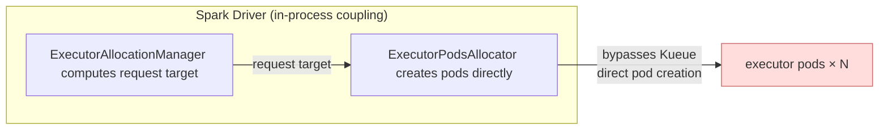
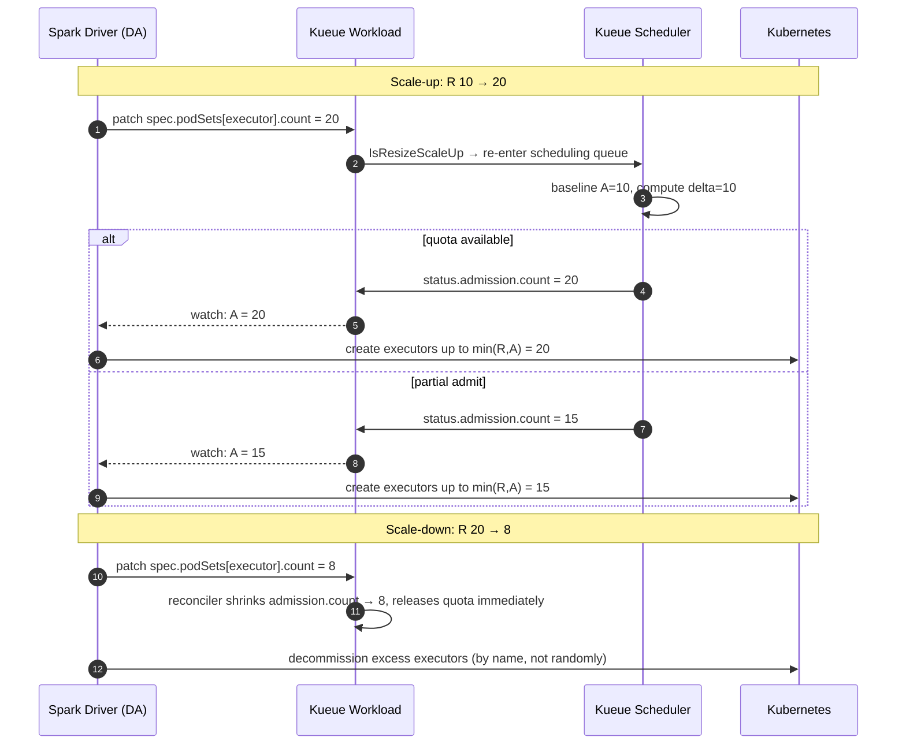
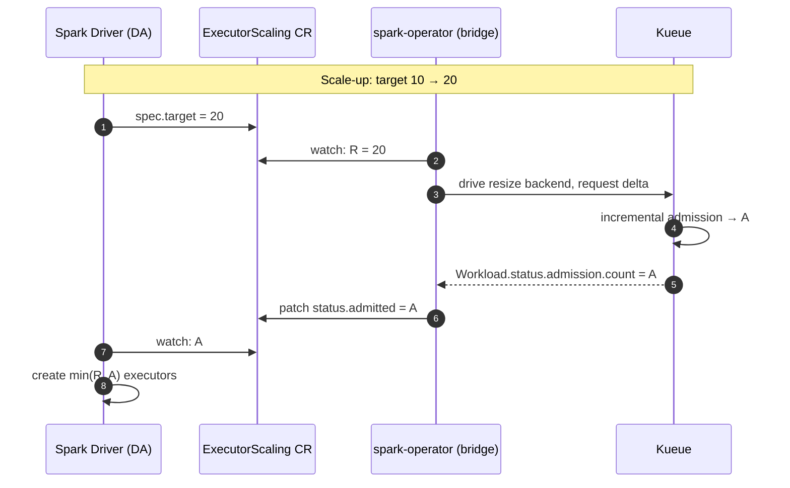

# Issue #12944: Support Spark dynamic allocation with Elastic Workload and Partial Admission

**Summary**: Support Spark dynamic allocation with Elastic Workload and Partial Admission

**Sources**: https://github.com/kubernetes-sigs/kueue/issues/12944

**Last updated**: 2026-10-08T07:41:34Z

---

## Metadata

- **State**: open
- **Author**: [@zhengchenyu](https://github.com/zhengchenyu)
- **Created**: 2026-07-10T07:20:10Z
- **Updated**: 2026-10-08T07:41:34Z
- **Closed**: —
- **Labels**: `kind/feature`
- **Assignees**: _none_
- **Comments**: 5

## Description

## 1 Overview

I would like to discuss how to integrate Spark dynamic allocation with Kueue. There are a few main issues:

* (1) Kueue cannot directly get Spark dynamic allocation signals
Kueue mainly interacts with the `SparkApplication` CRD today, but Spark dynamic allocation decisions are made by the Spark driver.  The executor target count changes at runtime and is not naturally reflected in `SparkApplication` CRD.

* (2) Scale-up may create a large number of Pending / Gated pods
When scale up, if the driver creates all executor pods first and Kueue only uses `schedulingGates` to control scheduling. Compared to other jobs, Spark may generate more Pending / Gated pods, then putting pressure on etcd, kube-apiserver, and informer caches. Ideally, the driver should know the admitted executor count before creating executor pods.

* (3) Spark needs Elastic Workload with Partial Admission
Spark executors do not require strict gang semantics. If Spark requests 100 executors and Kueue can only admit 30, Spark can still use those 30 executors and continue running. So Spark dynamic allocation needs Elastic Workload to work together with Partial Admission.

> Notes: (3) please see #12100, do not describe here.

---

## 2 The Problem: Spark's Coupled Architecture

Spark Dynamic Allocation couples two responsibilities inside the driver process:

- `ExecutorAllocationManager` computes a desired executor request count based on backlog and idle state
- `ExecutorPodsAllocator` creates executor pods **directly against the Kubernetes API**.

This does not align with the Kubernetes declarative mode, where intent is expressed in `spec` and outcomes are reflected in `status`. 

The root obstacle: **there is no external signal carrying the DA target**.

---

## 3 WorkloadSlicing vs WorkloadResize

Two Kueue mechanisms exist for elastic scaling. Here is how they compare for the Spark use case.

### 3.1 WorkloadSlicing

Each scale-up creates a new replacement Workload (a "slice"). The old slice is marked finished once the new one is admitted. This approach has two costs:

- **Every scale event produces a Finished Workload, each job always has at least two Workloads.** 
- **It is difficult to find a stable workload to use as a benchmark.**

### 3.2 WorkloadResize

A single stable Workload exists for the entire job lifetime. The driver patches `spec.podSets[executor].count` in place, and Kueue performs incremental admission on the same object, writing the result into `status.admission...count = A`. Driver reads `status.admission.count` to get the actual executor count.

---

## 4 Two Integration Proposals

There are two approaches that differ in whether the Spark driver is directly aware of Kueue.

### 4.1 Proposal 1: Direct Coupling via Workload

This approach requires working directly with Workload, stable workload using `WorkloadResize` is recommended.

The driver implements a custom `KueueExecutorPodsAllocator` that reads and writes the Kueue Workload directly.

**Scale-up / scale-down sequence:**

---

### 4.2 Proposal 2: Decoupled via ExecutorScaling CRD

Introduce a new CRD `ExecutorScaling` (ES). The driver writes only to ES and reads only from ES — it never touches a Kueue object. A bridge controller inside spark-operator translates between ES and Kueue.

It makes no difference whether workloadslicing or workloadresize, if you are not worried about the pressure generated by more workloads.

**sequence:**

## Discussion

### Comment by [@kannon92](https://github.com/kannon92) — 2026-07-10T12:44:21Z

Related: https://github.com/kubernetes-sigs/kueue/issues/12047

the poster also filled https://github.com/kubeflow/spark-operator/issues/2983 for spark-operator.

### Comment by [@zhengchenyu](https://github.com/zhengchenyu) — 2026-07-16T02:29:04Z

> Related: [#12047](https://github.com/kubernetes-sigs/kueue/issues/12047)
> 
> the poster also filled [kubeflow/spark-operator#2983](https://github.com/kubeflow/spark-operator/issues/2983) for spark-operator.

@kannon92 Option C is actually kubeflow/spark-operator#2983. However, my concern is that the Spark driver would have to modify the SparkApplication CRD of the Spark-operator. I feel that having the Spark driver layer modify the SparkApplication CRD doesn't seem appropriate, since the Spark-operator is more like a launcher for the Spark driver.

We currently specify the requested podsets based on Job.spec. Is there a new way to express requested podsets? For example, the spec.resizeRequest of Workload mentioned in #5897?

@kannon92 @mimowo @tenzen-y @ichekrygin @yaroslava-serdiuk Could you please review my proposal?

### Comment by [@kannon92](https://github.com/kannon92) — 2026-07-16T20:10:55Z

@zhengchenyu 
I'm not an expert on Spark so I hope you can find community input to help answer the right direction for Kueue + Spark.

### Comment by [@yaroslava-serdiuk](https://github.com/yaroslava-serdiuk) — 2026-07-17T10:38:58Z

@zhengchenyu, From my understanding, adding fields to SparkApplication (which requires the Spark driver to read/write the SparkApplication CRD) is the native way Kueue currently supports other job types.
The Workload object is essentially Kueue's internal representation of the job, so any job changes are mirrored by the workload. 

Also, it seems to me that the use case you're describing fits the ElasticWorkloads mechanism perfectly.

>(2) Scale-up may create a large number of Pending / Gated pods
When scale up, if the driver creates all executor pods first and Kueue only uses schedulingGates to control scheduling. Compared to other jobs, Spark may generate more Pending / Gated pods, then putting pressure on etcd, kube-apiserver, and informer caches. Ideally, the driver should know the admitted executor count before creating executor pods.

Is it possible to have a limit on scale up size? In this case, if the pods could not be scheduled, the Kueue will reject the WorkloadSlice and so the Spark dynamic allocation won't scale up further.

### Comment by [@zhengchenyu](https://github.com/zhengchenyu) — 2026-07-21T07:51:33Z

@yaroslava-serdiuk 
The Workload object is is indeed Kueue's internal representation of the job. I'm just looking for a new way to allow job frameworks to directly request resources, for job frameworks like Spark.
Limiting the scaling up size can create other problems. For example, it leads to slow scaling speeds, generates a large workload, and makes it difficult for the kueue to handle excessive workloads as more Spark job will be migrated to kueue in the future.
