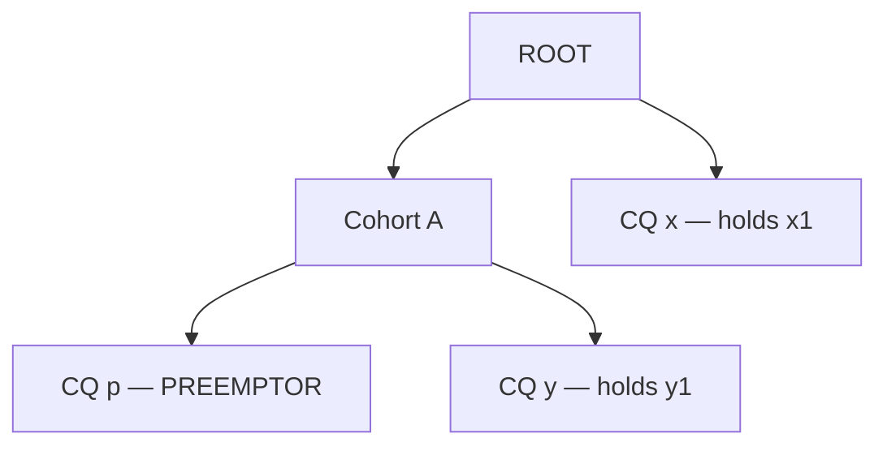

# Issue #14543: FairSharing: infinite preemption loop

**Summary**: FairSharing: infinite preemption loop

**Sources**: https://github.com/kubernetes-sigs/kueue/issues/14543

**Last updated**: 2026-10-08T07:10:17Z

---

## Metadata

- **State**: closed (completed)
- **Author**: [@pajakd](https://github.com/pajakd)
- **Created**: 2026-08-17T07:52:37Z
- **Updated**: 2026-10-08T07:10:17Z
- **Closed**: 2026-10-08T07:10:17Z
- **Labels**: `kind/bug`
- **Assignees**: [@pajakd](https://github.com/pajakd), [@JanKaczmarski](https://github.com/JanKaczmarski)
- **Comments**: 21

## Description

<!-- Please use this template while reporting a bug and provide as much info as possible. Not doing so may result in your bug not being addressed in a timely manner. Thanks!

If the matter is security related, please disclose it privately via https://kubernetes.io/security/
-->


**What happened**:
Several users reported the infinite preemption loop in fairsharing over the last months.

The root cause of the issue is the following. Preempting targets from same-CQ as the incoming workload causes its DRS to decrease, which makes more targets available. But after gathering all available targets, we proceed to `fillBackWorkloads`, where some same-CQ targets are removed, which increases DRS again which may make some other targets illegal (from the fair sharing perspective). Its possible to construct an example in which such a behavior leads to the infinite loop [7e9aaf4](https://github.com/pajakd/kueue/commit/7e9aaf4ba8b0e071eb385220464d8ff380436f85
). 

I was able to only reproduce it when both fairsharing strategies were in use. But, its possible that a simpler reproduction may be possible.

In the integration test I reproduced the behavior which we observed in the logs of the issue in the real cluster, where after a preemption, a preemptee gets admitted (instead of the preemptor).

In the unit test I showed an example in which two workloads may preempt each other (which is shown to be impossible in https://kueue.sigs.k8s.io/docs/concepts/fair_sharing/). The reason the proof does not cover this case is that one of the preemptions that happen in this case is illegal (preemptor has higher DRS).

**What you expected to happen**:
No infinite preemption.

**How to reproduce it (as minimally and precisely as possible)**:
[7e9aaf4](https://github.com/pajakd/kueue/commit/7e9aaf4ba8b0e071eb385220464d8ff380436f85
)

**Anything else we need to know?**:

**Environment**:
- Kubernetes version (use `kubectl version`):
- Kueue version (use `git describe --tags --dirty --always`):
- Cloud provider or hardware configuration:
- OS (e.g: `cat /etc/os-release`):
- Kernel (e.g. `uname -a`):
- Install tools:
- Others:

## Discussion

### Comment by [@pajakd](https://github.com/pajakd) — 2026-08-21T09:46:58Z

cc @amy

### Comment by [@kshalot](https://github.com/kshalot) — 2026-08-25T10:14:15Z

/assign @pajakd

Since you are working on this IIUC (assigning so nobody steals this)

### Comment by [@mimowo](https://github.com/mimowo) — 2026-09-15T08:58:14Z

I think to fully resolve the issue we need to graduate FairSharingReevaluatePreemptionCandidates. 

IIUC the identified issue is pre-existing bug in fillBackWorkloads, but maybe the FairSharingReevaluatePreemptionCandidates is adding another bug scenario: https://github.com/kubernetes-sigs/kueue/pull/14128#pullrequestreview-4977001998

IIUC the fundamental issue here is that preempting workload from the same CQ as the preemptor may lower the preemptor DRA, and so more candidates may start qualifying for preemption. Then, the fillBackWorkloads may revert the decision about perempting workloads from the same CQ, and thus the decision to include some of the victims might be invalidated.

Two approaches that I see to fix this:
A. make the `fillBackWorkloads` aware of the fair sharing by some function like `canFillBack(victim)` which will verify that the fill back of the victim does not invalidate any other decisions
B. when running fair sharing use the frozen DRS from the preemptor CQ that than keep lowering the DRS of the preemptor CQ as the algorithm is progressing.

I think (B) is substantially simpler, but I think it may have another drawback that scheduling a hero (large workload) may be deferred because it will not be able to preempt enough in one iteration. If we do (A.) it will be able to preempt its own workloads (from its CQ) which will also enable it to reclaim more on the DRS basis.

So, I think we should try exploring (A) and see how complex that would be, if not too complex then this is more aligned with the current implementation, and I cannot see the drawback for heros.

any thoughs @pajakd @tenzen-y @lightZebra ?

### Comment by [@JanKaczmarski](https://github.com/JanKaczmarski) — 2026-09-18T12:28:24Z

@mimowo about the A approach that you proposed, I think I found counter-example for it. Look at below scenario:

### Setup
```
CohortCapacity = 100
ClusterQueue QP runs: P_small = 30
ClusterQueue QT runs: T_hero = 70

# Incoming workload for QP
P_hero = 60

# New total want usage for QP
New_QP = 90 (30 + 60)
```

### A) scenario algorithm
```
1. P_small and T_hero are chosen as targets for preemption (P_small lowers QP DRS to 60, qualifying T_hero)
2. Backfill sees that it cannot put P_small back (due to canFillBack)
3. Both P_small and T_hero are evicted, P_hero is admitted (runs at 60)
4. 40 CPUs remain idle. T_hero cannot re-admit yet (70 > 60)
5. P_small admits into free 40 CPUs -> new QP DRS = 90
6. T_hero now preempts P_hero (because 70 < 90)

We cycle back
```

> **Note:** If `canFillBack` in step 2 returns `True` (current Kueue behavior), we cycle immediately because `P_small` is kept and `QP` ends up at 90% right away. If `canFillBack` returns `False`, we cycle on the very next step because the 40 idle CPUs get backfilled by `P_small`. Both paths cycle.


### B) scenario
In scenario **B)** the workload P_hero wouldn't be allowed to preempt T_hero as the locked QP DRS = 90 which is greater than 70, preventing the cycle.

### "Preemption based Fair Sharing Proof" Consideration
According to ["Preemption based Fair Sharing Proof"](https://kueue.sigs.k8s.io/docs/concepts/fair_sharing/#proof-that-two-workloads-wont-preempt-each-other) the DRS of workloads should be constant. In scenario A and the current solution this constraint doesn't hold because the DRS of the preemptor CQ changes during the process, i.e. `DRS_A_admitted` is different before and after the preemption (when intra-CQ preemptions are done).

### Comment by [@pajakd](https://github.com/pajakd) — 2026-09-21T05:52:49Z

Yeah, the example looks valid. So, its not the `FillBack` that needs to be fixed but we should be more conservative when selecting candidates for preemption. Whenever we preempt "extra" candidates (that are valid only because our DRS gets lower due to intra-CQ preemption) it risks such loops. This means that this feature #14128 might need rethinking.

### Comment by [@mimowo](https://github.com/mimowo) — 2026-09-21T09:01:54Z

Yes, I think B prevents the scenario and is a good conservative choice.

The only drawback potentially is that it may not let in some big workloads which require preemption both inside the CQ and outside the CQ, because it will not consider some of the candidates from other borrowing CQs.

I'm wondering if there is a possible solution "C" which doesn't have the drawback, but if we don't find it, then I would rather go with "correct but conservative" B.

### Comment by [@olekzabl](https://github.com/olekzabl) — 2026-09-21T10:34:01Z

I'm intrigued about step 5:

> `5. P_small admits into free 40 CPUs -> new QP DRS = 90`

No matter how we deal with preemptions, this step alone is reproducible. (Admit P_hero, then let T_hero wait, then let P_small come).

And then, does it make sense to admit P_small, when the effect is going to be an almost immediate preemption in queue P?

What if we had a rule "don't admit in queue A if this would raise DRS of A above DRS of another CQ B including its pending head"?

_EDIT: I'm realizing this isn't so simple in practice. For instance, even if we do_

> _admit in queue A if this would raise DRS of A above DRS of another CQ B including its pending head_

_then we'll know the pending head of B will _try_ to preempt in the next scheduling cycle, but we're not certain if that preemption will _succeed_.
It could be blocked on obstacles like node fragmentation, topology requirements, etc.
So my rule above ("what if ...") is certainly not 100% right :/_

### Comment by [@JanKaczmarski](https://github.com/JanKaczmarski) — 2026-09-22T16:31:13Z

@mimowo @olekzabl @pajakd 

A few findings while exploring Solution "C":

1. Changes to the backfill logic do not impact the final set of running workloads. This is because if we backfill a workload, it is admitted to the cluster immediately; if it is eligible for backfill but our canFillBack guard returns false, it will simply be scheduled in the subsequent scheduling cycle anyway. Therefore, keeping the backfill logic "naive" backfilling all possible workloads strictly by priority is the only viable approach (which rules out Solution A).
2. Instead, the change can be made during preemption target selection. Here, we can adjust the candidate selection to ensure the DRS of every affected CQ remains valid both before and after preemption.

With this in mind, I am now exploring an approach that leverages point (2) while leaving backfill as it currently is.

### Comment by [@olekzabl](https://github.com/olekzabl) — 2026-09-22T19:00:32Z

> if it is eligible for backfill but our canFillBack guard returns false, it will simply be scheduled in the subsequent scheduling cycle anyway

True for now. 
However, it'd become false if we went in the direction considered [here](https://github.com/kubernetes-sigs/kueue/issues/14543#issuecomment-5759078992). And then skipping some backfills would still make sense.

### Comment by [@olekzabl](https://github.com/olekzabl) — 2026-09-23T08:00:33Z

My concern is how to avoid starving P_hero.
In the example provided, it seems effectively out-prioritized by T_hero, which feels non-fair as T_hero borrows more.

* Suppose T_hero is long-running, while consecutive P_smalls come in abundance.
  As long as we keep P_hero not admitted (as Solution B would do), new P_smalls would replace old ones, leading to a "threadmill".
  P_hero gets starved until T_hero finishes.

* Now, we could say the user could intervene to break the threadmill.
  For example, set `StrictFIFO` on CQ P so that new P_smalls don't sneak in before the P_hero that is waiting.
  Or, drain CQ P manually.
  However... this seems not to solve the original problem.
  Whenever P_hero is allowed to preempt T_hero, we'll have this free capacity of 40 CPUs, and then un-draining P will let some P_small in, and then we're back to the original preemption cycle.
  As a result, P_hero will be kicked out by T_hero.

The "DRS-based admission guard" is perhaps not the best idea for that problem (due to its conceptual complexity, decreasing cluster utilization etc.). Though for now I don't have other ideas.

### Comment by [@JanKaczmarski](https://github.com/JanKaczmarski) — 2026-09-23T09:43:51Z

## The next issue that surfaced

In our current examples we focused on setup with a single Cohort and multiple CQs in the cohort. But with a scenario like below:



If we simply lock on a preemptor CQ level we'll still have the same "preemption cycle" issue but on cross-cohort level (preempt `x1`). This means that with locking approach we would need to lock DRSs on a hierarchy level based on what target we want to preempt. That's not that complex though - we can keep the locked DRS per preemptor's `almostLCA` and just look it up when evaluating a given target.

## Trivial solution

Trivial and simplest solution is as follows:
- select targets for preemption the same way as we're doing now
- backfill
- now **make** a decision if the preemption is correct (doesn't invalidate DRS). If correct proceed with preemption, if incorrect ditch the whole preemption and don't admit new workload on a cluster.

This solution should be a good triage for the bug.

I have some ideas for proper solutions here (the locking one, and smarter selection of preemption targets), but they're complex enough that I'd rather move them to a separate issue. On top of that we're not sure if they'll 100% fix the bug. For triaging this bug I think the naive solution above is enough - no changes to target selection or backfill, just a guard at the end.

### Comment by [@olekzabl](https://github.com/olekzabl) — 2026-09-23T10:53:20Z

cc @Singularity23x0 @dkaluza for visibility.

From the perspective of WAS integration (#13151, in particular #16000), I think the "trivial solution" does not bring any integration problems.

### Comment by [@dkaluza](https://github.com/dkaluza) — 2026-09-23T11:07:52Z

>Trivial and simplest solution is as follows:
>
>select targets for preemption the same way as we're doing now
>backfill
>now make a decision if the preemption is correct (doesn't invalidate DRS). If correct proceed with preemption, if incorrect ditch the whole preemption and don't admit new workload on a cluster.

From my point of view this can be highly problematic - what if you always land up in the situation that backfilling makes the preemption unfair?
This can even possibly deadlock all of the preemptions in the cluster.

I would rather consider not backfilling at all. In this way the preemptions will still be fair, sure they will not be perfect (from the "preempt as little as possible") but this will at least not block the admission of the workload that has every right to be admitted.

(Note I didn't go through all of the comments in this issue, just commenting last one as I was tagged)

### Comment by [@JanKaczmarski](https://github.com/JanKaczmarski) — 2026-09-23T11:26:53Z

@dkaluza 

**TL;DR:** Interestingly, backfilling doesn't prevent or cause preemption/admission cycles or blocks.

If you look at this part of the [comment](https://github.com/kubernetes-sigs/kueue/issues/14543#issuecomment-5780180690):

> Changes to the backfill logic do not impact the final set of running workloads. This is because if we backfill a workload, it is admitted to the cluster immediately; if it is eligible for backfill but our canFillBack guard returns false, it will simply be scheduled in the subsequent scheduling cycle anyway. Therefore, keeping the backfill logic "naive" backfilling all possible workloads strictly by priority is the only viable approach (which rules out Solution A).

It's clear that:

1. **We do backfill resources:** We end up in an incorrect DRS state, causing preemption cycles (the bug we're fixing here).
2. **We don't backfill resources:** The next scheduling cycle will place non-backfilled resources back on the cluster anyway, as there is free space for them. Again we end up in a incorrect DRS state, the same way as with backfill

Hence, the only difference backfilling makes is that it prevents preempting resources that would be admitted in the next scheduling cycle anyway.

### Comment by [@dkaluza](https://github.com/dkaluza) — 2026-09-23T11:58:37Z

Sorry but I think I do not understand. Maybe we are talking about different backfilling?

We have this code:
https://github.com/kubernetes-sigs/kueue/blob/54c0480ccd8686f98c640c0bb249a6d9bfb40a38/pkg/scheduler/preemption/preemption.go#L340
That filters out workloads to be preempted to admit a workload.

IIUC We wish to make judgment based on its outcome. If it breaks the fair sharing - abort the admission.

Let's imagine it breaks the fair sharing and for 5 minutes nothing changes in the cluster.
Then in every scheduling loop we will get into the same "breaking fair sharing DRS due to backfilling". 
And we will not admit the new incoming workload - which according to preemption rules should be admitted.
As nothing changes for 5 minutes we will not admit it for the whole duration leading to huge scheduling delay. 

Or am I missing something?

### Comment by [@JanKaczmarski](https://github.com/JanKaczmarski) — 2026-09-23T12:18:55Z

> Note: I think we're talking about the same backfill; I meant the `fillBackWorkloads` function.

You understand correctly, but I think the scenario you described is actually what is expected from scheduling. If preemption for an incoming workload breaks Fair Sharing rules, we shouldn't admit the workload. 

So what you're describing is the expected outcome of the proposed trivial solution. The downside is that it might delay admission times for hero workloads, **but** it won't break the FS rules that currently result in the preemption cycle bug.

### Comment by [@JanKaczmarski](https://github.com/JanKaczmarski) — 2026-09-23T12:19:46Z

Right now I'm looking for solution that might make "naive" solution less conservative (we'll admit hero workloads more often) - though that's still in progress.

### Comment by [@dkaluza](https://github.com/dkaluza) — 2026-09-23T12:27:05Z

> If preemption for an incoming workload breaks Fair Sharing rules, we shouldn't admit the workload.

I believe this is not fully true - IIUC the situation if we do not run backfill, the preemptions would be fair - we could have proceeded with them. Unfairness is just a result of our too aggressive optimization.

So fair preemptions are possible - we are just not following them due to the bug.

### Comment by [@JanKaczmarski](https://github.com/JanKaczmarski) — 2026-09-23T12:36:31Z

Yes, but backfill isn't the one responsible here. It doesn't matter if we run backfill or no the issue is still here. The that causes this bug is  algorithm choosing targets for preemption. I think this [example](https://github.com/kubernetes-sigs/kueue/issues/14543#issuecomment-5729986376) shows that nicely - with or without backfill we still end up in a preemption cycle

### Comment by [@JanKaczmarski](https://github.com/JanKaczmarski) — 2026-10-07T14:02:26Z

https://github.com/JanKaczmarski/kueue/blob/fair-sharing-preemption-analysis/docs/fair-sharing-preemption-analysis/fs_preemption_bug_analysis.md - document with different solutions analyzed with their pros and cons and test scenarios coverage

### Comment by [@JanKaczmarski](https://github.com/JanKaczmarski) — 2026-10-07T15:20:16Z

/assign
