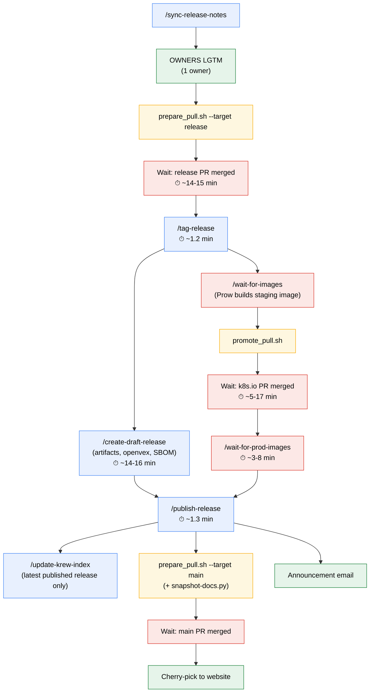

# Issue #17253: ✨ Release automation: optimize the release process after LGTM

**Summary**: ✨ Release automation: optimize the release process after LGTM

**Sources**: https://github.com/kubernetes-sigs/kueue/issues/17253

**Last updated**: 2026-10-15T12:43:31Z

---

## Metadata

- **State**: open
- **Author**: [@mimowo](https://github.com/mimowo)
- **Created**: 2026-10-15T08:57:45Z
- **Updated**: 2026-10-15T12:43:31Z
- **Closed**: —
- **Labels**: `kind/feature`, `area/release`
- **Assignees**: _none_
- **Comments**: 19

## Description

<!-- Please only use this template for submitting enhancement requests -->

**What would you like to be added**:

Part of https://github.com/kubernetes-sigs/kueue/issues/12763

Currently the release process takes pretty long since LGTM to finalize.

Stage | v0.19.8 | v0.20.1 | What consumes the time
-- | -- | -- | --
Preparation PR opened → merged | 13m52s | 15m17s | CI, review, merge queue
Draft-release job | 14m01s | 16m24s | Artifact build/upload, followed by SBOM/OpenVEX
Promotion PR opened → merged | 17m27s | 4m34s | Review, checks, merge queue
Promotion merged → production images confirmed | 7m33s | 3m27s | Registry propagation, command setup and checking
Preparation PR opened → published | 77m56s | 78m41s | Includes the stages above and handoffs

Some ideas:
1. Skip the test matrix for metadata-only preparation PRs, keep the verify probably
2. Run draft generation and image promotion concurrently

/wait-for-images and creation of the draft release are sequential, but they don't need to be. Only promotion of imags needs to wait for images. Release publication needs to wait for both steps.

3. Automate remaining PR creation and handoffs.

Add automation (locally run scripts etc) which will execute the steps without waiting for a human. Human remains needed for lgtm/approach

- Opens the preparation PR
- Opens the promotion PR immediately when all staging digests exist.
- Starts production checks after promotion merges.
- Opens the main-update PR after publication and requests the website cherry-pick after merge.

**Why is this needed**:

To optimize the process getting below 1h.

<!-- release-log-start -->
## Release log

<!-- entry-start title="Authorization" keep-in-history="true" -->
### Authorization
Triggered by: @mbobrovskyi
Timestamp: 2026-10-15 11:24:22 UTC
Action link: https://github.com/kubernetes-sigs/kueue/actions/runs/38727066859

❌ Invalid issue title: `✨ Release automation: optimize the release process after LGTM`. Expected format: `Release vX.Y.Z`.
<!-- entry-end -->

<!-- history-section-start -->

### History

<!-- history-start title="Authorization" -->
<details>
<summary><b>Authorization history</b></summary>


Triggered by: @coderabbitai[bot]
Timestamp: 2026-10-15 10:08:34 UTC
Action link: https://github.com/kubernetes-sigs/kueue/actions/runs/38718105773

❌ Actor coderabbitai[bot] is not authorized.

---

Triggered by: @Singularity23x0
Timestamp: 2026-10-15 09:50:22 UTC
Action link: https://github.com/kubernetes-sigs/kueue/actions/runs/38715847515

❌ Invalid issue title: `✨ Release automation: optimize the release process after LGTM`. Expected format: `Release vX.Y.Z`.

---

Triggered by: @mbobrovskyi
Timestamp: 2026-10-15 09:49:05 UTC
Action link: https://github.com/kubernetes-sigs/kueue/actions/runs/38715688594

❌ Invalid issue title: `✨ Release automation: optimize the release process after LGTM`. Expected format: `Release vX.Y.Z`.


</details>
<!-- history-end -->
<!-- release-log-end -->

## Discussion

### Comment by [@mimowo](https://github.com/mimowo) — 2026-10-15T08:58:55Z

cc @mbobrovskyi @Singularity23x0 @tenzen-y @sohankunkerkar ptal

### Comment by [@Singularity23x0](https://github.com/Singularity23x0) — 2026-10-15T09:48:16Z

https://github.com/kubernetes-sigs/kueue/issues/17125

### Comment by [@mbobrovskyi](https://github.com/mbobrovskyi) — 2026-10-15T09:48:41Z

The longest part is `/create-draft-release`. Most of that time is spent building Go binaries for each platform (`linux/amd64`, `linux/arm64`, `darwin/amd64`, `darwin/arm64`).

What we can avoid is waiting for the SBOM and OpenVEX generation. They run as the last steps and the success report is posted only after both are done. I think we can run them in the background (a separate job).

### Comment by [@github-actions[bot]](https://github.com/apps/github-actions) — 2026-10-15T09:49:07Z

❌ Invalid issue title: `✨ Release automation: optimize the release process after LGTM`. Expected format: `Release vX.Y.Z`.

### Comment by [@Singularity23x0](https://github.com/Singularity23x0) — 2026-10-15T09:49:59Z

 >The longest part is /create-draft-release. Most of that time is spent building Go binaries for each platform (linux/amd64, linux/arm64, darwin/amd64, darwin/arm64).

I am wondering whether we could parallelize these?

### Comment by [@github-actions[bot]](https://github.com/apps/github-actions) — 2026-10-15T09:50:24Z

❌ Invalid issue title: `✨ Release automation: optimize the release process after LGTM`. Expected format: `Release vX.Y.Z`.

### Comment by [@mbobrovskyi](https://github.com/mbobrovskyi) — 2026-10-15T09:50:47Z

We already did that https://github.com/kubernetes-sigs/kueue/pull/16923.

### Comment by [@mbobrovskyi](https://github.com/mbobrovskyi) — 2026-10-15T09:52:14Z

Oops, sorry, I provided the wrong PR ID. We introduced parallelization here: https://github.com/kubernetes-sigs/kueue/pull/15116.

### Comment by [@Singularity23x0](https://github.com/Singularity23x0) — 2026-10-15T09:54:37Z

In light of this: Skip the test matrix for metadata-only preparation PRs, keep the verify - this would likely be the biggest help for us.

### Comment by [@tenzen-y](https://github.com/tenzen-y) — 2026-10-15T10:00:20Z

Basically, GitHub-hosted runners have an ultra-low-performance I/O disk. So, we can not eliminate build time as long as we keep using GitHub Actions for binary prep instead of Prow.

### Comment by [@mimowo](https://github.com/mimowo) — 2026-10-15T10:02:43Z

> ❌ Invalid issue title: ✨ Release automation: optimize the release process after LGTM. Expected format: Release vX.Y.Z.

Sorry, what is going on here, @mbobrovskyi @Singularity23x0 do you know?

### Comment by [@mbobrovskyi](https://github.com/mbobrovskyi) — 2026-10-15T10:06:41Z

> ❌ Invalid issue title: ✨ Release automation: optimize the release process after LGTM. Expected format: Release vX.Y.Z.

@coderabbitai Please open an issue to prevent the release-utils.yml workflow from posting such messages when the issue doesn't have the /area release label. Leave the issue unassigned.

### Comment by [@coderabbitai[bot]](https://github.com/apps/coderabbitai) — 2026-10-15T10:08:17Z

<!-- This is an auto-generated reply by CodeRabbit -->
<details>
<summary>🧩 Analysis chain</summary>

🏁 Script executed:

```shell
#!/bin/bash
set -euo pipefail
fd --hidden --exclude .git '^AGENTS\.md$|^release-utils\.yml$' .
if [ -f AGENTS.md ]; then cat AGENTS.md; fi
gh issue view 17253 --repo kubernetes-sigs/kueue --json title,body,url,comments --jq '{title,body,url,comments: [.comments[] | {author: .author.login,body,url}]}'
```

Length of output: 10490

---

🏁 Script executed:

```shell
#!/bin/bash
set -euo pipefail
cat cmd/experimental/skills/kueue-pr-issue-workflow/SKILL.md
ast-grep outline .github/workflows/release-utils.yml || true
sed -n '1,260p' .github/workflows/release-utils.yml
```

Length of output: 13245

---

🏁 Script executed:

```shell
#!/bin/bash
set -euo pipefail
fd --hidden --type f . .github/ISSUE_TEMPLATE
rg -n -C2 'area.?release|labels:|title:' .github/ISSUE_TEMPLATE
gh label list --repo kubernetes-sigs/kueue --search release --json name --limit 100
```

Length of output: 4587

---

🏁 Script executed:

```shell
#!/bin/bash
set -euo pipefail
cat .github/ISSUE_TEMPLATE/BUG_REPORT.md
```

Length of output: 1052

---

🏁 Script executed:

```shell
#!/bin/bash
set -euo pipefail
body=$(cat <<'EOF'
**What happened**:

`.github/workflows/release-utils.yml` posts `❌ Invalid issue title` messages on unrelated issues when comments mention release commands. Its `authorize` job checks command substrings but does not check the issue label. See https://github.com/kubernetes-sigs/kueue/issues/17253.

**What you expected to happen**:

Skip release automation unless the issue has the `area/release` label (`/area release`). Add this guard before authorization, title validation, or reporting.

Acceptance criteria:
- Without `area/release`, comments containing release commands produce no workflow comments or release-log updates.
- With `area/release`, existing command handling and title validation remain unchanged.

**How to reproduce it (as minimally and precisely as possible)**:

On an issue without `area/release` and with a non-release title, post a comment mentioning `/create-draft-release` as an authorized release actor. The workflow reports an invalid title.

**Anything else we need to know?**:

Requested by @mbobrovskyi: https://github.com/kubernetes-sigs/kueue/issues/17253#issuecomment-6189573472.
Filed by CodeRabbit AI on the requester's behalf. Leave unassigned.

**Environment**:
- Kubernetes version (use `kubectl version`): Not applicable.
- Kueue version (use `git describe --tags --dirty --always`): Release automation observed in #17253.
- Cloud provider or hardware configuration: GitHub Actions.
- OS (e.g: `cat /etc/os-release`): `ubuntu-latest` runner.
- Kernel (e.g. `uname -a`): Not applicable.
- Install tools: Not applicable.
- Others: `.github/workflows/release-utils.yml`.
EOF
)
url=$(gh issue create --repo kubernetes-sigs/kueue \
  --title "🐛 Skip release-utils workflow for issues without area/release" \
  --body "$body")
printf '%s\n' "$url"
gh issue view "$url" --repo kubernetes-sigs/kueue --json url,title,assignees,labels
```

Length of output: 2275

---

</details>

`@mbobrovskyi` Created `#17256` to skip `release-utils.yml` for issues without the `area/release` label. The issue is unassigned.

_You are interacting with an AI system._


<!-- <agentComponentType>chat-answer</agentComponentType> -->

<!-- <rawResChunk><answer><details>
<summary>🧩 Analysis chain</summary>

🏁 Script executed:

```shell
#!/bin/bash
set -euo pipefail
fd --hidden --exclude .git '^AGENTS\.md$|^release-utils\.yml$' .
if [ -f AGENTS.md ]; then cat AGENTS.md; fi
gh issue view 17253 --repo kubernetes-sigs/kueue --json title,body,url,comments --jq '{title,body,url,comments: [.comments[] | {author: .author.login,body,url}]}'
```

Length of output: 10490

---

🏁 Script executed:

```shell
#!/bin/bash
set -euo pipefail
cat cmd/experimental/skills/kueue-pr-issue-workflow/SKILL.md
ast-grep outline .github/workflows/release-utils.yml || true
sed -n '1,260p' .github/workflows/release-utils.yml
```

Length of output: 13245

---

🏁 Script executed:

```shell
#!/bin/bash
set -euo pipefail
fd --hidden --type f . .github/ISSUE_TEMPLATE
rg -n -C2 'area.?release|labels:|title:' .github/ISSUE_TEMPLATE
gh label list --repo kubernetes-sigs/kueue --search release --json name --limit 100
```

Length of output: 4587

---

🏁 Script executed:

```shell
#!/bin/bash
set -euo pipefail
cat .github/ISSUE_TEMPLATE/BUG_REPORT.md
```

Length of output: 1052

---

🏁 Script executed:

```shell
#!/bin/bash
set -euo pipefail
body=$(cat <<'EOF'
**What happened**:

`.github/workflows/release-utils.yml` posts `❌ Invalid issue title` messages on unrelated issues when comments mention release commands. Its `authorize` job checks command substrings but does not check the issue label. See https://github.com/kubernetes-sigs/kueue/issues/17253.

**What you expected to happen**:

Skip release automation unless the issue has the `area/release` label (`/area release`). Add this guard before authorization, title validation, or reporting.

Acceptance criteria:
- Without `area/release`, comments containing release commands produce no workflow comments or release-log updates.
- With `area/release`, existing command handling and title validation remain unchanged.

**How to reproduce it (as minimally and precisely as possible)**:

On an issue without `area/release` and with a non-release title, post a comment mentioning `/create-draft-release` as an authorized release actor. The workflow reports an invalid title.

**Anything else we need to know?**:

Requested by `@mbobrovskyi`: https://github.com/kubernetes-sigs/kueue/issues/17253#issuecomment-6189573472.
Filed by CodeRabbit AI on the requester's behalf. Leave unassigned.

**Environment**:
- Kubernetes version (use `kubectl version`): Not applicable.
- Kueue version (use `git describe --tags --dirty --always`): Release automation observed in `#17253`.
- Cloud provider or hardware configuration: GitHub Actions.
- OS (e.g: `cat /etc/os-release`): `ubuntu-latest` runner.
- Kernel (e.g. `uname -a`): Not applicable.
- Install tools: Not applicable.
- Others: `.github/workflows/release-utils.yml`.
EOF
)
url=$(gh issue create --repo kubernetes-sigs/kueue \
  --title "🐛 Skip release-utils workflow for issues without area/release" \
  --body "$body")
printf '%s\n' "$url"
gh issue view "$url" --repo kubernetes-sigs/kueue --json url,title,assignees,labels
```

Length of output: 2275

---

</details>

`@mbobrovskyi` Created `#17256` to skip `release-utils.yml` for issues without the `area/release` label. The issue is unassigned.</answer></rawResChunk> -->

### Comment by [@github-actions[bot]](https://github.com/apps/github-actions) — 2026-10-15T10:08:35Z

❌ Actor coderabbitai[bot] is not authorized.

### Comment by [@mimowo](https://github.com/mimowo) — 2026-10-15T10:13:03Z

/area release

### Comment by [@mbobrovskyi](https://github.com/mbobrovskyi) — 2026-10-15T11:24:04Z

### Release publication flow

The release team executes the steps of the **New Release** issue template.
The diagram shows a patch release (`v$MAJ.$MIN.$PATCH`, `$PATCH` > 0).
An arrow means "must finish before". Steps without an arrow between them can run in parallel.



Legend: blue is a ChatOps command, yellow is a local script that opens a PR,
red is a wait on CI or a PR merge, green is a manual step.

What can run in parallel:

- After `/tag-release`: `/create-draft-release` and the image promotion chain
  (`/wait-for-images` through `/wait-for-prod-images`).
- After `/publish-release`: the krew update, the `main` update, and the announcement.

What cannot run in parallel: everything up to `/tag-release` is a strict chain,
and `/publish-release` needs both the draft release and the promoted images.

### Comment by [@github-actions[bot]](https://github.com/apps/github-actions) — 2026-10-15T11:24:24Z

❌ Invalid issue title: `✨ Release automation: optimize the release process after LGTM`. Expected format: `Release vX.Y.Z`.

### Comment by [@Singularity23x0](https://github.com/Singularity23x0) — 2026-10-15T11:57:44Z

> What can run in parallel

This still cuts 15 mins off as it is happening in the background as we are doing work in parallel. That is a hudge win.

### Comment by [@yindia](https://github.com/yindia) — 2026-10-15T12:43:31Z

Hey team, I’m not familiar with the Kubernetes release process and tooling yet, and I’d like to get involved to understand the entire process in depth. I’m happy to pick up tasks that would help me learn how the release process works end to end.
