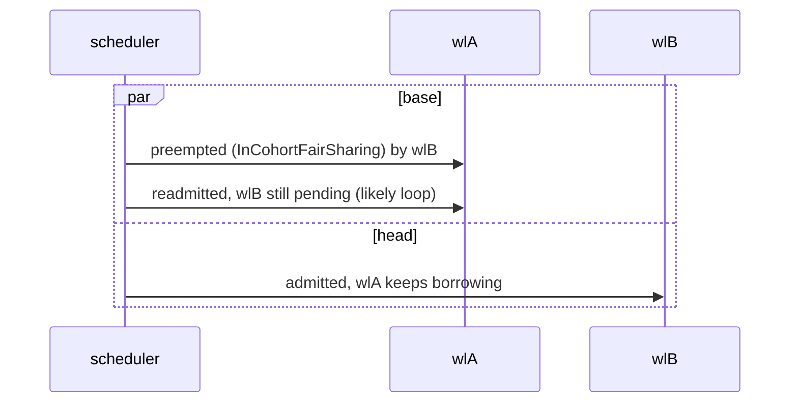

# Issue #18145: ✨ Skill: render a scheduling decision timeline and TAS placement map from state-diff captures (timeline)

**Summary**: ✨ Skill: render a scheduling decision timeline and TAS placement map from state-diff captures (timeline)

**Sources**: https://github.com/kubernetes-sigs/kueue/issues/18145

**Last updated**: 2026-11-02T09:28:26Z

---

## Metadata

- **State**: open
- **Author**: [@vladikkuzn](https://github.com/vladikkuzn)
- **Created**: 2026-11-02T03:49:09Z
- **Updated**: 2026-11-02T09:28:26Z
- **Closed**: —
- **Labels**: _none_
- **Assignees**: [@vladikkuzn](https://github.com/vladikkuzn)
- **Comments**: 1

## Description

<!-- Please only use this template for submitting enhancement requests -->

**What would you like to be added**:

Part of #18141. Depends on #18142.

A skill in `cmd/experimental/skills/kueue-pr-evidence-timeline/` that renders, from the state-diff base and head captures, per side:

- preemptions as `preemptor -> victim` with the reason (`InClusterQueue`, `InCohortFairSharing`, ...);
- the admit, evict, and requeue order as a Mermaid `sequenceDiagram` and a text table;
- for TAS, the final pod count per topology domain for each PodSet.

Order comes from checkpoint index, then event order, not wall-clock time. The skill runs nothing itself and rejects captures that state-diff did not produce or whose SHAs do not match the PR. A victim readmitted while its preemptor stays pending is flagged as a likely preemption loop. When neither side has a scheduling decision, no block is added.

Illustrative diagram:

Non-goals: rendering anything that is not in the captures.

**Why is this needed**:

Preemption and fair-sharing reviews depend on the order of decisions, which a final-state diff hides. TAS reviews depend on pod placement. A diagram and a placement table put both in the PR (GitHub renders Mermaid natively), and can expose loops and wrong victims that a final-state assertion misses.

Test PRs: #17034 (fair-sharing preemption loop with partial borrowing), #17515 (TAS hotswap for a LeaderWorkerSet PodSet group).

**Completion requirements**:

Acceptance criteria:

- Only state-diff captures with matching base and head SHAs are accepted.
- Every diagram has a text table with the same decisions.
- Over budget, the diagram and then the tables move into `
`; if it still does not fit, the skill fails instead of truncating.
- For #17034, the loop warning appears on the base side only. For #17515, the TAS table shows where the LeaderWorkerSet PodSet group lands on each side.

This enhancement requires the following artifacts:

- [ ] Design doc
- [ ] API change
- [ ] Docs update

The artifacts should be linked in subsequent comments.

Only the docs update applies: a row in `cmd/experimental/skills/README.md`.

An AI tool (Claude Code) was used to draft this issue.

## Discussion

### Comment by [@vladikkuzn](https://github.com/vladikkuzn) — 2026-11-02T09:28:24Z

The solution is ready for review: https://github.com/kubernetes-sigs/kueue/compare/main...vladikkuzn:kueue:pr-evidence-timeline

I could not open the PR from my account (`CreatePullRequest` permission error), so the link points at the branch. It is stacked on the state-diff work for #18142: the first commit has the shared helpers, and only the last commit is this skill.

/assign
/cc @mbobrovskyi @mykysha @reruno @ivnovakov
