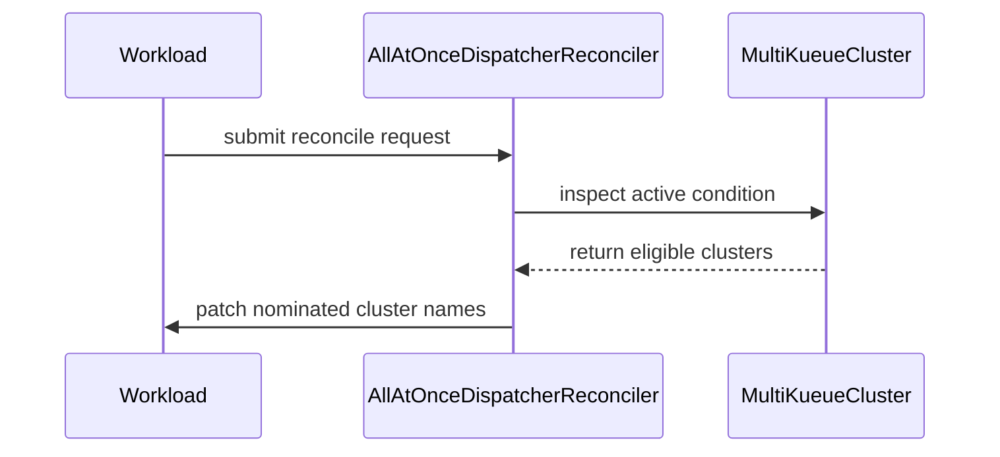

# PR #10937: Move AllAtOnce MultiKueue dispatcher to a dedicated controller

**Summary**: Move AllAtOnce MultiKueue dispatcher to a dedicated controller

**Sources**: https://github.com/kubernetes-sigs/kueue/pull/10937

**Last updated**: 2026-08-26T23:12:07Z

---

## Metadata

- **State**: open
- **Author**: [@andrewseif](https://github.com/andrewseif)
- **Branch**: `Issue-6803-move-AllAtOnce-to-Controller` → `main`
- **Created**: 2026-05-04T22:17:47Z
- **Updated**: 2026-08-26T23:12:07Z
- **Merged**: —
- **Closed**: —
- **Labels**: `release-note-none`, `size/XL`, `needs-rebase`, `kind/cleanup`, `ok-to-test`, `cncf-cla: yes`, `area/multikueue`
- **Assignees**: _none_
- **Requested reviewers**: [@pajakd](https://github.com/pajakd)
- **Changed files**: 10   **+707 / -25**

## Description

<!--  Thanks for sending a pull request!  Here are some tips for you:

1. If this is your first time, please read our contributor guidelines: https://git.k8s.io/community/contributors/guide/first-contribution.md#your-first-contribution and developer guide https://git.k8s.io/community/contributors/devel/development.md#development-guide
2. Please label this pull request according to what type of issue you are addressing, especially if this is a release targeted pull request. For reference on required PR/issue labels, read here:
https://git.k8s.io/community/contributors/devel/sig-release/release.md#issuepr-kind-label
3. Ensure you have added or ran the appropriate tests for your PR: https://git.k8s.io/community/contributors/devel/sig-testing/testing.md
4. If you want *faster* PR reviews, read how: https://git.k8s.io/community/contributors/guide/pull-requests.md#best-practices-for-faster-reviews
5. If the PR is unfinished, see how to mark it: https://git.k8s.io/community/contributors/guide/pull-requests.md#marking-unfinished-pull-requests
-->

#### What type of PR is this?
/kind cleanup
/area multikueue
<!--
Add one of the following kinds:
/kind bug
/kind cleanup
/kind documentation
/kind feature
/kind kep

Optionally add one or more of the following kinds if applicable:
/kind api-change
/kind deprecation
/kind failing-test
/kind flake
/kind regression

Please also consider setting the area:
/area tas
/area integrations
/area multikueue
/area dashboard
/area localization
/area testing
/area website
-->

#### What this PR does / why we need it:
Move AllAtOnce MultiKueue dispatcher to a dedicated controller 
#### Which issue(s) this PR fixes:
<!--
*Automatically closes linked issue when PR is merged.
Usage: `Fixes #<issue number>`, or `Fixes (paste link of issue)`.
_If PR is about `failing-tests or flakes`, please post the related issues/tests in a comment and do not use `Fixes`_*
-->
Fixes #6803


#### Special notes for your reviewer:

#### Does this PR introduce a user-facing change?
<!--
If no, just write "NONE" in the release-note block below.
If yes, a release note is required:
Enter your extended release note in the block below. If the PR requires additional action from users switching to the new release, include the string "action required".
-->
```release-note
NONE
```


<!-- This is an auto-generated comment: release notes by coderabbit.ai -->
## Summary by CodeRabbit

* **New Features**
  * Added an external all-at-once workload dispatcher controller for MultiKueue “AllAtOnce” mode.
  * Introduced the `MultiKueueAllAtOnceExternal` feature gate (Beta, default enabled).
  * Dispatcher selection now supports incremental and all-at-once modes.
* **Bug Fixes**
  * Preserves evicted remote workloads during remote synchronization to allow eviction recovery.
  * Maintains legacy all-at-once nomination behavior when the external dispatcher feature is disabled.
* **Tests**
  * Expanded reconciliation, worker nomination, feature-gate, and integration setup coverage.
<!-- end of auto-generated comment: release notes by coderabbit.ai -->

## Discussion

### Comment by [@netlify[bot]](https://github.com/apps/netlify) — 2026-05-04T22:17:53Z

### <span aria-hidden="true">✅</span> Deploy Preview for *kubernetes-sigs-kueue* canceled.


|  Name | Link |
|:-:|------------------------|
|<span aria-hidden="true">🔨</span> Latest commit | 42af7ca675c732bd90191eab38166d41ee0e35ec |
|<span aria-hidden="true">🔍</span> Latest deploy log | https://app.netlify.com/projects/kubernetes-sigs-kueue/deploys/6a608368d3db880007bb146a |

### Comment by [@k8s-ci-robot](https://github.com/k8s-ci-robot) — 2026-05-04T22:17:58Z

Hi @andrewseif. Thanks for your PR.

I'm waiting for a [kubernetes-sigs](https://github.com/orgs/kubernetes-sigs/people) member to verify that this patch is reasonable to test. If it is, they should reply with `/ok-to-test` on its own line. Until that is done, I will not automatically test new commits in this PR, but the usual testing commands by org members will still work.

>[!TIP]
>**We noticed you've done this a few times! Consider [joining the org](https://git.k8s.io/community/community-membership.md#member) to skip this step and gain `/lgtm` and other bot rights.** We recommend asking approvers on your previous PRs to sponsor you.

Once the patch is verified, the new status will be reflected by the `ok-to-test` label.

I understand the commands that are listed [here](https://go.k8s.io/bot-commands?repo=kubernetes-sigs%2Fkueue).

<details>

Instructions for interacting with me using PR comments are available [here](https://git.k8s.io/community/contributors/guide/pull-requests.md).  If you have questions or suggestions related to my behavior, please file an issue against the [kubernetes-sigs/prow](https://github.com/kubernetes-sigs/prow/issues/new?title=Prow%20issue:) repository.
</details>

### Comment by [@k8s-ci-robot](https://github.com/k8s-ci-robot) — 2026-05-04T22:17:58Z

[APPROVALNOTIFIER] This PR is **NOT APPROVED**

This pull-request has been approved by: *<a href="https://github.com/kubernetes-sigs/kueue/pull/10937#" title="Author self-approved">andrewseif</a>*
**Once this PR has been reviewed and has the lgtm label**, please assign [tenzen-y](https://github.com/tenzen-y) for approval. For more information see [the Code Review Process](https://git.k8s.io/community/contributors/guide/owners.md#the-code-review-process).

The full list of commands accepted by this bot can be found [here](https://go.k8s.io/bot-commands?repo=kubernetes-sigs%2Fkueue).

<details open>
Needs approval from an approver in each of these files:

- **[OWNERS](https://github.com/kubernetes-sigs/kueue/blob/main/OWNERS)**

Approvers can indicate their approval by writing `/approve` in a comment
Approvers can cancel approval by writing `/approve cancel` in a comment
</details>
<!-- META={"approvers":["tenzen-y"]} -->

### Comment by [@tenzen-y](https://github.com/tenzen-y) — 2026-05-05T05:40:07Z

/ok-to-test

### Comment by [@andrewseif](https://github.com/andrewseif) — 2026-05-05T10:40:29Z

I had to add some logic to watch the config and clusters, as these were free in the inline version, but the logic itself is mostly similar

### Comment by [@andrewseif](https://github.com/andrewseif) — 2026-05-06T23:47:55Z

/retest

### Comment by [@mimowo](https://github.com/mimowo) — 2026-05-07T19:14:08Z

cc @Singularity23x0 @olekzabl @kshalot ptal

### Comment by [@mimowo](https://github.com/mimowo) — 2026-05-08T16:23:05Z

@andrewseif I 'm planning to conclude the review next week, overall it looks great, but another pair of eyes from MK experts (@olekzabl or @kshalot ) would be great. Thank you for the effort once again 👍

### Comment by [@mszadkow](https://github.com/mszadkow) — 2026-05-11T16:01:03Z

@andrewseif can you share the failing scenario? I guess it was not caught by any of the existing one, right?

### Comment by [@mimowo](https://github.com/mimowo) — 2026-05-21T09:47:04Z

@andrewseif just checking where are with the PR - do you need some review / another pair of eyes? I'm wondering if this PR is still feasible for 0.18

### Comment by [@andrewseif](https://github.com/andrewseif) — 2026-05-21T09:54:31Z

@mimowo I sent my investigation to both @olekzabl and @mszadkow, but I haven't gotten any review/feedback from them yet.

And I am not sure what would be missing here, if any. 
the current branch is just pending rebase, and that's it.

### Comment by [@olekzabl](https://github.com/olekzabl) — 2026-05-21T10:05:54Z

I apologize @andrewseif , I must declare bankruptcy on this PR, at least until Wednesday.
I haven't managed to look at your investigation yet.

> And I am not sure what would be missing here, if any.
the current branch is just pending rebase, and that's it.

Well... there still are some comments from me which you haven't responded to?

### Comment by [@mimowo](https://github.com/mimowo) — 2026-05-21T10:16:31Z

/test pull-kueue-priority-booster-test-integration-main
/test pull-kueue-verify-main
Checking if these are flakes, but pull-kueue-verify-main seems like permanent

### Comment by [@andrewseif](https://github.com/andrewseif) — 2026-05-21T10:27:46Z

[pull-kueue-verify-main] is a small linter fix I need to deploy, for the open comments, I think the investigation answers most of them, except the architectural one, specifically this

> AFAICS the first 40 lines of this method are almost identical as in incrementaldispatcher.go.
> This raises 2 questions:
> 
> Can this be unified?
> The differences seem not very blocking - they're only about r.clearRoundStartTime in the incr dispatcher; this could be passed as a callback "what should the common code do with a troubling error".
> 
> The first real difference is your newly-added special handling of eviction.
> Though then - maybe it'd make sense to add it to the incremental dispatcher as well?
> (Hence, again, I'd prefer to deal with it in a dedicated issue, and a dedicated fixing PR, separate from refactoring).

I think this might need to be discussed in our wg-batch meeting.

I can answer from a software design perspective, but I am not sure I can answer from a kueue architecture direction, which I think @olekzabl is referring to

### Comment by [@olekzabl](https://github.com/olekzabl) — 2026-05-21T14:48:59Z

> I can answer from a software design perspective, but I am not sure I can answer from a kueue architecture direction, which I think @olekzabl is referring to

My intent basically is to reduce the divergences between AllAtOnce and Incremental, because such divergences - especially if not clear at the first glance - feel like a risk of having some issues on one of the sides.
(See [this comment](https://github.com/kubernetes-sigs/kueue/pull/10937#pullrequestreview-4255743785). 
BTW I still think it could be valuable to start writing "external AllAtOnce" by taking "Incremental with N = 1000000" at least as a starting point. Or, if it won't work because Incremental has its own issues, it'll be great to know that).

I consider it as a software engineering healthy practice, rather than "Kueue architecture".

### Comment by [@mimowo](https://github.com/mimowo) — 2026-05-21T18:08:28Z

> > I can answer from a software design perspective, but I am not sure I can answer from a kueue architecture direction, which I think @olekzabl is referring to
> 
> My intent basically is to reduce the divergences between AllAtOnce and Incremental, because such divergences - especially if not clear at the first glance - feel like a risk of having some issues on one of the sides. (See [this comment](https://github.com/kubernetes-sigs/kueue/pull/10937#pullrequestreview-4255743785). BTW I still think it could be valuable to start writing "external AllAtOnce" by taking "Incremental with N = 1000000" at least as a starting point. Or, if it won't work because Incremental has its own issues, it'll be great to know that).
> 
> I consider it as a software engineering healthy practice, rather than "Kueue architecture".

I totally agree there is a lot of duplication between the two dispatchers, and we should commonize the code. Additionally, the new dispatcher seems to do a much better job by tracking changes to MultiKueueConfig, which the previous didn't do - and I think this is a bug in the incrementaldispatcher which just didn't notice. We could get the bug for incremental dispatcher fixed for free if we commonized the code.

On "how to" commonize the code I'm wondering architecturally what is better - and I'm not sure:
1. single "GeneticDispatcher" with two modes AllAtOnce and Incremental (single Reconciler)
2. two dispatchers which call a commonized function like GenericReconcile (two Reconcilers)

I'm leaning towards (1.) as this avoids duplication for the event handlers. I thought an argument for (2.) could be load separation, so similarly as @olekzabl suggested, but I just wouldn't say "Incremental with N = 1000000", but GenericDispatcher which supports both modes.

Let me know @andrewseif if this makes sense.

### Comment by [@mszadkow](https://github.com/mszadkow) — 2026-05-22T10:01:27Z

@andrewseif I read through your investigation, it appears to be correct.
I don't think it's a bug necessarily, but rather the effect of how embedded the AllAtOnce is into the MK Workload Reconciler.

### Comment by [@k8s-ci-robot](https://github.com/k8s-ci-robot) — 2026-05-22T10:09:25Z

PR needs rebase.

<details>

Instructions for interacting with me using PR comments are available [here](https://git.k8s.io/community/contributors/guide/pull-requests.md).  If you have questions or suggestions related to my behavior, please file an issue against the [kubernetes-sigs/prow](https://github.com/kubernetes-sigs/prow/issues/new?title=Prow%20issue:) repository.
</details>

### Comment by [@andrewseif](https://github.com/andrewseif) — 2026-05-23T13:03:08Z

I understand the idea about commonizing the code, and personally I agree with that approac, specifically this:

> single "GenericDispatcher" with two modes AllAtOnce and Incremental (single Reconciler)

From a software engineering/architecture perspective, it reduces a lot of the common code (which is mainly guards and checks).

However that leaves us with 2 realistic options:

1. Merge this PR, and create another one to refactor both dispatchers into one (ill take that issue and work on it)
2. Close this PR, and the referenced ticket and open a new one where we refactor both dispatchers at once.

There is a third option, which I wouldn't recommend since it will not be related to the issue in this PR, which is just refactor this PR to merge the 2 dispatchers into GenericDispatcher.

I am more leaning towards option (1) as it is more incremental in the changes, with smaller blast radius.

What do you guys think?

For the GenericDispatcher I think we can say it defaults to AllAtOnce dispatcher if any of the following match:
1. Step N = 0
2. Step N = 1000000
3. Step == nil

### Comment by [@mimowo](https://github.com/mimowo) — 2026-05-26T04:11:54Z

Thank you for the summary 👍 

> From a software engineering/architecture perspective, it reduces a lot of the common code (which is mainly guards and checks).

Yes, but the guards can also be commonized by calling functions, similarly as we do here: https://github.com/kubernetes-sigs/kueue/pull/11598 so I think the option (2.) is on the table as well, especially as an interim step.

> However that leaves us with 2 realistic options:
> 
> 1. Merge this PR, and create another one to refactor both dispatchers into one (ill take that issue and work on it)
> 2. Close this PR, and the referenced ticket and open a new one where we refactor both dispatchers at once.

I think this makes sense to split the task into these two steps. At the first step I would just try to align both implementations by calling common functions, similarly as in the previously referenced PR, wdyt @olekzabl ?

### Comment by [@andrewseif](https://github.com/andrewseif) — 2026-05-26T06:43:40Z

I honestly took a look at this PR #11208 , and I don't think we really need this PR anymore, since I think we don't need to move AllAtOnce at all, but remove it and have it a subset of the incremental (if stepSize = 100000+ (or so), then just dispatch to all clusters at once).

So I don't know why would we need this PR at all, other than just removing AllAtOnce.

### Comment by [@mimowo](https://github.com/mimowo) — 2026-05-26T06:50:43Z

Even with that PR we need to maintain the AllAtOnce as UX, because:
1. UX convenience option for OOTB no-config option
2. it expresses the user intention much better than Increamental with step 100000
3. backwards compatibility, while possible for Beta features (like MK), deprecating (and dropping) the default AllAtOnce dispatcher will be months of time and deprecation notices, community discussions etc

Having said that we have totally freedom to drop AllAtOnce and implement it using the Incremental dispatcher.

### Comment by [@andrewseif](https://github.com/andrewseif) — 2026-05-26T06:53:11Z

Thank you for the explanation, Ill follow your lead on whatever decision you guys make 😃

### Comment by [@k8s-ci-robot](https://github.com/k8s-ci-robot) — 2026-06-17T22:24:20Z

@andrewseif: The following tests **failed**, say `/retest` to rerun all failed tests or `/retest-required` to rerun all mandatory failed tests:

Test name | Commit | Details | Required | Rerun command
--- | --- | --- | --- | ---
pull-kueue-test-e2e-main-1-36 | 5ea862e768a25a5a5906b5fdb0618a5b1d63a833 | [link](https://prow.k8s.io/view/gs/kubernetes-ci-logs/pr-logs/pull/kubernetes-sigs_kueue/10937/pull-kueue-test-e2e-main-1-36/2057933199895433216) | true | `/test pull-kueue-test-e2e-main-1-36`
pull-kueue-test-e2e-baseline-main-1-36 | 5ea862e768a25a5a5906b5fdb0618a5b1d63a833 | [link](https://prow.k8s.io/view/gs/kubernetes-ci-logs/pr-logs/pull/kubernetes-sigs_kueue/10937/pull-kueue-test-e2e-baseline-main-1-36/2059116267704422400) | true | `/test pull-kueue-test-e2e-baseline-main-1-36`
pull-kueue-test-e2e-extended-main-1-36 | 5ea862e768a25a5a5906b5fdb0618a5b1d63a833 | [link](https://prow.k8s.io/view/gs/kubernetes-ci-logs/pr-logs/pull/kubernetes-sigs_kueue/10937/pull-kueue-test-e2e-extended-main-1-36/2059116267796697088) | true | `/test pull-kueue-test-e2e-extended-main-1-36`
pull-kueue-test-integration-shard-0-main | 5ea862e768a25a5a5906b5fdb0618a5b1d63a833 | [link](https://prow.k8s.io/view/gs/kubernetes-ci-logs/pr-logs/pull/kubernetes-sigs_kueue/10937/pull-kueue-test-integration-shard-0-main/2059283461998383104) | true | `/test pull-kueue-test-integration-shard-0-main`
pull-kueue-test-integration-shard-1-main | 5ea862e768a25a5a5906b5fdb0618a5b1d63a833 | [link](https://prow.k8s.io/view/gs/kubernetes-ci-logs/pr-logs/pull/kubernetes-sigs_kueue/10937/pull-kueue-test-integration-shard-1-main/2059283462120017920) | true | `/test pull-kueue-test-integration-shard-1-main`
pull-kueue-test-integration-shard-2-main | 5ea862e768a25a5a5906b5fdb0618a5b1d63a833 | [link](https://prow.k8s.io/view/gs/kubernetes-ci-logs/pr-logs/pull/kubernetes-sigs_kueue/10937/pull-kueue-test-integration-shard-2-main/2059283462203904000) | true | `/test pull-kueue-test-integration-shard-2-main`
pull-kueue-test-e2e-sequential-baseline-shard-0-main | 5ea862e768a25a5a5906b5fdb0618a5b1d63a833 | [link](https://prow.k8s.io/view/gs/kubernetes-ci-logs/pr-logs/pull/kubernetes-sigs_kueue/10937/pull-kueue-test-e2e-sequential-baseline-shard-0-main/2059625653874987008) | true | `/test pull-kueue-test-e2e-sequential-baseline-shard-0-main`
pull-kueue-test-e2e-sequential-baseline-shard-1-main | 5ea862e768a25a5a5906b5fdb0618a5b1d63a833 | [link](https://prow.k8s.io/view/gs/kubernetes-ci-logs/pr-logs/pull/kubernetes-sigs_kueue/10937/pull-kueue-test-e2e-sequential-baseline-shard-1-main/2059625654009204736) | true | `/test pull-kueue-test-e2e-sequential-baseline-shard-1-main`
pull-kueue-test-e2e-multikueue-sequential-shard-0-main | 5ea862e768a25a5a5906b5fdb0618a5b1d63a833 | [link](https://prow.k8s.io/view/gs/kubernetes-ci-logs/pr-logs/pull/kubernetes-sigs_kueue/10937/pull-kueue-test-e2e-multikueue-sequential-shard-0-main/2059858490947538944) | true | `/test pull-kueue-test-e2e-multikueue-sequential-shard-0-main`
pull-kueue-test-e2e-multikueue-sequential-shard-1-main | 5ea862e768a25a5a5906b5fdb0618a5b1d63a833 | [link](https://prow.k8s.io/view/gs/kubernetes-ci-logs/pr-logs/pull/kubernetes-sigs_kueue/10937/pull-kueue-test-e2e-multikueue-sequential-shard-1-main/2059858491081756672) | true | `/test pull-kueue-test-e2e-multikueue-sequential-shard-1-main`
pull-kueue-test-e2e-multikueue-extended-main | 5ea862e768a25a5a5906b5fdb0618a5b1d63a833 | [link](https://prow.k8s.io/view/gs/kubernetes-ci-logs/pr-logs/pull/kubernetes-sigs_kueue/10937/pull-kueue-test-e2e-multikueue-extended-main/2060758024582074368) | true | `/test pull-kueue-test-e2e-multikueue-extended-main`
pull-kueue-test-e2e-multikueue-baseline-main | 5ea862e768a25a5a5906b5fdb0618a5b1d63a833 | [link](https://prow.k8s.io/view/gs/kubernetes-ci-logs/pr-logs/pull/kubernetes-sigs_kueue/10937/pull-kueue-test-e2e-multikueue-baseline-main/2060758024481411072) | true | `/test pull-kueue-test-e2e-multikueue-baseline-main`
pull-kueue-test-e2e-extended-shard-0-main-1-33 | 5ea862e768a25a5a5906b5fdb0618a5b1d63a833 | [link](https://prow.k8s.io/view/gs/kubernetes-ci-logs/pr-logs/pull/kubernetes-sigs_kueue/10937/pull-kueue-test-e2e-extended-shard-0-main-1-33/2062202406048894976) | true | `/test pull-kueue-test-e2e-extended-shard-0-main-1-33`
pull-kueue-test-e2e-extended-shard-1-main-1-33 | 5ea862e768a25a5a5906b5fdb0618a5b1d63a833 | [link](https://prow.k8s.io/view/gs/kubernetes-ci-logs/pr-logs/pull/kubernetes-sigs_kueue/10937/pull-kueue-test-e2e-extended-shard-1-main-1-33/2062202406090838016) | true | `/test pull-kueue-test-e2e-extended-shard-1-main-1-33`
pull-kueue-test-e2e-extended-shard-1-main-1-35 | 5ea862e768a25a5a5906b5fdb0618a5b1d63a833 | [link](https://prow.k8s.io/view/gs/kubernetes-ci-logs/pr-logs/pull/kubernetes-sigs_kueue/10937/pull-kueue-test-e2e-extended-shard-1-main-1-35/2062202406443159552) | true | `/test pull-kueue-test-e2e-extended-shard-1-main-1-35`
pull-kueue-test-e2e-extended-shard-0-main-1-36 | 5ea862e768a25a5a5906b5fdb0618a5b1d63a833 | [link](https://prow.k8s.io/view/gs/kubernetes-ci-logs/pr-logs/pull/kubernetes-sigs_kueue/10937/pull-kueue-test-e2e-extended-shard-0-main-1-36/2062202406527045632) | true | `/test pull-kueue-test-e2e-extended-shard-0-main-1-36`
pull-kueue-test-e2e-tas-extended-shard-0-main | 5ea862e768a25a5a5906b5fdb0618a5b1d63a833 | [link](https://prow.k8s.io/view/gs/kubernetes-ci-logs/pr-logs/pull/kubernetes-sigs_kueue/10937/pull-kueue-test-e2e-tas-extended-shard-0-main/2062470675209129984) | true | `/test pull-kueue-test-e2e-tas-extended-shard-0-main`
pull-kueue-test-e2e-tas-extended-shard-1-main | 5ea862e768a25a5a5906b5fdb0618a5b1d63a833 | [link](https://prow.k8s.io/view/gs/kubernetes-ci-logs/pr-logs/pull/kubernetes-sigs_kueue/10937/pull-kueue-test-e2e-tas-extended-shard-1-main/2062470675284627456) | true | `/test pull-kueue-test-e2e-tas-extended-shard-1-main`
pull-kueue-test-e2e-extended-shard-2-main-1-36 | 5ea862e768a25a5a5906b5fdb0618a5b1d63a833 | [link](https://prow.k8s.io/view/gs/kubernetes-ci-logs/pr-logs/pull/kubernetes-sigs_kueue/10937/pull-kueue-test-e2e-extended-shard-2-main-1-36/2064631307446521856) | true | `/test pull-kueue-test-e2e-extended-shard-2-main-1-36`
pull-kueue-test-e2e-extended-shard-2-main-1-35 | 5ea862e768a25a5a5906b5fdb0618a5b1d63a833 | [link](https://prow.k8s.io/view/gs/kubernetes-ci-logs/pr-logs/pull/kubernetes-sigs_kueue/10937/pull-kueue-test-e2e-extended-shard-2-main-1-35/2064631307350052864) | true | `/test pull-kueue-test-e2e-extended-shard-2-main-1-35`
pull-kueue-test-e2e-extended-shard-2-main-1-34 | 5ea862e768a25a5a5906b5fdb0618a5b1d63a833 | [link](https://prow.k8s.io/view/gs/kubernetes-ci-logs/pr-logs/pull/kubernetes-sigs_kueue/10937/pull-kueue-test-e2e-extended-shard-2-main-1-34/2064631307257778176) | true | `/test pull-kueue-test-e2e-extended-shard-2-main-1-34`
pull-kueue-test-e2e-extended-shard-2-main-1-33 | 5ea862e768a25a5a5906b5fdb0618a5b1d63a833 | [link](https://prow.k8s.io/view/gs/kubernetes-ci-logs/pr-logs/pull/kubernetes-sigs_kueue/10937/pull-kueue-test-e2e-extended-shard-2-main-1-33/2064631307165503488) | true | `/test pull-kueue-test-e2e-extended-shard-2-main-1-33`
pull-kueue-test-e2e-sequential-extended-shard-1-main | 5ea862e768a25a5a5906b5fdb0618a5b1d63a833 | [link](https://prow.k8s.io/view/gs/kubernetes-ci-logs/pr-logs/pull/kubernetes-sigs_kueue/10937/pull-kueue-test-e2e-sequential-extended-shard-1-main/2064748577778831360) | true | `/test pull-kueue-test-e2e-sequential-extended-shard-1-main`
pull-kueue-test-e2e-sequential-extended-shard-0-main | 5ea862e768a25a5a5906b5fdb0618a5b1d63a833 | [link](https://prow.k8s.io/view/gs/kubernetes-ci-logs/pr-logs/pull/kubernetes-sigs_kueue/10937/pull-kueue-test-e2e-sequential-extended-shard-0-main/2064748577703333888) | true | `/test pull-kueue-test-e2e-sequential-extended-shard-0-main`
pull-kueue-test-e2e-multikueue-extended-shard-0-main | 5ea862e768a25a5a5906b5fdb0618a5b1d63a833 | [link](https://prow.k8s.io/view/gs/kubernetes-ci-logs/pr-logs/pull/kubernetes-sigs_kueue/10937/pull-kueue-test-e2e-multikueue-extended-shard-0-main/2065478185226604544) | true | `/test pull-kueue-test-e2e-multikueue-extended-shard-0-main`
pull-kueue-test-e2e-multikueue-extended-shard-1-main | 5ea862e768a25a5a5906b5fdb0618a5b1d63a833 | [link](https://prow.k8s.io/view/gs/kubernetes-ci-logs/pr-logs/pull/kubernetes-sigs_kueue/10937/pull-kueue-test-e2e-multikueue-extended-shard-1-main/2065478185306296320) | true | `/test pull-kueue-test-e2e-multikueue-extended-shard-1-main`
pull-kueue-test-e2e-dra-counter-main | 5ea862e768a25a5a5906b5fdb0618a5b1d63a833 | [link](https://prow.k8s.io/view/gs/kubernetes-ci-logs/pr-logs/pull/kubernetes-sigs_kueue/10937/pull-kueue-test-e2e-dra-counter-main/2067372724237373440) | true | `/test pull-kueue-test-e2e-dra-counter-main`

[Full PR test history](https://prow.k8s.io/pr-history?org=kubernetes-sigs&repo=kueue&pr=10937). [Your PR dashboard](https://prow.k8s.io/pr?query=is%3Apr%20state%3Aopen%20author%3Aandrewseif). Please help us cut down on flakes by [linking to](https://git.k8s.io/community/contributors/devel/sig-testing/flaky-tests.md#filing-issues-for-flaky-tests) an [open issue](https://github.com/kubernetes-sigs/kueue/issues?q=is:issue+is:open) when you hit one in your PR.

<details>

Instructions for interacting with me using PR comments are available [here](https://git.k8s.io/community/contributors/guide/pull-requests.md).  If you have questions or suggestions related to my behavior, please file an issue against the [kubernetes-sigs/prow](https://github.com/kubernetes-sigs/prow/issues/new?title=Prow%20issue:) repository. I understand the commands that are listed [here](https://go.k8s.io/bot-commands).
</details>
<!-- test report -->

### Comment by [@kubernetes-prow[bot]](https://github.com/apps/kubernetes-prow) — 2026-07-20T18:05:08Z

[APPROVALNOTIFIER] This PR is **NOT APPROVED**

This pull-request has been approved by: *<a href="https://github.com/kubernetes-sigs/kueue/pull/10937#" title="Author self-approved">andrewseif</a>*
**Once this PR has been reviewed and has the lgtm label**, please assign [kannon92](https://github.com/kannon92), [sohankunkerkar](https://github.com/sohankunkerkar) for approval. For more information see [the Code Review Process](https://git.k8s.io/community/contributors/guide/owners.md#the-code-review-process).

The full list of commands accepted by this bot can be found [here](https://go.k8s.io/bot-commands?repo=kubernetes-sigs%2Fkueue).

<details open>
Needs approval from an approver in each of these files:

- **[pkg/controller/OWNERS](https://github.com/kubernetes-sigs/kueue/blob/main/pkg/controller/OWNERS)**
- **[pkg/features/OWNERS](https://github.com/kubernetes-sigs/kueue/blob/main/pkg/features/OWNERS)**
- **[site/OWNERS](https://github.com/kubernetes-sigs/kueue/blob/main/site/OWNERS)**
- **[test/OWNERS](https://github.com/kubernetes-sigs/kueue/blob/main/test/OWNERS)**

Approvers can indicate their approval by writing `/approve` in a comment
Approvers can cancel approval by writing `/approve cancel` in a comment
</details>
<!-- META={"approvers":["kannon92","sohankunkerkar"]} -->

### Comment by [@linux-foundation-easycla[bot]](https://github.com/apps/linux-foundation-easycla) — 2026-07-20T18:05:09Z

<a href="https://easycla.lfx.linuxfoundation.org/#/?version=2"></a><br >The committers listed above are authorized under a signed CLA.<ul><li>:white_check_mark: login: andrewseif / name: AndrewSeif (0ecfad46f2988e25351d56c5b894f15ab0f267bf, 1a3c77808c03df8fe131db32f27f397b7e2427dd, 3ed567a7b921c045a0c3130520853c7476f07480, 49ff36786e417de4967fdd807cf19396bbb03066, 51b97d5f23277c923932cab0c805a56b97815e4b, 644739e764599b4704d27b8be0cc64e39316e907, 6ffaed52db8eb8a150bf8cbd55ceb786210c172e, 82b61ff39ad060cd63394965056dcf91646489db, 952765a95198aa47b5b21899731d20bedb25d676, 9ebda979c8e35b26afcfe31f8dc58663325f6165, bae5edc0d6c178a192b57f47333dd8fdceda4188, bf727b89252698c376a2a6163a78dd07340f2fdf, e0e8f45fbf8ca141663eaccf37630688b34b59c1, ee55d0b001a6287c639f00c3d0c7052b6f5ab710)</li><li>:white_check_mark: login: andrewseif / name: Andrews (3a5395ff00777a1dac1ea16fd2feaca498985932, 60d8eb14f0f980881081ef9076a40494c8702e65, 8689b3bed71a90501b21fb288240d7c11091c641, e9b48ab48ca02e86279d029c1315dc382d8fa34a)</li><li>:white_check_mark: login: olekzabl / name: Olek Zabłocki (3a5395ff00777a1dac1ea16fd2feaca498985932, 60d8eb14f0f980881081ef9076a40494c8702e65, 8689b3bed71a90501b21fb288240d7c11091c641, e9b48ab48ca02e86279d029c1315dc382d8fa34a)</li></ul>

### Comment by [@coderabbitai[bot]](https://github.com/apps/coderabbitai) — 2026-07-20T18:05:20Z

<!-- This is an auto-generated comment: summarize by coderabbit.ai -->
<!-- review_stack_entry_start -->

[](https://app.coderabbit.ai/change-stack/kubernetes-sigs/kueue/pull/10937?utm_source=github_walkthrough&utm_medium=github&utm_campaign=change_stack)

<!-- review_stack_entry_end -->
No actionable comments were generated in the recent review. 🎉

<details>
<summary>ℹ️ Recent review info</summary>

<details>
<summary>⚙️ Run configuration</summary>

**Configuration used**: Path: .coderabbit.yaml

**Review profile**: CHILL

**Plan**: Pro

**Run ID**: `63b50ac2-37fd-4dad-82ac-7b47cafdded5`

</details>

<details>
<summary>📥 Commits</summary>

Reviewing files that changed from the base of the PR and between 140d9b3062a44d7c64f1d26b6ed2b07f70211213 and 42af7ca675c732bd90191eab38166d41ee0e35ec.

</details>

<details>
<summary>📒 Files selected for processing (4)</summary>

* `pkg/controller/admissionchecks/multikueue/workload.go`
* `pkg/controller/admissionchecks/multikueue/workload_test.go`
* `pkg/controller/workloaddispatcher/allatoncedispatcher.go`
* `pkg/controller/workloaddispatcher/allatoncedispatcher_test.go`

</details>

<details>
<summary>🚧 Files skipped from review as they are similar to previous changes (4)</summary>

* pkg/controller/admissionchecks/multikueue/workload.go
* pkg/controller/workloaddispatcher/allatoncedispatcher_test.go
* pkg/controller/workloaddispatcher/allatoncedispatcher.go
* pkg/controller/admissionchecks/multikueue/workload_test.go

</details>

</details>

---
<!-- walkthrough_start -->

<details>
<summary>📝 Walkthrough</summary>

## Walkthrough

Adds a dedicated, feature-gated AllAtOnce MultiKueue dispatcher, updates nomination and eviction synchronization, and adds unit and integration coverage for registration, reconciliation, and workload nomination.

### Changes

**AllAtOnce dispatcher**

|Layer / File(s)|Summary|
|---|---|
|**Feature gate and registration** <br> `pkg/features/kube_features.go`, `site/data/featuregates/...`, `test/compatibility_lifecycle/...`, `pkg/controller/workloaddispatcher/controllers.go`|Adds the Beta `MultiKueueAllAtOnceExternal` gate and registers dispatchers by configured mode and gate state.|
|**Reconciliation and nomination** <br> `pkg/controller/workloaddispatcher/allatoncedispatcher.go`, `pkg/controller/workloaddispatcher/allatoncedispatcher_test.go`|Reconciles workloads, filters active clusters, patches nominations, handles related events, and tests the controller behavior.|
|**Synchronization and eviction handling** <br> `pkg/controller/admissionchecks/multikueue/workload.go`, `pkg/controller/admissionchecks/multikueue/workload_test.go`|Uses external nominations when enabled, preserves evicted remotes, avoids slice mutation, and updates synchronization expectations.|
|**Integration wiring** <br> `test/integration/multikueue/scheduler/suite_test.go`, `test/integration/multikueue/tas/suite_test.go`|Configures dispatcher names and verifies controller setup in integration suites.|

**Estimated code review effort:** 4 (Complex) | ~45 minutes

### Sequence Diagram(s)



**Possibly related PRs**

- [kubernetes-sigs/kueue#13269](https://github.com/kubernetes-sigs/kueue/pull/13269): Both changes modify MultiKueue workload nomination and synchronization filtering.

**Suggested reviewers:** `pajakd`, `olekzabl`

</details>

<!-- walkthrough_end -->
<!-- pre_merge_checks_walkthrough_start -->

<details>
<summary>🚥 Pre-merge checks | ✅ 5</summary>

<details>
<summary>✅ Passed checks (5 passed)</summary>

|         Check name         | Status   | Explanation                                                                                                                   |
| :------------------------: | :------- | :---------------------------------------------------------------------------------------------------------------------------- |
|      Description Check     | ✅ Passed | Check skipped - CodeRabbit’s high-level summary is enabled.                                                                   |
|         Title check        | ✅ Passed | The title clearly matches the main change: moving the AllAtOnce MultiKueue dispatcher into a dedicated controller.            |
|     Linked Issues check    | ✅ Passed | The PR adds a dedicated AllAtOnce dispatcher controller and wires it into setup, matching issue `#6803`'s requested decoupling. |
| Out of Scope Changes check | ✅ Passed | The changes stay focused on the dispatcher refactor and its supporting feature gate, tests, and workload behavior updates.    |
|     Docstring Coverage     | ✅ Passed | No functions found in the changed files to evaluate docstring coverage. Skipping docstring coverage check.                    |

</details>

</details>

<!-- pre_merge_checks_walkthrough_end -->
<!-- finishing_touch_checkbox_start -->

<details>
<summary>✨ Finishing Touches</summary>

<details>
<summary>🧪 Generate unit tests (beta)</summary>

- [ ] <!-- {"checkboxId": "f47ac10b-58cc-4372-a567-0e02b2c3d479", "radioGroupId": "utg-output-choice-group-unknown_comment_id"} -->   Create PR with unit tests

</details>

</details>

<!-- finishing_touch_checkbox_end -->
<!-- tips_start -->

---

Thanks for using [CodeRabbit](https://coderabbit.ai?utm_source=oss&utm_medium=github&utm_campaign=kubernetes-sigs/kueue&utm_content=10937)! It's free for OSS, and your support helps us grow. If you like it, consider giving us a shout-out.

<details>
<summary>❤️ Share</summary>

- [X](https://twitter.com/intent/tweet?text=I%20just%20used%20%40coderabbitai%20for%20my%20code%20review%2C%20and%20it%27s%20fantastic%21%20It%27s%20free%20for%20OSS%20and%20offers%20a%20free%20trial%20for%20the%20proprietary%20code.%20Check%20it%20out%3A&url=https%3A//coderabbit.ai)
- [Mastodon](https://mastodon.social/share?text=I%20just%20used%20%40coderabbitai%20for%20my%20code%20review%2C%20and%20it%27s%20fantastic%21%20It%27s%20free%20for%20OSS%20and%20offers%20a%20free%20trial%20for%20the%20proprietary%20code.%20Check%20it%20out%3A%20https%3A%2F%2Fcoderabbit.ai)
- [Reddit](https://www.reddit.com/submit?title=Great%20tool%20for%20code%20review%20-%20CodeRabbit&text=I%20just%20used%20CodeRabbit%20for%20my%20code%20review%2C%20and%20it%27s%20fantastic%21%20It%27s%20free%20for%20OSS%20and%20offers%20a%20free%20trial%20for%20proprietary%20code.%20Check%20it%20out%3A%20https%3A//coderabbit.ai)
- [LinkedIn](https://www.linkedin.com/sharing/share-offsite/?url=https%3A%2F%2Fcoderabbit.ai&mini=true&title=Great%20tool%20for%20code%20review%20-%20CodeRabbit&summary=I%20just%20used%20CodeRabbit%20for%20my%20code%20review%2C%20and%20it%27s%20fantastic%21%20It%27s%20free%20for%20OSS%20and%20offers%20a%20free%20trial%20for%20proprietary%20code)

</details>


<sub>Comment `@coderabbitai help` to get the list of available commands.</sub>

<!-- tips_end -->

### Comment by [@kubernetes-prow[bot]](https://github.com/apps/kubernetes-prow) — 2026-08-26T23:12:06Z

@andrewseif: The following tests **failed**, say `/retest` to rerun all failed tests or `/retest-required` to rerun all mandatory failed tests:

Test name | Commit | Details | Required | Rerun command
--- | --- | --- | --- | ---
pull-kueue-test-unit-shard-0-main | 42af7ca675c732bd90191eab38166d41ee0e35ec | [link](https://prow.k8s.io/view/gs/kubernetes-ci-logs/pr-logs/pull/kubernetes-sigs_kueue/10937/pull-kueue-test-unit-shard-0-main/2079850598106140672) | true | `/test pull-kueue-test-unit-shard-0-main`
pull-kueue-test-e2e-extended-shard-2-main-1-37 | 42af7ca675c732bd90191eab38166d41ee0e35ec | [link](https://prow.k8s.io/view/gs/kubernetes-ci-logs/pr-logs/pull/kubernetes-sigs_kueue/10937/pull-kueue-test-e2e-extended-shard-2-main-1-37/2092751898628067328) | true | `/test pull-kueue-test-e2e-extended-shard-2-main-1-37`
pull-kueue-test-e2e-extended-shard-1-main-1-37 | 42af7ca675c732bd90191eab38166d41ee0e35ec | [link](https://prow.k8s.io/view/gs/kubernetes-ci-logs/pr-logs/pull/kubernetes-sigs_kueue/10937/pull-kueue-test-e2e-extended-shard-1-main-1-37/2092751898510626816) | true | `/test pull-kueue-test-e2e-extended-shard-1-main-1-37`
pull-kueue-test-e2e-extended-shard-0-main-1-37 | 42af7ca675c732bd90191eab38166d41ee0e35ec | [link](https://prow.k8s.io/view/gs/kubernetes-ci-logs/pr-logs/pull/kubernetes-sigs_kueue/10937/pull-kueue-test-e2e-extended-shard-0-main-1-37/2092751898456100864) | true | `/test pull-kueue-test-e2e-extended-shard-0-main-1-37`
pull-kueue-test-e2e-baseline-main-1-37 | 42af7ca675c732bd90191eab38166d41ee0e35ec | [link](https://prow.k8s.io/view/gs/kubernetes-ci-logs/pr-logs/pull/kubernetes-sigs_kueue/10937/pull-kueue-test-e2e-baseline-main-1-37/2092751898305105920) | true | `/test pull-kueue-test-e2e-baseline-main-1-37`

[Full PR test history](https://prow.k8s.io/pr-history?org=kubernetes-sigs&repo=kueue&pr=10937). [Your PR dashboard](https://prow.k8s.io/pr?query=is%3Apr%20state%3Aopen%20author%3Aandrewseif). Please help us cut down on flakes by [linking to](https://git.k8s.io/community/contributors/devel/sig-testing/flaky-tests.md#filing-issues-for-flaky-tests) an [open issue](https://github.com/kubernetes-sigs/kueue/issues?q=is:issue+is:open) when you hit one in your PR.

<details>

Instructions for interacting with me using PR comments are available [here](https://git.k8s.io/community/contributors/guide/pull-requests.md).  If you have questions or suggestions related to my behavior, please file an issue against the [kubernetes-sigs/prow](https://github.com/kubernetes-sigs/prow/issues/new?title=Prow%20issue:) repository. I understand the commands that are listed [here](https://go.k8s.io/bot-commands).
</details>
<!-- test report -->

## Reviews

### Review by [@mszadkow](https://github.com/mszadkow) (commented) — 2026-05-05T08:23:50Z

- **pkg/controller/workloaddispatcher/allatoncedispatcher_test.go:5** by [@mszadkow](https://github.com/mszadkow) — 2026-05-05T08:23:50Z
```diff
@@ -0,0 +1,245 @@
+/*
+Copyright The Kubernetes Authors.
+
+Licensed under the Apache License, Version 2.0 (the "License");
+you may not use this file except in compliance with the License.
```

  filename type

### Review by [@mszadkow](https://github.com/mszadkow) (commented) — 2026-05-05T08:24:01Z

- **pkg/controller/workloaddispatcher/allatonedispatcher.go:4** by [@mszadkow](https://github.com/mszadkow) — 2026-05-05T08:24:01Z
```diff
@@ -0,0 +1,131 @@
+/*
+Copyright The Kubernetes Authors.
+
+Licensed under the Apache License, Version 2.0 (the "License");
```

  filename typo

### Review by [@mimowo](https://github.com/mimowo) (commented) — 2026-05-05T09:37:23Z

Thank you for the effort 👍

### Review by [@andrewseif](https://github.com/andrewseif) (commented) — 2026-05-05T10:39:36Z

- **pkg/controller/workloaddispatcher/allatonedispatcher.go:4** by [@andrewseif](https://github.com/andrewseif) — 2026-05-05T10:39:36Z
```diff
@@ -0,0 +1,131 @@
+/*
+Copyright The Kubernetes Authors.
+
+Licensed under the Apache License, Version 2.0 (the "License");
```

  nice catch, I would have never seen that missing "c" 😃

### Review by [@mimowo](https://github.com/mimowo) (commented) — 2026-05-07T19:16:09Z

- **pkg/controller/admissionchecks/multikueue/workload.go:789** by [@mimowo](https://github.com/mimowo) — 2026-05-07T19:16:09Z
```diff
@@ -788,6 +775,18 @@ func (w *wlReconciler) nominateAndSynchronizeWorkers(ctx context.Context, group
 				}
 			}
 		} else if remoteWl != nil {
+			// Preserve a remote workload that is currently Evicted: reconcileGroup's
+			// needs it (with WorkloadEvicted=True) to call SyncJob and
+			// propagate the remote job's termination back to the manager Job.
+			// Deleting it here breaks the eviction-recovery flow because
+			// bestMatchByCondition(WorkloadEvicted) becomes nil, SyncJob is no
+			// longer called, and the manager Job's Status.Active is never updated.
+			// The remote will be cleaned up later, once the local workload is
+			// re-admitted (or finishes / loses its quota reservation).
+			if workload.IsEvicted(remoteWl) {
+				log.V(3).Info("Preserving evicted remote workload to allow eviction-recovery sync", "remote", rem)
+				continue
+			}
```

  Interesting does it mean we have a bug for the Increamental dispatcher which is already extracted? If this is the case maybe we could start by showing the bug, and fixing it here. It will also make the PRs more dijestable by the split.

### Review by [@mimowo](https://github.com/mimowo) (commented) — 2026-05-07T19:17:25Z

- **pkg/controller/workloaddispatcher/incrementaldispatcher.go:134** by [@mimowo](https://github.com/mimowo) — 2026-05-07T19:17:26Z
```diff
@@ -123,6 +123,16 @@ func (r *IncrementalDispatcherReconciler) Reconcile(ctx context.Context, req ctr
 		return reconcile.Result{}, nil
 	}
 
+	// The workload is being evicted; let the core eviction flow complete (the Job
+	// reconciler will UnsetQuotaReservation once the job is no longer active, and
+	// the scheduler will requeue it) before re-nominating clusters. Re-nominating
+	// during eviction races with the post-eviction cleanup and prevents the
+	// workload from re-entering the queue.
+	if workload.IsEvicted(wl) {
+		log.V(3).Info("Workload is being evicted, skip the reconciliation")
+		return reconcile.Result{}, nil
+	}
```

  Whys we need the change in the incremental dispatcher? If it requires a bugfix, let's decouple that change as a preparatory bugfix.

### Review by [@mimowo](https://github.com/mimowo) (commented) — 2026-05-07T19:17:51Z

cc @mszadkow who worked before on extrating / adding he incremental dispatcher. Ptal

### Review by [@mimowo](https://github.com/mimowo) (commented) — 2026-05-07T19:23:36Z

- **pkg/controller/admissionchecks/multikueue/workload.go:917** by [@mimowo](https://github.com/mimowo) — 2026-05-07T19:23:36Z
```diff
@@ -757,21 +756,9 @@ func (w *wlReconciler) nominateAndSynchronizeWorkers(ctx context.Context, group
 	// supporting preferred or required placement constraints.
 	if clusterName := workload.ClusterName(group.local); group.IsElasticWorkload() && clusterName != "" {
 		nominatedWorkers = []string{clusterName}
-	} else if w.dispatcherName == config.MultiKueueDispatcherModeAllAtOnce {
-		for workerName := range group.remotes {
-			nominatedWorkers = append(nominatedWorkers, workerName)
-		}
-		if group.local.Status.ClusterName == nil && !equality.Semantic.DeepEqual(group.local.Status.NominatedClusterNames, nominatedWorkers) {
-			if err := workload.PatchAdmissionStatus(ctx, w.client, group.local, w.clock, func(wl *kueue.Workload) (bool, error) {
-				wl.Status.NominatedClusterNames = nominatedWorkers
-				return true, nil
-			}); err != nil {
-				log.V(2).Error(err, "Failed to patch nominated clusters", "workload", klog.KObj(group.local))
-				return reconcile.Result{}, err
-			}
-		}
```

  The AllAtOnce dispatcher is default, and critical currently. Could we add a safety FG like MultiKueueAllAtOnceExternal, which would be Beta in 0.18, and we would make it stable in 0.19. 
  That would guard the removal of the code here, and registration of the controller, wdyt?

### Review by [@andrewseif](https://github.com/andrewseif) (commented) — 2026-05-08T14:21:17Z

- **pkg/controller/admissionchecks/multikueue/workload.go:917** by [@andrewseif](https://github.com/andrewseif) — 2026-05-08T14:21:17Z
```diff
@@ -757,21 +756,9 @@ func (w *wlReconciler) nominateAndSynchronizeWorkers(ctx context.Context, group
 	// supporting preferred or required placement constraints.
 	if clusterName := workload.ClusterName(group.local); group.IsElasticWorkload() && clusterName != "" {
 		nominatedWorkers = []string{clusterName}
-	} else if w.dispatcherName == config.MultiKueueDispatcherModeAllAtOnce {
-		for workerName := range group.remotes {
-			nominatedWorkers = append(nominatedWorkers, workerName)
-		}
-		if group.local.Status.ClusterName == nil && !equality.Semantic.DeepEqual(group.local.Status.NominatedClusterNames, nominatedWorkers) {
-			if err := workload.PatchAdmissionStatus(ctx, w.client, group.local, w.clock, func(wl *kueue.Workload) (bool, error) {
-				wl.Status.NominatedClusterNames = nominatedWorkers
-				return true, nil
-			}); err != nil {
-				log.V(2).Error(err, "Failed to patch nominated clusters", "workload", klog.KObj(group.local))
-				return reconcile.Result{}, err
-			}
-		}
```

  I agree, I believe a FG would be beneficial here.

### Review by [@andrewseif](https://github.com/andrewseif) (commented) — 2026-05-08T14:22:37Z

- **pkg/controller/admissionchecks/multikueue/workload.go:789** by [@andrewseif](https://github.com/andrewseif) — 2026-05-08T14:22:37Z
```diff
@@ -788,6 +775,18 @@ func (w *wlReconciler) nominateAndSynchronizeWorkers(ctx context.Context, group
 				}
 			}
 		} else if remoteWl != nil {
+			// Preserve a remote workload that is currently Evicted: reconcileGroup's
+			// needs it (with WorkloadEvicted=True) to call SyncJob and
+			// propagate the remote job's termination back to the manager Job.
+			// Deleting it here breaks the eviction-recovery flow because
+			// bestMatchByCondition(WorkloadEvicted) becomes nil, SyncJob is no
+			// longer called, and the manager Job's Status.Active is never updated.
+			// The remote will be cleaned up later, once the local workload is
+			// re-admitted (or finishes / loses its quota reservation).
+			if workload.IsEvicted(remoteWl) {
+				log.V(3).Info("Preserving evicted remote workload to allow eviction-recovery sync", "remote", rem)
+				continue
+			}
```

  I wouldn't say it was a bug, but there was a race window that was apparent, when I extracted the AllAtOnce MK dispatcher, ill make sure to post the findings for verification in wg-batch for more experienced eyes to verify my findings

### Review by [@andrewseif](https://github.com/andrewseif) (commented) — 2026-05-08T14:23:16Z

- **pkg/controller/workloaddispatcher/incrementaldispatcher.go:134** by [@andrewseif](https://github.com/andrewseif) — 2026-05-08T14:23:16Z
```diff
@@ -123,6 +123,16 @@ func (r *IncrementalDispatcherReconciler) Reconcile(ctx context.Context, req ctr
 		return reconcile.Result{}, nil
 	}
 
+	// The workload is being evicted; let the core eviction flow complete (the Job
+	// reconciler will UnsetQuotaReservation once the job is no longer active, and
+	// the scheduler will requeue it) before re-nominating clusters. Re-nominating
+	// during eviction races with the post-eviction cleanup and prevents the
+	// workload from re-entering the queue.
+	if workload.IsEvicted(wl) {
+		log.V(3).Info("Workload is being evicted, skip the reconciliation")
+		return reconcile.Result{}, nil
+	}
```

  It was to avoid the race window, and to also mirror the guard in AllAtOnce Dispatcher, so they are both similar.

### Review by [@mimowo](https://github.com/mimowo) (commented) — 2026-05-08T14:57:12Z

- **pkg/controller/workloaddispatcher/incrementaldispatcher.go:134** by [@mimowo](https://github.com/mimowo) — 2026-05-08T14:57:12Z
```diff
@@ -123,6 +123,16 @@ func (r *IncrementalDispatcherReconciler) Reconcile(ctx context.Context, req ctr
 		return reconcile.Result{}, nil
 	}
 
+	// The workload is being evicted; let the core eviction flow complete (the Job
+	// reconciler will UnsetQuotaReservation once the job is no longer active, and
+	// the scheduler will requeue it) before re-nominating clusters. Re-nominating
+	// during eviction races with the post-eviction cleanup and prevents the
+	// workload from re-entering the queue.
+	if workload.IsEvicted(wl) {
+		log.V(3).Info("Workload is being evicted, skip the reconciliation")
+		return reconcile.Result{}, nil
+	}
```

  What are the implications of the race? Are there any user observable?

### Review by [@andrewseif](https://github.com/andrewseif) (commented) — 2026-05-08T15:18:09Z

- **pkg/controller/workloaddispatcher/incrementaldispatcher.go:134** by [@andrewseif](https://github.com/andrewseif) — 2026-05-08T15:18:09Z
```diff
@@ -123,6 +123,16 @@ func (r *IncrementalDispatcherReconciler) Reconcile(ctx context.Context, req ctr
 		return reconcile.Result{}, nil
 	}
 
+	// The workload is being evicted; let the core eviction flow complete (the Job
+	// reconciler will UnsetQuotaReservation once the job is no longer active, and
+	// the scheduler will requeue it) before re-nominating clusters. Re-nominating
+	// during eviction races with the post-eviction cleanup and prevents the
+	// workload from re-entering the queue.
+	if workload.IsEvicted(wl) {
+		log.V(3).Info("Workload is being evicted, skip the reconciliation")
+		return reconcile.Result{}, nil
+	}
```

  I don't think they were user observable, but now that I am preparing the write up, I don't see any logs that indicate incremental dispatcher was the problem, I think I added this since, I was missing this guard in my dispatcher and the original function had it (and it made the tests pass, which means original functionality is unaffected), so added to both dispatchers, thinking it might be the problem.
  
  I'll revert the change and see if the tests fails, and that should prove if there's a bug in this specific dispatcher or not.

### Review by [@andrewseif](https://github.com/andrewseif) (commented) — 2026-05-08T16:12:31Z

- **pkg/controller/workloaddispatcher/incrementaldispatcher.go:134** by [@andrewseif](https://github.com/andrewseif) — 2026-05-08T16:12:31Z
```diff
@@ -123,6 +123,16 @@ func (r *IncrementalDispatcherReconciler) Reconcile(ctx context.Context, req ctr
 		return reconcile.Result{}, nil
 	}
 
+	// The workload is being evicted; let the core eviction flow complete (the Job
+	// reconciler will UnsetQuotaReservation once the job is no longer active, and
+	// the scheduler will requeue it) before re-nominating clusters. Re-nominating
+	// during eviction races with the post-eviction cleanup and prevents the
+	// workload from re-entering the queue.
+	if workload.IsEvicted(wl) {
+		log.V(3).Info("Workload is being evicted, skip the reconciliation")
+		return reconcile.Result{}, nil
+	}
```

  I have ran the tests and I don't think we need to put this guard here anymore, it passed.
  
  we can keep it if we want symmetry between dispatchers (since the original method had it, but I don't think its needed)

### Review by [@olekzabl](https://github.com/olekzabl) (commented) — 2026-05-08T23:54:12Z

First of all, thank you for doing this!

Then, even before going into detailed comments, I'm feeling I should start from a "provoking" question:
The incremental dispatcher is currently being parametrized with step size (#10877).
Given that, what if we "implemented" the "externalized" AllAtOnce just as a special case of that? 
`standaloneAllAtOnce := incrementalDispatcher{stepSize: 1000000}`

You could say that's too simplistic, wasting performance etc. Because incremental dispatcher contains some bits of logic that we don't need. Perhaps.

But even if so, I'd like to ask how much of them we can have in common. Maybe extracting some shared pieces. Or maybe a central shared entry point with injectable per-case callbacks. IDK yet.

I'm just intuitively afraid of nearly-duplicating ~200 lines of code which may then diverge without a good reason. (And, in my eyes, this "unjustified divergence" shows up already in this PR. See my detailed comments).

I haven't yet read everything but must pause now. Will come back later.

- **pkg/controller/admissionchecks/multikueue/workload.go:762** by [@olekzabl](https://github.com/olekzabl) — 2026-05-08T22:18:13Z
```diff
@@ -757,7 +757,12 @@ func (w *wlReconciler) nominateAndSynchronizeWorkers(ctx context.Context, group
 	// supporting preferred or required placement constraints.
 	if clusterName := workload.ClusterName(group.local); group.IsElasticWorkload() && clusterName != "" {
 		nominatedWorkers = []string{clusterName}
-	} else if w.dispatcherName == config.MultiKueueDispatcherModeAllAtOnce {
+	} else if !features.Enabled(features.MultiKueueAllAtOnceExternal) && w.dispatcherName == config.MultiKueueDispatcherModeAllAtOnce {
+		// Legacy inline AllAtOnce nomination path. Kept under feature gate so
+		// operators can roll back to the pre-#6803 behavior if the dedicated
```

  Nit: for me it feels more natural to use the # of the fixing PR (= this one), not of the issue.
  ```suggestion
  		// operators can roll back to the pre-#10937 behavior if the dedicated
  ```

- **pkg/controller/admissionchecks/multikueue/workload.go:780** by [@olekzabl](https://github.com/olekzabl) — 2026-05-08T22:20:58Z
```diff
@@ -771,7 +776,9 @@ func (w *wlReconciler) nominateAndSynchronizeWorkers(ctx context.Context, group
 			}
 		}
 	} else {
-		// Incremental dispatcher and External dispatcher path
+		// Dispatcher (AllAtOnce when MultiKueueAllAtOnceExternal=true,
+		// Incremental, or External) is responsible for populating
```

  Another nit, feel free to ignore
  ```suggestion
  		// A dispatcher placed outside this file (AllAtOnce when MultiKueueAllAtOnceExternal=true,
  		// Incremental, or External) is responsible for populating
  ```

- **pkg/controller/admissionchecks/multikueue/workload.go:789** by [@olekzabl](https://github.com/olekzabl) — 2026-05-08T22:49:13Z
```diff
@@ -788,6 +775,18 @@ func (w *wlReconciler) nominateAndSynchronizeWorkers(ctx context.Context, group
 				}
 			}
 		} else if remoteWl != nil {
+			// Preserve a remote workload that is currently Evicted: reconcileGroup's
+			// needs it (with WorkloadEvicted=True) to call SyncJob and
+			// propagate the remote job's termination back to the manager Job.
+			// Deleting it here breaks the eviction-recovery flow because
+			// bestMatchByCondition(WorkloadEvicted) becomes nil, SyncJob is no
+			// longer called, and the manager Job's Status.Active is never updated.
+			// The remote will be cleaned up later, once the local workload is
+			// re-admitted (or finishes / loses its quota reservation).
+			if workload.IsEvicted(remoteWl) {
+				log.V(3).Info("Preserving evicted remote workload to allow eviction-recovery sync", "remote", rem)
+				continue
+			}
```

  I have trouble following the issue description in the comment here.
  
  Mostly because, in the handling of Evicted condition which you mentioned (I suppose, [here](https://github.com/kubernetes-sigs/kueue/blob/698e60c9e09a3bd587edb9a713592a650e4c81ff/pkg/controller/admissionchecks/multikueue/workload.go#L372-L407)), the only explicit call to `SyncJob` is [here](https://github.com/kubernetes-sigs/kueue/blob/698e60c9e09a3bd587edb9a713592a650e4c81ff/pkg/controller/admissionchecks/multikueue/workload.go#L383), i.e. in the case of a *manager-originating* eviction, while your case seems to be the other one (the *worker-originating* eviction, dealt with [here](https://github.com/kubernetes-sigs/kueue/blob/698e60c9e09a3bd587edb9a713592a650e4c81ff/pkg/controller/admissionchecks/multikueue/workload.go#L392-L405)), given that you care whether the manager will notice.
  
  This might be not yet contradictory; maybe you've found a longer path (a ping-pong across a few reconcilers?) leading to calling `SyncJob` also in the worker-originating case?
  
  But anyway, my bottom line is: 
  * +1 to documenting this as a separate issue #N
  * and then, instead of summarizing that issue in a comment here, I'd just leave a link to #N, because:
    * even a several-lines summary can be hard to follow (as I'm right now experiencing)
    * an even longer summary does not feel fit in this place
    * #N will act as a place where we can further discuss (while such comments are more "frozen")

- **pkg/controller/workloaddispatcher/allatoncedispatcher.go:97** by [@olekzabl](https://github.com/olekzabl) — 2026-05-08T22:55:08Z
```diff
@@ -0,0 +1,317 @@
+/*
+Copyright The Kubernetes Authors.
+
+Licensed under the Apache License, Version 2.0 (the "License");
+you may not use this file except in compliance with the License.
+You may obtain a copy of the License at
+
+    http://www.apache.org/licenses/LICENSE-2.0
+
+Unless required by applicable law or agreed to in writing, software
+distributed under the License is distributed on an "AS IS" BASIS,
+WITHOUT WARRANTIES OR CONDITIONS OF ANY KIND, either express or implied.
+See the License for the specific language governing permissions and
+limitations under the License.
+*/
+
+package workloaddispatcher
+
+import (
+	"context"
+	"errors"
+	"slices"
+
+	"github.com/go-logr/logr"
+	"k8s.io/apimachinery/pkg/api/equality"
+	apimeta "k8s.io/apimachinery/pkg/api/meta"
+	metav1 "k8s.io/apimachinery/pkg/apis/meta/v1"
+	"k8s.io/apimachinery/pkg/types"
+	"k8s.io/apimachinery/pkg/util/sets"
+	"k8s.io/client-go/util/workqueue"
+	"k8s.io/utils/clock"
+	ctrl "sigs.k8s.io/controller-runtime"
+	"sigs.k8s.io/controller-runtime/pkg/client"
+	"sigs.k8s.io/controller-runtime/pkg/event"
+	"sigs.k8s.io/controller-runtime/pkg/handler"
+	"sigs.k8s.io/controller-runtime/pkg/reconcile"
+
+	kueueconfig "sigs.k8s.io/kueue/apis/config/v1beta2"
+	kueue "sigs.k8s.io/kueue/apis/kueue/v1beta2"
+	"sigs.k8s.io/kueue/pkg/controller/admissionchecks/multikueue"
+	"sigs.k8s.io/kueue/pkg/controller/core"
+	"sigs.k8s.io/kueue/pkg/util/admissioncheck"
+	"sigs.k8s.io/kueue/pkg/util/roletracker"
+	"sigs.k8s.io/kueue/pkg/workload"
+)
+
+type AllAtOnceDispatcherReconciler struct {
+	client      client.Client
+	helper      *admissioncheck.MultiKueueStoreHelper
+	clock       clock.Clock
+	roleTracker *roletracker.RoleTracker
+}
+
+var _ reconcile.Reconciler = (*AllAtOnceDispatcherReconciler)(nil)
+
+const AllAtOnceDispatcherControllerName = "multikueue_all_at_once_dispatcher"
+
+func (r *AllAtOnceDispatcherReconciler) SetupWithManager(mgr ctrl.Manager, cfg *kueueconfig.Configuration) error {
+	return ctrl.NewControllerManagedBy(mgr).
+		Named(AllAtOnceDispatcherControllerName).
+		For(&kueue.Workload{}).
+		Watches(&kueue.MultiKueueConfig{}, &allAtOnceConfigHandler{client: r.client}).
+		Watches(&kueue.MultiKueueCluster{}, &allAtOnceClusterHandler{client: r.client}).
+		WithLogConstructor(roletracker.NewLogConstructor(r.roleTracker, AllAtOnceDispatcherControllerName)).
+		Complete(core.WithLeadingManager(mgr, r, &kueue.Workload{}, cfg))
+}
+
+func NewAllAtOnceDispatcherReconciler(c client.Client, helper *admissioncheck.MultiKueueStoreHelper, roleTracker *roletracker.RoleTracker) *AllAtOnceDispatcherReconciler {
+	return &AllAtOnceDispatcherReconciler{
+		client:      c,
+		helper:      helper,
+		clock:       realClock,
+		roleTracker: roleTracker,
+	}
+}
+
+func (r *AllAtOnceDispatcherReconciler) Reconcile(ctx context.Context, req ctrl.Request) (ctrl.Result, error) {
+	log := ctrl.LoggerFrom(ctx)
+	wl := &kueue.Workload{}
+	if err := r.client.Get(ctx, req.NamespacedName, wl); err != nil {
+		log.Error(err, "Failed to retrieve Workload, skip the reconciliation")
+		return reconcile.Result{}, err
+	}
+
+	if !wl.DeletionTimestamp.IsZero() {
+		log.V(3).Info("Workload is deleted, skip the reconciliation")
+		return reconcile.Result{}, nil
+	}
+
+	mkAc, err := admissioncheck.GetMultiKueueAdmissionCheck(ctx, r.client, wl)
+	if err != nil {
+		log.Error(err, "Can not get MultiKueue AdmissionCheckState")
+		return reconcile.Result{}, err
+	}
+
+	if mkAc == nil || mkAc.State != kueue.CheckStatePending {
+		log.V(3).Info("AdmissionCheckState is not in Pending, skip the reconciliation")
```

  ```suggestion
  		log.V(3).Info("MultiKueue AdmissionCheckState is not Pending, skip the reconciliation")
  ```

- **pkg/controller/admissionchecks/multikueue/workload.go:799** by [@olekzabl](https://github.com/olekzabl) — 2026-05-08T22:55:31Z
```diff
@@ -788,6 +795,18 @@ func (w *wlReconciler) nominateAndSynchronizeWorkers(ctx context.Context, group
 				}
 			}
 		} else if remoteWl != nil {
+			// Preserve a remote workload that is currently Evicted: reconcileGroup's
+			// needs it (with WorkloadEvicted=True) to call SyncJob and
```

  ```suggestion
  			// Preserve a remote workload that is currently Evicted: reconcileGroup
  			// needs it (with WorkloadEvicted=True) to call SyncJob and
  ```

- **pkg/controller/workloaddispatcher/allatoncedispatcher.go:101** by [@olekzabl](https://github.com/olekzabl) — 2026-05-08T23:01:12Z
```diff
@@ -0,0 +1,317 @@
+/*
+Copyright The Kubernetes Authors.
+
+Licensed under the Apache License, Version 2.0 (the "License");
+you may not use this file except in compliance with the License.
+You may obtain a copy of the License at
+
+    http://www.apache.org/licenses/LICENSE-2.0
+
+Unless required by applicable law or agreed to in writing, software
+distributed under the License is distributed on an "AS IS" BASIS,
+WITHOUT WARRANTIES OR CONDITIONS OF ANY KIND, either express or implied.
+See the License for the specific language governing permissions and
+limitations under the License.
+*/
+
+package workloaddispatcher
+
+import (
+	"context"
+	"errors"
+	"slices"
+
+	"github.com/go-logr/logr"
+	"k8s.io/apimachinery/pkg/api/equality"
+	apimeta "k8s.io/apimachinery/pkg/api/meta"
+	metav1 "k8s.io/apimachinery/pkg/apis/meta/v1"
+	"k8s.io/apimachinery/pkg/types"
+	"k8s.io/apimachinery/pkg/util/sets"
+	"k8s.io/client-go/util/workqueue"
+	"k8s.io/utils/clock"
+	ctrl "sigs.k8s.io/controller-runtime"
+	"sigs.k8s.io/controller-runtime/pkg/client"
+	"sigs.k8s.io/controller-runtime/pkg/event"
+	"sigs.k8s.io/controller-runtime/pkg/handler"
+	"sigs.k8s.io/controller-runtime/pkg/reconcile"
+
+	kueueconfig "sigs.k8s.io/kueue/apis/config/v1beta2"
+	kueue "sigs.k8s.io/kueue/apis/kueue/v1beta2"
+	"sigs.k8s.io/kueue/pkg/controller/admissionchecks/multikueue"
+	"sigs.k8s.io/kueue/pkg/controller/core"
+	"sigs.k8s.io/kueue/pkg/util/admissioncheck"
+	"sigs.k8s.io/kueue/pkg/util/roletracker"
+	"sigs.k8s.io/kueue/pkg/workload"
+)
+
+type AllAtOnceDispatcherReconciler struct {
+	client      client.Client
+	helper      *admissioncheck.MultiKueueStoreHelper
+	clock       clock.Clock
+	roleTracker *roletracker.RoleTracker
+}
+
+var _ reconcile.Reconciler = (*AllAtOnceDispatcherReconciler)(nil)
+
+const AllAtOnceDispatcherControllerName = "multikueue_all_at_once_dispatcher"
+
+func (r *AllAtOnceDispatcherReconciler) SetupWithManager(mgr ctrl.Manager, cfg *kueueconfig.Configuration) error {
+	return ctrl.NewControllerManagedBy(mgr).
+		Named(AllAtOnceDispatcherControllerName).
+		For(&kueue.Workload{}).
+		Watches(&kueue.MultiKueueConfig{}, &allAtOnceConfigHandler{client: r.client}).
+		Watches(&kueue.MultiKueueCluster{}, &allAtOnceClusterHandler{client: r.client}).
+		WithLogConstructor(roletracker.NewLogConstructor(r.roleTracker, AllAtOnceDispatcherControllerName)).
+		Complete(core.WithLeadingManager(mgr, r, &kueue.Workload{}, cfg))
+}
+
+func NewAllAtOnceDispatcherReconciler(c client.Client, helper *admissioncheck.MultiKueueStoreHelper, roleTracker *roletracker.RoleTracker) *AllAtOnceDispatcherReconciler {
+	return &AllAtOnceDispatcherReconciler{
+		client:      c,
+		helper:      helper,
+		clock:       realClock,
+		roleTracker: roleTracker,
+	}
+}
+
+func (r *AllAtOnceDispatcherReconciler) Reconcile(ctx context.Context, req ctrl.Request) (ctrl.Result, error) {
+	log := ctrl.LoggerFrom(ctx)
+	wl := &kueue.Workload{}
+	if err := r.client.Get(ctx, req.NamespacedName, wl); err != nil {
+		log.Error(err, "Failed to retrieve Workload, skip the reconciliation")
+		return reconcile.Result{}, err
+	}
+
+	if !wl.DeletionTimestamp.IsZero() {
+		log.V(3).Info("Workload is deleted, skip the reconciliation")
+		return reconcile.Result{}, nil
+	}
+
+	mkAc, err := admissioncheck.GetMultiKueueAdmissionCheck(ctx, r.client, wl)
+	if err != nil {
+		log.Error(err, "Can not get MultiKueue AdmissionCheckState")
+		return reconcile.Result{}, err
+	}
+
+	if mkAc == nil || mkAc.State != kueue.CheckStatePending {
+		log.V(3).Info("AdmissionCheckState is not in Pending, skip the reconciliation")
+		return reconcile.Result{}, nil
+	}
+
+	// The workload is already assigned to a cluster, no need to nominate workers.
```

  Nit: this comment feels not very useful, given that it's duplicated in the log text just below.
  (Though I'm aware that it looks so also in `incrementaldispatcher.go`).

- **pkg/controller/workloaddispatcher/allatoncedispatcher.go:161** by [@olekzabl](https://github.com/olekzabl) — 2026-05-08T23:26:15Z
```diff
@@ -0,0 +1,317 @@
+/*
+Copyright The Kubernetes Authors.
+
+Licensed under the Apache License, Version 2.0 (the "License");
+you may not use this file except in compliance with the License.
+You may obtain a copy of the License at
+
+    http://www.apache.org/licenses/LICENSE-2.0
+
+Unless required by applicable law or agreed to in writing, software
+distributed under the License is distributed on an "AS IS" BASIS,
+WITHOUT WARRANTIES OR CONDITIONS OF ANY KIND, either express or implied.
+See the License for the specific language governing permissions and
+limitations under the License.
+*/
+
+package workloaddispatcher
+
+import (
+	"context"
+	"errors"
+	"slices"
+
+	"github.com/go-logr/logr"
+	"k8s.io/apimachinery/pkg/api/equality"
+	apimeta "k8s.io/apimachinery/pkg/api/meta"
+	metav1 "k8s.io/apimachinery/pkg/apis/meta/v1"
+	"k8s.io/apimachinery/pkg/types"
+	"k8s.io/apimachinery/pkg/util/sets"
+	"k8s.io/client-go/util/workqueue"
+	"k8s.io/utils/clock"
+	ctrl "sigs.k8s.io/controller-runtime"
+	"sigs.k8s.io/controller-runtime/pkg/client"
+	"sigs.k8s.io/controller-runtime/pkg/event"
+	"sigs.k8s.io/controller-runtime/pkg/handler"
+	"sigs.k8s.io/controller-runtime/pkg/reconcile"
+
+	kueueconfig "sigs.k8s.io/kueue/apis/config/v1beta2"
+	kueue "sigs.k8s.io/kueue/apis/kueue/v1beta2"
+	"sigs.k8s.io/kueue/pkg/controller/admissionchecks/multikueue"
+	"sigs.k8s.io/kueue/pkg/controller/core"
+	"sigs.k8s.io/kueue/pkg/util/admissioncheck"
+	"sigs.k8s.io/kueue/pkg/util/roletracker"
+	"sigs.k8s.io/kueue/pkg/workload"
+)
+
+type AllAtOnceDispatcherReconciler struct {
+	client      client.Client
+	helper      *admissioncheck.MultiKueueStoreHelper
+	clock       clock.Clock
+	roleTracker *roletracker.RoleTracker
+}
+
+var _ reconcile.Reconciler = (*AllAtOnceDispatcherReconciler)(nil)
+
+const AllAtOnceDispatcherControllerName = "multikueue_all_at_once_dispatcher"
+
+func (r *AllAtOnceDispatcherReconciler) SetupWithManager(mgr ctrl.Manager, cfg *kueueconfig.Configuration) error {
+	return ctrl.NewControllerManagedBy(mgr).
+		Named(AllAtOnceDispatcherControllerName).
+		For(&kueue.Workload{}).
+		Watches(&kueue.MultiKueueConfig{}, &allAtOnceConfigHandler{client: r.client}).
+		Watches(&kueue.MultiKueueCluster{}, &allAtOnceClusterHandler{client: r.client}).
+		WithLogConstructor(roletracker.NewLogConstructor(r.roleTracker, AllAtOnceDispatcherControllerName)).
+		Complete(core.WithLeadingManager(mgr, r, &kueue.Workload{}, cfg))
+}
+
+func NewAllAtOnceDispatcherReconciler(c client.Client, helper *admissioncheck.MultiKueueStoreHelper, roleTracker *roletracker.RoleTracker) *AllAtOnceDispatcherReconciler {
+	return &AllAtOnceDispatcherReconciler{
+		client:      c,
+		helper:      helper,
+		clock:       realClock,
+		roleTracker: roleTracker,
+	}
+}
+
+func (r *AllAtOnceDispatcherReconciler) Reconcile(ctx context.Context, req ctrl.Request) (ctrl.Result, error) {
+	log := ctrl.LoggerFrom(ctx)
+	wl := &kueue.Workload{}
+	if err := r.client.Get(ctx, req.NamespacedName, wl); err != nil {
+		log.Error(err, "Failed to retrieve Workload, skip the reconciliation")
+		return reconcile.Result{}, err
+	}
+
+	if !wl.DeletionTimestamp.IsZero() {
+		log.V(3).Info("Workload is deleted, skip the reconciliation")
+		return reconcile.Result{}, nil
+	}
+
+	mkAc, err := admissioncheck.GetMultiKueueAdmissionCheck(ctx, r.client, wl)
+	if err != nil {
+		log.Error(err, "Can not get MultiKueue AdmissionCheckState")
+		return reconcile.Result{}, err
+	}
+
+	if mkAc == nil || mkAc.State != kueue.CheckStatePending {
+		log.V(3).Info("AdmissionCheckState is not in Pending, skip the reconciliation")
+		return reconcile.Result{}, nil
+	}
+
+	// The workload is already assigned to a cluster, no need to nominate workers.
+	if wl.Status.ClusterName != nil {
+		log.V(3).Info("The workload is already assigned to a cluster, no need to nominate workers")
+		return reconcile.Result{}, nil
+	}
+
+	remoteClusters, err := admissioncheck.GetRemoteClusters(ctx, r.helper, mkAc.Name)
+	if err != nil {
+		log.Error(err, "Can not get workload group")
+		return reconcile.Result{}, err
+	}
+
+	if workload.IsFinished(wl) || !workload.HasQuotaReservation(wl) {
+		log.V(3).Info("Workload is already finished or has no quota reserved, skip the reconciliation")
+		return reconcile.Result{}, nil
+	}
+
+	// The workload is being evicted; let the core eviction flow complete (the Job
+	// reconciler will UnsetQuotaReservation once the job is no longer active, and
+	// the scheduler will requeue it) before re-nominating clusters. Re-nominating
+	// during eviction races with the post-eviction cleanup and prevents the
+	// workload from re-entering the queue.
+	if workload.IsEvicted(wl) {
+		log.V(3).Info("Workload is being evicted, skip the reconciliation")
+		return reconcile.Result{}, nil
+	}
+
+	activeClusters, err := r.filterActiveClusters(ctx, remoteClusters)
+	if err != nil {
+		log.Error(err, "Failed to filter active clusters")
+		return reconcile.Result{}, err
+	}
+
+	log.V(3).Info("Nominate Worker Clusters with AllAtOnce Dispatcher")
+	return r.nominateWorkers(ctx, wl, activeClusters, log)
+}
+
+// filterActiveClusters returns the subset of remoteClusters whose MultiKueueCluster
+// has the MultiKueueClusterActive condition set to True. Clusters that are missing
+// or not active are excluded so they are not nominated for workload placement.
+func (r *AllAtOnceDispatcherReconciler) filterActiveClusters(ctx context.Context, remoteClusters sets.Set[string]) (sets.Set[string], error) {
+	active := sets.New[string]()
+	for clusterName := range remoteClusters {
+		cluster := &kueue.MultiKueueCluster{}
+		if err := r.client.Get(ctx, types.NamespacedName{Name: clusterName}, cluster); err != nil {
+			if client.IgnoreNotFound(err) != nil {
+				return nil, err
+			}
+			// Missing cluster: skip.
+			continue
+		}
+		if apimeta.IsStatusConditionTrue(cluster.Status.Conditions, kueue.MultiKueueClusterActive) {
+			active.Insert(clusterName)
+		}
+	}
+	return active, nil
+}
```

  This whole `filterActiveClusters` seems to be mostly an optimization that you've added "by the way"?
  
  Looking at the original logic, IIUC, the set of nominated workers was based just on `group.remotes` ([here](https://github.com/kubernetes-sigs/kueue/blob/698e60c9e09a3bd587edb9a713592a650e4c81ff/pkg/controller/admissionchecks/multikueue/workload.go#L761)), that in turn based on [this call](https://github.com/kubernetes-sigs/kueue/blob/698e60c9e09a3bd587edb9a713592a650e4c81ff/pkg/controller/admissionchecks/multikueue/workload.go#L298). Digging deeper, I didn't see anything like checking `MultiKueueClusterActive`. I guess it makes sense, true, but I'd vote for separating optimizations from refactors (I mean, into separate PRs).
  
  For this refactoring PR, I'd consider ways to inject `wlReconciler` into this reconciler and just call its `remoteClientsForAc` method. (There are precedents, e.g. `wlReconciler` knows the `clustersReconciler`, [here](https://github.com/kubernetes-sigs/kueue/blob/698e60c9e09a3bd587edb9a713592a650e4c81ff/pkg/controller/admissionchecks/multikueue/workload.go#L69)). Not necessarily strictly this way, but sth like this, to reduce duplication of code.
  
  Then, in a follow-up PR, you're welcome to add this smarter filtering. But maybe not only here? Maybe the other dispatchers could also benefit from that?
  
  WDYT?

- **pkg/controller/workloaddispatcher/allatoncedispatcher.go:82** by [@olekzabl](https://github.com/olekzabl) — 2026-05-08T23:37:49Z
```diff
@@ -0,0 +1,317 @@
+/*
+Copyright The Kubernetes Authors.
+
+Licensed under the Apache License, Version 2.0 (the "License");
+you may not use this file except in compliance with the License.
+You may obtain a copy of the License at
+
+    http://www.apache.org/licenses/LICENSE-2.0
+
+Unless required by applicable law or agreed to in writing, software
+distributed under the License is distributed on an "AS IS" BASIS,
+WITHOUT WARRANTIES OR CONDITIONS OF ANY KIND, either express or implied.
+See the License for the specific language governing permissions and
+limitations under the License.
+*/
+
+package workloaddispatcher
+
+import (
+	"context"
+	"errors"
+	"slices"
+
+	"github.com/go-logr/logr"
+	"k8s.io/apimachinery/pkg/api/equality"
+	apimeta "k8s.io/apimachinery/pkg/api/meta"
+	metav1 "k8s.io/apimachinery/pkg/apis/meta/v1"
+	"k8s.io/apimachinery/pkg/types"
+	"k8s.io/apimachinery/pkg/util/sets"
+	"k8s.io/client-go/util/workqueue"
+	"k8s.io/utils/clock"
+	ctrl "sigs.k8s.io/controller-runtime"
+	"sigs.k8s.io/controller-runtime/pkg/client"
+	"sigs.k8s.io/controller-runtime/pkg/event"
+	"sigs.k8s.io/controller-runtime/pkg/handler"
+	"sigs.k8s.io/controller-runtime/pkg/reconcile"
+
+	kueueconfig "sigs.k8s.io/kueue/apis/config/v1beta2"
+	kueue "sigs.k8s.io/kueue/apis/kueue/v1beta2"
+	"sigs.k8s.io/kueue/pkg/controller/admissionchecks/multikueue"
+	"sigs.k8s.io/kueue/pkg/controller/core"
+	"sigs.k8s.io/kueue/pkg/util/admissioncheck"
+	"sigs.k8s.io/kueue/pkg/util/roletracker"
+	"sigs.k8s.io/kueue/pkg/workload"
+)
+
+type AllAtOnceDispatcherReconciler struct {
+	client      client.Client
+	helper      *admissioncheck.MultiKueueStoreHelper
+	clock       clock.Clock
+	roleTracker *roletracker.RoleTracker
+}
+
+var _ reconcile.Reconciler = (*AllAtOnceDispatcherReconciler)(nil)
+
+const AllAtOnceDispatcherControllerName = "multikueue_all_at_once_dispatcher"
+
+func (r *AllAtOnceDispatcherReconciler) SetupWithManager(mgr ctrl.Manager, cfg *kueueconfig.Configuration) error {
+	return ctrl.NewControllerManagedBy(mgr).
+		Named(AllAtOnceDispatcherControllerName).
+		For(&kueue.Workload{}).
+		Watches(&kueue.MultiKueueConfig{}, &allAtOnceConfigHandler{client: r.client}).
+		Watches(&kueue.MultiKueueCluster{}, &allAtOnceClusterHandler{client: r.client}).
+		WithLogConstructor(roletracker.NewLogConstructor(r.roleTracker, AllAtOnceDispatcherControllerName)).
+		Complete(core.WithLeadingManager(mgr, r, &kueue.Workload{}, cfg))
+}
+
+func NewAllAtOnceDispatcherReconciler(c client.Client, helper *admissioncheck.MultiKueueStoreHelper, roleTracker *roletracker.RoleTracker) *AllAtOnceDispatcherReconciler {
+	return &AllAtOnceDispatcherReconciler{
+		client:      c,
+		helper:      helper,
+		clock:       realClock,
+		roleTracker: roleTracker,
+	}
+}
+
+func (r *AllAtOnceDispatcherReconciler) Reconcile(ctx context.Context, req ctrl.Request) (ctrl.Result, error) {
+	log := ctrl.LoggerFrom(ctx)
```

  AFAICS the first 40 lines of this method are _almost_ identical as in `incrementaldispatcher.go`.
  This raises 2 questions:
  
  1. Can this be unified?
     The differences seem not very blocking - they're only about `r.clearRoundStartTime` in the incr dispatcher; this could be passed as a callback "what should the common code do with a troubling error".
  
  2. The first real difference is your newly-added special handling of eviction.
     Though then - maybe it'd make sense to add it to the incremental dispatcher as well?
     (Hence, again, I'd prefer to deal with it in a dedicated issue, and a dedicated fixing PR, separate from refactoring).

- **pkg/controller/workloaddispatcher/allatoncedispatcher.go:161** by [@olekzabl](https://github.com/olekzabl) — 2026-05-08T23:40:39Z
```diff
@@ -0,0 +1,317 @@
+/*
+Copyright The Kubernetes Authors.
+
+Licensed under the Apache License, Version 2.0 (the "License");
+you may not use this file except in compliance with the License.
+You may obtain a copy of the License at
+
+    http://www.apache.org/licenses/LICENSE-2.0
+
+Unless required by applicable law or agreed to in writing, software
+distributed under the License is distributed on an "AS IS" BASIS,
+WITHOUT WARRANTIES OR CONDITIONS OF ANY KIND, either express or implied.
+See the License for the specific language governing permissions and
+limitations under the License.
+*/
+
+package workloaddispatcher
+
+import (
+	"context"
+	"errors"
+	"slices"
+
+	"github.com/go-logr/logr"
+	"k8s.io/apimachinery/pkg/api/equality"
+	apimeta "k8s.io/apimachinery/pkg/api/meta"
+	metav1 "k8s.io/apimachinery/pkg/apis/meta/v1"
+	"k8s.io/apimachinery/pkg/types"
+	"k8s.io/apimachinery/pkg/util/sets"
+	"k8s.io/client-go/util/workqueue"
+	"k8s.io/utils/clock"
+	ctrl "sigs.k8s.io/controller-runtime"
+	"sigs.k8s.io/controller-runtime/pkg/client"
+	"sigs.k8s.io/controller-runtime/pkg/event"
+	"sigs.k8s.io/controller-runtime/pkg/handler"
+	"sigs.k8s.io/controller-runtime/pkg/reconcile"
+
+	kueueconfig "sigs.k8s.io/kueue/apis/config/v1beta2"
+	kueue "sigs.k8s.io/kueue/apis/kueue/v1beta2"
+	"sigs.k8s.io/kueue/pkg/controller/admissionchecks/multikueue"
+	"sigs.k8s.io/kueue/pkg/controller/core"
+	"sigs.k8s.io/kueue/pkg/util/admissioncheck"
+	"sigs.k8s.io/kueue/pkg/util/roletracker"
+	"sigs.k8s.io/kueue/pkg/workload"
+)
+
+type AllAtOnceDispatcherReconciler struct {
+	client      client.Client
+	helper      *admissioncheck.MultiKueueStoreHelper
+	clock       clock.Clock
+	roleTracker *roletracker.RoleTracker
+}
+
+var _ reconcile.Reconciler = (*AllAtOnceDispatcherReconciler)(nil)
+
+const AllAtOnceDispatcherControllerName = "multikueue_all_at_once_dispatcher"
+
+func (r *AllAtOnceDispatcherReconciler) SetupWithManager(mgr ctrl.Manager, cfg *kueueconfig.Configuration) error {
+	return ctrl.NewControllerManagedBy(mgr).
+		Named(AllAtOnceDispatcherControllerName).
+		For(&kueue.Workload{}).
+		Watches(&kueue.MultiKueueConfig{}, &allAtOnceConfigHandler{client: r.client}).
+		Watches(&kueue.MultiKueueCluster{}, &allAtOnceClusterHandler{client: r.client}).
+		WithLogConstructor(roletracker.NewLogConstructor(r.roleTracker, AllAtOnceDispatcherControllerName)).
+		Complete(core.WithLeadingManager(mgr, r, &kueue.Workload{}, cfg))
+}
+
+func NewAllAtOnceDispatcherReconciler(c client.Client, helper *admissioncheck.MultiKueueStoreHelper, roleTracker *roletracker.RoleTracker) *AllAtOnceDispatcherReconciler {
+	return &AllAtOnceDispatcherReconciler{
+		client:      c,
+		helper:      helper,
+		clock:       realClock,
+		roleTracker: roleTracker,
+	}
+}
+
+func (r *AllAtOnceDispatcherReconciler) Reconcile(ctx context.Context, req ctrl.Request) (ctrl.Result, error) {
+	log := ctrl.LoggerFrom(ctx)
+	wl := &kueue.Workload{}
+	if err := r.client.Get(ctx, req.NamespacedName, wl); err != nil {
+		log.Error(err, "Failed to retrieve Workload, skip the reconciliation")
+		return reconcile.Result{}, err
+	}
+
+	if !wl.DeletionTimestamp.IsZero() {
+		log.V(3).Info("Workload is deleted, skip the reconciliation")
+		return reconcile.Result{}, nil
+	}
+
+	mkAc, err := admissioncheck.GetMultiKueueAdmissionCheck(ctx, r.client, wl)
+	if err != nil {
+		log.Error(err, "Can not get MultiKueue AdmissionCheckState")
+		return reconcile.Result{}, err
+	}
+
+	if mkAc == nil || mkAc.State != kueue.CheckStatePending {
+		log.V(3).Info("AdmissionCheckState is not in Pending, skip the reconciliation")
+		return reconcile.Result{}, nil
+	}
+
+	// The workload is already assigned to a cluster, no need to nominate workers.
+	if wl.Status.ClusterName != nil {
+		log.V(3).Info("The workload is already assigned to a cluster, no need to nominate workers")
+		return reconcile.Result{}, nil
+	}
+
+	remoteClusters, err := admissioncheck.GetRemoteClusters(ctx, r.helper, mkAc.Name)
+	if err != nil {
+		log.Error(err, "Can not get workload group")
+		return reconcile.Result{}, err
+	}
+
+	if workload.IsFinished(wl) || !workload.HasQuotaReservation(wl) {
+		log.V(3).Info("Workload is already finished or has no quota reserved, skip the reconciliation")
+		return reconcile.Result{}, nil
+	}
+
+	// The workload is being evicted; let the core eviction flow complete (the Job
+	// reconciler will UnsetQuotaReservation once the job is no longer active, and
+	// the scheduler will requeue it) before re-nominating clusters. Re-nominating
+	// during eviction races with the post-eviction cleanup and prevents the
+	// workload from re-entering the queue.
+	if workload.IsEvicted(wl) {
+		log.V(3).Info("Workload is being evicted, skip the reconciliation")
+		return reconcile.Result{}, nil
+	}
+
+	activeClusters, err := r.filterActiveClusters(ctx, remoteClusters)
+	if err != nil {
+		log.Error(err, "Failed to filter active clusters")
+		return reconcile.Result{}, err
+	}
+
+	log.V(3).Info("Nominate Worker Clusters with AllAtOnce Dispatcher")
+	return r.nominateWorkers(ctx, wl, activeClusters, log)
+}
+
+// filterActiveClusters returns the subset of remoteClusters whose MultiKueueCluster
+// has the MultiKueueClusterActive condition set to True. Clusters that are missing
+// or not active are excluded so they are not nominated for workload placement.
+func (r *AllAtOnceDispatcherReconciler) filterActiveClusters(ctx context.Context, remoteClusters sets.Set[string]) (sets.Set[string], error) {
+	active := sets.New[string]()
+	for clusterName := range remoteClusters {
+		cluster := &kueue.MultiKueueCluster{}
+		if err := r.client.Get(ctx, types.NamespacedName{Name: clusterName}, cluster); err != nil {
+			if client.IgnoreNotFound(err) != nil {
+				return nil, err
+			}
+			// Missing cluster: skip.
+			continue
+		}
+		if apimeta.IsStatusConditionTrue(cluster.Status.Conditions, kueue.MultiKueueClusterActive) {
+			active.Insert(clusterName)
+		}
+	}
+	return active, nil
+}
+
+func (r *AllAtOnceDispatcherReconciler) nominateWorkers(ctx context.Context, wl *kueue.Workload, remoteClusters sets.Set[string], log logr.Logger) (reconcile.Result, error) {
+	nominatedWorkers := remoteClusters.UnsortedList()
+	slices.Sort(nominatedWorkers)
```

  Would this work?
  
  ```suggestion
  	nominatedWorkers := sets.List(remoteClusters)
  ```

### Review by [@andrewseif](https://github.com/andrewseif) (commented) — 2026-05-09T16:40:23Z

- **pkg/controller/workloaddispatcher/allatoncedispatcher.go:161** by [@andrewseif](https://github.com/andrewseif) — 2026-05-09T16:40:23Z
```diff
@@ -0,0 +1,317 @@
+/*
+Copyright The Kubernetes Authors.
+
+Licensed under the Apache License, Version 2.0 (the "License");
+you may not use this file except in compliance with the License.
+You may obtain a copy of the License at
+
+    http://www.apache.org/licenses/LICENSE-2.0
+
+Unless required by applicable law or agreed to in writing, software
+distributed under the License is distributed on an "AS IS" BASIS,
+WITHOUT WARRANTIES OR CONDITIONS OF ANY KIND, either express or implied.
+See the License for the specific language governing permissions and
+limitations under the License.
+*/
+
+package workloaddispatcher
+
+import (
+	"context"
+	"errors"
+	"slices"
+
+	"github.com/go-logr/logr"
+	"k8s.io/apimachinery/pkg/api/equality"
+	apimeta "k8s.io/apimachinery/pkg/api/meta"
+	metav1 "k8s.io/apimachinery/pkg/apis/meta/v1"
+	"k8s.io/apimachinery/pkg/types"
+	"k8s.io/apimachinery/pkg/util/sets"
+	"k8s.io/client-go/util/workqueue"
+	"k8s.io/utils/clock"
+	ctrl "sigs.k8s.io/controller-runtime"
+	"sigs.k8s.io/controller-runtime/pkg/client"
+	"sigs.k8s.io/controller-runtime/pkg/event"
+	"sigs.k8s.io/controller-runtime/pkg/handler"
+	"sigs.k8s.io/controller-runtime/pkg/reconcile"
+
+	kueueconfig "sigs.k8s.io/kueue/apis/config/v1beta2"
+	kueue "sigs.k8s.io/kueue/apis/kueue/v1beta2"
+	"sigs.k8s.io/kueue/pkg/controller/admissionchecks/multikueue"
+	"sigs.k8s.io/kueue/pkg/controller/core"
+	"sigs.k8s.io/kueue/pkg/util/admissioncheck"
+	"sigs.k8s.io/kueue/pkg/util/roletracker"
+	"sigs.k8s.io/kueue/pkg/workload"
+)
+
+type AllAtOnceDispatcherReconciler struct {
+	client      client.Client
+	helper      *admissioncheck.MultiKueueStoreHelper
+	clock       clock.Clock
+	roleTracker *roletracker.RoleTracker
+}
+
+var _ reconcile.Reconciler = (*AllAtOnceDispatcherReconciler)(nil)
+
+const AllAtOnceDispatcherControllerName = "multikueue_all_at_once_dispatcher"
+
+func (r *AllAtOnceDispatcherReconciler) SetupWithManager(mgr ctrl.Manager, cfg *kueueconfig.Configuration) error {
+	return ctrl.NewControllerManagedBy(mgr).
+		Named(AllAtOnceDispatcherControllerName).
+		For(&kueue.Workload{}).
+		Watches(&kueue.MultiKueueConfig{}, &allAtOnceConfigHandler{client: r.client}).
+		Watches(&kueue.MultiKueueCluster{}, &allAtOnceClusterHandler{client: r.client}).
+		WithLogConstructor(roletracker.NewLogConstructor(r.roleTracker, AllAtOnceDispatcherControllerName)).
+		Complete(core.WithLeadingManager(mgr, r, &kueue.Workload{}, cfg))
+}
+
+func NewAllAtOnceDispatcherReconciler(c client.Client, helper *admissioncheck.MultiKueueStoreHelper, roleTracker *roletracker.RoleTracker) *AllAtOnceDispatcherReconciler {
+	return &AllAtOnceDispatcherReconciler{
+		client:      c,
+		helper:      helper,
+		clock:       realClock,
+		roleTracker: roleTracker,
+	}
+}
+
+func (r *AllAtOnceDispatcherReconciler) Reconcile(ctx context.Context, req ctrl.Request) (ctrl.Result, error) {
+	log := ctrl.LoggerFrom(ctx)
+	wl := &kueue.Workload{}
+	if err := r.client.Get(ctx, req.NamespacedName, wl); err != nil {
+		log.Error(err, "Failed to retrieve Workload, skip the reconciliation")
+		return reconcile.Result{}, err
+	}
+
+	if !wl.DeletionTimestamp.IsZero() {
+		log.V(3).Info("Workload is deleted, skip the reconciliation")
+		return reconcile.Result{}, nil
+	}
+
+	mkAc, err := admissioncheck.GetMultiKueueAdmissionCheck(ctx, r.client, wl)
+	if err != nil {
+		log.Error(err, "Can not get MultiKueue AdmissionCheckState")
+		return reconcile.Result{}, err
+	}
+
+	if mkAc == nil || mkAc.State != kueue.CheckStatePending {
+		log.V(3).Info("AdmissionCheckState is not in Pending, skip the reconciliation")
+		return reconcile.Result{}, nil
+	}
+
+	// The workload is already assigned to a cluster, no need to nominate workers.
+	if wl.Status.ClusterName != nil {
+		log.V(3).Info("The workload is already assigned to a cluster, no need to nominate workers")
+		return reconcile.Result{}, nil
+	}
+
+	remoteClusters, err := admissioncheck.GetRemoteClusters(ctx, r.helper, mkAc.Name)
+	if err != nil {
+		log.Error(err, "Can not get workload group")
+		return reconcile.Result{}, err
+	}
+
+	if workload.IsFinished(wl) || !workload.HasQuotaReservation(wl) {
+		log.V(3).Info("Workload is already finished or has no quota reserved, skip the reconciliation")
+		return reconcile.Result{}, nil
+	}
+
+	// The workload is being evicted; let the core eviction flow complete (the Job
+	// reconciler will UnsetQuotaReservation once the job is no longer active, and
+	// the scheduler will requeue it) before re-nominating clusters. Re-nominating
+	// during eviction races with the post-eviction cleanup and prevents the
+	// workload from re-entering the queue.
+	if workload.IsEvicted(wl) {
+		log.V(3).Info("Workload is being evicted, skip the reconciliation")
+		return reconcile.Result{}, nil
+	}
+
+	activeClusters, err := r.filterActiveClusters(ctx, remoteClusters)
+	if err != nil {
+		log.Error(err, "Failed to filter active clusters")
+		return reconcile.Result{}, err
+	}
+
+	log.V(3).Info("Nominate Worker Clusters with AllAtOnce Dispatcher")
+	return r.nominateWorkers(ctx, wl, activeClusters, log)
+}
+
+// filterActiveClusters returns the subset of remoteClusters whose MultiKueueCluster
+// has the MultiKueueClusterActive condition set to True. Clusters that are missing
+// or not active are excluded so they are not nominated for workload placement.
+func (r *AllAtOnceDispatcherReconciler) filterActiveClusters(ctx context.Context, remoteClusters sets.Set[string]) (sets.Set[string], error) {
+	active := sets.New[string]()
+	for clusterName := range remoteClusters {
+		cluster := &kueue.MultiKueueCluster{}
+		if err := r.client.Get(ctx, types.NamespacedName{Name: clusterName}, cluster); err != nil {
+			if client.IgnoreNotFound(err) != nil {
+				return nil, err
+			}
+			// Missing cluster: skip.
+			continue
+		}
+		if apimeta.IsStatusConditionTrue(cluster.Status.Conditions, kueue.MultiKueueClusterActive) {
+			active.Insert(clusterName)
+		}
+	}
+	return active, nil
+}
```

  This was not intended as smart filtering.
  
  it was added because the integration test test/integration/multikueue/setup_test.go:L752 was failing on the refactor branch. That test ("Should properly detect insecure kubeconfig of MultiKueueClusters and remove remote client") explicitly asserts that an inactive cluster does not appear in Status.NominatedClusterNames. 
  
  The old code passed this test structurally because nominations came from group.remotes (in-process map maintained by clustersReconciler), which never contains a disconnected cluster. The new dispatcher pulls from admissioncheck.GetRemoteClusters() which returns configured clusters regardless of activity, so without the filter that test fails.

### Review by [@andrewseif](https://github.com/andrewseif) (commented) — 2026-05-09T21:25:01Z

- **pkg/controller/admissionchecks/multikueue/workload.go:789** by [@andrewseif](https://github.com/andrewseif) — 2026-05-09T21:25:01Z
```diff
@@ -788,6 +775,18 @@ func (w *wlReconciler) nominateAndSynchronizeWorkers(ctx context.Context, group
 				}
 			}
 		} else if remoteWl != nil {
+			// Preserve a remote workload that is currently Evicted: reconcileGroup's
+			// needs it (with WorkloadEvicted=True) to call SyncJob and
+			// propagate the remote job's termination back to the manager Job.
+			// Deleting it here breaks the eviction-recovery flow because
+			// bestMatchByCondition(WorkloadEvicted) becomes nil, SyncJob is no
+			// longer called, and the manager Job's Status.Active is never updated.
+			// The remote will be cleaned up later, once the local workload is
+			// re-admitted (or finishes / loses its quota reservation).
+			if workload.IsEvicted(remoteWl) {
+				log.V(3).Info("Preserving evicted remote workload to allow eviction-recovery sync", "remote", rem)
+				continue
+			}
```

  I have sent you my investigation findings, maybe you can verify them, I believe moving the AllAtOnce dispatcher created this, and it should be part of the PR, as without it the program won't function properly.

### Review by [@mimowo](https://github.com/mimowo) (commented) — 2026-05-21T10:10:57Z

- **pkg/controller/admissionchecks/multikueue/workload.go:789** by [@mimowo](https://github.com/mimowo) — 2026-05-21T10:10:57Z
```diff
@@ -788,6 +775,18 @@ func (w *wlReconciler) nominateAndSynchronizeWorkers(ctx context.Context, group
 				}
 			}
 		} else if remoteWl != nil {
+			// Preserve a remote workload that is currently Evicted: reconcileGroup's
+			// needs it (with WorkloadEvicted=True) to call SyncJob and
+			// propagate the remote job's termination back to the manager Job.
+			// Deleting it here breaks the eviction-recovery flow because
+			// bestMatchByCondition(WorkloadEvicted) becomes nil, SyncJob is no
+			// longer called, and the manager Job's Status.Active is never updated.
+			// The remote will be cleaned up later, once the local workload is
+			// re-admitted (or finishes / loses its quota reservation).
+			if workload.IsEvicted(remoteWl) {
+				log.V(3).Info("Preserving evicted remote workload to allow eviction-recovery sync", "remote", rem)
+				continue
+			}
```

  I'm wondering if this is related to this problem which is also attempted to be fixed here:  https://github.com/kubernetes-sigs/kueue/pull/11378
  
  cc @mszadkow wdyt?

### Review by [@andrewseif](https://github.com/andrewseif) (commented) — 2026-05-21T12:21:20Z

- **pkg/controller/admissionchecks/multikueue/workload.go:789** by [@andrewseif](https://github.com/andrewseif) — 2026-05-21T12:21:19Z
```diff
@@ -788,6 +775,18 @@ func (w *wlReconciler) nominateAndSynchronizeWorkers(ctx context.Context, group
 				}
 			}
 		} else if remoteWl != nil {
+			// Preserve a remote workload that is currently Evicted: reconcileGroup's
+			// needs it (with WorkloadEvicted=True) to call SyncJob and
+			// propagate the remote job's termination back to the manager Job.
+			// Deleting it here breaks the eviction-recovery flow because
+			// bestMatchByCondition(WorkloadEvicted) becomes nil, SyncJob is no
+			// longer called, and the manager Job's Status.Active is never updated.
+			// The remote will be cleaned up later, once the local workload is
+			// re-admitted (or finishes / loses its quota reservation).
+			if workload.IsEvicted(remoteWl) {
+				log.V(3).Info("Preserving evicted remote workload to allow eviction-recovery sync", "remote", rem)
+				continue
+			}
```

  I have looked at what @mszadkow did, it's in the same test suite, I think they are both targeting the same race condition, and it was showing in two different tests. 
  
  edit: I think it should solve #11115 aswell?

### Review by [@mimowo](https://github.com/mimowo) (commented) — 2026-05-21T17:51:58Z

- **pkg/controller/admissionchecks/multikueue/workload.go:789** by [@mimowo](https://github.com/mimowo) — 2026-05-21T17:51:58Z
```diff
@@ -788,6 +775,18 @@ func (w *wlReconciler) nominateAndSynchronizeWorkers(ctx context.Context, group
 				}
 			}
 		} else if remoteWl != nil {
+			// Preserve a remote workload that is currently Evicted: reconcileGroup's
+			// needs it (with WorkloadEvicted=True) to call SyncJob and
+			// propagate the remote job's termination back to the manager Job.
+			// Deleting it here breaks the eviction-recovery flow because
+			// bestMatchByCondition(WorkloadEvicted) becomes nil, SyncJob is no
+			// longer called, and the manager Job's Status.Active is never updated.
+			// The remote will be cleaned up later, once the local workload is
+			// re-admitted (or finishes / loses its quota reservation).
+			if workload.IsEvicted(remoteWl) {
+				log.V(3).Info("Preserving evicted remote workload to allow eviction-recovery sync", "remote", rem)
+				continue
+			}
```

  >  I wouldn't say it was a bug, but there was a race window that was apparent, when I extracted the AllAtOnce MK dispatcher, ill make sure to post the findings for verification in wg-batch for more experienced eyes to verify my findings
  
  @andrewseif actually most of "races" are bugs, so I would like to understand which test and how is failing. It very well might be that you have discovered a bug we should extract to a separate preparatory bugfix PR we should cherrypick. 
  
  In order to let us understand what is the race I would recommend that you temporarily revert (or comment out the code) so that we can see what is the failure, and analyze it. Then we can make an informed decision if this is a separate bugfix or part of this PR.

### Review by [@mszadkow](https://github.com/mszadkow) (commented) — 2026-05-22T07:56:41Z

- **pkg/controller/workloaddispatcher/allatoncedispatcher.go:161** by [@mszadkow](https://github.com/mszadkow) — 2026-05-22T07:56:40Z
```diff
@@ -0,0 +1,317 @@
+/*
+Copyright The Kubernetes Authors.
+
+Licensed under the Apache License, Version 2.0 (the "License");
+you may not use this file except in compliance with the License.
+You may obtain a copy of the License at
+
+    http://www.apache.org/licenses/LICENSE-2.0
+
+Unless required by applicable law or agreed to in writing, software
+distributed under the License is distributed on an "AS IS" BASIS,
+WITHOUT WARRANTIES OR CONDITIONS OF ANY KIND, either express or implied.
+See the License for the specific language governing permissions and
+limitations under the License.
+*/
+
+package workloaddispatcher
+
+import (
+	"context"
+	"errors"
+	"slices"
+
+	"github.com/go-logr/logr"
+	"k8s.io/apimachinery/pkg/api/equality"
+	apimeta "k8s.io/apimachinery/pkg/api/meta"
+	metav1 "k8s.io/apimachinery/pkg/apis/meta/v1"
+	"k8s.io/apimachinery/pkg/types"
+	"k8s.io/apimachinery/pkg/util/sets"
+	"k8s.io/client-go/util/workqueue"
+	"k8s.io/utils/clock"
+	ctrl "sigs.k8s.io/controller-runtime"
+	"sigs.k8s.io/controller-runtime/pkg/client"
+	"sigs.k8s.io/controller-runtime/pkg/event"
+	"sigs.k8s.io/controller-runtime/pkg/handler"
+	"sigs.k8s.io/controller-runtime/pkg/reconcile"
+
+	kueueconfig "sigs.k8s.io/kueue/apis/config/v1beta2"
+	kueue "sigs.k8s.io/kueue/apis/kueue/v1beta2"
+	"sigs.k8s.io/kueue/pkg/controller/admissionchecks/multikueue"
+	"sigs.k8s.io/kueue/pkg/controller/core"
+	"sigs.k8s.io/kueue/pkg/util/admissioncheck"
+	"sigs.k8s.io/kueue/pkg/util/roletracker"
+	"sigs.k8s.io/kueue/pkg/workload"
+)
+
+type AllAtOnceDispatcherReconciler struct {
+	client      client.Client
+	helper      *admissioncheck.MultiKueueStoreHelper
+	clock       clock.Clock
+	roleTracker *roletracker.RoleTracker
+}
+
+var _ reconcile.Reconciler = (*AllAtOnceDispatcherReconciler)(nil)
+
+const AllAtOnceDispatcherControllerName = "multikueue_all_at_once_dispatcher"
+
+func (r *AllAtOnceDispatcherReconciler) SetupWithManager(mgr ctrl.Manager, cfg *kueueconfig.Configuration) error {
+	return ctrl.NewControllerManagedBy(mgr).
+		Named(AllAtOnceDispatcherControllerName).
+		For(&kueue.Workload{}).
+		Watches(&kueue.MultiKueueConfig{}, &allAtOnceConfigHandler{client: r.client}).
+		Watches(&kueue.MultiKueueCluster{}, &allAtOnceClusterHandler{client: r.client}).
+		WithLogConstructor(roletracker.NewLogConstructor(r.roleTracker, AllAtOnceDispatcherControllerName)).
+		Complete(core.WithLeadingManager(mgr, r, &kueue.Workload{}, cfg))
+}
+
+func NewAllAtOnceDispatcherReconciler(c client.Client, helper *admissioncheck.MultiKueueStoreHelper, roleTracker *roletracker.RoleTracker) *AllAtOnceDispatcherReconciler {
+	return &AllAtOnceDispatcherReconciler{
+		client:      c,
+		helper:      helper,
+		clock:       realClock,
+		roleTracker: roleTracker,
+	}
+}
+
+func (r *AllAtOnceDispatcherReconciler) Reconcile(ctx context.Context, req ctrl.Request) (ctrl.Result, error) {
+	log := ctrl.LoggerFrom(ctx)
+	wl := &kueue.Workload{}
+	if err := r.client.Get(ctx, req.NamespacedName, wl); err != nil {
+		log.Error(err, "Failed to retrieve Workload, skip the reconciliation")
+		return reconcile.Result{}, err
+	}
+
+	if !wl.DeletionTimestamp.IsZero() {
+		log.V(3).Info("Workload is deleted, skip the reconciliation")
+		return reconcile.Result{}, nil
+	}
+
+	mkAc, err := admissioncheck.GetMultiKueueAdmissionCheck(ctx, r.client, wl)
+	if err != nil {
+		log.Error(err, "Can not get MultiKueue AdmissionCheckState")
+		return reconcile.Result{}, err
+	}
+
+	if mkAc == nil || mkAc.State != kueue.CheckStatePending {
+		log.V(3).Info("AdmissionCheckState is not in Pending, skip the reconciliation")
+		return reconcile.Result{}, nil
+	}
+
+	// The workload is already assigned to a cluster, no need to nominate workers.
+	if wl.Status.ClusterName != nil {
+		log.V(3).Info("The workload is already assigned to a cluster, no need to nominate workers")
+		return reconcile.Result{}, nil
+	}
+
+	remoteClusters, err := admissioncheck.GetRemoteClusters(ctx, r.helper, mkAc.Name)
+	if err != nil {
+		log.Error(err, "Can not get workload group")
+		return reconcile.Result{}, err
+	}
+
+	if workload.IsFinished(wl) || !workload.HasQuotaReservation(wl) {
+		log.V(3).Info("Workload is already finished or has no quota reserved, skip the reconciliation")
+		return reconcile.Result{}, nil
+	}
+
+	// The workload is being evicted; let the core eviction flow complete (the Job
+	// reconciler will UnsetQuotaReservation once the job is no longer active, and
+	// the scheduler will requeue it) before re-nominating clusters. Re-nominating
+	// during eviction races with the post-eviction cleanup and prevents the
+	// workload from re-entering the queue.
+	if workload.IsEvicted(wl) {
+		log.V(3).Info("Workload is being evicted, skip the reconciliation")
+		return reconcile.Result{}, nil
+	}
+
+	activeClusters, err := r.filterActiveClusters(ctx, remoteClusters)
+	if err != nil {
+		log.Error(err, "Failed to filter active clusters")
+		return reconcile.Result{}, err
+	}
+
+	log.V(3).Info("Nominate Worker Clusters with AllAtOnce Dispatcher")
+	return r.nominateWorkers(ctx, wl, activeClusters, log)
+}
+
+// filterActiveClusters returns the subset of remoteClusters whose MultiKueueCluster
+// has the MultiKueueClusterActive condition set to True. Clusters that are missing
+// or not active are excluded so they are not nominated for workload placement.
+func (r *AllAtOnceDispatcherReconciler) filterActiveClusters(ctx context.Context, remoteClusters sets.Set[string]) (sets.Set[string], error) {
+	active := sets.New[string]()
+	for clusterName := range remoteClusters {
+		cluster := &kueue.MultiKueueCluster{}
+		if err := r.client.Get(ctx, types.NamespacedName{Name: clusterName}, cluster); err != nil {
+			if client.IgnoreNotFound(err) != nil {
+				return nil, err
+			}
+			// Missing cluster: skip.
+			continue
+		}
+		if apimeta.IsStatusConditionTrue(cluster.Status.Conditions, kueue.MultiKueueClusterActive) {
+			active.Insert(clusterName)
+		}
+	}
+	return active, nil
+}
```

  That's correct, it only proves how embedded AllAtOnce was, good catch @andrewseif

### Review by [@andrewseif](https://github.com/andrewseif) (commented) — 2026-05-23T13:06:53Z

- **pkg/controller/admissionchecks/multikueue/workload.go:789** by [@andrewseif](https://github.com/andrewseif) — 2026-05-23T13:06:52Z
```diff
@@ -788,6 +775,18 @@ func (w *wlReconciler) nominateAndSynchronizeWorkers(ctx context.Context, group
 				}
 			}
 		} else if remoteWl != nil {
+			// Preserve a remote workload that is currently Evicted: reconcileGroup's
+			// needs it (with WorkloadEvicted=True) to call SyncJob and
+			// propagate the remote job's termination back to the manager Job.
+			// Deleting it here breaks the eviction-recovery flow because
+			// bestMatchByCondition(WorkloadEvicted) becomes nil, SyncJob is no
+			// longer called, and the manager Job's Status.Active is never updated.
+			// The remote will be cleaned up later, once the local workload is
+			// re-admitted (or finishes / loses its quota reservation).
+			if workload.IsEvicted(remoteWl) {
+				log.V(3).Info("Preserving evicted remote workload to allow eviction-recovery sync", "remote", rem)
+				continue
+			}
```

  @mimowo I can tell you for sure, there was a race condition, and in my investigation I removed the piece of code that was preventing the bug, then reviewed the logs and I could see it, I can share my findings with you on slack(I didn't earlier because I know you are busy) or here if u want.
  
  > Then we can make an informed decision if this is a separate bugfix or part of this PR.
  
  The fix needs to be part of the PR.

### Review by [@coderabbitai[bot]](https://github.com/apps/coderabbitai) (commented) — 2026-07-20T18:17:47Z

**Actionable comments posted: 3**

> [!CAUTION]
> Some comments are outside the diff and can’t be posted inline due to platform limitations.
> 
> 
> 
> <details>
> <summary>⚠️ Outside diff range comments (1)</summary><blockquote>
> 
> <details>
> <summary>pkg/controller/admissionchecks/multikueue/workload.go (1)</summary><blockquote>
> 
> `896-921`: _🩺 Stability & Availability_ | _🔴 Critical_ | _⚡ Quick win_
> 
> **Legacy inline nomination compares a randomly-ordered slice against an order-sensitive equality check — will re-patch on every reconcile.**
> 
> `nominatedWorkers` is built by iterating `group.remotes` (a Go map, iteration order is randomized), then compared with `equality.Semantic.DeepEqual` (order-sensitive) against the existing `Status.NominatedClusterNames`. For a stable remote set this will almost never compare equal across reconciles, so this legacy/rollback path will patch the workload status on every reconcile, generating an update event that re-triggers reconciliation — an effectively unbounded self-triggering loop for anyone who disables `MultiKueueAllAtOnceExternal` to fall back to this path.
> 
> <details>
> <summary>🐛 Proposed fix</summary>
> 
> ```diff
> -		for workerName := range group.remotes {
> -			nominatedWorkers = append(nominatedWorkers, workerName)
> -		}
> +		nominatedWorkers = sets.List(sets.KeySet(group.remotes))
> ```
> </details>
> 
> Consider also adding a regression test that calls `nominateAndSynchronizeWorkers` twice on the same `group` (legacy/gate-off path) and asserts no patch occurs on the second call, since the current table-driven test only exercises a single call per case.
> 
> As per path instructions, `pkg/controller/**/*.go`: "Review reconciliation logic for correctness, idempotency... Verify that new controller behavior has corresponding unit and integration tests."
> 
> <details>
> <summary>🤖 Prompt for AI Agents</summary>
> 
> ```
> Verify each finding against current code. Fix only still-valid issues, skip the
> rest with a brief reason, keep changes minimal, and validate.
> 
> In `@pkg/controller/admissionchecks/multikueue/workload.go` around lines 896 -
> 921, Make the legacy nomination path in nominateAndSynchronizeWorkers
> deterministic before comparing nominatedWorkers with
> Status.NominatedClusterNames: sort the worker names collected from
> group.remotes, or use an order-insensitive comparison consistent with the stored
> status. Preserve the existing patch behavior when the remote set changes, and
> add a regression test that invokes the gate-off path twice and verifies the
> second call does not patch.
> ```
> 
> </details>
> 
> <!-- cr-comment:v1:7f3661e466ccf484d7f53a35 -->
> 
> _Source: Path instructions_
> 
> </blockquote></details>
> 
> </blockquote></details>

<details>
<summary>🤖 Prompt for all review comments with AI agents</summary>

```
Verify each finding against current code. Fix only still-valid issues, skip the
rest with a brief reason, keep changes minimal, and validate.

Inline comments:
In `@pkg/controller/workloaddispatcher/allatoncedispatcher.go`:
- Line 1: Update the workload lookup in the all-at-once dispatcher’s reconcile
logic to pass the Get error through client.IgnoreNotFound (or an equivalent
NotFound check), returning nil for deleted or missing workloads while preserving
other errors. In the “workload not found” test case, change wantErr to nil to
lock in the expected behavior.
- Around line 106-131: Convert the []string returned by
admissioncheck.GetRemoteClusters in the reconciliation flow to sets.Set[string]
before passing it to r.filterActiveClusters. Update the filterActiveClusters
call to use sets.New(remoteClusters...), preserving the existing error handling
and reconciliation behavior.
- Around line 76-82: Update AllAtOnceDispatcherReconciler.Reconcile to recognize
a client.IgnoreNotFound-style outcome when retrieving the Workload: treat
NotFound as a successful no-op by returning an empty reconcile result without
logging it as an error, while preserving the existing error logging and
propagation for other retrieval failures.

---

Outside diff comments:
In `@pkg/controller/admissionchecks/multikueue/workload.go`:
- Around line 896-921: Make the legacy nomination path in
nominateAndSynchronizeWorkers deterministic before comparing nominatedWorkers
with Status.NominatedClusterNames: sort the worker names collected from
group.remotes, or use an order-insensitive comparison consistent with the stored
status. Preserve the existing patch behavior when the remote set changes, and
add a regression test that invokes the gate-off path twice and verifies the
second call does not patch.
```

</details>

<details>
<summary>🪄 Autofix (Beta)</summary>

Fix all unresolved CodeRabbit comments on this PR:

- [ ] <!-- {"checkboxId": "4b0d0e0a-96d7-4f10-b296-3a18ea78f0b9"} --> Push a commit to this branch (recommended)
- [ ] <!-- {"checkboxId": "ff5b1114-7d8c-49e6-8ac1-43f82af23a33"} --> Create a new PR with the fixes

</details>

---

<details>
<summary>ℹ️ Review info</summary>

<details>
<summary>⚙️ Run configuration</summary>

**Configuration used**: Path: .coderabbit.yaml

**Review profile**: CHILL

**Plan**: Pro

**Run ID**: `e8c54b8e-ba24-4e1f-8473-496008ca0191`

</details>

<details>
<summary>📥 Commits</summary>

Reviewing files that changed from the base of the PR and between 05e4862bfb9d00c2d05ed7badf75cb0a3186e41c and 6ffaed52db8eb8a150bf8cbd55ceb786210c172e.

</details>

<details>
<summary>📒 Files selected for processing (10)</summary>

* `pkg/controller/admissionchecks/multikueue/workload.go`
* `pkg/controller/admissionchecks/multikueue/workload_test.go`
* `pkg/controller/workloaddispatcher/allatoncedispatcher.go`
* `pkg/controller/workloaddispatcher/allatoncedispatcher_test.go`
* `pkg/controller/workloaddispatcher/controllers.go`
* `pkg/features/kube_features.go`
* `site/data/featuregates/versioned_feature_list.yaml`
* `test/compatibility_lifecycle/reference/versioned_feature_list.yaml`
* `test/integration/multikueue/scheduler/suite_test.go`
* `test/integration/multikueue/tas/suite_test.go`

</details>

</details>

<!-- This is an auto-generated comment by CodeRabbit for review status -->

- **pkg/controller/workloaddispatcher/allatoncedispatcher.go:1** by [@coderabbitai[bot]](https://github.com/apps/coderabbitai) — 2026-07-20T18:17:46Z
```diff
@@ -0,0 +1,315 @@
+/*
```

  _🩺 Stability & Availability_ | _🟠 Major_ | _⚡ Quick win_
  
  **NotFound handling and its test lock-in share one root cause: `Get` errors aren't filtered for NotFound.**
  - `pkg/controller/workloaddispatcher/allatoncedispatcher.go#L76-82`: wrap the `Get` error with `client.IgnoreNotFound` (or an explicit `apierrors.IsNotFound` check) so a routine workload deletion returns `nil` instead of propagating as a reconcile error.
  - `pkg/controller/workloaddispatcher/allatoncedispatcher_test.go#L57-60`: once fixed, update the `"workload not found"` case's `wantErr` from the NotFound error to `nil`.
  
  <details>
  <summary>🤖 Prompt for AI Agents</summary>
  
  ```
  Verify each finding against current code. Fix only still-valid issues, skip the
  rest with a brief reason, keep changes minimal, and validate.
  
  In `@pkg/controller/workloaddispatcher/allatoncedispatcher.go` at line 1, Update
  the workload lookup in the all-at-once dispatcher’s reconcile logic to pass the
  Get error through client.IgnoreNotFound (or an equivalent NotFound check),
  returning nil for deleted or missing workloads while preserving other errors. In
  the “workload not found” test case, change wantErr to nil to lock in the
  expected behavior.
  ```
  
  </details>
  
  <!-- fingerprinting:phantom:medusa:beignet -->
  
  <!-- cr-indicator-types:potential_issue -->
  
  <!-- cr-comment:v1:88eed7a7a9cf43fa69e41c24 -->
  
  _Source: Path instructions_
  
  <!-- This is an auto-generated comment by CodeRabbit -->
  
  ✅ Addressed in commit 140d9b3

- **pkg/controller/workloaddispatcher/allatoncedispatcher.go:93** by [@coderabbitai[bot]](https://github.com/apps/coderabbitai) — 2026-07-20T18:17:46Z
```diff
@@ -0,0 +1,315 @@
+/*
+Copyright The Kubernetes Authors.
+
+Licensed under the Apache License, Version 2.0 (the "License");
+you may not use this file except in compliance with the License.
+You may obtain a copy of the License at
+
+    http://www.apache.org/licenses/LICENSE-2.0
+
+Unless required by applicable law or agreed to in writing, software
+distributed under the License is distributed on an "AS IS" BASIS,
+WITHOUT WARRANTIES OR CONDITIONS OF ANY KIND, either express or implied.
+See the License for the specific language governing permissions and
+limitations under the License.
+*/
+
+package workloaddispatcher
+
+import (
+	"context"
+	"errors"
+
+	"github.com/go-logr/logr"
+	"k8s.io/apimachinery/pkg/api/equality"
+	apimeta "k8s.io/apimachinery/pkg/api/meta"
+	metav1 "k8s.io/apimachinery/pkg/apis/meta/v1"
+	"k8s.io/apimachinery/pkg/types"
+	"k8s.io/apimachinery/pkg/util/sets"
+	"k8s.io/client-go/util/workqueue"
+	"k8s.io/utils/clock"
+	ctrl "sigs.k8s.io/controller-runtime"
+	"sigs.k8s.io/controller-runtime/pkg/client"
+	"sigs.k8s.io/controller-runtime/pkg/event"
+	"sigs.k8s.io/controller-runtime/pkg/handler"
+	"sigs.k8s.io/controller-runtime/pkg/reconcile"
+
+	kueueconfig "sigs.k8s.io/kueue/apis/config/v1beta2"
+	kueue "sigs.k8s.io/kueue/apis/kueue/v1beta2"
+	"sigs.k8s.io/kueue/pkg/controller/admissionchecks/multikueue"
+	"sigs.k8s.io/kueue/pkg/controller/core"
+	"sigs.k8s.io/kueue/pkg/util/admissioncheck"
+	"sigs.k8s.io/kueue/pkg/util/roletracker"
+	"sigs.k8s.io/kueue/pkg/workload"
+)
+
+type AllAtOnceDispatcherReconciler struct {
+	client      client.Client
+	helper      *admissioncheck.MultiKueueStoreHelper
+	clock       clock.Clock
+	roleTracker *roletracker.RoleTracker
+}
+
+var _ reconcile.Reconciler = (*AllAtOnceDispatcherReconciler)(nil)
+
+const AllAtOnceDispatcherControllerName = "multikueue_all_at_once_dispatcher"
+
+func (r *AllAtOnceDispatcherReconciler) SetupWithManager(mgr ctrl.Manager, cfg *kueueconfig.Configuration) error {
+	return ctrl.NewControllerManagedBy(mgr).
+		Named(AllAtOnceDispatcherControllerName).
+		For(&kueue.Workload{}).
+		Watches(&kueue.MultiKueueConfig{}, &allAtOnceConfigHandler{client: r.client}).
+		Watches(&kueue.MultiKueueCluster{}, &allAtOnceClusterHandler{client: r.client}).
+		WithLogConstructor(roletracker.NewLogConstructor(r.roleTracker, AllAtOnceDispatcherControllerName)).
+		Complete(core.WithLeadingManager(mgr, r, &kueue.Workload{}, cfg))
+}
+
+func NewAllAtOnceDispatcherReconciler(c client.Client, helper *admissioncheck.MultiKueueStoreHelper, roleTracker *roletracker.RoleTracker) *AllAtOnceDispatcherReconciler {
+	return &AllAtOnceDispatcherReconciler{
+		client:      c,
+		helper:      helper,
+		clock:       realClock,
+		roleTracker: roleTracker,
+	}
+}
+
+func (r *AllAtOnceDispatcherReconciler) Reconcile(ctx context.Context, req ctrl.Request) (ctrl.Result, error) {
+	log := ctrl.LoggerFrom(ctx)
+	wl := &kueue.Workload{}
+	if err := r.client.Get(ctx, req.NamespacedName, wl); err != nil {
+		log.Error(err, "Failed to retrieve Workload, skip the reconciliation")
+		return reconcile.Result{}, err
+	}
```

  _🩺 Stability & Availability_ | _🟠 Major_ | _⚡ Quick win_
  
  **Get errors, including NotFound, are treated identically as reconcile failures.**
  
  Since this controller does not manage a finalizer on Workload, a legitimate deletion between enqueue and reconcile will surface as a `NotFound` error here and be returned/logged as an error, causing needless requeue/backoff churn instead of a normal no-op.
  
  <details>
  <summary>🛡️ Proposed fix</summary>
  
  ```diff
   	wl := &kueue.Workload{}
   	if err := r.client.Get(ctx, req.NamespacedName, wl); err != nil {
  -		log.Error(err, "Failed to retrieve Workload, skip the reconciliation")
  -		return reconcile.Result{}, err
  +		if apierrors.IsNotFound(err) {
  +			log.V(3).Info("Workload not found, skip the reconciliation")
  +			return reconcile.Result{}, nil
  +		}
  +		log.Error(err, "Failed to retrieve Workload, skip the reconciliation")
  +		return reconcile.Result{}, err
   	}
  ```
  </details>
  
  As per path instructions, `pkg/controller/**/*.go` should be reviewed for "proper error handling."
  
  <!-- suggestion_start -->
  
  <details>
  <summary>📝 Committable suggestion</summary>
  
  > ‼️ **IMPORTANT**
  > Carefully review the code before committing. Ensure that it accurately replaces the highlighted code, contains no missing lines, and has no issues with indentation. Thoroughly test & benchmark the code to ensure it meets the requirements.
  
  ```suggestion
  func (r *AllAtOnceDispatcherReconciler) Reconcile(ctx context.Context, req ctrl.Request) (ctrl.Result, error) {
  	log := ctrl.LoggerFrom(ctx)
  	wl := &kueue.Workload{}
  	if err := r.client.Get(ctx, req.NamespacedName, wl); err != nil {
  		if apierrors.IsNotFound(err) {
  			log.V(3).Info("Workload not found, skip the reconciliation")
  			return reconcile.Result{}, nil
  		}
  		log.Error(err, "Failed to retrieve Workload, skip the reconciliation")
  		return reconcile.Result{}, err
  	}
  ```
  
  </details>
  
  <!-- suggestion_end -->
  
  <details>
  <summary>🤖 Prompt for AI Agents</summary>
  
  ```
  Verify each finding against current code. Fix only still-valid issues, skip the
  rest with a brief reason, keep changes minimal, and validate.
  
  In `@pkg/controller/workloaddispatcher/allatoncedispatcher.go` around lines 76 -
  82, Update AllAtOnceDispatcherReconciler.Reconcile to recognize a
  client.IgnoreNotFound-style outcome when retrieving the Workload: treat NotFound
  as a successful no-op by returning an empty reconcile result without logging it
  as an error, while preserving the existing error logging and propagation for
  other retrieval failures.
  ```
  
  </details>
  
  <!-- fingerprinting:phantom:medusa:beignet -->
  
  <!-- cr-indicator-types:potential_issue -->
  
  <!-- cr-comment:v1:e09cb00cd1e02faafc15eb6d -->
  
  _Source: Path instructions_
  
  <!-- This is an auto-generated comment by CodeRabbit -->
  
  ✅ Addressed in commit 42af7ca

- **pkg/controller/workloaddispatcher/allatoncedispatcher.go:136** by [@coderabbitai[bot]](https://github.com/apps/coderabbitai) — 2026-07-20T18:17:46Z
```diff
@@ -0,0 +1,315 @@
+/*
+Copyright The Kubernetes Authors.
+
+Licensed under the Apache License, Version 2.0 (the "License");
+you may not use this file except in compliance with the License.
+You may obtain a copy of the License at
+
+    http://www.apache.org/licenses/LICENSE-2.0
+
+Unless required by applicable law or agreed to in writing, software
+distributed under the License is distributed on an "AS IS" BASIS,
+WITHOUT WARRANTIES OR CONDITIONS OF ANY KIND, either express or implied.
+See the License for the specific language governing permissions and
+limitations under the License.
+*/
+
+package workloaddispatcher
+
+import (
+	"context"
+	"errors"
+
+	"github.com/go-logr/logr"
+	"k8s.io/apimachinery/pkg/api/equality"
+	apimeta "k8s.io/apimachinery/pkg/api/meta"
+	metav1 "k8s.io/apimachinery/pkg/apis/meta/v1"
+	"k8s.io/apimachinery/pkg/types"
+	"k8s.io/apimachinery/pkg/util/sets"
+	"k8s.io/client-go/util/workqueue"
+	"k8s.io/utils/clock"
+	ctrl "sigs.k8s.io/controller-runtime"
+	"sigs.k8s.io/controller-runtime/pkg/client"
+	"sigs.k8s.io/controller-runtime/pkg/event"
+	"sigs.k8s.io/controller-runtime/pkg/handler"
+	"sigs.k8s.io/controller-runtime/pkg/reconcile"
+
+	kueueconfig "sigs.k8s.io/kueue/apis/config/v1beta2"
+	kueue "sigs.k8s.io/kueue/apis/kueue/v1beta2"
+	"sigs.k8s.io/kueue/pkg/controller/admissionchecks/multikueue"
+	"sigs.k8s.io/kueue/pkg/controller/core"
+	"sigs.k8s.io/kueue/pkg/util/admissioncheck"
+	"sigs.k8s.io/kueue/pkg/util/roletracker"
+	"sigs.k8s.io/kueue/pkg/workload"
+)
+
+type AllAtOnceDispatcherReconciler struct {
+	client      client.Client
+	helper      *admissioncheck.MultiKueueStoreHelper
+	clock       clock.Clock
+	roleTracker *roletracker.RoleTracker
+}
+
+var _ reconcile.Reconciler = (*AllAtOnceDispatcherReconciler)(nil)
+
+const AllAtOnceDispatcherControllerName = "multikueue_all_at_once_dispatcher"
+
+func (r *AllAtOnceDispatcherReconciler) SetupWithManager(mgr ctrl.Manager, cfg *kueueconfig.Configuration) error {
+	return ctrl.NewControllerManagedBy(mgr).
+		Named(AllAtOnceDispatcherControllerName).
+		For(&kueue.Workload{}).
+		Watches(&kueue.MultiKueueConfig{}, &allAtOnceConfigHandler{client: r.client}).
+		Watches(&kueue.MultiKueueCluster{}, &allAtOnceClusterHandler{client: r.client}).
+		WithLogConstructor(roletracker.NewLogConstructor(r.roleTracker, AllAtOnceDispatcherControllerName)).
+		Complete(core.WithLeadingManager(mgr, r, &kueue.Workload{}, cfg))
+}
+
+func NewAllAtOnceDispatcherReconciler(c client.Client, helper *admissioncheck.MultiKueueStoreHelper, roleTracker *roletracker.RoleTracker) *AllAtOnceDispatcherReconciler {
+	return &AllAtOnceDispatcherReconciler{
+		client:      c,
+		helper:      helper,
+		clock:       realClock,
+		roleTracker: roleTracker,
+	}
+}
+
+func (r *AllAtOnceDispatcherReconciler) Reconcile(ctx context.Context, req ctrl.Request) (ctrl.Result, error) {
+	log := ctrl.LoggerFrom(ctx)
+	wl := &kueue.Workload{}
+	if err := r.client.Get(ctx, req.NamespacedName, wl); err != nil {
+		log.Error(err, "Failed to retrieve Workload, skip the reconciliation")
+		return reconcile.Result{}, err
+	}
+
+	if !wl.DeletionTimestamp.IsZero() {
+		log.V(3).Info("Workload is deleted, skip the reconciliation")
+		return reconcile.Result{}, nil
+	}
+
+	mkAc, err := admissioncheck.GetMultiKueueAdmissionCheck(ctx, r.client, wl)
+	if err != nil {
+		log.Error(err, "Can not get MultiKueue AdmissionCheckState")
+		return reconcile.Result{}, err
+	}
+
+	if mkAc == nil || mkAc.State != kueue.CheckStatePending {
+		log.V(3).Info("MultiKueue AdmissionCheckState is not Pending, skip the reconciliation")
+		return reconcile.Result{}, nil
+	}
+
+	// The workload is already assigned to a cluster, no need to nominate workers.
+	if wl.Status.ClusterName != nil {
+		log.V(3).Info("The workload is already assigned to a cluster, no need to nominate workers")
+		return reconcile.Result{}, nil
+	}
+
+	remoteClusters, err := admissioncheck.GetRemoteClusters(ctx, r.helper, mkAc.Name)
+	if err != nil {
+		log.Error(err, "Can not get workload group")
+		return reconcile.Result{}, err
+	}
+
+	if workload.IsFinished(wl) || !workload.HasQuotaReservation(wl) {
+		log.V(3).Info("Workload is already finished or has no quota reserved, skip the reconciliation")
+		return reconcile.Result{}, nil
+	}
+
+	// The workload is being evicted; let the core eviction flow complete (the Job
+	// reconciler will UnsetQuotaReservation once the job is no longer active, and
+	// the scheduler will requeue it) before re-nominating clusters. Re-nominating
+	// during eviction races with the post-eviction cleanup and prevents the
+	// workload from re-entering the queue.
+	if workload.IsEvicted(wl) {
+		log.V(3).Info("Workload is being evicted, skip the reconciliation")
+		return reconcile.Result{}, nil
+	}
+
+	activeClusters, err := r.filterActiveClusters(ctx, remoteClusters)
+	if err != nil {
+		log.Error(err, "Failed to filter active clusters")
+		return reconcile.Result{}, err
+	}
```

  _🎯 Functional Correctness_ | _🔴 Critical_ | _⚡ Quick win_
  
  <details>
  <summary>🧩 Analysis chain</summary>
  
  🏁 Script executed:
  
  ```shell
  #!/bin/bash
  rg -n "func GetRemoteClusters" -A 12 pkg/util/admissioncheck/admissioncheck.go
  rg -n "func .*filterActiveClusters" -A 3 pkg/controller/workloaddispatcher/allatoncedispatcher.go
  rg -n "filterActiveClusters\(" pkg/controller/workloaddispatcher/allatoncedispatcher.go
  ```
  
  Repository: kubernetes-sigs/kueue
  
  Length of output: 1027
  
  ---
  
  🏁 Script executed:
  
  ```shell
  #!/bin/bash
  sed -n '100,155p' pkg/controller/workloaddispatcher/allatoncedispatcher.go | cat -n
  ```
  
  Repository: kubernetes-sigs/kueue
  
  Length of output: 2840
  
  ---
  
  
  
  </details>
  
  **Convert `remoteClusters` to `sets.Set[string]` before filtering**
  
  `admissioncheck.GetRemoteClusters` returns `[]string`, but `filterActiveClusters` expects `sets.Set[string]`. `r.filterActiveClusters(ctx, remoteClusters)` won’t compile; wrap it with `sets.New(remoteClusters...)` first.
  
  <details>
  <summary>🤖 Prompt for AI Agents</summary>
  
  ```
  Verify each finding against current code. Fix only still-valid issues, skip the
  rest with a brief reason, keep changes minimal, and validate.
  
  In `@pkg/controller/workloaddispatcher/allatoncedispatcher.go` around lines 106 -
  131, Convert the []string returned by admissioncheck.GetRemoteClusters in the
  reconciliation flow to sets.Set[string] before passing it to
  r.filterActiveClusters. Update the filterActiveClusters call to use
  sets.New(remoteClusters...), preserving the existing error handling and
  reconciliation behavior.
  ```
  
  </details>
  
  <!-- fingerprinting:phantom:medusa:beignet -->
  
  <!-- cr-indicator-types:potential_issue -->
  
  <!-- cr-comment:v1:c6c0b68e15102543ad1a8344 -->
  
  _Source: Path instructions_
  
  <!-- This is an auto-generated comment by CodeRabbit -->
  
  ✅ Addressed in commit 140d9b3

### Review by [@coderabbitai[bot]](https://github.com/apps/coderabbitai) (commented) — 2026-07-20T19:49:32Z

**Actionable comments posted: 1**

<details>
<summary>🤖 Prompt for all review comments with AI agents</summary>

```
Verify each finding against current code. Fix only still-valid issues, skip the
rest with a brief reason, keep changes minimal, and validate.

Inline comments:
In `@pkg/controller/admissionchecks/multikueue/workload.go`:
- Around line 913-914: Update the comparison around nominatedClusterSetsEqual to
pass cloned copies of group.local.Status.NominatedClusterNames and
nominatedWorkers, ensuring the helper’s in-place sorting cannot mutate the
controller’s Workload object or other shared slices. Keep the existing
comparison and patch behavior unchanged.
```

</details>

<details>
<summary>🪄 Autofix (Beta)</summary>

Fix all unresolved CodeRabbit comments on this PR:

- [ ] <!-- {"checkboxId": "4b0d0e0a-96d7-4f10-b296-3a18ea78f0b9"} --> Push a commit to this branch (recommended)
- [ ] <!-- {"checkboxId": "ff5b1114-7d8c-49e6-8ac1-43f82af23a33"} --> Create a new PR with the fixes

</details>

---

<details>
<summary>ℹ️ Review info</summary>

<details>
<summary>⚙️ Run configuration</summary>

**Configuration used**: Path: .coderabbit.yaml

**Review profile**: CHILL

**Plan**: Pro

**Run ID**: `2230578b-07c8-4d5e-ba61-5abc2bb7e964`

</details>

<details>
<summary>📥 Commits</summary>

Reviewing files that changed from the base of the PR and between 6ffaed52db8eb8a150bf8cbd55ceb786210c172e and 140d9b3062a44d7c64f1d26b6ed2b07f70211213.

</details>

<details>
<summary>📒 Files selected for processing (4)</summary>

* `pkg/controller/admissionchecks/multikueue/workload.go`
* `pkg/controller/admissionchecks/multikueue/workload_test.go`
* `pkg/controller/workloaddispatcher/allatoncedispatcher.go`
* `pkg/controller/workloaddispatcher/allatoncedispatcher_test.go`

</details>

<details>
<summary>🚧 Files skipped from review as they are similar to previous changes (3)</summary>

* pkg/controller/workloaddispatcher/allatoncedispatcher_test.go
* pkg/controller/admissionchecks/multikueue/workload_test.go
* pkg/controller/workloaddispatcher/allatoncedispatcher.go

</details>

</details>

<!-- This is an auto-generated comment by CodeRabbit for review status -->

- **pkg/controller/admissionchecks/multikueue/workload.go:917** by [@coderabbitai[bot]](https://github.com/apps/coderabbitai) — 2026-07-20T19:49:32Z
```diff
@@ -901,11 +901,15 @@ func (w *wlReconciler) nominateAndSynchronizeWorkers(ctx context.Context, group
 	// supporting preferred or required placement constraints.
 	if clusterName := workload.ClusterName(group.local); group.IsElasticWorkload() && clusterName != "" {
 		nominatedWorkers = []string{clusterName}
-	} else if w.dispatcherName == config.MultiKueueDispatcherModeAllAtOnce {
+	} else if !features.Enabled(features.MultiKueueAllAtOnceExternal) && w.dispatcherName == config.MultiKueueDispatcherModeAllAtOnce {
+		// Legacy inline AllAtOnce nomination path. Kept under feature gate so
+		// operators can roll back to the pre-#10937 behavior if the dedicated
+		// AllAtOnceDispatcherReconciler controller misbehaves. When the
+		// MultiKueueAllAtOnceExternal gate goes GA, this branch (and the
+		// surrounding gate check) can be removed.
 		for workerName := range group.remotes {
 			nominatedWorkers = append(nominatedWorkers, workerName)
 		}
-
 		if !nominatedClusterSetsEqual(group.local.Status.NominatedClusterNames, nominatedWorkers) {
 			if err := workloadpatching.PatchAdmissionStatus(ctx, w.client, group.local, w.clock, func(wl *kueue.Workload) (bool, error) {
```

  _🩺 Stability & Availability_ | _🟠 Major_ | _⚡ Quick win_
  
  **Clone slices before comparing them.**
  
  `nominatedClusterSetsEqual` sorts `group.local.Status.NominatedClusterNames` in place. This mutates the controller’s Workload object even when no status patch is issued, potentially corrupting shared cache state and exposing unsaved ordering changes to other reconciliation paths.
  
  <details>
  <summary>Proposed fix</summary>
  
  ```diff
   func nominatedClusterSetsEqual(stored, current []string) bool {
  +	stored = slices.Clone(stored)
  +	current = slices.Clone(current)
   	slices.Sort(stored)
   	slices.Sort(current)
   	return slices.Equal(stored, current)
   }
  ```
  
  <!-- suggestion_start -->
  
  <details>
  <summary>📝 Committable suggestion</summary>
  
  > ‼️ **IMPORTANT**
  > Carefully review the code before committing. Ensure that it accurately replaces the highlighted code, contains no missing lines, and has no issues with indentation. Thoroughly test & benchmark the code to ensure it meets the requirements.
  
  ```suggestion
  func nominatedClusterSetsEqual(stored, current []string) bool {
  	stored = slices.Clone(stored)
  	current = slices.Clone(current)
  	slices.Sort(stored)
  	slices.Sort(current)
  	return slices.Equal(stored, current)
  }
  ```
  
  </details>
  
  <!-- suggestion_end -->
  
  <details>
  <summary>🤖 Prompt for AI Agents</summary>
  
  ```
  Verify each finding against current code. Fix only still-valid issues, skip the
  rest with a brief reason, keep changes minimal, and validate.
  
  In `@pkg/controller/admissionchecks/multikueue/workload.go` around lines 913 -
  914, Update the comparison around nominatedClusterSetsEqual to pass cloned
  copies of group.local.Status.NominatedClusterNames and nominatedWorkers,
  ensuring the helper’s in-place sorting cannot mutate the controller’s Workload
  object or other shared slices. Keep the existing comparison and patch behavior
  unchanged.
  ```
  
  </details>
  
  <!-- fingerprinting:phantom:triton:luna -->
  
  <!-- cr-indicator-types:potential_issue -->
  
  <!-- cr-comment:v1:f0db031765d92294ccfaafcb -->
  
  _Source: Path instructions_
  
  <!-- This is an auto-generated comment by CodeRabbit -->
  
  ✅ Addressed in commit 42af7ca
