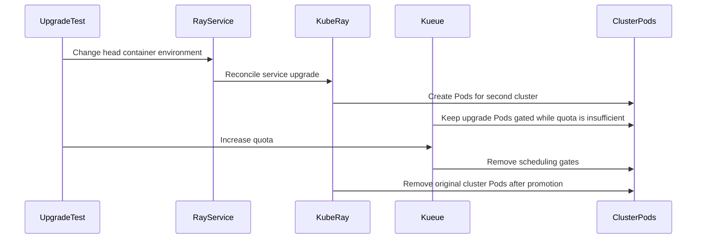

# PR #11264: RayService: gate zero-downtime upgrades with workload slicing

**Summary**: RayService: gate zero-downtime upgrades with workload slicing

**Sources**: https://github.com/kubernetes-sigs/kueue/pull/11264

**Last updated**: 2026-09-28T05:16:30Z

---

## Metadata

- **State**: open
- **Author**: [@kevin85421](https://github.com/kevin85421)
- **Branch**: `poc/rayservice-upgrade-quota-gate` → `main`
- **Created**: 2026-05-17T22:11:26Z
- **Updated**: 2026-09-28T05:16:30Z
- **Merged**: —
- **Closed**: —
- **Labels**: `kind/feature`, `release-note`, `size/L`, `ok-to-test`, `cncf-cla: yes`, `area/integrations`, `area/elastic-jobs`, `area/ray-integration`
- **Assignees**: _none_
- **Requested reviewers**: [@sohankunkerkar](https://github.com/sohankunkerkar), [@kshalot](https://github.com/kshalot)
- **Changed files**: 7   **+332 / -72**

## Description

## Summary

Implements zero-downtime RayService upgrade quota gating with elastic workload slicing for kubernetes-sigs/kueue#11102.

## Problem

During a zero-downtime upgrade, KubeRay runs the active and replacement RayClusters at the same time, but Kueue currently accounts for only one RayCluster. This results in different failure modes depending on whether elastic workload slicing is enabled and whether the PodSet counts change:

1. **Workload slicing disabled; image-only update:** The PodSets do not change. KubeRay creates the replacement RayCluster from a template whose `suspend` remains `true`, so the replacement RayCluster stays suspended indefinitely.
2. **Workload slicing disabled; image and replica increase:** The PodSets no longer match the admitted Workload. Kueue suspends the RayService, and KubeRay then creates the replacement RayCluster, interrupting the zero-downtime upgrade.
3. **Workload slicing enabled; image-only update:** KubeRay creates the replacement RayCluster, but its Pods remain scheduling-gated because no replacement workload slice is created and the existing admission has no additional quota for them.
4. **Workload slicing enabled; image and replica increase:** Kueue treats the update as a scale-up and creates a replacement workload slice, but that slice accounts for only the new RayCluster rather than the active and replacement RayClusters together. Its admission therefore cannot cover all overlapping Pods, and only part of the replacement RayCluster is ungated.

## Solution

The RayService controller no longer suspends or patches child RayClusters. KubeRay creates the active and pending RayClusters normally, while Kueue injects the elastic-job Pod scheduling gate and removes it only after the replacement workload slice is admitted.

KubeRay v1.7.0 includes the top-level `RayService.Spec.Suspend` support used by this integration.

## Design

| Action | Owner |
|---|---|
| Initial RayService admission | Kueue controls top-level `RayService.Spec.Suspend` |
| Pending upgrade cluster creation | KubeRay creates the replacement RayCluster without setting child suspension |
| Hold replacement Pods | Kueue's elastic-job webhook adds `kueue.x-k8s.io/elastic-job` scheduling gates |
| Account upgrade overlap | `PodSets()` lists live child RayClusters, unions PodSets by name, and sums active + pending counts |
| Release replacement Pods | The elastic workload ungater removes scheduling gates after the larger workload slice is admitted |
| Finish upgrade | KubeRay promotes the replacement and deletes the old RayCluster; workload slicing then releases the overlap quota |
| Preemption / total stop | Kueue sets top-level `RayService.Spec.Suspend=true`; KubeRay deletes owned resources |

Workload slices can change PodSet counts but cannot represent two different per-Pod resource requests under one PodSet name. Resource-changing upgrades are therefore rejected safely instead of being under-accounted. Image or environment changes that preserve resource requests remain supported.

## Prerequisites

- Feature gate `ElasticJobsViaWorkloadSlices=true` on the Kueue manager.
- Annotation `kueue.x-k8s.io/elastic-job: "true"` on the RayService.
- KubeRay v1.7.0 or later, with top-level `RayService.Spec.Suspend` support.

## Test plan

- [x] Unit tests cover the non-elastic compatibility path, initial elastic workload creation, live child RayCluster PodSets, autoscaling, and active + pending count aggregation.
- [x] The focused kind E2E verifies that replacement Pods remain scheduling-gated while overlap quota is unavailable, are ungated after the replacement workload slice is admitted, and that quota returns to the single-cluster shape after promotion.
- [x] RayService integration and extended E2E packages compile successfully.

## Known limitations

- A zero-downtime upgrade that changes resource requests for the same PodSet name is rejected because the current workload-slice model only supports count changes.

## Release note

```release-note
RayService zero-downtime upgrades configured with elastic workload slicing now reserve quota for both the active and replacement RayClusters and gate replacement Pods until the additional quota is admitted.
```

---

_AI disclosure: this PR was developed with assistance from Claude Code and OpenAI Codex; all changes were reviewed and tested by the author._

## Discussion

### Comment by [@k8s-ci-robot](https://github.com/k8s-ci-robot) — 2026-05-17T22:11:29Z

Adding the "do-not-merge/release-note-label-needed" label because no release-note block was detected, please follow our [release note process](https://git.k8s.io/community/contributors/guide/release-notes.md) to remove it.

<details>

Instructions for interacting with me using PR comments are available [here](https://git.k8s.io/community/contributors/guide/pull-requests.md).  If you have questions or suggestions related to my behavior, please file an issue against the [kubernetes-sigs/prow](https://github.com/kubernetes-sigs/prow/issues/new?title=Prow%20issue:) repository.
</details>

### Comment by [@netlify[bot]](https://github.com/apps/netlify) — 2026-05-17T22:11:32Z

### <span aria-hidden="true">✅</span> Deploy Preview for *kubernetes-sigs-kueue* canceled.


|  Name | Link |
|:-:|------------------------|
|<span aria-hidden="true">🔨</span> Latest commit | 8a34a197ad2e0ee18275d85e80e6d6617ba93bed |
|<span aria-hidden="true">🔍</span> Latest deploy log | https://app.netlify.com/projects/kubernetes-sigs-kueue/deploys/6ab9b1ea77120e0008f62d64 |

### Comment by [@linux-foundation-easycla[bot]](https://github.com/apps/linux-foundation-easycla) — 2026-05-17T22:11:37Z

<a href="https://easycla.lfx.linuxfoundation.org/#/?version=2"></a><br >The committers listed above are authorized under a signed CLA.<ul><li>:white_check_mark: login: kevin85421 / name: Kai-Hsun Chen (578c392a0d956e9d98b4a6b4b7e8d9871ae75f20, 7cf656b4050d14a37b85440acd5c87aea175add7, bdd98c2a9f864a752b807ee263b55c9cded4ad8a, bedca3f7a3f1b9bb2f9c7be712980e09ee310c30, d2415f4d2a31d41dc6954a1a2a59ec7da421fb08)</li></ul>

### Comment by [@k8s-ci-robot](https://github.com/k8s-ci-robot) — 2026-05-17T22:11:37Z

Hi @kevin85421. Thanks for your PR.

I'm waiting for a [kubernetes-sigs](https://github.com/orgs/kubernetes-sigs/people) member to verify that this patch is reasonable to test. If it is, they should reply with `/ok-to-test` on its own line. Until that is done, I will not automatically test new commits in this PR, but the usual testing commands by org members will still work.

>[!TIP]
>**We noticed you've done this a few times! Consider [joining the org](https://git.k8s.io/community/community-membership.md#member) to skip this step and gain `/lgtm` and other bot rights.** We recommend asking approvers on your previous PRs to sponsor you.

Once the patch is verified, the new status will be reflected by the `ok-to-test` label.

I understand the commands that are listed [here](https://go.k8s.io/bot-commands?repo=kubernetes-sigs%2Fkueue).

<details>

Instructions for interacting with me using PR comments are available [here](https://git.k8s.io/community/contributors/guide/pull-requests.md).  If you have questions or suggestions related to my behavior, please file an issue against the [kubernetes-sigs/prow](https://github.com/kubernetes-sigs/prow/issues/new?title=Prow%20issue:) repository.
</details>

### Comment by [@coderabbitai[bot]](https://github.com/apps/coderabbitai) — 2026-06-07T01:21:11Z

<!-- This is an auto-generated comment: summarize by coderabbit.ai -->
<!-- review_stack_entry_start -->

<a href="https://app.coderabbit.ai/change-stack/kubernetes-sigs/kueue/pull/11264"></a>

Navigate logical layers of code changes, visualize relationships, and explore their blast radius.

<!-- review_stack_entry_end -->
<!-- recent_review_start -->

No actionable comments were generated in the recent review. 🎉

<details>
<summary>ℹ️ Recent review info</summary>

<details>
<summary>⚙️ Run configuration</summary>

**Configuration used**: Repository: kubernetes-sigs/kueue/.coderabbit.yaml

**Review profile**: CHILL

**Plan**: Advanced

**Run ID**: `ea8ad478-3a94-412b-8f51-7ea25ad5cfcf`

</details>

<details>
<summary>📥 Commits</summary>

Reviewing files that changed from the base of the PR and between 196fc7056715bfe9e0b24141ac3345c49a450133 and 8a34a197ad2e0ee18275d85e80e6d6617ba93bed.

</details>

<details>
<summary>📒 Files selected for processing (7)</summary>

* `pkg/controller/jobs/rayservice/rayservice_controller.go`
* `pkg/controller/jobs/rayservice/rayservice_controller_test.go`
* `pkg/util/testingjobs/rayservice/wrappers.go`
* `test/e2e/multikueue/extended/kuberay_test.go`
* `test/e2e/singlecluster/extended/kuberay_test.go`
* `test/integration/singlecluster/controller/jobs/rayservice/rayservice_controller_test.go`
* `test/integration/singlecluster/webhook/jobs/rayservice_webhook_test.go`

</details>

**Included review availability:** This review used your included allowance. Your plan provides up to 8 included reviews per hour; 7 remain after this review.

</details>

---


<!-- recent_review_end -->
<!-- walkthrough_start -->

<details>
<summary>📝 Walkthrough</summary>

## Walkthrough

The RayService controller now uses `Spec.Suspend` for suspension and derives workload-sliced PodSets from labeled child RayClusters. Updated tests cover PodSet aggregation and a quota-gated zero-downtime upgrade.

### Changes

**RayService control and workload slicing**

|Layer / File(s)|Summary|
|---|---|
|**Use RayService-level suspension** <br> `pkg/controller/jobs/rayservice/rayservice_controller.go`, `pkg/util/testingjobs/rayservice/wrappers.go`, `pkg/controller/jobs/rayservice/rayservice_controller_test.go`, `test/e2e/multikueue/extended/kuberay_test.go`, `test/e2e/singlecluster/extended/kuberay_test.go`, `test/integration/singlecluster/webhook/jobs/rayservice_webhook_test.go`|Suspension checks, updates, test helpers, and assertions now use the RayService-level `Spec.Suspend` field.|
|**Build PodSets from child RayClusters** <br> `pkg/controller/jobs/rayservice/rayservice_controller.go`, `pkg/controller/jobs/rayservice/rayservice_controller_test.go`, `test/integration/singlecluster/controller/jobs/rayservice/rayservice_controller_test.go`|With workload slicing enabled, the controller lists child RayClusters labeled with their originating RayService. It builds PodSets from those clusters, sums counts for matching names, and returns an error when matching PodSets have different resource requests. Tests cover aggregated counts and child-cluster labels.|
|**Verify quota-gated upgrades** <br> `test/e2e/singlecluster/extended/kuberay_test.go`|The end-to-end test checks that an upgrade remains pending while quota is insufficient. After quota increases, it checks that the Pods are ungated, the original cluster is removed, and the remaining workload has one head and one worker PodSet.|

<!-- change_assessment_start -->
**Priority:** ⬇️ Low


**Estimated code review effort:** 3 (Moderate) | ~25 minutes

<!-- change_assessment_commit:"8a34a197ad2e0ee18275d85e80e6d6617ba93bed" -->
**Change:** Feature
<!-- change_assessment_end -->

### Sequence Diagram(s)



**Suggested reviewers:** `mbobrovskyi`

</details>

<!-- walkthrough_end -->
<!-- final_review_risk_start -->
**Merge Risk:** _⚪ Minimal_ · up to `8a34a`
<!-- final_review_risk_coverage:{"sourceCommitId":"8a34a197ad2e0ee18275d85e80e6d6617ba93bed","coveredCommitId":"8a34a197ad2e0ee18275d85e80e6d6617ba93bed","kind":"reviewed"} -->

No actionable merge-blocking risk remains from this review. Keeping deleting clusters counted avoids releasing quota while their Pods may still exist.
<!-- final_review_risk_end -->
<!-- architecture_review_start -->
### Security Architecture Review

**Security architecture risk:** _🟡 Moderate_ · up to `8a34a`

The upgrade path adds quota protection for overlapping clusters, but its accounting trusts child-cluster labels without checking ownership. That leaves a same-namespace influence path whose effective exposure depends on deployment permissions and external controls.

**Retained concerns**
- **Medium · security · observed:** Child-cluster quota accounting accepts origin labels as proof of RayService association. An actor able to create or relabel a RayCluster in the same namespace could make its PodSets affect another RayService’s reservation, including inflating counts or causing incompatible-request errors. External label-integrity controls have not been established.

<details>
<summary>Security review details</summary>

**Security Blast Radius**
- _inferred_ — The directly reachable identity boundary is a RayService and RayClusters in the same namespace; a wrongly included child can also alter that service’s workload-slice quota demand and thus contend for shared queue capacity.

**Security Findings and Attack Paths**
- _inferred_ — Given permission to create or relabel a same-namespace RayCluster, an actor could supply the expected origin labels and have its spec counted for a different RayService. The evidence does not establish whether deployment permissions or KubeRay admission prevent that prerequisite.

**Trust Boundaries and Controls**
- _observed_ — Workload ownership checks elsewhere in reconciliation concern Workload objects; they do not authenticate the RayClusters read earlier to construct PodSets. The test fixture supplies an owner reference, but selection does not require it.

**Resilience and Maintainability Implications**
- _observed_ — Incompatible resource requests among same-named child PodSets return an error rather than an aggregated quota request. The inspected tests establish quota-gated behavior for a compatible upgrade, not all request-changing or transient-discovery transitions.

**Hardening Proposals**
- _proposed_ — Verify each selected child’s controller owner UID against the current RayService, and establish a fail-closed quota and gate policy for incomplete child discovery and request-changing upgrades.

</details>

<!-- architecture_review_end -->
<!-- pre_merge_checks_walkthrough_start -->

<details>
<summary>🚥 Pre-merge checks | ✅ 4 | ❌ 1</summary>

### ❌ Failed checks (1 warning)

|     Check name     | Status     | Explanation                                                                                                                                                                                | Resolution                                                                         |
| :----------------: | :--------- | :----------------------------------------------------------------------------------------------------------------------------------------------------------------------------------------- | :--------------------------------------------------------------------------------- |
| Docstring Coverage | ⚠️ Warning | Docstring coverage is 33.33% which is insufficient. The required threshold is 80.00%. Docstring coverage is scoped to functions touched by this diff. Analyzed 6 functions across 7 files. | Write docstrings for the functions missing them to satisfy the coverage threshold. |

<details>
<summary>✅ Passed checks (4 passed)</summary>

|         Check name         | Status   | Explanation                                                                                                                  |
| :------------------------: | :------- | :--------------------------------------------------------------------------------------------------------------------------- |
|     Linked Issues check    | ✅ Passed | Check skipped because no linked issues were found for this pull request.                                                     |
| Out of Scope Changes check | ✅ Passed | Check skipped because no linked issues were found for this pull request.                                                     |
|      Description Check     | ✅ Passed | Check skipped - CodeRabbit’s high-level summary is enabled.                                                                  |
|         Title check        | ✅ Passed | The title clearly and concisely describes the main change: using workload slicing to gate RayService zero-downtime upgrades. |

</details>

</details>

<!-- pre_merge_checks_walkthrough_end -->

- [ ] <!-- {"checkboxId":"585bb3f6-faf5-4dbf-96d2-74e382adf19a"} --> Fix all pre-merge checks with AI
<!-- finishing_touch_checkbox_start -->

<details>
<summary>✨ Finishing Touches</summary>

<details open>
<summary>🧪 Generate unit tests (beta)</summary>

- [ ] <!-- {"checkboxId": "f47ac10b-58cc-4372-a567-0e02b2c3d479", "radioGroupId": "utg-output-choice-group-unknown_comment_id"} --> Create a new PR

</details>

</details>

<!-- finishing_touch_checkbox_end -->
<!-- tips_start -->

---


<sub>Comment `@coderabbitai help` to get the list of available commands.</sub>

<!-- tips_end -->

### Comment by [@kevin85421](https://github.com/kevin85421) — 2026-06-14T23:02:37Z

/easycla

### Comment by [@k8s-ci-robot](https://github.com/k8s-ci-robot) — 2026-06-14T23:02:45Z

[APPROVALNOTIFIER] This PR is **NOT APPROVED**

This pull-request has been approved by: *<a href="https://github.com/kubernetes-sigs/kueue/pull/11264#" title="Author self-approved">kevin85421</a>*
**Once this PR has been reviewed and has the lgtm label**, please assign [mbobrovskyi](https://github.com/mbobrovskyi) for approval. For more information see [the Code Review Process](https://git.k8s.io/community/contributors/guide/owners.md#the-code-review-process).

The full list of commands accepted by this bot can be found [here](https://go.k8s.io/bot-commands?repo=kubernetes-sigs%2Fkueue).

<details open>
Needs approval from an approver in each of these files:

- **[OWNERS](https://github.com/kubernetes-sigs/kueue/blob/main/OWNERS)**

Approvers can indicate their approval by writing `/approve` in a comment
Approvers can cancel approval by writing `/approve cancel` in a comment
</details>
<!-- META={"approvers":["mbobrovskyi"]} -->

### Comment by [@kevin85421](https://github.com/kevin85421) — 2026-06-15T18:26:12Z

cc @mimowo KubeRay still doesn't have a release that includes https://github.com/ray-project/kuberay/pull/4841. Should we wait for KubeRay to have a release with the RayService top-level suspend before reviewing/merging this PR? Or can I cut a branch for a KubeRay alpha release, just for Kueue (not for any other users), to unblock this PR?

### Comment by [@k8s-ci-robot](https://github.com/k8s-ci-robot) — 2026-06-20T04:46:00Z

PR needs rebase.

<details>

Instructions for interacting with me using PR comments are available [here](https://git.k8s.io/community/contributors/guide/pull-requests.md).  If you have questions or suggestions related to my behavior, please file an issue against the [kubernetes-sigs/prow](https://github.com/kubernetes-sigs/prow/issues/new?title=Prow%20issue:) repository.
</details>

### Comment by [@mimowo](https://github.com/mimowo) — 2026-08-03T19:33:12Z

/ok-to-test
/kind feature
/area integrations
/area elastic-jobs
/area ray-integration

### Comment by [@kubernetes-prow[bot]](https://github.com/apps/kubernetes-prow) — 2026-09-08T05:18:23Z

[APPROVALNOTIFIER] This PR is **NOT APPROVED**

This pull-request has been approved by: *<a href="https://github.com/kubernetes-sigs/kueue/pull/11264#" title="Author self-approved">kevin85421</a>*
**Once this PR has been reviewed and has the lgtm label**, please assign [mbobrovskyi](https://github.com/mbobrovskyi), [mimowo](https://github.com/mimowo) for approval. For more information see [the Code Review Process](https://git.k8s.io/community/contributors/guide/owners.md#the-code-review-process).

The full list of commands accepted by this bot can be found [here](https://go.k8s.io/bot-commands?repo=kubernetes-sigs%2Fkueue).

<details open>
Needs approval from an approver in each of these files:

- **[OWNERS](https://github.com/kubernetes-sigs/kueue/blob/main/OWNERS)**

Approvers can indicate their approval by writing `/approve` in a comment
Approvers can cancel approval by writing `/approve cancel` in a comment
</details>
<!-- META={"approvers":["mbobrovskyi","mimowo"]} -->

### Comment by [@kevin85421](https://github.com/kevin85421) — 2026-09-21T06:34:18Z

/retest

## Reviews

### Review by [@kevin85421](https://github.com/kevin85421) (commented) — 2026-05-17T22:18:09Z

- **vendor/github.com/ray-project/kuberay/ray-operator/apis/ray/v1/rayservice_types.go:67** by [@kevin85421](https://github.com/kevin85421) — 2026-05-17T22:18:10Z
```diff
@@ -67,6 +67,7 @@ type ClusterUpgradeOptions struct {
 	// +kubebuilder:default:=100
```

  https://github.com/ray-project/kuberay/pull/4841 hasn't been merged right now.

### Review by [@kevin85421](https://github.com/kevin85421) (commented) — 2026-05-18T04:28:33Z

- **pkg/controller/jobs/rayservice/rayservice_controller.go:301** by [@kevin85421](https://github.com/kevin85421) — 2026-05-18T04:28:33Z
```diff
@@ -155,18 +270,62 @@ func (j *RayService) PodLabelSelector() string {
 }
 
 func (j *RayService) PodSets(ctx context.Context) ([]kueue.PodSet, error) {
-	// Always build PodSets from RayService spec first
-	podSets, err := raycluster.BuildPodSets(&j.Spec.RayClusterSpec)
+	// List the actual child RayClusters owned by this RayService. Labels mirror
+	// KubeRay's common.RayServiceRayClustersAssociationOptions.
+	var children rayv1.RayClusterList
+	err := reconciler.client.List(ctx, &children,
+		client.InNamespace(j.GetNamespace()),
+		client.MatchingLabels{
+			rayutils.RayOriginatedFromCRNameLabelKey: j.GetName(),
+			rayutils.RayOriginatedFromCRDLabelKey:    rayutils.RayOriginatedFromCRDLabelValue(rayutils.RayServiceCRD),
+		},
+	)
 	if err != nil {
 		return nil, err
 	}
 
-	rayClusterName := j.Status.ActiveServiceStatus.RayClusterName
-	podSets, err = raycluster.UpdatePodSets(ctx, podSets, reconciler.client, j.Object(), j.Spec.RayClusterSpec.EnableInTreeAutoscaling, rayClusterName)
-	if err != nil {
-		return nil, err
+	// Bootstrap: before KubeRay creates the first child, build from the template so
+	// the Workload exists with the right shape (head + worker groups).
+	if len(children.Items) == 0 {
+		return raycluster.BuildPodSets(&j.Spec.RayClusterSpec)
 	}
 
+	// Steady state and zero-downtime upgrade: build PodSets from each child's real
+	// spec, then union by PodSet name (head + each worker group). Counts are summed
+	// across children, so during upgrade the workload reserves quota for both the
+	// active and pending RayClusters. Keeping PodSet keys stable across the 1↔2
+	// child transition lets EnsureWorkloadSlices handle the upgrade as a scale-up
+	// and the post-upgrade tear-down as a scale-down, without falling back to the
+	// non-slice path.
+	//
+	// POC limitation: when two children share a group name with different PodSpecs
```

  TODO

### Review by [@kevin85421](https://github.com/kevin85421) (commented) — 2026-06-07T01:54:41Z

- **test/e2e/singlecluster/extended/kuberay_test.go:1182** by [@kevin85421](https://github.com/kevin85421) — 2026-06-07T01:54:41Z
```diff
@@ -971,4 +972,221 @@ app = HelloWorld.bind()`,
 			}, util.VeryLongTimeout, util.Interval).Should(gomega.Succeed())
 		})
 	})
+
+	// ginkgo.Serial: the active RayService keeps a head+worker running for the whole
+	// test, so run it alone to avoid CPU contention with other ray-head containers.
+	ginkgo.It("Should gate a zero-downtime upgrade's pending RayCluster on queue quota", ginkgo.Serial, func() {
+		kuberayTestImage := util.GetKuberayTestImage()
+
+		// childRayClusters lists the RayClusters owned by the RayService. The
+		// namespace is dedicated to this test, so every RayCluster in it belongs
+		// to our RayService (active and, during the upgrade, pending).
+		childRayClusters := func(g gomega.Gomega) []rayv1.RayCluster {
+			rcList := &rayv1.RayClusterList{}
+			g.Expect(k8sClient.List(ctx, rcList, client.InNamespace(ns.Name))).To(gomega.Succeed())
+			return rcList.Items
+		}
+		countSuspended := func(rcs []rayv1.RayCluster) int {
+			suspended := 0
+			for i := range rcs {
+				if ptr.Deref(rcs[i].Spec.Suspend, false) {
+					suspended++
+				}
+			}
+			return suspended
+		}
+		// notFinishedWorkloads returns the RayService's live workload slices.
+		notFinishedWorkloads := func(g gomega.Gomega) []kueue.Workload {
+			wlList := &kueue.WorkloadList{}
+			g.Expect(k8sClient.List(ctx, wlList, client.InNamespace(ns.Name))).To(gomega.Succeed())
+			var live []kueue.Workload
+			for i := range wlList.Items {
+				if !workload.IsFinished(&wlList.Items[i]) {
+					live = append(live, wlList.Items[i])
+				}
+			}
+			return live
+		}
+		// totalPods sums every PodSet's count: one cluster is head(1)+worker(1)=2,
+		// the upgrade's two-cluster union is 4.
+		totalPods := func(wl *kueue.Workload) int32 {
+			var n int32
+			for i := range wl.Spec.PodSets {
+				n += wl.Spec.PodSets[i].Count
+			}
+			return n
+		}
+		// headPodSetCount returns the count of the "head" PodSet (KubeRay's head
+		// group); it is 1 per RayCluster, so 2 once the upgrade's pending cluster
+		// is folded into the slice.
+		headPodSetCount := func(wl *kueue.Workload) int32 {
+			for i := range wl.Spec.PodSets {
+				if wl.Spec.PodSets[i].Name == "head" {
+					return wl.Spec.PodSets[i].Count
+				}
+			}
+			return 0
+		}
+
+		configMap := &corev1.ConfigMap{
+			ObjectMeta: metav1.ObjectMeta{
+				Name:      "rayservice-upgrade-gate",
+				Namespace: ns.Name,
+			},
+			Data: map[string]string{
+				"hello_serve.py": `from ray import serve
+
+@serve.deployment
+class HelloWorld:
+    def __call__(self, request):
+        return "Hello, World!"
+
+app = HelloWorld.bind()`,
+			},
+		}
+
+		serveConfigV2 := `applications:
+  - name: hello_app
+    import_path: hello_serve:app
+    route_prefix: /
+    deployments:
+      - name: HelloWorld
+        num_replicas: 1
+        max_replicas_per_node: 1
+        ray_actor_options:
+          num_cpus: 0.2`
+
+		volumes := []corev1.Volume{
+			{
+				Name: "code-sample",
+				VolumeSource: corev1.VolumeSource{
+					ConfigMap: &corev1.ConfigMapVolumeSource{
+						LocalObjectReference: corev1.LocalObjectReference{Name: configMap.Name},
+						Items:                []corev1.KeyToPath{{Key: "hello_serve.py", Path: "hello_serve.py"}},
+					},
+				},
+			},
+		}
+		volumeMounts := []corev1.VolumeMount{{Name: "code-sample", MountPath: "/home/ray/samples"}}
+		env := []corev1.EnvVar{{Name: "PYTHONPATH", Value: "/home/ray/samples:$PYTHONPATH"}}
+
+		// head 1 CPU + worker 1 CPU (1 replica) = 2 CPU per RayCluster. The
+		// ClusterQueue from BeforeEach has 3 CPU: enough for the active cluster,
+		// but not for the 4 CPU the upgrade's active+pending union needs.
+		rayService := testingrayservice.MakeService("rayservice-upgrade-gate", ns.Name).
+			Suspend(true).
+			Queue(localQueueName).
+			Annotation(workloadslicing.EnabledAnnotationKey, workloadslicing.EnabledAnnotationValue).
+			RequestAndLimit(rayv1.HeadNode, corev1.ResourceCPU, "1").
+			RequestAndLimit(rayv1.WorkerNode, corev1.ResourceCPU, "1").
+			Image(rayv1.HeadNode, kuberayTestImage).
+			Image(rayv1.WorkerNode, kuberayTestImage).
+			RayStartParam(rayv1.HeadNode, "object-store-memory", objectStoreMemory).
+			WithServeConfigV2(serveConfigV2).
+			Env(rayv1.HeadNode, env).
+			Env(rayv1.WorkerNode, env).
+			Volumes(rayv1.HeadNode, volumes).
+			Volumes(rayv1.WorkerNode, volumes).
+			VolumeMounts(rayv1.HeadNode, volumeMounts).
+			VolumeMounts(rayv1.WorkerNode, volumeMounts).
+			Obj()
+
+		ginkgo.By("Creating the ConfigMap and RayService", func() {
+			gomega.Expect(k8sClient.Create(ctx, configMap)).Should(gomega.Succeed())
+			gomega.Expect(k8sClient.Create(ctx, rayService)).Should(gomega.Succeed())
+		})
+
+		ginkgo.By("Checking the initial workload is created and admitted", func() {
+			// With workload slicing the Workload name carries a slice suffix, so
+			// find it by listing rather than by the bare owner-derived name.
+			gomega.Eventually(func(g gomega.Gomega) {
+				wls := notFinishedWorkloads(g)
+				g.Expect(wls).To(gomega.HaveLen(1))
+				g.Expect(workload.IsAdmitted(&wls[0])).To(gomega.BeTrue())
+			}, util.LongTimeout, util.Interval).Should(gomega.Succeed())
+		})
+
+		ginkgo.By("Waiting for the active RayCluster to run and the RayService to be ready", func() {
+			gomega.Eventually(func(g gomega.Gomega) {
+				createdRayService := &rayv1.RayService{}
+				g.Expect(k8sClient.Get(ctx, client.ObjectKeyFromObject(rayService), createdRayService)).To(gomega.Succeed())
+				g.Expect(apimeta.IsStatusConditionTrue(createdRayService.Status.Conditions, string(rayv1.RayServiceReady))).To(gomega.BeTrue())
+				// The single active child has been unsuspended by Kueue.
+				rcs := childRayClusters(g)
+				g.Expect(rcs).To(gomega.HaveLen(1))
+				g.Expect(countSuspended(rcs)).To(gomega.Equal(0))
+			}, util.VeryLongTimeout, util.Interval).Should(gomega.Succeed())
+		})
+
+		ginkgo.By("Triggering a zero-downtime upgrade by mutating the RayCluster spec", func() {
+			// Appending an env var to the head template changes the RayCluster spec
+			// hash (KubeRay's hash ignores only Suspend), so KubeRay prepares a new
+			// pending cluster for a zero-downtime upgrade.
+			gomega.Eventually(func(g gomega.Gomega) {
+				upgraded := &rayv1.RayService{}
+				g.Expect(k8sClient.Get(ctx, client.ObjectKeyFromObject(rayService), upgraded)).To(gomega.Succeed())
+				head := &upgraded.Spec.RayClusterSpec.HeadGroupSpec.Template.Spec.Containers[0]
+				head.Env = append(head.Env, corev1.EnvVar{Name: "UPGRADE_TRIGGER", Value: "v2"})
+				g.Expect(k8sClient.Update(ctx, upgraded)).To(gomega.Succeed())
+			}, util.Timeout, util.Interval).Should(gomega.Succeed())
+		})
+
+		ginkgo.By("Waiting for KubeRay to create the pending RayCluster, born suspended", func() {
+			gomega.Eventually(func(g gomega.Gomega) {
+				rcs := childRayClusters(g)
+				g.Expect(rcs).To(gomega.HaveLen(2))
+				g.Expect(countSuspended(rcs)).To(gomega.Equal(1)) // pending gated, active still running
+			}, util.LongTimeout, util.Interval).Should(gomega.Succeed())
+		})
+
+		ginkgo.By("Checking the upgrade slice accounts for both clusters and stays pending", func() {
+			gomega.Eventually(func(g gomega.Gomega) {
+				wls := notFinishedWorkloads(g)
+				g.Expect(wls).To(gomega.HaveLen(2))
+				var upgradeSlice, activeSlice *kueue.Workload
+				for i := range wls {
+					if totalPods(&wls[i]) == 4 {
+						upgradeSlice = &wls[i]
+					} else {
+						activeSlice = &wls[i]
+					}
+				}
+				g.Expect(upgradeSlice).NotTo(gomega.BeNil(), "expected a slice reserving both clusters (4 pods)")
+				g.Expect(activeSlice).NotTo(gomega.BeNil())
+				// The upgrade slice reserves quota for the new cluster too: head 1+1=2.
+				g.Expect(headPodSetCount(upgradeSlice)).To(gomega.Equal(int32(2)))
+				// It cannot be admitted: 4 CPU > the 3 CPU ClusterQueue.
+				g.Expect(workload.IsAdmitted(upgradeSlice)).To(gomega.BeFalse())
+				// The original slice keeps the active cluster admitted and serving.
+				g.Expect(workload.IsAdmitted(activeSlice)).To(gomega.BeTrue())
+			}, util.LongTimeout, util.Interval).Should(gomega.Succeed())
+		})
+
+		ginkgo.By("Verifying the pending RayCluster is NOT unsuspended while quota is insufficient", func() {
+			gomega.Consistently(func(g gomega.Gomega) {
+				rcs := childRayClusters(g)
+				g.Expect(rcs).To(gomega.HaveLen(2))
+				g.Expect(countSuspended(rcs)).To(gomega.Equal(1))
+			}, util.ConsistentDuration, util.ShortInterval).Should(gomega.Succeed())
+		})
+
+		ginkgo.By("Adding quota so the upgrade slice fits", func() {
+			gomega.Eventually(func(g gomega.Gomega) {
+				updatedCq := &kueue.ClusterQueue{}
+				g.Expect(k8sClient.Get(ctx, client.ObjectKeyFromObject(cq), updatedCq)).To(gomega.Succeed())
+				updatedCq.Spec.ResourceGroups[0].Flavors[0].Resources[0].NominalQuota = resource.MustParse("10")
+				g.Expect(k8sClient.Update(ctx, updatedCq)).To(gomega.Succeed())
+			}, util.Timeout, util.Interval).Should(gomega.Succeed())
+		})
+
+		ginkgo.By("Verifying the gate opens: the pending RayCluster gets unsuspended", func() {
```

  TODO: test that the old RayCluster is deleted and that the resource quota becomes 1 cluster only instead of 2.
