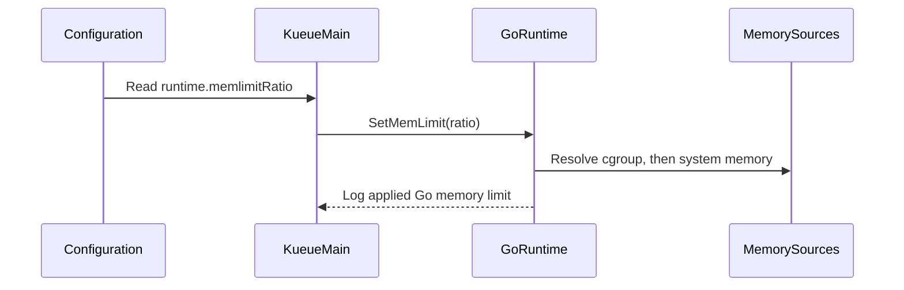

# PR #11642: feat: Add automatic memory limit handling

**Summary**: feat: Add automatic memory limit handling

**Sources**: https://github.com/kubernetes-sigs/kueue/pull/11642

**Last updated**: 2026-08-26T23:07:31Z

---

## Metadata

- **State**: open
- **Author**: [@dongjiang1989](https://github.com/dongjiang1989)
- **Branch**: `add-automemlimit` → `main`
- **Created**: 2026-05-26T12:47:13Z
- **Updated**: 2026-08-26T23:07:31Z
- **Merged**: —
- **Closed**: —
- **Labels**: `kind/feature`, `release-note`, `size/XXL`, `cncf-cla: yes`
- **Assignees**: _none_
- **Requested reviewers**: [@mbobrovskyi](https://github.com/mbobrovskyi), [@PBundyra](https://github.com/PBundyra)
- **Changed files**: 27   **+1379 / -1**

## Description

<!--  Thanks for sending a pull request!  Here are some tips for you:

1. If this is your first time, please read our contributor guidelines: https://git.k8s.io/community/contributors/guide/first-contribution.md#your-first-contribution and developer guide https://git.k8s.io/community/contributors/devel/development.md#development-guide
2. Please label this pull request according to what type of issue you are addressing, especially if this is a release targeted pull request. For reference on required PR/issue labels, read here:
https://git.k8s.io/community/contributors/devel/sig-release/release.md#issuepr-kind-label
3. Ensure you have added or ran the appropriate tests for your PR: https://git.k8s.io/community/contributors/devel/sig-testing/testing.md
4. If you want *faster* PR reviews, read how: https://git.k8s.io/community/contributors/guide/pull-requests.md#best-practices-for-faster-reviews
5. If the PR is unfinished, see how to mark it: https://git.k8s.io/community/contributors/guide/pull-requests.md#marking-unfinished-pull-requests
-->

#### What type of PR is this?

<!--
Add one of the following kinds:
/kind bug
/kind cleanup
/kind documentation
/kind feature
/kind kep

Optionally add one or more of the following kinds if applicable:
/kind api-change
/kind deprecation
/kind failing-test
/kind flake
/kind regression

Please also consider setting the area:
/area tas
/area integrations
/area multikueue
/area dashboard
/area localization
/area testing
/area website
-->

/kind feature

#### What this PR does / why we need it:

Add automatic memory limit handling
ref: https://github.com/kubernetes-sigs/kueue/pull/8210#issuecomment-3653356797

Unlike the gomaxprocs change,  GOMEMLIMIT is unset by default (e.g. math.MaxInt64).

Also we should really consider the system memory if no k8s limits are set. More food for thoughts from https://www.ardanlabs.com/blog/2024/02/kubernetes-memory-limits-go.html:

> If you’re not going to use K8s memory limits, then don’t do anything with GOMEMLIMIT. The Go runtime is really good at finding the sweet spot for your memory requirements.

#### Which issue(s) this PR fixes:
<!--
*Automatically closes linked issue when PR is merged.
Usage: `Fixes #<issue number>`, or `Fixes (paste link of issue)`.
_If PR is about `failing-tests or flakes`, please post the related issues/tests in a comment and do not use `Fixes`_*
-->
Fixes #

#### Special notes for your reviewer:

cc @kannon92 

#### Does this PR introduce a user-facing change?
<!--
If no, just write "NONE" in the release-note block below.
If yes, a release note is required:
Enter your extended release note in the block below. If the PR requires additional action from users switching to the new release, include the string "action required".
-->
```release-note
Add automatic memory limit handling
```


<!-- This is an auto-generated comment: release notes by coderabbit.ai -->

## Summary by CodeRabbit

* **New Features**
  * Added runtime configuration for tuning the controller’s Go memory limit based on available container memory.
  * Introduced the optional `memlimitRatio` setting, supporting values from 0 to 1 to control automatic memory-limit allocation.
  * Runtime tuning is applied automatically at startup when configured.

* **Documentation**
  * Documented the new runtime configuration and `memlimitRatio` behavior, including supported value ranges and disabling automatic limits.

<!-- end of auto-generated comment: release notes by coderabbit.ai -->

## Discussion

### Comment by [@netlify[bot]](https://github.com/apps/netlify) — 2026-05-26T12:47:19Z

### <span aria-hidden="true">✅</span> Deploy Preview for *kubernetes-sigs-kueue* ready!


|  Name | Link |
|:-:|------------------------|
|<span aria-hidden="true">🔨</span> Latest commit | 79c4d49db50fe5353c058248da1b90b13e2106ba |
|<span aria-hidden="true">🔍</span> Latest deploy log | https://app.netlify.com/projects/kubernetes-sigs-kueue/deploys/6a69d5cff6a4fa0008c2c766 |
|<span aria-hidden="true">😎</span> Deploy Preview | [https://deploy-preview-11642--kubernetes-sigs-kueue.netlify.app](https://deploy-preview-11642--kubernetes-sigs-kueue.netlify.app) |
|<span aria-hidden="true">📱</span> Preview on mobile | <details><summary> Toggle QR Code... </summary><br /><br /><br /><br />_Use your smartphone camera to open QR code link._</details> |
---
<!-- [kubernetes-sigs-kueue Preview](https://deploy-preview-11642--kubernetes-sigs-kueue.netlify.app) -->
_To edit notification comments on pull requests, go to your [Netlify project configuration](https://app.netlify.com/projects/kubernetes-sigs-kueue/configuration/notifications#deploy-notifications)._

### Comment by [@k8s-ci-robot](https://github.com/k8s-ci-robot) — 2026-05-26T12:47:23Z

[APPROVALNOTIFIER] This PR is **NOT APPROVED**

This pull-request has been approved by: *<a href="https://github.com/kubernetes-sigs/kueue/pull/11642#" title="Author self-approved">dongjiang1989</a>*
**Once this PR has been reviewed and has the lgtm label**, please assign [mbobrovskyi](https://github.com/mbobrovskyi), [tenzen-y](https://github.com/tenzen-y) for approval. For more information see [the Code Review Process](https://git.k8s.io/community/contributors/guide/owners.md#the-code-review-process).

The full list of commands accepted by this bot can be found [here](https://go.k8s.io/bot-commands?repo=kubernetes-sigs%2Fkueue).

<details open>
Needs approval from an approver in each of these files:

- **[OWNERS](https://github.com/kubernetes-sigs/kueue/blob/main/OWNERS)**

Approvers can indicate their approval by writing `/approve` in a comment
Approvers can cancel approval by writing `/approve cancel` in a comment
</details>
<!-- META={"approvers":["mbobrovskyi","tenzen-y"]} -->

### Comment by [@dongjiang1989](https://github.com/dongjiang1989) — 2026-05-26T13:07:22Z

/test pull-kueue-verify-main

### Comment by [@k8s-ci-robot](https://github.com/k8s-ci-robot) — 2026-05-30T01:26:35Z

PR needs rebase.

<details>

Instructions for interacting with me using PR comments are available [here](https://git.k8s.io/community/contributors/guide/pull-requests.md).  If you have questions or suggestions related to my behavior, please file an issue against the [kubernetes-sigs/prow](https://github.com/kubernetes-sigs/prow/issues/new?title=Prow%20issue:) repository.
</details>

### Comment by [@k8s-ci-robot](https://github.com/k8s-ci-robot) — 2026-06-17T22:23:38Z

@dongjiang1989: The following tests **failed**, say `/retest` to rerun all failed tests or `/retest-required` to rerun all mandatory failed tests:

Test name | Commit | Details | Required | Rerun command
--- | --- | --- | --- | ---
pull-kueue-verify-main | 6f1314dcbe2f7521da10f73b553c01fbe6226bcb | [link](https://prow.k8s.io/view/gs/kubernetes-ci-logs/pr-logs/pull/kubernetes-sigs_kueue/11642/pull-kueue-verify-main/2059260118129709056) | true | `/test pull-kueue-verify-main`
pull-kueue-test-e2e-multikueue-extended-main | 6f1314dcbe2f7521da10f73b553c01fbe6226bcb | [link](https://prow.k8s.io/view/gs/kubernetes-ci-logs/pr-logs/pull/kubernetes-sigs_kueue/11642/pull-kueue-test-e2e-multikueue-extended-main/2060757739654615040) | true | `/test pull-kueue-test-e2e-multikueue-extended-main`
pull-kueue-test-e2e-multikueue-baseline-main | 6f1314dcbe2f7521da10f73b553c01fbe6226bcb | [link](https://prow.k8s.io/view/gs/kubernetes-ci-logs/pr-logs/pull/kubernetes-sigs_kueue/11642/pull-kueue-test-e2e-multikueue-baseline-main/2060757739549757440) | true | `/test pull-kueue-test-e2e-multikueue-baseline-main`
pull-kueue-test-e2e-extended-shard-1-main-1-34 | 6f1314dcbe2f7521da10f73b553c01fbe6226bcb | [link](https://prow.k8s.io/view/gs/kubernetes-ci-logs/pr-logs/pull/kubernetes-sigs_kueue/11642/pull-kueue-test-e2e-extended-shard-1-main-1-34/2062202153790869504) | true | `/test pull-kueue-test-e2e-extended-shard-1-main-1-34`
pull-kueue-test-e2e-extended-shard-0-main-1-34 | 6f1314dcbe2f7521da10f73b553c01fbe6226bcb | [link](https://prow.k8s.io/view/gs/kubernetes-ci-logs/pr-logs/pull/kubernetes-sigs_kueue/11642/pull-kueue-test-e2e-extended-shard-0-main-1-34/2062202152952008704) | true | `/test pull-kueue-test-e2e-extended-shard-0-main-1-34`
pull-kueue-test-e2e-extended-shard-0-main-1-36 | 6f1314dcbe2f7521da10f73b553c01fbe6226bcb | [link](https://prow.k8s.io/view/gs/kubernetes-ci-logs/pr-logs/pull/kubernetes-sigs_kueue/11642/pull-kueue-test-e2e-extended-shard-0-main-1-36/2062202156303257600) | true | `/test pull-kueue-test-e2e-extended-shard-0-main-1-36`
pull-kueue-test-e2e-extended-shard-1-main-1-36 | 6f1314dcbe2f7521da10f73b553c01fbe6226bcb | [link](https://prow.k8s.io/view/gs/kubernetes-ci-logs/pr-logs/pull/kubernetes-sigs_kueue/11642/pull-kueue-test-e2e-extended-shard-1-main-1-36/2062202157150507008) | true | `/test pull-kueue-test-e2e-extended-shard-1-main-1-36`
pull-kueue-test-e2e-extended-shard-0-main-1-33 | 6f1314dcbe2f7521da10f73b553c01fbe6226bcb | [link](https://prow.k8s.io/view/gs/kubernetes-ci-logs/pr-logs/pull/kubernetes-sigs_kueue/11642/pull-kueue-test-e2e-extended-shard-0-main-1-33/2062202151324618752) | true | `/test pull-kueue-test-e2e-extended-shard-0-main-1-33`
pull-kueue-test-e2e-extended-shard-1-main-1-33 | 6f1314dcbe2f7521da10f73b553c01fbe6226bcb | [link](https://prow.k8s.io/view/gs/kubernetes-ci-logs/pr-logs/pull/kubernetes-sigs_kueue/11642/pull-kueue-test-e2e-extended-shard-1-main-1-33/2062202152142508032) | true | `/test pull-kueue-test-e2e-extended-shard-1-main-1-33`
pull-kueue-test-e2e-extended-shard-1-main-1-35 | 6f1314dcbe2f7521da10f73b553c01fbe6226bcb | [link](https://prow.k8s.io/view/gs/kubernetes-ci-logs/pr-logs/pull/kubernetes-sigs_kueue/11642/pull-kueue-test-e2e-extended-shard-1-main-1-35/2062202155472785408) | true | `/test pull-kueue-test-e2e-extended-shard-1-main-1-35`
pull-kueue-test-e2e-tas-extended-shard-0-main | 6f1314dcbe2f7521da10f73b553c01fbe6226bcb | [link](https://prow.k8s.io/view/gs/kubernetes-ci-logs/pr-logs/pull/kubernetes-sigs_kueue/11642/pull-kueue-test-e2e-tas-extended-shard-0-main/2062470431452958720) | true | `/test pull-kueue-test-e2e-tas-extended-shard-0-main`
pull-kueue-test-e2e-tas-extended-shard-1-main | 6f1314dcbe2f7521da10f73b553c01fbe6226bcb | [link](https://prow.k8s.io/view/gs/kubernetes-ci-logs/pr-logs/pull/kubernetes-sigs_kueue/11642/pull-kueue-test-e2e-tas-extended-shard-1-main/2062470431541039104) | true | `/test pull-kueue-test-e2e-tas-extended-shard-1-main`
pull-kueue-test-e2e-extended-shard-2-main-1-34 | 6f1314dcbe2f7521da10f73b553c01fbe6226bcb | [link](https://prow.k8s.io/view/gs/kubernetes-ci-logs/pr-logs/pull/kubernetes-sigs_kueue/11642/pull-kueue-test-e2e-extended-shard-2-main-1-34/2064631090554867712) | true | `/test pull-kueue-test-e2e-extended-shard-2-main-1-34`
pull-kueue-test-e2e-extended-shard-2-main-1-35 | 6f1314dcbe2f7521da10f73b553c01fbe6226bcb | [link](https://prow.k8s.io/view/gs/kubernetes-ci-logs/pr-logs/pull/kubernetes-sigs_kueue/11642/pull-kueue-test-e2e-extended-shard-2-main-1-35/2064631090554867713) | true | `/test pull-kueue-test-e2e-extended-shard-2-main-1-35`
pull-kueue-test-e2e-extended-shard-2-main-1-36 | 6f1314dcbe2f7521da10f73b553c01fbe6226bcb | [link](https://prow.k8s.io/view/gs/kubernetes-ci-logs/pr-logs/pull/kubernetes-sigs_kueue/11642/pull-kueue-test-e2e-extended-shard-2-main-1-36/2064631090559062016) | true | `/test pull-kueue-test-e2e-extended-shard-2-main-1-36`
pull-kueue-test-e2e-extended-shard-2-main-1-33 | 6f1314dcbe2f7521da10f73b553c01fbe6226bcb | [link](https://prow.k8s.io/view/gs/kubernetes-ci-logs/pr-logs/pull/kubernetes-sigs_kueue/11642/pull-kueue-test-e2e-extended-shard-2-main-1-33/2064631089921527808) | true | `/test pull-kueue-test-e2e-extended-shard-2-main-1-33`
pull-kueue-test-e2e-sequential-extended-shard-0-main | 6f1314dcbe2f7521da10f73b553c01fbe6226bcb | [link](https://prow.k8s.io/view/gs/kubernetes-ci-logs/pr-logs/pull/kubernetes-sigs_kueue/11642/pull-kueue-test-e2e-sequential-extended-shard-0-main/2064748365916147712) | true | `/test pull-kueue-test-e2e-sequential-extended-shard-0-main`
pull-kueue-test-e2e-sequential-extended-shard-1-main | 6f1314dcbe2f7521da10f73b553c01fbe6226bcb | [link](https://prow.k8s.io/view/gs/kubernetes-ci-logs/pr-logs/pull/kubernetes-sigs_kueue/11642/pull-kueue-test-e2e-sequential-extended-shard-1-main/2064748365983256576) | true | `/test pull-kueue-test-e2e-sequential-extended-shard-1-main`
pull-kueue-test-e2e-multikueue-extended-shard-1-main | 6f1314dcbe2f7521da10f73b553c01fbe6226bcb | [link](https://prow.k8s.io/view/gs/kubernetes-ci-logs/pr-logs/pull/kubernetes-sigs_kueue/11642/pull-kueue-test-e2e-multikueue-extended-shard-1-main/2065477972332122112) | true | `/test pull-kueue-test-e2e-multikueue-extended-shard-1-main`
pull-kueue-test-e2e-multikueue-extended-shard-0-main | 6f1314dcbe2f7521da10f73b553c01fbe6226bcb | [link](https://prow.k8s.io/view/gs/kubernetes-ci-logs/pr-logs/pull/kubernetes-sigs_kueue/11642/pull-kueue-test-e2e-multikueue-extended-shard-0-main/2065477972260818944) | true | `/test pull-kueue-test-e2e-multikueue-extended-shard-0-main`
pull-kueue-test-e2e-dra-counter-main | 6f1314dcbe2f7521da10f73b553c01fbe6226bcb | [link](https://prow.k8s.io/view/gs/kubernetes-ci-logs/pr-logs/pull/kubernetes-sigs_kueue/11642/pull-kueue-test-e2e-dra-counter-main/2067372547816558592) | true | `/test pull-kueue-test-e2e-dra-counter-main`

[Full PR test history](https://prow.k8s.io/pr-history?org=kubernetes-sigs&repo=kueue&pr=11642). [Your PR dashboard](https://prow.k8s.io/pr?query=is%3Apr%20state%3Aopen%20author%3Adongjiang1989). Please help us cut down on flakes by [linking to](https://git.k8s.io/community/contributors/devel/sig-testing/flaky-tests.md#filing-issues-for-flaky-tests) an [open issue](https://github.com/kubernetes-sigs/kueue/issues?q=is:issue+is:open) when you hit one in your PR.

<details>

Instructions for interacting with me using PR comments are available [here](https://git.k8s.io/community/contributors/guide/pull-requests.md).  If you have questions or suggestions related to my behavior, please file an issue against the [kubernetes-sigs/prow](https://github.com/kubernetes-sigs/prow/issues/new?title=Prow%20issue:) repository. I understand the commands that are listed [here](https://go.k8s.io/bot-commands).
</details>
<!-- test report -->

### Comment by [@kubernetes-prow[bot]](https://github.com/apps/kubernetes-prow) — 2026-07-29T10:28:42Z

[APPROVALNOTIFIER] This PR is **NOT APPROVED**

This pull-request has been approved by: *<a href="https://github.com/kubernetes-sigs/kueue/pull/11642#" title="Author self-approved">dongjiang1989</a>*
**Once this PR has been reviewed and has the lgtm label**, please assign [mimowo](https://github.com/mimowo) for approval. For more information see [the Code Review Process](https://git.k8s.io/community/contributors/guide/owners.md#the-code-review-process).

The full list of commands accepted by this bot can be found [here](https://go.k8s.io/bot-commands?repo=kubernetes-sigs%2Fkueue).

<details open>
Needs approval from an approver in each of these files:

- **[OWNERS](https://github.com/kubernetes-sigs/kueue/blob/main/OWNERS)**

Approvers can indicate their approval by writing `/approve` in a comment
Approvers can cancel approval by writing `/approve cancel` in a comment
</details>
<!-- META={"approvers":["mimowo"]} -->

### Comment by [@coderabbitai[bot]](https://github.com/apps/coderabbitai) — 2026-07-29T10:29:02Z

<!-- This is an auto-generated comment: summarize by coderabbit.ai -->
<!-- review_stack_entry_start -->

[](https://app.coderabbit.ai/change-stack/kubernetes-sigs/kueue/pull/11642?utm_source=github_walkthrough&utm_medium=github&utm_campaign=change_stack)

<!-- review_stack_entry_end -->
<!-- walkthrough_start -->

<details>
<summary>📝 Walkthrough</summary>

## Walkthrough

Adds an optional runtime configuration for deriving Go’s memory limit from container or system memory. Controller startup applies the configured ratio through a new runtime helper, with dependency updates and reference documentation describing ratio behavior and clamping.

### Changes

**Runtime memory limit configuration**

|Layer / File(s)|Summary|
|---|---|
|**Runtime configuration contract** <br> `apis/config/v1beta2/configuration_types.go`|Adds `Configuration.runtime` and `RuntimeConfig.memlimitRatio` using a Kubernetes resource quantity.|
|**Startup memory-limit application** <br> `internal/goruntime/memory.go`, `cmd/kueue/main.go`, `go.mod`|Applies the configured ratio during startup, clamps it to `[0,1]`, uses cgroup/system memory fallback providers, and adds required modules.|
|**Configuration reference documentation** <br> `site/content/en/docs/reference/kueue-config.v1beta2.md`|Documents the runtime field and `memlimitRatio` behavior, including disabled, fractional, full, and out-of-range values.|

**Estimated code review effort:** 3 (Moderate) | ~20 minutes

### Sequence Diagram(s)



**Suggested labels:** `kind/feature`, `kind/api-change`, `release-note`, `size/L`

**Suggested reviewers:** `mbobrovskyi`, `pbundyra`, `kannon92`, `pannagarao`

</details>

<!-- walkthrough_end -->
<!-- pre_merge_checks_walkthrough_start -->

<details>
<summary>🚥 Pre-merge checks | ✅ 5</summary>

<details>
<summary>✅ Passed checks (5 passed)</summary>

|         Check name         | Status   | Explanation                                                                                                 |
| :------------------------: | :------- | :---------------------------------------------------------------------------------------------------------- |
|      Description Check     | ✅ Passed | Check skipped - CodeRabbit’s high-level summary is enabled.                                                 |
|         Title check        | ✅ Passed | The title clearly matches the main change: adding automatic memory limit handling for the kueue controller. |
|     Docstring Coverage     | ✅ Passed | No functions found in the changed files to evaluate docstring coverage. Skipping docstring coverage check.  |
|     Linked Issues check    | ✅ Passed | Check skipped because no linked issues were found for this pull request.                                    |
| Out of Scope Changes check | ✅ Passed | Check skipped because no linked issues were found for this pull request.                                    |

</details>

</details>

<!-- pre_merge_checks_walkthrough_end -->
<!-- finishing_touch_checkbox_start -->

<details>
<summary>✨ Finishing Touches</summary>

<details>
<summary>🧪 Generate unit tests (beta)</summary>

- [ ] <!-- {"checkboxId": "f47ac10b-58cc-4372-a567-0e02b2c3d479", "radioGroupId": "utg-output-choice-group-unknown_comment_id"} -->   Create PR with unit tests

</details>

</details>

<!-- finishing_touch_checkbox_end -->
<!-- tips_start -->

---

Thanks for using [CodeRabbit](https://coderabbit.ai?utm_source=oss&utm_medium=github&utm_campaign=kubernetes-sigs/kueue&utm_content=11642)! It's free for OSS, and your support helps us grow. If you like it, consider giving us a shout-out.

<details>
<summary>❤️ Share</summary>

- [X](https://twitter.com/intent/tweet?text=I%20just%20used%20%40coderabbitai%20for%20my%20code%20review%2C%20and%20it%27s%20fantastic%21%20It%27s%20free%20for%20OSS%20and%20offers%20a%20free%20trial%20for%20the%20proprietary%20code.%20Check%20it%20out%3A&url=https%3A//coderabbit.ai)
- [Mastodon](https://mastodon.social/share?text=I%20just%20used%20%40coderabbitai%20for%20my%20code%20review%2C%20and%20it%27s%20fantastic%21%20It%27s%20free%20for%20OSS%20and%20offers%20a%20free%20trial%20for%20the%20proprietary%20code.%20Check%20it%20out%3A%20https%3A%2F%2Fcoderabbit.ai)
- [Reddit](https://www.reddit.com/submit?title=Great%20tool%20for%20code%20review%20-%20CodeRabbit&text=I%20just%20used%20CodeRabbit%20for%20my%20code%20review%2C%20and%20it%27s%20fantastic%21%20It%27s%20free%20for%20OSS%20and%20offers%20a%20free%20trial%20for%20proprietary%20code.%20Check%20it%20out%3A%20https%3A//coderabbit.ai)
- [LinkedIn](https://www.linkedin.com/sharing/share-offsite/?url=https%3A%2F%2Fcoderabbit.ai&mini=true&title=Great%20tool%20for%20code%20review%20-%20CodeRabbit&summary=I%20just%20used%20CodeRabbit%20for%20my%20code%20review%2C%20and%20it%27s%20fantastic%21%20It%27s%20free%20for%20OSS%20and%20offers%20a%20free%20trial%20for%20proprietary%20code)

</details>


<sub>Comment `@coderabbitai help` to get the list of available commands.</sub>

<!-- tips_end -->

### Comment by [@dongjiang1989](https://github.com/dongjiang1989) — 2026-07-30T00:43:12Z

/test pull-kueue-verify-main

### Comment by [@kubernetes-prow[bot]](https://github.com/apps/kubernetes-prow) — 2026-08-26T23:07:31Z

@dongjiang1989: The following tests **failed**, say `/retest` to rerun all failed tests or `/retest-required` to rerun all mandatory failed tests:

Test name | Commit | Details | Required | Rerun command
--- | --- | --- | --- | ---
pull-kueue-verify-main | 79c4d49db50fe5353c058248da1b90b13e2106ba | [link](https://prow.k8s.io/view/gs/kubernetes-ci-logs/pr-logs/pull/kubernetes-sigs_kueue/11642/pull-kueue-verify-main/2082628052260491264) | true | `/test pull-kueue-verify-main`
pull-kueue-test-e2e-baseline-main-1-37 | 79c4d49db50fe5353c058248da1b90b13e2106ba | [link](https://prow.k8s.io/view/gs/kubernetes-ci-logs/pr-logs/pull/kubernetes-sigs_kueue/11642/pull-kueue-test-e2e-baseline-main-1-37/2092750741432176640) | true | `/test pull-kueue-test-e2e-baseline-main-1-37`
pull-kueue-test-e2e-extended-shard-1-main-1-37 | 79c4d49db50fe5353c058248da1b90b13e2106ba | [link](https://prow.k8s.io/view/gs/kubernetes-ci-logs/pr-logs/pull/kubernetes-sigs_kueue/11642/pull-kueue-test-e2e-extended-shard-1-main-1-37/2092750742170374144) | true | `/test pull-kueue-test-e2e-extended-shard-1-main-1-37`
pull-kueue-test-e2e-extended-shard-2-main-1-37 | 79c4d49db50fe5353c058248da1b90b13e2106ba | [link](https://prow.k8s.io/view/gs/kubernetes-ci-logs/pr-logs/pull/kubernetes-sigs_kueue/11642/pull-kueue-test-e2e-extended-shard-2-main-1-37/2092750742292008960) | true | `/test pull-kueue-test-e2e-extended-shard-2-main-1-37`
pull-kueue-test-e2e-extended-shard-0-main-1-37 | 79c4d49db50fe5353c058248da1b90b13e2106ba | [link](https://prow.k8s.io/view/gs/kubernetes-ci-logs/pr-logs/pull/kubernetes-sigs_kueue/11642/pull-kueue-test-e2e-extended-shard-0-main-1-37/2092750741897744384) | true | `/test pull-kueue-test-e2e-extended-shard-0-main-1-37`

[Full PR test history](https://prow.k8s.io/pr-history?org=kubernetes-sigs&repo=kueue&pr=11642). [Your PR dashboard](https://prow.k8s.io/pr?query=is%3Apr%20state%3Aopen%20author%3Adongjiang1989). Please help us cut down on flakes by [linking to](https://git.k8s.io/community/contributors/devel/sig-testing/flaky-tests.md#filing-issues-for-flaky-tests) an [open issue](https://github.com/kubernetes-sigs/kueue/issues?q=is:issue+is:open) when you hit one in your PR.

<details>

Instructions for interacting with me using PR comments are available [here](https://git.k8s.io/community/contributors/guide/pull-requests.md).  If you have questions or suggestions related to my behavior, please file an issue against the [kubernetes-sigs/prow](https://github.com/kubernetes-sigs/prow/issues/new?title=Prow%20issue:) repository. I understand the commands that are listed [here](https://go.k8s.io/bot-commands).
</details>
<!-- test report -->

## Reviews

### Review by [@mimowo](https://github.com/mimowo) (commented) — 2026-05-26T12:58:21Z

- **apis/config/v1beta2/configuration_types.go:105** by [@mimowo](https://github.com/mimowo) — 2026-05-26T12:58:21Z
```diff
@@ -97,6 +98,11 @@ type Configuration struct {
 	// Resources provides additional configuration options for handling the resources.
 	Resources *Resources `json:"resources,omitempty"`
 
+	// Runtime configures Go runtime settings for the kueue controller, such as
+	// automatic memory limits derived from the container's cgroup or system memory.
+	// +optional
+	Runtime *RuntimeConfig `json:"runtime,omitempty"`
```

  @dongjiang1989 please open a KEP first to discuss the feature

### Review by [@dongjiang1989](https://github.com/dongjiang1989) (commented) — 2026-05-26T13:16:34Z

- **apis/config/v1beta2/configuration_types.go:105** by [@dongjiang1989](https://github.com/dongjiang1989) — 2026-05-26T13:16:34Z
```diff
@@ -97,6 +98,11 @@ type Configuration struct {
 	// Resources provides additional configuration options for handling the resources.
 	Resources *Resources `json:"resources,omitempty"`
 
+	// Runtime configures Go runtime settings for the kueue controller, such as
+	// automatic memory limits derived from the container's cgroup or system memory.
+	// +optional
+	Runtime *RuntimeConfig `json:"runtime,omitempty"`
```

  Thanks @mimowo 
  ref： https://github.com/kubernetes-sigs/kueue/pull/11645

### Review by [@coderabbitai[bot]](https://github.com/apps/coderabbitai) (commented) — 2026-07-29T10:34:08Z

**Actionable comments posted: 2**

<details>
<summary>🤖 Prompt for all review comments with AI agents</summary>

```
Verify each finding against current code. Fix only still-valid issues, skip the
rest with a brief reason, keep changes minimal, and validate.

Inline comments:
In `@apis/config/v1beta2/configuration_types.go`:
- Around line 829-838: Update the MemlimitRatio API documentation to clearly
state that values outside [0, 1] are accepted and clamped to the nearest
boundary, matching SetMemLimit behavior; do not describe the field as rejecting
out-of-range values.

In `@internal/goruntime/memory.go`:
- Around line 46-50: Update the GOMEMLIMIT handling around
memlimit.SetGoMemLimitWithOpts so the success logger.Info call for "Set
GOMEMLIMIT" runs only when the update succeeds. Keep the existing logger.Error
behavior for failures and avoid reporting the runtime value after an error.
```

</details>

<details>
<summary>🪄 Autofix (Beta)</summary>

Fix all unresolved CodeRabbit comments on this PR:

- [ ] <!-- {"checkboxId": "4b0d0e0a-96d7-4f10-b296-3a18ea78f0b9"} --> Push a commit to this branch (recommended)
- [ ] <!-- {"checkboxId": "ff5b1114-7d8c-49e6-8ac1-43f82af23a33"} --> Create a new PR with the fixes

</details>

---

<details>
<summary>ℹ️ Review info</summary>

<details>
<summary>⚙️ Run configuration</summary>

**Configuration used**: Path: .coderabbit.yaml

**Review profile**: CHILL

**Plan**: Pro Plus

**Run ID**: `79cc71dd-88bc-4c19-aa84-540c2f72fffc`

</details>

<details>
<summary>📥 Commits</summary>

Reviewing files that changed from the base of the PR and between a7891cd4e7b1974e975b4f6a757dd5fd2432b4d8 and 79c4d49db50fe5353c058248da1b90b13e2106ba.

</details>

<details>
<summary>⛔ Files ignored due to path filters (22)</summary>

* `apis/config/v1beta1/zz_generated.conversion.go` is excluded by `!**/*_generated*.go`, `!**/zz_generated.*.go`
* `apis/config/v1beta2/zz_generated.deepcopy.go` is excluded by `!**/*_generated*.go`, `!**/zz_generated.*.go`
* `go.sum` is excluded by `!**/*.sum`
* `vendor/github.com/KimMachineGun/automemlimit/LICENSE` is excluded by `!vendor/**`
* `vendor/github.com/KimMachineGun/automemlimit/memlimit/cgroups.go` is excluded by `!vendor/**`
* `vendor/github.com/KimMachineGun/automemlimit/memlimit/cgroups_linux.go` is excluded by `!vendor/**`
* `vendor/github.com/KimMachineGun/automemlimit/memlimit/cgroups_unsupported.go` is excluded by `!vendor/**`
* `vendor/github.com/KimMachineGun/automemlimit/memlimit/exp_system.go` is excluded by `!vendor/**`
* `vendor/github.com/KimMachineGun/automemlimit/memlimit/experiment.go` is excluded by `!vendor/**`
* `vendor/github.com/KimMachineGun/automemlimit/memlimit/logger.go` is excluded by `!vendor/**`
* `vendor/github.com/KimMachineGun/automemlimit/memlimit/memlimit.go` is excluded by `!vendor/**`
* `vendor/github.com/KimMachineGun/automemlimit/memlimit/provider.go` is excluded by `!vendor/**`
* `vendor/github.com/pbnjay/memory/LICENSE` is excluded by `!vendor/**`
* `vendor/github.com/pbnjay/memory/README.md` is excluded by `!vendor/**`
* `vendor/github.com/pbnjay/memory/doc.go` is excluded by `!vendor/**`
* `vendor/github.com/pbnjay/memory/memory_bsd.go` is excluded by `!vendor/**`
* `vendor/github.com/pbnjay/memory/memory_darwin.go` is excluded by `!vendor/**`
* `vendor/github.com/pbnjay/memory/memory_linux.go` is excluded by `!vendor/**`
* `vendor/github.com/pbnjay/memory/memory_windows.go` is excluded by `!vendor/**`
* `vendor/github.com/pbnjay/memory/memsysctl.go` is excluded by `!vendor/**`
* `vendor/github.com/pbnjay/memory/stub.go` is excluded by `!vendor/**`
* `vendor/modules.txt` is excluded by `!vendor/**`

</details>

<details>
<summary>📒 Files selected for processing (5)</summary>

* `apis/config/v1beta2/configuration_types.go`
* `cmd/kueue/main.go`
* `go.mod`
* `internal/goruntime/memory.go`
* `site/content/en/docs/reference/kueue-config.v1beta2.md`

</details>

</details>

<!-- This is an auto-generated comment by CodeRabbit for review status -->

- **apis/config/v1beta2/configuration_types.go:838** by [@coderabbitai[bot]](https://github.com/apps/coderabbitai) — 2026-07-29T10:34:07Z
```diff
@@ -812,3 +818,22 @@ type VisibilityServerConfiguration struct {
 	// +optional
 	BindPort *int32 `json:"bindPort,omitempty"`
 }
+
+// RuntimeConfig holds Go runtime tuning options for the kueue controller process.
+type RuntimeConfig struct {
+	// MemlimitRatio sets GOMEMLIMIT to the given ratio of the container's memory
+	// limit (detected via cgroup, with a fallback to total system memory).
+	// This helps the Go runtime stay within container memory bounds, reducing
+	// the risk of OOMKill.
+	//
+	// Valid values are in the range [0, 1]:
+	//   - A value of 0 (or unset) disables automatic memory limit tuning.
+	//   - A value of 1 uses the full container memory limit as GOMEMLIMIT.
+	//   - A value between 0 and 1 uses that fraction; for example, 0.9 sets
+	//     GOMEMLIMIT to 90% of the container memory limit, leaving headroom
+	//     for non-Go overhead.
+	//
+	// Values outside [0, 1] are clamped to the nearest boundary.
+	// +optional
+	MemlimitRatio *apiresource.Quantity `json:"memlimitRatio,omitempty"`
```

  _🗄️ Data Integrity & Integration_ | _🟡 Minor_ | _⚡ Quick win_
  
  <details>
  <summary>🧩 Analysis chain</summary>
  
  🏁 Script executed:
  
  ```shell
  #!/bin/bash
  set -euo pipefail
  
  echo "## locate file"
  fd -a 'configuration_types\.go$' . || true
  
  echo "## relevant snippet"
  sed -n '800,850p' apis/config/v1beta2/configuration_types.go
  
  echo "## search SetMemLimit usages"
  rg -n "SetMemLimit|MemlimitRatio|memlimitRatio" -S .
  
  echo "## inspect generated/custom webhooks/validation files for config"
  git ls-files | rg 'apis/config|config.*webhook|.*webhook.*config|zz_generated|.*generated.*' | sed -n '1,200p'
  
  echo "## broad validation markers for memlimitRatio"
  rg -n "memlimitRatio|MemlimitRatio|XValidation|CEL|validat" apis/config -S
  ```
  
  Repository: kubernetes-sigs/kueue
  
  Length of output: 16910
  
  ---
  
  🏁 Script executed:
  
  ```shell
  #!/bin/bash
  set -euo pipefail
  
  echo "## goruntime SetMemLimit"
  sed -n '1,60p' internal/goruntime/memory.go
  
  echo "## reference docs around memlimitRatio"
  sed -n '1438,1458p' site/content/en/docs/reference/kueue-config.v1beta2.md
  sed -n '1388,1408p' site/content/en/docs/reference/kueue-config.v1beta1.md || true
  
  echo "## exact memlimitRatio occurrences outside generated/vendor"
  rg -n "memlimitRatio|MemlimitRatio" --glob '!vendor/**' --glob '!client-go/**' --glob '!zz_generated.*' .
  ```
  
  Repository: kubernetes-sigs/kueue
  
  Length of output: 3918
  
  ---
  
  
  
  </details>
  
  **Clarify that values outside `[0, 1]` are accepted but clamped.**
  
  `memlimitRatio` currently has no API-level rejection, and `SetMemLimit` clamps values greater than `1` to `1` and values less than or equal to `0` to `0`. Call this field’s effective range `[0, 1]`, or add a CEL `XValidation` marker if out-of-range values should be rejected.
  
  <details>
  <summary>🤖 Prompt for AI Agents</summary>
  
  ```
  Verify each finding against current code. Fix only still-valid issues, skip the
  rest with a brief reason, keep changes minimal, and validate.
  
  In `@apis/config/v1beta2/configuration_types.go` around lines 829 - 838, Update
  the MemlimitRatio API documentation to clearly state that values outside [0, 1]
  are accepted and clamped to the nearest boundary, matching SetMemLimit behavior;
  do not describe the field as rejecting out-of-range values.
  ```
  
  </details>
  
  <!-- fingerprinting:phantom:poseidon:luna -->
  
  <!-- cr-indicator-types:potential_issue -->
  
  <!-- cr-comment:v1:9545228c18fa6b22429ba7e3 -->
  
  _Source: Path instructions_
  
  <!-- This is an auto-generated comment by CodeRabbit -->

- **internal/goruntime/memory.go:50** by [@coderabbitai[bot]](https://github.com/apps/coderabbitai) — 2026-07-29T10:34:07Z
```diff
@@ -0,0 +1,51 @@
+/*
+Copyright The Kubernetes Authors.
+
+Licensed under the Apache License, Version 2.0 (the "License");
+you may not use this file except in compliance with the License.
+You may obtain a copy of the License at
+
+    http://www.apache.org/licenses/LICENSE-2.0
+
+Unless required by applicable law or agreed to in writing, software
+distributed under the License is distributed on an "AS IS" BASIS,
+WITHOUT WARRANTIES OR CONDITIONS OF ANY KIND, either express or implied.
+See the License for the specific language governing permissions and
+limitations under the License.
+*/
+
+package goruntime
+
+import (
+	"runtime/debug"
+
+	"github.com/KimMachineGun/automemlimit/memlimit"
+	"github.com/go-logr/logr"
+)
+
+func SetMemLimit(logger logr.Logger, memlimitRatio float64) {
+	if memlimitRatio >= 1.0 {
+		memlimitRatio = 1.0
+	} else if memlimitRatio <= 0.0 {
+		memlimitRatio = 0.0
+	}
+
+	// the memlimitRatio argument to 0, effectively disabling auto memory limit for all users.
+	if memlimitRatio == 0.0 {
+		return
+	}
+
+	if _, err := memlimit.SetGoMemLimitWithOpts(
+		memlimit.WithRatio(memlimitRatio),
+		memlimit.WithProvider(
+			memlimit.ApplyFallback(
+				memlimit.FromCgroup,
+				memlimit.FromSystem,
+			),
+		),
+	); err != nil {
+		logger.Error(err, "Failed to set GOMEMLIMIT automatically", "component", "automemlimit")
+	}
+
+	logger.Info("Set GOMEMLIMIT", "value", debug.SetMemoryLimit(-1))
```

  _🩺 Stability & Availability_ | _🟡 Minor_ | _⚡ Quick win_
  
  <details>
  <summary>🧩 Analysis chain</summary>
  
  🏁 Script executed:
  
  ```shell
  #!/bin/bash
  set -euo pipefail
  
  echo "== locate file =="
  fd -a 'memory\.go$' . | sed 's#^\./##'
  echo
  
  echo "== inspect target file =="
  if [ -f internal/goruntime/memory.go ]; then
    nl -ba internal/goruntime/memory.go | sed -n '1,120p'
  fi
  echo
  
  echo "== read calls of SetMemLimit =="
  rg -n "SetMemLimit|SetGoMemLimitWithOpts|Set GOMEMLIMIT" internal . -S 2>/dev/null | head -120
  echo
  
  echo "== git diff stat/name =="
  git diff --stat || true
  git diff -- internal/goruntime/memory.go | sed -n '1,200p' || true
  ```
  
  Repository: kubernetes-sigs/kueue
  
  Length of output: 293
  
  ---
  
  🏁 Script executed:
  
  ```shell
  #!/bin/bash
  set -euo pipefail
  
  echo "== inspect target file =="
  awk '{printf "%6d\t%s\n", NR, $0}' internal/goruntime/memory.go | sed -n '1,130p'
  echo
  
  echo "== read calls of SetMemLimit =="
  grep -RIn -n "SetMemLimit\|SetGoMemLimitWithOpts\|Set GOMEMLIMIT" . 2>/dev/null | head -200 || true
  echo
  
  echo "== git diff relevant =="
  git diff -- internal/goruntime/memory.go | sed -n '1,220p' || true
  ```
  
  Repository: kubernetes-sigs/kueue
  
  Length of output: 3296
  
  ---
  
  
  
  </details>
  
  **Do not print the GOMEMLIMIT success log when the update fails.**
  
  If `memlimit.SetGoMemLimitWithOpts` returns an error, the function still reports `Set GOMEMLIMIT` with the existing/default runtime value, making a failed automatic limit update look successful.
  
  <details>
  <summary>Suggested fix</summary>
  
  ```diff
    ); err != nil {
    	logger.Error(err, "Failed to set GOMEMLIMIT automatically", "component", "automemlimit")
  +	return
    }
  ```
  
  </details>
  
  <!-- suggestion_start -->
  
  <details>
  <summary>📝 Committable suggestion</summary>
  
  > ‼️ **IMPORTANT**
  > Carefully review the code before committing. Ensure that it accurately replaces the highlighted code, contains no missing lines, and has no issues with indentation. Thoroughly test & benchmark the code to ensure it meets the requirements.
  
  ```suggestion
  	); err != nil {
  		logger.Error(err, "Failed to set GOMEMLIMIT automatically", "component", "automemlimit")
  		return
  	}
  
  	logger.Info("Set GOMEMLIMIT", "value", debug.SetMemoryLimit(-1))
  ```
  
  </details>
  
  <!-- suggestion_end -->
  
  <details>
  <summary>🤖 Prompt for AI Agents</summary>
  
  ```
  Verify each finding against current code. Fix only still-valid issues, skip the
  rest with a brief reason, keep changes minimal, and validate.
  
  In `@internal/goruntime/memory.go` around lines 46 - 50, Update the GOMEMLIMIT
  handling around memlimit.SetGoMemLimitWithOpts so the success logger.Info call
  for "Set GOMEMLIMIT" runs only when the update succeeds. Keep the existing
  logger.Error behavior for failures and avoid reporting the runtime value after
  an error.
  ```
  
  </details>
  
  <!-- fingerprinting:phantom:poseidon:luna -->
  
  <!-- cr-indicator-types:potential_issue -->
  
  <!-- cr-comment:v1:531227386f04515b6100814c -->
  
  <!-- This is an auto-generated comment by CodeRabbit -->
