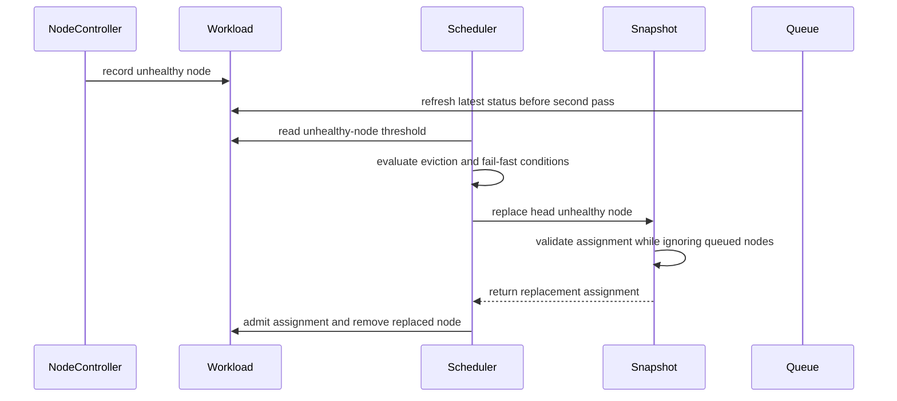

# PR #12344: [TAS] add feature TASReplaceMultipleFailedNodes feature to allow incremental node replacements without eviction

**Summary**: [TAS] add feature TASReplaceMultipleFailedNodes feature to allow incremental node replacements without eviction

**Sources**: https://github.com/kubernetes-sigs/kueue/pull/12344

**Last updated**: 2026-09-28T22:10:23Z

---

## Metadata

- **State**: closed (merged)
- **Author**: [@tg123](https://github.com/tg123)
- **Branch**: `bolian/tas-no-eviction-on-node-failure` → `main`
- **Created**: 2026-06-18T18:28:55Z
- **Updated**: 2026-09-28T22:10:23Z
- **Merged**: 2026-09-28T22:10:20Z
- **Closed**: 2026-09-28T22:10:21Z
- **Labels**: `kind/feature`, `release-note`, `lgtm`, `size/XXL`, `approved`, `ok-to-test`, `cncf-cla: yes`, `kind/kep`, `area/tas`, `area/kep`
- **Assignees**: [@amy](https://github.com/amy), [@mimowo](https://github.com/mimowo), [@tenzen-y](https://github.com/tenzen-y), [@j-skiba](https://github.com/j-skiba)
- **Requested reviewers**: [@mbobrovskyi](https://github.com/mbobrovskyi), [@sohankunkerkar](https://github.com/sohankunkerkar), [@j-skiba](https://github.com/j-skiba)
- **Changed files**: 19   **+1414 / -43**

## Description

 #### What type of PR is this?
 
 /kind feature
 /area tas
 
 #### What this PR does / why we need it:
 
 Adds a new alpha feature gate `TASReplaceMultipleFailedNodes` (default off)
 that lets Topology-Aware Scheduling replace **multiple** failed nodes for an
 admitted workload, one at a time, instead of evicting the workload.
 
 Today TAS can replace a single failed node in a workload's
 `TopologyAssignment`, but as soon as a **second distinct node** fails while a
 replacement is still in flight, the workload is evicted (by the node
 controller's multi-node-failure path, and/or by the scheduler's fail-fast
 eviction `TASFailedNodeReplacementFailFast`). For large, long-running
 gang-scheduled TAS workloads on unreliable hardware (e.g. GPU fleets), an
 eviction means tearing down and re-admitting the whole workload, which is far
 more disruptive than incrementally swapping out the failed nodes.
 
 When `TASReplaceMultipleFailedNodes` is enabled:
 
 - **Node controller** (`evictWorkloadIfNeeded`): the second-distinct-node
   eviction is suppressed; the newly failed node is appended to
   `Status.UnhealthyNodes` and the workload stays admitted.
 - **Scheduler** (`processEntry`): the fail-fast eviction is suppressed, so a
   single failed replacement attempt does not evict the workload.
 - **Replacement planner** (`findReplacementAssignment`): only the
   head-of-queue unhealthy node is replaced per cycle. Other queued unhealthy
   nodes — which may also be missing from the snapshot — are ignored during the
   stale-assignment check (new `isTopologyAssignmentStaleIgnoring` helper), so a
   stuck tail entry doesn't block head replacement. Tail entries are
   re-discovered and replaced on subsequent reconciles after each successful
   head replacement.
 
 The change also hardens two concurrency edge cases that this multi-failure
 path exposes:
 - `findReplacementAssignment` rejects a replacement candidate domain that
   overlaps an existing assignment domain, avoiding a `mergeTopologyAssignments`
   collapse (`canMergeDomains`, `Count += Count`) that would silently drop a pod
   slot and corrupt pod counts. The cycle retries on a fresh snapshot.
 - `mergeTopologyAssignments`'s sort is made nil-safe for tail domains that have
   already been removed from the snapshot, falling back to ordering by raw
   values instead of nil-panicking.
 
 The gate defaults off; existing single-node-replacement and eviction behavior
 is unchanged when it is disabled.
 
 #### Which issue(s) this PR fixes:
 
 Fixes #
 
 #### Special notes for your reviewer:
 
 - No API change. New behavior is entirely gated behind
   `TASReplaceMultipleFailedNodes` (Alpha, default off, introduced in 0.19).
 - The gate is wired so that it overrides `TASFailedNodeReplacementFailFast`
   (Beta, default on): when both are set, no-eviction wins.
 - Tests: Added integration coverage under
   `test/integration/singlecluster/tas/` for incremental multi-node
   replacement, eviction thresholds, topology pod-count consistency, and the
   greedy-assignment fallback path.
 
 #### Does this PR introduce a user-facing change?
 
 ```release-note
 TAS: Added a new alpha feature gate `TASReplaceMultipleFailedNodes` (default off). When enabled, a Topology-Aware Scheduling workload with multiple failed nodes has those nodes replaced incrementally instead of being evicted, keeping the workload admitted.
```

<!-- This is an auto-generated comment: release notes by coderabbit.ai -->
## Summary by CodeRabbit

* **New Features**
  * Added Alpha support for incrementally replacing multiple failed topology-aware scheduling nodes.
  * Added a per-workload annotation to configure the unhealthy-node eviction threshold; `0` allows unlimited failures.
* **Bug Fixes**
  * Prevented unrelated or concurrent failures from blocking replacement.
  * Improved handling of incomplete topology information and repeated replacements.
* **Documentation**
  * Documented multi-node replacement behavior, feature-gate configuration, and eviction thresholds.
* **Tests**
  * Added coverage for replacement workflows, eviction thresholds, and multiple failure scenarios.
<!-- end of auto-generated comment: release notes by coderabbit.ai -->

## Discussion

### Comment by [@k8s-ci-robot](https://github.com/k8s-ci-robot) — 2026-06-18T18:28:58Z

Adding the "do-not-merge/release-note-label-needed" label because no release-note block was detected, please follow our [release note process](https://git.k8s.io/community/contributors/guide/release-notes.md) to remove it.

<details>

Instructions for interacting with me using PR comments are available [here](https://git.k8s.io/community/contributors/guide/pull-requests.md).  If you have questions or suggestions related to my behavior, please file an issue against the [kubernetes-sigs/prow](https://github.com/kubernetes-sigs/prow/issues/new?title=Prow%20issue:) repository.
</details>

### Comment by [@netlify[bot]](https://github.com/apps/netlify) — 2026-06-18T18:29:01Z

### <span aria-hidden="true">✅</span> Deploy Preview for *kubernetes-sigs-kueue* canceled.


|  Name | Link |
|:-:|------------------------|
|<span aria-hidden="true">🔨</span> Latest commit | 856d88c9da3963439ebd8d193f3e498ab27abeaf |
|<span aria-hidden="true">🔍</span> Latest deploy log | https://app.netlify.com/projects/kubernetes-sigs-kueue/deploys/6ab76d481607f30008764a22 |

### Comment by [@k8s-ci-robot](https://github.com/k8s-ci-robot) — 2026-06-18T18:29:07Z

Hi @tg123. Thanks for your PR.

I'm waiting for a [kubernetes-sigs](https://github.com/orgs/kubernetes-sigs/people) member to verify that this patch is reasonable to test. If it is, they should reply with `/ok-to-test` on its own line. Until that is done, I will not automatically test new commits in this PR, but the usual testing commands by org members will still work.

>[!TIP]
>**We noticed you've done this a few times! Consider [joining the org](https://git.k8s.io/community/community-membership.md#member) to skip this step and gain `/lgtm` and other bot rights.** We recommend asking approvers on your previous PRs to sponsor you.

Once the patch is verified, the new status will be reflected by the `ok-to-test` label.

I understand the commands that are listed [here](https://go.k8s.io/bot-commands?repo=kubernetes-sigs%2Fkueue).

<details>

Instructions for interacting with me using PR comments are available [here](https://git.k8s.io/community/contributors/guide/pull-requests.md).  If you have questions or suggestions related to my behavior, please file an issue against the [kubernetes-sigs/prow](https://github.com/kubernetes-sigs/prow/issues/new?title=Prow%20issue:) repository.
</details>

### Comment by [@k8s-ci-robot](https://github.com/k8s-ci-robot) — 2026-06-18T18:29:09Z

[APPROVALNOTIFIER] This PR is **NOT APPROVED**

This pull-request has been approved by: *<a href="https://github.com/kubernetes-sigs/kueue/pull/12344#" title="Author self-approved">tg123</a>*
**Once this PR has been reviewed and has the lgtm label**, please assign [tenzen-y](https://github.com/tenzen-y) for approval. For more information see [the Code Review Process](https://git.k8s.io/community/contributors/guide/owners.md#the-code-review-process).

The full list of commands accepted by this bot can be found [here](https://go.k8s.io/bot-commands?repo=kubernetes-sigs%2Fkueue).

<details open>
Needs approval from an approver in each of these files:

- **[OWNERS](https://github.com/kubernetes-sigs/kueue/blob/main/OWNERS)**

Approvers can indicate their approval by writing `/approve` in a comment
Approvers can cancel approval by writing `/approve cancel` in a comment
</details>
<!-- META={"approvers":["tenzen-y"]} -->

### Comment by [@coderabbitai[bot]](https://github.com/apps/coderabbitai) — 2026-06-18T18:33:44Z

<!-- This is an auto-generated comment: summarize by coderabbit.ai -->
<!-- review_stack_entry_start -->

[](https://app.coderabbit.ai/change-stack/kubernetes-sigs/kueue/pull/12344?utm_source=github_walkthrough&utm_medium=github&utm_campaign=change_stack)

<!-- review_stack_entry_end -->
<!-- This is an auto-generated comment: review paused by coderabbit.ai -->

> [!NOTE]
> ## Reviews paused
> 
> It looks like this branch is under active development. To avoid overwhelming you with review comments due to an influx of new commits, CodeRabbit has automatically paused this review. You can configure this behavior by changing the `reviews.auto_review.auto_pause_after_reviewed_commits` setting.
> 
> Use the following commands to manage reviews:
> - `@coderabbitai resume` to resume automatic reviews.
> - `@coderabbitai review` to trigger a single review.
> 
> Use the checkboxes below for quick actions:
> - [ ] <!-- {"checkboxId": "7f6cc2e2-2e4e-497a-8c31-c9e4573e93d1"} --> ▶️ Resume reviews
> - [ ] <!-- {"checkboxId": "e9bb8d72-00e8-4f67-9cb2-caf3b22574fe"} --> 🔍 Trigger review

<!-- end of auto-generated comment: review paused by coderabbit.ai -->
<!-- walkthrough_start -->

<details>
<summary>📝 Walkthrough</summary>

## Walkthrough

This PR adds the Alpha `TASReplaceMultipleFailedNodes` gate. It adds threshold-based, head-first replacement for multiple failed TAS nodes. It updates eviction, staleness checks, status cleanup, queue refresh, lifecycle metadata, documentation, and tests.

### Changes

**Multi-node TAS replacement**

|Layer / File(s)|Summary|
|---|---|
|**Feature gate and eviction-threshold API** <br> `pkg/features/kube_features.go`, `apis/kueue/v1beta2/topology_types.go`, `pkg/workload/workload.go`, `pkg/workload/workload_test.go`|Adds the Alpha gate, threshold annotation, parser, and threshold tests.|
|**Scheduler and controller eviction gates** <br> `pkg/controller/tas/node_controller.go`, `pkg/scheduler/scheduler.go`, `pkg/scheduler/scheduler_tas_test.go`|Suppresses eviction and fail-fast handling below the configured unhealthy-node threshold.|
|**Head-node replacement and staleness handling** <br> `pkg/cache/scheduler/tas_flavor_snapshot.go`, `pkg/cache/scheduler/tas_cache_test.go`|Replaces the head unhealthy node, ignores queued and missing unhealthy nodes during staleness checks, handles missing domain metadata, and tests node reuse and concurrent failures.|
|**Post-admission unhealthy-node cleanup** <br> `pkg/scheduler/scheduler.go`|Removes only the unhealthy node replaced by successful admission.|
|**Queue refresh and lifecycle validation** <br> `pkg/cache/queue/manager.go`, `pkg/cache/queue/manager_test.go`, `keps/2724-topology-aware-scheduling/*`, `site/data/featuregates/versioned_feature_list.yaml`, `test/compatibility_lifecycle/reference/versioned_feature_list.yaml`, `test/integration/singlecluster/tas/tas_test.go`|Refreshes queued workloads before second-pass scheduling, registers and documents the feature gate, and tests threshold behavior and replacement invariants.|

**Estimated code review effort:** 3 (Moderate) | ~30 minutes

### Sequence Diagram(s)



**Suggested reviewers:** `mbobrovskyi`, `sohankunkerkar`

</details>

<!-- walkthrough_end -->
<!-- pre_merge_checks_walkthrough_start -->

<details>
<summary>🚥 Pre-merge checks | ✅ 4 | ❌ 1</summary>

### ❌ Failed checks (1 warning)

|     Check name     | Status     | Explanation                                                                           | Resolution                                                                         |
| :----------------: | :--------- | :------------------------------------------------------------------------------------ | :--------------------------------------------------------------------------------- |
| Docstring Coverage | ⚠️ Warning | Docstring coverage is 33.33% which is insufficient. The required threshold is 80.00%. | Write docstrings for the functions missing them to satisfy the coverage threshold. |

<details>
<summary>✅ Passed checks (4 passed)</summary>

|         Check name         | Status   | Explanation                                                                                                                                       |
| :------------------------: | :------- | :------------------------------------------------------------------------------------------------------------------------------------------------ |
|      Description Check     | ✅ Passed | Check skipped - CodeRabbit’s high-level summary is enabled.                                                                                       |
|         Title check        | ✅ Passed | The title clearly identifies the TASReplaceMultipleFailedNodes feature and its purpose of enabling incremental node replacement without eviction. |
|     Linked Issues check    | ✅ Passed | Check skipped because no linked issues were found for this pull request.                                                                          |
| Out of Scope Changes check | ✅ Passed | Check skipped because no linked issues were found for this pull request.                                                                          |

</details>

</details>

<!-- pre_merge_checks_walkthrough_end -->
<!-- finishing_touch_checkbox_start -->

<details>
<summary>✨ Finishing Touches</summary>

<details>
<summary>🧪 Generate unit tests (beta)</summary>

- [ ] <!-- {"checkboxId": "f47ac10b-58cc-4372-a567-0e02b2c3d479", "radioGroupId": "utg-output-choice-group-unknown_comment_id"} -->   Create PR with unit tests

</details>

</details>

<!-- finishing_touch_checkbox_end -->
<!-- tips_start -->

---


<sub>Comment `@coderabbitai help` to get the list of available commands.</sub>

<!-- tips_end -->

### Comment by [@mimowo](https://github.com/mimowo) — 2026-06-18T19:01:31Z

/ok-to-test

### Comment by [@mimowo](https://github.com/mimowo) — 2026-06-18T19:05:59Z

@tg123 thanks for the PR!

Historically we chose only replacing one node because the algorithms for replacing multiple nodes got complicated, but certainly it was something we considered as a possiblity, and thus introduced the API which contains a list of Nodes rather than one.

My main questions:
1. do you foresee a path forward where the generalization is the only supported mode?
2. do you see drawbacks of replacing multiple nodes? In which case we may choose to have a configuration setting for long term?

It is ok if you choose "maybe, I don't know yet", but would love to know your considerations first.

It is great that you have a working prototype, but I would like to make sure we have a KEP update where we align on our current knowledge of the problem space, and the path forward, as much as we can.

### Comment by [@k8s-ci-robot](https://github.com/k8s-ci-robot) — 2026-06-18T19:16:16Z

@tg123: The following tests **failed**, say `/retest` to rerun all failed tests or `/retest-required` to rerun all mandatory failed tests:

Test name | Commit | Details | Required | Rerun command
--- | --- | --- | --- | ---
pull-kueue-test-unit-main | a4ce8a9a3600b74e52abc2214726e4a458121517 | [link](https://prow.k8s.io/view/gs/kubernetes-ci-logs/pr-logs/pull/kubernetes-sigs_kueue/12344/pull-kueue-test-unit-main/2067684168820592640) | true | `/test pull-kueue-test-unit-main`
pull-kueue-verify-main | a4ce8a9a3600b74e52abc2214726e4a458121517 | [link](https://prow.k8s.io/view/gs/kubernetes-ci-logs/pr-logs/pull/kubernetes-sigs_kueue/12344/pull-kueue-verify-main/2067684192619073536) | true | `/test pull-kueue-verify-main`

[Full PR test history](https://prow.k8s.io/pr-history?org=kubernetes-sigs&repo=kueue&pr=12344). [Your PR dashboard](https://prow.k8s.io/pr?query=is%3Apr%20state%3Aopen%20author%3Atg123). Please help us cut down on flakes by [linking to](https://git.k8s.io/community/contributors/devel/sig-testing/flaky-tests.md#filing-issues-for-flaky-tests) an [open issue](https://github.com/kubernetes-sigs/kueue/issues?q=is:issue+is:open) when you hit one in your PR.

<details>

Instructions for interacting with me using PR comments are available [here](https://git.k8s.io/community/contributors/guide/pull-requests.md).  If you have questions or suggestions related to my behavior, please file an issue against the [kubernetes-sigs/prow](https://github.com/kubernetes-sigs/prow/issues/new?title=Prow%20issue:) repository. I understand the commands that are listed [here](https://go.k8s.io/bot-commands).
</details>
<!-- test report -->

### Comment by [@tg123](https://github.com/tg123) — 2026-06-18T20:53:43Z

more context, we verified this change in 0.16.6 for a month running a very big job.

1. Could multi-node replacement become the only supported mode?

I think probably yes at the algorithm level — single-node replacement is just the N == 1 case of the general one, so I'd rather not maintain two code paths long-term.

2. Drawbacks of replacing multiple nodes / case for a long-term config
the main goal is to prevent large job from being requeue, the replacing may wait forever if there is no candidate. 
so current algo is very simple:
```
 while (bad node > 0) { 
    lock  { 
      replace 1 node
      bad node--
    } 
}

for now, we also introduced some tool to manually move stuck slice to another rack if there is room, but need to restart `slice-size` count of pod. maybe, this is another feature we can add in feature

 ```
 
 
 i am also drafting e2e test to fit open source plugin, will add them soon
let me know if anything need to improve and let me know if you want me to draft KEP update

### Comment by [@mimowo](https://github.com/mimowo) — 2026-06-18T21:19:44Z

> more context, we verified this change in 0.16.6 for a month running a very big job.

Excellent results then 👍 Thank you for sharing, certainly it helps to build confidence in the change.

In your experiments, do you know how many Pods would require migration at any given moment (how many Nodes would fail?). I'm wondering if we still could cap the algo, but move the cap to say 5 or 10?

> 1. Could multi-node replacement become the only supported mode?
> 
> I think probably yes at the algorithm level — single-node replacement is just the N == 1 case of the general one, so I'd rather not maintain two code paths long-term.

sgtm, I would also want to have one path long term.

> 2. Drawbacks of replacing multiple nodes / case for a long-term config
>    the main goal is to prevent large job from being requeue, the replacing may wait forever if there is no candidate.
>    so current algo is very simple:
> 
> ```
>  while (bad node > 0) { 
>     lock  { 
>       replace 1 node
>       bad node--
>     } 
> }
> 
> for now, we also introduced some tool to manually move stuck slice to another rack if there is room, but need to restart `slice-size` count of pod. maybe, this is another feature we can add in feature
> ```

Isn't this a bit not oversimplifying? Assume you have "topology-required": "rack". Then consider the following:
- each rack can host 2 Pods, and one rack failed. Now, if you do the algo you will fail to transfer the two Pods to the new rack, because moving the first one will fail (IIUC) due to the constraint (the other failed is not moved yet). For example, when you start searching for the rack replacement you need to check "ahead" that the rack will have enough free space to acommodate all the pods from the previous rack.

The proposed algo will work well for "unconstrained" and "preferred". For "required" it may work in many cases, but I think to make it work in all cases requires some complications. Still, it sounds like a pragmatic balance between finding optimal solution and complexity. So, I'm ok with that, but we need to document all the tricky cases in unit tests, and make sure nothing bad happens, like panic, or workload getting stuck when "required" is used.

> i am also drafting e2e test to fit open source plugin, will add them soon let me know if anything need to improve and let me know if you want me to draft KEP update

Great.

### Comment by [@mimowo](https://github.com/mimowo) — 2026-06-22T13:59:51Z

cc @pajakd @j-skiba ptal

### Comment by [@tg123](https://github.com/tg123) — 2026-06-22T22:00:36Z


_Adding the "do-not-merge/release-note-label-needed" label because no release-note block was detected, please follow our release note process to remove it._

worst case 5 nodes in ~20m, the job size is ~2000 nodes


_The proposed algo will work well for "unconstrained" and "preferred". For "required" it may work in many cases, but I think to make it work in all cases requires some complications. Still, it sounds like a pragmatic balance between finding optimal solution and complexity. So, I'm ok with that, but we need to document all the tricky cases in unit tests, and make sure nothing bad happens, like panic, or workload getting stuck when "required" is used._

we use `required`, and allow pod stuck waiting for nodes. human may kick in to help if auto repair does not work

### Comment by [@mimowo](https://github.com/mimowo) — 2026-06-23T08:00:43Z

> we use required, and allow pod stuck waiting for nodes. human may kick in to help if auto repair does not work

 Currently when two nodes fail, they require eviction, but this happens unassisted. Waiting for an admin reaction to unstuck the job will certainly be considered as a regression by some users. 
 
 So, we need to have a plan, either (1) improve the algo to support multiple nodes without issues, or add some kind of API, or maybe (2.) some kind of annotation to allow "require" with multiple nodes failing getting stuck for manual intervation, but that feels like needs to be opt-in.

### Comment by [@tg123](https://github.com/tg123) — 2026-06-23T09:14:44Z

do you want me to share/doc our dirty tools?
it moves slice from rack to rack via editing kwl
which means 1 slice (2-16 nodes in our case) has bad node and no replacement in same rack, whole slice need to be moved to another rack.

i do not think this is a good algo, however, it is really helpful for repairing by only to restart pods on a small partial of nodes

### Comment by [@mimowo](https://github.com/mimowo) — 2026-06-23T09:44:14Z

> do you want me to share/doc our dirty tools?

not really, but I think this is the difference between hacking some solution just for a specific company, rather than making a default for all users. 

> i do not think this is a good algo, however, it is really helpful for repairing by only to restart pods on a small partial of nodes

I can clearly imagine this behavior being useful for workloads with >1k pods.

The question is - could we improve it to work better, or as mentioned above make the behavior opt-in. For example we could by default evict if there are >1 nodes failing, or leave it to an admin if there is `kueue.x-k8s.io/tas-unhealthy-nodes-eviction-threshold` (or something like that). That could be assumed as 1 by default if unspecified, but could be increased on some workloads, wdyt?

### Comment by [@tg123](https://github.com/tg123) — 2026-06-24T21:31:46Z

i agree, `kueue.x-k8s.io/tas-unhealthy-nodes-eviction-threshold` , let me impl it instead of using a feature

### Comment by [@tg123](https://github.com/tg123) — 2026-06-25T07:27:39Z

`kueue.x-k8s.io/tas-unhealthy-nodes-eviction-threshold` added
default = 1

N -> evict when len(unhealthy node) > N  
0 -> no ec
others (invalid neg) -> default 


N = 1 is current behavior, i am thinking removing featureflag? and make default a configable value?

### Comment by [@mimowo](https://github.com/mimowo) — 2026-06-25T12:41:44Z

Whatever we choose I think we need an alpha FG in order to make it clear to users that this may change.

And I'm still not committed that we go with `kueue.x-k8s.io/tas-unhealthy-nodes-eviction-threshold`, it just felt reasonable.

Another option I'm considering about is to allow for an arbitrary number of nodes to be replaced, but when this is "required" and the simple heursistic is getting stuck, then evict the workload. This seems suboptimal in some cases where we choose the wrong domain by the greedy heuristic, but it will jus result in eviction, as it would result eviction currently anyway. So, I think it might be a reasonable approach, wdyt?

### Comment by [@tg123](https://github.com/tg123) — 2026-06-30T07:04:15Z

Agreed on the alpha FG — it's already behind  TASReplaceMultipleFailedNodes  (alpha, off by default).

 On the design: I don't have a broad enough view of Kueue to have a strong opinion, so either direction works for us. Our concrete need is just to keep large training jobs running across node failures rather than evicting the whole job. A big part  of why we opened this PR is to confirm we understand Kueue's behavior correctly and to contribute the fix back rather than carry it downstream.

Your "replace arbitrarily, evict only when the greedy heuristic gets stuck" approach sounds reasonable to me and matches our goal — it falls back to eviction exactly where today's behavior already would. Happy to drop the threshold annotation and  go that way if you prefer; just let me know which direction you'd like and I'll adjust the PR.

### Comment by [@linux-foundation-easycla[bot]](https://github.com/apps/linux-foundation-easycla) — 2026-07-25T09:35:05Z

<a href="https://easycla.lfx.linuxfoundation.org/#/?version=2"></a><br >The committers listed above are authorized under a signed CLA.<ul><li>:white_check_mark: login: Singularity23x0 / name: Dawid Pastuszka (35a2c27c76207df2481731a0cc6ec9b6edf719e0)</li><li>:white_check_mark: login: j-skiba / name: Jakub Skiba (37ced77ee09326d13a373a70524ca62bba9225bb, 41e4647788cce90c5b6aca31ff6011d3ee0ba7b4, 7c3e903fa51529e9f1149eeb26e6712a9e6f425e, b3377613413877b97e224e6a91c354772409ad38, e9e022e282e846885705cb5572185ecb2604b64b)</li><li>:white_check_mark: login: tg123 / name: Boshi LIAN (00b01f7a35be11bf53ae6ccc134282fa55378b9e, 121ff1eede0eb9f80967c8ddd5b0657cf8052aab, 15f0ec70a027633613b7b7f6932c4f4310af9ae6, 15fe86e955f40574c2718d7358af0dee815e7763, 27606b93c459e523748ca5ab7d72cef297e43025, 2d3654014af57c0ef3869c4cc61f43420d507c39, 4c406551c8bcb20787e0c4ba0fcce6e5d491a040, 4f8b24eecd7fa38fb592710656b35d3c3d66f957, 6ef6a99a4ac00149aff23b6e8a4e997aecaa29e4, 73a816d07d9402830c74e1e278d9a4cc7164f4be, 78a88a711244e08918c3f0c68170e5e75ef436ea, 91e64ae0a8c93dc06f0f730e933dde8ef649779e, 9916a7fe0d6e771e58e54b1126c5d6d351e25736, 9c45287a1b983aea7ecfeb68b8a71fbf6aecd50e, a15742ae6e0d76ac71df3d2347aaa4b47461d492, a38ca5f409ca2119449c809ca3386e49ed80358b, a4ce8a9a3600b74e52abc2214726e4a458121517, af44141f67b4e451f865afd159e22e4452a2130c, b07b270d2ca6c5c61122909be2aca798f2c9c8b1, b5550673faf534298b660667c744b40ad63ad532, b5f89770f79e815e1769137b2369bb66f35ec7cc, c51c786007238d634259f98cd0bc0fa33f342cbf, d8c10923a6786145e95563474b56eafb079cb70d, db5672302cf45ad130811b5cfae3bd13188a7b3a, edf503e43ba36e6b437fedcddd3541684b694238, f4042dcc9ec3bb276827954a483ad035cd9c3c2b, f7759caa9d635a8a55c87844bea3c88191272385, fed59a876775c90f5019425048c09fd2c5dd7d0d)</li><li>:white_check_mark: login: tg123 / name: Boshi Lian (35a2c27c76207df2481731a0cc6ec9b6edf719e0, 37ced77ee09326d13a373a70524ca62bba9225bb, 41e4647788cce90c5b6aca31ff6011d3ee0ba7b4, 7c3e903fa51529e9f1149eeb26e6712a9e6f425e, b3377613413877b97e224e6a91c354772409ad38, e9e022e282e846885705cb5572185ecb2604b64b)</li></ul>

### Comment by [@mimowo](https://github.com/mimowo) — 2026-08-03T19:31:55Z

/area tas
/kind feature

### Comment by [@tg123](https://github.com/tg123) — 2026-08-03T23:16:25Z

/retest

### Comment by [@j-skiba](https://github.com/j-skiba) — 2026-08-06T08:31:12Z

/lgtm

### Comment by [@kubernetes-prow[bot]](https://github.com/apps/kubernetes-prow) — 2026-08-06T08:31:20Z

LGTM label has been added.  <details>Git tree hash: 556c5655a1a9e2e8573bdfcff1d6aa45eed35c1f</details>

### Comment by [@tg123](https://github.com/tg123) — 2026-08-09T06:34:58Z

/test pull-kueue-test-integration-shard-1-main

### Comment by [@mimowo](https://github.com/mimowo) — 2026-08-11T22:00:26Z

@tg123 do you have cycles to address the build issues?

Overall I like the enhancement. Would you like to propose it at the wg-batch or a planning meeting?

### Comment by [@tg123](https://github.com/tg123) — 2026-08-11T22:04:59Z

Sure will check it tonight

### Comment by [@amy](https://github.com/amy) — 2026-08-11T23:07:19Z

/assign

### Comment by [@amy](https://github.com/amy) — 2026-08-12T14:34:54Z

/kind kep
/area kep

### Comment by [@mimowo](https://github.com/mimowo) — 2026-09-09T16:22:12Z

/assign @tenzen-y

### Comment by [@mimowo](https://github.com/mimowo) — 2026-09-21T16:53:31Z

@tg123 do you have cycles to address the comments? We expect all KEPS to be code complete EOW. Otherwise we can revisit this enhancement for v0.21.

### Comment by [@tg123](https://github.com/tg123) — 2026-09-21T17:24:44Z

Will close it and clean up this week 
Sorry for the delay

### Comment by [@tg123](https://github.com/tg123) — 2026-09-23T20:22:30Z

AI-assisted CI triage: integration shard 3 failed in the unchanged FairSharing test 'should clear metrics for the implicit root Cohort after switching to another root Cohort' (metrics_test.go:1086). The root1 active-workload gauge stayed at 0 instead of 3 before reparenting. Retrying only this shard to check whether the failure reproduces.

/test pull-kueue-test-integration-shard-3-main

### Comment by [@tg123](https://github.com/tg123) — 2026-09-24T02:00:26Z

AI-assisted CI triage: the website-preview link check failed with HTTP 500/503 responses from Netlify, not missing-link errors. The sampled failing URLs now return HTTP 200. Retrying only the website-preview check.

/test pull-kueue-verify-website-links-preview-main

### Comment by [@tg123](https://github.com/tg123) — 2026-09-24T08:49:59Z

@mimowo @tenzen-y please check, i will also push internal upgrade to 0.20

### Comment by [@mimowo](https://github.com/mimowo) — 2026-09-25T06:46:41Z

@tg123 I propose to cut down the scope and use global default. In the next release we will go with the configAPI: https://github.com/kubernetes-sigs/kueue/pull/12344#discussion_r4101911353

### Comment by [@mimowo](https://github.com/mimowo) — 2026-09-25T14:13:55Z

@tg123 please rebase again, sorry 2 days before release is busy time, so if you want to land the PR then please iterate with us

### Comment by [@mimowo](https://github.com/mimowo) — 2026-09-25T18:54:10Z

I'm on the PR, I will post soon some more comments.

### Comment by [@mimowo](https://github.com/mimowo) — 2026-09-25T20:30:17Z

LGTM overall,  my remaining comments:
1. (design change) https://github.com/kubernetes-sigs/kueue/pull/12344#discussion_r4108258037 
2. (bug, should be simple to fix): https://github.com/kubernetes-sigs/kueue/pull/12344#discussion_r4107996139
3. (I'm not sure, we can keep it and rely on feedback before Beta): https://github.com/kubernetes-sigs/kueue/pull/12344#discussion_r4108136560

### Comment by [@mimowo](https://github.com/mimowo) — 2026-09-25T20:30:45Z

/assign @tenzen-y 
ptal I think we can merge this if the remaining comments are addressed

### Comment by [@mimowo](https://github.com/mimowo) — 2026-09-25T20:31:04Z

/approve
/hold

### Comment by [@mimowo](https://github.com/mimowo) — 2026-09-28T12:59:32Z

/lgtm
/approve
cc @tenzen-y

### Comment by [@kubernetes-prow[bot]](https://github.com/apps/kubernetes-prow) — 2026-09-28T12:59:40Z

LGTM label has been added.  <details>Git tree hash: 3efab5a7fa56eda938af29aa0e0ca054185d8dd3</details>

### Comment by [@kubernetes-prow[bot]](https://github.com/apps/kubernetes-prow) — 2026-09-28T12:59:51Z

[APPROVALNOTIFIER] This PR is **APPROVED**

This pull-request has been approved by: *<a href="https://github.com/kubernetes-sigs/kueue/pull/12344#issuecomment-5870352397" title="Approved">mimowo</a>*, *<a href="https://github.com/kubernetes-sigs/kueue/pull/12344#" title="Author self-approved">tg123</a>*

The full list of commands accepted by this bot can be found [here](https://go.k8s.io/bot-commands?repo=kubernetes-sigs%2Fkueue).

The pull request process is described [here](https://git.k8s.io/community/contributors/guide/owners.md#the-code-review-process)

<details >
Needs approval from an approver in each of these files:

- ~~[OWNERS](https://github.com/kubernetes-sigs/kueue/blob/main/OWNERS)~~ [mimowo]

Approvers can indicate their approval by writing `/approve` in a comment
Approvers can cancel approval by writing `/approve cancel` in a comment
</details>
<!-- META={"approvers":[]} -->

### Comment by [@mimowo](https://github.com/mimowo) — 2026-09-28T14:01:08Z

/lgtm
/unhold
I think the PR is good to go for Alpha. I assume @tenzen-y is already good with the API (global FG knob) based on our slack discussions.

I opened two issues to track follow up work:
1. https://github.com/kubernetes-sigs/kueue/issues/16291
2. https://github.com/kubernetes-sigs/kueue/issues/16283

## Reviews

### Review by [@Singularity23x0](https://github.com/Singularity23x0) (commented) — 2026-06-22T13:52:57Z

- **pkg/cache/scheduler/tas_flavor_snapshot.go:816** by [@Singularity23x0](https://github.com/Singularity23x0) — 2026-06-22T12:38:16Z
```diff
@@ -774,7 +805,23 @@ func (s *TASFlavorSnapshot) requiredReplacementDomain(tr *TASPodSetRequests, ta
 // that don't exists in the snapshot. It may be cause e.g. by Node deletion, or change
 // in Node's NodeReady condition
 func (s *TASFlavorSnapshot) IsTopologyAssignmentStale(ta *utiltas.TopologyAssignment) (bool, string) {
+	return s.isTopologyAssignmentStaleIgnoring(ta, nil)
+}
+
+// isTopologyAssignmentStaleIgnoring returns whether the topologyAssignment contains
+// node-level domains missing from the snapshot, ignoring any node names in
+// ignoreNodes. Used by the head-of-queue replacement path so that other queued
+// unhealthy nodes (which may also be missing from the snapshot) do not poison
+// the stale-check for the head we are actively replacing.
+func (s *TASFlavorSnapshot) isTopologyAssignmentStaleIgnoring(ta *utiltas.TopologyAssignment, ignoreNodes map[string]struct{}) (bool, string) {
```

  Nit: We could use `sets.Set[string]` here instead of `map[string]struct{}`

- **pkg/cache/scheduler/tas_flavor_snapshot.go:721** by [@Singularity23x0](https://github.com/Singularity23x0) — 2026-06-22T12:46:09Z
```diff
@@ -686,7 +700,24 @@ func (s *TASFlavorSnapshot) findReplacementAssignment(
 		return nil, nil, reason
 	}
 	if replacementAssignment == nil || len(replacementAssignment[tr.PodSet.Name].Domains) == 0 {
-		return nil, nil, fmt.Sprintf("cannot find replacement assignment for unhealthy node: %v", wl.Status.UnhealthyNodes[0].Name)
+		return nil, nil, fmt.Sprintf("cannot find replacement assignment for unhealthy node: %v", headNodeName)
+	}
+	// With TASReplaceMultipleFailedNodes, multiple replacement cycles can
+	// run on the same workload before each other's TA write propagates to the
+	// cache snapshot. If two concurrent cycles pick the same replacement
+	// domain, mergeTopologyAssignments collapses them via canMergeDomains into a
+	// single entry with Count+=Count, which silently loses a pod slot
+	// (corrupting podCounts so the kube-scheduler cannot place the pod). Detect
+	// this overlap and reject the cycle so a subsequent scheduling cycle
+	// retries with a fresh snapshot.
+	existingDomainIDs := make(map[utiltas.TopologyDomainID]struct{}, len(existingAssignment.Domains))
+	for _, d := range existingAssignment.Domains {
+		existingDomainIDs[utiltas.DomainID(d.Values)] = struct{}{}
+	}
+	for _, d := range replacementAssignment[tr.PodSet.Name].Domains {
+		if _, dup := existingDomainIDs[utiltas.DomainID(d.Values)]; dup {
+			return nil, nil, fmt.Sprintf("replacement candidate %v already present in existing TopologyAssignment; concurrent replacement race - retry on next cycle", d.Values)
+		}
 	}
```

  Nit
  ```suggestion
  	existingDomainIDs := sets.New[utiltas.TopologyDomainID]()
  	for _, d := range existingAssignment.Domains {
  		existingDomainIDs.Insert(utiltas.DomainID(d.Values))
  	}
  	for _, d := range replacementAssignment[tr.PodSet.Name].Domains {
  		if existingDomainIDs.Has(utiltas.DomainID(d.Values)) {
  			return nil, nil, fmt.Sprintf("replacement candidate %v already present in existing TopologyAssignment; concurrent replacement race - retry on next cycle", d.Values)
  		}
  }
  ```

- **pkg/cache/scheduler/tas_flavor_snapshot.go:671** by [@Singularity23x0](https://github.com/Singularity23x0) — 2026-06-22T12:50:09Z
```diff
@@ -654,8 +654,22 @@ func (s *TASFlavorSnapshot) findReplacementAssignment(
 	wl *kueue.Workload,
 	assumedUsage map[utiltas.TopologyDomainID]resources.Requests,
 ) (*utiltas.TopologyAssignment, *utiltas.TopologyAssignment, string) {
-	tr.Count = deleteDomain(existingAssignment, wl.Status.UnhealthyNodes[0].Name)
-	if isStale, staleDomain := s.IsTopologyAssignmentStale(existingAssignment); isStale {
+	headNodeName := wl.Status.UnhealthyNodes[0].Name
+	tr.Count = deleteDomain(existingAssignment, headNodeName)
+	// When TASReplaceMultipleFailedNodes is enabled, multiple unhealthy nodes may be
+	// queued in Status.UnhealthyNodes. We only replace the head; other queued
+	// nodes that may also be missing from the snapshot must not poison the
+	// stale-assignment check below, otherwise head replacement would never
+	// succeed and the workload would be stuck without an automatic eviction
+	// safety net.
+	var ignoreNodes map[string]struct{}
+	if features.Enabled(features.TASReplaceMultipleFailedNodes) && len(wl.Status.UnhealthyNodes) > 1 {
+		ignoreNodes = make(map[string]struct{}, len(wl.Status.UnhealthyNodes)-1)
+		for _, n := range wl.Status.UnhealthyNodes[1:] {
+			ignoreNodes[n.Name] = struct{}{}
+		}
+	}
```

  Nit: If we switch to sets
  ```suggestion
  	var ignoreNodes sets.Set[string]
  	if features.Enabled(features.TASReplaceMultipleFailedNodes) && len(wl.Status.UnhealthyNodes) > 1 {
  		ignoreNodes = sets.New(wl.Status.UnhealthyNodes[1:]...)
  	}
  ```

### Review by [@coderabbitai[bot]](https://github.com/apps/coderabbitai) (commented) — 2026-06-22T21:39:19Z


<details>
<summary>♻️ Duplicate comments (1)</summary><blockquote>

<details>
<summary>pkg/cache/scheduler/tas_flavor_snapshot.go (1)</summary><blockquote>

`665-668`: _🎯 Functional Correctness_ | _🔴 Critical_

**Missing import and type mismatch in sets.New() call will cause compilation failure.**

The code uses `sets.Set[string]` and `sets.New()` at lines 665–667, but the `sets` package is not imported. Additionally, even with the proper import added, the code has a type error: `wl.Status.UnhealthyNodes[1:]` is `[]kueue.UnhealthyNode`, but `sets.New[string]()` expects individual string values. The `.Name` field must be extracted from each UnhealthyNode before adding to the set.

<details>
<summary>🐛 Proposed fix</summary>

Add missing import and extract node names:
```diff
+ "k8s.io/apimachinery/pkg/util/sets"
+
  var ignoreNodes sets.Set[string]
  if features.Enabled(features.TASReplaceMultipleFailedNodes) && len(wl.Status.UnhealthyNodes) > 1 {
-   ignoreNodes = sets.New(wl.Status.UnhealthyNodes[1:]...)
+   ignoreNodes = sets.New[string]()
+   for _, n := range wl.Status.UnhealthyNodes[1:] {
+     ignoreNodes.Insert(n.Name)
+   }
  }
```
</details>

<details>
<summary>🤖 Prompt for AI Agents</summary>

```
Verify each finding against current code. Fix only still-valid issues, skip the
rest with a brief reason, keep changes minimal, and validate.

In `@pkg/cache/scheduler/tas_flavor_snapshot.go` around lines 665 - 668, The code
block creating ignoreNodes with sets.Set[string] is missing the required import
for the sets package and has a type mismatch error. Add the missing import for
the sets package at the top of the file, then fix the type error in the
sets.New() call by extracting the Name field from each UnhealthyNode in
wl.Status.UnhealthyNodes[1:] before passing them to sets.New(), since
UnhealthyNodes is a slice of UnhealthyNode objects but sets.New() expects string
values.
```

</details>

<!-- cr-comment:v1:839b4bc72cf949aa8893a336 -->

</blockquote></details>

</blockquote></details>

<details>
<summary>🤖 Prompt for all review comments with AI agents</summary>

```
Verify each finding against current code. Fix only still-valid issues, skip the
rest with a brief reason, keep changes minimal, and validate.

Duplicate comments:
In `@pkg/cache/scheduler/tas_flavor_snapshot.go`:
- Around line 665-668: The code block creating ignoreNodes with sets.Set[string]
is missing the required import for the sets package and has a type mismatch
error. Add the missing import for the sets package at the top of the file, then
fix the type error in the sets.New() call by extracting the Name field from each
UnhealthyNode in wl.Status.UnhealthyNodes[1:] before passing them to sets.New(),
since UnhealthyNodes is a slice of UnhealthyNode objects but sets.New() expects
string values.
```

</details>

---

<details>
<summary>ℹ️ Review info</summary>

<details>
<summary>⚙️ Run configuration</summary>

**Configuration used**: Path: .coderabbit.yaml

**Review profile**: CHILL

**Plan**: Pro

**Run ID**: `c90c6a0c-ba0f-4f06-8bcd-96ad291bef15`

</details>

<details>
<summary>📥 Commits</summary>

Reviewing files that changed from the base of the PR and between 0cbc2e7ded21774c0f7a2af538f2888dc0b59f78 and 35a2c27c76207df2481731a0cc6ec9b6edf719e0.

</details>

<details>
<summary>📒 Files selected for processing (4)</summary>

* `pkg/cache/scheduler/tas_flavor_snapshot.go`
* `pkg/controller/tas/node_controller.go`
* `pkg/features/kube_features.go`
* `pkg/scheduler/scheduler.go`

</details>

</details>

<!-- This is an auto-generated comment by CodeRabbit for review status -->

### Review by [@coderabbitai[bot]](https://github.com/apps/coderabbitai) (commented) — 2026-06-22T21:58:25Z

**Actionable comments posted: 2**

<details>
<summary>🤖 Prompt for all review comments with AI agents</summary>

```
Verify each finding against current code. Fix only still-valid issues, skip the
rest with a brief reason, keep changes minimal, and validate.

Inline comments:
In `@pkg/scheduler/scheduler.go`:
- Around line 806-821: When trimming the UnhealthyNodes list after successfully
replacing the head node, use the live workload object `wl` instead of the queued
event snapshot `e.Obj`. On the line where `wl.Status.UnhealthyNodes` is assigned
(currently slicing from `e.Obj.Status.UnhealthyNodes[1:]`), change it to slice
from `wl.Status.UnhealthyNodes[1:]` to ensure the slice operation works on the
current state rather than a stale snapshot, preventing loss of any newly
appended unhealthy nodes that may have been added after the event was queued.

In `@test/integration/singlecluster/tas/tas_test.go`:
- Around line 2074-2135: The test case for "should replace multiple failed nodes
without evicting when TASReplaceMultipleFailedNodes is enabled" only validates
the positive path where the feature gate is enabled. Add a paired negative-path
test by converting this into a table-driven test using Ginkgo's DescribeTable
pattern with parameters for the gate enabled state and expected eviction
behavior. Create two test entries in the table: one with gateEnabled=true and
expectedEvicted=false (the current passing scenario), and another with
gateEnabled=false and expectedEvicted=true (to verify that without the gate, the
workload gets evicted when nodes fail). Parameterize the test body to use these
values from the table entries, setting the feature gate conditionally based on
the gateEnabled parameter and adjusting the assertions around eviction status to
match the expectedEvicted value.
```

</details>

<details>
<summary>🪄 Autofix (Beta)</summary>

Fix all unresolved CodeRabbit comments on this PR:

- [ ] <!-- {"checkboxId": "4b0d0e0a-96d7-4f10-b296-3a18ea78f0b9"} --> Push a commit to this branch (recommended)
- [ ] <!-- {"checkboxId": "ff5b1114-7d8c-49e6-8ac1-43f82af23a33"} --> Create a new PR with the fixes

</details>

---

<details>
<summary>ℹ️ Review info</summary>

<details>
<summary>⚙️ Run configuration</summary>

**Configuration used**: Path: .coderabbit.yaml

**Review profile**: CHILL

**Plan**: Pro

**Run ID**: `e959b73f-8fb7-4de5-85c5-fe880ea1e729`

</details>

<details>
<summary>📥 Commits</summary>

Reviewing files that changed from the base of the PR and between 35a2c27c76207df2481731a0cc6ec9b6edf719e0 and a38ca5f409ca2119449c809ca3386e49ed80358b.

</details>

<details>
<summary>📒 Files selected for processing (3)</summary>

* `pkg/cache/scheduler/tas_flavor_snapshot.go`
* `pkg/scheduler/scheduler.go`
* `test/integration/singlecluster/tas/tas_test.go`

</details>

<details>
<summary>🚧 Files skipped from review as they are similar to previous changes (1)</summary>

* pkg/cache/scheduler/tas_flavor_snapshot.go

</details>

</details>

<!-- This is an auto-generated comment by CodeRabbit for review status -->

- **pkg/scheduler/scheduler.go:821** by [@coderabbitai[bot]](https://github.com/apps/coderabbitai) — 2026-06-22T21:58:24Z
```diff
@@ -804,8 +804,21 @@ func (s *Scheduler) admit(ctx context.Context, e *entry, cq *schdcache.ClusterQu
 		err := workload.PatchAdmissionStatus(ctx, s.client, newWorkload, s.clock, func(wl *kueue.Workload) (bool, error) {
 			s.prepareWorkload(log, wl, cq, admission)
 			if features.Enabled(features.TopologyAwareScheduling) && workload.HasUnhealthyNodes(e.Obj) {
-				log.V(5).Info("Clearing the topology assignment recovery field from the workload status after successful recovery")
-				wl.Status.UnhealthyNodes = nil
+				if features.Enabled(features.TASReplaceMultipleFailedNodes) && len(e.Obj.Status.UnhealthyNodes) > 1 {
+					// Only the head-of-queue unhealthy node is replaced by this
+					// admission; keep the remaining unhealthy nodes queued so the
+					// next scheduling cycle replaces them too. Clearing the whole
+					// list here would strip not-yet-replaced tail entries that no
+					// longer generate node events (e.g. deleted nodes), leaving
+					// them stuck in the TopologyAssignment forever.
+					log.V(5).Info("Dropping the replaced head node from the workload recovery field, keeping the remaining unhealthy nodes",
+						"replacedNode", e.Obj.Status.UnhealthyNodes[0].Name,
+						"remainingUnhealthyNodes", len(e.Obj.Status.UnhealthyNodes)-1)
+					wl.Status.UnhealthyNodes = e.Obj.Status.UnhealthyNodes[1:]
+				} else {
+					log.V(5).Info("Clearing the topology assignment recovery field from the workload status after successful recovery")
+					wl.Status.UnhealthyNodes = nil
+				}
```

  _🗄️ Data Integrity & Integration_ | _🟠 Major_ | _⚡ Quick win_
  
  **Use the live `wl` object when trimming `UnhealthyNodes` to avoid lost updates.**
  
  Line 817 currently slices `e.Obj.Status.UnhealthyNodes` (the queued snapshot) inside `PatchAdmissionStatus`. If another failed node is appended before this patch applies, this write can drop the new tail entry and corrupt the incremental replacement queue.
  
  <details>
  <summary>Suggested fix</summary>
  
  ```diff
  -			if features.Enabled(features.TopologyAwareScheduling) && workload.HasUnhealthyNodes(e.Obj) {
  -				if features.Enabled(features.TASReplaceMultipleFailedNodes) && len(e.Obj.Status.UnhealthyNodes) > 1 {
  +			if features.Enabled(features.TopologyAwareScheduling) && workload.HasUnhealthyNodes(wl) {
  +				if features.Enabled(features.TASReplaceMultipleFailedNodes) && len(wl.Status.UnhealthyNodes) > 1 {
   					// Only the head-of-queue unhealthy node is replaced by this
   					// admission; keep the remaining unhealthy nodes queued so the
   					// next scheduling cycle replaces them too. Clearing the whole
   					// list here would strip not-yet-replaced tail entries that no
   					// longer generate node events (e.g. deleted nodes), leaving
   					// them stuck in the TopologyAssignment forever.
   					log.V(5).Info("Dropping the replaced head node from the workload recovery field, keeping the remaining unhealthy nodes",
  -						"replacedNode", e.Obj.Status.UnhealthyNodes[0].Name,
  -						"remainingUnhealthyNodes", len(e.Obj.Status.UnhealthyNodes)-1)
  -					wl.Status.UnhealthyNodes = e.Obj.Status.UnhealthyNodes[1:]
  +						"replacedNode", wl.Status.UnhealthyNodes[0].Name,
  +						"remainingUnhealthyNodes", len(wl.Status.UnhealthyNodes)-1)
  +					wl.Status.UnhealthyNodes = wl.Status.UnhealthyNodes[1:]
   				} else {
   					log.V(5).Info("Clearing the topology assignment recovery field from the workload status after successful recovery")
   					wl.Status.UnhealthyNodes = nil
   				}
   			}
  ```
  </details>
  
  <!-- suggestion_start -->
  
  <details>
  <summary>📝 Committable suggestion</summary>
  
  > ‼️ **IMPORTANT**
  > Carefully review the code before committing. Ensure that it accurately replaces the highlighted code, contains no missing lines, and has no issues with indentation. Thoroughly test & benchmark the code to ensure it meets the requirements.
  
  ```suggestion
  			if features.Enabled(features.TopologyAwareScheduling) && workload.HasUnhealthyNodes(wl) {
  				if features.Enabled(features.TASReplaceMultipleFailedNodes) && len(wl.Status.UnhealthyNodes) > 1 {
  					// Only the head-of-queue unhealthy node is replaced by this
  					// admission; keep the remaining unhealthy nodes queued so the
  					// next scheduling cycle replaces them too. Clearing the whole
  					// list here would strip not-yet-replaced tail entries that no
  					// longer generate node events (e.g. deleted nodes), leaving
  					// them stuck in the TopologyAssignment forever.
  					log.V(5).Info("Dropping the replaced head node from the workload recovery field, keeping the remaining unhealthy nodes",
  						"replacedNode", wl.Status.UnhealthyNodes[0].Name,
  						"remainingUnhealthyNodes", len(wl.Status.UnhealthyNodes)-1)
  					wl.Status.UnhealthyNodes = wl.Status.UnhealthyNodes[1:]
  				} else {
  					log.V(5).Info("Clearing the topology assignment recovery field from the workload status after successful recovery")
  					wl.Status.UnhealthyNodes = nil
  				}
  ```
  
  </details>
  
  <!-- suggestion_end -->
  
  <details>
  <summary>🤖 Prompt for AI Agents</summary>
  
  ```
  Verify each finding against current code. Fix only still-valid issues, skip the
  rest with a brief reason, keep changes minimal, and validate.
  
  In `@pkg/scheduler/scheduler.go` around lines 806 - 821, When trimming the
  UnhealthyNodes list after successfully replacing the head node, use the live
  workload object `wl` instead of the queued event snapshot `e.Obj`. On the line
  where `wl.Status.UnhealthyNodes` is assigned (currently slicing from
  `e.Obj.Status.UnhealthyNodes[1:]`), change it to slice from
  `wl.Status.UnhealthyNodes[1:]` to ensure the slice operation works on the
  current state rather than a stale snapshot, preventing loss of any newly
  appended unhealthy nodes that may have been added after the event was queued.
  ```
  
  </details>
  
  <!-- fingerprinting:phantom:poseidon:hawk -->
  
  <!-- cr-indicator-types:potential_issue -->
  
  <!-- cr-comment:v1:fc429a0ab0cdf23194219602 -->
  
  <!-- This is an auto-generated reply by CodeRabbit -->
  
  ✅ Addressed in commits 59ebc01 to b5f8977
  
  <!-- This is an auto-generated comment by CodeRabbit -->

- **test/integration/singlecluster/tas/tas_test.go:2135** by [@coderabbitai[bot]](https://github.com/apps/coderabbitai) — 2026-06-22T21:58:25Z
```diff
@@ -2070,6 +2070,69 @@ var _ = ginkgo.Describe("Topology Aware Scheduling", ginkgo.Ordered, func() {
 					}, util.Timeout, util.Interval).Should(gomega.Succeed())
 				})
 			})
+
+			ginkgo.It("should replace multiple failed nodes without evicting when TASReplaceMultipleFailedNodes is enabled", framework.SlowSpec, func() {
+				features.SetFeatureGateDuringTest(ginkgo.GinkgoTB(), features.TASReplaceMultipleFailedNodes, true)
+
+				var wl1 *kueue.Workload
+				node1Name := "x3" // b1/r1
+				node2Name := "x1" // b1/r2
+				// The only free nodes for replacement are in b2.
+				replacement1 := "x4" // b2/r1
+				replacement2 := "x2" // b2/r2
+
+				ginkgo.By("creating a workload", func() {
+					wl1 = utiltestingapi.MakeWorkload("wl1", ns.Name).
+						PodSets(*utiltestingapi.MakePodSet("worker", 2).
+							PreferredTopologyRequest(utiltesting.DefaultBlockTopologyLevel).
+							Obj()).
+						Queue(kueue.LocalQueueName(localQueue.Name)).Request(corev1.ResourceCPU, "1").Obj()
+					util.MustCreate(ctx, k8sClient, wl1)
+				})
+
+				ginkgo.By("verify the workload is admitted to block b1", func() {
+					util.ExpectWorkloadsToBeAdmitted(ctx, k8sClient, wl1)
+					gomega.Expect(k8sClient.Get(ctx, client.ObjectKeyFromObject(wl1), wl1)).To(gomega.Succeed())
+					gomega.Expect(wl1.Status.Admission.PodSetAssignments[0].TopologyAssignment).Should(gomega.BeComparableTo(
+						utiltas.V1Beta2From(&utiltas.TopologyAssignment{
+							Levels: []string{corev1.LabelHostname},
+							Domains: []utiltas.TopologyDomainAssignment{
+								{Count: 1, Values: []string{node1Name}},
+								{Count: 1, Values: []string{node2Name}},
+							},
+						}),
+					))
+				})
+
+				ginkgo.By("deleting the first assigned node: "+node1Name, func() {
+					nodeToDelete := &corev1.Node{ObjectMeta: metav1.ObjectMeta{Name: node1Name}}
+					gomega.Expect(k8sClient.Delete(ctx, nodeToDelete)).Should(gomega.Succeed())
+					util.ExpectObjectToBeDeleted(ctx, k8sClient, nodeToDelete, false)
+				})
+				ginkgo.By("deleting the second assigned node: "+node2Name, func() {
+					nodeToDelete := &corev1.Node{ObjectMeta: metav1.ObjectMeta{Name: node2Name}}
+					gomega.Expect(k8sClient.Delete(ctx, nodeToDelete)).Should(gomega.Succeed())
+					util.ExpectObjectToBeDeleted(ctx, k8sClient, nodeToDelete, false)
+				})
+
+				ginkgo.By("verify both failed nodes are replaced and the workload is not evicted", func() {
+					gomega.Eventually(func(g gomega.Gomega) {
+						updatedWl := &kueue.Workload{}
+						g.Expect(k8sClient.Get(ctx, client.ObjectKeyFromObject(wl1), updatedWl)).To(gomega.Succeed())
+						// The workload must never be evicted due to node failures;
+						// the head-of-queue replacement keeps it admitted.
+						g.Expect(apimeta.FindStatusCondition(updatedWl.Status.Conditions, kueue.WorkloadEvicted)).To(gomega.BeNil(),
+							"workload must not be evicted when TASReplaceMultipleFailedNodes is enabled")
+						g.Expect(workload.IsAdmitted(updatedWl)).To(gomega.BeTrue())
+						// Both failed nodes are replaced by the free nodes in b2.
+						ta := updatedWl.Status.Admission.PodSetAssignments[0].TopologyAssignment
+						g.Expect(ta).NotTo(gomega.BeNil())
+						g.Expect(slices.Collect(utiltas.LowestLevelValues(ta))).To(gomega.ConsistOf(replacement1, replacement2))
+						g.Expect(updatedWl.Status.UnhealthyNodes).Should(gomega.BeEmpty(),
+							"UnhealthyNodes should be cleared after both nodes are replaced")
+					}, util.LongTimeout, util.Interval).Should(gomega.Succeed())
+				})
+			})
```

  _📐 Maintainability & Code Quality_ | _🟠 Major_ | _⚡ Quick win_
  
  **Add the matching negative-path scenario (gate disabled) for this new integration case.**
  
  This new case only validates the enabled path. Please add a paired assertion for disabled behavior (second distinct failure leads to eviction), ideally as a table-driven `DescribeTable` with `{gateEnabled, expectedEvicted}` to keep both branches in one spec family.
  
  As per path instructions, `test/integration/**/*.go`: “Ensure new test cases cover both positive and negative scenarios.”
  
  <details>
  <summary>🤖 Prompt for AI Agents</summary>
  
  ```
  Verify each finding against current code. Fix only still-valid issues, skip the
  rest with a brief reason, keep changes minimal, and validate.
  
  In `@test/integration/singlecluster/tas/tas_test.go` around lines 2074 - 2135, The
  test case for "should replace multiple failed nodes without evicting when
  TASReplaceMultipleFailedNodes is enabled" only validates the positive path where
  the feature gate is enabled. Add a paired negative-path test by converting this
  into a table-driven test using Ginkgo's DescribeTable pattern with parameters
  for the gate enabled state and expected eviction behavior. Create two test
  entries in the table: one with gateEnabled=true and expectedEvicted=false (the
  current passing scenario), and another with gateEnabled=false and
  expectedEvicted=true (to verify that without the gate, the workload gets evicted
  when nodes fail). Parameterize the test body to use these values from the table
  entries, setting the feature gate conditionally based on the gateEnabled
  parameter and adjusting the assertions around eviction status to match the
  expectedEvicted value.
  ```
  
  </details>
  
  <!-- fingerprinting:phantom:poseidon:hawk -->
  
  <!-- cr-indicator-types:refactor_suggestion -->
  
  <!-- cr-comment:v1:559c3ab79696504283109b32 -->
  
  _Source: Path instructions_
  
  <!-- This is an auto-generated comment by CodeRabbit -->

### Review by [@j-skiba](https://github.com/j-skiba) (commented) — 2026-06-23T07:53:32Z

- **pkg/cache/scheduler/tas_flavor_snapshot.go:727** by [@j-skiba](https://github.com/j-skiba) — 2026-06-23T07:44:42Z
```diff
@@ -686,7 +701,29 @@ func (s *TASFlavorSnapshot) findReplacementAssignment(
 		return nil, nil, reason
 	}
 	if replacementAssignment == nil || len(replacementAssignment[tr.PodSet.Name].Domains) == 0 {
-		return nil, nil, fmt.Sprintf("cannot find replacement assignment for unhealthy node: %v", wl.Status.UnhealthyNodes[0].Name)
+		return nil, nil, fmt.Sprintf("cannot find replacement assignment for unhealthy node: %v", headNodeName)
+	}
+	// With TASReplaceMultipleFailedNodes, multiple replacement cycles can
+	// run on the same workload before each other's TA write propagates to the
+	// cache snapshot. If two concurrent cycles pick the same replacement
+	// domain, mergeTopologyAssignments collapses them via canMergeDomains into a
+	// single entry with Count+=Count, which silently loses a pod slot
+	// (corrupting podCounts so the kube-scheduler cannot place the pod). Detect
+	// this overlap and reject the cycle so a subsequent scheduling cycle
+	// retries with a fresh snapshot. Only relevant for the multi-replacement
+	// path; the default single-node replacement (including multi-layer slice
+	// replacement) may legitimately return a candidate overlapping the existing
+	// assignment, so the check is scoped to the feature gate.
+	if features.Enabled(features.TASReplaceMultipleFailedNodes) {
+		existingDomainIDs := make(map[utiltas.TopologyDomainID]struct{}, len(existingAssignment.Domains))
+		for _, d := range existingAssignment.Domains {
+			existingDomainIDs[utiltas.DomainID(d.Values)] = struct{}{}
+		}
+		for _, d := range replacementAssignment[tr.PodSet.Name].Domains {
+			if _, dup := existingDomainIDs[utiltas.DomainID(d.Values)]; dup {
+				return nil, nil, fmt.Sprintf("replacement candidate %v already present in existing TopologyAssignment; concurrent replacement race - retry on next cycle", d.Values)
+			}
+		}
 	}
```

  it might detect non-race scenarios too
  
  topology
  `block-1`:
  - `node-1` - 4 GPUs
  - `node-2` - 6 GPUs
  - `node-3` - 2 GPUs
  
  let's say there is workload with:
  - 4 pods on `block-1/node1`
  - 4 pods on `block-1/node2`
  
  1 pod - 1 GPU
  
  `node1` fails and we start looking for replacement. The only possibility is to put 2 pods on `node-2` and 2 pods on `node-3` but this check would not allow that. The workload would be retried in a loop all the time

### Review by [@tg123](https://github.com/tg123) (commented) — 2026-06-24T22:39:15Z

- **pkg/cache/scheduler/tas_flavor_snapshot.go:727** by [@tg123](https://github.com/tg123) — 2026-06-24T22:39:15Z
```diff
@@ -686,7 +701,29 @@ func (s *TASFlavorSnapshot) findReplacementAssignment(
 		return nil, nil, reason
 	}
 	if replacementAssignment == nil || len(replacementAssignment[tr.PodSet.Name].Domains) == 0 {
-		return nil, nil, fmt.Sprintf("cannot find replacement assignment for unhealthy node: %v", wl.Status.UnhealthyNodes[0].Name)
+		return nil, nil, fmt.Sprintf("cannot find replacement assignment for unhealthy node: %v", headNodeName)
+	}
+	// With TASReplaceMultipleFailedNodes, multiple replacement cycles can
+	// run on the same workload before each other's TA write propagates to the
+	// cache snapshot. If two concurrent cycles pick the same replacement
+	// domain, mergeTopologyAssignments collapses them via canMergeDomains into a
+	// single entry with Count+=Count, which silently loses a pod slot
+	// (corrupting podCounts so the kube-scheduler cannot place the pod). Detect
+	// this overlap and reject the cycle so a subsequent scheduling cycle
+	// retries with a fresh snapshot. Only relevant for the multi-replacement
+	// path; the default single-node replacement (including multi-layer slice
+	// replacement) may legitimately return a candidate overlapping the existing
+	// assignment, so the check is scoped to the feature gate.
+	if features.Enabled(features.TASReplaceMultipleFailedNodes) {
+		existingDomainIDs := make(map[utiltas.TopologyDomainID]struct{}, len(existingAssignment.Domains))
+		for _, d := range existingAssignment.Domains {
+			existingDomainIDs[utiltas.DomainID(d.Values)] = struct{}{}
+		}
+		for _, d := range replacementAssignment[tr.PodSet.Name].Domains {
+			if _, dup := existingDomainIDs[utiltas.DomainID(d.Values)]; dup {
+				return nil, nil, fmt.Sprintf("replacement candidate %v already present in existing TopologyAssignment; concurrent replacement race - retry on next cycle", d.Values)
+			}
+		}
 	}
```

  testcase added, please check

### Review by [@j-skiba](https://github.com/j-skiba) (commented) — 2026-06-30T07:23:37Z

- **pkg/cache/scheduler/tas_flavor_snapshot.go:727** by [@j-skiba](https://github.com/j-skiba) — 2026-06-30T07:23:37Z
```diff
@@ -686,7 +701,29 @@ func (s *TASFlavorSnapshot) findReplacementAssignment(
 		return nil, nil, reason
 	}
 	if replacementAssignment == nil || len(replacementAssignment[tr.PodSet.Name].Domains) == 0 {
-		return nil, nil, fmt.Sprintf("cannot find replacement assignment for unhealthy node: %v", wl.Status.UnhealthyNodes[0].Name)
+		return nil, nil, fmt.Sprintf("cannot find replacement assignment for unhealthy node: %v", headNodeName)
+	}
+	// With TASReplaceMultipleFailedNodes, multiple replacement cycles can
+	// run on the same workload before each other's TA write propagates to the
+	// cache snapshot. If two concurrent cycles pick the same replacement
+	// domain, mergeTopologyAssignments collapses them via canMergeDomains into a
+	// single entry with Count+=Count, which silently loses a pod slot
+	// (corrupting podCounts so the kube-scheduler cannot place the pod). Detect
+	// this overlap and reject the cycle so a subsequent scheduling cycle
+	// retries with a fresh snapshot. Only relevant for the multi-replacement
+	// path; the default single-node replacement (including multi-layer slice
+	// replacement) may legitimately return a candidate overlapping the existing
+	// assignment, so the check is scoped to the feature gate.
+	if features.Enabled(features.TASReplaceMultipleFailedNodes) {
+		existingDomainIDs := make(map[utiltas.TopologyDomainID]struct{}, len(existingAssignment.Domains))
+		for _, d := range existingAssignment.Domains {
+			existingDomainIDs[utiltas.DomainID(d.Values)] = struct{}{}
+		}
+		for _, d := range replacementAssignment[tr.PodSet.Name].Domains {
+			if _, dup := existingDomainIDs[utiltas.DomainID(d.Values)]; dup {
+				return nil, nil, fmt.Sprintf("replacement candidate %v already present in existing TopologyAssignment; concurrent replacement race - retry on next cycle", d.Values)
+			}
+		}
 	}
```

  it looks good, thanks

### Review by [@j-skiba](https://github.com/j-skiba) (commented) — 2026-06-30T07:28:02Z

- **pkg/scheduler/scheduler.go:821** by [@j-skiba](https://github.com/j-skiba) — 2026-06-30T07:28:01Z
```diff
@@ -804,8 +804,21 @@ func (s *Scheduler) admit(ctx context.Context, e *entry, cq *schdcache.ClusterQu
 		err := workload.PatchAdmissionStatus(ctx, s.client, newWorkload, s.clock, func(wl *kueue.Workload) (bool, error) {
 			s.prepareWorkload(log, wl, cq, admission)
 			if features.Enabled(features.TopologyAwareScheduling) && workload.HasUnhealthyNodes(e.Obj) {
-				log.V(5).Info("Clearing the topology assignment recovery field from the workload status after successful recovery")
-				wl.Status.UnhealthyNodes = nil
+				if features.Enabled(features.TASReplaceMultipleFailedNodes) && len(e.Obj.Status.UnhealthyNodes) > 1 {
+					// Only the head-of-queue unhealthy node is replaced by this
+					// admission; keep the remaining unhealthy nodes queued so the
+					// next scheduling cycle replaces them too. Clearing the whole
+					// list here would strip not-yet-replaced tail entries that no
+					// longer generate node events (e.g. deleted nodes), leaving
+					// them stuck in the TopologyAssignment forever.
+					log.V(5).Info("Dropping the replaced head node from the workload recovery field, keeping the remaining unhealthy nodes",
+						"replacedNode", e.Obj.Status.UnhealthyNodes[0].Name,
+						"remainingUnhealthyNodes", len(e.Obj.Status.UnhealthyNodes)-1)
+					wl.Status.UnhealthyNodes = e.Obj.Status.UnhealthyNodes[1:]
+				} else {
+					log.V(5).Info("Clearing the topology assignment recovery field from the workload status after successful recovery")
+					wl.Status.UnhealthyNodes = nil
+				}
```

  I think it would be safer to remove unhealthy nodes by name

### Review by [@coderabbitai[bot]](https://github.com/apps/coderabbitai) (commented) — 2026-06-30T07:28:37Z

- **pkg/scheduler/scheduler.go:821** by [@coderabbitai[bot]](https://github.com/apps/coderabbitai) — 2026-06-30T07:28:37Z
```diff
@@ -804,8 +804,21 @@ func (s *Scheduler) admit(ctx context.Context, e *entry, cq *schdcache.ClusterQu
 		err := workload.PatchAdmissionStatus(ctx, s.client, newWorkload, s.clock, func(wl *kueue.Workload) (bool, error) {
 			s.prepareWorkload(log, wl, cq, admission)
 			if features.Enabled(features.TopologyAwareScheduling) && workload.HasUnhealthyNodes(e.Obj) {
-				log.V(5).Info("Clearing the topology assignment recovery field from the workload status after successful recovery")
-				wl.Status.UnhealthyNodes = nil
+				if features.Enabled(features.TASReplaceMultipleFailedNodes) && len(e.Obj.Status.UnhealthyNodes) > 1 {
+					// Only the head-of-queue unhealthy node is replaced by this
+					// admission; keep the remaining unhealthy nodes queued so the
+					// next scheduling cycle replaces them too. Clearing the whole
+					// list here would strip not-yet-replaced tail entries that no
+					// longer generate node events (e.g. deleted nodes), leaving
+					// them stuck in the TopologyAssignment forever.
+					log.V(5).Info("Dropping the replaced head node from the workload recovery field, keeping the remaining unhealthy nodes",
+						"replacedNode", e.Obj.Status.UnhealthyNodes[0].Name,
+						"remainingUnhealthyNodes", len(e.Obj.Status.UnhealthyNodes)-1)
+					wl.Status.UnhealthyNodes = e.Obj.Status.UnhealthyNodes[1:]
+				} else {
+					log.V(5).Info("Clearing the topology assignment recovery field from the workload status after successful recovery")
+					wl.Status.UnhealthyNodes = nil
+				}
```

  `@j-skiba` Agreed — removing by name from the live `wl` is safer here.
  
  That avoids two assumptions at once:
  - the patch still sees the same queue head, and
  - the only change since enqueue was an append.
  
  A safer pattern would be to capture the replaced node name, then filter `wl.Status.UnhealthyNodes` inside `PatchAdmissionStatus`:
  
  ```go
  replacedNodeName := ""
  if len(e.Obj.Status.UnhealthyNodes) > 0 {
  	replacedNodeName = e.Obj.Status.UnhealthyNodes[0].Name
  }
  
  err := workload.PatchAdmissionStatus(ctx, s.client, newWorkload, s.clock, func(wl *kueue.Workload) (bool, error) {
  	s.prepareWorkload(log, wl, cq, admission)
  	if features.Enabled(features.TopologyAwareScheduling) && workload.HasUnhealthyNodes(wl) {
  		if features.Enabled(features.TASReplaceMultipleFailedNodes) && replacedNodeName != "" {
  			wl.Status.UnhealthyNodes = slices.DeleteFunc(wl.Status.UnhealthyNodes, func(n kueue.UnhealthyNode) bool {
  				return n.Name == replacedNodeName
  			})
  		} else {
  			wl.Status.UnhealthyNodes = nil
  		}
  	}
  	return true, nil
  }, workload.WithLooseOnApply(), workload.WithRetryOnConflictForPatch())
  ```
  
  That keeps newly appended entries intact and avoids depending on positional stability of `Status.UnhealthyNodes`.
  
  ---
  
  <details>
  <summary>✏️ Learnings added</summary>
  
  ```
  Learnt from: j-skiba
  Repo: kubernetes-sigs/kueue PR: 12344
  File: pkg/scheduler/scheduler.go:809-824
  Timestamp: 2026-06-30T07:28:32.984Z
  Learning: In `kubernetes-sigs/kueue` for TAS unhealthy-node recovery updates in `pkg/scheduler/scheduler.go`, maintainers prefer removing the replaced unhealthy node from `Workload.Status.UnhealthyNodes` by matching node name on the live `wl` object inside `workload.PatchAdmissionStatus`, rather than slicing by index from a queued snapshot, to avoid losing concurrent updates.
  ```
  
  > Note: Learnings are effective only in the context of similar code segments. To apply general coding guidelines, please configure [review instructions](https://docs.coderabbit.ai/guides/review-instructions). You can manage existing learnings in the [app](https://app.coderabbit.ai/learnings).
  
  </details>
  
  
  
  ---
  
  <details>
  <summary>🧠 Learnings used</summary>
  
  ```
  Learnt from: weizhoublue
  Repo: kubernetes-sigs/kueue PR: 12143
  File: pkg/controller/core/clusterqueue_controller_test.go:442-442
  Timestamp: 2026-06-12T02:56:19.024Z
  Learning: When the repository targets Go 1.26+ (e.g., the module’s `go` directive is `>= 1.26`), do not mark `new(<value-expression>)` as invalid syntax. Starting in Go 1.26, the built-in `new` accepts a value expression (not only a type) and initializes the allocated variable to the expression’s value (e.g., `new(resource.MustParse("3"))` returns `*resource.Quantity` initialized to "3"). If the repo’s minimum Go version is 1.25 or lower, then flag `new(<value-expression>)` as invalid.
  ```
  
  </details>
  
  
  
  <!-- This is an auto-generated reply by CodeRabbit -->

### Review by [@j-skiba](https://github.com/j-skiba) (commented) — 2026-06-30T08:41:57Z

- **test/integration/singlecluster/tas/tas_test.go:2111** by [@j-skiba](https://github.com/j-skiba) — 2026-06-30T08:25:05Z
```diff
@@ -2070,6 +2070,258 @@ var _ = ginkgo.Describe("Topology Aware Scheduling", ginkgo.Ordered, func() {
 					}, util.Timeout, util.Interval).Should(gomega.Succeed())
 				})
 			})
+
+			ginkgo.It("should never evict on node failures when the eviction threshold is 0", framework.SlowSpec, func() {
+				features.SetFeatureGateDuringTest(ginkgo.GinkgoTB(), features.TASReplaceMultipleFailedNodes, true)
+
+				var wl1 *kueue.Workload
+				node1Name := "x3" // b1/r1
+				node2Name := "x1" // b1/r2
+				// The only free nodes for replacement are in b2.
+				replacement1 := "x4" // b2/r1
+				replacement2 := "x2" // b2/r2
+
+				ginkgo.By("creating a workload that never evicts on node failures (threshold 0)", func() {
+					wl1 = utiltestingapi.MakeWorkload("wl1", ns.Name).
+						Annotation(kueue.TASUnhealthyNodesEvictionThresholdAnnotation, "0").
+						PodSets(*utiltestingapi.MakePodSet("worker", 2).
+							PreferredTopologyRequest(utiltesting.DefaultBlockTopologyLevel).
+							Obj()).
+						Queue(kueue.LocalQueueName(localQueue.Name)).Request(corev1.ResourceCPU, "1").Obj()
+					util.MustCreate(ctx, k8sClient, wl1)
+				})
+
+				ginkgo.By("verify the workload is admitted to block b1", func() {
+					util.ExpectWorkloadsToBeAdmitted(ctx, k8sClient, wl1)
+					gomega.Expect(k8sClient.Get(ctx, client.ObjectKeyFromObject(wl1), wl1)).To(gomega.Succeed())
+					gomega.Expect(wl1.Status.Admission.PodSetAssignments[0].TopologyAssignment).Should(gomega.BeComparableTo(
+						utiltas.V1Beta2From(&utiltas.TopologyAssignment{
+							Levels: []string{corev1.LabelHostname},
+							Domains: []utiltas.TopologyDomainAssignment{
+								{Count: 1, Values: []string{node1Name}},
+								{Count: 1, Values: []string{node2Name}},
+							},
+						}),
+					))
+				})
+
+				ginkgo.By("deleting the first assigned node: "+node1Name, func() {
+					nodeToDelete := &corev1.Node{ObjectMeta: metav1.ObjectMeta{Name: node1Name}}
+					gomega.Expect(k8sClient.Delete(ctx, nodeToDelete)).Should(gomega.Succeed())
+					util.ExpectObjectToBeDeleted(ctx, k8sClient, nodeToDelete, false)
```

  nit
  ```suggestion
  					util.ExpectObjectToBeDeleted(ctx, k8sClient, nodeToDelete, true)
  ```
  
  also in the tests below

- **test/integration/singlecluster/tas/tas_test.go:2149** by [@j-skiba](https://github.com/j-skiba) — 2026-06-30T08:32:59Z
```diff
@@ -2070,6 +2070,258 @@ var _ = ginkgo.Describe("Topology Aware Scheduling", ginkgo.Ordered, func() {
 					}, util.Timeout, util.Interval).Should(gomega.Succeed())
 				})
 			})
+
+			ginkgo.It("should never evict on node failures when the eviction threshold is 0", framework.SlowSpec, func() {
+				features.SetFeatureGateDuringTest(ginkgo.GinkgoTB(), features.TASReplaceMultipleFailedNodes, true)
+
+				var wl1 *kueue.Workload
+				node1Name := "x3" // b1/r1
+				node2Name := "x1" // b1/r2
+				// The only free nodes for replacement are in b2.
+				replacement1 := "x4" // b2/r1
+				replacement2 := "x2" // b2/r2
+
+				ginkgo.By("creating a workload that never evicts on node failures (threshold 0)", func() {
+					wl1 = utiltestingapi.MakeWorkload("wl1", ns.Name).
+						Annotation(kueue.TASUnhealthyNodesEvictionThresholdAnnotation, "0").
+						PodSets(*utiltestingapi.MakePodSet("worker", 2).
+							PreferredTopologyRequest(utiltesting.DefaultBlockTopologyLevel).
+							Obj()).
+						Queue(kueue.LocalQueueName(localQueue.Name)).Request(corev1.ResourceCPU, "1").Obj()
+					util.MustCreate(ctx, k8sClient, wl1)
+				})
+
+				ginkgo.By("verify the workload is admitted to block b1", func() {
+					util.ExpectWorkloadsToBeAdmitted(ctx, k8sClient, wl1)
+					gomega.Expect(k8sClient.Get(ctx, client.ObjectKeyFromObject(wl1), wl1)).To(gomega.Succeed())
+					gomega.Expect(wl1.Status.Admission.PodSetAssignments[0].TopologyAssignment).Should(gomega.BeComparableTo(
+						utiltas.V1Beta2From(&utiltas.TopologyAssignment{
+							Levels: []string{corev1.LabelHostname},
+							Domains: []utiltas.TopologyDomainAssignment{
+								{Count: 1, Values: []string{node1Name}},
+								{Count: 1, Values: []string{node2Name}},
+							},
+						}),
+					))
+				})
+
+				ginkgo.By("deleting the first assigned node: "+node1Name, func() {
+					nodeToDelete := &corev1.Node{ObjectMeta: metav1.ObjectMeta{Name: node1Name}}
+					gomega.Expect(k8sClient.Delete(ctx, nodeToDelete)).Should(gomega.Succeed())
+					util.ExpectObjectToBeDeleted(ctx, k8sClient, nodeToDelete, false)
+				})
+				ginkgo.By("deleting the second assigned node: "+node2Name, func() {
+					nodeToDelete := &corev1.Node{ObjectMeta: metav1.ObjectMeta{Name: node2Name}}
+					gomega.Expect(k8sClient.Delete(ctx, nodeToDelete)).Should(gomega.Succeed())
+					util.ExpectObjectToBeDeleted(ctx, k8sClient, nodeToDelete, false)
+				})
+
+				ginkgo.By("verify both failed nodes are replaced and the workload is not evicted", func() {
+					gomega.Eventually(func(g gomega.Gomega) {
+						updatedWl := &kueue.Workload{}
+						g.Expect(k8sClient.Get(ctx, client.ObjectKeyFromObject(wl1), updatedWl)).To(gomega.Succeed())
+						// The workload must never be evicted due to node failures;
+						// the head-of-queue replacement keeps it admitted because
+						// the threshold of 0 disables eviction entirely.
+						g.Expect(apimeta.FindStatusCondition(updatedWl.Status.Conditions, kueue.WorkloadEvicted)).To(gomega.BeNil(),
+							"workload must not be evicted when the eviction threshold is 0")
+						g.Expect(workload.IsAdmitted(updatedWl)).To(gomega.BeTrue())
+						// Both failed nodes are replaced by the free nodes in b2.
+						ta := updatedWl.Status.Admission.PodSetAssignments[0].TopologyAssignment
+						g.Expect(ta).NotTo(gomega.BeNil())
+						g.Expect(slices.Collect(utiltas.LowestLevelValues(ta))).To(gomega.ConsistOf(replacement1, replacement2))
+						g.Expect(updatedWl.Status.UnhealthyNodes).Should(gomega.BeEmpty(),
+							"UnhealthyNodes should be cleared after both nodes are replaced")
+					}, util.LongTimeout, util.Interval).Should(gomega.Succeed())
+				})
+			})
+
+			ginkgo.It("should evict when the number of unhealthy nodes exceeds a threshold greater than 1", framework.SlowSpec, func() {
+				// With the gate enabled and an eviction threshold of 2, the
+				// workload tolerates up to two unhealthy nodes; once a third
+				// distinct node fails the unhealthy-node count exceeds the
+				// threshold and the workload is evicted. The workload occupies
+				// all four nodes so that the failed nodes cannot be replaced (no
+				// spare capacity) and the unhealthy-node count accumulates
+				// deterministically past the threshold.
+				features.SetFeatureGateDuringTest(ginkgo.GinkgoTB(), features.TASReplaceMultipleFailedNodes, true)
+
+				var wl1 *kueue.Workload
```

  nit
  ```suggestion
  				var wl *kueue.Workload
  ```
  
  also in the tests below

### Review by [@coderabbitai[bot]](https://github.com/apps/coderabbitai) (commented) — 2026-07-02T05:51:58Z


<details>
<summary>♻️ Duplicate comments (1)</summary><blockquote>

<details>
<summary>pkg/scheduler/scheduler.go (1)</summary><blockquote>

`864-886`: _🗄️ Data Integrity & Integration_ | _🔴 Critical_ | _⚡ Quick win_

**Still using stale `e.Obj` snapshot and index-based slicing for `UnhealthyNodes` trimming — previously flagged fix not applied.**

This closure reads `e.Obj.Status.UnhealthyNodes` and slices by index (`[1:]`) instead of operating on the live `wl` passed into the `PatchAdmissionStatus` callback. Since this call uses `workloadpatching.WithRetryOnConflict()`, `wl` can be refetched after a conflict and may contain additional unhealthy-node entries appended concurrently by the node controller; using `e.Obj`'s stale snapshot for both the head-node name and the slice risks losing those newly appended entries.

Based on learnings, maintainers prefer removing the replaced unhealthy node from `Workload.Status.UnhealthyNodes` by matching node name on the live `wl` object inside `workload.PatchAdmissionStatus`, rather than slicing by index from a queued snapshot, to avoid losing concurrent updates.

<details>
<summary>🐛 Proposed fix using name-based removal on the live object</summary>

```diff
+		replacedNodeName := ""
+		if len(e.Obj.Status.UnhealthyNodes) > 0 {
+			replacedNodeName = e.Obj.Status.UnhealthyNodes[0].Name
+		}
 		err := workloadpatching.PatchAdmissionStatus(ctx, s.client, newWorkload, s.clock, func(wl *kueue.Workload) (bool, error) {
 			s.prepareWorkload(log, wl, cq, admission)
-			if features.Enabled(features.TopologyAwareScheduling) && workload.HasUnhealthyNodes(e.Obj) {
-				if features.Enabled(features.TASReplaceMultipleFailedNodes) && len(e.Obj.Status.UnhealthyNodes) > 1 {
+			if features.Enabled(features.TopologyAwareScheduling) && workload.HasUnhealthyNodes(wl) {
+				if features.Enabled(features.TASReplaceMultipleFailedNodes) && replacedNodeName != "" {
 					log.V(5).Info("Dropping the replaced head node from the workload recovery field, keeping the remaining unhealthy nodes",
-						"replacedNode", e.Obj.Status.UnhealthyNodes[0].Name,
-						"remainingUnhealthyNodes", len(e.Obj.Status.UnhealthyNodes)-1)
-					wl.Status.UnhealthyNodes = e.Obj.Status.UnhealthyNodes[1:]
+						"replacedNode", replacedNodeName)
+					wl.Status.UnhealthyNodes = slices.DeleteFunc(wl.Status.UnhealthyNodes, func(n kueue.UnhealthyNode) bool {
+						return n.Name == replacedNodeName
+					})
 				} else {
 					log.V(5).Info("Clearing the topology assignment recovery field from the workload status after successful recovery")
 					wl.Status.UnhealthyNodes = nil
 				}
 			}
```
</details>

<details>
<summary>🤖 Prompt for AI Agents</summary>

```
Verify each finding against current code. Fix only still-valid issues, skip the
rest with a brief reason, keep changes minimal, and validate.

In `@pkg/scheduler/scheduler.go` around lines 864 - 886, The unhealthy-node
trimming logic in the PatchAdmissionStatus callback is still using the stale
e.Obj snapshot and index-based slicing, which can drop concurrently appended
entries. Update the Scheduler admission path to operate on the live wl object
passed into workloadpatching.PatchAdmissionStatus, and in the
features.Enabled(features.TASReplaceMultipleFailedNodes) branch remove only the
replaced node by matching its name in wl.Status.UnhealthyNodes instead of using
e.Obj.Status.UnhealthyNodes[1:]. Keep the existing prepareWorkload flow, but
make the recovery-field update name-based and conflict-safe so
WithRetryOnConflict does not lose newer unhealthy-node updates.
```

</details>

<!-- cr-comment:v1:024f3e5de0bce28abcd5a6d4 -->

_Source: Learnings_

</blockquote></details>

</blockquote></details>

<details>
<summary>🤖 Prompt for all review comments with AI agents</summary>

```
Verify each finding against current code. Fix only still-valid issues, skip the
rest with a brief reason, keep changes minimal, and validate.

Duplicate comments:
In `@pkg/scheduler/scheduler.go`:
- Around line 864-886: The unhealthy-node trimming logic in the
PatchAdmissionStatus callback is still using the stale e.Obj snapshot and
index-based slicing, which can drop concurrently appended entries. Update the
Scheduler admission path to operate on the live wl object passed into
workloadpatching.PatchAdmissionStatus, and in the
features.Enabled(features.TASReplaceMultipleFailedNodes) branch remove only the
replaced node by matching its name in wl.Status.UnhealthyNodes instead of using
e.Obj.Status.UnhealthyNodes[1:]. Keep the existing prepareWorkload flow, but
make the recovery-field update name-based and conflict-safe so
WithRetryOnConflict does not lose newer unhealthy-node updates.
```

</details>

---

<details>
<summary>ℹ️ Review info</summary>

<details>
<summary>⚙️ Run configuration</summary>

**Configuration used**: Path: .coderabbit.yaml

**Review profile**: CHILL

**Plan**: Pro

**Run ID**: `7b971b2c-784a-42c7-bebd-8193bf248d15`

</details>

<details>
<summary>📥 Commits</summary>

Reviewing files that changed from the base of the PR and between 2d3654014af57c0ef3869c4cc61f43420d507c39 and 41e4647788cce90c5b6aca31ff6011d3ee0ba7b4.

</details>

<details>
<summary>📒 Files selected for processing (10)</summary>

* `apis/kueue/v1beta2/topology_types.go`
* `keps/2724-topology-aware-scheduling/README.md`
* `keps/2724-topology-aware-scheduling/kep.yaml`
* `pkg/cache/scheduler/tas_cache_test.go`
* `pkg/cache/scheduler/tas_flavor_snapshot.go`
* `pkg/controller/tas/node_controller.go`
* `pkg/features/kube_features.go`
* `pkg/scheduler/scheduler.go`
* `pkg/workload/workload.go`
* `pkg/workload/workload_test.go`

</details>

<details>
<summary>💤 Files with no reviewable changes (2)</summary>

* pkg/workload/workload_test.go
* pkg/workload/workload.go

</details>

<details>
<summary>✅ Files skipped from review due to trivial changes (1)</summary>

* keps/2724-topology-aware-scheduling/kep.yaml

</details>

<details>
<summary>🚧 Files skipped from review as they are similar to previous changes (3)</summary>

* pkg/features/kube_features.go
* pkg/controller/tas/node_controller.go
* keps/2724-topology-aware-scheduling/README.md

</details>

</details>

<!-- This is an auto-generated comment by CodeRabbit for review status -->

### Review by [@coderabbitai[bot]](https://github.com/apps/coderabbitai) (commented) — 2026-07-25T09:46:47Z


<details>
<summary>🧹 Nitpick comments (1)</summary><blockquote>

<details>
<summary>pkg/cache/scheduler/tas_cache_test.go (1)</summary><blockquote>

`399-593`: _🎯 Functional Correctness_ | _🔵 Trivial_ | _⚡ Quick win_

**Pod-ownership × `SkipReassignmentForPodOwnedWorkloads` test matrix looks correct and covers the key combinations.**

The five new cases correctly exercise: single-Pod owner + gate on (skip, keeps stale assignment on the unhealthy node), Job-owned + gate on (still replaces), multi-Pod-owner group + gate on (still replaces), single-Pod owner but explicitly annotated as a group workload + gate on (still replaces), and single-Pod owner + gate off (still replaces). The expected assignments are consistent with the described skip semantics.

One coverage gap: there's no case for a workload with **mixed** owner kinds (e.g., one `Pod` owner plus one non-Pod owner) to confirm the "single-Pod-owned" detection isn't accidentally triggered by partial matches. Consider adding that case if the underlying detection logic branches on owner kind counts.

<details>
<summary>🤖 Prompt for AI Agents</summary>

```
Verify each finding against current code. Fix only still-valid issues, skip the
rest with a brief reason, keep changes minimal, and validate.

In `@pkg/cache/scheduler/tas_cache_test.go` around lines 399 - 593, Add a test
case to the existing SkipReassignmentForPodOwnedWorkloads matrix for a workload
with mixed owner kinds, such as one Pod owner and one non-Pod owner, with the
gate enabled and the original node unhealthy. Assert that reassignment occurs to
the healthy node, confirming mixed ownership is not treated as single-Pod-owned;
follow the existing workload and podSets setup used by the neighboring cases.
```

</details>

<!-- cr-comment:v1:5a360a02a6d9864d37d5e834 -->

</blockquote></details>

</blockquote></details>

<details>
<summary>🤖 Prompt for all review comments with AI agents</summary>

```
Verify each finding against current code. Fix only still-valid issues, skip the
rest with a brief reason, keep changes minimal, and validate.

Nitpick comments:
In `@pkg/cache/scheduler/tas_cache_test.go`:
- Around line 399-593: Add a test case to the existing
SkipReassignmentForPodOwnedWorkloads matrix for a workload with mixed owner
kinds, such as one Pod owner and one non-Pod owner, with the gate enabled and
the original node unhealthy. Assert that reassignment occurs to the healthy
node, confirming mixed ownership is not treated as single-Pod-owned; follow the
existing workload and podSets setup used by the neighboring cases.
```

</details>

---

<details>
<summary>ℹ️ Review info</summary>

<details>
<summary>⚙️ Run configuration</summary>

**Configuration used**: Path: .coderabbit.yaml

**Review profile**: CHILL

**Plan**: Pro Plus

**Run ID**: `acd77f75-e244-4b0d-82b9-1b9cee569d07`

</details>

<details>
<summary>📥 Commits</summary>

Reviewing files that changed from the base of the PR and between 41e4647788cce90c5b6aca31ff6011d3ee0ba7b4 and 91e64ae0a8c93dc06f0f730e933dde8ef649779e.

</details>

<details>
<summary>📒 Files selected for processing (5)</summary>

* `apis/kueue/v1beta2/topology_types.go`
* `keps/2724-topology-aware-scheduling/README.md`
* `keps/2724-topology-aware-scheduling/kep.yaml`
* `pkg/cache/scheduler/tas_cache_test.go`
* `pkg/cache/scheduler/tas_flavor_snapshot.go`

</details>

<details>
<summary>💤 Files with no reviewable changes (1)</summary>

* apis/kueue/v1beta2/topology_types.go

</details>

<details>
<summary>🚧 Files skipped from review as they are similar to previous changes (3)</summary>

* keps/2724-topology-aware-scheduling/README.md
* keps/2724-topology-aware-scheduling/kep.yaml
* pkg/cache/scheduler/tas_flavor_snapshot.go

</details>

</details>

<!-- This is an auto-generated comment by CodeRabbit for review status -->

### Review by [@j-skiba](https://github.com/j-skiba) (commented) — 2026-07-27T08:15:06Z

- **pkg/scheduler/scheduler.go:420** by [@j-skiba](https://github.com/j-skiba) — 2026-07-27T08:15:06Z
```diff
@@ -414,7 +414,10 @@ func (s *Scheduler) processEntry(
 	usage, fits := s.updateAssignmentIfNeeded(ctx, log, e, snapshot, cq, preemptedWorkloads)
 	mode := e.assignment.RepresentativeMode()
 
-	if features.Enabled(features.TASFailedNodeReplacementFailFast) && workload.HasTopologyAssignmentWithUnhealthyNode(e.Obj) && mode != flavorassigner.Fit {
+	if features.Enabled(features.TASFailedNodeReplacementFailFast) && workload.HasTopologyAssignmentWithUnhealthyNode(e.Obj) &&
+		mode != flavorassigner.Fit &&
+		(!features.Enabled(features.TASReplaceMultipleFailedNodes) ||
+			len(e.Obj.Status.UnhealthyNodes) > workload.UnhealthyNodesEvictionThreshold(e.Obj)) {
```

  I'm not sure what's the expected behavior now, should a workload be evicted while `len(unhealthyNodes) == threshold` and we cannot find replacement node or should we keep looking for replacement in future scheduling cycles?
  
  shouldn't this check be
  ```golang
  len(e.Obj.Status.UnhealthyNodes) >= workload.UnhealthyNodesEvictionThreshold(e.Obj)
  ```
  ?
  
  It seems like node controller doesn't append to `UnhealthyNodes` if we meet the threshold and evicts, so probably we won't see `len(e.Obj.Status.UnhealthyNodes) > threshold` to be true.

### Review by [@j-skiba](https://github.com/j-skiba) (commented) — 2026-07-27T08:40:05Z

- **pkg/scheduler/scheduler.go:420** by [@j-skiba](https://github.com/j-skiba) — 2026-07-27T08:40:05Z
```diff
@@ -414,7 +414,10 @@ func (s *Scheduler) processEntry(
 	usage, fits := s.updateAssignmentIfNeeded(ctx, log, e, snapshot, cq, preemptedWorkloads)
 	mode := e.assignment.RepresentativeMode()
 
-	if features.Enabled(features.TASFailedNodeReplacementFailFast) && workload.HasTopologyAssignmentWithUnhealthyNode(e.Obj) && mode != flavorassigner.Fit {
+	if features.Enabled(features.TASFailedNodeReplacementFailFast) && workload.HasTopologyAssignmentWithUnhealthyNode(e.Obj) &&
+		mode != flavorassigner.Fit &&
+		(!features.Enabled(features.TASReplaceMultipleFailedNodes) ||
+			len(e.Obj.Status.UnhealthyNodes) > workload.UnhealthyNodesEvictionThreshold(e.Obj)) {
```

  https://github.com/kubernetes-sigs/kueue/pull/12344/changes#diff-c8054619a353d0fc872425de6a22f0df62001353eb75f856d5ba504553b5fcbfR1511
  
  ```
  - The scheduler fail-fast eviction is suppressed while the number of unhealthy nodes is below
    `N` (overriding `TASFailedNodeReplacementFailFast`); at or above `N` it is allowed to evict.
  ```
  
  according to this it should be `>=`

### Review by [@coderabbitai[bot]](https://github.com/apps/coderabbitai) (commented) — 2026-08-01T07:32:14Z


<details>
<summary>🧹 Nitpick comments (2)</summary><blockquote>

<details>
<summary>pkg/scheduler/scheduler_tas_test.go (2)</summary><blockquote>

`719-728`: _📐 Maintainability & Code Quality_ | _🔵 Trivial_ | _⚡ Quick win_

**Cover the below-threshold scheduler path.**

This case covers `len(UnhealthyNodes) == threshold`. Add a sibling case with `len(UnhealthyNodes) < threshold` and assert that the scheduler does not emit `EvictedDueToNodeFailures`. This protects the new suppression branch.

<details>
<summary>🤖 Prompt for AI Agents</summary>

```
Verify each finding against current code. Fix only still-valid issues, skip the
rest with a brief reason, keep changes minimal, and validate.

In `@pkg/scheduler/scheduler_tas_test.go` around lines 719 - 728, Add a sibling
scheduler test case alongside the existing “unhealthyNode annotation; second
pass; preferred; no fit; FailFast at eviction threshold” case, configuring fewer
unhealthy nodes than the eviction threshold. Assert that scheduling does not
emit EvictedDueToNodeFailures, while preserving the existing setup and expected
behavior for the threshold case.
```

</details>

<!-- cr-comment:v1:87cca32a199ed96a422d349e -->

---

`720-720`: _🎯 Functional Correctness_ | _🔵 Trivial_ | _⚡ Quick win_

**Enable the existing fail-fast gate explicitly.**

This test expects fail-fast eviction, but scheduler fail-fast handling also requires `features.TASFailedNodeReplacementFailFast`. Set both gates explicitly so the test does not depend on the current default value.

<details>
<summary>Proposed change</summary>

```diff
-			featureGates:    map[featuregate.Feature]bool{features.TASReplaceMultipleFailedNodes: true},
+			featureGates: map[featuregate.Feature]bool{
+				features.TASReplaceMultipleFailedNodes:  true,
+				features.TASFailedNodeReplacementFailFast: true,
+			},
```
</details>

<details>
<summary>🤖 Prompt for AI Agents</summary>

```
Verify each finding against current code. Fix only still-valid issues, skip the
rest with a brief reason, keep changes minimal, and validate.

In `@pkg/scheduler/scheduler_tas_test.go` at line 720, Update the test
configuration’s featureGates map to explicitly enable both
features.TASReplaceMultipleFailedNodes and
features.TASFailedNodeReplacementFailFast, ensuring the fail-fast eviction
expectation does not rely on the default gate value.
```

</details>

<!-- cr-comment:v1:d69bcfecacb64138e45e72cc -->

</blockquote></details>

</blockquote></details>

<details>
<summary>🤖 Prompt for all review comments with AI agents</summary>

```
Verify each finding against current code. Fix only still-valid issues, skip the
rest with a brief reason, keep changes minimal, and validate.

Nitpick comments:
In `@pkg/scheduler/scheduler_tas_test.go`:
- Around line 719-728: Add a sibling scheduler test case alongside the existing
“unhealthyNode annotation; second pass; preferred; no fit; FailFast at eviction
threshold” case, configuring fewer unhealthy nodes than the eviction threshold.
Assert that scheduling does not emit EvictedDueToNodeFailures, while preserving
the existing setup and expected behavior for the threshold case.
- Line 720: Update the test configuration’s featureGates map to explicitly
enable both features.TASReplaceMultipleFailedNodes and
features.TASFailedNodeReplacementFailFast, ensuring the fail-fast eviction
expectation does not rely on the default gate value.
```

</details>

---

<details>
<summary>ℹ️ Review info</summary>

<details>
<summary>⚙️ Run configuration</summary>

**Configuration used**: Path: .coderabbit.yaml

**Review profile**: CHILL

**Plan**: Pro Plus

**Run ID**: `2b81b4b2-ad9a-4b58-8aa5-98a337b67f74`

</details>

<details>
<summary>📥 Commits</summary>

Reviewing files that changed from the base of the PR and between 91e64ae0a8c93dc06f0f730e933dde8ef649779e and f4042dcc9ec3bb276827954a483ad035cd9c3c2b.

</details>

<details>
<summary>📒 Files selected for processing (2)</summary>

* `pkg/scheduler/scheduler.go`
* `pkg/scheduler/scheduler_tas_test.go`

</details>

<details>
<summary>🚧 Files skipped from review as they are similar to previous changes (1)</summary>

* pkg/scheduler/scheduler.go

</details>

</details>

<!-- This is an auto-generated comment by CodeRabbit for review status -->

### Review by [@j-skiba](https://github.com/j-skiba) (commented) — 2026-08-03T06:34:57Z

Lgtm in general.

Just 2 nits for documentation and I also think one more integration test for scenario when:
- threshold is > 1
- workload has len(unhealthyNodes) < threshold
- there's currently no enough space to replace the node
- workload is not evicted

would give us good coverage overall

- **pkg/features/kube_features.go:155** by [@j-skiba](https://github.com/j-skiba) — 2026-08-03T06:21:39Z
```diff
@@ -144,6 +144,19 @@ const (
 	// In TAS, treat node as failed if the node is not ready and the pods assigned to this node terminate.
 	TASReplaceNodeOnPodTermination featuregate.Feature = "TASReplaceNodeOnPodTermination"
 
+	// TASReplaceMultipleFailedNodes enables replacing multiple failed nodes for
+	// a TAS workload instead of evicting the workload. Without this gate, TAS
+	// replaces a single failed node, but evicts the workload as soon as a
+	// second distinct node fails while a replacement is still in flight. With
+	// this gate enabled, the workload stays admitted: failed nodes are queued
+	// in Status.UnhealthyNodes and replaced incrementally, head-of-queue first,
+	// as fits become available. It suppresses both the node-controller eviction
+	// on the second distinct failure and the scheduler fail-fast eviction
+	// (TASFailedNodeReplacementFailFast), and makes the replacement planner
```

  nit:
  ```suggestion
  	// this gate enabled and an eviction threshold greater than 1 configured via the
  	// kueue.x-k8s.io/tas-unhealthy-nodes-eviction-threshold annotation (or 0 for unlimited),
  	// the workload stays admitted: failed nodes are queued in Status.UnhealthyNodes
  	// and replaced incrementally, head-of-queue first, as fits become available. While
  	// within threshold, it suppresses both the node-controller eviction on the second
  	// distinct failure and the scheduler fail-fast eviction (TASFailedNodeReplacementFailFast),
  ```

- **pkg/controller/tas/node_controller.go:492** by [@j-skiba](https://github.com/j-skiba) — 2026-08-03T06:22:31Z
```diff
@@ -486,8 +486,20 @@ func (r *nodeReconciler) checkPodsOnNode(
 
 // evictWorkloadIfNeeded idempotently evicts the workload when the node has failed.
 // It returns whether the node was evicted, and whether an error was encountered.
+//
+// When the TASReplaceMultipleFailedNodes feature gate is enabled, the second-distinct-node
+// eviction is suppressed. The new node is appended via addUnhealthyNode and the
+// workload remains admitted; the scheduler will keep attempting head replacement.
```

  nit:
  ```suggestion
  // When the TASReplaceMultipleFailedNodes feature gate is enabled and the number of unhealthy
  // nodes is below the threshold configured via the kueue.x-k8s.io/tas-unhealthy-nodes-eviction-threshold
  // annotation (default 1), eviction is suppressed. The new node is appended via addUnhealthyNode
  // and the workload remains admitted; the scheduler will keep attempting head replacement.
  ```

### Review by [@coderabbitai[bot]](https://github.com/apps/coderabbitai) (commented) — 2026-08-03T23:50:59Z

**Actionable comments posted: 1**

<details>
<summary>🤖 Prompt for all review comments with AI agents</summary>

```
Verify each finding against current code. Fix only still-valid issues, skip the
rest with a brief reason, keep changes minimal, and validate.

Inline comments:
In `@test/integration/singlecluster/tas/tas_test.go`:
- Around line 2801-2809: Update the affected TAS integration tests to keep x4
and x2 unavailable before deleting node1 and node2, then assert both failures
are present in Status.UnhealthyNodes while the workload remains admitted. Make
replacement nodes available afterward and verify replacements occur
incrementally in queue order, preserving deterministic head-first processing.
Apply the same controlled sequence to the test cases around the other referenced
deletion blocks, and include the required positive and negative coverage and
AI-use disclosure.
```

</details>

<details>
<summary>🪄 Autofix (Beta)</summary>

Fix all unresolved CodeRabbit comments on this PR:

- [ ] <!-- {"checkboxId": "4b0d0e0a-96d7-4f10-b296-3a18ea78f0b9"} --> Push a commit to this branch (recommended)
- [ ] <!-- {"checkboxId": "ff5b1114-7d8c-49e6-8ac1-43f82af23a33"} --> Create a new PR with the fixes

</details>

---

<details>
<summary>ℹ️ Review info</summary>

<details>
<summary>⚙️ Run configuration</summary>

**Configuration used**: Path: .coderabbit.yaml

**Review profile**: CHILL

**Plan**: Pro Plus

**Run ID**: `7be31b13-c228-435a-9641-78d84a6228f5`

</details>

<details>
<summary>📥 Commits</summary>

Reviewing files that changed from the base of the PR and between b3377613413877b97e224e6a91c354772409ad38 and f7759caa9d635a8a55c87844bea3c88191272385.

</details>

<details>
<summary>📒 Files selected for processing (10)</summary>

* `pkg/cache/scheduler/tas_cache_test.go`
* `pkg/cache/scheduler/tas_flavor_snapshot.go`
* `pkg/features/kube_features.go`
* `pkg/scheduler/scheduler.go`
* `pkg/scheduler/scheduler_tas_test.go`
* `pkg/workload/workload.go`
* `pkg/workload/workload_test.go`
* `site/data/featuregates/versioned_feature_list.yaml`
* `test/compatibility_lifecycle/reference/versioned_feature_list.yaml`
* `test/integration/singlecluster/tas/tas_test.go`

</details>

<details>
<summary>🚧 Files skipped from review as they are similar to previous changes (8)</summary>

* test/compatibility_lifecycle/reference/versioned_feature_list.yaml
* pkg/features/kube_features.go
* pkg/workload/workload_test.go
* site/data/featuregates/versioned_feature_list.yaml
* pkg/scheduler/scheduler_tas_test.go
* pkg/workload/workload.go
* pkg/cache/scheduler/tas_cache_test.go
* pkg/scheduler/scheduler.go

</details>

</details>

<!-- This is an auto-generated comment by CodeRabbit for review status -->

- **test/integration/singlecluster/tas/tas_test.go:2809** by [@coderabbitai[bot]](https://github.com/apps/coderabbitai) — 2026-08-03T23:50:58Z
```diff
@@ -2762,6 +2763,257 @@ var _ = ginkgo.Describe("Topology Aware Scheduling", ginkgo.Ordered, func() {
 					}, util.Timeout, util.Interval).Should(gomega.Succeed())
 				})
 			})
+
+			ginkgo.It("should never evict on node failures when the eviction threshold is 0", framework.SlowSpec, func() {
+				features.SetFeatureGateDuringTest(ginkgo.GinkgoTB(), features.TASReplaceMultipleFailedNodes, true)
+
+				var wl1 *kueue.Workload
+				node1Name := "x3" // b1/r1
+				node2Name := "x1" // b1/r2
+				// The only free nodes for replacement are in b2.
+				replacement1 := "x4" // b2/r1
+				replacement2 := "x2" // b2/r2
+
+				ginkgo.By("creating a workload that never evicts on node failures (threshold 0)", func() {
+					wl1 = utiltestingapi.MakeWorkload("wl1", ns.Name).
+						Annotation(kueue.TASUnhealthyNodesEvictionThresholdAnnotation, "0").
+						PodSets(*utiltestingapi.MakePodSet("worker", 2).
+							PreferredTopologyRequest(utiltesting.DefaultBlockTopologyLevel).
+							Obj()).
+						Queue(kueue.LocalQueueName(localQueue.Name)).Request(corev1.ResourceCPU, "1").Obj()
+					util.MustCreate(ctx, k8sClient, wl1)
+				})
+
+				ginkgo.By("verify the workload is admitted to block b1", func() {
+					util.ExpectWorkloadsToBeAdmitted(ctx, k8sClient, wl1)
+					gomega.Expect(k8sClient.Get(ctx, client.ObjectKeyFromObject(wl1), wl1)).To(gomega.Succeed())
+					gomega.Expect(wl1.Status.Admission.PodSetAssignments[0].TopologyAssignment).Should(gomega.BeComparableTo(
+						utiltas.V1Beta2From(&utiltas.TopologyAssignment{
+							Levels: []string{corev1.LabelHostname},
+							Domains: []utiltas.TopologyDomainAssignment{
+								{Count: 1, Values: []string{node1Name}},
+								{Count: 1, Values: []string{node2Name}},
+							},
+						}),
+					))
+				})
+
+				ginkgo.By("deleting the first assigned node: "+node1Name, func() {
+					nodeToDelete := &corev1.Node{ObjectMeta: metav1.ObjectMeta{Name: node1Name}}
+					util.ExpectObjectToBeDeleted(ctx, k8sClient, nodeToDelete, true)
+				})
+				ginkgo.By("deleting the second assigned node: "+node2Name, func() {
+					nodeToDelete := &corev1.Node{ObjectMeta: metav1.ObjectMeta{Name: node2Name}}
+					gomega.Expect(k8sClient.Delete(ctx, nodeToDelete)).Should(gomega.Succeed())
+					util.ExpectObjectToBeDeleted(ctx, k8sClient, nodeToDelete, false)
+				})
```

  _🎯 Functional Correctness_ | _🟠 Major_ | _🏗️ Heavy lift_
  
  **Exercise the queued multi-failure path deterministically.**
  
  AI-assisted review: Deleting `x3` and `x1` back-to-back does not ensure that both nodes coexist in `Status.UnhealthyNodes`. The replacement reconciler can replace `x3` before it processes the second deletion. This test can then validate two single-node replacements instead of head-first processing with a queued tail node.
  
  Keep `x4` and `x2` unavailable before deleting the assigned nodes. Assert that both failed nodes are recorded while the workload stays admitted. Then make the replacement nodes available and assert incremental replacement. Apply the same controlled sequence to the tests at Lines 2921-2931 and Lines 2980-2985.
  
  As per coding guidelines, “Disclose AI usage in pull request descriptions, comments, and issue filings.” As per path instructions, `test/integration/**/*.go` requires positive and negative scenario coverage.
  
  <details>
  <summary>🤖 Prompt for AI Agents</summary>
  
  ```
  Verify each finding against current code. Fix only still-valid issues, skip the
  rest with a brief reason, keep changes minimal, and validate.
  
  In `@test/integration/singlecluster/tas/tas_test.go` around lines 2801 - 2809,
  Update the affected TAS integration tests to keep x4 and x2 unavailable before
  deleting node1 and node2, then assert both failures are present in
  Status.UnhealthyNodes while the workload remains admitted. Make replacement
  nodes available afterward and verify replacements occur incrementally in queue
  order, preserving deterministic head-first processing. Apply the same controlled
  sequence to the test cases around the other referenced deletion blocks, and
  include the required positive and negative coverage and AI-use disclosure.
  ```
  
  </details>
  
  <!-- fingerprinting:phantom:medusa:tapir -->
  
  <!-- cr-indicator-types:potential_issue -->
  
  <!-- cr-comment:v1:14e9da204ae84f1b16afa989 -->
  
  _Sources: Coding guidelines, Path instructions_
  
  <!-- This is an auto-generated comment by CodeRabbit -->
  
  ✅ Addressed in commits d8c1092 to 15f0ec7

### Review by [@coderabbitai[bot]](https://github.com/apps/coderabbitai) (commented) — 2026-08-04T07:20:55Z

**Actionable comments posted: 1**

<details>
<summary>🧹 Nitpick comments (1)</summary><blockquote>

<details>
<summary>pkg/cache/queue/manager_test.go (1)</summary><blockquote>

`2183-2231`: _📐 Maintainability & Code Quality_ | _🔵 Trivial_ | _⚖️ Poor tradeoff_

**Use the project Ginkgo/Gomega test pattern.**

This `*_test.go` test uses direct `testing.T` assertions and `cmp.Diff`. Convert it to the established Ginkgo/Gomega style. Keep this as one direct scenario unless more scenarios require a table.

AI-assisted review. As per path instructions, "Ensure tests follow the existing Ginkgo/Gomega patterns in the project. Prefer table-driven tests for multiple scenarios." As per coding guidelines, "Disclose AI usage in pull request descriptions, comments, and issue filings."

<details>
<summary>🤖 Prompt for AI Agents</summary>

```
Verify each finding against current code. Fix only still-valid issues, skip the
rest with a brief reason, keep changes minimal, and validate.

In `@pkg/cache/queue/manager_test.go` around lines 2183 - 2231, Convert
TestQueueSecondPassRefreshesMultipleNodeReplacementWorkload to the project’s
Ginkgo/Gomega style by replacing testing.T fatal/error checks and cmp.Diff with
the established assertions and expectation syntax. Preserve this single
scenario, setup, queue processing, and unhealthy-node comparison behavior
without introducing a table or additional cases.
```

</details>

<!-- cr-comment:v1:738fa8faf56c717a7040e124 -->

_Sources: Coding guidelines, Path instructions_

</blockquote></details>

</blockquote></details>

<details>
<summary>🤖 Prompt for all review comments with AI agents</summary>

```
Verify each finding against current code. Fix only still-valid issues, skip the
rest with a brief reason, keep changes minimal, and validate.

Inline comments:
In `@pkg/cache/queue/manager.go`:
- Around line 1003-1012: Move the workload refresh using m.client.Get out of the
Manager lock, performing it before acquiring m.Lock; retain the existing
latest-workload update and error handling. After the read, acquire the lock only
when modifying secondPassQueue, and preserve the NotFound deletion behavior
using the same synchronization pattern as DeleteWorkload and
DeleteAndForgetWorkload.

---

Nitpick comments:
In `@pkg/cache/queue/manager_test.go`:
- Around line 2183-2231: Convert
TestQueueSecondPassRefreshesMultipleNodeReplacementWorkload to the project’s
Ginkgo/Gomega style by replacing testing.T fatal/error checks and cmp.Diff with
the established assertions and expectation syntax. Preserve this single
scenario, setup, queue processing, and unhealthy-node comparison behavior
without introducing a table or additional cases.
```

</details>

<details>
<summary>🪄 Autofix (Beta)</summary>

Fix all unresolved CodeRabbit comments on this PR:

- [ ] <!-- {"checkboxId": "4b0d0e0a-96d7-4f10-b296-3a18ea78f0b9"} --> Push a commit to this branch (recommended)
- [ ] <!-- {"checkboxId": "ff5b1114-7d8c-49e6-8ac1-43f82af23a33"} --> Create a new PR with the fixes

</details>

---

<details>
<summary>ℹ️ Review info</summary>

<details>
<summary>⚙️ Run configuration</summary>

**Configuration used**: Path: .coderabbit.yaml

**Review profile**: CHILL

**Plan**: Pro Plus

**Run ID**: `f57d807e-1398-4643-a3ae-2779a93d5dbc`

</details>

<details>
<summary>📥 Commits</summary>

Reviewing files that changed from the base of the PR and between f7759caa9d635a8a55c87844bea3c88191272385 and d8c10923a6786145e95563474b56eafb079cb70d.

</details>

<details>
<summary>📒 Files selected for processing (5)</summary>

* `pkg/cache/queue/manager.go`
* `pkg/cache/queue/manager_test.go`
* `pkg/cache/scheduler/tas_cache_test.go`
* `pkg/cache/scheduler/tas_flavor_snapshot.go`
* `pkg/scheduler/scheduler.go`

</details>

<details>
<summary>🚧 Files skipped from review as they are similar to previous changes (2)</summary>

* pkg/scheduler/scheduler.go
* pkg/cache/scheduler/tas_flavor_snapshot.go

</details>

</details>

<!-- This is an auto-generated comment by CodeRabbit for review status -->

- **pkg/cache/queue/manager.go:1012** by [@coderabbitai[bot]](https://github.com/apps/coderabbitai) — 2026-08-04T07:20:55Z
```diff
@@ -1000,6 +1000,17 @@ func (m *Manager) queueSecondPass(ctx context.Context, w *kueue.Workload, iterat
 	defer m.Unlock()
 
 	log := ctrl.LoggerFrom(ctx)
+	if features.Enabled(features.TASReplaceMultipleFailedNodes) {
+		var latest kueue.Workload
+		if err := m.client.Get(ctx, client.ObjectKeyFromObject(w), &latest); err == nil {
+			w = &latest
+		} else if apierrors.IsNotFound(err) {
+			m.secondPassQueue.deleteByKey(workload.Key(w))
+			return
+		} else {
+			log.Error(err, "Failed to refresh workload before the second pass", "workload", workload.Key(w))
+		}
```

  _🩺 Stability & Availability_ | _🟠 Major_ | _⚡ Quick win_
  
  <details>
  <summary>🧩 Analysis chain</summary>
  
  🏁 Script executed:
  
  ```shell
  #!/bin/bash
  set -euo pipefail
  
  echo "== locate manager.go =="
  fd -a 'manager\.go$' . | sed 's#^\./##'
  
  echo "== outline queueSecondPass area =="
  ast-grep outline pkg/cache/queue/manager.go --match queueSecondPass --view expanded || true
  
  echo "== relevant lines 960-1035 =="
  sed -n '960,1035p' pkg/cache/queue/manager.go | nl -ba -v960
  
  echo "== search TASReplaceMultipleFailedNodes and relevant locks in manager.go =="
  rg -n "TASReplaceMultipleFailedNodes|func \(m \*Manager\) queueSecondPass|Mutex|Lock|Unlock|secondPassQueue|client\.Get" pkg/cache/queue/manager.go
  ```
  
  Repository: kubernetes-sigs/kueue
  
  Length of output: 1872
  
  ---
  
  🏁 Script executed:
  
  ```shell
  #!/bin/bash
  set -euo pipefail
  
  echo "== relevant lines 960-1035 =="
  sed -n '960,1035p' pkg/cache/queue/manager.go
  
  echo "== relevant lock/client calls in manager.go =="
  grep -En "func \(m \*Manager\) queueSecondPass|Mutex|Lock\(\)|Unlock\(\)|client\.Get|TASReplaceMultipleFailedNodes|secondPassQueue|WorkloadQueue" pkg/cache/queue/manager.go
  ```
  
  Repository: kubernetes-sigs/kueue
  
  Length of output: 4984
  
  ---
  
  🏁 Script executed:
  
  ```shell
  #!/bin/bash
  set -euo pipefail
  
  echo "== Manager methods before queueSecondPass for lock/release pattern =="
  sed -n '240,340p' pkg/cache/queue/manager.go
  sed -n '710,860p' pkg/cache/queue/manager.go
  sed -n '860,915p' pkg/cache/queue/manager.go
  
  echo "== secondPassQueue type definition/use =="
  sed -n '1,240p' pkg/cache/queue/manager.go
  sed -n '860,925p' pkg/cache/queue/manager.go
  ```
  
  Repository: kubernetes-sigs/kueue
  
  Length of output: 19047
  
  ---
  
  
  
  </details>
  
  **Do not hold the `Manager` lock during the client read.**
  
  `m.Lock()` is held while `m.client.Get(ctx, client.ObjectKeyFromObject(w), &latest)` runs, so a stale API read can block queue operations that need the same lock. Refresh the workload before acquiring `m.Lock()`, then lock only to update `secondPassQueue`. Preserve the NotFound behavior with the same synchronization as `DeleteWorkload` / `DeleteAndForgetWorkload`.
  
  AI-assisted review.
  
  <details>
  <summary>🤖 Prompt for AI Agents</summary>
  
  ```
  Verify each finding against current code. Fix only still-valid issues, skip the
  rest with a brief reason, keep changes minimal, and validate.
  
  In `@pkg/cache/queue/manager.go` around lines 1003 - 1012, Move the workload
  refresh using m.client.Get out of the Manager lock, performing it before
  acquiring m.Lock; retain the existing latest-workload update and error handling.
  After the read, acquire the lock only when modifying secondPassQueue, and
  preserve the NotFound deletion behavior using the same synchronization pattern
  as DeleteWorkload and DeleteAndForgetWorkload.
  ```
  
  </details>
  
  <!-- fingerprinting:phantom:poseidon:tapir -->
  
  <!-- cr-indicator-types:potential_issue -->
  
  <!-- cr-comment:v1:9785f8f921b5a6a277b1ddf0 -->
  
  _Source: Coding guidelines_
  
  <!-- This is an auto-generated comment by CodeRabbit -->
  
  ✅ Addressed in commits d8c1092 to 15f0ec7

### Review by [@j-skiba](https://github.com/j-skiba) (commented) — 2026-08-04T08:15:09Z

- **pkg/scheduler/scheduler.go:421** by [@j-skiba](https://github.com/j-skiba) — 2026-08-04T08:15:09Z
```diff
@@ -415,7 +415,10 @@ func (s *Scheduler) processEntry(
 	usage, fits := s.updateAssignmentIfNeeded(ctx, log, e, snapshot, cq, preemptedWorkloads)
 	mode := e.assignment.RepresentativeMode()
 
-	if features.Enabled(features.TASFailedNodeReplacementFailFast) && workload.HasTopologyAssignmentWithUnhealthyNode(e.Obj) && mode != flavorassigner.Fit {
+	if features.Enabled(features.TASFailedNodeReplacementFailFast) && workload.HasTopologyAssignmentWithUnhealthyNode(e.Obj) &&
+		mode != flavorassigner.Fit &&
+		(!features.Enabled(features.TASReplaceMultipleFailedNodes) ||
+			len(e.Obj.Status.UnhealthyNodes) >= workload.UnhealthyNodesEvictionThreshold(e.Obj)) {
```

  nit:
  
  this and https://github.com/kubernetes-sigs/kueue/pull/12344/changes#diff-4a0cb79ce927ca48906417d823ad3303285b2c08b5a74c0a66d66214578eb654R496-R503 could be extracted to something like `IsWithinUnhealthyNodesEvictionThreshold`

### Review by [@j-skiba](https://github.com/j-skiba) (commented) — 2026-08-05T08:04:39Z

- **pkg/workload/workload.go:1402** by [@j-skiba](https://github.com/j-skiba) — 2026-08-05T07:22:30Z
```diff
@@ -1357,6 +1359,50 @@ func HasTopologyAssignmentWithUnhealthyNode(w *kueue.Workload) bool {
 	return false
 }
 
+// DefaultUnhealthyNodesEvictionThreshold is used when the
+// TASUnhealthyNodesEvictionThresholdAnnotation is absent or invalid. It
+// reproduces the default single-node-replacement behavior: the Workload is
+// evicted as soon as a second distinct node fails (i.e. it tolerates one
+// unhealthy node while a replacement is in flight).
+const DefaultUnhealthyNodesEvictionThreshold = 1
+
+// UnlimitedUnhealthyNodesEvictionThreshold is returned when the annotation is
+// set to "0", meaning the Workload is never evicted due to node failures: its
+// failed nodes are always replaced in place. It is large enough that the
+// `len(UnhealthyNodes) >= threshold` eviction checks can never be satisfied.
+const UnlimitedUnhealthyNodesEvictionThreshold = math.MaxInt
+
+// UnhealthyNodesEvictionThreshold returns the maximum number of the Workload's
+// nodes that may be unhealthy at once before the Workload is evicted instead of
+// having its failed nodes replaced in place, as configured by the
+// TASUnhealthyNodesEvictionThresholdAnnotation:
+//   - "0" means never evict (UnlimitedUnhealthyNodesEvictionThreshold);
+//   - a positive integer N tolerates up to N unhealthy nodes;
+//   - an absent or otherwise invalid value returns
+//     DefaultUnhealthyNodesEvictionThreshold (1).
+func UnhealthyNodesEvictionThreshold(w *kueue.Workload) int {
+	if w == nil {
+		return DefaultUnhealthyNodesEvictionThreshold
+	}
+	if v, ok := w.Annotations[kueue.TASUnhealthyNodesEvictionThresholdAnnotation]; ok {
+		if n, err := strconv.Atoi(v); err == nil {
+			if n == 0 {
+				return UnlimitedUnhealthyNodesEvictionThreshold
+			}
+			if n >= 1 {
+				return n
+			}
+		}
+	}
+	return DefaultUnhealthyNodesEvictionThreshold
+}
+
+// IsWithinUnhealthyNodesEvictionThreshold indicates whether the Workload can
+// continue replacing unhealthy nodes without scheduler fail-fast eviction.
+func IsWithinUnhealthyNodesEvictionThreshold(w *kueue.Workload) bool {
```

  Actually I'm not sure now if we can reuse that code. Sorry for confusion!
  
  So in node_controller we check in `evictWorkloadIfNeeded` if the current `unhealthyNodes` length is less than threshold and we do that because later we add a node to the list so in edge case after adding the node, `len(unhealthyNodes) == threshold` will be true. If `len(unhealthyNodes) == threshold` was true before adding a node then we should evict because after addition it would be > threshold. That's why we need `len(w.Status.UnhealthyNodes) < UnhealthyNodesEvictionThreshold(w)` comparison in node_controller.
  
  But in scheduler we don't append to `unhealthyNodes` list. We only want to know if at the current moment `len(unhealthyNodes) <= threshold`.

- **pkg/scheduler/scheduler.go:922** by [@j-skiba](https://github.com/j-skiba) — 2026-08-05T07:30:09Z
```diff
@@ -914,14 +917,34 @@ func (s *Scheduler) admit(ctx context.Context, e *entry, cq *schdcache.ClusterQu
 
 	newWorkload := e.Obj.DeepCopy()
 	s.admissionRoutineWrapper.Run(func() {
+		replacedNodeName := ""
+		if len(e.Obj.Status.UnhealthyNodes) > 0 {
+			replacedNodeName = e.Obj.Status.UnhealthyNodes[0].Name
```

  ```suggestion
  			replacedNodeName = newWorkload.Status.UnhealthyNodes[0].Name
  ```

- **pkg/cache/queue/manager.go:1000** by [@j-skiba](https://github.com/j-skiba) — 2026-08-05T07:33:24Z
```diff
@@ -996,10 +996,24 @@ func (m *Manager) QueueSecondPassIfNeeded(ctx context.Context, w *kueue.Workload
 }
 
 func (m *Manager) queueSecondPass(ctx context.Context, w *kueue.Workload, iteration int) {
+	log := ctrl.LoggerFrom(ctx)
+	if features.Enabled(features.TASReplaceMultipleFailedNodes) {
```

  let's add `workload.HasTopologyAssignmentWithUnhealthyNode(w)` here so we don't do Get calls for each workload

### Review by [@tg123](https://github.com/tg123) (commented) — 2026-08-05T23:32:20Z

- **pkg/workload/workload.go:1402** by [@tg123](https://github.com/tg123) — 2026-08-05T23:32:20Z
```diff
@@ -1357,6 +1359,50 @@ func HasTopologyAssignmentWithUnhealthyNode(w *kueue.Workload) bool {
 	return false
 }
 
+// DefaultUnhealthyNodesEvictionThreshold is used when the
+// TASUnhealthyNodesEvictionThresholdAnnotation is absent or invalid. It
+// reproduces the default single-node-replacement behavior: the Workload is
+// evicted as soon as a second distinct node fails (i.e. it tolerates one
+// unhealthy node while a replacement is in flight).
+const DefaultUnhealthyNodesEvictionThreshold = 1
+
+// UnlimitedUnhealthyNodesEvictionThreshold is returned when the annotation is
+// set to "0", meaning the Workload is never evicted due to node failures: its
+// failed nodes are always replaced in place. It is large enough that the
+// `len(UnhealthyNodes) >= threshold` eviction checks can never be satisfied.
+const UnlimitedUnhealthyNodesEvictionThreshold = math.MaxInt
+
+// UnhealthyNodesEvictionThreshold returns the maximum number of the Workload's
+// nodes that may be unhealthy at once before the Workload is evicted instead of
+// having its failed nodes replaced in place, as configured by the
+// TASUnhealthyNodesEvictionThresholdAnnotation:
+//   - "0" means never evict (UnlimitedUnhealthyNodesEvictionThreshold);
+//   - a positive integer N tolerates up to N unhealthy nodes;
+//   - an absent or otherwise invalid value returns
+//     DefaultUnhealthyNodesEvictionThreshold (1).
+func UnhealthyNodesEvictionThreshold(w *kueue.Workload) int {
+	if w == nil {
+		return DefaultUnhealthyNodesEvictionThreshold
+	}
+	if v, ok := w.Annotations[kueue.TASUnhealthyNodesEvictionThresholdAnnotation]; ok {
+		if n, err := strconv.Atoi(v); err == nil {
+			if n == 0 {
+				return UnlimitedUnhealthyNodesEvictionThreshold
+			}
+			if n >= 1 {
+				return n
+			}
+		}
+	}
+	return DefaultUnhealthyNodesEvictionThreshold
+}
+
+// IsWithinUnhealthyNodesEvictionThreshold indicates whether the Workload can
+// continue replacing unhealthy nodes without scheduler fail-fast eviction.
+func IsWithinUnhealthyNodesEvictionThreshold(w *kueue.Workload) bool {
```

  reverted

### Review by [@mimowo](https://github.com/mimowo) (commented) — 2026-08-07T08:45:31Z

- **keps/2724-topology-aware-scheduling/kep.yaml:28** by [@mimowo](https://github.com/mimowo) — 2026-08-07T08:45:31Z
  nit adjust to 0.20

### Review by [@mimowo](https://github.com/mimowo) (commented) — 2026-08-07T08:46:04Z

- **pkg/cache/queue/manager.go:1007** by [@mimowo](https://github.com/mimowo) — 2026-08-07T08:46:04Z
```diff
@@ -996,10 +996,24 @@ func (m *Manager) QueueSecondPassIfNeeded(ctx context.Context, w *kueue.Workload
 }
 
 func (m *Manager) queueSecondPass(ctx context.Context, w *kueue.Workload, iteration int) {
+	log := ctrl.LoggerFrom(ctx)
+	if features.Enabled(features.TASReplaceMultipleFailedNodes) && workload.HasTopologyAssignmentWithUnhealthyNode(w) {
+		var latest kueue.Workload
+		if err := m.client.Get(ctx, client.ObjectKeyFromObject(w), &latest); err == nil {
+			w = &latest
+		} else if apierrors.IsNotFound(err) {
+			m.Lock()
+			m.secondPassQueue.deleteByKey(workload.Key(w))
+			m.Unlock()
```

  Could you encapsulate the locking to a helper

### Review by [@mimowo](https://github.com/mimowo) (commented) — 2026-08-07T08:46:17Z

- **test/compatibility_lifecycle/reference/versioned_feature_list.yaml:453** by [@mimowo](https://github.com/mimowo) — 2026-08-07T08:46:17Z
```diff
@@ -437,6 +445,12 @@
     lockToDefault: false
     preRelease: Beta
     version: "0.19"
+- name: TASReplaceMultipleFailedNodes
+  versionedSpecs:
+  - default: false
+    lockToDefault: false
+    preRelease: Alpha
+    version: "0.19"
```

  update

### Review by [@mimowo](https://github.com/mimowo) (commented) — 2026-08-07T08:47:58Z

- **pkg/workload/workload.go:1388** by [@mimowo](https://github.com/mimowo) — 2026-08-07T08:47:59Z
```diff
@@ -1357,6 +1359,44 @@ func HasTopologyAssignmentWithUnhealthyNode(w *kueue.Workload) bool {
 	return false
 }
 
+// DefaultUnhealthyNodesEvictionThreshold is used when the
+// TASUnhealthyNodesEvictionThresholdAnnotation is absent or invalid. It
+// reproduces the default single-node-replacement behavior: the Workload is
+// evicted as soon as a second distinct node fails (i.e. it tolerates one
+// unhealthy node while a replacement is in flight).
+const DefaultUnhealthyNodesEvictionThreshold = 1
+
+// UnlimitedUnhealthyNodesEvictionThreshold is returned when the annotation is
+// set to "0", meaning the Workload is never evicted due to node failures: its
+// failed nodes are always replaced in place. It is large enough that the
+// `len(UnhealthyNodes) > threshold` eviction check can never be satisfied.
+const UnlimitedUnhealthyNodesEvictionThreshold = math.MaxInt
+
+// UnhealthyNodesEvictionThreshold returns the maximum number of the Workload's
+// nodes that may be unhealthy at once before the Workload is evicted instead of
+// having its failed nodes replaced in place, as configured by the
+// TASUnhealthyNodesEvictionThresholdAnnotation:
+//   - "0" means never evict (UnlimitedUnhealthyNodesEvictionThreshold);
+//   - a positive integer N tolerates up to N unhealthy nodes;
+//   - an absent or otherwise invalid value returns
+//     DefaultUnhealthyNodesEvictionThreshold (1).
+func UnhealthyNodesEvictionThreshold(w *kueue.Workload) int {
+	if w == nil {
+		return DefaultUnhealthyNodesEvictionThreshold
+	}
+	if v, ok := w.Annotations[kueue.TASUnhealthyNodesEvictionThresholdAnnotation]; ok {
+		if n, err := strconv.Atoi(v); err == nil {
```

  Make sure errors are not silenced

### Review by [@mimowo](https://github.com/mimowo) (commented) — 2026-08-07T18:37:21Z

- **pkg/cache/queue/manager.go:1018** by [@mimowo](https://github.com/mimowo) — 2026-08-07T18:37:21Z
```diff
@@ -996,10 +1003,22 @@ func (m *Manager) QueueSecondPassIfNeeded(ctx context.Context, w *kueue.Workload
 }
 
 func (m *Manager) queueSecondPass(ctx context.Context, w *kueue.Workload, iteration int) {
+	log := ctrl.LoggerFrom(ctx)
+	if features.Enabled(features.TASReplaceMultipleFailedNodes) && workload.HasTopologyAssignmentWithUnhealthyNode(w) {
+		var latest kueue.Workload
+		if err := m.client.Get(ctx, client.ObjectKeyFromObject(w), &latest); err == nil {
+			w = &latest
+		} else if apierrors.IsNotFound(err) {
+			m.DeleteSecondPass(workload.Key(w))
+			return
+		} else {
+			log.Error(err, "Failed to refresh workload before the second pass", "workload", workload.Key(w))
+		}
+	}
+
```

  Why refreshing the workload is relevant for the multi-node replacement, and not single node?
  
  I sense that there might also be a bug for single node scenarios? If so, I would like to de-couple the fix and cherry-pick. Let me know your research

### Review by [@mimowo](https://github.com/mimowo) (commented) — 2026-08-07T18:38:56Z

- **pkg/scheduler/scheduler.go:433** by [@mimowo](https://github.com/mimowo) — 2026-08-07T18:38:56Z
```diff
@@ -415,9 +415,21 @@ func (s *Scheduler) processEntry(
 	usage, fits := s.updateAssignmentIfNeeded(ctx, log, e, snapshot, cq, preemptedWorkloads)
 	mode := e.assignment.RepresentativeMode()
 
-	if features.Enabled(features.TASFailedNodeReplacementFailFast) && workload.HasTopologyAssignmentWithUnhealthyNode(e.Obj) && mode != flavorassigner.Fit {
-		s.handleFailedTASReplacement(ctx, log, e)
-		return
+	if features.Enabled(features.TASFailedNodeReplacementFailFast) &&
+		workload.HasTopologyAssignmentWithUnhealthyNode(e.Obj) &&
+		mode != flavorassigner.Fit {
+		failFast := !features.Enabled(features.TASReplaceMultipleFailedNodes)
+		if !failFast {
+			threshold, err := workload.UnhealthyNodesEvictionThreshold(e.Obj)
+			if err != nil {
+				log.Error(err, "Invalid unhealthy nodes eviction threshold")
+			}
+			failFast = len(e.Obj.Status.UnhealthyNodes) > threshold
+		}
+		if failFast {
+			s.handleFailedTASReplacement(ctx, log, e)
+			return
+		}
 	}
```

  Could you move this code, or at least some part of it to offload the main scheduler function which is critical and so we want to keep it clean and readable

### Review by [@mimowo](https://github.com/mimowo) (commented) — 2026-08-07T18:39:29Z

- **pkg/scheduler/scheduler.go:953** by [@mimowo](https://github.com/mimowo) — 2026-08-07T18:39:29Z
```diff
@@ -914,14 +926,34 @@ func (s *Scheduler) admit(ctx context.Context, e *entry, cq *schdcache.ClusterQu
 
 	newWorkload := e.Obj.DeepCopy()
 	s.admissionRoutineWrapper.Run(func() {
+		replacedNodeName := ""
+		if len(e.Obj.Status.UnhealthyNodes) > 0 {
+			replacedNodeName = newWorkload.Status.UnhealthyNodes[0].Name
+		}
+		patchOptions := []workloadpatching.PatchStatusOption{workloadpatching.WithRetryOnConflict()}
+		if !features.Enabled(features.TASReplaceMultipleFailedNodes) {
+			patchOptions = append(patchOptions, workloadpatching.WithLooseOnApply())
+		}
 		err := workloadpatching.PatchAdmissionStatus(ctx, s.client, newWorkload, s.clock, func(wl *kueue.Workload) (bool, error) {
 			s.prepareWorkload(log, wl, cq, admission)
-			if features.Enabled(features.TopologyAwareScheduling) && workload.HasUnhealthyNodes(e.Obj) {
-				log.V(5).Info("Clearing the topology assignment recovery field from the workload status after successful recovery")
-				wl.Status.UnhealthyNodes = nil
+			if features.Enabled(features.TopologyAwareScheduling) && workload.HasUnhealthyNodes(wl) {
+				if features.Enabled(features.TASReplaceMultipleFailedNodes) && replacedNodeName != "" {
+					// Remove only the node replaced by this admission. A retry on
+					// conflict may observe additional failures appended after the
+					// entry was queued, and those must remain pending.
+					wl.Status.UnhealthyNodes = slices.DeleteFunc(wl.Status.UnhealthyNodes, func(n kueue.UnhealthyNode) bool {
+						return n.Name == replacedNodeName
+					})
+					log.V(5).Info("Dropping the replaced head node from the workload recovery field, keeping the remaining unhealthy nodes",
+						"replacedNode", replacedNodeName,
+						"remainingUnhealthyNodes", len(wl.Status.UnhealthyNodes))
+				} else {
+					log.V(5).Info("Clearing the topology assignment recovery field from the workload status after successful recovery")
+					wl.Status.UnhealthyNodes = nil
+				}
```

  Please move the node-repalcement related code to a helper to offload reading the critical admit function from the details

### Review by [@mimowo](https://github.com/mimowo) (commented) — 2026-08-07T19:52:01Z

- **keps/2724-topology-aware-scheduling/README.md:1565** by [@mimowo](https://github.com/mimowo) — 2026-08-07T19:52:01Z
```diff
@@ -1484,6 +1485,50 @@ Kueue tries to find a replacement for a failed node until success (or until it g
 evicted by e.g. `waitForPodsReady.recoveryTimeout`). One can limit the number of retries
 to only one, by setting the `TASFailedNodeReplacementFailFast` feature gate to `true`.
 
+##### Replacing multiple failed nodes
```

  Make sure the value for the annotation is capped. I think it cannot exceed 8, because this is the current cap on the UnhealthyNodes. However, I would like to explore what it the number you actually would like to use, maybe 4 is enough in practice as max?

### Review by [@mimowo](https://github.com/mimowo) (commented) — 2026-08-07T19:53:16Z

- **pkg/cache/scheduler/tas_flavor_snapshot.go:752** by [@mimowo](https://github.com/mimowo) — 2026-08-07T19:53:16Z
```diff
@@ -724,8 +725,32 @@ func (s *TASFlavorSnapshot) findReplacementAssignment(
 	wl *kueue.Workload,
 	assumedUsage map[utiltas.TopologyDomainID]resources.Requests,
 ) (*utiltas.TopologyAssignment, *utiltas.TopologyAssignment, string) {
-	tr.Count = deleteDomain(existingAssignment, wl.Status.UnhealthyNodes[0].Name)
-	if isStale, staleDomain := s.IsTopologyAssignmentStale(existingAssignment); isStale {
+	headNodeName := wl.Status.UnhealthyNodes[0].Name
+	tr.Count = deleteDomain(existingAssignment, headNodeName)
+	// When TASReplaceMultipleFailedNodes is enabled, multiple unhealthy nodes may be
+	// queued in Status.UnhealthyNodes. We only replace the head; other queued
+	// nodes that may also be missing from the snapshot must not poison the
+	// stale-assignment check below, otherwise head replacement would never
+	// succeed and the workload would be stuck without an automatic eviction
+	// safety net.
+	var ignoreNodes sets.Set[string]
+	if features.Enabled(features.TASReplaceMultipleFailedNodes) {
+		ignoreNodes = sets.New[string]()
+		for _, n := range wl.Status.UnhealthyNodes[1:] {
+			ignoreNodes.Insert(n.Name)
+		}
+		// The node controller can append a concurrently failed node after the
+		// scheduler has already queued this replacement attempt. Treat any
+		// other missing node-level domain as pending replacement too; the
+		// admission patch removes only the recorded head and preserves newer
+		// UnhealthyNodes observed from the API server.
+		for _, domain := range existingAssignment.Domains {
+			if _, found := s.domains[utiltas.DomainID(domain.Values)]; !found {
+				ignoreNodes.Insert(domain.Values[len(domain.Values)-1])
+			}
+		}
+	}
```

  extract the ignoreNodes computation to a helper

### Review by [@mimowo](https://github.com/mimowo) (commented) — 2026-08-07T20:57:47Z

- **keps/2724-topology-aware-scheduling/README.md:1565** by [@mimowo](https://github.com/mimowo) — 2026-08-07T20:57:47Z
```diff
@@ -1484,6 +1485,50 @@ Kueue tries to find a replacement for a failed node until success (or until it g
 evicted by e.g. `waitForPodsReady.recoveryTimeout`). One can limit the number of retries
 to only one, by setting the `TASFailedNodeReplacementFailFast` feature gate to `true`.
 
+##### Replacing multiple failed nodes
```

  I would like the KEP to clarify that the algorithm is greedy, node by node, and this means that in case of "required" we may not find a solution which exists with a more sophisticated mechanism. We can leave this subject to change, but it would be good to set the user expectations,
  
  So imagine there are two pods, and you have required=node. Moving nodes sequentially will not fly, but a "smart" algo could move them together to another node conforming to "required".
  
  I would like to consider two integration tests for "required" mode:
  1. greedy algo works for two nodes
  2. greedy algo fails for two nodes while a smart algo could succeed

### Review by [@tg123](https://github.com/tg123) (commented) — 2026-08-09T07:24:44Z

- **pkg/cache/queue/manager.go:1018** by [@tg123](https://github.com/tg123) — 2026-08-09T07:24:44Z
```diff
@@ -996,10 +1003,22 @@ func (m *Manager) QueueSecondPassIfNeeded(ctx context.Context, w *kueue.Workload
 }
 
 func (m *Manager) queueSecondPass(ctx context.Context, w *kueue.Workload, iteration int) {
+	log := ctrl.LoggerFrom(ctx)
+	if features.Enabled(features.TASReplaceMultipleFailedNodes) && workload.HasTopologyAssignmentWithUnhealthyNode(w) {
+		var latest kueue.Workload
+		if err := m.client.Get(ctx, client.ObjectKeyFromObject(w), &latest); err == nil {
+			w = &latest
+		} else if apierrors.IsNotFound(err) {
+			m.DeleteSecondPass(workload.Key(w))
+			return
+		} else {
+			log.Error(err, "Failed to refresh workload before the second pass", "workload", workload.Key(w))
+		}
+	}
+
```

  this seems because we internally have the flag on, and patched the code path only.
  
  checked some old day notes: 
  
  a bad workload repeatedly cycled through admission and eviction nine times.
  another workload emitted  SecondPassFailed  shortly before the incident.
  TA appeared to flip between scheduling cycles.
  restarting Kueue immediately cleared the behavior <--- this is good enough to unblock us

### Review by [@tg123](https://github.com/tg123) (commented) — 2026-08-09T07:25:28Z

- **pkg/cache/queue/manager.go:1018** by [@tg123](https://github.com/tg123) — 2026-08-09T07:25:28Z
```diff
@@ -996,10 +1003,22 @@ func (m *Manager) QueueSecondPassIfNeeded(ctx context.Context, w *kueue.Workload
 }
 
 func (m *Manager) queueSecondPass(ctx context.Context, w *kueue.Workload, iteration int) {
+	log := ctrl.LoggerFrom(ctx)
+	if features.Enabled(features.TASReplaceMultipleFailedNodes) && workload.HasTopologyAssignmentWithUnhealthyNode(w) {
+		var latest kueue.Workload
+		if err := m.client.Get(ctx, client.ObjectKeyFromObject(w), &latest); err == nil {
+			w = &latest
+		} else if apierrors.IsNotFound(err) {
+			m.DeleteSecondPass(workload.Key(w))
+			return
+		} else {
+			log.Error(err, "Failed to refresh workload before the second pass", "workload", workload.Key(w))
+		}
+	}
+
```

  i am working on a separate pr

### Review by [@tg123](https://github.com/tg123) (commented) — 2026-08-09T22:01:35Z

- **pkg/cache/queue/manager.go:1018** by [@tg123](https://github.com/tg123) — 2026-08-09T22:01:34Z
```diff
@@ -996,10 +1003,22 @@ func (m *Manager) QueueSecondPassIfNeeded(ctx context.Context, w *kueue.Workload
 }
 
 func (m *Manager) queueSecondPass(ctx context.Context, w *kueue.Workload, iteration int) {
+	log := ctrl.LoggerFrom(ctx)
+	if features.Enabled(features.TASReplaceMultipleFailedNodes) && workload.HasTopologyAssignmentWithUnhealthyNode(w) {
+		var latest kueue.Workload
+		if err := m.client.Get(ctx, client.ObjectKeyFromObject(w), &latest); err == nil {
+			w = &latest
+		} else if apierrors.IsNotFound(err) {
+			m.DeleteSecondPass(workload.Key(w))
+			return
+		} else {
+			log.Error(err, "Failed to refresh workload before the second pass", "workload", workload.Key(w))
+		}
+	}
+
```

  https://github.com/kubernetes-sigs/kueue/pull/14078

### Review by [@tg123](https://github.com/tg123) (commented) — 2026-08-09T22:40:53Z

- **keps/2724-topology-aware-scheduling/README.md:1565** by [@tg123](https://github.com/tg123) — 2026-08-09T22:40:53Z
```diff
@@ -1484,6 +1485,50 @@ Kueue tries to find a replacement for a failed node until success (or until it g
 evicted by e.g. `waitForPodsReady.recoveryTimeout`). One can limit the number of retries
 to only one, by setting the `TASFailedNodeReplacementFailFast` feature gate to `true`.
 
+##### Replacing multiple failed nodes
```

  our customer prefers unlimited (value 0 now)
  i should say i did not even notice there is a cap at `UnhealthyNodes`
  
  will add a cap and remove unlimited, and i think the behavior `unlimited` makes no sense in this case.
  
  then to seek option to make UnhealthyNodes cap to `uint32` or `uint8`, what do you think?

### Review by [@tg123](https://github.com/tg123) (commented) — 2026-08-10T07:57:01Z

- **keps/2724-topology-aware-scheduling/README.md:1565** by [@tg123](https://github.com/tg123) — 2026-08-10T07:57:01Z
```diff
@@ -1484,6 +1485,50 @@ Kueue tries to find a replacement for a failed node until success (or until it g
 evicted by e.g. `waitForPodsReady.recoveryTimeout`). One can limit the number of retries
 to only one, by setting the `TASFailedNodeReplacementFailFast` feature gate to `true`.
 
+##### Replacing multiple failed nodes
```

  now [1,8] only

### Review by [@amy](https://github.com/amy) (commented) — 2026-08-11T23:42:22Z

- **keps/2724-topology-aware-scheduling/README.md:1565** by [@amy](https://github.com/amy) — 2026-08-11T23:42:22Z
```diff
@@ -1484,6 +1485,50 @@ Kueue tries to find a replacement for a failed node until success (or until it g
 evicted by e.g. `waitForPodsReady.recoveryTimeout`). One can limit the number of retries
 to only one, by setting the `TASFailedNodeReplacementFailFast` feature gate to `true`.
 
+##### Replacing multiple failed nodes
```

  Wait. Also eventually want unlimited threshold. **This can be a followup if it overcomplicates this existing PR.**
  
  As these workload sizes increase, you sorta want to look at proportionality. What is 8 simultaneous failed nodes in the context of like thousands of nodes. 
  
  These days I think user code can also handle some threshold of failure. So I don't want eviction if its just say 8 node failures for a 3K node job as an example. We should allow users to set a higher threshold than that.

### Review by [@amy](https://github.com/amy) (commented) — 2026-08-12T00:58:36Z

- **pkg/cache/scheduler/tas_flavor_snapshot.go:728** by [@amy](https://github.com/amy) — 2026-08-12T00:58:36Z
```diff
@@ -724,8 +725,10 @@ func (s *TASFlavorSnapshot) findReplacementAssignment(
 	wl *kueue.Workload,
 	assumedUsage map[utiltas.TopologyDomainID]resources.Requests,
 ) (*utiltas.TopologyAssignment, *utiltas.TopologyAssignment, string) {
-	tr.Count = deleteDomain(existingAssignment, wl.Status.UnhealthyNodes[0].Name)
-	if isStale, staleDomain := s.IsTopologyAssignmentStale(existingAssignment); isStale {
+	headNodeName := wl.Status.UnhealthyNodes[0].Name
```

  Replacement only ever attempts `UnhealthyNodes[0]`, which can starve replaceable nodes behind an unreplaceable head.
  
  Example: a workload with two PodSets (e.g. a JobSet with two replicated jobs), each with a `required` rack topology. Replacement is pinned to each PodSet's assigned rack because the healthy pods do not move:
  
  ```
          RACK-1 (podset-a)             RACK-2 (podset-b)
    node-1: pod (dies 1st)        node-4: pod (dies 2nd)
    node-2: pod                   node-5: pod
    node-3: other job             node-6: empty
  
  unhealthyNodes: [node-1, node-4]
  
  every cycle: replace node-1? RACK-1 has no free node, fail.
               node-4 is never attempted, though node-6 is a valid fit.
  ```
  
  The workload runs with node-4's pod missing, even though a valid replacement (node-6) is free the whole time.
  
  Notably, this PR already handles the mirror image of this problem via `isTopologyAssignmentStaleIgnoring`, which keeps a dead tail entry from poisoning the stale check during head replacement.
  
  If strict FIFO is intentional, we need to document the starvation case in the KEP. 
  
  > ai-assisted comment 🤖 beep boop

### Review by [@mimowo](https://github.com/mimowo) (commented) — 2026-08-12T21:26:51Z

LGTM overall. Leaving the reminder of the review to @amy and @tenzen-y

### Review by [@tg123](https://github.com/tg123) (commented) — 2026-08-13T05:35:01Z

- **keps/2724-topology-aware-scheduling/README.md:1565** by [@tg123](https://github.com/tg123) — 2026-08-13T05:35:01Z
```diff
@@ -1484,6 +1485,50 @@ Kueue tries to find a replacement for a failed node until success (or until it g
 evicted by e.g. `waitForPodsReady.recoveryTimeout`). One can limit the number of retries
 to only one, by setting the `TASFailedNodeReplacementFailFast` feature gate to `true`.
 
+##### Replacing multiple failed nodes
```

  agree, will follow up this size in following PR

### Review by [@tg123](https://github.com/tg123) (commented) — 2026-08-13T06:23:59Z

- **pkg/cache/scheduler/tas_flavor_snapshot.go:728** by [@tg123](https://github.com/tg123) — 2026-08-13T06:23:58Z
```diff
@@ -724,8 +725,10 @@ func (s *TASFlavorSnapshot) findReplacementAssignment(
 	wl *kueue.Workload,
 	assumedUsage map[utiltas.TopologyDomainID]resources.Requests,
 ) (*utiltas.TopologyAssignment, *utiltas.TopologyAssignment, string) {
-	tr.Count = deleteDomain(existingAssignment, wl.Status.UnhealthyNodes[0].Name)
-	if isStale, staleDomain := s.IsTopologyAssignmentStale(existingAssignment); isStale {
+	headNodeName := wl.Status.UnhealthyNodes[0].Name
```

  You are right, this can leak dead lock
  
  This is intentional for Alpha: replacements are strict FIFO, one node per cycle. It can cause head-of-line blocking, so I’ll document this limitation in the KEP

### Review by [@tg123](https://github.com/tg123) (commented) — 2026-08-13T06:26:32Z

- **pkg/cache/queue/manager.go:1018** by [@tg123](https://github.com/tg123) — 2026-08-13T06:26:32Z
```diff
@@ -996,10 +1003,22 @@ func (m *Manager) QueueSecondPassIfNeeded(ctx context.Context, w *kueue.Workload
 }
 
 func (m *Manager) queueSecondPass(ctx context.Context, w *kueue.Workload, iteration int) {
+	log := ctrl.LoggerFrom(ctx)
+	if features.Enabled(features.TASReplaceMultipleFailedNodes) && workload.HasTopologyAssignmentWithUnhealthyNode(w) {
+		var latest kueue.Workload
+		if err := m.client.Get(ctx, client.ObjectKeyFromObject(w), &latest); err == nil {
+			w = &latest
+		} else if apierrors.IsNotFound(err) {
+			m.DeleteSecondPass(workload.Key(w))
+			return
+		} else {
+			log.Error(err, "Failed to refresh workload before the second pass", "workload", workload.Key(w))
+		}
+	}
+
```

  i removed this change in the pr, will discuss in 14078

### Review by [@tg123](https://github.com/tg123) (commented) — 2026-08-13T06:40:52Z

- **pkg/cache/queue/manager.go:1018** by [@tg123](https://github.com/tg123) — 2026-08-13T06:40:51Z
```diff
@@ -996,10 +1003,22 @@ func (m *Manager) QueueSecondPassIfNeeded(ctx context.Context, w *kueue.Workload
 }
 
 func (m *Manager) queueSecondPass(ctx context.Context, w *kueue.Workload, iteration int) {
+	log := ctrl.LoggerFrom(ctx)
+	if features.Enabled(features.TASReplaceMultipleFailedNodes) && workload.HasTopologyAssignmentWithUnhealthyNode(w) {
+		var latest kueue.Workload
+		if err := m.client.Get(ctx, client.ObjectKeyFromObject(w), &latest); err == nil {
+			w = &latest
+		} else if apierrors.IsNotFound(err) {
+			m.DeleteSecondPass(workload.Key(w))
+			return
+		} else {
+			log.Error(err, "Failed to refresh workload before the second pass", "workload", workload.Key(w))
+		}
+	}
+
```

  sorry @mimowo , i found new e2e test failed after remove it, i reverted the `revert commit`

### Review by [@mimowo](https://github.com/mimowo) (commented) — 2026-09-11T11:16:35Z

- **keps/2724-topology-aware-scheduling/README.md:1565** by [@mimowo](https://github.com/mimowo) — 2026-09-11T11:16:35Z
```diff
@@ -1485,6 +1486,64 @@ Kueue tries to find a replacement for a failed node until success (or until it g
 evicted by e.g. `waitForPodsReady.recoveryTimeout`). One can limit the number of retries
 to only one, by setting the `TASFailedNodeReplacementFailFast` feature gate to `true`.
 
+##### Replacing multiple failed nodes
```

  I would like to try to make this more approachable, it seems very verbose currently.
  
  In particular:
  1. the intro para "The mechanism described above replaces a single failed node. .." is repeating content of other paragraphs 
  2. "For large, long-running gang-scheduled TAS workload" seems to mix motivation with validation
  3. "Strict head-of-queue processing can cause head" seems to document the generic mechanism which is not specific to the feature
  4. "The default threshold of `1` lets the Workload tolerate one ..." this paragraph is obvious  - we keep 1 as default
  
  I imagine something like:
  
  ##### Replacing multiple failed nodes
  
  Without this feature, a second failed node triggers Workload eviction.
  Enabling the  `TASReplaceMultipleFailedNodes` feature gate and setting the 
   `kueue.x-k8s.io/tas-unhealthy-nodes-eviction-threshold` allows Kueue to keep the Workload
  admitted while incrementally replacing up to `N` unhealthy nodes.
  
  In Alpha, Kueue processes `.status.unhealthyNodes` by attempting one failed-node replacement per Workload per scheduling cycle. Placement is greedy and may miss feasible solutions for `required` topology requests. For example, placing the first replacement Pod in a rack with insufficient room for the second may block recovery, even though another rack could fit both.
  
  We will revisit joint replacement planning for `required` topology requests for Beta or GA, based on user feedback.

### Review by [@mimowo](https://github.com/mimowo) (commented) — 2026-09-11T11:19:12Z

- **apis/kueue/v1beta2/topology_types.go:88** by [@mimowo](https://github.com/mimowo) — 2026-09-11T11:19:12Z
```diff
@@ -74,6 +74,19 @@ const (
 	// during the Pod creation.
 	TopologySchedulingGate = "kueue.x-k8s.io/topology"
 
+	// TASUnhealthyNodesEvictionThresholdAnnotation bounds how many of a TAS
+	// Workload's nodes may be unhealthy at once before the Workload is evicted
+	// instead of having its failed nodes replaced in place. The value is an
+	// integer N in the range [1, 8]: while at most N of the Workload's assigned
+	// nodes are unhealthy, Kueue keeps the Workload admitted and replaces the
+	// failed node(s) incrementally; once a further distinct node failure would
+	// exceed N (or no replacement can be found for the current unhealthy set),
+	// the Workload is evicted. An absent or otherwise invalid value defaults to
+	// 1, which reproduces the default single-node-replacement behavior (evict on
+	// the second distinct node failure). Requires the
+	// TASReplaceMultipleFailedNodes feature gate to be enabled; ignored otherwise.
+	TASUnhealthyNodesEvictionThresholdAnnotation = "kueue.x-k8s.io/tas-unhealthy-nodes-eviction-threshold"
```

  nit, This looks ok, but verbose, let's try to capture the essence:
  ```
  // TASMaxUnhealthyNodesAnnotation sets the maximum number of unhealthy nodes
  // retained for replacement without triggering workload eviction.
  // Valid values are 1–8.
  // Ignored unless TASReplaceMultipleFailedNodes is enabled.
  ```

### Review by [@mimowo](https://github.com/mimowo) (commented) — 2026-09-11T11:20:49Z

- **pkg/features/kube_features.go:153** by [@mimowo](https://github.com/mimowo) — 2026-09-11T11:20:49Z
```diff
@@ -150,6 +150,20 @@ const (
 	// In TAS, treat node as failed if the node is not ready and the pods assigned to this node terminate.
 	TASReplaceNodeOnPodTermination featuregate.Feature = "TASReplaceNodeOnPodTermination"
 
+	// TASReplaceMultipleFailedNodes enables replacing multiple failed nodes for
```

  Add yourself as the owner for the FG.

### Review by [@mimowo](https://github.com/mimowo) (commented) — 2026-09-11T11:22:45Z

- **pkg/features/kube_features.go:164** by [@mimowo](https://github.com/mimowo) — 2026-09-11T11:22:45Z
```diff
@@ -150,6 +150,20 @@ const (
 	// In TAS, treat node as failed if the node is not ready and the pods assigned to this node terminate.
 	TASReplaceNodeOnPodTermination featuregate.Feature = "TASReplaceNodeOnPodTermination"
 
+	// TASReplaceMultipleFailedNodes enables replacing multiple failed nodes for
+	// a TAS workload instead of evicting the workload. Without this gate, TAS
+	// replaces a single failed node, but evicts the workload as soon as a
+	// second distinct node fails while a replacement is still in flight. With
+	// this gate enabled and an eviction threshold in the range [1, 8] configured
+	// via the kueue.x-k8s.io/tas-unhealthy-nodes-eviction-threshold annotation,
+	// the workload stays admitted: failed nodes are queued in Status.UnhealthyNodes
+	// and replaced incrementally, head-of-queue first, as fits become available. While
+	// within threshold, it suppresses both the node-controller eviction on the second
+	// distinct failure and the scheduler fail-fast eviction (TASFailedNodeReplacementFailFast),
+	// ignore other queued unhealthy-node domains during the stale-assignment
+	// check so a stuck tail entry does not block head replacement.
```

  // TASReplaceMultipleFailedNodes enables support for the
  // kueue.x-k8s.io/tas-unhealthy-nodes-eviction-threshold annotation
  // which allows to define the maximal number of unhealhy nodes which are
  // retained for replacement without triggering workload eviction.

### Review by [@mimowo](https://github.com/mimowo) (commented) — 2026-09-11T13:17:59Z

- **pkg/scheduler/scheduler.go:1108** by [@mimowo](https://github.com/mimowo) — 2026-09-11T13:17:59Z
```diff
@@ -1082,6 +1091,47 @@ func (s *Scheduler) admit(ctx context.Context, e *entry, cq *schdcache.ClusterQu
 	return nil
 }
 
+func (s *Scheduler) patchWorkloadAdmission(
+	ctx context.Context,
+	log logr.Logger,
+	wl *kueue.Workload,
+	cq *schdcache.ClusterQueueSnapshot,
+	admission *kueue.Admission,
+) error {
+	replacedNodeName := ""
+	if len(wl.Status.UnhealthyNodes) > 0 {
+		replacedNodeName = wl.Status.UnhealthyNodes[0].Name
+	}
+	patchOptions := []workloadpatching.PatchStatusOption{workloadpatching.WithRetryOnConflict()}
+	if !features.Enabled(features.TASReplaceMultipleFailedNodes) {
+		patchOptions = append(patchOptions, workloadpatching.WithLooseOnApply())
+	}
```

  Why is the choice of patch options depending on the feature? This seems pretty unrelated, is it trying to fix another issue maybe?

### Review by [@tenzen-y](https://github.com/tenzen-y) (commented) — 2026-09-15T19:48:48Z

Thank you for working on this issue, I left some comments.

- **apis/kueue/v1beta2/topology_types.go:88** by [@tenzen-y](https://github.com/tenzen-y) — 2026-09-15T19:03:44Z
```diff
@@ -74,6 +74,19 @@ const (
 	// during the Pod creation.
 	TopologySchedulingGate = "kueue.x-k8s.io/topology"
 
+	// TASUnhealthyNodesEvictionThresholdAnnotation bounds how many of a TAS
+	// Workload's nodes may be unhealthy at once before the Workload is evicted
+	// instead of having its failed nodes replaced in place. The value is an
+	// integer N in the range [1, 8]: while at most N of the Workload's assigned
+	// nodes are unhealthy, Kueue keeps the Workload admitted and replaces the
+	// failed node(s) incrementally; once a further distinct node failure would
+	// exceed N (or no replacement can be found for the current unhealthy set),
+	// the Workload is evicted. An absent or otherwise invalid value defaults to
+	// 1, which reproduces the default single-node-replacement behavior (evict on
+	// the second distinct node failure). Requires the
+	// TASReplaceMultipleFailedNodes feature gate to be enabled; ignored otherwise.
+	TASUnhealthyNodesEvictionThresholdAnnotation = "kueue.x-k8s.io/tas-unhealthy-nodes-eviction-threshold"
```

  +1

- **apis/kueue/v1beta2/topology_types.go:88** by [@tenzen-y](https://github.com/tenzen-y) — 2026-09-15T19:07:33Z
```diff
@@ -74,6 +74,19 @@ const (
 	// during the Pod creation.
 	TopologySchedulingGate = "kueue.x-k8s.io/topology"
 
+	// TASUnhealthyNodesEvictionThresholdAnnotation bounds how many of a TAS
+	// Workload's nodes may be unhealthy at once before the Workload is evicted
+	// instead of having its failed nodes replaced in place. The value is an
+	// integer N in the range [1, 8]: while at most N of the Workload's assigned
+	// nodes are unhealthy, Kueue keeps the Workload admitted and replaces the
+	// failed node(s) incrementally; once a further distinct node failure would
+	// exceed N (or no replacement can be found for the current unhealthy set),
+	// the Workload is evicted. An absent or otherwise invalid value defaults to
+	// 1, which reproduces the default single-node-replacement behavior (evict on
+	// the second distinct node failure). Requires the
+	// TASReplaceMultipleFailedNodes feature gate to be enabled; ignored otherwise.
+	TASUnhealthyNodesEvictionThresholdAnnotation = "kueue.x-k8s.io/tas-unhealthy-nodes-eviction-threshold"
```

  ```suggestion
  	UnhealthyNodesConcurrentEvictionThresholdAnnotation = "kueue.x-k8s.io/unhealthy-nodes-concurrent-eviction-threshold"
  ```
  
  We often use "WHAT" as a prefix, like "podset" and "pod", but "tas" is a concept name that is not a target.
  Also, IIUC, this annotation represents how many failed nodes are handled concurrently. 
  
  So, I would recommend using `kueue.x-k8s.io/unhealthy-nodes-concurrent-eviction-threshold`. Also,

- **keps/2724-topology-aware-scheduling/README.md:1565** by [@tenzen-y](https://github.com/tenzen-y) — 2026-09-15T19:12:03Z
```diff
@@ -1485,6 +1486,64 @@ Kueue tries to find a replacement for a failed node until success (or until it g
 evicted by e.g. `waitForPodsReady.recoveryTimeout`). One can limit the number of retries
 to only one, by setting the `TASFailedNodeReplacementFailFast` feature gate to `true`.
 
+##### Replacing multiple failed nodes
```

  Please also mention about Kueue version and feature stage the same as another TAS enhancement section.

- **keps/2724-topology-aware-scheduling/README.md:1495** by [@tenzen-y](https://github.com/tenzen-y) — 2026-09-15T19:15:29Z
```diff
@@ -1485,6 +1486,64 @@ Kueue tries to find a replacement for a failed node until success (or until it g
 evicted by e.g. `waitForPodsReady.recoveryTimeout`). One can limit the number of retries
 to only one, by setting the `TASFailedNodeReplacementFailFast` feature gate to `true`.
 
+##### Replacing multiple failed nodes
+
+The mechanism described above replaces a single failed node. As soon as a *second* distinct
+node fails while a replacement is still in flight, the workload is evicted — both by the
+node-failure controller (the `evictWorkloadIfNeeded` "multiple node failures" path) and, when
+`TASFailedNodeReplacementFailFast` is enabled, by the scheduler's fail-fast eviction. The
+original design chose single-node replacement deliberately, since replacing multiple nodes at
```

  ```suggestion
  The Node failures original design chose single-node replacement deliberately, since replacing multiple nodes at
  ```
  
  Please remove duplicated description as another this KEP section.

- **keps/2724-topology-aware-scheduling/README.md:1505** by [@tenzen-y](https://github.com/tenzen-y) — 2026-09-15T19:16:23Z
```diff
@@ -1485,6 +1486,64 @@ Kueue tries to find a replacement for a failed node until success (or until it g
 evicted by e.g. `waitForPodsReady.recoveryTimeout`). One can limit the number of retries
 to only one, by setting the `TASFailedNodeReplacementFailFast` feature gate to `true`.
 
+##### Replacing multiple failed nodes
+
+The mechanism described above replaces a single failed node. As soon as a *second* distinct
+node fails while a replacement is still in flight, the workload is evicted — both by the
+node-failure controller (the `evictWorkloadIfNeeded` "multiple node failures" path) and, when
+`TASFailedNodeReplacementFailFast` is enabled, by the scheduler's fail-fast eviction. The
+original design chose single-node replacement deliberately, since replacing multiple nodes at
+once complicates the assignment algorithm. The `UnhealthyNodes` status field was nonetheless
+modeled as a *list* (rather than a single node) to leave room for this generalization.
+
+For large, long-running gang-scheduled TAS workloads on unreliable hardware (e.g. GPU fleets),
+eviction is expensive: the whole workload is torn down and re-admitted, even though only a
+couple of nodes failed. We introduce the `TASReplaceMultipleFailedNodes` feature gate (Alpha,
+default off) which, when enabled, allows a workload to keep being admitted while its failed
+nodes are replaced incrementally instead of evicting. How many nodes may be unhealthy at once
+before falling back to eviction is controlled per-Workload by the
+`kueue.x-k8s.io/tas-unhealthy-nodes-eviction-threshold` annotation (an integer `N` in the
```

  ```suggestion
  `kueue.x-k8s.io/unhealthy-nodes-concurrent-eviction-threshold` annotation (an integer `N` in the
  ```

- **pkg/workload/workload.go:1** by [@tenzen-y](https://github.com/tenzen-y) — 2026-09-15T19:21:35Z
  Can we validate the Workload unhealthyNode field and the new annotation in https://github.com/kubernetes-sigs/kueue/blob/83cc2e2a9f029eb8f933f175a598b9cbfb924493/pkg/webhooks/workload_webhook.go instead of here?
  
  Any reason why we can not leverage that?

- **pkg/workload/workload.go:1486** by [@tenzen-y](https://github.com/tenzen-y) — 2026-09-15T19:23:39Z
```diff
@@ -1473,6 +1474,49 @@ func HasTopologyAssignmentWithUnhealthyNode(w *kueue.Workload) bool {
 	return false
 }
 
+// DefaultUnhealthyNodesEvictionThreshold is used when the
+// TASUnhealthyNodesEvictionThresholdAnnotation is absent or invalid. It
+// reproduces the default single-node-replacement behavior: the Workload is
+// evicted as soon as a second distinct node fails (i.e. it tolerates one
+// unhealthy node while a replacement is in flight).
+const DefaultUnhealthyNodesEvictionThreshold = 1
+
+// MaxUnhealthyNodesEvictionThreshold is the maximum supported threshold,
+// matching the API limit on Workload.Status.UnhealthyNodes.
+const MaxUnhealthyNodesEvictionThreshold = 8
```

  I think this should be moved to apis package where we maintain annotations since this actually for the annotation.

- **pkg/workload/workload_test.go:4193** by [@tenzen-y](https://github.com/tenzen-y) — 2026-09-15T19:24:15Z
```diff
@@ -4185,6 +4185,82 @@ func TestShouldSkipClusterNomination(t *testing.T) {
 	}
 }
 
+func TestUnhealthyNodesEvictionThreshold(t *testing.T) {
+	cases := map[string]struct {
+		annotationValue string
+		annotationSet   bool
+		want            int
+		wantErr         bool
```

  ```suggestion
  		wantErr         error
  ```
  
  We should compare error instead of err toggle.

- **pkg/workload/workload_test.go:4261** by [@tenzen-y](https://github.com/tenzen-y) — 2026-09-15T19:24:51Z
```diff
@@ -4185,6 +4185,82 @@ func TestShouldSkipClusterNomination(t *testing.T) {
 	}
 }
 
+func TestUnhealthyNodesEvictionThreshold(t *testing.T) {
+	cases := map[string]struct {
+		annotationValue string
+		annotationSet   bool
+		want            int
+		wantErr         bool
+	}{
+		"absent annotation defaults to 1": {
+			annotationSet: false,
+			want:          1,
+		},
+		"explicit threshold of 1": {
+			annotationSet:   true,
+			annotationValue: "1",
+			want:            1,
+		},
+		"explicit threshold greater than 1": {
+			annotationSet:   true,
+			annotationValue: "3",
+			want:            3,
+		},
+		"maximum threshold is valid": {
+			annotationSet:   true,
+			annotationValue: "8",
+			want:            MaxUnhealthyNodesEvictionThreshold,
+		},
+		"zero falls back to default": {
+			annotationSet:   true,
+			annotationValue: "0",
+			want:            1,
+			wantErr:         true,
+		},
+		"negative falls back to default": {
+			annotationSet:   true,
+			annotationValue: "-2",
+			want:            1,
+			wantErr:         true,
+		},
+		"above maximum falls back to default": {
+			annotationSet:   true,
+			annotationValue: "9",
+			want:            1,
+			wantErr:         true,
+		},
+		"non-numeric falls back to default": {
+			annotationSet:   true,
+			annotationValue: "many",
+			want:            1,
+			wantErr:         true,
+		},
+	}
+	for name, tc := range cases {
+		t.Run(name, func(t *testing.T) {
+			wlWrapper := utiltestingapi.MakeWorkload("wl", "ns")
+			if tc.annotationSet {
+				wlWrapper = wlWrapper.Annotation(kueue.TASUnhealthyNodesEvictionThresholdAnnotation, tc.annotationValue)
+			}
+			wl := wlWrapper.Obj()
+			got, err := UnhealthyNodesEvictionThreshold(wl)
+			if got != tc.want {
+				t.Errorf("UnhealthyNodesEvictionThreshold() = %d, want %d", got, tc.want)
+			}
+			if gotErr := err != nil; gotErr != tc.wantErr {
+				t.Errorf("UnhealthyNodesEvictionThreshold() error = %v, wantErr %t", err, tc.wantErr)
+			}
+		})
+	}
+	got, err := UnhealthyNodesEvictionThreshold(nil)
+	if got != DefaultUnhealthyNodesEvictionThreshold {
+		t.Errorf("UnhealthyNodesEvictionThreshold(nil) = %d, want %d", got, DefaultUnhealthyNodesEvictionThreshold)
+	}
+	if err != nil {
+		t.Errorf("UnhealthyNodesEvictionThreshold(nil) error = %v, want nil", err)
+	}
```

  Why do we need to place these outside of t.Run?

- **test/integration/singlecluster/tas/tas_test.go:137** by [@tenzen-y](https://github.com/tenzen-y) — 2026-09-15T19:27:20Z
```diff
@@ -121,6 +122,20 @@ func assignedPodCount(ta *kueue.TopologyAssignment) int32 {
 	return total
 }
 
+func expectAdmittedWorkloadWithUnhealthyNodes(wl *kueue.Workload, nodeNames ...string) {
+	expected := make([]kueue.UnhealthyNode, len(nodeNames))
+	for i, name := range nodeNames {
+		expected[i].Name = name
+	}
+	gomega.Eventually(func(g gomega.Gomega) {
+		updatedWl := &kueue.Workload{}
+		g.Expect(k8sClient.Get(ctx, client.ObjectKeyFromObject(wl), updatedWl)).To(gomega.Succeed())
+		g.Expect(workload.IsAdmitted(updatedWl)).To(gomega.BeTrue())
+		g.Expect(apimeta.FindStatusCondition(updatedWl.Status.Conditions, kueue.WorkloadEvicted)).To(gomega.BeNil())
+		g.Expect(updatedWl.Status.UnhealthyNodes).To(gomega.Equal(expected))
+	}, util.Timeout, util.Interval).Should(gomega.Succeed())
+}
```

  Can you move this into the util package? Also can you use ginkgo Helper to issue appropriate debug log?

- **pkg/features/kube_features.go:164** by [@tenzen-y](https://github.com/tenzen-y) — 2026-09-15T19:29:27Z
```diff
@@ -150,6 +150,20 @@ const (
 	// In TAS, treat node as failed if the node is not ready and the pods assigned to this node terminate.
 	TASReplaceNodeOnPodTermination featuregate.Feature = "TASReplaceNodeOnPodTermination"
 
+	// TASReplaceMultipleFailedNodes enables replacing multiple failed nodes for
+	// a TAS workload instead of evicting the workload. Without this gate, TAS
+	// replaces a single failed node, but evicts the workload as soon as a
+	// second distinct node fails while a replacement is still in flight. With
+	// this gate enabled and an eviction threshold in the range [1, 8] configured
+	// via the kueue.x-k8s.io/tas-unhealthy-nodes-eviction-threshold annotation,
+	// the workload stays admitted: failed nodes are queued in Status.UnhealthyNodes
+	// and replaced incrementally, head-of-queue first, as fits become available. While
+	// within threshold, it suppresses both the node-controller eviction on the second
+	// distinct failure and the scheduler fail-fast eviction (TASFailedNodeReplacementFailFast),
+	// ignore other queued unhealthy-node domains during the stale-assignment
+	// check so a stuck tail entry does not block head replacement.
```

  +1

- **pkg/features/kube_features.go:1** by [@tenzen-y](https://github.com/tenzen-y) — 2026-09-15T19:29:59Z
  Also, can you add feature gate dependencies?
  
  https://github.com/kubernetes-sigs/kueue/blob/83cc2e2a9f029eb8f933f175a598b9cbfb924493/pkg/features/kube_features.go#L671

- **pkg/cache/queue/manager.go:1061** by [@tenzen-y](https://github.com/tenzen-y) — 2026-09-15T19:32:26Z
```diff
@@ -1040,10 +1047,22 @@ func (m *Manager) QueueSecondPassIfNeeded(ctx context.Context, w *kueue.Workload
 }
 
 func (m *Manager) queueSecondPass(ctx context.Context, w *kueue.Workload, iteration int) {
+	log := ctrl.LoggerFrom(ctx)
+	if features.Enabled(features.TASReplaceMultipleFailedNodes) && workload.HasTopologyAssignmentWithUnhealthyNode(w) {
+		var latest kueue.Workload
+		if err := m.client.Get(ctx, client.ObjectKeyFromObject(w), &latest); err == nil {
+			w = &latest
+		} else if apierrors.IsNotFound(err) {
+			m.DeleteSecondPass(workload.Key(w))
+			return
+		} else {
+			log.Error(err, "Failed to refresh workload before the second pass", "workload", workload.Key(w))
+		}
+	}
```

  I suspect this refreshment mechanism has some problem due to non adjustment.
  We typically adjust Workload w/ RuntimeClass, LendingLimit, ResourceTransformations, and DRA.
  
  But, it seems that this mechanism doesn't follow anything, IIUC.
  
  I was not totally clear on what we need here. Why do we need this refresh?
  
  
  ```suggestion
  	if features.Enabled(features.TASReplaceMultipleFailedNodes) && workload.HasTopologyAssignmentWithUnhealthyNode(w) {
  		var latest kueue.Workload
  		if err := m.client.Get(ctx, client.ObjectKeyFromObject(w), &latest); err == nil {
  			workload.AdjustResources(ctx, m.client, &latest)
  			w = &latest
  		} else if apierrors.IsNotFound(err) {
  			m.DeleteSecondPass(workload.Key(w))
  			return
  		} else {
  			log.Error(err, "Failed to refresh workload before the second pass", "workload", workload.Key(w))
  		}
  	}
  ```

- **pkg/cache/scheduler/tas_flavor_snapshot.go:982** by [@tenzen-y](https://github.com/tenzen-y) — 2026-09-15T19:45:36Z
  Can this respect multi-level topology requirements like [rack, hostname]?
  This seems to be a compute replacement, excluding failure replacement.
  
  1. PodSet was admitted w/ rack r1 and node x1.
  2. x1 is broken, but r1 doesn't free capacity. Hence, replacement is pending.
  3.  x2 is broken, and it is added to unhealthyNodes.
  4. Kueue computes a replacement node for x2 w/ excluding x1.
  5. requiredReplacementDomain looks up the replacement only for x2 and doesn't look up x3
  6. Replacement searching selects r2 / x4 while expectation is r1 / x3
  
  I guess that this leads to an invalid required topology assignment.

- **pkg/cache/scheduler/tas_flavor_snapshot.go:2424** by [@tenzen-y](https://github.com/tenzen-y) — 2026-09-15T19:46:57Z
```diff
@@ -2373,7 +2420,7 @@ func (s *TASFlavorSnapshot) mergeTopologyAssignments(a, b *utiltas.TopologyAssig
 		aDomain := s.domainForAssignmentValues(levels, a.Values)
 		bDomain := s.domainForAssignmentValues(levels, b.Values)
 		if aDomain == nil || bDomain == nil {
-			// Defensive: staleness is verified before merging.
+			// Queued unhealthy nodes may already be absent from the snapshot.
 			return cmp.Compare(utiltas.DomainID(a.Values), utiltas.DomainID(b.Values))
```

  Shouldn't we have the following fallback, since a part of unhealthyNodes can be dropped due to the failure of replacements?
  
  ```suggestion
          aID, bID := utiltas.DomainID(a.Values), utiltas.DomainID(b.Values)
          if aDomain := s.domainForAssignmentValues(levels, a.Values); aDomain != nil {
              aID = utiltas.DomainID(aDomain.levelValues)
          }
          if bDomain := s.domainForAssignmentValues(levels, b.Values); bDomain != nil {
              bID = utiltas.DomainID(bDomain.levelValues)
          }
          return cmp.Compare(aID, bID)
  ```

### Review by [@mimowo](https://github.com/mimowo) (commented) — 2026-09-16T08:53:09Z

- **pkg/cache/queue/manager.go:1061** by [@mimowo](https://github.com/mimowo) — 2026-09-16T08:53:09Z
```diff
@@ -1040,10 +1047,22 @@ func (m *Manager) QueueSecondPassIfNeeded(ctx context.Context, w *kueue.Workload
 }
 
 func (m *Manager) queueSecondPass(ctx context.Context, w *kueue.Workload, iteration int) {
+	log := ctrl.LoggerFrom(ctx)
+	if features.Enabled(features.TASReplaceMultipleFailedNodes) && workload.HasTopologyAssignmentWithUnhealthyNode(w) {
+		var latest kueue.Workload
+		if err := m.client.Get(ctx, client.ObjectKeyFromObject(w), &latest); err == nil {
+			w = &latest
+		} else if apierrors.IsNotFound(err) {
+			m.DeleteSecondPass(workload.Key(w))
+			return
+		} else {
+			log.Error(err, "Failed to refresh workload before the second pass", "workload", workload.Key(w))
+		}
+	}
```

  This fix is for pre-existing issue, not de-coupled to https://github.com/kubernetes-sigs/kueue/pull/15571

### Review by [@tg123](https://github.com/tg123) (commented) — 2026-09-23T22:07:22Z

- **pkg/scheduler/scheduler.go:1108** by [@tg123](https://github.com/tg123) — 2026-09-23T22:07:21Z
```diff
@@ -1082,6 +1091,47 @@ func (s *Scheduler) admit(ctx context.Context, e *entry, cq *schdcache.ClusterQu
 	return nil
 }
 
+func (s *Scheduler) patchWorkloadAdmission(
+	ctx context.Context,
+	log logr.Logger,
+	wl *kueue.Workload,
+	cq *schdcache.ClusterQueueSnapshot,
+	admission *kueue.Admission,
+) error {
+	replacedNodeName := ""
+	if len(wl.Status.UnhealthyNodes) > 0 {
+		replacedNodeName = wl.Status.UnhealthyNodes[0].Name
+	}
+	patchOptions := []workloadpatching.PatchStatusOption{workloadpatching.WithRetryOnConflict()}
+	if !features.Enabled(features.TASReplaceMultipleFailedNodes) {
+		patchOptions = append(patchOptions, workloadpatching.WithLooseOnApply())
+	}
```

  here
  
  https://github.com/kubernetes-sigs/kueue/pull/12344/changes/BASE..0b5439f0416b38c94920d56c0f674d4bc7935884#diff-fb3d6b36d3cd727e1dd2353fb86c0aee0bfaae1c900e0f005ab913620021d551L1051
  
  
  moved to `patchWorkloadAdmission`
  
  
  this is to protect `unhealthy nodes`, i am not 100% sure if it is safe to touch non `TASReplaceMultipleFailedNodes`, thus, preserving existing behavior when the gate is off

### Review by [@tg123](https://github.com/tg123) (commented) — 2026-09-24T08:29:49Z

- **pkg/cache/scheduler/tas_flavor_snapshot.go:982** by [@tg123](https://github.com/tg123) — 2026-09-24T08:29:49Z
  please help double check if 9b9257864dc88bb2d56bb8308291073003160c28 helps

### Review by [@mimowo](https://github.com/mimowo) (commented) — 2026-09-24T12:49:33Z

- **apis/kueue/v1beta2/topology_types.go:82** by [@mimowo](https://github.com/mimowo) — 2026-09-24T12:49:33Z
```diff
@@ -74,6 +74,20 @@ const (
 	// during the Pod creation.
 	TopologySchedulingGate = "kueue.x-k8s.io/topology"
 
+	// UnhealthyNodesConcurrentEvictionThresholdAnnotation sets the maximum number
+	// of unhealthy nodes retained for replacement without triggering workload eviction.
+	// Valid values are 1-8; absent values default to 1. Invalid values are rejected
+	// on creation or annotation changes. Existing invalid values default to 1.
+	// Ignored unless TASReplaceMultipleFailedNodes is enabled.
+	UnhealthyNodesConcurrentEvictionThresholdAnnotation = "kueue.x-k8s.io/unhealthy-nodes-concurrent-eviction-threshold"
```

  ```suggestion
  	MaxConcurrentUnhealthyNodesAnnotation = "kueue.x-k8s.io/max-concurrent-unhealthy-nodes"
  ```
  I want to propose shorter name which is also descriptive - "max" is shorter than "threshold". Also eviction is implied I think. 
  
  If we want to be super precise, then `max-concurrent-unhealthy-nodes-before-eviction`.
  
  wdyt @tenzen-y ?

### Review by [@mimowo](https://github.com/mimowo) (commented) — 2026-09-24T12:55:16Z

- **pkg/scheduler/scheduler.go:1236** by [@mimowo](https://github.com/mimowo) — 2026-09-24T12:55:16Z
```diff
@@ -1211,6 +1220,47 @@ func (s *Scheduler) admit(ctx context.Context, e *entry, cq *schdcache.ClusterQu
 	return nil
 }
 
+func (s *Scheduler) patchWorkloadAdmission(
+	ctx context.Context,
+	log logr.Logger,
+	wl *kueue.Workload,
+	cq *schdcache.ClusterQueueSnapshot,
+	admission *kueue.Admission,
+) error {
+	replacedNodeName := ""
+	if len(wl.Status.UnhealthyNodes) > 0 {
+		replacedNodeName = wl.Status.UnhealthyNodes[0].Name
+	}
+	patchOptions := []workloadpatching.PatchStatusOption{workloadpatching.WithRetryOnConflict()}
+	if !features.Enabled(features.TASReplaceMultipleFailedNodes) {
+		patchOptions = append(patchOptions, workloadpatching.WithLooseOnApply())
```

  Could we include `patchOptions = append(patchOptions, workloadpatching.WithLooseOnApply())` unconditionally? This shouldn't really depend on the new FG.

### Review by [@mimowo](https://github.com/mimowo) (commented) — 2026-09-24T13:23:31Z

- **test/integration/singlecluster/tas/tas_test.go:3618** by [@mimowo](https://github.com/mimowo) — 2026-09-24T13:23:32Z
```diff
@@ -3613,6 +3614,478 @@ var _ = ginkgo.Describe("Topology Aware Scheduling", ginkgo.Ordered, func() {
 					}, util.Timeout, util.Interval).Should(gomega.Succeed())
 				})
 			})
+
+			ginkgo.It("should evict when the number of unhealthy nodes exceeds a threshold greater than 1", framework.SlowSpec, func() {
```

  Could you also add an integration test for an actual job controller running? I'm not clear how the propagation would work of the annotation from Job to workload. I suppose we might be missing the propagation here. Please check how this is done in https://github.com/kubernetes-sigs/kueue/pull/15503

### Review by [@mimowo](https://github.com/mimowo) (commented) — 2026-09-24T13:24:24Z

- **pkg/scheduler/scheduler.go:1233** by [@mimowo](https://github.com/mimowo) — 2026-09-24T13:24:19Z
```diff
@@ -1211,6 +1220,47 @@ func (s *Scheduler) admit(ctx context.Context, e *entry, cq *schdcache.ClusterQu
 	return nil
 }
 
+func (s *Scheduler) patchWorkloadAdmission(
+	ctx context.Context,
+	log logr.Logger,
+	wl *kueue.Workload,
+	cq *schdcache.ClusterQueueSnapshot,
+	admission *kueue.Admission,
+) error {
+	replacedNodeName := ""
+	if len(wl.Status.UnhealthyNodes) > 0 {
+		replacedNodeName = wl.Status.UnhealthyNodes[0].Name
+	}
```

  Don't we have a helper which returns first unhealthyNode name already?

### Review by [@mimowo](https://github.com/mimowo) (commented) — 2026-09-25T06:46:02Z

- **test/integration/singlecluster/tas/tas_test.go:3618** by [@mimowo](https://github.com/mimowo) — 2026-09-25T06:46:02Z
```diff
@@ -3613,6 +3614,478 @@ var _ = ginkgo.Describe("Topology Aware Scheduling", ginkgo.Ordered, func() {
 					}, util.Timeout, util.Interval).Should(gomega.Succeed())
 				})
 			})
+
+			ginkgo.It("should evict when the number of unhealthy nodes exceeds a threshold greater than 1", framework.SlowSpec, func() {
```

  I think as the propagation could get complex I'm leaning to switch the annotation into hard-coded 8 based on Alpha FG for now. Later we will re-evaluate - ConfigAPI vs annotation. I'm leaning to say ConfigAPI for simple global default. Then annotation will be to override, similarly as we do for WaitForPodsReady.
  
  The PR already has a lot of complexities, so using global default seems reasonable cut down of the scope.

### Review by [@tg123](https://github.com/tg123) (commented) — 2026-09-25T06:54:42Z

- **pkg/scheduler/scheduler.go:1233** by [@tg123](https://github.com/tg123) — 2026-09-25T06:54:41Z
```diff
@@ -1211,6 +1220,47 @@ func (s *Scheduler) admit(ctx context.Context, e *entry, cq *schdcache.ClusterQu
 	return nil
 }
 
+func (s *Scheduler) patchWorkloadAdmission(
+	ctx context.Context,
+	log logr.Logger,
+	wl *kueue.Workload,
+	cq *schdcache.ClusterQueueSnapshot,
+	admission *kueue.Admission,
+) error {
+	replacedNodeName := ""
+	if len(wl.Status.UnhealthyNodes) > 0 {
+		replacedNodeName = wl.Status.UnhealthyNodes[0].Name
+	}
```

  seems no 
  
  add new `FirstUnhealthyNodeName` 
  
  upstream
  https://github.com/kubernetes-sigs/kueue/blob/f8ed2866d98dc86f8e692ba9ed1e7274af2ccafa/pkg/cache/scheduler/tas_flavor_snapshot.go#L983

### Review by [@mimowo](https://github.com/mimowo) (commented) — 2026-09-25T06:54:48Z

- **test/integration/singlecluster/controller/jobs/job/job_controller_tas_replacement_test.go:93** by [@mimowo](https://github.com/mimowo) — 2026-09-25T06:54:49Z
```diff
@@ -0,0 +1,165 @@
+/*
+Copyright The Kubernetes Authors.
+
+Licensed under the Apache License, Version 2.0 (the "License");
+you may not use this file except in compliance with the License.
+You may obtain a copy of the License at
+
+    http://www.apache.org/licenses/LICENSE-2.0
+
+Unless required by applicable law or agreed to in writing, software
+distributed under the License is distributed on an "AS IS" BASIS,
+WITHOUT WARRANTIES OR CONDITIONS OF ANY KIND, either express or implied.
+See the License for the specific language governing permissions and
+limitations under the License.
+*/
+
+package job
+
+import (
+	"slices"
+
+	"github.com/onsi/ginkgo/v2"
+	"github.com/onsi/gomega"
+	batchv1 "k8s.io/api/batch/v1"
+	corev1 "k8s.io/api/core/v1"
+	apimeta "k8s.io/apimachinery/pkg/api/meta"
+	"k8s.io/apimachinery/pkg/api/resource"
+	"sigs.k8s.io/controller-runtime/pkg/client"
+
+	kueue "sigs.k8s.io/kueue/apis/kueue/v1beta2"
+	workloadjob "sigs.k8s.io/kueue/pkg/controller/jobs/job"
+	"sigs.k8s.io/kueue/pkg/features"
+	"sigs.k8s.io/kueue/pkg/util/tas"
+	utiltestingapi "sigs.k8s.io/kueue/pkg/util/testing/v1beta2"
+	testingjob "sigs.k8s.io/kueue/pkg/util/testingjobs/job"
+	testingnode "sigs.k8s.io/kueue/pkg/util/testingjobs/node"
+	"sigs.k8s.io/kueue/pkg/workload"
+	"sigs.k8s.io/kueue/test/integration/framework"
+	"sigs.k8s.io/kueue/test/util"
+)
+
+var _ = ginkgo.Describe("Job controller with multiple failed TAS nodes", func() {
+	var (
+		ns       *corev1.Namespace
+		nodes    []corev1.Node
+		topology *kueue.Topology
+		flavor   *kueue.ResourceFlavor
+		cq       *kueue.ClusterQueue
+		lq       *kueue.LocalQueue
+	)
+	const annotation = kueue.UnhealthyNodesConcurrentEvictionThresholdAnnotation
+
+	ginkgo.BeforeEach(func() {
+		fwk.StartManager(ctx, cfg, managerAndControllersSetup(true, true, nil))
+		ns = util.CreateNamespaceFromPrefixWithLog(ctx, k8sClient, "tas-replacement-")
+		nodes = nil
+		for _, name := range []string{"node1", "node2", "node3", "node4"} {
+			nodes = append(nodes, *testingnode.MakeNode(name).
+				Label("node-group", "tas-replacement").
+				Label(corev1.LabelHostname, name).
+				StatusAllocatable(corev1.ResourceList{
+					corev1.ResourceCPU:  resource.MustParse("1"),
+					corev1.ResourcePods: resource.MustParse("10"),
+				}).
+				Ready().Obj())
+		}
+		util.CreateNodesWithStatus(ctx, k8sClient, nodes[:2])
+		topology = utiltestingapi.MakeTopology("job-replacement").Levels(corev1.LabelHostname).Obj()
+		util.MustCreate(ctx, k8sClient, topology)
+		flavor = utiltestingapi.MakeResourceFlavor("job-replacement").
+			NodeLabel("node-group", "tas-replacement").TopologyName(topology.Name).Obj()
+		util.MustCreate(ctx, k8sClient, flavor)
+		cq = utiltestingapi.MakeClusterQueue("job-replacement").
+			ResourceGroup(*utiltestingapi.MakeFlavorQuotas(flavor.Name).Resource(corev1.ResourceCPU, "2").Obj()).Obj()
+		util.CreateClusterQueuesAndWaitForActive(ctx, k8sClient, cq)
+		lq = utiltestingapi.MakeLocalQueue("local-queue", ns.Name).ClusterQueue(cq.Name).Obj()
+		util.CreateLocalQueuesAndWaitForActive(ctx, k8sClient, lq)
+	})
+
+	ginkgo.AfterEach(func() {
+		gomega.Expect(util.DeleteAllJobsInNamespace(ctx, k8sClient, ns)).To(gomega.Succeed())
+		gomega.Expect(util.DeleteWorkloadsInNamespace(ctx, k8sClient, ns)).To(gomega.Succeed())
+		gomega.Expect(util.DeleteNamespace(ctx, k8sClient, ns)).To(gomega.Succeed())
+		util.ExpectObjectToBeDeleted(ctx, k8sClient, cq, true)
+		util.ExpectObjectToBeDeleted(ctx, k8sClient, flavor, true)
+		util.ExpectObjectToBeDeleted(ctx, k8sClient, topology, true)
+		for i := range nodes {
+			util.ExpectObjectToBeDeleted(ctx, k8sClient, &nodes[i], true)
+		}
+		fwk.StopManager(ctx)
+	})
+
+	ginkgo.DescribeTable("honors the Job threshold when recovering from node failures", framework.SlowSpec,
```

  Don't use Table tests, break down into individual ones

### Review by [@tenzen-y](https://github.com/tenzen-y) (commented) — 2026-09-25T08:23:44Z

- **test/integration/singlecluster/tas/tas_test.go:3618** by [@tenzen-y](https://github.com/tenzen-y) — 2026-09-25T08:23:43Z
```diff
@@ -3613,6 +3614,478 @@ var _ = ginkgo.Describe("Topology Aware Scheduling", ginkgo.Ordered, func() {
 					}, util.Timeout, util.Interval).Should(gomega.Succeed())
 				})
 			})
+
+			ginkgo.It("should evict when the number of unhealthy nodes exceeds a threshold greater than 1", framework.SlowSpec, func() {
```

  SGTM

### Review by [@mimowo](https://github.com/mimowo) (commented) — 2026-09-25T08:35:57Z

- **pkg/scheduler/scheduler.go:1236** by [@mimowo](https://github.com/mimowo) — 2026-09-25T08:35:57Z
```diff
@@ -1211,6 +1220,47 @@ func (s *Scheduler) admit(ctx context.Context, e *entry, cq *schdcache.ClusterQu
 	return nil
 }
 
+func (s *Scheduler) patchWorkloadAdmission(
+	ctx context.Context,
+	log logr.Logger,
+	wl *kueue.Workload,
+	cq *schdcache.ClusterQueueSnapshot,
+	admission *kueue.Admission,
+) error {
+	replacedNodeName := ""
+	if len(wl.Status.UnhealthyNodes) > 0 {
+		replacedNodeName = wl.Status.UnhealthyNodes[0].Name
+	}
+	patchOptions := []workloadpatching.PatchStatusOption{workloadpatching.WithRetryOnConflict()}
+	if !features.Enabled(features.TASReplaceMultipleFailedNodes) {
+		patchOptions = append(patchOptions, workloadpatching.WithLooseOnApply())
```

  Ping on that comment, I know we have a bug wrt concurrent second-pass requests, but this is a separate matter

### Review by [@tg123](https://github.com/tg123) (commented) — 2026-09-25T08:37:16Z

- **pkg/scheduler/scheduler.go:1236** by [@tg123](https://github.com/tg123) — 2026-09-25T08:37:16Z
```diff
@@ -1211,6 +1220,47 @@ func (s *Scheduler) admit(ctx context.Context, e *entry, cq *schdcache.ClusterQu
 	return nil
 }
 
+func (s *Scheduler) patchWorkloadAdmission(
+	ctx context.Context,
+	log logr.Logger,
+	wl *kueue.Workload,
+	cq *schdcache.ClusterQueueSnapshot,
+	admission *kueue.Admission,
+) error {
+	replacedNodeName := ""
+	if len(wl.Status.UnhealthyNodes) > 0 {
+		replacedNodeName = wl.Status.UnhealthyNodes[0].Name
+	}
+	patchOptions := []workloadpatching.PatchStatusOption{workloadpatching.WithRetryOnConflict()}
+	if !features.Enabled(features.TASReplaceMultipleFailedNodes) {
+		patchOptions = append(patchOptions, workloadpatching.WithLooseOnApply())
```

  double checked, must protect racing in modifying 
  
  
  what about removing 
  ```
  if !features.Enabled(features.TASReplaceMultipleFailedNodes) {
  		patchOptions = append(patchOptions, workloadpatching.WithLooseOnApply())
  }
  ```
  
  make all path
  
  
  ```
  	patchOptions := []workloadpatching.PatchStatusOption{workloadpatching.WithRetryOnConflict()}
  ```
  ?

### Review by [@tg123](https://github.com/tg123) (commented) — 2026-09-25T08:41:49Z

- **pkg/scheduler/scheduler.go:1236** by [@tg123](https://github.com/tg123) — 2026-09-25T08:41:49Z
```diff
@@ -1211,6 +1220,47 @@ func (s *Scheduler) admit(ctx context.Context, e *entry, cq *schdcache.ClusterQu
 	return nil
 }
 
+func (s *Scheduler) patchWorkloadAdmission(
+	ctx context.Context,
+	log logr.Logger,
+	wl *kueue.Workload,
+	cq *schdcache.ClusterQueueSnapshot,
+	admission *kueue.Admission,
+) error {
+	replacedNodeName := ""
+	if len(wl.Status.UnhealthyNodes) > 0 {
+		replacedNodeName = wl.Status.UnhealthyNodes[0].Name
+	}
+	patchOptions := []workloadpatching.PatchStatusOption{workloadpatching.WithRetryOnConflict()}
+	if !features.Enabled(features.TASReplaceMultipleFailedNodes) {
+		patchOptions = append(patchOptions, workloadpatching.WithLooseOnApply())
```

  make it always strict in 22a756ef8843a7f669ec4f7ff80b33bc6bd49e89

### Review by [@mimowo](https://github.com/mimowo) (commented) — 2026-09-25T09:10:33Z

- **pkg/scheduler/scheduler.go:1236** by [@mimowo](https://github.com/mimowo) — 2026-09-25T09:10:33Z
```diff
@@ -1211,6 +1220,47 @@ func (s *Scheduler) admit(ctx context.Context, e *entry, cq *schdcache.ClusterQu
 	return nil
 }
 
+func (s *Scheduler) patchWorkloadAdmission(
+	ctx context.Context,
+	log logr.Logger,
+	wl *kueue.Workload,
+	cq *schdcache.ClusterQueueSnapshot,
+	admission *kueue.Admission,
+) error {
+	replacedNodeName := ""
+	if len(wl.Status.UnhealthyNodes) > 0 {
+		replacedNodeName = wl.Status.UnhealthyNodes[0].Name
+	}
+	patchOptions := []workloadpatching.PatchStatusOption{workloadpatching.WithRetryOnConflict()}
+	if !features.Enabled(features.TASReplaceMultipleFailedNodes) {
+		patchOptions = append(patchOptions, workloadpatching.WithLooseOnApply())
```

  I would suggest keeping this as is - since we have the same race for single nodeName my idea is to look for a generic solution in a separate PR, wdyt?

### Review by [@mimowo](https://github.com/mimowo) (commented) — 2026-09-25T09:11:09Z

- **pkg/scheduler/scheduler.go:1236** by [@mimowo](https://github.com/mimowo) — 2026-09-25T09:11:08Z
```diff
@@ -1211,6 +1220,47 @@ func (s *Scheduler) admit(ctx context.Context, e *entry, cq *schdcache.ClusterQu
 	return nil
 }
 
+func (s *Scheduler) patchWorkloadAdmission(
+	ctx context.Context,
+	log logr.Logger,
+	wl *kueue.Workload,
+	cq *schdcache.ClusterQueueSnapshot,
+	admission *kueue.Admission,
+) error {
+	replacedNodeName := ""
+	if len(wl.Status.UnhealthyNodes) > 0 {
+		replacedNodeName = wl.Status.UnhealthyNodes[0].Name
+	}
+	patchOptions := []workloadpatching.PatchStatusOption{workloadpatching.WithRetryOnConflict()}
+	if !features.Enabled(features.TASReplaceMultipleFailedNodes) {
+		patchOptions = append(patchOptions, workloadpatching.WithLooseOnApply())
```

  Do you have some integration-level tests which could flake / fail if not for this change?

### Review by [@tg123](https://github.com/tg123) (commented) — 2026-09-25T17:44:42Z

- **pkg/scheduler/scheduler.go:1236** by [@tg123](https://github.com/tg123) — 2026-09-25T17:44:42Z
```diff
@@ -1211,6 +1220,47 @@ func (s *Scheduler) admit(ctx context.Context, e *entry, cq *schdcache.ClusterQu
 	return nil
 }
 
+func (s *Scheduler) patchWorkloadAdmission(
+	ctx context.Context,
+	log logr.Logger,
+	wl *kueue.Workload,
+	cq *schdcache.ClusterQueueSnapshot,
+	admission *kueue.Admission,
+) error {
+	replacedNodeName := ""
+	if len(wl.Status.UnhealthyNodes) > 0 {
+		replacedNodeName = wl.Status.UnhealthyNodes[0].Name
+	}
+	patchOptions := []workloadpatching.PatchStatusOption{workloadpatching.WithRetryOnConflict()}
+	if !features.Enabled(features.TASReplaceMultipleFailedNodes) {
+		patchOptions = append(patchOptions, workloadpatching.WithLooseOnApply())
```

  now always `WithLooseOnApply` 
  will test in real env to see if this is really required

### Review by [@mimowo](https://github.com/mimowo) (commented) — 2026-09-25T18:17:54Z

- **pkg/scheduler/scheduler.go:1236** by [@mimowo](https://github.com/mimowo) — 2026-09-25T18:17:54Z
```diff
@@ -1211,6 +1220,47 @@ func (s *Scheduler) admit(ctx context.Context, e *entry, cq *schdcache.ClusterQu
 	return nil
 }
 
+func (s *Scheduler) patchWorkloadAdmission(
+	ctx context.Context,
+	log logr.Logger,
+	wl *kueue.Workload,
+	cq *schdcache.ClusterQueueSnapshot,
+	admission *kueue.Admission,
+) error {
+	replacedNodeName := ""
+	if len(wl.Status.UnhealthyNodes) > 0 {
+		replacedNodeName = wl.Status.UnhealthyNodes[0].Name
+	}
+	patchOptions := []workloadpatching.PatchStatusOption{workloadpatching.WithRetryOnConflict()}
+	if !features.Enabled(features.TASReplaceMultipleFailedNodes) {
+		patchOptions = append(patchOptions, workloadpatching.WithLooseOnApply())
```

  Thank you, please check. Again, I admit there is a bug, but I'm doubtful this is the correct way of fixing it.
  I will try to provide some path forward next week.

### Review by [@mimowo](https://github.com/mimowo) (commented) — 2026-09-25T18:40:16Z

- **pkg/cache/scheduler/tas_flavor_snapshot.go:1225** by [@mimowo](https://github.com/mimowo) — 2026-09-25T18:40:16Z
```diff
@@ -1191,6 +1217,25 @@ func (s *TASFlavorSnapshot) IsTopologyAssignmentStale(ta *utiltas.TopologyAssign
 	return false, ""
 }
 
+// isTopologyAssignmentStaleIgnoring returns whether the topologyAssignment contains
+// node-level domains missing from the snapshot, ignoring any node names in
+// ignoreNodes. Used by the head-of-queue replacement path so that other queued
+// unhealthy nodes (which may also be missing from the snapshot) do not poison
+// the stale-check for the head we are actively replacing.
+func (s *TASFlavorSnapshot) isTopologyAssignmentStaleIgnoring(ta *utiltas.TopologyAssignment, ignoreNodes sets.Set[string]) (bool, string) {
```

  ```suggestion
  func (s *TASFlavorSnapshot) isTopologyAssignmentStaleIgnoringNodes(ta *utiltas.TopologyAssignment, ignoreNodes sets.Set[string]) (bool, string) {
  ```
  to make it more clear, even if longer, because it is unclear what we ignore oherwise.

### Review by [@mimowo](https://github.com/mimowo) (commented) — 2026-09-25T19:36:39Z

- **pkg/cache/scheduler/tas_flavor_snapshot.go:899** by [@mimowo](https://github.com/mimowo) — 2026-09-25T19:36:39Z
  We should skip now PodSets which have the Unhealhy node on further positions, because "HasUnhealthyNodes" checks any position. 
  
  So, I would propose injecting here:
  
  ```golang
  if !utiltas.HasNodeInPodSetAssignment(psa, workload.FirstUnhealthyNodeName(wlObj), {
  	result[tr.PodSet.Name] = tasPodSetAssignmentResult{
  		TopologyAssignment: utiltas.InternalFrom(psa.TopologyAssignment),
  	}
  	continue
  }
  ```
  Or commonize the check with `if features.Enabled(features.SkipReassignmentForPodOwnedWorkloads) && workload.OwnedBySinglePod(wlObj) {` into `shouldKeepExitingAssignment` helper.
  
  The problematic scenario we could add into unit test if PodSet1 has [a], and PodSet2=[b], but UnhealthyNodes=[a,b], then we will try to process "a", and we will try to be also replaceing for PodSet2, just because "b" is at the second position.

### Review by [@mimowo](https://github.com/mimowo) (commented) — 2026-09-25T19:39:03Z

- **pkg/cache/scheduler/tas_flavor_snapshot.go:899** by [@mimowo](https://github.com/mimowo) — 2026-09-25T19:39:03Z
  The scenario could be like "replace the head node without recomputing unrelated PodSets"
  
  1. PodSet A has one Pod assigned to a; PodSet B has one Pod assigned to b. Both nodes are deleted. UnhealthyNodes=[b,a]. Healthy node c has 1 CPU available.
  2. Request replacement, processing PodSet A before B.
  3, Expect "A retains {a:1}; B receives {c:1}", but currently A tries to replace b, produces a zero-count request, and fails before repairing

### Review by [@mimowo](https://github.com/mimowo) (commented) — 2026-09-25T19:56:06Z

- **pkg/cache/scheduler/tas_flavor_snapshot.go:1066** by [@mimowo](https://github.com/mimowo) — 2026-09-25T19:56:06Z
```diff
@@ -1032,6 +1034,32 @@ func (s *TASFlavorSnapshot) findReplacementAssignment(
 	return newAssignment, replacementAssignment[tr.PodSet.Name], ""
 }
 
+func (s *TASFlavorSnapshot) replacementIgnoreNodes(
+	wl *kueue.Workload,
+	existingAssignment *utiltas.TopologyAssignment,
+) sets.Set[string] {
+	if !features.Enabled(features.TASReplaceMultipleFailedNodes) {
+		return nil
+	}
+
+	// We only replace the head; other queued unhealthy nodes that may also be
+	// missing from the snapshot must not make the assignment appear stale.
+	ignoreNodes := sets.New[string]()
+	for _, n := range wl.Status.UnhealthyNodes[1:] {
+		ignoreNodes.Insert(n.Name)
+	}
+
+	// A node can fail after this replacement attempt was queued. Treat any other
+	// missing node-level domain as pending replacement; the admission patch
+	// preserves failures added after the recorded head.
+	for _, domain := range existingAssignment.Domains {
+		if _, found := s.leaves[utiltas.DomainID(domain.Values)]; !found {
+			ignoreNodes.Insert(domain.Values[len(domain.Values)-1])
+		}
+	}
+	return ignoreNodes
```

  I think this block of code is not really needed, and can be problematic in some cases, because a Node might be missing from the list due to being NotReady, but it is not yet queued for replacements (not in UnhealthyNodes), simply because the workload is absent on the node.

### Review by [@mimowo](https://github.com/mimowo) (commented) — 2026-09-25T20:02:16Z

- **pkg/cache/scheduler/tas_flavor_snapshot.go:1066** by [@mimowo](https://github.com/mimowo) — 2026-09-25T20:02:16Z
```diff
@@ -1032,6 +1034,32 @@ func (s *TASFlavorSnapshot) findReplacementAssignment(
 	return newAssignment, replacementAssignment[tr.PodSet.Name], ""
 }
 
+func (s *TASFlavorSnapshot) replacementIgnoreNodes(
+	wl *kueue.Workload,
+	existingAssignment *utiltas.TopologyAssignment,
+) sets.Set[string] {
+	if !features.Enabled(features.TASReplaceMultipleFailedNodes) {
+		return nil
+	}
+
+	// We only replace the head; other queued unhealthy nodes that may also be
+	// missing from the snapshot must not make the assignment appear stale.
+	ignoreNodes := sets.New[string]()
+	for _, n := range wl.Status.UnhealthyNodes[1:] {
+		ignoreNodes.Insert(n.Name)
+	}
+
+	// A node can fail after this replacement attempt was queued. Treat any other
+	// missing node-level domain as pending replacement; the admission patch
+	// preserves failures added after the recorded head.
+	for _, domain := range existingAssignment.Domains {
+		if _, found := s.leaves[utiltas.DomainID(domain.Values)]; !found {
+			ignoreNodes.Insert(domain.Values[len(domain.Values)-1])
+		}
+	}
+	return ignoreNodes
```

  Actually, I'm still checking this one.

### Review by [@mimowo](https://github.com/mimowo) (commented) — 2026-09-25T20:13:00Z

- **keps/2724-topology-aware-scheduling/README.md:1573** by [@mimowo](https://github.com/mimowo) — 2026-09-25T20:13:00Z
```diff
@@ -1561,6 +1562,30 @@ Kueue tries to find a replacement for a failed node until success (or until it g
 evicted by e.g. `waitForPodsReady.recoveryTimeout`). One can limit the number of retries
 to only one, by setting the `TASFailedNodeReplacementFailFast` feature gate to `true`.
 
+##### Replacing multiple failed nodes
+
+Without this feature, a second failed node triggers Workload eviction. Since Kueue v0.20,
+the Alpha `TASReplaceMultipleFailedNodes` feature gate (disabled by default) allows
+up to eight unhealthy nodes per Workload to wait for incremental replacement.
+This fixed limit applies to all TAS Workloads when the gate is enabled and matches
+the API limit on `.status.unhealthyNodes`. No annotation or configuration is required.
+
+With the gate enabled, Kueue suppresses `TASFailedNodeReplacementFailFast`; a ninth
```

  I don't think we should actually be suppressing `TASFailedNodeReplacementFailFast` . These two policies should remain independent. A user may prefer to failfast even if there are multiple nodes to replace.
  
  Please change the implementation of shouldFailFastTASReplacement.
  
  I understand you may prefer using TASFailedNodeReplacementFailFast=False but it should not be changed as part of the proposal here. We can have both changed into ConfigMap knob in future releases.

### Review by [@mimowo](https://github.com/mimowo) (commented) — 2026-09-25T20:20:05Z

- **pkg/cache/scheduler/tas_flavor_snapshot.go:1066** by [@mimowo](https://github.com/mimowo) — 2026-09-25T20:20:04Z
```diff
@@ -1032,6 +1034,32 @@ func (s *TASFlavorSnapshot) findReplacementAssignment(
 	return newAssignment, replacementAssignment[tr.PodSet.Name], ""
 }
 
+func (s *TASFlavorSnapshot) replacementIgnoreNodes(
+	wl *kueue.Workload,
+	existingAssignment *utiltas.TopologyAssignment,
+) sets.Set[string] {
+	if !features.Enabled(features.TASReplaceMultipleFailedNodes) {
+		return nil
+	}
+
+	// We only replace the head; other queued unhealthy nodes that may also be
+	// missing from the snapshot must not make the assignment appear stale.
+	ignoreNodes := sets.New[string]()
+	for _, n := range wl.Status.UnhealthyNodes[1:] {
+		ignoreNodes.Insert(n.Name)
+	}
+
+	// A node can fail after this replacement attempt was queued. Treat any other
+	// missing node-level domain as pending replacement; the admission patch
+	// preserves failures added after the recorded head.
+	for _, domain := range existingAssignment.Domains {
+		if _, found := s.leaves[utiltas.DomainID(domain.Values)]; !found {
+			ignoreNodes.Insert(domain.Values[len(domain.Values)-1])
+		}
+	}
+	return ignoreNodes
```

  Yeah, I think it adds a highly non-trivial complexity. Let's re-evaluate if we need that for Beta.

### Review by [@mimowo](https://github.com/mimowo) (commented) — 2026-09-25T20:26:51Z

- **pkg/cache/scheduler/tas_flavor_snapshot.go:1066** by [@mimowo](https://github.com/mimowo) — 2026-09-25T20:26:51Z
```diff
@@ -1032,6 +1034,32 @@ func (s *TASFlavorSnapshot) findReplacementAssignment(
 	return newAssignment, replacementAssignment[tr.PodSet.Name], ""
 }
 
+func (s *TASFlavorSnapshot) replacementIgnoreNodes(
+	wl *kueue.Workload,
+	existingAssignment *utiltas.TopologyAssignment,
+) sets.Set[string] {
+	if !features.Enabled(features.TASReplaceMultipleFailedNodes) {
+		return nil
+	}
+
+	// We only replace the head; other queued unhealthy nodes that may also be
+	// missing from the snapshot must not make the assignment appear stale.
+	ignoreNodes := sets.New[string]()
+	for _, n := range wl.Status.UnhealthyNodes[1:] {
+		ignoreNodes.Insert(n.Name)
+	}
+
+	// A node can fail after this replacement attempt was queued. Treat any other
+	// missing node-level domain as pending replacement; the admission patch
+	// preserves failures added after the recorded head.
+	for _, domain := range existingAssignment.Domains {
+		if _, found := s.leaves[utiltas.DomainID(domain.Values)]; !found {
+			ignoreNodes.Insert(domain.Values[len(domain.Values)-1])
+		}
+	}
+	return ignoreNodes
```

  Sorry for noise, let's re-evaluate for Beta, but I'm not sure which version is better, feel free to keep if you tested this on prod already.

### Review by [@mimowo](https://github.com/mimowo) (commented) — 2026-09-25T20:28:58Z

- **pkg/cache/scheduler/tas_flavor_snapshot.go:899** by [@mimowo](https://github.com/mimowo) — 2026-09-25T20:28:57Z
  Also use the FG here.

### Review by [@tg123](https://github.com/tg123) (commented) — 2026-09-25T20:36:52Z

- **keps/2724-topology-aware-scheduling/README.md:1573** by [@tg123](https://github.com/tg123) — 2026-09-25T20:36:52Z
```diff
@@ -1561,6 +1562,30 @@ Kueue tries to find a replacement for a failed node until success (or until it g
 evicted by e.g. `waitForPodsReady.recoveryTimeout`). One can limit the number of retries
 to only one, by setting the `TASFailedNodeReplacementFailFast` feature gate to `true`.
 
+##### Replacing multiple failed nodes
+
+Without this feature, a second failed node triggers Workload eviction. Since Kueue v0.20,
+the Alpha `TASReplaceMultipleFailedNodes` feature gate (disabled by default) allows
+up to eight unhealthy nodes per Workload to wait for incremental replacement.
+This fixed limit applies to all TAS Workloads when the gate is enabled and matches
+the API limit on `.status.unhealthyNodes`. No annotation or configuration is required.
+
+With the gate enabled, Kueue suppresses `TASFailedNodeReplacementFailFast`; a ninth
```

  seems if TASFailedNodeReplacementFailFast=true and TASReplaceMultipleFailedNodes=true does not make sense

### Review by [@tg123](https://github.com/tg123) (commented) — 2026-09-25T20:41:49Z

- **keps/2724-topology-aware-scheduling/README.md:1573** by [@tg123](https://github.com/tg123) — 2026-09-25T20:41:49Z
```diff
@@ -1561,6 +1562,30 @@ Kueue tries to find a replacement for a failed node until success (or until it g
 evicted by e.g. `waitForPodsReady.recoveryTimeout`). One can limit the number of retries
 to only one, by setting the `TASFailedNodeReplacementFailFast` feature gate to `true`.
 
+##### Replacing multiple failed nodes
+
+Without this feature, a second failed node triggers Workload eviction. Since Kueue v0.20,
+the Alpha `TASReplaceMultipleFailedNodes` feature gate (disabled by default) allows
+up to eight unhealthy nodes per Workload to wait for incremental replacement.
+This fixed limit applies to all TAS Workloads when the gate is enabled and matches
+the API limit on `.status.unhealthyNodes`. No annotation or configuration is required.
+
+With the gate enabled, Kueue suppresses `TASFailedNodeReplacementFailFast`; a ninth
```

  separated

### Review by [@mimowo](https://github.com/mimowo) (commented) — 2026-09-25T20:42:54Z

- **keps/2724-topology-aware-scheduling/README.md:1573** by [@mimowo](https://github.com/mimowo) — 2026-09-25T20:42:53Z
```diff
@@ -1561,6 +1562,30 @@ Kueue tries to find a replacement for a failed node until success (or until it g
 evicted by e.g. `waitForPodsReady.recoveryTimeout`). One can limit the number of retries
 to only one, by setting the `TASFailedNodeReplacementFailFast` feature gate to `true`.
 
+##### Replacing multiple failed nodes
+
+Without this feature, a second failed node triggers Workload eviction. Since Kueue v0.20,
+the Alpha `TASReplaceMultipleFailedNodes` feature gate (disabled by default) allows
+up to eight unhealthy nodes per Workload to wait for incremental replacement.
+This fixed limit applies to all TAS Workloads when the gate is enabled and matches
+the API limit on `.status.unhealthyNodes`. No annotation or configuration is required.
+
+With the gate enabled, Kueue suppresses `TASFailedNodeReplacementFailFast`; a ninth
```

  I think it makes sense, because:
  1. Hanling of `UnhealthyNodes=[a]` (single node) should only depend on `TASFailedNodeReplacementFailFast`, regardless of `TASReplaceMultipleFailedNodes`
  2. even if `UnhealthyNodes=[a,b,c,d]` and repalcement cannot be found ("required' mode), then you may prefer fail-fast rather than trying to find replacement in a loop

### Review by [@mimowo](https://github.com/mimowo) (commented) — 2026-09-25T20:44:12Z

- **keps/2724-topology-aware-scheduling/README.md:1573** by [@mimowo](https://github.com/mimowo) — 2026-09-25T20:44:12Z
```diff
@@ -1561,6 +1562,30 @@ Kueue tries to find a replacement for a failed node until success (or until it g
 evicted by e.g. `waitForPodsReady.recoveryTimeout`). One can limit the number of retries
 to only one, by setting the `TASFailedNodeReplacementFailFast` feature gate to `true`.
 
+##### Replacing multiple failed nodes
+
+Without this feature, a second failed node triggers Workload eviction. Since Kueue v0.20,
+the Alpha `TASReplaceMultipleFailedNodes` feature gate (disabled by default) allows
+up to eight unhealthy nodes per Workload to wait for incremental replacement.
+This fixed limit applies to all TAS Workloads when the gate is enabled and matches
+the API limit on `.status.unhealthyNodes`. No annotation or configuration is required.
+
+With the gate enabled, Kueue suppresses `TASFailedNodeReplacementFailFast`; a ninth
```

  > separated
  
  Remember to push the change

### Review by [@mimowo](https://github.com/mimowo) (commented) — 2026-09-28T13:02:00Z

- **pkg/cache/scheduler/tas_flavor_snapshot.go:899** by [@mimowo](https://github.com/mimowo) — 2026-09-28T13:02:00Z
  Opened unit test to make sure this scenario is covered with unit test: https://github.com/kubernetes-sigs/kueue/issues/16283

### Review by [@mimowo](https://github.com/mimowo) (commented) — 2026-09-28T13:56:55Z

- **pkg/cache/scheduler/tas_flavor_snapshot.go:1066** by [@mimowo](https://github.com/mimowo) — 2026-09-28T13:56:55Z
```diff
@@ -1032,6 +1034,32 @@ func (s *TASFlavorSnapshot) findReplacementAssignment(
 	return newAssignment, replacementAssignment[tr.PodSet.Name], ""
 }
 
+func (s *TASFlavorSnapshot) replacementIgnoreNodes(
+	wl *kueue.Workload,
+	existingAssignment *utiltas.TopologyAssignment,
+) sets.Set[string] {
+	if !features.Enabled(features.TASReplaceMultipleFailedNodes) {
+		return nil
+	}
+
+	// We only replace the head; other queued unhealthy nodes that may also be
+	// missing from the snapshot must not make the assignment appear stale.
+	ignoreNodes := sets.New[string]()
+	for _, n := range wl.Status.UnhealthyNodes[1:] {
+		ignoreNodes.Insert(n.Name)
+	}
+
+	// A node can fail after this replacement attempt was queued. Treat any other
+	// missing node-level domain as pending replacement; the admission patch
+	// preserves failures added after the recorded head.
+	for _, domain := range existingAssignment.Domains {
+		if _, found := s.leaves[utiltas.DomainID(domain.Values)]; !found {
+			ignoreNodes.Insert(domain.Values[len(domain.Values)-1])
+		}
+	}
+	return ignoreNodes
```

  Ok, I think there is a bug here that assignments can leak outside the "required" scope. Consider the following scenario:
  
  1. "required=rack", and the rack has two nodes, "a" and "b"; there is another rack with node "c"
  2. we have UnhealthyNodes=[a] and temporarily b in NotReady (missing from snapshot), but not yet in UnhealthyNodes
  3. assignment returns node "c", but it violates the "required" scoping
  
  I think the code here is probably ok, but we need to basically prevent any leaking of assignments like this:
  
  ```golang
  requiredReplacementDomain := s.requiredReplacementDomain(
  	tr, existingAssignment,
  )
  
  if isRequired(tr.PodSet.TopologyRequest) &&
  	len(existingAssignment.Domains) > 0 &&
  	requiredReplacementDomain == "" {
  	return nil, nil,
  		"cannot replace the node: required topology domain of the remaining assignment cannot be determined"
  }
  ```
  Here `len(existingAssignment.Domains) > 0` is the actual check to make sure we have at least one domain in the existing domain which can prevent leaking of the assignment.

### Review by [@mimowo](https://github.com/mimowo) (commented) — 2026-09-28T13:58:17Z

- **pkg/cache/scheduler/tas_flavor_snapshot.go:1066** by [@mimowo](https://github.com/mimowo) — 2026-09-28T13:58:17Z
```diff
@@ -1032,6 +1034,32 @@ func (s *TASFlavorSnapshot) findReplacementAssignment(
 	return newAssignment, replacementAssignment[tr.PodSet.Name], ""
 }
 
+func (s *TASFlavorSnapshot) replacementIgnoreNodes(
+	wl *kueue.Workload,
+	existingAssignment *utiltas.TopologyAssignment,
+) sets.Set[string] {
+	if !features.Enabled(features.TASReplaceMultipleFailedNodes) {
+		return nil
+	}
+
+	// We only replace the head; other queued unhealthy nodes that may also be
+	// missing from the snapshot must not make the assignment appear stale.
+	ignoreNodes := sets.New[string]()
+	for _, n := range wl.Status.UnhealthyNodes[1:] {
+		ignoreNodes.Insert(n.Name)
+	}
+
+	// A node can fail after this replacement attempt was queued. Treat any other
+	// missing node-level domain as pending replacement; the admission patch
+	// preserves failures added after the recorded head.
+	for _, domain := range existingAssignment.Domains {
+		if _, found := s.leaves[utiltas.DomainID(domain.Values)]; !found {
+			ignoreNodes.Insert(domain.Values[len(domain.Values)-1])
+		}
+	}
+	return ignoreNodes
```

  Opened the issue: https://github.com/kubernetes-sigs/kueue/issues/16291
