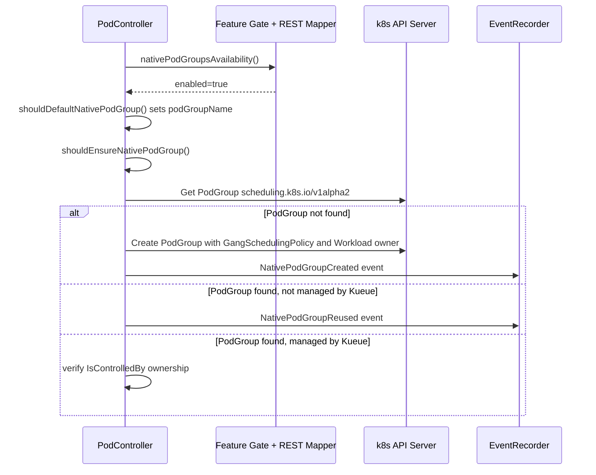

# PR #12645: WIP: workload aware poc

**Summary**: WIP: workload aware poc

**Sources**: https://github.com/kubernetes-sigs/kueue/pull/12645

**Last updated**: 2026-09-29T15:42:44Z

---

## Metadata

- **State**: closed
- **Author**: [@kannon92](https://github.com/kannon92)
- **Branch**: `was-e2e-tests` → `main`
- **Created**: 2026-06-30T03:40:16Z
- **Updated**: 2026-09-29T15:42:44Z
- **Merged**: —
- **Closed**: 2026-09-29T15:42:44Z
- **Labels**: `kind/feature`, `size/XXL`, `do-not-merge/work-in-progress`, `do-not-merge/release-note-label-needed`, `cncf-cla: yes`, `area/integrations`, `area/was`
- **Assignees**: _none_
- **Requested reviewers**: [@mbobrovskyi](https://github.com/mbobrovskyi), [@sohankunkerkar](https://github.com/sohankunkerkar)
- **Changed files**: 37   **+8841 / -7**

## Description

add e2e tests for was

fix test failures

<!--  Thanks for sending a pull request!  Here are some tips for you:

1. If this is your first time, please read our contributor guidelines: https://git.k8s.io/community/contributors/guide/first-contribution.md#your-first-contribution and developer guide https://git.k8s.io/community/contributors/devel/development.md#development-guide
2. Please label this pull request according to what type of issue you are addressing, especially if this is a release targeted pull request. For reference on required PR/issue labels, read here:
https://git.k8s.io/community/contributors/devel/sig-release/release.md#issuepr-kind-label
3. Ensure you have added or ran the appropriate tests for your PR: https://git.k8s.io/community/contributors/devel/sig-testing/testing.md
4. If you want *faster* PR reviews, read how: https://git.k8s.io/community/contributors/guide/pull-requests.md#best-practices-for-faster-reviews
5. If the PR is unfinished, see how to mark it: https://git.k8s.io/community/contributors/guide/pull-requests.md#marking-unfinished-pull-requests
-->

#### What type of PR is this?

<!--
Add one of the following kinds:
/kind bug
/kind cleanup
/kind documentation
/kind feature
/kind kep

Optionally add one or more of the following kinds if applicable:
/kind api-change
/kind deprecation
/kind failing-test
/kind flake
/kind regression

Please also consider setting the area:
/area tas
/area integrations
/area multikueue
/area dashboard
/area localization
/area testing
/area website
-->

#### What this PR does / why we need it:

#### Which issue(s) this PR fixes:
<!--
*Automatically closes linked issue when PR is merged.
Usage: `Fixes #<issue number>`, or `Fixes (paste link of issue)`.
_If PR is about `failing-tests or flakes`, please post the related issues/tests in a comment and do not use `Fixes`_*
-->
Fixes #

#### Special notes for your reviewer:

#### Does this PR introduce a user-facing change?
<!--
If no, just write "NONE" in the release-note block below.
If yes, a release note is required:
Enter your extended release note in the block below. If the PR requires additional action from users switching to the new release, include the string "action required".
-->
```release-note

```


<!-- This is an auto-generated comment: release notes by coderabbit.ai -->

## Summary by CodeRabbit

* **New Features**
  * Added support for WAS PodGroups, including a new feature gate and controller behavior for creating or reusing native PodGroups.
  * Introduced new end-to-end test coverage for WAS jobs, jobsets, and PodGroup behavior.

* **Bug Fixes**
  * Improved scheduling compatibility by updating cluster and test configurations for the latest scheduling API version.
  * Preserved externally managed scheduling group settings when already present.

* **Documentation**
  * Added setup and troubleshooting guidance for running WAS-focused end-to-end tests.

<!-- end of auto-generated comment: release notes by coderabbit.ai -->

## Discussion

### Comment by [@kubernetes-prow[bot]](https://github.com/apps/kubernetes-prow) — 2026-06-30T03:40:18Z

Adding the "do-not-merge/release-note-label-needed" label because no release-note block was detected, please follow our [release note process](https://git.k8s.io/community/contributors/guide/release-notes.md) to remove it.

<details>

Instructions for interacting with me using PR comments are available [here](https://git.k8s.io/community/contributors/guide/pull-requests.md).  If you have questions or suggestions related to my behavior, please file an issue against the [kubernetes-sigs/prow](https://github.com/kubernetes-sigs/prow/issues/new?title=Prow%20issue:) repository.
</details>

### Comment by [@netlify[bot]](https://github.com/apps/netlify) — 2026-06-30T03:40:21Z

### <span aria-hidden="true">✅</span> Deploy Preview for *kubernetes-sigs-kueue* canceled.


|  Name | Link |
|:-:|------------------------|
|<span aria-hidden="true">🔨</span> Latest commit | b7b719de49602fb8fc2a21a35c334846c8b5fd20 |
|<span aria-hidden="true">🔍</span> Latest deploy log | https://app.netlify.com/projects/kubernetes-sigs-kueue/deploys/6a690a00f8901f0008bfe630 |

### Comment by [@coderabbitai[bot]](https://github.com/apps/coderabbitai) — 2026-06-30T03:40:25Z

<!-- This is an auto-generated comment: summarize by coderabbit.ai -->
<!-- review_stack_entry_start -->

[](https://app.coderabbit.ai/change-stack/kubernetes-sigs/kueue/pull/12645?utm_source=github_walkthrough&utm_medium=github&utm_campaign=change_stack)

<!-- review_stack_entry_end -->
<!-- This is an auto-generated comment: skip review by coderabbit.ai -->

> [!IMPORTANT]
> ## Review skipped
> 
> Auto reviews are limited based on label configuration.
> 
> <details>
> <summary>:no_entry_sign: Review skipped — only excluded labels are configured. (3)</summary>
> 
> * needs-ok-to-test
> * do-not-merge/work-in-progress
> * cncf-cla: no
> 
> </details>
> 
> Please check the settings in the CodeRabbit UI or the `.coderabbit.yaml` file in this repository. To trigger a single review, invoke the `@coderabbitai review` command.
> 
> <details>
> <summary>⚙️ Run configuration</summary>
> 
> **Configuration used**: Path: .coderabbit.yaml
> 
> **Review profile**: CHILL
> 
> **Plan**: Pro Plus
> 
> **Run ID**: `cd6b5a3f-fb04-404a-8528-d708f4eab729`
> 
> </details>
> 
> You can disable this status message by setting the `reviews.review_status` to `false` in the CodeRabbit configuration file.
> 
> Use the checkbox below for a quick retry:
> - [ ] <!-- {"checkboxId": "e9bb8d72-00e8-4f67-9cb2-caf3b22574fe"} --> 🔍 Trigger review

<!-- end of auto-generated comment: skip review by coderabbit.ai -->

<!-- walkthrough_start -->

<details>
<summary>📝 Walkthrough</summary>

<!--review_stack_artifact_start-->

<!--review_stack_artifact_end-->

## Walkthrough

Introduces the `WASPodGroups` Alpha feature gate and a new `was.go` controller module in the pod package that reconciles native `scheduling.k8s.io/v1alpha2` `PodGroup` objects for annotated Pod groups. Adds the `v1alpha3` scheduling API vendor package, e2e/integration/unit test suites, a new Kind cluster config, and fixes the `runtime-config` API version in `patch_kind_config_for_was`.

## Changes

**WASPodGroups feature: constants, controller logic, and tests**

| Layer / File(s) | Summary |
|---|---|
| **WASPodGroups feature gate and Pod constants** <br> `pkg/features/kube_features.go`, `pkg/controller/jobs/pod/constants/constants.go`, `pkg/controller/jobs/pod/pod_controller.go` | Declares `WASPodGroups` as an Alpha feature gate (default false, v0.20); adds `ReasonNativePodGroupCreated`, `ReasonNativePodGroupReused`, and `WASPodGroupAnnotation` constants; adds `nativePodGroupsEnabled` field to the `Pod` struct. |
| **was.go: native PodGroup availability, defaulting, and reconciliation** <br> `pkg/controller/jobs/pod/was.go` | Implements feature+REST-mapper availability check, annotation/decision predicates, name getter/setter, and the full `ensureNativePodGroup` reconcile path with ownership validation, Gang scheduling policy construction, and event emission. |
| **was.go unit tests and pod_controller_test additions** <br> `pkg/controller/jobs/pod/was_test.go`, `pkg/controller/jobs/pod/pod_controller_test.go`, `pkg/util/testingjobs/pod/wrappers.go` | Adds unit tests for all WAS helpers; adds `TestEnsureNativePodGroup`, `TestValidatePodGroupMetadataSchedulingGroupConsistency`; adds `WASPodGroupAnnotation()` and `SchedulingGroupPodGroupName()` builder methods. |
| **Integration tests for WASPodGroups pod controller** <br> `test/integration/singlecluster/controller/jobs/pod/suite_test.go`, `test/integration/singlecluster/controller/jobs/pod/pod_controller_test.go` | Enables `WASPodGroups` feature gate in the integration suite; adds two It-tests asserting `podGroupName` defaulting and external value preservation. |
| **Singlecluster e2e WAS PodGroups suite** <br> `test/e2e/singlecluster/was/...`, `test/e2e/config/default/...`, `Makefile-test.mk` | Adds `singlecluster/was` e2e suite covering annotation opt-in, external podGroupName retention, annotation-absent no-op, and multi-pod gang `MinCount`; enables `WASPodGroups` in e2e config; updates Makefile target folder. |
| **WAS baseline e2e: Job and preemption suites** <br> `test/e2e/was/baseline/...` | Adds baseline suite covering Job PodSet count, upstream PodGroup gang `minCount`, `WorkloadPriorityClass` preemption ordering, and priority consistency with `PodGroup.Spec.Priority`. |
| **WAS extended e2e: JobSet suite** <br> `test/e2e/was/extended/...` | Adds extended suite validating WAS `Workload` creation for qualifying child Jobs in single- and multi-replica JobSets with gang `minCount` and ownership assertions. |
| **E2e utility, kind cluster config, and runtime-config fix** <br> `test/util/e2e.go`, `hack/testing/kind-cluster-was.yaml`, `hack/testing/e2e-common.sh`, `cmd/experimental/skills/...`, `test/e2e/was/WORKLOAD_AWARE_PREEMPTION_ANALYSIS.md` | Registers v1alpha2/v1alpha3 schemes in `CreateClientUsingCluster`; adds kind cluster config with WAS feature gates; fixes `patch_kind_config_for_was` to use `v1alpha2`; adds skill docs and WAS preemption analysis. |
| **Vendored k8s.io/api/scheduling/v1alpha3 API types** <br> `vendor/k8s.io/api/scheduling/v1alpha3/...`, `vendor/modules.txt` | Vendors the complete `scheduling.k8s.io/v1alpha3` package including types, registration, proto, deepcopy, swagger, and OpenAPI model name generated files. |

## Sequence Diagram(s)



## Estimated code review effort

🎯 4 (Complex) | ⏱️ ~60 minutes

## Possibly related issues

- kubernetes-sigs/kueue#12385: This PR directly implements native WAS `PodGroup` integration behind a feature gate, which is the mechanism proposed in that issue.

## Possibly related PRs

- [kubernetes-sigs/kueue#12437](https://github.com/kubernetes-sigs/kueue/pull/12437): Modifies the same `patch_kind_config_for_was` function in `hack/testing/e2e-common.sh` to adjust scheduling API version configuration for the WAS kind cluster.

## Suggested labels

`kind/feature`, `area/testing`

## Suggested reviewers

- mimowo
- sohankunkerkar
- PBundyra
- ivnovakov

## Poem

> 🐇 Hop hop, the pods align in a gang,
> With WASPodGroups the scheduler sang!
> A feature gate flips, alpha takes flight,
> Native PodGroups created just right.
> The rabbit rejoices—scheduling delight! 🎉

</details>

<!-- walkthrough_end -->
<!-- pre_merge_checks_walkthrough_start -->

<details>
<summary>🚥 Pre-merge checks | ✅ 3 | ❌ 2</summary>

### ❌ Failed checks (1 warning, 1 inconclusive)

|     Check name     | Status         | Explanation                                                                                                          | Resolution                                                                                                             |
| :----------------: | :------------- | :------------------------------------------------------------------------------------------------------------------- | :--------------------------------------------------------------------------------------------------------------------- |
| Docstring Coverage | ⚠️ Warning     | Docstring coverage is 12.50% which is insufficient. The required threshold is 80.00%.                                | Write docstrings for the functions missing them to satisfy the coverage threshold.                                     |
|     Title check    | ❓ Inconclusive | The title is too vague and reads like a work-in-progress placeholder rather than a clear summary of the WAS changes. | Rename it to a concise, specific summary of the main change, such as adding WAS e2e tests and native PodGroup support. |

<details>
<summary>✅ Passed checks (3 passed)</summary>

|         Check name         | Status   | Explanation                                                              |
| :------------------------: | :------- | :----------------------------------------------------------------------- |
|      Description Check     | ✅ Passed | Check skipped - CodeRabbit’s high-level summary is enabled.              |
|     Linked Issues check    | ✅ Passed | Check skipped because no linked issues were found for this pull request. |
| Out of Scope Changes check | ✅ Passed | Check skipped because no linked issues were found for this pull request. |

</details>

</details>

<!-- pre_merge_checks_walkthrough_end -->
<!-- finishing_touch_checkbox_start -->

<details>
<summary>✨ Finishing Touches</summary>

<details>
<summary>🧪 Generate unit tests (beta)</summary>

- [ ] <!-- {"checkboxId": "f47ac10b-58cc-4372-a567-0e02b2c3d479", "radioGroupId": "utg-output-choice-group-unknown_comment_id"} -->   Create PR with unit tests

</details>

</details>

<!-- finishing_touch_checkbox_end -->
<!-- tips_start -->

---

Thanks for using [CodeRabbit](https://coderabbit.ai?utm_source=oss&utm_medium=github&utm_campaign=kubernetes-sigs/kueue&utm_content=12645)! It's free for OSS, and your support helps us grow. If you like it, consider giving us a shout-out.

<details>
<summary>❤️ Share</summary>

- [X](https://twitter.com/intent/tweet?text=I%20just%20used%20%40coderabbitai%20for%20my%20code%20review%2C%20and%20it%27s%20fantastic%21%20It%27s%20free%20for%20OSS%20and%20offers%20a%20free%20trial%20for%20the%20proprietary%20code.%20Check%20it%20out%3A&url=https%3A//coderabbit.ai)
- [Mastodon](https://mastodon.social/share?text=I%20just%20used%20%40coderabbitai%20for%20my%20code%20review%2C%20and%20it%27s%20fantastic%21%20It%27s%20free%20for%20OSS%20and%20offers%20a%20free%20trial%20for%20the%20proprietary%20code.%20Check%20it%20out%3A%20https%3A%2F%2Fcoderabbit.ai)
- [Reddit](https://www.reddit.com/submit?title=Great%20tool%20for%20code%20review%20-%20CodeRabbit&text=I%20just%20used%20CodeRabbit%20for%20my%20code%20review%2C%20and%20it%27s%20fantastic%21%20It%27s%20free%20for%20OSS%20and%20offers%20a%20free%20trial%20for%20proprietary%20code.%20Check%20it%20out%3A%20https%3A//coderabbit.ai)
- [LinkedIn](https://www.linkedin.com/sharing/share-offsite/?url=https%3A%2F%2Fcoderabbit.ai&mini=true&title=Great%20tool%20for%20code%20review%20-%20CodeRabbit&summary=I%20just%20used%20CodeRabbit%20for%20my%20code%20review%2C%20and%20it%27s%20fantastic%21%20It%27s%20free%20for%20OSS%20and%20offers%20a%20free%20trial%20for%20proprietary%20code)

</details>


<sub>Comment `@coderabbitai help` to get the list of available commands.</sub>

<!-- tips_end -->

### Comment by [@mimowo](https://github.com/mimowo) — 2026-07-01T14:04:05Z

/area was

### Comment by [@kubernetes-prow[bot]](https://github.com/apps/kubernetes-prow) — 2026-07-01T14:04:08Z

@mimowo: The label(s) `area/was` cannot be applied, because the repository doesn't have them.

<details>

In response to [this](https://github.com/kubernetes-sigs/kueue/pull/12645#issuecomment-4855914625):

>/area was


Instructions for interacting with me using PR comments are available [here](https://git.k8s.io/community/contributors/guide/pull-requests.md).  If you have questions or suggestions related to my behavior, please file an issue against the [kubernetes-sigs/prow](https://github.com/kubernetes-sigs/prow/issues/new?title=Prow%20issue:) repository.
</details>

### Comment by [@kubernetes-prow[bot]](https://github.com/apps/kubernetes-prow) — 2026-07-20T20:39:59Z

[APPROVALNOTIFIER] This PR is **NOT APPROVED**

This pull-request has been approved by: *<a href="https://github.com/kubernetes-sigs/kueue/pull/12645#" title="Author self-approved">kannon92</a>*
**Once this PR has been reviewed and has the lgtm label**, please assign [mbobrovskyi](https://github.com/mbobrovskyi), [olekzabl](https://github.com/olekzabl), [sohankunkerkar](https://github.com/sohankunkerkar), [tenzen-y](https://github.com/tenzen-y) for approval. For more information see [the Code Review Process](https://git.k8s.io/community/contributors/guide/owners.md#the-code-review-process).

The full list of commands accepted by this bot can be found [here](https://go.k8s.io/bot-commands?repo=kubernetes-sigs%2Fkueue).

<details open>
Needs approval from an approver in each of these files:

- **[OWNERS](https://github.com/kubernetes-sigs/kueue/blob/main/OWNERS)**

Approvers can indicate their approval by writing `/approve` in a comment
Approvers can cancel approval by writing `/approve cancel` in a comment
</details>
<!-- META={"approvers":["mbobrovskyi","olekzabl","sohankunkerkar","tenzen-y"]} -->

### Comment by [@mimowo](https://github.com/mimowo) — 2026-08-03T19:31:00Z

/kind feature
/area was
/area integrations

### Comment by [@kubernetes-prow[bot]](https://github.com/apps/kubernetes-prow) — 2026-09-10T21:20:53Z

@kannon92: The following tests **failed**, say `/retest` to rerun all failed tests or `/retest-required` to rerun all mandatory failed tests:

Test name | Commit | Details | Required | Rerun command
--- | --- | --- | --- | ---
pull-kueue-verify-main | b7b719de49602fb8fc2a21a35c334846c8b5fd20 | [link](https://prow.k8s.io/view/gs/kubernetes-ci-logs/pr-logs/pull/kubernetes-sigs_kueue/12645/pull-kueue-verify-main/2082194140019298304) | true | `/test pull-kueue-verify-main`
pull-kueue-test-e2e-extended-shard-0-main-1-37 | b7b719de49602fb8fc2a21a35c334846c8b5fd20 | [link](https://prow.k8s.io/view/gs/kubernetes-ci-logs/pr-logs/pull/kubernetes-sigs_kueue/12645/pull-kueue-test-e2e-extended-shard-0-main-1-37/2092748073246658560) | true | `/test pull-kueue-test-e2e-extended-shard-0-main-1-37`
pull-kueue-test-e2e-extended-shard-1-main-1-37 | b7b719de49602fb8fc2a21a35c334846c8b5fd20 | [link](https://prow.k8s.io/view/gs/kubernetes-ci-logs/pr-logs/pull/kubernetes-sigs_kueue/12645/pull-kueue-test-e2e-extended-shard-1-main-1-37/2092748073338933248) | true | `/test pull-kueue-test-e2e-extended-shard-1-main-1-37`
pull-kueue-test-e2e-baseline-main-1-37 | b7b719de49602fb8fc2a21a35c334846c8b5fd20 | [link](https://prow.k8s.io/view/gs/kubernetes-ci-logs/pr-logs/pull/kubernetes-sigs_kueue/12645/pull-kueue-test-e2e-baseline-main-1-37/2092748073150189568) | true | `/test pull-kueue-test-e2e-baseline-main-1-37`
pull-kueue-test-e2e-extended-shard-2-main-1-37 | b7b719de49602fb8fc2a21a35c334846c8b5fd20 | [link](https://prow.k8s.io/view/gs/kubernetes-ci-logs/pr-logs/pull/kubernetes-sigs_kueue/12645/pull-kueue-test-e2e-extended-shard-2-main-1-37/2092748073435402240) | true | `/test pull-kueue-test-e2e-extended-shard-2-main-1-37`
pull-kueue-test-e2e-dra-baseline-main | b7b719de49602fb8fc2a21a35c334846c8b5fd20 | [link](https://prow.k8s.io/view/gs/kubernetes-ci-logs/pr-logs/pull/kubernetes-sigs_kueue/12645/pull-kueue-test-e2e-dra-baseline-main/2098159735449587712) | true | `/test pull-kueue-test-e2e-dra-baseline-main`
pull-kueue-test-e2e-dra-capacity-main | b7b719de49602fb8fc2a21a35c334846c8b5fd20 | [link](https://prow.k8s.io/view/gs/kubernetes-ci-logs/pr-logs/pull/kubernetes-sigs_kueue/12645/pull-kueue-test-e2e-dra-capacity-main/2098159737123115008) | true | `/test pull-kueue-test-e2e-dra-capacity-main`

[Full PR test history](https://prow.k8s.io/pr-history?org=kubernetes-sigs&repo=kueue&pr=12645). [Your PR dashboard](https://prow.k8s.io/pr?query=is%3Apr%20state%3Aopen%20author%3Akannon92). Please help us cut down on flakes by [linking to](https://git.k8s.io/community/contributors/devel/sig-testing/flaky-tests.md#filing-issues-for-flaky-tests) an [open issue](https://github.com/kubernetes-sigs/kueue/issues?q=is:issue+is:open) when you hit one in your PR.

<details>

Instructions for interacting with me using PR comments are available [here](https://git.k8s.io/community/contributors/guide/pull-requests.md).  If you have questions or suggestions related to my behavior, please file an issue against the [kubernetes-sigs/prow](https://github.com/kubernetes-sigs/prow/issues/new?title=Prow%20issue:) repository. I understand the commands that are listed [here](https://go.k8s.io/bot-commands).
</details>
<!-- test report -->

## Reviews

### Review by [@coderabbitai[bot]](https://github.com/apps/coderabbitai) (commented) — 2026-06-30T14:14:25Z

**Actionable comments posted: 11**

<details>
<summary>🤖 Prompt for all review comments with AI agents</summary>

```
Verify each finding against current code. Fix only still-valid issues, skip the
rest with a brief reason, keep changes minimal, and validate.

Inline comments:
In `@Makefile-test.mk`:
- Line 619: The `test-e2e-k8s-main-was` target is only running
`singlecluster/was`, so it misses the new WAS coverage. Update the Makefile
target to also invoke the baseline and extended WAS suites, or broaden the
`E2E_TARGET_FOLDER` selection so `test/e2e/was/baseline` and
`test/e2e/was/extended` are included. Use the existing `test-e2e-k8s-main-was`
recipe and the `E2E_TARGET_FOLDER` setting as the place to add the extra WAS
suite coverage.

In `@pkg/controller/jobs/pod/pod_controller_test.go`:
- Around line 249-255: The test in pod_controller_test.go only checks
Gang.MinCount conditionally, so it can miss broken ownership/label behavior in
the create and reuse paths. Update the assertions around the existing pod group
checks in the Pod controller test to explicitly verify the management contract:
for the create path, require the ManagedByKueue label and owner metadata on the
PodGroup, and for the reuse path, assert those fields remain unset when an
external PodGroup is adopted.

In `@pkg/controller/jobs/pod/was.go`:
- Around line 122-127: The PodGroup creation flow in was.go is treating
apierrors.IsAlreadyExists as a successful “created” case without re-checking
ownership, which can silently reuse a foreign object. Update the logic around
c.Create, ctrl.LoggerFrom(ctx).V(3).Info, and the recorder.Eventf path to fetch
the existing PodGroup on AlreadyExists, verify it is either unmanaged or owned
by wl, and only then continue; otherwise return an error instead of
logging/emitting a created event.

In `@test/e2e/config/default/controller_manager_config.yaml`:
- Line 44: Scope the WASPodGroups setting so it only applies to the WAS-specific
e2e install path, not the shared default controller-manager config. Remove the
unconditional WASPodGroups toggle from the default config and move it into the
WAS suite setup or a WAS-only overlay used by the relevant e2e install flow,
using the existing controller-manager config and WAS install/test entrypoints as
the place to locate the change.

In `@test/e2e/config/default/values.yaml`:
- Around line 39-40: The default Helm values are enabling WASPodGroups globally,
which affects all Helm-based e2e installs. Remove that from the shared default
values and move the setting into a WAS-specific overlay/patch so only WAS suites
enable the gate by default; use the existing WASPodGroups values entry to locate
and relocate the change.

In `@test/e2e/singlecluster/was/was_pod_group_test.go`:
- Around line 192-202: The WAS e2e assertion is too weak because it allows a
non-nil SchedulingGroup with an empty PodGroupName, which can hide an unwanted
pod spec mutation. Update the check in the pod verification block to assert that
pod.Spec.SchedulingGroup remains nil when the WAS annotation is absent, using
the existing gomega.Eventually/Get flow around the podKey lookup.
- Around line 142-175: The test name and assertions in was_pod_group_test.go no
longer match the controller behavior in pod/was.go, because a non-empty
pod.Spec.SchedulingGroup.PodGroupName can still lead to a native PodGroup being
reconciled. Update the ginkgo.It case to reflect the real contract: either
rename the test to describe preserving an externally set PodGroupName, or add an
explicit assertion around the PodGroup object creation/reuse so the test
verifies the intended native PodGroup behavior instead of only checking the pod
field.

In `@test/e2e/was/baseline/job_test.go`:
- Around line 154-187: The PodGroup validation in the Job e2e test is ambiguous:
it claims to skip when no PodGroups exist, but `matchingPG` still hard-fails,
and the `Gang`-nil guard lets invalid PodGroups pass. Update the `ginkgo.By`
block to make the contract explicit in `job_test.go`: either detect the
transitional case and skip the check after `Eventually` in the `matchingPG`
search path, or require that the selected `schedulingv1alpha3.PodGroup` has a
non-nil `SchedulingPolicy.Gang` before asserting `MinCount`. Use the existing
`matchingPG` selection logic and `PodGroup`/`Gang` fields to keep the behavior
consistent and unambiguous.

In `@test/e2e/was/baseline/preemption_test.go`:
- Around line 231-238: The PodGroup check inside the preemption test is skipping
too early because `ginkgo.Skip` is called from within the `gomega.Eventually`
poll in `preemption_test.go`. Update the `Eventually` block around `pgList` so
it only retries on empty results and does not skip on the first empty list;
then, after `Eventually` finishes, inspect the final `PodGroupList` state and
decide whether to skip or fail there. Use the `pgList` polling logic in this
test to keep slow-but-correct `GenericWorkload` PodGroup creation from being
dropped prematurely.

In `@test/e2e/was/WORKLOAD_AWARE_PREEMPTION_ANALYSIS.md`:
- Around line 82-88: Add a language identifier to each affected fenced block in
the markdown tests so they satisfy markdownlint MD040; update the fences around
the examples in WORKLOAD_AWARE_PREEMPTION_ANALYSIS.md to use a consistent
identifier like text. Use the existing scenario blocks near the
Job/WorkloadPriorityClass and PodGroupTemplate examples to locate all four
fenced sections and change only the fence markers, leaving the content
unchanged.

In `@test/integration/singlecluster/controller/jobs/pod/suite_test.go`:
- Line 62: The WASPodGroups feature gate is being enabled too broadly in the
suite setup, which affects unrelated pod-controller integration specs. Move the
feature-gate setup out of the package-level BeforeSuite in suite_test.go and
enable it only within the WAS-specific Describe/BeforeAll block, using the WAS
test group’s setup so the rest of the suite continues to run with the
default-disabled behavior.
```

</details>

<details>
<summary>🪄 Autofix (Beta)</summary>

Fix all unresolved CodeRabbit comments on this PR:

- [ ] <!-- {"checkboxId": "4b0d0e0a-96d7-4f10-b296-3a18ea78f0b9"} --> Push a commit to this branch (recommended)
- [ ] <!-- {"checkboxId": "ff5b1114-7d8c-49e6-8ac1-43f82af23a33"} --> Create a new PR with the fixes

</details>

---

<details>
<summary>ℹ️ Review info</summary>

<details>
<summary>⚙️ Run configuration</summary>

**Configuration used**: defaults

**Review profile**: CHILL

**Plan**: Pro

**Run ID**: `deb17dfc-ffa7-44a7-a79e-9ea9cfa9c686`

</details>

<details>
<summary>📥 Commits</summary>

Reviewing files that changed from the base of the PR and between 49f4b01f2fdb624e60d9ea2fc660b8cf842965aa and fe82a15deb7145a7c583def116d5bcd9480cbcb7.

</details>

<details>
<summary>⛔ Files ignored due to path filters (1)</summary>

* `vendor/k8s.io/api/scheduling/v1alpha3/generated.pb.go` is excluded by `!**/*.pb.go`

</details>

<details>
<summary>📒 Files selected for processing (33)</summary>

* `Makefile-test.mk`
* `cmd/experimental/skills/README.md`
* `cmd/experimental/skills/was-cluster/SKILL.md`
* `hack/testing/e2e-common.sh`
* `hack/testing/kind-cluster-was.yaml`
* `pkg/controller/jobs/pod/constants/constants.go`
* `pkg/controller/jobs/pod/pod_controller.go`
* `pkg/controller/jobs/pod/pod_controller_test.go`
* `pkg/controller/jobs/pod/was.go`
* `pkg/controller/jobs/pod/was_test.go`
* `pkg/features/kube_features.go`
* `pkg/util/testingjobs/pod/wrappers.go`
* `test/e2e/config/default/controller_manager_config.yaml`
* `test/e2e/config/default/values.yaml`
* `test/e2e/singlecluster/was/suite_test.go`
* `test/e2e/singlecluster/was/was_pod_group_test.go`
* `test/e2e/was/WORKLOAD_AWARE_PREEMPTION_ANALYSIS.md`
* `test/e2e/was/baseline/job_test.go`
* `test/e2e/was/baseline/preemption_test.go`
* `test/e2e/was/baseline/suite_test.go`
* `test/e2e/was/extended/jobset_test.go`
* `test/e2e/was/extended/suite_test.go`
* `test/integration/singlecluster/controller/jobs/pod/pod_controller_test.go`
* `test/integration/singlecluster/controller/jobs/pod/suite_test.go`
* `test/util/e2e.go`
* `vendor/k8s.io/api/scheduling/v1alpha3/doc.go`
* `vendor/k8s.io/api/scheduling/v1alpha3/generated.proto`
* `vendor/k8s.io/api/scheduling/v1alpha3/register.go`
* `vendor/k8s.io/api/scheduling/v1alpha3/types.go`
* `vendor/k8s.io/api/scheduling/v1alpha3/types_swagger_doc_generated.go`
* `vendor/k8s.io/api/scheduling/v1alpha3/zz_generated.deepcopy.go`
* `vendor/k8s.io/api/scheduling/v1alpha3/zz_generated.model_name.go`
* `vendor/modules.txt`

</details>

</details>

<!-- This is an auto-generated comment by CodeRabbit for review status -->

- **Makefile-test.mk:672** by [@coderabbitai[bot]](https://github.com/apps/coderabbitai) — 2026-06-30T14:14:22Z
```diff
@@ -616,7 +616,7 @@ run-test-e2e-k8s-main-was:
 		LEADERWORKERSET_VERSION=$(LEADERWORKERSET_VERSION) \
 		KUBERAY_VERSION=$(KUBERAY_VERSION) RAY_VERSION=$(RAY_VERSION) RAYMINI_VERSION=$(RAYMINI_VERSION) USE_RAY_FOR_TESTS=$(USE_RAY_FOR_TESTS) \
 		PROMETHEUS_OPERATOR_VERSION=$(PROMETHEUS_OPERATOR_VERSION) \
-		KIND_CLUSTER_FILE="kind-cluster.yaml" E2E_TARGET_FOLDER="singlecluster" \
+		KIND_CLUSTER_FILE="kind-cluster.yaml" E2E_TARGET_FOLDER="singlecluster/was" \
```

  _🎯 Functional Correctness_ | _🟠 Major_ | _⚡ Quick win_
  
  **This target no longer runs the new baseline/extended WAS suites.**
  
  `E2E_TARGET_FOLDER="singlecluster/was"` only picks up `test/e2e/singlecluster/was`, so the new suites under `test/e2e/was/baseline` and `test/e2e/was/extended` are left out of `test-e2e-k8s-main-was`. Please add another invocation or broaden the target so the WAS job exercises all of the new coverage.
  
  <details>
  <summary>🤖 Prompt for AI Agents</summary>
  
  ```
  Verify each finding against current code. Fix only still-valid issues, skip the
  rest with a brief reason, keep changes minimal, and validate.
  
  In `@Makefile-test.mk` at line 619, The `test-e2e-k8s-main-was` target is only
  running `singlecluster/was`, so it misses the new WAS coverage. Update the
  Makefile target to also invoke the baseline and extended WAS suites, or broaden
  the `E2E_TARGET_FOLDER` selection so `test/e2e/was/baseline` and
  `test/e2e/was/extended` are included. Use the existing `test-e2e-k8s-main-was`
  recipe and the `E2E_TARGET_FOLDER` setting as the place to add the extra WAS
  suite coverage.
  ```
  
  </details>
  
  <!-- fingerprinting:phantom:poseidon:grasshopper -->
  
  <!-- cr-indicator-types:potential_issue -->
  
  <!-- cr-comment:v1:9ced31cacdc38cc44aada012 -->
  
  <!-- This is an auto-generated comment by CodeRabbit -->

- **pkg/controller/jobs/pod/pod_controller_test.go:256** by [@coderabbitai[bot]](https://github.com/apps/coderabbitai) — 2026-06-30T14:14:22Z
```diff
@@ -169,6 +170,142 @@ func TestRun(t *testing.T) {
 	}
 }
 
+func TestEnsureNativePodGroup(t *testing.T) {
+	testCases := map[string]struct {
+		pod         *Pod
+		workload    *kueue.Workload
+		initObjects []client.Object
+		wantErr     error
+		wantCount   int
+		wantReason  string
+	}{
+		"creates native PodGroup for managed pod group": {
+			pod: &Pod{
+				pod: *testingpod.MakePod("driver", metav1.NamespaceDefault).
+					GroupNameLabel("test-group").
+					GroupTotalCount("2").
+					WASPodGroupAnnotation().
+					SchedulingGroupPodGroupName("test-group").
+					Obj(),
+				isGroup:                true,
+				nativePodGroupsEnabled: true,
+			},
+			workload:   utiltestingapi.MakeWorkload("test-group", metav1.NamespaceDefault).Obj(),
+			wantCount:  1,
+			wantReason: podconstants.ReasonNativePodGroupCreated,
+		},
+		"skips native PodGroup when annotation is missing": {
+			pod: &Pod{
+				pod: *testingpod.MakePod("driver", metav1.NamespaceDefault).
+					GroupNameLabel("test-group").
+					GroupTotalCount("2").
+					SchedulingGroupPodGroupName("test-group").
+					Obj(),
+				isGroup:                true,
+				nativePodGroupsEnabled: true,
+			},
+			workload:  utiltestingapi.MakeWorkload("test-group", metav1.NamespaceDefault).Obj(),
+			wantCount: 0,
+		},
+		"reuses existing external PodGroup without managing it": {
+			pod: &Pod{
+				pod: *testingpod.MakePod("driver", metav1.NamespaceDefault).
+					GroupNameLabel("test-group").
+					GroupTotalCount("2").
+					WASPodGroupAnnotation().
+					SchedulingGroupPodGroupName("test-group").
+					Obj(),
+				isGroup:                true,
+				nativePodGroupsEnabled: true,
+			},
+			workload: utiltestingapi.MakeWorkload("test-group", metav1.NamespaceDefault).Obj(),
+			initObjects: []client.Object{
+				&schedulingv1alpha2.PodGroup{ObjectMeta: metav1.ObjectMeta{Name: "test-group", Namespace: metav1.NamespaceDefault}},
+			},
+			wantCount:  1,
+			wantReason: podconstants.ReasonNativePodGroupReused,
+		},
+	}
+
+	for name, tc := range testCases {
+		t.Run(name, func(t *testing.T) {
+			ctx, _ := utiltesting.ContextWithLog(t)
+			clientBuilder := utiltesting.NewClientBuilder()
+			kClient := clientBuilder.WithObjects(tc.initObjects...).Build()
+			recorder := &utiltesting.EventRecorder{}
+
+			gotErr := tc.pod.ensureNativePodGroup(ctx, kClient, tc.workload, recorder)
+			if diff := cmp.Diff(tc.wantErr, gotErr, cmpopts.EquateErrors()); diff != "" {
+				t.Fatalf("unexpected error (-want,+got):\n%s", diff)
+			}
+
+			podGroups := &schedulingv1alpha2.PodGroupList{}
+			if err := kClient.List(ctx, podGroups, client.InNamespace(metav1.NamespaceDefault)); err != nil {
+				t.Fatalf("listing PodGroups: %v", err)
+			}
+			if diff := cmp.Diff(tc.wantCount, len(podGroups.Items)); diff != "" {
+				t.Fatalf("unexpected PodGroup count (-want,+got):\n%s", diff)
+			}
+			if tc.wantCount == 1 {
+				got := podGroups.Items[0]
+				if got.Labels[constants.ManagedByKueueLabelKey] == constants.ManagedByKueueLabelValue {
+					if diff := cmp.Diff(int32(2), got.Spec.SchedulingPolicy.Gang.MinCount); diff != "" {
+						t.Errorf("unexpected gang minCount (-want,+got):\n%s", diff)
+					}
+				}
```

  _🗄️ Data Integrity & Integration_ | _🟠 Major_ | _⚡ Quick win_
  
  **Assert the management contract explicitly.**
  
  Lines 249-255 only verify `Gang.MinCount` when the `ManagedByKueue` label already exists, so this test still passes if the create path forgets that label or if the reuse path wrongly adopts an external `PodGroup`. Please make the create case require the Kueue-managed label/owner metadata, and make the reuse case require that those fields stay unset.
  
  <details>
  <summary>🤖 Prompt for AI Agents</summary>
  
  ```
  Verify each finding against current code. Fix only still-valid issues, skip the
  rest with a brief reason, keep changes minimal, and validate.
  
  In `@pkg/controller/jobs/pod/pod_controller_test.go` around lines 249 - 255, The
  test in pod_controller_test.go only checks Gang.MinCount conditionally, so it
  can miss broken ownership/label behavior in the create and reuse paths. Update
  the assertions around the existing pod group checks in the Pod controller test
  to explicitly verify the management contract: for the create path, require the
  ManagedByKueue label and owner metadata on the PodGroup, and for the reuse path,
  assert those fields remain unset when an external PodGroup is adopted.
  ```
  
  </details>
  
  <!-- fingerprinting:phantom:poseidon:grasshopper -->
  
  <!-- cr-indicator-types:refactor_suggestion -->
  
  <!-- cr-comment:v1:382ea0ec01b2367dac04c6c7 -->
  
  <!-- This is an auto-generated comment by CodeRabbit -->

- **pkg/controller/jobs/pod/was.go:225** by [@coderabbitai[bot]](https://github.com/apps/coderabbitai) — 2026-06-30T14:14:22Z
```diff
@@ -0,0 +1,130 @@
+/*
+Copyright The Kubernetes Authors.
+
+Licensed under the Apache License, Version 2.0 (the "License");
+you may not use this file except in compliance with the License.
+You may obtain a copy of the License at
+
+    http://www.apache.org/licenses/LICENSE-2.0
+
+Unless required by applicable law or agreed to in writing, software
+distributed under the License is distributed on an "AS IS" BASIS,
+WITHOUT WARRANTIES OR CONDITIONS OF ANY KIND, either express or implied.
+See the License for the specific language governing permissions and
+limitations under the License.
+*/
+
+package pod
+
+import (
+	"context"
+	"fmt"
+
+	corev1 "k8s.io/api/core/v1"
+	schedulingv1alpha2 "k8s.io/api/scheduling/v1alpha2"
+	apierrors "k8s.io/apimachinery/pkg/api/errors"
+	apimeta "k8s.io/apimachinery/pkg/api/meta"
+	metav1 "k8s.io/apimachinery/pkg/apis/meta/v1"
+	"k8s.io/client-go/tools/events"
+	ctrl "sigs.k8s.io/controller-runtime"
+	"sigs.k8s.io/controller-runtime/pkg/client"
+	"sigs.k8s.io/controller-runtime/pkg/controller/controllerutil"
+
+	kueue "sigs.k8s.io/kueue/apis/kueue/v1beta2"
+	"sigs.k8s.io/kueue/pkg/constants"
+	podconstants "sigs.k8s.io/kueue/pkg/controller/jobs/pod/constants"
+	"sigs.k8s.io/kueue/pkg/features"
+	utilpod "sigs.k8s.io/kueue/pkg/util/pod"
+)
+
+func nativePodGroupsAvailability(restMapper apimeta.RESTMapper) (enabled bool, reason string) {
+	if !features.Enabled(features.WASPodGroups) {
+		return false, "feature gate disabled"
+	}
+	if _, err := restMapper.RESTMapping(schedulingv1alpha2.SchemeGroupVersion.WithKind("PodGroup").GroupKind(), schedulingv1alpha2.SchemeGroupVersion.Version); err != nil {
+		return false, fmt.Sprintf("REST mapping unavailable: %v", err)
+	}
+	return true, "native PodGroups supported"
+}
+
+func nativePodGroupNameForPod(p *corev1.Pod) string {
+	if p.Spec.SchedulingGroup == nil || p.Spec.SchedulingGroup.PodGroupName == nil {
+		return ""
+	}
+	return *p.Spec.SchedulingGroup.PodGroupName
+}
+
+func wantsWASPodGroup(p *corev1.Pod) bool {
+	return p.Annotations[podconstants.WASPodGroupAnnotation] == "true"
+}
+
+func shouldDefaultNativePodGroup(enabled bool, p *corev1.Pod) bool {
+	return enabled && wantsWASPodGroup(p) && utilpod.GetPodGroupName(p) != "" && nativePodGroupNameForPod(p) == ""
+}
+
+func setNativePodGroupName(p *corev1.Pod, podGroupName string) {
+	p.Spec.SchedulingGroup = &corev1.PodSchedulingGroup{
+		PodGroupName: &podGroupName,
+	}
+}
+
+func (p *Pod) shouldEnsureNativePodGroup() bool {
+	return p.nativePodGroupsEnabled && p.isGroup && wantsWASPodGroup(&p.pod) && nativePodGroupNameForPod(&p.pod) != ""
+}
+
+func (p *Pod) ensureNativePodGroup(ctx context.Context, c client.Client, wl *kueue.Workload, recorder events.EventRecorder) error {
+	if !p.shouldEnsureNativePodGroup() {
+		return nil
+	}
+
+	podGroupName := nativePodGroupNameForPod(&p.pod)
+	podGroup := &schedulingv1alpha2.PodGroup{}
+	key := client.ObjectKey{Namespace: p.pod.Namespace, Name: podGroupName}
+	if err := c.Get(ctx, key, podGroup); err == nil {
+		if podGroup.Labels[constants.ManagedByKueueLabelKey] != constants.ManagedByKueueLabelValue {
+			ctrl.LoggerFrom(ctx).V(3).Info("Native PodGroup already exists and is not managed by Kueue, reusing it", "podGroup", key)
+			if recorder != nil {
+				recorder.Eventf(wl, nil, corev1.EventTypeNormal, podconstants.ReasonNativePodGroupReused, "NativePodGroupReused", "Reused existing native PodGroup %s", podGroupName)
+			}
+			return nil
+		}
+		// Kueue-managed PodGroup exists — verify it belongs to this workload.
+		if !metav1.IsControlledBy(podGroup, wl) {
+			return fmt.Errorf("native PodGroup %q is managed by Kueue but owned by a different workload", podGroupName)
+		}
+		return nil
+	} else if !apierrors.IsNotFound(err) {
+		return err
+	}
+
+	groupTotalCount, err := p.groupTotalCount()
+	if err != nil {
+		return err
+	}
+
+	podGroup = &schedulingv1alpha2.PodGroup{
+		ObjectMeta: metav1.ObjectMeta{
+			Name:      podGroupName,
+			Namespace: p.pod.Namespace,
+			Labels: map[string]string{
+				constants.ManagedByKueueLabelKey: constants.ManagedByKueueLabelValue,
+			},
+		},
+		Spec: schedulingv1alpha2.PodGroupSpec{
+			SchedulingPolicy: schedulingv1alpha2.PodGroupSchedulingPolicy{
+				Gang: &schedulingv1alpha2.GangSchedulingPolicy{MinCount: int32(groupTotalCount)},
+			},
+		},
+	}
+	if err := controllerutil.SetOwnerReference(wl, podGroup, c.Scheme()); err != nil {
+		return fmt.Errorf("setting owner reference on native PodGroup: %w", err)
+	}
+	if err := c.Create(ctx, podGroup); err != nil && !apierrors.IsAlreadyExists(err) {
+		return err
+	}
+	ctrl.LoggerFrom(ctx).V(3).Info("Created native PodGroup for plain Pod group", "podGroup", key)
+	if recorder != nil {
+		recorder.Eventf(wl, nil, corev1.EventTypeNormal, podconstants.ReasonNativePodGroupCreated, "NativePodGroupCreated", "Created native PodGroup %s", podGroupName)
```

  _🗄️ Data Integrity & Integration_ | _🟠 Major_ | _⚡ Quick win_
  
  **Re-check ownership on the `AlreadyExists` path.**
  
  Between Line 83 and Line 122, another controller or user can create the PodGroup. The current `IsAlreadyExists` branch still logs/emits "created" on Line 125 and returns success without validating whether that object is unmanaged or owned by `wl`, so a race turns into silent reuse of a potentially foreign PodGroup.
  
  
  
  
  
  <details>
  <summary>Suggested fix</summary>
  
  ```diff
  -	if err := c.Create(ctx, podGroup); err != nil && !apierrors.IsAlreadyExists(err) {
  -		return err
  -	}
  -	ctrl.LoggerFrom(ctx).V(3).Info("Created native PodGroup for plain Pod group", "podGroup", key)
  -	if recorder != nil {
  -		recorder.Eventf(wl, nil, corev1.EventTypeNormal, podconstants.ReasonNativePodGroupCreated, "NativePodGroupCreated", "Created native PodGroup %s", podGroupName)
  -	}
  -	return nil
  +	if err := c.Create(ctx, podGroup); err != nil {
  +		if !apierrors.IsAlreadyExists(err) {
  +			return err
  +		}
  +
  +		existing := &schedulingv1alpha2.PodGroup{}
  +		if getErr := c.Get(ctx, key, existing); getErr != nil {
  +			return getErr
  +		}
  +		if existing.Labels[constants.ManagedByKueueLabelKey] != constants.ManagedByKueueLabelValue {
  +			if recorder != nil {
  +				recorder.Eventf(wl, nil, corev1.EventTypeNormal, podconstants.ReasonNativePodGroupReused, "NativePodGroupReused", "Reused existing native PodGroup %s", podGroupName)
  +			}
  +			return nil
  +		}
  +		if !metav1.IsControlledBy(existing, wl) {
  +			return fmt.Errorf("native PodGroup %q is managed by Kueue but owned by a different workload", podGroupName)
  +		}
  +		return nil
  +	}
  +	ctrl.LoggerFrom(ctx).V(3).Info("Created native PodGroup for plain Pod group", "podGroup", key)
  +	if recorder != nil {
  +		recorder.Eventf(wl, nil, corev1.EventTypeNormal, podconstants.ReasonNativePodGroupCreated, "NativePodGroupCreated", "Created native PodGroup %s", podGroupName)
  +	}
  +	return nil
  ```
  </details>
  
  <!-- suggestion_start -->
  
  <details>
  <summary>📝 Committable suggestion</summary>
  
  > ‼️ **IMPORTANT**
  > Carefully review the code before committing. Ensure that it accurately replaces the highlighted code, contains no missing lines, and has no issues with indentation. Thoroughly test & benchmark the code to ensure it meets the requirements.
  
  ```suggestion
  	if err := c.Create(ctx, podGroup); err != nil {
  		if !apierrors.IsAlreadyExists(err) {
  			return err
  		}
  
  		existing := &schedulingv1alpha2.PodGroup{}
  		if getErr := c.Get(ctx, key, existing); getErr != nil {
  			return getErr
  		}
  		if existing.Labels[constants.ManagedByKueueLabelKey] != constants.ManagedByKueueLabelValue {
  			if recorder != nil {
  				recorder.Eventf(wl, nil, corev1.EventTypeNormal, podconstants.ReasonNativePodGroupReused, "NativePodGroupReused", "Reused existing native PodGroup %s", podGroupName)
  			}
  			return nil
  		}
  		if !metav1.IsControlledBy(existing, wl) {
  			return fmt.Errorf("native PodGroup %q is managed by Kueue but owned by a different workload", podGroupName)
  		}
  		return nil
  	}
  	ctrl.LoggerFrom(ctx).V(3).Info("Created native PodGroup for plain Pod group", "podGroup", key)
  	if recorder != nil {
  		recorder.Eventf(wl, nil, corev1.EventTypeNormal, podconstants.ReasonNativePodGroupCreated, "NativePodGroupCreated", "Created native PodGroup %s", podGroupName)
  	}
  	return nil
  ```
  
  </details>
  
  <!-- suggestion_end -->
  
  <details>
  <summary>🤖 Prompt for AI Agents</summary>
  
  ```
  Verify each finding against current code. Fix only still-valid issues, skip the
  rest with a brief reason, keep changes minimal, and validate.
  
  In `@pkg/controller/jobs/pod/was.go` around lines 122 - 127, The PodGroup creation
  flow in was.go is treating apierrors.IsAlreadyExists as a successful “created”
  case without re-checking ownership, which can silently reuse a foreign object.
  Update the logic around c.Create, ctrl.LoggerFrom(ctx).V(3).Info, and the
  recorder.Eventf path to fetch the existing PodGroup on AlreadyExists, verify it
  is either unmanaged or owned by wl, and only then continue; otherwise return an
  error instead of logging/emitting a created event.
  ```
  
  </details>
  
  <!-- fingerprinting:phantom:poseidon:grasshopper -->
  
  <!-- cr-indicator-types:potential_issue -->
  
  <!-- cr-comment:v1:28765279240028c612c37409 -->
  
  <!-- This is an auto-generated comment by CodeRabbit -->

- **test/e2e/config/default/controller_manager_config.yaml:44** by [@coderabbitai[bot]](https://github.com/apps/coderabbitai) — 2026-06-30T14:14:22Z
```diff
@@ -41,6 +41,7 @@ featureGates:
   ElasticJobsViaWorkloadSlices: true
   ConcurrentAdmission: true
   MultiKueueManagerQuotaAutomation: true
+  WASPodGroups: true
```

  _🎯 Functional Correctness_ | _🟠 Major_ | _⚡ Quick win_
  
  **Scope `WASPodGroups` to the WAS-specific e2e install path.**
  
  Turning this on in the shared default controller-manager config makes every non-Helm e2e run exercise the alpha WASPodGroups path, not just the new WAS suites. That widens the test environment for unrelated suites and stops them from covering the default-off behavior.
  
  <details>
  <summary>🤖 Prompt for AI Agents</summary>
  
  ```
  Verify each finding against current code. Fix only still-valid issues, skip the
  rest with a brief reason, keep changes minimal, and validate.
  
  In `@test/e2e/config/default/controller_manager_config.yaml` at line 44, Scope the
  WASPodGroups setting so it only applies to the WAS-specific e2e install path,
  not the shared default controller-manager config. Remove the unconditional
  WASPodGroups toggle from the default config and move it into the WAS suite setup
  or a WAS-only overlay used by the relevant e2e install flow, using the existing
  controller-manager config and WAS install/test entrypoints as the place to
  locate the change.
  ```
  
  </details>
  
  <!-- fingerprinting:phantom:poseidon:grasshopper -->
  
  <!-- cr-indicator-types:potential_issue -->
  
  <!-- cr-comment:v1:716fb07d0b63063ad785db7d -->
  
  <!-- This is an auto-generated comment by CodeRabbit -->

- **test/e2e/config/default/values.yaml:40** by [@coderabbitai[bot]](https://github.com/apps/coderabbitai) — 2026-06-30T14:14:22Z
```diff
@@ -36,6 +36,8 @@ featureGates:
   enabled: true
 - name: ConcurrentAdmission
   enabled: true
+- name: WASPodGroups
+  enabled: true
```

  _🎯 Functional Correctness_ | _🟠 Major_ | _⚡ Quick win_
  
  **Keep the Helm defaults neutral here as well.**
  
  This default values file is shared by Helm-based e2e installs, so enabling `WASPodGroups` here makes unrelated Helm suites run with the alpha gate on by default. Please move this to a WAS-only values overlay/patch instead of changing the global default.
  
  <details>
  <summary>🤖 Prompt for AI Agents</summary>
  
  ```
  Verify each finding against current code. Fix only still-valid issues, skip the
  rest with a brief reason, keep changes minimal, and validate.
  
  In `@test/e2e/config/default/values.yaml` around lines 39 - 40, The default Helm
  values are enabling WASPodGroups globally, which affects all Helm-based e2e
  installs. Remove that from the shared default values and move the setting into a
  WAS-specific overlay/patch so only WAS suites enable the gate by default; use
  the existing WASPodGroups values entry to locate and relocate the change.
  ```
  
  </details>
  
  <!-- fingerprinting:phantom:poseidon:grasshopper -->
  
  <!-- cr-indicator-types:potential_issue -->
  
  <!-- cr-comment:v1:c442e5437fbde10a0eee9b72 -->
  
  <!-- This is an auto-generated comment by CodeRabbit -->

- **test/e2e/was/baseline/was_pod_group_test.go:205** by [@coderabbitai[bot]](https://github.com/apps/coderabbitai) — 2026-06-30T14:14:23Z
```diff
@@ -0,0 +1,250 @@
+/*
+Copyright The Kubernetes Authors.
+
+Licensed under the Apache License, Version 2.0 (the "License");
+you may not use this file except in compliance with the License.
+You may obtain a copy of the License at
+
+    http://www.apache.org/licenses/LICENSE-2.0
+
+Unless required by applicable law or agreed to in writing, software
+distributed under the License is distributed on an "AS IS" BASIS,
+WITHOUT WARRANTIES OR CONDITIONS OF ANY KIND, either express or implied.
+See the License for the specific language governing permissions and
+limitations under the License.
+*/
+
+package was
+
+import (
+	"fmt"
+
+	"github.com/onsi/ginkgo/v2"
+	"github.com/onsi/gomega"
+	corev1 "k8s.io/api/core/v1"
+	schedulingv1alpha2 "k8s.io/api/scheduling/v1alpha2"
+	"k8s.io/apimachinery/pkg/types"
+	"k8s.io/utils/ptr"
+
+	kueue "sigs.k8s.io/kueue/apis/kueue/v1beta2"
+	"sigs.k8s.io/kueue/pkg/constants"
+	utiltestingapi "sigs.k8s.io/kueue/pkg/util/testing/v1beta2"
+	podtesting "sigs.k8s.io/kueue/pkg/util/testingjobs/pod"
+	"sigs.k8s.io/kueue/test/util"
+)
+
+var _ = ginkgo.Describe("WAS PodGroups", ginkgo.Label("area:singlecluster", "feature:was", "feature:pod"), func() {
+	var (
+		ns         *corev1.Namespace
+		rf         *kueue.ResourceFlavor
+		flavorName string
+	)
+
+	ginkgo.BeforeEach(func() {
+		ns = util.CreateNamespaceFromPrefixWithLog(ctx, k8sClient, "was-e2e-")
+		flavorName = "on-demand-" + ns.Name
+		rf = utiltestingapi.MakeResourceFlavor(flavorName).NodeLabel("instance-type", "on-demand").Obj()
+		util.MustCreate(ctx, k8sClient, rf)
+	})
+	ginkgo.AfterEach(func() {
+		gomega.Expect(util.DeleteNamespace(ctx, k8sClient, ns)).To(gomega.Succeed())
+		util.ExpectObjectToBeDeleted(ctx, k8sClient, rf, true)
+		util.ExpectAllPodsInNamespaceDeleted(ctx, k8sClient, ns)
+	})
+
+	ginkgo.When("Pod group opts in to WAS PodGroups", func() {
+		var (
+			cq *kueue.ClusterQueue
+			lq *kueue.LocalQueue
+		)
+
+		ginkgo.BeforeEach(func() {
+			cq = utiltestingapi.MakeClusterQueue("cq-" + ns.Name).
+				ResourceGroup(
+					*utiltestingapi.MakeFlavorQuotas(flavorName).Resource(corev1.ResourceCPU, "5").Obj(),
+				).
+				Obj()
+			util.CreateClusterQueuesAndWaitForActive(ctx, k8sClient, cq)
+
+			lq = utiltestingapi.MakeLocalQueue("queue", ns.Name).ClusterQueue(cq.Name).Obj()
+			util.CreateLocalQueuesAndWaitForActive(ctx, k8sClient, lq)
+		})
+		ginkgo.AfterEach(func() {
+			gomega.Expect(util.DeleteAllPodsInNamespace(ctx, k8sClient, ns)).To(gomega.Succeed())
+			gomega.Expect(util.DeleteWorkloadsInNamespace(ctx, k8sClient, ns)).To(gomega.Succeed())
+			util.ExpectObjectToBeDeleted(ctx, k8sClient, cq, true)
+			util.ExpectAllPodsInNamespaceDeleted(ctx, k8sClient, ns)
+		})
+
+		ginkgo.It("should create a native PodGroup and default podGroupName on pods", func() {
+			groupName := "test-group"
+			numPods := 3
+			group := podtesting.MakePod(groupName, ns.Name).
+				Image(util.GetAgnHostImage(), util.BehaviorExitFast).
+				Queue(lq.Name).
+				RequestAndLimit(corev1.ResourceCPU, "1").
+				WASPodGroupAnnotation().
+				MakeGroup(numPods)
+
+			ginkgo.By("Creating the pod group")
+			for _, p := range group {
+				util.MustCreate(ctx, k8sClient, p)
+			}
+
+			ginkgo.By("Verifying that pods have schedulingGroup.podGroupName defaulted")
+			for i := range numPods {
+				podKey := types.NamespacedName{Namespace: ns.Name, Name: groupName + fmt.Sprintf("-%d", i)}
+				gomega.Eventually(func(g gomega.Gomega) {
+					var pod corev1.Pod
+					g.Expect(k8sClient.Get(ctx, podKey, &pod)).To(gomega.Succeed())
+					g.Expect(pod.Spec.SchedulingGroup).NotTo(gomega.BeNil(), "schedulingGroup should be set")
+					g.Expect(ptr.Deref(pod.Spec.SchedulingGroup.PodGroupName, "")).To(
+						gomega.Equal(groupName),
+						"podGroupName should match the pod group name",
+					)
+				}, util.Timeout, util.Interval).Should(gomega.Succeed())
+			}
+
+			ginkgo.By("Verifying the workload is created")
+			wlKey := types.NamespacedName{Namespace: ns.Name, Name: groupName}
+			createdWl := &kueue.Workload{}
+			gomega.Eventually(func(g gomega.Gomega) {
+				g.Expect(k8sClient.Get(ctx, wlKey, createdWl)).To(gomega.Succeed())
+			}, util.Timeout, util.Interval).Should(gomega.Succeed())
+
+			ginkgo.By("Verifying a native scheduling.k8s.io PodGroup is created")
+			pgKey := types.NamespacedName{Namespace: ns.Name, Name: groupName}
+			podGroup := &schedulingv1alpha2.PodGroup{}
+			gomega.Eventually(func(g gomega.Gomega) {
+				g.Expect(k8sClient.Get(ctx, pgKey, podGroup)).To(gomega.Succeed())
+				g.Expect(podGroup.Labels).To(gomega.HaveKeyWithValue(
+					constants.ManagedByKueueLabelKey, constants.ManagedByKueueLabelValue,
+				), "PodGroup should be managed by Kueue")
+				g.Expect(podGroup.Spec.SchedulingPolicy.Gang).NotTo(gomega.BeNil(), "Gang scheduling policy should be set")
+				g.Expect(podGroup.Spec.SchedulingPolicy.Gang.MinCount).To(
+					gomega.Equal(int32(numPods)),
+					"MinCount should equal the total number of pods in the group",
+				)
+			}, util.Timeout, util.Interval).Should(gomega.Succeed())
+
+			ginkgo.By("Verifying the PodGroup is owned by the workload")
+			gomega.Expect(podGroup.OwnerReferences).To(gomega.ContainElement(
+				gomega.SatisfyAll(
+					gomega.HaveField("Name", createdWl.Name),
+					gomega.HaveField("Kind", "Workload"),
+				),
+			))
+
+			ginkgo.By("Verifying the workload finishes")
+			util.ExpectWorkloadToFinishWithTimeout(ctx, k8sClient, wlKey, util.LongTimeout)
+		})
+
+		ginkgo.It("should preserve externally set podGroupName and not create a native PodGroup", func() {
+			groupName := "ext-group"
+			externalPGName := "external-pg"
+			numPods := 2
+			group := podtesting.MakePod(groupName, ns.Name).
+				Image(util.GetAgnHostImage(), util.BehaviorExitFast).
+				Queue(lq.Name).
+				RequestAndLimit(corev1.ResourceCPU, "1").
+				WASPodGroupAnnotation().
+				SchedulingGroupPodGroupName(externalPGName).
+				MakeGroup(numPods)
+
+			ginkgo.By("Creating the pod group with pre-set podGroupName")
+			for _, p := range group {
+				util.MustCreate(ctx, k8sClient, p)
+			}
+
+			ginkgo.By("Verifying that pods retain the externally set podGroupName")
+			for i := range numPods {
+				podKey := types.NamespacedName{Namespace: ns.Name, Name: groupName + fmt.Sprintf("-%d", i)}
+				gomega.Eventually(func(g gomega.Gomega) {
+					var pod corev1.Pod
+					g.Expect(k8sClient.Get(ctx, podKey, &pod)).To(gomega.Succeed())
+					g.Expect(pod.Spec.SchedulingGroup).NotTo(gomega.BeNil(), "schedulingGroup should be set")
+					g.Expect(ptr.Deref(pod.Spec.SchedulingGroup.PodGroupName, "")).To(
+						gomega.Equal(externalPGName),
+						"podGroupName should be the externally set value",
+					)
+				}, util.Timeout, util.Interval).Should(gomega.Succeed())
+			}
+
+			ginkgo.By("Verifying the workload finishes")
+			wlKey := types.NamespacedName{Namespace: ns.Name, Name: groupName}
+			util.ExpectWorkloadToFinishWithTimeout(ctx, k8sClient, wlKey, util.LongTimeout)
```

  _🎯 Functional Correctness_ | _🟠 Major_ | _⚡ Quick win_
  
  **This spec name and assertion no longer match the controller contract.**
  
  `pkg/controller/jobs/pod/was.go` reconciles a native PodGroup whenever `pod.spec.schedulingGroup.podGroupName` is non-empty, so this is not actually a “no native PodGroup” path. As written, the test only checks that the external name is preserved, which means it can still pass while Kueue creates or reuses `external-pg`. Either rename the case to the behavior you really expect, or add the corresponding PodGroup assertion.
  
  <details>
  <summary>🤖 Prompt for AI Agents</summary>
  
  ```
  Verify each finding against current code. Fix only still-valid issues, skip the
  rest with a brief reason, keep changes minimal, and validate.
  
  In `@test/e2e/singlecluster/was/was_pod_group_test.go` around lines 142 - 175, The
  test name and assertions in was_pod_group_test.go no longer match the controller
  behavior in pod/was.go, because a non-empty
  pod.Spec.SchedulingGroup.PodGroupName can still lead to a native PodGroup being
  reconciled. Update the ginkgo.It case to reflect the real contract: either
  rename the test to describe preserving an externally set PodGroupName, or add an
  explicit assertion around the PodGroup object creation/reuse so the test
  verifies the intended native PodGroup behavior instead of only checking the pod
  field.
  ```
  
  </details>
  
  <!-- fingerprinting:phantom:poseidon:grasshopper -->
  
  <!-- cr-indicator-types:potential_issue -->
  
  <!-- cr-comment:v1:f274dc03ea55de9272ac921e -->
  
  <!-- This is an auto-generated comment by CodeRabbit -->

- **test/e2e/was/baseline/was_pod_group_test.go:232** by [@coderabbitai[bot]](https://github.com/apps/coderabbitai) — 2026-06-30T14:14:23Z
```diff
@@ -0,0 +1,250 @@
+/*
+Copyright The Kubernetes Authors.
+
+Licensed under the Apache License, Version 2.0 (the "License");
+you may not use this file except in compliance with the License.
+You may obtain a copy of the License at
+
+    http://www.apache.org/licenses/LICENSE-2.0
+
+Unless required by applicable law or agreed to in writing, software
+distributed under the License is distributed on an "AS IS" BASIS,
+WITHOUT WARRANTIES OR CONDITIONS OF ANY KIND, either express or implied.
+See the License for the specific language governing permissions and
+limitations under the License.
+*/
+
+package was
+
+import (
+	"fmt"
+
+	"github.com/onsi/ginkgo/v2"
+	"github.com/onsi/gomega"
+	corev1 "k8s.io/api/core/v1"
+	schedulingv1alpha2 "k8s.io/api/scheduling/v1alpha2"
+	"k8s.io/apimachinery/pkg/types"
+	"k8s.io/utils/ptr"
+
+	kueue "sigs.k8s.io/kueue/apis/kueue/v1beta2"
+	"sigs.k8s.io/kueue/pkg/constants"
+	utiltestingapi "sigs.k8s.io/kueue/pkg/util/testing/v1beta2"
+	podtesting "sigs.k8s.io/kueue/pkg/util/testingjobs/pod"
+	"sigs.k8s.io/kueue/test/util"
+)
+
+var _ = ginkgo.Describe("WAS PodGroups", ginkgo.Label("area:singlecluster", "feature:was", "feature:pod"), func() {
+	var (
+		ns         *corev1.Namespace
+		rf         *kueue.ResourceFlavor
+		flavorName string
+	)
+
+	ginkgo.BeforeEach(func() {
+		ns = util.CreateNamespaceFromPrefixWithLog(ctx, k8sClient, "was-e2e-")
+		flavorName = "on-demand-" + ns.Name
+		rf = utiltestingapi.MakeResourceFlavor(flavorName).NodeLabel("instance-type", "on-demand").Obj()
+		util.MustCreate(ctx, k8sClient, rf)
+	})
+	ginkgo.AfterEach(func() {
+		gomega.Expect(util.DeleteNamespace(ctx, k8sClient, ns)).To(gomega.Succeed())
+		util.ExpectObjectToBeDeleted(ctx, k8sClient, rf, true)
+		util.ExpectAllPodsInNamespaceDeleted(ctx, k8sClient, ns)
+	})
+
+	ginkgo.When("Pod group opts in to WAS PodGroups", func() {
+		var (
+			cq *kueue.ClusterQueue
+			lq *kueue.LocalQueue
+		)
+
+		ginkgo.BeforeEach(func() {
+			cq = utiltestingapi.MakeClusterQueue("cq-" + ns.Name).
+				ResourceGroup(
+					*utiltestingapi.MakeFlavorQuotas(flavorName).Resource(corev1.ResourceCPU, "5").Obj(),
+				).
+				Obj()
+			util.CreateClusterQueuesAndWaitForActive(ctx, k8sClient, cq)
+
+			lq = utiltestingapi.MakeLocalQueue("queue", ns.Name).ClusterQueue(cq.Name).Obj()
+			util.CreateLocalQueuesAndWaitForActive(ctx, k8sClient, lq)
+		})
+		ginkgo.AfterEach(func() {
+			gomega.Expect(util.DeleteAllPodsInNamespace(ctx, k8sClient, ns)).To(gomega.Succeed())
+			gomega.Expect(util.DeleteWorkloadsInNamespace(ctx, k8sClient, ns)).To(gomega.Succeed())
+			util.ExpectObjectToBeDeleted(ctx, k8sClient, cq, true)
+			util.ExpectAllPodsInNamespaceDeleted(ctx, k8sClient, ns)
+		})
+
+		ginkgo.It("should create a native PodGroup and default podGroupName on pods", func() {
+			groupName := "test-group"
+			numPods := 3
+			group := podtesting.MakePod(groupName, ns.Name).
+				Image(util.GetAgnHostImage(), util.BehaviorExitFast).
+				Queue(lq.Name).
+				RequestAndLimit(corev1.ResourceCPU, "1").
+				WASPodGroupAnnotation().
+				MakeGroup(numPods)
+
+			ginkgo.By("Creating the pod group")
+			for _, p := range group {
+				util.MustCreate(ctx, k8sClient, p)
+			}
+
+			ginkgo.By("Verifying that pods have schedulingGroup.podGroupName defaulted")
+			for i := range numPods {
+				podKey := types.NamespacedName{Namespace: ns.Name, Name: groupName + fmt.Sprintf("-%d", i)}
+				gomega.Eventually(func(g gomega.Gomega) {
+					var pod corev1.Pod
+					g.Expect(k8sClient.Get(ctx, podKey, &pod)).To(gomega.Succeed())
+					g.Expect(pod.Spec.SchedulingGroup).NotTo(gomega.BeNil(), "schedulingGroup should be set")
+					g.Expect(ptr.Deref(pod.Spec.SchedulingGroup.PodGroupName, "")).To(
+						gomega.Equal(groupName),
+						"podGroupName should match the pod group name",
+					)
+				}, util.Timeout, util.Interval).Should(gomega.Succeed())
+			}
+
+			ginkgo.By("Verifying the workload is created")
+			wlKey := types.NamespacedName{Namespace: ns.Name, Name: groupName}
+			createdWl := &kueue.Workload{}
+			gomega.Eventually(func(g gomega.Gomega) {
+				g.Expect(k8sClient.Get(ctx, wlKey, createdWl)).To(gomega.Succeed())
+			}, util.Timeout, util.Interval).Should(gomega.Succeed())
+
+			ginkgo.By("Verifying a native scheduling.k8s.io PodGroup is created")
+			pgKey := types.NamespacedName{Namespace: ns.Name, Name: groupName}
+			podGroup := &schedulingv1alpha2.PodGroup{}
+			gomega.Eventually(func(g gomega.Gomega) {
+				g.Expect(k8sClient.Get(ctx, pgKey, podGroup)).To(gomega.Succeed())
+				g.Expect(podGroup.Labels).To(gomega.HaveKeyWithValue(
+					constants.ManagedByKueueLabelKey, constants.ManagedByKueueLabelValue,
+				), "PodGroup should be managed by Kueue")
+				g.Expect(podGroup.Spec.SchedulingPolicy.Gang).NotTo(gomega.BeNil(), "Gang scheduling policy should be set")
+				g.Expect(podGroup.Spec.SchedulingPolicy.Gang.MinCount).To(
+					gomega.Equal(int32(numPods)),
+					"MinCount should equal the total number of pods in the group",
+				)
+			}, util.Timeout, util.Interval).Should(gomega.Succeed())
+
+			ginkgo.By("Verifying the PodGroup is owned by the workload")
+			gomega.Expect(podGroup.OwnerReferences).To(gomega.ContainElement(
+				gomega.SatisfyAll(
+					gomega.HaveField("Name", createdWl.Name),
+					gomega.HaveField("Kind", "Workload"),
+				),
+			))
+
+			ginkgo.By("Verifying the workload finishes")
+			util.ExpectWorkloadToFinishWithTimeout(ctx, k8sClient, wlKey, util.LongTimeout)
+		})
+
+		ginkgo.It("should preserve externally set podGroupName and not create a native PodGroup", func() {
+			groupName := "ext-group"
+			externalPGName := "external-pg"
+			numPods := 2
+			group := podtesting.MakePod(groupName, ns.Name).
+				Image(util.GetAgnHostImage(), util.BehaviorExitFast).
+				Queue(lq.Name).
+				RequestAndLimit(corev1.ResourceCPU, "1").
+				WASPodGroupAnnotation().
+				SchedulingGroupPodGroupName(externalPGName).
+				MakeGroup(numPods)
+
+			ginkgo.By("Creating the pod group with pre-set podGroupName")
+			for _, p := range group {
+				util.MustCreate(ctx, k8sClient, p)
+			}
+
+			ginkgo.By("Verifying that pods retain the externally set podGroupName")
+			for i := range numPods {
+				podKey := types.NamespacedName{Namespace: ns.Name, Name: groupName + fmt.Sprintf("-%d", i)}
+				gomega.Eventually(func(g gomega.Gomega) {
+					var pod corev1.Pod
+					g.Expect(k8sClient.Get(ctx, podKey, &pod)).To(gomega.Succeed())
+					g.Expect(pod.Spec.SchedulingGroup).NotTo(gomega.BeNil(), "schedulingGroup should be set")
+					g.Expect(ptr.Deref(pod.Spec.SchedulingGroup.PodGroupName, "")).To(
+						gomega.Equal(externalPGName),
+						"podGroupName should be the externally set value",
+					)
+				}, util.Timeout, util.Interval).Should(gomega.Succeed())
+			}
+
+			ginkgo.By("Verifying the workload finishes")
+			wlKey := types.NamespacedName{Namespace: ns.Name, Name: groupName}
+			util.ExpectWorkloadToFinishWithTimeout(ctx, k8sClient, wlKey, util.LongTimeout)
+		})
+
+		ginkgo.It("should not set podGroupName when WAS annotation is absent", func() {
+			groupName := "no-was-group"
+			numPods := 2
+			group := podtesting.MakePod(groupName, ns.Name).
+				Image(util.GetAgnHostImage(), util.BehaviorExitFast).
+				Queue(lq.Name).
+				RequestAndLimit(corev1.ResourceCPU, "1").
+				MakeGroup(numPods)
+
+			ginkgo.By("Creating the pod group without WAS annotation")
+			for _, p := range group {
+				util.MustCreate(ctx, k8sClient, p)
+			}
+
+			ginkgo.By("Verifying that pods do not have schedulingGroup set")
+			for i := range numPods {
+				podKey := types.NamespacedName{Namespace: ns.Name, Name: groupName + fmt.Sprintf("-%d", i)}
+				gomega.Eventually(func(g gomega.Gomega) {
+					var pod corev1.Pod
+					g.Expect(k8sClient.Get(ctx, podKey, &pod)).To(gomega.Succeed())
+					// Pod should not have schedulingGroup set since WAS annotation is absent.
+					if pod.Spec.SchedulingGroup != nil {
+						g.Expect(ptr.Deref(pod.Spec.SchedulingGroup.PodGroupName, "")).To(gomega.BeEmpty())
+					}
+				}, util.Timeout, util.Interval).Should(gomega.Succeed())
```

  _🎯 Functional Correctness_ | _🟠 Major_ | _⚡ Quick win_
  
  **Assert `SchedulingGroup` stays nil when the WAS annotation is absent.**
  
  The controller contract here is “do nothing”; allowing a non-nil `pod.spec.schedulingGroup` with an empty `podGroupName` still passes this test and would miss an unwanted mutation on the Pod spec.
  
  <details>
  <summary>🤖 Prompt for AI Agents</summary>
  
  ```
  Verify each finding against current code. Fix only still-valid issues, skip the
  rest with a brief reason, keep changes minimal, and validate.
  
  In `@test/e2e/singlecluster/was/was_pod_group_test.go` around lines 192 - 202, The
  WAS e2e assertion is too weak because it allows a non-nil SchedulingGroup with
  an empty PodGroupName, which can hide an unwanted pod spec mutation. Update the
  check in the pod verification block to assert that pod.Spec.SchedulingGroup
  remains nil when the WAS annotation is absent, using the existing
  gomega.Eventually/Get flow around the podKey lookup.
  ```
  
  </details>
  
  <!-- fingerprinting:phantom:poseidon:grasshopper -->
  
  <!-- cr-indicator-types:potential_issue -->
  
  <!-- cr-comment:v1:95aba6657d45d4c531fc866d -->
  
  <!-- This is an auto-generated comment by CodeRabbit -->

- **test/e2e/was/baseline/job_test.go:187** by [@coderabbitai[bot]](https://github.com/apps/coderabbitai) — 2026-06-30T14:14:23Z
```diff
@@ -0,0 +1,234 @@
+/*
+Copyright The Kubernetes Authors.
+
+Licensed under the Apache License, Version 2.0 (the "License");
+you may not use this file except in compliance with the License.
+You may obtain a copy of the License at
+
+    http://www.apache.org/licenses/LICENSE-2.0
+
+Unless required by applicable law or agreed to in writing, software
+distributed under the License is distributed on an "AS IS" BASIS,
+WITHOUT WARRANTIES OR CONDITIONS OF ANY KIND, either express or implied.
+See the License for the specific language governing permissions and
+limitations under the License.
+*/
+
+package baseline
+
+import (
+	"github.com/onsi/ginkgo/v2"
+	"github.com/onsi/gomega"
+	batchv1 "k8s.io/api/batch/v1"
+	corev1 "k8s.io/api/core/v1"
+	schedulingv1alpha3 "k8s.io/api/scheduling/v1alpha3"
+	"k8s.io/apimachinery/pkg/types"
+	"sigs.k8s.io/controller-runtime/pkg/client"
+
+	kueue "sigs.k8s.io/kueue/apis/kueue/v1beta2"
+	workloadjob "sigs.k8s.io/kueue/pkg/controller/jobs/job"
+	utiltestingapi "sigs.k8s.io/kueue/pkg/util/testing/v1beta2"
+	testingjob "sigs.k8s.io/kueue/pkg/util/testingjobs/job"
+	"sigs.k8s.io/kueue/pkg/workload"
+	"sigs.k8s.io/kueue/test/util"
+)
+
+// These tests verify integration between Kueue's Workload and the upstream
+// Kubernetes scheduling.k8s.io/v1alpha3 Workload and PodGroup APIs
+// (KEP-5547: Integrate Workload with Job).
+//
+// The tests require:
+// - A kind cluster built from Kubernetes main (not a release)
+// - The GenericWorkload feature gate enabled
+// - The scheduling.k8s.io/v1alpha3 API enabled via runtime-config
+// See hack/testing/kind-cluster-was.yaml.
+var _ = ginkgo.Describe("WorkloadAwareScheduling Job", ginkgo.Label("area:was", "feature:was", "feature:was-job"), func() {
+	var ns *corev1.Namespace
+
+	ginkgo.BeforeEach(func() {
+		ns = util.CreateNamespaceFromPrefixWithLog(ctx, k8sClient, "e2e-was-")
+	})
+	ginkgo.AfterEach(func() {
+		gomega.Expect(util.DeleteNamespace(ctx, k8sClient, ns)).To(gomega.Succeed())
+		util.ExpectAllPodsInNamespaceDeleted(ctx, k8sClient, ns)
+	})
+
+	ginkgo.When("A Job is admitted by Kueue with the GenericWorkload feature gate enabled", func() {
+		var (
+			onDemandRF       *kueue.ResourceFlavor
+			localQueue       *kueue.LocalQueue
+			clusterQueue     *kueue.ClusterQueue
+			flavorOnDemand   string
+			clusterQueueName string
+		)
+		ginkgo.BeforeEach(func() {
+			flavorOnDemand = "on-demand-was-" + ns.Name
+			clusterQueueName = "cluster-queue-was-" + ns.Name
+			onDemandRF = utiltestingapi.MakeResourceFlavor(flavorOnDemand).
+				NodeLabel("instance-type", "on-demand").Obj()
+			util.MustCreate(ctx, k8sClient, onDemandRF)
+			clusterQueue = utiltestingapi.MakeClusterQueue(clusterQueueName).
+				ResourceGroup(
+					*utiltestingapi.MakeFlavorQuotas(flavorOnDemand).
+						Resource(corev1.ResourceCPU, "4").
+						Resource(corev1.ResourceMemory, "4Gi").
+						Obj(),
+				).
+				Obj()
+			util.CreateClusterQueuesAndWaitForActive(ctx, k8sClient, clusterQueue)
+			localQueue = utiltestingapi.MakeLocalQueue("main", ns.Name).ClusterQueue(clusterQueueName).Obj()
+			util.CreateLocalQueuesAndWaitForActive(ctx, k8sClient, localQueue)
+		})
+		ginkgo.AfterEach(func() {
+			gomega.Expect(util.DeleteAllJobsInNamespace(ctx, k8sClient, ns)).Should(gomega.Succeed())
+			gomega.Expect(util.DeleteWorkloadsInNamespace(ctx, k8sClient, ns)).Should(gomega.Succeed())
+			gomega.Expect(util.DeleteAllPodsInNamespace(ctx, k8sClient, ns)).Should(gomega.Succeed())
+			util.ExpectObjectToBeDeleted(ctx, k8sClient, localQueue, true)
+			util.ExpectObjectToBeDeleted(ctx, k8sClient, clusterQueue, true)
+			util.ExpectObjectToBeDeleted(ctx, k8sClient, onDemandRF, true)
+			util.ExpectAllPodsInNamespaceDeleted(ctx, k8sClient, ns)
+		})
+
+		ginkgo.It("Should create a Workload with PodSet count matching Job parallelism", func() {
+			const parallelism int32 = 3
+
+			// The upstream Job controller only creates PodGroups for Jobs that
+			// qualify for gang scheduling: parallelism > 1, Indexed completion
+			// mode, and completions == parallelism.
+			// TODO: once KEP-5547 goes beta, this will actually be no longer valid.
+			// There should be a new API to allow for tuning gang scheduling at the API level.
+			// This test will need to be updated once that merges.
+			job := testingjob.MakeJob("was-test-job", ns.Name).
+				Queue("main").
+				Parallelism(parallelism).
+				Completions(parallelism).
+				Indexed(true).
+				Image(util.GetAgnHostImage(), util.BehaviorWaitForDeletion).
+				RequestAndLimit(corev1.ResourceCPU, "100m").
+				RequestAndLimit(corev1.ResourceMemory, "20Mi").
+				TerminationGracePeriod(1).
+				Obj()
+			jobKey := client.ObjectKeyFromObject(job)
+			util.MustCreate(ctx, k8sClient, job)
+
+			ginkgo.By("verifying that the Kueue Workload is created with matching pod count", func() {
+				createdJob := &batchv1.Job{}
+				gomega.Eventually(func(g gomega.Gomega) {
+					g.Expect(k8sClient.Get(ctx, jobKey, createdJob)).Should(gomega.Succeed())
+				}, util.Timeout, util.Interval).Should(gomega.Succeed())
+
+				wlLookupKey := types.NamespacedName{
+					Name:      workloadjob.GetWorkloadNameForJob(job.Name, createdJob.UID),
+					Namespace: ns.Name,
+				}
+				createdWorkload := &kueue.Workload{}
+				gomega.Eventually(func(g gomega.Gomega) {
+					g.Expect(k8sClient.Get(ctx, wlLookupKey, createdWorkload)).Should(gomega.Succeed())
+					g.Expect(createdWorkload.Spec.PodSets).Should(gomega.HaveLen(1))
+					g.Expect(createdWorkload.Spec.PodSets[0].Count).Should(gomega.Equal(parallelism))
+				}, util.Timeout, util.Interval).Should(gomega.Succeed())
+			})
+
+			ginkgo.By("verifying the workload is admitted and the job is unsuspended", func() {
+				createdJob := &batchv1.Job{}
+				gomega.Eventually(func(g gomega.Gomega) {
+					g.Expect(k8sClient.Get(ctx, jobKey, createdJob)).Should(gomega.Succeed())
+				}, util.Timeout, util.Interval).Should(gomega.Succeed())
+
+				wlLookupKey := types.NamespacedName{
+					Name:      workloadjob.GetWorkloadNameForJob(job.Name, createdJob.UID),
+					Namespace: ns.Name,
+				}
+				createdWorkload := &kueue.Workload{}
+				gomega.Eventually(func(g gomega.Gomega) {
+					g.Expect(k8sClient.Get(ctx, wlLookupKey, createdWorkload)).Should(gomega.Succeed())
+					g.Expect(workload.HasQuotaReservation(createdWorkload)).Should(gomega.BeTrue())
+				}, util.MediumTimeout, util.Interval).Should(gomega.Succeed())
+
+				gomega.Eventually(func(g gomega.Gomega) {
+					g.Expect(k8sClient.Get(ctx, jobKey, createdJob)).Should(gomega.Succeed())
+					g.Expect(*createdJob.Spec.Suspend).Should(gomega.BeFalse())
+				}, util.Timeout, util.Interval).Should(gomega.Succeed())
+			})
+
+			ginkgo.By("verifying the upstream scheduling.k8s.io/v1alpha3 PodGroup exists with matching pod count", func() {
+				// NOTE: The upstream Job controller may not yet create PodGroups
+				// as part of KEP-5547. If no PodGroups appear, skip rather than fail.
+				pgList := &schedulingv1alpha3.PodGroupList{}
+				gomega.Eventually(func(g gomega.Gomega) {
+					g.Expect(k8sClient.List(ctx, pgList, client.InNamespace(ns.Name))).Should(gomega.Succeed())
+				}, util.Timeout, util.Interval).Should(gomega.Succeed())
+
+				// Find the PodGroup that corresponds to our Job.
+				var matchingPG *schedulingv1alpha3.PodGroup
+				for i := range pgList.Items {
+					pg := &pgList.Items[i]
+					for _, ownerRef := range pg.OwnerReferences {
+						if ownerRef.Kind == "Job" && ownerRef.Name == job.Name {
+							matchingPG = pg
+							break
+						}
+					}
+					if matchingPG == nil && pg.Spec.PodGroupTemplateRef != nil &&
+						pg.Spec.PodGroupTemplateRef.Workload != nil {
+						matchingPG = pg
+					}
+					if matchingPG != nil {
+						break
+					}
+				}
+				gomega.Expect(matchingPG).ShouldNot(gomega.BeNil(), "expected a PodGroup matching the Job")
+
+				if matchingPG.Spec.SchedulingPolicy.Gang != nil {
+					gomega.Expect(matchingPG.Spec.SchedulingPolicy.Gang.MinCount).Should(
+						gomega.Equal(parallelism),
+						"PodGroup gang minCount should match Job parallelism",
+					)
+				}
```

  _🎯 Functional Correctness_ | _🟠 Major_ | _⚡ Quick win_
  
  **This PodGroup check can both false-fail and false-pass.**
  
  Lines 155-156 say the suite should skip if the upstream Job controller is not creating PodGroups yet, but the code still hard-fails on `matchingPG == nil`. At the same time, the `if matchingPG.Spec.SchedulingPolicy.Gang != nil` guard makes the main `MinCount` assertion optional, so a PodGroup without gang policy still passes. Please make this contract explicit one way or the other: either really skip after the timeout on transitional clusters, or require a matching PodGroup with non-nil `Gang` for this gang-eligible Job.
  
  <details>
  <summary>🤖 Prompt for AI Agents</summary>
  
  ```
  Verify each finding against current code. Fix only still-valid issues, skip the
  rest with a brief reason, keep changes minimal, and validate.
  
  In `@test/e2e/was/baseline/job_test.go` around lines 154 - 187, The PodGroup
  validation in the Job e2e test is ambiguous: it claims to skip when no PodGroups
  exist, but `matchingPG` still hard-fails, and the `Gang`-nil guard lets invalid
  PodGroups pass. Update the `ginkgo.By` block to make the contract explicit in
  `job_test.go`: either detect the transitional case and skip the check after
  `Eventually` in the `matchingPG` search path, or require that the selected
  `schedulingv1alpha3.PodGroup` has a non-nil `SchedulingPolicy.Gang` before
  asserting `MinCount`. Use the existing `matchingPG` selection logic and
  `PodGroup`/`Gang` fields to keep the behavior consistent and unambiguous.
  ```
  
  </details>
  
  <!-- fingerprinting:phantom:poseidon:grasshopper -->
  
  <!-- cr-indicator-types:potential_issue -->
  
  <!-- cr-comment:v1:18f2ff93d07995b7c0ab1521 -->
  
  <!-- This is an auto-generated comment by CodeRabbit -->

- **test/e2e/was/baseline/preemption_test.go:238** by [@coderabbitai[bot]](https://github.com/apps/coderabbitai) — 2026-06-30T14:14:23Z
```diff
@@ -0,0 +1,277 @@
+/*
+Copyright The Kubernetes Authors.
+
+Licensed under the Apache License, Version 2.0 (the "License");
+you may not use this file except in compliance with the License.
+You may obtain a copy of the License at
+
+    http://www.apache.org/licenses/LICENSE-2.0
+
+Unless required by applicable law or agreed to in writing, software
+distributed under the License is distributed on an "AS IS" BASIS,
+WITHOUT WARRANTIES OR CONDITIONS OF ANY KIND, either express or implied.
+See the License for the specific language governing permissions and
+limitations under the License.
+*/
+
+package baseline
+
+import (
+	"github.com/onsi/ginkgo/v2"
+	"github.com/onsi/gomega"
+	batchv1 "k8s.io/api/batch/v1"
+	corev1 "k8s.io/api/core/v1"
+	schedulingv1alpha3 "k8s.io/api/scheduling/v1alpha3"
+	"k8s.io/apimachinery/pkg/types"
+	"sigs.k8s.io/controller-runtime/pkg/client"
+
+	kueue "sigs.k8s.io/kueue/apis/kueue/v1beta2"
+	controllerconstants "sigs.k8s.io/kueue/pkg/controller/constants"
+	workloadjob "sigs.k8s.io/kueue/pkg/controller/jobs/job"
+	utiltestingapi "sigs.k8s.io/kueue/pkg/util/testing/v1beta2"
+	testingjob "sigs.k8s.io/kueue/pkg/util/testingjobs/job"
+	"sigs.k8s.io/kueue/pkg/workload"
+	"sigs.k8s.io/kueue/test/util"
+)
+
+// These tests verify the interaction between Kueue's WorkloadPriorityClass and
+// the upstream Workload-Aware Preemption feature
+// (KEP-5710: Workload-Aware Preemption).
+//
+// The tests require:
+// - A kind cluster built from Kubernetes main (not a release)
+// - GenericWorkload feature gate enabled
+// - scheduling.k8s.io/v1alpha3 API enabled via runtime-config
+//
+// Current scope:
+// - Verify that Kueue's WorkloadPriorityClass drives preemption ordering
+// - Verify consistency of priority values between Kueue Workload and upstream PodGroup
+// - Verify that PodGroup disruption semantics align with Kueue preemption behavior
+var _ = ginkgo.Describe("WorkloadAwarePreemption", ginkgo.Label("area:was", "feature:was", "feature:was-preemption"), func() {
+	var ns *corev1.Namespace
+
+	ginkgo.BeforeEach(func() {
+		ns = util.CreateNamespaceFromPrefixWithLog(ctx, k8sClient, "e2e-was-preempt-")
+	})
+	ginkgo.AfterEach(func() {
+		gomega.Expect(util.DeleteNamespace(ctx, k8sClient, ns)).To(gomega.Succeed())
+		util.ExpectAllPodsInNamespaceDeleted(ctx, k8sClient, ns)
+	})
+
+	ginkgo.When("Jobs use WorkloadPriorityClass with preemption enabled", func() {
+		var (
+			onDemandRF       *kueue.ResourceFlavor
+			localQueue       *kueue.LocalQueue
+			clusterQueue     *kueue.ClusterQueue
+			lowWPC           *kueue.WorkloadPriorityClass
+			highWPC          *kueue.WorkloadPriorityClass
+			flavorOnDemand   string
+			clusterQueueName string
+		)
+		ginkgo.BeforeEach(func() {
+			flavorOnDemand = "on-demand-preempt-" + ns.Name
+			clusterQueueName = "cluster-queue-preempt-" + ns.Name
+			onDemandRF = utiltestingapi.MakeResourceFlavor(flavorOnDemand).
+				NodeLabel("instance-type", "on-demand").Obj()
+			util.MustCreate(ctx, k8sClient, onDemandRF)
+
+			// Create a ClusterQueue with limited quota and preemption enabled.
+			clusterQueue = utiltestingapi.MakeClusterQueue(clusterQueueName).
+				ResourceGroup(
+					*utiltestingapi.MakeFlavorQuotas(flavorOnDemand).
+						Resource(corev1.ResourceCPU, "1").
+						Resource(corev1.ResourceMemory, "1Gi").
+						Obj(),
+				).
+				Preemption(kueue.ClusterQueuePreemption{
+					WithinClusterQueue: kueue.PreemptionPolicyLowerPriority,
+				}).
+				Obj()
+			util.CreateClusterQueuesAndWaitForActive(ctx, k8sClient, clusterQueue)
+			localQueue = utiltestingapi.MakeLocalQueue("main", ns.Name).ClusterQueue(clusterQueueName).Obj()
+			util.CreateLocalQueuesAndWaitForActive(ctx, k8sClient, localQueue)
+
+			lowWPC = utiltestingapi.MakeWorkloadPriorityClass("low-" + ns.Name).PriorityValue(10).Obj()
+			util.MustCreate(ctx, k8sClient, lowWPC)
+
+			highWPC = utiltestingapi.MakeWorkloadPriorityClass("high-" + ns.Name).PriorityValue(1000).Obj()
+			util.MustCreate(ctx, k8sClient, highWPC)
+		})
+		ginkgo.AfterEach(func() {
+			gomega.Expect(util.DeleteAllJobsInNamespace(ctx, k8sClient, ns)).Should(gomega.Succeed())
+			gomega.Expect(util.DeleteWorkloadsInNamespace(ctx, k8sClient, ns)).Should(gomega.Succeed())
+			gomega.Expect(util.DeleteAllPodsInNamespace(ctx, k8sClient, ns)).Should(gomega.Succeed())
+			util.ExpectObjectToBeDeleted(ctx, k8sClient, localQueue, true)
+			util.ExpectObjectToBeDeleted(ctx, k8sClient, clusterQueue, true)
+			util.ExpectObjectToBeDeleted(ctx, k8sClient, onDemandRF, true)
+			util.ExpectObjectToBeDeleted(ctx, k8sClient, highWPC, true)
+			util.ExpectObjectToBeDeleted(ctx, k8sClient, lowWPC, true)
+			util.ExpectAllPodsInNamespaceDeleted(ctx, k8sClient, ns)
+		})
+
+		ginkgo.It("Should preempt a low-priority workload when a high-priority workload is submitted", func() {
+			ginkgo.By("creating a low-priority job that fills the quota", func() {
+				lowJob := testingjob.MakeJob("low-priority-job", ns.Name).
+					Queue("main").
+					WorkloadPriorityClass(lowWPC.Name).
+					Parallelism(2).
+					Completions(2).
+					Indexed(true).
+					Image(util.GetAgnHostImage(), util.BehaviorWaitForDeletion).
+					RequestAndLimit(corev1.ResourceCPU, "400m").
+					RequestAndLimit(corev1.ResourceMemory, "100Mi").
+					TerminationGracePeriod(1).
+					Obj()
+				util.MustCreate(ctx, k8sClient, lowJob)
+
+				// Wait for the low-priority workload to be admitted.
+				createdJob := &batchv1.Job{}
+				gomega.Eventually(func(g gomega.Gomega) {
+					g.Expect(k8sClient.Get(ctx, client.ObjectKeyFromObject(lowJob), createdJob)).Should(gomega.Succeed())
+				}, util.Timeout, util.Interval).Should(gomega.Succeed())
+
+				wlLookupKey := types.NamespacedName{
+					Name:      workloadjob.GetWorkloadNameForJob(lowJob.Name, createdJob.UID),
+					Namespace: ns.Name,
+				}
+				createdWorkload := &kueue.Workload{}
+				gomega.Eventually(func(g gomega.Gomega) {
+					g.Expect(k8sClient.Get(ctx, wlLookupKey, createdWorkload)).Should(gomega.Succeed())
+					g.Expect(workload.HasQuotaReservation(createdWorkload)).Should(gomega.BeTrue())
+				}, util.MediumTimeout, util.Interval).Should(gomega.Succeed())
+			})
+
+			ginkgo.By("creating a high-priority job that requires preemption", func() {
+				highJob := testingjob.MakeJob("high-priority-job", ns.Name).
+					Queue("main").
+					WorkloadPriorityClass(highWPC.Name).
+					Parallelism(2).
+					Completions(2).
+					Indexed(true).
+					Image(util.GetAgnHostImage(), util.BehaviorWaitForDeletion).
+					RequestAndLimit(corev1.ResourceCPU, "400m").
+					RequestAndLimit(corev1.ResourceMemory, "100Mi").
+					TerminationGracePeriod(1).
+					Obj()
+				util.MustCreate(ctx, k8sClient, highJob)
+
+				// The high-priority workload should eventually be admitted
+				// after preempting the low-priority one.
+				createdJob := &batchv1.Job{}
+				gomega.Eventually(func(g gomega.Gomega) {
+					g.Expect(k8sClient.Get(ctx, client.ObjectKeyFromObject(highJob), createdJob)).Should(gomega.Succeed())
+				}, util.Timeout, util.Interval).Should(gomega.Succeed())
+
+				wlLookupKey := types.NamespacedName{
+					Name:      workloadjob.GetWorkloadNameForJob(highJob.Name, createdJob.UID),
+					Namespace: ns.Name,
+				}
+				createdWorkload := &kueue.Workload{}
+				gomega.Eventually(func(g gomega.Gomega) {
+					g.Expect(k8sClient.Get(ctx, wlLookupKey, createdWorkload)).Should(gomega.Succeed())
+					g.Expect(workload.HasQuotaReservation(createdWorkload)).Should(gomega.BeTrue())
+				}, util.MediumTimeout, util.Interval).Should(gomega.Succeed())
+			})
+
+			ginkgo.By("verifying the low-priority workload was evicted", func() {
+				lowJob := &batchv1.Job{}
+				gomega.Eventually(func(g gomega.Gomega) {
+					g.Expect(k8sClient.Get(ctx, types.NamespacedName{Name: "low-priority-job", Namespace: ns.Name}, lowJob)).Should(gomega.Succeed())
+					// The low-priority job should be re-suspended after preemption.
+					g.Expect(*lowJob.Spec.Suspend).Should(gomega.BeTrue())
+				}, util.MediumTimeout, util.Interval).Should(gomega.Succeed())
+			})
+		})
+
+		ginkgo.It("Should set WorkloadPriorityClass priority on the Kueue Workload and verify consistency with PodGroup", func() {
+			job := testingjob.MakeJob("was-priority-job", ns.Name).
+				Queue("main").
+				WorkloadPriorityClass(highWPC.Name).
+				Parallelism(2).
+				Completions(2).
+				Indexed(true).
+				Image(util.GetAgnHostImage(), util.BehaviorWaitForDeletion).
+				RequestAndLimit(corev1.ResourceCPU, "100m").
+				RequestAndLimit(corev1.ResourceMemory, "20Mi").
+				TerminationGracePeriod(1).
+				Obj()
+			jobKey := client.ObjectKeyFromObject(job)
+			util.MustCreate(ctx, k8sClient, job)
+
+			ginkgo.By("verifying the WorkloadPriorityClass label is set on the job", func() {
+				createdJob := &batchv1.Job{}
+				gomega.Eventually(func(g gomega.Gomega) {
+					g.Expect(k8sClient.Get(ctx, jobKey, createdJob)).Should(gomega.Succeed())
+					g.Expect(createdJob.Labels).Should(gomega.HaveKeyWithValue(
+						controllerconstants.WorkloadPriorityClassLabel,
+						highWPC.Name,
+					))
+				}, util.Timeout, util.Interval).Should(gomega.Succeed())
+			})
+
+			ginkgo.By("verifying the Kueue Workload has the correct priority value", func() {
+				createdJob := &batchv1.Job{}
+				gomega.Eventually(func(g gomega.Gomega) {
+					g.Expect(k8sClient.Get(ctx, jobKey, createdJob)).Should(gomega.Succeed())
+				}, util.Timeout, util.Interval).Should(gomega.Succeed())
+
+				wlLookupKey := types.NamespacedName{
+					Name:      workloadjob.GetWorkloadNameForJob(job.Name, createdJob.UID),
+					Namespace: ns.Name,
+				}
+				util.ExpectWorkloadsWithWorkloadPriority(ctx, k8sClient, highWPC.Name, highWPC.Value, wlLookupKey)
+			})
+
+			ginkgo.By("verifying the upstream PodGroup priority is consistent (when WorkloadAwarePreemption is enabled)", func() {
+				// When both GenericWorkload and WorkloadAwarePreemption feature gates
+				// are enabled, the PodGroup should carry priority information.
+				// NOTE: This assertion may need to be relaxed if WorkloadAwarePreemption
+				// is not enabled on the cluster. In that case, PodGroup.Spec.Priority
+				// will be nil and this check will be skipped.
+				pgList := &schedulingv1alpha3.PodGroupList{}
+				gomega.Eventually(func(g gomega.Gomega) {
+					g.Expect(k8sClient.List(ctx, pgList, client.InNamespace(ns.Name))).Should(gomega.Succeed())
+					if len(pgList.Items) == 0 {
+						// GenericWorkload might not be creating PodGroups yet —
+						// skip this assertion rather than fail.
+						ginkgo.Skip("No PodGroups found; GenericWorkload may not be creating PodGroups for this Job type")
+					}
```

  _🎯 Functional Correctness_ | _🟠 Major_ | _⚡ Quick win_
  
  **Don’t skip on the first empty PodGroup list.**
  
  This `Skip` runs inside `Eventually`, so a slow-but-correct PodGroup creation path gets skipped on the first empty poll instead of being retried. That turns a timing delay into lost coverage for the preemption integration. Let `Eventually` exhaust its retries first, then decide whether to skip or fail from the final state.
  
  <details>
  <summary>🤖 Prompt for AI Agents</summary>
  
  ```
  Verify each finding against current code. Fix only still-valid issues, skip the
  rest with a brief reason, keep changes minimal, and validate.
  
  In `@test/e2e/was/baseline/preemption_test.go` around lines 231 - 238, The
  PodGroup check inside the preemption test is skipping too early because
  `ginkgo.Skip` is called from within the `gomega.Eventually` poll in
  `preemption_test.go`. Update the `Eventually` block around `pgList` so it only
  retries on empty results and does not skip on the first empty list; then, after
  `Eventually` finishes, inspect the final `PodGroupList` state and decide whether
  to skip or fail there. Use the `pgList` polling logic in this test to keep
  slow-but-correct `GenericWorkload` PodGroup creation from being dropped
  prematurely.
  ```
  
  </details>
  
  <!-- fingerprinting:phantom:poseidon:grasshopper -->
  
  <!-- cr-indicator-types:potential_issue -->
  
  <!-- cr-comment:v1:71e02862b8238ca4a2ab7e12 -->
  
  <!-- This is an auto-generated comment by CodeRabbit -->

- **test/e2e/was/WORKLOAD_AWARE_PREEMPTION_ANALYSIS.md:88** by [@coderabbitai[bot]](https://github.com/apps/coderabbitai) — 2026-06-30T14:14:23Z
```diff
@@ -0,0 +1,182 @@
+<!--
+Copyright The Kubernetes Authors.
+
+Licensed under the Apache License, Version 2.0 (the "License");
+you may not use this file except in compliance with the License.
+You may obtain a copy of the License at
+
+    http://www.apache.org/licenses/LICENSE-2.0
+
+Unless required by applicable law or agreed to in writing, software
+distributed under the License is distributed on an "AS IS" BASIS,
+WITHOUT WARRANTIES OR CONDITIONS OF ANY KIND, either express or implied.
+See the License for the specific language governing permissions and
+limitations under the License.
+-->
+
+# WorkloadPriorityClass ↔ Workload-Aware Preemption Integration Analysis
+
+## Overview
+
+This document analyzes how Kueue's `WorkloadPriorityClass` could integrate with
+the upstream Kubernetes Workload-Aware Preemption feature
+([KEP-5710](https://github.com/kubernetes/enhancements/blob/master/keps/sig-scheduling/5710-workload-aware-preemption/README.md)).
+
+## Current State
+
+### Kueue's WorkloadPriorityClass
+
+Kueue has a `WorkloadPriorityClass` CRD (cluster-scoped) that defines priority
+values for workloads:
+
+```go
+type WorkloadPriorityClass struct {
+    Value       int32  `json:"value"`
+    Description string `json:"description,omitempty"`
+}
+```
+
+Jobs reference a `WorkloadPriorityClass` via the label
+`kueue.x-k8s.io/workload-priority-class`. The Kueue Workload's
+`spec.priorityClassRef` can reference either:
+- `kueue.x-k8s.io/WorkloadPriorityClass` (Kueue-native priority)
+- `scheduling.k8s.io/PriorityClass` (Kubernetes pod-level PriorityClass)
+
+Kueue uses this priority for:
+1. **Admission ordering** — higher priority workloads are admitted first
+2. **Preemption decisions** — within ClusterQueue preemption policies
+3. **Fair sharing** — priority influences fair share calculations
+
+### Upstream Workload-Aware Preemption (KEP-5710)
+
+The upstream `scheduling.k8s.io/v1alpha2` `PodGroupTemplate` has preemption-related
+fields (gated behind `WorkloadAwarePreemption` feature gate):
+
+```go
+type PodGroupTemplate struct {
+    // DisruptionMode: "Pod" (default) or "PodGroup"
+    DisruptionMode *DisruptionMode `json:"disruptionMode,omitempty"`
+    // PriorityClassName references a scheduling.k8s.io PriorityClass
+    PriorityClassName string `json:"priorityClassName,omitempty"`
+    // Priority value (populated by admission from PriorityClassName)
+    Priority *int32 `json:"priority,omitempty"`
+}
+```
+
+Key differences from Kueue:
+- **DisruptionMode=PodGroup**: Preemption is all-or-nothing for the whole PodGroup
+- **PriorityClassName**: References `scheduling.k8s.io/PriorityClass` (not
+  Kueue's `WorkloadPriorityClass`)
+- **Priority**: Integer priority value at the PodGroup level
+
+## Integration Opportunities
+
+### 1. Priority Propagation: WorkloadPriorityClass → PodGroup Priority
+
+When Kueue admits a workload, it could propagate the `WorkloadPriorityClass`
+value to the upstream `PodGroupTemplate.Priority` field. This would allow the
+kube-scheduler to make workload-aware preemption decisions that are consistent
+with Kueue's priority model.
+
+**Approach:**
+```
+User creates Job with label kueue.x-k8s.io/workload-priority-class=high-priority
+    → Kueue resolves WorkloadPriorityClass "high-priority" (value=1000)
+    → Kueue creates/updates Workload with priorityClassRef
+    → Job controller creates scheduling.k8s.io Workload with PodGroupTemplate
+    → PodGroupTemplate.Priority should reflect the WorkloadPriorityClass value
+```
```

  _📐 Maintainability & Code Quality_ | _🟡 Minor_ | _⚡ Quick win_
  
  **Add language identifiers to the fenced blocks.**
  
  The fences at Line 82, Line 128, Line 136, and Line 145 are all tripping markdownlint `MD040`. Tagging them as `text` is enough to clear the warning without changing the content.  
     
  
  <details>
  <summary>Suggested fix</summary>
  
  ```diff
  -```
  +```text
   User creates Job with label kueue.x-k8s.io/workload-priority-class=high-priority
       → Kueue resolves WorkloadPriorityClass "high-priority" (value=1000)
       → Kueue creates/updates Workload with priorityClassRef
       → Job controller creates scheduling.k8s.io Workload with PodGroupTemplate
       → PodGroupTemplate.Priority should reflect the WorkloadPriorityClass value
   ```
  
  -```
  +```text
   Given: WorkloadPriorityClass "high" with value=1000
   When:  Job with kueue.x-k8s.io/workload-priority-class=high is created
   Then:  Kueue Workload has priorityClassRef for "high" with priority=1000
   And:   scheduling.k8s.io PodGroup has Priority=1000 (or equivalent PriorityClass)
   ```
  
  -```
  +```text
   Given: ClusterQueue with limited quota
   And:   Low-priority workload is admitted
   When:  High-priority workload (via WorkloadPriorityClass) is submitted
   Then:  Kueue preempts the low-priority workload
   And:   The scheduler's PodGroup preemption (if any) is consistent
   ```
  
  -```
  +```text
   Given: GenericWorkload and WorkloadAwarePreemption feature gates are enabled
   When:  Kueue admits a Job
   Then:  The PodGroup's DisruptionMode should be PodGroup
   ```
  ```
  </details>
  
  
  Also applies to: 128-149
  
  <details>
  <summary>🧰 Tools</summary>
  
  <details>
  <summary>🪛 markdownlint-cli2 (0.22.1)</summary>
  
  [warning] 82-82: Fenced code blocks should have a language specified
  
  (MD040, fenced-code-language)
  
  </details>
  
  </details>
  
  <details>
  <summary>🤖 Prompt for AI Agents</summary>
  
  ```
  Verify each finding against current code. Fix only still-valid issues, skip the
  rest with a brief reason, keep changes minimal, and validate.
  
  In `@test/e2e/was/WORKLOAD_AWARE_PREEMPTION_ANALYSIS.md` around lines 82 - 88, Add
  a language identifier to each affected fenced block in the markdown tests so
  they satisfy markdownlint MD040; update the fences around the examples in
  WORKLOAD_AWARE_PREEMPTION_ANALYSIS.md to use a consistent identifier like text.
  Use the existing scenario blocks near the Job/WorkloadPriorityClass and
  PodGroupTemplate examples to locate all four fenced sections and change only the
  fence markers, leaving the content unchanged.
  ```
  
  </details>
  
  <!-- fingerprinting:phantom:poseidon:grasshopper -->
  
  <!-- cr-indicator-types:potential_issue -->
  
  <!-- cr-comment:v1:b5fb78f8adae24987a1d2bfc -->
  
  _Source: Linters/SAST tools_
  
  <!-- This is an auto-generated comment by CodeRabbit -->

- **test/integration/singlecluster/controller/jobs/pod/suite_test.go:62** by [@coderabbitai[bot]](https://github.com/apps/coderabbitai) — 2026-06-30T14:14:23Z
```diff
@@ -58,6 +59,7 @@ func TestAPIs(t *testing.T) {
 }
 
 var _ = ginkgo.BeforeSuite(func() {
+	features.SetFeatureGateDuringTest(ginkgo.GinkgoTB(), features.WASPodGroups, true)
```

  _🎯 Functional Correctness_ | _🟠 Major_ | _⚡ Quick win_
  
  **Scope `WASPodGroups` to the WAS specs instead of the whole suite.**
  
  Line 62 flips an alpha gate in `BeforeSuite`, so every pod-controller integration spec in this package now runs with non-default behavior. That makes unrelated tests depend on WAS side effects and weakens coverage of the default-disabled path. Please enable the gate inside the new WAS `Describe`/`BeforeAll` instead of suite-wide.
  
  <details>
  <summary>🤖 Prompt for AI Agents</summary>
  
  ```
  Verify each finding against current code. Fix only still-valid issues, skip the
  rest with a brief reason, keep changes minimal, and validate.
  
  In `@test/integration/singlecluster/controller/jobs/pod/suite_test.go` at line 62,
  The WASPodGroups feature gate is being enabled too broadly in the suite setup,
  which affects unrelated pod-controller integration specs. Move the feature-gate
  setup out of the package-level BeforeSuite in suite_test.go and enable it only
  within the WAS-specific Describe/BeforeAll block, using the WAS test group’s
  setup so the rest of the suite continues to run with the default-disabled
  behavior.
  ```
  
  </details>
  
  <!-- fingerprinting:phantom:poseidon:grasshopper -->
  
  <!-- cr-indicator-types:potential_issue -->
  
  <!-- cr-comment:v1:ed74b53d5943db29c01a51ab -->
  
  <!-- This is an auto-generated comment by CodeRabbit -->
