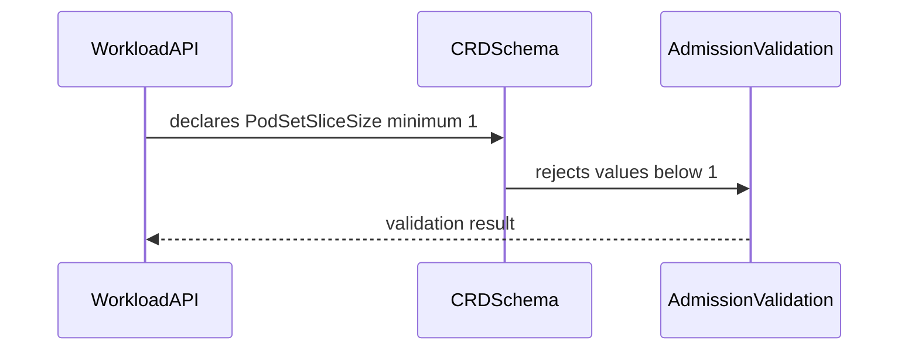
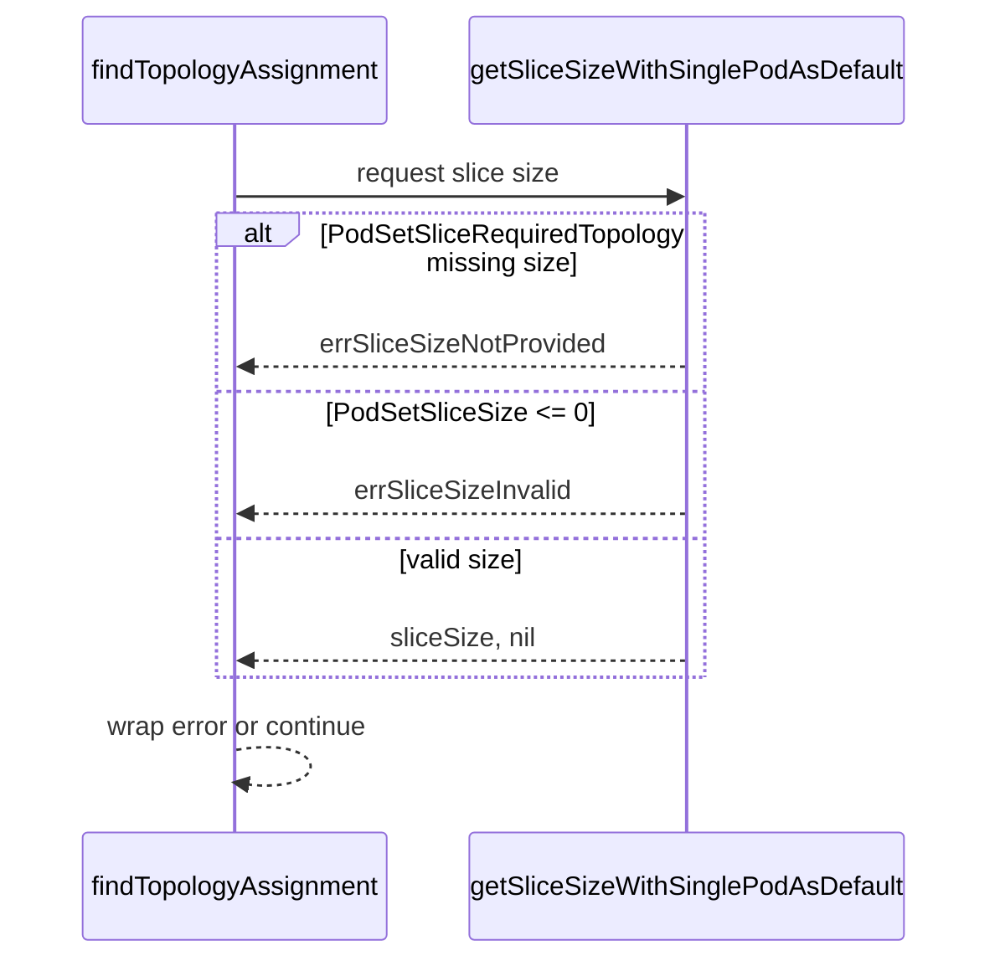

# PR #12728: TAS Scheduler PodSetSliceSize division-by-zero hardening

**Summary**: TAS Scheduler PodSetSliceSize division-by-zero hardening

**Sources**: https://github.com/kubernetes-sigs/kueue/pull/12728

**Last updated**: 2026-10-02T08:34:25Z

---

## Metadata

- **State**: closed (merged)
- **Author**: [@mszadkow](https://github.com/mszadkow)
- **Branch**: `fix/tas-scheduling-division-by-zero` → `main`
- **Created**: 2026-07-02T16:28:49Z
- **Updated**: 2026-10-02T08:34:25Z
- **Merged**: 2026-07-31T02:05:41Z
- **Closed**: 2026-07-31T02:05:41Z
- **Labels**: `kind/bug`, `size/L`, `lgtm`, `release-note-action-required`, `approved`, `cncf-cla: yes`, `area/tas`
- **Assignees**: [@mimowo](https://github.com/mimowo)
- **Requested reviewers**: [@sohankunkerkar](https://github.com/sohankunkerkar)
- **Changed files**: 6   **+111 / -1**

## Description

<!--  Thanks for sending a pull request!  Here are some tips for you:

1. If this is your first time, please read our contributor guidelines: https://git.k8s.io/community/contributors/guide/first-contribution.md#your-first-contribution and developer guide https://git.k8s.io/community/contributors/devel/development.md#development-guide
2. Please label this pull request according to what type of issue you are addressing, especially if this is a release targeted pull request. For reference on required PR/issue labels, read here:
https://git.k8s.io/community/contributors/devel/sig-release/release.md#issuepr-kind-label
3. Ensure you have added or ran the appropriate tests for your PR: https://git.k8s.io/community/contributors/devel/sig-testing/testing.md
4. If you want *faster* PR reviews, read how: https://git.k8s.io/community/contributors/guide/pull-requests.md#best-practices-for-faster-reviews
5. If the PR is unfinished, see how to mark it: https://git.k8s.io/community/contributors/guide/pull-requests.md#marking-unfinished-pull-requests
-->

#### What type of PR is this?
/kind bug
/area tas
<!--
Add one of the following kinds:
/kind bug
/kind cleanup
/kind documentation
/kind feature
/kind kep

Optionally add one or more of the following kinds if applicable:
/kind api-change
/kind deprecation
/kind failing-test
/kind flake
/kind regression

Please also consider setting the area:
/area tas
/area integrations
/area multikueue
/area dashboard
/area localization
/area testing
/area website
-->

#### What this PR does / why we need it:
This PR hardens TAS slice-size validation and aligns scheduler behavior with stricter invariants:

* Enforces podSetSliceSize validation in workload admission for TAS slice requests.
* Requires podSetSliceSize when podSetSliceRequiredTopology is set.
* Rejects non-positive slice sizes for both legacy slice fields and topology constraint layers.

#### Which issue(s) this PR fixes:
<!--
*Automatically closes linked issue when PR is merged.
Usage: `Fixes #<issue number>`, or `Fixes (paste link of issue)`.
_If PR is about `failing-tests or flakes`, please post the related issues/tests in a comment and do not use `Fixes`_*
-->

#### Special notes for your reviewer:
This PR is specifically for cherry-picks as mentioned in the [comment](https://github.com/kubernetes-sigs/kueue/pull/12728#issuecomment-5103740536).
The strict API validation will be covered in [this PR](https://github.com/kubernetes-sigs/kueue/pull/13634).

#### Does this PR introduce a user-facing change?
<!--
If no, just write "NONE" in the release-note block below.
If yes, a release note is required:
Enter your extended release note in the block below. If the PR requires additional action from users switching to the new release, include the string "action required".
-->
```release-note
TAS: Workload slice sizes must be positive, and podSetSliceRequiredTopology and podSetSliceSize must be set together. 

ACTION REQUIRED: Correct invalid manifests before upgrading. Disabling TASValidateWorkloadSliceSize disables only webhook checks; CRD minimum-size validation still applies.
```

<!-- This is an auto-generated comment: release notes by coderabbit.ai -->
## Summary by CodeRabbit

* **Bug Fixes**
  * Tightened workload and topology validation so slice-size values must be at least `1` across CRDs and request schemas.
  * Improved slice-size resolution: nil/empty topology requests now default to `1`, and slice topology now reports clearer errors when slice size is missing or non-positive.
* **Tests**
  * Added unit tests covering defaulting and validation for slice sizing, including updated error checks and assertions.
<!-- end of auto-generated comment: release notes by coderabbit.ai -->

## Discussion

### Comment by [@netlify[bot]](https://github.com/apps/netlify) — 2026-07-02T16:28:54Z

### <span aria-hidden="true">✅</span> Deploy Preview for *kubernetes-sigs-kueue* ready!


|  Name | Link |
|:-:|------------------------|
|<span aria-hidden="true">🔨</span> Latest commit | 1ee4662fe21fb1d2f16fbca8703fc5a66e6a80ca |
|<span aria-hidden="true">🔍</span> Latest deploy log | https://app.netlify.com/projects/kubernetes-sigs-kueue/deploys/6a6b9666171fd30008d58e0e |
|<span aria-hidden="true">😎</span> Deploy Preview | [https://deploy-preview-12728--kubernetes-sigs-kueue.netlify.app](https://deploy-preview-12728--kubernetes-sigs-kueue.netlify.app) |
|<span aria-hidden="true">📱</span> Preview on mobile | <details><summary> Toggle QR Code... </summary><br /><br /><br /><br />_Use your smartphone camera to open QR code link._</details> |
---
<!-- [kubernetes-sigs-kueue Preview](https://deploy-preview-12728--kubernetes-sigs-kueue.netlify.app) -->
_To edit notification comments on pull requests, go to your [Netlify project configuration](https://app.netlify.com/projects/kubernetes-sigs-kueue/configuration/notifications#deploy-notifications)._

### Comment by [@coderabbitai[bot]](https://github.com/apps/coderabbitai) — 2026-07-02T16:29:06Z

<!-- This is an auto-generated comment: summarize by coderabbit.ai -->
<!-- review_stack_entry_start -->

[](https://app.coderabbit.ai/change-stack/kubernetes-sigs/kueue/pull/12728?utm_source=github_walkthrough&utm_medium=github&utm_campaign=change_stack)

<!-- review_stack_entry_end -->
<!-- This is an auto-generated comment: review paused by coderabbit.ai -->

> [!NOTE]
> ## Reviews paused
> 
> It looks like this branch is under active development. To avoid overwhelming you with review comments due to an influx of new commits, CodeRabbit has automatically paused this review. You can configure this behavior by changing the `reviews.auto_review.auto_pause_after_reviewed_commits` setting.
> 
> Use the following commands to manage reviews:
> - `@coderabbitai resume` to resume automatic reviews.
> - `@coderabbitai review` to trigger a single review.
> 
> Use the checkboxes below for quick actions:
> - [ ] <!-- {"checkboxId": "7f6cc2e2-2e4e-497a-8c31-c9e4573e93d1"} --> ▶️ Resume reviews
> - [ ] <!-- {"checkboxId": "e9bb8d72-00e8-4f67-9cb2-caf3b22574fe"} --> 🔍 Trigger review

<!-- end of auto-generated comment: review paused by coderabbit.ai -->
<!-- walkthrough_start -->

<details>
<summary>📝 Walkthrough</summary>

## Walkthrough

This PR adds `Minimum=1` validation to `PodSetSliceSize` in the v1beta1 and v1beta2 workload APIs and matching CRD schema fields. It also changes TAS slice-size resolution to return typed errors for invalid or missing sizes and updates tests and expectations.

### Changes

**PodSetSliceSize validation**

|Layer / File(s)|Summary|
|---|---|
|**API type and CRD schema minimum constraint** <br> `apis/kueue/v1beta1/workload_types.go`, `apis/kueue/v1beta2/workload_types.go`, `config/components/crd/bases/kueue.x-k8s.io_workloads.yaml`, `charts/kueue/templates/crd/kueue.x-k8s.io_workloads.yaml`|Adds `+kubebuilder:validation:Minimum=1` markers on `PodSetSliceSize` in both API versions and matching `minimum: 1` schema entries in the generated and chart CRDs.|
|**Slice size validation and error handling** <br> `pkg/cache/scheduler/tas_flavor_snapshot.go`, `pkg/cache/scheduler/tas_flavor_snapshot_test.go`, `pkg/cache/scheduler/tas_cache_test.go`|Adds sentinel errors for invalid or missing slice sizes, changes `getSliceSizeWithSinglePodAsDefault` to return `(int32, error)`, updates `findTopologyAssignment` to handle the new signature, and updates tests for the new validation and error text.|

**Estimated code review effort:** 2 (Simple) | ~15 minutes

### Sequence Diagram(s)





**Suggested reviewers:** `sohankunkerkar`, `kannon92`, `tenzen-y`

</details>

<!-- walkthrough_end -->
<!-- pre_merge_checks_walkthrough_start -->

<details>
<summary>🚥 Pre-merge checks | ✅ 5</summary>

<details>
<summary>✅ Passed checks (5 passed)</summary>

|         Check name         | Status   | Explanation                                                                                                                                |
| :------------------------: | :------- | :----------------------------------------------------------------------------------------------------------------------------------------- |
|     Docstring Coverage     | ✅ Passed | No functions found in the changed files to evaluate docstring coverage. Skipping docstring coverage check.                                 |
|     Linked Issues check    | ✅ Passed | Check skipped because no linked issues were found for this pull request.                                                                   |
| Out of Scope Changes check | ✅ Passed | Check skipped because no linked issues were found for this pull request.                                                                   |
|      Description Check     | ✅ Passed | Check skipped - CodeRabbit’s high-level summary is enabled.                                                                                |
|         Title check        | ✅ Passed | The title accurately reflects the main change: hardening TAS scheduler PodSetSliceSize handling with validation to prevent invalid values. |

</details>

</details>

<!-- pre_merge_checks_walkthrough_end -->
<!-- finishing_touch_checkbox_start -->

<details>
<summary>✨ Finishing Touches</summary>

<details>
<summary>🧪 Generate unit tests (beta)</summary>

- [ ] <!-- {"checkboxId": "f47ac10b-58cc-4372-a567-0e02b2c3d479", "radioGroupId": "utg-output-choice-group-unknown_comment_id"} -->   Create PR with unit tests

</details>

</details>

<!-- finishing_touch_checkbox_end -->
<!-- tips_start -->

---

Thanks for using [CodeRabbit](https://coderabbit.ai?utm_source=oss&utm_medium=github&utm_campaign=kubernetes-sigs/kueue&utm_content=12728)! It's free for OSS, and your support helps us grow. If you like it, consider giving us a shout-out.

<details>
<summary>❤️ Share</summary>

- [X](https://twitter.com/intent/tweet?text=I%20just%20used%20%40coderabbitai%20for%20my%20code%20review%2C%20and%20it%27s%20fantastic%21%20It%27s%20free%20for%20OSS%20and%20offers%20a%20free%20trial%20for%20the%20proprietary%20code.%20Check%20it%20out%3A&url=https%3A//coderabbit.ai)
- [Mastodon](https://mastodon.social/share?text=I%20just%20used%20%40coderabbitai%20for%20my%20code%20review%2C%20and%20it%27s%20fantastic%21%20It%27s%20free%20for%20OSS%20and%20offers%20a%20free%20trial%20for%20the%20proprietary%20code.%20Check%20it%20out%3A%20https%3A%2F%2Fcoderabbit.ai)
- [Reddit](https://www.reddit.com/submit?title=Great%20tool%20for%20code%20review%20-%20CodeRabbit&text=I%20just%20used%20CodeRabbit%20for%20my%20code%20review%2C%20and%20it%27s%20fantastic%21%20It%27s%20free%20for%20OSS%20and%20offers%20a%20free%20trial%20for%20proprietary%20code.%20Check%20it%20out%3A%20https%3A//coderabbit.ai)
- [LinkedIn](https://www.linkedin.com/sharing/share-offsite/?url=https%3A%2F%2Fcoderabbit.ai&mini=true&title=Great%20tool%20for%20code%20review%20-%20CodeRabbit&summary=I%20just%20used%20CodeRabbit%20for%20my%20code%20review%2C%20and%20it%27s%20fantastic%21%20It%27s%20free%20for%20OSS%20and%20offers%20a%20free%20trial%20for%20proprietary%20code)

</details>


<sub>Comment `@coderabbitai help` to get the list of available commands.</sub>

<!-- tips_end -->

### Comment by [@mszadkow](https://github.com/mszadkow) — 2026-07-03T10:35:38Z

/retest-required

### Comment by [@mszadkow](https://github.com/mszadkow) — 2026-07-03T13:40:17Z

/retest-required

### Comment by [@mszadkow](https://github.com/mszadkow) — 2026-07-06T09:06:19Z

/cc @mbobrovskyi @ivnovakov ptal

### Comment by [@kubernetes-prow[bot]](https://github.com/apps/kubernetes-prow) — 2026-07-06T09:06:23Z

@mszadkow: GitHub didn't allow me to request PR reviews from the following users: ptal.

Note that only [kubernetes-sigs members](https://github.com/orgs/kubernetes-sigs/people) and repo collaborators can review this PR, and authors cannot review their own PRs.

<details>

In response to [this](https://github.com/kubernetes-sigs/kueue/pull/12728#issuecomment-4890993643):

>/cc @mbobrovskyi @ivnovakov ptal


Instructions for interacting with me using PR comments are available [here](https://git.k8s.io/community/contributors/guide/pull-requests.md).  If you have questions or suggestions related to my behavior, please file an issue against the [kubernetes-sigs/prow](https://github.com/kubernetes-sigs/prow/issues/new?title=Prow%20issue:) repository.
</details>

### Comment by [@mszadkow](https://github.com/mszadkow) — 2026-07-08T11:39:21Z

OK, added validation in `getSliceSizeWithSinglePodAsDefault()` that:
* rejects negative values with error
* converts zero to one with warning to avoid panics, which is mathematically safe

The issue was both proved and solved with extra integration test, which I am not sure is particularly required in this PR.
However I added couple unit tests to fully cover `getSliceSizeWithSinglePodAsDefault()` function.

### Comment by [@mszadkow](https://github.com/mszadkow) — 2026-07-22T15:22:55Z

Updated the PR description of the latest changes requested in  - https://github.com/kubernetes-sigs/kueue/pull/12728#discussion_r3628885543 and https://github.com/kubernetes-sigs/kueue/pull/12728#pullrequestreview-4745501163
ptal @mbobrovskyi @reruno

### Comment by [@mimowo](https://github.com/mimowo) — 2026-07-24T13:00:26Z

> TAS: Validate slice size across all topology constraint layers and treat zero-pod TAS assignment paths as successful no-ops with consistent empty assignments.```

Please formulate the release note to reflect the "user-observable change". I'm still puzzled what are the user-observable changes of the PR, let me ask some clarifying questions:

1. this PR does not introduce a rejecting validation, right? If I was a user this is how I would understand "TAS: Validate slice size across all topology constraint layers". IIUC this PR is a mix of fixing handling when PodSetSlice=0 is legal and internal failing avoiding crashing in some other cases.
2. do we have rejection-validation for PodSetSliceSize = 0, to fail fast in webhooks, was this considered?
3. it seems in some cases the PR rejects PodSetSliceSize=0, and in some cases if handles them as correct.  Could you please consider splitting the PR to make the different scenarios easier to review?

### Comment by [@mszadkow](https://github.com/mszadkow) — 2026-07-24T19:57:55Z

1. Yes, your understanding is correct: this PR does not introduce a new rejecting validation.
For positive-count requests, invalid slice-size inputs now fail more deterministically during TAS assignment.
For count=0 paths, it treats them as legal no-ops instead of allowing them to reach "division by zero" code.

2. Yes, it can be introduced, but doing it as an immediate hard rejection can break some existing users.
We avoided that change due to this [discussion](https://github.com/kubernetes-sigs/kueue/pull/12728#discussion_r3518492227)

3. Yes, your concern is valid, and the behavior split is intentional but subtle.
Slice size <= 0 with pods to place is treated as invalid and fails.
Slice size <= 0 with count = 0 is treated as a legal no-op and succeeds with an empty assignment.
That’s why it can look like “same input sometimes rejected, sometimes accepted” but the deciding factor is whether there is actual placement work.

Overall splitting the PR for easier review is a reasonable request.
I will make one PR for zero-count/no-op semantics and another one PR for strict invalid-slice handling on positive-count scheduling paths.
Does it sound right?

### Comment by [@mimowo](https://github.com/mimowo) — 2026-07-24T20:47:30Z

> Yes, your understanding is correct: this PR does not introduce a new rejecting validation.
For positive-count requests, invalid slice-size inputs now fail more deterministically during TAS assignment.
For count=0 paths, it treats them as legal no-ops instead of allowing them to reach "division by zero" code.

Yeah, the "legal no-ops" is concerning me. I cannot see any useful use of PodSetSliceSize=0 (see below)

> Yes, it can be introduced, but doing it as an immediate hard rejection can break some existing users.
We avoided that change due to this https://github.com/kubernetes-sigs/kueue/pull/12728#discussion_r3518492227

I missed that discussion, but I'm not sure if allowing replicas = 0 makes the argument. replicas = 0 makes sense for deleting all pods without deleting the Job itself - scale down to 0. For PodSetSliceSize annotation we don't really support elasticity, so I cannot see a legitimate use case.

So, I think it is fair to just reject at the creation time, but I wouldn't do that by the schema, but webhook code for the Jobs & workload. Analogously I would add checks inside TAS to fail with errors.

Doing this in code allows us to use FG to decomission the old code.

> Slice size <= 0 with pods to place is treated as invalid and fails.

That is correct.

> Slice size <= 0 with count = 0 is treated as a legal no-op and succeeds with an empty assignment.

That is an unnecessary complication IMO (see above).

> I will make one PR for zero-count/no-op semantics and another one PR for strict invalid-slice handling on positive-count scheduling paths.
> Does it sound right?

I would just introduce a FG like `TASRejectPodSetSliceSizeZero` and reject in TAS code, workload webhook and job webhooks. Let me confirm the approach change with @dkaluza, wdyt?

### Comment by [@dkaluza](https://github.com/dkaluza) — 2026-07-27T09:46:52Z

@mimowo 
From my perspective we should either support 0 replicas and counts or not. We should be consistent in this decision, otherwise it will result in poor user experience and bugs in the future.
Especially we already had a bug regarding 0 replicas that we considered valid - https://github.com/kubernetes-sigs/kueue/issues/2227

If we are supporting 0 replicas for JobSet and therefore 0 counts for PodSets I do not see why we should block  `PodSetSliceSize` 0. IIUC this would be actually the only "valid" explicit value for PodSet count 0... Or are we allowing for values greater than count?
So I would personally treat rejection of 0 replicas with 0 slice size as a regression. Sure users can "if" this on their side but this leads to inferior user experience.

> I missed that discussion, but I'm not sure if allowing replicas = 0 makes the argument. replicas = 0 makes sense for deleting all pods without deleting the Job itself - scale down to 0. For PodSetSliceSize annotation we don't really support elasticity, so I cannot see a legitimate use case.

So what should be the "correct" PodSetSliceSize defined explicitly for 0 replicas? Are we treating any value as valid?

I can think of other use case for Jobs having replicas 0, - it is before they are scheduled.

Let's imagine we have a strict FIFO Cluster Queue, that is running some ETL jobs. The queue is generally large - days and the jobs are of the same importance - so you do not want to push any of them first by the priority, you are fine with waiting some time.  Let's imagine I have a job that is based on the current "demand" - is replicated by each of the customer requests.
Then I would like to scale it according to "current" situation, not the one from many days ago. So as a user I would submit a job with 0 replicas to save the spot in the strict FIFO queue, and then when I know it will be scheduled "soon" update the replicas based on the current demand. It may be 10, it may be 1, or it may even stay 0 if there were no requests.

Obviously it can have replicas 1 by default and work in similar way, but here 0 is natural for me as this will be no-op if I do not "update it'", because some other component of my system fails.

>  I would just introduce a FG like TASRejectPodSetSliceSizeZero and reject in TAS code, workload webhook and job webhooks. Let me confirm the approach change with @dkaluza, wdyt?

For me it depends what do we permit in situation with 0 replicas. If podset slice size has to be always <= than count of pods in the Podset, then it is not a good idea (and this validation generally also makes some sense from my point of view).
If we permit larger PodSetSlice sizes, so that user can set the slice size to X and then just scale the replicas, then it is fine.

### Comment by [@mimowo](https://github.com/mimowo) — 2026-07-27T10:00:12Z

> From my perspective we should either support 0 replicas and counts or not. 

The fields have different use-cases. Just because both are "size" it does not mean we need to follow the same validation automatically. 

The first one was relaxed to accomodate the scale down to 0 use case. 

I don't know about the use case for setting PodSetSliceSize=0. If we do have such a use case, then the PR needs to be accompanied by KEP update with the use-case listed.

However, I think this was just an omission during review, not a deliberate maintainer decision to allow to PodSetSliceSize=0.


> So what should be the "correct" PodSetSliceSize defined explicitly for 0 replicas? Are we treating any value as valid?

I think so, we can keep any PodSetSliceSize>0 as valid. 


Overall summary:
1. My current decision to reject PodSetSliceSize>0 is code simplicity, if we want to relax the validation we need to have a use case. Allowing for replicas=0 is not an argument for me, because both fields has a different purpose and validation. Both cannot be negative for sure.
2. Could you please @mszadkow summarize what currently happens on "main" when someone is setting `PodSetSliceSize<0` or `PodSetSliceSize==0` in the annotation? I mean e2e testing on a live cluster. I want to understand what is the current e2e behavior and what will be. I cannot fully undersnad consequences of the change only based on the low level "ifs"
3. we can always relax validation in the future @dkaluza, strengthening validation is very hard

### Comment by [@mimowo](https://github.com/mimowo) — 2026-07-27T11:25:52Z

Oh, I just noticed this might be tricky:
> I think so, we can keep any PodSetSliceSize>0 as valid.

in case we have validation (reasonable) that PodSetSlizeSize is <= replicas (parallelism). 

However, still what I'm missing is the summary of the current validations and behavior we have e2e before we start moving so low-level pieces.

### Comment by [@mimowo](https://github.com/mimowo) — 2026-07-27T11:32:02Z

So, I think what would maybe help is:
1. break down the PR into validation against negative values: Job-level and Workload level - this is totally uncontrolvesial
2. handling of scenarios where PodSetSize == 0, here we may indeed take a breath, but I want to first have an integration test which documents the scenario: for Job, and for workload - simulating custom job CRD integration.

I'm still leaning to say we can validate against both. If (2.) does not work currently, then we will not worsen any user by validation, we will just do fail fast. The purpose of this Issue is not to provide new functinality , but avoid crashing Kueue. We can revisit supporting `PodSetSize == 0` as a new feature. It might be reasonable, given the limitation (if exists) that PodSetSize <= repliaces.

### Comment by [@mszadkow](https://github.com/mszadkow) — 2026-07-27T11:38:42Z

@mimowo ack
I will split this into 2 separate scenarios.
I will double check the behavior for both negative and zero values of PodSetSliceSize.

And the second "controversial" one will be suplemented with additional integration test.

### Comment by [@mszadkow](https://github.com/mszadkow) — 2026-07-28T11:33:43Z

I did cluster tests:
As expected admission webhook forbid the annotation to be smaller than 1:
```
Error from server (Forbidden): error when creating "site/static/examples/tas/sample-job-slice-size-negative.yaml": admission webhook "vjob.kb.io" denied the request: spec.template.metadata.annotations[kueue.x-k8s.io/podset-slice-size]: Invalid value: "-1": must be greater than or equal to 1
```

```
Error from server (Forbidden): error when creating "site/static/examples/tas/sample-job-slice-size-zero.yaml": admission webhook "vjob.kb.io" denied the request: spec.template.metadata.annotations[kueue.x-k8s.io/podset-slice-size]: Invalid value: "0": must be greater than or equal to 1
```

However that was no the reported issue, the vulnerability analysis pointed that when manually crafted Workload with `podSetSliceSize: 0` can cause division by zero and in result panic.

Direct Workload with `spec.podSets[].topologyRequest.podSetSliceSize: 0` is still accepted by API admission.
But division by zero was prevented thanks to the recent change of the constraint: `slice topology requested, but slice size not provided` in `getSliceSizeWithSinglePodAsDefault`.

In the light of this and lack of concrete use-case scenario I believe we can simply go with API validation:
```
+kubebuilder:validation:Minimum=1
```

### Comment by [@mimowo](https://github.com/mimowo) — 2026-07-28T11:48:25Z

Thank you @mszadkow , so I think this validation report:
```
Error from server (Forbidden): error when creating "site/static/examples/tas/sample-job-slice-size-zero.yaml": admission webhook "vjob.kb.io" denied the request: spec.template.metadata.annotations[kueue.x-k8s.io/podset-slice-size]: Invalid value: "0": must be greater than or equal to 1
```

 clearly shows the intention is to only support PodSetSlizeSize>=1. 
 
 Even if "PodSetSlizeSize=0" makes some sense that would be a new feature, not the bugfx.

As for the fix, I agree "+kubebuilder:validation:Minimum=1" would be ideal, but cherrypicking schema changes is tricky. Many users when updating patches would really bump the schema, but just do a rolling update of the new image.

Also, it might be tricky to deal with pre-existing workloads if they are somehow there. 

So, I think it makes sense to have the fix behind a Beta FG, but for 0.20 go with the  proposal and use "+kubebuilder:validation:Minimum=1". That is the approach we took here: https://github.com/kubernetes-sigs/kueue/pull/12838

### Comment by [@mszadkow](https://github.com/mszadkow) — 2026-07-29T15:05:01Z

This PR becomes fix behind a Beta FG.
For 0.20 I added API validation in this PR - https://github.com/kubernetes-sigs/kueue/pull/13634

### Comment by [@mszadkow](https://github.com/mszadkow) — 2026-07-30T12:06:00Z

@mimowo everything got addressed - ptal

### Comment by [@kubernetes-prow[bot]](https://github.com/apps/kubernetes-prow) — 2026-07-31T01:48:00Z

LGTM label has been added.  <details>Git tree hash: 2f7e25033f1973e33a1ad51e79fa472debe66699</details>

### Comment by [@kubernetes-prow[bot]](https://github.com/apps/kubernetes-prow) — 2026-07-31T01:48:03Z

[APPROVALNOTIFIER] This PR is **APPROVED**

This pull-request has been approved by: *<a href="https://github.com/kubernetes-sigs/kueue/pull/12728#pullrequestreview-4817512205" title="Approved">dkaluza</a>*, *<a href="https://github.com/kubernetes-sigs/kueue/pull/12728#pullrequestreview-4824754980" title="Approved">mimowo</a>*, *<a href="https://github.com/kubernetes-sigs/kueue/pull/12728#" title="Author self-approved">mszadkow</a>*

The full list of commands accepted by this bot can be found [here](https://go.k8s.io/bot-commands?repo=kubernetes-sigs%2Fkueue).

The pull request process is described [here](https://git.k8s.io/community/contributors/guide/owners.md#the-code-review-process)

<details >
Needs approval from an approver in each of these files:

- ~~[OWNERS](https://github.com/kubernetes-sigs/kueue/blob/main/OWNERS)~~ [mimowo]

Approvers can indicate their approval by writing `/approve` in a comment
Approvers can cancel approval by writing `/approve cancel` in a comment
</details>
<!-- META={"approvers":[]} -->

### Comment by [@mimowo](https://github.com/mimowo) — 2026-09-30T14:05:28Z

/release-note-edit
```release-note
TAS: Workload slice sizes must be positive, and podSetSliceRequiredTopology and podSetSliceSize must be set together. 

ACTION REQUIRED: Correct invalid manifests before upgrading. Disabling TASValidateWorkloadSliceSize disables only webhook checks; CRD minimum-size validation still applies.
```

## Reviews

### Review by [@coderabbitai[bot]](https://github.com/apps/coderabbitai) (commented) — 2026-07-02T16:34:01Z

**Actionable comments posted: 1**

<details>
<summary>🤖 Prompt for all review comments with AI agents</summary>

```
Verify each finding against current code. Fix only still-valid issues, skip the
rest with a brief reason, keep changes minimal, and validate.

Inline comments:
In `@pkg/cache/scheduler/tas_flavor_snapshot.go`:
- Around line 887-890: The error formatting in the slice size check is using an
invalid verb in the return path, so the message can be malformed instead of
including the underlying error text. Update the error handling in
getSliceSizeWithSinglePodAsDefault’s caller to build the message with the
correct formatting verb, keeping the same “failed to determine slice size”
context while preserving the actual err details.
```

</details>

<details>
<summary>🪄 Autofix (Beta)</summary>

Fix all unresolved CodeRabbit comments on this PR:

- [ ] <!-- {"checkboxId": "4b0d0e0a-96d7-4f10-b296-3a18ea78f0b9"} --> Push a commit to this branch (recommended)
- [ ] <!-- {"checkboxId": "ff5b1114-7d8c-49e6-8ac1-43f82af23a33"} --> Create a new PR with the fixes

</details>

---

<details>
<summary>ℹ️ Review info</summary>

<details>
<summary>⚙️ Run configuration</summary>

**Configuration used**: Path: .coderabbit.yaml

**Review profile**: CHILL

**Plan**: Pro

**Run ID**: `2357a441-8d3d-4818-b669-8e874872ae15`

</details>

<details>
<summary>📥 Commits</summary>

Reviewing files that changed from the base of the PR and between 0fddc5e5f9135504c7e426bc0b33608a30cfae46 and 60428e2029a64e03358561f4c2908934ad37584c.

</details>

<details>
<summary>📒 Files selected for processing (5)</summary>

* `apis/kueue/v1beta1/workload_types.go`
* `apis/kueue/v1beta2/workload_types.go`
* `config/components/crd/bases/kueue.x-k8s.io_workloads.yaml`
* `pkg/cache/scheduler/tas_flavor_snapshot.go`
* `pkg/cache/scheduler/tas_flavor_snapshot_test.go`

</details>

</details>

<!-- This is an auto-generated comment by CodeRabbit for review status -->

- **pkg/cache/scheduler/tas_flavor_snapshot.go:890** by [@coderabbitai[bot]](https://github.com/apps/coderabbitai) — 2026-07-02T16:34:00Z
```diff
@@ -882,9 +884,9 @@ func (s *TASFlavorSnapshot) findTopologyAssignment(
 	}
 
 	// If slice topology is not requested then we can assume that slice is a single pod
-	sliceSize, reason := getSliceSizeWithSinglePodAsDefault(workersTasPodSetRequests.PodSet.TopologyRequest)
-	if len(reason) > 0 {
-		return nil, reason
+	sliceSize, err := getSliceSizeWithSinglePodAsDefault(workersTasPodSetRequests.PodSet.TopologyRequest)
+	if err != nil {
+		return nil, fmt.Sprintf("failed to determine slice size: %w", err)
 	}
```

  _🎯 Functional Correctness_ | _🟠 Major_ | _⚡ Quick win_
  
  <details>
  <summary>🧩 Analysis chain</summary>
  
  🌐 Web query:
  
  `Does fmt.Sprintf support the %w verb for error wrapping in Go?`
  
  💡 Result:
  
  No, fmt.Sprintf does not support the %w verb for error wrapping [1][2]. The %w verb is exclusively supported by fmt.Errorf [3][4][1]. When the %w verb is used with fmt.Errorf, it allows for error wrapping, enabling the returned error to implement an Unwrap method [3][1]. If %w is used with any other formatting function—such as fmt.Sprintf, fmt.Printf, or fmt.Fprintf—it is considered invalid and will result in a formatting error [1][2]. For error wrapping, you must use fmt.Errorf [3][5]: // Correct usage for wrapping err:= fmt.Errorf("context: %w", wrappedErr) // Incorrect usage: fmt.Sprintf does not support %w // This will produce a format error string like "%!w(MISSING)" or similar. s:= fmt.Sprintf("context: %w", wrappedErr)
  
  Citations:
  
  - 1: https://git.jordan.im/go/commit/?h=go1.13.1&id=14491a2ec499668388d7fe7e95b84dbf0e1cf04d
  - 2: https://go.googlesource.com/go/+/0152075d5aba0f198ac67fb426a0fc4c16e2b363/src/fmt/print.go
  - 3: https://pkg.go.dev/fmt?tab=doc
  - 4: https://pkg.go.dev/fmt@latest
  - 5: https://pkg.go.dev/errors
  
  ---
  
  🏁 Script executed:
  
  ```shell
  #!/bin/bash
  set -euo pipefail
  
  # Inspect the relevant file and nearby context.
  git ls-files 'pkg/cache/scheduler/tas_flavor_snapshot.go' 'cmd/experimental/skills/README.md' 'cmd/experimental/skills/reviewer/README.md' 'AGENTS.md' '.github/PULL_REQUEST_TEMPLATE.md' '.github/ISSUE_TEMPLATE*' 2>/dev/null || true
  
  printf '\n== Outline: pkg/cache/scheduler/tas_flavor_snapshot.go ==\n'
  ast-grep outline pkg/cache/scheduler/tas_flavor_snapshot.go --view expanded || true
  
  printf '\n== Relevant lines around the reported location ==\n'
  sed -n '870,900p' pkg/cache/scheduler/tas_flavor_snapshot.go
  
  printf '\n== Search for other uses of fmt.Sprintf with %%w in repo ==\n'
  rg -n 'fmt\.Sprintf\([^)]*%w' -g '!vendor' .
  
  printf '\n== Search for neighboring error formatting in the same file ==\n'
  rg -n 'fmt\.(Sprintf|Errorf)\(' pkg/cache/scheduler/tas_flavor_snapshot.go
  ```
  
  Repository: kubernetes-sigs/kueue
  
  Length of output: 14992
  
  ---
  
  
  
  </details>
  
  **Use `%v` here instead of `%w`.** `fmt.Sprintf` treats `%w` as invalid, so the failure reason will be malformed instead of carrying the underlying error text.
  
  <details>
  <summary>🤖 Prompt for AI Agents</summary>
  
  ```
  Verify each finding against current code. Fix only still-valid issues, skip the
  rest with a brief reason, keep changes minimal, and validate.
  
  In `@pkg/cache/scheduler/tas_flavor_snapshot.go` around lines 887 - 890, The error
  formatting in the slice size check is using an invalid verb in the return path,
  so the message can be malformed instead of including the underlying error text.
  Update the error handling in getSliceSizeWithSinglePodAsDefault’s caller to
  build the message with the correct formatting verb, keeping the same “failed to
  determine slice size” context while preserving the actual err details.
  ```
  
  </details>
  
  <!-- fingerprinting:phantom:poseidon:beignet -->
  
  <!-- cr-indicator-types:potential_issue -->
  
  <!-- cr-comment:v1:c8783cb3e412539fc5370361 -->
  
  <!-- This is an auto-generated comment by CodeRabbit -->
  
  ✅ Addressed in commit 3d1c2cc

### Review by [@coderabbitai[bot]](https://github.com/apps/coderabbitai) (commented) — 2026-07-02T16:43:23Z


<details>
<summary>🧹 Nitpick comments (1)</summary><blockquote>

<details>
<summary>pkg/cache/scheduler/tas_flavor_snapshot_test.go (1)</summary><blockquote>

`946-1019`: _📐 Maintainability & Code Quality_ | _🔵 Trivial_ | _💤 Low value_

**Consider adding a negative-size constraint test case for symmetry.**

Negative and zero explicit `PodSetSliceSize` are both tested (Lines 995-1010), but the constraint-derived path only tests zero (Lines 975-986), not negative. Adding a negative-size constraint case would give symmetric coverage of `errSliceSizeInvalid` across both code paths.

<details>
<summary>🤖 Prompt for AI Agents</summary>

```
Verify each finding against current code. Fix only still-valid issues, skip the
rest with a brief reason, keep changes minimal, and validate.

In `@pkg/cache/scheduler/tas_flavor_snapshot_test.go` around lines 946 - 1019, Add
a negative-size test case for the constraint-derived slice size path in
TestGetSliceSizeWithSinglePodAsDefault to mirror the explicit PodSetSliceSize
checks. Update the test table around the PodSetTopologyRequest cases so the
GetSliceSize logic is covered for a constraint with a Size less than zero and
asserted to return errSliceSizeInvalid, alongside the existing zero-size
constraint case.
```

</details>

<!-- cr-comment:v1:46dd9541c48ded0af5bde080 -->

</blockquote></details>

</blockquote></details>

<details>
<summary>🤖 Prompt for all review comments with AI agents</summary>

```
Verify each finding against current code. Fix only still-valid issues, skip the
rest with a brief reason, keep changes minimal, and validate.

Nitpick comments:
In `@pkg/cache/scheduler/tas_flavor_snapshot_test.go`:
- Around line 946-1019: Add a negative-size test case for the constraint-derived
slice size path in TestGetSliceSizeWithSinglePodAsDefault to mirror the explicit
PodSetSliceSize checks. Update the test table around the PodSetTopologyRequest
cases so the GetSliceSize logic is covered for a constraint with a Size less
than zero and asserted to return errSliceSizeInvalid, alongside the existing
zero-size constraint case.
```

</details>

---

<details>
<summary>ℹ️ Review info</summary>

<details>
<summary>⚙️ Run configuration</summary>

**Configuration used**: Path: .coderabbit.yaml

**Review profile**: CHILL

**Plan**: Pro

**Run ID**: `57ce1aa7-76e6-46f6-bb41-fb5c55ef9192`

</details>

<details>
<summary>📥 Commits</summary>

Reviewing files that changed from the base of the PR and between 60428e2029a64e03358561f4c2908934ad37584c and 3d1c2ccdaf5ef44a02f311b9449be6525844f817.

</details>

<details>
<summary>📒 Files selected for processing (5)</summary>

* `apis/kueue/v1beta1/workload_types.go`
* `apis/kueue/v1beta2/workload_types.go`
* `config/components/crd/bases/kueue.x-k8s.io_workloads.yaml`
* `pkg/cache/scheduler/tas_flavor_snapshot.go`
* `pkg/cache/scheduler/tas_flavor_snapshot_test.go`

</details>

<details>
<summary>✅ Files skipped from review due to trivial changes (1)</summary>

* config/components/crd/bases/kueue.x-k8s.io_workloads.yaml

</details>

<details>
<summary>🚧 Files skipped from review as they are similar to previous changes (3)</summary>

* apis/kueue/v1beta2/workload_types.go
* apis/kueue/v1beta1/workload_types.go
* pkg/cache/scheduler/tas_flavor_snapshot.go

</details>

</details>

<!-- This is an auto-generated comment by CodeRabbit for review status -->

### Review by [@mwielgus](https://github.com/mwielgus) (commented) — 2026-07-03T08:23:16Z

- **apis/kueue/v1beta2/workload_types.go:234** by [@mwielgus](https://github.com/mwielgus) — 2026-07-03T08:23:12Z
```diff
@@ -231,6 +231,7 @@ type PodSetTopologyRequest struct {
 	// in `kueue.x-k8s.io/podset-slice-required-topology` annotation.
 	//
 	// +optional
+	// +kubebuilder:validation:Minimum=1
```

  What will happen if a workload with PodSetSliceSize = 0 is in the system at the upgrade time?

### Review by [@mszadkow](https://github.com/mszadkow) (commented) — 2026-07-03T09:31:22Z

- **apis/kueue/v1beta2/workload_types.go:234** by [@mszadkow](https://github.com/mszadkow) — 2026-07-03T09:31:21Z
```diff
@@ -231,6 +231,7 @@ type PodSetTopologyRequest struct {
 	// in `kueue.x-k8s.io/podset-slice-required-topology` annotation.
 	//
 	// +optional
+	// +kubebuilder:validation:Minimum=1
```

  At upgrade time, pre-existing Workloads are not re-checked by CRD create-time validation.
  So if a Workload already stored in the cluster has PodSetSliceSize = 0, it can still exist after upgrade.
  The new checks matter when Kueue has to admit it again, such as on changes that trigger a new admission decision

### Review by [@dkaluza](https://github.com/dkaluza) (commented) — 2026-07-06T09:11:10Z

- **apis/kueue/v1beta2/workload_types.go:234** by [@dkaluza](https://github.com/dkaluza) — 2026-07-06T09:11:09Z
```diff
@@ -231,6 +231,7 @@ type PodSetTopologyRequest struct {
 	// in `kueue.x-k8s.io/podset-slice-required-topology` annotation.
 	//
 	// +optional
+	// +kubebuilder:validation:Minimum=1
```

  But what about workloads that really have podsetslice size 0?
  We allowed jobsets with replicas=0. 
  https://github.com/kubernetes-sigs/kueue/issues/2227
  
  IIUC making this required to be minimum 1 would lead to serious regression without additional handling.

### Review by [@mszadkow](https://github.com/mszadkow) (commented) — 2026-07-07T08:51:51Z

- **apis/kueue/v1beta2/workload_types.go:234** by [@mszadkow](https://github.com/mszadkow) — 2026-07-07T08:51:51Z
```diff
@@ -231,6 +231,7 @@ type PodSetTopologyRequest struct {
 	// in `kueue.x-k8s.io/podset-slice-required-topology` annotation.
 	//
 	// +optional
+	// +kubebuilder:validation:Minimum=1
```

  Ok, so for now I will provide additional tests that will prove if the validation is backward compatible or not.

### Review by [@mszadkow](https://github.com/mszadkow) (commented) — 2026-07-07T09:03:06Z

- **apis/kueue/v1beta2/workload_types.go:234** by [@mszadkow](https://github.com/mszadkow) — 2026-07-07T09:03:05Z
```diff
@@ -231,6 +231,7 @@ type PodSetTopologyRequest struct {
 	// in `kueue.x-k8s.io/podset-slice-required-topology` annotation.
 	//
 	// +optional
+	// +kubebuilder:validation:Minimum=1
```

  I guess we want to allow for  zero replicas jobs still, right?
  So the actual fix must be shifted from validation to making sure there is no division by zero caused by that.
  @dkaluza thanks for insight

### Review by [@dkaluza](https://github.com/dkaluza) (commented) — 2026-07-07T16:35:04Z

- **apis/kueue/v1beta2/workload_types.go:234** by [@dkaluza](https://github.com/dkaluza) — 2026-07-07T16:35:03Z
```diff
@@ -231,6 +231,7 @@ type PodSetTopologyRequest struct {
 	// in `kueue.x-k8s.io/podset-slice-required-topology` annotation.
 	//
 	// +optional
+	// +kubebuilder:validation:Minimum=1
```

  From my point of view yes - we want to allow 0 replicas in jobs. 
  
  Correct, shifting to just avoiding divisions by 0 in the implementation is one of valid approaches.

### Review by [@mszadkow](https://github.com/mszadkow) (commented) — 2026-07-08T11:40:10Z

- **apis/kueue/v1beta2/workload_types.go:234** by [@mszadkow](https://github.com/mszadkow) — 2026-07-08T11:40:09Z
```diff
@@ -231,6 +231,7 @@ type PodSetTopologyRequest struct {
 	// in `kueue.x-k8s.io/podset-slice-required-topology` annotation.
 	//
 	// +optional
+	// +kubebuilder:validation:Minimum=1
```

  Updated - https://github.com/kubernetes-sigs/kueue/pull/12728#issuecomment-4914391766

### Review by [@ivnovakov](https://github.com/ivnovakov) (commented) — 2026-07-08T13:10:45Z

- **pkg/cache/scheduler/tas_flavor_snapshot.go:1218** by [@ivnovakov](https://github.com/ivnovakov) — 2026-07-08T13:10:46Z
  There are 2 calls of this function that ignore reason and  just use the size value.
  So, negative `PodSetSliceSize` now returns `(0, "cannot be negative...")`.
  Lines 671-672 and 744-745 drop that reason and go straight to `tr.Count % 0` that leads to panic.
  Before this PR negative values just passed through harmlessly; now they crash.
  Only line 885 (`findTopologyAssignment`) checks `reason` first.
  
  This is on the unhealthy-node/TAS-replacement path, and there's no `recover()` in the scheduler, so it takes down `kueue-controller-manager`, not just the workload.
  
  Should we allow that panic or should we handle that gracefully?

### Review by [@mbobrovskyi](https://github.com/mbobrovskyi) (commented) — 2026-07-08T13:14:32Z

- **pkg/cache/scheduler/tas_flavor_snapshot.go:1235** by [@mbobrovskyi](https://github.com/mbobrovskyi) — 2026-07-08T13:14:32Z
```diff
@@ -1232,7 +1232,17 @@ func getSliceSizeWithSinglePodAsDefault(podSetTopologyRequest *kueue.PodSetTopol
 		return 0, "slice topology requested, but slice size not provided"
 	}
 
-	return *podSetTopologyRequest.PodSetSliceSize, ""
+	sliceSize := *podSetTopologyRequest.PodSetSliceSize
```

  I'm wondering if we want to add validation on API.

### Review by [@mszadkow](https://github.com/mszadkow) (commented) — 2026-07-08T13:42:19Z

- **pkg/cache/scheduler/tas_flavor_snapshot.go:1235** by [@mszadkow](https://github.com/mszadkow) — 2026-07-08T13:42:19Z
```diff
@@ -1232,7 +1232,17 @@ func getSliceSizeWithSinglePodAsDefault(podSetTopologyRequest *kueue.PodSetTopol
 		return 0, "slice topology requested, but slice size not provided"
 	}
 
-	return *podSetTopologyRequest.PodSetSliceSize, ""
+	sliceSize := *podSetTopologyRequest.PodSetSliceSize
```

  https://github.com/kubernetes-sigs/kueue/pull/12728#discussion_r3518492227

### Review by [@mszadkow](https://github.com/mszadkow) (commented) — 2026-07-08T14:01:44Z

- **pkg/cache/scheduler/tas_flavor_snapshot.go:1218** by [@mszadkow](https://github.com/mszadkow) — 2026-07-08T14:01:44Z
  Good catch!
  Thanks I will look into it

### Review by [@mszadkow](https://github.com/mszadkow) (commented) — 2026-07-08T15:10:49Z

- **pkg/cache/scheduler/tas_flavor_snapshot.go:1218** by [@mszadkow](https://github.com/mszadkow) — 2026-07-08T15:10:48Z
  check again

### Review by [@ivnovakov](https://github.com/ivnovakov) (commented) — 2026-07-08T16:41:52Z

- **pkg/cache/scheduler/tas_flavor_snapshot.go:1218** by [@ivnovakov](https://github.com/ivnovakov) — 2026-07-08T16:41:52Z
  Fix is valid, thanks!

### Review by [@mbobrovskyi](https://github.com/mbobrovskyi) (commented) — 2026-07-09T08:39:27Z

- **pkg/cache/scheduler/tas_flavor_snapshot.go:1235** by [@mbobrovskyi](https://github.com/mbobrovskyi) — 2026-07-09T08:39:27Z
```diff
@@ -1232,7 +1232,17 @@ func getSliceSizeWithSinglePodAsDefault(podSetTopologyRequest *kueue.PodSetTopol
 		return 0, "slice topology requested, but slice size not provided"
 	}
 
-	return *podSetTopologyRequest.PodSetSliceSize, ""
+	sliceSize := *podSetTopologyRequest.PodSetSliceSize
```

  I see. It's possible to have PodSetSliceSize=0. But can we add validation to ensure that it cannot be set to a value less than 0?

### Review by [@mszadkow](https://github.com/mszadkow) (commented) — 2026-07-10T11:38:29Z

- **pkg/cache/scheduler/tas_flavor_snapshot.go:1235** by [@mszadkow](https://github.com/mszadkow) — 2026-07-10T11:38:29Z
```diff
@@ -1232,7 +1232,17 @@ func getSliceSizeWithSinglePodAsDefault(podSetTopologyRequest *kueue.PodSetTopol
 		return 0, "slice topology requested, but slice size not provided"
 	}
 
-	return *podSetTopologyRequest.PodSetSliceSize, ""
+	sliceSize := *podSetTopologyRequest.PodSetSliceSize
```

  Added, this should be neutral for existing workloads
  @dkaluza wdyt?

### Review by [@dkaluza](https://github.com/dkaluza) (commented) — 2026-07-10T15:19:59Z

- **pkg/cache/scheduler/tas_flavor_snapshot.go:1235** by [@dkaluza](https://github.com/dkaluza) — 2026-07-10T15:19:58Z
```diff
@@ -1232,7 +1232,17 @@ func getSliceSizeWithSinglePodAsDefault(podSetTopologyRequest *kueue.PodSetTopol
 		return 0, "slice topology requested, but slice size not provided"
 	}
 
-	return *podSetTopologyRequest.PodSetSliceSize, ""
+	sliceSize := *podSetTopologyRequest.PodSetSliceSize
```

  IMO validation that it is not negative is reasonable.

### Review by [@dkaluza](https://github.com/dkaluza) (commented) — 2026-07-10T15:34:42Z

- **pkg/util/tas/tas.go:130** by [@dkaluza](https://github.com/dkaluza) — 2026-07-10T15:29:57Z
```diff
@@ -126,6 +126,11 @@ func PodSetSliceRequiredTopologyConstraints(tr *kueue.PodSetTopologyRequest) []k
 	size := int32(0)
 	if tr.PodSetSliceSize != nil {
 		size = *tr.PodSetSliceSize
+		if size == 0 {
+			// While we allow replicas equal to 0 per #2227, we must prevent sliceSize=0 to avoid division/modulo errors.
```

  Doesn't this lead to incorrect computation/assumptions about scheduling and possible admissions in some places?
  
  E.g.  There is maximum of pods per node https://docs.cloud.google.com/kubernetes-engine/docs/how-to/flexible-pod-cidr#configuring_maximum_pods_per_node
  If we assume that 0 replicas still "consume" one pod we might get into the state that Kueue might not admit jobs although it could. 
  
  Generally it would be less tricky to really guard the divisions size by returning explicitly desired value in those places.

- **pkg/cache/scheduler/tas_flavor_snapshot.go:672** by [@dkaluza](https://github.com/dkaluza) — 2026-07-10T15:34:24Z
```diff
@@ -666,7 +666,10 @@ func (s *TASFlavorSnapshot) findReplacementAssignment(
 	if isStale, staleDomain := s.IsTopologyAssignmentStale(existingAssignment); isStale {
 		return nil, nil, fmt.Sprintf("Cannot replace the node, because the existing topologyAssignment is invalid, as it contains the stale domain %v", staleDomain)
 	}
-	requiredReplacementDomain := s.requiredReplacementDomain(tr, existingAssignment)
+	requiredReplacementDomain, reason := s.requiredReplacementDomain(tr, existingAssignment)
+	if reason != "" {
+		return nil, nil, reason
+	}
```

  why do we need this change of  `s.requiredReplacementDomain` signature?
  
  Aren't we anyway calling `getSliceSizeWithSinglePodAsDefault(tr.PodSet.TopologyRequest)` in the next line returning reason?

### Review by [@dkaluza](https://github.com/dkaluza) (commented) — 2026-07-10T16:00:12Z

- **pkg/cache/scheduler/tas_flavor_snapshot_test.go:952** by [@dkaluza](https://github.com/dkaluza) — 2026-07-10T15:40:15Z
```diff
@@ -940,3 +940,156 @@ func TestTruncateAssignment(t *testing.T) {
 		})
 	}
 }
+
+func TestRequiredReplacementDomain(t *testing.T) {
+	tests := map[string]struct {
+		name       string
+		request    *kueue.PodSetTopologyRequest
+		ta         *tas.TopologyAssignment
+		wantDomain tas.TopologyDomainID
+		wantReason string
+	}{
+		"negative slice size returns reason": {
```

  Don't we lack  tests with PodSetSliceSize 0?

- **pkg/cache/scheduler/tas_flavor_snapshot_test.go:1065** by [@dkaluza](https://github.com/dkaluza) — 2026-07-10T15:45:36Z
```diff
@@ -940,3 +940,156 @@ func TestTruncateAssignment(t *testing.T) {
 		})
 	}
 }
+
+func TestRequiredReplacementDomain(t *testing.T) {
+	tests := map[string]struct {
+		name       string
+		request    *kueue.PodSetTopologyRequest
+		ta         *tas.TopologyAssignment
+		wantDomain tas.TopologyDomainID
+		wantReason string
+	}{
+		"negative slice size returns reason": {
+			request: &kueue.PodSetTopologyRequest{
+				Required:                    new("level-1"),
+				PodSetSliceRequiredTopology: new("level-1"),
+				PodSetSliceSize:             new(int32(-5)),
+			},
+			ta: &tas.TopologyAssignment{
+				Domains: []tas.TopologyDomainAssignment{{
+					Values: []string{"domain-a"},
+					Count:  1,
+				}},
+			},
+			wantDomain: "",
+			wantReason: "slice topology requested, but slice size not provided",
+		},
+		"missing slice size returns reason": {
+			request: &kueue.PodSetTopologyRequest{
+				Required:                    new("level-1"),
+				PodSetSliceRequiredTopology: new("level-1"),
+				PodSetSliceSize:             nil,
+			},
+			ta: &tas.TopologyAssignment{
+				Domains: []tas.TopologyDomainAssignment{{
+					Values: []string{"domain-a"},
+					Count:  1,
+				}},
+			},
+			wantDomain: "",
+			wantReason: "slice topology requested, but slice size not provided",
+		},
+		"missing topology key returns empty result": {
+			request: &kueue.PodSetTopologyRequest{},
+			ta: &tas.TopologyAssignment{
+				Domains: []tas.TopologyDomainAssignment{{
+					Values: []string{"domain-a"},
+					Count:  1,
+				}},
+			},
+			wantDomain: "",
+			wantReason: "",
+		},
+		"empty topology assignment returns empty result": {
+			request: &kueue.PodSetTopologyRequest{
+				Required: new("level-1"),
+			},
+			ta:         &tas.TopologyAssignment{Domains: nil},
+			wantDomain: "",
+			wantReason: "",
+		},
+	}
+
+	for _, tc := range tests {
+		t.Run(tc.name, func(t *testing.T) {
+			_, log := utiltesting.ContextWithLog(t)
+			s := newTASFlavorSnapshot(log, "dummy", []string{"level-1"})
+
+			tr := &TASPodSetRequests{
+				PodSet: &kueue.PodSet{
+					Name:            "main",
+					TopologyRequest: tc.request,
+				},
+				Count: 1,
+			}
+
+			gotDomain, gotReason := s.requiredReplacementDomain(tr, tc.ta)
+			if gotDomain != tc.wantDomain {
+				t.Fatalf("requiredReplacementDomain() domain: got %q, want %q", gotDomain, tc.wantDomain)
+			}
+			if gotReason != tc.wantReason {
+				t.Fatalf("requiredReplacementDomain() reason: got %q, want %q", gotReason, tc.wantReason)
+			}
+		})
+	}
+}
+
+func TestGetSliceSizeWithSinglePodAsDefault(t *testing.T) {
+	tests := map[string]struct {
+		request    *kueue.PodSetTopologyRequest
+		wantSize   int32
+		wantReason string
+	}{
+		"nil request - should return 1 with no error": {
+			request:    nil,
+			wantSize:   1,
+			wantReason: "",
+		},
+		"no topology request - should return 1 with no error": {
+			request: &kueue.PodSetTopologyRequest{
+				PodSetSliceRequiredTopology: nil,
+			},
+			wantSize:   1,
+			wantReason: "",
+		},
+		"constraints present - should return first constraint size": {
+			request: &kueue.PodSetTopologyRequest{
+				PodsetSliceRequiredTopologyConstraints: []kueue.PodsetSliceRequiredTopologyConstraint{
+					{
+						Topology: "kubernetes.io/hostname",
+						Size:     4,
+					},
+				},
+			},
+			wantSize:   4,
+			wantReason: "",
+		},
+		"slice size nil - should return 0 with error": {
+			request: &kueue.PodSetTopologyRequest{
+				PodSetSliceRequiredTopology: new(string("kubernetes.io/zone")),
+				PodSetSliceSize:             nil,
+			},
+			wantSize:   0,
+			wantReason: "slice topology requested, but slice size not provided",
+		},
+		"zero slice size - should convert to 1 (division by zero protection)": {
```

  From my perspective this is not an intuitive behavior for this function.
  
  We should at least describe it in the function documentation. Even better would be to either make this an explicit conversion in the division place (mentioned in other comment) 
  Also I do not see the change in implementation of this function, am I missing something?

- **pkg/cache/scheduler/tas_flavor_snapshot_test.go:952** by [@dkaluza](https://github.com/dkaluza) — 2026-07-10T15:52:04Z
```diff
@@ -940,3 +940,156 @@ func TestTruncateAssignment(t *testing.T) {
 		})
 	}
 }
+
+func TestRequiredReplacementDomain(t *testing.T) {
+	tests := map[string]struct {
+		name       string
+		request    *kueue.PodSetTopologyRequest
+		ta         *tas.TopologyAssignment
+		wantDomain tas.TopologyDomainID
+		wantReason string
+	}{
+		"negative slice size returns reason": {
```

  Also there are no  tests that really return any domain id...
  
  Anyway `requiredReplacementDomain` looks like a local helper that may easily get removed or replaced in the future implementation refactors.
   It would be best to add unit tests for actual business logic in some higher level function like `FindTopologyAssignmentsForFlavor`, to make sure that we actually get desired behavior from the business perspective (for example they are no longer panicking but returning desired value)
  
  This `requiredReplacementDomain` actually never did division by 0 so introduction of those test doesn't yet prove that we have fixed the bug.

### Review by [@mimowo](https://github.com/mimowo) (commented) — 2026-07-14T13:17:44Z

- **pkg/cache/scheduler/tas_flavor_snapshot.go:1228** by [@mimowo](https://github.com/mimowo) — 2026-07-14T13:17:44Z
```diff
@@ -1222,6 +1225,7 @@ func getSliceSizeWithSinglePodAsDefault(tr *kueue.PodSetTopologyRequest) (int32,
 	if size <= 0 {
 		return 0, "slice topology requested, but slice size not provided"
 	}
+
```

  nit, drop formatting changes

### Review by [@mimowo](https://github.com/mimowo) (commented) — 2026-07-14T13:18:05Z

- **pkg/util/tas/tas.go:131** by [@mimowo](https://github.com/mimowo) — 2026-07-14T13:18:05Z
```diff
@@ -126,6 +126,11 @@ func PodSetSliceRequiredTopologyConstraints(tr *kueue.PodSetTopologyRequest) []k
 	size := int32(0)
 	if tr.PodSetSliceSize != nil {
 		size = *tr.PodSetSliceSize
+		if size == 0 {
+			// While we allow replicas equal to 0 per #2227, we must prevent sliceSize=0 to avoid division/modulo errors.
+			// Convert 0 to 1: mathematically safe (x/1=x, x%1=0) and 1 pod per slice is valid scheduling semantics.
```

  Add a logger at V2 this should not really happen

### Review by [@mimowo](https://github.com/mimowo) (commented) — 2026-07-14T13:18:39Z

- **apis/kueue/v1beta1/workload_types.go:151** by [@mimowo](https://github.com/mimowo) — 2026-07-14T13:18:39Z
```diff
@@ -148,6 +148,7 @@ type PodSetTopologyRequest struct {
 	// in `kueue.x-k8s.io/podset-slice-required-topology` annotation.
 	//
 	// +optional
+	// +kubebuilder:validation:Minimum=0
```

  I would suggest to drop schema changes from a PR which needs to be cherry-picked. We can consider as a follow up

### Review by [@mszadkow](https://github.com/mszadkow) (commented) — 2026-07-20T07:38:56Z

- **pkg/cache/scheduler/tas_flavor_snapshot.go:1235** by [@mszadkow](https://github.com/mszadkow) — 2026-07-20T07:38:56Z
```diff
@@ -1232,7 +1232,17 @@ func getSliceSizeWithSinglePodAsDefault(podSetTopologyRequest *kueue.PodSetTopol
 		return 0, "slice topology requested, but slice size not provided"
 	}
 
-	return *podSetTopologyRequest.PodSetSliceSize, ""
+	sliceSize := *podSetTopologyRequest.PodSetSliceSize
```

  As suggested by @mimowo will be provided as separate PR

### Review by [@mszadkow](https://github.com/mszadkow) (commented) — 2026-07-21T06:46:56Z

- **pkg/util/tas/tas.go:130** by [@mszadkow](https://github.com/mszadkow) — 2026-07-21T06:46:56Z
```diff
@@ -126,6 +126,11 @@ func PodSetSliceRequiredTopologyConstraints(tr *kueue.PodSetTopologyRequest) []k
 	size := int32(0)
 	if tr.PodSetSliceSize != nil {
 		size = *tr.PodSetSliceSize
+		if size == 0 {
+			// While we allow replicas equal to 0 per #2227, we must prevent sliceSize=0 to avoid division/modulo errors.
```

  Thanks! I got you, the consequences are hard to anticipate here, but we should avoid them if possible.
  I will adjust

### Review by [@mszadkow](https://github.com/mszadkow) (commented) — 2026-07-21T07:30:59Z

- **pkg/cache/scheduler/tas_flavor_snapshot.go:672** by [@mszadkow](https://github.com/mszadkow) — 2026-07-21T07:30:58Z
```diff
@@ -666,7 +666,10 @@ func (s *TASFlavorSnapshot) findReplacementAssignment(
 	if isStale, staleDomain := s.IsTopologyAssignmentStale(existingAssignment); isStale {
 		return nil, nil, fmt.Sprintf("Cannot replace the node, because the existing topologyAssignment is invalid, as it contains the stale domain %v", staleDomain)
 	}
-	requiredReplacementDomain := s.requiredReplacementDomain(tr, existingAssignment)
+	requiredReplacementDomain, reason := s.requiredReplacementDomain(tr, existingAssignment)
+	if reason != "" {
+		return nil, nil, reason
+	}
```

  I think we could actually reverse the order of calling those 2 function and pass sliceSize to `s.requiredReplacementDomain` no need to check the reason

### Review by [@mimowo](https://github.com/mimowo) (commented) — 2026-07-21T14:04:21Z

- **pkg/cache/scheduler/tas_flavor_snapshot.go:1999** by [@mimowo](https://github.com/mimowo) — 2026-07-21T14:04:21Z
```diff
@@ -1979,6 +1996,9 @@ func (s *TASFlavorSnapshot) notFitMessage(slicesFitCount, totalRequestsSlicesCou
 
 func countSlicesInSubtree(d *domain, currentLevel, targetLevel int, sliceSize int32) int32 {
 	if currentLevel == targetLevel {
+		if sliceSize <= 0 {
```

  I can see this code`if sliceSize <= 0 {` repeated many times. Are all these places really reachable by tests, or one guard at the beginning would be enough? I would prefer a single guard and don't bother in downstream code. Let's start by checking if all places are covered with tests.

### Review by [@mimowo](https://github.com/mimowo) (commented) — 2026-07-21T14:05:13Z

- **pkg/cache/scheduler/tas_flavor_snapshot.go:1394** by [@mimowo](https://github.com/mimowo) — 2026-07-21T14:05:14Z
```diff
@@ -1387,7 +1388,10 @@ func (s *TASFlavorSnapshot) findLevelWithFitDomains(
 	sortedDomain := s.sortedDomainsWithLeader(levelDomains, state.unconstrained)
 	topDomain := sortedDomain[0]
 
-	sliceCount := state.count / state.sliceSize
+	sliceCount := int32(0)
+	if state.sliceSize > 0 {
+		sliceCount = state.count / state.sliceSize
+	}
```

  Hm, this silent handling makes me anxious it may hit issues later, why not return error?

### Review by [@mimowo](https://github.com/mimowo) (commented) — 2026-07-21T14:07:05Z

I looked at the code, but I'm lost seeing the checks scattered across. Some return errors, some silently handle, looks like a mess tbh. 

Ideally, we should have a single guard check at the beginning, or maybe in two places if on different layers, and return errors. 

I might be missing some scenarios, but please investiage if we could do fail fast

### Review by [@dkaluza](https://github.com/dkaluza) (commented) — 2026-07-21T15:14:52Z

- **pkg/cache/scheduler/tas_flavor_snapshot.go:1999** by [@dkaluza](https://github.com/dkaluza) — 2026-07-21T15:14:52Z
```diff
@@ -1979,6 +1996,9 @@ func (s *TASFlavorSnapshot) notFitMessage(slicesFitCount, totalRequestsSlicesCou
 
 func countSlicesInSubtree(d *domain, currentLevel, targetLevel int, sliceSize int32) int32 {
 	if currentLevel == targetLevel {
+		if sliceSize <= 0 {
```

  I agree with mimowo here. It would be best to handle this in less number of places - maybe we can track the actual usage of functions here from the public API. And just handle this once on the higher level?
  
  Maybe it is enough to have handling in  `findReplacementAssignment` and `findTopologyAssignment` and return appropriate error for those?

### Review by [@mszadkow](https://github.com/mszadkow) (commented) — 2026-07-22T07:35:22Z

- **pkg/cache/scheduler/tas_flavor_snapshot.go:1999** by [@mszadkow](https://github.com/mszadkow) — 2026-07-22T07:35:22Z
```diff
@@ -1979,6 +1996,9 @@ func (s *TASFlavorSnapshot) notFitMessage(slicesFitCount, totalRequestsSlicesCou
 
 func countSlicesInSubtree(d *domain, currentLevel, targetLevel int, sliceSize int32) int32 {
 	if currentLevel == targetLevel {
+		if sliceSize <= 0 {
```

  We began with the assumption that 0 as podSetSlice is allowed, due to possibility of `replicas=0`.
  
  We return the reason if the podSetSliceSize is 0 [here already](https://github.com/kubernetes-sigs/kueue/pull/12880/changes) in `getSliceSizeWithSinglePodAsDefault`.
  
  It seems to me that simply checking the reason of `getSliceSizeWithSinglePodAsDefault` in `findReplacementAssignment` and `requiredReplacementDomain` would be enough to prevent divisions by zero.
  I think something similar was proposed at [some version of this PR](https://github.com/kubernetes-sigs/kueue/commit/3d1c2ccdaf5ef44a02f311b9449be6525844f817).

### Review by [@dkaluza](https://github.com/dkaluza) (commented) — 2026-07-22T08:55:26Z

- **pkg/cache/scheduler/tas_flavor_snapshot.go:1999** by [@dkaluza](https://github.com/dkaluza) — 2026-07-22T08:55:26Z
```diff
@@ -1979,6 +1996,9 @@ func (s *TASFlavorSnapshot) notFitMessage(slicesFitCount, totalRequestsSlicesCou
 
 func countSlicesInSubtree(d *domain, currentLevel, targetLevel int, sliceSize int32) int32 {
 	if currentLevel == targetLevel {
+		if sliceSize <= 0 {
```

  The linked one changed `getSliceSizeWithSinglePodAsDefault`, always returning an error on size 0. I agree that this is somehow similar, but in this way we are:
  A) Redefining a function that is supposed to return one as default. Personally I would interpret its name as it is returning 1 if something fails, it is not intuitive that it does some validation and returns errors.
  B) We were always returning error in this case - which might be wrong. What is the expected behavior for 0 requires careful investigation here, what is the semantics for those higher level functions and how they should behave for 0 replicas.
  
  How about instead of forcing this check to the `getSliceSizeWithSinglePodAsDefault` as this one is a low level helper add the check to mentioned 2 functions and return explicitly "early" what is desired there. It may be error but it may be also some other value, hard to tell without going deeper in code.

### Review by [@mszadkow](https://github.com/mszadkow) (commented) — 2026-07-22T11:01:57Z

- **pkg/cache/scheduler/tas_flavor_snapshot.go:1999** by [@mszadkow](https://github.com/mszadkow) — 2026-07-22T11:01:57Z
```diff
@@ -1979,6 +1996,9 @@ func (s *TASFlavorSnapshot) notFitMessage(slicesFitCount, totalRequestsSlicesCou
 
 func countSlicesInSubtree(d *domain, currentLevel, targetLevel int, sliceSize int32) int32 {
 	if currentLevel == targetLevel {
+		if sliceSize <= 0 {
```

  Got you!
  1. I will rename this function ;)
  2. @dkaluza wdyt of plan like that:
  
  We will keep `getSliceSizeWithSinglePodAsDefault` strict for real scheduling work, so slice size <= 0 remains invalid when pods must be placed.
  We will add early returns in `findTopologyAssignment` and `findReplacementAssignment` for Count == 0, so zero-replica and zero-replacement paths succeed as no-ops instead of failing slice-size validation.
  This preserves legacy/new slice-constraint normalization in `PodSetSliceRequiredTopologyConstraints` while moving zero-count semantics to the higher-level functions that actually know scheduling intent.
  We will add focused tests to prove two behaviors: positive counts still fail on invalid slice size, and zero counts return successful empty assignments.

### Review by [@mszadkow](https://github.com/mszadkow) (commented) — 2026-07-22T12:28:13Z

- **pkg/cache/scheduler/tas_flavor_snapshot.go:1999** by [@mszadkow](https://github.com/mszadkow) — 2026-07-22T12:28:13Z
```diff
@@ -1979,6 +1996,9 @@ func (s *TASFlavorSnapshot) notFitMessage(slicesFitCount, totalRequestsSlicesCou
 
 func countSlicesInSubtree(d *domain, currentLevel, targetLevel int, sliceSize int32) int32 {
 	if currentLevel == targetLevel {
+		if sliceSize <= 0 {
```

  Documentation check:
  KEP defines TopologyAssignment as per-domain pod counts, which implies no domain entries when there are no pods to place: [README.md](https://github.com/kubernetes-sigs/kueue/blob/4ce0b760f9001bdacf63acceb4599299bff203fb/keps/2724-topology-aware-scheduling/README.md?plain=1#L1108) and [README.md](https://github.com/kubernetes-sigs/kueue/blob/4ce0b760f9001bdacf63acceb4599299bff203fb/keps/2724-topology-aware-scheduling/README.md?plain=1#1149).
  
  A planned implementation will explicitly encode count-0 as a direct success path.
  There is no failure reason, so assignment shape is Levels present + empty Domains, which means “nothing to place.”

### Review by [@dkaluza](https://github.com/dkaluza) (commented) — 2026-07-23T17:03:42Z

- **pkg/cache/scheduler/tas_flavor_snapshot_test.go:1081** by [@dkaluza](https://github.com/dkaluza) — 2026-07-23T16:37:56Z
```diff
@@ -1064,3 +1064,333 @@ func TestTASCachingRemainingResourcesFeatureGate(t *testing.T) {
 		})
 	}
 }
+
+func TestFindTopologyAssignmentsForFlavorSliceSize(t *testing.T) {
+	tests := map[string]struct {
+		topologyRequest *kueue.PodSetTopologyRequest
+		count           int32
+		wantReason      string
+		wantAssignment  *tas.TopologyAssignment
+	}{
+		"legacy nil slice size": {
+			topologyRequest: &kueue.PodSetTopologyRequest{
+				PodSetSliceRequiredTopology: new(string(corev1.LabelHostname)),
+			},
+			count:      2,
+			wantReason: "slice topology requested, but slice size not provided",
+		},
```

  nit: consider defining constant for this reason instead of repeating it in many places.

- **pkg/cache/scheduler/tas_flavor_snapshot_test.go:1075** by [@dkaluza](https://github.com/dkaluza) — 2026-07-23T16:53:35Z
```diff
@@ -1064,3 +1064,333 @@ func TestTASCachingRemainingResourcesFeatureGate(t *testing.T) {
 		})
 	}
 }
+
+func TestFindTopologyAssignmentsForFlavorSliceSize(t *testing.T) {
+	tests := map[string]struct {
+		topologyRequest *kueue.PodSetTopologyRequest
+		count           int32
+		wantReason      string
+		wantAssignment  *tas.TopologyAssignment
+	}{
+		"legacy nil slice size": {
```

  I'm not sure if legacy is a good word here - AFAIK the constraints are in alpha

- **pkg/cache/scheduler/tas_flavor_snapshot_test.go:1134** by [@dkaluza](https://github.com/dkaluza) — 2026-07-23T16:55:22Z
```diff
@@ -1064,3 +1064,333 @@ func TestTASCachingRemainingResourcesFeatureGate(t *testing.T) {
 		})
 	}
 }
+
+func TestFindTopologyAssignmentsForFlavorSliceSize(t *testing.T) {
+	tests := map[string]struct {
+		topologyRequest *kueue.PodSetTopologyRequest
+		count           int32
+		wantReason      string
+		wantAssignment  *tas.TopologyAssignment
+	}{
+		"legacy nil slice size": {
+			topologyRequest: &kueue.PodSetTopologyRequest{
+				PodSetSliceRequiredTopology: new(string(corev1.LabelHostname)),
+			},
+			count:      2,
+			wantReason: "slice topology requested, but slice size not provided",
+		},
+		"legacy zero slice size": {
+			topologyRequest: &kueue.PodSetTopologyRequest{
+				PodSetSliceRequiredTopology: new(string(corev1.LabelHostname)),
+				PodSetSliceSize:             new(int32(0)),
+			},
+			count:      2,
+			wantReason: "slice topology requested, but slice size not provided",
+		},
+		"legacy negative slice size": {
+			topologyRequest: &kueue.PodSetTopologyRequest{
+				PodSetSliceRequiredTopology: new(string(corev1.LabelHostname)),
+				PodSetSliceSize:             new(int32(-1)),
+			},
+			count:      2,
+			wantReason: "slice topology requested, but slice size not provided",
+		},
+		"legacy zero slice size with zero count": {
+			topologyRequest: &kueue.PodSetTopologyRequest{
+				PodSetSliceRequiredTopology: new(string(corev1.LabelHostname)),
+				PodSetSliceSize:             new(int32(0)),
+			},
+			count:      0,
+			wantReason: "",
+			wantAssignment: &tas.TopologyAssignment{
+				Levels:  []string{corev1.LabelHostname},
+				Domains: []tas.TopologyDomainAssignment{},
+			},
+		},
+		"legacy positive slice size": {
+			topologyRequest: &kueue.PodSetTopologyRequest{
+				PodSetSliceRequiredTopology: new(string(corev1.LabelHostname)),
+				PodSetSliceSize:             new(int32(2)),
+			},
+			count:      2,
+			wantReason: "",
+			wantAssignment: &tas.TopologyAssignment{
+				Levels: []string{corev1.LabelHostname},
+				Domains: []tas.TopologyDomainAssignment{{
+					Values: []string{"node-a"},
+					Count:  2,
+				}},
+			},
+		},
+		"constraints zero slice size": {
+			topologyRequest: &kueue.PodSetTopologyRequest{
+				PodsetSliceRequiredTopologyConstraints: []kueue.PodsetSliceRequiredTopologyConstraint{{
+					Topology: corev1.LabelHostname,
+					Size:     0,
+				}},
+			},
+			count:      2,
+			wantReason: "slice topology requested, but slice size not provided",
+		},
```

  Can we have one with constraint size 0 and count 0?

- **pkg/cache/scheduler/tas_flavor_snapshot.go:984** by [@dkaluza](https://github.com/dkaluza) — 2026-07-23T16:58:46Z
```diff
@@ -972,10 +973,23 @@ func (s *TASFlavorSnapshot) findTopologyAssignment(
 			return nil, fmt.Sprintf("invalid podSetUpdate for PodSet %s, error: %s", workersTasPodSetRequests.PodSet.Name, err.Error())
 		}
 	}
+	// Zero-pod requests are successful no-ops. We still keep topology levels to
+	// preserve the assignment contract shape for downstream consumers,
+	// while skipping slice validation and capacity/fit computations.
+	if workersTasPodSetRequests.Count == 0 {
+		assignments := map[kueue.PodSetReference]*utiltas.TopologyAssignment{
+			workersTasPodSetRequests.PodSet.Name: s.buildAssignment(nil),
+		}
+		if leaderTasPodSetRequests != nil {
+			assignments[leaderTasPodSetRequests.PodSet.Name] = s.buildAssignment(nil)
```

  Is this a correct behavior?
  
  Cannot I have a leader and 0 count worker and they all require sepecific topology?
  
  I guess since I have a request of 1 pod for leader it should be assigned appropriately.
  Probably we are also missing test for that.

### Review by [@mszadkow](https://github.com/mszadkow) (commented) — 2026-07-23T17:49:13Z

- **pkg/cache/scheduler/tas_flavor_snapshot_test.go:1075** by [@mszadkow](https://github.com/mszadkow) — 2026-07-23T17:49:13Z
```diff
@@ -1064,3 +1064,333 @@ func TestTASCachingRemainingResourcesFeatureGate(t *testing.T) {
 		})
 	}
 }
+
+func TestFindTopologyAssignmentsForFlavorSliceSize(t *testing.T) {
+	tests := map[string]struct {
+		topologyRequest *kueue.PodSetTopologyRequest
+		count           int32
+		wantReason      string
+		wantAssignment  *tas.TopologyAssignment
+	}{
+		"legacy nil slice size": {
```

  thanks, I will find better word

### Review by [@mszadkow](https://github.com/mszadkow) (commented) — 2026-07-23T18:03:57Z

- **pkg/cache/scheduler/tas_flavor_snapshot.go:984** by [@mszadkow](https://github.com/mszadkow) — 2026-07-23T18:03:56Z
```diff
@@ -972,10 +973,23 @@ func (s *TASFlavorSnapshot) findTopologyAssignment(
 			return nil, fmt.Sprintf("invalid podSetUpdate for PodSet %s, error: %s", workersTasPodSetRequests.PodSet.Name, err.Error())
 		}
 	}
+	// Zero-pod requests are successful no-ops. We still keep topology levels to
+	// preserve the assignment contract shape for downstream consumers,
+	// while skipping slice validation and capacity/fit computations.
+	if workersTasPodSetRequests.Count == 0 {
+		assignments := map[kueue.PodSetReference]*utiltas.TopologyAssignment{
+			workersTasPodSetRequests.PodSet.Name: s.buildAssignment(nil),
+		}
+		if leaderTasPodSetRequests != nil {
+			assignments[leaderTasPodSetRequests.PodSet.Name] = s.buildAssignment(nil)
```

  I thought of this too and checked that:
  The pairing logic in [tas_flavor_snapshot.go:725](https://github.com/kubernetes-sigs/kueue/blob/bcf7ae5e37cb01d28a0f355f68a588dcf2f234e3/pkg/cache/scheduler/tas_flavor_snapshot.go#L725) always keeps workers as the larger-or-equal count and leader as the smaller count, so a positive count is assigned to workers.
  
  In the standard flow, scheduler first normalizes the pair by choosing the higher-count podset as workers and the other as leader, so workers.Count is always greater than or equal to leader.Count. That means a raw state like workers=0 and leader>0 does not propagate to assignment logic.
  It gets reordered before findTopologyAssignment runs. The zero-count no-op path is therefore only reached when the effective workers count is actually zero (and leader is zero or absent).

### Review by [@mszadkow](https://github.com/mszadkow) (commented) — 2026-07-23T18:04:03Z

- **pkg/cache/scheduler/tas_flavor_snapshot_test.go:1134** by [@mszadkow](https://github.com/mszadkow) — 2026-07-23T18:04:02Z
```diff
@@ -1064,3 +1064,333 @@ func TestTASCachingRemainingResourcesFeatureGate(t *testing.T) {
 		})
 	}
 }
+
+func TestFindTopologyAssignmentsForFlavorSliceSize(t *testing.T) {
+	tests := map[string]struct {
+		topologyRequest *kueue.PodSetTopologyRequest
+		count           int32
+		wantReason      string
+		wantAssignment  *tas.TopologyAssignment
+	}{
+		"legacy nil slice size": {
+			topologyRequest: &kueue.PodSetTopologyRequest{
+				PodSetSliceRequiredTopology: new(string(corev1.LabelHostname)),
+			},
+			count:      2,
+			wantReason: "slice topology requested, but slice size not provided",
+		},
+		"legacy zero slice size": {
+			topologyRequest: &kueue.PodSetTopologyRequest{
+				PodSetSliceRequiredTopology: new(string(corev1.LabelHostname)),
+				PodSetSliceSize:             new(int32(0)),
+			},
+			count:      2,
+			wantReason: "slice topology requested, but slice size not provided",
+		},
+		"legacy negative slice size": {
+			topologyRequest: &kueue.PodSetTopologyRequest{
+				PodSetSliceRequiredTopology: new(string(corev1.LabelHostname)),
+				PodSetSliceSize:             new(int32(-1)),
+			},
+			count:      2,
+			wantReason: "slice topology requested, but slice size not provided",
+		},
+		"legacy zero slice size with zero count": {
+			topologyRequest: &kueue.PodSetTopologyRequest{
+				PodSetSliceRequiredTopology: new(string(corev1.LabelHostname)),
+				PodSetSliceSize:             new(int32(0)),
+			},
+			count:      0,
+			wantReason: "",
+			wantAssignment: &tas.TopologyAssignment{
+				Levels:  []string{corev1.LabelHostname},
+				Domains: []tas.TopologyDomainAssignment{},
+			},
+		},
+		"legacy positive slice size": {
+			topologyRequest: &kueue.PodSetTopologyRequest{
+				PodSetSliceRequiredTopology: new(string(corev1.LabelHostname)),
+				PodSetSliceSize:             new(int32(2)),
+			},
+			count:      2,
+			wantReason: "",
+			wantAssignment: &tas.TopologyAssignment{
+				Levels: []string{corev1.LabelHostname},
+				Domains: []tas.TopologyDomainAssignment{{
+					Values: []string{"node-a"},
+					Count:  2,
+				}},
+			},
+		},
+		"constraints zero slice size": {
+			topologyRequest: &kueue.PodSetTopologyRequest{
+				PodsetSliceRequiredTopologyConstraints: []kueue.PodsetSliceRequiredTopologyConstraint{{
+					Topology: corev1.LabelHostname,
+					Size:     0,
+				}},
+			},
+			count:      2,
+			wantReason: "slice topology requested, but slice size not provided",
+		},
```

  sure

### Review by [@dkaluza](https://github.com/dkaluza) (commented) — 2026-07-24T08:12:26Z

- **pkg/cache/scheduler/tas_flavor_snapshot.go:984** by [@dkaluza](https://github.com/dkaluza) — 2026-07-24T08:12:26Z
```diff
@@ -972,10 +973,23 @@ func (s *TASFlavorSnapshot) findTopologyAssignment(
 			return nil, fmt.Sprintf("invalid podSetUpdate for PodSet %s, error: %s", workersTasPodSetRequests.PodSet.Name, err.Error())
 		}
 	}
+	// Zero-pod requests are successful no-ops. We still keep topology levels to
+	// preserve the assignment contract shape for downstream consumers,
+	// while skipping slice validation and capacity/fit computations.
+	if workersTasPodSetRequests.Count == 0 {
+		assignments := map[kueue.PodSetReference]*utiltas.TopologyAssignment{
+			workersTasPodSetRequests.PodSet.Name: s.buildAssignment(nil),
+		}
+		if leaderTasPodSetRequests != nil {
+			assignments[leaderTasPodSetRequests.PodSet.Name] = s.buildAssignment(nil)
```

  Thanks for checking, maybe it is worth a comment in code, that this part is based on this assumption?
  This will make debugging and code reading easier if something diverges.

### Review by [@dkaluza](https://github.com/dkaluza) (approved) — 2026-07-24T08:17:16Z

@mimowo this one looks good to me in the current form

### Review by [@mimowo](https://github.com/mimowo) (commented) — 2026-07-24T09:31:41Z

- **pkg/cache/scheduler/tas_flavor_snapshot_test.go:1068** by [@mimowo](https://github.com/mimowo) — 2026-07-24T09:31:41Z
```diff
@@ -1064,3 +1064,357 @@ func TestTASCachingRemainingResourcesFeatureGate(t *testing.T) {
 		})
 	}
 }
+
+func TestFindTopologyAssignmentsForFlavorSliceSize(t *testing.T) {
```

  Would it be feasible to move the tests to tas_cache_test.go? At least some of them. That would show that the code was reachable. If we make tests only for the internal helpers then it is unclear if the code is actually reachable or dead - only covered by low level testing.

### Review by [@mimowo](https://github.com/mimowo) (commented) — 2026-07-24T09:32:36Z

- **pkg/cache/scheduler/tas_flavor_snapshot.go:982** by [@mimowo](https://github.com/mimowo) — 2026-07-24T09:32:36Z
```diff
@@ -972,10 +975,23 @@ func (s *TASFlavorSnapshot) findTopologyAssignment(
 			return nil, fmt.Sprintf("invalid podSetUpdate for PodSet %s, error: %s", workersTasPodSetRequests.PodSet.Name, err.Error())
 		}
 	}
+	// Zero-pod requests are successful no-ops. We still keep topology levels to
+	// preserve the assignment contract shape for downstream consumers,
+	// while skipping slice validation and capacity/fit computations.
+	if workersTasPodSetRequests.Count == 0 {
+		assignments := map[kueue.PodSetReference]*utiltas.TopologyAssignment{
```

  This sounds like an anomaly, let's add V2 logging

### Review by [@mimowo](https://github.com/mimowo) (commented) — 2026-07-29T15:29:32Z

- **pkg/features/kube_features.go:519** by [@mimowo](https://github.com/mimowo) — 2026-07-29T15:29:32Z
```diff
@@ -514,6 +514,9 @@ const (
 	//
 	// Rejects Workloads with negative container or pod-level resource requests/limits.
 	WorkloadValidateResourcesAreNonNegative featuregate.Feature = "WorkloadValidateResourcesAreNonNegative"
+
+	// Rejects Workloads with non-positive TAS slice sizes in PodSet topology requests.
+	WorkloadValidateTASSliceSize featuregate.Feature = "WorkloadValidateTASSliceSize"
```

  ```suggestion
  	TASValidateWorkloadSliceSize featuregate.Feature = "WorkloadValidateTASSliceSize"
  ```
  nit, also add a comment to make "stable" in 0.21

### Review by [@mimowo](https://github.com/mimowo) (commented) — 2026-07-29T15:45:01Z

- **pkg/cache/scheduler/tas_flavor_snapshot.go:1316** by [@mimowo](https://github.com/mimowo) — 2026-07-29T15:45:01Z
```diff
@@ -1310,16 +1313,20 @@ func slicesRequested(tr *kueue.PodSetTopologyRequest) bool {
 	return len(utiltas.PodSetSliceRequiredTopologyConstraints(tr)) > 0
 }
 
-func getSliceSizeWithSinglePodAsDefault(tr *kueue.PodSetTopologyRequest) (int32, string) {
+func resolveSliceSizeOrReason(tr *kueue.PodSetTopologyRequest) (int32, string) {
```

  Hm, IIUC changes to this file aren't really needed assuming the validation is in place, right?

### Review by [@mszadkow](https://github.com/mszadkow) (commented) — 2026-07-30T06:45:13Z

- **pkg/cache/scheduler/tas_flavor_snapshot.go:1316** by [@mszadkow](https://github.com/mszadkow) — 2026-07-30T06:45:13Z
```diff
@@ -1310,16 +1313,20 @@ func slicesRequested(tr *kueue.PodSetTopologyRequest) bool {
 	return len(utiltas.PodSetSliceRequiredTopologyConstraints(tr)) > 0
 }
 
-func getSliceSizeWithSinglePodAsDefault(tr *kueue.PodSetTopologyRequest) (int32, string) {
+func resolveSliceSizeOrReason(tr *kueue.PodSetTopologyRequest) (int32, string) {
```

  true, although I agreed with @dkaluza that this function name is bad, I can move it to separate PR

### Review by [@mimowo](https://github.com/mimowo) (commented) — 2026-07-30T07:12:54Z

- **pkg/cache/scheduler/tas_flavor_snapshot.go:1316** by [@mimowo](https://github.com/mimowo) — 2026-07-30T07:12:54Z
```diff
@@ -1310,16 +1313,20 @@ func slicesRequested(tr *kueue.PodSetTopologyRequest) bool {
 	return len(utiltas.PodSetSliceRequiredTopologyConstraints(tr)) > 0
 }
 
-func getSliceSizeWithSinglePodAsDefault(tr *kueue.PodSetTopologyRequest) (int32, string) {
+func resolveSliceSizeOrReason(tr *kueue.PodSetTopologyRequest) (int32, string) {
```

  yeah I just doubt we need the changes to code at all provided we implement the validation, but some safe guarding is ok probably

### Review by [@mszadkow](https://github.com/mszadkow) (commented) — 2026-07-30T07:47:28Z

- **pkg/cache/scheduler/tas_flavor_snapshot.go:1316** by [@mszadkow](https://github.com/mszadkow) — 2026-07-30T07:47:28Z
```diff
@@ -1310,16 +1313,20 @@ func slicesRequested(tr *kueue.PodSetTopologyRequest) bool {
 	return len(utiltas.PodSetSliceRequiredTopologyConstraints(tr)) > 0
 }
 
-func getSliceSizeWithSinglePodAsDefault(tr *kueue.PodSetTopologyRequest) (int32, string) {
+func resolveSliceSizeOrReason(tr *kueue.PodSetTopologyRequest) (int32, string) {
```

  ok, I removed all unnecessary changes

### Review by [@dkaluza](https://github.com/dkaluza) (approved) — 2026-07-30T09:48:24Z

New implementation looks good to me - taking into account the decision that we do not wish to support 0 slice size for now.

But please update the FG name according to mimowo suggestion if you agree with it

### Review by [@mimowo](https://github.com/mimowo) (commented) — 2026-07-30T13:07:07Z

- **test/integration/singlecluster/tas/tas_test.go:3507** by [@mimowo](https://github.com/mimowo) — 2026-07-30T13:07:07Z
```diff
@@ -3747,6 +3504,7 @@ var _ = ginkgo.Describe("Topology Aware Scheduling", ginkgo.Ordered, func() {
 								PodSetGroup("group").
 								PreferredTopologyRequest(utiltesting.DefaultRackTopologyLevel).
 								SliceRequiredTopologyRequest(corev1.LabelHostname).
+								SliceSizeTopologyRequest(1).
```

  Hmmm, so I see this is needed  because previously this was assumed 0 and now 0 would be rejected. 
  
  I have two questions:
  1. would it work ok if we dropped "SliceRequiredTopologyRequest"?
  2. I think the PodSetGroup for leader and worker would be mostly interesting to make leader scheduled together with the workers, so:
  - leader: SliceSizeTopologyRequest=5, SliceRequiredTopologyRequest, group="group"
  - workers: SliceSizeTopologyRequest=5, SliceRequiredTopologyRequest, group="group"
  
  Then we have: `[leader, w0,w1,w2,w3,w4], [w5,w6,w7,w8,w9], [w10,w11,w12,w13,w14]`. IIUC it doesn't work this way today? In that case I'm ok as is.. My question (2.)  is mostly exploratory for now.
  
  
  In any case, assuming we go this way we need a release note with "ACTION REQUIRED" because this is a breaking change.

### Review by [@mszadkow](https://github.com/mszadkow) (commented) — 2026-07-30T14:06:39Z

- **test/integration/singlecluster/tas/tas_test.go:3507** by [@mszadkow](https://github.com/mszadkow) — 2026-07-30T14:06:38Z
```diff
@@ -3747,6 +3504,7 @@ var _ = ginkgo.Describe("Topology Aware Scheduling", ginkgo.Ordered, func() {
 								PodSetGroup("group").
 								PreferredTopologyRequest(utiltesting.DefaultRackTopologyLevel).
 								SliceRequiredTopologyRequest(corev1.LabelHostname).
+								SliceSizeTopologyRequest(1).
```

  1. That's interesting to learn that with single leader it can be dropped.
  Worker count and slice topology drive the main placement state ([count and sliceSize](https://github.com/kubernetes-sigs/kueue/blob/eb40974cf493b708e527d74ab0fe747e8c49b88c/pkg/cache/scheduler/tas_flavor_snapshot.go#L977)) and for the leader it is treated as one reserved leader slot if leader exists - https://github.com/kubernetes-sigs/kueue/blob/eb40974cf493b708e527d74ab0fe747e8c49b88c/pkg/cache/scheduler/tas_flavor_snapshot.go#L966
  
  2. There is no mechanism that constructs slices like [leader,w0,w1,w2,w3,w4] as one atomic 5-sized slice. 
  Slices are effectively worker-driven, while leader is modeled as a reserved leader slot on selected domain.

### Review by [@mimowo](https://github.com/mimowo) (commented) — 2026-07-30T14:16:29Z

- **test/integration/singlecluster/tas/tas_test.go:3507** by [@mimowo](https://github.com/mimowo) — 2026-07-30T14:16:29Z
```diff
@@ -3747,6 +3504,7 @@ var _ = ginkgo.Describe("Topology Aware Scheduling", ginkgo.Ordered, func() {
 								PodSetGroup("group").
 								PreferredTopologyRequest(utiltesting.DefaultRackTopologyLevel).
 								SliceRequiredTopologyRequest(corev1.LabelHostname).
+								SliceSizeTopologyRequest(1).
```

  > That's interesting to learn that with single leader it can be dropped.
  Worker count and slice topology drive the main placement state ([count and sliceSize](https://github.com/kubernetes-sigs/kueue/blob/eb40974cf493b708e527d74ab0fe747e8c49b88c/pkg/cache/scheduler/tas_flavor_snapshot.go#L977)) and for the leader it is treated as one reserved leader slot if leader exists -
  
  So, we could also modify the integartion test to pass if we dropped "SliceRequiredTopologyRequest" instead of adding "SliceSizeTopologyRequest" ?

### Review by [@mimowo](https://github.com/mimowo) (commented) — 2026-07-30T14:17:24Z

- **test/integration/singlecluster/tas/tas_test.go:3507** by [@mimowo](https://github.com/mimowo) — 2026-07-30T14:17:24Z
```diff
@@ -3747,6 +3504,7 @@ var _ = ginkgo.Describe("Topology Aware Scheduling", ginkgo.Ordered, func() {
 								PodSetGroup("group").
 								PreferredTopologyRequest(utiltesting.DefaultRackTopologyLevel).
 								SliceRequiredTopologyRequest(corev1.LabelHostname).
+								SliceSizeTopologyRequest(1).
```

  > There is no mechanism that constructs slices like [leader,w0,w1,w2,w3,w4] as one atomic 5-sized slice.
  Slices are effectively worker-driven, while leader is modeled as a reserved leader slot on selected domain.
  
  Yeah, maybe currently, but I claim this is more useful usage, because if you use "group", then most often leader is one of workers. 
  
  (I'm not saying we need to change  that in this PR, I'm just surfacing my findings as maybe someone will find them in the future useful)

### Review by [@mszadkow](https://github.com/mszadkow) (commented) — 2026-07-30T18:11:07Z

- **test/integration/singlecluster/tas/tas_test.go:3507** by [@mszadkow](https://github.com/mszadkow) — 2026-07-30T18:11:07Z
```diff
@@ -3747,6 +3504,7 @@ var _ = ginkgo.Describe("Topology Aware Scheduling", ginkgo.Ordered, func() {
 								PodSetGroup("group").
 								PreferredTopologyRequest(utiltesting.DefaultRackTopologyLevel).
 								SliceRequiredTopologyRequest(corev1.LabelHostname).
+								SliceSizeTopologyRequest(1).
```

  > > That's interesting to learn that with single leader it can be dropped.
  > > Worker count and slice topology drive the main placement state ([count and sliceSize](https://github.com/kubernetes-sigs/kueue/blob/eb40974cf493b708e527d74ab0fe747e8c49b88c/pkg/cache/scheduler/tas_flavor_snapshot.go#L977)) and for the leader it is treated as one reserved leader slot if leader exists -
  > 
  > So, we could also modify the integartion test to pass if we dropped "SliceRequiredTopologyRequest" instead of adding "SliceSizeTopologyRequest" ?
  
  Yes, we can do it this way too.
  Maybe I will drop it and leave a comment why it's not specified.

### Review by [@mimowo](https://github.com/mimowo) (commented) — 2026-07-31T01:47:53Z

/lgtm
/approve
Thank you @mszadkow 👍 Please prepare cherrypicks
