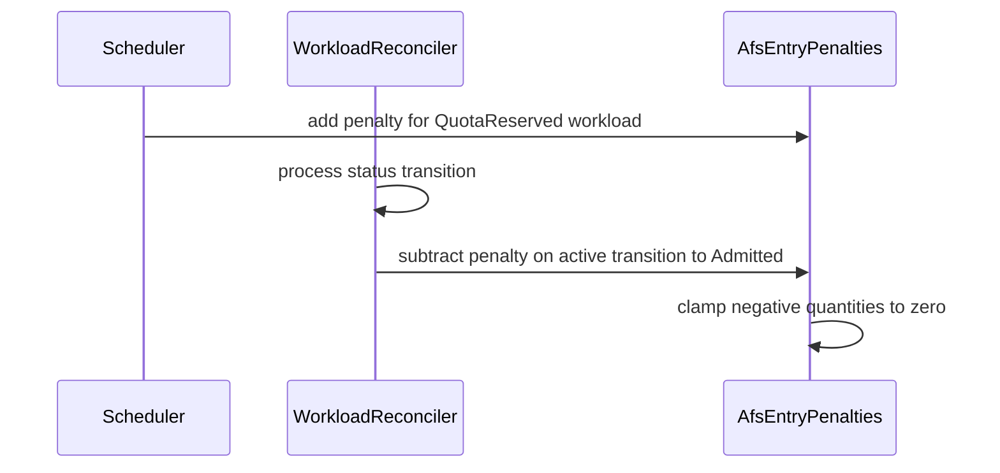

# PR #12786: Fix AFS entry penalty leak for workloads admitted via AdmissionChecks

**Summary**: Fix AFS entry penalty leak for workloads admitted via AdmissionChecks

**Sources**: https://github.com/kubernetes-sigs/kueue/pull/12786

**Last updated**: 2026-09-30T17:18:03Z

---

## Metadata

- **State**: closed (merged)
- **Author**: [@apullo777](https://github.com/apullo777)
- **Branch**: `fix-12539-afs-penalty-leak-failing-test` → `main`
- **Created**: 2026-07-05T11:41:57Z
- **Updated**: 2026-09-30T17:18:03Z
- **Merged**: 2026-08-04T07:02:32Z
- **Closed**: 2026-08-04T07:02:32Z
- **Labels**: `kind/bug`, `release-note`, `size/L`, `lgtm`, `approved`, `ok-to-test`, `cncf-cla: yes`
- **Assignees**: [@mimowo](https://github.com/mimowo)
- **Requested reviewers**: [@mbobrovskyi](https://github.com/mbobrovskyi), [@PBundyra](https://github.com/PBundyra)
- **Changed files**: 5   **+269 / -3**

## Description

<!--  Thanks for sending a pull request!  Here are some tips for you:

1. If this is your first time, please read our contributor guidelines: https://git.k8s.io/community/contributors/guide/first-contribution.md#your-first-contribution and developer guide https://git.k8s.io/community/contributors/devel/development.md#development-guide
2. Please label this pull request according to what type of issue you are addressing, especially if this is a release targeted pull request. For reference on required PR/issue labels, read here:
https://git.k8s.io/community/contributors/devel/sig-release/release.md#issuepr-kind-label
3. Ensure you have added or ran the appropriate tests for your PR: https://git.k8s.io/community/contributors/devel/sig-testing/testing.md
4. If you want *faster* PR reviews, read how: https://git.k8s.io/community/contributors/guide/pull-requests.md#best-practices-for-faster-reviews
5. If the PR is unfinished, see how to mark it: https://git.k8s.io/community/contributors/guide/pull-requests.md#marking-unfinished-pull-requests
-->

#### What type of PR is this?

/kind bug

#### What this PR does / why we need it:

With AdmissionFairSharing enabled, workloads receive an entry penalty when they are assumed. That penalty was only settled on the `Pending → Admitted` path.

Workloads gated by AdmissionChecks, such as ProvisioningRequest, MultiKueue, or TAS, are admitted through `Pending → QuotaReserved → Admitted`. The final transition did not settle the entry penalty, so the LocalQueue's fair-sharing usage stayed artificially inflated and its later workloads were deprioritized.

This seems to be a regression introduced by the AFS consumed-resources cache refactor (#7780). Before that refactor, settlement happened during the LocalQueue reconciler's recomputation and was transition-independent. The refactor moved settlement into the workload status-transition switch, where it was only wired to the `Pending → Admitted` case.

This PR fixes the leak by settling the entry penalty whenever a workload transitions into `Admitted`. The settle call is centralized after the status-transition switch so it also covers transitions handled by earlier cases, instead of duplicating the call in a dedicated `QuotaReserved → Admitted` case.

It also clamps `AfsEntryPenalties.Sub` at zero, so settling without a matching in-memory penalty, for example after restart, cannot create a permanent usage discount.

Also added regression coverage for the AdmissionCheck admission path. AI assistance was used for parts of this change.

Rollback paths such as `QuotaReserved → Pending` eviction or deletion while QuotaReserved are left for follow-up  #12787, since they have different lifecycle semantics.

#### Which issue(s) this PR fixes:
<!--
*Automatically closes linked issue when PR is merged.
Usage: `Fixes #<issue number>`, or `Fixes (paste link of issue)`.
_If PR is about `failing-tests or flakes`, please post the related issues/tests in a comment and do not use `Fixes`_*
-->
Fixes #12539

#### Special notes for your reviewer:
- On the clamp: the settle amount is recomputed at settlement time rather than recorded at push time, so it can exceed what was pushed. For example, a manager restart can clear the in-memory penalties while the workload keeps its persisted QuotaReserved state. Clamping at zero prevents that mismatch from becoming a permanent usage discount.

- Test isolation: without the settlement fix, the new `QuotaReserved → Admitted` unit case fails and the new integration test times out. Without the clamp, the new over-subtraction `Sub` unit cases fail.

#### Does this PR introduce a user-facing change?
<!--
If no, just write "NONE" in the release-note block below.
If yes, a release note is required:
Enter your extended release note in the block below. If the PR requires additional action from users switching to the new release, include the string "action required".
-->
```release-note
AFS: Fixed a bug where workloads admitted via AdmissionChecks could keep their entry penalty permanently, inflating LocalQueue fair-sharing usage and deprioritizing later workloads.
```


<!-- This is an auto-generated comment: release notes by coderabbit.ai -->
## Summary by CodeRabbit

## Summary by CodeRabbit

* **Bug Fixes**
  * Admission fair-sharing penalties no longer become negative and are cleared correctly when fully offset.
  * Penalties are settled when workloads become admitted, including after quota reservation, while avoiding inactive or unchanged workloads.

* **Tests**
  * Added coverage for subtraction edge cases and admission-state transitions.
  * Added integration coverage confirming penalties clear after admission checks become ready.
<!-- end of auto-generated comment: release notes by coderabbit.ai -->

## Discussion

### Comment by [@netlify[bot]](https://github.com/apps/netlify) — 2026-07-05T11:42:02Z

### <span aria-hidden="true">✅</span> Deploy Preview for *kubernetes-sigs-kueue* canceled.


|  Name | Link |
|:-:|------------------------|
|<span aria-hidden="true">🔨</span> Latest commit | 184c220992a329a72600980feadcef51f233204e |
|<span aria-hidden="true">🔍</span> Latest deploy log | https://app.netlify.com/projects/kubernetes-sigs-kueue/deploys/6a711b6d10318100083d64c8 |

### Comment by [@kubernetes-prow[bot]](https://github.com/apps/kubernetes-prow) — 2026-07-05T11:42:08Z

Hi @apullo777. Thanks for your PR.

I'm waiting for a [kubernetes-sigs](https://github.com/orgs/kubernetes-sigs/people) member to verify that this patch is reasonable to test. If it is, they should reply with `/ok-to-test` on its own line. Until that is done, I will not automatically test new commits in this PR, but the usual testing commands by org members will still work.

>[!TIP]
>**We noticed you've done this a few times! Consider [joining the org](https://git.k8s.io/community/community-membership.md#member) to skip this step and gain `/lgtm` and other bot rights.** We recommend asking approvers on your previous PRs to sponsor you.

Once the patch is verified, the new status will be reflected by the `ok-to-test` label.

I understand the commands that are listed [here](https://go.k8s.io/bot-commands?repo=kubernetes-sigs%2Fkueue).

<details>

Instructions for interacting with me using PR comments are available [here](https://git.k8s.io/community/contributors/guide/pull-requests.md).  If you have questions or suggestions related to my behavior, please file an issue against the [kubernetes-sigs/prow](https://github.com/kubernetes-sigs/prow/issues/new?title=Prow%20issue:) repository.
</details>

### Comment by [@coderabbitai[bot]](https://github.com/apps/coderabbitai) — 2026-07-05T11:42:19Z

<!-- This is an auto-generated comment: summarize by coderabbit.ai -->
<!-- review_stack_entry_start -->

[](https://app.coderabbit.ai/change-stack/kubernetes-sigs/kueue/pull/12786?utm_source=github_walkthrough&utm_medium=github&utm_campaign=change_stack)

<!-- review_stack_entry_end -->
<!-- walkthrough_start -->

<details>
<summary>📝 Walkthrough</summary>

## Walkthrough

Modifies `AfsEntryPenalties.Sub` to clamp negative quantities to zero. Updates `WorkloadReconciler.Update` to settle AFS consumed usage when an active workload transitions into `Admitted`. Adds unit and integration tests.

### Changes

**AFS penalty settlement fix**

|Layer / File(s)|Summary|
|---|---|
|**Penalty subtraction clamping** <br> `pkg/cache/queue/afs/entry_penalties.go`, `pkg/cache/queue/afs/entry_penalties_test.go`|`Sub` clamps negative resource quantities to zero. Tests cover exact, partial, excessive, absent, and mixed-resource subtraction.|
|**Settlement on Admitted transition** <br> `pkg/controller/core/workload_controller.go`, `pkg/controller/core/workload_controller_test.go`|Settlement now requires an active workload to enter `Admitted`. Tests cover supported and excluded status transitions.|
|**AdmissionCheck integration coverage** <br> `test/integration/singlecluster/scheduler/fairsharing/fair_sharing_test.go`|The test verifies that a pending penalty is removed after an AdmissionCheck moves a workload from `QuotaReserved` to `Admitted`.|

**Estimated code review effort:** 3 (Moderate) | ~25 minutes

### Sequence Diagram(s)



**Possibly related issues**

- `kubernetes-sigs/kueue#13495`: Addresses related AFS entry-penalty accounting during workload admission.

**Possibly related PRs**

- [kubernetes-sigs/kueue#12697](https://github.com/kubernetes-sigs/kueue/pull/12697): Modifies `AfsEntryPenalties.Sub` penalty subtraction behavior.
- [kubernetes-sigs/kueue#12891](https://github.com/kubernetes-sigs/kueue/pull/12891): Modifies AFS penalty settlement during workload admission.
- [kubernetes-sigs/kueue#13724](https://github.com/kubernetes-sigs/kueue/pull/13724): Refines AFS penalty subtraction and settlement for the `QuotaReserved` to `Admitted` transition.

**Suggested labels:** `area/testing`

**Suggested reviewers:** `mbobrovskyi`, `pbundyra`

</details>

<!-- walkthrough_end -->
<!-- pre_merge_checks_walkthrough_start -->

<details>
<summary>🚥 Pre-merge checks | ✅ 5</summary>

<details>
<summary>✅ Passed checks (5 passed)</summary>

|         Check name         | Status   | Explanation                                                                                                                                         |
| :------------------------: | :------- | :-------------------------------------------------------------------------------------------------------------------------------------------------- |
|     Linked Issues check    | ✅ Passed | The PR fixes the AdmissionChecks penalty leak by settling penalties on all transitions to Admitted and adds regression coverage for issue [`#12539`]. |
| Out of Scope Changes check | ✅ Passed | The code and tests remain within scope by addressing penalty settlement, over-subtraction protection, and AdmissionChecks regression coverage.      |
|     Docstring Coverage     | ✅ Passed | No functions found in the changed files to evaluate docstring coverage. Skipping docstring coverage check.                                          |
|      Description Check     | ✅ Passed | Check skipped - CodeRabbit’s high-level summary is enabled.                                                                                         |
|         Title check        | ✅ Passed | The title clearly describes the main fix for leaked AFS entry penalties in workloads admitted through AdmissionChecks.                              |

</details>

</details>

<!-- pre_merge_checks_walkthrough_end -->
<!-- finishing_touch_checkbox_start -->

<details>
<summary>✨ Finishing Touches</summary>

<details>
<summary>🧪 Generate unit tests (beta)</summary>

- [ ] <!-- {"checkboxId": "f47ac10b-58cc-4372-a567-0e02b2c3d479", "radioGroupId": "utg-output-choice-group-unknown_comment_id"} -->   Create PR with unit tests

</details>

</details>

<!-- finishing_touch_checkbox_end -->
<!-- tips_start -->

---

Thanks for using [CodeRabbit](https://coderabbit.ai?utm_source=oss&utm_medium=github&utm_campaign=kubernetes-sigs/kueue&utm_content=12786)! It's free for OSS, and your support helps us grow. If you like it, consider giving us a shout-out.

<details>
<summary>❤️ Share</summary>

- [X](https://twitter.com/intent/tweet?text=I%20just%20used%20%40coderabbitai%20for%20my%20code%20review%2C%20and%20it%27s%20fantastic%21%20It%27s%20free%20for%20OSS%20and%20offers%20a%20free%20trial%20for%20the%20proprietary%20code.%20Check%20it%20out%3A&url=https%3A//coderabbit.ai)
- [Mastodon](https://mastodon.social/share?text=I%20just%20used%20%40coderabbitai%20for%20my%20code%20review%2C%20and%20it%27s%20fantastic%21%20It%27s%20free%20for%20OSS%20and%20offers%20a%20free%20trial%20for%20the%20proprietary%20code.%20Check%20it%20out%3A%20https%3A%2F%2Fcoderabbit.ai)
- [Reddit](https://www.reddit.com/submit?title=Great%20tool%20for%20code%20review%20-%20CodeRabbit&text=I%20just%20used%20CodeRabbit%20for%20my%20code%20review%2C%20and%20it%27s%20fantastic%21%20It%27s%20free%20for%20OSS%20and%20offers%20a%20free%20trial%20for%20proprietary%20code.%20Check%20it%20out%3A%20https%3A//coderabbit.ai)
- [LinkedIn](https://www.linkedin.com/sharing/share-offsite/?url=https%3A%2F%2Fcoderabbit.ai&mini=true&title=Great%20tool%20for%20code%20review%20-%20CodeRabbit&summary=I%20just%20used%20CodeRabbit%20for%20my%20code%20review%2C%20and%20it%27s%20fantastic%21%20It%27s%20free%20for%20OSS%20and%20offers%20a%20free%20trial%20for%20proprietary%20code)

</details>


<sub>Comment `@coderabbitai help` to get the list of available commands.</sub>

<!-- tips_end -->

### Comment by [@mimowo](https://github.com/mimowo) — 2026-07-06T06:44:02Z

/ok-to-test

### Comment by [@kshalot](https://github.com/kshalot) — 2026-07-22T12:41:06Z

Hey @apullo777, I'm doing a quick scan of my GH inbox.

AFAIR we agreed to go with the QR-anchored approach here, right? https://github.com/kubernetes-sigs/kueue/issues/12783#issuecomment-4916930808

I'm not rushing you, I just wanted to make sure you are blocked on a response from somebody etc :)

### Comment by [@apullo777](https://github.com/apullo777) — 2026-07-22T19:51:09Z

> AFAIR we agreed to go with the QR-anchored approach here, right? [#12783 (comment)](https://github.com/kubernetes-sigs/kueue/issues/12783#issuecomment-4916930808)
> I just wanted to make sure you are blocked on a response from somebody etc :)

@kshalot, thanks for checking in :)

Yes. QR-anchored accounting is my understanding of the agreed direction. I’m not blocked on review feedback so much as on the implementation boundary and sequencing.

Since this changes the accounting semantics, should we first update KEP-4136 to define QuotaReserved as the accounting start and specify the consolidation/exit-path invariant, or would you prefer a PoC implementation first with the KEP updated alongside it? Also, should #12786 be repurposed for that first implementation slice, or kept as a separate stopgap?

@mimowo, happy to help with either the KEP update or the implementation once we agree on the shape.

Also, given that the discussion is now spread across multiple issues, perhaps it would be great to open a focused umbrella issue to track the KEP-4136 update and the QR-anchored implementation?

### Comment by [@mimowo](https://github.com/mimowo) — 2026-07-22T20:11:12Z

 I think we have two issues;
1. Entry penalties should be accounted at QR time
2. Entry penalties should not leak

If you think (1.) and (2.) can be solved independently - go for it. I just proposed doing (1.) in case solving (2.) currently requires hacks which would not be needed if we do (1.).

Overall, I think the KEPfor (1.)  is just for track keeping. 

What would be helpful to determine if we couple (1.) and (2.) is a prototype for fixing both as we would like it to be. Then we could be more informed to decide if we want to split the fixes or not.

### Comment by [@mimowo](https://github.com/mimowo) — 2026-08-03T06:41:15Z

@apullo777 please rebase

### Comment by [@kubernetes-prow[bot]](https://github.com/apps/kubernetes-prow) — 2026-08-04T06:48:41Z

LGTM label has been added.  <details>Git tree hash: 072d545e215b3a0eaf585a06bfed813acfbf26ae</details>

### Comment by [@kubernetes-prow[bot]](https://github.com/apps/kubernetes-prow) — 2026-08-04T06:48:49Z

[APPROVALNOTIFIER] This PR is **APPROVED**

This pull-request has been approved by: *<a href="https://github.com/kubernetes-sigs/kueue/pull/12786#" title="Author self-approved">apullo777</a>*, *<a href="https://github.com/kubernetes-sigs/kueue/pull/12786#pullrequestreview-4851403835" title="Approved">mimowo</a>*

The full list of commands accepted by this bot can be found [here](https://go.k8s.io/bot-commands?repo=kubernetes-sigs%2Fkueue).

The pull request process is described [here](https://git.k8s.io/community/contributors/guide/owners.md#the-code-review-process)

<details >
Needs approval from an approver in each of these files:

- ~~[OWNERS](https://github.com/kubernetes-sigs/kueue/blob/main/OWNERS)~~ [mimowo]

Approvers can indicate their approval by writing `/approve` in a comment
Approvers can cancel approval by writing `/approve cancel` in a comment
</details>
<!-- META={"approvers":[]} -->

### Comment by [@mimowo](https://github.com/mimowo) — 2026-08-04T07:54:26Z

/cherrypick release-0.19
/cherrypick release-0.18

### Comment by [@k8s-infra-cherrypick-robot](https://github.com/k8s-infra-cherrypick-robot) — 2026-08-04T07:55:05Z

@mimowo: new pull request created: #13794

<details>

In response to [this](https://github.com/kubernetes-sigs/kueue/pull/12786#issuecomment-5176161550):

>/cherrypick release-0.19
>/cherrypick release-0.18


Instructions for interacting with me using PR comments are available [here](https://git.k8s.io/community/contributors/guide/pull-requests.md).  If you have questions or suggestions related to my behavior, please file an issue against the [kubernetes-sigs/prow](https://github.com/kubernetes-sigs/prow/issues/new?title=Prow%20issue:) repository.
</details>

### Comment by [@k8s-infra-cherrypick-robot](https://github.com/k8s-infra-cherrypick-robot) — 2026-08-04T07:55:43Z

@mimowo: new pull request created: #13795

<details>

In response to [this](https://github.com/kubernetes-sigs/kueue/pull/12786#issuecomment-5176161550):

>/cherrypick release-0.19
>/cherrypick release-0.18


Instructions for interacting with me using PR comments are available [here](https://git.k8s.io/community/contributors/guide/pull-requests.md).  If you have questions or suggestions related to my behavior, please file an issue against the [kubernetes-sigs/prow](https://github.com/kubernetes-sigs/prow/issues/new?title=Prow%20issue:) repository.
</details>

### Comment by [@mimowo](https://github.com/mimowo) — 2026-08-04T08:05:19Z

@apullo777 please prep the CP for 0.18: https://github.com/kubernetes-sigs/kueue/pull/13794

### Comment by [@tenzen-y](https://github.com/tenzen-y) — 2026-09-30T17:18:03Z

/release-note-edit
```release-note
AFS: Fixed a bug where workloads admitted via AdmissionChecks could keep their entry penalty permanently, inflating LocalQueue fair-sharing usage and deprioritizing later workloads.
```

## Reviews

### Review by [@mimowo](https://github.com/mimowo) (commented) — 2026-07-06T07:52:01Z

- **pkg/cache/queue/afs/entry_penalties.go:55** by [@mimowo](https://github.com/mimowo) — 2026-07-06T07:52:01Z
```diff
@@ -41,7 +41,18 @@ func (m *AfsEntryPenalties) Sub(lqKey utilqueue.LocalQueueReference, penalty cor
 		v.Neg()
 		penalty[k] = v
 	}
-	m.penalties.Add(lqKey, resource.MergeResourceListKeepSum(m.Peek(lqKey), penalty))
+	newPenalty := resource.MergeResourceListKeepSum(m.Peek(lqKey), penalty)
+	// Sub recomputes the amount at settlement time rather than recording it at
+	// push time, so it can exceed what was pushed (e.g. after a restart loses the
+	// in-memory penalties). Clamp at zero: a mismatch must not become a permanent
+	// usage discount for the LocalQueue.
+	for k, v := range newPenalty {
+		if v.Sign() < 0 {
+			v.Set(0)
+			newPenalty[k] = v
+		}
+	}
+	m.penalties.Add(lqKey, newPenalty)
```

  This does not seem directly related to the referenced issue. IIUC this is to make sure the usage never drops below 0 in case of concurrent modifications, right?

### Review by [@mimowo](https://github.com/mimowo) (commented) — 2026-07-06T07:52:20Z

cc @sohankunkerkar

### Review by [@apullo777](https://github.com/apullo777) (commented) — 2026-07-06T08:39:08Z

- **pkg/cache/queue/afs/entry_penalties.go:55** by [@apullo777](https://github.com/apullo777) — 2026-07-06T08:39:08Z
```diff
@@ -41,7 +41,18 @@ func (m *AfsEntryPenalties) Sub(lqKey utilqueue.LocalQueueReference, penalty cor
 		v.Neg()
 		penalty[k] = v
 	}
-	m.penalties.Add(lqKey, resource.MergeResourceListKeepSum(m.Peek(lqKey), penalty))
+	newPenalty := resource.MergeResourceListKeepSum(m.Peek(lqKey), penalty)
+	// Sub recomputes the amount at settlement time rather than recording it at
+	// push time, so it can exceed what was pushed (e.g. after a restart loses the
+	// in-memory penalties). Clamp at zero: a mismatch must not become a permanent
+	// usage discount for the LocalQueue.
+	for k, v := range newPenalty {
+		if v.Sign() < 0 {
+			v.Set(0)
+			newPenalty[k] = v
+		}
+	}
+	m.penalties.Add(lqKey, newPenalty)
```

  Thanks for the question! You are right that this part is not the main fix for the issue.
  
  This is not about concurrent map modifications. It is a defensive guard for the settlement path enabled by this PR. `Sub` subtracts an amount recomputed at settlement time, rather than replaying the exact amount that was pushed at reservation time.
  
  With this PR, the `QuotaReserved -> Admitted` path now calls settlement. If the in-memory entry penalty is missing or smaller than the recomputed amount, for example after a manager restart while the Workload was waiting in `QuotaReserved`, the old code could subtract from an empty/smaller entry and leave a negative pending penalty. That would act as a usage discount in AFS ordering.
  
  The clamp makes `Sub` saturate at zero instead. This is covered by the new unit test case `subtracting more than pushed clamps at zero and clears the entry`.
  
  I can also make the code comment more explicit about the restart/mismatch case, or split this out if you prefer keeping this PR limited to the transition fix.

### Review by [@mimowo](https://github.com/mimowo) (commented) — 2026-07-06T09:25:21Z

- **pkg/cache/queue/afs/entry_penalties.go:55** by [@mimowo](https://github.com/mimowo) — 2026-07-06T09:25:20Z
```diff
@@ -41,7 +41,18 @@ func (m *AfsEntryPenalties) Sub(lqKey utilqueue.LocalQueueReference, penalty cor
 		v.Neg()
 		penalty[k] = v
 	}
-	m.penalties.Add(lqKey, resource.MergeResourceListKeepSum(m.Peek(lqKey), penalty))
+	newPenalty := resource.MergeResourceListKeepSum(m.Peek(lqKey), penalty)
+	// Sub recomputes the amount at settlement time rather than recording it at
+	// push time, so it can exceed what was pushed (e.g. after a restart loses the
+	// in-memory penalties). Clamp at zero: a mismatch must not become a permanent
+	// usage discount for the LocalQueue.
+	for k, v := range newPenalty {
+		if v.Sign() < 0 {
+			v.Set(0)
+			newPenalty[k] = v
+		}
+	}
+	m.penalties.Add(lqKey, newPenalty)
```

  sgtm, but let me also align on the direction as I cover this partly in my question here: https://github.com/kubernetes-sigs/kueue/issues/12783#issuecomment-4891164731

### Review by [@mimowo](https://github.com/mimowo) (commented) — 2026-08-04T06:48:34Z

/lgtm
/approve
/cherrypick release-0.19
/cherrypick release-0.18
Thank you for the nice AFS leak fix 👍
