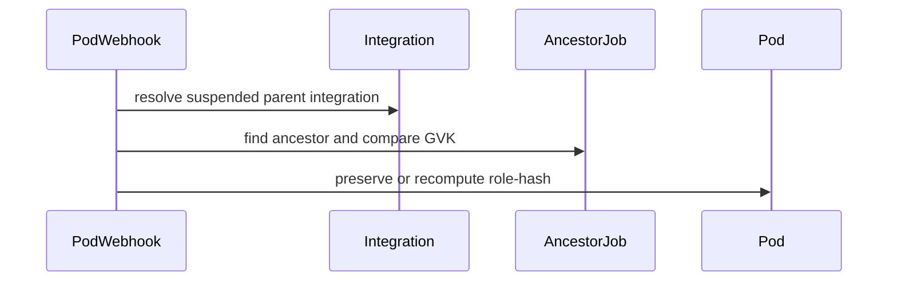

# PR #13014: fix(pod): refuse adopting non-pod-group Workloads by group name

**Summary**: fix(pod): refuse adopting non-pod-group Workloads by group name

**Sources**: https://github.com/kubernetes-sigs/kueue/pull/13014

**Last updated**: 2026-09-30T17:25:28Z

---

## Metadata

- **State**: closed (merged)
- **Author**: [@vladikkuzn](https://github.com/vladikkuzn)
- **Branch**: `fix/pod-group-workload-hijacking` → `main`
- **Created**: 2026-07-13T21:13:45Z
- **Updated**: 2026-09-30T17:25:28Z
- **Merged**: 2026-08-05T19:00:35Z
- **Closed**: 2026-08-05T19:00:35Z
- **Labels**: `kind/bug`, `size/L`, `lgtm`, `release-note-none`, `approved`, `cncf-cla: yes`, `area/integrations`
- **Assignees**: [@mimowo](https://github.com/mimowo), [@vladikkuzn](https://github.com/vladikkuzn)
- **Requested reviewers**: [@kannon92](https://github.com/kannon92), [@mykysha](https://github.com/mykysha), [@mbobrovskyi](https://github.com/mbobrovskyi), [@ivnovakov](https://github.com/ivnovakov), [@kshalot](https://github.com/kshalot), [@tenzen-y](https://github.com/tenzen-y), [@reruno](https://github.com/reruno)
- **Changed files**: 7   **+343 / -132**

## Description

#### What type of PR is this?

/kind bug
/area integrations

#### What this PR does / why we need it:

## Context

An authenticated tenant can bypass Kueue quota by making a Pod "join" an already-admitted Workload it does not own.

### Vector 1 — Cross-framework Workload hijacking (this PR)

`(*Pod).FindMatchingWorkloads` reads the user-controlled `kueue.x-k8s.io/pod-group-name` label/annotation, fetches a Workload by that name, and adopts it — without verifying the Workload was created by the pod-group framework. Pod-group Workloads are stamped with `kueue.x-k8s.io/is-group-workload=true` by `NewGroupWorkload`, but that marker was never checked on the read path. A tenant can:

1. Submit a batch Job that fits quota and let it be admitted → Workload `job-x-`.
2. Create a Pod with `pod-group-name=job-x-` (and matching role / total-count).
3. The Pod is adopted onto the already-admitted foreign Workload and ungated.

**Intended outcome for this PR:** a pod group can only adopt a Workload that the pod-group framework created. Foreign Workloads are refused cleanly (returned as neither the match nor in the to-delete set), so the victim's Workload is never deleted.

### Vector 2 — follow-up PR

Role-hash forgery / webhook recompute, exceeds-requests checks, and owner-reference UID validation are **out of scope here** and will land in a separate follow-up PR.

## Approach

- Introduce the `RefuseForeignPodGroupWorkloadAdoption` feature gate (Beta, default `true` in v0.20).
- When enabled, require the `kueue.x-k8s.io/is-group-workload` marker before a pod group adopts a Workload found by group name.
- Emit a `WorkloadNameConflict` Warning event and return an unretryable error when a foreign Workload already occupies that name.
- Do not put the foreign Workload in the to-delete set.

#### Special notes for your reviewer:

- StatefulSet and LeaderWorkerSet integrations also build Workloads via `NewGroupWorkload`, so they carry the `is-group-workload` marker and are unaffected by this check.
- Unit coverage: foreign Workload is not adopted and not deleted; adoption still works when the feature gate is disabled.
- Operators can disable `RefuseForeignPodGroupWorkloadAdoption` temporarily if they need the legacy behavior during rollout.

#### Does this PR introduce a user-facing change?

```release-note
NONE
```

## Discussion

### Comment by [@netlify[bot]](https://github.com/apps/netlify) — 2026-07-13T21:13:50Z

### <span aria-hidden="true">✅</span> Deploy Preview for *kubernetes-sigs-kueue* ready!


|  Name | Link |
|:-:|------------------------|
|<span aria-hidden="true">🔨</span> Latest commit | 75dbc92b255f43068af9f8c0c1f4b80828345c98 |
|<span aria-hidden="true">🔍</span> Latest deploy log | https://app.netlify.com/projects/kubernetes-sigs-kueue/deploys/6a731919266db90008037c14 |
|<span aria-hidden="true">😎</span> Deploy Preview | [https://deploy-preview-13014--kubernetes-sigs-kueue.netlify.app](https://deploy-preview-13014--kubernetes-sigs-kueue.netlify.app) |
|<span aria-hidden="true">📱</span> Preview on mobile | <details><summary> Toggle QR Code... </summary><br /><br /><br /><br />_Use your smartphone camera to open QR code link._</details> |
---
<!-- [kubernetes-sigs-kueue Preview](https://deploy-preview-13014--kubernetes-sigs-kueue.netlify.app) -->
_To edit notification comments on pull requests, go to your [Netlify project configuration](https://app.netlify.com/projects/kubernetes-sigs-kueue/configuration/notifications#deploy-notifications)._

### Comment by [@coderabbitai[bot]](https://github.com/apps/coderabbitai) — 2026-07-13T21:14:06Z

<!-- This is an auto-generated comment: summarize by coderabbit.ai -->
<!-- review_stack_entry_start -->

[](https://app.coderabbit.ai/change-stack/kubernetes-sigs/kueue/pull/13014?utm_source=github_walkthrough&utm_medium=github&utm_campaign=change_stack)

<!-- review_stack_entry_end -->
<!-- This is an auto-generated comment: review paused by coderabbit.ai -->

> [!NOTE]
> ## Reviews paused
> 
> It looks like this branch is under active development. To avoid overwhelming you with review comments due to an influx of new commits, CodeRabbit has automatically paused this review. You can configure this behavior by changing the `reviews.auto_review.auto_pause_after_reviewed_commits` setting.
> 
> Use the following commands to manage reviews:
> - `@coderabbitai resume` to resume automatic reviews.
> - `@coderabbitai review` to trigger a single review.
> 
> Use the checkboxes below for quick actions:
> - [ ] <!-- {"checkboxId": "7f6cc2e2-2e4e-497a-8c31-c9e4573e93d1"} --> ▶️ Resume reviews
> - [ ] <!-- {"checkboxId": "e9bb8d72-00e8-4f67-9cb2-caf3b22574fe"} --> 🔍 Trigger review

<!-- end of auto-generated comment: review paused by coderabbit.ai -->
<!-- walkthrough_start -->

<details>
<summary>📝 Walkthrough</summary>

## Walkthrough

This change validates owner-reference UIDs, reports unretryable workload composition errors, tightens pod-group workload adoption through ownership, role, and resource checks, and conditionally preserves pod role hashes for matching parent integrations.

### Changes

**Reconciler ownership and error handling**

|Layer / File(s)|Summary|
|---|---|
|**Ancestor owner UID validation** <br> `pkg/controller/jobframework/reconciler.go`, `pkg/controller/jobframework/reconciler_test.go`, `pkg/controller/jobs/job/job_controller_test.go`|Ancestor traversal now stops on owner UID mismatches, with tests and related controller-reference fixtures updated.|
|**Unretryable workload error events** <br> `pkg/controller/jobframework/reconciler.go`|Unretryable workload composition errors now generate truncated Warning events on the job.|

**Pod-group admission safeguards**

|Layer / File(s)|Summary|
|---|---|
|**Pod-set resource validation** <br> `pkg/controller/jobs/pod/pod_controller.go`, `pkg/controller/jobs/pod/pod_controller_test.go`|Pod-group construction validates runnable pod requests against reserved role-template resources and checks role-hash consistency in fast admission.|
|**Workload ownership and adoption checks** <br> `pkg/controller/jobs/pod/pod_controller.go`, `pkg/controller/jobs/pod/pod_controller_test.go`|Workload adoption rejects non-pod-group workloads, role-hash mismatches, and pods exceeding role reservations, with distinct Warning events and expanded fixtures.|

**Parent-managed role-hash preservation**

|Layer / File(s)|Summary|
|---|---|
|**Authorized role-hash preservation** <br> `pkg/controller/jobs/pod/pod_webhook.go`|The webhook preserves an existing role hash only for prebuilt workloads or matching suspended parent integrations; otherwise it recomputes it.|
|**Role-hash defaulting tests** <br> `pkg/controller/jobs/pod/pod_webhook_test.go`|Defaulting tests cover forged hashes, matching parent integrations, GVK mismatches, and forged owner references.|

**Estimated code review effort:** 4 (Complex) | ~60 minutes

### Sequence Diagram(s)



**Possibly related PRs**

- [kubernetes-sigs/kueue#12334](https://github.com/kubernetes-sigs/kueue/pull/12334): Updates related pod resource and role-hash calculation logic used by these admission checks.
- [kubernetes-sigs/kueue#13114](https://github.com/kubernetes-sigs/kueue/pull/13114): Makes `RestorePodSetsInfo` context-aware, matching the updated test invocation.

**Suggested labels:** `area/testing`

**Suggested reviewers:** `tenzen-y`, `kannon92`, `mbobrovskyi`, `mimowo`, `kshalot`

</details>

<!-- walkthrough_end -->
<!-- pre_merge_checks_walkthrough_start -->

<details>
<summary>🚥 Pre-merge checks | ✅ 4 | ❌ 1</summary>

### ❌ Failed checks (1 warning)

|     Check name     | Status     | Explanation                                                                           | Resolution                                                                         |
| :----------------: | :--------- | :------------------------------------------------------------------------------------ | :--------------------------------------------------------------------------------- |
| Docstring Coverage | ⚠️ Warning | Docstring coverage is 33.33% which is insufficient. The required threshold is 80.00%. | Write docstrings for the functions missing them to satisfy the coverage threshold. |

<details>
<summary>✅ Passed checks (4 passed)</summary>

|         Check name         | Status   | Explanation                                                                                                   |
| :------------------------: | :------- | :------------------------------------------------------------------------------------------------------------ |
|     Linked Issues check    | ✅ Passed | Check skipped because no linked issues were found for this pull request.                                      |
| Out of Scope Changes check | ✅ Passed | Check skipped because no linked issues were found for this pull request.                                      |
|      Description Check     | ✅ Passed | Check skipped - CodeRabbit’s high-level summary is enabled.                                                   |
|         Title check        | ✅ Passed | The title clearly describes a primary change: refusing adoption of non-pod-group Workloads by pod-group name. |

</details>

</details>

<!-- pre_merge_checks_walkthrough_end -->
<!-- finishing_touch_checkbox_start -->

<details>
<summary>✨ Finishing Touches</summary>

<details>
<summary>🧪 Generate unit tests (beta)</summary>

- [ ] <!-- {"checkboxId": "f47ac10b-58cc-4372-a567-0e02b2c3d479", "radioGroupId": "utg-output-choice-group-unknown_comment_id"} -->   Create PR with unit tests

</details>

</details>

<!-- finishing_touch_checkbox_end -->
<!-- tips_start -->

---

Thanks for using [CodeRabbit](https://coderabbit.ai?utm_source=oss&utm_medium=github&utm_campaign=kubernetes-sigs/kueue&utm_content=13014)! It's free for OSS, and your support helps us grow. If you like it, consider giving us a shout-out.

<details>
<summary>❤️ Share</summary>

- [X](https://twitter.com/intent/tweet?text=I%20just%20used%20%40coderabbitai%20for%20my%20code%20review%2C%20and%20it%27s%20fantastic%21%20It%27s%20free%20for%20OSS%20and%20offers%20a%20free%20trial%20for%20the%20proprietary%20code.%20Check%20it%20out%3A&url=https%3A//coderabbit.ai)
- [Mastodon](https://mastodon.social/share?text=I%20just%20used%20%40coderabbitai%20for%20my%20code%20review%2C%20and%20it%27s%20fantastic%21%20It%27s%20free%20for%20OSS%20and%20offers%20a%20free%20trial%20for%20the%20proprietary%20code.%20Check%20it%20out%3A%20https%3A%2F%2Fcoderabbit.ai)
- [Reddit](https://www.reddit.com/submit?title=Great%20tool%20for%20code%20review%20-%20CodeRabbit&text=I%20just%20used%20CodeRabbit%20for%20my%20code%20review%2C%20and%20it%27s%20fantastic%21%20It%27s%20free%20for%20OSS%20and%20offers%20a%20free%20trial%20for%20proprietary%20code.%20Check%20it%20out%3A%20https%3A//coderabbit.ai)
- [LinkedIn](https://www.linkedin.com/sharing/share-offsite/?url=https%3A%2F%2Fcoderabbit.ai&mini=true&title=Great%20tool%20for%20code%20review%20-%20CodeRabbit&summary=I%20just%20used%20CodeRabbit%20for%20my%20code%20review%2C%20and%20it%27s%20fantastic%21%20It%27s%20free%20for%20OSS%20and%20offers%20a%20free%20trial%20for%20proprietary%20code)

</details>


<sub>Comment `@coderabbitai help` to get the list of available commands.</sub>

<!-- tips_end -->

### Comment by [@vladikkuzn](https://github.com/vladikkuzn) — 2026-07-13T21:17:08Z

/assign
/cc @mbobrovskyi @mszadkow @mimowo @tenzen-y @mykysha @reruno @ivnovakov

### Comment by [@vladikkuzn](https://github.com/vladikkuzn) — 2026-07-17T08:48:35Z

/cc @dkaluza

### Comment by [@kubernetes-prow[bot]](https://github.com/apps/kubernetes-prow) — 2026-07-17T08:48:38Z

@vladikkuzn: GitHub didn't allow me to request PR reviews from the following users: dkaluza.

Note that only [kubernetes-sigs members](https://github.com/orgs/kubernetes-sigs/people) and repo collaborators can review this PR, and authors cannot review their own PRs.

<details>

In response to [this](https://github.com/kubernetes-sigs/kueue/pull/13014#issuecomment-5000932196):

>/cc @dkaluza 


Instructions for interacting with me using PR comments are available [here](https://git.k8s.io/community/contributors/guide/pull-requests.md).  If you have questions or suggestions related to my behavior, please file an issue against the [kubernetes-sigs/prow](https://github.com/kubernetes-sigs/prow/issues/new?title=Prow%20issue:) repository.
</details>

### Comment by [@vladikkuzn](https://github.com/vladikkuzn) — 2026-07-18T09:02:09Z

WDYT about the comment from coderabbit?

pkg/controller/jobs/pod/pod_controller.go (1)
782-805: 🩺 Stability & Availability | 🔴 Critical | 🏗️ Heavy lift

Infinite reconciliation loop with heterogeneous pods in fast admission.

constructGroupPodSetsFast assumes all pods belong to the same role and uses the first pod's roleHash to construct a single PodSet for the Workload. However, it does not verify that subsequent pods actually share this roleHash.

If a user enables fast admission but submits pods with different roleHashes (e.g., differing resource requests that don't trigger the podExceedsRequests limit, or natively different specs), constructGroupPodSetsFast will successfully create a single-role Workload. In the next sync cycle, FindMatchingWorkloads (which uses strict getRoleHash matching to partition active pods) will discover that the actual pods do not map exactly to the single-role Workload. It will reject and delete the Workload, which constructGroupPodSetsFast will immediately recreate, causing an infinite churn loop.

To ensure proper controller behavior and availability as per path instructions, verify that all pods have identical roleHashes during fast admission and return an unretryable error if they diverge.

### Comment by [@mbobrovskyi](https://github.com/mbobrovskyi) — 2026-07-20T09:15:32Z

> WDYT about the comment from coderabbit?
> 
> pkg/controller/jobs/pod/pod_controller.go (1) 782-805: 🩺 Stability & Availability | 🔴 Critical | 🏗️ Heavy lift
> 
> Infinite reconciliation loop with heterogeneous pods in fast admission.
> 
> constructGroupPodSetsFast assumes all pods belong to the same role and uses the first pod's roleHash to construct a single PodSet for the Workload. However, it does not verify that subsequent pods actually share this roleHash.
> 
> If a user enables fast admission but submits pods with different roleHashes (e.g., differing resource requests that don't trigger the podExceedsRequests limit, or natively different specs), constructGroupPodSetsFast will successfully create a single-role Workload. In the next sync cycle, FindMatchingWorkloads (which uses strict getRoleHash matching to partition active pods) will discover that the actual pods do not map exactly to the single-role Workload. It will reject and delete the Workload, which constructGroupPodSetsFast will immediately recreate, causing an infinite churn loop.
> 
> To ensure proper controller behavior and availability as per path instructions, verify that all pods have identical roleHashes during fast admission and return an unretryable error if they diverge.

Oh, I think this is a good point that we should investigate. It would be great to prepare an integration test to verify this case before starting to fix it.

@vladikkuzn Thank you for catching this!

### Comment by [@vladikkuzn](https://github.com/vladikkuzn) — 2026-07-21T08:42:54Z

/cc @mimowo @dkaluza

### Comment by [@kubernetes-prow[bot]](https://github.com/apps/kubernetes-prow) — 2026-07-21T08:42:57Z

@vladikkuzn: GitHub didn't allow me to request PR reviews from the following users: dkaluza.

Note that only [kubernetes-sigs members](https://github.com/orgs/kubernetes-sigs/people) and repo collaborators can review this PR, and authors cannot review their own PRs.

<details>

In response to [this](https://github.com/kubernetes-sigs/kueue/pull/13014#issuecomment-5031906068):

>/cc @mimowo @dkaluza 


Instructions for interacting with me using PR comments are available [here](https://git.k8s.io/community/contributors/guide/pull-requests.md).  If you have questions or suggestions related to my behavior, please file an issue against the [kubernetes-sigs/prow](https://github.com/kubernetes-sigs/prow/issues/new?title=Prow%20issue:) repository.
</details>

### Comment by [@dkaluza](https://github.com/dkaluza) — 2026-07-22T08:42:06Z

@vladikkuzn this one is XL and from the description it looks like it is handling separate 2 issues, it would be best to split it to 2 separate PRs if this is feasible. It would make the review & merging easier.

### Comment by [@vladikkuzn](https://github.com/vladikkuzn) — 2026-07-22T09:25:07Z

/test pull-kueue-test-e2e-baseline-main-1-36

### Comment by [@vladikkuzn](https://github.com/vladikkuzn) — 2026-07-23T03:19:37Z

@dkaluza following up on your note about splitting this XL PR: done.

- **This PR** is now Vector 1 only (refuse adopting non-pod-group Workloads by group name).
- **Vector 2** (role-hash forgery + related defenses + review cleanups) is in https://github.com/kubernetes-sigs/kueue/pull/13382.

### Comment by [@linux-foundation-easycla[bot]](https://github.com/apps/linux-foundation-easycla) — 2026-07-27T23:08:16Z

<a href="https://easycla.lfx.linuxfoundation.org/#/?version=2"></a><br >The committers listed above are authorized under a signed CLA.<ul><li>:white_check_mark: login: vladikkuzn / name: vladikkuzn (48bf28e74c80643710fd320ec985342d43285a96, 75bacfc42a7de9365d63ab655f7089a794c7c573, dfc36ce856fe2c85fb8ff3ee9cadf083db53a07a)</li></ul>

### Comment by [@mimowo](https://github.com/mimowo) — 2026-08-03T16:37:33Z

cc @dkaluza ptal

### Comment by [@vladikkuzn](https://github.com/vladikkuzn) — 2026-08-04T11:30:11Z

/retest 

[Failing test ](https://prow.k8s.io/view/gs/kubernetes-ci-logs/pr-logs/pull/kubernetes-sigs_kueue/13014/pull-kueue-test-integration-shard-0-main/2084599482745360384) is provisioning CapacityRevoked event Eventually timeout (provisioning_test.go:433) — tracked in [#13768](https://github.com/kubernetes-sigs/kueue/issues/13768)

### Comment by [@vladikkuzn](https://github.com/vladikkuzn) — 2026-08-04T12:31:44Z

[Flake](https://prow.k8s.io/view/gs/kubernetes-ci-logs/pr-logs/pull/kubernetes-sigs_kueue/13014/pull-kueue-test-integration-shard-0-main/2084614640402173952) could be related to https://github.com/kubernetes-sigs/kueue/pull/13738

### Comment by [@vladikkuzn](https://github.com/vladikkuzn) — 2026-08-04T12:32:06Z

/test pull-kueue-test-integration-shard-0-main

### Comment by [@kubernetes-prow[bot]](https://github.com/apps/kubernetes-prow) — 2026-08-05T18:45:35Z

LGTM label has been added.  <details>Git tree hash: 31bba37edc7b3eda592a152ae521af24639aef69</details>

### Comment by [@kubernetes-prow[bot]](https://github.com/apps/kubernetes-prow) — 2026-08-05T18:45:42Z

[APPROVALNOTIFIER] This PR is **APPROVED**

This pull-request has been approved by: *<a href="https://github.com/kubernetes-sigs/kueue/pull/13014#pullrequestreview-4854079555" title="Approved">dkaluza</a>*, *<a href="https://github.com/kubernetes-sigs/kueue/pull/13014#pullrequestreview-4867651644" title="Approved">mimowo</a>*, *<a href="https://github.com/kubernetes-sigs/kueue/pull/13014#" title="Author self-approved">vladikkuzn</a>*

The full list of commands accepted by this bot can be found [here](https://go.k8s.io/bot-commands?repo=kubernetes-sigs%2Fkueue).

The pull request process is described [here](https://git.k8s.io/community/contributors/guide/owners.md#the-code-review-process)

<details >
Needs approval from an approver in each of these files:

- ~~[pkg/controller/OWNERS](https://github.com/kubernetes-sigs/kueue/blob/main/pkg/controller/OWNERS)~~ [mimowo]
- ~~[pkg/features/OWNERS](https://github.com/kubernetes-sigs/kueue/blob/main/pkg/features/OWNERS)~~ [mimowo]
- ~~[pkg/util/testing/OWNERS](https://github.com/kubernetes-sigs/kueue/blob/main/pkg/util/testing/OWNERS)~~ [mimowo]
- ~~[site/OWNERS](https://github.com/kubernetes-sigs/kueue/blob/main/site/OWNERS)~~ [mimowo]
- ~~[test/OWNERS](https://github.com/kubernetes-sigs/kueue/blob/main/test/OWNERS)~~ [mimowo]

Approvers can indicate their approval by writing `/approve` in a comment
Approvers can cancel approval by writing `/approve cancel` in a comment
</details>
<!-- META={"approvers":[]} -->

### Comment by [@mimowo](https://github.com/mimowo) — 2026-08-05T18:45:54Z


/release-note-edit
```release-note
Pod Integration: Fixed a bug where a Pod could bypass ClusterQueue quota by setting `kueue.x-k8s.io/pod-group-name` to another Workload's name. Kueue now only adopts Workloads created by the pod-group framework (stamped with `kueue.x-k8s.io/is-group-workload`). 
```

### Comment by [@mimowo](https://github.com/mimowo) — 2026-08-05T18:46:13Z

@vladikkuzn please prepare the cherrypicks

### Comment by [@tenzen-y](https://github.com/tenzen-y) — 2026-09-30T17:23:46Z

/release-note-edit
```release-note
Pod: Fixed a bug where a Pod could bypass ClusterQueue quota by setting `kueue.x-k8s.io/pod-group-name` to another Workload's name. Kueue now only adopts Workloads created by the pod-group framework (stamped with `kueue.x-k8s.io/is-group-workload`).
```

### Comment by [@tenzen-y](https://github.com/tenzen-y) — 2026-09-30T17:25:21Z

/release-note-edit
```release-note
NONE
```

## Reviews

### Review by [@coderabbitai[bot]](https://github.com/apps/coderabbitai) (commented) — 2026-07-13T21:29:46Z

**Actionable comments posted: 3**

<details>
<summary>🤖 Prompt for all review comments with AI agents</summary>

```
Verify each finding against current code. Fix only still-valid issues, skip the
rest with a brief reason, keep changes minimal, and validate.

Inline comments:
In `@pkg/controller/jobs/pod/pod_controller.go`:
- Around line 1253-1266: Update the existing validation before returning
errNotPodGroupWorkload so legacy Workloads without IsGroupWorkloadAnnotationKey
can be recognized as pod-group Workloads using the available ownership or
identifying metadata. Preserve rejection for Workloads that are explicitly
marked as belonging to another framework, while allowing compatible legacy
Workloads to continue reconciliation and adoption.

In `@pkg/controller/jobs/pod/pod_webhook_test.go`:
- Around line 133-185: Add a unit-test case in the pod webhook test table
covering shouldPreserveRoleHash when SuspendedByParent claims a real integration
but the resolvable ancestor GVK does not match, such as a deployment integration
with a Job owner. Enable both integrations, retain the forged role hash in the
input, and assert the expected recomputed hash while preserving the scheduling
gate and owner reference.

In `@pkg/controller/jobs/pod/pod_webhook.go`:
- Around line 117-143: Update shouldPreserveRoleHash to validate the resolved
ancestorJob’s UID against the pod’s relevant controller owner reference before
preserving the role hash. Keep the existing GVK comparison, but return false
when the owner reference UID does not match ancestorJob.GetUID(), preventing
forged or stale owner chains from qualifying.
```

</details>

<details>
<summary>🪄 Autofix (Beta)</summary>

Fix all unresolved CodeRabbit comments on this PR:

- [ ] <!-- {"checkboxId": "4b0d0e0a-96d7-4f10-b296-3a18ea78f0b9"} --> Push a commit to this branch (recommended)
- [ ] <!-- {"checkboxId": "ff5b1114-7d8c-49e6-8ac1-43f82af23a33"} --> Create a new PR with the fixes

</details>

---

<details>
<summary>ℹ️ Review info</summary>

<details>
<summary>⚙️ Run configuration</summary>

**Configuration used**: Path: .coderabbit.yaml

**Review profile**: CHILL

**Plan**: Pro

**Run ID**: `618283f1-a000-40f5-a69d-e1c3628aed32`

</details>

<details>
<summary>📥 Commits</summary>

Reviewing files that changed from the base of the PR and between f3f98ea568b18c9633113812905e4a77ab727da0 and c322628860907e872fb28384788d8885e7747701.

</details>

<details>
<summary>📒 Files selected for processing (5)</summary>

* `pkg/controller/jobframework/reconciler.go`
* `pkg/controller/jobs/pod/pod_controller.go`
* `pkg/controller/jobs/pod/pod_controller_test.go`
* `pkg/controller/jobs/pod/pod_webhook.go`
* `pkg/controller/jobs/pod/pod_webhook_test.go`

</details>

</details>

<!-- This is an auto-generated comment by CodeRabbit for review status -->

- **pkg/controller/jobs/pod/pod_controller.go:1266** by [@coderabbitai[bot]](https://github.com/apps/coderabbitai) — 2026-07-13T21:29:45Z
```diff
@@ -1215,6 +1250,20 @@ func (p *Pod) FindMatchingWorkloads(ctx context.Context, c client.Client, r even
 		return nil, nil, err
 	}
 
+	// The Workload found by the group name must have been created by the pod group
+	// framework. Otherwise a tenant could set the pod-group-name to the name of a
+	// Workload owned by another framework (e.g. a batch Job) and hijack its already
+	// admitted quota reservation. Refuse adoption by returning no match and nothing to
+	// delete: the foreign Workload must never end up in the toDelete slice, or the
+	// reconciler would delete the victim's Workload.
+	if workload.Annotations[podconstants.IsGroupWorkloadAnnotationKey] != podconstants.IsGroupWorkloadAnnotationValue {
+		log.V(4).Info("Existing workload with the pod group name was not created by the pod group framework; refusing adoption",
+			"workload", klog.KObj(workload))
+		r.Eventf(&p.pod, nil, corev1.EventTypeWarning, ReasonWorkloadNameConflict, "Admission",
+			"A Workload named %q already exists but is not a pod group workload; this pod group cannot be admitted", groupName)
+		return nil, nil, errNotPodGroupWorkload
+	}
+
```

  _🩺 Stability & Availability_ | _🟠 Major_ | _🏗️ Heavy lift_
  
  <details>
  <summary>🧩 Analysis chain</summary>
  
  🏁 Script executed:
  
  ```shell
  #!/bin/bash
  # Look for any migration/backfill logic for the group-workload annotation,
  # and confirm where/if prebuilt-workload lookups bypass this method.
  rg -n 'IsGroupWorkloadAnnotationKey' --type=go -C3
  rg -n 'NewGroupWorkload' --type=go -C5
  rg -n 'PrebuiltWorkload' --type=go -C5 pkg/controller/jobframework
  ```
  
  Repository: kubernetes-sigs/kueue
  
  Length of output: 159
  
  ---
  
  🏁 Script executed:
  
  ```shell
  #!/bin/bash
  set -euo pipefail
  
  # Map the relevant controller and framework files, then inspect the matching logic
  # and any migration/backfill code for the group-workload annotation.
  
  printf '\n== Files ==\n'
  git ls-files | rg '^(pkg/controller/jobs/pod/pod_controller\.go|pkg/controller/jobframework/.*\.go|pkg/constants/.*\.go|pkg/podconstants/.*\.go)$' || true
  
  printf '\n== pod_controller outline ==\n'
  ast-grep outline pkg/controller/jobs/pod/pod_controller.go --view expanded || true
  
  printf '\n== Search for annotation and workload matching paths ==\n'
  rg -n 'IsGroupWorkloadAnnotationKey|IsGroupWorkloadAnnotationValue|FindMatchingWorkloads|NewGroupWorkload|PrebuiltWorkload|group-name|pod group' pkg/controller pkg -g '*.go' -C 4 || true
  
  printf '\n== Focused controller slice around the cited lines ==\n'
  sed -n '1220,1285p' pkg/controller/jobs/pod/pod_controller.go
  
  printf '\n== Relevant framework files around matching helpers ==\n'
  for f in \
    pkg/controller/jobframework/*.go \
    pkg/controller/jobs/pod/*.go
  do
    [ -f "$f" ] || continue
    echo "--- $f ---"
    rg -n 'FindMatchingWorkloads|IsGroupWorkloadAnnotationKey|PrebuiltWorkload|NewGroupWorkload|WorkloadNameConflict|errNotPodGroupWorkload' "$f" -C 3 || true
  done
  ```
  
  Repository: kubernetes-sigs/kueue
  
  Length of output: 50378
  
  ---
  
  🏁 Script executed:
  
  ```shell
  #!/bin/bash
  set -euo pipefail
  
  printf '\n== pod_controller: matching path ==\n'
  sed -n '1228,1288p' pkg/controller/jobs/pod/pod_controller.go
  
  printf '\n== pod_controller: callers of FindMatchingWorkloads ==\n'
  rg -n 'FindMatchingWorkloads\(' pkg/controller/jobs/pod/pod_controller.go pkg/controller/jobs/pod -C 4
  
  printf '\n== jobframework: helper definitions ==\n'
  rg -n 'func .*FindMatchingWorkloads|func .*NewGroupWorkload|func .*PrebuiltWorkloadNameFor|func .*GetWorkloadNameForPod|func .*GetPodGroupName' pkg/controller/jobframework pkg/controller/jobs/pod -C 4
  
  printf '\n== jobframework files around the helpers ==\n'
  for f in pkg/controller/jobframework/*.go; do
    [ -f "$f" ] || continue
    if rg -q 'FindMatchingWorkloads|NewGroupWorkload|PrebuiltWorkloadNameFor|GetWorkloadNameForPod|GetPodGroupName' "$f"; then
      echo "--- $f ---"
      rg -n 'FindMatchingWorkloads|NewGroupWorkload|PrebuiltWorkloadNameFor|GetWorkloadNameForPod|GetPodGroupName|IsGroupWorkloadAnnotationKey' "$f" -C 5
    fi
  done
  
  printf '\n== tests covering unmarked workloads and prebuilt workload lookups ==\n'
  rg -n 'keepWorkloadsUnmarked|does not adopt a workload that is not a pod group workload|prebuilt workload for pod group|prebuilt workload.*group name' pkg/controller/jobs/pod/pod_controller_test.go pkg/controller/jobs/pod/pod_webhook_test.go -C 3
  ```
  
  Repository: kubernetes-sigs/kueue
  
  Length of output: 21580
  
  ---
  
  🏁 Script executed:
  
  ```shell
  #!/bin/bash
  set -euo pipefail
  
  printf '\n== errNotPodGroupWorkload usage ==\n'
  rg -n 'errNotPodGroupWorkload|ReasonWorkloadNameConflict|FindMatchingWorkloads\(|handleJobWithNoWorkload|Admission' pkg/controller/jobs/pod pkg/controller/jobframework -C 4
  
  printf '\n== reconcile flow around matching / no-match handling ==\n'
  sed -n '940,1045p' pkg/controller/jobframework/reconciler.go
  sed -n '1608,1678p' pkg/controller/jobframework/reconciler.go
  
  printf '\n== pod controller tests around the conflict case ==\n'
  sed -n '1536,1602p' pkg/controller/jobs/pod/pod_controller_test.go
  ```
  
  Repository: kubernetes-sigs/kueue
  
  Length of output: 50378
  
  ---
  
  🏁 Script executed:
  
  ```shell
  #!/bin/bash
  set -euo pipefail
  
  printf '\n== UnretryableError definition and handling ==\n'
  rg -n 'type UnretryableError|func .*UnretryableError|IsUnretryable|unretryable' pkg/controller pkg/util -g '*.go' -C 3
  
  printf '\n== reconcile error handling around returned errors ==\n'
  sed -n '430,520p' pkg/controller/jobframework/reconciler.go
  sed -n '520,620p' pkg/controller/jobframework/reconciler.go
  
  printf '\n== any upgrade/backfill/migration for group workloads ==\n'
  rg -n 'backfill|migration|upgrade|legacy|annotation.*workload|is-group-workload' pkg/controller pkg/api pkg/webhooks -g '*.go' -C 3
  ```
  
  Repository: kubernetes-sigs/kueue
  
  Length of output: 50378
  
  ---
  
  
  
  </details>
  
  **Add a compatibility path for legacy pod-group Workloads** `pkg/controller/jobs/pod/pod_controller.go:1253-1264`  
  Workloads created before `podconstants.IsGroupWorkloadAnnotationKey` existed will now be rejected here after upgrade, and `errNotPodGroupWorkload` makes that a terminal reconcile path. That can strand already-running pod groups until the old Workload is backfilled or recreated.
  
  <details>
  <summary>🧰 Tools</summary>
  
  <details>
  <summary>🪛 ast-grep (0.44.1)</summary>
  
  [warning] 1266-1266: Narrowing a non-constant integer to a smaller fixed-width type (int8/int16/int32, uint8/uint16/uint32) can silently overflow or wrap, yielding negative or truncated values that are dangerous in size, length, or index logic. Validate the source value is within the target type's range before converting (e.g. bounds-check, or use a checked helper), and avoid narrowing untrusted or len()/parsed values.
  Context: int32(-1)
  Note: [CWE-190] Integer Overflow or Wraparound.
  
  (integer-overflow-narrowing-conversion-go)
  
  </details>
  
  </details>
  
  <details>
  <summary>🤖 Prompt for AI Agents</summary>
  
  ```
  Verify each finding against current code. Fix only still-valid issues, skip the
  rest with a brief reason, keep changes minimal, and validate.
  
  In `@pkg/controller/jobs/pod/pod_controller.go` around lines 1253 - 1266, Update
  the existing validation before returning errNotPodGroupWorkload so legacy
  Workloads without IsGroupWorkloadAnnotationKey can be recognized as pod-group
  Workloads using the available ownership or identifying metadata. Preserve
  rejection for Workloads that are explicitly marked as belonging to another
  framework, while allowing compatible legacy Workloads to continue reconciliation
  and adoption.
  ```
  
  </details>
  
  <!-- fingerprinting:phantom:medusa:beignet -->
  
  <!-- cr-indicator-types:potential_issue -->
  
  <!-- cr-comment:v1:6215d16da5338452c6bd53d7 -->
  
  _Source: Path instructions_
  
  <!-- This is an auto-generated comment by CodeRabbit -->
  
  ✅ Addressed in commits 28febc0 to 9b06022

- **pkg/controller/jobs/pod/pod_webhook_test.go:185** by [@coderabbitai[bot]](https://github.com/apps/coderabbitai) — 2026-07-13T21:29:45Z
```diff
@@ -126,6 +130,59 @@ func TestDefault(t *testing.T) {
 				KueueFinalizer().
 				Obj(),
 		},
+		"tenant-supplied role-hash is ignored and recomputed from the spec": {
+			featureGates: map[featuregate.Feature]bool{features.TopologyAwareScheduling: false},
+			initObjects:  []client.Object{defaultNamespace},
+			pod: testingpod.MakePod("test-pod", defaultNamespace.Name).
+				Queue("test-queue").
+				RoleHash("forged").
+				Obj(),
+			want: testingpod.MakePod("test-pod", defaultNamespace.Name).
+				Queue("test-queue").
+				ManagedByKueueLabel().
+				KueueSchedulingGate().
+				RoleHash("a9f06f3a").
+				KueueFinalizer().
+				Obj(),
+		},
+		"parent-managed pod preserves its role-hash": {
+			featureGates: map[featuregate.Feature]bool{features.TopologyAwareScheduling: false},
+			initObjects: []client.Object{
+				defaultNamespace,
+				testingdeployment.MakeDeployment("parent-deployment", defaultNamespace.Name).
+					UID("parent-deployment").
+					Queue("test-queue").
+					Obj(),
+				&appsv1.ReplicaSet{
+					ObjectMeta: metav1.ObjectMeta{
+						Name:      "parent-replicaset",
+						Namespace: defaultNamespace.Name,
+						UID:       "parent-replicaset",
+						OwnerReferences: []metav1.OwnerReference{{
+							Name:       "parent-deployment",
+							APIVersion: appsv1.SchemeGroupVersion.String(),
+							Kind:       "Deployment",
+							UID:        "parent-deployment",
+							Controller: ptr.To(true),
+						}},
+					},
+				},
+			},
+			pod: testingpod.MakePod("test-pod", defaultNamespace.Name).
+				SuspendedByParent(kueuedeployment.FrameworkName).
+				Queue("test-queue").
+				RoleHash("leader").
+				OwnerReference("parent-replicaset", appsv1.SchemeGroupVersion.WithKind("ReplicaSet")).
+				Obj(),
+			enableIntegrations: []string{kueuedeployment.FrameworkName},
+			want: testingpod.MakePod("test-pod", defaultNamespace.Name).
+				SuspendedByParent(kueuedeployment.FrameworkName).
+				Queue("test-queue").
+				KueueSchedulingGate().
+				RoleHash("leader").
+				OwnerReference("parent-replicaset", appsv1.SchemeGroupVersion.WithKind("ReplicaSet")).
+				Obj(),
+		},
```

  _🔒 Security & Privacy_ | _🟠 Major_ | _⚡ Quick win_
  
  **Add a negative test for the GVK-mismatch branch of `shouldPreserveRoleHash`.**
  
  The two new cases cover "not suspended by parent → recompute" and "genuine parent match → preserve", but neither covers the actual anti-spoofing branch: `SuspendedByParent` set to a *real* integration name whose ancestor GVK does not match (or has no resolvable ancestor). That's the specific check (`pod_webhook.go` lines 128-142) that prevents a tenant from claiming a real framework name to get a forged role-hash preserved. Without this case, a future refactor could silently invert or drop the GVK comparison and no test would catch it.
  
  As per path instructions, "Verify that new controller behavior has corresponding unit and integration tests" for `pkg/controller/**/*.go`.
  
  
  
  
  
  <details>
  <summary>🧪 Suggested additional case</summary>
  
  ```go
  "pod claims a real integration name but ancestor kind mismatches, recomputes role-hash": {
      featureGates: map[featuregate.Feature]bool{features.TopologyAwareScheduling: false},
      initObjects: []client.Object{
          defaultNamespace,
          testingjob.MakeJob("parent-job", defaultNamespace.Name).UID("parent-job").Queue("test-queue").Obj(),
      },
      pod: testingpod.MakePod("test-pod", defaultNamespace.Name).
          SuspendedByParent(kueuedeployment.FrameworkName). // claims "deployment" but real ancestor is a Job
          Queue("test-queue").
          RoleHash("leader").
          OwnerReference("parent-job", batchv1.SchemeGroupVersion.WithKind("Job")).
          Obj(),
      enableIntegrations: []string{kueuedeployment.FrameworkName, "batch/job"},
      want: testingpod.MakePod("test-pod", defaultNamespace.Name).
          SuspendedByParent(kueuedeployment.FrameworkName).
          Queue("test-queue").
          KueueSchedulingGate().
          RoleHash("a9f06f3a").
          OwnerReference("parent-job", batchv1.SchemeGroupVersion.WithKind("Job")).
          Obj(),
  },
  ```
  </details>
  
  <details>
  <summary>🤖 Prompt for AI Agents</summary>
  
  ```
  Verify each finding against current code. Fix only still-valid issues, skip the
  rest with a brief reason, keep changes minimal, and validate.
  
  In `@pkg/controller/jobs/pod/pod_webhook_test.go` around lines 133 - 185, Add a
  unit-test case in the pod webhook test table covering shouldPreserveRoleHash
  when SuspendedByParent claims a real integration but the resolvable ancestor GVK
  does not match, such as a deployment integration with a Job owner. Enable both
  integrations, retain the forged role hash in the input, and assert the expected
  recomputed hash while preserving the scheduling gate and owner reference.
  ```
  
  </details>
  
  <!-- fingerprinting:phantom:medusa:beignet -->
  
  <!-- cr-indicator-types:refactor_suggestion -->
  
  <!-- cr-comment:v1:22ae86042dd26c9c037b1cfe -->
  
  _Source: Path instructions_
  
  <!-- This is an auto-generated reply by CodeRabbit -->
  
  ✅ Confirmed as addressed by @vladikkuzn
  
  <!-- This is an auto-generated comment by CodeRabbit -->

- **pkg/controller/jobs/pod/pod_webhook.go:143** by [@coderabbitai[bot]](https://github.com/apps/coderabbitai) — 2026-07-13T21:29:45Z
```diff
@@ -101,12 +114,48 @@ func (p *Pod) addRoleHash() error {
 	return nil
 }
 
+func (w *PodWebhook) shouldPreserveRoleHash(ctx context.Context, pod *Pod) (bool, error) {
+	frameworkName, suspendByParent := pod.pod.GetAnnotations()[podconstants.SuspendedByParentAnnotation]
+	if !suspendByParent {
+		return false, nil
+	}
+
+	integration, found := jobframework.GetIntegration(frameworkName)
+	if !found {
+		return false, nil
+	}
+
+	ancestorJob, err := jobframework.FindAncestorJobManagedByKueue(ctx, w.client, pod.Object(), w.manageJobsWithoutQueueName)
+	if err != nil || ancestorJob == nil {
+		return false, err
+	}
+
+	ancestorGVK, err := apiutil.GVKForObject(ancestorJob, w.client.Scheme())
+	if err != nil {
+		return false, err
+	}
+	integrationGVK, err := apiutil.GVKForObject(integration.JobType, w.client.Scheme())
+	if err != nil {
+		return false, err
+	}
+
+	return ancestorGVK == integrationGVK, nil
+}
```

  _🔒 Security & Privacy_ | _🟠 Major_ | _⚡ Quick win_
  
  <details>
  <summary>🧩 Analysis chain</summary>
  
  🏁 Script executed:
  
  ```shell
  #!/bin/bash
  # Locate and inspect FindAncestorJobManagedByKueue to check UID validation
  ast-grep run --pattern 'func FindAncestorJobManagedByKueue($$$) {
    $$$
  }' --lang go pkg/controller/jobframework
  
  rg -n -A25 'func FindAncestorJobManagedByKueue' pkg/controller/jobframework
  ```
  
  Repository: kubernetes-sigs/kueue
  
  Length of output: 2224
  
  ---
  
  🏁 Script executed:
  
  ```shell
  #!/bin/bash
  sed -n '845,940p' pkg/controller/jobframework/reconciler.go
  printf '\n--- tests ---\n'
  rg -n -A20 -B5 'FindAncestorJobManagedByKueue|isKnownOwner|GetControllerOf' pkg/controller/jobframework -g '*_test.go'
  ```
  
  Repository: kubernetes-sigs/kueue
  
  Length of output: 7781
  
  ---
  
  🏁 Script executed:
  
  ```shell
  #!/bin/bash
  sed -n '845,980p' pkg/controller/jobframework/reconciler.go
  printf '\n--- owner-related tests ---\n'
  rg -n -A25 -B8 'isKnownOwner|FindAncestorJobManagedByKueue|OwnerReference|UID' pkg/controller/jobframework/*_test.go
  ```
  
  Repository: kubernetes-sigs/kueue
  
  Length of output: 50378
  
  ---
  
  🏁 Script executed:
  
  ```shell
  #!/bin/bash
  sed -n '860,930p' pkg/controller/jobframework/reconciler.go | nl -ba
  printf '\n--- uid checks in jobframework ---\n'
  rg -n 'GetUID\\(|owner\\.UID|controller of|IsControlledBy|NamespacedName' pkg/controller/jobframework/reconciler.go pkg/controller/jobframework -g '!*.sum'
  ```
  
  Repository: kubernetes-sigs/kueue
  
  Length of output: 356
  
  ---
  
  🌐 Web query:
  
  `Kueue FindAncestorJobManagedByKueue owner reference UID validation reconciler.go`
  
  💡 Result:
  
  In Kueue, the function FindAncestorJobManagedByKueue (located in pkg/controller/jobframework/reconciler.go) is responsible for traversing the owner reference chain of a job to identify the top-level ancestor managed by Kueue [1][2]. Regarding UID validation and cycle detection, the function implements the following logic: 1. Cycle Detection: It uses a map (specifically, a sets.New[types.UID]) to track the UIDs of objects encountered during the traversal [1][3]. At the beginning of each iteration, it checks if the current object's UID is already in the seen set [1]. If it is, the function returns an ErrCyclicOwnership error, preventing infinite loops in ownership chains [1][3]. 2. Ownership Traversal: The function walks up the controller references using metav1.GetControllerOf [1]. It verifies ownership using manager.isKnownOwner(owner), ensuring it only traverses up through types that Kueue recognizes as valid owners [1]. 3. Traversal Limits: To further prevent excessively deep or problematic chains, the search is constrained by a limit (managedOwnersChainLimit) on the number of managed owners in the chain [1][2]. If the length of the seen set exceeds this limit, the function terminates and returns ErrManagedOwnersChainLimitReached [1][3]. While this function performs structural validation (checking for cycles and chain depth) during traversal, indexers in pkg/controller/core/indexer/indexer.go provide support for efficient lookup of objects based on OwnerReference UID, utilizing an index field named OwnerReferenceUID that maps owner reference UIDs to objects [4]. Top Results: [1] https://github.com/kubernetes-sigs/kueue/blob/3b58bd54/pkg/controller/jobframework/reconciler.go [2] https://deepwiki.com/kubernetes-sigs/kueue/3.1-job-reconciler [4] https://github.com/kubernetes-sigs/kueue/blob/9c069eab/pkg/controller/core/indexer/indexer.go
  
  Citations:
  
  - 1: https://github.com/kubernetes-sigs/kueue/blob/3b58bd54/pkg/controller/jobframework/reconciler.go
  - 2: https://deepwiki.com/kubernetes-sigs/kueue/3.1-job-reconciler
  - 3: https://github.com/kubernetes-sigs/kueue/blob/9c069eab/pkg/controller/jobframework/reconciler.go
  - 4: https://github.com/kubernetes-sigs/kueue/blob/9c069eab/pkg/controller/core/indexer/indexer.go
  
  ---
  
  
  
  </details>
  
  **Compare the resolved owner's UID before preserving the hash**  
  `FindAncestorJobManagedByKueue` walks controller refs by name/kind, and `shouldPreserveRoleHash` only checks the resulting GVK. A forged owner chain can keep a stale `role-hash` unless the fetched ancestor’s UID is matched against the controller reference.
  
  <details>
  <summary>🤖 Prompt for AI Agents</summary>
  
  ```
  Verify each finding against current code. Fix only still-valid issues, skip the
  rest with a brief reason, keep changes minimal, and validate.
  
  In `@pkg/controller/jobs/pod/pod_webhook.go` around lines 117 - 143, Update
  shouldPreserveRoleHash to validate the resolved ancestorJob’s UID against the
  pod’s relevant controller owner reference before preserving the role hash. Keep
  the existing GVK comparison, but return false when the owner reference UID does
  not match ancestorJob.GetUID(), preventing forged or stale owner chains from
  qualifying.
  ```
  
  </details>
  
  <!-- fingerprinting:phantom:medusa:beignet -->
  
  <!-- cr-indicator-types:potential_issue -->
  
  <!-- cr-comment:v1:cd15caa22c587e27d0da8b53 -->
  
  _Source: Path instructions_
  
  <!-- This is an auto-generated reply by CodeRabbit -->
  
  ✅ Confirmed as addressed by @vladikkuzn
  
  <!-- This is an auto-generated comment by CodeRabbit -->

### Review by [@coderabbitai[bot]](https://github.com/apps/coderabbitai) (commented) — 2026-07-16T04:33:28Z


<details>
<summary>🧹 Nitpick comments (1)</summary><blockquote>

<details>
<summary>pkg/controller/jobs/pod/pod_controller.go (1)</summary><blockquote>

`828-832`: _🚀 Performance & Scalability_ | _🔵 Trivial_ | _⚡ Quick win_

**Cache reserved requests to avoid repeated computation.**

In the slow path `constructGroupPodSets`, `resources.NewRequestsFromPodSpec` is called on the role's template for every matching pod. For large pod groups with many pods per role, this results in significant repeated map allocation and computation overhead, as the template's requests do not change once initialized.

Consider caching the `reserved` requests per role to improve performance, matching the efficient approach already taken in `constructGroupPodSetsFast` and `FindMatchingWorkloads`.


<details>
<summary>⚡ Proposed performance optimization</summary>

You can use a parallel slice to store the parsed requests and eliminate the redundant allocations:

```diff
 func constructGroupPodSets(pods []corev1.Pod) ([]kueue.PodSet, error) {
 	var resultPodSets []kueue.PodSet
+	var resultReserved []resources.Requests
 
 	for _, podInGroup := range pods {
 		if !isPodRunnableOrSucceeded(&podInGroup) {
 			continue
 		}
 
 		roleHash, err := getRoleHash(podInGroup)
 		if err != nil {
 			return nil, fmt.Errorf("failed to calculate pod role hash: %w", err)
 		}
 
 		podRoleFound := false
 		for psi := range resultPodSets {
 			if string(resultPodSets[psi].Name) == roleHash {
 				podRoleFound = true
-				reserved := resources.NewRequestsFromPodSpec(&resultPodSets[psi].Template.Spec)
+				reserved := resultReserved[psi]
 				if podExceedsRequests(&podInGroup, reserved) {
 					return nil, fmt.Errorf("pod %q requests more resources than reserved for role %q: %w",
 						podInGroup.Name, roleHash, errPodExceedsGroupRequests)
 				}
 				resultPodSets[psi].Count++
 				break
 			}
 		}
 
 		if !podRoleFound {
 			podSet, err := constructPodSet(&podInGroup)
 			if err != nil {
 				return nil, err
 			}
 			podSet.Name = kueue.NewPodSetReference(roleHash)
 
 			resultPodSets = append(resultPodSets, podSet)
+			resultReserved = append(resultReserved, resources.NewRequestsFromPodSpec(&podSet.Template.Spec))
 		}
 	}
 
 	slices.SortFunc(resultPodSets, func(a, b kueue.PodSet) int {
 		return cmp.Compare(a.Name, b.Name)
 	})
 
 	return resultPodSets, nil
 }
```
</details>

<details>
<summary>🤖 Prompt for AI Agents</summary>

```
Verify each finding against current code. Fix only still-valid issues, skip the
rest with a brief reason, keep changes minimal, and validate.

In `@pkg/controller/jobs/pod/pod_controller.go` around lines 828 - 832, In
constructGroupPodSets, cache the result of resources.NewRequestsFromPodSpec for
each role/template in a parallel per-role slice, initialized once before
iterating matching pods. Reuse the cached reserved requests in the
podExceedsRequests check instead of recomputing them for every pod, matching the
approach used by constructGroupPodSetsFast and FindMatchingWorkloads.
```

</details>

<!-- cr-comment:v1:de3b7a6e02434d03c9f241c3 -->

</blockquote></details>

</blockquote></details>

<details>
<summary>🤖 Prompt for all review comments with AI agents</summary>

```
Verify each finding against current code. Fix only still-valid issues, skip the
rest with a brief reason, keep changes minimal, and validate.

Nitpick comments:
In `@pkg/controller/jobs/pod/pod_controller.go`:
- Around line 828-832: In constructGroupPodSets, cache the result of
resources.NewRequestsFromPodSpec for each role/template in a parallel per-role
slice, initialized once before iterating matching pods. Reuse the cached
reserved requests in the podExceedsRequests check instead of recomputing them
for every pod, matching the approach used by constructGroupPodSetsFast and
FindMatchingWorkloads.
```

</details>

---

<details>
<summary>ℹ️ Review info</summary>

<details>
<summary>⚙️ Run configuration</summary>

**Configuration used**: Path: .coderabbit.yaml

**Review profile**: CHILL

**Plan**: Pro

**Run ID**: `7b12106e-eccb-4a12-9114-70fef76698e9`

</details>

<details>
<summary>📥 Commits</summary>

Reviewing files that changed from the base of the PR and between 7c2dcc032c9ec0648e077fffda575a9d60a601eb and 9b060220c0ba563eddd557d9d8c63882679e28d5.

</details>

<details>
<summary>📒 Files selected for processing (5)</summary>

* `pkg/controller/jobframework/reconciler.go`
* `pkg/controller/jobs/pod/pod_controller.go`
* `pkg/controller/jobs/pod/pod_controller_test.go`
* `pkg/controller/jobs/pod/pod_webhook.go`
* `pkg/controller/jobs/pod/pod_webhook_test.go`

</details>

<details>
<summary>🚧 Files skipped from review as they are similar to previous changes (4)</summary>

* pkg/controller/jobframework/reconciler.go
* pkg/controller/jobs/pod/pod_webhook_test.go
* pkg/controller/jobs/pod/pod_webhook.go
* pkg/controller/jobs/pod/pod_controller_test.go

</details>

</details>

<!-- This is an auto-generated comment by CodeRabbit for review status -->

### Review by [@vladikkuzn](https://github.com/vladikkuzn) (commented) — 2026-07-18T05:06:29Z

- **pkg/controller/jobs/pod/pod_webhook_test.go:185** by [@vladikkuzn](https://github.com/vladikkuzn) — 2026-07-18T05:06:29Z
```diff
@@ -126,6 +130,59 @@ func TestDefault(t *testing.T) {
 				KueueFinalizer().
 				Obj(),
 		},
+		"tenant-supplied role-hash is ignored and recomputed from the spec": {
+			featureGates: map[featuregate.Feature]bool{features.TopologyAwareScheduling: false},
+			initObjects:  []client.Object{defaultNamespace},
+			pod: testingpod.MakePod("test-pod", defaultNamespace.Name).
+				Queue("test-queue").
+				RoleHash("forged").
+				Obj(),
+			want: testingpod.MakePod("test-pod", defaultNamespace.Name).
+				Queue("test-queue").
+				ManagedByKueueLabel().
+				KueueSchedulingGate().
+				RoleHash("a9f06f3a").
+				KueueFinalizer().
+				Obj(),
+		},
+		"parent-managed pod preserves its role-hash": {
+			featureGates: map[featuregate.Feature]bool{features.TopologyAwareScheduling: false},
+			initObjects: []client.Object{
+				defaultNamespace,
+				testingdeployment.MakeDeployment("parent-deployment", defaultNamespace.Name).
+					UID("parent-deployment").
+					Queue("test-queue").
+					Obj(),
+				&appsv1.ReplicaSet{
+					ObjectMeta: metav1.ObjectMeta{
+						Name:      "parent-replicaset",
+						Namespace: defaultNamespace.Name,
+						UID:       "parent-replicaset",
+						OwnerReferences: []metav1.OwnerReference{{
+							Name:       "parent-deployment",
+							APIVersion: appsv1.SchemeGroupVersion.String(),
+							Kind:       "Deployment",
+							UID:        "parent-deployment",
+							Controller: ptr.To(true),
+						}},
+					},
+				},
+			},
+			pod: testingpod.MakePod("test-pod", defaultNamespace.Name).
+				SuspendedByParent(kueuedeployment.FrameworkName).
+				Queue("test-queue").
+				RoleHash("leader").
+				OwnerReference("parent-replicaset", appsv1.SchemeGroupVersion.WithKind("ReplicaSet")).
+				Obj(),
+			enableIntegrations: []string{kueuedeployment.FrameworkName},
+			want: testingpod.MakePod("test-pod", defaultNamespace.Name).
+				SuspendedByParent(kueuedeployment.FrameworkName).
+				Queue("test-queue").
+				KueueSchedulingGate().
+				RoleHash("leader").
+				OwnerReference("parent-replicaset", appsv1.SchemeGroupVersion.WithKind("ReplicaSet")).
+				Obj(),
+		},
```

  Addressed in 620380916 — added the GVK-mismatch negative case for `shouldPreserveRoleHash` in `pod_webhook_test.go` (`"pod claims a real integration name but the resolvable ancestor GVK mismatches recomputes role-hash"`).

### Review by [@vladikkuzn](https://github.com/vladikkuzn) (commented) — 2026-07-18T05:06:29Z

- **pkg/controller/jobs/pod/pod_webhook.go:143** by [@vladikkuzn](https://github.com/vladikkuzn) — 2026-07-18T05:06:29Z
```diff
@@ -101,12 +114,48 @@ func (p *Pod) addRoleHash() error {
 	return nil
 }
 
+func (w *PodWebhook) shouldPreserveRoleHash(ctx context.Context, pod *Pod) (bool, error) {
+	frameworkName, suspendByParent := pod.pod.GetAnnotations()[podconstants.SuspendedByParentAnnotation]
+	if !suspendByParent {
+		return false, nil
+	}
+
+	integration, found := jobframework.GetIntegration(frameworkName)
+	if !found {
+		return false, nil
+	}
+
+	ancestorJob, err := jobframework.FindAncestorJobManagedByKueue(ctx, w.client, pod.Object(), w.manageJobsWithoutQueueName)
+	if err != nil || ancestorJob == nil {
+		return false, err
+	}
+
+	ancestorGVK, err := apiutil.GVKForObject(ancestorJob, w.client.Scheme())
+	if err != nil {
+		return false, err
+	}
+	integrationGVK, err := apiutil.GVKForObject(integration.JobType, w.client.Scheme())
+	if err != nil {
+		return false, err
+	}
+
+	return ancestorGVK == integrationGVK, nil
+}
```

  Addressed in 620380916 — UID validation is enforced per hop in `FindAncestorJobManagedByKueue` (stronger than a single check in `shouldPreserveRoleHash`), with webhook coverage for both immediate and intermediate forged ownerRef UIDs.

### Review by [@coderabbitai[bot]](https://github.com/apps/coderabbitai) (commented) — 2026-07-18T05:06:58Z

- **pkg/controller/jobs/pod/pod_webhook_test.go:185** by [@coderabbitai[bot]](https://github.com/apps/coderabbitai) — 2026-07-18T05:06:58Z
```diff
@@ -126,6 +130,59 @@ func TestDefault(t *testing.T) {
 				KueueFinalizer().
 				Obj(),
 		},
+		"tenant-supplied role-hash is ignored and recomputed from the spec": {
+			featureGates: map[featuregate.Feature]bool{features.TopologyAwareScheduling: false},
+			initObjects:  []client.Object{defaultNamespace},
+			pod: testingpod.MakePod("test-pod", defaultNamespace.Name).
+				Queue("test-queue").
+				RoleHash("forged").
+				Obj(),
+			want: testingpod.MakePod("test-pod", defaultNamespace.Name).
+				Queue("test-queue").
+				ManagedByKueueLabel().
+				KueueSchedulingGate().
+				RoleHash("a9f06f3a").
+				KueueFinalizer().
+				Obj(),
+		},
+		"parent-managed pod preserves its role-hash": {
+			featureGates: map[featuregate.Feature]bool{features.TopologyAwareScheduling: false},
+			initObjects: []client.Object{
+				defaultNamespace,
+				testingdeployment.MakeDeployment("parent-deployment", defaultNamespace.Name).
+					UID("parent-deployment").
+					Queue("test-queue").
+					Obj(),
+				&appsv1.ReplicaSet{
+					ObjectMeta: metav1.ObjectMeta{
+						Name:      "parent-replicaset",
+						Namespace: defaultNamespace.Name,
+						UID:       "parent-replicaset",
+						OwnerReferences: []metav1.OwnerReference{{
+							Name:       "parent-deployment",
+							APIVersion: appsv1.SchemeGroupVersion.String(),
+							Kind:       "Deployment",
+							UID:        "parent-deployment",
+							Controller: ptr.To(true),
+						}},
+					},
+				},
+			},
+			pod: testingpod.MakePod("test-pod", defaultNamespace.Name).
+				SuspendedByParent(kueuedeployment.FrameworkName).
+				Queue("test-queue").
+				RoleHash("leader").
+				OwnerReference("parent-replicaset", appsv1.SchemeGroupVersion.WithKind("ReplicaSet")).
+				Obj(),
+			enableIntegrations: []string{kueuedeployment.FrameworkName},
+			want: testingpod.MakePod("test-pod", defaultNamespace.Name).
+				SuspendedByParent(kueuedeployment.FrameworkName).
+				Queue("test-queue").
+				KueueSchedulingGate().
+				RoleHash("leader").
+				OwnerReference("parent-replicaset", appsv1.SchemeGroupVersion.WithKind("ReplicaSet")).
+				Obj(),
+		},
```

  `@vladikkuzn`, confirmed — the added GVK-mismatch case covers the anti-spoofing branch and asserts that the forged role hash is recomputed. Thanks!
  
  <!-- <review_comment_addressed> -->
  
  ---
  
  <!-- This is an auto-generated comment: tweet message by coderabbit.ai -->
  
  If you found this review helpful, would you consider giving us a shout-out on [X](https://twitter.com/intent/tweet?related=CodeRabbitAI&text=%40coderabbitai%20caught%20a%20missing%20anti-spoofing%20test%3A%20GVK-mismatched%20parent%20claims%20must%20recompute%20role%20hashes%2C%20not%20preserve%20forged%20values.%20A%20sharp%20security%20win%E2%80%94try%20it%20in%20your%20PRs!%20%F0%9F%94%92&url=https%3A%2F%2Fgithub.com%2Fkubernetes-sigs%2Fkueue%2Fpull%2F13014%23discussion_r3574283026)?
  
  Thank you for using CodeRabbit!
  
  <!-- end of auto-generated comment: tweet message by coderabbit.ai -->
  
  
  
  <!-- This is an auto-generated reply by CodeRabbit -->

### Review by [@coderabbitai[bot]](https://github.com/apps/coderabbitai) (commented) — 2026-07-18T05:07:07Z

- **pkg/controller/jobs/pod/pod_webhook.go:143** by [@coderabbitai[bot]](https://github.com/apps/coderabbitai) — 2026-07-18T05:07:07Z
```diff
@@ -101,12 +114,48 @@ func (p *Pod) addRoleHash() error {
 	return nil
 }
 
+func (w *PodWebhook) shouldPreserveRoleHash(ctx context.Context, pod *Pod) (bool, error) {
+	frameworkName, suspendByParent := pod.pod.GetAnnotations()[podconstants.SuspendedByParentAnnotation]
+	if !suspendByParent {
+		return false, nil
+	}
+
+	integration, found := jobframework.GetIntegration(frameworkName)
+	if !found {
+		return false, nil
+	}
+
+	ancestorJob, err := jobframework.FindAncestorJobManagedByKueue(ctx, w.client, pod.Object(), w.manageJobsWithoutQueueName)
+	if err != nil || ancestorJob == nil {
+		return false, err
+	}
+
+	ancestorGVK, err := apiutil.GVKForObject(ancestorJob, w.client.Scheme())
+	if err != nil {
+		return false, err
+	}
+	integrationGVK, err := apiutil.GVKForObject(integration.JobType, w.client.Scheme())
+	if err != nil {
+		return false, err
+	}
+
+	return ancestorGVK == integrationGVK, nil
+}
```

  `@vladikkuzn`, thanks—per-hop UID validation in `FindAncestorJobManagedByKueue` is indeed stronger than the webhook-local check, and coverage for both immediate and intermediate forged owner references addresses the concern.
  
  🐇 ✅
  
  
  <!-- <review_comment_addressed> -->
  
  
  ---
  
  <details>
  <summary>✏️ Learnings added</summary>
  
  ```
  Learnt from: vladikkuzn
  Repo: kubernetes-sigs/kueue PR: 13014
  File: pkg/controller/jobs/pod/pod_webhook.go:117-143
  Timestamp: 2026-07-18T05:06:55.300Z
  Learning: In Kueue's Go job framework, `pkg/controller/jobframework.FindAncestorJobManagedByKueue` validates owner-reference UIDs at every hop in the ownership chain. Consumers such as `pkg/controller/jobs/pod.PodWebhook.shouldPreserveRoleHash` can rely on this traversal to reject immediate and intermediate forged or stale owner references.
  ```
  
  > Note: Learnings are effective only in the context of similar code segments. To apply general coding guidelines, please configure [review instructions](https://docs.coderabbit.ai/guides/review-instructions). You can manage existing learnings in the [app](https://app.coderabbit.ai/learnings).
  
  </details>
  
  ---
  
  <!-- This is an auto-generated comment: tweet message by coderabbit.ai -->
  
  If you found this review helpful, would you consider giving us a shout-out on [X](https://twitter.com/intent/tweet?related=CodeRabbitAI&text=UID%20validation%20per%20ownership%20hop%20blocks%20forged%2Fstale%20owner%20chains%20from%20preserving%20role%20hashes%E2%80%94stronger%20security%20with%20webhook%20coverage.%20Try%20%40coderabbitai%20for%20sharp%20reviews%20%F0%9F%94%92%E2%9A%A1&url=https%3A%2F%2Fgithub.com%2Fkubernetes-sigs%2Fkueue%2Fpull%2F13014%23discussion_r3574283030)?
  
  Thank you for using CodeRabbit!
  
  <!-- end of auto-generated comment: tweet message by coderabbit.ai -->
  
  
  
  <!-- This is an auto-generated reply by CodeRabbit -->

### Review by [@coderabbitai[bot]](https://github.com/apps/coderabbitai) (commented) — 2026-07-18T05:15:07Z


> [!CAUTION]
> Some comments are outside the diff and can’t be posted inline due to platform limitations.
> 
> 
> 
> <details>
> <summary>⚠️ Outside diff range comments (1)</summary><blockquote>
> 
> <details>
> <summary>pkg/controller/jobs/pod/pod_controller.go (1)</summary><blockquote>
> 
> `782-805`: _🩺 Stability & Availability_ | _🔴 Critical_ | _🏗️ Heavy lift_
> 
> **Infinite reconciliation loop with heterogeneous pods in fast admission.**
> 
> `constructGroupPodSetsFast` assumes all pods belong to the same role and uses the first pod's `roleHash` to construct a single `PodSet` for the Workload. However, it does not verify that subsequent pods actually share this `roleHash`.
> 
> If a user enables fast admission but submits pods with different `roleHash`es (e.g., differing resource requests that don't trigger the `podExceedsRequests` limit, or natively different specs), `constructGroupPodSetsFast` will successfully create a single-role Workload. In the next sync cycle, `FindMatchingWorkloads` (which uses strict `getRoleHash` matching to partition active pods) will discover that the actual pods do not map exactly to the single-role Workload. It will reject and delete the Workload, which `constructGroupPodSetsFast` will immediately recreate, causing an infinite churn loop.
> 
> To ensure proper controller behavior and availability as per path instructions, verify that all pods have identical `roleHash`es during fast admission and return an unretryable error if they diverge.
> 
> 
> 
> 
> <details>
> <summary>🛠️ Proposed fix</summary>
> 
> ```diff
>  		reserved := resources.NewRequestsFromPodSpec(&podSets[0].Template.Spec)
>  		for j := i + 1; j < len(pods); j++ {
>  			if !isPodRunnableOrSucceeded(&pods[j]) {
>  				continue
>  			}
> +			jRoleHash, err := getRoleHash(pods[j])
> +			if err != nil {
> +				return nil, fmt.Errorf("failed to calculate pod role hash: %w", err)
> +			}
> +			if jRoleHash != roleHash {
> +				return nil, jobframework.UnretryableError(fmt.Sprintf("pod %q has role %q but fast admission requires all pods to have the same role %q", pods[j].Name, jRoleHash, roleHash))
> +			}
>  			if podExceedsRequests(&pods[j], reserved) {
>  				return nil, fmt.Errorf("pod %q requests more resources than reserved for role %q: %w",
>  					pods[j].Name, roleHash, errPodExceedsGroupRequests)
>  			}
>  		}
> ```
> </details>
> 
> <details>
> <summary>🤖 Prompt for AI Agents</summary>
> 
> ```
> Verify each finding against current code. Fix only still-valid issues, skip the
> rest with a brief reason, keep changes minimal, and validate.
> 
> In `@pkg/controller/jobs/pod/pod_controller.go` around lines 782 - 805, Update
> constructGroupPodSetsFast to calculate and compare each runnable or succeeded
> pod’s roleHash against the initial pod’s roleHash before constructing the single
> PodSet. If any roleHash differs, return an unretryable error and do not create
> the Workload; preserve the existing resource-request validation for
> matching-role pods.
> ```
> 
> </details>
> 
> <!-- cr-comment:v1:5d4a61bf29128c589d2e91e6 -->
> 
> _Source: Path instructions_
> 
> </blockquote></details>
> 
> </blockquote></details>

<details>
<summary>🧹 Nitpick comments (1)</summary><blockquote>

<details>
<summary>pkg/controller/jobs/job/job_controller_test.go (1)</summary><blockquote>

`354-354`: _📐 Maintainability & Code Quality_ | _🔵 Trivial_ | _⚡ Quick win_

**Use the local `ctx` that contains the configured test logger.**

Since `ctx` is initialized above with `utiltesting.ContextWithLog(t)`, it should be passed here instead of `t.Context()`. This maintains consistency with `tc.job.RunWithPodSetsInfo(ctx, ...)` on line 345 and ensures any logging within `RestorePodSetsInfo` correctly uses the test logger instead of silently bypassing it.


<details>
<summary>♻️ Proposed refactor</summary>

```diff
-			tc.job.RestorePodSetsInfo(t.Context(), tc.restoreInfo)
+			tc.job.RestorePodSetsInfo(ctx, tc.restoreInfo)
```
</details>

<details>
<summary>🤖 Prompt for AI Agents</summary>

```
Verify each finding against current code. Fix only still-valid issues, skip the
rest with a brief reason, keep changes minimal, and validate.

In `@pkg/controller/jobs/job/job_controller_test.go` at line 354, Update the
RestorePodSetsInfo call in the test to pass the local ctx initialized with
utiltesting.ContextWithLog(t) instead of t.Context(), matching the existing
RunWithPodSetsInfo(ctx, ...) usage and preserving the configured test logger.
```

</details>

<!-- cr-comment:v1:d7d90ce8836b1892430f060d -->

</blockquote></details>

</blockquote></details>

<details>
<summary>🤖 Prompt for all review comments with AI agents</summary>

```
Verify each finding against current code. Fix only still-valid issues, skip the
rest with a brief reason, keep changes minimal, and validate.

Outside diff comments:
In `@pkg/controller/jobs/pod/pod_controller.go`:
- Around line 782-805: Update constructGroupPodSetsFast to calculate and compare
each runnable or succeeded pod’s roleHash against the initial pod’s roleHash
before constructing the single PodSet. If any roleHash differs, return an
unretryable error and do not create the Workload; preserve the existing
resource-request validation for matching-role pods.

---

Nitpick comments:
In `@pkg/controller/jobs/job/job_controller_test.go`:
- Line 354: Update the RestorePodSetsInfo call in the test to pass the local ctx
initialized with utiltesting.ContextWithLog(t) instead of t.Context(), matching
the existing RunWithPodSetsInfo(ctx, ...) usage and preserving the configured
test logger.
```

</details>

---

<details>
<summary>ℹ️ Review info</summary>

<details>
<summary>⚙️ Run configuration</summary>

**Configuration used**: Path: .coderabbit.yaml

**Review profile**: CHILL

**Plan**: Pro

**Run ID**: `d26f51a5-b964-429c-9cae-f82a6e52df61`

</details>

<details>
<summary>📥 Commits</summary>

Reviewing files that changed from the base of the PR and between 9b060220c0ba563eddd557d9d8c63882679e28d5 and 6203809168e186cc04fe2430eb164ae5a4df38c8.

</details>

<details>
<summary>📒 Files selected for processing (7)</summary>

* `pkg/controller/jobframework/reconciler.go`
* `pkg/controller/jobframework/reconciler_test.go`
* `pkg/controller/jobs/job/job_controller_test.go`
* `pkg/controller/jobs/pod/pod_controller.go`
* `pkg/controller/jobs/pod/pod_controller_test.go`
* `pkg/controller/jobs/pod/pod_webhook.go`
* `pkg/controller/jobs/pod/pod_webhook_test.go`

</details>

<details>
<summary>🚧 Files skipped from review as they are similar to previous changes (2)</summary>

* pkg/controller/jobs/pod/pod_webhook.go
* pkg/controller/jobs/pod/pod_controller_test.go

</details>

</details>

<!-- This is an auto-generated comment by CodeRabbit for review status -->

### Review by [@mszadkow](https://github.com/mszadkow) (commented) — 2026-07-20T09:01:18Z

- **pkg/controller/jobframework/reconciler.go:913** by [@mszadkow](https://github.com/mszadkow) — 2026-07-20T09:01:18Z
```diff
@@ -896,6 +896,28 @@ func FindAncestorJobManagedByKueue(ctx context.Context, c client.Client, jobObj
 		if err := c.Get(ctx, client.ObjectKey{Name: owner.Name, Namespace: jobObj.GetNamespace()}, parentObj); err != nil {
 			return nil, errors.Join(ErrWorkloadOwnerNotFound, err)
 		}
+		if parentObj.GetUID() != owner.UID {
+			// Kubernetes UIDs are not secrets: any same-namespace tenant can read them via
+			// get/list. This per-hop check defeats blind/random forgery and cross-object UID
+			// confusion (an ownerReference naming a real object by name/kind but a stale or
+			// mismatched UID) at every hop, not just jobObj's own owner reference. It does
+			// NOT close the vector entirely: an attacker who both knows a victim's real chain
+			// of UIDs and can create the intermediate owner objects themselves (ReplicaSet,
+			// Job, JobSet, etc. are all tenant-creatable) can still construct a fully
+			// UID-consistent forged chain that this check cannot distinguish from a
+			// legitimate one.
+			// NOTE: this residual gap is bounded to same-namespace attackers, since
+			// ownerReferences cannot cross namespaces. Closing it fully would require
+			// verifying the intermediate objects are themselves controlled by their
+			// claimed owners (recursively), not just that names/UIDs are internally
+			// consistent.
```

  Not sure we should disclose so much details

### Review by [@mszadkow](https://github.com/mszadkow) (commented) — 2026-07-20T10:00:40Z

- **pkg/controller/jobs/pod/pod_webhook.go:113** by [@mszadkow](https://github.com/mszadkow) — 2026-07-20T10:00:40Z
```diff
@@ -101,12 +114,57 @@ func (p *Pod) addRoleHash() error {
 	return nil
 }
 
+func (w *PodWebhook) shouldPreserveRoleHash(ctx context.Context, pod *Pod) (bool, error) {
+	frameworkName, suspendByParent := pod.pod.GetAnnotations()[podconstants.SuspendedByParentAnnotation]
+	if !suspendByParent {
+		return false, nil
+	}
+
+	integration, found := jobframework.GetIntegration(frameworkName)
+	if !found {
+		return false, nil
+	}
+
+	ancestorJob, err := jobframework.FindAncestorJobManagedByKueue(ctx, w.client, pod.Object(), w.manageJobsWithoutQueueName)
+	if err != nil || ancestorJob == nil {
+		return false, err
+	}
+
+	ancestorGVK, err := apiutil.GVKForObject(ancestorJob, w.client.Scheme())
+	if err != nil {
+		return false, err
+	}
+	integrationGVK, err := apiutil.GVKForObject(integration.JobType, w.client.Scheme())
+	if err != nil {
+		return false, err
+	}
+
+	return ancestorGVK == integrationGVK, nil
+}
+
 func (w *PodWebhook) Default(ctx context.Context, obj *corev1.Pod) error {
 	pod := FromObject(obj)
 	log := ctrl.LoggerFrom(ctx).WithName("pod-webhook")
 	log.V(5).Info("Applying defaults")
 
 	_, suspendByParent := pod.pod.GetAnnotations()[podconstants.SuspendedByParentAnnotation]
+	preserveRoleHash := false
+	if suspendByParent {
+		var err error
+		preserveRoleHash, err = w.shouldPreserveRoleHash(ctx, pod)
+		if err != nil {
+			return err
+		}
+	}
+	// A Pod that references a prebuilt Workload must keep its user-assigned role hash so
+	// that it keeps matching the PodSet names of that Workload. The prebuilt Workload is
+	// authored and owned by the same tenant (ownership is verified separately) and the
+	// per-role resource limits are still enforced when the group is constructed, so
+	// preserving the tenant-supplied hash here does not enable the quota hijacking that
+	// recomputation guards against.
+	if !preserveRoleHash && jobframework.PrebuiltWorkloadNameFor(pod.Object()) != "" {
+		preserveRoleHash = true
+	}
 
 	suspend := suspendByParent
```

  this can be moved to line 151 and used as `suspend` as below

### Review by [@mszadkow](https://github.com/mszadkow) (commented) — 2026-07-20T10:03:16Z

- **pkg/controller/jobs/pod/pod_webhook.go:167** by [@mszadkow](https://github.com/mszadkow) — 2026-07-20T10:03:16Z
```diff
@@ -101,12 +114,57 @@ func (p *Pod) addRoleHash() error {
 	return nil
 }
 
+func (w *PodWebhook) shouldPreserveRoleHash(ctx context.Context, pod *Pod) (bool, error) {
+	frameworkName, suspendByParent := pod.pod.GetAnnotations()[podconstants.SuspendedByParentAnnotation]
+	if !suspendByParent {
+		return false, nil
+	}
+
+	integration, found := jobframework.GetIntegration(frameworkName)
+	if !found {
+		return false, nil
+	}
+
+	ancestorJob, err := jobframework.FindAncestorJobManagedByKueue(ctx, w.client, pod.Object(), w.manageJobsWithoutQueueName)
+	if err != nil || ancestorJob == nil {
+		return false, err
+	}
+
+	ancestorGVK, err := apiutil.GVKForObject(ancestorJob, w.client.Scheme())
+	if err != nil {
+		return false, err
+	}
+	integrationGVK, err := apiutil.GVKForObject(integration.JobType, w.client.Scheme())
+	if err != nil {
+		return false, err
+	}
+
+	return ancestorGVK == integrationGVK, nil
+}
+
 func (w *PodWebhook) Default(ctx context.Context, obj *corev1.Pod) error {
 	pod := FromObject(obj)
 	log := ctrl.LoggerFrom(ctx).WithName("pod-webhook")
 	log.V(5).Info("Applying defaults")
 
 	_, suspendByParent := pod.pod.GetAnnotations()[podconstants.SuspendedByParentAnnotation]
+	preserveRoleHash := false
+	if suspendByParent {
+		var err error
+		preserveRoleHash, err = w.shouldPreserveRoleHash(ctx, pod)
+		if err != nil {
+			return err
+		}
+	}
+	// A Pod that references a prebuilt Workload must keep its user-assigned role hash so
+	// that it keeps matching the PodSet names of that Workload. The prebuilt Workload is
+	// authored and owned by the same tenant (ownership is verified separately) and the
+	// per-role resource limits are still enforced when the group is constructed, so
+	// preserving the tenant-supplied hash here does not enable the quota hijacking that
+	// recomputation guards against.
+	if !preserveRoleHash && jobframework.PrebuiltWorkloadNameFor(pod.Object()) != "" {
+		preserveRoleHash = true
+	}
```

  to simplify the path here I would move it to shouldPreserveRoleHash() so we have the decision from one source and not mutate it afterwards

### Review by [@vladikkuzn](https://github.com/vladikkuzn) (commented) — 2026-07-20T23:36:12Z

- **pkg/controller/jobframework/reconciler.go:913** by [@vladikkuzn](https://github.com/vladikkuzn) — 2026-07-20T23:36:12Z
```diff
@@ -896,6 +896,28 @@ func FindAncestorJobManagedByKueue(ctx context.Context, c client.Client, jobObj
 		if err := c.Get(ctx, client.ObjectKey{Name: owner.Name, Namespace: jobObj.GetNamespace()}, parentObj); err != nil {
 			return nil, errors.Join(ErrWorkloadOwnerNotFound, err)
 		}
+		if parentObj.GetUID() != owner.UID {
+			// Kubernetes UIDs are not secrets: any same-namespace tenant can read them via
+			// get/list. This per-hop check defeats blind/random forgery and cross-object UID
+			// confusion (an ownerReference naming a real object by name/kind but a stale or
+			// mismatched UID) at every hop, not just jobObj's own owner reference. It does
+			// NOT close the vector entirely: an attacker who both knows a victim's real chain
+			// of UIDs and can create the intermediate owner objects themselves (ReplicaSet,
+			// Job, JobSet, etc. are all tenant-creatable) can still construct a fully
+			// UID-consistent forged chain that this check cannot distinguish from a
+			// legitimate one.
+			// NOTE: this residual gap is bounded to same-namespace attackers, since
+			// ownerReferences cannot cross namespaces. Closing it fully would require
+			// verifying the intermediate objects are themselves controlled by their
+			// claimed owners (recursively), not just that names/UIDs are internally
+			// consistent.
```

  Agreed — shortened the comment in 2b1e57eba to keep the behavioral note without the attack-surface write-up.

### Review by [@vladikkuzn](https://github.com/vladikkuzn) (commented) — 2026-07-20T23:36:13Z

- **pkg/controller/jobs/pod/pod_webhook.go:113** by [@vladikkuzn](https://github.com/vladikkuzn) — 2026-07-20T23:36:13Z
```diff
@@ -101,12 +114,57 @@ func (p *Pod) addRoleHash() error {
 	return nil
 }
 
+func (w *PodWebhook) shouldPreserveRoleHash(ctx context.Context, pod *Pod) (bool, error) {
+	frameworkName, suspendByParent := pod.pod.GetAnnotations()[podconstants.SuspendedByParentAnnotation]
+	if !suspendByParent {
+		return false, nil
+	}
+
+	integration, found := jobframework.GetIntegration(frameworkName)
+	if !found {
+		return false, nil
+	}
+
+	ancestorJob, err := jobframework.FindAncestorJobManagedByKueue(ctx, w.client, pod.Object(), w.manageJobsWithoutQueueName)
+	if err != nil || ancestorJob == nil {
+		return false, err
+	}
+
+	ancestorGVK, err := apiutil.GVKForObject(ancestorJob, w.client.Scheme())
+	if err != nil {
+		return false, err
+	}
+	integrationGVK, err := apiutil.GVKForObject(integration.JobType, w.client.Scheme())
+	if err != nil {
+		return false, err
+	}
+
+	return ancestorGVK == integrationGVK, nil
+}
+
 func (w *PodWebhook) Default(ctx context.Context, obj *corev1.Pod) error {
 	pod := FromObject(obj)
 	log := ctrl.LoggerFrom(ctx).WithName("pod-webhook")
 	log.V(5).Info("Applying defaults")
 
 	_, suspendByParent := pod.pod.GetAnnotations()[podconstants.SuspendedByParentAnnotation]
+	preserveRoleHash := false
+	if suspendByParent {
+		var err error
+		preserveRoleHash, err = w.shouldPreserveRoleHash(ctx, pod)
+		if err != nil {
+			return err
+		}
+	}
+	// A Pod that references a prebuilt Workload must keep its user-assigned role hash so
+	// that it keeps matching the PodSet names of that Workload. The prebuilt Workload is
+	// authored and owned by the same tenant (ownership is verified separately) and the
+	// per-role resource limits are still enforced when the group is constructed, so
+	// preserving the tenant-supplied hash here does not enable the quota hijacking that
+	// recomputation guards against.
+	if !preserveRoleHash && jobframework.PrebuiltWorkloadNameFor(pod.Object()) != "" {
+		preserveRoleHash = true
+	}
 
 	suspend := suspendByParent
```

  Done in 2b1e57eba — moved `suspend := suspendByParent` up next to the annotation lookup so `suspend` is set once at the top of `Default`.

### Review by [@vladikkuzn](https://github.com/vladikkuzn) (commented) — 2026-07-20T23:36:16Z

- **pkg/controller/jobs/pod/pod_webhook.go:167** by [@vladikkuzn](https://github.com/vladikkuzn) — 2026-07-20T23:36:16Z
```diff
@@ -101,12 +114,57 @@ func (p *Pod) addRoleHash() error {
 	return nil
 }
 
+func (w *PodWebhook) shouldPreserveRoleHash(ctx context.Context, pod *Pod) (bool, error) {
+	frameworkName, suspendByParent := pod.pod.GetAnnotations()[podconstants.SuspendedByParentAnnotation]
+	if !suspendByParent {
+		return false, nil
+	}
+
+	integration, found := jobframework.GetIntegration(frameworkName)
+	if !found {
+		return false, nil
+	}
+
+	ancestorJob, err := jobframework.FindAncestorJobManagedByKueue(ctx, w.client, pod.Object(), w.manageJobsWithoutQueueName)
+	if err != nil || ancestorJob == nil {
+		return false, err
+	}
+
+	ancestorGVK, err := apiutil.GVKForObject(ancestorJob, w.client.Scheme())
+	if err != nil {
+		return false, err
+	}
+	integrationGVK, err := apiutil.GVKForObject(integration.JobType, w.client.Scheme())
+	if err != nil {
+		return false, err
+	}
+
+	return ancestorGVK == integrationGVK, nil
+}
+
 func (w *PodWebhook) Default(ctx context.Context, obj *corev1.Pod) error {
 	pod := FromObject(obj)
 	log := ctrl.LoggerFrom(ctx).WithName("pod-webhook")
 	log.V(5).Info("Applying defaults")
 
 	_, suspendByParent := pod.pod.GetAnnotations()[podconstants.SuspendedByParentAnnotation]
+	preserveRoleHash := false
+	if suspendByParent {
+		var err error
+		preserveRoleHash, err = w.shouldPreserveRoleHash(ctx, pod)
+		if err != nil {
+			return err
+		}
+	}
+	// A Pod that references a prebuilt Workload must keep its user-assigned role hash so
+	// that it keeps matching the PodSet names of that Workload. The prebuilt Workload is
+	// authored and owned by the same tenant (ownership is verified separately) and the
+	// per-role resource limits are still enforced when the group is constructed, so
+	// preserving the tenant-supplied hash here does not enable the quota hijacking that
+	// recomputation guards against.
+	if !preserveRoleHash && jobframework.PrebuiltWorkloadNameFor(pod.Object()) != "" {
+		preserveRoleHash = true
+	}
```

  Done in 2b1e57eba — the prebuilt-workload preserve path now lives entirely inside `shouldPreserveRoleHash`, so `Default` no longer mutates the decision afterwards.

### Review by [@dkaluza](https://github.com/dkaluza) (commented) — 2026-07-22T10:33:24Z

For now reviewed without tests, will look at the tests when concerns about the main code are addressed.

- **pkg/controller/jobframework/reconciler_test.go:904** by [@dkaluza](https://github.com/dkaluza) — 2026-07-22T09:22:32Z
```diff
@@ -899,6 +901,23 @@ func TestFindAncestorJobManagedByKueue(t *testing.T) {
 				Obj(),
 			wantManaged: testingaw.MakeAppWrapper("aw", jobNamespace).UID("aw").Queue("test-q").Obj(),
 		},
+		"child job has ownerReference whose UID does not match the referenced object => nil": {
```

  nit: consider adding explicit requirement for the wanted `nil` instead of relaying on implicit one to make this better visible

- **pkg/controller/jobs/job/job_controller_test.go:3276** by [@dkaluza](https://github.com/dkaluza) — 2026-07-22T09:23:09Z
```diff
@@ -3265,23 +3265,23 @@ func TestReconciler(t *testing.T) {
 			otherJobs: []batchv1.Job{
 				*utiltestingjob.MakeJob("parent", "ns").
 					Queue("queue").
-					UID("parent-uid").
+					UID("parent").
 					Obj(),
 			},
 			workloads: []kueue.Workload{
 				*utiltestingapi.MakeWorkload("unit-test", "ns").
 					PodSets(*utiltestingapi.MakePodSet(kueue.DefaultPodSetName, 10).SetMinimumCount(5).Request(corev1.ResourceCPU, "1").Obj()).
 					ReserveQuotaAt(utiltestingapi.MakeAdmission(kueue.ClusterQueueReference(clusterQueueName)).PodSets(utiltestingapi.MakePodSetAssignment(kueue.DefaultPodSetName).Count(10).Obj()).Obj(), now).
 					AdmittedAt(true, now).
-					ControllerReference(batchv1.SchemeGroupVersion.WithKind("Job"), "parent", "parent-uid").
+					ControllerReference(batchv1.SchemeGroupVersion.WithKind("Job"), "parent", "parent").
```

  why are we changing those? what was wrong with parent-uid?

- **pkg/controller/jobs/pod/pod_controller.go:677** by [@dkaluza](https://github.com/dkaluza) — 2026-07-22T09:41:29Z
```diff
@@ -666,6 +672,19 @@ func getRoleHash(p corev1.Pod) (string, error) {
 	return utilpod.GenerateRoleHash(&p.Spec)
 }
 
+// podExceedsRequests reports whether the pod requests more of any resource than reserved
+// for its role. Unreserved resources count as zero.
+func podExceedsRequests(pod *corev1.Pod, reserved resources.Requests) bool {
```

  nit: can we define the helper after first usage for better code readability?

- **pkg/controller/jobs/pod/pod_controller.go:798** by [@dkaluza](https://github.com/dkaluza) — 2026-07-22T09:49:17Z
```diff
@@ -775,6 +794,23 @@ func constructGroupPodSetsFast(pods []corev1.Pod, groupTotalCount int) ([]kueue.
 		}
 		podSets[0].Name = kueue.NewPodSetReference(roleHash)
 		podSets[0].Count = int32(groupTotalCount)
+		reserved := resources.NewRequestsFromPodSpec(&podSets[0].Template.Spec)
+		for j := i + 1; j < len(pods); j++ {
```

  Why do we need a nested for loop here? This increases the complexity of this function.

- **pkg/controller/jobs/pod/pod_controller.go:839** by [@dkaluza](https://github.com/dkaluza) — 2026-07-22T09:51:39Z
```diff
@@ -798,6 +834,11 @@ func constructGroupPodSets(pods []corev1.Pod) ([]kueue.PodSet, error) {
 		for psi := range resultPodSets {
 			if string(resultPodSets[psi].Name) == roleHash {
 				podRoleFound = true
+				reserved := resources.NewRequestsFromPodSpec(&resultPodSets[psi].Template.Spec)
+				if podExceedsRequests(&podInGroup, reserved) {
+					return nil, fmt.Errorf("pod %q requests more resources than reserved for role %q: %w",
```

  Can we have structured error in such situations and do the error comparison in the tests?

- **pkg/controller/jobs/pod/pod_controller.go:1317** by [@dkaluza](https://github.com/dkaluza) — 2026-07-22T09:58:51Z
```diff
@@ -1247,6 +1298,24 @@ func (p *Pod) FindMatchingWorkloads(ctx context.Context, c client.Client, r even
 	// Cleanup excess pods for each workload pod set (role)
 	activePods, inactivePods := p.partitionPods()
 
+	// Fast admission reserves one role for the group; refuse adoption if an active pod
+	// has a different role rather than silently dropping it.
+	if p.fastAdmission() && len(workload.Spec.PodSets) > 0 {
+		expectedRole := string(workload.Spec.PodSets[0].Name)
+		for i := range activePods {
+			pod := &activePods[i]
+			hash, err := getRoleHash(*pod)
+			if err != nil {
+				return nil, nil, fmt.Errorf("failed to calculate pod role hash: %w", err)
+			}
+			if hash != expectedRole {
+				msg := fmt.Sprintf("pod %q has role %q but fast admission requires all pods to have the same role %q", pod.Name, hash, expectedRole)
+				r.Eventf(pod, nil, corev1.EventTypeWarning, jobframework.ReasonErrWorkloadCompose, "ErrWorkloadCompose", api.TruncateEventMessage(msg))
+				return nil, nil, jobframework.UnretryableError(msg)
+			}
+		}
+	}
```

  nit: consider making this a helper function then you can describe the intent by function name or its documentation instead of the comment and make the main function less complex.

- **pkg/controller/jobs/pod/pod_controller.go:1311** by [@dkaluza](https://github.com/dkaluza) — 2026-07-22T10:03:09Z
```diff
@@ -1247,6 +1298,24 @@ func (p *Pod) FindMatchingWorkloads(ctx context.Context, c client.Client, r even
 	// Cleanup excess pods for each workload pod set (role)
 	activePods, inactivePods := p.partitionPods()
 
+	// Fast admission reserves one role for the group; refuse adoption if an active pod
+	// has a different role rather than silently dropping it.
+	if p.fastAdmission() && len(workload.Spec.PodSets) > 0 {
+		expectedRole := string(workload.Spec.PodSets[0].Name)
+		for i := range activePods {
+			pod := &activePods[i]
+			hash, err := getRoleHash(*pod)
+			if err != nil {
+				return nil, nil, fmt.Errorf("failed to calculate pod role hash: %w", err)
+			}
+			if hash != expectedRole {
```

  why are we comparing hash with the podset name? is name equal to hash?
  
  Do we have tests for this?

- **pkg/controller/jobs/pod/pod_controller.go:1312** by [@dkaluza](https://github.com/dkaluza) — 2026-07-22T10:06:17Z
```diff
@@ -1247,6 +1298,24 @@ func (p *Pod) FindMatchingWorkloads(ctx context.Context, c client.Client, r even
 	// Cleanup excess pods for each workload pod set (role)
 	activePods, inactivePods := p.partitionPods()
 
+	// Fast admission reserves one role for the group; refuse adoption if an active pod
+	// has a different role rather than silently dropping it.
+	if p.fastAdmission() && len(workload.Spec.PodSets) > 0 {
+		expectedRole := string(workload.Spec.PodSets[0].Name)
+		for i := range activePods {
+			pod := &activePods[i]
+			hash, err := getRoleHash(*pod)
+			if err != nil {
+				return nil, nil, fmt.Errorf("failed to calculate pod role hash: %w", err)
+			}
+			if hash != expectedRole {
+				msg := fmt.Sprintf("pod %q has role %q but fast admission requires all pods to have the same role %q", pod.Name, hash, expectedRole)
```

  Is this message the same as in the `constructGroupPodSetsFast`? Is it always supposed to be the same? Then consider a helper/structured error  to make sure they are consistent.

- **pkg/controller/jobs/pod/pod_controller.go:1303** by [@dkaluza](https://github.com/dkaluza) — 2026-07-22T10:14:53Z
```diff
@@ -1247,6 +1298,24 @@ func (p *Pod) FindMatchingWorkloads(ctx context.Context, c client.Client, r even
 	// Cleanup excess pods for each workload pod set (role)
 	activePods, inactivePods := p.partitionPods()
 
+	// Fast admission reserves one role for the group; refuse adoption if an active pod
+	// has a different role rather than silently dropping it.
+	if p.fastAdmission() && len(workload.Spec.PodSets) > 0 {
```

  is this validation the same as in construct? can we use common helper?

- **pkg/controller/jobs/pod/pod_webhook.go:91** by [@dkaluza](https://github.com/dkaluza) — 2026-07-22T10:25:58Z
```diff
@@ -87,12 +88,20 @@ func SetupWebhook(mgr ctrl.Manager, opts ...jobframework.Option) error {
 var _ admission.Defaulter[*corev1.Pod] = &PodWebhook{}
 
 // addRoleHash calculates the role hash and adds it to the pod's annotations
-func (p *Pod) addRoleHash() error {
+func (p *Pod) addRoleHash(preserveRoleHash bool) error {
```

  it would be cleaner to just have separate function instead of changing the behavior based on boolean parameter.

- **pkg/controller/jobs/pod/pod_webhook.go:144** by [@dkaluza](https://github.com/dkaluza) — 2026-07-22T10:30:09Z
```diff
@@ -101,14 +110,53 @@ func (p *Pod) addRoleHash() error {
 	return nil
 }
 
+func (w *PodWebhook) shouldPreserveRoleHash(ctx context.Context, pod *Pod) (bool, error) {
+	// Prebuilt Workloads keep the user-assigned role hash so pods match the Workload's PodSet names.
+	// Ownership is verified separately; per-role request limits still apply at group construction.
+	if jobframework.PrebuiltWorkloadNameFor(pod.Object()) != "" {
+		return true, nil
+	}
+
+	frameworkName, suspendByParent := pod.pod.GetAnnotations()[podconstants.SuspendedByParentAnnotation]
+	if !suspendByParent {
+		return false, nil
+	}
+
+	integration, found := jobframework.GetIntegration(frameworkName)
+	if !found {
+		return false, nil
+	}
+
+	ancestorJob, err := jobframework.FindAncestorJobManagedByKueue(ctx, w.client, pod.Object(), w.manageJobsWithoutQueueName)
+	if err != nil || ancestorJob == nil {
+		return false, err
+	}
+
+	ancestorGVK, err := apiutil.GVKForObject(ancestorJob, w.client.Scheme())
+	if err != nil {
+		return false, err
+	}
+	integrationGVK, err := apiutil.GVKForObject(integration.JobType, w.client.Scheme())
+	if err != nil {
+		return false, err
+	}
+
+	return ancestorGVK == integrationGVK, nil
```

  Do all integrations preserve role hash or just some subset?

- **pkg/controller/jobs/pod/pod_webhook.go:123** by [@dkaluza](https://github.com/dkaluza) — 2026-07-22T10:32:38Z
```diff
@@ -101,14 +110,53 @@ func (p *Pod) addRoleHash() error {
 	return nil
 }
 
+func (w *PodWebhook) shouldPreserveRoleHash(ctx context.Context, pod *Pod) (bool, error) {
+	// Prebuilt Workloads keep the user-assigned role hash so pods match the Workload's PodSet names.
+	// Ownership is verified separately; per-role request limits still apply at group construction.
+	if jobframework.PrebuiltWorkloadNameFor(pod.Object()) != "" {
+		return true, nil
+	}
+
+	frameworkName, suspendByParent := pod.pod.GetAnnotations()[podconstants.SuspendedByParentAnnotation]
+	if !suspendByParent {
+		return false, nil
+	}
```

  Can we have a comment why we return false here?
  is lack of suspend by parent meaning that this is a standalone pod and it has no parent?

### Review by [@vladikkuzn](https://github.com/vladikkuzn) (commented) — 2026-07-23T03:29:01Z

- **pkg/controller/jobframework/reconciler_test.go:904** by [@vladikkuzn](https://github.com/vladikkuzn) — 2026-07-23T03:29:01Z
```diff
@@ -899,6 +901,23 @@ func TestFindAncestorJobManagedByKueue(t *testing.T) {
 				Obj(),
 			wantManaged: testingaw.MakeAppWrapper("aw", jobNamespace).UID("aw").Queue("test-q").Obj(),
 		},
+		"child job has ownerReference whose UID does not match the referenced object => nil": {
```

  Done in https://github.com/kubernetes-sigs/kueue/pull/13382 — added explicit `wantManaged: nil` to that case.
  
  (This PR is now Vector 1 only; that test lives in the Vector 2 PR.)

### Review by [@vladikkuzn](https://github.com/vladikkuzn) (commented) — 2026-07-23T03:29:02Z

- **pkg/controller/jobs/job/job_controller_test.go:3276** by [@vladikkuzn](https://github.com/vladikkuzn) — 2026-07-23T03:29:02Z
```diff
@@ -3265,23 +3265,23 @@ func TestReconciler(t *testing.T) {
 			otherJobs: []batchv1.Job{
 				*utiltestingjob.MakeJob("parent", "ns").
 					Queue("queue").
-					UID("parent-uid").
+					UID("parent").
 					Obj(),
 			},
 			workloads: []kueue.Workload{
 				*utiltestingapi.MakeWorkload("unit-test", "ns").
 					PodSets(*utiltestingapi.MakePodSet(kueue.DefaultPodSetName, 10).SetMinimumCount(5).Request(corev1.ResourceCPU, "1").Obj()).
 					ReserveQuotaAt(utiltestingapi.MakeAdmission(kueue.ClusterQueueReference(clusterQueueName)).PodSets(utiltestingapi.MakePodSetAssignment(kueue.DefaultPodSetName).Count(10).Obj()).Obj(), now).
 					AdmittedAt(true, now).
-					ControllerReference(batchv1.SchemeGroupVersion.WithKind("Job"), "parent", "parent-uid").
+					ControllerReference(batchv1.SchemeGroupVersion.WithKind("Job"), "parent", "parent").
```

  Nothing was wrong with `parent-uid` itself. `OwnerReference("parent", …)` sets the ownerRef UID to the name (`"parent"`), and the new per-hop UID check in `FindAncestorJobManagedByKueue` requires `ownerRef.UID == object.UID`, so `UID("parent-uid")` no longer matched.
  
  Fixed properly in https://github.com/kubernetes-sigs/kueue/pull/13382 by restoring `parent-uid` and setting the child `OwnerReferences[0].UID` to match.

### Review by [@vladikkuzn](https://github.com/vladikkuzn) (commented) — 2026-07-23T03:29:03Z

- **pkg/controller/jobs/pod/pod_controller.go:677** by [@vladikkuzn](https://github.com/vladikkuzn) — 2026-07-23T03:29:02Z
```diff
@@ -666,6 +672,19 @@ func getRoleHash(p corev1.Pod) (string, error) {
 	return utilpod.GenerateRoleHash(&p.Spec)
 }
 
+// podExceedsRequests reports whether the pod requests more of any resource than reserved
+// for its role. Unreserved resources count as zero.
+func podExceedsRequests(pod *corev1.Pod, reserved resources.Requests) bool {
```

  Done in https://github.com/kubernetes-sigs/kueue/pull/13382 — moved `podExceedsRequests` to after `constructGroupPodSetsFast`.

### Review by [@vladikkuzn](https://github.com/vladikkuzn) (commented) — 2026-07-23T03:29:04Z

- **pkg/controller/jobs/pod/pod_controller.go:798** by [@vladikkuzn](https://github.com/vladikkuzn) — 2026-07-23T03:29:04Z
```diff
@@ -775,6 +794,23 @@ func constructGroupPodSetsFast(pods []corev1.Pod, groupTotalCount int) ([]kueue.
 		}
 		podSets[0].Name = kueue.NewPodSetReference(roleHash)
 		podSets[0].Count = int32(groupTotalCount)
+		reserved := resources.NewRequestsFromPodSpec(&podSets[0].Template.Spec)
+		for j := i + 1; j < len(pods); j++ {
```

  Agreed — flattened to a single pass in https://github.com/kubernetes-sigs/kueue/pull/13382 (first runnable pod is the template; remaining runnable pods are validated against it).

### Review by [@vladikkuzn](https://github.com/vladikkuzn) (commented) — 2026-07-23T03:29:04Z

- **pkg/controller/jobs/pod/pod_controller.go:839** by [@vladikkuzn](https://github.com/vladikkuzn) — 2026-07-23T03:29:04Z
```diff
@@ -798,6 +834,11 @@ func constructGroupPodSets(pods []corev1.Pod) ([]kueue.PodSet, error) {
 		for psi := range resultPodSets {
 			if string(resultPodSets[psi].Name) == roleHash {
 				podRoleFound = true
+				reserved := resources.NewRequestsFromPodSpec(&resultPodSets[psi].Template.Spec)
+				if podExceedsRequests(&podInGroup, reserved) {
+					return nil, fmt.Errorf("pod %q requests more resources than reserved for role %q: %w",
```

  Done in https://github.com/kubernetes-sigs/kueue/pull/13382 — shared helpers wrapping sentinels (`errPodExceedsGroupRequests` / role-mismatch), and tests use `errors.Is` / `IsUnretryableError`.

### Review by [@vladikkuzn](https://github.com/vladikkuzn) (commented) — 2026-07-23T03:29:06Z

- **pkg/controller/jobs/pod/pod_controller.go:1317** by [@vladikkuzn](https://github.com/vladikkuzn) — 2026-07-23T03:29:06Z
```diff
@@ -1247,6 +1298,24 @@ func (p *Pod) FindMatchingWorkloads(ctx context.Context, c client.Client, r even
 	// Cleanup excess pods for each workload pod set (role)
 	activePods, inactivePods := p.partitionPods()
 
+	// Fast admission reserves one role for the group; refuse adoption if an active pod
+	// has a different role rather than silently dropping it.
+	if p.fastAdmission() && len(workload.Spec.PodSets) > 0 {
+		expectedRole := string(workload.Spec.PodSets[0].Name)
+		for i := range activePods {
+			pod := &activePods[i]
+			hash, err := getRoleHash(*pod)
+			if err != nil {
+				return nil, nil, fmt.Errorf("failed to calculate pod role hash: %w", err)
+			}
+			if hash != expectedRole {
+				msg := fmt.Sprintf("pod %q has role %q but fast admission requires all pods to have the same role %q", pod.Name, hash, expectedRole)
+				r.Eventf(pod, nil, corev1.EventTypeWarning, jobframework.ReasonErrWorkloadCompose, "ErrWorkloadCompose", api.TruncateEventMessage(msg))
+				return nil, nil, jobframework.UnretryableError(msg)
+			}
+		}
+	}
```

  Done in https://github.com/kubernetes-sigs/kueue/pull/13382 — extracted `validateFastAdmissionSingleRole`.

### Review by [@vladikkuzn](https://github.com/vladikkuzn) (commented) — 2026-07-23T03:29:07Z

- **pkg/controller/jobs/pod/pod_controller.go:1311** by [@vladikkuzn](https://github.com/vladikkuzn) — 2026-07-23T03:29:07Z
```diff
@@ -1247,6 +1298,24 @@ func (p *Pod) FindMatchingWorkloads(ctx context.Context, c client.Client, r even
 	// Cleanup excess pods for each workload pod set (role)
 	activePods, inactivePods := p.partitionPods()
 
+	// Fast admission reserves one role for the group; refuse adoption if an active pod
+	// has a different role rather than silently dropping it.
+	if p.fastAdmission() && len(workload.Spec.PodSets) > 0 {
+		expectedRole := string(workload.Spec.PodSets[0].Name)
+		for i := range activePods {
+			pod := &activePods[i]
+			hash, err := getRoleHash(*pod)
+			if err != nil {
+				return nil, nil, fmt.Errorf("failed to calculate pod role hash: %w", err)
+			}
+			if hash != expectedRole {
```

  Yes — for pod groups, PodSet name is the role hash (`podSets[0].Name = kueue.NewPodSetReference(roleHash)`). Added a short comment and the existing fast-admission tests cover this; see https://github.com/kubernetes-sigs/kueue/pull/13382.

### Review by [@vladikkuzn](https://github.com/vladikkuzn) (commented) — 2026-07-23T03:29:08Z

- **pkg/controller/jobs/pod/pod_controller.go:1312** by [@vladikkuzn](https://github.com/vladikkuzn) — 2026-07-23T03:29:08Z
```diff
@@ -1247,6 +1298,24 @@ func (p *Pod) FindMatchingWorkloads(ctx context.Context, c client.Client, r even
 	// Cleanup excess pods for each workload pod set (role)
 	activePods, inactivePods := p.partitionPods()
 
+	// Fast admission reserves one role for the group; refuse adoption if an active pod
+	// has a different role rather than silently dropping it.
+	if p.fastAdmission() && len(workload.Spec.PodSets) > 0 {
+		expectedRole := string(workload.Spec.PodSets[0].Name)
+		for i := range activePods {
+			pod := &activePods[i]
+			hash, err := getRoleHash(*pod)
+			if err != nil {
+				return nil, nil, fmt.Errorf("failed to calculate pod role hash: %w", err)
+			}
+			if hash != expectedRole {
+				msg := fmt.Sprintf("pod %q has role %q but fast admission requires all pods to have the same role %q", pod.Name, hash, expectedRole)
```

  Yes, they should stay consistent — shared helper/structured error in https://github.com/kubernetes-sigs/kueue/pull/13382 so construct and adopt paths use the same message.

### Review by [@vladikkuzn](https://github.com/vladikkuzn) (commented) — 2026-07-23T03:29:09Z

- **pkg/controller/jobs/pod/pod_controller.go:1303** by [@vladikkuzn](https://github.com/vladikkuzn) — 2026-07-23T03:29:09Z
```diff
@@ -1247,6 +1298,24 @@ func (p *Pod) FindMatchingWorkloads(ctx context.Context, c client.Client, r even
 	// Cleanup excess pods for each workload pod set (role)
 	activePods, inactivePods := p.partitionPods()
 
+	// Fast admission reserves one role for the group; refuse adoption if an active pod
+	// has a different role rather than silently dropping it.
+	if p.fastAdmission() && len(workload.Spec.PodSets) > 0 {
```

  Done in https://github.com/kubernetes-sigs/kueue/pull/13382 — common helpers shared between construct and adopt/validation paths.

### Review by [@vladikkuzn](https://github.com/vladikkuzn) (commented) — 2026-07-23T03:29:10Z

- **pkg/controller/jobs/pod/pod_webhook.go:91** by [@vladikkuzn](https://github.com/vladikkuzn) — 2026-07-23T03:29:10Z
```diff
@@ -87,12 +88,20 @@ func SetupWebhook(mgr ctrl.Manager, opts ...jobframework.Option) error {
 var _ admission.Defaulter[*corev1.Pod] = &PodWebhook{}
 
 // addRoleHash calculates the role hash and adds it to the pod's annotations
-func (p *Pod) addRoleHash() error {
+func (p *Pod) addRoleHash(preserveRoleHash bool) error {
```

  Done in https://github.com/kubernetes-sigs/kueue/pull/13382 — split into `addRoleHash()` (always recompute) and `preserveRoleHashAnnotation()`.

### Review by [@vladikkuzn](https://github.com/vladikkuzn) (commented) — 2026-07-23T03:29:12Z

- **pkg/controller/jobs/pod/pod_webhook.go:144** by [@vladikkuzn](https://github.com/vladikkuzn) — 2026-07-23T03:29:12Z
```diff
@@ -101,14 +110,53 @@ func (p *Pod) addRoleHash() error {
 	return nil
 }
 
+func (w *PodWebhook) shouldPreserveRoleHash(ctx context.Context, pod *Pod) (bool, error) {
+	// Prebuilt Workloads keep the user-assigned role hash so pods match the Workload's PodSet names.
+	// Ownership is verified separately; per-role request limits still apply at group construction.
+	if jobframework.PrebuiltWorkloadNameFor(pod.Object()) != "" {
+		return true, nil
+	}
+
+	frameworkName, suspendByParent := pod.pod.GetAnnotations()[podconstants.SuspendedByParentAnnotation]
+	if !suspendByParent {
+		return false, nil
+	}
+
+	integration, found := jobframework.GetIntegration(frameworkName)
+	if !found {
+		return false, nil
+	}
+
+	ancestorJob, err := jobframework.FindAncestorJobManagedByKueue(ctx, w.client, pod.Object(), w.manageJobsWithoutQueueName)
+	if err != nil || ancestorJob == nil {
+		return false, err
+	}
+
+	ancestorGVK, err := apiutil.GVKForObject(ancestorJob, w.client.Scheme())
+	if err != nil {
+		return false, err
+	}
+	integrationGVK, err := apiutil.GVKForObject(integration.JobType, w.client.Scheme())
+	if err != nil {
+		return false, err
+	}
+
+	return ancestorGVK == integrationGVK, nil
```

  Only a subset: integrations that set `SuspendedByParent` — currently StatefulSet, Deployment, and LeaderWorkerSet — and only when the resolved ancestor GVK matches that integration. Others recompute. Clarified with a comment in https://github.com/kubernetes-sigs/kueue/pull/13382.

### Review by [@vladikkuzn](https://github.com/vladikkuzn) (commented) — 2026-07-23T03:29:12Z

- **pkg/controller/jobs/pod/pod_webhook.go:123** by [@vladikkuzn](https://github.com/vladikkuzn) — 2026-07-23T03:29:12Z
```diff
@@ -101,14 +110,53 @@ func (p *Pod) addRoleHash() error {
 	return nil
 }
 
+func (w *PodWebhook) shouldPreserveRoleHash(ctx context.Context, pod *Pod) (bool, error) {
+	// Prebuilt Workloads keep the user-assigned role hash so pods match the Workload's PodSet names.
+	// Ownership is verified separately; per-role request limits still apply at group construction.
+	if jobframework.PrebuiltWorkloadNameFor(pod.Object()) != "" {
+		return true, nil
+	}
+
+	frameworkName, suspendByParent := pod.pod.GetAnnotations()[podconstants.SuspendedByParentAnnotation]
+	if !suspendByParent {
+		return false, nil
+	}
```

  Yes — no `SuspendedByParent` means we treat it as a standalone/untrusted pod and do not trust a tenant-supplied role-hash (recompute instead). Added a comment in https://github.com/kubernetes-sigs/kueue/pull/13382.

### Review by [@dkaluza](https://github.com/dkaluza) (commented) — 2026-07-23T15:57:58Z

Generally implementation looks good, but IMO we should handle the tests differently - currently introduced "tagging" looks like a workaround that is not maintainable in the future.

- **pkg/controller/jobs/pod/pod_controller_test.go:6457** by [@dkaluza](https://github.com/dkaluza) — 2026-07-23T15:52:21Z
```diff
@@ -6373,6 +6430,32 @@ func TestReconciler(t *testing.T) {
 				features.SetFeatureGatesDuringTest(t, tc.featureGates)
 
 				ctx, log := utiltesting.ContextWithLog(t)
+
+				// Stamp is-group-workload on group Workloads so FindMatchingWorkloads adopts them
+				// (fixtures omit it; production sets it via NewGroupWorkload).
+				if !tc.keepWorkloadsUnmarked {
+					groupNames := map[string]bool{}
+					for i := range tc.pods {
+						if gn := utilpod.GetPodGroupName(&tc.pods[i]); gn != "" {
+							groupNames[gn] = true
+						}
+					}
+					markGroupWorkload := func(wl *kueue.Workload) {
+						if groupNames[wl.Name] {
+							if wl.Annotations == nil {
+								wl.Annotations = map[string]string{}
+							}
+							wl.Annotations[podconstants.IsGroupWorkloadAnnotationKey] = podconstants.IsGroupWorkloadAnnotationValue
+						}
+					}
+					for i := range tc.workloads {
+						markGroupWorkload(&tc.workloads[i])
+					}
+					for i := range tc.wantWorkloads {
+						markGroupWorkload(&tc.wantWorkloads[i])
+					}
+				}
```

  This is quite hacky solution - not visible while looking at the test cases themselves, maybe we can mark them more directly instead?
  
  E.g. To make this easier you can define a local helper in this test file like makeGroupWorkload, that will just call
  MakeWorkload and add proper annotation on the top of that.
  
  Sure this will change more lines of code right now but this will make the code more maintainable for the future - especially that some of the workloads have annotation already.

- **pkg/controller/jobs/pod/pod_controller_test.go:6805** by [@dkaluza](https://github.com/dkaluza) — 2026-07-23T15:52:55Z
```diff
@@ -6710,6 +6793,16 @@ func TestRecordPodSchedulingGateRemovalSeconds(t *testing.T) {
 
 			ctx, _ := utiltesting.ContextWithLog(t)
 
+			// Stamp is-group-workload so FindMatchingWorkloads adopts group Workloads.
+			if tc.isGroup {
+				for i := range tc.workloads {
+					if tc.workloads[i].Annotations == nil {
+						tc.workloads[i].Annotations = map[string]string{}
+					}
+					tc.workloads[i].Annotations[podconstants.IsGroupWorkloadAnnotationKey] = podconstants.IsGroupWorkloadAnnotationValue
+				}
+			}
+
```

  As above consider just using directly dedicated helper in workloads

### Review by [@vladikkuzn](https://github.com/vladikkuzn) (commented) — 2026-07-24T11:41:32Z

- **pkg/controller/jobs/pod/pod_controller_test.go:6457** by [@vladikkuzn](https://github.com/vladikkuzn) — 2026-07-24T11:41:32Z
```diff
@@ -6373,6 +6430,32 @@ func TestReconciler(t *testing.T) {
 				features.SetFeatureGatesDuringTest(t, tc.featureGates)
 
 				ctx, log := utiltesting.ContextWithLog(t)
+
+				// Stamp is-group-workload on group Workloads so FindMatchingWorkloads adopts them
+				// (fixtures omit it; production sets it via NewGroupWorkload).
+				if !tc.keepWorkloadsUnmarked {
+					groupNames := map[string]bool{}
+					for i := range tc.pods {
+						if gn := utilpod.GetPodGroupName(&tc.pods[i]); gn != "" {
+							groupNames[gn] = true
+						}
+					}
+					markGroupWorkload := func(wl *kueue.Workload) {
+						if groupNames[wl.Name] {
+							if wl.Annotations == nil {
+								wl.Annotations = map[string]string{}
+							}
+							wl.Annotations[podconstants.IsGroupWorkloadAnnotationKey] = podconstants.IsGroupWorkloadAnnotationValue
+						}
+					}
+					for i := range tc.workloads {
+						markGroupWorkload(&tc.workloads[i])
+					}
+					for i := range tc.wantWorkloads {
+						markGroupWorkload(&tc.wantWorkloads[i])
+					}
+				}
```

  Done in 75bacfc42 — added `MakeGroupWorkload` / `AsGroupWorkload` in `pkg/util/testing/v1beta2` and switched the group fixtures to use them, so the annotation is visible at each call site. Removed the `keepWorkloadsUnmarked` post-stamp loop; the hijacking case stays on plain `MakeWorkload` (intentionally unmarked).

### Review by [@vladikkuzn](https://github.com/vladikkuzn) (commented) — 2026-07-24T11:41:32Z

- **pkg/controller/jobs/pod/pod_controller_test.go:6805** by [@vladikkuzn](https://github.com/vladikkuzn) — 2026-07-24T11:41:32Z
```diff
@@ -6710,6 +6793,16 @@ func TestRecordPodSchedulingGateRemovalSeconds(t *testing.T) {
 
 			ctx, _ := utiltesting.ContextWithLog(t)
 
+			// Stamp is-group-workload so FindMatchingWorkloads adopts group Workloads.
+			if tc.isGroup {
+				for i := range tc.workloads {
+					if tc.workloads[i].Annotations == nil {
+						tc.workloads[i].Annotations = map[string]string{}
+					}
+					tc.workloads[i].Annotations[podconstants.IsGroupWorkloadAnnotationKey] = podconstants.IsGroupWorkloadAnnotationValue
+				}
+			}
+
```

  Done in 75bacfc42 — same as above: group fixtures now use the dedicated `MakeGroupWorkload` helper (and the `isGroup` stamp loop is gone).

### Review by [@dkaluza](https://github.com/dkaluza) (approved) — 2026-07-27T12:29:38Z

- **pkg/controller/jobs/pod/pod_controller.go:1252** by [@dkaluza](https://github.com/dkaluza) — 2026-07-27T11:58:34Z
```diff
@@ -1239,6 +1241,16 @@ func (p *Pod) FindMatchingWorkloads(ctx context.Context, c client.Client, r even
 		return nil, nil, err
 	}
 
+	// Only adopt Workloads created by the pod-group framework. Refuse without putting the
```

  As this is a breaking change I guess we should create a new feature gate enabled by default for it - this was requested by the owners in similar scenarios, and a test with FG disabled that previous behavior is maintained.

- **pkg/controller/jobs/pod/pod_controller_test.go:1441** by [@dkaluza](https://github.com/dkaluza) — 2026-07-27T12:22:58Z
```diff
@@ -1436,6 +1415,60 @@ func TestReconciler(t *testing.T) {
 			},
 			workloadCmpOpts: defaultWorkloadCmpOpts,
 		},
+		"pod group does not adopt a workload that is not a pod group workload": {
+			featureGates: map[featuregate.Feature]bool{features.WorkloadIdentifierAnnotations: false},
+			pods: []corev1.Pod{
+				*basePodWrapper.
+					Clone().
+					ManagedByKueueLabel().
+					KueueFinalizer().
+					KueueSchedulingGate().
+					GroupNameLabel("test-group").
+					GroupTotalCount("1").
+					Obj(),
+			},
+			wantPods: []corev1.Pod{
+				*basePodWrapper.
+					Clone().
+					ManagedByKueueLabel().
+					KueueFinalizer().
+					KueueSchedulingGate().
+					GroupNameLabel("test-group").
+					GroupTotalCount("1").
+					Obj(),
+			},
+			workloads: []kueue.Workload{
+				*utiltestingapi.MakeWorkload("test-group", "ns").Finalizers(kueue.ResourceInUseFinalizerName).
```

  nit: consider it naming differently  to avoid confusion as this is not a pod group workload.

### Review by [@vladikkuzn](https://github.com/vladikkuzn) (commented) — 2026-07-28T11:09:41Z

- **pkg/controller/jobs/pod/pod_controller.go:1252** by [@vladikkuzn](https://github.com/vladikkuzn) — 2026-07-28T11:09:41Z
```diff
@@ -1239,6 +1241,16 @@ func (p *Pod) FindMatchingWorkloads(ctx context.Context, c client.Client, r even
 		return nil, nil, err
 	}
 
+	// Only adopt Workloads created by the pod-group framework. Refuse without putting the
```

  Done in https://github.com/kubernetes-sigs/kueue/commit/16379f71898f90a9b4edbec60e59ec0302856e38 — added `RefuseForeignPodGroupWorkloadAdoption` (Beta, default on in 0.20) and a test case with the gate disabled that preserves the previous adoption behavior.

### Review by [@vladikkuzn](https://github.com/vladikkuzn) (commented) — 2026-07-28T11:09:43Z

- **pkg/controller/jobs/pod/pod_controller_test.go:1441** by [@vladikkuzn](https://github.com/vladikkuzn) — 2026-07-28T11:09:42Z
```diff
@@ -1436,6 +1415,60 @@ func TestReconciler(t *testing.T) {
 			},
 			workloadCmpOpts: defaultWorkloadCmpOpts,
 		},
+		"pod group does not adopt a workload that is not a pod group workload": {
+			featureGates: map[featuregate.Feature]bool{features.WorkloadIdentifierAnnotations: false},
+			pods: []corev1.Pod{
+				*basePodWrapper.
+					Clone().
+					ManagedByKueueLabel().
+					KueueFinalizer().
+					KueueSchedulingGate().
+					GroupNameLabel("test-group").
+					GroupTotalCount("1").
+					Obj(),
+			},
+			wantPods: []corev1.Pod{
+				*basePodWrapper.
+					Clone().
+					ManagedByKueueLabel().
+					KueueFinalizer().
+					KueueSchedulingGate().
+					GroupNameLabel("test-group").
+					GroupTotalCount("1").
+					Obj(),
+			},
+			workloads: []kueue.Workload{
+				*utiltestingapi.MakeWorkload("test-group", "ns").Finalizers(kueue.ResourceInUseFinalizerName).
```

  Done in https://github.com/kubernetes-sigs/kueue/commit/16379f71898f90a9b4edbec60e59ec0302856e38 — renamed to `MakeNonGroupWorkload` and used it at each fixture call site so non-group Workloads are explicit.

### Review by [@dkaluza](https://github.com/dkaluza) (commented) — 2026-07-29T12:20:26Z

- **pkg/util/testing/v1beta2/wrappers.go:97** by [@dkaluza](https://github.com/dkaluza) — 2026-07-29T12:20:27Z
```diff
@@ -83,6 +84,26 @@ func MakeWorkloadWithGeneratedName(namePrefix, ns string) *WorkloadWrapper {
 	return wl
 }
 
+// MakeGroupWorkload creates a Workload stamped as a pod-group Workload
+// (same annotation production sets via NewGroupWorkload).
+func MakeGroupWorkload(name, ns string) *WorkloadWrapper {
+	return MakeWorkload(name, ns).AsGroupWorkload()
+}
+
+// MakeNonGroupWorkload creates a Workload that intentionally lacks the
+// is-group-workload annotation (e.g. a foreign Workload created outside the pod-group framework).
+func MakeNonGroupWorkload(name, ns string) *WorkloadWrapper {
+	return MakeWorkload(name, ns)
+}
```

  nit: as it does not introduce anything more than normal MakeWorkload I'm not sure we need this as "public testing wrapper", maybe it should be just local function or direct MakeWorkload usage

### Review by [@vladikkuzn](https://github.com/vladikkuzn) (commented) — 2026-07-29T16:01:13Z

- **pkg/util/testing/v1beta2/wrappers.go:97** by [@vladikkuzn](https://github.com/vladikkuzn) — 2026-07-29T14:02:11Z
```diff
@@ -83,6 +84,26 @@ func MakeWorkloadWithGeneratedName(namePrefix, ns string) *WorkloadWrapper {
 	return wl
 }
 
+// MakeGroupWorkload creates a Workload stamped as a pod-group Workload
+// (same annotation production sets via NewGroupWorkload).
+func MakeGroupWorkload(name, ns string) *WorkloadWrapper {
+	return MakeWorkload(name, ns).AsGroupWorkload()
+}
+
+// MakeNonGroupWorkload creates a Workload that intentionally lacks the
+// is-group-workload annotation (e.g. a foreign Workload created outside the pod-group framework).
+func MakeNonGroupWorkload(name, ns string) *WorkloadWrapper {
+	return MakeWorkload(name, ns)
+}
```

  Addressed in https://github.com/kubernetes-sigs/kueue/commit/269713ae5d7103afdfb3ff5152c9e52f12bfe846 — removed the public wrappers from `pkg/util/testing/v1beta2/wrappers.go` and added a local `makeGroupWorkload` helper in `pod_controller_test.go` instead.

### Review by [@mimowo](https://github.com/mimowo) (commented) — 2026-08-03T16:13:27Z

- **pkg/controller/jobs/pod/pod_controller_test.go:354** by [@mimowo](https://github.com/mimowo) — 2026-08-03T16:13:28Z
```diff
@@ -346,6 +346,13 @@ var (
 	}
 )
 
+func makeGroupWorkload(name, ns string) *utiltestingapi.WorkloadWrapper {
+	return utiltestingapi.MakeWorkload(name, ns).Annotation(
+		podconstants.IsGroupWorkloadAnnotationKey,
+		podconstants.IsGroupWorkloadAnnotationValue,
+	)
+}
```

  I wouldn't add the helper. Alternatively we may consider a function on the helper which adds them, like `MakeGroup()`

### Review by [@mimowo](https://github.com/mimowo) (commented) — 2026-08-03T16:14:24Z

- **pkg/controller/jobs/pod/pod_controller.go:1261** by [@mimowo](https://github.com/mimowo) — 2026-08-03T16:14:24Z
```diff
@@ -1239,6 +1241,17 @@ func (p *Pod) FindMatchingWorkloads(ctx context.Context, c client.Client, r even
 		return nil, nil, err
 	}
 
+	// Only adopt Workloads created by the pod-group framework. Refuse without putting the
+	// foreign Workload in toDelete, or the reconciler would delete the victim's Workload.
+	if features.Enabled(features.RefuseForeignPodGroupWorkloadAdoption) &&
+		workload.Annotations[podconstants.IsGroupWorkloadAnnotationKey] != podconstants.IsGroupWorkloadAnnotationValue {
+		log.V(4).Info("Existing workload with the pod group name was not created by the pod group framework; refusing adoption",
+			"workload", klog.KObj(workload))
+		r.Eventf(&p.pod, nil, corev1.EventTypeWarning, ReasonWorkloadNameConflict, "Admission",
+			"A Workload named %q already exists but is not a pod group workload; this pod group cannot be admitted", groupName)
+		return nil, nil, errNotPodGroupWorkload
+	}
```

  This code feels a bit detached from the adoption code, could we move it closer, because I cannot find where is the actual adioption code we want to skip.

### Review by [@mimowo](https://github.com/mimowo) (commented) — 2026-08-03T16:16:35Z

- **pkg/features/kube_features.go:810** by [@mimowo](https://github.com/mimowo) — 2026-08-03T16:16:35Z
```diff
@@ -799,6 +806,10 @@ var defaultVersionedFeatureGates = map[featuregate.Feature]featuregate.Versioned
 	TASValidateWorkloadSliceSize: {
 		{Version: version.MustParse("0.20"), Default: true, PreRelease: featuregate.Beta}, // GA in 0.21
 	},
+
+	RefuseForeignPodGroupWorkloadAdoption: {
```

  
  ```suggestion
  	PodIntegrationValidateGroupOwner: {
  ```
  maybe?

### Review by [@vladikkuzn](https://github.com/vladikkuzn) (commented) — 2026-08-04T10:48:59Z

- **pkg/controller/jobs/pod/pod_controller.go:1261** by [@vladikkuzn](https://github.com/vladikkuzn) — 2026-08-04T10:48:59Z
```diff
@@ -1239,6 +1241,17 @@ func (p *Pod) FindMatchingWorkloads(ctx context.Context, c client.Client, r even
 		return nil, nil, err
 	}
 
+	// Only adopt Workloads created by the pod-group framework. Refuse without putting the
+	// foreign Workload in toDelete, or the reconciler would delete the victim's Workload.
+	if features.Enabled(features.RefuseForeignPodGroupWorkloadAdoption) &&
+		workload.Annotations[podconstants.IsGroupWorkloadAnnotationKey] != podconstants.IsGroupWorkloadAnnotationValue {
+		log.V(4).Info("Existing workload with the pod group name was not created by the pod group framework; refusing adoption",
+			"workload", klog.KObj(workload))
+		r.Eventf(&p.pod, nil, corev1.EventTypeWarning, ReasonWorkloadNameConflict, "Admission",
+			"A Workload named %q already exists but is not a pod group workload; this pod group cannot be admitted", groupName)
+		return nil, nil, errNotPodGroupWorkload
+	}
```

  This check is already on the pod-group adoption path. For groups, `(*Pod).FindMatchingWorkloads` is the adoption API: returning the fetched Workload as `match` is what `ensureOneWorkload` in `pkg/controller/jobframework/reconciler.go` uses to adopt it. The early return (`nil, nil, errNotPodGroupWorkload`) is intentional — empty `toDelete` so the reconciler never deletes the foreign Workload. There isn't a later "adopt here" site to move this into without running excess-pod / equivalence logic first. Happy to tighten the comment to say explicitly that returning `match` *is* adoption if that helps readability.

### Review by [@vladikkuzn](https://github.com/vladikkuzn) (commented) — 2026-08-04T10:49:08Z

- **pkg/features/kube_features.go:810** by [@vladikkuzn](https://github.com/vladikkuzn) — 2026-08-04T10:49:08Z
```diff
@@ -799,6 +806,10 @@ var defaultVersionedFeatureGates = map[featuregate.Feature]featuregate.Versioned
 	TASValidateWorkloadSliceSize: {
 		{Version: version.MustParse("0.20"), Default: true, PreRelease: featuregate.Beta}, // GA in 0.21
 	},
+
+	RefuseForeignPodGroupWorkloadAdoption: {
```

  Renaming to `PodIntegrationValidateGroupOwner` as suggested.
  
  Tradeoff note: in this PR the gate only refuses adopting a Workload that lacks the pod-group `is-group-workload` annotation — it does not yet validate group ownership/owner refs. That ownership check is planned for Vector 2. If Vector 2’s semantics don’t line up cleanly with this name, we can rename again there; otherwise Vector 2 can extend this same gate so the name matches the full behavior.

### Review by [@dkaluza](https://github.com/dkaluza) (approved) — 2026-08-04T12:05:18Z

@mimowo Looks good to me (already approved it before renames)

### Review by [@mimowo](https://github.com/mimowo) (commented) — 2026-08-04T13:50:59Z

- **pkg/controller/jobs/pod/pod_controller.go:1254** by [@mimowo](https://github.com/mimowo) — 2026-08-04T13:50:59Z
```diff
@@ -1247,6 +1249,17 @@ func (p *Pod) FindMatchingWorkloads(ctx context.Context, c client.Client, r even
 		return nil, nil, err
 	}
 
+	// Only adopt Workloads created by the pod-group framework. Refuse without putting the
+	// foreign Workload in toDelete, or the reconciler would delete the victim's Workload.
+	if features.Enabled(features.PodIntegrationValidateGroupOwner) &&
```

  Can you add an integration test for the fixx? I'm not sure if this code is reacheable actually, because the group is  generally determined based on IsGroupWorkloadAnnotationKey

### Review by [@vladikkuzn](https://github.com/vladikkuzn) (commented) — 2026-08-05T11:12:27Z

- **pkg/controller/jobs/pod/pod_controller.go:1254** by [@vladikkuzn](https://github.com/vladikkuzn) — 2026-08-05T11:12:26Z
```diff
@@ -1247,6 +1249,17 @@ func (p *Pod) FindMatchingWorkloads(ctx context.Context, c client.Client, r even
 		return nil, nil, err
 	}
 
+	// Only adopt Workloads created by the pod-group framework. Refuse without putting the
+	// foreign Workload in toDelete, or the reconciler would delete the victim's Workload.
+	if features.Enabled(features.PodIntegrationValidateGroupOwner) &&
```

  Added: `Should not adopt or delete a foreign non-pod-group Workload sharing the group name` integration test

### Review by [@mimowo](https://github.com/mimowo) (commented) — 2026-08-05T18:45:28Z


/release-note-edit
```release-note
Pods: Fixed a bug where a Pod could bypass ClusterQueue quota by setting `kueue.x-k8s.io/pod-group-name` to another Workload's name. Kueue now only adopts Workloads created by the pod-group framework (stamped with `kueue.x-k8s.io/is-group-workload`). 
```
I think we can skip the mention of the FG in the notes
/lgtm
/approve
Thank you for hardening Kueue 👍
