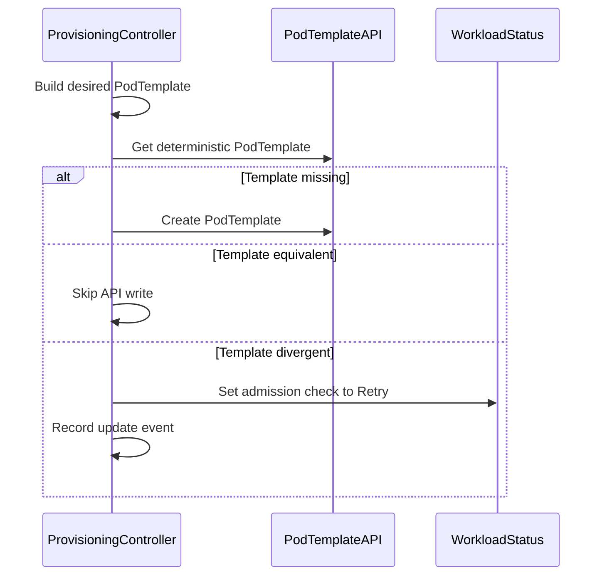

# PR #13015: Enforce Kueue-derived PodTemplate contents in provisioning controller

**Summary**: Enforce Kueue-derived PodTemplate contents in provisioning controller

**Sources**: https://github.com/kubernetes-sigs/kueue/pull/13015

**Last updated**: 2026-09-24T11:40:57Z

---

## Metadata

- **State**: closed (merged)
- **Author**: [@vladikkuzn](https://github.com/vladikkuzn)
- **Branch**: `fix-provisioning-podtemplate-content` → `main`
- **Created**: 2026-07-13T21:25:04Z
- **Updated**: 2026-09-24T11:40:57Z
- **Merged**: 2026-09-22T09:00:14Z
- **Closed**: 2026-09-22T09:00:14Z
- **Labels**: `kind/bug`, `release-note`, `lgtm`, `size/XXL`, `approved`, `cncf-cla: yes`, `area/integrations`
- **Assignees**: [@mszadkow](https://github.com/mszadkow), [@mimowo](https://github.com/mimowo), [@vladikkuzn](https://github.com/vladikkuzn)
- **Requested reviewers**: [@mykysha](https://github.com/mykysha), [@mbobrovskyi](https://github.com/mbobrovskyi), [@ivnovakov](https://github.com/ivnovakov), [@kshalot](https://github.com/kshalot), [@tenzen-y](https://github.com/tenzen-y), [@reruno](https://github.com/reruno)
- **Changed files**: 12   **+1050 / -37**

## Description

#### What type of PR is this?

/kind bug
/area integrations

#### What this PR does / why we need it:

The ProvisioningRequest admission-check controller computes a deterministic
PodTemplate name (`ppt-<workload>-<check>-<attempt>-<podset>`) and, if a
PodTemplate already existed at that name, referenced it **verbatim** in the
generated `ProvisioningRequest`. Because the name is fully predictable and the
template lives in the tenant's namespace, a user able to write `PodTemplate`
objects could pre-create one with resource requests unrelated to their
quota-checked Workload PodSets, decoupling what Cluster Autoscaler provisions
from what Kueue quota approved.

This PR makes the controller the sole authority on PodTemplate contents:

- `createPodTemplate` is split into a pure `buildPodTemplate` builder (no API write).
- On reconcile: **create** when absent; **skip** when equivalent to the Kueue-derived
  contents (via shared `ComparePodTemplate`, same strategy as Job ↔ Workload); **replace**
  (delete+create) when a pre-existing object differs so the ProvisioningRequest never
  adopts foreign/stale specs. Gated by `EnforceProvisioningPodTemplateContents`.
- Replace (rather than Retry) avoids blocking re-admission after preemption
  when attempt-1 collides with a leftover PodTemplate from a prior flavor.
- A recreate that races the still-finalizing delete simply returns the error;
  controller-runtime reconciles again with backoff. No admission-check Retry is
  involved on any path.

Ownership/label checks are intentionally not used as the trust boundary — a
tenant that can write PodTemplates can forge both — so content divergence is
resolved by replace instead of adopting foreign contents.

#### Which issue(s) this PR fixes:

Fixes #

#### Special notes for your reviewer:

- `buildPodTemplate` deep-copies the PodSet template because `podset.Merge`
  mutates in place and would otherwise side-effect the in-memory Workload.
- Unit + integration coverage for foreign / forged-owner / identical / divergent
  ManagedByKueue templates (replace path).
- Per review: the `handleRetry` helper is gone. It had a single caller (recreate
  hitting `AlreadyExists`), and returning the error there is equivalent but simpler
  — controller-runtime already re-reconciles with backoff, and Retry needlessly
  churned admission-check state. The feature gate was renamed
  `RetryProvisioningDueInconsistentPodTemplate` →
  `EnforceProvisioningPodTemplateContents` to match what it actually gates
  (unreleased, so no compatibility impact).
- Equivalence reuses `pkg/util/equality.ComparePodTemplate`.
- Out of scope: ProvisioningRequest name squatting; post-creation tampering.

#### Does this PR introduce a user-facing change?

```release-note
ProvisioningRequest: Fixed a bug where a pre-existing `PodTemplate` at the deterministic provisioning name could be referenced verbatim, letting a user who can write `PodTemplate` objects decouple the capacity requested from Cluster Autoscaler from the quota-checked Workload PodSets. Kueue now replaces divergent specs with Kueue derived contents. Gated by `EnforceProvisioningPodTemplateContents` (enabled by default).
```

## Discussion

### Comment by [@netlify[bot]](https://github.com/apps/netlify) — 2026-07-13T21:25:09Z

### <span aria-hidden="true">✅</span> Deploy Preview for *kubernetes-sigs-kueue* ready!


|  Name | Link |
|:-:|------------------------|
|<span aria-hidden="true">🔨</span> Latest commit | d18cedabc5b8f966a933d7cf1266cd66be9dc1c2 |
|<span aria-hidden="true">🔍</span> Latest deploy log | https://app.netlify.com/projects/kubernetes-sigs-kueue/deploys/6ab13b158c8b2800087d513b |
|<span aria-hidden="true">😎</span> Deploy Preview | [https://deploy-preview-13015--kubernetes-sigs-kueue.netlify.app](https://deploy-preview-13015--kubernetes-sigs-kueue.netlify.app) |
|<span aria-hidden="true">📱</span> Preview on mobile | <details><summary> Toggle QR Code... </summary><br /><br /><br /><br />_Use your smartphone camera to open QR code link._</details> |
---
<!-- [kubernetes-sigs-kueue Preview](https://deploy-preview-13015--kubernetes-sigs-kueue.netlify.app) -->
_To edit notification comments on pull requests, go to your [Netlify project configuration](https://app.netlify.com/projects/kubernetes-sigs-kueue/configuration/notifications#deploy-notifications)._

### Comment by [@coderabbitai[bot]](https://github.com/apps/coderabbitai) — 2026-07-13T21:25:29Z

<!-- This is an auto-generated comment: summarize by coderabbit.ai -->
<!-- review_stack_entry_start -->

[](https://app.coderabbit.ai/change-stack/kubernetes-sigs/kueue/pull/13015?utm_source=github_walkthrough&utm_medium=github&utm_campaign=change_stack)

<!-- review_stack_entry_end -->
<!-- This is an auto-generated comment: review paused by coderabbit.ai -->

> [!NOTE]
> ## Reviews paused
> 
> It looks like this branch is under active development. To avoid overwhelming you with review comments due to an influx of new commits, CodeRabbit has automatically paused this review. You can configure this behavior by changing the `reviews.auto_review.auto_pause_after_reviewed_commits` setting.
> 
> Use the following commands to manage reviews:
> - `@coderabbitai resume` to resume automatic reviews.
> - `@coderabbitai review` to trigger a single review.
> 
> Use the checkboxes below for quick actions:
> - [ ] <!-- {"checkboxId": "7f6cc2e2-2e4e-497a-8c31-c9e4573e93d1"} --> ▶️ Resume reviews
> - [ ] <!-- {"checkboxId": "e9bb8d72-00e8-4f67-9cb2-caf3b22574fe"} --> 🔍 Trigger review

<!-- end of auto-generated comment: review paused by coderabbit.ai -->
<!-- walkthrough_start -->

<details>
<summary>📝 Walkthrough</summary>

## Walkthrough

The provisioning controller now compares deterministic PodTemplates, creates missing templates, skips equivalent objects, and moves admission checks to `Retry` when existing templates differ. Unit and integration tests cover ownership, update counts, equivalence, retry status, and unchanged divergent objects.

### Changes

**PodTemplate reconciliation**

|Layer / File(s)|Summary|
|---|---|
|**Build and compare deterministic templates** <br> `pkg/controller/admissionchecks/provisioning/controller.go`|Pending admission checks build deep-copied derived templates, create missing objects, and skip semantically equivalent templates.|
|**Divergence retry handling** <br> `pkg/controller/admissionchecks/provisioning/controller.go`|Divergent templates trigger a `Retry` admission-check state, Workload status patch, event, and log entry without updating the template.|
|**Reconciliation and retry test coverage** <br> `pkg/controller/admissionchecks/provisioning/controller_test.go`, `test/integration/singlecluster/controller/admissionchecks/provisioning/provisioning_test.go`|Tests verify equivalent-template reuse, ownership updates, foreign-template retries, update counts, equivalence comparisons, and unchanged divergent templates.|

**Estimated code review effort:** 3 (Moderate) | ~25 minutes

### Sequence Diagram(s)



**Suggested reviewers:** `mszadkow`, `mykysha`, `mbobrovskyi`, `ivnovakov`, `kshalot`

</details>

<!-- walkthrough_end -->
<!-- pre_merge_checks_walkthrough_start -->

<details>
<summary>🚥 Pre-merge checks | ✅ 4 | ❌ 1</summary>

### ❌ Failed checks (1 warning)

|     Check name     | Status     | Explanation                                                                          | Resolution                                                                         |
| :----------------: | :--------- | :----------------------------------------------------------------------------------- | :--------------------------------------------------------------------------------- |
| Docstring Coverage | ⚠️ Warning | Docstring coverage is 0.00% which is insufficient. The required threshold is 80.00%. | Write docstrings for the functions missing them to satisfy the coverage threshold. |

<details>
<summary>✅ Passed checks (4 passed)</summary>

|         Check name         | Status   | Explanation                                                                                                                                  |
| :------------------------: | :------- | :------------------------------------------------------------------------------------------------------------------------------------------- |
|     Linked Issues check    | ✅ Passed | Check skipped because no linked issues were found for this pull request.                                                                     |
| Out of Scope Changes check | ✅ Passed | Check skipped because no linked issues were found for this pull request.                                                                     |
|      Description Check     | ✅ Passed | Check skipped - CodeRabbit’s high-level summary is enabled.                                                                                  |
|         Title check        | ✅ Passed | The title clearly and concisely describes the main change: enforcing controller-derived PodTemplate contents in the provisioning controller. |

</details>

</details>

<!-- pre_merge_checks_walkthrough_end -->
<!-- finishing_touch_checkbox_start -->

<details>
<summary>✨ Finishing Touches</summary>

<details>
<summary>🧪 Generate unit tests (beta)</summary>

- [ ] <!-- {"checkboxId": "f47ac10b-58cc-4372-a567-0e02b2c3d479", "radioGroupId": "utg-output-choice-group-unknown_comment_id"} -->   Create PR with unit tests

</details>

</details>

<!-- finishing_touch_checkbox_end -->
<!-- tips_start -->

---


<sub>Comment `@coderabbitai help` to get the list of available commands.</sub>

<!-- tips_end -->

### Comment by [@vladikkuzn](https://github.com/vladikkuzn) — 2026-07-13T21:27:05Z

/assign
/cc @mbobrovskyi @mszadkow @mimowo @tenzen-y @mykysha @reruno @ivnovakov

### Comment by [@mimowo](https://github.com/mimowo) — 2026-07-14T07:57:25Z

LGTM overall, but I would like to have another pair of eyes, maybe @dkaluza or @mbobrovskyi

### Comment by [@mimowo](https://github.com/mimowo) — 2026-07-16T07:59:45Z

@vladikkuzn please answer (and potentially resolve) all the addressed comments. Otherwise we need to reverse engineer  if the comment is done or not, and how. A short note is always useful

### Comment by [@mimowo](https://github.com/mimowo) — 2026-07-16T09:23:40Z

@vladikkuzn is it one of the vulnerability issues ? Is so then please provide the issue number in "Fixes #"

### Comment by [@mszadkow](https://github.com/mszadkow) — 2026-08-18T07:02:01Z

@vladikkuzn IMO this PR is close to be done, please rebase and let's figure if `handleRetry` brings any value or simple Reconcile with backoff is enough and code becomes simpler :)

### Comment by [@vladikkuzn](https://github.com/vladikkuzn) — 2026-09-18T08:44:36Z

/cc @mszadkow

### Comment by [@mszadkow](https://github.com/mszadkow) — 2026-09-21T15:09:37Z

/lgtm

### Comment by [@kubernetes-prow[bot]](https://github.com/apps/kubernetes-prow) — 2026-09-21T15:09:46Z

LGTM label has been added.  <details>Git tree hash: 265925c99c76803eb0c299898d85d7e287475dc6</details>

### Comment by [@kubernetes-prow[bot]](https://github.com/apps/kubernetes-prow) — 2026-09-22T07:33:13Z

[APPROVALNOTIFIER] This PR is **APPROVED**

This pull-request has been approved by: *<a href="https://github.com/kubernetes-sigs/kueue/pull/13015#pullrequestreview-4786216212" title="Approved">dkaluza</a>*, *<a href="https://github.com/kubernetes-sigs/kueue/pull/13015#pullrequestreview-5275237474" title="Approved">mimowo</a>*, *<a href="https://github.com/kubernetes-sigs/kueue/pull/13015#" title="Author self-approved">vladikkuzn</a>*

The full list of commands accepted by this bot can be found [here](https://go.k8s.io/bot-commands?repo=kubernetes-sigs%2Fkueue).

The pull request process is described [here](https://git.k8s.io/community/contributors/guide/owners.md#the-code-review-process)

<details >
Needs approval from an approver in each of these files:

- ~~[OWNERS](https://github.com/kubernetes-sigs/kueue/blob/main/OWNERS)~~ [mimowo]

Approvers can indicate their approval by writing `/approve` in a comment
Approvers can cancel approval by writing `/approve cancel` in a comment
</details>
<!-- META={"approvers":[]} -->

### Comment by [@mimowo](https://github.com/mimowo) — 2026-09-22T08:25:07Z

/unhold

### Comment by [@mbobrovskyi](https://github.com/mbobrovskyi) — 2026-09-24T11:40:55Z

/release-note-edit
```release-note
ProvisioningRequest: Fixed a bug where a pre-existing `PodTemplate` at the deterministic provisioning name could be referenced verbatim, letting a user who can write `PodTemplate` objects decouple the capacity requested from Cluster Autoscaler from the quota-checked Workload PodSets. Kueue now replaces divergent specs with Kueue derived contents. Gated by `EnforceProvisioningPodTemplateContents` (enabled by default).
```

## Reviews

### Review by [@coderabbitai[bot]](https://github.com/apps/coderabbitai) (commented) — 2026-07-13T21:32:19Z

**Actionable comments posted: 1**

<details>
<summary>🧹 Nitpick comments (1)</summary><blockquote>

<details>
<summary>test/integration/singlecluster/controller/admissionchecks/provisioning/provisioning_test.go (1)</summary><blockquote>

`250-297`: _📐 Maintainability & Code Quality_ | _🔵 Trivial_ | _⚡ Quick win_

**Consider mirroring the forged-owner-reference case at the integration level.**

This test covers only the "foreign template with divergent resources" overwrite path. The unit tests (`controller_test.go`) also cover a pre-existing PodTemplate with a forged Workload owner reference; adding an equivalent envtest case here would validate the overwrite guarantee end-to-end against the real API server/garbage-collector behavior, not just the fake client.

As per path instructions, `test/integration/**/*.go` should "Ensure new test cases cover both positive and negative scenarios."

<details>
<summary>🤖 Prompt for AI Agents</summary>

```
Verify each finding against current code. Fix only still-valid issues, skip the
rest with a brief reason, keep changes minimal, and validate.

In
`@test/integration/singlecluster/controller/admissionchecks/provisioning/provisioning_test.go`
around lines 250 - 297, Add an integration test alongside “Should overwrite a
pre-existing PodTemplate at the predictable name with the Kueue-derived
contents” that pre-creates the deterministic PodTemplate with a forged Workload
owner reference, then verifies after quota reservation that the controller
overwrites it with the Kueue-derived PodSet template and managed-by label.
Preserve the existing divergent-resource scenario and ensure the new case
validates the forged-reference negative path against the real API server.
```

</details>

<!-- cr-comment:v1:57f11cc04581c772ee69db96 -->

_Source: Path instructions_

</blockquote></details>

</blockquote></details>

<details>
<summary>🤖 Prompt for all review comments with AI agents</summary>

```
Verify each finding against current code. Fix only still-valid issues, skip the
rest with a brief reason, keep changes minimal, and validate.

Inline comments:
In `@pkg/controller/admissionchecks/provisioning/controller.go`:
- Around line 322-326: Update the existing PodTemplate Get error branch in the
reconciliation loop to call c.handleError for non-NotFound failures instead of
returning the raw error. Preserve IgnoreNotFound behavior so a missing object
continues to the Create path, and match the error handling used by the Create
and Update branches.

---

Nitpick comments:
In
`@test/integration/singlecluster/controller/admissionchecks/provisioning/provisioning_test.go`:
- Around line 250-297: Add an integration test alongside “Should overwrite a
pre-existing PodTemplate at the predictable name with the Kueue-derived
contents” that pre-creates the deterministic PodTemplate with a forged Workload
owner reference, then verifies after quota reservation that the controller
overwrites it with the Kueue-derived PodSet template and managed-by label.
Preserve the existing divergent-resource scenario and ensure the new case
validates the forged-reference negative path against the real API server.
```

</details>

<details>
<summary>🪄 Autofix (Beta)</summary>

Fix all unresolved CodeRabbit comments on this PR:

- [ ] <!-- {"checkboxId": "4b0d0e0a-96d7-4f10-b296-3a18ea78f0b9"} --> Push a commit to this branch (recommended)
- [ ] <!-- {"checkboxId": "ff5b1114-7d8c-49e6-8ac1-43f82af23a33"} --> Create a new PR with the fixes

</details>

---

<details>
<summary>ℹ️ Review info</summary>

<details>
<summary>⚙️ Run configuration</summary>

**Configuration used**: Path: .coderabbit.yaml

**Review profile**: CHILL

**Plan**: Pro

**Run ID**: `9cb46eb8-7e7e-43c2-93f0-c1110c7e6ff0`

</details>

<details>
<summary>📥 Commits</summary>

Reviewing files that changed from the base of the PR and between f3f98ea568b18c9633113812905e4a77ab727da0 and 37014d58622b1ce245cdb83038611d3b29c4183b.

</details>

<details>
<summary>📒 Files selected for processing (3)</summary>

* `pkg/controller/admissionchecks/provisioning/controller.go`
* `pkg/controller/admissionchecks/provisioning/controller_test.go`
* `test/integration/singlecluster/controller/admissionchecks/provisioning/provisioning_test.go`

</details>

</details>

<!-- This is an auto-generated comment by CodeRabbit for review status -->

- **pkg/controller/admissionchecks/provisioning/controller.go:343** by [@coderabbitai[bot]](https://github.com/apps/coderabbitai) — 2026-07-13T21:32:18Z
```diff
@@ -313,18 +313,34 @@ func (c *Controller) syncOwnedProvisionRequest(
 			for _, mergedPodSet := range mergedPodSets {
 				ptName := getProvisioningRequestPodTemplateName(requestName, mergedPodSet.Name)
 
-				pt := &corev1.PodTemplate{}
-				err := c.client.Get(ctx, types.NamespacedName{Namespace: wl.Namespace, Name: ptName}, pt)
+				desired, err := c.buildPodTemplate(ctx, wl, ptName, mergedPodSet.PodSet, mergedPodSet.PodSetAssignment)
+				if err != nil {
+					msg := fmt.Sprintf("Error building PodTemplate %q: %v", ptName, err)
+					return c.handleError(ctx, wl, ac, msg, err)
+				}
+
+				existing := &corev1.PodTemplate{}
+				err = c.client.Get(ctx, client.ObjectKeyFromObject(desired), existing)
 				if client.IgnoreNotFound(err) != nil {
 					return err
 				}
```

  _🎯 Functional Correctness_ | _🟠 Major_ | _⚡ Quick win_
  
  **Inconsistent error handling on `Get` failure vs. `Create`/`Update`.**
  
  Unlike the `Create` (Lines 329-332) and `Update` (Lines 340-343) branches, a non-`NotFound` `Get` error here just returns the raw error, bypassing `c.handleError`. That means transient `Get` failures produce no `FailedCreate` event and no admission-check status message, unlike every other failure mode in this loop — making transient issues here harder to diagnose from workload status/events.
  
  <details>
  <summary>🔧 Proposed fix</summary>
  
  ```diff
   existing := &corev1.PodTemplate{}
   err = c.client.Get(ctx, client.ObjectKeyFromObject(desired), existing)
   if client.IgnoreNotFound(err) != nil {
  -    return err
  +    msg := fmt.Sprintf("Error getting PodTemplate %q: %v", ptName, err)
  +    return c.handleError(ctx, wl, ac, msg, err)
   }
  ```
  </details>
  
  As per path instructions, `pkg/controller/**/*.go` should "Review reconciliation logic for correctness, idempotency, and proper error handling."
  
  <!-- suggestion_start -->
  
  <details>
  <summary>📝 Committable suggestion</summary>
  
  > ‼️ **IMPORTANT**
  > Carefully review the code before committing. Ensure that it accurately replaces the highlighted code, contains no missing lines, and has no issues with indentation. Thoroughly test & benchmark the code to ensure it meets the requirements.
  
  ```suggestion
  				existing := &corev1.PodTemplate{}
  				err = c.client.Get(ctx, client.ObjectKeyFromObject(desired), existing)
  				if client.IgnoreNotFound(err) != nil {
  					msg := fmt.Sprintf("Error getting PodTemplate %q: %v", ptName, err)
  					return c.handleError(ctx, wl, ac, msg, err)
  				}
  ```
  
  </details>
  
  <!-- suggestion_end -->
  
  <details>
  <summary>🤖 Prompt for AI Agents</summary>
  
  ```
  Verify each finding against current code. Fix only still-valid issues, skip the
  rest with a brief reason, keep changes minimal, and validate.
  
  In `@pkg/controller/admissionchecks/provisioning/controller.go` around lines 322 -
  326, Update the existing PodTemplate Get error branch in the reconciliation loop
  to call c.handleError for non-NotFound failures instead of returning the raw
  error. Preserve IgnoreNotFound behavior so a missing object continues to the
  Create path, and match the error handling used by the Create and Update
  branches.
  ```
  
  </details>
  
  <!-- fingerprinting:phantom:poseidon:beignet -->
  
  <!-- cr-indicator-types:potential_issue -->
  
  <!-- cr-comment:v1:3461286bb378cdadb1869f9e -->
  
  _Source: Path instructions_
  
  <!-- This is an auto-generated comment by CodeRabbit -->
  
  ✅ Addressed in commits 28febc0 to d66cffe

### Review by [@mimowo](https://github.com/mimowo) (commented) — 2026-07-14T07:56:05Z

- **pkg/controller/admissionchecks/provisioning/controller.go:343** by [@mimowo](https://github.com/mimowo) — 2026-07-14T07:56:05Z
```diff
@@ -313,18 +313,34 @@ func (c *Controller) syncOwnedProvisionRequest(
 			for _, mergedPodSet := range mergedPodSets {
 				ptName := getProvisioningRequestPodTemplateName(requestName, mergedPodSet.Name)
 
-				pt := &corev1.PodTemplate{}
-				err := c.client.Get(ctx, types.NamespacedName{Namespace: wl.Namespace, Name: ptName}, pt)
+				desired, err := c.buildPodTemplate(ctx, wl, ptName, mergedPodSet.PodSet, mergedPodSet.PodSetAssignment)
+				if err != nil {
+					msg := fmt.Sprintf("Error building PodTemplate %q: %v", ptName, err)
+					return c.handleError(ctx, wl, ac, msg, err)
+				}
+
+				existing := &corev1.PodTemplate{}
+				err = c.client.Get(ctx, client.ObjectKeyFromObject(desired), existing)
 				if client.IgnoreNotFound(err) != nil {
 					return err
 				}
 				if err != nil {
 					// it's a not found, so create it
-					_, err := c.createPodTemplate(ctx, wl, ptName, mergedPodSet.PodSet, mergedPodSet.PodSetAssignment)
-					if err != nil {
+					if err := c.client.Create(ctx, desired); err != nil {
 						msg := fmt.Sprintf("Error creating PodTemplate %q: %v", ptName, err)
 						return c.handleError(ctx, wl, ac, msg, err)
 					}
+				} else {
+					// A PodTemplate already exists at this deterministic name. Its contents are
+					// not trusted: a tenant able to write PodTemplates could pre-create it to make
+					// the ProvisioningRequest (and Cluster Autoscaler) provision capacity unrelated
+					// to the quota-checked Workload PodSets. Overwrite it with the Kueue-derived
+					// spec so the controller stays the sole authority on the template contents.
+					desired.SetResourceVersion(existing.GetResourceVersion())
+					if err := c.client.Update(ctx, desired); err != nil {
+						msg := fmt.Sprintf("Error updating PodTemplate %q: %v", ptName, err)
+						return c.handleError(ctx, wl, ac, msg, err)
+					}
```

  Isn't this a common case? Seems like we may be producing unnecessary API requests. Shouldn't we guard sending the request by equivalence check?

### Review by [@mimowo](https://github.com/mimowo) (commented) — 2026-07-14T07:56:46Z

- **pkg/controller/admissionchecks/provisioning/controller.go:327** by [@mimowo](https://github.com/mimowo) — 2026-07-14T07:56:46Z
```diff
@@ -313,18 +313,34 @@ func (c *Controller) syncOwnedProvisionRequest(
 			for _, mergedPodSet := range mergedPodSets {
 				ptName := getProvisioningRequestPodTemplateName(requestName, mergedPodSet.Name)
 
-				pt := &corev1.PodTemplate{}
-				err := c.client.Get(ctx, types.NamespacedName{Namespace: wl.Namespace, Name: ptName}, pt)
+				desired, err := c.buildPodTemplate(ctx, wl, ptName, mergedPodSet.PodSet, mergedPodSet.PodSetAssignment)
+				if err != nil {
+					msg := fmt.Sprintf("Error building PodTemplate %q: %v", ptName, err)
+					return c.handleError(ctx, wl, ac, msg, err)
+				}
+
+				existing := &corev1.PodTemplate{}
+				err = c.client.Get(ctx, client.ObjectKeyFromObject(desired), existing)
 				if client.IgnoreNotFound(err) != nil {
 					return err
 				}
 				if err != nil {
```

  Let's add logging at V3 for the different possible scenarios here

### Review by [@coderabbitai[bot]](https://github.com/apps/coderabbitai) (commented) — 2026-07-16T05:05:19Z


<details>
<summary>🧹 Nitpick comments (1)</summary><blockquote>

<details>
<summary>pkg/controller/admissionchecks/provisioning/controller_test.go (1)</summary><blockquote>

`624-625`: _📐 Maintainability & Code Quality_ | _🔵 Trivial_ | _💤 Low value_

**Assert the number of updates for the forged owner case.**

For consistency with the preceding new test cases, consider asserting the expected `wantPodTemplateUpdates` here as well. This explicitly verifies that the controller is indeed overwriting the content (resulting in 2 updates for `baseTemplate1` and 1 update for `baseTemplate2` when transferring ownership).


<details>
<summary>💡 Proposed addition</summary>

```diff
 				baseTemplate2.Name: baseTemplate2.Clone().
 					ControllerReference(autoscaling.SchemeGroupVersion.WithKind("ProvisioningRequest"), "wl-check1-1", "").
 					Obj(),
 			},
+			wantPodTemplateUpdates: map[string]int{
+				baseTemplate1.Name: 2,
+				baseTemplate2.Name: 1,
+			},
 			wantEvents: []utiltesting.EventRecord{
 				{
```
</details>

<details>
<summary>🤖 Prompt for AI Agents</summary>

```
Verify each finding against current code. Fix only still-valid issues, skip the
rest with a brief reason, keep changes minimal, and validate.

In `@pkg/controller/admissionchecks/provisioning/controller_test.go` around lines
624 - 625, Update the forged-owner test case in the admission check controller
tests to assert wantPodTemplateUpdates, expecting two updates for baseTemplate1
and one update for baseTemplate2 during ownership transfer. Keep the existing
wantEvents assertions unchanged and follow the structure used by the preceding
new test cases.
```

</details>

<!-- cr-comment:v1:f8c80da2983740472ed3be55 -->

</blockquote></details>

</blockquote></details>

<details>
<summary>🤖 Prompt for all review comments with AI agents</summary>

```
Verify each finding against current code. Fix only still-valid issues, skip the
rest with a brief reason, keep changes minimal, and validate.

Nitpick comments:
In `@pkg/controller/admissionchecks/provisioning/controller_test.go`:
- Around line 624-625: Update the forged-owner test case in the admission check
controller tests to assert wantPodTemplateUpdates, expecting two updates for
baseTemplate1 and one update for baseTemplate2 during ownership transfer. Keep
the existing wantEvents assertions unchanged and follow the structure used by
the preceding new test cases.
```

</details>

---

<details>
<summary>ℹ️ Review info</summary>

<details>
<summary>⚙️ Run configuration</summary>

**Configuration used**: Path: .coderabbit.yaml

**Review profile**: CHILL

**Plan**: Pro

**Run ID**: `11ba8145-6c39-4ae8-833f-fe934d054e89`

</details>

<details>
<summary>📥 Commits</summary>

Reviewing files that changed from the base of the PR and between 37014d58622b1ce245cdb83038611d3b29c4183b and d66cffe0a14bb2ce6227f225080a02b11d8de3d5.

</details>

<details>
<summary>📒 Files selected for processing (3)</summary>

* `pkg/controller/admissionchecks/provisioning/controller.go`
* `pkg/controller/admissionchecks/provisioning/controller_test.go`
* `test/integration/singlecluster/controller/admissionchecks/provisioning/provisioning_test.go`

</details>

<details>
<summary>🚧 Files skipped from review as they are similar to previous changes (2)</summary>

* pkg/controller/admissionchecks/provisioning/controller.go
* test/integration/singlecluster/controller/admissionchecks/provisioning/provisioning_test.go

</details>

</details>

<!-- This is an auto-generated comment by CodeRabbit for review status -->

### Review by [@dkaluza](https://github.com/dkaluza) (commented) — 2026-07-16T07:57:04Z

Implementation looks good, added a few tests improvement ideas.

- **pkg/controller/admissionchecks/provisioning/controller_test.go:969** by [@dkaluza](https://github.com/dkaluza) — 2026-07-16T07:47:41Z
```diff
@@ -488,6 +519,118 @@ func TestReconcile(t *testing.T) {
 				},
 			},
 		},
+		"pre-existing foreign PodTemplate is overwritten": {
+			workload:  baseWorkload.DeepCopy(),
+			checks:    []kueue.AdmissionCheck{*baseCheck.DeepCopy()},
+			flavors:   []kueue.ResourceFlavor{*baseFlavor1.DeepCopy(), *baseFlavor2.DeepCopy()},
+			configs:   []kueue.ProvisioningRequestConfig{*baseConfigWithRetryStrategy.DeepCopy()},
+			requests:  []autoscaling.ProvisioningRequest{},
+			templates: []corev1.PodTemplate{*foreignTemplate1.Clone().Obj()},
+			wantWorkloads: map[string]*kueue.Workload{
+				baseWorkload.GetName(): baseWorkload.DeepCopy(),
+			},
+			wantRequests: map[string]*autoscaling.ProvisioningRequest{
+				baseRequest.Name: baseRequest.DeepCopy(),
+			},
+			wantTemplates: map[string]*corev1.PodTemplate{
+				baseTemplate1.Name: baseTemplate1.Clone().
+					ControllerReference(autoscaling.SchemeGroupVersion.WithKind("ProvisioningRequest"), "wl-check1-1", "").
+					Obj(),
+				baseTemplate2.Name: baseTemplate2.Clone().
+					ControllerReference(autoscaling.SchemeGroupVersion.WithKind("ProvisioningRequest"), "wl-check1-1", "").
+					Obj(),
+			},
+			// ps1 differs from desired so it is overwritten (1 content write) and then
+			// re-owned by the ProvisioningRequest (1 ownership update). ps2 is created,
+			// then only re-owned.
+			wantPodTemplateUpdates: map[string]int{
+				baseTemplate1.Name: 2,
+				baseTemplate2.Name: 1,
+			},
+			wantEvents: []utiltesting.EventRecord{
+				{
+					Key:       client.ObjectKeyFromObject(baseWorkload),
+					EventType: corev1.EventTypeNormal,
+					Reason:    "ProvisioningRequestCreated",
+					Message:   `Created ProvisioningRequest: "wl-check1-1"`,
+				},
+			},
+		},
+		"pre-existing identical PodTemplates are not rewritten": {
+			workload:  baseWorkload.DeepCopy(),
+			checks:    []kueue.AdmissionCheck{*baseCheck.DeepCopy()},
+			flavors:   []kueue.ResourceFlavor{*baseFlavor1.DeepCopy(), *baseFlavor2.DeepCopy()},
+			configs:   []kueue.ProvisioningRequestConfig{*baseConfigWithRetryStrategy.DeepCopy()},
+			requests:  []autoscaling.ProvisioningRequest{},
+			templates: []corev1.PodTemplate{*identicalTemplate1, *identicalTemplate2},
+			wantWorkloads: map[string]*kueue.Workload{
+				baseWorkload.GetName(): baseWorkload.DeepCopy(),
+			},
+			wantRequests: map[string]*autoscaling.ProvisioningRequest{
+				baseRequest.Name: baseRequest.DeepCopy(),
+			},
+			wantTemplates: map[string]*corev1.PodTemplate{
+				baseTemplate1.Name: baseTemplate1.Clone().
+					ControllerReference(autoscaling.SchemeGroupVersion.WithKind("ProvisioningRequest"), "wl-check1-1", "").
+					Obj(),
+				baseTemplate2.Name: baseTemplate2.Clone().
+					ControllerReference(autoscaling.SchemeGroupVersion.WithKind("ProvisioningRequest"), "wl-check1-1", "").
+					Obj(),
+			},
+			// Both PodTemplates already equal the desired Kueue-derived spec, so the
+			// controller skips the content Update; each is only updated once to transfer
+			// ownership to the ProvisioningRequest.
+			wantPodTemplateUpdates: map[string]int{
+				baseTemplate1.Name: 1,
+				baseTemplate2.Name: 1,
+			},
+			wantEvents: []utiltesting.EventRecord{
+				{
+					Key:       client.ObjectKeyFromObject(baseWorkload),
+					EventType: corev1.EventTypeNormal,
+					Reason:    "ProvisioningRequestCreated",
+					Message:   `Created ProvisioningRequest: "wl-check1-1"`,
+				},
+			},
+		},
+		"pre-existing PodTemplate with forged workload owner is overwritten": {
+			workload: baseWorkload.DeepCopy(),
+			checks:   []kueue.AdmissionCheck{*baseCheck.DeepCopy()},
+			flavors:  []kueue.ResourceFlavor{*baseFlavor1.DeepCopy(), *baseFlavor2.DeepCopy()},
+			configs:  []kueue.ProvisioningRequestConfig{*baseConfigWithRetryStrategy.DeepCopy()},
+			requests: []autoscaling.ProvisioningRequest{},
+			templates: []corev1.PodTemplate{
+				*foreignTemplate1.Clone().
+					ControllerReference(schema.GroupVersionKind{
+						Group:   "kueue.x-k8s.io",
+						Version: "v1beta2",
+						Kind:    "Workload",
+					}, "wl", "").
+					Obj(),
+			},
+			wantWorkloads: map[string]*kueue.Workload{
+				baseWorkload.GetName(): baseWorkload.DeepCopy(),
+			},
+			wantRequests: map[string]*autoscaling.ProvisioningRequest{
+				baseRequest.Name: baseRequest.DeepCopy(),
+			},
+			wantTemplates: map[string]*corev1.PodTemplate{
+				baseTemplate1.Name: baseTemplate1.Clone().
+					ControllerReference(autoscaling.SchemeGroupVersion.WithKind("ProvisioningRequest"), "wl-check1-1", "").
+					Obj(),
+				baseTemplate2.Name: baseTemplate2.Clone().
+					ControllerReference(autoscaling.SchemeGroupVersion.WithKind("ProvisioningRequest"), "wl-check1-1", "").
+					Obj(),
+			},
```

  Don't we want to check `wantPodTemplateUpdates` here?

- **pkg/controller/admissionchecks/provisioning/controller_test.go:964** by [@dkaluza](https://github.com/dkaluza) — 2026-07-16T07:52:16Z
```diff
@@ -488,6 +519,118 @@ func TestReconcile(t *testing.T) {
 				},
 			},
 		},
+		"pre-existing foreign PodTemplate is overwritten": {
+			workload:  baseWorkload.DeepCopy(),
+			checks:    []kueue.AdmissionCheck{*baseCheck.DeepCopy()},
+			flavors:   []kueue.ResourceFlavor{*baseFlavor1.DeepCopy(), *baseFlavor2.DeepCopy()},
+			configs:   []kueue.ProvisioningRequestConfig{*baseConfigWithRetryStrategy.DeepCopy()},
+			requests:  []autoscaling.ProvisioningRequest{},
+			templates: []corev1.PodTemplate{*foreignTemplate1.Clone().Obj()},
+			wantWorkloads: map[string]*kueue.Workload{
+				baseWorkload.GetName(): baseWorkload.DeepCopy(),
+			},
+			wantRequests: map[string]*autoscaling.ProvisioningRequest{
+				baseRequest.Name: baseRequest.DeepCopy(),
+			},
+			wantTemplates: map[string]*corev1.PodTemplate{
+				baseTemplate1.Name: baseTemplate1.Clone().
+					ControllerReference(autoscaling.SchemeGroupVersion.WithKind("ProvisioningRequest"), "wl-check1-1", "").
+					Obj(),
+				baseTemplate2.Name: baseTemplate2.Clone().
+					ControllerReference(autoscaling.SchemeGroupVersion.WithKind("ProvisioningRequest"), "wl-check1-1", "").
+					Obj(),
+			},
+			// ps1 differs from desired so it is overwritten (1 content write) and then
+			// re-owned by the ProvisioningRequest (1 ownership update). ps2 is created,
+			// then only re-owned.
+			wantPodTemplateUpdates: map[string]int{
+				baseTemplate1.Name: 2,
+				baseTemplate2.Name: 1,
+			},
+			wantEvents: []utiltesting.EventRecord{
+				{
+					Key:       client.ObjectKeyFromObject(baseWorkload),
+					EventType: corev1.EventTypeNormal,
+					Reason:    "ProvisioningRequestCreated",
+					Message:   `Created ProvisioningRequest: "wl-check1-1"`,
+				},
+			},
+		},
+		"pre-existing identical PodTemplates are not rewritten": {
+			workload:  baseWorkload.DeepCopy(),
+			checks:    []kueue.AdmissionCheck{*baseCheck.DeepCopy()},
+			flavors:   []kueue.ResourceFlavor{*baseFlavor1.DeepCopy(), *baseFlavor2.DeepCopy()},
+			configs:   []kueue.ProvisioningRequestConfig{*baseConfigWithRetryStrategy.DeepCopy()},
+			requests:  []autoscaling.ProvisioningRequest{},
+			templates: []corev1.PodTemplate{*identicalTemplate1, *identicalTemplate2},
+			wantWorkloads: map[string]*kueue.Workload{
+				baseWorkload.GetName(): baseWorkload.DeepCopy(),
+			},
+			wantRequests: map[string]*autoscaling.ProvisioningRequest{
+				baseRequest.Name: baseRequest.DeepCopy(),
+			},
+			wantTemplates: map[string]*corev1.PodTemplate{
+				baseTemplate1.Name: baseTemplate1.Clone().
+					ControllerReference(autoscaling.SchemeGroupVersion.WithKind("ProvisioningRequest"), "wl-check1-1", "").
+					Obj(),
+				baseTemplate2.Name: baseTemplate2.Clone().
+					ControllerReference(autoscaling.SchemeGroupVersion.WithKind("ProvisioningRequest"), "wl-check1-1", "").
+					Obj(),
+			},
+			// Both PodTemplates already equal the desired Kueue-derived spec, so the
+			// controller skips the content Update; each is only updated once to transfer
+			// ownership to the ProvisioningRequest.
+			wantPodTemplateUpdates: map[string]int{
+				baseTemplate1.Name: 1,
+				baseTemplate2.Name: 1,
+			},
+			wantEvents: []utiltesting.EventRecord{
+				{
+					Key:       client.ObjectKeyFromObject(baseWorkload),
+					EventType: corev1.EventTypeNormal,
+					Reason:    "ProvisioningRequestCreated",
+					Message:   `Created ProvisioningRequest: "wl-check1-1"`,
+				},
+			},
+		},
+		"pre-existing PodTemplate with forged workload owner is overwritten": {
+			workload: baseWorkload.DeepCopy(),
+			checks:   []kueue.AdmissionCheck{*baseCheck.DeepCopy()},
+			flavors:  []kueue.ResourceFlavor{*baseFlavor1.DeepCopy(), *baseFlavor2.DeepCopy()},
+			configs:  []kueue.ProvisioningRequestConfig{*baseConfigWithRetryStrategy.DeepCopy()},
+			requests: []autoscaling.ProvisioningRequest{},
+			templates: []corev1.PodTemplate{
+				*foreignTemplate1.Clone().
+					ControllerReference(schema.GroupVersionKind{
+						Group:   "kueue.x-k8s.io",
+						Version: "v1beta2",
+						Kind:    "Workload",
+					}, "wl", "").
+					Obj(),
+			},
+			wantWorkloads: map[string]*kueue.Workload{
+				baseWorkload.GetName(): baseWorkload.DeepCopy(),
+			},
+			wantRequests: map[string]*autoscaling.ProvisioningRequest{
+				baseRequest.Name: baseRequest.DeepCopy(),
+			},
+			wantTemplates: map[string]*corev1.PodTemplate{
+				baseTemplate1.Name: baseTemplate1.Clone().
+					ControllerReference(autoscaling.SchemeGroupVersion.WithKind("ProvisioningRequest"), "wl-check1-1", "").
```

  nit: maybe it is worth adding to the existing test or a new one that if we have identical pod templates and they already have appropriate ControllerReference no update is done?

- **pkg/controller/admissionchecks/provisioning/controller_test.go:2088** by [@dkaluza](https://github.com/dkaluza) — 2026-07-16T07:54:09Z
```diff
@@ -1879,11 +2029,76 @@ func TestReconcile(t *testing.T) {
 				if diff := cmp.Diff(tc.wantEvents, recorder.RecordedEvents); diff != "" {
 					t.Errorf("unexpected events (-want/+got):\n%s", diff)
 				}
+
+				if tc.wantPodTemplateUpdates != nil {
+					if diff := cmp.Diff(tc.wantPodTemplateUpdates, podTemplateUpdates, cmpopts.EquateEmpty()); diff != "" {
+						t.Errorf("unexpected PodTemplate updates (-want/+got):\n%s", diff)
+					}
+				}
 			})
 		}
 	}
 }
 
+func TestPodTemplateEquivalent(t *testing.T) {
+	workloadGVK := schema.GroupVersionKind{Group: "kueue.x-k8s.io", Version: "v1beta2", Kind: "Workload"}
+	base := utiltesting.MakePodTemplate("ppt", TestNamespace).
+		Label(constants.ManagedByKueueLabelKey, constants.ManagedByKueueLabelValue).
+		Containers(corev1.Container{
+			Name: "c",
+			Resources: corev1.ResourceRequirements{
+				Requests: corev1.ResourceList{corev1.ResourceCPU: resource.MustParse("1")},
+			},
+		}).
+		NodeSelector("f1l1", "v1").
+		ControllerReference(workloadGVK, "wl", "")
+
+	cases := map[string]struct {
+		existing *corev1.PodTemplate
+		desired  *corev1.PodTemplate
+		want     bool
+	}{
+		"identical": {
+			existing: base.Clone().Obj(),
+			desired:  base.Clone().Obj(),
+			want:     true,
+		},
+		"different template spec": {
+			existing: base.Clone().NodeSelector("f2l1", "v2").Obj(),
+			desired:  base.Clone().Obj(),
+			want:     false,
+		},
+		"different labels": {
+			existing: base.Clone().Label("extra", "v").Obj(),
+			desired:  base.Clone().Obj(),
+			want:     false,
+		},
+		"different owner references": {
+			existing: base.Clone().Obj(),
+			desired: utiltesting.MakePodTemplate("ppt", TestNamespace).
+				Label(constants.ManagedByKueueLabelKey, constants.ManagedByKueueLabelValue).
+				Containers(corev1.Container{
+					Name: "c",
+					Resources: corev1.ResourceRequirements{
+						Requests: corev1.ResourceList{corev1.ResourceCPU: resource.MustParse("1")},
+					},
+				}).
+				NodeSelector("f1l1", "v1").
+				ControllerReference(autoscaling.SchemeGroupVersion.WithKind("ProvisioningRequest"), "pr", "").
+				Obj(),
```

  Cannot this just be `base.Clone().				ControllerReference(autoscaling.SchemeGroupVersion.WithKind("ProvisioningRequest"), "pr", "").Obj()`?
  
  Right now it is hard to tell whether the difference is in the owner reference or soemething else

### Review by [@vladikkuzn](https://github.com/vladikkuzn) (commented) — 2026-07-16T08:58:14Z

- **pkg/controller/admissionchecks/provisioning/controller_test.go:969** by [@vladikkuzn](https://github.com/vladikkuzn) — 2026-07-16T08:58:14Z
```diff
@@ -488,6 +519,118 @@ func TestReconcile(t *testing.T) {
 				},
 			},
 		},
+		"pre-existing foreign PodTemplate is overwritten": {
+			workload:  baseWorkload.DeepCopy(),
+			checks:    []kueue.AdmissionCheck{*baseCheck.DeepCopy()},
+			flavors:   []kueue.ResourceFlavor{*baseFlavor1.DeepCopy(), *baseFlavor2.DeepCopy()},
+			configs:   []kueue.ProvisioningRequestConfig{*baseConfigWithRetryStrategy.DeepCopy()},
+			requests:  []autoscaling.ProvisioningRequest{},
+			templates: []corev1.PodTemplate{*foreignTemplate1.Clone().Obj()},
+			wantWorkloads: map[string]*kueue.Workload{
+				baseWorkload.GetName(): baseWorkload.DeepCopy(),
+			},
+			wantRequests: map[string]*autoscaling.ProvisioningRequest{
+				baseRequest.Name: baseRequest.DeepCopy(),
+			},
+			wantTemplates: map[string]*corev1.PodTemplate{
+				baseTemplate1.Name: baseTemplate1.Clone().
+					ControllerReference(autoscaling.SchemeGroupVersion.WithKind("ProvisioningRequest"), "wl-check1-1", "").
+					Obj(),
+				baseTemplate2.Name: baseTemplate2.Clone().
+					ControllerReference(autoscaling.SchemeGroupVersion.WithKind("ProvisioningRequest"), "wl-check1-1", "").
+					Obj(),
+			},
+			// ps1 differs from desired so it is overwritten (1 content write) and then
+			// re-owned by the ProvisioningRequest (1 ownership update). ps2 is created,
+			// then only re-owned.
+			wantPodTemplateUpdates: map[string]int{
+				baseTemplate1.Name: 2,
+				baseTemplate2.Name: 1,
+			},
+			wantEvents: []utiltesting.EventRecord{
+				{
+					Key:       client.ObjectKeyFromObject(baseWorkload),
+					EventType: corev1.EventTypeNormal,
+					Reason:    "ProvisioningRequestCreated",
+					Message:   `Created ProvisioningRequest: "wl-check1-1"`,
+				},
+			},
+		},
+		"pre-existing identical PodTemplates are not rewritten": {
+			workload:  baseWorkload.DeepCopy(),
+			checks:    []kueue.AdmissionCheck{*baseCheck.DeepCopy()},
+			flavors:   []kueue.ResourceFlavor{*baseFlavor1.DeepCopy(), *baseFlavor2.DeepCopy()},
+			configs:   []kueue.ProvisioningRequestConfig{*baseConfigWithRetryStrategy.DeepCopy()},
+			requests:  []autoscaling.ProvisioningRequest{},
+			templates: []corev1.PodTemplate{*identicalTemplate1, *identicalTemplate2},
+			wantWorkloads: map[string]*kueue.Workload{
+				baseWorkload.GetName(): baseWorkload.DeepCopy(),
+			},
+			wantRequests: map[string]*autoscaling.ProvisioningRequest{
+				baseRequest.Name: baseRequest.DeepCopy(),
+			},
+			wantTemplates: map[string]*corev1.PodTemplate{
+				baseTemplate1.Name: baseTemplate1.Clone().
+					ControllerReference(autoscaling.SchemeGroupVersion.WithKind("ProvisioningRequest"), "wl-check1-1", "").
+					Obj(),
+				baseTemplate2.Name: baseTemplate2.Clone().
+					ControllerReference(autoscaling.SchemeGroupVersion.WithKind("ProvisioningRequest"), "wl-check1-1", "").
+					Obj(),
+			},
+			// Both PodTemplates already equal the desired Kueue-derived spec, so the
+			// controller skips the content Update; each is only updated once to transfer
+			// ownership to the ProvisioningRequest.
+			wantPodTemplateUpdates: map[string]int{
+				baseTemplate1.Name: 1,
+				baseTemplate2.Name: 1,
+			},
+			wantEvents: []utiltesting.EventRecord{
+				{
+					Key:       client.ObjectKeyFromObject(baseWorkload),
+					EventType: corev1.EventTypeNormal,
+					Reason:    "ProvisioningRequestCreated",
+					Message:   `Created ProvisioningRequest: "wl-check1-1"`,
+				},
+			},
+		},
+		"pre-existing PodTemplate with forged workload owner is overwritten": {
+			workload: baseWorkload.DeepCopy(),
+			checks:   []kueue.AdmissionCheck{*baseCheck.DeepCopy()},
+			flavors:  []kueue.ResourceFlavor{*baseFlavor1.DeepCopy(), *baseFlavor2.DeepCopy()},
+			configs:  []kueue.ProvisioningRequestConfig{*baseConfigWithRetryStrategy.DeepCopy()},
+			requests: []autoscaling.ProvisioningRequest{},
+			templates: []corev1.PodTemplate{
+				*foreignTemplate1.Clone().
+					ControllerReference(schema.GroupVersionKind{
+						Group:   "kueue.x-k8s.io",
+						Version: "v1beta2",
+						Kind:    "Workload",
+					}, "wl", "").
+					Obj(),
+			},
+			wantWorkloads: map[string]*kueue.Workload{
+				baseWorkload.GetName(): baseWorkload.DeepCopy(),
+			},
+			wantRequests: map[string]*autoscaling.ProvisioningRequest{
+				baseRequest.Name: baseRequest.DeepCopy(),
+			},
+			wantTemplates: map[string]*corev1.PodTemplate{
+				baseTemplate1.Name: baseTemplate1.Clone().
+					ControllerReference(autoscaling.SchemeGroupVersion.WithKind("ProvisioningRequest"), "wl-check1-1", "").
+					Obj(),
+				baseTemplate2.Name: baseTemplate2.Clone().
+					ControllerReference(autoscaling.SchemeGroupVersion.WithKind("ProvisioningRequest"), "wl-check1-1", "").
+					Obj(),
+			},
```

  Added — the case now asserts wantPodTemplateUpdates (ppt-wl-check1-1-ps1: 2 = content overwrite + ownership transfer to the ProvisioningRequest; ppt-wl-check1-1-ps2: 1 = created fresh, then ownership transfer). Done in f8b8fb42c2353ec33280f7ab79e1aa40cfb84d15.

### Review by [@vladikkuzn](https://github.com/vladikkuzn) (commented) — 2026-07-16T08:58:41Z

- **pkg/controller/admissionchecks/provisioning/controller_test.go:2088** by [@vladikkuzn](https://github.com/vladikkuzn) — 2026-07-16T08:58:41Z
```diff
@@ -1879,11 +2029,76 @@ func TestReconcile(t *testing.T) {
 				if diff := cmp.Diff(tc.wantEvents, recorder.RecordedEvents); diff != "" {
 					t.Errorf("unexpected events (-want/+got):\n%s", diff)
 				}
+
+				if tc.wantPodTemplateUpdates != nil {
+					if diff := cmp.Diff(tc.wantPodTemplateUpdates, podTemplateUpdates, cmpopts.EquateEmpty()); diff != "" {
+						t.Errorf("unexpected PodTemplate updates (-want/+got):\n%s", diff)
+					}
+				}
 			})
 		}
 	}
 }
 
+func TestPodTemplateEquivalent(t *testing.T) {
+	workloadGVK := schema.GroupVersionKind{Group: "kueue.x-k8s.io", Version: "v1beta2", Kind: "Workload"}
+	base := utiltesting.MakePodTemplate("ppt", TestNamespace).
+		Label(constants.ManagedByKueueLabelKey, constants.ManagedByKueueLabelValue).
+		Containers(corev1.Container{
+			Name: "c",
+			Resources: corev1.ResourceRequirements{
+				Requests: corev1.ResourceList{corev1.ResourceCPU: resource.MustParse("1")},
+			},
+		}).
+		NodeSelector("f1l1", "v1").
+		ControllerReference(workloadGVK, "wl", "")
+
+	cases := map[string]struct {
+		existing *corev1.PodTemplate
+		desired  *corev1.PodTemplate
+		want     bool
+	}{
+		"identical": {
+			existing: base.Clone().Obj(),
+			desired:  base.Clone().Obj(),
+			want:     true,
+		},
+		"different template spec": {
+			existing: base.Clone().NodeSelector("f2l1", "v2").Obj(),
+			desired:  base.Clone().Obj(),
+			want:     false,
+		},
+		"different labels": {
+			existing: base.Clone().Label("extra", "v").Obj(),
+			desired:  base.Clone().Obj(),
+			want:     false,
+		},
+		"different owner references": {
+			existing: base.Clone().Obj(),
+			desired: utiltesting.MakePodTemplate("ppt", TestNamespace).
+				Label(constants.ManagedByKueueLabelKey, constants.ManagedByKueueLabelValue).
+				Containers(corev1.Container{
+					Name: "c",
+					Resources: corev1.ResourceRequirements{
+						Requests: corev1.ResourceList{corev1.ResourceCPU: resource.MustParse("1")},
+					},
+				}).
+				NodeSelector("f1l1", "v1").
+				ControllerReference(autoscaling.SchemeGroupVersion.WithKind("ProvisioningRequest"), "pr", "").
+				Obj(),
```

  Good catch — simplified to base.Clone().ControllerReference(autoscaling.SchemeGroupVersion.WithKind("ProvisioningRequest"), "pr", "").Obj() so the case differs from base only by the owner reference. Done in f8b8fb42c2353ec33280f7ab79e1aa40cfb84d15.

### Review by [@vladikkuzn](https://github.com/vladikkuzn) (commented) — 2026-07-16T08:58:42Z

- **pkg/controller/admissionchecks/provisioning/controller_test.go:964** by [@vladikkuzn](https://github.com/vladikkuzn) — 2026-07-16T08:58:42Z
```diff
@@ -488,6 +519,118 @@ func TestReconcile(t *testing.T) {
 				},
 			},
 		},
+		"pre-existing foreign PodTemplate is overwritten": {
+			workload:  baseWorkload.DeepCopy(),
+			checks:    []kueue.AdmissionCheck{*baseCheck.DeepCopy()},
+			flavors:   []kueue.ResourceFlavor{*baseFlavor1.DeepCopy(), *baseFlavor2.DeepCopy()},
+			configs:   []kueue.ProvisioningRequestConfig{*baseConfigWithRetryStrategy.DeepCopy()},
+			requests:  []autoscaling.ProvisioningRequest{},
+			templates: []corev1.PodTemplate{*foreignTemplate1.Clone().Obj()},
+			wantWorkloads: map[string]*kueue.Workload{
+				baseWorkload.GetName(): baseWorkload.DeepCopy(),
+			},
+			wantRequests: map[string]*autoscaling.ProvisioningRequest{
+				baseRequest.Name: baseRequest.DeepCopy(),
+			},
+			wantTemplates: map[string]*corev1.PodTemplate{
+				baseTemplate1.Name: baseTemplate1.Clone().
+					ControllerReference(autoscaling.SchemeGroupVersion.WithKind("ProvisioningRequest"), "wl-check1-1", "").
+					Obj(),
+				baseTemplate2.Name: baseTemplate2.Clone().
+					ControllerReference(autoscaling.SchemeGroupVersion.WithKind("ProvisioningRequest"), "wl-check1-1", "").
+					Obj(),
+			},
+			// ps1 differs from desired so it is overwritten (1 content write) and then
+			// re-owned by the ProvisioningRequest (1 ownership update). ps2 is created,
+			// then only re-owned.
+			wantPodTemplateUpdates: map[string]int{
+				baseTemplate1.Name: 2,
+				baseTemplate2.Name: 1,
+			},
+			wantEvents: []utiltesting.EventRecord{
+				{
+					Key:       client.ObjectKeyFromObject(baseWorkload),
+					EventType: corev1.EventTypeNormal,
+					Reason:    "ProvisioningRequestCreated",
+					Message:   `Created ProvisioningRequest: "wl-check1-1"`,
+				},
+			},
+		},
+		"pre-existing identical PodTemplates are not rewritten": {
+			workload:  baseWorkload.DeepCopy(),
+			checks:    []kueue.AdmissionCheck{*baseCheck.DeepCopy()},
+			flavors:   []kueue.ResourceFlavor{*baseFlavor1.DeepCopy(), *baseFlavor2.DeepCopy()},
+			configs:   []kueue.ProvisioningRequestConfig{*baseConfigWithRetryStrategy.DeepCopy()},
+			requests:  []autoscaling.ProvisioningRequest{},
+			templates: []corev1.PodTemplate{*identicalTemplate1, *identicalTemplate2},
+			wantWorkloads: map[string]*kueue.Workload{
+				baseWorkload.GetName(): baseWorkload.DeepCopy(),
+			},
+			wantRequests: map[string]*autoscaling.ProvisioningRequest{
+				baseRequest.Name: baseRequest.DeepCopy(),
+			},
+			wantTemplates: map[string]*corev1.PodTemplate{
+				baseTemplate1.Name: baseTemplate1.Clone().
+					ControllerReference(autoscaling.SchemeGroupVersion.WithKind("ProvisioningRequest"), "wl-check1-1", "").
+					Obj(),
+				baseTemplate2.Name: baseTemplate2.Clone().
+					ControllerReference(autoscaling.SchemeGroupVersion.WithKind("ProvisioningRequest"), "wl-check1-1", "").
+					Obj(),
+			},
+			// Both PodTemplates already equal the desired Kueue-derived spec, so the
+			// controller skips the content Update; each is only updated once to transfer
+			// ownership to the ProvisioningRequest.
+			wantPodTemplateUpdates: map[string]int{
+				baseTemplate1.Name: 1,
+				baseTemplate2.Name: 1,
+			},
+			wantEvents: []utiltesting.EventRecord{
+				{
+					Key:       client.ObjectKeyFromObject(baseWorkload),
+					EventType: corev1.EventTypeNormal,
+					Reason:    "ProvisioningRequestCreated",
+					Message:   `Created ProvisioningRequest: "wl-check1-1"`,
+				},
+			},
+		},
+		"pre-existing PodTemplate with forged workload owner is overwritten": {
+			workload: baseWorkload.DeepCopy(),
+			checks:   []kueue.AdmissionCheck{*baseCheck.DeepCopy()},
+			flavors:  []kueue.ResourceFlavor{*baseFlavor1.DeepCopy(), *baseFlavor2.DeepCopy()},
+			configs:  []kueue.ProvisioningRequestConfig{*baseConfigWithRetryStrategy.DeepCopy()},
+			requests: []autoscaling.ProvisioningRequest{},
+			templates: []corev1.PodTemplate{
+				*foreignTemplate1.Clone().
+					ControllerReference(schema.GroupVersionKind{
+						Group:   "kueue.x-k8s.io",
+						Version: "v1beta2",
+						Kind:    "Workload",
+					}, "wl", "").
+					Obj(),
+			},
+			wantWorkloads: map[string]*kueue.Workload{
+				baseWorkload.GetName(): baseWorkload.DeepCopy(),
+			},
+			wantRequests: map[string]*autoscaling.ProvisioningRequest{
+				baseRequest.Name: baseRequest.DeepCopy(),
+			},
+			wantTemplates: map[string]*corev1.PodTemplate{
+				baseTemplate1.Name: baseTemplate1.Clone().
+					ControllerReference(autoscaling.SchemeGroupVersion.WithKind("ProvisioningRequest"), "wl-check1-1", "").
```

  Good point — I looked into this. The create/overwrite block only runs under shouldCreatePr (controller.go:291), i.e. while (re)creating a ProvisioningRequest at a name with no live PR yet. At that stage a Kueue-created PodTemplate is still owned by the Workload; ownership is transferred to the ProvisioningRequest afterwards by syncProvisionRequestsPodTemplates. So a PodTemplate that already carries the ProvisioningRequest controller reference never reaches this block in a real reconcile — forcing that state into the create path in a unit test measures 2 updates (content overwrite back to Workload-owned + ownership transfer), which is not a state the controller can actually be in here.
  
  The reachable already-correct cases are covered: (1) an identical Workload-owned template left by a failed prior attempt — content overwrite is skipped, only the ownership transfer writes; this is the existing 'pre-existing identical PodTemplates are not rewritten' test. (2) A fully settled template already owned by the ProvisioningRequest — subsequent reconciles have shouldCreatePr==false, so this block is skipped entirely and syncProvisionRequestsPodTemplates no-ops via its shouldUpdate guard (0 writes).
  
  So there is no redundant write to guard against beyond what is already tested. Happy to add an explicit steady-state 0-update test case if you would prefer it spelled out.

### Review by [@mimowo](https://github.com/mimowo) (commented) — 2026-07-16T10:03:50Z

- **pkg/controller/admissionchecks/provisioning/controller.go:351** by [@mimowo](https://github.com/mimowo) — 2026-07-16T10:03:50Z
```diff
@@ -313,18 +313,43 @@ func (c *Controller) syncOwnedProvisionRequest(
 			for _, mergedPodSet := range mergedPodSets {
 				ptName := getProvisioningRequestPodTemplateName(requestName, mergedPodSet.Name)
 
-				pt := &corev1.PodTemplate{}
-				err := c.client.Get(ctx, types.NamespacedName{Namespace: wl.Namespace, Name: ptName}, pt)
+				desired, err := c.buildPodTemplate(ctx, wl, ptName, mergedPodSet.PodSet, mergedPodSet.PodSetAssignment)
+				if err != nil {
+					msg := fmt.Sprintf("Error building PodTemplate %q: %v", ptName, err)
+					return c.handleError(ctx, wl, ac, msg, err)
+				}
+
+				existing := &corev1.PodTemplate{}
+				err = c.client.Get(ctx, client.ObjectKeyFromObject(desired), existing)
 				if client.IgnoreNotFound(err) != nil {
-					return err
+					msg := fmt.Sprintf("Error getting PodTemplate %q: %v", ptName, err)
+					return c.handleError(ctx, wl, ac, msg, err)
 				}
-				if err != nil {
+				switch {
+				case err != nil:
 					// it's a not found, so create it
-					_, err := c.createPodTemplate(ctx, wl, ptName, mergedPodSet.PodSet, mergedPodSet.PodSetAssignment)
-					if err != nil {
+					if err := c.client.Create(ctx, desired); err != nil {
 						msg := fmt.Sprintf("Error creating PodTemplate %q: %v", ptName, err)
 						return c.handleError(ctx, wl, ac, msg, err)
 					}
+					log.V(3).Info("Created PodTemplate", "podTemplate", klog.KObj(desired))
+				case podTemplateEquivalent(existing, desired):
+					// The existing PodTemplate already matches the Kueue-derived spec, so
+					// there is nothing to reconcile and we skip the redundant API write.
+					log.V(3).Info("PodTemplate already up to date, skipping update", "podTemplate", klog.KObj(desired))
+				default:
+					// A PodTemplate already exists at this deterministic name and differs from
+					// the desired one. Its contents are not trusted: a tenant able to write
+					// PodTemplates could pre-create it to make the ProvisioningRequest (and
+					// Cluster Autoscaler) provision capacity unrelated to the quota-checked
+					// Workload PodSets. Overwrite it with the Kueue-derived spec so the
+					// controller stays the sole authority on the template contents.
+					desired.SetResourceVersion(existing.GetResourceVersion())
+					if err := c.client.Update(ctx, desired); err != nil {
+						msg := fmt.Sprintf("Error updating PodTemplate %q: %v", ptName, err)
+						return c.handleError(ctx, wl, ac, msg, err)
+					}
```

  The Update is ok-ish, but I'm worried it could bounce back on some immutable fields? So for example, and attacker creates the PodTemplate which cannot be updated. 
  
  So, if we want to go this approach we need to do due dilligence there are no immutable fields which could be exploited this way. 
  
  Have you considered the alternative to just deleted the PodTemplate and let it get re-created on the next Reconcile (or the same)?

### Review by [@mimowo](https://github.com/mimowo) (commented) — 2026-07-16T10:03:59Z

- **pkg/controller/admissionchecks/provisioning/controller.go:351** by [@mimowo](https://github.com/mimowo) — 2026-07-16T10:03:58Z
```diff
@@ -313,18 +313,43 @@ func (c *Controller) syncOwnedProvisionRequest(
 			for _, mergedPodSet := range mergedPodSets {
 				ptName := getProvisioningRequestPodTemplateName(requestName, mergedPodSet.Name)
 
-				pt := &corev1.PodTemplate{}
-				err := c.client.Get(ctx, types.NamespacedName{Namespace: wl.Namespace, Name: ptName}, pt)
+				desired, err := c.buildPodTemplate(ctx, wl, ptName, mergedPodSet.PodSet, mergedPodSet.PodSetAssignment)
+				if err != nil {
+					msg := fmt.Sprintf("Error building PodTemplate %q: %v", ptName, err)
+					return c.handleError(ctx, wl, ac, msg, err)
+				}
+
+				existing := &corev1.PodTemplate{}
+				err = c.client.Get(ctx, client.ObjectKeyFromObject(desired), existing)
 				if client.IgnoreNotFound(err) != nil {
-					return err
+					msg := fmt.Sprintf("Error getting PodTemplate %q: %v", ptName, err)
+					return c.handleError(ctx, wl, ac, msg, err)
 				}
-				if err != nil {
+				switch {
+				case err != nil:
 					// it's a not found, so create it
-					_, err := c.createPodTemplate(ctx, wl, ptName, mergedPodSet.PodSet, mergedPodSet.PodSetAssignment)
-					if err != nil {
+					if err := c.client.Create(ctx, desired); err != nil {
 						msg := fmt.Sprintf("Error creating PodTemplate %q: %v", ptName, err)
 						return c.handleError(ctx, wl, ac, msg, err)
 					}
+					log.V(3).Info("Created PodTemplate", "podTemplate", klog.KObj(desired))
+				case podTemplateEquivalent(existing, desired):
+					// The existing PodTemplate already matches the Kueue-derived spec, so
+					// there is nothing to reconcile and we skip the redundant API write.
+					log.V(3).Info("PodTemplate already up to date, skipping update", "podTemplate", klog.KObj(desired))
+				default:
+					// A PodTemplate already exists at this deterministic name and differs from
+					// the desired one. Its contents are not trusted: a tenant able to write
+					// PodTemplates could pre-create it to make the ProvisioningRequest (and
+					// Cluster Autoscaler) provision capacity unrelated to the quota-checked
+					// Workload PodSets. Overwrite it with the Kueue-derived spec so the
+					// controller stays the sole authority on the template contents.
+					desired.SetResourceVersion(existing.GetResourceVersion())
+					if err := c.client.Update(ctx, desired); err != nil {
+						msg := fmt.Sprintf("Error updating PodTemplate %q: %v", ptName, err)
+						return c.handleError(ctx, wl, ac, msg, err)
+					}
```

  cc @dkaluza

### Review by [@dkaluza](https://github.com/dkaluza) (commented) — 2026-07-16T12:14:49Z

- **pkg/controller/admissionchecks/provisioning/controller.go:351** by [@dkaluza](https://github.com/dkaluza) — 2026-07-16T12:14:49Z
```diff
@@ -313,18 +313,43 @@ func (c *Controller) syncOwnedProvisionRequest(
 			for _, mergedPodSet := range mergedPodSets {
 				ptName := getProvisioningRequestPodTemplateName(requestName, mergedPodSet.Name)
 
-				pt := &corev1.PodTemplate{}
-				err := c.client.Get(ctx, types.NamespacedName{Namespace: wl.Namespace, Name: ptName}, pt)
+				desired, err := c.buildPodTemplate(ctx, wl, ptName, mergedPodSet.PodSet, mergedPodSet.PodSetAssignment)
+				if err != nil {
+					msg := fmt.Sprintf("Error building PodTemplate %q: %v", ptName, err)
+					return c.handleError(ctx, wl, ac, msg, err)
+				}
+
+				existing := &corev1.PodTemplate{}
+				err = c.client.Get(ctx, client.ObjectKeyFromObject(desired), existing)
 				if client.IgnoreNotFound(err) != nil {
-					return err
+					msg := fmt.Sprintf("Error getting PodTemplate %q: %v", ptName, err)
+					return c.handleError(ctx, wl, ac, msg, err)
 				}
-				if err != nil {
+				switch {
+				case err != nil:
 					// it's a not found, so create it
-					_, err := c.createPodTemplate(ctx, wl, ptName, mergedPodSet.PodSet, mergedPodSet.PodSetAssignment)
-					if err != nil {
+					if err := c.client.Create(ctx, desired); err != nil {
 						msg := fmt.Sprintf("Error creating PodTemplate %q: %v", ptName, err)
 						return c.handleError(ctx, wl, ac, msg, err)
 					}
+					log.V(3).Info("Created PodTemplate", "podTemplate", klog.KObj(desired))
+				case podTemplateEquivalent(existing, desired):
+					// The existing PodTemplate already matches the Kueue-derived spec, so
+					// there is nothing to reconcile and we skip the redundant API write.
+					log.V(3).Info("PodTemplate already up to date, skipping update", "podTemplate", klog.KObj(desired))
+				default:
+					// A PodTemplate already exists at this deterministic name and differs from
+					// the desired one. Its contents are not trusted: a tenant able to write
+					// PodTemplates could pre-create it to make the ProvisioningRequest (and
+					// Cluster Autoscaler) provision capacity unrelated to the quota-checked
+					// Workload PodSets. Overwrite it with the Kueue-derived spec so the
+					// controller stays the sole authority on the template contents.
+					desired.SetResourceVersion(existing.GetResourceVersion())
+					if err := c.client.Update(ctx, desired); err != nil {
+						msg := fmt.Sprintf("Error updating PodTemplate %q: %v", ptName, err)
+						return c.handleError(ctx, wl, ac, msg, err)
+					}
```

  I'm not yet convinced it is worth it to do 2 operations here and increase the overall complexity.
  
  Isn't this the case that if there is an immutable field the Update will simply fail and we will handle the error by writing it in appropriate place in WL status? IMO this is an acceptable behavior. Especially that normally users will not create the PodTemplate for Kueue workloads.
  
  But from my point of view this may be worth an additional unit test that we really set appropriate status in this case.

### Review by [@dkaluza](https://github.com/dkaluza) (commented) — 2026-07-16T12:18:10Z

- **pkg/controller/admissionchecks/provisioning/controller_test.go:964** by [@dkaluza](https://github.com/dkaluza) — 2026-07-16T12:18:10Z
```diff
@@ -488,6 +519,118 @@ func TestReconcile(t *testing.T) {
 				},
 			},
 		},
+		"pre-existing foreign PodTemplate is overwritten": {
+			workload:  baseWorkload.DeepCopy(),
+			checks:    []kueue.AdmissionCheck{*baseCheck.DeepCopy()},
+			flavors:   []kueue.ResourceFlavor{*baseFlavor1.DeepCopy(), *baseFlavor2.DeepCopy()},
+			configs:   []kueue.ProvisioningRequestConfig{*baseConfigWithRetryStrategy.DeepCopy()},
+			requests:  []autoscaling.ProvisioningRequest{},
+			templates: []corev1.PodTemplate{*foreignTemplate1.Clone().Obj()},
+			wantWorkloads: map[string]*kueue.Workload{
+				baseWorkload.GetName(): baseWorkload.DeepCopy(),
+			},
+			wantRequests: map[string]*autoscaling.ProvisioningRequest{
+				baseRequest.Name: baseRequest.DeepCopy(),
+			},
+			wantTemplates: map[string]*corev1.PodTemplate{
+				baseTemplate1.Name: baseTemplate1.Clone().
+					ControllerReference(autoscaling.SchemeGroupVersion.WithKind("ProvisioningRequest"), "wl-check1-1", "").
+					Obj(),
+				baseTemplate2.Name: baseTemplate2.Clone().
+					ControllerReference(autoscaling.SchemeGroupVersion.WithKind("ProvisioningRequest"), "wl-check1-1", "").
+					Obj(),
+			},
+			// ps1 differs from desired so it is overwritten (1 content write) and then
+			// re-owned by the ProvisioningRequest (1 ownership update). ps2 is created,
+			// then only re-owned.
+			wantPodTemplateUpdates: map[string]int{
+				baseTemplate1.Name: 2,
+				baseTemplate2.Name: 1,
+			},
+			wantEvents: []utiltesting.EventRecord{
+				{
+					Key:       client.ObjectKeyFromObject(baseWorkload),
+					EventType: corev1.EventTypeNormal,
+					Reason:    "ProvisioningRequestCreated",
+					Message:   `Created ProvisioningRequest: "wl-check1-1"`,
+				},
+			},
+		},
+		"pre-existing identical PodTemplates are not rewritten": {
+			workload:  baseWorkload.DeepCopy(),
+			checks:    []kueue.AdmissionCheck{*baseCheck.DeepCopy()},
+			flavors:   []kueue.ResourceFlavor{*baseFlavor1.DeepCopy(), *baseFlavor2.DeepCopy()},
+			configs:   []kueue.ProvisioningRequestConfig{*baseConfigWithRetryStrategy.DeepCopy()},
+			requests:  []autoscaling.ProvisioningRequest{},
+			templates: []corev1.PodTemplate{*identicalTemplate1, *identicalTemplate2},
+			wantWorkloads: map[string]*kueue.Workload{
+				baseWorkload.GetName(): baseWorkload.DeepCopy(),
+			},
+			wantRequests: map[string]*autoscaling.ProvisioningRequest{
+				baseRequest.Name: baseRequest.DeepCopy(),
+			},
+			wantTemplates: map[string]*corev1.PodTemplate{
+				baseTemplate1.Name: baseTemplate1.Clone().
+					ControllerReference(autoscaling.SchemeGroupVersion.WithKind("ProvisioningRequest"), "wl-check1-1", "").
+					Obj(),
+				baseTemplate2.Name: baseTemplate2.Clone().
+					ControllerReference(autoscaling.SchemeGroupVersion.WithKind("ProvisioningRequest"), "wl-check1-1", "").
+					Obj(),
+			},
+			// Both PodTemplates already equal the desired Kueue-derived spec, so the
+			// controller skips the content Update; each is only updated once to transfer
+			// ownership to the ProvisioningRequest.
+			wantPodTemplateUpdates: map[string]int{
+				baseTemplate1.Name: 1,
+				baseTemplate2.Name: 1,
+			},
+			wantEvents: []utiltesting.EventRecord{
+				{
+					Key:       client.ObjectKeyFromObject(baseWorkload),
+					EventType: corev1.EventTypeNormal,
+					Reason:    "ProvisioningRequestCreated",
+					Message:   `Created ProvisioningRequest: "wl-check1-1"`,
+				},
+			},
+		},
+		"pre-existing PodTemplate with forged workload owner is overwritten": {
+			workload: baseWorkload.DeepCopy(),
+			checks:   []kueue.AdmissionCheck{*baseCheck.DeepCopy()},
+			flavors:  []kueue.ResourceFlavor{*baseFlavor1.DeepCopy(), *baseFlavor2.DeepCopy()},
+			configs:  []kueue.ProvisioningRequestConfig{*baseConfigWithRetryStrategy.DeepCopy()},
+			requests: []autoscaling.ProvisioningRequest{},
+			templates: []corev1.PodTemplate{
+				*foreignTemplate1.Clone().
+					ControllerReference(schema.GroupVersionKind{
+						Group:   "kueue.x-k8s.io",
+						Version: "v1beta2",
+						Kind:    "Workload",
+					}, "wl", "").
+					Obj(),
+			},
+			wantWorkloads: map[string]*kueue.Workload{
+				baseWorkload.GetName(): baseWorkload.DeepCopy(),
+			},
+			wantRequests: map[string]*autoscaling.ProvisioningRequest{
+				baseRequest.Name: baseRequest.DeepCopy(),
+			},
+			wantTemplates: map[string]*corev1.PodTemplate{
+				baseTemplate1.Name: baseTemplate1.Clone().
+					ControllerReference(autoscaling.SchemeGroupVersion.WithKind("ProvisioningRequest"), "wl-check1-1", "").
```

  I had in mind steady-state test with 0-updates, or if there is already one just an additional check that we do 0-updates there

### Review by [@mimowo](https://github.com/mimowo) (commented) — 2026-07-16T12:23:38Z

- **pkg/controller/admissionchecks/provisioning/controller.go:351** by [@mimowo](https://github.com/mimowo) — 2026-07-16T12:23:38Z
```diff
@@ -313,18 +313,43 @@ func (c *Controller) syncOwnedProvisionRequest(
 			for _, mergedPodSet := range mergedPodSets {
 				ptName := getProvisioningRequestPodTemplateName(requestName, mergedPodSet.Name)
 
-				pt := &corev1.PodTemplate{}
-				err := c.client.Get(ctx, types.NamespacedName{Namespace: wl.Namespace, Name: ptName}, pt)
+				desired, err := c.buildPodTemplate(ctx, wl, ptName, mergedPodSet.PodSet, mergedPodSet.PodSetAssignment)
+				if err != nil {
+					msg := fmt.Sprintf("Error building PodTemplate %q: %v", ptName, err)
+					return c.handleError(ctx, wl, ac, msg, err)
+				}
+
+				existing := &corev1.PodTemplate{}
+				err = c.client.Get(ctx, client.ObjectKeyFromObject(desired), existing)
 				if client.IgnoreNotFound(err) != nil {
-					return err
+					msg := fmt.Sprintf("Error getting PodTemplate %q: %v", ptName, err)
+					return c.handleError(ctx, wl, ac, msg, err)
 				}
-				if err != nil {
+				switch {
+				case err != nil:
 					// it's a not found, so create it
-					_, err := c.createPodTemplate(ctx, wl, ptName, mergedPodSet.PodSet, mergedPodSet.PodSetAssignment)
-					if err != nil {
+					if err := c.client.Create(ctx, desired); err != nil {
 						msg := fmt.Sprintf("Error creating PodTemplate %q: %v", ptName, err)
 						return c.handleError(ctx, wl, ac, msg, err)
 					}
+					log.V(3).Info("Created PodTemplate", "podTemplate", klog.KObj(desired))
+				case podTemplateEquivalent(existing, desired):
+					// The existing PodTemplate already matches the Kueue-derived spec, so
+					// there is nothing to reconcile and we skip the redundant API write.
+					log.V(3).Info("PodTemplate already up to date, skipping update", "podTemplate", klog.KObj(desired))
+				default:
+					// A PodTemplate already exists at this deterministic name and differs from
+					// the desired one. Its contents are not trusted: a tenant able to write
+					// PodTemplates could pre-create it to make the ProvisioningRequest (and
+					// Cluster Autoscaler) provision capacity unrelated to the quota-checked
+					// Workload PodSets. Overwrite it with the Kueue-derived spec so the
+					// controller stays the sole authority on the template contents.
+					desired.SetResourceVersion(existing.GetResourceVersion())
+					if err := c.client.Update(ctx, desired); err != nil {
+						msg := fmt.Sprintf("Error updating PodTemplate %q: %v", ptName, err)
+						return c.handleError(ctx, wl, ac, msg, err)
+					}
```

  i see, yes, this js a good point, handling gracefully the inconsistency is not required. The mechanism is ment to prevent the abuse so we can just set Retry on the AC and let the Wokload be evicted.

### Review by [@vladikkuzn](https://github.com/vladikkuzn) (commented) — 2026-07-16T20:45:08Z

- **pkg/controller/admissionchecks/provisioning/controller_test.go:964** by [@vladikkuzn](https://github.com/vladikkuzn) — 2026-07-16T20:45:08Z
```diff
@@ -488,6 +519,118 @@ func TestReconcile(t *testing.T) {
 				},
 			},
 		},
+		"pre-existing foreign PodTemplate is overwritten": {
+			workload:  baseWorkload.DeepCopy(),
+			checks:    []kueue.AdmissionCheck{*baseCheck.DeepCopy()},
+			flavors:   []kueue.ResourceFlavor{*baseFlavor1.DeepCopy(), *baseFlavor2.DeepCopy()},
+			configs:   []kueue.ProvisioningRequestConfig{*baseConfigWithRetryStrategy.DeepCopy()},
+			requests:  []autoscaling.ProvisioningRequest{},
+			templates: []corev1.PodTemplate{*foreignTemplate1.Clone().Obj()},
+			wantWorkloads: map[string]*kueue.Workload{
+				baseWorkload.GetName(): baseWorkload.DeepCopy(),
+			},
+			wantRequests: map[string]*autoscaling.ProvisioningRequest{
+				baseRequest.Name: baseRequest.DeepCopy(),
+			},
+			wantTemplates: map[string]*corev1.PodTemplate{
+				baseTemplate1.Name: baseTemplate1.Clone().
+					ControllerReference(autoscaling.SchemeGroupVersion.WithKind("ProvisioningRequest"), "wl-check1-1", "").
+					Obj(),
+				baseTemplate2.Name: baseTemplate2.Clone().
+					ControllerReference(autoscaling.SchemeGroupVersion.WithKind("ProvisioningRequest"), "wl-check1-1", "").
+					Obj(),
+			},
+			// ps1 differs from desired so it is overwritten (1 content write) and then
+			// re-owned by the ProvisioningRequest (1 ownership update). ps2 is created,
+			// then only re-owned.
+			wantPodTemplateUpdates: map[string]int{
+				baseTemplate1.Name: 2,
+				baseTemplate2.Name: 1,
+			},
+			wantEvents: []utiltesting.EventRecord{
+				{
+					Key:       client.ObjectKeyFromObject(baseWorkload),
+					EventType: corev1.EventTypeNormal,
+					Reason:    "ProvisioningRequestCreated",
+					Message:   `Created ProvisioningRequest: "wl-check1-1"`,
+				},
+			},
+		},
+		"pre-existing identical PodTemplates are not rewritten": {
+			workload:  baseWorkload.DeepCopy(),
+			checks:    []kueue.AdmissionCheck{*baseCheck.DeepCopy()},
+			flavors:   []kueue.ResourceFlavor{*baseFlavor1.DeepCopy(), *baseFlavor2.DeepCopy()},
+			configs:   []kueue.ProvisioningRequestConfig{*baseConfigWithRetryStrategy.DeepCopy()},
+			requests:  []autoscaling.ProvisioningRequest{},
+			templates: []corev1.PodTemplate{*identicalTemplate1, *identicalTemplate2},
+			wantWorkloads: map[string]*kueue.Workload{
+				baseWorkload.GetName(): baseWorkload.DeepCopy(),
+			},
+			wantRequests: map[string]*autoscaling.ProvisioningRequest{
+				baseRequest.Name: baseRequest.DeepCopy(),
+			},
+			wantTemplates: map[string]*corev1.PodTemplate{
+				baseTemplate1.Name: baseTemplate1.Clone().
+					ControllerReference(autoscaling.SchemeGroupVersion.WithKind("ProvisioningRequest"), "wl-check1-1", "").
+					Obj(),
+				baseTemplate2.Name: baseTemplate2.Clone().
+					ControllerReference(autoscaling.SchemeGroupVersion.WithKind("ProvisioningRequest"), "wl-check1-1", "").
+					Obj(),
+			},
+			// Both PodTemplates already equal the desired Kueue-derived spec, so the
+			// controller skips the content Update; each is only updated once to transfer
+			// ownership to the ProvisioningRequest.
+			wantPodTemplateUpdates: map[string]int{
+				baseTemplate1.Name: 1,
+				baseTemplate2.Name: 1,
+			},
+			wantEvents: []utiltesting.EventRecord{
+				{
+					Key:       client.ObjectKeyFromObject(baseWorkload),
+					EventType: corev1.EventTypeNormal,
+					Reason:    "ProvisioningRequestCreated",
+					Message:   `Created ProvisioningRequest: "wl-check1-1"`,
+				},
+			},
+		},
+		"pre-existing PodTemplate with forged workload owner is overwritten": {
+			workload: baseWorkload.DeepCopy(),
+			checks:   []kueue.AdmissionCheck{*baseCheck.DeepCopy()},
+			flavors:  []kueue.ResourceFlavor{*baseFlavor1.DeepCopy(), *baseFlavor2.DeepCopy()},
+			configs:  []kueue.ProvisioningRequestConfig{*baseConfigWithRetryStrategy.DeepCopy()},
+			requests: []autoscaling.ProvisioningRequest{},
+			templates: []corev1.PodTemplate{
+				*foreignTemplate1.Clone().
+					ControllerReference(schema.GroupVersionKind{
+						Group:   "kueue.x-k8s.io",
+						Version: "v1beta2",
+						Kind:    "Workload",
+					}, "wl", "").
+					Obj(),
+			},
+			wantWorkloads: map[string]*kueue.Workload{
+				baseWorkload.GetName(): baseWorkload.DeepCopy(),
+			},
+			wantRequests: map[string]*autoscaling.ProvisioningRequest{
+				baseRequest.Name: baseRequest.DeepCopy(),
+			},
+			wantTemplates: map[string]*corev1.PodTemplate{
+				baseTemplate1.Name: baseTemplate1.Clone().
+					ControllerReference(autoscaling.SchemeGroupVersion.WithKind("ProvisioningRequest"), "wl-check1-1", "").
```

  Added a steady-state case 'steady-state reconcile does not update PodTemplates': an in-progress ProvisioningRequest already exists with both PodTemplates already owned by it, so shouldCreatePr is false (the create/overwrite block is skipped) and syncProvisionRequestsPodTemplates finds no ownership transfer to make. It asserts wantPodTemplateUpdates: map[string]int{} — zero PodTemplate writes. Done in eaad776abbf14303834b99caa0472cf0b8a47c60.

### Review by [@vladikkuzn](https://github.com/vladikkuzn) (commented) — 2026-07-16T20:45:10Z

- **pkg/controller/admissionchecks/provisioning/controller.go:351** by [@vladikkuzn](https://github.com/vladikkuzn) — 2026-07-16T20:45:10Z
```diff
@@ -313,18 +313,43 @@ func (c *Controller) syncOwnedProvisionRequest(
 			for _, mergedPodSet := range mergedPodSets {
 				ptName := getProvisioningRequestPodTemplateName(requestName, mergedPodSet.Name)
 
-				pt := &corev1.PodTemplate{}
-				err := c.client.Get(ctx, types.NamespacedName{Namespace: wl.Namespace, Name: ptName}, pt)
+				desired, err := c.buildPodTemplate(ctx, wl, ptName, mergedPodSet.PodSet, mergedPodSet.PodSetAssignment)
+				if err != nil {
+					msg := fmt.Sprintf("Error building PodTemplate %q: %v", ptName, err)
+					return c.handleError(ctx, wl, ac, msg, err)
+				}
+
+				existing := &corev1.PodTemplate{}
+				err = c.client.Get(ctx, client.ObjectKeyFromObject(desired), existing)
 				if client.IgnoreNotFound(err) != nil {
-					return err
+					msg := fmt.Sprintf("Error getting PodTemplate %q: %v", ptName, err)
+					return c.handleError(ctx, wl, ac, msg, err)
 				}
-				if err != nil {
+				switch {
+				case err != nil:
 					// it's a not found, so create it
-					_, err := c.createPodTemplate(ctx, wl, ptName, mergedPodSet.PodSet, mergedPodSet.PodSetAssignment)
-					if err != nil {
+					if err := c.client.Create(ctx, desired); err != nil {
 						msg := fmt.Sprintf("Error creating PodTemplate %q: %v", ptName, err)
 						return c.handleError(ctx, wl, ac, msg, err)
 					}
+					log.V(3).Info("Created PodTemplate", "podTemplate", klog.KObj(desired))
+				case podTemplateEquivalent(existing, desired):
+					// The existing PodTemplate already matches the Kueue-derived spec, so
+					// there is nothing to reconcile and we skip the redundant API write.
+					log.V(3).Info("PodTemplate already up to date, skipping update", "podTemplate", klog.KObj(desired))
+				default:
+					// A PodTemplate already exists at this deterministic name and differs from
+					// the desired one. Its contents are not trusted: a tenant able to write
+					// PodTemplates could pre-create it to make the ProvisioningRequest (and
+					// Cluster Autoscaler) provision capacity unrelated to the quota-checked
+					// Workload PodSets. Overwrite it with the Kueue-derived spec so the
+					// controller stays the sole authority on the template contents.
+					desired.SetResourceVersion(existing.GetResourceVersion())
+					if err := c.client.Update(ctx, desired); err != nil {
+						msg := fmt.Sprintf("Error updating PodTemplate %q: %v", ptName, err)
+						return c.handleError(ctx, wl, ac, msg, err)
+					}
```

  Kept the Update approach per the discussion. Added a unit test 'when pod template update error' that forces the overwrite branch on a pre-existing PodTemplate and makes the PodTemplate Update fail (simulating an immutable-field / conflict rejection): it asserts the reconcile returns the error, a Warning FailedCreate event is emitted, and the admission-check Message is set to 'Error updating PodTemplate "ppt-wl-check1-1-ps1": ...'. So the failure surfaces to the Workload status and the AC stays Pending for retry rather than being silently swallowed. Done in eaad776abbf14303834b99caa0472cf0b8a47c60.

### Review by [@mimowo](https://github.com/mimowo) (commented) — 2026-07-16T21:05:41Z

- **pkg/controller/admissionchecks/provisioning/controller.go:351** by [@mimowo](https://github.com/mimowo) — 2026-07-16T21:05:41Z
```diff
@@ -313,18 +313,43 @@ func (c *Controller) syncOwnedProvisionRequest(
 			for _, mergedPodSet := range mergedPodSets {
 				ptName := getProvisioningRequestPodTemplateName(requestName, mergedPodSet.Name)
 
-				pt := &corev1.PodTemplate{}
-				err := c.client.Get(ctx, types.NamespacedName{Namespace: wl.Namespace, Name: ptName}, pt)
+				desired, err := c.buildPodTemplate(ctx, wl, ptName, mergedPodSet.PodSet, mergedPodSet.PodSetAssignment)
+				if err != nil {
+					msg := fmt.Sprintf("Error building PodTemplate %q: %v", ptName, err)
+					return c.handleError(ctx, wl, ac, msg, err)
+				}
+
+				existing := &corev1.PodTemplate{}
+				err = c.client.Get(ctx, client.ObjectKeyFromObject(desired), existing)
 				if client.IgnoreNotFound(err) != nil {
-					return err
+					msg := fmt.Sprintf("Error getting PodTemplate %q: %v", ptName, err)
+					return c.handleError(ctx, wl, ac, msg, err)
 				}
-				if err != nil {
+				switch {
+				case err != nil:
 					// it's a not found, so create it
-					_, err := c.createPodTemplate(ctx, wl, ptName, mergedPodSet.PodSet, mergedPodSet.PodSetAssignment)
-					if err != nil {
+					if err := c.client.Create(ctx, desired); err != nil {
 						msg := fmt.Sprintf("Error creating PodTemplate %q: %v", ptName, err)
 						return c.handleError(ctx, wl, ac, msg, err)
 					}
+					log.V(3).Info("Created PodTemplate", "podTemplate", klog.KObj(desired))
+				case podTemplateEquivalent(existing, desired):
+					// The existing PodTemplate already matches the Kueue-derived spec, so
+					// there is nothing to reconcile and we skip the redundant API write.
+					log.V(3).Info("PodTemplate already up to date, skipping update", "podTemplate", klog.KObj(desired))
+				default:
+					// A PodTemplate already exists at this deterministic name and differs from
+					// the desired one. Its contents are not trusted: a tenant able to write
+					// PodTemplates could pre-create it to make the ProvisioningRequest (and
+					// Cluster Autoscaler) provision capacity unrelated to the quota-checked
+					// Workload PodSets. Overwrite it with the Kueue-derived spec so the
+					// controller stays the sole authority on the template contents.
+					desired.SetResourceVersion(existing.GetResourceVersion())
+					if err := c.client.Update(ctx, desired); err != nil {
+						msg := fmt.Sprintf("Error updating PodTemplate %q: %v", ptName, err)
+						return c.handleError(ctx, wl, ac, msg, err)
+					}
```

  Actually, my interpretation of the discussion was to set the AC as "Retry" rather than to keep it "Pending". I would not even try to "Update" the PodTemplate - if we see it is different, then let's Retry - Evict.
  
  cc @dkaluza wdyt?

### Review by [@dkaluza](https://github.com/dkaluza) (commented) — 2026-07-17T07:45:47Z

- **pkg/controller/admissionchecks/provisioning/controller.go:351** by [@dkaluza](https://github.com/dkaluza) — 2026-07-17T07:45:47Z
```diff
@@ -313,18 +313,43 @@ func (c *Controller) syncOwnedProvisionRequest(
 			for _, mergedPodSet := range mergedPodSets {
 				ptName := getProvisioningRequestPodTemplateName(requestName, mergedPodSet.Name)
 
-				pt := &corev1.PodTemplate{}
-				err := c.client.Get(ctx, types.NamespacedName{Namespace: wl.Namespace, Name: ptName}, pt)
+				desired, err := c.buildPodTemplate(ctx, wl, ptName, mergedPodSet.PodSet, mergedPodSet.PodSetAssignment)
+				if err != nil {
+					msg := fmt.Sprintf("Error building PodTemplate %q: %v", ptName, err)
+					return c.handleError(ctx, wl, ac, msg, err)
+				}
+
+				existing := &corev1.PodTemplate{}
+				err = c.client.Get(ctx, client.ObjectKeyFromObject(desired), existing)
 				if client.IgnoreNotFound(err) != nil {
-					return err
+					msg := fmt.Sprintf("Error getting PodTemplate %q: %v", ptName, err)
+					return c.handleError(ctx, wl, ac, msg, err)
 				}
-				if err != nil {
+				switch {
+				case err != nil:
 					// it's a not found, so create it
-					_, err := c.createPodTemplate(ctx, wl, ptName, mergedPodSet.PodSet, mergedPodSet.PodSetAssignment)
-					if err != nil {
+					if err := c.client.Create(ctx, desired); err != nil {
 						msg := fmt.Sprintf("Error creating PodTemplate %q: %v", ptName, err)
 						return c.handleError(ctx, wl, ac, msg, err)
 					}
+					log.V(3).Info("Created PodTemplate", "podTemplate", klog.KObj(desired))
+				case podTemplateEquivalent(existing, desired):
+					// The existing PodTemplate already matches the Kueue-derived spec, so
+					// there is nothing to reconcile and we skip the redundant API write.
+					log.V(3).Info("PodTemplate already up to date, skipping update", "podTemplate", klog.KObj(desired))
+				default:
+					// A PodTemplate already exists at this deterministic name and differs from
+					// the desired one. Its contents are not trusted: a tenant able to write
+					// PodTemplates could pre-create it to make the ProvisioningRequest (and
+					// Cluster Autoscaler) provision capacity unrelated to the quota-checked
+					// Workload PodSets. Overwrite it with the Kueue-derived spec so the
+					// controller stays the sole authority on the template contents.
+					desired.SetResourceVersion(existing.GetResourceVersion())
+					if err := c.client.Update(ctx, desired); err != nil {
+						msg := fmt.Sprintf("Error updating PodTemplate %q: %v", ptName, err)
+						return c.handleError(ctx, wl, ac, msg, err)
+					}
```

  Oh, I had in mind:
  1. Try to update.
  2. If updated failed because of fields immutability reject the AC. 
  
  IMO pending is not a good option as it will probably never succeed, and users will think Kueue is still waiting for something - it will not be clearly visible to the user that there is something wrong. Usually you do not casually browse the workload AC messages or events.
  
  This is also why I do not like the "Retry" - this will potentially lead to a loop: of Quota reservation -> admission checking -> retry forever. User will still not know that something is really wrong and that in the current state of the system it will never succeed.
  
  At the same time I would still stick to "try to update", as otherwise we can get into the issues during Kueue upgrades. Let's imagine that we need to extend the pod template content in the next version. So after the upgrade existing ones do not match the new "expected" any more.  Will we then reject or evict all of the workloads? Doesn't sound like a good UX.
  
  The reject is also optimal from my point of view as it clearly states "this will never succeed unless you change something", and it will be also "fail fast" from the user perspective.
  
  @vladikkuzn @mimowo wdyt?

### Review by [@mimowo](https://github.com/mimowo) (commented) — 2026-07-17T07:56:45Z

- **pkg/controller/admissionchecks/provisioning/controller.go:351** by [@mimowo](https://github.com/mimowo) — 2026-07-17T07:56:45Z
```diff
@@ -313,18 +313,43 @@ func (c *Controller) syncOwnedProvisionRequest(
 			for _, mergedPodSet := range mergedPodSets {
 				ptName := getProvisioningRequestPodTemplateName(requestName, mergedPodSet.Name)
 
-				pt := &corev1.PodTemplate{}
-				err := c.client.Get(ctx, types.NamespacedName{Namespace: wl.Namespace, Name: ptName}, pt)
+				desired, err := c.buildPodTemplate(ctx, wl, ptName, mergedPodSet.PodSet, mergedPodSet.PodSetAssignment)
+				if err != nil {
+					msg := fmt.Sprintf("Error building PodTemplate %q: %v", ptName, err)
+					return c.handleError(ctx, wl, ac, msg, err)
+				}
+
+				existing := &corev1.PodTemplate{}
+				err = c.client.Get(ctx, client.ObjectKeyFromObject(desired), existing)
 				if client.IgnoreNotFound(err) != nil {
-					return err
+					msg := fmt.Sprintf("Error getting PodTemplate %q: %v", ptName, err)
+					return c.handleError(ctx, wl, ac, msg, err)
 				}
-				if err != nil {
+				switch {
+				case err != nil:
 					// it's a not found, so create it
-					_, err := c.createPodTemplate(ctx, wl, ptName, mergedPodSet.PodSet, mergedPodSet.PodSetAssignment)
-					if err != nil {
+					if err := c.client.Create(ctx, desired); err != nil {
 						msg := fmt.Sprintf("Error creating PodTemplate %q: %v", ptName, err)
 						return c.handleError(ctx, wl, ac, msg, err)
 					}
+					log.V(3).Info("Created PodTemplate", "podTemplate", klog.KObj(desired))
+				case podTemplateEquivalent(existing, desired):
+					// The existing PodTemplate already matches the Kueue-derived spec, so
+					// there is nothing to reconcile and we skip the redundant API write.
+					log.V(3).Info("PodTemplate already up to date, skipping update", "podTemplate", klog.KObj(desired))
+				default:
+					// A PodTemplate already exists at this deterministic name and differs from
+					// the desired one. Its contents are not trusted: a tenant able to write
+					// PodTemplates could pre-create it to make the ProvisioningRequest (and
+					// Cluster Autoscaler) provision capacity unrelated to the quota-checked
+					// Workload PodSets. Overwrite it with the Kueue-derived spec so the
+					// controller stays the sole authority on the template contents.
+					desired.SetResourceVersion(existing.GetResourceVersion())
+					if err := c.client.Update(ctx, desired); err != nil {
+						msg := fmt.Sprintf("Error updating PodTemplate %q: %v", ptName, err)
+						return c.handleError(ctx, wl, ac, msg, err)
+					}
```

  > IMO pending is not a good option as it will probably never succeed, and users will think Kueue is still waiting for something - it will not be clearly visible to the user that there is something wrong. Usually you do not casually browse the workload AC messages or events.
  
  Well, we have pretty good observability for unadmitted workloads and we constantly improve it, for example the recent effort https://github.com/kubernetes-sigs/kueue/issues/10852
  
  Also, I assume we are anyway solving a problem of malicious user trying to change the PodTemplate. In this case I see no point complicating the code. 
  
  Also, assuming malicious one-off action the workload will be evicted and re-admitted on the next attempt (with new ProvReq and PodTemplate) pair re-created by Kueue.
  
  > The reject is also optimal from my point of view as it clearly states "this will never succeed unless you change something", and it will be also "fail fast" from the user perspective.
  
  I'm pretty sure a new pair (provisioningRequest, and PodTemplate) will be re-created and so the workload will re-admit on the next attempt.

### Review by [@mimowo](https://github.com/mimowo) (commented) — 2026-07-17T08:09:33Z

- **pkg/controller/admissionchecks/provisioning/controller.go:351** by [@mimowo](https://github.com/mimowo) — 2026-07-17T08:09:33Z
```diff
@@ -313,18 +313,43 @@ func (c *Controller) syncOwnedProvisionRequest(
 			for _, mergedPodSet := range mergedPodSets {
 				ptName := getProvisioningRequestPodTemplateName(requestName, mergedPodSet.Name)
 
-				pt := &corev1.PodTemplate{}
-				err := c.client.Get(ctx, types.NamespacedName{Namespace: wl.Namespace, Name: ptName}, pt)
+				desired, err := c.buildPodTemplate(ctx, wl, ptName, mergedPodSet.PodSet, mergedPodSet.PodSetAssignment)
+				if err != nil {
+					msg := fmt.Sprintf("Error building PodTemplate %q: %v", ptName, err)
+					return c.handleError(ctx, wl, ac, msg, err)
+				}
+
+				existing := &corev1.PodTemplate{}
+				err = c.client.Get(ctx, client.ObjectKeyFromObject(desired), existing)
 				if client.IgnoreNotFound(err) != nil {
-					return err
+					msg := fmt.Sprintf("Error getting PodTemplate %q: %v", ptName, err)
+					return c.handleError(ctx, wl, ac, msg, err)
 				}
-				if err != nil {
+				switch {
+				case err != nil:
 					// it's a not found, so create it
-					_, err := c.createPodTemplate(ctx, wl, ptName, mergedPodSet.PodSet, mergedPodSet.PodSetAssignment)
-					if err != nil {
+					if err := c.client.Create(ctx, desired); err != nil {
 						msg := fmt.Sprintf("Error creating PodTemplate %q: %v", ptName, err)
 						return c.handleError(ctx, wl, ac, msg, err)
 					}
+					log.V(3).Info("Created PodTemplate", "podTemplate", klog.KObj(desired))
+				case podTemplateEquivalent(existing, desired):
+					// The existing PodTemplate already matches the Kueue-derived spec, so
+					// there is nothing to reconcile and we skip the redundant API write.
+					log.V(3).Info("PodTemplate already up to date, skipping update", "podTemplate", klog.KObj(desired))
+				default:
+					// A PodTemplate already exists at this deterministic name and differs from
+					// the desired one. Its contents are not trusted: a tenant able to write
+					// PodTemplates could pre-create it to make the ProvisioningRequest (and
+					// Cluster Autoscaler) provision capacity unrelated to the quota-checked
+					// Workload PodSets. Overwrite it with the Kueue-derived spec so the
+					// controller stays the sole authority on the template contents.
+					desired.SetResourceVersion(existing.GetResourceVersion())
+					if err := c.client.Update(ctx, desired); err != nil {
+						msg := fmt.Sprintf("Error updating PodTemplate %q: %v", ptName, err)
+						return c.handleError(ctx, wl, ac, msg, err)
+					}
```

  > At the same time I would still stick to "try to update", as otherwise we can get into the issues during Kueue upgrades. Let's imagine that we need to extend the pod template content in the next version. So after the upgrade existing ones do not match the new "expected" any more. Will we then reject or evict all of the workloads? Doesn't sound like a good UX.
  
  For now we assumed PodTemplates in workloads are immutable, see [here](https://github.com/kubernetes-sigs/kueue/blob/10115c29376ad7b7eec3108b9d0bcca2862cfb82/pkg/webhooks/workload_webhook.go#L438).
  
  IIUC this code path only executes for "Pending" workloads, so "Retry" of such workloads will just recreate the (ProvReq, PodTemplate) pair. 
  
  I'm not sure we need to complicate the code now for some hypothetical future feature.

### Review by [@dkaluza](https://github.com/dkaluza) (commented) — 2026-07-17T08:32:18Z

- **pkg/controller/admissionchecks/provisioning/controller.go:351** by [@dkaluza](https://github.com/dkaluza) — 2026-07-17T08:32:18Z
```diff
@@ -313,18 +313,43 @@ func (c *Controller) syncOwnedProvisionRequest(
 			for _, mergedPodSet := range mergedPodSets {
 				ptName := getProvisioningRequestPodTemplateName(requestName, mergedPodSet.Name)
 
-				pt := &corev1.PodTemplate{}
-				err := c.client.Get(ctx, types.NamespacedName{Namespace: wl.Namespace, Name: ptName}, pt)
+				desired, err := c.buildPodTemplate(ctx, wl, ptName, mergedPodSet.PodSet, mergedPodSet.PodSetAssignment)
+				if err != nil {
+					msg := fmt.Sprintf("Error building PodTemplate %q: %v", ptName, err)
+					return c.handleError(ctx, wl, ac, msg, err)
+				}
+
+				existing := &corev1.PodTemplate{}
+				err = c.client.Get(ctx, client.ObjectKeyFromObject(desired), existing)
 				if client.IgnoreNotFound(err) != nil {
-					return err
+					msg := fmt.Sprintf("Error getting PodTemplate %q: %v", ptName, err)
+					return c.handleError(ctx, wl, ac, msg, err)
 				}
-				if err != nil {
+				switch {
+				case err != nil:
 					// it's a not found, so create it
-					_, err := c.createPodTemplate(ctx, wl, ptName, mergedPodSet.PodSet, mergedPodSet.PodSetAssignment)
-					if err != nil {
+					if err := c.client.Create(ctx, desired); err != nil {
 						msg := fmt.Sprintf("Error creating PodTemplate %q: %v", ptName, err)
 						return c.handleError(ctx, wl, ac, msg, err)
 					}
+					log.V(3).Info("Created PodTemplate", "podTemplate", klog.KObj(desired))
+				case podTemplateEquivalent(existing, desired):
+					// The existing PodTemplate already matches the Kueue-derived spec, so
+					// there is nothing to reconcile and we skip the redundant API write.
+					log.V(3).Info("PodTemplate already up to date, skipping update", "podTemplate", klog.KObj(desired))
+				default:
+					// A PodTemplate already exists at this deterministic name and differs from
+					// the desired one. Its contents are not trusted: a tenant able to write
+					// PodTemplates could pre-create it to make the ProvisioningRequest (and
+					// Cluster Autoscaler) provision capacity unrelated to the quota-checked
+					// Workload PodSets. Overwrite it with the Kueue-derived spec so the
+					// controller stays the sole authority on the template contents.
+					desired.SetResourceVersion(existing.GetResourceVersion())
+					if err := c.client.Update(ctx, desired); err != nil {
+						msg := fmt.Sprintf("Error updating PodTemplate %q: %v", ptName, err)
+						return c.handleError(ctx, wl, ac, msg, err)
+					}
```

  > Also, assuming malicious one-off action the workload will be evicted and re-admitted on the next attempt (with new ProvReq and PodTemplate) pair re-created by Kueue.
  
  Ok, I didn't know that we will recreate the ProvReq in this case. Thanks for the insight/references.
  Yea, as the attempt will be increased this should work as we will get a new template name.
  Sounds good to me, indeed this will be cleaner/less complicated, let's just retry without updating or anything.
  
  @vladikkuzn can we change to just Retry of AC? this will make the code simpler.

### Review by [@mimowo](https://github.com/mimowo) (commented) — 2026-07-17T08:36:42Z

- **pkg/controller/admissionchecks/provisioning/controller.go:351** by [@mimowo](https://github.com/mimowo) — 2026-07-17T08:36:42Z
```diff
@@ -313,18 +313,43 @@ func (c *Controller) syncOwnedProvisionRequest(
 			for _, mergedPodSet := range mergedPodSets {
 				ptName := getProvisioningRequestPodTemplateName(requestName, mergedPodSet.Name)
 
-				pt := &corev1.PodTemplate{}
-				err := c.client.Get(ctx, types.NamespacedName{Namespace: wl.Namespace, Name: ptName}, pt)
+				desired, err := c.buildPodTemplate(ctx, wl, ptName, mergedPodSet.PodSet, mergedPodSet.PodSetAssignment)
+				if err != nil {
+					msg := fmt.Sprintf("Error building PodTemplate %q: %v", ptName, err)
+					return c.handleError(ctx, wl, ac, msg, err)
+				}
+
+				existing := &corev1.PodTemplate{}
+				err = c.client.Get(ctx, client.ObjectKeyFromObject(desired), existing)
 				if client.IgnoreNotFound(err) != nil {
-					return err
+					msg := fmt.Sprintf("Error getting PodTemplate %q: %v", ptName, err)
+					return c.handleError(ctx, wl, ac, msg, err)
 				}
-				if err != nil {
+				switch {
+				case err != nil:
 					// it's a not found, so create it
-					_, err := c.createPodTemplate(ctx, wl, ptName, mergedPodSet.PodSet, mergedPodSet.PodSetAssignment)
-					if err != nil {
+					if err := c.client.Create(ctx, desired); err != nil {
 						msg := fmt.Sprintf("Error creating PodTemplate %q: %v", ptName, err)
 						return c.handleError(ctx, wl, ac, msg, err)
 					}
+					log.V(3).Info("Created PodTemplate", "podTemplate", klog.KObj(desired))
+				case podTemplateEquivalent(existing, desired):
+					// The existing PodTemplate already matches the Kueue-derived spec, so
+					// there is nothing to reconcile and we skip the redundant API write.
+					log.V(3).Info("PodTemplate already up to date, skipping update", "podTemplate", klog.KObj(desired))
+				default:
+					// A PodTemplate already exists at this deterministic name and differs from
+					// the desired one. Its contents are not trusted: a tenant able to write
+					// PodTemplates could pre-create it to make the ProvisioningRequest (and
+					// Cluster Autoscaler) provision capacity unrelated to the quota-checked
+					// Workload PodSets. Overwrite it with the Kueue-derived spec so the
+					// controller stays the sole authority on the template contents.
+					desired.SetResourceVersion(existing.GetResourceVersion())
+					if err := c.client.Update(ctx, desired); err != nil {
+						msg := fmt.Sprintf("Error updating PodTemplate %q: %v", ptName, err)
+						return c.handleError(ctx, wl, ac, msg, err)
+					}
```

  That is a dump of my memory about the code behavior, we need to test.

### Review by [@vladikkuzn](https://github.com/vladikkuzn) (commented) — 2026-07-17T11:14:28Z

- **pkg/controller/admissionchecks/provisioning/controller.go:351** by [@vladikkuzn](https://github.com/vladikkuzn) — 2026-07-17T11:14:27Z
```diff
@@ -313,18 +313,43 @@ func (c *Controller) syncOwnedProvisionRequest(
 			for _, mergedPodSet := range mergedPodSets {
 				ptName := getProvisioningRequestPodTemplateName(requestName, mergedPodSet.Name)
 
-				pt := &corev1.PodTemplate{}
-				err := c.client.Get(ctx, types.NamespacedName{Namespace: wl.Namespace, Name: ptName}, pt)
+				desired, err := c.buildPodTemplate(ctx, wl, ptName, mergedPodSet.PodSet, mergedPodSet.PodSetAssignment)
+				if err != nil {
+					msg := fmt.Sprintf("Error building PodTemplate %q: %v", ptName, err)
+					return c.handleError(ctx, wl, ac, msg, err)
+				}
+
+				existing := &corev1.PodTemplate{}
+				err = c.client.Get(ctx, client.ObjectKeyFromObject(desired), existing)
 				if client.IgnoreNotFound(err) != nil {
-					return err
+					msg := fmt.Sprintf("Error getting PodTemplate %q: %v", ptName, err)
+					return c.handleError(ctx, wl, ac, msg, err)
 				}
-				if err != nil {
+				switch {
+				case err != nil:
 					// it's a not found, so create it
-					_, err := c.createPodTemplate(ctx, wl, ptName, mergedPodSet.PodSet, mergedPodSet.PodSetAssignment)
-					if err != nil {
+					if err := c.client.Create(ctx, desired); err != nil {
 						msg := fmt.Sprintf("Error creating PodTemplate %q: %v", ptName, err)
 						return c.handleError(ctx, wl, ac, msg, err)
 					}
+					log.V(3).Info("Created PodTemplate", "podTemplate", klog.KObj(desired))
+				case podTemplateEquivalent(existing, desired):
+					// The existing PodTemplate already matches the Kueue-derived spec, so
+					// there is nothing to reconcile and we skip the redundant API write.
+					log.V(3).Info("PodTemplate already up to date, skipping update", "podTemplate", klog.KObj(desired))
+				default:
+					// A PodTemplate already exists at this deterministic name and differs from
+					// the desired one. Its contents are not trusted: a tenant able to write
+					// PodTemplates could pre-create it to make the ProvisioningRequest (and
+					// Cluster Autoscaler) provision capacity unrelated to the quota-checked
+					// Workload PodSets. Overwrite it with the Kueue-derived spec so the
+					// controller stays the sole authority on the template contents.
+					desired.SetResourceVersion(existing.GetResourceVersion())
+					if err := c.client.Update(ctx, desired); err != nil {
+						msg := fmt.Sprintf("Error updating PodTemplate %q: %v", ptName, err)
+						return c.handleError(ctx, wl, ac, msg, err)
+					}
```

  Done — switched to Retry instead of Update when an existing PodTemplate at the deterministic name differs from the Kueue-derived contents.
  
  - No Update/overwrite of divergent PodTemplates
  - Sets the admission check to `Retry` (with requeue backoff) so the Workload is evicted and re-admitted with a new attempt / ProvReq / PodTemplate name pair
  - Skips ProvReq sync while the check is not `Pending` (avoids recreating against the same hijacked name before eviction resets the check)
  - Equivalent pre-existing templates are still reused (create-path no-op + ownership transfer)
  
  Unit and integration tests updated accordingly.

### Review by [@mimowo](https://github.com/mimowo) (commented) — 2026-07-17T11:20:12Z

- **pkg/controller/admissionchecks/provisioning/controller.go:351** by [@mimowo](https://github.com/mimowo) — 2026-07-17T11:20:11Z
```diff
@@ -313,18 +313,43 @@ func (c *Controller) syncOwnedProvisionRequest(
 			for _, mergedPodSet := range mergedPodSets {
 				ptName := getProvisioningRequestPodTemplateName(requestName, mergedPodSet.Name)
 
-				pt := &corev1.PodTemplate{}
-				err := c.client.Get(ctx, types.NamespacedName{Namespace: wl.Namespace, Name: ptName}, pt)
+				desired, err := c.buildPodTemplate(ctx, wl, ptName, mergedPodSet.PodSet, mergedPodSet.PodSetAssignment)
+				if err != nil {
+					msg := fmt.Sprintf("Error building PodTemplate %q: %v", ptName, err)
+					return c.handleError(ctx, wl, ac, msg, err)
+				}
+
+				existing := &corev1.PodTemplate{}
+				err = c.client.Get(ctx, client.ObjectKeyFromObject(desired), existing)
 				if client.IgnoreNotFound(err) != nil {
-					return err
+					msg := fmt.Sprintf("Error getting PodTemplate %q: %v", ptName, err)
+					return c.handleError(ctx, wl, ac, msg, err)
 				}
-				if err != nil {
+				switch {
+				case err != nil:
 					// it's a not found, so create it
-					_, err := c.createPodTemplate(ctx, wl, ptName, mergedPodSet.PodSet, mergedPodSet.PodSetAssignment)
-					if err != nil {
+					if err := c.client.Create(ctx, desired); err != nil {
 						msg := fmt.Sprintf("Error creating PodTemplate %q: %v", ptName, err)
 						return c.handleError(ctx, wl, ac, msg, err)
 					}
+					log.V(3).Info("Created PodTemplate", "podTemplate", klog.KObj(desired))
+				case podTemplateEquivalent(existing, desired):
+					// The existing PodTemplate already matches the Kueue-derived spec, so
+					// there is nothing to reconcile and we skip the redundant API write.
+					log.V(3).Info("PodTemplate already up to date, skipping update", "podTemplate", klog.KObj(desired))
+				default:
+					// A PodTemplate already exists at this deterministic name and differs from
+					// the desired one. Its contents are not trusted: a tenant able to write
+					// PodTemplates could pre-create it to make the ProvisioningRequest (and
+					// Cluster Autoscaler) provision capacity unrelated to the quota-checked
+					// Workload PodSets. Overwrite it with the Kueue-derived spec so the
+					// controller stays the sole authority on the template contents.
+					desired.SetResourceVersion(existing.GetResourceVersion())
+					if err := c.client.Update(ctx, desired); err != nil {
+						msg := fmt.Sprintf("Error updating PodTemplate %q: %v", ptName, err)
+						return c.handleError(ctx, wl, ac, msg, err)
+					}
```

  I cannot see the change, maybe you didn't push? I can still see the attempt to update the PodTemplate.
  
  Also, I think the approach is correct, but we will want to CP this fix, so I think it is better to introduce a FG for safety. It can be Beta (enabled by default). 
  
  Maybe `RetryProvisioningDueInconsistentPodTemplate`

### Review by [@mimowo](https://github.com/mimowo) (commented) — 2026-07-17T11:54:48Z

- **pkg/controller/admissionchecks/provisioning/controller.go:409** by [@mimowo](https://github.com/mimowo) — 2026-07-17T11:54:48Z
```diff
@@ -388,11 +387,34 @@ func (c *Controller) handleError(ctx context.Context, wl *kueue.Workload, ac *ku
 	return errors.Join(err, patchErr)
 }
 
+// handleRetry sets the admission check to Retry so the Workload is evicted and
+// requeued. Used when a divergent PodTemplate already exists at the deterministic
+// name: the next attempt will use a new ProvisioningRequest / PodTemplate name pair.
+func (c *Controller) handleRetry(ctx context.Context, wl *kueue.Workload, ac *kueue.AdmissionCheckState, prc *kueue.ProvisioningRequestConfig, msg string) error {
+	prevState := ac.State
+	ac.State = kueue.CheckStateRetry
+	ac.Message = api.TruncateConditionMessage(msg)
+	backoffBaseSeconds := *prc.Spec.RetryStrategy.BackoffBaseSeconds
+	backoffMaxSeconds := *prc.Spec.RetryStrategy.BackoffMaxSeconds
+	workload.UpdateAdmissionCheckRequeueState(ac, backoffBaseSeconds, backoffMaxSeconds, c.clock)
+
+	err := workloadpatching.PatchStatus(ctx, c.client, wl, kueue.ProvisioningRequestControllerName, func(wl *kueue.Workload) (bool, error) {
+		return workloadpatching.SetAdmissionCheckState(&wl.Status.AdmissionChecks, *ac, c.clock), nil
+	})
+	if err != nil {
+		return err
+	}
+	eventMsg := fmt.Sprintf("Admission check %s updated state from %s to %s with message: %s", ac.Name, prevState, ac.State, ac.Message)
+	c.record.Eventf(wl, nil, corev1.EventTypeNormal, "AdmissionCheckUpdated", "AdmissionCheckUpdated", api.TruncateEventMessage(eventMsg))
+	log := ctrl.LoggerFrom(ctx)
```

  reuse the already initilized logger

### Review by [@mimowo](https://github.com/mimowo) (commented) — 2026-07-17T11:56:16Z

- **pkg/controller/admissionchecks/provisioning/controller.go:399** by [@mimowo](https://github.com/mimowo) — 2026-07-17T11:56:16Z
```diff
@@ -388,11 +387,34 @@ func (c *Controller) handleError(ctx context.Context, wl *kueue.Workload, ac *ku
 	return errors.Join(err, patchErr)
 }
 
+// handleRetry sets the admission check to Retry so the Workload is evicted and
+// requeued. Used when a divergent PodTemplate already exists at the deterministic
+// name: the next attempt will use a new ProvisioningRequest / PodTemplate name pair.
+func (c *Controller) handleRetry(ctx context.Context, wl *kueue.Workload, ac *kueue.AdmissionCheckState, prc *kueue.ProvisioningRequestConfig, msg string) error {
+	prevState := ac.State
+	ac.State = kueue.CheckStateRetry
+	ac.Message = api.TruncateConditionMessage(msg)
+	backoffBaseSeconds := *prc.Spec.RetryStrategy.BackoffBaseSeconds
+	backoffMaxSeconds := *prc.Spec.RetryStrategy.BackoffMaxSeconds
+	workload.UpdateAdmissionCheckRequeueState(ac, backoffBaseSeconds, backoffMaxSeconds, c.clock)
```

  I would like to commonize this with the other places where we set the AC. Maybe add a function which accpets prc?

### Review by [@dkaluza](https://github.com/dkaluza) (commented) — 2026-07-17T13:19:27Z

- **pkg/controller/admissionchecks/provisioning/controller.go:363** by [@dkaluza](https://github.com/dkaluza) — 2026-07-17T12:59:15Z
```diff
@@ -313,18 +315,53 @@ func (c *Controller) syncOwnedProvisionRequest(
 			for _, mergedPodSet := range mergedPodSets {
 				ptName := getProvisioningRequestPodTemplateName(requestName, mergedPodSet.Name)
 
-				pt := &corev1.PodTemplate{}
-				err := c.client.Get(ctx, types.NamespacedName{Namespace: wl.Namespace, Name: ptName}, pt)
+				desired, err := c.buildPodTemplate(ctx, wl, ptName, mergedPodSet.PodSet, mergedPodSet.PodSetAssignment)
+				if err != nil {
+					msg := fmt.Sprintf("Error building PodTemplate %q: %v", ptName, err)
+					return c.handleError(ctx, wl, ac, msg, err)
+				}
+
+				existing := &corev1.PodTemplate{}
+				err = c.client.Get(ctx, client.ObjectKeyFromObject(desired), existing)
 				if client.IgnoreNotFound(err) != nil {
-					return err
+					msg := fmt.Sprintf("Error getting PodTemplate %q: %v", ptName, err)
+					return c.handleError(ctx, wl, ac, msg, err)
 				}
-				if err != nil {
+				switch {
+				case err != nil:
 					// it's a not found, so create it
-					_, err := c.createPodTemplate(ctx, wl, ptName, mergedPodSet.PodSet, mergedPodSet.PodSetAssignment)
-					if err != nil {
+					if err := c.client.Create(ctx, desired); err != nil {
 						msg := fmt.Sprintf("Error creating PodTemplate %q: %v", ptName, err)
 						return c.handleError(ctx, wl, ac, msg, err)
 					}
+					log.V(3).Info("Created PodTemplate", "podTemplate", klog.KObj(desired))
+				case podTemplateEquivalent(existing, desired):
+					// The existing PodTemplate already matches the Kueue-derived spec, so
+					// there is nothing to reconcile and we skip the redundant API write.
+					log.V(3).Info("PodTemplate already up to date, skipping update", "podTemplate", klog.KObj(desired))
+				default:
+					// A PodTemplate already exists at this deterministic name and differs from
+					// the desired one. Prefer not to Update (immutable fields can reject the
+					// write). Behaviour depends on whether the object looks Kueue-managed:
+					// - ManagedByKueue: leftover from a deleted ProvisioningRequest or a
+					//   recreate race (e.g. config sync, flavor change). Delete and recreate
+					//   so legitimate flows keep working.
+					// - Otherwise: treat as a possible tenant pre-create / hijack. Retry the
+					//   admission check so eviction re-admits with a new attempt name pair.
+					if existing.Labels[constants.ManagedByKueueLabelKey] == constants.ManagedByKueueLabelValue {
+						if err := c.client.Delete(ctx, existing); err != nil {
+							msg := fmt.Sprintf("Error deleting divergent PodTemplate %q: %v", ptName, err)
+							return c.handleError(ctx, wl, ac, msg, err)
+						}
+						if err := c.client.Create(ctx, desired); err != nil {
+							msg := fmt.Sprintf("Error recreating PodTemplate %q: %v", ptName, err)
+							return c.handleError(ctx, wl, ac, msg, err)
+						}
+						log.V(3).Info("Replaced divergent Kueue-managed PodTemplate", "podTemplate", klog.KObj(desired))
+					} else {
+						msg := fmt.Sprintf("Existing PodTemplate %q differs from the expected Kueue-derived contents; retrying", ptName)
+						return c.handleRetry(ctx, wl, ac, prc, msg)
```

  From my point of view it got even more complex.
  
  Do we need this at all? Cannot we just `handleRetry`?
  If `PodTemplate` has provisioning request as an owner from previous request shouldn't it be anyway cleaned up when provisioning request is deleted as it is the owner?

- **pkg/controller/admissionchecks/provisioning/controller_test.go:352** by [@dkaluza](https://github.com/dkaluza) — 2026-07-17T13:05:43Z
```diff
@@ -347,7 +348,7 @@ func TestReconcile(t *testing.T) {
 		// wantPodTemplateUpdates asserts, per PodTemplate name, how many times the
 		// controller issued an Update for it during the reconcile. It is only checked
 		// when non-nil, letting cases pin down whether the PodTemplate content write
-		// was skipped (no-op) or performed (overwrite).
+		// was skipped (no-op) or ownership was transferred.
 		wantPodTemplateUpdates map[string]int
```

  There are no updates right now besides ownership updates.
  
  Maybe it would be cleaner to just make it wantPodTemplateOwnershipUpdates []string, without numbers. and check that exactly one update occurred for those and 0 for others?
  Then probably some comment fragments later are also not needed.

- **pkg/controller/admissionchecks/provisioning/controller_test.go:656** by [@dkaluza](https://github.com/dkaluza) — 2026-07-17T13:16:17Z
```diff
@@ -608,6 +644,65 @@ func TestReconcile(t *testing.T) {
 					}, "wl", "").
 					Obj(),
 			},
+			wantWorkloads: map[string]*kueue.Workload{
+				baseWorkload.GetName(): baseWorkload.
+					Clone().
+					AdmissionChecks(
+						kueue.AdmissionCheckState{
+							Name:                "check1",
+							State:               kueue.CheckStateRetry,
+							Message:             "Existing PodTemplate \"ppt-wl-check1-1-ps1\" differs from the expected Kueue-derived contents; retrying",
+							RequeueAfterSeconds: new(backoffBaseSeconds),
+						},
```

  Repetition - maybe it is worth to have a local variable/const for it.

- **test/integration/singlecluster/controller/admissionchecks/provisioning/provisioning_test.go:293** by [@dkaluza](https://github.com/dkaluza) — 2026-07-17T13:19:21Z
```diff
@@ -272,26 +272,22 @@ var _ = ginkgo.Describe("Provisioning", ginkgo.Label("controller:provisioning",
 				util.SetQuotaReservation(ctx, k8sClient, wlKey, admission)
 			})
 
-			ginkgo.By("Checking that the provision request is created and references the ps1 template", func() {
+			ginkgo.By("Checking that the admission check is set to Retry and no ProvisioningRequest is created", func() {
 				gomega.Eventually(func(g gomega.Gomega) {
-					g.Expect(k8sClient.Get(ctx, provReqKey, &createdRequest)).Should(gomega.Succeed())
-					g.Expect(createdRequest.Spec.PodSets).ShouldNot(gomega.BeEmpty())
-					g.Expect(createdRequest.Spec.PodSets[0].PodTemplateRef.Name).Should(gomega.Equal(ptName))
+					g.Expect(k8sClient.Get(ctx, wlKey, &updatedWl)).To(gomega.Succeed())
+					state := admissioncheck.FindAdmissionCheck(updatedWl.Status.AdmissionChecks, kueue.AdmissionCheckReference(ac.Name))
+					g.Expect(state).NotTo(gomega.BeNil())
+					g.Expect(state.State).To(gomega.Equal(kueue.CheckStateRetry))
+					g.Expect(state.Message).To(gomega.ContainSubstring("differs from the expected Kueue-derived contents"))
+					g.Expect(k8sClient.Get(ctx, provReqKey, &createdRequest)).Should(utiltesting.BeNotFoundError())
 				}, util.Timeout, util.Interval).Should(gomega.Succeed())
 			})
 
-			ignoreContainersDefaults := cmpopts.IgnoreFields(corev1.Container{}, "TerminationMessagePath", "TerminationMessagePolicy", "ImagePullPolicy")
-			ginkgo.By("Checking that the pre-existing PodTemplate was overwritten with the Kueue-derived contents", func() {
+			ginkgo.By("Checking that the pre-existing PodTemplate was left unchanged", func() {
 				createdTemplate := &corev1.PodTemplate{}
 				templateKey := types.NamespacedName{Namespace: ns.Name, Name: ptName}
-				gomega.Eventually(func(g gomega.Gomega) {
-					g.Expect(k8sClient.Get(ctx, templateKey, createdTemplate)).Should(gomega.Succeed())
-					g.Expect(k8sClient.Get(ctx, wlKey, &updatedWl)).To(gomega.Succeed())
-					// The controller must not trust the pre-created contents: the injected
-					// GPU request must be gone and the template must match the quota-checked PodSet.
-					g.Expect(createdTemplate.Template.Spec.Containers).To(gomega.BeComparableTo(updatedWl.Spec.PodSets[0].Template.Spec.Containers, ignoreContainersDefaults))
-					g.Expect(createdTemplate.ObjectMeta.GetLabels()).To(gomega.HaveKeyWithValue(constants.ManagedByKueueLabelKey, constants.ManagedByKueueLabelValue))
```

  Can we check the next Admit creates pod template successfully?

### Review by [@vladikkuzn](https://github.com/vladikkuzn) (commented) — 2026-07-17T19:35:30Z

- **pkg/controller/admissionchecks/provisioning/controller.go:351** by [@vladikkuzn](https://github.com/vladikkuzn) — 2026-07-17T19:35:30Z
```diff
@@ -313,18 +313,43 @@ func (c *Controller) syncOwnedProvisionRequest(
 			for _, mergedPodSet := range mergedPodSets {
 				ptName := getProvisioningRequestPodTemplateName(requestName, mergedPodSet.Name)
 
-				pt := &corev1.PodTemplate{}
-				err := c.client.Get(ctx, types.NamespacedName{Namespace: wl.Namespace, Name: ptName}, pt)
+				desired, err := c.buildPodTemplate(ctx, wl, ptName, mergedPodSet.PodSet, mergedPodSet.PodSetAssignment)
+				if err != nil {
+					msg := fmt.Sprintf("Error building PodTemplate %q: %v", ptName, err)
+					return c.handleError(ctx, wl, ac, msg, err)
+				}
+
+				existing := &corev1.PodTemplate{}
+				err = c.client.Get(ctx, client.ObjectKeyFromObject(desired), existing)
 				if client.IgnoreNotFound(err) != nil {
-					return err
+					msg := fmt.Sprintf("Error getting PodTemplate %q: %v", ptName, err)
+					return c.handleError(ctx, wl, ac, msg, err)
 				}
-				if err != nil {
+				switch {
+				case err != nil:
 					// it's a not found, so create it
-					_, err := c.createPodTemplate(ctx, wl, ptName, mergedPodSet.PodSet, mergedPodSet.PodSetAssignment)
-					if err != nil {
+					if err := c.client.Create(ctx, desired); err != nil {
 						msg := fmt.Sprintf("Error creating PodTemplate %q: %v", ptName, err)
 						return c.handleError(ctx, wl, ac, msg, err)
 					}
+					log.V(3).Info("Created PodTemplate", "podTemplate", klog.KObj(desired))
+				case podTemplateEquivalent(existing, desired):
+					// The existing PodTemplate already matches the Kueue-derived spec, so
+					// there is nothing to reconcile and we skip the redundant API write.
+					log.V(3).Info("PodTemplate already up to date, skipping update", "podTemplate", klog.KObj(desired))
+				default:
+					// A PodTemplate already exists at this deterministic name and differs from
+					// the desired one. Its contents are not trusted: a tenant able to write
+					// PodTemplates could pre-create it to make the ProvisioningRequest (and
+					// Cluster Autoscaler) provision capacity unrelated to the quota-checked
+					// Workload PodSets. Overwrite it with the Kueue-derived spec so the
+					// controller stays the sole authority on the template contents.
+					desired.SetResourceVersion(existing.GetResourceVersion())
+					if err := c.client.Update(ctx, desired); err != nil {
+						msg := fmt.Sprintf("Error updating PodTemplate %q: %v", ptName, err)
+						return c.handleError(ctx, wl, ac, msg, err)
+					}
```

  Done — switched to Retry (no Update) when an existing PodTemplate differs, behind FG `RetryProvisioningDueInconsistentPodTemplate` (Beta, default on). Later simplified further to always Retry (including ManagedByKueue leftovers) per follow-up feedback. Fixed in 5d45bc50d, 984058935, 7125067d3.

### Review by [@vladikkuzn](https://github.com/vladikkuzn) (commented) — 2026-07-17T19:35:31Z

- **pkg/controller/admissionchecks/provisioning/controller.go:409** by [@vladikkuzn](https://github.com/vladikkuzn) — 2026-07-17T19:35:31Z
```diff
@@ -388,11 +387,34 @@ func (c *Controller) handleError(ctx context.Context, wl *kueue.Workload, ac *ku
 	return errors.Join(err, patchErr)
 }
 
+// handleRetry sets the admission check to Retry so the Workload is evicted and
+// requeued. Used when a divergent PodTemplate already exists at the deterministic
+// name: the next attempt will use a new ProvisioningRequest / PodTemplate name pair.
+func (c *Controller) handleRetry(ctx context.Context, wl *kueue.Workload, ac *kueue.AdmissionCheckState, prc *kueue.ProvisioningRequestConfig, msg string) error {
+	prevState := ac.State
+	ac.State = kueue.CheckStateRetry
+	ac.Message = api.TruncateConditionMessage(msg)
+	backoffBaseSeconds := *prc.Spec.RetryStrategy.BackoffBaseSeconds
+	backoffMaxSeconds := *prc.Spec.RetryStrategy.BackoffMaxSeconds
+	workload.UpdateAdmissionCheckRequeueState(ac, backoffBaseSeconds, backoffMaxSeconds, c.clock)
+
+	err := workloadpatching.PatchStatus(ctx, c.client, wl, kueue.ProvisioningRequestControllerName, func(wl *kueue.Workload) (bool, error) {
+		return workloadpatching.SetAdmissionCheckState(&wl.Status.AdmissionChecks, *ac, c.clock), nil
+	})
+	if err != nil {
+		return err
+	}
+	eventMsg := fmt.Sprintf("Admission check %s updated state from %s to %s with message: %s", ac.Name, prevState, ac.State, ac.Message)
+	c.record.Eventf(wl, nil, corev1.EventTypeNormal, "AdmissionCheckUpdated", "AdmissionCheckUpdated", api.TruncateEventMessage(eventMsg))
+	log := ctrl.LoggerFrom(ctx)
```

  Done — reused the already initialized reconcile logger in `handleRetry`. Fixed in 984058935.

### Review by [@vladikkuzn](https://github.com/vladikkuzn) (commented) — 2026-07-17T19:35:33Z

- **pkg/controller/admissionchecks/provisioning/controller.go:399** by [@vladikkuzn](https://github.com/vladikkuzn) — 2026-07-17T19:35:33Z
```diff
@@ -388,11 +387,34 @@ func (c *Controller) handleError(ctx context.Context, wl *kueue.Workload, ac *ku
 	return errors.Join(err, patchErr)
 }
 
+// handleRetry sets the admission check to Retry so the Workload is evicted and
+// requeued. Used when a divergent PodTemplate already exists at the deterministic
+// name: the next attempt will use a new ProvisioningRequest / PodTemplate name pair.
+func (c *Controller) handleRetry(ctx context.Context, wl *kueue.Workload, ac *kueue.AdmissionCheckState, prc *kueue.ProvisioningRequestConfig, msg string) error {
+	prevState := ac.State
+	ac.State = kueue.CheckStateRetry
+	ac.Message = api.TruncateConditionMessage(msg)
+	backoffBaseSeconds := *prc.Spec.RetryStrategy.BackoffBaseSeconds
+	backoffMaxSeconds := *prc.Spec.RetryStrategy.BackoffMaxSeconds
+	workload.UpdateAdmissionCheckRequeueState(ac, backoffBaseSeconds, backoffMaxSeconds, c.clock)
```

  Done — extracted `setAdmissionCheckRetry(ac, prc, clk)` and shared it with the other Retry paths. Fixed in 984058935.

### Review by [@vladikkuzn](https://github.com/vladikkuzn) (commented) — 2026-07-17T19:35:35Z

- **pkg/controller/admissionchecks/provisioning/controller.go:363** by [@vladikkuzn](https://github.com/vladikkuzn) — 2026-07-17T19:35:35Z
```diff
@@ -313,18 +315,53 @@ func (c *Controller) syncOwnedProvisionRequest(
 			for _, mergedPodSet := range mergedPodSets {
 				ptName := getProvisioningRequestPodTemplateName(requestName, mergedPodSet.Name)
 
-				pt := &corev1.PodTemplate{}
-				err := c.client.Get(ctx, types.NamespacedName{Namespace: wl.Namespace, Name: ptName}, pt)
+				desired, err := c.buildPodTemplate(ctx, wl, ptName, mergedPodSet.PodSet, mergedPodSet.PodSetAssignment)
+				if err != nil {
+					msg := fmt.Sprintf("Error building PodTemplate %q: %v", ptName, err)
+					return c.handleError(ctx, wl, ac, msg, err)
+				}
+
+				existing := &corev1.PodTemplate{}
+				err = c.client.Get(ctx, client.ObjectKeyFromObject(desired), existing)
 				if client.IgnoreNotFound(err) != nil {
-					return err
+					msg := fmt.Sprintf("Error getting PodTemplate %q: %v", ptName, err)
+					return c.handleError(ctx, wl, ac, msg, err)
 				}
-				if err != nil {
+				switch {
+				case err != nil:
 					// it's a not found, so create it
-					_, err := c.createPodTemplate(ctx, wl, ptName, mergedPodSet.PodSet, mergedPodSet.PodSetAssignment)
-					if err != nil {
+					if err := c.client.Create(ctx, desired); err != nil {
 						msg := fmt.Sprintf("Error creating PodTemplate %q: %v", ptName, err)
 						return c.handleError(ctx, wl, ac, msg, err)
 					}
+					log.V(3).Info("Created PodTemplate", "podTemplate", klog.KObj(desired))
+				case podTemplateEquivalent(existing, desired):
+					// The existing PodTemplate already matches the Kueue-derived spec, so
+					// there is nothing to reconcile and we skip the redundant API write.
+					log.V(3).Info("PodTemplate already up to date, skipping update", "podTemplate", klog.KObj(desired))
+				default:
+					// A PodTemplate already exists at this deterministic name and differs from
+					// the desired one. Prefer not to Update (immutable fields can reject the
+					// write). Behaviour depends on whether the object looks Kueue-managed:
+					// - ManagedByKueue: leftover from a deleted ProvisioningRequest or a
+					//   recreate race (e.g. config sync, flavor change). Delete and recreate
+					//   so legitimate flows keep working.
+					// - Otherwise: treat as a possible tenant pre-create / hijack. Retry the
+					//   admission check so eviction re-admits with a new attempt name pair.
+					if existing.Labels[constants.ManagedByKueueLabelKey] == constants.ManagedByKueueLabelValue {
+						if err := c.client.Delete(ctx, existing); err != nil {
+							msg := fmt.Sprintf("Error deleting divergent PodTemplate %q: %v", ptName, err)
+							return c.handleError(ctx, wl, ac, msg, err)
+						}
+						if err := c.client.Create(ctx, desired); err != nil {
+							msg := fmt.Sprintf("Error recreating PodTemplate %q: %v", ptName, err)
+							return c.handleError(ctx, wl, ac, msg, err)
+						}
+						log.V(3).Info("Replaced divergent Kueue-managed PodTemplate", "podTemplate", klog.KObj(desired))
+					} else {
+						msg := fmt.Sprintf("Existing PodTemplate %q differs from the expected Kueue-derived contents; retrying", ptName)
+						return c.handleRetry(ctx, wl, ac, prc, msg)
```

  Done — removed the ManagedByKueue delete+recreate path; divergent templates always go through `handleRetry` (when the FG is enabled). Fixed in 7125067d3.

### Review by [@vladikkuzn](https://github.com/vladikkuzn) (commented) — 2026-07-17T19:35:37Z

- **pkg/controller/admissionchecks/provisioning/controller_test.go:352** by [@vladikkuzn](https://github.com/vladikkuzn) — 2026-07-17T19:35:37Z
```diff
@@ -347,7 +348,7 @@ func TestReconcile(t *testing.T) {
 		// wantPodTemplateUpdates asserts, per PodTemplate name, how many times the
 		// controller issued an Update for it during the reconcile. It is only checked
 		// when non-nil, letting cases pin down whether the PodTemplate content write
-		// was skipped (no-op) or performed (overwrite).
+		// was skipped (no-op) or ownership was transferred.
 		wantPodTemplateUpdates map[string]int
```

  Done — replaced `wantPodTemplateUpdates map[string]int` with `wantPodTemplateOwnershipUpdates []string`, asserting exactly one ownership Update for listed names and zero otherwise. Fixed in 7125067d3.

### Review by [@vladikkuzn](https://github.com/vladikkuzn) (commented) — 2026-07-17T19:35:38Z

- **pkg/controller/admissionchecks/provisioning/controller_test.go:656** by [@vladikkuzn](https://github.com/vladikkuzn) — 2026-07-17T19:35:38Z
```diff
@@ -608,6 +644,65 @@ func TestReconcile(t *testing.T) {
 					}, "wl", "").
 					Obj(),
 			},
+			wantWorkloads: map[string]*kueue.Workload{
+				baseWorkload.GetName(): baseWorkload.
+					Clone().
+					AdmissionChecks(
+						kueue.AdmissionCheckState{
+							Name:                "check1",
+							State:               kueue.CheckStateRetry,
+							Message:             "Existing PodTemplate \"ppt-wl-check1-1-ps1\" differs from the expected Kueue-derived contents; retrying",
+							RequeueAfterSeconds: new(backoffBaseSeconds),
+						},
```

  Done — introduced `divergentPodTemplateRetryMsg` and reused it in the repeated assertions. Fixed in 7125067d3.

### Review by [@vladikkuzn](https://github.com/vladikkuzn) (commented) — 2026-07-17T19:35:40Z

- **test/integration/singlecluster/controller/admissionchecks/provisioning/provisioning_test.go:293** by [@vladikkuzn](https://github.com/vladikkuzn) — 2026-07-17T19:35:40Z
```diff
@@ -272,26 +272,22 @@ var _ = ginkgo.Describe("Provisioning", ginkgo.Label("controller:provisioning",
 				util.SetQuotaReservation(ctx, k8sClient, wlKey, admission)
 			})
 
-			ginkgo.By("Checking that the provision request is created and references the ps1 template", func() {
+			ginkgo.By("Checking that the admission check is set to Retry and no ProvisioningRequest is created", func() {
 				gomega.Eventually(func(g gomega.Gomega) {
-					g.Expect(k8sClient.Get(ctx, provReqKey, &createdRequest)).Should(gomega.Succeed())
-					g.Expect(createdRequest.Spec.PodSets).ShouldNot(gomega.BeEmpty())
-					g.Expect(createdRequest.Spec.PodSets[0].PodTemplateRef.Name).Should(gomega.Equal(ptName))
+					g.Expect(k8sClient.Get(ctx, wlKey, &updatedWl)).To(gomega.Succeed())
+					state := admissioncheck.FindAdmissionCheck(updatedWl.Status.AdmissionChecks, kueue.AdmissionCheckReference(ac.Name))
+					g.Expect(state).NotTo(gomega.BeNil())
+					g.Expect(state.State).To(gomega.Equal(kueue.CheckStateRetry))
+					g.Expect(state.Message).To(gomega.ContainSubstring("differs from the expected Kueue-derived contents"))
+					g.Expect(k8sClient.Get(ctx, provReqKey, &createdRequest)).Should(utiltesting.BeNotFoundError())
 				}, util.Timeout, util.Interval).Should(gomega.Succeed())
 			})
 
-			ignoreContainersDefaults := cmpopts.IgnoreFields(corev1.Container{}, "TerminationMessagePath", "TerminationMessagePolicy", "ImagePullPolicy")
-			ginkgo.By("Checking that the pre-existing PodTemplate was overwritten with the Kueue-derived contents", func() {
+			ginkgo.By("Checking that the pre-existing PodTemplate was left unchanged", func() {
 				createdTemplate := &corev1.PodTemplate{}
 				templateKey := types.NamespacedName{Namespace: ns.Name, Name: ptName}
-				gomega.Eventually(func(g gomega.Gomega) {
-					g.Expect(k8sClient.Get(ctx, templateKey, createdTemplate)).Should(gomega.Succeed())
-					g.Expect(k8sClient.Get(ctx, wlKey, &updatedWl)).To(gomega.Succeed())
-					// The controller must not trust the pre-created contents: the injected
-					// GPU request must be gone and the template must match the quota-checked PodSet.
-					g.Expect(createdTemplate.Template.Spec.Containers).To(gomega.BeComparableTo(updatedWl.Spec.PodSets[0].Template.Spec.Containers, ignoreContainersDefaults))
-					g.Expect(createdTemplate.ObjectMeta.GetLabels()).To(gomega.HaveKeyWithValue(constants.ManagedByKueueLabelKey, constants.ManagedByKueueLabelValue))
```

  Done — extended the integration test to cover eviction/requeue and assert the next Admit creates ProvisioningRequest attempt-2 and ManagedByKueue PodTemplates successfully. Fixed in 7125067d3.

### Review by [@mimowo](https://github.com/mimowo) (commented) — 2026-07-17T19:39:54Z

- **pkg/controller/admissionchecks/provisioning/controller.go:359** by [@mimowo](https://github.com/mimowo) — 2026-07-17T19:39:54Z
```diff
@@ -313,18 +315,48 @@ func (c *Controller) syncOwnedProvisionRequest(
 			for _, mergedPodSet := range mergedPodSets {
 				ptName := getProvisioningRequestPodTemplateName(requestName, mergedPodSet.Name)
 
-				pt := &corev1.PodTemplate{}
-				err := c.client.Get(ctx, types.NamespacedName{Namespace: wl.Namespace, Name: ptName}, pt)
+				desired, err := c.buildPodTemplate(ctx, wl, ptName, mergedPodSet.PodSet, mergedPodSet.PodSetAssignment)
+				if err != nil {
+					msg := fmt.Sprintf("Error building PodTemplate %q: %v", ptName, err)
+					return c.handleError(ctx, wl, ac, msg, err)
+				}
+
+				existing := &corev1.PodTemplate{}
+				err = c.client.Get(ctx, client.ObjectKeyFromObject(desired), existing)
 				if client.IgnoreNotFound(err) != nil {
-					return err
+					msg := fmt.Sprintf("Error getting PodTemplate %q: %v", ptName, err)
+					return c.handleError(ctx, wl, ac, msg, err)
 				}
-				if err != nil {
+				switch {
+				case err != nil:
 					// it's a not found, so create it
-					_, err := c.createPodTemplate(ctx, wl, ptName, mergedPodSet.PodSet, mergedPodSet.PodSetAssignment)
-					if err != nil {
+					if err := c.client.Create(ctx, desired); err != nil {
 						msg := fmt.Sprintf("Error creating PodTemplate %q: %v", ptName, err)
 						return c.handleError(ctx, wl, ac, msg, err)
 					}
+					log.V(3).Info("Created PodTemplate", "podTemplate", klog.KObj(desired))
+				case podTemplateEquivalent(existing, desired):
+					// The existing PodTemplate already matches the Kueue-derived spec, so
+					// there is nothing to reconcile and we skip the redundant API write.
+					log.V(3).Info("PodTemplate already up to date, skipping update", "podTemplate", klog.KObj(desired))
+				default:
+					// A PodTemplate already exists at this deterministic name and differs from
+					// the desired one. Prefer not to Update (immutable fields can reject the
+					// write). When RetryProvisioningDueInconsistentPodTemplate is enabled
+					// (default), Retry the admission check so eviction re-admits with a new
+					// attempt name pair. Leftover ManagedByKueue templates from a previous
+					// ProvisioningRequest are cleaned up with that request via ownership.
+					// When the feature gate is disabled, fall back to Update for cherry-pick safety.
+					if features.Enabled(features.RetryProvisioningDueInconsistentPodTemplate) {
+						msg := fmt.Sprintf("Existing PodTemplate %q differs from the expected Kueue-derived contents; retrying", ptName)
+						return c.handleRetry(ctx, log, wl, ac, prc, msg)
+					}
+					desired.SetResourceVersion(existing.GetResourceVersion())
+					if err := c.client.Update(ctx, desired); err != nil {
+						msg := fmt.Sprintf("Error updating PodTemplate %q: %v", ptName, err)
+						return c.handleError(ctx, wl, ac, msg, err)
+					}
+					log.V(3).Info("Overwrote existing PodTemplate", "podTemplate", klog.KObj(desired))
```

  Can we just drop this section if the FG is disabled (to keep the previous behavior)?

### Review by [@vladikkuzn](https://github.com/vladikkuzn) (commented) — 2026-07-18T04:28:32Z

- **pkg/controller/admissionchecks/provisioning/controller.go:359** by [@vladikkuzn](https://github.com/vladikkuzn) — 2026-07-18T04:28:32Z
```diff
@@ -313,18 +315,48 @@ func (c *Controller) syncOwnedProvisionRequest(
 			for _, mergedPodSet := range mergedPodSets {
 				ptName := getProvisioningRequestPodTemplateName(requestName, mergedPodSet.Name)
 
-				pt := &corev1.PodTemplate{}
-				err := c.client.Get(ctx, types.NamespacedName{Namespace: wl.Namespace, Name: ptName}, pt)
+				desired, err := c.buildPodTemplate(ctx, wl, ptName, mergedPodSet.PodSet, mergedPodSet.PodSetAssignment)
+				if err != nil {
+					msg := fmt.Sprintf("Error building PodTemplate %q: %v", ptName, err)
+					return c.handleError(ctx, wl, ac, msg, err)
+				}
+
+				existing := &corev1.PodTemplate{}
+				err = c.client.Get(ctx, client.ObjectKeyFromObject(desired), existing)
 				if client.IgnoreNotFound(err) != nil {
-					return err
+					msg := fmt.Sprintf("Error getting PodTemplate %q: %v", ptName, err)
+					return c.handleError(ctx, wl, ac, msg, err)
 				}
-				if err != nil {
+				switch {
+				case err != nil:
 					// it's a not found, so create it
-					_, err := c.createPodTemplate(ctx, wl, ptName, mergedPodSet.PodSet, mergedPodSet.PodSetAssignment)
-					if err != nil {
+					if err := c.client.Create(ctx, desired); err != nil {
 						msg := fmt.Sprintf("Error creating PodTemplate %q: %v", ptName, err)
 						return c.handleError(ctx, wl, ac, msg, err)
 					}
+					log.V(3).Info("Created PodTemplate", "podTemplate", klog.KObj(desired))
+				case podTemplateEquivalent(existing, desired):
+					// The existing PodTemplate already matches the Kueue-derived spec, so
+					// there is nothing to reconcile and we skip the redundant API write.
+					log.V(3).Info("PodTemplate already up to date, skipping update", "podTemplate", klog.KObj(desired))
+				default:
+					// A PodTemplate already exists at this deterministic name and differs from
+					// the desired one. Prefer not to Update (immutable fields can reject the
+					// write). When RetryProvisioningDueInconsistentPodTemplate is enabled
+					// (default), Retry the admission check so eviction re-admits with a new
+					// attempt name pair. Leftover ManagedByKueue templates from a previous
+					// ProvisioningRequest are cleaned up with that request via ownership.
+					// When the feature gate is disabled, fall back to Update for cherry-pick safety.
+					if features.Enabled(features.RetryProvisioningDueInconsistentPodTemplate) {
+						msg := fmt.Sprintf("Existing PodTemplate %q differs from the expected Kueue-derived contents; retrying", ptName)
+						return c.handleRetry(ctx, log, wl, ac, prc, msg)
+					}
+					desired.SetResourceVersion(existing.GetResourceVersion())
+					if err := c.client.Update(ctx, desired); err != nil {
+						msg := fmt.Sprintf("Error updating PodTemplate %q: %v", ptName, err)
+						return c.handleError(ctx, wl, ac, msg, err)
+					}
+					log.V(3).Info("Overwrote existing PodTemplate", "podTemplate", klog.KObj(desired))
```

  Done in ef0d2d0d25b27ad44a99e4cee66f448aadb70629: when `RetryProvisioningDueInconsistentPodTemplate` is disabled we no longer Update — we reuse the existing PodTemplate (previous behavior). Also fixed ProvReq recreate (config sync / flavor change) by deleting referenced PodTemplates with unused ProvisioningRequests and ignoring API-defaulted fields in equivalence checks so we do not spuriously Retry.

### Review by [@dkaluza](https://github.com/dkaluza) (commented) — 2026-07-18T15:39:14Z

- **pkg/controller/admissionchecks/provisioning/controller.go:258** by [@dkaluza](https://github.com/dkaluza) — 2026-07-18T14:56:25Z
```diff
@@ -236,6 +236,26 @@ func (c *Controller) deleteUnusedProvisioningRequests(
 	for _, pr := range ownedPRs {
 		req := &pr
 		if !prNames.Has(req.Name) {
+			// Explicitly delete referenced PodTemplates. Envtest (and GC races in
+			// production) can leave them behind when only the ProvisioningRequest is
+			// deleted; orphans at the deterministic name then look "divergent" on
+			// recreate (config sync, flavor change) and spuriously Retry the check.
+			for i := range req.Spec.PodSets {
+				ptName := req.Spec.PodSets[i].PodTemplateRef.Name
+				if ptName == "" {
+					continue
+				}
+				pt := &corev1.PodTemplate{
+					ObjectMeta: metav1.ObjectMeta{
+						Name:      ptName,
+						Namespace: req.Namespace,
+					},
+				}
+				if err := c.client.Delete(ctx, pt); client.IgnoreNotFound(err) != nil {
+					log.V(5).Error(err, "deleting the pod template", "podTemplate", klog.KObj(pt))
+					return err
+				}
+			}
```

  Cannot this be just replaced with  client.PropagationPolicy(metav1.DeletePropagationForeground) to the Delete below?

- **pkg/controller/admissionchecks/provisioning/controller.go:422** by [@dkaluza](https://github.com/dkaluza) — 2026-07-18T15:01:27Z
```diff
@@ -363,7 +411,41 @@ func (c *Controller) handleError(ctx context.Context, wl *kueue.Workload, ac *ku
 	return errors.Join(err, patchErr)
 }
 
-func (c *Controller) createPodTemplate(ctx context.Context, wl *kueue.Workload, name string, ps *kueue.PodSet, psa *kueue.PodSetAssignment) (*corev1.PodTemplate, error) {
+// setAdmissionCheckRetry sets the admission check to Retry using the
+// ProvisioningRequestConfig retry strategy (backoff + requeue state).
+func setAdmissionCheckRetry(ac *kueue.AdmissionCheckState, prc *kueue.ProvisioningRequestConfig, clk clock.Clock) {
+	ac.State = kueue.CheckStateRetry
+	workload.UpdateAdmissionCheckRequeueState(ac,
+		*prc.Spec.RetryStrategy.BackoffBaseSeconds,
+		*prc.Spec.RetryStrategy.BackoffMaxSeconds,
+		clk)
+}
```

  can we define helper after their first usage for better readability? (so this one after handleRetry here, and handleRetry after buildPodTemplate as it is used later in the calling function)

- **pkg/controller/admissionchecks/provisioning/controller.go:439** by [@dkaluza](https://github.com/dkaluza) — 2026-07-18T15:13:25Z
```diff
@@ -363,7 +411,41 @@ func (c *Controller) handleError(ctx context.Context, wl *kueue.Workload, ac *ku
 	return errors.Join(err, patchErr)
 }
 
-func (c *Controller) createPodTemplate(ctx context.Context, wl *kueue.Workload, name string, ps *kueue.PodSet, psa *kueue.PodSetAssignment) (*corev1.PodTemplate, error) {
+// setAdmissionCheckRetry sets the admission check to Retry using the
+// ProvisioningRequestConfig retry strategy (backoff + requeue state).
+func setAdmissionCheckRetry(ac *kueue.AdmissionCheckState, prc *kueue.ProvisioningRequestConfig, clk clock.Clock) {
+	ac.State = kueue.CheckStateRetry
+	workload.UpdateAdmissionCheckRequeueState(ac,
+		*prc.Spec.RetryStrategy.BackoffBaseSeconds,
+		*prc.Spec.RetryStrategy.BackoffMaxSeconds,
+		clk)
+}
+
+// handleRetry sets the admission check to Retry so the Workload is evicted and
+// requeued. Used when a divergent PodTemplate already exists at the deterministic
+// name: the next attempt will use a new ProvisioningRequest / PodTemplate name pair.
+func (c *Controller) handleRetry(ctx context.Context, log logr.Logger, wl *kueue.Workload, ac *kueue.AdmissionCheckState, prc *kueue.ProvisioningRequestConfig, msg string) error {
+	prevState := ac.State
+	ac.Message = api.TruncateConditionMessage(msg)
+	setAdmissionCheckRetry(ac, prc, c.clock)
+
+	err := workloadpatching.PatchStatus(ctx, c.client, wl, kueue.ProvisioningRequestControllerName, func(wl *kueue.Workload) (bool, error) {
+		return workloadpatching.SetAdmissionCheckState(&wl.Status.AdmissionChecks, *ac, c.clock), nil
+	})
+	if err != nil {
+		return err
+	}
+	eventMsg := fmt.Sprintf("Admission check %s updated state from %s to %s with message: %s", ac.Name, prevState, ac.State, ac.Message)
+	c.record.Eventf(wl, nil, corev1.EventTypeNormal, "AdmissionCheckUpdated", "AdmissionCheckUpdated", api.TruncateEventMessage(eventMsg))
```

  Can we make it consistent with existing AC update reason:
  https://github.com/kubernetes-sigs/kueue/blob/main/pkg/controller/jobframework/events.go#L30

- **pkg/controller/admissionchecks/provisioning/controller.go:439** by [@dkaluza](https://github.com/dkaluza) — 2026-07-18T15:20:36Z
```diff
@@ -363,7 +411,41 @@ func (c *Controller) handleError(ctx context.Context, wl *kueue.Workload, ac *ku
 	return errors.Join(err, patchErr)
 }
 
-func (c *Controller) createPodTemplate(ctx context.Context, wl *kueue.Workload, name string, ps *kueue.PodSet, psa *kueue.PodSetAssignment) (*corev1.PodTemplate, error) {
+// setAdmissionCheckRetry sets the admission check to Retry using the
+// ProvisioningRequestConfig retry strategy (backoff + requeue state).
+func setAdmissionCheckRetry(ac *kueue.AdmissionCheckState, prc *kueue.ProvisioningRequestConfig, clk clock.Clock) {
+	ac.State = kueue.CheckStateRetry
+	workload.UpdateAdmissionCheckRequeueState(ac,
+		*prc.Spec.RetryStrategy.BackoffBaseSeconds,
+		*prc.Spec.RetryStrategy.BackoffMaxSeconds,
+		clk)
+}
+
+// handleRetry sets the admission check to Retry so the Workload is evicted and
+// requeued. Used when a divergent PodTemplate already exists at the deterministic
+// name: the next attempt will use a new ProvisioningRequest / PodTemplate name pair.
+func (c *Controller) handleRetry(ctx context.Context, log logr.Logger, wl *kueue.Workload, ac *kueue.AdmissionCheckState, prc *kueue.ProvisioningRequestConfig, msg string) error {
+	prevState := ac.State
+	ac.Message = api.TruncateConditionMessage(msg)
+	setAdmissionCheckRetry(ac, prc, c.clock)
+
+	err := workloadpatching.PatchStatus(ctx, c.client, wl, kueue.ProvisioningRequestControllerName, func(wl *kueue.Workload) (bool, error) {
+		return workloadpatching.SetAdmissionCheckState(&wl.Status.AdmissionChecks, *ac, c.clock), nil
+	})
+	if err != nil {
+		return err
+	}
+	eventMsg := fmt.Sprintf("Admission check %s updated state from %s to %s with message: %s", ac.Name, prevState, ac.State, ac.Message)
+	c.record.Eventf(wl, nil, corev1.EventTypeNormal, "AdmissionCheckUpdated", "AdmissionCheckUpdated", api.TruncateEventMessage(eventMsg))
```

  nit: Also maybe we should rethink the reason and action - it generally doesn't make sense to define them the same.
  
  Generally according to the documentation:
  https://pkg.go.dev/k8s.io/client-go@v0.36.2/tools/internal/events#EventRecorder
  > 	// 'reason' is the reason this event is generated. 'reason' should be short and unique; it
  	// should be in UpperCamelCase format (starting with a capital letter). "reason" will be used
  	// to automate handling of events, so imagine people writing switch statements to handle them.
  	// You want to make that easy.
  	// 'action' explains what happened with regarding/what action did the ReportingController
  	// (ReportingController is a type of a Controller reporting an Event, e.g. k8s.io/node-controller, k8s.io/kubelet.)
  	// take in regarding's name; it should be in UpperCamelCase format (starting with a capital letter).
  
  For me generally here it would make sense to have event like:
  action = AdmissionCheckSetToRetry
  reason = ExistingPodTemplateMismatch
  
  But this would not be consistent with other emitted events right now so I'm only sharing this for visibility, let's just proceed with consistent constant for now.

- **pkg/features/kube_features.go:500** by [@dkaluza](https://github.com/dkaluza) — 2026-07-18T15:24:39Z
```diff
@@ -490,6 +490,15 @@ const (
 	// to be reused within a single scheduling cycle by TAS evaluations corresponding to different
 	// sets of preemption candidates.
 	TASCacheNodeMatchResults featuregate.Feature = "TASCacheNodeMatchResults"
+
+	// owner: @vladikkuzn
+	//
+	// When a PodTemplate already exists at the deterministic name used by the
+	// ProvisioningRequest admission-check controller and its contents differ from
+	// the Kueue-derived spec, Retry the admission check so the Workload is evicted
+	// and re-admitted with a new attempt name pair, instead of Update.
+	// Disable to fall back to Update for cherry-pick safety.
```

  ```suggestion
  	// Disable to use previous dangerous behavior of using existing PodTemplate  without content validation.
  ```

- **pkg/controller/admissionchecks/provisioning/controller_test.go:656** by [@dkaluza](https://github.com/dkaluza) — 2026-07-18T15:35:47Z
```diff
@@ -608,6 +644,65 @@ func TestReconcile(t *testing.T) {
 					}, "wl", "").
 					Obj(),
 			},
+			wantWorkloads: map[string]*kueue.Workload{
+				baseWorkload.GetName(): baseWorkload.
+					Clone().
+					AdmissionChecks(
+						kueue.AdmissionCheckState{
+							Name:                "check1",
+							State:               kueue.CheckStateRetry,
+							Message:             "Existing PodTemplate \"ppt-wl-check1-1-ps1\" differs from the expected Kueue-derived contents; retrying",
+							RequeueAfterSeconds: new(backoffBaseSeconds),
+						},
```

  Oh I had in mind the whole CheckState, but that's a nitpick
  ```
  divergentTemplateRetryCheckState := kueue.AdmissionCheckState{
  							Name:                "check1",
  							State:               kueue.CheckStateRetry,
  							Message:             divergentPodTemplateRetryMsg,
  							RequeueAfterSeconds: new(backoffBaseSeconds),
  						},
  ```

### Review by [@vladikkuzn](https://github.com/vladikkuzn) (commented) — 2026-07-18T20:10:20Z

- **pkg/controller/admissionchecks/provisioning/controller.go:258** by [@vladikkuzn](https://github.com/vladikkuzn) — 2026-07-18T20:10:20Z
```diff
@@ -236,6 +236,26 @@ func (c *Controller) deleteUnusedProvisioningRequests(
 	for _, pr := range ownedPRs {
 		req := &pr
 		if !prNames.Has(req.Name) {
+			// Explicitly delete referenced PodTemplates. Envtest (and GC races in
+			// production) can leave them behind when only the ProvisioningRequest is
+			// deleted; orphans at the deterministic name then look "divergent" on
+			// recreate (config sync, flavor change) and spuriously Retry the check.
+			for i := range req.Spec.PodSets {
+				ptName := req.Spec.PodSets[i].PodTemplateRef.Name
+				if ptName == "" {
+					continue
+				}
+				pt := &corev1.PodTemplate{
+					ObjectMeta: metav1.ObjectMeta{
+						Name:      ptName,
+						Namespace: req.Namespace,
+					},
+				}
+				if err := c.client.Delete(ctx, pt); client.IgnoreNotFound(err) != nil {
+					log.V(5).Error(err, "deleting the pod template", "podTemplate", klog.KObj(pt))
+					return err
+				}
+			}
```

  Done in aa15ac6b6: switched unused ProvisioningRequest cleanup to `client.PropagationPolicy(metav1.DeletePropagationForeground)`, and wait for the name to be fully gone before recreate. The provisioning integration suite now runs a small Foreground GC simulator (envtest has no kube GC) so owned PodTemplates are removed and the `foregroundDeletion` finalizer is cleared.

### Review by [@vladikkuzn](https://github.com/vladikkuzn) (commented) — 2026-07-18T20:10:22Z

- **pkg/controller/admissionchecks/provisioning/controller.go:422** by [@vladikkuzn](https://github.com/vladikkuzn) — 2026-07-18T20:10:22Z
```diff
@@ -363,7 +411,41 @@ func (c *Controller) handleError(ctx context.Context, wl *kueue.Workload, ac *ku
 	return errors.Join(err, patchErr)
 }
 
-func (c *Controller) createPodTemplate(ctx context.Context, wl *kueue.Workload, name string, ps *kueue.PodSet, psa *kueue.PodSetAssignment) (*corev1.PodTemplate, error) {
+// setAdmissionCheckRetry sets the admission check to Retry using the
+// ProvisioningRequestConfig retry strategy (backoff + requeue state).
+func setAdmissionCheckRetry(ac *kueue.AdmissionCheckState, prc *kueue.ProvisioningRequestConfig, clk clock.Clock) {
+	ac.State = kueue.CheckStateRetry
+	workload.UpdateAdmissionCheckRequeueState(ac,
+		*prc.Spec.RetryStrategy.BackoffBaseSeconds,
+		*prc.Spec.RetryStrategy.BackoffMaxSeconds,
+		clk)
+}
```

  Done in 571fbdbb5: helpers are now ordered `buildPodTemplate` → `handleRetry` → `setAdmissionCheckRetry`.

### Review by [@vladikkuzn](https://github.com/vladikkuzn) (commented) — 2026-07-18T20:10:23Z

- **pkg/controller/admissionchecks/provisioning/controller.go:439** by [@vladikkuzn](https://github.com/vladikkuzn) — 2026-07-18T20:10:23Z
```diff
@@ -363,7 +411,41 @@ func (c *Controller) handleError(ctx context.Context, wl *kueue.Workload, ac *ku
 	return errors.Join(err, patchErr)
 }
 
-func (c *Controller) createPodTemplate(ctx context.Context, wl *kueue.Workload, name string, ps *kueue.PodSet, psa *kueue.PodSetAssignment) (*corev1.PodTemplate, error) {
+// setAdmissionCheckRetry sets the admission check to Retry using the
+// ProvisioningRequestConfig retry strategy (backoff + requeue state).
+func setAdmissionCheckRetry(ac *kueue.AdmissionCheckState, prc *kueue.ProvisioningRequestConfig, clk clock.Clock) {
+	ac.State = kueue.CheckStateRetry
+	workload.UpdateAdmissionCheckRequeueState(ac,
+		*prc.Spec.RetryStrategy.BackoffBaseSeconds,
+		*prc.Spec.RetryStrategy.BackoffMaxSeconds,
+		clk)
+}
+
+// handleRetry sets the admission check to Retry so the Workload is evicted and
+// requeued. Used when a divergent PodTemplate already exists at the deterministic
+// name: the next attempt will use a new ProvisioningRequest / PodTemplate name pair.
+func (c *Controller) handleRetry(ctx context.Context, log logr.Logger, wl *kueue.Workload, ac *kueue.AdmissionCheckState, prc *kueue.ProvisioningRequestConfig, msg string) error {
+	prevState := ac.State
+	ac.Message = api.TruncateConditionMessage(msg)
+	setAdmissionCheckRetry(ac, prc, c.clock)
+
+	err := workloadpatching.PatchStatus(ctx, c.client, wl, kueue.ProvisioningRequestControllerName, func(wl *kueue.Workload) (bool, error) {
+		return workloadpatching.SetAdmissionCheckState(&wl.Status.AdmissionChecks, *ac, c.clock), nil
+	})
+	if err != nil {
+		return err
+	}
+	eventMsg := fmt.Sprintf("Admission check %s updated state from %s to %s with message: %s", ac.Name, prevState, ac.State, ac.Message)
+	c.record.Eventf(wl, nil, corev1.EventTypeNormal, "AdmissionCheckUpdated", "AdmissionCheckUpdated", api.TruncateEventMessage(eventMsg))
```

  Done in 571fbdbb5: event reason/action now use `UpdatedAdmissionCheck` to match `jobframework.ReasonUpdatedAdmissionCheck`.

### Review by [@vladikkuzn](https://github.com/vladikkuzn) (commented) — 2026-07-18T20:10:25Z

- **pkg/features/kube_features.go:500** by [@vladikkuzn](https://github.com/vladikkuzn) — 2026-07-18T20:10:25Z
```diff
@@ -490,6 +490,15 @@ const (
 	// to be reused within a single scheduling cycle by TAS evaluations corresponding to different
 	// sets of preemption candidates.
 	TASCacheNodeMatchResults featuregate.Feature = "TASCacheNodeMatchResults"
+
+	// owner: @vladikkuzn
+	//
+	// When a PodTemplate already exists at the deterministic name used by the
+	// ProvisioningRequest admission-check controller and its contents differ from
+	// the Kueue-derived spec, Retry the admission check so the Workload is evicted
+	// and re-admitted with a new attempt name pair, instead of Update.
+	// Disable to fall back to Update for cherry-pick safety.
```

  Done in 571fbdbb5: applied the suggested feature-gate disable comment.

### Review by [@vladikkuzn](https://github.com/vladikkuzn) (commented) — 2026-07-18T21:13:55Z

- **pkg/controller/admissionchecks/provisioning/controller.go:258** by [@vladikkuzn](https://github.com/vladikkuzn) — 2026-07-18T21:13:55Z
```diff
@@ -236,6 +236,26 @@ func (c *Controller) deleteUnusedProvisioningRequests(
 	for _, pr := range ownedPRs {
 		req := &pr
 		if !prNames.Has(req.Name) {
+			// Explicitly delete referenced PodTemplates. Envtest (and GC races in
+			// production) can leave them behind when only the ProvisioningRequest is
+			// deleted; orphans at the deterministic name then look "divergent" on
+			// recreate (config sync, flavor change) and spuriously Retry the check.
+			for i := range req.Spec.PodSets {
+				ptName := req.Spec.PodSets[i].PodTemplateRef.Name
+				if ptName == "" {
+					continue
+				}
+				pt := &corev1.PodTemplate{
+					ObjectMeta: metav1.ObjectMeta{
+						Name:      ptName,
+						Namespace: req.Namespace,
+					},
+				}
+				if err := c.client.Delete(ctx, pt); client.IgnoreNotFound(err) != nil {
+					log.V(5).Error(err, "deleting the pod template", "podTemplate", klog.KObj(pt))
+					return err
+				}
+			}
```

  Not sure about GC simulation, wdyt is the best way to approach GC as a dependency?

### Review by [@mimowo](https://github.com/mimowo) (commented) — 2026-07-20T06:13:36Z

- **pkg/controller/admissionchecks/provisioning/controller.go:243** by [@mimowo](https://github.com/mimowo) — 2026-07-20T06:13:36Z
```diff
@@ -236,7 +236,11 @@ func (c *Controller) deleteUnusedProvisioningRequests(
 	for _, pr := range ownedPRs {
 		req := &pr
 		if !prNames.Has(req.Name) {
-			if err := c.client.Delete(ctx, req); client.IgnoreNotFound(err) != nil {
+			// Foreground deletion removes owned PodTemplates before the
+			// ProvisioningRequest is gone, so orphans at the deterministic name
+			// cannot look "divergent" on recreate (config sync, flavor change)
+			// and spuriously Retry the check.
+			if err := c.client.Delete(ctx, req, client.PropagationPolicy(metav1.DeletePropagationForeground)); client.IgnoreNotFound(err) != nil {
```

  Why changing to foreground deletion? 
  
  First this is notoriously ticky, because if a use has custom object attached to the ProvReq which is using finalizers, then the deletion might get blocked. This is unlikely in this case, but in general Foreground is rather tricky.
  
  Second, I'm not clear why this is needed now - we already had code paths setting Retry, and thus deleting the (ProvReq, PodTemplate) pairs. So, if we have a bug, then it is orthogonal to the PR. We should probably fix as a preparatory step.
  
  Third, if the intention is to just optimize the deletion speed, so that the next attempt does not fail with AlreadyExists, then I wouldn't do it. We don't need to optimize UX for the scenario of user mutating the PodTemplate. We may consider better handling of AlreadyExists for the legitimate cases of eviction, but I would leave it for another PR.

### Review by [@dkaluza](https://github.com/dkaluza) (commented) — 2026-07-20T06:49:18Z

- **pkg/controller/admissionchecks/provisioning/controller.go:258** by [@dkaluza](https://github.com/dkaluza) — 2026-07-20T06:49:17Z
```diff
@@ -236,6 +236,26 @@ func (c *Controller) deleteUnusedProvisioningRequests(
 	for _, pr := range ownedPRs {
 		req := &pr
 		if !prNames.Has(req.Name) {
+			// Explicitly delete referenced PodTemplates. Envtest (and GC races in
+			// production) can leave them behind when only the ProvisioningRequest is
+			// deleted; orphans at the deterministic name then look "divergent" on
+			// recreate (config sync, flavor change) and spuriously Retry the check.
+			for i := range req.Spec.PodSets {
+				ptName := req.Spec.PodSets[i].PodTemplateRef.Name
+				if ptName == "" {
+					continue
+				}
+				pt := &corev1.PodTemplate{
+					ObjectMeta: metav1.ObjectMeta{
+						Name:      ptName,
+						Namespace: req.Namespace,
+					},
+				}
+				if err := c.client.Delete(ctx, pt); client.IgnoreNotFound(err) != nil {
+					log.V(5).Error(err, "deleting the pod template", "podTemplate", klog.KObj(pt))
+					return err
+				}
+			}
```

  https://book-v2.book.kubebuilder.io/reference/envtest#testing-considerations
  
  One common way in integration test is to just check the Owner reference instead of existence. And generally in this way avoid using it.
  
  The other easy way that I currently see is to just use the e2e tests instead for checking things requiring GC

### Review by [@dkaluza](https://github.com/dkaluza) (commented) — 2026-07-20T06:53:11Z

- **pkg/controller/admissionchecks/provisioning/controller.go:243** by [@dkaluza](https://github.com/dkaluza) — 2026-07-20T06:53:11Z
```diff
@@ -236,7 +236,11 @@ func (c *Controller) deleteUnusedProvisioningRequests(
 	for _, pr := range ownedPRs {
 		req := &pr
 		if !prNames.Has(req.Name) {
-			if err := c.client.Delete(ctx, req); client.IgnoreNotFound(err) != nil {
+			// Foreground deletion removes owned PodTemplates before the
+			// ProvisioningRequest is gone, so orphans at the deterministic name
+			// cannot look "divergent" on recreate (config sync, flavor change)
+			// and spuriously Retry the check.
+			if err := c.client.Delete(ctx, req, client.PropagationPolicy(metav1.DeletePropagationForeground)); client.IgnoreNotFound(err) != nil {
```

  I would personally also just delete the Provisioning Request and let the GC handle the rest asynchronously, we do not need to make sure pod template is deleted in exactly this moment AFAIK

### Review by [@vladikkuzn](https://github.com/vladikkuzn) (commented) — 2026-07-20T07:43:12Z

- **pkg/controller/admissionchecks/provisioning/controller.go:243** by [@vladikkuzn](https://github.com/vladikkuzn) — 2026-07-20T07:43:12Z
```diff
@@ -236,7 +236,11 @@ func (c *Controller) deleteUnusedProvisioningRequests(
 	for _, pr := range ownedPRs {
 		req := &pr
 		if !prNames.Has(req.Name) {
-			if err := c.client.Delete(ctx, req); client.IgnoreNotFound(err) != nil {
+			// Foreground deletion removes owned PodTemplates before the
+			// ProvisioningRequest is gone, so orphans at the deterministic name
+			// cannot look "divergent" on recreate (config sync, flavor change)
+			// and spuriously Retry the check.
+			if err := c.client.Delete(ctx, req, client.PropagationPolicy(metav1.DeletePropagationForeground)); client.IgnoreNotFound(err) != nil {
```

  I don't have a strong preference here, I can revert if the general approach is not to have background deletes for now: https://github.com/kubernetes-sigs/kueue/commit/aa15ac6b6cff89c4c73c2b7212d8d2998ee03339

### Review by [@mimowo](https://github.com/mimowo) (commented) — 2026-07-20T07:53:37Z

- **pkg/controller/admissionchecks/provisioning/controller.go:243** by [@mimowo](https://github.com/mimowo) — 2026-07-20T07:53:37Z
```diff
@@ -236,7 +236,11 @@ func (c *Controller) deleteUnusedProvisioningRequests(
 	for _, pr := range ownedPRs {
 		req := &pr
 		if !prNames.Has(req.Name) {
-			if err := c.client.Delete(ctx, req); client.IgnoreNotFound(err) != nil {
+			// Foreground deletion removes owned PodTemplates before the
+			// ProvisioningRequest is gone, so orphans at the deterministic name
+			// cannot look "divergent" on recreate (config sync, flavor change)
+			// and spuriously Retry the check.
+			if err := c.client.Delete(ctx, req, client.PropagationPolicy(metav1.DeletePropagationForeground)); client.IgnoreNotFound(err) != nil {
```

  Yes, let's rely on background delete, but again I thinks wait should not be necessary: https://github.com/kubernetes-sigs/kueue/commit/aa15ac6b6cff89c4c73c2b7212d8d2998ee03339#diff-d5b88e9a8af6b97ce61788f1307ec9ba1f4e3581a9c0634a151ce310c9ca3d91R298-R313
  
  If it is necessary now then it would also be necessary before, because we already had scenarios when we call Retry. However, I don't think this is needed anyway, because the creation will bounce back with "AlreadyExists" error and the retry will succeed. 
  
  You may test in integration tests or on a live cluster to be sure

### Review by [@vladikkuzn](https://github.com/vladikkuzn) (commented) — 2026-07-20T23:40:54Z

- **pkg/controller/admissionchecks/provisioning/controller.go:258** by [@vladikkuzn](https://github.com/vladikkuzn) — 2026-07-20T23:40:54Z
```diff
@@ -236,6 +236,26 @@ func (c *Controller) deleteUnusedProvisioningRequests(
 	for _, pr := range ownedPRs {
 		req := &pr
 		if !prNames.Has(req.Name) {
+			// Explicitly delete referenced PodTemplates. Envtest (and GC races in
+			// production) can leave them behind when only the ProvisioningRequest is
+			// deleted; orphans at the deterministic name then look "divergent" on
+			// recreate (config sync, flavor change) and spuriously Retry the check.
+			for i := range req.Spec.PodSets {
+				ptName := req.Spec.PodSets[i].PodTemplateRef.Name
+				if ptName == "" {
+					continue
+				}
+				pt := &corev1.PodTemplate{
+					ObjectMeta: metav1.ObjectMeta{
+						Name:      ptName,
+						Namespace: req.Namespace,
+					},
+				}
+				if err := c.client.Delete(ctx, pt); client.IgnoreNotFound(err) != nil {
+					log.V(5).Error(err, "deleting the pod template", "podTemplate", klog.KObj(pt))
+					return err
+				}
+			}
```

  Agreed — dropped the Foreground GC simulator from the provisioning integration suite in 095b4f72f.
  
  We now rely on background ProvReq delete (no envtest GC), tighten `podTemplateEquivalent` for API-defaulted empty maps/SecurityContext, and Delete+Create leftover ManagedByKueue PodTemplates on recreate so config-sync / flavor re-admission do not need synchronous GC. Foreign divergent templates still Retry.

### Review by [@vladikkuzn](https://github.com/vladikkuzn) (commented) — 2026-07-20T23:40:57Z

- **pkg/controller/admissionchecks/provisioning/controller.go:243** by [@vladikkuzn](https://github.com/vladikkuzn) — 2026-07-20T23:40:57Z
```diff
@@ -236,7 +236,11 @@ func (c *Controller) deleteUnusedProvisioningRequests(
 	for _, pr := range ownedPRs {
 		req := &pr
 		if !prNames.Has(req.Name) {
-			if err := c.client.Delete(ctx, req); client.IgnoreNotFound(err) != nil {
+			// Foreground deletion removes owned PodTemplates before the
+			// ProvisioningRequest is gone, so orphans at the deterministic name
+			// cannot look "divergent" on recreate (config sync, flavor change)
+			// and spuriously Retry the check.
+			if err := c.client.Delete(ctx, req, client.PropagationPolicy(metav1.DeletePropagationForeground)); client.IgnoreNotFound(err) != nil {
```

  Done in 095b4f72f: reverted to plain background `Delete` of unused ProvisioningRequests (no Foreground, no wait-for-gone before recreate).
  
  Orphan PodTemplates from async/absent GC are handled by equivalence normalization plus ManagedByKueue Delete+Create on content mismatch; AlreadyExists on ProvReq create still requeues as discussed.

### Review by [@mimowo](https://github.com/mimowo) (commented) — 2026-07-21T06:47:30Z

- **pkg/controller/admissionchecks/provisioning/controller.go:355** by [@mimowo](https://github.com/mimowo) — 2026-07-21T06:47:30Z
```diff
@@ -313,18 +314,50 @@ func (c *Controller) syncOwnedProvisionRequest(
 			for _, mergedPodSet := range mergedPodSets {
 				ptName := getProvisioningRequestPodTemplateName(requestName, mergedPodSet.Name)
 
-				pt := &corev1.PodTemplate{}
-				err := c.client.Get(ctx, types.NamespacedName{Namespace: wl.Namespace, Name: ptName}, pt)
+				desired, err := c.buildPodTemplate(ctx, wl, ptName, mergedPodSet.PodSet, mergedPodSet.PodSetAssignment)
+				if err != nil {
+					msg := fmt.Sprintf("Error building PodTemplate %q: %v", ptName, err)
+					return c.handleError(ctx, wl, ac, msg, err)
+				}
+
+				existing := &corev1.PodTemplate{}
+				err = c.client.Get(ctx, client.ObjectKeyFromObject(desired), existing)
 				if client.IgnoreNotFound(err) != nil {
-					return err
+					msg := fmt.Sprintf("Error getting PodTemplate %q: %v", ptName, err)
+					return c.handleError(ctx, wl, ac, msg, err)
 				}
-				if err != nil {
+				switch {
+				case err != nil:
 					// it's a not found, so create it
-					_, err := c.createPodTemplate(ctx, wl, ptName, mergedPodSet.PodSet, mergedPodSet.PodSetAssignment)
-					if err != nil {
+					if err := c.client.Create(ctx, desired); err != nil {
 						msg := fmt.Sprintf("Error creating PodTemplate %q: %v", ptName, err)
 						return c.handleError(ctx, wl, ac, msg, err)
 					}
+					log.V(3).Info("Created PodTemplate", "podTemplate", klog.KObj(desired))
+				case podTemplateEquivalent(existing, desired):
+					// Already matches the Kueue-derived spec; skip the write.
+					log.V(3).Info("PodTemplate already up to date, skipping update", "podTemplate", klog.KObj(desired))
+				default:
+					// Divergent PodTemplate at the deterministic name — avoid Update (immutable fields).
+					// ManagedByKueue: delete and recreate (orphan/stale from a prior ProvReq).
+					// Otherwise: Retry when the feature gate is enabled; else reuse as-is.
+					if existing.Labels[constants.ManagedByKueueLabelKey] == constants.ManagedByKueueLabelValue {
+						if err := c.client.Delete(ctx, existing); err != nil {
+							msg := fmt.Sprintf("Error deleting divergent PodTemplate %q: %v", ptName, err)
+							return c.handleError(ctx, wl, ac, msg, err)
+						}
+						if err := c.client.Create(ctx, desired); err != nil {
+							msg := fmt.Sprintf("Error recreating PodTemplate %q: %v", ptName, err)
+							return c.handleError(ctx, wl, ac, msg, err)
+						}
+						log.V(3).Info("Replaced divergent Kueue-managed PodTemplate", "podTemplate", klog.KObj(desired))
+						break
+					}
```

  /hold
  This PodTemplate deleting is getting complex, and I don't understand why. Let's take a step back and help me understand why just marking the AC as "Retry" is not enough to delete the PodTemplate, Sure, I know they will not disappear immediately, but the Background deletion should clean them up eventually.

### Review by [@mimowo](https://github.com/mimowo) (commented) — 2026-07-21T06:48:25Z

- **pkg/controller/admissionchecks/provisioning/controller.go:476** by [@mimowo](https://github.com/mimowo) — 2026-07-21T06:48:25Z
```diff
@@ -396,11 +431,78 @@ func (c *Controller) createPodTemplate(ctx context.Context, wl *kueue.Workload,
 	// copy limits to requests if needed
 	workload.UseLimitsAsMissingRequestsInPod(&newPt.Template.Spec)
 
-	if err := c.client.Create(ctx, newPt); err != nil {
-		return nil, err
+	return newPt, nil
+}
+
+// handleRetry sets the admission check to Retry so the next attempt uses a new name pair.
+func (c *Controller) handleRetry(ctx context.Context, log logr.Logger, wl *kueue.Workload, ac *kueue.AdmissionCheckState, prc *kueue.ProvisioningRequestConfig, msg string) error {
+	prevState := ac.State
+	ac.Message = api.TruncateConditionMessage(msg)
+	setAdmissionCheckRetry(ac, prc, c.clock)
+
+	err := workloadpatching.PatchStatus(ctx, c.client, wl, kueue.ProvisioningRequestControllerName, func(wl *kueue.Workload) (bool, error) {
+		return workloadpatching.SetAdmissionCheckState(&wl.Status.AdmissionChecks, *ac, c.clock), nil
+	})
+	if err != nil {
+		return err
 	}
+	eventMsg := fmt.Sprintf("Admission check %s updated state from %s to %s with message: %s", ac.Name, prevState, ac.State, ac.Message)
+	c.record.Eventf(wl, nil, corev1.EventTypeNormal, "UpdatedAdmissionCheck", "UpdatedAdmissionCheck", api.TruncateEventMessage(eventMsg))
+	log.V(3).Info("Retrying admission check due to divergent PodTemplate", "admissionCheck", ac.Name, "message", msg)
+	return nil
+}
 
-	return newPt, nil
+// setAdmissionCheckRetry sets the admission check to Retry using the
+// ProvisioningRequestConfig retry strategy (backoff + requeue state).
+func setAdmissionCheckRetry(ac *kueue.AdmissionCheckState, prc *kueue.ProvisioningRequestConfig, clk clock.Clock) {
+	ac.State = kueue.CheckStateRetry
+	workload.UpdateAdmissionCheckRequeueState(ac,
+		*prc.Spec.RetryStrategy.BackoffBaseSeconds,
+		*prc.Spec.RetryStrategy.BackoffMaxSeconds,
+		clk)
+}
+
+// podTemplateEquivalent compares template and labels, ignoring owners (transferred later)
+// and API-server defaults that would otherwise look like divergence on re-reconcile.
+func podTemplateEquivalent(existing, desired *corev1.PodTemplate) bool {
+	a := existing.DeepCopy()
+	b := desired.DeepCopy()
+	normalizePodTemplateForCompare(a)
+	normalizePodTemplateForCompare(b)
+	return equality.Semantic.DeepEqual(a.Template, b.Template) &&
+		equality.Semantic.DeepEqual(a.Labels, b.Labels)
+}
+
+func normalizePodTemplateForCompare(pt *corev1.PodTemplate) {
```

  Why would they require normalizing?

### Review by [@mimowo](https://github.com/mimowo) (commented) — 2026-07-21T06:50:41Z

- **pkg/controller/admissionchecks/provisioning/controller.go:483** by [@mimowo](https://github.com/mimowo) — 2026-07-21T06:50:41Z
```diff
@@ -396,11 +431,78 @@ func (c *Controller) createPodTemplate(ctx context.Context, wl *kueue.Workload,
 	// copy limits to requests if needed
 	workload.UseLimitsAsMissingRequestsInPod(&newPt.Template.Spec)
 
-	if err := c.client.Create(ctx, newPt); err != nil {
-		return nil, err
+	return newPt, nil
+}
+
+// handleRetry sets the admission check to Retry so the next attempt uses a new name pair.
+func (c *Controller) handleRetry(ctx context.Context, log logr.Logger, wl *kueue.Workload, ac *kueue.AdmissionCheckState, prc *kueue.ProvisioningRequestConfig, msg string) error {
+	prevState := ac.State
+	ac.Message = api.TruncateConditionMessage(msg)
+	setAdmissionCheckRetry(ac, prc, c.clock)
+
+	err := workloadpatching.PatchStatus(ctx, c.client, wl, kueue.ProvisioningRequestControllerName, func(wl *kueue.Workload) (bool, error) {
+		return workloadpatching.SetAdmissionCheckState(&wl.Status.AdmissionChecks, *ac, c.clock), nil
+	})
+	if err != nil {
+		return err
 	}
+	eventMsg := fmt.Sprintf("Admission check %s updated state from %s to %s with message: %s", ac.Name, prevState, ac.State, ac.Message)
+	c.record.Eventf(wl, nil, corev1.EventTypeNormal, "UpdatedAdmissionCheck", "UpdatedAdmissionCheck", api.TruncateEventMessage(eventMsg))
+	log.V(3).Info("Retrying admission check due to divergent PodTemplate", "admissionCheck", ac.Name, "message", msg)
+	return nil
+}
 
-	return newPt, nil
+// setAdmissionCheckRetry sets the admission check to Retry using the
+// ProvisioningRequestConfig retry strategy (backoff + requeue state).
+func setAdmissionCheckRetry(ac *kueue.AdmissionCheckState, prc *kueue.ProvisioningRequestConfig, clk clock.Clock) {
+	ac.State = kueue.CheckStateRetry
+	workload.UpdateAdmissionCheckRequeueState(ac,
+		*prc.Spec.RetryStrategy.BackoffBaseSeconds,
+		*prc.Spec.RetryStrategy.BackoffMaxSeconds,
+		clk)
+}
+
+// podTemplateEquivalent compares template and labels, ignoring owners (transferred later)
+// and API-server defaults that would otherwise look like divergence on re-reconcile.
+func podTemplateEquivalent(existing, desired *corev1.PodTemplate) bool {
+	a := existing.DeepCopy()
+	b := desired.DeepCopy()
+	normalizePodTemplateForCompare(a)
+	normalizePodTemplateForCompare(b)
+	return equality.Semantic.DeepEqual(a.Template, b.Template) &&
+		equality.Semantic.DeepEqual(a.Labels, b.Labels)
+}
+
+func normalizePodTemplateForCompare(pt *corev1.PodTemplate) {
+	meta := &pt.Template.ObjectMeta
+	if len(meta.Labels) == 0 {
+		meta.Labels = nil
+	}
+	if len(meta.Annotations) == 0 {
+		meta.Annotations = nil
+	}
```

  This normalization seems very strong. In particular the issue says:
  
  The reconcile loop now creates the PodTemplate when absent and overwrites
  it (spec, **labels**, and **owner reference**) when a pre-existing object is found,
  always writing the contents Kueue derives from the Workload's PodSets.
  
  So, if we set labels = nill, then how can we detect someone hijacking the labels?
  
  cc @dkaluza

### Review by [@dkaluza](https://github.com/dkaluza) (commented) — 2026-07-21T07:34:19Z

- **pkg/controller/admissionchecks/provisioning/controller.go:243** by [@dkaluza](https://github.com/dkaluza) — 2026-07-21T07:34:19Z
```diff
@@ -236,7 +236,11 @@ func (c *Controller) deleteUnusedProvisioningRequests(
 	for _, pr := range ownedPRs {
 		req := &pr
 		if !prNames.Has(req.Name) {
-			if err := c.client.Delete(ctx, req); client.IgnoreNotFound(err) != nil {
+			// Foreground deletion removes owned PodTemplates before the
+			// ProvisioningRequest is gone, so orphans at the deterministic name
+			// cannot look "divergent" on recreate (config sync, flavor change)
+			// and spuriously Retry the check.
+			if err := c.client.Delete(ctx, req, client.PropagationPolicy(metav1.DeletePropagationForeground)); client.IgnoreNotFound(err) != nil {
```

  But do we need to go back to delete+ create for managed by Kueue?
  
  Why don't we just leave it as AC retry? This will make the behavior consistent and GC will anyway handle delete if needed and we will recreate template with new name in new try

### Review by [@dkaluza](https://github.com/dkaluza) (commented) — 2026-07-21T07:50:46Z

- **pkg/controller/admissionchecks/provisioning/controller.go:483** by [@dkaluza](https://github.com/dkaluza) — 2026-07-21T07:50:46Z
```diff
@@ -396,11 +431,78 @@ func (c *Controller) createPodTemplate(ctx context.Context, wl *kueue.Workload,
 	// copy limits to requests if needed
 	workload.UseLimitsAsMissingRequestsInPod(&newPt.Template.Spec)
 
-	if err := c.client.Create(ctx, newPt); err != nil {
-		return nil, err
+	return newPt, nil
+}
+
+// handleRetry sets the admission check to Retry so the next attempt uses a new name pair.
+func (c *Controller) handleRetry(ctx context.Context, log logr.Logger, wl *kueue.Workload, ac *kueue.AdmissionCheckState, prc *kueue.ProvisioningRequestConfig, msg string) error {
+	prevState := ac.State
+	ac.Message = api.TruncateConditionMessage(msg)
+	setAdmissionCheckRetry(ac, prc, c.clock)
+
+	err := workloadpatching.PatchStatus(ctx, c.client, wl, kueue.ProvisioningRequestControllerName, func(wl *kueue.Workload) (bool, error) {
+		return workloadpatching.SetAdmissionCheckState(&wl.Status.AdmissionChecks, *ac, c.clock), nil
+	})
+	if err != nil {
+		return err
 	}
+	eventMsg := fmt.Sprintf("Admission check %s updated state from %s to %s with message: %s", ac.Name, prevState, ac.State, ac.Message)
+	c.record.Eventf(wl, nil, corev1.EventTypeNormal, "UpdatedAdmissionCheck", "UpdatedAdmissionCheck", api.TruncateEventMessage(eventMsg))
+	log.V(3).Info("Retrying admission check due to divergent PodTemplate", "admissionCheck", ac.Name, "message", msg)
+	return nil
+}
 
-	return newPt, nil
+// setAdmissionCheckRetry sets the admission check to Retry using the
+// ProvisioningRequestConfig retry strategy (backoff + requeue state).
+func setAdmissionCheckRetry(ac *kueue.AdmissionCheckState, prc *kueue.ProvisioningRequestConfig, clk clock.Clock) {
+	ac.State = kueue.CheckStateRetry
+	workload.UpdateAdmissionCheckRequeueState(ac,
+		*prc.Spec.RetryStrategy.BackoffBaseSeconds,
+		*prc.Spec.RetryStrategy.BackoffMaxSeconds,
+		clk)
+}
+
+// podTemplateEquivalent compares template and labels, ignoring owners (transferred later)
+// and API-server defaults that would otherwise look like divergence on re-reconcile.
+func podTemplateEquivalent(existing, desired *corev1.PodTemplate) bool {
+	a := existing.DeepCopy()
+	b := desired.DeepCopy()
+	normalizePodTemplateForCompare(a)
+	normalizePodTemplateForCompare(b)
+	return equality.Semantic.DeepEqual(a.Template, b.Template) &&
+		equality.Semantic.DeepEqual(a.Labels, b.Labels)
+}
+
+func normalizePodTemplateForCompare(pt *corev1.PodTemplate) {
+	meta := &pt.Template.ObjectMeta
+	if len(meta.Labels) == 0 {
+		meta.Labels = nil
+	}
+	if len(meta.Annotations) == 0 {
+		meta.Annotations = nil
+	}
```

  I think the PR description might not be up to date.
  
  I do not see labels overriding in the normalization code, beside situation when they are an empty map. IIUC normalization is needed as some of the fields are set automatically after pod template creation. Without it we will get in ♾️ recreation loop. 
  
  Actually we do not have any guarantees that those are the only fields that change. User can have additional controller that always adds a new label to each pod template and we will still get into this problematic situation. The only solution here that I see is to make the comparison on only specific fields, but this exposes us to attack relying on labels etc.

### Review by [@vladikkuzn](https://github.com/vladikkuzn) (commented) — 2026-07-21T08:56:42Z

- **pkg/controller/admissionchecks/provisioning/controller.go:355** by [@vladikkuzn](https://github.com/vladikkuzn) — 2026-07-21T08:56:42Z
```diff
@@ -313,18 +314,50 @@ func (c *Controller) syncOwnedProvisionRequest(
 			for _, mergedPodSet := range mergedPodSets {
 				ptName := getProvisioningRequestPodTemplateName(requestName, mergedPodSet.Name)
 
-				pt := &corev1.PodTemplate{}
-				err := c.client.Get(ctx, types.NamespacedName{Namespace: wl.Namespace, Name: ptName}, pt)
+				desired, err := c.buildPodTemplate(ctx, wl, ptName, mergedPodSet.PodSet, mergedPodSet.PodSetAssignment)
+				if err != nil {
+					msg := fmt.Sprintf("Error building PodTemplate %q: %v", ptName, err)
+					return c.handleError(ctx, wl, ac, msg, err)
+				}
+
+				existing := &corev1.PodTemplate{}
+				err = c.client.Get(ctx, client.ObjectKeyFromObject(desired), existing)
 				if client.IgnoreNotFound(err) != nil {
-					return err
+					msg := fmt.Sprintf("Error getting PodTemplate %q: %v", ptName, err)
+					return c.handleError(ctx, wl, ac, msg, err)
 				}
-				if err != nil {
+				switch {
+				case err != nil:
 					// it's a not found, so create it
-					_, err := c.createPodTemplate(ctx, wl, ptName, mergedPodSet.PodSet, mergedPodSet.PodSetAssignment)
-					if err != nil {
+					if err := c.client.Create(ctx, desired); err != nil {
 						msg := fmt.Sprintf("Error creating PodTemplate %q: %v", ptName, err)
 						return c.handleError(ctx, wl, ac, msg, err)
 					}
+					log.V(3).Info("Created PodTemplate", "podTemplate", klog.KObj(desired))
+				case podTemplateEquivalent(existing, desired):
+					// Already matches the Kueue-derived spec; skip the write.
+					log.V(3).Info("PodTemplate already up to date, skipping update", "podTemplate", klog.KObj(desired))
+				default:
+					// Divergent PodTemplate at the deterministic name — avoid Update (immutable fields).
+					// ManagedByKueue: delete and recreate (orphan/stale from a prior ProvReq).
+					// Otherwise: Retry when the feature gate is enabled; else reuse as-is.
+					if existing.Labels[constants.ManagedByKueueLabelKey] == constants.ManagedByKueueLabelValue {
+						if err := c.client.Delete(ctx, existing); err != nil {
+							msg := fmt.Sprintf("Error deleting divergent PodTemplate %q: %v", ptName, err)
+							return c.handleError(ctx, wl, ac, msg, err)
+						}
+						if err := c.client.Create(ctx, desired); err != nil {
+							msg := fmt.Sprintf("Error recreating PodTemplate %q: %v", ptName, err)
+							return c.handleError(ctx, wl, ac, msg, err)
+						}
+						log.V(3).Info("Replaced divergent Kueue-managed PodTemplate", "podTemplate", klog.KObj(desired))
+						break
+					}
```

  Done in ec7dfaf09: removed delete+recreate. Any divergent PodTemplate now Retries; the next attempt uses a new name and owner-ref Background GC cleans up the old object.

### Review by [@vladikkuzn](https://github.com/vladikkuzn) (commented) — 2026-07-21T08:56:43Z

- **pkg/controller/admissionchecks/provisioning/controller.go:476** by [@vladikkuzn](https://github.com/vladikkuzn) — 2026-07-21T08:56:43Z
```diff
@@ -396,11 +431,78 @@ func (c *Controller) createPodTemplate(ctx context.Context, wl *kueue.Workload,
 	// copy limits to requests if needed
 	workload.UseLimitsAsMissingRequestsInPod(&newPt.Template.Spec)
 
-	if err := c.client.Create(ctx, newPt); err != nil {
-		return nil, err
+	return newPt, nil
+}
+
+// handleRetry sets the admission check to Retry so the next attempt uses a new name pair.
+func (c *Controller) handleRetry(ctx context.Context, log logr.Logger, wl *kueue.Workload, ac *kueue.AdmissionCheckState, prc *kueue.ProvisioningRequestConfig, msg string) error {
+	prevState := ac.State
+	ac.Message = api.TruncateConditionMessage(msg)
+	setAdmissionCheckRetry(ac, prc, c.clock)
+
+	err := workloadpatching.PatchStatus(ctx, c.client, wl, kueue.ProvisioningRequestControllerName, func(wl *kueue.Workload) (bool, error) {
+		return workloadpatching.SetAdmissionCheckState(&wl.Status.AdmissionChecks, *ac, c.clock), nil
+	})
+	if err != nil {
+		return err
 	}
+	eventMsg := fmt.Sprintf("Admission check %s updated state from %s to %s with message: %s", ac.Name, prevState, ac.State, ac.Message)
+	c.record.Eventf(wl, nil, corev1.EventTypeNormal, "UpdatedAdmissionCheck", "UpdatedAdmissionCheck", api.TruncateEventMessage(eventMsg))
+	log.V(3).Info("Retrying admission check due to divergent PodTemplate", "admissionCheck", ac.Name, "message", msg)
+	return nil
+}
 
-	return newPt, nil
+// setAdmissionCheckRetry sets the admission check to Retry using the
+// ProvisioningRequestConfig retry strategy (backoff + requeue state).
+func setAdmissionCheckRetry(ac *kueue.AdmissionCheckState, prc *kueue.ProvisioningRequestConfig, clk clock.Clock) {
+	ac.State = kueue.CheckStateRetry
+	workload.UpdateAdmissionCheckRequeueState(ac,
+		*prc.Spec.RetryStrategy.BackoffBaseSeconds,
+		*prc.Spec.RetryStrategy.BackoffMaxSeconds,
+		clk)
+}
+
+// podTemplateEquivalent compares template and labels, ignoring owners (transferred later)
+// and API-server defaults that would otherwise look like divergence on re-reconcile.
+func podTemplateEquivalent(existing, desired *corev1.PodTemplate) bool {
+	a := existing.DeepCopy()
+	b := desired.DeepCopy()
+	normalizePodTemplateForCompare(a)
+	normalizePodTemplateForCompare(b)
+	return equality.Semantic.DeepEqual(a.Template, b.Template) &&
+		equality.Semantic.DeepEqual(a.Labels, b.Labels)
+}
+
+func normalizePodTemplateForCompare(pt *corev1.PodTemplate) {
```

  API-server defaults (`RestartPolicy`, `DNSPolicy`, `SchedulerName`, etc.) differ from in-memory `buildPodTemplate` output. Without stripping them, equivalence fails on every re-reconcile.

### Review by [@vladikkuzn](https://github.com/vladikkuzn) (commented) — 2026-07-21T08:56:45Z

- **pkg/controller/admissionchecks/provisioning/controller.go:483** by [@vladikkuzn](https://github.com/vladikkuzn) — 2026-07-21T08:56:45Z
```diff
@@ -396,11 +431,78 @@ func (c *Controller) createPodTemplate(ctx context.Context, wl *kueue.Workload,
 	// copy limits to requests if needed
 	workload.UseLimitsAsMissingRequestsInPod(&newPt.Template.Spec)
 
-	if err := c.client.Create(ctx, newPt); err != nil {
-		return nil, err
+	return newPt, nil
+}
+
+// handleRetry sets the admission check to Retry so the next attempt uses a new name pair.
+func (c *Controller) handleRetry(ctx context.Context, log logr.Logger, wl *kueue.Workload, ac *kueue.AdmissionCheckState, prc *kueue.ProvisioningRequestConfig, msg string) error {
+	prevState := ac.State
+	ac.Message = api.TruncateConditionMessage(msg)
+	setAdmissionCheckRetry(ac, prc, c.clock)
+
+	err := workloadpatching.PatchStatus(ctx, c.client, wl, kueue.ProvisioningRequestControllerName, func(wl *kueue.Workload) (bool, error) {
+		return workloadpatching.SetAdmissionCheckState(&wl.Status.AdmissionChecks, *ac, c.clock), nil
+	})
+	if err != nil {
+		return err
 	}
+	eventMsg := fmt.Sprintf("Admission check %s updated state from %s to %s with message: %s", ac.Name, prevState, ac.State, ac.Message)
+	c.record.Eventf(wl, nil, corev1.EventTypeNormal, "UpdatedAdmissionCheck", "UpdatedAdmissionCheck", api.TruncateEventMessage(eventMsg))
+	log.V(3).Info("Retrying admission check due to divergent PodTemplate", "admissionCheck", ac.Name, "message", msg)
+	return nil
+}
 
-	return newPt, nil
+// setAdmissionCheckRetry sets the admission check to Retry using the
+// ProvisioningRequestConfig retry strategy (backoff + requeue state).
+func setAdmissionCheckRetry(ac *kueue.AdmissionCheckState, prc *kueue.ProvisioningRequestConfig, clk clock.Clock) {
+	ac.State = kueue.CheckStateRetry
+	workload.UpdateAdmissionCheckRequeueState(ac,
+		*prc.Spec.RetryStrategy.BackoffBaseSeconds,
+		*prc.Spec.RetryStrategy.BackoffMaxSeconds,
+		clk)
+}
+
+// podTemplateEquivalent compares template and labels, ignoring owners (transferred later)
+// and API-server defaults that would otherwise look like divergence on re-reconcile.
+func podTemplateEquivalent(existing, desired *corev1.PodTemplate) bool {
+	a := existing.DeepCopy()
+	b := desired.DeepCopy()
+	normalizePodTemplateForCompare(a)
+	normalizePodTemplateForCompare(b)
+	return equality.Semantic.DeepEqual(a.Template, b.Template) &&
+		equality.Semantic.DeepEqual(a.Labels, b.Labels)
+}
+
+func normalizePodTemplateForCompare(pt *corev1.PodTemplate) {
+	meta := &pt.Template.ObjectMeta
+	if len(meta.Labels) == 0 {
+		meta.Labels = nil
+	}
+	if len(meta.Annotations) == 0 {
+		meta.Annotations = nil
+	}
```

  Agreed the old PR description was wrong (no overwrite). Empty map→nil is only for empty-vs-nil `DeepEqual`; non-empty labels are still compared, so label hijacking still fails equivalence → Retry. Clarified comments + PR description in ec7dfaf09.

### Review by [@dkaluza](https://github.com/dkaluza) (commented) — 2026-07-21T11:48:33Z

Generally implementation looks fine +- the fact that it may cause infinite retry issues if there are more defaults for pod templates in some cluster

- **test/integration/singlecluster/controller/admissionchecks/provisioning/provisioning_test.go:300** by [@dkaluza](https://github.com/dkaluza) — 2026-07-21T11:45:37Z
```diff
@@ -246,6 +248,116 @@ var _ = ginkgo.Describe("Provisioning", ginkgo.Label("controller:provisioning",
 			})
 		})
 
+		ginkgo.It("Should Retry the admission check when a pre-existing PodTemplate at the predictable name differs", framework.SlowSpec, func() {
+			ginkgo.By("Configuring short backoff so the next admit can be exercised", func() {
+				gomega.Eventually(func(g gomega.Gomega) {
+					g.Expect(k8sClient.Get(ctx, client.ObjectKeyFromObject(prc), prc)).To(gomega.Succeed())
+					prc.Spec.RetryStrategy.BackoffLimitCount = ptr.To[int32](1)
+					prc.Spec.RetryStrategy.BackoffBaseSeconds = ptr.To[int32](2)
+					g.Expect(k8sClient.Update(ctx, prc)).To(gomega.Succeed())
+				}, util.Timeout, util.Interval).Should(gomega.Succeed())
+			})
+
+			ptName := fmt.Sprintf("ppt-%s-ps1", provReqKey.Name)
+
+			ginkgo.By("Pre-creating a PodTemplate at the deterministic name with divergent resource requests", func() {
+				foreign := utiltesting.MakePodTemplate(ptName, ns.Name).
+					Containers(corev1.Container{
+						Name:  "c",
+						Image: "image",
+						Resources: corev1.ResourceRequirements{
+							Requests: corev1.ResourceList{
+								resourceGPU: resource.MustParse("1000"),
+							},
+							Limits: corev1.ResourceList{
+								resourceGPU: resource.MustParse("1000"),
+							},
+						},
+					}).
+					Obj()
+				util.MustCreate(ctx, k8sClient, foreign)
+			})
+
+			ginkgo.By("Setting the quota reservation to the workload", func() {
+				util.SetQuotaReservation(ctx, k8sClient, wlKey, admission)
+			})
+
+			ginkgo.By("Checking that the admission check is set to Retry and no ProvisioningRequest is created", func() {
+				gomega.Eventually(func(g gomega.Gomega) {
+					g.Expect(k8sClient.Get(ctx, wlKey, &updatedWl)).To(gomega.Succeed())
+					state := admissioncheck.FindAdmissionCheck(updatedWl.Status.AdmissionChecks, kueue.AdmissionCheckReference(ac.Name))
+					g.Expect(state).NotTo(gomega.BeNil())
+					g.Expect(state.State).To(gomega.Equal(kueue.CheckStateRetry))
+					g.Expect(state.Message).To(gomega.ContainSubstring("differs from the expected Kueue-derived contents"))
+					g.Expect(k8sClient.Get(ctx, provReqKey, &createdRequest)).Should(utiltesting.BeNotFoundError())
+				}, util.Timeout, util.Interval).Should(gomega.Succeed())
+			})
+
+			ginkgo.By("Checking that the pre-existing PodTemplate was left unchanged", func() {
+				createdTemplate := &corev1.PodTemplate{}
+				templateKey := types.NamespacedName{Namespace: ns.Name, Name: ptName}
+				gomega.Expect(k8sClient.Get(ctx, templateKey, createdTemplate)).Should(gomega.Succeed())
+				gomega.Expect(createdTemplate.Template.Spec.Containers[0].Resources.Requests).To(gomega.HaveKey(resourceGPU))
```

  nit: this doesn't check it was unchanged... we can use uid + generation id/whole object comparison to really test is is the same.

- **test/integration/singlecluster/controller/admissionchecks/provisioning/provisioning_test.go:355** by [@dkaluza](https://github.com/dkaluza) — 2026-07-21T11:47:30Z
```diff
@@ -246,6 +248,116 @@ var _ = ginkgo.Describe("Provisioning", ginkgo.Label("controller:provisioning",
 			})
 		})
 
+		ginkgo.It("Should Retry the admission check when a pre-existing PodTemplate at the predictable name differs", framework.SlowSpec, func() {
+			ginkgo.By("Configuring short backoff so the next admit can be exercised", func() {
+				gomega.Eventually(func(g gomega.Gomega) {
+					g.Expect(k8sClient.Get(ctx, client.ObjectKeyFromObject(prc), prc)).To(gomega.Succeed())
+					prc.Spec.RetryStrategy.BackoffLimitCount = ptr.To[int32](1)
+					prc.Spec.RetryStrategy.BackoffBaseSeconds = ptr.To[int32](2)
+					g.Expect(k8sClient.Update(ctx, prc)).To(gomega.Succeed())
+				}, util.Timeout, util.Interval).Should(gomega.Succeed())
+			})
+
+			ptName := fmt.Sprintf("ppt-%s-ps1", provReqKey.Name)
+
+			ginkgo.By("Pre-creating a PodTemplate at the deterministic name with divergent resource requests", func() {
+				foreign := utiltesting.MakePodTemplate(ptName, ns.Name).
+					Containers(corev1.Container{
+						Name:  "c",
+						Image: "image",
+						Resources: corev1.ResourceRequirements{
+							Requests: corev1.ResourceList{
+								resourceGPU: resource.MustParse("1000"),
+							},
+							Limits: corev1.ResourceList{
+								resourceGPU: resource.MustParse("1000"),
+							},
+						},
+					}).
+					Obj()
+				util.MustCreate(ctx, k8sClient, foreign)
+			})
+
+			ginkgo.By("Setting the quota reservation to the workload", func() {
+				util.SetQuotaReservation(ctx, k8sClient, wlKey, admission)
+			})
+
+			ginkgo.By("Checking that the admission check is set to Retry and no ProvisioningRequest is created", func() {
+				gomega.Eventually(func(g gomega.Gomega) {
+					g.Expect(k8sClient.Get(ctx, wlKey, &updatedWl)).To(gomega.Succeed())
+					state := admissioncheck.FindAdmissionCheck(updatedWl.Status.AdmissionChecks, kueue.AdmissionCheckReference(ac.Name))
+					g.Expect(state).NotTo(gomega.BeNil())
+					g.Expect(state.State).To(gomega.Equal(kueue.CheckStateRetry))
+					g.Expect(state.Message).To(gomega.ContainSubstring("differs from the expected Kueue-derived contents"))
+					g.Expect(k8sClient.Get(ctx, provReqKey, &createdRequest)).Should(utiltesting.BeNotFoundError())
+				}, util.Timeout, util.Interval).Should(gomega.Succeed())
+			})
+
+			ginkgo.By("Checking that the pre-existing PodTemplate was left unchanged", func() {
+				createdTemplate := &corev1.PodTemplate{}
+				templateKey := types.NamespacedName{Namespace: ns.Name, Name: ptName}
+				gomega.Expect(k8sClient.Get(ctx, templateKey, createdTemplate)).Should(gomega.Succeed())
+				gomega.Expect(createdTemplate.Template.Spec.Containers[0].Resources.Requests).To(gomega.HaveKey(resourceGPU))
+			})
+
+			ginkgo.By("Checking the Workload is Evicted", func() {
+				gomega.Eventually(func(g gomega.Gomega) {
+					g.Expect(k8sClient.Get(ctx, wlKey, &updatedWl)).To(gomega.Succeed())
+					_, evicted := workloadevict.IsEvictedByAdmissionCheck(&updatedWl)
+					g.Expect(evicted).To(gomega.BeTrue())
+				}, util.Timeout, util.Interval).Should(gomega.Succeed())
+			})
+
+			ginkgo.By("Checking the AdmissionCheck reset to Pending", func() {
+				util.ExpectAdmissionCheckState(ctx, k8sClient, wlKey, ac.Name, kueue.CheckStatePending)
+			})
+
+			ginkgo.By("Simulating job controller clearing quota reservation (Requeued=False, QuotaReserved=False)", func() {
+				gomega.Eventually(func(g gomega.Gomega) {
+					g.Expect(k8sClient.Get(ctx, wlKey, &updatedWl)).To(gomega.Succeed())
+					apimeta.SetStatusCondition(&updatedWl.Status.Conditions, metav1.Condition{
+						Type:   kueue.WorkloadRequeued,
+						Status: metav1.ConditionFalse,
+						Reason: kueue.WorkloadEvictedByAdmissionCheck,
+					})
+					apimeta.SetStatusCondition(&updatedWl.Status.Conditions, metav1.Condition{
+						Type:   kueue.WorkloadQuotaReserved,
+						Status: metav1.ConditionFalse,
+						Reason: kueue.WorkloadEvictedByAdmissionCheck,
+					})
+					g.Expect(k8sClient.Status().Update(ctx, &updatedWl)).Should(gomega.Succeed())
+				}, util.Timeout, util.Interval).Should(gomega.Succeed())
+			})
+
+			ginkgo.By("Checking the workload is requeued after RequeueAfterSeconds", func() {
+				gomega.Eventually(func(g gomega.Gomega) {
+					g.Expect(k8sClient.Get(ctx, wlKey, &updatedWl)).To(gomega.Succeed())
+					g.Expect(updatedWl.Status.Conditions).To(utiltesting.HaveConditionStatusTrue(kueue.WorkloadRequeued))
+				}, util.Timeout, util.Interval).Should(gomega.Succeed())
+			})
+
+			ginkgo.By("Setting the quota reservation to the workload for the next attempt", func() {
+				util.SetQuotaReservation(ctx, k8sClient, wlKey, admission)
+			})
+
+			provReqKeyAttempt2 := types.NamespacedName{
+				Namespace: wlKey.Namespace,
+				Name:      provisioning.ProvisioningRequestName(wlKey.Name, kueue.AdmissionCheckReference(ac.Name), 2),
+			}
+			ginkgo.By("Checking that the next Admit creates the ProvisioningRequest and PodTemplates successfully", func() {
+				gomega.Eventually(func(g gomega.Gomega) {
+					g.Expect(k8sClient.Get(ctx, provReqKeyAttempt2, &createdRequest)).Should(gomega.Succeed())
+					g.Expect(createdRequest.Spec.PodSets).NotTo(gomega.BeEmpty())
+					for _, ps := range createdRequest.Spec.PodSets {
+						createdTemplate := &corev1.PodTemplate{}
+						templateKey := types.NamespacedName{Namespace: ns.Name, Name: ps.PodTemplateRef.Name}
+						g.Expect(k8sClient.Get(ctx, templateKey, createdTemplate)).Should(gomega.Succeed())
+						g.Expect(createdTemplate.ObjectMeta.GetLabels()).To(gomega.HaveKeyWithValue(constants.ManagedByKueueLabelKey, constants.ManagedByKueueLabelValue))
```

  Can we check that AC is in a correct state? The fact that template exists doesn't yet mean that it is correct and WL will be admitted.

### Review by [@vladikkuzn](https://github.com/vladikkuzn) (commented) — 2026-07-21T12:42:14Z

- **pkg/controller/admissionchecks/provisioning/controller.go:355** by [@vladikkuzn](https://github.com/vladikkuzn) — 2026-07-21T12:42:14Z
```diff
@@ -313,18 +314,50 @@ func (c *Controller) syncOwnedProvisionRequest(
 			for _, mergedPodSet := range mergedPodSets {
 				ptName := getProvisioningRequestPodTemplateName(requestName, mergedPodSet.Name)
 
-				pt := &corev1.PodTemplate{}
-				err := c.client.Get(ctx, types.NamespacedName{Namespace: wl.Namespace, Name: ptName}, pt)
+				desired, err := c.buildPodTemplate(ctx, wl, ptName, mergedPodSet.PodSet, mergedPodSet.PodSetAssignment)
+				if err != nil {
+					msg := fmt.Sprintf("Error building PodTemplate %q: %v", ptName, err)
+					return c.handleError(ctx, wl, ac, msg, err)
+				}
+
+				existing := &corev1.PodTemplate{}
+				err = c.client.Get(ctx, client.ObjectKeyFromObject(desired), existing)
 				if client.IgnoreNotFound(err) != nil {
-					return err
+					msg := fmt.Sprintf("Error getting PodTemplate %q: %v", ptName, err)
+					return c.handleError(ctx, wl, ac, msg, err)
 				}
-				if err != nil {
+				switch {
+				case err != nil:
 					// it's a not found, so create it
-					_, err := c.createPodTemplate(ctx, wl, ptName, mergedPodSet.PodSet, mergedPodSet.PodSetAssignment)
-					if err != nil {
+					if err := c.client.Create(ctx, desired); err != nil {
 						msg := fmt.Sprintf("Error creating PodTemplate %q: %v", ptName, err)
 						return c.handleError(ctx, wl, ac, msg, err)
 					}
+					log.V(3).Info("Created PodTemplate", "podTemplate", klog.KObj(desired))
+				case podTemplateEquivalent(existing, desired):
+					// Already matches the Kueue-derived spec; skip the write.
+					log.V(3).Info("PodTemplate already up to date, skipping update", "podTemplate", klog.KObj(desired))
+				default:
+					// Divergent PodTemplate at the deterministic name — avoid Update (immutable fields).
+					// ManagedByKueue: delete and recreate (orphan/stale from a prior ProvReq).
+					// Otherwise: Retry when the feature gate is enabled; else reuse as-is.
+					if existing.Labels[constants.ManagedByKueueLabelKey] == constants.ManagedByKueueLabelValue {
+						if err := c.client.Delete(ctx, existing); err != nil {
+							msg := fmt.Sprintf("Error deleting divergent PodTemplate %q: %v", ptName, err)
+							return c.handleError(ctx, wl, ac, msg, err)
+						}
+						if err := c.client.Create(ctx, desired); err != nil {
+							msg := fmt.Sprintf("Error recreating PodTemplate %q: %v", ptName, err)
+							return c.handleError(ctx, wl, ac, msg, err)
+						}
+						log.V(3).Info("Replaced divergent Kueue-managed PodTemplate", "podTemplate", klog.KObj(desired))
+						break
+					}
```

  No further code change needed beyond 55d74e4c9: delete+recreate was removed; divergent PodTemplates Retry and rely on owner-ref Background GC. Please `/unhold` if that addresses the concern.

### Review by [@vladikkuzn](https://github.com/vladikkuzn) (commented) — 2026-07-21T12:42:17Z

- **pkg/controller/admissionchecks/provisioning/controller.go:476** by [@vladikkuzn](https://github.com/vladikkuzn) — 2026-07-21T12:42:17Z
```diff
@@ -396,11 +431,78 @@ func (c *Controller) createPodTemplate(ctx context.Context, wl *kueue.Workload,
 	// copy limits to requests if needed
 	workload.UseLimitsAsMissingRequestsInPod(&newPt.Template.Spec)
 
-	if err := c.client.Create(ctx, newPt); err != nil {
-		return nil, err
+	return newPt, nil
+}
+
+// handleRetry sets the admission check to Retry so the next attempt uses a new name pair.
+func (c *Controller) handleRetry(ctx context.Context, log logr.Logger, wl *kueue.Workload, ac *kueue.AdmissionCheckState, prc *kueue.ProvisioningRequestConfig, msg string) error {
+	prevState := ac.State
+	ac.Message = api.TruncateConditionMessage(msg)
+	setAdmissionCheckRetry(ac, prc, c.clock)
+
+	err := workloadpatching.PatchStatus(ctx, c.client, wl, kueue.ProvisioningRequestControllerName, func(wl *kueue.Workload) (bool, error) {
+		return workloadpatching.SetAdmissionCheckState(&wl.Status.AdmissionChecks, *ac, c.clock), nil
+	})
+	if err != nil {
+		return err
 	}
+	eventMsg := fmt.Sprintf("Admission check %s updated state from %s to %s with message: %s", ac.Name, prevState, ac.State, ac.Message)
+	c.record.Eventf(wl, nil, corev1.EventTypeNormal, "UpdatedAdmissionCheck", "UpdatedAdmissionCheck", api.TruncateEventMessage(eventMsg))
+	log.V(3).Info("Retrying admission check due to divergent PodTemplate", "admissionCheck", ac.Name, "message", msg)
+	return nil
+}
 
-	return newPt, nil
+// setAdmissionCheckRetry sets the admission check to Retry using the
+// ProvisioningRequestConfig retry strategy (backoff + requeue state).
+func setAdmissionCheckRetry(ac *kueue.AdmissionCheckState, prc *kueue.ProvisioningRequestConfig, clk clock.Clock) {
+	ac.State = kueue.CheckStateRetry
+	workload.UpdateAdmissionCheckRequeueState(ac,
+		*prc.Spec.RetryStrategy.BackoffBaseSeconds,
+		*prc.Spec.RetryStrategy.BackoffMaxSeconds,
+		clk)
+}
+
+// podTemplateEquivalent compares template and labels, ignoring owners (transferred later)
+// and API-server defaults that would otherwise look like divergence on re-reconcile.
+func podTemplateEquivalent(existing, desired *corev1.PodTemplate) bool {
+	a := existing.DeepCopy()
+	b := desired.DeepCopy()
+	normalizePodTemplateForCompare(a)
+	normalizePodTemplateForCompare(b)
+	return equality.Semantic.DeepEqual(a.Template, b.Template) &&
+		equality.Semantic.DeepEqual(a.Labels, b.Labels)
+}
+
+func normalizePodTemplateForCompare(pt *corev1.PodTemplate) {
```

  No further change: normalization is only to strip API-server defaults (`RestartPolicy`, `DNSPolicy`, `SchedulerName`, etc.) so equivalence does not fail on every re-reconcile. Clarified in 55d74e4c9.

### Review by [@vladikkuzn](https://github.com/vladikkuzn) (commented) — 2026-07-21T12:42:21Z

- **pkg/controller/admissionchecks/provisioning/controller.go:483** by [@vladikkuzn](https://github.com/vladikkuzn) — 2026-07-21T12:42:21Z
```diff
@@ -396,11 +431,78 @@ func (c *Controller) createPodTemplate(ctx context.Context, wl *kueue.Workload,
 	// copy limits to requests if needed
 	workload.UseLimitsAsMissingRequestsInPod(&newPt.Template.Spec)
 
-	if err := c.client.Create(ctx, newPt); err != nil {
-		return nil, err
+	return newPt, nil
+}
+
+// handleRetry sets the admission check to Retry so the next attempt uses a new name pair.
+func (c *Controller) handleRetry(ctx context.Context, log logr.Logger, wl *kueue.Workload, ac *kueue.AdmissionCheckState, prc *kueue.ProvisioningRequestConfig, msg string) error {
+	prevState := ac.State
+	ac.Message = api.TruncateConditionMessage(msg)
+	setAdmissionCheckRetry(ac, prc, c.clock)
+
+	err := workloadpatching.PatchStatus(ctx, c.client, wl, kueue.ProvisioningRequestControllerName, func(wl *kueue.Workload) (bool, error) {
+		return workloadpatching.SetAdmissionCheckState(&wl.Status.AdmissionChecks, *ac, c.clock), nil
+	})
+	if err != nil {
+		return err
 	}
+	eventMsg := fmt.Sprintf("Admission check %s updated state from %s to %s with message: %s", ac.Name, prevState, ac.State, ac.Message)
+	c.record.Eventf(wl, nil, corev1.EventTypeNormal, "UpdatedAdmissionCheck", "UpdatedAdmissionCheck", api.TruncateEventMessage(eventMsg))
+	log.V(3).Info("Retrying admission check due to divergent PodTemplate", "admissionCheck", ac.Name, "message", msg)
+	return nil
+}
 
-	return newPt, nil
+// setAdmissionCheckRetry sets the admission check to Retry using the
+// ProvisioningRequestConfig retry strategy (backoff + requeue state).
+func setAdmissionCheckRetry(ac *kueue.AdmissionCheckState, prc *kueue.ProvisioningRequestConfig, clk clock.Clock) {
+	ac.State = kueue.CheckStateRetry
+	workload.UpdateAdmissionCheckRequeueState(ac,
+		*prc.Spec.RetryStrategy.BackoffBaseSeconds,
+		*prc.Spec.RetryStrategy.BackoffMaxSeconds,
+		clk)
+}
+
+// podTemplateEquivalent compares template and labels, ignoring owners (transferred later)
+// and API-server defaults that would otherwise look like divergence on re-reconcile.
+func podTemplateEquivalent(existing, desired *corev1.PodTemplate) bool {
+	a := existing.DeepCopy()
+	b := desired.DeepCopy()
+	normalizePodTemplateForCompare(a)
+	normalizePodTemplateForCompare(b)
+	return equality.Semantic.DeepEqual(a.Template, b.Template) &&
+		equality.Semantic.DeepEqual(a.Labels, b.Labels)
+}
+
+func normalizePodTemplateForCompare(pt *corev1.PodTemplate) {
+	meta := &pt.Template.ObjectMeta
+	if len(meta.Labels) == 0 {
+		meta.Labels = nil
+	}
+	if len(meta.Annotations) == 0 {
+		meta.Annotations = nil
+	}
```

  No further change: empty map→nil is only for empty-vs-nil `DeepEqual`; non-empty labels are still compared, so label hijacking still fails equivalence → Retry. Clarified in 55d74e4c9.

### Review by [@vladikkuzn](https://github.com/vladikkuzn) (commented) — 2026-07-21T12:42:23Z

- **test/integration/singlecluster/controller/admissionchecks/provisioning/provisioning_test.go:300** by [@vladikkuzn](https://github.com/vladikkuzn) — 2026-07-21T12:42:23Z
```diff
@@ -246,6 +248,116 @@ var _ = ginkgo.Describe("Provisioning", ginkgo.Label("controller:provisioning",
 			})
 		})
 
+		ginkgo.It("Should Retry the admission check when a pre-existing PodTemplate at the predictable name differs", framework.SlowSpec, func() {
+			ginkgo.By("Configuring short backoff so the next admit can be exercised", func() {
+				gomega.Eventually(func(g gomega.Gomega) {
+					g.Expect(k8sClient.Get(ctx, client.ObjectKeyFromObject(prc), prc)).To(gomega.Succeed())
+					prc.Spec.RetryStrategy.BackoffLimitCount = ptr.To[int32](1)
+					prc.Spec.RetryStrategy.BackoffBaseSeconds = ptr.To[int32](2)
+					g.Expect(k8sClient.Update(ctx, prc)).To(gomega.Succeed())
+				}, util.Timeout, util.Interval).Should(gomega.Succeed())
+			})
+
+			ptName := fmt.Sprintf("ppt-%s-ps1", provReqKey.Name)
+
+			ginkgo.By("Pre-creating a PodTemplate at the deterministic name with divergent resource requests", func() {
+				foreign := utiltesting.MakePodTemplate(ptName, ns.Name).
+					Containers(corev1.Container{
+						Name:  "c",
+						Image: "image",
+						Resources: corev1.ResourceRequirements{
+							Requests: corev1.ResourceList{
+								resourceGPU: resource.MustParse("1000"),
+							},
+							Limits: corev1.ResourceList{
+								resourceGPU: resource.MustParse("1000"),
+							},
+						},
+					}).
+					Obj()
+				util.MustCreate(ctx, k8sClient, foreign)
+			})
+
+			ginkgo.By("Setting the quota reservation to the workload", func() {
+				util.SetQuotaReservation(ctx, k8sClient, wlKey, admission)
+			})
+
+			ginkgo.By("Checking that the admission check is set to Retry and no ProvisioningRequest is created", func() {
+				gomega.Eventually(func(g gomega.Gomega) {
+					g.Expect(k8sClient.Get(ctx, wlKey, &updatedWl)).To(gomega.Succeed())
+					state := admissioncheck.FindAdmissionCheck(updatedWl.Status.AdmissionChecks, kueue.AdmissionCheckReference(ac.Name))
+					g.Expect(state).NotTo(gomega.BeNil())
+					g.Expect(state.State).To(gomega.Equal(kueue.CheckStateRetry))
+					g.Expect(state.Message).To(gomega.ContainSubstring("differs from the expected Kueue-derived contents"))
+					g.Expect(k8sClient.Get(ctx, provReqKey, &createdRequest)).Should(utiltesting.BeNotFoundError())
+				}, util.Timeout, util.Interval).Should(gomega.Succeed())
+			})
+
+			ginkgo.By("Checking that the pre-existing PodTemplate was left unchanged", func() {
+				createdTemplate := &corev1.PodTemplate{}
+				templateKey := types.NamespacedName{Namespace: ns.Name, Name: ptName}
+				gomega.Expect(k8sClient.Get(ctx, templateKey, createdTemplate)).Should(gomega.Succeed())
+				gomega.Expect(createdTemplate.Template.Spec.Containers[0].Resources.Requests).To(gomega.HaveKey(resourceGPU))
```

  Done in e8eeb4c1f0f33d084cc8f6b73e00257f3dbd3a66: the test now captures the foreign PodTemplate UID and Generation at create time and asserts both are unchanged after Retry (plus the divergent GPU requests still present).

### Review by [@vladikkuzn](https://github.com/vladikkuzn) (commented) — 2026-07-21T12:42:28Z

- **test/integration/singlecluster/controller/admissionchecks/provisioning/provisioning_test.go:355** by [@vladikkuzn](https://github.com/vladikkuzn) — 2026-07-21T12:42:28Z
```diff
@@ -246,6 +248,116 @@ var _ = ginkgo.Describe("Provisioning", ginkgo.Label("controller:provisioning",
 			})
 		})
 
+		ginkgo.It("Should Retry the admission check when a pre-existing PodTemplate at the predictable name differs", framework.SlowSpec, func() {
+			ginkgo.By("Configuring short backoff so the next admit can be exercised", func() {
+				gomega.Eventually(func(g gomega.Gomega) {
+					g.Expect(k8sClient.Get(ctx, client.ObjectKeyFromObject(prc), prc)).To(gomega.Succeed())
+					prc.Spec.RetryStrategy.BackoffLimitCount = ptr.To[int32](1)
+					prc.Spec.RetryStrategy.BackoffBaseSeconds = ptr.To[int32](2)
+					g.Expect(k8sClient.Update(ctx, prc)).To(gomega.Succeed())
+				}, util.Timeout, util.Interval).Should(gomega.Succeed())
+			})
+
+			ptName := fmt.Sprintf("ppt-%s-ps1", provReqKey.Name)
+
+			ginkgo.By("Pre-creating a PodTemplate at the deterministic name with divergent resource requests", func() {
+				foreign := utiltesting.MakePodTemplate(ptName, ns.Name).
+					Containers(corev1.Container{
+						Name:  "c",
+						Image: "image",
+						Resources: corev1.ResourceRequirements{
+							Requests: corev1.ResourceList{
+								resourceGPU: resource.MustParse("1000"),
+							},
+							Limits: corev1.ResourceList{
+								resourceGPU: resource.MustParse("1000"),
+							},
+						},
+					}).
+					Obj()
+				util.MustCreate(ctx, k8sClient, foreign)
+			})
+
+			ginkgo.By("Setting the quota reservation to the workload", func() {
+				util.SetQuotaReservation(ctx, k8sClient, wlKey, admission)
+			})
+
+			ginkgo.By("Checking that the admission check is set to Retry and no ProvisioningRequest is created", func() {
+				gomega.Eventually(func(g gomega.Gomega) {
+					g.Expect(k8sClient.Get(ctx, wlKey, &updatedWl)).To(gomega.Succeed())
+					state := admissioncheck.FindAdmissionCheck(updatedWl.Status.AdmissionChecks, kueue.AdmissionCheckReference(ac.Name))
+					g.Expect(state).NotTo(gomega.BeNil())
+					g.Expect(state.State).To(gomega.Equal(kueue.CheckStateRetry))
+					g.Expect(state.Message).To(gomega.ContainSubstring("differs from the expected Kueue-derived contents"))
+					g.Expect(k8sClient.Get(ctx, provReqKey, &createdRequest)).Should(utiltesting.BeNotFoundError())
+				}, util.Timeout, util.Interval).Should(gomega.Succeed())
+			})
+
+			ginkgo.By("Checking that the pre-existing PodTemplate was left unchanged", func() {
+				createdTemplate := &corev1.PodTemplate{}
+				templateKey := types.NamespacedName{Namespace: ns.Name, Name: ptName}
+				gomega.Expect(k8sClient.Get(ctx, templateKey, createdTemplate)).Should(gomega.Succeed())
+				gomega.Expect(createdTemplate.Template.Spec.Containers[0].Resources.Requests).To(gomega.HaveKey(resourceGPU))
+			})
+
+			ginkgo.By("Checking the Workload is Evicted", func() {
+				gomega.Eventually(func(g gomega.Gomega) {
+					g.Expect(k8sClient.Get(ctx, wlKey, &updatedWl)).To(gomega.Succeed())
+					_, evicted := workloadevict.IsEvictedByAdmissionCheck(&updatedWl)
+					g.Expect(evicted).To(gomega.BeTrue())
+				}, util.Timeout, util.Interval).Should(gomega.Succeed())
+			})
+
+			ginkgo.By("Checking the AdmissionCheck reset to Pending", func() {
+				util.ExpectAdmissionCheckState(ctx, k8sClient, wlKey, ac.Name, kueue.CheckStatePending)
+			})
+
+			ginkgo.By("Simulating job controller clearing quota reservation (Requeued=False, QuotaReserved=False)", func() {
+				gomega.Eventually(func(g gomega.Gomega) {
+					g.Expect(k8sClient.Get(ctx, wlKey, &updatedWl)).To(gomega.Succeed())
+					apimeta.SetStatusCondition(&updatedWl.Status.Conditions, metav1.Condition{
+						Type:   kueue.WorkloadRequeued,
+						Status: metav1.ConditionFalse,
+						Reason: kueue.WorkloadEvictedByAdmissionCheck,
+					})
+					apimeta.SetStatusCondition(&updatedWl.Status.Conditions, metav1.Condition{
+						Type:   kueue.WorkloadQuotaReserved,
+						Status: metav1.ConditionFalse,
+						Reason: kueue.WorkloadEvictedByAdmissionCheck,
+					})
+					g.Expect(k8sClient.Status().Update(ctx, &updatedWl)).Should(gomega.Succeed())
+				}, util.Timeout, util.Interval).Should(gomega.Succeed())
+			})
+
+			ginkgo.By("Checking the workload is requeued after RequeueAfterSeconds", func() {
+				gomega.Eventually(func(g gomega.Gomega) {
+					g.Expect(k8sClient.Get(ctx, wlKey, &updatedWl)).To(gomega.Succeed())
+					g.Expect(updatedWl.Status.Conditions).To(utiltesting.HaveConditionStatusTrue(kueue.WorkloadRequeued))
+				}, util.Timeout, util.Interval).Should(gomega.Succeed())
+			})
+
+			ginkgo.By("Setting the quota reservation to the workload for the next attempt", func() {
+				util.SetQuotaReservation(ctx, k8sClient, wlKey, admission)
+			})
+
+			provReqKeyAttempt2 := types.NamespacedName{
+				Namespace: wlKey.Namespace,
+				Name:      provisioning.ProvisioningRequestName(wlKey.Name, kueue.AdmissionCheckReference(ac.Name), 2),
+			}
+			ginkgo.By("Checking that the next Admit creates the ProvisioningRequest and PodTemplates successfully", func() {
+				gomega.Eventually(func(g gomega.Gomega) {
+					g.Expect(k8sClient.Get(ctx, provReqKeyAttempt2, &createdRequest)).Should(gomega.Succeed())
+					g.Expect(createdRequest.Spec.PodSets).NotTo(gomega.BeEmpty())
+					for _, ps := range createdRequest.Spec.PodSets {
+						createdTemplate := &corev1.PodTemplate{}
+						templateKey := types.NamespacedName{Namespace: ns.Name, Name: ps.PodTemplateRef.Name}
+						g.Expect(k8sClient.Get(ctx, templateKey, createdTemplate)).Should(gomega.Succeed())
+						g.Expect(createdTemplate.ObjectMeta.GetLabels()).To(gomega.HaveKeyWithValue(constants.ManagedByKueueLabelKey, constants.ManagedByKueueLabelValue))
```

  Done in e8eeb4c1f0f33d084cc8f6b73e00257f3dbd3a66: after the retry admit creates the ProvisioningRequest and PodTemplates, the test asserts the AdmissionCheck is `Pending`.

### Review by [@dkaluza](https://github.com/dkaluza) (approved) — 2026-07-21T12:55:15Z

### Review by [@mimowo](https://github.com/mimowo) (commented) — 2026-07-21T13:01:35Z

- **pkg/controller/admissionchecks/provisioning/controller.go:483** by [@mimowo](https://github.com/mimowo) — 2026-07-21T13:01:35Z
```diff
@@ -396,11 +431,78 @@ func (c *Controller) createPodTemplate(ctx context.Context, wl *kueue.Workload,
 	// copy limits to requests if needed
 	workload.UseLimitsAsMissingRequestsInPod(&newPt.Template.Spec)
 
-	if err := c.client.Create(ctx, newPt); err != nil {
-		return nil, err
+	return newPt, nil
+}
+
+// handleRetry sets the admission check to Retry so the next attempt uses a new name pair.
+func (c *Controller) handleRetry(ctx context.Context, log logr.Logger, wl *kueue.Workload, ac *kueue.AdmissionCheckState, prc *kueue.ProvisioningRequestConfig, msg string) error {
+	prevState := ac.State
+	ac.Message = api.TruncateConditionMessage(msg)
+	setAdmissionCheckRetry(ac, prc, c.clock)
+
+	err := workloadpatching.PatchStatus(ctx, c.client, wl, kueue.ProvisioningRequestControllerName, func(wl *kueue.Workload) (bool, error) {
+		return workloadpatching.SetAdmissionCheckState(&wl.Status.AdmissionChecks, *ac, c.clock), nil
+	})
+	if err != nil {
+		return err
 	}
+	eventMsg := fmt.Sprintf("Admission check %s updated state from %s to %s with message: %s", ac.Name, prevState, ac.State, ac.Message)
+	c.record.Eventf(wl, nil, corev1.EventTypeNormal, "UpdatedAdmissionCheck", "UpdatedAdmissionCheck", api.TruncateEventMessage(eventMsg))
+	log.V(3).Info("Retrying admission check due to divergent PodTemplate", "admissionCheck", ac.Name, "message", msg)
+	return nil
+}
 
-	return newPt, nil
+// setAdmissionCheckRetry sets the admission check to Retry using the
+// ProvisioningRequestConfig retry strategy (backoff + requeue state).
+func setAdmissionCheckRetry(ac *kueue.AdmissionCheckState, prc *kueue.ProvisioningRequestConfig, clk clock.Clock) {
+	ac.State = kueue.CheckStateRetry
+	workload.UpdateAdmissionCheckRequeueState(ac,
+		*prc.Spec.RetryStrategy.BackoffBaseSeconds,
+		*prc.Spec.RetryStrategy.BackoffMaxSeconds,
+		clk)
+}
+
+// podTemplateEquivalent compares template and labels, ignoring owners (transferred later)
+// and API-server defaults that would otherwise look like divergence on re-reconcile.
+func podTemplateEquivalent(existing, desired *corev1.PodTemplate) bool {
+	a := existing.DeepCopy()
+	b := desired.DeepCopy()
+	normalizePodTemplateForCompare(a)
+	normalizePodTemplateForCompare(b)
+	return equality.Semantic.DeepEqual(a.Template, b.Template) &&
+		equality.Semantic.DeepEqual(a.Labels, b.Labels)
+}
+
+func normalizePodTemplateForCompare(pt *corev1.PodTemplate) {
+	meta := &pt.Template.ObjectMeta
+	if len(meta.Labels) == 0 {
+		meta.Labels = nil
+	}
+	if len(meta.Annotations) == 0 {
+		meta.Annotations = nil
+	}
```

  Hmm, so if we are not concerned about labels & annotations, then should we reuse this helper for equivalence checking : https://github.com/kubernetes-sigs/kueue/blob/897f38abbdb84ad30d1e5b4c889c2add80ae693f/pkg/util/equality/podset.go#L41 ?
  
  We could expose the comparePodTemplate  function if it could be useful. I'm basically concerned about the amount of code to check the equivalence. Seems to me the strategy about equivalnece of Workoad <> ProvReq should be the same as for Job <> Workload.

### Review by [@dkaluza](https://github.com/dkaluza) (commented) — 2026-07-23T14:56:42Z

The PR description once again got misaligned with the implementation.

- **pkg/controller/admissionchecks/provisioning/controller.go:360** by [@dkaluza](https://github.com/dkaluza) — 2026-07-23T14:41:27Z
```diff
@@ -313,18 +316,53 @@ func (c *Controller) syncOwnedProvisionRequest(
 			for _, mergedPodSet := range mergedPodSets {
 				ptName := getProvisioningRequestPodTemplateName(requestName, mergedPodSet.Name)
 
-				pt := &corev1.PodTemplate{}
-				err := c.client.Get(ctx, types.NamespacedName{Namespace: wl.Namespace, Name: ptName}, pt)
+				desired, err := c.buildPodTemplate(ctx, wl, ptName, mergedPodSet.PodSet, mergedPodSet.PodSetAssignment)
+				if err != nil {
+					msg := fmt.Sprintf("Error building PodTemplate %q: %v", ptName, err)
+					return c.handleError(ctx, wl, ac, msg, err)
+				}
+
+				existing := &corev1.PodTemplate{}
+				err = c.client.Get(ctx, client.ObjectKeyFromObject(desired), existing)
 				if client.IgnoreNotFound(err) != nil {
-					return err
+					msg := fmt.Sprintf("Error getting PodTemplate %q: %v", ptName, err)
+					return c.handleError(ctx, wl, ac, msg, err)
 				}
-				if err != nil {
+				switch {
+				case err != nil:
 					// it's a not found, so create it
-					_, err := c.createPodTemplate(ctx, wl, ptName, mergedPodSet.PodSet, mergedPodSet.PodSetAssignment)
-					if err != nil {
+					if err := c.client.Create(ctx, desired); err != nil {
 						msg := fmt.Sprintf("Error creating PodTemplate %q: %v", ptName, err)
 						return c.handleError(ctx, wl, ac, msg, err)
 					}
+					log.V(3).Info("Created PodTemplate", "podTemplate", klog.KObj(desired))
+				case podTemplateEquivalent(existing, desired):
+					// Already matches the Kueue-derived spec; skip the write.
+					log.V(3).Info("PodTemplate already up to date, skipping update", "podTemplate", klog.KObj(desired))
+				default:
+					// Divergent PodTemplate at the deterministic name. Replace it with
+					// Kueue-derived contents so the ProvisioningRequest never adopts
+					// foreign/stale specs. Do not Retry the admission check: leftover
+					// templates from a prior admission (e.g. after preemption onto another
+					// flavor) share this name, and Retry would block re-admission.
+					if features.Enabled(features.RetryProvisioningDueInconsistentPodTemplate) {
+						if err := c.client.Delete(ctx, existing); client.IgnoreNotFound(err) != nil {
+							msg := fmt.Sprintf("Error deleting divergent PodTemplate %q: %v", ptName, err)
+							return c.handleError(ctx, wl, ac, msg, err)
+						}
+						if err := c.client.Create(ctx, desired); err != nil {
+							// Delete may still be finalizing; Retry with a new attempt/name.
+							if apierrors.IsAlreadyExists(err) {
+								msg := fmt.Sprintf("Existing PodTemplate %q differs from the expected Kueue-derived contents; retrying", ptName)
+								return c.handleRetry(ctx, log, wl, ac, prc, msg)
+							}
+							msg := fmt.Sprintf("Error recreating PodTemplate %q: %v", ptName, err)
+							return c.handleError(ctx, wl, ac, msg, err)
```

  Why did we go back to delete and recreate?
  
  Was something wrong with just retry to which we settled?

- **pkg/features/kube_features.go:836** by [@dkaluza](https://github.com/dkaluza) — 2026-07-23T14:45:46Z
```diff
@@ -823,6 +832,10 @@ var defaultVersionedFeatureGates = map[featuregate.Feature]featuregate.Versioned
 		{Version: version.MustParse("0.19"), Default: true, PreRelease: featuregate.Beta},
 	},
 
+	RetryProvisioningDueInconsistentPodTemplate: {
+		{Version: version.MustParse("0.19"), Default: true, PreRelease: featuregate.Beta},
```

  should be 20, 0.19 is already out

- **pkg/controller/admissionchecks/provisioning/controller.go:474** by [@dkaluza](https://github.com/dkaluza) — 2026-07-23T14:48:44Z
```diff
@@ -396,11 +436,42 @@ func (c *Controller) createPodTemplate(ctx context.Context, wl *kueue.Workload,
 	// copy limits to requests if needed
 	workload.UseLimitsAsMissingRequestsInPod(&newPt.Template.Spec)
 
-	if err := c.client.Create(ctx, newPt); err != nil {
-		return nil, err
+	return newPt, nil
+}
+
+// handleRetry sets the admission check to Retry so the next attempt uses a new name pair.
+func (c *Controller) handleRetry(ctx context.Context, log logr.Logger, wl *kueue.Workload, ac *kueue.AdmissionCheckState, prc *kueue.ProvisioningRequestConfig, msg string) error {
+	prevState := ac.State
+	ac.Message = api.TruncateConditionMessage(msg)
+	setAdmissionCheckRetry(ac, prc, c.clock)
+
+	err := workloadpatching.PatchStatus(ctx, c.client, wl, kueue.ProvisioningRequestControllerName, func(wl *kueue.Workload) (bool, error) {
+		return workloadpatching.SetAdmissionCheckState(&wl.Status.AdmissionChecks, *ac, c.clock), nil
+	})
+	if err != nil {
+		return err
 	}
+	eventMsg := fmt.Sprintf("Admission check %s updated state from %s to %s with message: %s", ac.Name, prevState, ac.State, ac.Message)
+	c.record.Eventf(wl, nil, corev1.EventTypeNormal, "UpdatedAdmissionCheck", "UpdatedAdmissionCheck", api.TruncateEventMessage(eventMsg))
+	log.V(3).Info("Retrying admission check due to divergent PodTemplate", "admissionCheck", ac.Name, "message", msg)
+	return nil
+}
 
-	return newPt, nil
+// setAdmissionCheckRetry sets the admission check to Retry using the
+// ProvisioningRequestConfig retry strategy (backoff + requeue state).
+func setAdmissionCheckRetry(ac *kueue.AdmissionCheckState, prc *kueue.ProvisioningRequestConfig, clk clock.Clock) {
+	ac.State = kueue.CheckStateRetry
+	workload.UpdateAdmissionCheckRequeueState(ac,
+		*prc.Spec.RetryStrategy.BackoffBaseSeconds,
+		*prc.Spec.RetryStrategy.BackoffMaxSeconds,
+		clk)
+}
+
+// podTemplateEquivalent uses the same PodSpec comparison strategy as Job ↔ Workload
+// (containers, init containers, tolerations). Owners, labels, and API-defaulted
+// fields are ignored so re-reconcile does not treat an unchanged template as divergent.
+func podTemplateEquivalent(existing, desired *corev1.PodTemplate) bool {
+	return equalityutil.ComparePodTemplate(&existing.Template.Spec, &desired.Template.Spec)
```

  nit: If this is just a call of ComparePodTemplate, do we then need this addtional layer of indirection?
  Maybe just use directly ComparePodTemplate in the caller?

- **pkg/controller/admissionchecks/provisioning/controller_test.go:2155** by [@dkaluza](https://github.com/dkaluza) — 2026-07-23T14:50:49Z
```diff
@@ -1879,11 +2137,101 @@ func TestReconcile(t *testing.T) {
 				if diff := cmp.Diff(tc.wantEvents, recorder.RecordedEvents); diff != "" {
 					t.Errorf("unexpected events (-want/+got):\n%s", diff)
 				}
+
+				if tc.wantPodTemplateOwnershipUpdates != nil {
+					wantUpdates := map[string]int{}
+					for _, name := range tc.wantPodTemplateOwnershipUpdates {
+						wantUpdates[name] = 1
+					}
+					if diff := cmp.Diff(wantUpdates, podTemplateUpdates, cmpopts.EquateEmpty()); diff != "" {
+						t.Errorf("unexpected PodTemplate ownership updates (-want/+got):\n%s", diff)
+					}
+				}
 			})
 		}
 	}
 }
 
+func TestPodTemplateEquivalent(t *testing.T) {
```

  Condier moving this and making this a test suite for ComparePodTemplate

- **pkg/controller/admissionchecks/provisioning/controller_test.go:2178** by [@dkaluza](https://github.com/dkaluza) — 2026-07-23T14:55:15Z
```diff
@@ -1879,11 +2137,101 @@ func TestReconcile(t *testing.T) {
 				if diff := cmp.Diff(tc.wantEvents, recorder.RecordedEvents); diff != "" {
 					t.Errorf("unexpected events (-want/+got):\n%s", diff)
 				}
+
+				if tc.wantPodTemplateOwnershipUpdates != nil {
+					wantUpdates := map[string]int{}
+					for _, name := range tc.wantPodTemplateOwnershipUpdates {
+						wantUpdates[name] = 1
+					}
+					if diff := cmp.Diff(wantUpdates, podTemplateUpdates, cmpopts.EquateEmpty()); diff != "" {
+						t.Errorf("unexpected PodTemplate ownership updates (-want/+got):\n%s", diff)
+					}
+				}
 			})
 		}
 	}
 }
 
+func TestPodTemplateEquivalent(t *testing.T) {
+	workloadGVK := schema.GroupVersionKind{Group: "kueue.x-k8s.io", Version: "v1beta2", Kind: "Workload"}
+	base := utiltesting.MakePodTemplate("ppt", TestNamespace).
+		Label(constants.ManagedByKueueLabelKey, constants.ManagedByKueueLabelValue).
+		Containers(corev1.Container{
+			Name: "c",
+			Resources: corev1.ResourceRequirements{
+				Requests: corev1.ResourceList{corev1.ResourceCPU: resource.MustParse("1")},
+			},
+		}).
+		NodeSelector("f1l1", "v1").
+		ControllerReference(workloadGVK, "wl", "")
+
+	cases := map[string]struct {
+		existing *corev1.PodTemplate
+		desired  *corev1.PodTemplate
+		want     bool
+	}{
+		"identical": {
+			existing: base.Clone().Obj(),
+			desired:  base.Clone().Obj(),
+			want:     true,
+		},
+		"identical ignoring fields outside ComparePodTemplate": {
```

  IMO reference to `ComparePodTemplate` here doesn't make sense - from the semantic perspective we should just ignore fields that are usually set in pod templates by some defaults. It doesn't matter if `ComparePodTemplate` ignores them or not - if we are testing `PodTemplateEquivalent` it may even never call `ComparePodTemplate` under the hood in some future implementation.
  
  Currently one can read this name and change the function semantic when `ComparePodTemplate` changes, which is not desired probably.

### Review by [@dkaluza](https://github.com/dkaluza) (changes_requested) — 2026-07-23T14:57:27Z

### Review by [@vladikkuzn](https://github.com/vladikkuzn) (commented) — 2026-07-24T09:59:04Z

- **pkg/controller/admissionchecks/provisioning/controller.go:360** by [@vladikkuzn](https://github.com/vladikkuzn) — 2026-07-24T09:59:04Z
```diff
@@ -313,18 +316,53 @@ func (c *Controller) syncOwnedProvisionRequest(
 			for _, mergedPodSet := range mergedPodSets {
 				ptName := getProvisioningRequestPodTemplateName(requestName, mergedPodSet.Name)
 
-				pt := &corev1.PodTemplate{}
-				err := c.client.Get(ctx, types.NamespacedName{Namespace: wl.Namespace, Name: ptName}, pt)
+				desired, err := c.buildPodTemplate(ctx, wl, ptName, mergedPodSet.PodSet, mergedPodSet.PodSetAssignment)
+				if err != nil {
+					msg := fmt.Sprintf("Error building PodTemplate %q: %v", ptName, err)
+					return c.handleError(ctx, wl, ac, msg, err)
+				}
+
+				existing := &corev1.PodTemplate{}
+				err = c.client.Get(ctx, client.ObjectKeyFromObject(desired), existing)
 				if client.IgnoreNotFound(err) != nil {
-					return err
+					msg := fmt.Sprintf("Error getting PodTemplate %q: %v", ptName, err)
+					return c.handleError(ctx, wl, ac, msg, err)
 				}
-				if err != nil {
+				switch {
+				case err != nil:
 					// it's a not found, so create it
-					_, err := c.createPodTemplate(ctx, wl, ptName, mergedPodSet.PodSet, mergedPodSet.PodSetAssignment)
-					if err != nil {
+					if err := c.client.Create(ctx, desired); err != nil {
 						msg := fmt.Sprintf("Error creating PodTemplate %q: %v", ptName, err)
 						return c.handleError(ctx, wl, ac, msg, err)
 					}
+					log.V(3).Info("Created PodTemplate", "podTemplate", klog.KObj(desired))
+				case podTemplateEquivalent(existing, desired):
+					// Already matches the Kueue-derived spec; skip the write.
+					log.V(3).Info("PodTemplate already up to date, skipping update", "podTemplate", klog.KObj(desired))
+				default:
+					// Divergent PodTemplate at the deterministic name. Replace it with
+					// Kueue-derived contents so the ProvisioningRequest never adopts
+					// foreign/stale specs. Do not Retry the admission check: leftover
+					// templates from a prior admission (e.g. after preemption onto another
+					// flavor) share this name, and Retry would block re-admission.
+					if features.Enabled(features.RetryProvisioningDueInconsistentPodTemplate) {
+						if err := c.client.Delete(ctx, existing); client.IgnoreNotFound(err) != nil {
+							msg := fmt.Sprintf("Error deleting divergent PodTemplate %q: %v", ptName, err)
+							return c.handleError(ctx, wl, ac, msg, err)
+						}
+						if err := c.client.Create(ctx, desired); err != nil {
+							// Delete may still be finalizing; Retry with a new attempt/name.
+							if apierrors.IsAlreadyExists(err) {
+								msg := fmt.Sprintf("Existing PodTemplate %q differs from the expected Kueue-derived contents; retrying", ptName)
+								return c.handleRetry(ctx, log, wl, ac, prc, msg)
+							}
+							msg := fmt.Sprintf("Error recreating PodTemplate %q: %v", ptName, err)
+							return c.handleError(ctx, wl, ac, msg, err)
```

  ### The failure mode Retry hits
  
  1. Workload admits on **flavor A** (needs ProvisioningRequest). Controller creates:
     - PR `wl-check-1`
     - PodTemplate `ppt-wl-check-1-main` (spec A, e.g. GPU nodeSelector/tolerations)
  2. Workload is **preempted** / evicted. Old PR is cleaned up.
  3. PodTemplate may **still exist** for a while (Background GC, or ownership not cleaned yet).
  4. Workload re-admits on **flavor B**. That flavor may **not** need the ProvReq check anymore — or needs a different derived PodSpec — but if it does create attempt **1** again, it targets the **same name**: `ppt-wl-check-1-main`.
  5. Controller finds leftover template from step 1. Spec ≠ what flavor B needs → **divergent**.
  
  **If we only Retry:**
  - AC goes to `Retry` → eviction / backoff → attempt becomes 2 → new name `ppt-wl-check-2-main`.
  - That is fine for a real ProvReq failure.
  - But here the “conflict” is just a **stale leftover at attempt-1**. Forcing Retry can:
    - burn retry budget / delay admission, and
    - in the “flavor no longer needs this check” / re-admit path, leave you stuck fighting an old name instead of writing the correct template and continuing.
  
  **If we delete+recreate:**
  - Replace `ppt-wl-check-1-main` with Kueue-derived contents for the *current* admission.
  - Keep AC `Pending`, create the PR on attempt 1.
  - Retry only if recreate hits `AlreadyExists` (delete still finalizing).
  
  I've hit the issue described above, I agree that retry is simple, but there's a tradeoff we need to make
  @dkaluza WDYT?

### Review by [@vladikkuzn](https://github.com/vladikkuzn) (commented) — 2026-07-24T10:01:59Z

- **pkg/controller/admissionchecks/provisioning/controller.go:483** by [@vladikkuzn](https://github.com/vladikkuzn) — 2026-07-24T10:01:59Z
```diff
@@ -396,11 +431,78 @@ func (c *Controller) createPodTemplate(ctx context.Context, wl *kueue.Workload,
 	// copy limits to requests if needed
 	workload.UseLimitsAsMissingRequestsInPod(&newPt.Template.Spec)
 
-	if err := c.client.Create(ctx, newPt); err != nil {
-		return nil, err
+	return newPt, nil
+}
+
+// handleRetry sets the admission check to Retry so the next attempt uses a new name pair.
+func (c *Controller) handleRetry(ctx context.Context, log logr.Logger, wl *kueue.Workload, ac *kueue.AdmissionCheckState, prc *kueue.ProvisioningRequestConfig, msg string) error {
+	prevState := ac.State
+	ac.Message = api.TruncateConditionMessage(msg)
+	setAdmissionCheckRetry(ac, prc, c.clock)
+
+	err := workloadpatching.PatchStatus(ctx, c.client, wl, kueue.ProvisioningRequestControllerName, func(wl *kueue.Workload) (bool, error) {
+		return workloadpatching.SetAdmissionCheckState(&wl.Status.AdmissionChecks, *ac, c.clock), nil
+	})
+	if err != nil {
+		return err
 	}
+	eventMsg := fmt.Sprintf("Admission check %s updated state from %s to %s with message: %s", ac.Name, prevState, ac.State, ac.Message)
+	c.record.Eventf(wl, nil, corev1.EventTypeNormal, "UpdatedAdmissionCheck", "UpdatedAdmissionCheck", api.TruncateEventMessage(eventMsg))
+	log.V(3).Info("Retrying admission check due to divergent PodTemplate", "admissionCheck", ac.Name, "message", msg)
+	return nil
+}
 
-	return newPt, nil
+// setAdmissionCheckRetry sets the admission check to Retry using the
+// ProvisioningRequestConfig retry strategy (backoff + requeue state).
+func setAdmissionCheckRetry(ac *kueue.AdmissionCheckState, prc *kueue.ProvisioningRequestConfig, clk clock.Clock) {
+	ac.State = kueue.CheckStateRetry
+	workload.UpdateAdmissionCheckRequeueState(ac,
+		*prc.Spec.RetryStrategy.BackoffBaseSeconds,
+		*prc.Spec.RetryStrategy.BackoffMaxSeconds,
+		clk)
+}
+
+// podTemplateEquivalent compares template and labels, ignoring owners (transferred later)
+// and API-server defaults that would otherwise look like divergence on re-reconcile.
+func podTemplateEquivalent(existing, desired *corev1.PodTemplate) bool {
+	a := existing.DeepCopy()
+	b := desired.DeepCopy()
+	normalizePodTemplateForCompare(a)
+	normalizePodTemplateForCompare(b)
+	return equality.Semantic.DeepEqual(a.Template, b.Template) &&
+		equality.Semantic.DeepEqual(a.Labels, b.Labels)
+}
+
+func normalizePodTemplateForCompare(pt *corev1.PodTemplate) {
+	meta := &pt.Template.ObjectMeta
+	if len(meta.Labels) == 0 {
+		meta.Labels = nil
+	}
+	if len(meta.Annotations) == 0 {
+		meta.Annotations = nil
+	}
```

  Done — equivalence now reuses exported `ComparePodTemplate` (same Job ↔ Workload strategy: containers/initContainers/tolerations). Local normalize+DeepEqual and the thin `podTemplateEquivalent` wrapper are gone.

### Review by [@vladikkuzn](https://github.com/vladikkuzn) (commented) — 2026-07-24T10:02:14Z

- **pkg/controller/admissionchecks/provisioning/controller.go:474** by [@vladikkuzn](https://github.com/vladikkuzn) — 2026-07-24T10:02:14Z
```diff
@@ -396,11 +436,42 @@ func (c *Controller) createPodTemplate(ctx context.Context, wl *kueue.Workload,
 	// copy limits to requests if needed
 	workload.UseLimitsAsMissingRequestsInPod(&newPt.Template.Spec)
 
-	if err := c.client.Create(ctx, newPt); err != nil {
-		return nil, err
+	return newPt, nil
+}
+
+// handleRetry sets the admission check to Retry so the next attempt uses a new name pair.
+func (c *Controller) handleRetry(ctx context.Context, log logr.Logger, wl *kueue.Workload, ac *kueue.AdmissionCheckState, prc *kueue.ProvisioningRequestConfig, msg string) error {
+	prevState := ac.State
+	ac.Message = api.TruncateConditionMessage(msg)
+	setAdmissionCheckRetry(ac, prc, c.clock)
+
+	err := workloadpatching.PatchStatus(ctx, c.client, wl, kueue.ProvisioningRequestControllerName, func(wl *kueue.Workload) (bool, error) {
+		return workloadpatching.SetAdmissionCheckState(&wl.Status.AdmissionChecks, *ac, c.clock), nil
+	})
+	if err != nil {
+		return err
 	}
+	eventMsg := fmt.Sprintf("Admission check %s updated state from %s to %s with message: %s", ac.Name, prevState, ac.State, ac.Message)
+	c.record.Eventf(wl, nil, corev1.EventTypeNormal, "UpdatedAdmissionCheck", "UpdatedAdmissionCheck", api.TruncateEventMessage(eventMsg))
+	log.V(3).Info("Retrying admission check due to divergent PodTemplate", "admissionCheck", ac.Name, "message", msg)
+	return nil
+}
 
-	return newPt, nil
+// setAdmissionCheckRetry sets the admission check to Retry using the
+// ProvisioningRequestConfig retry strategy (backoff + requeue state).
+func setAdmissionCheckRetry(ac *kueue.AdmissionCheckState, prc *kueue.ProvisioningRequestConfig, clk clock.Clock) {
+	ac.State = kueue.CheckStateRetry
+	workload.UpdateAdmissionCheckRequeueState(ac,
+		*prc.Spec.RetryStrategy.BackoffBaseSeconds,
+		*prc.Spec.RetryStrategy.BackoffMaxSeconds,
+		clk)
+}
+
+// podTemplateEquivalent uses the same PodSpec comparison strategy as Job ↔ Workload
+// (containers, init containers, tolerations). Owners, labels, and API-defaulted
+// fields are ignored so re-reconcile does not treat an unchanged template as divergent.
+func podTemplateEquivalent(existing, desired *corev1.PodTemplate) bool {
+	return equalityutil.ComparePodTemplate(&existing.Template.Spec, &desired.Template.Spec)
```

  Done — inlined `ComparePodTemplate` at the call site and removed the wrapper.

### Review by [@vladikkuzn](https://github.com/vladikkuzn) (commented) — 2026-07-24T10:02:16Z

- **pkg/controller/admissionchecks/provisioning/controller_test.go:2155** by [@vladikkuzn](https://github.com/vladikkuzn) — 2026-07-24T10:02:16Z
```diff
@@ -1879,11 +2137,101 @@ func TestReconcile(t *testing.T) {
 				if diff := cmp.Diff(tc.wantEvents, recorder.RecordedEvents); diff != "" {
 					t.Errorf("unexpected events (-want/+got):\n%s", diff)
 				}
+
+				if tc.wantPodTemplateOwnershipUpdates != nil {
+					wantUpdates := map[string]int{}
+					for _, name := range tc.wantPodTemplateOwnershipUpdates {
+						wantUpdates[name] = 1
+					}
+					if diff := cmp.Diff(wantUpdates, podTemplateUpdates, cmpopts.EquateEmpty()); diff != "" {
+						t.Errorf("unexpected PodTemplate ownership updates (-want/+got):\n%s", diff)
+					}
+				}
 			})
 		}
 	}
 }
 
+func TestPodTemplateEquivalent(t *testing.T) {
```

  Done — moved into `TestComparePodTemplate` in `pkg/util/equality/podset_test.go`.

### Review by [@vladikkuzn](https://github.com/vladikkuzn) (commented) — 2026-07-24T10:02:17Z

- **pkg/controller/admissionchecks/provisioning/controller_test.go:2178** by [@vladikkuzn](https://github.com/vladikkuzn) — 2026-07-24T10:02:17Z
```diff
@@ -1879,11 +2137,101 @@ func TestReconcile(t *testing.T) {
 				if diff := cmp.Diff(tc.wantEvents, recorder.RecordedEvents); diff != "" {
 					t.Errorf("unexpected events (-want/+got):\n%s", diff)
 				}
+
+				if tc.wantPodTemplateOwnershipUpdates != nil {
+					wantUpdates := map[string]int{}
+					for _, name := range tc.wantPodTemplateOwnershipUpdates {
+						wantUpdates[name] = 1
+					}
+					if diff := cmp.Diff(wantUpdates, podTemplateUpdates, cmpopts.EquateEmpty()); diff != "" {
+						t.Errorf("unexpected PodTemplate ownership updates (-want/+got):\n%s", diff)
+					}
+				}
 			})
 		}
 	}
 }
 
+func TestPodTemplateEquivalent(t *testing.T) {
+	workloadGVK := schema.GroupVersionKind{Group: "kueue.x-k8s.io", Version: "v1beta2", Kind: "Workload"}
+	base := utiltesting.MakePodTemplate("ppt", TestNamespace).
+		Label(constants.ManagedByKueueLabelKey, constants.ManagedByKueueLabelValue).
+		Containers(corev1.Container{
+			Name: "c",
+			Resources: corev1.ResourceRequirements{
+				Requests: corev1.ResourceList{corev1.ResourceCPU: resource.MustParse("1")},
+			},
+		}).
+		NodeSelector("f1l1", "v1").
+		ControllerReference(workloadGVK, "wl", "")
+
+	cases := map[string]struct {
+		existing *corev1.PodTemplate
+		desired  *corev1.PodTemplate
+		want     bool
+	}{
+		"identical": {
+			existing: base.Clone().Obj(),
+			desired:  base.Clone().Obj(),
+			want:     true,
+		},
+		"identical ignoring fields outside ComparePodTemplate": {
```

  Done — renamed to "identical ignoring non-compared PodSpec fields" in the new `ComparePodTemplate` suite.

### Review by [@vladikkuzn](https://github.com/vladikkuzn) (commented) — 2026-07-24T10:02:19Z

- **pkg/features/kube_features.go:836** by [@vladikkuzn](https://github.com/vladikkuzn) — 2026-07-24T10:02:19Z
```diff
@@ -823,6 +832,10 @@ var defaultVersionedFeatureGates = map[featuregate.Feature]featuregate.Versioned
 		{Version: version.MustParse("0.19"), Default: true, PreRelease: featuregate.Beta},
 	},
 
+	RetryProvisioningDueInconsistentPodTemplate: {
+		{Version: version.MustParse("0.19"), Default: true, PreRelease: featuregate.Beta},
```

  Done — bumped feature gate version to 0.20.

### Review by [@dkaluza](https://github.com/dkaluza) (commented) — 2026-07-27T10:51:23Z

- **pkg/controller/admissionchecks/provisioning/controller.go:360** by [@dkaluza](https://github.com/dkaluza) — 2026-07-27T10:51:23Z
```diff
@@ -313,18 +316,53 @@ func (c *Controller) syncOwnedProvisionRequest(
 			for _, mergedPodSet := range mergedPodSets {
 				ptName := getProvisioningRequestPodTemplateName(requestName, mergedPodSet.Name)
 
-				pt := &corev1.PodTemplate{}
-				err := c.client.Get(ctx, types.NamespacedName{Namespace: wl.Namespace, Name: ptName}, pt)
+				desired, err := c.buildPodTemplate(ctx, wl, ptName, mergedPodSet.PodSet, mergedPodSet.PodSetAssignment)
+				if err != nil {
+					msg := fmt.Sprintf("Error building PodTemplate %q: %v", ptName, err)
+					return c.handleError(ctx, wl, ac, msg, err)
+				}
+
+				existing := &corev1.PodTemplate{}
+				err = c.client.Get(ctx, client.ObjectKeyFromObject(desired), existing)
 				if client.IgnoreNotFound(err) != nil {
-					return err
+					msg := fmt.Sprintf("Error getting PodTemplate %q: %v", ptName, err)
+					return c.handleError(ctx, wl, ac, msg, err)
 				}
-				if err != nil {
+				switch {
+				case err != nil:
 					// it's a not found, so create it
-					_, err := c.createPodTemplate(ctx, wl, ptName, mergedPodSet.PodSet, mergedPodSet.PodSetAssignment)
-					if err != nil {
+					if err := c.client.Create(ctx, desired); err != nil {
 						msg := fmt.Sprintf("Error creating PodTemplate %q: %v", ptName, err)
 						return c.handleError(ctx, wl, ac, msg, err)
 					}
+					log.V(3).Info("Created PodTemplate", "podTemplate", klog.KObj(desired))
+				case podTemplateEquivalent(existing, desired):
+					// Already matches the Kueue-derived spec; skip the write.
+					log.V(3).Info("PodTemplate already up to date, skipping update", "podTemplate", klog.KObj(desired))
+				default:
+					// Divergent PodTemplate at the deterministic name. Replace it with
+					// Kueue-derived contents so the ProvisioningRequest never adopts
+					// foreign/stale specs. Do not Retry the admission check: leftover
+					// templates from a prior admission (e.g. after preemption onto another
+					// flavor) share this name, and Retry would block re-admission.
+					if features.Enabled(features.RetryProvisioningDueInconsistentPodTemplate) {
+						if err := c.client.Delete(ctx, existing); client.IgnoreNotFound(err) != nil {
+							msg := fmt.Sprintf("Error deleting divergent PodTemplate %q: %v", ptName, err)
+							return c.handleError(ctx, wl, ac, msg, err)
+						}
+						if err := c.client.Create(ctx, desired); err != nil {
+							// Delete may still be finalizing; Retry with a new attempt/name.
+							if apierrors.IsAlreadyExists(err) {
+								msg := fmt.Sprintf("Existing PodTemplate %q differs from the expected Kueue-derived contents; retrying", ptName)
+								return c.handleRetry(ctx, log, wl, ac, prc, msg)
+							}
+							msg := fmt.Sprintf("Error recreating PodTemplate %q: %v", ptName, err)
+							return c.handleError(ctx, wl, ac, msg, err)
```

  If retries occur in normal usage as described, then I agree that delete + create is a better option.

### Review by [@dkaluza](https://github.com/dkaluza) (approved) — 2026-07-27T11:18:34Z

- **pkg/controller/admissionchecks/provisioning/controller.go:358** by [@dkaluza](https://github.com/dkaluza) — 2026-07-27T10:58:09Z
```diff
@@ -313,18 +316,53 @@ func (c *Controller) syncOwnedProvisionRequest(
 			for _, mergedPodSet := range mergedPodSets {
 				ptName := getProvisioningRequestPodTemplateName(requestName, mergedPodSet.Name)
 
-				pt := &corev1.PodTemplate{}
-				err := c.client.Get(ctx, types.NamespacedName{Namespace: wl.Namespace, Name: ptName}, pt)
+				desired, err := c.buildPodTemplate(ctx, wl, ptName, mergedPodSet.PodSet, mergedPodSet.PodSetAssignment)
+				if err != nil {
+					msg := fmt.Sprintf("Error building PodTemplate %q: %v", ptName, err)
+					return c.handleError(ctx, wl, ac, msg, err)
+				}
+
+				existing := &corev1.PodTemplate{}
+				err = c.client.Get(ctx, client.ObjectKeyFromObject(desired), existing)
 				if client.IgnoreNotFound(err) != nil {
-					return err
+					msg := fmt.Sprintf("Error getting PodTemplate %q: %v", ptName, err)
+					return c.handleError(ctx, wl, ac, msg, err)
 				}
-				if err != nil {
+				switch {
+				case err != nil:
 					// it's a not found, so create it
-					_, err := c.createPodTemplate(ctx, wl, ptName, mergedPodSet.PodSet, mergedPodSet.PodSetAssignment)
-					if err != nil {
+					if err := c.client.Create(ctx, desired); err != nil {
 						msg := fmt.Sprintf("Error creating PodTemplate %q: %v", ptName, err)
 						return c.handleError(ctx, wl, ac, msg, err)
 					}
+					log.V(3).Info("Created PodTemplate", "podTemplate", klog.KObj(desired))
+				case equalityutil.ComparePodTemplate(&existing.Template.Spec, &desired.Template.Spec):
+					// Already matches the Kueue-derived spec; skip the write.
+					log.V(3).Info("PodTemplate already up to date, skipping update", "podTemplate", klog.KObj(desired))
+				default:
+					// Divergent PodTemplate at the deterministic name. Replace it with
+					// Kueue-derived contents so the ProvisioningRequest never adopts
+					// foreign/stale specs. Do not Retry the admission check: leftover
+					// templates from a prior admission (e.g. after preemption onto another
+					// flavor) share this name, and Retry would block re-admission.
+					if features.Enabled(features.RetryProvisioningDueInconsistentPodTemplate) {
+						if err := c.client.Delete(ctx, existing); client.IgnoreNotFound(err) != nil {
+							msg := fmt.Sprintf("Error deleting divergent PodTemplate %q: %v", ptName, err)
+							return c.handleError(ctx, wl, ac, msg, err)
+						}
+						if err := c.client.Create(ctx, desired); err != nil {
+							// Delete may still be finalizing; Retry with a new attempt/name.
+							if apierrors.IsAlreadyExists(err) {
+								msg := fmt.Sprintf("Existing PodTemplate %q differs from the expected Kueue-derived contents; retrying", ptName)
+								return c.handleRetry(ctx, log, wl, ac, prc, msg)
+							}
```

  Remark: I'm not sure it is the best decision from the performance perspective as this will requeue the wl
  Probably it would be more efficient to just wait for the delete to finish in majority of the cases.
  
  However, it is an edge case, and we can always improve this in the future, to for example retry only after X failures so I'm fine with the current version as something to start with.

- **pkg/controller/admissionchecks/provisioning/controller_test.go:909** by [@dkaluza](https://github.com/dkaluza) — 2026-07-27T11:06:57Z
```diff
@@ -451,13 +473,197 @@ func TestReconcile(t *testing.T) {
 			},
 		},
 		"one template already created": {
+			workload:  baseWorkload.DeepCopy(),
+			checks:    []kueue.AdmissionCheck{*baseCheck.DeepCopy()},
+			flavors:   []kueue.ResourceFlavor{*baseFlavor1.DeepCopy(), *baseFlavor2.DeepCopy()},
+			configs:   []kueue.ProvisioningRequestConfig{*baseConfigWithRetryStrategy.DeepCopy()},
+			requests:  []autoscaling.ProvisioningRequest{},
+			templates: []corev1.PodTemplate{*identicalTemplate1},
+			wantWorkloads: map[string]*kueue.Workload{
+				baseWorkload.GetName(): baseWorkload.DeepCopy(),
+			},
+			wantRequests: map[string]*autoscaling.ProvisioningRequest{
+				baseRequest.Name: baseRequest.DeepCopy(),
+			},
+			wantTemplates: map[string]*corev1.PodTemplate{
+				baseTemplate1.Name: baseTemplate1.Clone().
+					ControllerReference(autoscaling.SchemeGroupVersion.WithKind("ProvisioningRequest"), "wl-check1-1", "").
+					Obj(),
+				baseTemplate2.Name: baseTemplate2.Clone().
+					ControllerReference(autoscaling.SchemeGroupVersion.WithKind("ProvisioningRequest"), "wl-check1-1", "").
+					Obj(),
+			},
+			wantEvents: []utiltesting.EventRecord{
+				{
+					Key:       client.ObjectKeyFromObject(baseWorkload),
+					EventType: corev1.EventTypeNormal,
+					Reason:    "ProvisioningRequestCreated",
+					Message:   `Created ProvisioningRequest: "wl-check1-1"`,
+				},
+			},
+		},
+		"pre-existing foreign PodTemplate is replaced": {
+			workload:  baseWorkload.DeepCopy(),
+			checks:    []kueue.AdmissionCheck{*baseCheck.DeepCopy()},
+			flavors:   []kueue.ResourceFlavor{*baseFlavor1.DeepCopy(), *baseFlavor2.DeepCopy()},
+			configs:   []kueue.ProvisioningRequestConfig{*baseConfigWithRetryStrategy.DeepCopy()},
+			requests:  []autoscaling.ProvisioningRequest{},
+			templates: []corev1.PodTemplate{*foreignTemplate1.Clone().Obj()},
+			wantWorkloads: map[string]*kueue.Workload{
+				baseWorkload.GetName(): baseWorkload.DeepCopy(),
+			},
+			wantRequests: map[string]*autoscaling.ProvisioningRequest{
+				baseRequest.Name: baseRequest.DeepCopy(),
+			},
+			wantTemplates: map[string]*corev1.PodTemplate{
+				baseTemplate1.Name: baseTemplate1.Clone().
+					ControllerReference(autoscaling.SchemeGroupVersion.WithKind("ProvisioningRequest"), "wl-check1-1", "").
+					Obj(),
+				baseTemplate2.Name: baseTemplate2.Clone().
+					ControllerReference(autoscaling.SchemeGroupVersion.WithKind("ProvisioningRequest"), "wl-check1-1", "").
+					Obj(),
+			},
+			wantPodTemplateOwnershipUpdates: []string{
+				baseTemplate1.Name,
+				baseTemplate2.Name,
+			},
+			wantEvents: []utiltesting.EventRecord{
+				{
+					Key:       client.ObjectKeyFromObject(baseWorkload),
+					EventType: corev1.EventTypeNormal,
+					Reason:    "ProvisioningRequestCreated",
+					Message:   `Created ProvisioningRequest: "wl-check1-1"`,
+				},
+			},
+		},
+		"pre-existing foreign PodTemplate is reused when Retry FG is disabled": {
+			// Gate off: reuse divergent PodTemplate and transfer ownership (legacy behavior).
+			workload:  baseWorkload.DeepCopy(),
+			checks:    []kueue.AdmissionCheck{*baseCheck.DeepCopy()},
+			flavors:   []kueue.ResourceFlavor{*baseFlavor1.DeepCopy(), *baseFlavor2.DeepCopy()},
+			configs:   []kueue.ProvisioningRequestConfig{*baseConfigWithRetryStrategy.DeepCopy()},
+			requests:  []autoscaling.ProvisioningRequest{},
+			templates: []corev1.PodTemplate{*foreignTemplate1.Clone().Obj()},
+			featureGates: map[featuregate.Feature]bool{
+				features.RetryProvisioningDueInconsistentPodTemplate: false,
+			},
+			wantWorkloads: map[string]*kueue.Workload{
+				baseWorkload.GetName(): baseWorkload.DeepCopy(),
+			},
+			wantRequests: map[string]*autoscaling.ProvisioningRequest{
+				baseRequest.Name: baseRequest.DeepCopy(),
+			},
+			wantTemplates: map[string]*corev1.PodTemplate{
+				foreignTemplate1.Name: foreignTemplate1.Clone().
+					ControllerReference(autoscaling.SchemeGroupVersion.WithKind("ProvisioningRequest"), "wl-check1-1", "").
+					Obj(),
+				baseTemplate2.Name: baseTemplate2.Clone().
+					ControllerReference(autoscaling.SchemeGroupVersion.WithKind("ProvisioningRequest"), "wl-check1-1", "").
+					Obj(),
+			},
+			wantPodTemplateOwnershipUpdates: []string{
+				foreignTemplate1.Name,
+				baseTemplate2.Name,
+			},
+			wantEvents: []utiltesting.EventRecord{
+				{
+					Key:       client.ObjectKeyFromObject(baseWorkload),
+					EventType: corev1.EventTypeNormal,
+					Reason:    "ProvisioningRequestCreated",
+					Message:   `Created ProvisioningRequest: "wl-check1-1"`,
+				},
+			},
+		},
+		"pre-existing divergent Kueue-managed PodTemplate is replaced": {
+			// Stale ManagedByKueue template from a prior admission: replace in place.
+			// Divergence must be in containers/tolerations (ComparePodTemplate strategy).
 			workload: baseWorkload.DeepCopy(),
 			checks:   []kueue.AdmissionCheck{*baseCheck.DeepCopy()},
 			flavors:  []kueue.ResourceFlavor{*baseFlavor1.DeepCopy(), *baseFlavor2.DeepCopy()},
 			configs:  []kueue.ProvisioningRequestConfig{*baseConfigWithRetryStrategy.DeepCopy()},
 			requests: []autoscaling.ProvisioningRequest{},
 			templates: []corev1.PodTemplate{
 				*baseTemplate1.Clone().
+					Containers(corev1.Container{
+						Name: "c",
+						Resources: corev1.ResourceRequirements{
+							Requests: corev1.ResourceList{
+								corev1.ResourceCPU: resource.MustParse("999"),
+							},
+						},
+					}).
+					ControllerReference(workloadOwnerGVK, "wl", "").
+					Obj(),
+			},
+			wantWorkloads: map[string]*kueue.Workload{
+				baseWorkload.GetName(): baseWorkload.DeepCopy(),
+			},
+			wantRequests: map[string]*autoscaling.ProvisioningRequest{
+				baseRequest.Name: baseRequest.DeepCopy(),
+			},
+			wantTemplates: map[string]*corev1.PodTemplate{
+				baseTemplate1.Name: baseTemplate1.Clone().
+					ControllerReference(autoscaling.SchemeGroupVersion.WithKind("ProvisioningRequest"), "wl-check1-1", "").
+					Obj(),
+				baseTemplate2.Name: baseTemplate2.Clone().
+					ControllerReference(autoscaling.SchemeGroupVersion.WithKind("ProvisioningRequest"), "wl-check1-1", "").
+					Obj(),
+			},
+			wantPodTemplateOwnershipUpdates: []string{
+				baseTemplate1.Name,
+				baseTemplate2.Name,
+			},
+			wantEvents: []utiltesting.EventRecord{
+				{
+					Key:       client.ObjectKeyFromObject(baseWorkload),
+					EventType: corev1.EventTypeNormal,
+					Reason:    "ProvisioningRequestCreated",
+					Message:   `Created ProvisioningRequest: "wl-check1-1"`,
+				},
+			},
+		},
+		"pre-existing identical PodTemplates are not rewritten": {
```

  How do we currently know this from the test?
  
  Especially we are using baseTemplate in wantTemplates not the identicalTemplate...

- **pkg/util/equality/podset_test.go:53** by [@dkaluza](https://github.com/dkaluza) — 2026-07-27T11:10:13Z
```diff
@@ -21,11 +21,83 @@ import (
 
 	corev1 "k8s.io/api/core/v1"
 	"k8s.io/apimachinery/pkg/api/resource"
+	"k8s.io/utils/ptr"
 
 	kueue "sigs.k8s.io/kueue/apis/kueue/v1beta2"
 	utiltestingapi "sigs.k8s.io/kueue/pkg/util/testing/v1beta2"
 )
 
+func TestComparePodTemplate(t *testing.T) {
+	base := corev1.PodSpec{
+		Containers: []corev1.Container{{
+			Name: "c",
+			Resources: corev1.ResourceRequirements{
+				Requests: corev1.ResourceList{corev1.ResourceCPU: resource.MustParse("1")},
+			},
+		}},
+		NodeSelector: map[string]string{"f1l1": "v1"},
+	}
+
+	cases := map[string]struct {
+		a    corev1.PodSpec
+		b    corev1.PodSpec
+		want bool
+	}{
+		"identical": {
+			a:    *base.DeepCopy(),
+			b:    *base.DeepCopy(),
+			want: true,
+		},
+		"identical ignoring non-compared PodSpec fields": {
+			// Only containers/initContainers/tolerations are compared. nodeSelector
+			// and API-defaulted fields are ignored (same strategy as Job ↔ Workload).
```

  nit: we probably do not need part of the comment referring to " (same strategy as Job ↔ Workload)."
  this function is used in the job workload compare AFAIK

### Review by [@mimowo](https://github.com/mimowo) (commented) — 2026-07-27T12:02:16Z

- **pkg/controller/admissionchecks/provisioning/controller.go:360** by [@mimowo](https://github.com/mimowo) — 2026-07-27T12:02:16Z
```diff
@@ -313,18 +316,53 @@ func (c *Controller) syncOwnedProvisionRequest(
 			for _, mergedPodSet := range mergedPodSets {
 				ptName := getProvisioningRequestPodTemplateName(requestName, mergedPodSet.Name)
 
-				pt := &corev1.PodTemplate{}
-				err := c.client.Get(ctx, types.NamespacedName{Namespace: wl.Namespace, Name: ptName}, pt)
+				desired, err := c.buildPodTemplate(ctx, wl, ptName, mergedPodSet.PodSet, mergedPodSet.PodSetAssignment)
+				if err != nil {
+					msg := fmt.Sprintf("Error building PodTemplate %q: %v", ptName, err)
+					return c.handleError(ctx, wl, ac, msg, err)
+				}
+
+				existing := &corev1.PodTemplate{}
+				err = c.client.Get(ctx, client.ObjectKeyFromObject(desired), existing)
 				if client.IgnoreNotFound(err) != nil {
-					return err
+					msg := fmt.Sprintf("Error getting PodTemplate %q: %v", ptName, err)
+					return c.handleError(ctx, wl, ac, msg, err)
 				}
-				if err != nil {
+				switch {
+				case err != nil:
 					// it's a not found, so create it
-					_, err := c.createPodTemplate(ctx, wl, ptName, mergedPodSet.PodSet, mergedPodSet.PodSetAssignment)
-					if err != nil {
+					if err := c.client.Create(ctx, desired); err != nil {
 						msg := fmt.Sprintf("Error creating PodTemplate %q: %v", ptName, err)
 						return c.handleError(ctx, wl, ac, msg, err)
 					}
+					log.V(3).Info("Created PodTemplate", "podTemplate", klog.KObj(desired))
+				case podTemplateEquivalent(existing, desired):
+					// Already matches the Kueue-derived spec; skip the write.
+					log.V(3).Info("PodTemplate already up to date, skipping update", "podTemplate", klog.KObj(desired))
+				default:
+					// Divergent PodTemplate at the deterministic name. Replace it with
+					// Kueue-derived contents so the ProvisioningRequest never adopts
+					// foreign/stale specs. Do not Retry the admission check: leftover
+					// templates from a prior admission (e.g. after preemption onto another
+					// flavor) share this name, and Retry would block re-admission.
+					if features.Enabled(features.RetryProvisioningDueInconsistentPodTemplate) {
+						if err := c.client.Delete(ctx, existing); client.IgnoreNotFound(err) != nil {
+							msg := fmt.Sprintf("Error deleting divergent PodTemplate %q: %v", ptName, err)
+							return c.handleError(ctx, wl, ac, msg, err)
+						}
+						if err := c.client.Create(ctx, desired); err != nil {
+							// Delete may still be finalizing; Retry with a new attempt/name.
+							if apierrors.IsAlreadyExists(err) {
+								msg := fmt.Sprintf("Existing PodTemplate %q differs from the expected Kueue-derived contents; retrying", ptName)
+								return c.handleRetry(ctx, log, wl, ac, prc, msg)
+							}
+							msg := fmt.Sprintf("Error recreating PodTemplate %q: %v", ptName, err)
+							return c.handleError(ctx, wl, ac, msg, err)
```

  I still think it is better to just do Retry. We realy don't need to work on improving the UX for malicious scenarios. One more retry by the system is really not a big problem. This would be a short-loop retry.
  
  Note that this is the current UX for any other Retry in provisioning requests, also due to preemptions.
  
  If we want to start improving UX, we should start from regular cases, not malicious.

### Review by [@mimowo](https://github.com/mimowo) (commented) — 2026-07-27T12:05:12Z

- **pkg/controller/admissionchecks/provisioning/controller.go:360** by [@mimowo](https://github.com/mimowo) — 2026-07-27T12:05:12Z
```diff
@@ -313,18 +316,53 @@ func (c *Controller) syncOwnedProvisionRequest(
 			for _, mergedPodSet := range mergedPodSets {
 				ptName := getProvisioningRequestPodTemplateName(requestName, mergedPodSet.Name)
 
-				pt := &corev1.PodTemplate{}
-				err := c.client.Get(ctx, types.NamespacedName{Namespace: wl.Namespace, Name: ptName}, pt)
+				desired, err := c.buildPodTemplate(ctx, wl, ptName, mergedPodSet.PodSet, mergedPodSet.PodSetAssignment)
+				if err != nil {
+					msg := fmt.Sprintf("Error building PodTemplate %q: %v", ptName, err)
+					return c.handleError(ctx, wl, ac, msg, err)
+				}
+
+				existing := &corev1.PodTemplate{}
+				err = c.client.Get(ctx, client.ObjectKeyFromObject(desired), existing)
 				if client.IgnoreNotFound(err) != nil {
-					return err
+					msg := fmt.Sprintf("Error getting PodTemplate %q: %v", ptName, err)
+					return c.handleError(ctx, wl, ac, msg, err)
 				}
-				if err != nil {
+				switch {
+				case err != nil:
 					// it's a not found, so create it
-					_, err := c.createPodTemplate(ctx, wl, ptName, mergedPodSet.PodSet, mergedPodSet.PodSetAssignment)
-					if err != nil {
+					if err := c.client.Create(ctx, desired); err != nil {
 						msg := fmt.Sprintf("Error creating PodTemplate %q: %v", ptName, err)
 						return c.handleError(ctx, wl, ac, msg, err)
 					}
+					log.V(3).Info("Created PodTemplate", "podTemplate", klog.KObj(desired))
+				case podTemplateEquivalent(existing, desired):
+					// Already matches the Kueue-derived spec; skip the write.
+					log.V(3).Info("PodTemplate already up to date, skipping update", "podTemplate", klog.KObj(desired))
+				default:
+					// Divergent PodTemplate at the deterministic name. Replace it with
+					// Kueue-derived contents so the ProvisioningRequest never adopts
+					// foreign/stale specs. Do not Retry the admission check: leftover
+					// templates from a prior admission (e.g. after preemption onto another
+					// flavor) share this name, and Retry would block re-admission.
+					if features.Enabled(features.RetryProvisioningDueInconsistentPodTemplate) {
+						if err := c.client.Delete(ctx, existing); client.IgnoreNotFound(err) != nil {
+							msg := fmt.Sprintf("Error deleting divergent PodTemplate %q: %v", ptName, err)
+							return c.handleError(ctx, wl, ac, msg, err)
+						}
+						if err := c.client.Create(ctx, desired); err != nil {
+							// Delete may still be finalizing; Retry with a new attempt/name.
+							if apierrors.IsAlreadyExists(err) {
+								msg := fmt.Sprintf("Existing PodTemplate %q differs from the expected Kueue-derived contents; retrying", ptName)
+								return c.handleRetry(ctx, log, wl, ac, prc, msg)
+							}
+							msg := fmt.Sprintf("Error recreating PodTemplate %q: %v", ptName, err)
+							return c.handleError(ctx, wl, ac, msg, err)
```

  @vladikkuzn could you please test on a real live cluster if doing Retry in this situation stabilitizes? It is ok, if two or more Reconciles are needed and one fails with AlreadyExists. The problem would be if the system doesn't stabilitize itself, then I would be supportive of more sophisticated fixes,, but I don't have the signal still this is needed.

### Review by [@mimowo](https://github.com/mimowo) (commented) — 2026-07-28T14:04:12Z

- **pkg/controller/admissionchecks/provisioning/controller.go:358** by [@mimowo](https://github.com/mimowo) — 2026-07-28T14:04:12Z
```diff
@@ -313,18 +316,53 @@ func (c *Controller) syncOwnedProvisionRequest(
 			for _, mergedPodSet := range mergedPodSets {
 				ptName := getProvisioningRequestPodTemplateName(requestName, mergedPodSet.Name)
 
-				pt := &corev1.PodTemplate{}
-				err := c.client.Get(ctx, types.NamespacedName{Namespace: wl.Namespace, Name: ptName}, pt)
+				desired, err := c.buildPodTemplate(ctx, wl, ptName, mergedPodSet.PodSet, mergedPodSet.PodSetAssignment)
+				if err != nil {
+					msg := fmt.Sprintf("Error building PodTemplate %q: %v", ptName, err)
+					return c.handleError(ctx, wl, ac, msg, err)
+				}
+
+				existing := &corev1.PodTemplate{}
+				err = c.client.Get(ctx, client.ObjectKeyFromObject(desired), existing)
 				if client.IgnoreNotFound(err) != nil {
-					return err
+					msg := fmt.Sprintf("Error getting PodTemplate %q: %v", ptName, err)
+					return c.handleError(ctx, wl, ac, msg, err)
 				}
-				if err != nil {
+				switch {
+				case err != nil:
 					// it's a not found, so create it
-					_, err := c.createPodTemplate(ctx, wl, ptName, mergedPodSet.PodSet, mergedPodSet.PodSetAssignment)
-					if err != nil {
+					if err := c.client.Create(ctx, desired); err != nil {
 						msg := fmt.Sprintf("Error creating PodTemplate %q: %v", ptName, err)
 						return c.handleError(ctx, wl, ac, msg, err)
 					}
+					log.V(3).Info("Created PodTemplate", "podTemplate", klog.KObj(desired))
+				case equalityutil.ComparePodTemplate(&existing.Template.Spec, &desired.Template.Spec):
+					// Already matches the Kueue-derived spec; skip the write.
+					log.V(3).Info("PodTemplate already up to date, skipping update", "podTemplate", klog.KObj(desired))
+				default:
+					// Divergent PodTemplate at the deterministic name. Replace it with
+					// Kueue-derived contents so the ProvisioningRequest never adopts
+					// foreign/stale specs. Do not Retry the admission check: leftover
+					// templates from a prior admission (e.g. after preemption onto another
+					// flavor) share this name, and Retry would block re-admission.
+					if features.Enabled(features.RetryProvisioningDueInconsistentPodTemplate) {
+						if err := c.client.Delete(ctx, existing); client.IgnoreNotFound(err) != nil {
+							msg := fmt.Sprintf("Error deleting divergent PodTemplate %q: %v", ptName, err)
+							return c.handleError(ctx, wl, ac, msg, err)
+						}
+						if err := c.client.Create(ctx, desired); err != nil {
+							// Delete may still be finalizing; Retry with a new attempt/name.
+							if apierrors.IsAlreadyExists(err) {
+								msg := fmt.Sprintf("Existing PodTemplate %q differs from the expected Kueue-derived contents; retrying", ptName)
+								return c.handleRetry(ctx, log, wl, ac, prc, msg)
+							}
```

  Why do we handle AlreadyExists with a Retry? I think I asked this already but cannot find answer. I think is we hit already exists. I think if we really need to do that, then we have a bigger bug somewhere after we introduced deletion of ProvisioningRequests (and thus pod templates on eviction), because I assume that path hits the same AlreadyExists for PodTemplate. See the PR: https://github.com/kubernetes-sigs/kueue/pull/12522
  
  However, I think there is really no bug, if we hit AlreadyExists this should result in error and another Reconcile - that will continue after until the PodTemplate is deleted. 
  
  This is not a hot path, because controller-runtime does Reoncile on error with backoff.

### Review by [@mszadkow](https://github.com/mszadkow) (commented) — 2026-08-18T07:00:39Z

- **pkg/controller/admissionchecks/provisioning/controller.go:358** by [@mszadkow](https://github.com/mszadkow) — 2026-08-18T07:00:39Z
```diff
@@ -313,18 +316,53 @@ func (c *Controller) syncOwnedProvisionRequest(
 			for _, mergedPodSet := range mergedPodSets {
 				ptName := getProvisioningRequestPodTemplateName(requestName, mergedPodSet.Name)
 
-				pt := &corev1.PodTemplate{}
-				err := c.client.Get(ctx, types.NamespacedName{Namespace: wl.Namespace, Name: ptName}, pt)
+				desired, err := c.buildPodTemplate(ctx, wl, ptName, mergedPodSet.PodSet, mergedPodSet.PodSetAssignment)
+				if err != nil {
+					msg := fmt.Sprintf("Error building PodTemplate %q: %v", ptName, err)
+					return c.handleError(ctx, wl, ac, msg, err)
+				}
+
+				existing := &corev1.PodTemplate{}
+				err = c.client.Get(ctx, client.ObjectKeyFromObject(desired), existing)
 				if client.IgnoreNotFound(err) != nil {
-					return err
+					msg := fmt.Sprintf("Error getting PodTemplate %q: %v", ptName, err)
+					return c.handleError(ctx, wl, ac, msg, err)
 				}
-				if err != nil {
+				switch {
+				case err != nil:
 					// it's a not found, so create it
-					_, err := c.createPodTemplate(ctx, wl, ptName, mergedPodSet.PodSet, mergedPodSet.PodSetAssignment)
-					if err != nil {
+					if err := c.client.Create(ctx, desired); err != nil {
 						msg := fmt.Sprintf("Error creating PodTemplate %q: %v", ptName, err)
 						return c.handleError(ctx, wl, ac, msg, err)
 					}
+					log.V(3).Info("Created PodTemplate", "podTemplate", klog.KObj(desired))
+				case equalityutil.ComparePodTemplate(&existing.Template.Spec, &desired.Template.Spec):
+					// Already matches the Kueue-derived spec; skip the write.
+					log.V(3).Info("PodTemplate already up to date, skipping update", "podTemplate", klog.KObj(desired))
+				default:
+					// Divergent PodTemplate at the deterministic name. Replace it with
+					// Kueue-derived contents so the ProvisioningRequest never adopts
+					// foreign/stale specs. Do not Retry the admission check: leftover
+					// templates from a prior admission (e.g. after preemption onto another
+					// flavor) share this name, and Retry would block re-admission.
+					if features.Enabled(features.RetryProvisioningDueInconsistentPodTemplate) {
+						if err := c.client.Delete(ctx, existing); client.IgnoreNotFound(err) != nil {
+							msg := fmt.Sprintf("Error deleting divergent PodTemplate %q: %v", ptName, err)
+							return c.handleError(ctx, wl, ac, msg, err)
+						}
+						if err := c.client.Create(ctx, desired); err != nil {
+							// Delete may still be finalizing; Retry with a new attempt/name.
+							if apierrors.IsAlreadyExists(err) {
+								msg := fmt.Sprintf("Existing PodTemplate %q differs from the expected Kueue-derived contents; retrying", ptName)
+								return c.handleRetry(ctx, log, wl, ac, prc, msg)
+							}
```

  @vladikkuzn please check the behavior with and without the `handleRetry`.
  Do you see any benefit of retrying instead of do another Reconcile with backoff?

### Review by [@mszadkow](https://github.com/mszadkow) (commented) — 2026-09-21T09:23:15Z

- **pkg/controller/admissionchecks/provisioning/controller.go:350** by [@mszadkow](https://github.com/mszadkow) — 2026-09-21T09:23:16Z
```diff
@@ -325,17 +327,49 @@ func (c *Controller) syncOwnedProvisionRequest(
 			for _, mergedPodSet := range mergedPodSets {
 				ptName := getProvisioningRequestPodTemplateName(requestName, mergedPodSet.Name)
 
-				pt := &corev1.PodTemplate{ObjectMeta: metav1.ObjectMeta{Namespace: wl.Namespace, Name: ptName}}
-				err := c.client.Get(ctx, client.ObjectKeyFromObject(pt), pt)
+				desired, err := c.buildPodTemplate(ctx, wl, ptName, mergedPodSet.PodSet, mergedPodSet.PodSetAssignment)
+				if err != nil {
+					msg := fmt.Sprintf("Error building PodTemplate %q: %v", ptName, err)
+					return c.handleError(ctx, wl, ac, nil, msg, err)
+				}
+
+				existing := &corev1.PodTemplate{}
+				err = c.client.Get(ctx, client.ObjectKeyFromObject(desired), existing)
 				if client.IgnoreNotFound(err) != nil {
-					return err
+					msg := fmt.Sprintf("Error getting PodTemplate %q: %v", ptName, err)
+					return c.handleError(ctx, wl, ac, nil, msg, err)
 				}
-				if err != nil {
+				switch {
+				case err != nil:
 					// it's a not found, so create it
-					_, err := c.createPodTemplate(ctx, wl, ptName, mergedPodSet.PodSet, mergedPodSet.PodSetAssignment)
-					if err != nil {
+					if err := c.client.Create(ctx, desired); err != nil {
 						msg := fmt.Sprintf("Error creating PodTemplate %q: %v", ptName, err)
-						return c.handleError(ctx, wl, ac, pt, msg, err)
+						return c.handleError(ctx, wl, ac, desired, msg, err)
+					}
+					log.V(3).Info("Created PodTemplate", "podTemplate", klog.KObj(desired))
+				case equalityutil.ComparePodTemplate(&existing.Template.Spec, &desired.Template.Spec):
```

  Could we use a comparison here that also checks scheduling fields such as `nodeSelector` and `affinity`, since otherwise a pre-created PodTemplate with different placement requirements could be accepted as matching Kueue’s intended template?

### Review by [@mszadkow](https://github.com/mszadkow) (commented) — 2026-09-21T09:30:36Z

- **pkg/controller/admissionchecks/provisioning/controller.go:366** by [@mszadkow](https://github.com/mszadkow) — 2026-09-21T09:30:36Z
```diff
@@ -325,17 +327,49 @@ func (c *Controller) syncOwnedProvisionRequest(
 			for _, mergedPodSet := range mergedPodSets {
 				ptName := getProvisioningRequestPodTemplateName(requestName, mergedPodSet.Name)
 
-				pt := &corev1.PodTemplate{ObjectMeta: metav1.ObjectMeta{Namespace: wl.Namespace, Name: ptName}}
-				err := c.client.Get(ctx, client.ObjectKeyFromObject(pt), pt)
+				desired, err := c.buildPodTemplate(ctx, wl, ptName, mergedPodSet.PodSet, mergedPodSet.PodSetAssignment)
+				if err != nil {
+					msg := fmt.Sprintf("Error building PodTemplate %q: %v", ptName, err)
+					return c.handleError(ctx, wl, ac, nil, msg, err)
+				}
+
+				existing := &corev1.PodTemplate{}
+				err = c.client.Get(ctx, client.ObjectKeyFromObject(desired), existing)
 				if client.IgnoreNotFound(err) != nil {
-					return err
+					msg := fmt.Sprintf("Error getting PodTemplate %q: %v", ptName, err)
+					return c.handleError(ctx, wl, ac, nil, msg, err)
 				}
-				if err != nil {
+				switch {
+				case err != nil:
 					// it's a not found, so create it
-					_, err := c.createPodTemplate(ctx, wl, ptName, mergedPodSet.PodSet, mergedPodSet.PodSetAssignment)
-					if err != nil {
+					if err := c.client.Create(ctx, desired); err != nil {
 						msg := fmt.Sprintf("Error creating PodTemplate %q: %v", ptName, err)
-						return c.handleError(ctx, wl, ac, pt, msg, err)
+						return c.handleError(ctx, wl, ac, desired, msg, err)
+					}
+					log.V(3).Info("Created PodTemplate", "podTemplate", klog.KObj(desired))
+				case equalityutil.ComparePodTemplate(&existing.Template.Spec, &desired.Template.Spec):
+					// Already matches the Kueue-derived spec; skip the write.
+					log.V(3).Info("PodTemplate already up to date, skipping update", "podTemplate", klog.KObj(desired))
+				default:
+					// Divergent PodTemplate at the deterministic name. Replace it with
+					// Kueue-derived contents so the ProvisioningRequest never adopts
+					// foreign/stale specs. Do not Retry the admission check: leftover
+					// templates from a prior admission (e.g. after preemption onto another
+					// flavor) share this name, and Retry would block re-admission. A
+					// recreate that races the still-finalizing Delete returns the error;
+					// controller-runtime reconciles again with backoff.
+					if features.Enabled(features.EnforceProvisioningPodTemplateContents) {
```

  What happens if the conflicting PodTemplate has a finalizer that the tenant never removes, since in that case the delete never completes and every recreate appears to return AlreadyExists indefinitely?

### Review by [@mszadkow](https://github.com/mszadkow) (commented) — 2026-09-21T09:36:36Z

- **pkg/controller/admissionchecks/provisioning/controller.go:350** by [@mszadkow](https://github.com/mszadkow) — 2026-09-21T09:36:36Z
```diff
@@ -325,17 +327,49 @@ func (c *Controller) syncOwnedProvisionRequest(
 			for _, mergedPodSet := range mergedPodSets {
 				ptName := getProvisioningRequestPodTemplateName(requestName, mergedPodSet.Name)
 
-				pt := &corev1.PodTemplate{ObjectMeta: metav1.ObjectMeta{Namespace: wl.Namespace, Name: ptName}}
-				err := c.client.Get(ctx, client.ObjectKeyFromObject(pt), pt)
+				desired, err := c.buildPodTemplate(ctx, wl, ptName, mergedPodSet.PodSet, mergedPodSet.PodSetAssignment)
+				if err != nil {
+					msg := fmt.Sprintf("Error building PodTemplate %q: %v", ptName, err)
+					return c.handleError(ctx, wl, ac, nil, msg, err)
+				}
+
+				existing := &corev1.PodTemplate{}
+				err = c.client.Get(ctx, client.ObjectKeyFromObject(desired), existing)
 				if client.IgnoreNotFound(err) != nil {
-					return err
+					msg := fmt.Sprintf("Error getting PodTemplate %q: %v", ptName, err)
+					return c.handleError(ctx, wl, ac, nil, msg, err)
 				}
-				if err != nil {
+				switch {
+				case err != nil:
 					// it's a not found, so create it
-					_, err := c.createPodTemplate(ctx, wl, ptName, mergedPodSet.PodSet, mergedPodSet.PodSetAssignment)
-					if err != nil {
+					if err := c.client.Create(ctx, desired); err != nil {
 						msg := fmt.Sprintf("Error creating PodTemplate %q: %v", ptName, err)
-						return c.handleError(ctx, wl, ac, pt, msg, err)
+						return c.handleError(ctx, wl, ac, desired, msg, err)
+					}
+					log.V(3).Info("Created PodTemplate", "podTemplate", klog.KObj(desired))
+				case equalityutil.ComparePodTemplate(&existing.Template.Spec, &desired.Template.Spec):
```

  Could we also handle an equivalent PodTemplate that already has a different controller owner, since it is accepted here but later SetControllerReference will repeatedly fail with AlreadyOwnedError after the ProvisioningRequest has been created?

### Review by [@mimowo](https://github.com/mimowo) (commented) — 2026-09-22T07:29:45Z

- **test/e2e/singlecluster/baseline/provisioning_test.go:269** by [@mimowo](https://github.com/mimowo) — 2026-09-22T07:29:45Z
```diff
@@ -0,0 +1,390 @@
+/*
+Copyright The Kubernetes Authors.
+
+Licensed under the Apache License, Version 2.0 (the "License");
+you may not use this file except in compliance with the License.
+You may obtain a copy of the License at
+
+    http://www.apache.org/licenses/LICENSE-2.0
+
+Unless required by applicable law or agreed to in writing, software
+distributed under the License is distributed on an "AS IS" BASIS,
+WITHOUT WARRANTIES OR CONDITIONS OF ANY KIND, either express or implied.
+See the License for the specific language governing permissions and
+limitations under the License.
+*/
+
+package baseline
+
+import (
+	"context"
+	"fmt"
+
+	"github.com/onsi/ginkgo/v2"
+	"github.com/onsi/gomega"
+	corev1 "k8s.io/api/core/v1"
+	apimeta "k8s.io/apimachinery/pkg/api/meta"
+	"k8s.io/apimachinery/pkg/api/resource"
+	metav1 "k8s.io/apimachinery/pkg/apis/meta/v1"
+	"k8s.io/apimachinery/pkg/types"
+	autoscaling "k8s.io/autoscaler/cluster-autoscaler/apis/provisioningrequest/autoscaling.x-k8s.io/v1"
+	"k8s.io/utils/ptr"
+	"sigs.k8s.io/controller-runtime/pkg/client"
+
+	kueue "sigs.k8s.io/kueue/apis/kueue/v1beta2"
+	"sigs.k8s.io/kueue/pkg/constants"
+	"sigs.k8s.io/kueue/pkg/controller/admissionchecks/provisioning"
+	workloadjob "sigs.k8s.io/kueue/pkg/controller/jobs/job"
+	"sigs.k8s.io/kueue/pkg/util/admissioncheck"
+	utiltesting "sigs.k8s.io/kueue/pkg/util/testing"
+	utiltestingapi "sigs.k8s.io/kueue/pkg/util/testing/v1beta2"
+	testingjob "sigs.k8s.io/kueue/pkg/util/testingjobs/job"
+	"sigs.k8s.io/kueue/pkg/workload"
+	"sigs.k8s.io/kueue/test/util"
+)
+
+const (
+	provisioningClassName = "provisioning-class"
+)
+
+func setProvisioningRequestProvisioned(ctx context.Context, provReqKey types.NamespacedName) {
+	gomega.Eventually(func(g gomega.Gomega) {
+		provReq := &autoscaling.ProvisioningRequest{}
+		g.Expect(k8sClient.Get(ctx, provReqKey, provReq)).Should(gomega.Succeed())
+		apimeta.SetStatusCondition(&provReq.Status.Conditions, metav1.Condition{
+			Type:   autoscaling.Provisioned,
+			Status: metav1.ConditionTrue,
+			Reason: autoscaling.Provisioned,
+		})
+		g.Expect(k8sClient.Status().Update(ctx, provReq)).Should(gomega.Succeed())
+	}, util.Timeout, util.Interval).Should(gomega.Succeed())
+}
+
+var _ = ginkgo.Describe("Provisioning admission check", ginkgo.Label("area:singlecluster", "feature:provisioning"), func() {
+	var ns *corev1.Namespace
+
+	ginkgo.BeforeEach(func() {
+		ns = util.CreateNamespaceFromPrefixWithLog(ctx, k8sClient, "e2e-prov-")
+	})
+	ginkgo.AfterEach(func() {
+		gomega.Expect(util.DeleteNamespace(ctx, k8sClient, ns)).To(gomega.Succeed())
+		util.ExpectAllPodsInNamespaceDeleted(ctx, k8sClient, ns)
+	})
+
+	ginkgo.When("a preempted workload is re-admitted on another flavor with a different provisioning admission check", func() {
+		const (
+			priorityValue = 1000
+		)
+
+		ginkgo.It("should stabilize admission check, ProvisioningRequest, and PodTemplate names", func() {
+			flavor1Name := "flavor-1-" + ns.Name
+			flavor2Name := "flavor-2-" + ns.Name
+			ac1Name := "ac-prov1-" + ns.Name
+			ac2Name := "ac-prov2-" + ns.Name
+			priorityClassName := "priority-class-" + ns.Name
+
+			flavor1Ref := kueue.ResourceFlavorReference(flavor1Name)
+			flavor2Ref := kueue.ResourceFlavorReference(flavor2Name)
+			ac1Ref := kueue.AdmissionCheckReference(ac1Name)
+			ac2Ref := kueue.AdmissionCheckReference(ac2Name)
+
+			prc := utiltestingapi.MakeProvisioningRequestConfig("prov-config-" + ns.Name).
+				ProvisioningClass(provisioningClassName).
+				RetryLimit(1).
+				Obj()
+			util.MustCreate(ctx, k8sClient, prc)
+			ginkgo.DeferCleanup(func() {
+				gomega.Expect(k8sClient.Delete(ctx, prc)).To(gomega.Succeed())
+			})
+
+			ac1 := utiltestingapi.MakeAdmissionCheck(ac1Name).
+				ControllerName(kueue.ProvisioningRequestControllerName).
+				Parameters(kueue.SchemeGroupVersion.Group, "ProvisioningRequestConfig", prc.Name).
+				Obj()
+			ac2 := utiltestingapi.MakeAdmissionCheck(ac2Name).
+				ControllerName(kueue.ProvisioningRequestControllerName).
+				Parameters(kueue.SchemeGroupVersion.Group, "ProvisioningRequestConfig", prc.Name).
+				Obj()
+			util.CreateAdmissionChecksAndWaitForActive(ctx, k8sClient, ac1, ac2)
+			ginkgo.DeferCleanup(func() {
+				gomega.Expect(k8sClient.Delete(ctx, ac1)).To(gomega.Succeed())
+				gomega.Expect(k8sClient.Delete(ctx, ac2)).To(gomega.Succeed())
+			})
+
+			rf1 := utiltestingapi.MakeResourceFlavor(flavor1Name).NodeLabel("zone", "zone-1").Obj()
+			rf2 := utiltestingapi.MakeResourceFlavor(flavor2Name).NodeLabel("zone", "zone-2").Obj()
+			util.MustCreate(ctx, k8sClient, rf1)
+			util.MustCreate(ctx, k8sClient, rf2)
+			ginkgo.DeferCleanup(func() {
+				gomega.Expect(k8sClient.Delete(ctx, rf1)).To(gomega.Succeed())
+				gomega.Expect(k8sClient.Delete(ctx, rf2)).To(gomega.Succeed())
+			})
+
+			priorityClass := utiltestingapi.MakeWorkloadPriorityClass(priorityClassName).PriorityValue(priorityValue).Obj()
+			util.MustCreate(ctx, k8sClient, priorityClass)
+			ginkgo.DeferCleanup(func() {
+				gomega.Expect(k8sClient.Delete(ctx, priorityClass)).To(gomega.Succeed())
+			})
+
+			cq := utiltestingapi.MakeClusterQueue("cluster-queue-"+ns.Name).
+				Preemption(kueue.ClusterQueuePreemption{
+					WithinClusterQueue: kueue.PreemptionPolicyLowerPriority,
+				}).
+				ResourceGroup(
+					*utiltestingapi.MakeFlavorQuotas(flavor1Name).Resource(corev1.ResourceCPU, "750m").Obj(),
+					*utiltestingapi.MakeFlavorQuotas(flavor2Name).Resource(corev1.ResourceCPU, "500m").Obj(),
+				).
+				AdmissionCheckStrategy(
+					kueue.AdmissionCheckStrategyRule{
+						Name:      ac1Ref,
+						OnFlavors: []kueue.ResourceFlavorReference{flavor1Ref},
+					},
+					kueue.AdmissionCheckStrategyRule{
+						Name:      ac2Ref,
+						OnFlavors: []kueue.ResourceFlavorReference{flavor2Ref},
+					},
+				).
+				Obj()
+			util.CreateClusterQueuesAndWaitForActive(ctx, k8sClient, cq)
+
+			lq := utiltestingapi.MakeLocalQueue("main", ns.Name).ClusterQueue(cq.Name).Obj()
+			util.CreateLocalQueuesAndWaitForActive(ctx, k8sClient, lq)
+			ginkgo.DeferCleanup(func() {
+				gomega.Expect(util.DeleteAllJobsInNamespace(ctx, k8sClient, ns)).Should(gomega.Succeed())
+				gomega.Expect(util.DeleteWorkloadsInNamespace(ctx, k8sClient, ns)).Should(gomega.Succeed())
+				gomega.Expect(util.DeleteObject(ctx, k8sClient, lq)).Should(gomega.Succeed())
+				util.ExpectObjectToBeDeleted(ctx, k8sClient, cq, true)
+			})
+
+			job1 := testingjob.MakeJob("job1", ns.Name).
+				Queue("main").
+				Image(util.GetAgnHostImage(), util.BehaviorWaitForDeletion).
+				RequestAndLimit(corev1.ResourceCPU, "500m").
+				TerminationGracePeriod(1).
+				Obj()
+			util.MustCreate(ctx, k8sClient, job1)
+			wl1Key := types.NamespacedName{
+				Name:      workloadjob.GetWorkloadNameForJob(job1.Name, job1.UID),
+				Namespace: ns.Name,
+			}
+
+			ginkgo.By("awaiting workload quota reservation on flavor-1", func() {
+				gomega.Eventually(func(g gomega.Gomega) {
+					wl := &kueue.Workload{}
+					g.Expect(k8sClient.Get(ctx, wl1Key, wl)).Should(gomega.Succeed())
+					g.Expect(workload.HasQuotaReservation(wl)).To(gomega.BeTrue())
+					g.Expect(wl.Status.Admission.PodSetAssignments[0].Flavors[corev1.ResourceCPU]).To(gomega.Equal(flavor1Ref))
+				}, util.Timeout, util.Interval).Should(gomega.Succeed())
+			})
+
+			provReq1Key := types.NamespacedName{
+				Namespace: ns.Name,
+				Name:      provisioning.ProvisioningRequestName(wl1Key.Name, ac1Ref, 1),
+			}
+			ginkgo.By("awaiting the first ProvisioningRequest", func() {
+				gomega.Eventually(func(g gomega.Gomega) {
+					provReq := &autoscaling.ProvisioningRequest{}
+					g.Expect(k8sClient.Get(ctx, provReq1Key, provReq)).Should(gomega.Succeed())
+				}, util.Timeout, util.Interval).Should(gomega.Succeed())
+			})
+
+			ginkgo.By("marking the first ProvisioningRequest as Provisioned", func() {
+				setProvisioningRequestProvisioned(ctx, provReq1Key)
+			})
+
+			ginkgo.By("awaiting workload admission on flavor-1", func() {
+				util.ExpectWorkloadsToBeAdmittedByKeys(ctx, k8sClient, wl1Key)
+			})
+
+			job2 := testingjob.MakeJob("job2", ns.Name).
+				Queue("main").
+				Image(util.GetAgnHostImage(), util.BehaviorWaitForDeletion).
+				WorkloadPriorityClass(priorityClassName).
+				RequestAndLimit(corev1.ResourceCPU, "750m").
+				NodeSelector("zone", "zone-1").
+				TerminationGracePeriod(1).
+				Obj()
+			util.MustCreate(ctx, k8sClient, job2)
+
+			ginkgo.By("awaiting the preempted workload to get a quota reservation on flavor-2", func() {
+				gomega.Eventually(func(g gomega.Gomega) {
+					wl := &kueue.Workload{}
+					g.Expect(k8sClient.Get(ctx, wl1Key, wl)).Should(gomega.Succeed())
+					g.Expect(workload.HasQuotaReservation(wl)).To(gomega.BeTrue())
+					g.Expect(wl.Status.Admission.PodSetAssignments[0].Flavors[corev1.ResourceCPU]).To(gomega.Equal(flavor2Ref))
+				}, util.LongTimeout, util.Interval).Should(gomega.Succeed())
+			})
+
+			provReq2Key := types.NamespacedName{
+				Namespace: ns.Name,
+				Name:      provisioning.ProvisioningRequestName(wl1Key.Name, ac2Ref, 1),
+			}
+			ginkgo.By("awaiting the second ProvisioningRequest at attempt 1", func() {
+				gomega.Eventually(func(g gomega.Gomega) {
+					provReq := &autoscaling.ProvisioningRequest{}
+					g.Expect(k8sClient.Get(ctx, provReq2Key, provReq)).Should(gomega.Succeed())
+				}, util.Timeout, util.Interval).Should(gomega.Succeed())
+			})
+
+			ptName := fmt.Sprintf("ppt-%s-main", provReq2Key.Name)
+			ginkgo.By("checking the attempt-1 PodTemplate reflects flavor-2", func() {
+				gomega.Eventually(func(g gomega.Gomega) {
+					pt := &corev1.PodTemplate{}
+					g.Expect(k8sClient.Get(ctx, types.NamespacedName{Namespace: ns.Name, Name: ptName}, pt)).Should(gomega.Succeed())
+					g.Expect(pt.Template.Spec.NodeSelector).To(gomega.HaveKeyWithValue("zone", "zone-2"))
+					g.Expect(pt.Labels).To(gomega.HaveKeyWithValue(constants.ManagedByKueueLabelKey, constants.ManagedByKueueLabelValue))
+				}, util.Timeout, util.Interval).Should(gomega.Succeed())
+			})
+
+			ginkgo.By("marking the second ProvisioningRequest as Provisioned", func() {
+				setProvisioningRequestProvisioned(ctx, provReq2Key)
+			})
+
+			ginkgo.By("awaiting the preempted workload to be re-admitted on flavor-2", func() {
+				util.ExpectJobUnsuspendedWithNodeSelectors(ctx, k8sClient, client.ObjectKeyFromObject(job1), map[string]string{
+					"zone": "zone-2",
+				})
+			})
+
+			ginkgo.By("awaiting admission check 2 to become Ready and the workload to stabilize", func() {
+				util.ExpectAdmissionCheckState(ctx, k8sClient, wl1Key, ac2Name, kueue.CheckStateReady)
+				gomega.Eventually(func(g gomega.Gomega) {
+					wl := &kueue.Workload{}
+					g.Expect(k8sClient.Get(ctx, wl1Key, wl)).Should(gomega.Succeed())
+					g.Expect(workload.IsAdmitted(wl)).To(gomega.BeTrue())
+					check := admissioncheck.FindAdmissionCheck(wl.Status.AdmissionChecks, ac2Ref)
+					g.Expect(check).NotTo(gomega.BeNil())
+					g.Expect(check.State).To(gomega.Equal(kueue.CheckStateReady))
+					g.Expect(ptr.Deref(check.RetryCount, 0)).To(gomega.BeNumerically("<=", int32(1)))
+					g.Expect(admissioncheck.FindAdmissionCheck(wl.Status.AdmissionChecks, ac1Ref)).To(gomega.BeNil())
+				}, util.Timeout, util.Interval).Should(gomega.Succeed())
+			})
+
+			ginkgo.By("ensuring admission check state does not keep retrying", func() {
+				util.ConsistentlyAdmissionCheckState(ctx, k8sClient, wl1Key, ac2Name, kueue.CheckStateReady)
+			})
+		})
+	})
+
+	ginkgo.When("a stale PodTemplate exists at the attempt-1 name", func() {
```

  Thanks for initiating the e2e tests 👍

### Review by [@mimowo](https://github.com/mimowo) (commented) — 2026-09-22T07:32:19Z

- **pkg/controller/admissionchecks/provisioning/controller.go:354** by [@mimowo](https://github.com/mimowo) — 2026-09-22T07:32:19Z
```diff
@@ -327,17 +329,52 @@ func (c *Controller) syncOwnedProvisionRequest(
 			for _, mergedPodSet := range mergedPodSets {
 				ptName := getProvisioningRequestPodTemplateName(requestName, mergedPodSet.Name)
 
-				pt := &corev1.PodTemplate{ObjectMeta: metav1.ObjectMeta{Namespace: wl.Namespace, Name: ptName}}
-				err := c.client.Get(ctx, client.ObjectKeyFromObject(pt), pt)
+				desired, err := c.buildPodTemplate(ctx, wl, ptName, mergedPodSet.PodSet, mergedPodSet.PodSetAssignment)
+				if err != nil {
+					msg := fmt.Sprintf("Error building PodTemplate %q: %v", ptName, err)
+					return c.handleError(ctx, wl, ac, nil, msg, err)
+				}
+
+				existing := &corev1.PodTemplate{}
+				err = c.client.Get(ctx, client.ObjectKeyFromObject(desired), existing)
 				if client.IgnoreNotFound(err) != nil {
-					return err
+					msg := fmt.Sprintf("Error getting PodTemplate %q: %v", ptName, err)
+					return c.handleError(ctx, wl, ac, nil, msg, err)
 				}
-				if err != nil {
+				switch {
+				case err != nil:
 					// it's a not found, so create it
-					_, err := c.createPodTemplate(ctx, wl, ptName, mergedPodSet.PodSet, mergedPodSet.PodSetAssignment)
-					if err != nil {
+					if err := c.client.Create(ctx, desired); err != nil {
 						msg := fmt.Sprintf("Error creating PodTemplate %q: %v", ptName, err)
-						return c.handleError(ctx, wl, ac, pt, msg, err)
+						return c.handleError(ctx, wl, ac, desired, msg, err)
+					}
+					log.V(3).Info("Created PodTemplate", "podTemplate", klog.KObj(desired))
+				case equalityutil.ComparePodTemplate(&existing.Template.Spec, &desired.Template.Spec) &&
+					equality.Semantic.DeepEqual(existing.Template.Spec.NodeSelector, desired.Template.Spec.NodeSelector) &&
+					equality.Semantic.DeepEqual(existing.Template.Spec.Affinity, desired.Template.Spec.Affinity) &&
```

  nit, Verify equality of NodeSelector and Afifinity also inside ComparePodTemplate. To do so introduce compare options like checkNodeSelector and checkAffinity.
  
  I think this could be a follow up 👍

### Review by [@mimowo](https://github.com/mimowo) (commented) — 2026-09-22T07:33:00Z

/lgtm
/approve
Looks great, thank you 👍 

Please prepare cherrypicks adjusting the version and the FG to Alpha (disabled).
