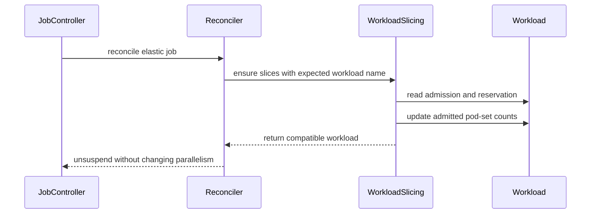

# PR #13028: WIP: POC for partiall admission for elastic workloads

**Summary**: WIP: POC for partiall admission for elastic workloads

**Sources**: https://github.com/kubernetes-sigs/kueue/pull/13028

**Last updated**: 2026-08-27T11:44:35Z

---

## Metadata

- **State**: closed
- **Author**: [@yaroslava-serdiuk](https://github.com/yaroslava-serdiuk)
- **Branch**: `elastic-partial-admission-poc` → `main`
- **Created**: 2026-07-14T10:11:18Z
- **Updated**: 2026-08-27T11:44:35Z
- **Merged**: —
- **Closed**: 2026-08-27T11:44:35Z
- **Labels**: `kind/feature`, `size/L`, `needs-rebase`, `do-not-merge/work-in-progress`, `do-not-merge/release-note-label-needed`, `cncf-cla: yes`, `area/integrations`, `area/elastic-jobs`
- **Assignees**: _none_
- **Requested reviewers**: [@mimowo](https://github.com/mimowo), [@PBundyra](https://github.com/PBundyra)
- **Changed files**: 12   **+224 / -15**

## Description

#### What this PR does / why we need it:
Related to [#12100](https://github.com/kubernetes-sigs/kueue/issues/12100)

#### Which issue(s) this PR fixes:
<!--
*Automatically closes linked issue when PR is merged.
Usage: `Fixes #<issue number>`, or `Fixes (paste link of issue)`.
_If PR is about `failing-tests or flakes`, please post the related issues/tests in a comment and do not use `Fixes`_*
-->
Fixes #

#### Special notes for your reviewer:

#### Does this PR introduce a user-facing change?
<!--
If no, just write "NONE" in the release-note block below.
If yes, a release note is required:
Enter your extended release note in the block below. If the PR requires additional action from users switching to the new release, include the string "action required".
-->
```release-note

```


<!-- This is an auto-generated comment: release notes by coderabbit.ai -->

## Summary by CodeRabbit

- **New Features**
  - Added support for partial admission of elastic jobs when the corresponding feature gate is enabled.
  - Elastic jobs using workload slicing can now retain their requested parallelism while workload slices are admitted according to available capacity.
  - Workload status now accurately reflects admitted pod-set counts.

- **Bug Fixes**
  - Improved workload-slice reconciliation for partially admitted workloads.
  - Updated validation to allow supported combinations of partial admission and elastic jobs.

- **Configuration**
  - Added the `PartialAdmissionForElasticJob` alpha feature gate, disabled by default.

<!-- end of auto-generated comment: release notes by coderabbit.ai -->

## Discussion

### Comment by [@kubernetes-prow[bot]](https://github.com/apps/kubernetes-prow) — 2026-07-14T10:11:21Z

Adding the "do-not-merge/release-note-label-needed" label because no release-note block was detected, please follow our [release note process](https://git.k8s.io/community/contributors/guide/release-notes.md) to remove it.

<details>

Instructions for interacting with me using PR comments are available [here](https://git.k8s.io/community/contributors/guide/pull-requests.md).  If you have questions or suggestions related to my behavior, please file an issue against the [kubernetes-sigs/prow](https://github.com/kubernetes-sigs/prow/issues/new?title=Prow%20issue:) repository.
</details>

### Comment by [@netlify[bot]](https://github.com/apps/netlify) — 2026-07-14T10:11:24Z

### <span aria-hidden="true">✅</span> Deploy Preview for *kubernetes-sigs-kueue* ready!


|  Name | Link |
|:-:|------------------------|
|<span aria-hidden="true">🔨</span> Latest commit | d0cc886b7b278e9fa248df7978b5ee1f0c274b8a |
|<span aria-hidden="true">🔍</span> Latest deploy log | https://app.netlify.com/projects/kubernetes-sigs-kueue/deploys/6a5a2a996773ce00085f8d18 |
|<span aria-hidden="true">😎</span> Deploy Preview | [https://deploy-preview-13028--kubernetes-sigs-kueue.netlify.app](https://deploy-preview-13028--kubernetes-sigs-kueue.netlify.app) |
|<span aria-hidden="true">📱</span> Preview on mobile | <details><summary> Toggle QR Code... </summary><br /><br /><br /><br />_Use your smartphone camera to open QR code link._</details> |
---
<!-- [kubernetes-sigs-kueue Preview](https://deploy-preview-13028--kubernetes-sigs-kueue.netlify.app) -->
_To edit notification comments on pull requests, go to your [Netlify project configuration](https://app.netlify.com/projects/kubernetes-sigs-kueue/configuration/notifications#deploy-notifications)._

### Comment by [@coderabbitai[bot]](https://github.com/apps/coderabbitai) — 2026-07-14T10:11:38Z

<!-- This is an auto-generated comment: summarize by coderabbit.ai -->
<!-- review_stack_entry_start -->

[](https://app.coderabbit.ai/change-stack/kubernetes-sigs/kueue/pull/13028?utm_source=github_walkthrough&utm_medium=github&utm_campaign=change_stack)

<!-- review_stack_entry_end -->
<!-- This is an auto-generated comment: skip review by coderabbit.ai -->

> [!IMPORTANT]
> ## Review skipped
> 
> Auto reviews are limited based on label configuration.
> 
> <details>
> <summary>:no_entry_sign: Review skipped — only excluded labels are configured. (3)</summary>
> 
> * needs-ok-to-test
> * do-not-merge/work-in-progress
> * cncf-cla: no
> 
> </details>
> 
> Please check the settings in the CodeRabbit UI or the `.coderabbit.yaml` file in this repository. To trigger a single review, invoke the `@coderabbitai review` command.
> 
> <details>
> <summary>⚙️ Run configuration</summary>
> 
> **Configuration used**: Path: .coderabbit.yaml
> 
> **Review profile**: CHILL
> 
> **Plan**: Pro Plus
> 
> **Run ID**: `7cb0fb9e-56a4-4c56-83fa-30dd8308937a`
> 
> </details>
> 
> You can disable this status message by setting the `reviews.review_status` to `false` in the CodeRabbit configuration file.
> 
> Use the checkbox below for a quick retry:
> - [ ] <!-- {"checkboxId": "e9bb8d72-00e8-4f67-9cb2-caf3b22574fe"} --> 🔍 Trigger review

<!-- end of auto-generated comment: skip review by coderabbit.ai -->

<!-- walkthrough_start -->

<details>
<summary>📝 Walkthrough</summary>

## Walkthrough

Elastic jobs can use partial admission when the new feature gate is enabled. Workload slicing now preserves admitted pod-set counts and passes the expected workload name through reconciliation, while controller and webhook behavior is updated and covered by unit and integration tests.

### Changes

**Elastic job partial admission**

|Layer / File(s)|Summary|
|---|---|
|**Feature gate and validation** <br> `pkg/features/kube_features.go`, `pkg/controller/jobs/job/job_webhook.go`, `pkg/webhooks/workload_webhook.go`, `pkg/controller/jobs/job/job_webhook_test.go`, `pkg/webhooks/workload_webhook_test.go`|Adds the alpha `PartialAdmissionForElasticJob` gate and permits partial admission with elastic jobs only when the gate is enabled.|
|**Admitted count synchronization** <br> `pkg/workload/podsetscounts.go`, `pkg/workloadslicing/workloadslicing.go`, `pkg/workloadslicing/workloadslicing_test.go`|Extracts admitted pod-set counts and updates matching workload slices to use reserved counts when an expected workload is selected.|
|**Job reconciliation and integration coverage** <br> `pkg/controller/jobframework/reconciler.go`, `pkg/controller/jobs/job/job_controller.go`, `pkg/controller/jobs/job/job_controller_test.go`, `test/integration/singlecluster/controller/jobs/job/job_controller_test.go`|Passes the generated workload name into slice reconciliation, avoids min-parallelism corrections during slicing, and verifies elastic-job partial admission behavior.|

**Estimated code review effort:** 3 (Moderate) | ~25 minutes

### Sequence Diagram(s)



**Possibly related PRs**

- [kubernetes-sigs/kueue#12421](https://github.com/kubernetes-sigs/kueue/pull/12421): Updates the elastic admitted-job flow and applies admitted `PodSetInfo` to owner templates.

**Suggested labels:** `kind/feature`, `release-note-none`, `area/elastic-jobs`, `area/testing`

**Suggested reviewers:** `mimowo`, `mbobrovskyi`, `sohankunkerkar`, `ivnovakov`, `mszadkow`

</details>

<!-- walkthrough_end -->
<!-- pre_merge_checks_walkthrough_start -->

<details>
<summary>🚥 Pre-merge checks | ✅ 4 | ❌ 1</summary>

### ❌ Failed checks (1 warning)

|     Check name     | Status     | Explanation                                                                          | Resolution                                                                         |
| :----------------: | :--------- | :----------------------------------------------------------------------------------- | :--------------------------------------------------------------------------------- |
| Docstring Coverage | ⚠️ Warning | Docstring coverage is 0.00% which is insufficient. The required threshold is 80.00%. | Write docstrings for the functions missing them to satisfy the coverage threshold. |

<details>
<summary>✅ Passed checks (4 passed)</summary>

|         Check name         | Status   | Explanation                                                                                       |
| :------------------------: | :------- | :------------------------------------------------------------------------------------------------ |
|     Linked Issues check    | ✅ Passed | Check skipped because no linked issues were found for this pull request.                          |
| Out of Scope Changes check | ✅ Passed | Check skipped because no linked issues were found for this pull request.                          |
|      Description Check     | ✅ Passed | Check skipped - CodeRabbit’s high-level summary is enabled.                                       |
|         Title check        | ✅ Passed | The title is clearly related to the main change: partial admission support for elastic workloads. |

</details>

</details>

<!-- pre_merge_checks_walkthrough_end -->
<!-- finishing_touch_checkbox_start -->

<details>
<summary>✨ Finishing Touches</summary>

<details>
<summary>🧪 Generate unit tests (beta)</summary>

- [ ] <!-- {"checkboxId": "f47ac10b-58cc-4372-a567-0e02b2c3d479", "radioGroupId": "utg-output-choice-group-unknown_comment_id"} -->   Create PR with unit tests

</details>

</details>

<!-- finishing_touch_checkbox_end -->
<!-- tips_start -->

---

Thanks for using [CodeRabbit](https://coderabbit.ai?utm_source=oss&utm_medium=github&utm_campaign=kubernetes-sigs/kueue&utm_content=13028)! It's free for OSS, and your support helps us grow. If you like it, consider giving us a shout-out.

<details>
<summary>❤️ Share</summary>

- [X](https://twitter.com/intent/tweet?text=I%20just%20used%20%40coderabbitai%20for%20my%20code%20review%2C%20and%20it%27s%20fantastic%21%20It%27s%20free%20for%20OSS%20and%20offers%20a%20free%20trial%20for%20the%20proprietary%20code.%20Check%20it%20out%3A&url=https%3A//coderabbit.ai)
- [Mastodon](https://mastodon.social/share?text=I%20just%20used%20%40coderabbitai%20for%20my%20code%20review%2C%20and%20it%27s%20fantastic%21%20It%27s%20free%20for%20OSS%20and%20offers%20a%20free%20trial%20for%20the%20proprietary%20code.%20Check%20it%20out%3A%20https%3A%2F%2Fcoderabbit.ai)
- [Reddit](https://www.reddit.com/submit?title=Great%20tool%20for%20code%20review%20-%20CodeRabbit&text=I%20just%20used%20CodeRabbit%20for%20my%20code%20review%2C%20and%20it%27s%20fantastic%21%20It%27s%20free%20for%20OSS%20and%20offers%20a%20free%20trial%20for%20proprietary%20code.%20Check%20it%20out%3A%20https%3A//coderabbit.ai)
- [LinkedIn](https://www.linkedin.com/sharing/share-offsite/?url=https%3A%2F%2Fcoderabbit.ai&mini=true&title=Great%20tool%20for%20code%20review%20-%20CodeRabbit&summary=I%20just%20used%20CodeRabbit%20for%20my%20code%20review%2C%20and%20it%27s%20fantastic%21%20It%27s%20free%20for%20OSS%20and%20offers%20a%20free%20trial%20for%20proprietary%20code)

</details>


<sub>Comment `@coderabbitai help` to get the list of available commands.</sub>

<!-- tips_end -->

### Comment by [@kubernetes-prow[bot]](https://github.com/apps/kubernetes-prow) — 2026-07-14T10:12:03Z

[APPROVALNOTIFIER] This PR is **NOT APPROVED**

This pull-request has been approved by: *<a href="https://github.com/kubernetes-sigs/kueue/pull/13028#" title="Author self-approved">yaroslava-serdiuk</a>*
**Once this PR has been reviewed and has the lgtm label**, please assign [mimowo](https://github.com/mimowo) for approval. For more information see [the Code Review Process](https://git.k8s.io/community/contributors/guide/owners.md#the-code-review-process).

The full list of commands accepted by this bot can be found [here](https://go.k8s.io/bot-commands?repo=kubernetes-sigs%2Fkueue).

<details open>
Needs approval from an approver in each of these files:

- **[OWNERS](https://github.com/kubernetes-sigs/kueue/blob/main/OWNERS)**

Approvers can indicate their approval by writing `/approve` in a comment
Approvers can cancel approval by writing `/approve cancel` in a comment
</details>
<!-- META={"approvers":["mimowo"]} -->

### Comment by [@kubernetes-prow[bot]](https://github.com/apps/kubernetes-prow) — 2026-07-23T01:34:22Z

PR needs rebase.

<details>

Instructions for interacting with me using PR comments are available [here](https://git.k8s.io/community/contributors/guide/pull-requests.md).  If you have questions or suggestions related to my behavior, please file an issue against the [kubernetes-sigs/prow](https://github.com/kubernetes-sigs/prow/issues/new?title=Prow%20issue:) repository.
</details>

### Comment by [@mimowo](https://github.com/mimowo) — 2026-08-03T19:29:31Z

/area elastic-jobs
/kind feature
/area integrations

### Comment by [@kubernetes-prow[bot]](https://github.com/apps/kubernetes-prow) — 2026-08-26T22:51:30Z

@yaroslava-serdiuk: The following tests **failed**, say `/retest` to rerun all failed tests or `/retest-required` to rerun all mandatory failed tests:

Test name | Commit | Details | Required | Rerun command
--- | --- | --- | --- | ---
pull-kueue-test-unit-shard-1-main | d0cc886b7b278e9fa248df7978b5ee1f0c274b8a | [link](https://prow.k8s.io/view/gs/kubernetes-ci-logs/pr-logs/pull/kubernetes-sigs_kueue/13028/pull-kueue-test-unit-shard-1-main/2078105947628113920) | true | `/test pull-kueue-test-unit-shard-1-main`
pull-kueue-test-integration-shard-2-main | d0cc886b7b278e9fa248df7978b5ee1f0c274b8a | [link](https://prow.k8s.io/view/gs/kubernetes-ci-logs/pr-logs/pull/kubernetes-sigs_kueue/13028/pull-kueue-test-integration-shard-2-main/2078105947963658240) | true | `/test pull-kueue-test-integration-shard-2-main`
pull-kueue-verify-main | d0cc886b7b278e9fa248df7978b5ee1f0c274b8a | [link](https://prow.k8s.io/view/gs/kubernetes-ci-logs/pr-logs/pull/kubernetes-sigs_kueue/13028/pull-kueue-verify-main/2078105972273844224) | true | `/test pull-kueue-verify-main`
pull-kueue-test-e2e-baseline-main-1-35 | d0cc886b7b278e9fa248df7978b5ee1f0c274b8a | [link](https://prow.k8s.io/view/gs/kubernetes-ci-logs/pr-logs/pull/kubernetes-sigs_kueue/13028/pull-kueue-test-e2e-baseline-main-1-35/2078105948676689920) | true | `/test pull-kueue-test-e2e-baseline-main-1-35`
pull-kueue-test-e2e-baseline-main-1-37 | d0cc886b7b278e9fa248df7978b5ee1f0c274b8a | [link](https://prow.k8s.io/view/gs/kubernetes-ci-logs/pr-logs/pull/kubernetes-sigs_kueue/13028/pull-kueue-test-e2e-baseline-main-1-37/2092746714103418880) | true | `/test pull-kueue-test-e2e-baseline-main-1-37`
pull-kueue-test-e2e-extended-shard-1-main-1-37 | d0cc886b7b278e9fa248df7978b5ee1f0c274b8a | [link](https://prow.k8s.io/view/gs/kubernetes-ci-logs/pr-logs/pull/kubernetes-sigs_kueue/13028/pull-kueue-test-e2e-extended-shard-1-main-1-37/2092746714334105600) | true | `/test pull-kueue-test-e2e-extended-shard-1-main-1-37`
pull-kueue-test-e2e-extended-shard-2-main-1-37 | d0cc886b7b278e9fa248df7978b5ee1f0c274b8a | [link](https://prow.k8s.io/view/gs/kubernetes-ci-logs/pr-logs/pull/kubernetes-sigs_kueue/13028/pull-kueue-test-e2e-extended-shard-2-main-1-37/2092746714422185984) | true | `/test pull-kueue-test-e2e-extended-shard-2-main-1-37`
pull-kueue-test-e2e-extended-shard-0-main-1-37 | d0cc886b7b278e9fa248df7978b5ee1f0c274b8a | [link](https://prow.k8s.io/view/gs/kubernetes-ci-logs/pr-logs/pull/kubernetes-sigs_kueue/13028/pull-kueue-test-e2e-extended-shard-0-main-1-37/2092746714191499264) | true | `/test pull-kueue-test-e2e-extended-shard-0-main-1-37`

[Full PR test history](https://prow.k8s.io/pr-history?org=kubernetes-sigs&repo=kueue&pr=13028). [Your PR dashboard](https://prow.k8s.io/pr?query=is%3Apr%20state%3Aopen%20author%3Ayaroslava-serdiuk). Please help us cut down on flakes by [linking to](https://git.k8s.io/community/contributors/devel/sig-testing/flaky-tests.md#filing-issues-for-flaky-tests) an [open issue](https://github.com/kubernetes-sigs/kueue/issues?q=is:issue+is:open) when you hit one in your PR.

<details>

Instructions for interacting with me using PR comments are available [here](https://git.k8s.io/community/contributors/guide/pull-requests.md).  If you have questions or suggestions related to my behavior, please file an issue against the [kubernetes-sigs/prow](https://github.com/kubernetes-sigs/prow/issues/new?title=Prow%20issue:) repository. I understand the commands that are listed [here](https://go.k8s.io/bot-commands).
</details>
<!-- test report -->

## Reviews

### Review by [@coderabbitai[bot]](https://github.com/apps/coderabbitai) (commented) — 2026-07-14T10:19:18Z

**Actionable comments posted: 2**

<details>
<summary>🧹 Nitpick comments (1)</summary><blockquote>

<details>
<summary>test/integration/singlecluster/controller/jobs/job/job_controller_test.go (1)</summary><blockquote>

`4809-4859`: _📐 Maintainability & Code Quality_ | _🔵 Trivial_ | _⚡ Quick win_

**Add a negative test scenario for partial admission eviction.**

As per path instructions, ensure new test cases cover both positive and negative scenarios. This test successfully covers the positive scenario of scaling up during partial admission, but lacks a negative scenario. Please consider adding a scenario to verify recovery after eviction (e.g., verifying that a partially admitted workload restores its counts to match the full Job's requested pods if it loses its quota reservation).

<details>
<summary>🤖 Prompt for AI Agents</summary>

```
Verify each finding against current code. Fix only still-valid issues, skip the
rest with a brief reason, keep changes minimal, and validate.

In `@test/integration/singlecluster/controller/jobs/job/job_controller_test.go`
around lines 4809 - 4859, Extend the partial-admission coverage in the test
around the existing scale-up scenario with a negative eviction/recovery case:
evict or otherwise remove the partially admitted workload’s quota reservation,
then verify the workload’s pod-set count is restored to the full Job request
rather than remaining partially admitted. Reuse the existing elasticJob,
newWorkloadSlice, and queue-capacity setup, and assert recovery after the
eviction state is observed.
```

</details>

<!-- cr-comment:v1:99e7a17770f8fec948c3e9f5 -->

_Source: Path instructions_

</blockquote></details>

</blockquote></details>

<details>
<summary>🤖 Prompt for all review comments with AI agents</summary>

```
Verify each finding against current code. Fix only still-valid issues, skip the
rest with a brief reason, keep changes minimal, and validate.

Inline comments:
In `@pkg/features/kube_features.go`:
- Around line 466-469: Correct the string value assigned to
PartialAdmissionForElasticJob so it uses the expected
“PartialAdmissionForElasticJob” key spelling, while leaving the feature symbol
and surrounding metadata unchanged.

In `@pkg/workloadslicing/workloadslicing.go`:
- Around line 213-223: The workload lookup returns early for matching names even
after quota reservation is lost, preventing restoration of original pod set
counts. In pkg/workloadslicing/workloadslicing.go lines 213-223, update the
matching branch around expectedWorkloadName to return early only when
workload.HasQuotaReservation(wl) is true; apply the same guard to the
default-branch early return at lines 258-268, allowing non-reserved workloads to
reach the existing restoration logic.

---

Nitpick comments:
In `@test/integration/singlecluster/controller/jobs/job/job_controller_test.go`:
- Around line 4809-4859: Extend the partial-admission coverage in the test
around the existing scale-up scenario with a negative eviction/recovery case:
evict or otherwise remove the partially admitted workload’s quota reservation,
then verify the workload’s pod-set count is restored to the full Job request
rather than remaining partially admitted. Reuse the existing elasticJob,
newWorkloadSlice, and queue-capacity setup, and assert recovery after the
eviction state is observed.
```

</details>

<details>
<summary>🪄 Autofix (Beta)</summary>

Fix all unresolved CodeRabbit comments on this PR:

- [ ] <!-- {"checkboxId": "4b0d0e0a-96d7-4f10-b296-3a18ea78f0b9"} --> Push a commit to this branch (recommended)
- [ ] <!-- {"checkboxId": "ff5b1114-7d8c-49e6-8ac1-43f82af23a33"} --> Create a new PR with the fixes

</details>

---

<details>
<summary>ℹ️ Review info</summary>

<details>
<summary>⚙️ Run configuration</summary>

**Configuration used**: Path: .coderabbit.yaml

**Review profile**: CHILL

**Plan**: Pro

**Run ID**: `70a93ebd-334c-449c-977d-a359172fc18d`

</details>

<details>
<summary>📥 Commits</summary>

Reviewing files that changed from the base of the PR and between 0951331a02409e5b15d2eb42f69951416968b33b and 7ee7fdc88c6496a93c3c3107b773c910d55f0243.

</details>

<details>
<summary>📒 Files selected for processing (12)</summary>

* `pkg/controller/jobframework/reconciler.go`
* `pkg/controller/jobs/job/job_controller.go`
* `pkg/controller/jobs/job/job_controller_test.go`
* `pkg/controller/jobs/job/job_webhook.go`
* `pkg/controller/jobs/job/job_webhook_test.go`
* `pkg/features/kube_features.go`
* `pkg/webhooks/workload_webhook.go`
* `pkg/webhooks/workload_webhook_test.go`
* `pkg/workload/podsetscounts.go`
* `pkg/workloadslicing/workloadslicing.go`
* `pkg/workloadslicing/workloadslicing_test.go`
* `test/integration/singlecluster/controller/jobs/job/job_controller_test.go`

</details>

</details>

<!-- This is an auto-generated comment by CodeRabbit for review status -->

- **pkg/features/kube_features.go:495** by [@coderabbitai[bot]](https://github.com/apps/coderabbitai) — 2026-07-14T10:19:17Z
```diff
@@ -461,8 +461,12 @@ const (
 	// UnadmittedWorkloadsExplicitStatus gates the immediate, proactive
 	// initialization of both QuotaReserved and Admitted status conditions
 	// to False during a workload's first reconciliation.
-	// This feature gate requires UnadmittedWorkloadsObservability to be enabled to take effect.
 	UnadmittedWorkloadsExplicitStatus featuregate.Feature = "UnadmittedWorkloadsExplicitStatus"
+
+	// owner: @yaroslava-serdiuk
+	//
+	// Enables partial admission for elastic jobs.
+	PartialAdmissionForElasticJob featuregate.Feature = "PartialAdmiisionForElasticJob"
```

  _🎯 Functional Correctness_ | _🔴 Critical_ | _⚡ Quick win_
  
  **Fix typographical error in the feature gate string key.**
  
  The feature gate string value contains a typo (`PartialAdmiision...` instead of `PartialAdmission...`). Since this string is used by cluster administrators to enable the feature via CLI flags or configuration files, this typo breaks the expected configuration contract.
  
  
  
  
  <details>
  <summary>🐛 Proposed fix</summary>
  
  ```diff
   	// owner: `@yaroslava-serdiuk`
   	//
   	// Enables partial admission for elastic jobs.
  -	PartialAdmissionForElasticJob featuregate.Feature = "PartialAdmiisionForElasticJob"
  +	PartialAdmissionForElasticJob featuregate.Feature = "PartialAdmissionForElasticJob"
  ```
  </details>
  
  <!-- suggestion_start -->
  
  <details>
  <summary>📝 Committable suggestion</summary>
  
  > ‼️ **IMPORTANT**
  > Carefully review the code before committing. Ensure that it accurately replaces the highlighted code, contains no missing lines, and has no issues with indentation. Thoroughly test & benchmark the code to ensure it meets the requirements.
  
  ```suggestion
  	// owner: `@yaroslava-serdiuk`
  	//
  	// Enables partial admission for elastic jobs.
  	PartialAdmissionForElasticJob featuregate.Feature = "PartialAdmissionForElasticJob"
  ```
  
  </details>
  
  <!-- suggestion_end -->
  
  <details>
  <summary>🤖 Prompt for AI Agents</summary>
  
  ```
  Verify each finding against current code. Fix only still-valid issues, skip the
  rest with a brief reason, keep changes minimal, and validate.
  
  In `@pkg/features/kube_features.go` around lines 466 - 469, Correct the string
  value assigned to PartialAdmissionForElasticJob so it uses the expected
  “PartialAdmissionForElasticJob” key spelling, while leaving the feature symbol
  and surrounding metadata unchanged.
  ```
  
  </details>
  
  <!-- fingerprinting:phantom:poseidon:panther -->
  
  <!-- cr-indicator-types:potential_issue -->
  
  <!-- cr-comment:v1:44eff7cf07fb0b6a5eb4e080 -->
  
  <!-- This is an auto-generated comment by CodeRabbit -->

- **pkg/workloadslicing/workloadslicing.go:208** by [@coderabbitai[bot]](https://github.com/apps/coderabbitai) — 2026-07-14T10:19:17Z
```diff
@@ -209,6 +210,17 @@ func EnsureWorkloadSlices(
 			return nil, false, nil
 		}
 
+		if wl.Name == expectedWorkloadName {
+			wlAdmittedCounts := workload.ExtractAdmittedPodSetCounts(wl)
+			if workload.HasQuotaReservation(wl) && !wlPodSetsCounts.EqualTo(wlAdmittedCounts) {
+				workload.ApplyPodSetCounts(wl, wlAdmittedCounts)
+				if err := clnt.Update(ctx, wl); err != nil {
+					return nil, true, fmt.Errorf("failed to update partially admitted workload's pod sets counts: %w", err)
+				}
+			}
+			return wl, true, nil
+		}
+
```

  _🎯 Functional Correctness_ | _🔴 Critical_ | _⚡ Quick win_
  
  **Prevent evicted workloads from being permanently stuck with partial admission counts.** 
  
  Both branches return early when the name matches `expectedWorkloadName`, unconditionally bypassing the fallback logic that restores the workload counts when it is no longer admitted. If a partially admitted workload is evicted (losing its quota reservation), it will never be restored to the Job's original requested pod set count and will be permanently enqueued with the reduced partial capacity.
  
  - `pkg/workloadslicing/workloadslicing.go#L213-L223`: fold the quota reservation check into the early return condition to allow evicted workloads to fall through to the restoration logic.
  - `pkg/workloadslicing/workloadslicing.go#L258-L268`: apply the same quota reservation guard to the early return condition in the default branch.
  
  
  
  
  <details>
  <summary>🐛 Proposed fixes</summary>
  
  **pkg/workloadslicing/workloadslicing.go#L213-L223**
  ```diff
  -		if wl.Name == expectedWorkloadName {
  +		if wl.Name == expectedWorkloadName && workload.HasQuotaReservation(wl) {
  			wlAdmittedCounts := workload.ExtractAdmittedPodSetCounts(wl)
  -			if workload.HasQuotaReservation(wl) && !wlPodSetsCounts.EqualTo(wlAdmittedCounts) {
  +			if !wlPodSetsCounts.EqualTo(wlAdmittedCounts) {
  				workload.ApplyPodSetCounts(wl, wlAdmittedCounts)
  				if err := clnt.Update(ctx, wl); err != nil {
  					return nil, true, fmt.Errorf("failed to update partially admitted workload's pod sets counts: %w", err)
  				}
  			}
  			return wl, true, nil
  		}
  ```
  
  **pkg/workloadslicing/workloadslicing.go#L258-L268**
  ```diff
  -		if selectedWorkload.Name == expectedWorkloadName {
  +		if selectedWorkload.Name == expectedWorkloadName && workload.HasQuotaReservation(selectedWorkload) {
  			wlAdmittedCounts := workload.ExtractAdmittedPodSetCounts(selectedWorkload)
  -			if workload.HasQuotaReservation(selectedWorkload) && !selectedCounts.EqualTo(wlAdmittedCounts) {
  +			if !selectedCounts.EqualTo(wlAdmittedCounts) {
  				workload.ApplyPodSetCounts(selectedWorkload, wlAdmittedCounts)
  				if err := clnt.Update(ctx, selectedWorkload); err != nil {
  					return nil, true, fmt.Errorf("failed to update partially admitted workload's pod sets counts: %w", err)
  				}
  			}
  			return selectedWorkload, true, nil
  		}
  ```
  </details>
  
  <!-- suggestion_start -->
  
  <details>
  <summary>📝 Committable suggestion</summary>
  
  > ‼️ **IMPORTANT**
  > Carefully review the code before committing. Ensure that it accurately replaces the highlighted code, contains no missing lines, and has no issues with indentation. Thoroughly test & benchmark the code to ensure it meets the requirements.
  
  ```suggestion
  		if wl.Name == expectedWorkloadName && workload.HasQuotaReservation(wl) {
  			wlAdmittedCounts := workload.ExtractAdmittedPodSetCounts(wl)
  			if !wlPodSetsCounts.EqualTo(wlAdmittedCounts) {
  				workload.ApplyPodSetCounts(wl, wlAdmittedCounts)
  				if err := clnt.Update(ctx, wl); err != nil {
  					return nil, true, fmt.Errorf("failed to update partially admitted workload's pod sets counts: %w", err)
  				}
  			}
  			return wl, true, nil
  		}
  ```
  
  ```suggestion
  		if selectedWorkload.Name == expectedWorkloadName && workload.HasQuotaReservation(selectedWorkload) {
  			wlAdmittedCounts := workload.ExtractAdmittedPodSetCounts(selectedWorkload)
  			if !selectedCounts.EqualTo(wlAdmittedCounts) {
  				workload.ApplyPodSetCounts(selectedWorkload, wlAdmittedCounts)
  				if err := clnt.Update(ctx, selectedWorkload); err != nil {
  					return nil, true, fmt.Errorf("failed to update partially admitted workload's pod sets counts: %w", err)
  				}
  			}
  			return selectedWorkload, true, nil
  		}
  ```
  
  </details>
  
  <!-- suggestion_end -->
  
  <details>
  <summary>📍 Affects 1 file</summary>
  
  - `pkg/workloadslicing/workloadslicing.go#L213-L223` (this comment)
  - `pkg/workloadslicing/workloadslicing.go#L258-L268`
  
  </details>
  
  <details>
  <summary>🤖 Prompt for AI Agents</summary>
  
  ```
  Verify each finding against current code. Fix only still-valid issues, skip the
  rest with a brief reason, keep changes minimal, and validate.
  
  In `@pkg/workloadslicing/workloadslicing.go` around lines 213 - 223, The workload
  lookup returns early for matching names even after quota reservation is lost,
  preventing restoration of original pod set counts. In
  pkg/workloadslicing/workloadslicing.go lines 213-223, update the matching branch
  around expectedWorkloadName to return early only when
  workload.HasQuotaReservation(wl) is true; apply the same guard to the
  default-branch early return at lines 258-268, allowing non-reserved workloads to
  reach the existing restoration logic.
  ```
  
  </details>
  
  <!-- consolidated_sites_start -->
  <!--
  <consolidated_sites>
  <site>
  <role>anchor</role>
  <file>pkg/workloadslicing/workloadslicing.go</file>
  <line_range>213-223</line_range>
  </site>
  <site>
  <role>sibling</role>
  <file>pkg/workloadslicing/workloadslicing.go</file>
  <line_range>258-268</line_range>
  </site>
  </consolidated_sites>
  -->
  <!-- consolidated_sites_end -->
  
  <!-- fingerprinting:phantom:poseidon:panther -->
  
  <!-- cr-indicator-types:potential_issue -->
  
  <!-- cr-comment:v1:fee473bbe95ed787b3102d0d -->
  
  <!-- This is an auto-generated comment by CodeRabbit -->
