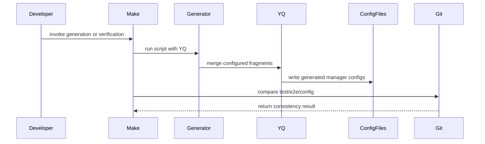

# PR #13177: De-duplicate e2e controller manager configs via shared YAML fragments

**Summary**: De-duplicate e2e controller manager configs via shared YAML fragments

**Sources**: https://github.com/kubernetes-sigs/kueue/pull/13177

**Last updated**: 2026-10-20T13:26:02Z

---

## Metadata

- **State**: open
- **Author**: [@TapanManu](https://github.com/TapanManu)
- **Branch**: `12415-dedup-e2e-controller-config` → `main`
- **Created**: 2026-07-18T10:57:56Z
- **Updated**: 2026-10-20T13:26:02Z
- **Merged**: —
- **Closed**: —
- **Labels**: `lifecycle/stale`, `size/L`, `release-note-none`, `kind/cleanup`, `cncf-cla: yes`, `area/testing`
- **Assignees**: _none_
- **Requested reviewers**: [@kannon92](https://github.com/kannon92), [@tenzen-y](https://github.com/tenzen-y)
- **Changed files**: 35   **+342 / -9**

## Description

#### What type of PR is this?

/kind cleanup
/area testing

#### What this PR does / why we need it:

`test/e2e/config/**/controller_manager_config.yaml` existed as 9 near-identical copies
(`default`, `extended`, `certmanager`, `multikueue/{baseline,sequential,extended-shard-0,extended-shard-1}`,
`dra/{whole-device,counter}`). Kustomize's `configMapGenerator` treats each file as an
opaque string blob, so there's no way to field-merge YAML content across bases/overlays —
any environment that needed even one different field (a feature gate, an integration
framework list, `fairSharing`, `tls`) had to hand-copy the entire ~50-line file. This meant
a common-setting change required editing up to 9 files in lockstep, and any file that got
missed would silently drift from the others.

This PR:
- Introduces a small set of reusable YAML fragments under
  `test/e2e/config/components/manager-config/` (`core.yaml`, `fairsharing.yaml`,
  `tls.yaml`, `featuregates-full.yaml`, `frameworks-full.yaml`,
  `leaderelection-tuning.yaml`), holding only the fields that are byte-identical across
  two or more environments today.
- Adds a `hack/generate-e2e-manager-configs.sh` script (using the repo's already-vendored
  `yq`) and a `generate-e2e-manager-configs` Make target that deep-merges each
  environment's declared fragments + its own small local delta
  (`test/e2e/config/**/generate.yaml`, `delta.yaml`) into that environment's
  `controller_manager_config.yaml`. Kustomize's `configMapGenerator` is unchanged — these
  files keep their exact location/format, they just become **generated** instead of
  hand-maintained.
- Adds a `verify-e2e-config-consistency` Make target, wired into `verify-checks`
  (following the `verify-kustomize-build` precedent), that regenerates and fails the build
  if a checked-in file no longer matches its fragments/deltas — this is what actually
  prevents the configuration drift described above, not just the refactor itself.
- Keeps every environment's genuine deltas (MultiKueue shard framework subsets with their
  explanatory comments, DRA `resources.deviceClassMappings`, environment-specific
  `leaderElection` tuning) as small, explicit per-environment files — not folded into the
  shared components.
- Normalizes `certmanager/controller_manager_config.yaml` from the stale `v1beta1` onto
  the shared `v1beta2` `core.yaml` baseline used by every other environment (see reviewer
  note below); its existing minimal scenario config (fairSharing/waitForPodsReady/
  internalCertManagement disabled, single `batch/job` integration) is preserved as-is in
  its own delta file.

All 9 generated files were diffed byte-for-byte against the pre-change hand-written
files; the only differences are the added `# Code generated ... DO NOT EDIT.` header, the
`certmanager` `v1beta1`→`v1beta2` bump, one previously-missing explanatory comment
restored on `multikueue/baseline`'s `tls` block (it was identical to the other 4
`tls`-bearing environments except for missing this comment), and two pre-existing stray
trailing-whitespace bytes removed.

No changes to `kustomization.yaml` resource/patch/replica composition — this PR is scoped
to the duplicated YAML *content*, not the Kustomize resource graph.

#### Which issue(s) this PR fixes:
Fixes #12415

#### Special notes for your reviewer:

- The `certmanager` `v1beta1`→`v1beta2` bump is the one behavior-adjacent change in this
  PR (every other file's generated content is byte-identical modulo the header comment).
  I could not find a maintainer confirmation on whether `certmanager`'s minimal config
  (no `fairSharing`/`tls`/most integrations) was an intentional scope reduction or just
  stale — I've kept its existing minimal scenario coverage unchanged and only bumped the
  API version, but please double check this is the right call for that suite.
- This PR was developed with AI assistance (Claude Code), per the
  [Kubernetes AI Tool Usage Policy](https://www.kubernetes.dev/docs/guide/pull-requests/#ai-guidance).
  All generated fragments/scripts/diffs were reviewed and validated by me (byte-for-byte
  diffing against the pre-change files, `make verify-e2e-config-consistency`, and manual
  drift smoke-tests).

#### Does this PR introduce a user-facing change?


```release-note
NONE
```


<!-- This is an auto-generated comment: release notes by coderabbit.ai -->
## Summary by CodeRabbit

* **New Features**
  * Added automated generation of end-to-end controller-manager configuration files from shared YAML fragments plus per-environment overrides.
* **Bug Fixes**
  * Updated `make verify` to also enforce end-to-end manager config consistency by detecting drift from the generated outputs.
* **Documentation**
  * Added guidance on regenerating end-to-end manager configs and warned against manual edits.
* **Chores**
  * Refreshed end-to-end configuration generation inputs and updated example controller-manager configs (including cert-manager/Kueue config changes).
<!-- end of auto-generated comment: release notes by coderabbit.ai -->

## Discussion

### Comment by [@netlify[bot]](https://github.com/apps/netlify) — 2026-07-18T10:58:01Z

### <span aria-hidden="true">✅</span> Deploy Preview for *kubernetes-sigs-kueue* canceled.


|  Name | Link |
|:-:|------------------------|
|<span aria-hidden="true">🔨</span> Latest commit | 26175047d307cde119cedccc65109268ae28bf2b |
|<span aria-hidden="true">🔍</span> Latest deploy log | https://app.netlify.com/projects/kubernetes-sigs-kueue/deploys/6a5b63c044c4600008e8cec7 |

### Comment by [@linux-foundation-easycla[bot]](https://github.com/apps/linux-foundation-easycla) — 2026-07-18T10:58:03Z

<a href="https://easycla.lfx.linuxfoundation.org/#/?version=2"></a><br >The committers listed above are authorized under a signed CLA.<ul><li>:white_check_mark: login: TapanManu / name: TapanManu (91c73ebd63070d9acfdd40b6a172217967599d97)</li></ul>

### Comment by [@kubernetes-prow[bot]](https://github.com/apps/kubernetes-prow) — 2026-07-18T10:58:05Z

[APPROVALNOTIFIER] This PR is **NOT APPROVED**

This pull-request has been approved by: *<a href="https://github.com/kubernetes-sigs/kueue/pull/13177#" title="Author self-approved">TapanManu</a>*
**Once this PR has been reviewed and has the lgtm label**, please assign [olekzabl](https://github.com/olekzabl), [pbundyra](https://github.com/pbundyra), [sohankunkerkar](https://github.com/sohankunkerkar), [tenzen-y](https://github.com/tenzen-y) for approval. For more information see [the Code Review Process](https://git.k8s.io/community/contributors/guide/owners.md#the-code-review-process).

The full list of commands accepted by this bot can be found [here](https://go.k8s.io/bot-commands?repo=kubernetes-sigs%2Fkueue).

<details open>
Needs approval from an approver in each of these files:

- **[OWNERS](https://github.com/kubernetes-sigs/kueue/blob/main/OWNERS)**

Approvers can indicate their approval by writing `/approve` in a comment
Approvers can cancel approval by writing `/approve cancel` in a comment
</details>
<!-- META={"approvers":["olekzabl","pbundyra","sohankunkerkar","tenzen-y"]} -->

### Comment by [@coderabbitai[bot]](https://github.com/apps/coderabbitai) — 2026-07-18T10:58:06Z

<!-- This is an auto-generated comment: summarize by coderabbit.ai -->
<!-- review_stack_entry_start -->

[](https://app.coderabbit.ai/change-stack/kubernetes-sigs/kueue/pull/13177?utm_source=github_walkthrough&utm_medium=github&utm_campaign=change_stack)

<!-- review_stack_entry_end -->
No actionable comments were generated in the recent review. 🎉

<details>
<summary>ℹ️ Recent review info</summary>

<details>
<summary>⚙️ Run configuration</summary>

**Configuration used**: Path: .coderabbit.yaml

**Review profile**: CHILL

**Plan**: Pro

**Run ID**: `d2fa296d-9e06-43d6-9c09-9f62c9d52eb4`

</details>

<details>
<summary>📥 Commits</summary>

Reviewing files that changed from the base of the PR and between 23703116b526701df443ffcc9e81ecdc39bda2b5 and 26175047d307cde119cedccc65109268ae28bf2b.

</details>

<details>
<summary>📒 Files selected for processing (35)</summary>

* `Makefile`
* `Makefile-verify.mk`
* `hack/generate-e2e-manager-configs.sh`
* `site/content/en/community/contribution_guidelines/testing.md`
* `test/e2e/config/certmanager/controller_manager_config.yaml`
* `test/e2e/config/certmanager/delta.yaml`
* `test/e2e/config/certmanager/generate.yaml`
* `test/e2e/config/components/manager-config/core.yaml`
* `test/e2e/config/components/manager-config/fairsharing.yaml`
* `test/e2e/config/components/manager-config/featuregates-full.yaml`
* `test/e2e/config/components/manager-config/frameworks-full.yaml`
* `test/e2e/config/components/manager-config/leaderelection-tuning.yaml`
* `test/e2e/config/components/manager-config/tls.yaml`
* `test/e2e/config/default/controller_manager_config.yaml`
* `test/e2e/config/default/generate.yaml`
* `test/e2e/config/dra/counter/controller_manager_config.yaml`
* `test/e2e/config/dra/counter/delta.yaml`
* `test/e2e/config/dra/counter/generate.yaml`
* `test/e2e/config/dra/whole-device/controller_manager_config.yaml`
* `test/e2e/config/dra/whole-device/delta.yaml`
* `test/e2e/config/dra/whole-device/generate.yaml`
* `test/e2e/config/extended/controller_manager_config.yaml`
* `test/e2e/config/extended/generate.yaml`
* `test/e2e/config/multikueue/baseline/controller_manager_config.yaml`
* `test/e2e/config/multikueue/baseline/delta.yaml`
* `test/e2e/config/multikueue/baseline/generate.yaml`
* `test/e2e/config/multikueue/extended-shard-0/controller_manager_config.yaml`
* `test/e2e/config/multikueue/extended-shard-0/frameworks-shard-non-ray.yaml`
* `test/e2e/config/multikueue/extended-shard-0/generate.yaml`
* `test/e2e/config/multikueue/extended-shard-1/controller_manager_config.yaml`
* `test/e2e/config/multikueue/extended-shard-1/frameworks-shard-ray.yaml`
* `test/e2e/config/multikueue/extended-shard-1/generate.yaml`
* `test/e2e/config/multikueue/sequential/controller_manager_config.yaml`
* `test/e2e/config/multikueue/sequential/delta.yaml`
* `test/e2e/config/multikueue/sequential/generate.yaml`

</details>

<details>
<summary>🚧 Files skipped from review as they are similar to previous changes (25)</summary>

* test/e2e/config/dra/counter/generate.yaml
* test/e2e/config/components/manager-config/fairsharing.yaml
* test/e2e/config/extended/controller_manager_config.yaml
* test/e2e/config/certmanager/generate.yaml
* test/e2e/config/dra/whole-device/controller_manager_config.yaml
* test/e2e/config/multikueue/extended-shard-1/generate.yaml
* test/e2e/config/certmanager/delta.yaml
* test/e2e/config/components/manager-config/leaderelection-tuning.yaml
* test/e2e/config/multikueue/sequential/delta.yaml
* test/e2e/config/components/manager-config/frameworks-full.yaml
* test/e2e/config/dra/whole-device/generate.yaml
* test/e2e/config/multikueue/extended-shard-1/controller_manager_config.yaml
* test/e2e/config/components/manager-config/core.yaml
* test/e2e/config/multikueue/extended-shard-1/frameworks-shard-ray.yaml
* test/e2e/config/multikueue/sequential/generate.yaml
* test/e2e/config/components/manager-config/tls.yaml
* test/e2e/config/dra/counter/controller_manager_config.yaml
* test/e2e/config/default/generate.yaml
* Makefile
* test/e2e/config/default/controller_manager_config.yaml
* site/content/en/community/contribution_guidelines/testing.md
* test/e2e/config/dra/counter/delta.yaml
* test/e2e/config/multikueue/baseline/controller_manager_config.yaml
* hack/generate-e2e-manager-configs.sh
* Makefile-verify.mk

</details>

</details>

---
<!-- walkthrough_start -->

<details>
<summary>📝 Walkthrough</summary>

## Walkthrough

Adds fragment-based generation for E2E controller-manager configurations, Make targets for regeneration and consistency verification, environment-specific YAML fragments, regenerated outputs, and contributor documentation.

### Changes

**E2E configuration generation**

|Layer / File(s)|Summary|
|---|---|
|**Generation and consistency workflow** <br> `hack/generate-e2e-manager-configs.sh`, `Makefile`, `Makefile-verify.mk`|Generates configurations from sorted manifests and YAML fragments, applies deterministic field ordering, and verifies committed outputs with `git diff --exit-code`.|
|**Shared and environment-specific fragments** <br> `test/e2e/config/components/...`, `test/e2e/config/*/generate.yaml`, `test/e2e/config/*/delta.yaml`|Adds reusable manager settings and environment-specific integrations, feature gates, TLS, leader election, and device mappings.|
|**Generated outputs and documentation** <br> `test/e2e/config/**/controller_manager_config.yaml`, `site/content/en/community/contribution_guidelines/testing.md`|Updates generated configuration files with headers and current values, and documents the regeneration workflow and editing restrictions.|

**Estimated code review effort:** 3 (Moderate) | ~20 minutes

### Sequence Diagram(s)



**Possibly related PRs**

- [kubernetes-sigs/kueue#12096](https://github.com/kubernetes-sigs/kueue/pull/12096): Updates the sharded MultiKueue E2E configuration outputs generated by this workflow.
- [kubernetes-sigs/kueue#12230](https://github.com/kubernetes-sigs/kueue/pull/12230): Also updates generated MultiKueue E2E configurations and TLS formatting.
- [kubernetes-sigs/kueue#12440](https://github.com/kubernetes-sigs/kueue/pull/12440): Overlaps with shared manager configuration concurrency and client throttling values.

**Suggested reviewers:** `tenzen-y`, `kannon92`, `olekzabl`, `pajakd`

</details>

<!-- walkthrough_end -->
<!-- pre_merge_checks_walkthrough_start -->

<details>
<summary>🚥 Pre-merge checks | ✅ 5</summary>

<details>
<summary>✅ Passed checks (5 passed)</summary>

|         Check name         | Status   | Explanation                                                                                                                               |
| :------------------------: | :------- | :---------------------------------------------------------------------------------------------------------------------------------------- |
|      Description Check     | ✅ Passed | Check skipped - CodeRabbit’s high-level summary is enabled.                                                                               |
|         Title check        | ✅ Passed | The title clearly summarizes the main change: deduplicating E2E controller manager configs with shared fragments.                         |
|     Linked Issues check    | ✅ Passed | The PR centralizes shared E2E config fields and isolates per-environment deltas, matching the cleanup goal in `#12415`.                     |
| Out of Scope Changes check | ✅ Passed | All changes support the config de-duplication workflow, generation, verification, or regenerated manifests; no unrelated edits stand out. |
|     Docstring Coverage     | ✅ Passed | No functions found in the changed files to evaluate docstring coverage. Skipping docstring coverage check.                                |

</details>

</details>

<!-- pre_merge_checks_walkthrough_end -->
<!-- finishing_touch_checkbox_start -->

<details>
<summary>✨ Finishing Touches</summary>

<details>
<summary>🧪 Generate unit tests (beta)</summary>

- [ ] <!-- {"checkboxId": "f47ac10b-58cc-4372-a567-0e02b2c3d479", "radioGroupId": "utg-output-choice-group-unknown_comment_id"} -->   Create PR with unit tests

</details>

</details>

<!-- finishing_touch_checkbox_end -->
<!-- tips_start -->

---

Thanks for using [CodeRabbit](https://coderabbit.ai?utm_source=oss&utm_medium=github&utm_campaign=kubernetes-sigs/kueue&utm_content=13177)! It's free for OSS, and your support helps us grow. If you like it, consider giving us a shout-out.

<details>
<summary>❤️ Share</summary>

- [X](https://twitter.com/intent/tweet?text=I%20just%20used%20%40coderabbitai%20for%20my%20code%20review%2C%20and%20it%27s%20fantastic%21%20It%27s%20free%20for%20OSS%20and%20offers%20a%20free%20trial%20for%20the%20proprietary%20code.%20Check%20it%20out%3A&url=https%3A//coderabbit.ai)
- [Mastodon](https://mastodon.social/share?text=I%20just%20used%20%40coderabbitai%20for%20my%20code%20review%2C%20and%20it%27s%20fantastic%21%20It%27s%20free%20for%20OSS%20and%20offers%20a%20free%20trial%20for%20the%20proprietary%20code.%20Check%20it%20out%3A%20https%3A%2F%2Fcoderabbit.ai)
- [Reddit](https://www.reddit.com/submit?title=Great%20tool%20for%20code%20review%20-%20CodeRabbit&text=I%20just%20used%20CodeRabbit%20for%20my%20code%20review%2C%20and%20it%27s%20fantastic%21%20It%27s%20free%20for%20OSS%20and%20offers%20a%20free%20trial%20for%20proprietary%20code.%20Check%20it%20out%3A%20https%3A//coderabbit.ai)
- [LinkedIn](https://www.linkedin.com/sharing/share-offsite/?url=https%3A%2F%2Fcoderabbit.ai&mini=true&title=Great%20tool%20for%20code%20review%20-%20CodeRabbit&summary=I%20just%20used%20CodeRabbit%20for%20my%20code%20review%2C%20and%20it%27s%20fantastic%21%20It%27s%20free%20for%20OSS%20and%20offers%20a%20free%20trial%20for%20proprietary%20code)

</details>


<sub>Comment `@coderabbitai help` to get the list of available commands.</sub>

<!-- tips_end -->

### Comment by [@TapanManu](https://github.com/TapanManu) — 2026-07-18T11:45:54Z

@mimowo As per our discussion on https://github.com/kubernetes-sigs/kueue/pull/12230, we had planned to deduplicate controller manager configs as part of cleanup, could you take a review on this and see if its a good change to make ? Please call out if anything seems wrong

### Comment by [@kubernetes-prow[bot]](https://github.com/apps/kubernetes-prow) — 2026-09-10T21:16:38Z

@TapanManu: The following tests **failed**, say `/retest` to rerun all failed tests or `/retest-required` to rerun all mandatory failed tests:

Test name | Commit | Details | Required | Rerun command
--- | --- | --- | --- | ---
pull-kueue-test-e2e-extended-shard-0-main-1-37 | 26175047d307cde119cedccc65109268ae28bf2b | [link](https://prow.k8s.io/view/gs/kubernetes-ci-logs/pr-logs/pull/kubernetes-sigs_kueue/13177/pull-kueue-test-e2e-extended-shard-0-main-1-37/2092746361815437312) | true | `/test pull-kueue-test-e2e-extended-shard-0-main-1-37`
pull-kueue-test-e2e-baseline-main-1-37 | 26175047d307cde119cedccc65109268ae28bf2b | [link](https://prow.k8s.io/view/gs/kubernetes-ci-logs/pr-logs/pull/kubernetes-sigs_kueue/13177/pull-kueue-test-e2e-baseline-main-1-37/2092746361723162624) | true | `/test pull-kueue-test-e2e-baseline-main-1-37`
pull-kueue-test-e2e-extended-shard-1-main-1-37 | 26175047d307cde119cedccc65109268ae28bf2b | [link](https://prow.k8s.io/view/gs/kubernetes-ci-logs/pr-logs/pull/kubernetes-sigs_kueue/13177/pull-kueue-test-e2e-extended-shard-1-main-1-37/2092746361941266432) | true | `/test pull-kueue-test-e2e-extended-shard-1-main-1-37`
pull-kueue-test-e2e-extended-shard-2-main-1-37 | 26175047d307cde119cedccc65109268ae28bf2b | [link](https://prow.k8s.io/view/gs/kubernetes-ci-logs/pr-logs/pull/kubernetes-sigs_kueue/13177/pull-kueue-test-e2e-extended-shard-2-main-1-37/2092746362029346816) | true | `/test pull-kueue-test-e2e-extended-shard-2-main-1-37`
pull-kueue-test-e2e-dra-capacity-main | 26175047d307cde119cedccc65109268ae28bf2b | [link](https://prow.k8s.io/view/gs/kubernetes-ci-logs/pr-logs/pull/kubernetes-sigs_kueue/13177/pull-kueue-test-e2e-dra-capacity-main/2098158669639192576) | true | `/test pull-kueue-test-e2e-dra-capacity-main`
pull-kueue-test-e2e-dra-baseline-main | 26175047d307cde119cedccc65109268ae28bf2b | [link](https://prow.k8s.io/view/gs/kubernetes-ci-logs/pr-logs/pull/kubernetes-sigs_kueue/13177/pull-kueue-test-e2e-dra-baseline-main/2098158669358174208) | true | `/test pull-kueue-test-e2e-dra-baseline-main`

[Full PR test history](https://prow.k8s.io/pr-history?org=kubernetes-sigs&repo=kueue&pr=13177). [Your PR dashboard](https://prow.k8s.io/pr?query=is%3Apr%20state%3Aopen%20author%3ATapanManu). Please help us cut down on flakes by [linking to](https://git.k8s.io/community/contributors/devel/sig-testing/flaky-tests.md#filing-issues-for-flaky-tests) an [open issue](https://github.com/kubernetes-sigs/kueue/issues?q=is:issue+is:open) when you hit one in your PR.

<details>

Instructions for interacting with me using PR comments are available [here](https://git.k8s.io/community/contributors/guide/pull-requests.md).  If you have questions or suggestions related to my behavior, please file an issue against the [kubernetes-sigs/prow](https://github.com/kubernetes-sigs/prow/issues/new?title=Prow%20issue:) repository. I understand the commands that are listed [here](https://go.k8s.io/bot-commands).
</details>
<!-- test report -->

### Comment by [@k8s-triage-robot](https://github.com/k8s-triage-robot) — 2026-10-20T13:26:00Z

The Kubernetes project currently lacks enough active contributors to adequately respond to all PRs.

This bot triages PRs according to the following rules:
- After 30d of inactivity, `lifecycle/stale` is applied
- After 30d of inactivity since `lifecycle/stale` was applied, `lifecycle/rotten` is applied
- After 30d of inactivity since `lifecycle/rotten` was applied, the PR is closed

You can:
- Mark this PR as fresh with `/remove-lifecycle stale`
- Close this PR with `/close`
- Offer to help out with [Issue Triage][1]

Please send feedback to us at [Kueue](https://github.com/kubernetes-sigs/kueue/tree/main#community-discussion-contribution-and-support).

/lifecycle stale

[1]: https://www.kubernetes.dev/docs/guide/issue-triage/
