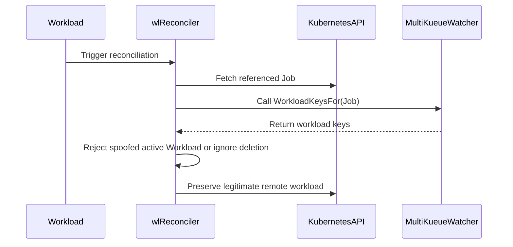

# PR #13213: fix(multikueue): fix unauthorized remote job deletion via spoofed workload owner annotations

**Summary**: fix(multikueue): fix unauthorized remote job deletion via spoofed workload owner annotations

**Sources**: https://github.com/kubernetes-sigs/kueue/pull/13213

**Last updated**: 2026-08-26T22:46:03Z

---

## Metadata

- **State**: open
- **Author**: [@Vaishnav88sk](https://github.com/Vaishnav88sk)
- **Branch**: `fix/multikueue-workload-owner-spoof` → `main`
- **Created**: 2026-07-20T11:41:03Z
- **Updated**: 2026-08-26T22:46:03Z
- **Merged**: —
- **Closed**: —
- **Labels**: `kind/bug`, `release-note`, `size/XL`, `needs-rebase`, `ok-to-test`, `cncf-cla: yes`, `area/multikueue`
- **Assignees**: _none_
- **Requested reviewers**: [@pajakd](https://github.com/pajakd), [@tenzen-y](https://github.com/tenzen-y), [@thc1006](https://github.com/thc1006)
- **Changed files**: 22   **+464 / -41**

## Description

<!--  Thanks for sending a pull request!  Here are some tips for you:

1. If this is your first time, please read our contributor guidelines: https://git.k8s.io/community/contributors/guide/first-contribution.md#your-first-contribution and developer guide https://git.k8s.io/community/contributors/devel/development.md#development-guide
2. Please label this pull request according to what type of issue you are addressing, especially if this is a release targeted pull request. For reference on required PR/issue labels, read here:
https://git.k8s.io/community/contributors/devel/sig-release/release.md#issuepr-kind-label
3. Ensure you have added or ran the appropriate tests for your PR: https://git.k8s.io/community/contributors/devel/sig-testing/testing.md
4. If you want *faster* PR reviews, read how: https://git.k8s.io/community/contributors/guide/pull-requests.md#best-practices-for-faster-reviews
5. If the PR is unfinished, see how to mark it: https://git.k8s.io/community/contributors/guide/pull-requests.md#marking-unfinished-pull-requests
-->

#### What type of PR is this?
/kind bug
<!--
Add one of the following kinds:
/kind bug
/kind cleanup
/kind documentation
/kind feature
/kind kep

Optionally add one or more of the following kinds if applicable:
/kind api-change
/kind deprecation
/kind failing-test
/kind flake
/kind regression

Please also consider setting the area:
/area tas
/area was
/area integrations
/area multikueue
/area dashboard
/area localization
/area testing
/area website
-->

#### What this PR does / why we need it:
Fixes a Confused Deputy vulnerability where a malicious or misconfigured tenant could trigger the deletion of an arbitrary remote Job by creating a fake `Workload` and spoofing the `kueue.x-k8s.io/job-owner-name` annotation. Because the Workload had no quota, MultiKueue incorrectly assumed the Job needed to be stopped and triggered remote deletion. 

This PR hardens the reconciliation logic in `wlReconciler` to enforce bidirectional ownership verification. It dynamically fetches the actual Job object using reflection on the adapter's `GetEmptyList()`, queries the Job for its expected Workload keys via `WorkloadKeysFor()`, and rejects the Admission Check if the Workload is not genuinely owned by the referenced Job.
#### Which issue(s) this PR fixes:
<!--
*Automatically closes linked issue when PR is merged.
Usage: `Fixes #<issue number>`, or `Fixes (paste link of issue)`.
_If PR is about `failing-tests or flakes`, please post the related issues/tests in a comment and do not use `Fixes`_*
-->
Fixes #12548

#### Special notes for your reviewer:

#### Does this PR introduce a user-facing change?
<!--
If no, just write "NONE" in the release-note block below.
If yes, a release note is required:
Enter your extended release note in the block below. If the PR requires additional action from users switching to the new release, include the string "action required".
-->
```release-note
Fixed an issue in MultiKueue where Workloads could bypass admission checks by spoofing owner references. This strict validation is enabled by default and controlled by the `MultiKueueStrictValidation` feature gate.
```


<!-- This is an auto-generated comment: release notes by coderabbit.ai -->
## Summary by CodeRabbit

* **Bug Fixes**
  * Hardened MultiKueue workload admission checks to validate that an accepted workload is genuinely owned by the referenced job, preventing spoofed/inconsistent ownership.
  * Improved handling for deleted workloads so legitimate removals aren’t incorrectly rejected, while spoofed deletion attempts are still mitigated.

* **Tests**
  * Added unit tests covering spoofed owner annotation scenarios and expected rejection behavior.
  * Added an integration regression test simulating a “confused deputy” case, confirming the victim workload remains present on the worker cluster.
<!-- end of auto-generated comment: release notes by coderabbit.ai -->

## Discussion

### Comment by [@netlify[bot]](https://github.com/apps/netlify) — 2026-07-20T11:41:09Z

### <span aria-hidden="true">✅</span> Deploy Preview for *kubernetes-sigs-kueue* canceled.


|  Name | Link |
|:-:|------------------------|
|<span aria-hidden="true">🔨</span> Latest commit | b75fcf3dc56b04dcafef2d3e588ea726a24d0f2c |
|<span aria-hidden="true">🔍</span> Latest deploy log | https://app.netlify.com/projects/kubernetes-sigs-kueue/deploys/6a7ddcb1f356e900081c26d1 |

### Comment by [@kubernetes-prow[bot]](https://github.com/apps/kubernetes-prow) — 2026-07-20T11:41:13Z

Hi @Vaishnav88sk. Thanks for your PR.

I'm waiting for a [kubernetes-sigs](https://github.com/orgs/kubernetes-sigs/people) member to verify that this patch is reasonable to test. If it is, they should reply with `/ok-to-test` on its own line. Until that is done, I will not automatically test new commits in this PR, but the usual testing commands by org members will still work.

>[!TIP]
>**We noticed you've done this a few times! Consider [joining the org](https://git.k8s.io/community/community-membership.md#member) to skip this step and gain `/lgtm` and other bot rights.** We recommend asking approvers on your previous PRs to sponsor you.

Once the patch is verified, the new status will be reflected by the `ok-to-test` label.

I understand the commands that are listed [here](https://go.k8s.io/bot-commands?repo=kubernetes-sigs%2Fkueue).

<details>

Instructions for interacting with me using PR comments are available [here](https://git.k8s.io/community/contributors/guide/pull-requests.md).  If you have questions or suggestions related to my behavior, please file an issue against the [kubernetes-sigs/prow](https://github.com/kubernetes-sigs/prow/issues/new?title=Prow%20issue:) repository.
</details>

### Comment by [@coderabbitai[bot]](https://github.com/apps/coderabbitai) — 2026-07-20T11:41:25Z

<!-- This is an auto-generated comment: summarize by coderabbit.ai -->
<!-- review_stack_entry_start -->

[](https://app.coderabbit.ai/change-stack/kubernetes-sigs/kueue/pull/13213?utm_source=github_walkthrough&utm_medium=github&utm_campaign=change_stack)

<!-- review_stack_entry_end -->
<!-- This is an auto-generated comment: review paused by coderabbit.ai -->

> [!NOTE]
> ## Reviews paused
> 
> It looks like this branch is under active development. To avoid overwhelming you with review comments due to an influx of new commits, CodeRabbit has automatically paused this review. You can configure this behavior by changing the `reviews.auto_review.auto_pause_after_reviewed_commits` setting.
> 
> Use the following commands to manage reviews:
> - `@coderabbitai resume` to resume automatic reviews.
> - `@coderabbitai review` to trigger a single review.
> 
> Use the checkboxes below for quick actions:
> - [ ] <!-- {"checkboxId": "7f6cc2e2-2e4e-497a-8c31-c9e4573e93d1"} --> ▶️ Resume reviews
> - [ ] <!-- {"checkboxId": "e9bb8d72-00e8-4f67-9cb2-caf3b22574fe"} --> 🔍 Trigger review

<!-- end of auto-generated comment: review paused by coderabbit.ai -->
<!-- walkthrough_start -->

<details>
<summary>📝 Walkthrough</summary>

## Walkthrough

MultiKueue reconciliation now verifies that watcher-derived workload keys include the current Workload before continuing ownership and group reconciliation. Active spoofed workloads are rejected, while spoofed deletions are ignored. Unit and integration tests cover these paths and preserve legitimate remote workloads.

### Changes

**MultiKueue ownership verification**

|Layer / File(s)|Summary|
|---|---|
|**Watcher-based workload ownership validation** <br> `pkg/controller/admissionchecks/multikueue/workload.go`|The reconciler reflects on watcher list types, fetches the referenced Job, derives workload keys, and rejects unmatched active workloads or ignores unmatched deletions before group reconciliation.|
|**Spoofed owner rejection and deletion regression tests** <br> `pkg/controller/admissionchecks/multikueue/workload_test.go`, `test/integration/multikueue/jobs_test.go`|Tests configure workload-key ownership, reject spoofed owner annotations, and confirm that the legitimate Job’s remote workload is not deleted.|

**Estimated code review effort:** 3 (Moderate) | ~20 minutes

**Possibly related PRs**

- [kubernetes-sigs/kueue#11877](https://github.com/kubernetes-sigs/kueue/pull/11877): Adds related MultiKueue remote ownership validation and conditional deletion behavior.

**Suggested labels:** `area/multikueue`, `area/testing`

**Suggested reviewers:** `pajakd`, `tenzen-y`

### Sequence Diagram(s)



</details>

<!-- walkthrough_end -->
<!-- pre_merge_checks_walkthrough_start -->

<details>
<summary>🚥 Pre-merge checks | ✅ 4 | ❌ 1</summary>

### ❌ Failed checks (1 warning)

|     Check name     | Status     | Explanation                                                                          | Resolution                                                                         |
| :----------------: | :--------- | :----------------------------------------------------------------------------------- | :--------------------------------------------------------------------------------- |
| Docstring Coverage | ⚠️ Warning | Docstring coverage is 0.00% which is insufficient. The required threshold is 80.00%. | Write docstrings for the functions missing them to satisfy the coverage threshold. |

<details>
<summary>✅ Passed checks (4 passed)</summary>

|         Check name         | Status   | Explanation                                                                                                                          |
| :------------------------: | :------- | :----------------------------------------------------------------------------------------------------------------------------------- |
|     Linked Issues check    | ✅ Passed | The PR implements ownership verification and rejects spoofed workloads, satisfying the linked confused-deputy fix objective.         |
| Out of Scope Changes check | ✅ Passed | The added test label updates and metric-test alignment are directly related to the new ownership check and not out of scope.         |
|      Description Check     | ✅ Passed | Check skipped - CodeRabbit’s high-level summary is enabled.                                                                          |
|         Title check        | ✅ Passed | The title clearly and concisely describes the fix for unauthorized remote job deletion caused by spoofed workload owner annotations. |

</details>

</details>

<!-- pre_merge_checks_walkthrough_end -->
<!-- finishing_touch_checkbox_start -->

<details>
<summary>✨ Finishing Touches</summary>

<details>
<summary>🧪 Generate unit tests (beta)</summary>

- [ ] <!-- {"checkboxId": "f47ac10b-58cc-4372-a567-0e02b2c3d479", "radioGroupId": "utg-output-choice-group-unknown_comment_id"} -->   Create PR with unit tests

</details>

</details>

<!-- finishing_touch_checkbox_end -->
<!-- tips_start -->

---

Thanks for using [CodeRabbit](https://coderabbit.ai?utm_source=oss&utm_medium=github&utm_campaign=kubernetes-sigs/kueue&utm_content=13213)! It's free for OSS, and your support helps us grow. If you like it, consider giving us a shout-out.

<details>
<summary>❤️ Share</summary>

- [X](https://twitter.com/intent/tweet?text=I%20just%20used%20%40coderabbitai%20for%20my%20code%20review%2C%20and%20it%27s%20fantastic%21%20It%27s%20free%20for%20OSS%20and%20offers%20a%20free%20trial%20for%20the%20proprietary%20code.%20Check%20it%20out%3A&url=https%3A//coderabbit.ai)
- [Mastodon](https://mastodon.social/share?text=I%20just%20used%20%40coderabbitai%20for%20my%20code%20review%2C%20and%20it%27s%20fantastic%21%20It%27s%20free%20for%20OSS%20and%20offers%20a%20free%20trial%20for%20the%20proprietary%20code.%20Check%20it%20out%3A%20https%3A%2F%2Fcoderabbit.ai)
- [Reddit](https://www.reddit.com/submit?title=Great%20tool%20for%20code%20review%20-%20CodeRabbit&text=I%20just%20used%20CodeRabbit%20for%20my%20code%20review%2C%20and%20it%27s%20fantastic%21%20It%27s%20free%20for%20OSS%20and%20offers%20a%20free%20trial%20for%20proprietary%20code.%20Check%20it%20out%3A%20https%3A//coderabbit.ai)
- [LinkedIn](https://www.linkedin.com/sharing/share-offsite/?url=https%3A%2F%2Fcoderabbit.ai&mini=true&title=Great%20tool%20for%20code%20review%20-%20CodeRabbit&summary=I%20just%20used%20CodeRabbit%20for%20my%20code%20review%2C%20and%20it%27s%20fantastic%21%20It%27s%20free%20for%20OSS%20and%20offers%20a%20free%20trial%20for%20proprietary%20code)

</details>


<sub>Comment `@coderabbitai help` to get the list of available commands.</sub>

<!-- tips_end -->

### Comment by [@mimowo](https://github.com/mimowo) — 2026-07-20T11:43:54Z

/ok-to-test

### Comment by [@mimowo](https://github.com/mimowo) — 2026-07-20T11:45:23Z

/hold
to avoid accidental merge. This one is pretty involving with code changes. I would like first to see an integration test which would show how such an attach could look like.

### Comment by [@Vaishnav88sk](https://github.com/Vaishnav88sk) — 2026-07-20T11:57:30Z

> /hold to avoid accidental merge. This one is pretty involving with code changes. I would like first to see an integration test which would show how such an attach could look like.

Thanks for taking a look! That makes complete sense. I will work on adding an integration test to demonstrate the spoofing vulnerability and how this fix prevents it.

### Comment by [@Vaishnav88sk](https://github.com/Vaishnav88sk) — 2026-07-21T11:50:05Z

/retest

### Comment by [@Vaishnav88sk](https://github.com/Vaishnav88sk) — 2026-07-24T10:45:38Z

/retest

### Comment by [@Vaishnav88sk](https://github.com/Vaishnav88sk) — 2026-07-24T17:19:07Z

/retest

### Comment by [@Vaishnav88sk](https://github.com/Vaishnav88sk) — 2026-07-25T09:39:42Z

### Summary of Changes
- **Bidirectional Ownership Check**: Updated `EquivalentToWorkload` and `multikueueAC.ownsWorkload` to enforce bidirectional validation (matching both `ManagedBy` and prefix/UID checks) to prevent Confused Deputy bypasses.
- **Integration Test Added**: Added a comprehensive integration test (`Should reject a workload with spoofed owner annotations...` in `jobs_test.go`) to explicitly demonstrate the vulnerability and verify the fix.
- **Fixed CI Failures**: Resolved the flaky CI timeouts in the new integration test by ensuring the test's `victim-wl` perfectly inherits the API-server injected PodSpec defaults from `victim-job`, preventing false "out of sync" deletions. Also fixed minor `govet` and unstructured client linting issues.

@mimowo I have added the integration test demonstrating the spoofed workload attack as requested. The test explicitly verifies that a maliciously crafted workload is rejected by the admission check without impacting the victim job's legitimate remote workload. 

All CI and lint checks are now passing. Feel free to review and `/unhold` when you're ready!

### Comment by [@mimowo](https://github.com/mimowo) — 2026-08-03T19:42:25Z

cc @olekzabl @kshalot could you please take a look?

### Comment by [@mimowo](https://github.com/mimowo) — 2026-08-03T19:42:57Z

/area multikueue

### Comment by [@mimowo](https://github.com/mimowo) — 2026-08-03T19:43:24Z

/unhold

### Comment by [@Vaishnav88sk](https://github.com/Vaishnav88sk) — 2026-08-04T07:26:07Z

/retest
infra

### Comment by [@mimowo](https://github.com/mimowo) — 2026-08-10T10:06:37Z

@Vaishnav88sk as a bugfix it warrants a release note.

### Comment by [@mimowo](https://github.com/mimowo) — 2026-08-10T10:07:22Z

Also, I would like to consider a feature gate, because this increases validation, so it would be better to make sure we can mitigated on release branches if any users are affected.

### Comment by [@mimowo](https://github.com/mimowo) — 2026-08-10T10:07:38Z

cc @thc1006 would you like to review?

### Comment by [@thc1006](https://github.com/thc1006) — 2026-08-10T10:08:50Z

> cc @thc1006 would you like to review?

For sure. But I eat dinner first!!!
Thx!

### Comment by [@Vaishnav88sk](https://github.com/Vaishnav88sk) — 2026-08-10T10:49:46Z

> Also, I would like to consider a feature gate, because this increases validation, so it would be better to make sure we can mitigated on release branches if any users are affected.

I was also thinking the same. But due to a busy schedule I couldn't able to. But I'll address the review and update the code. Also adding release note, but I am unsure about the format. So after updation, please check it once.
I'll put this validation behind a `MultiKueueStrictValidation` feature gate (enabled by default) so users have an escape hatch on release branches if needed.

### Comment by [@Vaishnav88sk](https://github.com/Vaishnav88sk) — 2026-08-10T12:40:03Z

Thanks for the thorough review @thc1006 ! 

My original intention with the prefix fallback was to handle edge cases—like StatefulSet legacy names, workload slices, and external frameworks that dynamically append suffixes—in a lightweight, generic way. I wanted to avoid refactoring every adapter or creating a completely new interface to separate loose routing from strict authorization.

However, I completely agree with your point about the confused deputy vulnerability. Dropping the hash entirely is definitely too loose for a security check, and you're right that `WorkloadKeysFor` wasn't originally designed for this level of strictness.

I am more than happy to update the approach based on your suggestions:
1. Enforce **strict exact matching only** and drop the prefix fallback. If specific adapters (like StatefulSet) need legacy names, I will update them to return those exact keys explicitly.
2. To update `verifyWorkloadOwnership` to "fail closed" (reject the workload) if an adapter is missing the `MultiKueueWatcher` interface when strict validation is on.
3. To add the missing `GetWorkloadNameForOwnerWithGVK` fallback logic to the external frameworks adapter so existing production workloads don't get rejected.

Wdyt?

### Comment by [@Vaishnav88sk](https://github.com/Vaishnav88sk) — 2026-08-10T12:40:08Z

/retest

### Comment by [@thc1006](https://github.com/thc1006) — 2026-08-10T12:42:18Z

Thanks for taking it so well, and sorry the comments were long. All three directions sound right to me. Two things I checked that may save you a round.

For 2, fail closed looks safe to land today. I grepped for `WorkloadKeysFor` definitions and every adapter has one: pod, job, appwrapper, jobset, leaderworkerset, mpijob, trainjob, ray, kubeflowjob, statefulset, and the external frameworks adapter. So no in-tree adapter loses anything, and the guard only covers a future or out-of-tree adapter that forgets it. Good place to make it strict.

For 1, one thing to check before exact-only: workload slices. The job adapter builds the key with `GetWorkloadNameForOwnerWithGVKAndGeneration(..., job.GetGeneration())`, so the key follows the current generation. If a Workload from an older generation can still reach this verification, exact-only would reject it where the prefix used to let it through. I did not confirm whether that actually happens on the MultiKueue path, so please check rather than take my word. If it does, that feels like the same answer as StatefulSet: the adapter returns the extra exact keys it considers its own, instead of the check guessing.

For 3, that is what the other adapters already do, so it should be a small diff. It would be good if the integration fixture then goes back to not setting the prebuilt name by hand, so it covers the plain external framework case.

One more small thing whenever you touch this again: the two unit cases `prefix match with dash` and `prefix match for generated name` currently expect true. They will need to flip to false with the new behaviour.

This comment was written in part with the assistance of generative AI. Bcuz my English might be sucks.

### Comment by [@Vaishnav88sk](https://github.com/Vaishnav88sk) — 2026-08-10T14:06:18Z

@thc1006 
Updated the PR! 

1. **Job Adapter**: `WorkloadKeysFor` now returns both the base name and the generation-specific name.
2. **External Frameworks Adapter**: Implemented a fallback to `jobframework.GetWorkloadNameForOwnerWithGVK` when the prebuilt workload label isn't present.
3. **Multikueue Checks**: Removed the prefix-matching logic completely in favor of strict exact matching against the keys returned by the adapters.
4. **Integration Tests**: Removed the manual label injection from `external_job_test.go` so it properly validates the new fallback path.
5. **StatefulSet legacy name fallback:** Updated the StatefulSet adapter to return both the new `GetWorkloadNameForOwnerWithGVK` key and the legacy `GetWorkloadName` key when no prebuilt workload exists, along with the v0.20 TODO note as suggested.
6. **Strict validation by default:** I understand the concern about breaking existing workloads that spoof owner references. However, this is a critical security boundary to prevent privilege escalation. Falling back to the core `Job` adapter's behavior ensures we're fail-closed. I am open to discussing an opt-out mechanism if it's strictly necessary for backward compatibility, but I believe we should keep it fail-closed by default.

Thanks! And sometimes my english also sucks! 😉

### Comment by [@kubernetes-prow[bot]](https://github.com/apps/kubernetes-prow) — 2026-08-10T17:33:41Z

[APPROVALNOTIFIER] This PR is **NOT APPROVED**

This pull-request has been approved by: *<a href="https://github.com/kubernetes-sigs/kueue/pull/13213#" title="Author self-approved">Vaishnav88sk</a>*
**Once this PR has been reviewed and has the lgtm label**, please assign [mbobrovskyi](https://github.com/mbobrovskyi), [mimowo](https://github.com/mimowo) for approval. For more information see [the Code Review Process](https://git.k8s.io/community/contributors/guide/owners.md#the-code-review-process).

The full list of commands accepted by this bot can be found [here](https://go.k8s.io/bot-commands?repo=kubernetes-sigs%2Fkueue).

<details open>
Needs approval from an approver in each of these files:

- **[OWNERS](https://github.com/kubernetes-sigs/kueue/blob/main/OWNERS)**

Approvers can indicate their approval by writing `/approve` in a comment
Approvers can cancel approval by writing `/approve cancel` in a comment
</details>
<!-- META={"approvers":["mbobrovskyi","mimowo"]} -->

### Comment by [@thc1006](https://github.com/thc1006) — 2026-08-10T17:57:37Z

TL;DR: the StatefulSet half is right and I checked it against your branch. The scale-down keys that came with it look one generation short.

Thank you for the adapter test, it is exactly the case that was broken. I put `statefulSet.GetUID()` back in place of `GetOwnerUID(statefulSet)` and only the remote case fails, on the first key, so it pins the thing its comment says it pins.

On the generation window. `EnsureWorkloadSlices` handles a scale-down by applying the new counts to the existing Workload and updating it in place, and it only asks for a new slice when an admitted one scales up. The name is fixed when a slice is created, so the Workload keeps the generation it was created at while the Job's generation keeps climbing:

```
created        job gen N     Workload named gen N
scaled down    job gen N+1   Workload still gen N   keys {N+1, N}     match
scaled down    job gen N+2   Workload still gen N   keys {N+2, N+1}   no match
```

Going 10 to 5 to 3 is an ordinary thing for someone to do, so `gen-1` closes the window for a single scale-down and not for the shape of it. I do not think reconstructing the name can close it in general either, since the distance is unbounded and `WorkloadKeysFor` has no way to see which Workload actually exists.

This one is my doing. Exact matching was my suggestion, and it is what turned a prefix that tolerated any generation into a fixed list, so please do not read it as a fourth round of nitpicks. If you would rather split it out so the MultiKueue fix can land on its own, I would support that and I am glad to write the issue.

This comment was written in part with the assistance of generative AI. Bcuz my English might be sucks.

### Comment by [@thc1006](https://github.com/thc1006) — 2026-08-10T18:00:49Z

Filed as #14134, so this has a home outside the review thread and does not have to hold up the ownership fix here.

### Comment by [@Vaishnav88sk](https://github.com/Vaishnav88sk) — 2026-08-10T18:08:08Z

Thanks for reviewing the StatefulSet test! @thc1006 

Good catch on the multiple scale-down edge case. I agree that keeping the scope of this PR focused on the core ownership and security fixes is best. Thanks for splitting that out into #14134 — we can address the unbound generation window there!

So is this PR ready to go?

### Comment by [@thc1006](https://github.com/thc1006) — 2026-08-10T18:16:28Z

Sorry, not yet, and I owe you a better answer than the one I gave earlier. Going to look at the gate is what changed it.

TL;DR: the check is on by default and rejects, and the Ray keys are rebuilt from something Ray does not use. One line on the gate would take both off the critical path.

**The gate.** `MultiKueueStrictValidation` starts at `{Version: 0.19, Default: true, PreRelease: Beta}`, and a failed check calls `updateACS(..., CheckStateRejected, "Workload is not owned by the referenced Job")` rather than logging. I had been reading it as opt-in, which is why I was relaxed about deferring the generation gap to #14134. On a default-on path, a key set that does not cover a case means a legitimate workload is rejected.

**The Ray keys.** `newWorkloadName` does not use the generation directly when slicing is on. It asks the job first:

```go
if elasticWorkloadNameProvider, ok := job.(ElasticWorkloadNameProvider); ok {
	extra = elasticWorkloadNameProvider.GetWorkloadNameExtraPart()
} else {
	extra = strconv.FormatInt(object.GetGeneration(), 10)
}
```

`RayJob` and `RayService` implement that interface, and it resolves to:

```go
extra := strconv.FormatInt(objectMeta.GetGeneration(), 10)
rayClusterGeneration := objectMeta.GetAnnotations()[RayClusterGenerationAnnotation]
if rayClusterGeneration != "" {
	extra += "_" + rayClusterGeneration
}
```

The adapter rebuilds with `GetWorkloadNameForOwnerWithGVKAndGeneration(..., gen)`, which produces the plain generation. So whenever that annotation is set, the Workload's name and every key differ, and no amount of widening the generation window reaches it. RayCluster is fine, since it has no override and falls to the plain generation.

I have not established when that annotation is actually populated, only that `RayJob.GetCustomAnnotations` goes through `raycluster.GetWorkloadslicingRayClusterCustomAnnotations`, so you are better placed than me to say how often it is non-empty. If it is common under slicing, the current keys never match for those two kinds.

**What I would suggest.** Start the gate off:

```go
MultiKueueStrictValidation: {
	{Version: version.MustParse("0.19"), Default: false, PreRelease: featuregate.Alpha},
},
```

That is how its neighbours in the same map arrived, `MultiKueue` at 0.6 Alpha then 0.9 Beta, `TopologyAwareScheduling` at 0.9 Alpha then 0.14 Beta, and a check that fails closed by rejecting seems like the kind that benefits most from a release at Alpha. Then the confused deputy fix lands now, and #14134 can cover both the unbounded window and the Ray naming before it graduates.

The StatefulSet half still holds, and I checked it against your branch rather than trusting the comment. Sorry to keep finding things, and thank you for being patient about it.

This comment was written in part with the assistance of generative AI. Bcuz my English might be sucks.

### Comment by [@Vaishnav88sk](https://github.com/Vaishnav88sk) — 2026-08-10T18:53:07Z

Makes complete sense. I've updated the `MultiKueueStrictValidation` gate to be opt-in (`Alpha`, `Default: false`) so this fix can land now without inadvertently rejecting valid Ray workloads or workloads that survive multiple scale-downs. We can properly handle both of those edge cases in #14134 before graduating the gate!

### Comment by [@Vaishnav88sk](https://github.com/Vaishnav88sk) — 2026-08-11T14:45:00Z

Rebased
/remove-needs-rebase

### Comment by [@thc1006](https://github.com/thc1006) — 2026-08-13T14:14:57Z

TL;DR: making the gate opt-in resolves both things I raised, and from my side this is ready once the rebase is done. Two small notes on the gate declaration itself, nothing on the fix.

Turning `MultiKueueStrictValidation` into an Alpha gate that defaults off is a better answer than the one I was working towards. Neither the Ray naming shape nor the multi-scale-down window can reach a user who hasn't opted in, so the ownership fix stands on its own, and #14134 keeps the naming problem somewhere it can be picked up later.

Two small ones on the declaration:

The version reads `0.19`, but v0.19.0 shipped on 22 July and v0.19.1 on 12 August, so a gate added now first appears in 0.20. Seven gates in that file already start there, `MultiKueueRemoteSpecSync` among them. Left at 0.19, the generated feature list would say this gate existed in a release that never carried it.

The constant has no `// owner: @` line above it. Every other declaration in the file has one (71 of them), and it's what tells a later reader who to ask.

`needs-rebase` came back after your rebase, so main has moved again.

That's everything from me. Thank you for staying with this across four rounds; the exact-matching version is much stronger than where it started, and the gate call was yours rather than mine.

This review was written in part with the assistance of generative AI. I checked the release dates and the gate declarations myself.

### Comment by [@thc1006](https://github.com/thc1006) — 2026-08-13T14:17:16Z

Two corrections to what I just posted, both mine rather than yours.

The owner line isn't universal. 71 of the 76 declarations carry one, and four besides this gate don't, `DisableWaitForPodsReady` among them. Worth adding either way, but I wrote it as a rule everyone else follows and that isn't true.

On the version I assumed this lands only on main. @mimowo asked for the gate so the stricter validation could be mitigated on release branches, and if this is cherry-picked to release-0.19 then a `0.19` entry is what lets an operator turn it off there. `DisableWaitForPodsReady` already starts at 0.19. So please read my 0.20 note as a question for whoever decides the backport, not as a change to make.

Written in part with the assistance of generative AI; I counted the declarations myself this time.

### Comment by [@Vaishnav88sk](https://github.com/Vaishnav88sk) — 2026-08-13T15:16:02Z

Thanks for the thorough reviews and catching those edge cases! I've rebased the branch to fix the conflicts. 

Regarding the version, I left it at `0.19` just in case the maintainers want to cherry-pick this fix back to the `release-0.19` branch, as @mimowo originally suggested. I also went ahead and added the `// owner: @Vaishnav88sk` comment to the feature gate declaration. 

I've also included a few small test fixes so that CI passes cleanly on the latest `main`:
- Enabled the `MultiKueueStrictValidation` feature gate in the relevant unit/integration tests so they correctly assert the new behavior.
- Switched to `apimeta.SetStatusCondition` in the new core webhook test to resolve a duplicate map key (HTTP 422) error that was failing the test on `main`.
- Updated the variables in `test/integration/multikueue/jobs_test.go` to align with the new `multiKueueFixture` struct introduced in a recent upstream refactoring.

Ready from my side!

### Comment by [@kubernetes-prow[bot]](https://github.com/apps/kubernetes-prow) — 2026-08-26T22:43:41Z

@Vaishnav88sk: The following tests **failed**, say `/retest` to rerun all failed tests or `/retest-required` to rerun all mandatory failed tests:

Test name | Commit | Details | Required | Rerun command
--- | --- | --- | --- | ---
pull-kueue-test-e2e-extended-shard-0-main-1-37 | b75fcf3dc56b04dcafef2d3e588ea726a24d0f2c | [link](https://prow.k8s.io/view/gs/kubernetes-ci-logs/pr-logs/pull/kubernetes-sigs_kueue/13213/pull-kueue-test-e2e-extended-shard-0-main-1-37/2092744751064289280) | true | `/test pull-kueue-test-e2e-extended-shard-0-main-1-37`
pull-kueue-test-e2e-extended-shard-2-main-1-37 | b75fcf3dc56b04dcafef2d3e588ea726a24d0f2c | [link](https://prow.k8s.io/view/gs/kubernetes-ci-logs/pr-logs/pull/kubernetes-sigs_kueue/13213/pull-kueue-test-e2e-extended-shard-2-main-1-37/2092744751261421568) | true | `/test pull-kueue-test-e2e-extended-shard-2-main-1-37`
pull-kueue-test-e2e-extended-shard-1-main-1-37 | b75fcf3dc56b04dcafef2d3e588ea726a24d0f2c | [link](https://prow.k8s.io/view/gs/kubernetes-ci-logs/pr-logs/pull/kubernetes-sigs_kueue/13213/pull-kueue-test-e2e-extended-shard-1-main-1-37/2092744751148175360) | true | `/test pull-kueue-test-e2e-extended-shard-1-main-1-37`
pull-kueue-test-e2e-baseline-main-1-37 | b75fcf3dc56b04dcafef2d3e588ea726a24d0f2c | [link](https://prow.k8s.io/view/gs/kubernetes-ci-logs/pr-logs/pull/kubernetes-sigs_kueue/13213/pull-kueue-test-e2e-baseline-main-1-37/2092744750997180416) | true | `/test pull-kueue-test-e2e-baseline-main-1-37`

[Full PR test history](https://prow.k8s.io/pr-history?org=kubernetes-sigs&repo=kueue&pr=13213). [Your PR dashboard](https://prow.k8s.io/pr?query=is%3Apr%20state%3Aopen%20author%3AVaishnav88sk). Please help us cut down on flakes by [linking to](https://git.k8s.io/community/contributors/devel/sig-testing/flaky-tests.md#filing-issues-for-flaky-tests) an [open issue](https://github.com/kubernetes-sigs/kueue/issues?q=is:issue+is:open) when you hit one in your PR.

<details>

Instructions for interacting with me using PR comments are available [here](https://git.k8s.io/community/contributors/guide/pull-requests.md).  If you have questions or suggestions related to my behavior, please file an issue against the [kubernetes-sigs/prow](https://github.com/kubernetes-sigs/prow/issues/new?title=Prow%20issue:) repository. I understand the commands that are listed [here](https://go.k8s.io/bot-commands).
</details>
<!-- test report -->

### Comment by [@kubernetes-prow[bot]](https://github.com/apps/kubernetes-prow) — 2026-08-26T22:45:33Z

PR needs rebase.

<details>

Instructions for interacting with me using PR comments are available [here](https://git.k8s.io/community/contributors/guide/pull-requests.md).  If you have questions or suggestions related to my behavior, please file an issue against the [kubernetes-sigs/prow](https://github.com/kubernetes-sigs/prow/issues/new?title=Prow%20issue:) repository.
</details>

### Comment by [@kubernetes-prow[bot]](https://github.com/apps/kubernetes-prow) — 2026-08-26T22:45:43Z

PR needs rebase.

<details>

Instructions for interacting with me using PR comments are available [here](https://git.k8s.io/community/contributors/guide/pull-requests.md).  If you have questions or suggestions related to my behavior, please file an issue against the [kubernetes-sigs/prow](https://github.com/kubernetes-sigs/prow/issues/new?title=Prow%20issue:) repository.
</details>

### Comment by [@kubernetes-prow[bot]](https://github.com/apps/kubernetes-prow) — 2026-08-26T22:45:53Z

PR needs rebase.

<details>

Instructions for interacting with me using PR comments are available [here](https://git.k8s.io/community/contributors/guide/pull-requests.md).  If you have questions or suggestions related to my behavior, please file an issue against the [kubernetes-sigs/prow](https://github.com/kubernetes-sigs/prow/issues/new?title=Prow%20issue:) repository.
</details>

### Comment by [@kubernetes-prow[bot]](https://github.com/apps/kubernetes-prow) — 2026-08-26T22:46:03Z

PR needs rebase.

<details>

Instructions for interacting with me using PR comments are available [here](https://git.k8s.io/community/contributors/guide/pull-requests.md).  If you have questions or suggestions related to my behavior, please file an issue against the [kubernetes-sigs/prow](https://github.com/kubernetes-sigs/prow/issues/new?title=Prow%20issue:) repository.
</details>

## Reviews

### Review by [@coderabbitai[bot]](https://github.com/apps/coderabbitai) (commented) — 2026-07-20T11:47:26Z


> [!CAUTION]
> Some comments are outside the diff and can’t be posted inline due to platform limitations.
> 
> 
> 
> <details>
> <summary>⚠️ Outside diff range comments (1)</summary><blockquote>
> 
> <details>
> <summary>pkg/controller/admissionchecks/multikueue/workload.go (1)</summary><blockquote>
> 
> `241-278`: _🔒 Security & Privacy_ | _🔴 Critical_ | _⚡ Quick win_
> 
> **Fail-open error handling and deletion bypass allow Confused Deputy exploitation.**
> 
> There are two critical security flaws in the implemented Confused Deputy check:
> 
> 1. **Fail-open on errors:** The nested `if err == nil` checks cause any retrieval error (such as a transient API timeout, a cache miss, or the Job being missing) or a `WorkloadKeysFor` error to silently bypass the ownership verification, allowing a spoofed workload to be admitted. Security checks must fail closed. As per path instructions, review reconciliation logic for proper error handling.
> 2. **Deletion bypass:** Because the entire ownership check is enclosed within `if !isDeleted`, an attacker can bypass the protection by creating a spoofed Workload (with a dummy finalizer to prevent immediate purging) and immediately deleting it. The `isDeleted == true` condition skips the verification and proceeds directly to `grp.RemoveRemoteObjects(...)`, which blindly deletes the running victim Job on the remote cluster.
> 
> To fix these vulnerabilities, extract the verification outside the `if !isDeleted` block and explicitly fail closed on errors.
> 
> 
> 
> 
> 
> <details>
> <summary>🔒️ Proposed fix to enforce fail-closed verification on both creation and deletion</summary>
> 
> ```diff
> -	if !isDeleted {
> -		managed, unmanagedReason, err := adapter.IsJobManagedByKueue(ctx, w.client, types.NamespacedName{Name: owner.Name, Namespace: wl.Namespace})
> -		if err != nil {
> -			return reconcile.Result{}, err
> -		}
> -
> -		if !managed {
> -			return reconcile.Result{}, w.updateACS(ctx, wl, mkAc, kueue.CheckStateRejected, fmt.Sprintf("The owner is not managed by Kueue: %s", unmanagedReason))
> -		}
> -
> -		// Verify that this Workload is genuinely owned by the referenced Job to prevent Confused Deputy attacks.
> -		if watcher, implements := adapter.(jobframework.MultiKueueWatcher); implements {
> -			emptyList := watcher.GetEmptyList()
> -			t := reflect.TypeOf(emptyList)
> -			if t.Kind() == reflect.Ptr {
> -				t = t.Elem()
> -			}
> -			if itemsField, found := t.FieldByName("Items"); found {
> -				itemType := itemsField.Type.Elem()
> -				if jobObj, ok := reflect.New(itemType).Interface().(client.Object); ok {
> -					if err := w.client.Get(ctx, types.NamespacedName{Name: owner.Name, Namespace: wl.Namespace}, jobObj); err == nil {
> -						if keys, err := watcher.WorkloadKeysFor(jobObj); err == nil {
> -							ownsWorkload := false
> -							for _, k := range keys {
> -								if k.Name == wl.Name && k.Namespace == wl.Namespace {
> -									ownsWorkload = true
> -									break
> -								}
> -							}
> -							if !ownsWorkload {
> -								return reconcile.Result{}, w.updateACS(ctx, wl, mkAc, kueue.CheckStateRejected, "Workload is not owned by the referenced Job")
> -							}
> -						}
> -					}
> -				}
> -			}
> -		}
> -	}
> +	// Verify that this Workload is genuinely owned by the referenced Job to prevent Confused Deputy attacks.
> +	if watcher, implements := adapter.(jobframework.MultiKueueWatcher); implements {
> +		emptyList := watcher.GetEmptyList()
> +		t := reflect.TypeOf(emptyList)
> +		if t.Kind() == reflect.Ptr {
> +			t = t.Elem()
> +		}
> +		itemsField, found := t.FieldByName("Items")
> +		if !found || itemsField.Type.Kind() != reflect.Slice {
> +			return reconcile.Result{}, fmt.Errorf("Items slice not found in list type %T", emptyList)
> +		}
> +		itemType := itemsField.Type.Elem()
> +		jobObj, ok := reflect.New(itemType).Interface().(client.Object)
> +		if !ok {
> +			return reconcile.Result{}, fmt.Errorf("instantiated item type does not implement client.Object")
> +		}
> +
> +		err := w.client.Get(ctx, types.NamespacedName{Name: owner.Name, Namespace: wl.Namespace}, jobObj)
> +		if err != nil {
> +			if client.IgnoreNotFound(err) != nil {
> +				return reconcile.Result{}, err // Fail closed on transient errors
> +			}
> +			if !isDeleted {
> +				// Job not found and Workload is active. Requeue to wait for the Job or GC.
> +				return reconcile.Result{}, err
> +			}
> +		} else {
> +			keys, err := watcher.WorkloadKeysFor(jobObj)
> +			if err != nil {
> +				return reconcile.Result{}, fmt.Errorf("computing workload keys: %w", err)
> +			}
> +			ownsWorkload := false
> +			for _, k := range keys {
> +				if k.Name == wl.Name && k.Namespace == wl.Namespace {
> +					ownsWorkload = true
> +					break
> +				}
> +			}
> +			if !ownsWorkload {
> +				if !isDeleted {
> +					return reconcile.Result{}, w.updateACS(ctx, wl, mkAc, kueue.CheckStateRejected, "Workload is not owned by the referenced Job")
> +				}
> +				// If deleted and not owned, ignore the deletion to prevent remote Confused Deputy attacks.
> +				log.V(2).Info("Spoofed Workload deletion ignored", "workload", req.NamespacedName)
> +				w.deletedWlCache.Delete(req.String())
> +				return reconcile.Result{}, nil
> +			}
> +		}
> +	}
> +
> +	// If the workload is deleted there is a chance that its owner is also deleted. In that case
> +	// we skip calling `IsJobManagedByKueue` as its output would not be reliable.
> +	if !isDeleted {
> +		managed, unmanagedReason, err := adapter.IsJobManagedByKueue(ctx, w.client, types.NamespacedName{Name: owner.Name, Namespace: wl.Namespace})
> +		if err != nil {
> +			return reconcile.Result{}, err
> +		}
> +
> +		if !managed {
> +			return reconcile.Result{}, w.updateACS(ctx, wl, mkAc, kueue.CheckStateRejected, fmt.Sprintf("The owner is not managed by Kueue: %s", unmanagedReason))
> +		}
> +	}
> ```
> </details>
> 
> <details>
> <summary>🤖 Prompt for AI Agents</summary>
> 
> ```
> Verify each finding against current code. Fix only still-valid issues, skip the
> rest with a brief reason, keep changes minimal, and validate.
> 
> In `@pkg/controller/admissionchecks/multikueue/workload.go` around lines 241 -
> 278, Move the ownership verification block out of the if !isDeleted guard so it
> runs for both active and deleting workloads before grp.RemoveRemoteObjects or
> admission processing. In the verification flow around MultiKueueWatcher,
> propagate client.Get and WorkloadKeysFor errors instead of silently continuing,
> and treat missing or unsupported owner objects as reconciliation errors or
> rejected checks; only proceed when the referenced Job is confirmed to own wl.
> ```
> 
> </details>
> 
> <!-- cr-comment:v1:ec67adb42b529a5bcbb0fb98 -->
> 
> _Source: Path instructions_
> 
> </blockquote></details>
> 
> </blockquote></details>

<details>
<summary>🤖 Prompt for all review comments with AI agents</summary>

```
Verify each finding against current code. Fix only still-valid issues, skip the
rest with a brief reason, keep changes minimal, and validate.

Outside diff comments:
In `@pkg/controller/admissionchecks/multikueue/workload.go`:
- Around line 241-278: Move the ownership verification block out of the if
!isDeleted guard so it runs for both active and deleting workloads before
grp.RemoveRemoteObjects or admission processing. In the verification flow around
MultiKueueWatcher, propagate client.Get and WorkloadKeysFor errors instead of
silently continuing, and treat missing or unsupported owner objects as
reconciliation errors or rejected checks; only proceed when the referenced Job
is confirmed to own wl.
```

</details>

---

<details>
<summary>ℹ️ Review info</summary>

<details>
<summary>⚙️ Run configuration</summary>

**Configuration used**: Path: .coderabbit.yaml

**Review profile**: CHILL

**Plan**: Pro

**Run ID**: `368806c6-d84d-40ff-9288-62ff345171a6`

</details>

<details>
<summary>📥 Commits</summary>

Reviewing files that changed from the base of the PR and between ddbb4e09c05abf8eb1cd398dd1eb86982bc51605 and 4320e6bf8cd43c4da9eff6f1b7241964ac37be4a.

</details>

<details>
<summary>📒 Files selected for processing (2)</summary>

* `pkg/controller/admissionchecks/multikueue/workload.go`
* `pkg/controller/admissionchecks/multikueue/workload_test.go`

</details>

</details>

<!-- This is an auto-generated comment by CodeRabbit for review status -->

### Review by [@coderabbitai[bot]](https://github.com/apps/coderabbitai) (commented) — 2026-07-21T11:03:32Z

**Actionable comments posted: 1**

<details>
<summary>🧹 Nitpick comments (1)</summary><blockquote>

<details>
<summary>pkg/controller/admissionchecks/multikueue/workload.go (1)</summary><blockquote>

`242-255`: _📐 Maintainability & Code Quality_ | _🔵 Trivial_ | _⚡ Quick win_

**Simplify object instantiation using the Scheme.**

The reflection logic used to instantiate the empty Job object by traversing the `Items` field of the empty list is fragile and adds unnecessary complexity. Since `w.client` is a controller-runtime client, you can use the Kubernetes `Scheme` to idiomaticaly instantiate a new object directly from the adapter's GVK.

Note: If you apply this refactor, you can also safely remove the `reflect` import added at line 23.


<details>
<summary>♻️ Proposed refactor</summary>

```diff
-		emptyList := watcher.GetEmptyList()
-		t := reflect.TypeOf(emptyList)
-		if t.Kind() == reflect.Pointer {
-			t = t.Elem()
-		}
-		itemsField, found := t.FieldByName("Items")
-		if !found || itemsField.Type.Kind() != reflect.Slice {
-			return reconcile.Result{}, fmt.Errorf("items slice not found in list type %T", emptyList)
-		}
-		itemType := itemsField.Type.Elem()
-		jobObj, ok := reflect.New(itemType).Interface().(client.Object)
-		if !ok {
-			return reconcile.Result{}, errors.New("instantiated item type does not implement client.Object")
-		}
+		obj, err := w.client.Scheme().New(adapter.GVK())
+		if err != nil {
+			return reconcile.Result{}, fmt.Errorf("failed to instantiate object for GVK %s: %w", adapter.GVK(), err)
+		}
+		jobObj, ok := obj.(client.Object)
+		if !ok {
+			return reconcile.Result{}, fmt.Errorf("instantiated object for GVK %s does not implement client.Object", adapter.GVK())
+		}
```
</details>

<details>
<summary>🤖 Prompt for AI Agents</summary>

```
Verify each finding against current code. Fix only still-valid issues, skip the
rest with a brief reason, keep changes minimal, and validate.

In `@pkg/controller/admissionchecks/multikueue/workload.go` around lines 242 -
255, Replace the reflection-based item-type discovery in the workload
reconciliation flow with direct instantiation through w.client’s Scheme using
the adapter’s GVK. Ensure the resulting object implements client.Object,
preserve the existing error behavior for unsupported types, and remove the
now-unused reflect import.
```

</details>

<!-- cr-comment:v1:1b6b8402ad9ef880b860177b -->

</blockquote></details>

</blockquote></details>

<details>
<summary>🤖 Prompt for all review comments with AI agents</summary>

```
Verify each finding against current code. Fix only still-valid issues, skip the
rest with a brief reason, keep changes minimal, and validate.

Inline comments:
In `@pkg/controller/admissionchecks/multikueue/workload.go`:
- Around line 272-297: Update the ownership verification flow around
WorkloadKeysFor to fail closed when key derivation returns an error: stop
reconciliation and return the appropriate error instead of allowing it to
continue. Remove the fallback that skips ownership checks, while preserving the
existing rejection for unowned workloads and the deletion-ignore behavior. Also
ensure MultiKueue adapters that do not implement the watcher cannot bypass this
verification, using the controller’s established error-handling path.

---

Nitpick comments:
In `@pkg/controller/admissionchecks/multikueue/workload.go`:
- Around line 242-255: Replace the reflection-based item-type discovery in the
workload reconciliation flow with direct instantiation through w.client’s Scheme
using the adapter’s GVK. Ensure the resulting object implements client.Object,
preserve the existing error behavior for unsupported types, and remove the
now-unused reflect import.
```

</details>

<details>
<summary>🪄 Autofix (Beta)</summary>

Fix all unresolved CodeRabbit comments on this PR:

- [ ] <!-- {"checkboxId": "4b0d0e0a-96d7-4f10-b296-3a18ea78f0b9"} --> Push a commit to this branch (recommended)
- [ ] <!-- {"checkboxId": "ff5b1114-7d8c-49e6-8ac1-43f82af23a33"} --> Create a new PR with the fixes

</details>

---

<details>
<summary>ℹ️ Review info</summary>

<details>
<summary>⚙️ Run configuration</summary>

**Configuration used**: Path: .coderabbit.yaml

**Review profile**: CHILL

**Plan**: Pro

**Run ID**: `06a232df-68bd-4f4c-a5a6-645a80a0893c`

</details>

<details>
<summary>📥 Commits</summary>

Reviewing files that changed from the base of the PR and between 4320e6bf8cd43c4da9eff6f1b7241964ac37be4a and 03d88ff70c80434f74fe9b00a4fe6dc5d6b29732.

</details>

<details>
<summary>📒 Files selected for processing (1)</summary>

* `pkg/controller/admissionchecks/multikueue/workload.go`

</details>

</details>

<!-- This is an auto-generated comment by CodeRabbit for review status -->

- **pkg/controller/admissionchecks/multikueue/workload.go:297** by [@coderabbitai[bot]](https://github.com/apps/coderabbitai) — 2026-07-21T11:03:31Z
```diff
@@ -235,7 +236,67 @@ func (w *wlReconciler) Reconcile(ctx context.Context, req reconcile.Request) (re
 		return reconcile.Result{}, w.updateACS(ctx, wl, mkAc, kueue.CheckStateRejected, rejectionMessage)
 	}
 
-	// If the workload is deleted there is a chance that it's owner is also deleted. In that case
+	// Verify that this Workload is genuinely owned by the referenced Job to prevent Confused Deputy attacks.
+	// This check runs for both active and deleted workloads to prevent the deletion bypass via spoofed finalizers.
+	if watcher, implements := adapter.(jobframework.MultiKueueWatcher); implements {
+		emptyList := watcher.GetEmptyList()
+		t := reflect.TypeOf(emptyList)
+		if t.Kind() == reflect.Pointer {
+			t = t.Elem()
+		}
+		itemsField, found := t.FieldByName("Items")
+		if !found || itemsField.Type.Kind() != reflect.Slice {
+			return reconcile.Result{}, fmt.Errorf("items slice not found in list type %T", emptyList)
+		}
+		itemType := itemsField.Type.Elem()
+		jobObj, ok := reflect.New(itemType).Interface().(client.Object)
+		if !ok {
+			return reconcile.Result{}, errors.New("instantiated item type does not implement client.Object")
+		}
+
+		err := w.client.Get(ctx, types.NamespacedName{Name: owner.Name, Namespace: wl.Namespace}, jobObj)
+		if err != nil {
+			if client.IgnoreNotFound(err) != nil {
+				// Fail closed on transient errors.
+				return reconcile.Result{}, err
+			}
+			// Job not found. If the workload is not being deleted, requeue to
+			// wait for the Job to appear or be garbage collected.
+			if !isDeleted {
+				return reconcile.Result{}, err
+			}
+			// If the workload is being deleted and the Job is already gone,
+			// it is safe to proceed with remote object cleanup.
+		} else {
+			keys, err := watcher.WorkloadKeysFor(jobObj)
+			if err != nil {
+				// If the adapter cannot compute keys (e.g. job type doesn't support
+				// prebuilt workload labels), skip the ownership check and allow the
+				// reconcile to continue. This is not a security concern because the
+				// job exists and the adapter simply doesn't implement key derivation.
+				log.V(2).Info("Skipping ownership check: WorkloadKeysFor not supported", "workload", req.NamespacedName, "error", err)
+			} else {
+				ownsWorkload := false
+				for _, k := range keys {
+					if k.Name == wl.Name && k.Namespace == wl.Namespace {
+						ownsWorkload = true
+						break
+					}
+				}
+				if !ownsWorkload {
+					if !isDeleted {
+						return reconcile.Result{}, w.updateACS(ctx, wl, mkAc, kueue.CheckStateRejected, "Workload is not owned by the referenced Job")
+					}
+					// If deleted and not owned, ignore the deletion to prevent remote Confused Deputy attacks.
+					log.V(2).Info("Spoofed Workload deletion ignored", "workload", req.NamespacedName)
+					w.deletedWlCache.Delete(req.String())
+					return reconcile.Result{}, nil
+				}
+			}
+		}
+	}
```

  _🔒 Security & Privacy_ | _🔴 Critical_ | _🏗️ Heavy lift_
  
  **Fail closed on ownership verification errors.**
  
  The PR aims to fix a Confused Deputy vulnerability with a fail-closed approach, but this fallback logic fails OPEN when `WorkloadKeysFor` returns an error. The inline comment incorrectly assumes that if the local Job exists, it's not a security concern. However, the existence of the local Job is precisely what enables the attacker's spoofed Workload deletion to trigger the deletion of the victim's remote Job via `readGroup`. 
  
  If an attacker targets a Job whose type or configuration causes `WorkloadKeysFor` to return an error, the ownership check is bypassed, and the attacker can successfully delete the remote Job. To genuinely prevent the vulnerability, the controller must fail closed when ownership cannot be verified. As per path instructions, ensure reconciliation logic provides correct error handling.
  
  Also note that if an adapter does not implement `jobframework.MultiKueueWatcher` (line 241), the entire verification block is skipped, leaving that Job type vulnerable. Consider enforcing key derivation for all MultiKueue adapters in the future to close this gap.
  
  
  
  
  <details>
  <summary>🔒️ Proposed fix to fail closed</summary>
  
  ```diff
  -			if err != nil {
  -				// If the adapter cannot compute keys (e.g. job type doesn't support
  -				// prebuilt workload labels), skip the ownership check and allow the
  -				// reconcile to continue. This is not a security concern because the
  -				// job exists and the adapter simply doesn't implement key derivation.
  -				log.V(2).Info("Skipping ownership check: WorkloadKeysFor not supported", "workload", req.NamespacedName, "error", err)
  -			} else {
  -				ownsWorkload := false
  -				for _, k := range keys {
  -					if k.Name == wl.Name && k.Namespace == wl.Namespace {
  -						ownsWorkload = true
  -						break
  -					}
  -				}
  -				if !ownsWorkload {
  -					if !isDeleted {
  -						return reconcile.Result{}, w.updateACS(ctx, wl, mkAc, kueue.CheckStateRejected, "Workload is not owned by the referenced Job")
  -					}
  -					// If deleted and not owned, ignore the deletion to prevent remote Confused Deputy attacks.
  -					log.V(2).Info("Spoofed Workload deletion ignored", "workload", req.NamespacedName)
  -					w.deletedWlCache.Delete(req.String())
  -					return reconcile.Result{}, nil
  -				}
  -			}
  +			if err != nil {
  +				// If the adapter cannot compute keys, we cannot verify ownership.
  +				// We must fail closed to prevent Confused Deputy attacks.
  +				if !isDeleted {
  +					return reconcile.Result{}, w.updateACS(ctx, wl, mkAc, kueue.CheckStateRejected, fmt.Sprintf("Cannot verify ownership: %v", err))
  +				}
  +				log.V(2).Info("Spoofed Workload deletion ignored due to key derivation error", "workload", req.NamespacedName, "error", err)
  +				w.deletedWlCache.Delete(req.String())
  +				return reconcile.Result{}, nil
  +			}
  +
  +			ownsWorkload := false
  +			for _, k := range keys {
  +				if k.Name == wl.Name && k.Namespace == wl.Namespace {
  +					ownsWorkload = true
  +					break
  +				}
  +			}
  +			if !ownsWorkload {
  +				if !isDeleted {
  +					return reconcile.Result{}, w.updateACS(ctx, wl, mkAc, kueue.CheckStateRejected, "Workload is not owned by the referenced Job")
  +				}
  +				// If deleted and not owned, ignore the deletion to prevent remote Confused Deputy attacks.
  +				log.V(2).Info("Spoofed Workload deletion ignored", "workload", req.NamespacedName)
  +				w.deletedWlCache.Delete(req.String())
  +				return reconcile.Result{}, nil
  +			}
  ```
  </details>
  
  <!-- suggestion_start -->
  
  <details>
  <summary>📝 Committable suggestion</summary>
  
  > ‼️ **IMPORTANT**
  > Carefully review the code before committing. Ensure that it accurately replaces the highlighted code, contains no missing lines, and has no issues with indentation. Thoroughly test & benchmark the code to ensure it meets the requirements.
  
  ```suggestion
  			if err != nil {
  				// If the adapter cannot compute keys, we cannot verify ownership.
  				// We must fail closed to prevent Confused Deputy attacks.
  				if !isDeleted {
  					return reconcile.Result{}, w.updateACS(ctx, wl, mkAc, kueue.CheckStateRejected, fmt.Sprintf("Cannot verify ownership: %v", err))
  				}
  				log.V(2).Info("Spoofed Workload deletion ignored due to key derivation error", "workload", req.NamespacedName, "error", err)
  				w.deletedWlCache.Delete(req.String())
  				return reconcile.Result{}, nil
  			}
  
  			ownsWorkload := false
  			for _, k := range keys {
  				if k.Name == wl.Name && k.Namespace == wl.Namespace {
  					ownsWorkload = true
  					break
  				}
  			}
  			if !ownsWorkload {
  				if !isDeleted {
  					return reconcile.Result{}, w.updateACS(ctx, wl, mkAc, kueue.CheckStateRejected, "Workload is not owned by the referenced Job")
  				}
  				// If deleted and not owned, ignore the deletion to prevent remote Confused Deputy attacks.
  				log.V(2).Info("Spoofed Workload deletion ignored", "workload", req.NamespacedName)
  				w.deletedWlCache.Delete(req.String())
  				return reconcile.Result{}, nil
  			}
  ```
  
  </details>
  
  <!-- suggestion_end -->
  
  <details>
  <summary>🤖 Prompt for AI Agents</summary>
  
  ```
  Verify each finding against current code. Fix only still-valid issues, skip the
  rest with a brief reason, keep changes minimal, and validate.
  
  In `@pkg/controller/admissionchecks/multikueue/workload.go` around lines 272 -
  297, Update the ownership verification flow around WorkloadKeysFor to fail
  closed when key derivation returns an error: stop reconciliation and return the
  appropriate error instead of allowing it to continue. Remove the fallback that
  skips ownership checks, while preserving the existing rejection for unowned
  workloads and the deletion-ignore behavior. Also ensure MultiKueue adapters that
  do not implement the watcher cannot bypass this verification, using the
  controller’s established error-handling path.
  ```
  
  </details>
  
  <!-- fingerprinting:phantom:poseidon:panther -->
  
  <!-- cr-indicator-types:potential_issue -->
  
  <!-- cr-comment:v1:8cc7f7f1ed4f240f4ff910a9 -->
  
  _Source: Path instructions_
  
  <!-- This is an auto-generated reply by CodeRabbit -->
  
  ✅ Addressed in commit f5f1236

### Review by [@coderabbitai[bot]](https://github.com/apps/coderabbitai) (commented) — 2026-07-21T11:29:08Z

**Actionable comments posted: 1**

<details>
<summary>🤖 Prompt for all review comments with AI agents</summary>

```
Verify each finding against current code. Fix only still-valid issues, skip the
rest with a brief reason, keep changes minimal, and validate.

Inline comments:
In `@test/integration/multikueue/jobs_test.go`:
- Around line 2472-2473: Add a deletion step for the spoofed workload
immediately before the Consistently verification in the relevant Ginkgo test,
using the existing workload client and identifying the spoofed workload by its
established name or key. Wait for the deletion request to complete, then retain
the existing assertion that the victim Job’s remote workload on worker1 is not
deleted, thereby exercising the reconciler’s isDeleted ownership-check branch.
```

</details>

<details>
<summary>🪄 Autofix (Beta)</summary>

Fix all unresolved CodeRabbit comments on this PR:

- [ ] <!-- {"checkboxId": "4b0d0e0a-96d7-4f10-b296-3a18ea78f0b9"} --> Push a commit to this branch (recommended)
- [ ] <!-- {"checkboxId": "ff5b1114-7d8c-49e6-8ac1-43f82af23a33"} --> Create a new PR with the fixes

</details>

---

<details>
<summary>ℹ️ Review info</summary>

<details>
<summary>⚙️ Run configuration</summary>

**Configuration used**: Path: .coderabbit.yaml

**Review profile**: CHILL

**Plan**: Pro

**Run ID**: `2ca1011e-d7d8-4839-a4f6-6c6010fdcc32`

</details>

<details>
<summary>📥 Commits</summary>

Reviewing files that changed from the base of the PR and between 03d88ff70c80434f74fe9b00a4fe6dc5d6b29732 and 02dd9428f2070275877d40e3ff0894ebc2ea713c.

</details>

<details>
<summary>📒 Files selected for processing (1)</summary>

* `test/integration/multikueue/jobs_test.go`

</details>

</details>

<!-- This is an auto-generated comment by CodeRabbit for review status -->

- **test/integration/multikueue/jobs_test.go:2605** by [@coderabbitai[bot]](https://github.com/apps/coderabbitai) — 2026-07-21T11:29:07Z
```diff
@@ -2413,6 +2413,70 @@ var _ = ginkgo.Describe("MultiKueue", ginkgo.Label("area:multikueue", "feature:m
 			})
 		})
 	})
+
+	// Regression test for the Confused Deputy vulnerability where a tenant
+	// crafts a Workload with owner annotations pointing to a different Job
+	// to trigger unauthorized deletion of that Job's remote workload.
+	ginkgo.It("Should reject a workload with spoofed owner annotations without deleting the victim Job's remote workload", func() {
+		// Step 1: Create the legitimate victim Job and let it get a remote workload.
+		victimJob := testingjob.MakeJob("victim-job", managerNs.Name).
+			ManagedBy(kueue.MultiKueueControllerName).
+			Queue(kueue.LocalQueueName(managerLq.Name)).
+			PrebuiltWorkloadLabel("victim-wl").
+			Obj()
+		util.MustCreate(managerTestCluster.ctx, managerTestCluster.client, victimJob)
+
+		victimWlKey := types.NamespacedName{Name: "victim-wl", Namespace: managerNs.Name}
+		victimWl := utiltestingapi.MakeWorkload("victim-wl", managerNs.Name).
+			Queue(kueue.LocalQueueName(managerLq.Name)).
+			ControllerReference(batchv1.SchemeGroupVersion.WithKind("Job"), victimJob.Name, string(victimJob.UID)).
+			AdmissionCheck(kueue.AdmissionCheckState{Name: kueue.AdmissionCheckReference(multiKueueAC.Name), State: kueue.CheckStatePending}).
+			Obj()
+		util.MustCreate(managerTestCluster.ctx, managerTestCluster.client, victimWl)
+
+		admission := utiltestingapi.MakeAdmission(kueue.ClusterQueueReference(managerCq.Name)).
+			PodSets(utiltestingapi.MakePodSetAssignment(kueue.DefaultPodSetName).Flavor(corev1.ResourceCPU, multikueueTestFlavor).Obj()).
+			Obj()
+
+		ginkgo.By("setting quota reservation on the victim workload so remote copies are created", func() {
+			util.SetQuotaReservation(managerTestCluster.ctx, managerTestCluster.client, victimWlKey, admission)
+			gomega.Eventually(func(g gomega.Gomega) {
+				remoteWl := &kueue.Workload{}
+				g.Expect(worker1TestCluster.client.Get(worker1TestCluster.ctx, victimWlKey, remoteWl)).To(gomega.Succeed())
+			}, util.Timeout, util.Interval).Should(gomega.Succeed())
+		})
+
+		// Step 2: Craft the spoofed workload. The attacker references the victim
+		// Job by name in owner annotations, but the Job's prebuilt label points to
+		// a *different* workload ("victim-wl"), so the ownership check fails.
+		ginkgo.By("creating a spoofed workload whose owner annotations reference the victim Job", func() {
+			spoofedWl := utiltestingapi.MakeWorkload("spoofed-wl", managerNs.Name).
+				Queue(kueue.LocalQueueName(managerLq.Name)).
+				ControllerReference(batchv1.SchemeGroupVersion.WithKind("Job"), victimJob.Name, string(victimJob.UID)).
+				AdmissionCheck(kueue.AdmissionCheckState{Name: kueue.AdmissionCheckReference(multiKueueAC.Name), State: kueue.CheckStatePending}).
+				Obj()
+			util.MustCreate(managerTestCluster.ctx, managerTestCluster.client, spoofedWl)
+			util.SetQuotaReservation(managerTestCluster.ctx, managerTestCluster.client,
+				types.NamespacedName{Name: "spoofed-wl", Namespace: managerNs.Name}, admission)
+		})
+
+		ginkgo.By("verifying the spoofed workload is rejected", func() {
+			util.ExpectAdmissionCheckStateWithMessage(
+				managerTestCluster.ctx, managerTestCluster.client,
+				types.NamespacedName{Name: "spoofed-wl", Namespace: managerNs.Name},
+				multiKueueAC.Name,
+				kueue.CheckStateRejected,
+				"Workload is not owned by the referenced Job",
+			)
+		})
+
+		ginkgo.By("verifying the victim Job's remote workload on worker1 is NOT deleted", func() {
```

  _🎯 Functional Correctness_ | _🟡 Minor_ | _⚡ Quick win_
  
  **Delete the spoofed workload to exercise the deletion bypass prevention.**
  
  The test successfully verifies that the spoofed workload is rejected upon creation. However, the core of the Confused Deputy vulnerability involves the attacker deleting the spoofed workload to trigger the deletion of the remote Job. 
  
  To fully cover the `isDeleted` branch in the reconciler's ownership check and ensure the mitigation works as intended, add a step to delete the spoofed workload before the `Consistently` block.
  
  
  
  
  <details>
  <summary>💡 Proposed fix to exercise the deletion path</summary>
  
  ```diff
   		})
   
  +		ginkgo.By("deleting the spoofed workload to attempt remote workload deletion", func() {
  +			gomega.Expect(managerTestCluster.client.Delete(managerTestCluster.ctx, spoofedWl)).To(gomega.Succeed())
  +		})
  +
   		ginkgo.By("verifying the victim Job's remote workload on worker1 is NOT deleted", func() {
  ```
  </details>
  
  <!-- suggestion_start -->
  
  <details>
  <summary>📝 Committable suggestion</summary>
  
  > ‼️ **IMPORTANT**
  > Carefully review the code before committing. Ensure that it accurately replaces the highlighted code, contains no missing lines, and has no issues with indentation. Thoroughly test & benchmark the code to ensure it meets the requirements.
  
  ```suggestion
  
  		ginkgo.By("deleting the spoofed workload to attempt remote workload deletion", func() {
  			gomega.Expect(managerTestCluster.client.Delete(managerTestCluster.ctx, spoofedWl)).To(gomega.Succeed())
  		})
  
  		ginkgo.By("verifying the victim Job's remote workload on worker1 is NOT deleted", func() {
  ```
  
  </details>
  
  <!-- suggestion_end -->
  
  <details>
  <summary>🤖 Prompt for AI Agents</summary>
  
  ```
  Verify each finding against current code. Fix only still-valid issues, skip the
  rest with a brief reason, keep changes minimal, and validate.
  
  In `@test/integration/multikueue/jobs_test.go` around lines 2472 - 2473, Add a
  deletion step for the spoofed workload immediately before the Consistently
  verification in the relevant Ginkgo test, using the existing workload client and
  identifying the spoofed workload by its established name or key. Wait for the
  deletion request to complete, then retain the existing assertion that the victim
  Job’s remote workload on worker1 is not deleted, thereby exercising the
  reconciler’s isDeleted ownership-check branch.
  ```
  
  </details>
  
  <!-- fingerprinting:phantom:poseidon:panther -->
  
  <!-- cr-indicator-types:potential_issue -->
  
  <!-- cr-comment:v1:7080d2db634f2d5057c6db5d -->
  
  <!-- This is an auto-generated comment by CodeRabbit -->
  
  ✅ Addressed in commits c23e8f6 to b1fd2f6

### Review by [@Vaishnav88sk](https://github.com/Vaishnav88sk) (commented) — 2026-07-21T11:35:40Z

- **pkg/controller/admissionchecks/multikueue/workload.go:297** by [@Vaishnav88sk](https://github.com/Vaishnav88sk) — 2026-07-21T11:35:40Z
```diff
@@ -235,7 +236,67 @@ func (w *wlReconciler) Reconcile(ctx context.Context, req reconcile.Request) (re
 		return reconcile.Result{}, w.updateACS(ctx, wl, mkAc, kueue.CheckStateRejected, rejectionMessage)
 	}
 
-	// If the workload is deleted there is a chance that it's owner is also deleted. In that case
+	// Verify that this Workload is genuinely owned by the referenced Job to prevent Confused Deputy attacks.
+	// This check runs for both active and deleted workloads to prevent the deletion bypass via spoofed finalizers.
+	if watcher, implements := adapter.(jobframework.MultiKueueWatcher); implements {
+		emptyList := watcher.GetEmptyList()
+		t := reflect.TypeOf(emptyList)
+		if t.Kind() == reflect.Pointer {
+			t = t.Elem()
+		}
+		itemsField, found := t.FieldByName("Items")
+		if !found || itemsField.Type.Kind() != reflect.Slice {
+			return reconcile.Result{}, fmt.Errorf("items slice not found in list type %T", emptyList)
+		}
+		itemType := itemsField.Type.Elem()
+		jobObj, ok := reflect.New(itemType).Interface().(client.Object)
+		if !ok {
+			return reconcile.Result{}, errors.New("instantiated item type does not implement client.Object")
+		}
+
+		err := w.client.Get(ctx, types.NamespacedName{Name: owner.Name, Namespace: wl.Namespace}, jobObj)
+		if err != nil {
+			if client.IgnoreNotFound(err) != nil {
+				// Fail closed on transient errors.
+				return reconcile.Result{}, err
+			}
+			// Job not found. If the workload is not being deleted, requeue to
+			// wait for the Job to appear or be garbage collected.
+			if !isDeleted {
+				return reconcile.Result{}, err
+			}
+			// If the workload is being deleted and the Job is already gone,
+			// it is safe to proceed with remote object cleanup.
+		} else {
+			keys, err := watcher.WorkloadKeysFor(jobObj)
+			if err != nil {
+				// If the adapter cannot compute keys (e.g. job type doesn't support
+				// prebuilt workload labels), skip the ownership check and allow the
+				// reconcile to continue. This is not a security concern because the
+				// job exists and the adapter simply doesn't implement key derivation.
+				log.V(2).Info("Skipping ownership check: WorkloadKeysFor not supported", "workload", req.NamespacedName, "error", err)
+			} else {
+				ownsWorkload := false
+				for _, k := range keys {
+					if k.Name == wl.Name && k.Namespace == wl.Namespace {
+						ownsWorkload = true
+						break
+					}
+				}
+				if !ownsWorkload {
+					if !isDeleted {
+						return reconcile.Result{}, w.updateACS(ctx, wl, mkAc, kueue.CheckStateRejected, "Workload is not owned by the referenced Job")
+					}
+					// If deleted and not owned, ignore the deletion to prevent remote Confused Deputy attacks.
+					log.V(2).Info("Spoofed Workload deletion ignored", "workload", req.NamespacedName)
+					w.deletedWlCache.Delete(req.String())
+					return reconcile.Result{}, nil
+				}
+			}
+		}
+	}
```

  done

### Review by [@coderabbitai[bot]](https://github.com/apps/coderabbitai) (commented) — 2026-07-21T11:35:58Z

- **pkg/controller/admissionchecks/multikueue/workload.go:297** by [@coderabbitai[bot]](https://github.com/apps/coderabbitai) — 2026-07-21T11:35:58Z
```diff
@@ -235,7 +236,67 @@ func (w *wlReconciler) Reconcile(ctx context.Context, req reconcile.Request) (re
 		return reconcile.Result{}, w.updateACS(ctx, wl, mkAc, kueue.CheckStateRejected, rejectionMessage)
 	}
 
-	// If the workload is deleted there is a chance that it's owner is also deleted. In that case
+	// Verify that this Workload is genuinely owned by the referenced Job to prevent Confused Deputy attacks.
+	// This check runs for both active and deleted workloads to prevent the deletion bypass via spoofed finalizers.
+	if watcher, implements := adapter.(jobframework.MultiKueueWatcher); implements {
+		emptyList := watcher.GetEmptyList()
+		t := reflect.TypeOf(emptyList)
+		if t.Kind() == reflect.Pointer {
+			t = t.Elem()
+		}
+		itemsField, found := t.FieldByName("Items")
+		if !found || itemsField.Type.Kind() != reflect.Slice {
+			return reconcile.Result{}, fmt.Errorf("items slice not found in list type %T", emptyList)
+		}
+		itemType := itemsField.Type.Elem()
+		jobObj, ok := reflect.New(itemType).Interface().(client.Object)
+		if !ok {
+			return reconcile.Result{}, errors.New("instantiated item type does not implement client.Object")
+		}
+
+		err := w.client.Get(ctx, types.NamespacedName{Name: owner.Name, Namespace: wl.Namespace}, jobObj)
+		if err != nil {
+			if client.IgnoreNotFound(err) != nil {
+				// Fail closed on transient errors.
+				return reconcile.Result{}, err
+			}
+			// Job not found. If the workload is not being deleted, requeue to
+			// wait for the Job to appear or be garbage collected.
+			if !isDeleted {
+				return reconcile.Result{}, err
+			}
+			// If the workload is being deleted and the Job is already gone,
+			// it is safe to proceed with remote object cleanup.
+		} else {
+			keys, err := watcher.WorkloadKeysFor(jobObj)
+			if err != nil {
+				// If the adapter cannot compute keys (e.g. job type doesn't support
+				// prebuilt workload labels), skip the ownership check and allow the
+				// reconcile to continue. This is not a security concern because the
+				// job exists and the adapter simply doesn't implement key derivation.
+				log.V(2).Info("Skipping ownership check: WorkloadKeysFor not supported", "workload", req.NamespacedName, "error", err)
+			} else {
+				ownsWorkload := false
+				for _, k := range keys {
+					if k.Name == wl.Name && k.Namespace == wl.Namespace {
+						ownsWorkload = true
+						break
+					}
+				}
+				if !ownsWorkload {
+					if !isDeleted {
+						return reconcile.Result{}, w.updateACS(ctx, wl, mkAc, kueue.CheckStateRejected, "Workload is not owned by the referenced Job")
+					}
+					// If deleted and not owned, ignore the deletion to prevent remote Confused Deputy attacks.
+					log.V(2).Info("Spoofed Workload deletion ignored", "workload", req.NamespacedName)
+					w.deletedWlCache.Delete(req.String())
+					return reconcile.Result{}, nil
+				}
+			}
+		}
+	}
```

  Kueue Development
  
  `@Vaishnav88sk`, thanks for addressing this security issue.  
  <!-- <review_comment_addressed> -->
  
  ---
  
  <!-- This is an auto-generated comment: tweet message by coderabbit.ai -->
  
  If you found this review helpful, would you consider giving us a shout-out on [X](https://twitter.com/intent/tweet?related=CodeRabbitAI&text=%40coderabbitai%20caught%20a%20critical%20Confused%20Deputy%20flaw%3A%20ownership%20verification%20must%20fail%20closed%20on%20key-derivation%20errors%2C%20preventing%20spoofed%20workload%20deletions.%20Try%20it%20for%20security-focused%20reviews!%20%F0%9F%94%92%F0%9F%9B%A1%EF%B8%8F&url=https%3A%2F%2Fgithub.com%2Fkubernetes-sigs%2Fkueue%2Fpull%2F13213%23discussion_r3621539491)?
  
  Thank you for using CodeRabbit!
  
  <!-- end of auto-generated comment: tweet message by coderabbit.ai -->
  
  
  
  <!-- This is an auto-generated reply by CodeRabbit -->

### Review by [@coderabbitai[bot]](https://github.com/apps/coderabbitai) (commented) — 2026-07-21T11:41:56Z


> [!CAUTION]
> Some comments are outside the diff and can’t be posted inline due to platform limitations.
> 
> 
> 
> <details>
> <summary>⚠️ Outside diff range comments (1)</summary><blockquote>
> 
> <details>
> <summary>pkg/controller/admissionchecks/multikueue/workload.go (1)</summary><blockquote>
> 
> `272-284`: _🔒 Security & Privacy_ | _🟠 Major_ | _🏗️ Heavy lift_
> 
> **Fail closed when the Job is missing for a deleted Workload**
> 
> The deleted+NotFound path still falls through to `readGroup`/remote cleanup without a verified Job→Workload ownership check. Since `readGroup` keys remote workload lookups off the local Workload identity, a spoofed deleted Workload with a bogus owner name can reach remote deletion. Keep this branch rejected, or reuse a prior verified ownership record before cleanup.
> 
> <details>
> <summary>🤖 Prompt for AI Agents</summary>
> 
> ```
> Verify each finding against current code. Fix only still-valid issues, skip the
> rest with a brief reason, keep changes minimal, and validate.
> 
> In `@pkg/controller/admissionchecks/multikueue/workload.go` around lines 272 -
> 284, Update the deleted Workload handling in the owner Job lookup within the
> reconciliation method to reject the Job NotFound case instead of falling through
> to readGroup and remote cleanup. Preserve the existing transient-error behavior,
> and only allow cleanup when a previously verified Job-to-Workload ownership
> record is available.
> ```
> 
> </details>
> 
> <!-- cr-comment:v1:8ad20181055d1b88c65ecd27 -->
> 
> </blockquote></details>
> 
> </blockquote></details>

<details>
<summary>🧹 Nitpick comments (1)</summary><blockquote>

<details>
<summary>pkg/controller/admissionchecks/multikueue/workload.go (1)</summary><blockquote>

`256-270`: _📐 Maintainability & Code Quality_ | _🔵 Trivial_ | _💤 Low value_

**Reflection-based Job type derivation from the watcher's empty list is fragile but fails safe.**

Deriving the concrete Job type via `reflect.TypeOf(emptyList)` → `Items` field → `reflect.New(itemType)` assumes every `MultiKueueWatcher.GetEmptyList()` implementation uses a value slice (`Items []T`), not a pointer slice. If any adapter used `Items []*T`, `reflect.New` would build `**T`, fail the `client.Object` assertion, and error out — safe, but silently disables ownership verification for that adapter until noticed.

Since Kubernetes-style list types conventionally use value slices, this is unlikely to bite in practice, but it's worth a code comment noting the assumption, or asserting on `itemType.Kind() == reflect.Struct` up front with a clearer error message.

<details>
<summary>🤖 Prompt for AI Agents</summary>

```
Verify each finding against current code. Fix only still-valid issues, skip the
rest with a brief reason, keep changes minimal, and validate.

In `@pkg/controller/admissionchecks/multikueue/workload.go` around lines 256 -
270, Document the value-slice assumption in the reflection-based type derivation
around MultiKueueWatcher.GetEmptyList and the Items field. Add an explicit
validation that the derived itemType is a struct before calling reflect.New,
returning a clear error when the list uses pointer elements; preserve the
existing client.Object verification for valid value-slice list types.
```

</details>

<!-- cr-comment:v1:65ebb38cf300b4e753cf2e46 -->

</blockquote></details>

</blockquote></details>

<details>
<summary>🤖 Prompt for all review comments with AI agents</summary>

```
Verify each finding against current code. Fix only still-valid issues, skip the
rest with a brief reason, keep changes minimal, and validate.

Outside diff comments:
In `@pkg/controller/admissionchecks/multikueue/workload.go`:
- Around line 272-284: Update the deleted Workload handling in the owner Job
lookup within the reconciliation method to reject the Job NotFound case instead
of falling through to readGroup and remote cleanup. Preserve the existing
transient-error behavior, and only allow cleanup when a previously verified
Job-to-Workload ownership record is available.

---

Nitpick comments:
In `@pkg/controller/admissionchecks/multikueue/workload.go`:
- Around line 256-270: Document the value-slice assumption in the
reflection-based type derivation around MultiKueueWatcher.GetEmptyList and the
Items field. Add an explicit validation that the derived itemType is a struct
before calling reflect.New, returning a clear error when the list uses pointer
elements; preserve the existing client.Object verification for valid value-slice
list types.
```

</details>

---

<details>
<summary>ℹ️ Review info</summary>

<details>
<summary>⚙️ Run configuration</summary>

**Configuration used**: Path: .coderabbit.yaml

**Review profile**: CHILL

**Plan**: Pro

**Run ID**: `ede81f52-cdb6-4853-8199-16f6e6b3cbd4`

</details>

<details>
<summary>📥 Commits</summary>

Reviewing files that changed from the base of the PR and between 02dd9428f2070275877d40e3ff0894ebc2ea713c and f5f12363050a0506a8de98a6b3c5f5d1cde50474.

</details>

<details>
<summary>📒 Files selected for processing (2)</summary>

* `pkg/controller/admissionchecks/multikueue/workload.go`
* `pkg/controller/admissionchecks/multikueue/workload_test.go`

</details>

<details>
<summary>🚧 Files skipped from review as they are similar to previous changes (1)</summary>

* pkg/controller/admissionchecks/multikueue/workload_test.go

</details>

</details>

<!-- This is an auto-generated comment by CodeRabbit for review status -->

### Review by [@mimowo](https://github.com/mimowo) (commented) — 2026-08-03T19:44:11Z

- **pkg/controller/admissionchecks/multikueue/workload.go:257** by [@mimowo](https://github.com/mimowo) — 2026-08-03T19:44:11Z
```diff
@@ -248,6 +252,84 @@ func (w *wlReconciler) Reconcile(ctx context.Context, req reconcile.Request) (re
 		}
 	}
 
+	// Verify that this Workload is genuinely owned by the referenced Job to prevent Confused Deputy attacks.
+	// This check runs for both active and deleted workloads to prevent the deletion bypass via spoofed finalizers.
+	if watcher, implements := adapter.(jobframework.MultiKueueWatcher); implements {
```

  This looks very involving, please move to dedicated function, and ensure  proper logging is added

### Review by [@Vaishnav88sk](https://github.com/Vaishnav88sk) (commented) — 2026-08-04T07:13:52Z

- **pkg/controller/admissionchecks/multikueue/workload.go:257** by [@Vaishnav88sk](https://github.com/Vaishnav88sk) — 2026-08-04T07:13:52Z
```diff
@@ -248,6 +252,84 @@ func (w *wlReconciler) Reconcile(ctx context.Context, req reconcile.Request) (re
 		}
 	}
 
+	// Verify that this Workload is genuinely owned by the referenced Job to prevent Confused Deputy attacks.
+	// This check runs for both active and deleted workloads to prevent the deletion bypass via spoofed finalizers.
+	if watcher, implements := adapter.(jobframework.MultiKueueWatcher); implements {
```

  Updated the file with the best code.

### Review by [@mimowo](https://github.com/mimowo) (commented) — 2026-08-10T10:03:01Z

- **pkg/controller/admissionchecks/multikueue/workload.go:283** by [@mimowo](https://github.com/mimowo) — 2026-08-10T10:03:01Z
```diff
@@ -269,6 +277,105 @@ func (w *wlReconciler) Reconcile(ctx context.Context, req reconcile.Request) (re
 	return w.reconcileGroup(ctx, grp)
 }
 
+// verifyWorkloadOwnership checks if the workload is genuinely owned by the referenced Job to prevent Confused Deputy attacks.
+// This check runs for both active and deleted workloads to prevent the deletion bypass via spoofed finalizers.
+// It returns a boolean indicating whether the reconciliation should stop, along with the result and error.
+func (w *wlReconciler) verifyWorkloadOwnership(
```

  Is this fully covered with unit tests?

### Review by [@mimowo](https://github.com/mimowo) (commented) — 2026-08-10T10:03:51Z

- **pkg/controller/admissionchecks/multikueue/workload.go:345** by [@mimowo](https://github.com/mimowo) — 2026-08-10T10:03:51Z
```diff
@@ -269,6 +277,105 @@ func (w *wlReconciler) Reconcile(ctx context.Context, req reconcile.Request) (re
 	return w.reconcileGroup(ctx, grp)
 }
 
+// verifyWorkloadOwnership checks if the workload is genuinely owned by the referenced Job to prevent Confused Deputy attacks.
+// This check runs for both active and deleted workloads to prevent the deletion bypass via spoofed finalizers.
+// It returns a boolean indicating whether the reconciliation should stop, along with the result and error.
+func (w *wlReconciler) verifyWorkloadOwnership(
+	ctx context.Context,
+	req reconcile.Request,
+	wl *kueue.Workload,
+	owner *metav1.OwnerReference,
+	adapter jobframework.MultiKueueAdapter,
+	mkAc *kueue.AdmissionCheckState,
+	isDeleted bool,
+) (reconcile.Result, bool, error) {
+	watcher, implements := adapter.(jobframework.MultiKueueWatcher)
+	if !implements {
+		return reconcile.Result{}, false, nil
+	}
+
+	log := ctrl.LoggerFrom(ctx)
+
+	emptyList := watcher.GetEmptyList()
+	t := reflect.TypeOf(emptyList)
+	if t.Kind() == reflect.Pointer {
+		t = t.Elem()
+	}
+	itemsField, found := t.FieldByName("Items")
+	if !found || itemsField.Type.Kind() != reflect.Slice {
+		return reconcile.Result{}, true, fmt.Errorf("items slice not found in list type %T", emptyList)
+	}
+	itemType := itemsField.Type.Elem()
+	jobObj, ok := reflect.New(itemType).Interface().(client.Object)
+	if !ok {
+		return reconcile.Result{}, true, errors.New("instantiated item type does not implement client.Object")
+	}
+	jobObj.GetObjectKind().SetGroupVersionKind(adapter.GVK())
+
+	err := w.client.Get(ctx, types.NamespacedName{Name: owner.Name, Namespace: wl.Namespace}, jobObj)
+	if err != nil {
+		if client.IgnoreNotFound(err) != nil {
+			// Fail closed on transient errors.
+			return reconcile.Result{}, true, err
+		}
+		// Job not found. If the workload is not being deleted, requeue to
+		// wait for the Job to appear or be garbage collected.
+		if !isDeleted {
+			log.V(3).Info("Owner Job not found, requeuing", "job", owner.Name)
+			return reconcile.Result{}, true, err
+		}
+		// If the workload is being deleted and the Job is already gone,
+		// it is safe to proceed with remote object cleanup.
+	} else {
+		keys, err := watcher.WorkloadKeysFor(jobObj)
+		if err != nil {
+			// If the adapter cannot compute keys, we cannot verify ownership.
+			// We must fail closed to prevent Confused Deputy attacks.
+			if !isDeleted {
+				log.V(2).Info("Cannot verify ownership due to key derivation error", "workload", req.NamespacedName, "error", err)
+				return reconcile.Result{}, true, w.updateACS(ctx, wl, mkAc, kueue.CheckStateRejected, fmt.Sprintf("cannot verify ownership: %v", err))
+			}
+			log.V(2).Info("Spoofed Workload deletion ignored due to key derivation error", "workload", req.NamespacedName, "error", err)
+			w.deletedWlCache.Delete(req.String())
+			return reconcile.Result{}, true, nil
+		}
+
+		ownsWorkload := false
+		for _, k := range keys {
+			if k.Namespace != wl.Namespace {
```

  Could these checks be extracted to a helper function?

### Review by [@mimowo](https://github.com/mimowo) (commented) — 2026-08-10T10:04:29Z

- **pkg/controller/admissionchecks/multikueue/workload.go:291** by [@mimowo](https://github.com/mimowo) — 2026-08-10T10:04:29Z
```diff
@@ -269,6 +277,105 @@ func (w *wlReconciler) Reconcile(ctx context.Context, req reconcile.Request) (re
 	return w.reconcileGroup(ctx, grp)
 }
 
+// verifyWorkloadOwnership checks if the workload is genuinely owned by the referenced Job to prevent Confused Deputy attacks.
+// This check runs for both active and deleted workloads to prevent the deletion bypass via spoofed finalizers.
+// It returns a boolean indicating whether the reconciliation should stop, along with the result and error.
+func (w *wlReconciler) verifyWorkloadOwnership(
+	ctx context.Context,
+	req reconcile.Request,
+	wl *kueue.Workload,
+	owner *metav1.OwnerReference,
+	adapter jobframework.MultiKueueAdapter,
+	mkAc *kueue.AdmissionCheckState,
+	isDeleted bool,
+) (reconcile.Result, bool, error) {
```

  The function is a bit spagetti currently, could you think about breaking it down into smaller named pieces, that will help understanding the code.

### Review by [@mimowo](https://github.com/mimowo) (commented) — 2026-08-10T10:06:05Z

- **test/integration/multikueue/jobs_test.go:2775** by [@mimowo](https://github.com/mimowo) — 2026-08-10T10:06:05Z
```diff
@@ -2716,6 +2716,84 @@ var _ = ginkgo.Describe("MultiKueue", ginkgo.Label("area:multikueue", "feature:m
 			})
 		})
 	})
+
+	// Regression test for the Confused Deputy vulnerability where a tenant
+	// crafts a Workload with owner annotations pointing to a different Job
+	// to trigger unauthorized deletion of that Job's remote workload.
+	ginkgo.It("Should reject a workload with spoofed owner annotations without deleting the victim Job's remote workload", func() {
+		// Step 1: Create the legitimate victim Job and let it get a remote workload.
+		victimJob := testingjob.MakeJob("victim-job", managerNs.Name).
+			ManagedBy(kueue.MultiKueueControllerName).
+			Queue(kueue.LocalQueueName(managerLq.Name)).
+			PrebuiltWorkloadLabel("victim-wl").
+			Obj()
+		util.MustCreate(managerTestCluster.ctx, managerTestCluster.client, victimJob)
+
+		// Fetch the job to get the defaulted PodSpec
+		createdVictimJob := &batchv1.Job{}
+		gomega.Expect(managerTestCluster.client.Get(managerTestCluster.ctx, client.ObjectKeyFromObject(victimJob), createdVictimJob)).To(gomega.Succeed())
+		podSets, err := jobframework.JobPodSets(managerTestCluster.ctx, (*workloadjob.Job)(createdVictimJob), managerTestCluster.client)
+		gomega.Expect(err).NotTo(gomega.HaveOccurred())
+
+		victimWlKey := types.NamespacedName{Name: "victim-wl", Namespace: managerNs.Name}
+		victimWl := utiltestingapi.MakeWorkload("victim-wl", managerNs.Name).
+			Queue(kueue.LocalQueueName(managerLq.Name)).
+			ControllerReference(batchv1.SchemeGroupVersion.WithKind("Job"), victimJob.Name, string(victimJob.UID)).
+			Annotation("kueue.x-k8s.io/job-owner-gvk", "batch/v1, Kind=Job").
+			JobUID(string(victimJob.UID)).
+			AdmissionCheck(kueue.AdmissionCheckState{Name: kueue.AdmissionCheckReference(multiKueueAC.Name), State: kueue.CheckStatePending}).
+			Obj()
+		victimWl.Spec.PodSets = podSets
+		util.MustCreate(managerTestCluster.ctx, managerTestCluster.client, victimWl)
+
+		admission := utiltestingapi.MakeAdmission(kueue.ClusterQueueReference(managerCq.Name)).
+			PodSets(utiltestingapi.MakePodSetAssignment(kueue.DefaultPodSetName).Flavor(corev1.ResourceCPU, multikueueTestFlavor).Obj()).
+			Obj()
+
+		ginkgo.By("setting quota reservation on the victim workload so remote copies are created", func() {
+			util.SetQuotaReservation(managerTestCluster.ctx, managerTestCluster.client, victimWlKey, admission)
+			gomega.Eventually(func(g gomega.Gomega) {
+				remoteWl := &kueue.Workload{}
+				g.Expect(worker1TestCluster.client.Get(worker1TestCluster.ctx, victimWlKey, remoteWl)).To(gomega.Succeed())
+			}, util.Timeout, util.Interval).Should(gomega.Succeed())
+		})
+
+		// Step 2: Craft the spoofed workload. The attacker references the victim
+		// Job by name in owner annotations, but the Job's prebuilt label points to
+		// a *different* workload ("victim-wl"), so the ownership check fails.
+		ginkgo.By("creating a spoofed workload whose owner annotations reference the victim Job", func() {
+			spoofedWl := utiltestingapi.MakeWorkload("spoofed-wl", managerNs.Name).
+				Queue(kueue.LocalQueueName(managerLq.Name)).
+				ControllerReference(batchv1.SchemeGroupVersion.WithKind("Job"), victimJob.Name, string(victimJob.UID)).
+				AdmissionCheck(kueue.AdmissionCheckState{Name: kueue.AdmissionCheckReference(multiKueueAC.Name), State: kueue.CheckStatePending}).
+				Obj()
+			util.MustCreate(managerTestCluster.ctx, managerTestCluster.client, spoofedWl)
+			util.SetQuotaReservation(managerTestCluster.ctx, managerTestCluster.client,
+				types.NamespacedName{Name: "spoofed-wl", Namespace: managerNs.Name}, admission)
+		})
+
+		ginkgo.By("verifying the spoofed workload is rejected or deleted", func() {
```

  Why "rejected or deleted" ? Is it non-deterministic what the code will do?

### Review by [@Vaishnav88sk](https://github.com/Vaishnav88sk) (commented) — 2026-08-10T10:43:24Z

- **pkg/controller/admissionchecks/multikueue/workload.go:283** by [@Vaishnav88sk](https://github.com/Vaishnav88sk) — 2026-08-10T10:43:24Z
```diff
@@ -269,6 +277,105 @@ func (w *wlReconciler) Reconcile(ctx context.Context, req reconcile.Request) (re
 	return w.reconcileGroup(ctx, grp)
 }
 
+// verifyWorkloadOwnership checks if the workload is genuinely owned by the referenced Job to prevent Confused Deputy attacks.
+// This check runs for both active and deleted workloads to prevent the deletion bypass via spoofed finalizers.
+// It returns a boolean indicating whether the reconciliation should stop, along with the result and error.
+func (w *wlReconciler) verifyWorkloadOwnership(
```

  Not currently, but I'm adding a dedicated suite of unit tests for the ownership verification logic.

### Review by [@Vaishnav88sk](https://github.com/Vaishnav88sk) (commented) — 2026-08-10T10:43:52Z

- **pkg/controller/admissionchecks/multikueue/workload.go:345** by [@Vaishnav88sk](https://github.com/Vaishnav88sk) — 2026-08-10T10:43:52Z
```diff
@@ -269,6 +277,105 @@ func (w *wlReconciler) Reconcile(ctx context.Context, req reconcile.Request) (re
 	return w.reconcileGroup(ctx, grp)
 }
 
+// verifyWorkloadOwnership checks if the workload is genuinely owned by the referenced Job to prevent Confused Deputy attacks.
+// This check runs for both active and deleted workloads to prevent the deletion bypass via spoofed finalizers.
+// It returns a boolean indicating whether the reconciliation should stop, along with the result and error.
+func (w *wlReconciler) verifyWorkloadOwnership(
+	ctx context.Context,
+	req reconcile.Request,
+	wl *kueue.Workload,
+	owner *metav1.OwnerReference,
+	adapter jobframework.MultiKueueAdapter,
+	mkAc *kueue.AdmissionCheckState,
+	isDeleted bool,
+) (reconcile.Result, bool, error) {
+	watcher, implements := adapter.(jobframework.MultiKueueWatcher)
+	if !implements {
+		return reconcile.Result{}, false, nil
+	}
+
+	log := ctrl.LoggerFrom(ctx)
+
+	emptyList := watcher.GetEmptyList()
+	t := reflect.TypeOf(emptyList)
+	if t.Kind() == reflect.Pointer {
+		t = t.Elem()
+	}
+	itemsField, found := t.FieldByName("Items")
+	if !found || itemsField.Type.Kind() != reflect.Slice {
+		return reconcile.Result{}, true, fmt.Errorf("items slice not found in list type %T", emptyList)
+	}
+	itemType := itemsField.Type.Elem()
+	jobObj, ok := reflect.New(itemType).Interface().(client.Object)
+	if !ok {
+		return reconcile.Result{}, true, errors.New("instantiated item type does not implement client.Object")
+	}
+	jobObj.GetObjectKind().SetGroupVersionKind(adapter.GVK())
+
+	err := w.client.Get(ctx, types.NamespacedName{Name: owner.Name, Namespace: wl.Namespace}, jobObj)
+	if err != nil {
+		if client.IgnoreNotFound(err) != nil {
+			// Fail closed on transient errors.
+			return reconcile.Result{}, true, err
+		}
+		// Job not found. If the workload is not being deleted, requeue to
+		// wait for the Job to appear or be garbage collected.
+		if !isDeleted {
+			log.V(3).Info("Owner Job not found, requeuing", "job", owner.Name)
+			return reconcile.Result{}, true, err
+		}
+		// If the workload is being deleted and the Job is already gone,
+		// it is safe to proceed with remote object cleanup.
+	} else {
+		keys, err := watcher.WorkloadKeysFor(jobObj)
+		if err != nil {
+			// If the adapter cannot compute keys, we cannot verify ownership.
+			// We must fail closed to prevent Confused Deputy attacks.
+			if !isDeleted {
+				log.V(2).Info("Cannot verify ownership due to key derivation error", "workload", req.NamespacedName, "error", err)
+				return reconcile.Result{}, true, w.updateACS(ctx, wl, mkAc, kueue.CheckStateRejected, fmt.Sprintf("cannot verify ownership: %v", err))
+			}
+			log.V(2).Info("Spoofed Workload deletion ignored due to key derivation error", "workload", req.NamespacedName, "error", err)
+			w.deletedWlCache.Delete(req.String())
+			return reconcile.Result{}, true, nil
+		}
+
+		ownsWorkload := false
+		for _, k := range keys {
+			if k.Namespace != wl.Namespace {
```

  Yes, definitely. I'll extract these checks into dedicated helper functions to make the main loop much cleaner.

### Review by [@Vaishnav88sk](https://github.com/Vaishnav88sk) (commented) — 2026-08-10T10:44:20Z

- **pkg/controller/admissionchecks/multikueue/workload.go:291** by [@Vaishnav88sk](https://github.com/Vaishnav88sk) — 2026-08-10T10:44:20Z
```diff
@@ -269,6 +277,105 @@ func (w *wlReconciler) Reconcile(ctx context.Context, req reconcile.Request) (re
 	return w.reconcileGroup(ctx, grp)
 }
 
+// verifyWorkloadOwnership checks if the workload is genuinely owned by the referenced Job to prevent Confused Deputy attacks.
+// This check runs for both active and deleted workloads to prevent the deletion bypass via spoofed finalizers.
+// It returns a boolean indicating whether the reconciliation should stop, along with the result and error.
+func (w *wlReconciler) verifyWorkloadOwnership(
+	ctx context.Context,
+	req reconcile.Request,
+	wl *kueue.Workload,
+	owner *metav1.OwnerReference,
+	adapter jobframework.MultiKueueAdapter,
+	mkAc *kueue.AdmissionCheckState,
+	isDeleted bool,
+) (reconcile.Result, bool, error) {
```

  I agree, it grew a bit too complex. I will break this function down into smaller, well-named pieces.

### Review by [@Vaishnav88sk](https://github.com/Vaishnav88sk) (commented) — 2026-08-10T10:45:14Z

- **test/integration/multikueue/jobs_test.go:2775** by [@Vaishnav88sk](https://github.com/Vaishnav88sk) — 2026-08-10T10:45:14Z
```diff
@@ -2716,6 +2716,84 @@ var _ = ginkgo.Describe("MultiKueue", ginkgo.Label("area:multikueue", "feature:m
 			})
 		})
 	})
+
+	// Regression test for the Confused Deputy vulnerability where a tenant
+	// crafts a Workload with owner annotations pointing to a different Job
+	// to trigger unauthorized deletion of that Job's remote workload.
+	ginkgo.It("Should reject a workload with spoofed owner annotations without deleting the victim Job's remote workload", func() {
+		// Step 1: Create the legitimate victim Job and let it get a remote workload.
+		victimJob := testingjob.MakeJob("victim-job", managerNs.Name).
+			ManagedBy(kueue.MultiKueueControllerName).
+			Queue(kueue.LocalQueueName(managerLq.Name)).
+			PrebuiltWorkloadLabel("victim-wl").
+			Obj()
+		util.MustCreate(managerTestCluster.ctx, managerTestCluster.client, victimJob)
+
+		// Fetch the job to get the defaulted PodSpec
+		createdVictimJob := &batchv1.Job{}
+		gomega.Expect(managerTestCluster.client.Get(managerTestCluster.ctx, client.ObjectKeyFromObject(victimJob), createdVictimJob)).To(gomega.Succeed())
+		podSets, err := jobframework.JobPodSets(managerTestCluster.ctx, (*workloadjob.Job)(createdVictimJob), managerTestCluster.client)
+		gomega.Expect(err).NotTo(gomega.HaveOccurred())
+
+		victimWlKey := types.NamespacedName{Name: "victim-wl", Namespace: managerNs.Name}
+		victimWl := utiltestingapi.MakeWorkload("victim-wl", managerNs.Name).
+			Queue(kueue.LocalQueueName(managerLq.Name)).
+			ControllerReference(batchv1.SchemeGroupVersion.WithKind("Job"), victimJob.Name, string(victimJob.UID)).
+			Annotation("kueue.x-k8s.io/job-owner-gvk", "batch/v1, Kind=Job").
+			JobUID(string(victimJob.UID)).
+			AdmissionCheck(kueue.AdmissionCheckState{Name: kueue.AdmissionCheckReference(multiKueueAC.Name), State: kueue.CheckStatePending}).
+			Obj()
+		victimWl.Spec.PodSets = podSets
+		util.MustCreate(managerTestCluster.ctx, managerTestCluster.client, victimWl)
+
+		admission := utiltestingapi.MakeAdmission(kueue.ClusterQueueReference(managerCq.Name)).
+			PodSets(utiltestingapi.MakePodSetAssignment(kueue.DefaultPodSetName).Flavor(corev1.ResourceCPU, multikueueTestFlavor).Obj()).
+			Obj()
+
+		ginkgo.By("setting quota reservation on the victim workload so remote copies are created", func() {
+			util.SetQuotaReservation(managerTestCluster.ctx, managerTestCluster.client, victimWlKey, admission)
+			gomega.Eventually(func(g gomega.Gomega) {
+				remoteWl := &kueue.Workload{}
+				g.Expect(worker1TestCluster.client.Get(worker1TestCluster.ctx, victimWlKey, remoteWl)).To(gomega.Succeed())
+			}, util.Timeout, util.Interval).Should(gomega.Succeed())
+		})
+
+		// Step 2: Craft the spoofed workload. The attacker references the victim
+		// Job by name in owner annotations, but the Job's prebuilt label points to
+		// a *different* workload ("victim-wl"), so the ownership check fails.
+		ginkgo.By("creating a spoofed workload whose owner annotations reference the victim Job", func() {
+			spoofedWl := utiltestingapi.MakeWorkload("spoofed-wl", managerNs.Name).
+				Queue(kueue.LocalQueueName(managerLq.Name)).
+				ControllerReference(batchv1.SchemeGroupVersion.WithKind("Job"), victimJob.Name, string(victimJob.UID)).
+				AdmissionCheck(kueue.AdmissionCheckState{Name: kueue.AdmissionCheckReference(multiKueueAC.Name), State: kueue.CheckStatePending}).
+				Obj()
+			util.MustCreate(managerTestCluster.ctx, managerTestCluster.client, spoofedWl)
+			util.SetQuotaReservation(managerTestCluster.ctx, managerTestCluster.client,
+				types.NamespacedName{Name: "spoofed-wl", Namespace: managerNs.Name}, admission)
+		})
+
+		ginkgo.By("verifying the spoofed workload is rejected or deleted", func() {
```

  Yes, it was non-deterministic because the spoofed Workload referenced a non-existent Job. This created a race condition where Kubernetes GC might delete the Workload before the controller could process and reject it. I will update the test to point to an existing (but wrong) Job, which stops the GC from deleting it and makes the Kueue rejection 100% deterministic. wdyt?

### Review by [@mimowo](https://github.com/mimowo) (commented) — 2026-08-10T11:35:34Z

- **pkg/controller/admissionchecks/multikueue/workload.go:387** by [@mimowo](https://github.com/mimowo) — 2026-08-10T11:35:34Z
```diff
@@ -376,6 +349,46 @@ func (w *wlReconciler) verifyWorkloadOwnership(
 	return reconcile.Result{}, false, nil
 }
 
+func newJobObject(watcher jobframework.MultiKueueWatcher) (client.Object, error) {
+	emptyList := watcher.GetEmptyList()
+	t := reflect.TypeOf(emptyList)
+	if t.Kind() == reflect.Pointer {
+		t = t.Elem()
+	}
+	itemsField, found := t.FieldByName("Items")
+	if !found || itemsField.Type.Kind() != reflect.Slice {
+		return nil, fmt.Errorf("items slice not found in list type %T", emptyList)
+	}
+	itemType := itemsField.Type.Elem()
+	jobObj, ok := reflect.New(itemType).Interface().(client.Object)
+	if !ok {
+		return nil, errors.New("instantiated item type does not implement client.Object")
+	}
+	return jobObj, nil
+}
+
+func isWorkloadOwnedByKeys(wlName, wlNamespace string, keys []types.NamespacedName) bool {
+	for _, k := range keys {
+		if k.Namespace != wlNamespace {
+			continue
+		}
+
+		if k.Name == wlName {
+			return true
+		}
+
+		prefix := k.Name
+		if dashIdx := strings.LastIndex(prefix, "-"); dashIdx != -1 {
+			prefix = prefix[:dashIdx+1]
+		}
+
+		if strings.HasPrefix(wlName, prefix) {
+			return true
+		}
```

  What is the role of that, could you add some examples in the function comments?

### Review by [@mimowo](https://github.com/mimowo) (commented) — 2026-08-10T11:35:55Z

- **pkg/controller/admissionchecks/multikueue/workload.go:364** by [@mimowo](https://github.com/mimowo) — 2026-08-10T11:35:56Z
```diff
@@ -376,6 +349,46 @@ func (w *wlReconciler) verifyWorkloadOwnership(
 	return reconcile.Result{}, false, nil
 }
 
+func newJobObject(watcher jobframework.MultiKueueWatcher) (client.Object, error) {
```

  Could you add some commentary to explain this function, it does not seem streighforward

### Review by [@mimowo](https://github.com/mimowo) (commented) — 2026-08-10T11:36:37Z

- **pkg/features/kube_features.go:567** by [@mimowo](https://github.com/mimowo) — 2026-08-10T11:36:37Z
```diff
@@ -560,6 +563,9 @@ var defaultVersionedFeatureGates = map[featuregate.Feature]featuregate.Versioned
 		{Version: version.MustParse("0.6"), Default: false, PreRelease: featuregate.Alpha},
 		{Version: version.MustParse("0.9"), Default: true, PreRelease: featuregate.Beta},
 	},
+	MultiKueueStrictValidation: {
+		{Version: version.MustParse("0.11"), Default: true, PreRelease: featuregate.Beta},
```

  why the version is 0.11 here?

### Review by [@Vaishnav88sk](https://github.com/Vaishnav88sk) (commented) — 2026-08-10T11:42:14Z

- **pkg/features/kube_features.go:567** by [@Vaishnav88sk](https://github.com/Vaishnav88sk) — 2026-08-10T11:42:14Z
```diff
@@ -560,6 +563,9 @@ var defaultVersionedFeatureGates = map[featuregate.Feature]featuregate.Versioned
 		{Version: version.MustParse("0.6"), Default: false, PreRelease: featuregate.Alpha},
 		{Version: version.MustParse("0.9"), Default: true, PreRelease: featuregate.Beta},
 	},
+	MultiKueueStrictValidation: {
+		{Version: version.MustParse("0.11"), Default: true, PreRelease: featuregate.Beta},
```

  Oops! will add 0.19

### Review by [@thc1006](https://github.com/thc1006) (changes_requested) — 2026-08-10T12:03:29Z

Thanks @Vaishnav88sk for working on this, and thanks @mimowo for the ping. I reviewed head `6c89cf074`.

I found three things that I think should be fixed before this merges, details are inline:

1. the prefix fallback in `isWorkloadOwnedByKeys` accepts any workload sharing the prefix, and the part it cuts off is exactly the hash of name / UID / GVK. For the deletion path I think this reopens #12548 rather than closing it.
2. the external framework adapter has no generated name fallback, so with strict validation on by default those workloads get rejected. The integration test adds the label by hand, which hides it.
3. strict validation is skipped completely when the adapter does not implement the optional `MultiKueueWatcher`.

My general feeling is that `WorkloadKeysFor` was designed for watch routing, and this PR also makes it the source of truth for authorization. Those two want different things: routing can be loose, authorization cannot. Maybe a separate small interface for ownership would let each adapter say exactly which names are valid, including the StatefulSet legacy name and the older workload slice generations, instead of a global prefix.

I did not check the workload slice and StatefulSet legacy name cases deeply, so if exact matching breaks them please tell me. I still think returning the extra exact names from the adapter is safer than accepting a prefix.

Sorry for holding this, I know it has been open for a while. The direction is good, I only worry about these three points.

This review was written in part with the assistance of generative AI. I verified every code path I refer to myself.

- **pkg/controller/admissionchecks/multikueue/workload.go:398** by [@thc1006](https://github.com/thc1006) — 2026-08-10T12:03:28Z
```diff
@@ -269,6 +277,131 @@ func (w *wlReconciler) Reconcile(ctx context.Context, req reconcile.Request) (re
 	return w.reconcileGroup(ctx, grp)
 }
 
+// verifyWorkloadOwnership checks if the workload is genuinely owned by the referenced Job to prevent Confused Deputy attacks.
+// This check runs for both active and deleted workloads to prevent the deletion bypass via spoofed finalizers.
+// It returns a boolean indicating whether the reconciliation should stop, along with the result and error.
+func (w *wlReconciler) verifyWorkloadOwnership(
+	ctx context.Context,
+	req reconcile.Request,
+	wl *kueue.Workload,
+	owner *metav1.OwnerReference,
+	adapter jobframework.MultiKueueAdapter,
+	mkAc *kueue.AdmissionCheckState,
+	isDeleted bool,
+) (reconcile.Result, bool, error) {
+	if !features.Enabled(features.MultiKueueStrictValidation) {
+		return reconcile.Result{}, false, nil
+	}
+
+	watcher, implements := adapter.(jobframework.MultiKueueWatcher)
+	if !implements {
+		return reconcile.Result{}, false, nil
+	}
+
+	log := ctrl.LoggerFrom(ctx)
+
+	jobObj, err := newJobObject(watcher)
+	if err != nil {
+		return reconcile.Result{}, true, err
+	}
+	jobObj.GetObjectKind().SetGroupVersionKind(adapter.GVK())
+
+	err = w.client.Get(ctx, types.NamespacedName{Name: owner.Name, Namespace: wl.Namespace}, jobObj)
+	if err != nil {
+		if client.IgnoreNotFound(err) != nil {
+			// Fail closed on transient errors.
+			return reconcile.Result{}, true, err
+		}
+		// Job not found. If the workload is not being deleted, requeue to
+		// wait for the Job to appear or be garbage collected.
+		if !isDeleted {
+			log.V(3).Info("Owner Job not found, requeuing", "job", owner.Name)
+			return reconcile.Result{}, true, err
+		}
+		// If the workload is being deleted and the Job is already gone,
+		// it is safe to proceed with remote object cleanup.
+	} else {
+		keys, err := watcher.WorkloadKeysFor(jobObj)
+		if err != nil {
+			// If the adapter cannot compute keys, we cannot verify ownership.
+			// We must fail closed to prevent Confused Deputy attacks.
+			if !isDeleted {
+				log.V(2).Info("Cannot verify ownership due to key derivation error", "workload", req.NamespacedName, "error", err)
+				return reconcile.Result{}, true, w.updateACS(ctx, wl, mkAc, kueue.CheckStateRejected, fmt.Sprintf("cannot verify ownership: %v", err))
+			}
+			log.V(2).Info("Spoofed Workload deletion ignored due to key derivation error", "workload", req.NamespacedName, "error", err)
+			w.deletedWlCache.Delete(req.String())
+			return reconcile.Result{}, true, nil
+		}
+
+		if !isWorkloadOwnedByKeys(wl.Name, wl.Namespace, keys) {
+			if !isDeleted {
+				log.V(2).Info("Workload is not owned by the referenced Job", "workload", req.NamespacedName)
+				return reconcile.Result{}, true, w.updateACS(ctx, wl, mkAc, kueue.CheckStateRejected, "Workload is not owned by the referenced Job")
+			}
+			// If deleted and not owned, ignore the deletion to prevent remote Confused Deputy attacks.
+			log.V(2).Info("Spoofed Workload deletion ignored", "workload", req.NamespacedName)
+			w.deletedWlCache.Delete(req.String())
+			return reconcile.Result{}, true, nil
+		}
+	}
+
+	return reconcile.Result{}, false, nil
+}
+
+// newJobObject uses reflection to dynamically instantiate an empty client.Object
+// of the correct Job type (e.g. batchv1.Job, rayv1.RayJob) managed by the given adapter.
+// This is necessary because MultiKueue adapters handle arbitrary Job frameworks, so we
+// cannot hardcode the concrete struct type. We fetch the list type, extract the item type,
+// and create a new instance of it to pass into the Kubernetes client for GET requests.
+func newJobObject(watcher jobframework.MultiKueueWatcher) (client.Object, error) {
+	emptyList := watcher.GetEmptyList()
+	t := reflect.TypeOf(emptyList)
+	if t.Kind() == reflect.Pointer {
+		t = t.Elem()
+	}
+	itemsField, found := t.FieldByName("Items")
+	if !found || itemsField.Type.Kind() != reflect.Slice {
+		return nil, fmt.Errorf("items slice not found in list type %T", emptyList)
+	}
+	itemType := itemsField.Type.Elem()
+	jobObj, ok := reflect.New(itemType).Interface().(client.Object)
+	if !ok {
+		return nil, errors.New("instantiated item type does not implement client.Object")
+	}
+	return jobObj, nil
+}
+
+// isWorkloadOwnedByKeys checks if the given workload is represented by one of the generated keys.
+// In Kueue, Jobs can generate Workloads with names that are either:
+//  1. An exact match of the Job's name (e.g. Job "job1" -> Workload "job1").
+//  2. A prefix match (e.g. Job "job1" -> Workload "job1-a1b2c"). This occurs when
+//     frameworks append random suffixes to Workload names to avoid collisions.
+//
+// This function strips the trailing suffix (if any) from the generated key and checks
+// if it serves as a valid prefix for the actual workload's name.
+func isWorkloadOwnedByKeys(wlName, wlNamespace string, keys []types.NamespacedName) bool {
+	for _, k := range keys {
+		if k.Namespace != wlNamespace {
+			continue
+		}
+
+		if k.Name == wlName {
+			return true
+		}
+
+		prefix := k.Name
+		if dashIdx := strings.LastIndex(prefix, "-"); dashIdx != -1 {
+			prefix = prefix[:dashIdx+1]
+		}
+
+		if strings.HasPrefix(wlName, prefix) {
```

  I think the prefix fallback here is not safe for an ownership check, sorry for the long comment.
  
  `WorkloadKeysFor` already returns the full generated name. For example the job adapter returns `GetWorkloadNameForOwnerWithGVK(job.GetName(), job.GetUID(), gvk)`, and the part after the last dash is the hash of owner name + UID + GVK (plus generation for workload slices). So the exact match above is already enough for the normal case. But then this code cuts that hash off and compares only the part before it.
  
  Result is that if the expected key is `job-victim-abcde`, the name `job-victim-attacker` also returns true. The hash is exactly the thing that makes the two workloads different, and we remove it right before comparing.
  
  What worries me is what the caller does with `true`. In the deleted case, `false` is what makes us ignore the spoofed deletion and keep the remote objects. If a same-prefix name returns `true`, the deletion is treated as the victim's own workload going away, and remote cleanup continues. That looks like the same confused deputy path from #12548 that this PR is closing.
  
  Since the exact match already covers the normal case, I am not sure which real case still needs the prefix. If some framework needs another valid name (StatefulSet legacy name is the one I can think of), can the adapter return both exact keys instead? Then the check stays exact and the extra alias is explicit.
  
  Also the two unit cases `prefix match with dash` and `prefix match for generated name` currently expect `true`. I think they should expect `false`, and it would be good to add same prefix with different hash, and same name with stale UID.
  
  This comment was written in part with the assistance of generative AI. I verified the code paths myself.

- **pkg/controller/admissionchecks/multikueue/workload.go:296** by [@thc1006](https://github.com/thc1006) — 2026-08-10T12:03:28Z
```diff
@@ -269,6 +277,131 @@ func (w *wlReconciler) Reconcile(ctx context.Context, req reconcile.Request) (re
 	return w.reconcileGroup(ctx, grp)
 }
 
+// verifyWorkloadOwnership checks if the workload is genuinely owned by the referenced Job to prevent Confused Deputy attacks.
+// This check runs for both active and deleted workloads to prevent the deletion bypass via spoofed finalizers.
+// It returns a boolean indicating whether the reconciliation should stop, along with the result and error.
+func (w *wlReconciler) verifyWorkloadOwnership(
+	ctx context.Context,
+	req reconcile.Request,
+	wl *kueue.Workload,
+	owner *metav1.OwnerReference,
+	adapter jobframework.MultiKueueAdapter,
+	mkAc *kueue.AdmissionCheckState,
+	isDeleted bool,
+) (reconcile.Result, bool, error) {
+	if !features.Enabled(features.MultiKueueStrictValidation) {
+		return reconcile.Result{}, false, nil
+	}
+
+	watcher, implements := adapter.(jobframework.MultiKueueWatcher)
```

  Small thing but I think it makes the guarantee weaker than it sounds.
  
  `MultiKueueWatcher` is documented as an optional interface, so when an adapter does not implement it we return early here and skip the whole ownership validation, even with `MultiKueueStrictValidation` enabled.
  
  So the promise becomes "strict, if the adapter happens to also implement an unrelated optional capability". For a security check I would prefer fail closed here, or a separate interface that is required when strict validation is on.
  
  This comment was written in part with the assistance of generative AI.

- **test/integration/multikueue/external_job_test.go:311** by [@thc1006](https://github.com/thc1006) — 2026-08-10T12:03:28Z
```diff
@@ -299,12 +300,17 @@ var _ = ginkgo.Describe(
 				)
 				raycluster := testingraycluster.MakeCluster("raycluster1", managerNs.Name).
 					Queue(managerLq.Name).
+					ManagedBy(kueue.MultiKueueControllerName).
 					Obj()
 				util.MustCreate(managerTestCluster.ctx, managerTestCluster.client, raycluster)
 				wlLookupKey := types.NamespacedName{
 					Name:      workloadraycluster.GetWorkloadNameForRayCluster(raycluster.Name, raycluster.UID),
 					Namespace: managerNs.Name,
 				}
+				gomega.Expect(clientutil.Patch(managerTestCluster.ctx, managerTestCluster.client, raycluster, func() (bool, error) {
+					jobframework.SetPrebuiltWorkloadName(raycluster, wlLookupKey.Name)
```

  I am a bit worried about setting the prebuilt workload name on the manager side object in the test.
  
  `externalframeworks/adapter.go` is not changed by this PR, but its `WorkloadKeysFor` returns an error when there is no prebuilt workload name:
  
  ```go
  prebuiltWorkload := jobframework.PrebuiltWorkloadNameFor(unstructuredObj)
  if prebuiltWorkload == "" {
      return nil, fmt.Errorf("no prebuilt workload found for %s: %s", a.gvk.Kind, klog.KObj(unstructuredObj))
  }
  ```
  
  The job, ray and statefulset adapters all fall back to `GetWorkloadNameForOwnerWithGVK` when there is no prebuilt name. The external one does not. Before this PR that error only meant watch routing does not work, but now the caller turns it into `CheckStateRejected`.
  
  The external frameworks doc only asks users to configure the GVK and `spec.managedBy`, and I could not find any production code setting this label on the manager side CR, only test wrappers. So I think an existing external framework job will have its workload rejected after upgrade, because strict validation is on by default.
  
  Here the test adds the label by hand, so the test passes but the production path is not covered. Can we give the external adapter the same fallback, and keep the fixture without the label so it tests the real case?
  
  This comment was written in part with the assistance of generative AI. I verified the adapters myself.

### Review by [@thc1006](https://github.com/thc1006) (commented) — 2026-08-10T13:35:52Z

Thanks, this looks much better. I checked head `4445d3fbd` against the four points and three of them are done:

the ownership check is exact only now, and both `prefix match` cases expect `false`; the missing `MultiKueueWatcher` path fails closed instead of skipping the check; and the external frameworks adapter falls back to `GetWorkloadNameForOwnerWithGVK`, with the integration fixture no longer setting the prebuilt name by hand, so it covers the plain case.

One thing left, and it is the legacy name you mentioned yourself. I left the detail inline: the StatefulSet reconciler still resolves a Workload under the pre-UID name, but the adapter only returns the new one, so exact matching would now reject those. That is a small addition rather than a rethink.

I have not gone through the whole diff again at this head, only the four points from my earlier review, so please read this as a follow up rather than a full second pass.

This review was written in part with the assistance of generative AI. I verified every path I refer to myself.

- **pkg/controller/jobs/statefulset/statefulset_multikueue_adapter.go:106** by [@thc1006](https://github.com/thc1006) — 2026-08-10T13:35:52Z
```diff
@@ -102,7 +100,7 @@ func (*multiKueueAdapter) WorkloadKeysFor(o runtime.Object) ([]types.NamespacedN
 
 	prebuiltWorkload := jobframework.PrebuiltWorkloadNameFor(statefulSet)
 	if prebuiltWorkload == "" {
-		return nil, fmt.Errorf("no prebuilt workload found for statefulset: %s", klog.KObj(statefulSet))
+		prebuiltWorkload = jobframework.GetWorkloadNameForOwnerWithGVK(statefulSet.GetName(), statefulSet.GetUID(), gvk)
 	}
 
 	return []types.NamespacedName{{Name: prebuiltWorkload, Namespace: statefulSet.Namespace}}, nil
```

  This is the legacy name case we talked about, and I think it still needs the extra key.
  
  `statefulset_reconciler.go` still falls back to the name without the UID when nothing exists under the new one:
  
  ```go
  // falling back to the legacy name (without UID) if no workload exists under the new name.
  // TODO(#9497, v0.20): Remove legacy fallback.
  legacyName := GetWorkloadName("", sts.Name)
  ```
  
  But this returns only `GetWorkloadNameForOwnerWithGVK(...)`. So a StatefulSet from before the UID naming, whose Workload still carries the legacy name, would not match any key now that the check is exact, and with strict validation on by default it gets rejected. That is the same shape as the external framework case, just from an older object instead of a missing label.
  
  Returning both here looks like the smallest fix, something like the current key plus `{Name: GetWorkloadName("", statefulSet.Name)}`, with a note pointing at the same v0.20 TODO so both go away together. A case with a legacy-named Workload would pin it.
  
  Sorry to send you back for one more, and thank you for turning the rest around so fast.
  
  This comment was written in part with the assistance of generative AI. I verified the reconciler path myself.

### Review by [@Vaishnav88sk](https://github.com/Vaishnav88sk) (commented) — 2026-08-10T13:42:00Z

- **pkg/controller/jobs/statefulset/statefulset_multikueue_adapter.go:106** by [@Vaishnav88sk](https://github.com/Vaishnav88sk) — 2026-08-10T13:42:00Z
```diff
@@ -102,7 +100,7 @@ func (*multiKueueAdapter) WorkloadKeysFor(o runtime.Object) ([]types.NamespacedN
 
 	prebuiltWorkload := jobframework.PrebuiltWorkloadNameFor(statefulSet)
 	if prebuiltWorkload == "" {
-		return nil, fmt.Errorf("no prebuilt workload found for statefulset: %s", klog.KObj(statefulSet))
+		prebuiltWorkload = jobframework.GetWorkloadNameForOwnerWithGVK(statefulSet.GetName(), statefulSet.GetUID(), gvk)
 	}
 
 	return []types.NamespacedName{{Name: prebuiltWorkload, Namespace: statefulSet.Namespace}}, nil
```

  good nitpick! I missed it. will update shortly

### Review by [@thc1006](https://github.com/thc1006) (commented) — 2026-08-10T14:49:43Z

Thanks for turning that around so fast. The prefix removal, the fail-closed watcher path and the external frameworks fallback all look right to me at this head.

I found one more on the StatefulSet key though, and it is the one my own suggestion created, so I left the detail inline: the first key uses the local UID, but on a worker cluster the Workload is named from the origin UID that MultiKueue stamps on the remote object. The LeaderWorkerSet adapter already does this correctly and is the pattern to copy.

I have only re-checked the paths from my earlier review at this head, not the whole diff again.

- **pkg/controller/jobs/statefulset/statefulset_multikueue_adapter.go:107** by [@thc1006](https://github.com/thc1006) — 2026-08-10T14:49:43Z
```diff
@@ -101,9 +99,13 @@ func (*multiKueueAdapter) WorkloadKeysFor(o runtime.Object) ([]types.NamespacedN
 	}
 
 	prebuiltWorkload := jobframework.PrebuiltWorkloadNameFor(statefulSet)
-	if prebuiltWorkload == "" {
-		return nil, fmt.Errorf("no prebuilt workload found for statefulset: %s", klog.KObj(statefulSet))
+	if prebuiltWorkload != "" {
+		return []types.NamespacedName{{Name: prebuiltWorkload, Namespace: statefulSet.Namespace}}, nil
 	}
 
-	return []types.NamespacedName{{Name: prebuiltWorkload, Namespace: statefulSet.Namespace}}, nil
+	return []types.NamespacedName{
+		{Name: jobframework.GetWorkloadNameForOwnerWithGVK(statefulSet.GetName(), statefulSet.GetUID(), gvk), Namespace: statefulSet.Namespace},
```

  Thanks for adding the legacy key. There is one more thing here though, and it is on the first key rather than the legacy one: `statefulSet.GetUID()` is not the UID this Workload is named from on a worker cluster.
  
  The reconciler names it like this:
  
  ```go
  wlName := GetWorkloadName(GetOwnerUID(sts), sts.Name)
  ```
  
  and `GetOwnerUID` does not return the local UID for a remote object:
  
  ```go
  func GetOwnerUID(sts *appsv1.StatefulSet) types.UID {
  	if _, isMultiKueueRemote := sts.Labels[kueue.MultiKueueOriginLabel]; isMultiKueueRemote {
  		if originUID, ok := sts.Annotations[kueue.MultiKueueOriginUIDAnnotation]; ok {
  			return types.UID(originUID)
  		}
  	}
  	return sts.UID
  }
  ```
  
  MultiKueue writes that annotation itself when it creates the remote object, `remoteStatefulSet.Annotations[kueue.MultiKueueOriginUIDAnnotation] = string(localStatefulSet.UID)`, so on the worker cluster the two UIDs are always different. The Workload is named from the origin UID, this key is computed from the local one, and now that matching is exact neither key matches, since the legacy one has an empty UID.
  
  The LeaderWorkerSet adapter next door already handles exactly this:
  
  ```go
  originUID, hasOriginUID := lws.Annotations[kueue.MultiKueueOriginUIDAnnotation]
  if !hasOriginUID {
  	return nil, fmt.Errorf("no origin UID annotation found for leaderworkerset: %s", klog.KObj(lws))
  }
  ```
  
  So `GetWorkloadName(GetOwnerUID(statefulSet), statefulSet.Name)` would be the closest thing, since it is then literally the same expression the reconciler uses and the two cannot drift apart later.
  
  Related, and your call rather than mine: dropping the error when there is no prebuilt workload also means this no longer fails closed, while the LeaderWorkerSet adapter above still does. Worth being deliberate about, given the rest of this PR moves toward failing closed.
  
  Sorry for sending you back again. Exact matching was my suggestion, so this one is on me for not spotting it in the same pass.
  
  This comment was written in part with the assistance of generative AI. Bcuz my English might be sucks.

### Review by [@Vaishnav88sk](https://github.com/Vaishnav88sk) (commented) — 2026-08-10T15:41:51Z

- **pkg/controller/jobs/statefulset/statefulset_multikueue_adapter.go:107** by [@Vaishnav88sk](https://github.com/Vaishnav88sk) — 2026-08-10T15:41:51Z
```diff
@@ -101,9 +99,13 @@ func (*multiKueueAdapter) WorkloadKeysFor(o runtime.Object) ([]types.NamespacedN
 	}
 
 	prebuiltWorkload := jobframework.PrebuiltWorkloadNameFor(statefulSet)
-	if prebuiltWorkload == "" {
-		return nil, fmt.Errorf("no prebuilt workload found for statefulset: %s", klog.KObj(statefulSet))
+	if prebuiltWorkload != "" {
+		return []types.NamespacedName{{Name: prebuiltWorkload, Namespace: statefulSet.Namespace}}, nil
 	}
 
-	return []types.NamespacedName{{Name: prebuiltWorkload, Namespace: statefulSet.Namespace}}, nil
+	return []types.NamespacedName{
+		{Name: jobframework.GetWorkloadNameForOwnerWithGVK(statefulSet.GetName(), statefulSet.GetUID(), gvk), Namespace: statefulSet.Namespace},
```

  Done

### Review by [@thc1006](https://github.com/thc1006) (commented) — 2026-08-10T15:43:43Z

Checked the StatefulSet key at this head and it is correct: `GetWorkloadName(GetOwnerUID(statefulSet), statefulSet.Name)` is the same expression `statefulset_reconciler.go` names the Workload with, so the manager and the worker agree and the legacy key sits beside it under the same TODO.

Everything I raised across the three rounds is now in. The only thing left on my side is a test for `WorkloadKeysFor`, which I left inline, and it is small.

As before I have only re-checked the points from my own reviews at this head rather than reading the whole diff again, so please treat this as follow-up rather than a full pass.

- **pkg/controller/jobs/statefulset/statefulset_multikueue_adapter.go:112** by [@thc1006](https://github.com/thc1006) — 2026-08-10T15:43:43Z
```diff
@@ -101,9 +99,18 @@ func (*multiKueueAdapter) WorkloadKeysFor(o runtime.Object) ([]types.NamespacedN
 	}
 
 	prebuiltWorkload := jobframework.PrebuiltWorkloadNameFor(statefulSet)
-	if prebuiltWorkload == "" {
-		return nil, fmt.Errorf("no prebuilt workload found for statefulset: %s", klog.KObj(statefulSet))
+	if prebuiltWorkload != "" {
+		return []types.NamespacedName{{Name: prebuiltWorkload, Namespace: statefulSet.Namespace}}, nil
 	}
 
-	return []types.NamespacedName{{Name: prebuiltWorkload, Namespace: statefulSet.Namespace}}, nil
+	// Use GetOwnerUID so that on a worker cluster the key is computed from the
+	// origin UID (stamped in MultiKueueOriginUIDAnnotation), which is exactly
+	// what the StatefulSet reconciler uses when naming the Workload.  On the
+	// manager cluster GetOwnerUID falls back to statefulSet.UID, so both sides
+	// produce consistent names.
+	return []types.NamespacedName{
+		{Name: GetWorkloadName(GetOwnerUID(statefulSet), statefulSet.Name), Namespace: statefulSet.Namespace},
```

  This is right, and using `GetOwnerUID` rather than a copy of its logic means the adapter and the reconciler cannot drift apart later. Thank you for taking it.
  
  One last thing from me. `statefulset_multikueue_adapter_test.go` already exists and this PR does not touch it, so `WorkloadKeysFor` has no case at all, and the path that was wrong until this push is the one still unpinned.
  
  The case worth having is a remote StatefulSet, since it is the only one where the two UIDs differ: a StatefulSet carrying `MultiKueueOriginLabel` and an `MultiKueueOriginUIDAnnotation` holding a different UID from its own, asserting the first key is built from the annotation rather than from `.UID`. Putting `statefulSet.GetUID()` back should turn exactly that case red, which is what makes it worth writing. A prebuilt-name case and a plain local one alongside it would cover the other two branches cheaply.
  
  That is the whole of my list.
  
  This comment was written in part with the assistance of generative AI. Bcuz my English might be sucks.
