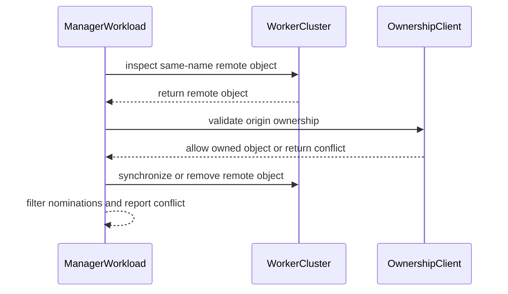

# PR #13269: MultiKueue: skip workers with conflicting job names

**Summary**: MultiKueue: skip workers with conflicting job names

**Sources**: https://github.com/kubernetes-sigs/kueue/pull/13269

**Last updated**: 2026-10-20T11:30:44Z

---

## Metadata

- **State**: open
- **Author**: [@MatteoFari](https://github.com/MatteoFari)
- **Branch**: `fix/12404-multikueue-job-name-conflict` → `main`
- **Created**: 2026-07-21T14:27:06Z
- **Updated**: 2026-10-20T11:30:44Z
- **Merged**: —
- **Closed**: —
- **Labels**: `kind/bug`, `release-note`, `lifecycle/stale`, `size/XL`, `needs-rebase`, `cncf-cla: yes`, `area/multikueue`
- **Assignees**: _none_
- **Requested reviewers**: [@kshalot](https://github.com/kshalot), [@tenzen-y](https://github.com/tenzen-y)
- **Changed files**: 8   **+626 / -15**

## Description

<!--  Thanks for sending a pull request!  Here are some tips for you:

1. If this is your first time, please read our contributor guidelines: https://git.k8s.io/community/contributors/guide/first-contribution.md#your-first-contribution and developer guide https://git.k8s.io/community/contributors/devel/development.md#development-guide
2. Please label this pull request according to what type of issue you are addressing, especially if this is a release targeted pull request. For reference on required PR/issue labels, read here:
https://git.k8s.io/community/contributors/devel/sig-release/release.md#issuepr-kind-label
3. Ensure you have added or ran the appropriate tests for your PR: https://git.k8s.io/community/contributors/devel/sig-testing/testing.md
4. If you want *faster* PR reviews, read how: https://git.k8s.io/community/contributors/guide/pull-requests.md#best-practices-for-faster-reviews
5. If the PR is unfinished, see how to mark it: https://git.k8s.io/community/contributors/guide/pull-requests.md#marking-unfinished-pull-requests
-->

#### What type of PR is this?
/kind bug
/area multikueue
<!--
Add one of the following kinds:
/kind bug
/kind cleanup
/kind documentation
/kind feature
/kind kep

Optionally add one or more of the following kinds if applicable:
/kind api-change
/kind deprecation
/kind failing-test
/kind flake
/kind regression

Please also consider setting the area:
/area tas
/area was
/area integrations
/area multikueue
/area dashboard
/area localization
/area testing
/area website
-->

#### What this PR does / why we need it:
Prevents MultiKueue from selecting workers with conflicting same-name Jobs. When enabled, it filters these workers before dispatch, rechecks ownership after admission and during synchronization, and preserves foreign objects during cleanup.
#### Which issue(s) this PR fixes:
<!--
*Automatically closes linked issue when PR is merged.
Usage: `Fixes #<issue number>`, or `Fixes (paste link of issue)`.
_If PR is about `failing-tests or flakes`, please post the related issues/tests in a comment and do not use `Fixes`_*
-->
Fixes #12404

#### Special notes for your reviewer:

#### Does this PR introduce a user-facing change?
<!--
If no, just write "NONE" in the release-note block below.
If yes, a release note is required:
Enter your extended release note in the block below. If the PR requires additional action from users switching to the new release, include the string "action required".
-->
```release-note
MultiKueue: Added the `MultiKueueJobNameConflictCheck` feature gate to skip workers containing conflicting same-name Job objects.
```


<!-- This is an auto-generated comment: release notes by coderabbit.ai -->
## Summary by CodeRabbit

* **New Features**
  * Added the `MultiKueueJobNameConflictCheck` feature gate for detecting same-name Jobs not managed by MultiKueue.
  * When enabled, conflicting worker clusters are skipped, nominations are adjusted, and warning events are emitted.
  * Conflicting remote admission options and objects are removed while preserving alternatives.
* **Bug Fixes**
  * Remote Job synchronization and deletion now avoid modifying unowned objects.
* **Configuration**
  * `MultiKueueJobNameConflictCheck` is Alpha in version 0.19 and disabled by default.
<!-- end of auto-generated comment: release notes by coderabbit.ai -->

## Discussion

### Comment by [@netlify[bot]](https://github.com/apps/netlify) — 2026-07-21T14:27:16Z

### <span aria-hidden="true">✅</span> Deploy Preview for *kubernetes-sigs-kueue* ready!


|  Name | Link |
|:-:|------------------------|
|<span aria-hidden="true">🔨</span> Latest commit | 8788f0940c7d49d2f5cca561382efa588b96c89f |
|<span aria-hidden="true">🔍</span> Latest deploy log | https://app.netlify.com/projects/kubernetes-sigs-kueue/deploys/6a9ad63cd9c3b600088517e2 |
|<span aria-hidden="true">😎</span> Deploy Preview | [https://deploy-preview-13269--kubernetes-sigs-kueue.netlify.app](https://deploy-preview-13269--kubernetes-sigs-kueue.netlify.app) |
|<span aria-hidden="true">📱</span> Preview on mobile | <details><summary> Toggle QR Code... </summary><br /><br /><br /><br />_Use your smartphone camera to open QR code link._</details> |
---
<!-- [kubernetes-sigs-kueue Preview](https://deploy-preview-13269--kubernetes-sigs-kueue.netlify.app) -->
_To edit notification comments on pull requests, go to your [Netlify project configuration](https://app.netlify.com/projects/kubernetes-sigs-kueue/configuration/notifications#deploy-notifications)._

### Comment by [@coderabbitai[bot]](https://github.com/apps/coderabbitai) — 2026-07-21T14:28:05Z

<!-- This is an auto-generated comment: summarize by coderabbit.ai -->
<!-- review_stack_entry_start -->

[](https://app.coderabbit.ai/change-stack/kubernetes-sigs/kueue/pull/13269)

<!-- review_stack_entry_end -->
<!-- recent_review_start -->

No actionable comments were generated in the recent review. 🎉

<details>
<summary>ℹ️ Recent review info</summary>

<details>
<summary>⚙️ Run configuration</summary>

**Configuration used**: Path: .coderabbit.yaml

**Review profile**: CHILL

**Plan**: Team

**Run ID**: `bcfc5d77-3b89-4c2b-8f3e-3a6715a25074`

</details>

<details>
<summary>📥 Commits</summary>

Reviewing files that changed from the base of the PR and between 81f193a3def679e5b50a55656484bc96edef109b and 8788f0940c7d49d2f5cca561382efa588b96c89f.

</details>

<details>
<summary>📒 Files selected for processing (8)</summary>

* `pkg/controller/admissionchecks/multikueue/workload.go`
* `pkg/controller/admissionchecks/multikueue/workload_test.go`
* `pkg/controller/jobframework/multikueue_test.go`
* `pkg/controller/jobframework/utils.go`
* `pkg/features/kube_features.go`
* `site/data/featuregates/versioned_feature_list.yaml`
* `test/compatibility_lifecycle/reference/versioned_feature_list.yaml`
* `test/integration/multikueue/cluster_role_sharing_test.go`

</details>

<details>
<summary>🚧 Files skipped from review as they are similar to previous changes (8)</summary>

* test/compatibility_lifecycle/reference/versioned_feature_list.yaml
* pkg/features/kube_features.go
* site/data/featuregates/versioned_feature_list.yaml
* test/integration/multikueue/cluster_role_sharing_test.go
* pkg/controller/jobframework/multikueue_test.go
* pkg/controller/admissionchecks/multikueue/workload_test.go
* pkg/controller/jobframework/utils.go
* pkg/controller/admissionchecks/multikueue/workload.go

</details>

**Included review availability:** Your plan provides up to 8 included reviews per hour; 7 remain after this review.

</details>

---


<!-- recent_review_end -->
<!-- walkthrough_start -->

<details>
<summary>📝 Walkthrough</summary>

## Walkthrough

MultiKueue adds an Alpha feature gate for same-name Job conflict detection. It validates remote ownership during synchronization and deletion, filters conflicting workers, removes conflicting remotes, and reports reconciliation conflicts. Unit, reconciliation, and integration tests cover these paths.

### Changes

**MultiKueue job name conflict handling**

|Layer / File(s)|Summary|
|---|---|
|**Remote ownership validation and safe synchronization** <br> `pkg/controller/jobframework/utils.go`, `pkg/controller/jobframework/multikueue_test.go`|Remote reads and deletes validate origin labels. Synchronization blocks unowned objects. Deletion skips foreign objects and treats ownership changes as no-ops.|
|**Conflict-aware workload reconciliation** <br> `pkg/controller/admissionchecks/multikueue/workload.go`|When the feature gate is enabled, reconciliation detects conflicts, filters nominations, conditionally patches status, removes conflicting remotes, and returns conflict errors.|
|**Feature gate registration** <br> `pkg/features/kube_features.go`, `site/data/featuregates/versioned_feature_list.yaml`, `test/compatibility_lifecycle/reference/versioned_feature_list.yaml`|The Alpha gate is registered for version 0.19 and disabled by default.|
|**Conflict behavior validation** <br> `pkg/controller/admissionchecks/multikueue/workload_test.go`, `test/integration/multikueue/cluster_role_sharing_test.go`|Tests cover disabled and enabled behavior, conflicting admissions, incremental dispatch, warning events, alternative worker selection, and preservation of pre-existing Jobs.|

**Estimated code review effort:** 4 (Complex) | ~45 minutes

<!-- final_review_risk_start -->
**Merge Risk:** _⚪ Minimal_ · up to `8788f`
<!-- final_review_risk_coverage:{"sourceCommitId":"8788f0940c7d49d2f5cca561382efa588b96c89f","coveredCommitId":"8788f0940c7d49d2f5cca561382efa588b96c89f","kind":"reviewed"} -->

This change adds an alpha-disabled conflict check that avoids dispatching or deleting foreign same-name remote Jobs. No concrete merge-blocking risk is currently established.
<!-- final_review_risk_end -->

### Sequence Diagram(s)



</details>

<!-- walkthrough_end -->
<!-- pre_merge_checks_walkthrough_start -->

<details>
<summary>🚥 Pre-merge checks | ✅ 4 | ❌ 1</summary>

### ❌ Failed checks (1 warning)

|     Check name     | Status     | Explanation                                                                                                                                                                                               | Resolution                                                                         |
| :----------------: | :--------- | :-------------------------------------------------------------------------------------------------------------------------------------------------------------------------------------------------------- | :--------------------------------------------------------------------------------- |
| Docstring Coverage | ⚠️ Warning | Docstring coverage is 36.36% which is insufficient. The required threshold is 80.00%. Docstring coverage is scoped to functions touched by this diff. Analyzed 11 functions across 6 files. (2 skipped: … | Write docstrings for the functions missing them to satisfy the coverage threshold. |

<details>
<summary>✅ Passed checks (4 passed)</summary>

|         Check name         | Status   | Explanation                                                                                                                                                                                               |
| :------------------------: | :------- | :-------------------------------------------------------------------------------------------------------------------------------------------------------------------------------------------------------- |
|      Description Check     | ✅ Passed | Check skipped - CodeRabbit’s high-level summary is enabled.                                                                                                                                               |
|         Title check        | ✅ Passed | The title clearly summarizes the primary change: MultiKueue skips worker clusters with conflicting job names.                                                                                             |
|     Linked Issues check    | ✅ Passed | The changes satisfy issue `#12404` by adding feature-gated detection of same-name, non-owned remote Jobs, excluding conflicting workers from selection, handling conflicts during admission and synchroniz… |
| Out of Scope Changes check | ✅ Passed | The feature gate, ownership validation, reconciliation changes, lifecycle declarations, unit tests, and integration test all support the linked issue and stated objective. No unrelated code changes ar… |

</details>

<details>
<summary>Full details: Docstring Coverage</summary>

**Explanation**

Docstring coverage is 36.36% which is insufficient. The required threshold is 80.00%. Docstring coverage is scoped to functions touched by this diff. Analyzed 11 functions across 6 files. (2 skipped: 2 unsupported.)

</details>

</details>

<!-- pre_merge_checks_walkthrough_end -->

- [ ] <!-- {"checkboxId":"585bb3f6-faf5-4dbf-96d2-74e382adf19a"} --> Fix all pre-merge checks with AI
<!-- finishing_touch_checkbox_start -->

<details>
<summary>✨ Finishing Touches</summary>

<details>
<summary>🧪 Generate unit tests (beta)</summary>

- [ ] <!-- {"checkboxId": "f47ac10b-58cc-4372-a567-0e02b2c3d479", "radioGroupId": "utg-output-choice-group-unknown_comment_id"} -->   Create PR with unit tests

</details>

</details>

<!-- finishing_touch_checkbox_end -->
<!-- tips_start -->

---


<sub>Comment `@coderabbitai help` to get the list of available commands.</sub>

<!-- tips_end -->

### Comment by [@mimowo](https://github.com/mimowo) — 2026-07-21T14:36:46Z

cc @kevin85421 could you please review?

### Comment by [@mimowo](https://github.com/mimowo) — 2026-07-22T06:36:08Z

"I doubt whether it's worth adding complexity for this kind of case" - this matches my intuition. Thank you for raising that. However, I would like to keep the PR open for now, I need to reflect more on that. I will return to it in August, please ping me if I forget.

### Comment by [@mimowo](https://github.com/mimowo) — 2026-07-22T06:37:25Z

I would also love to hear opinion @olekzabl who is leading the MK effort, but currently is on PTO.

### Comment by [@olekzabl](https://github.com/olekzabl) — 2026-07-28T17:56:27Z

> I would suggest using the appropriate mechanism to associate the jobs in the manager cluster and the worker cluster, so that the manager cluster only sees the CRs it manages.

Generally, this matches my intuition.
Specifically, I'd like to consider filtering out non-MK-owned workloads inside the `readGroup()` call.
So that `grp.remotes` only contains workloads which are truly MK-managed remotes.

Then, various sorts of syncing / update / deletes will be restricted automatically.

**However,** IIUC, we may need some care for workload creations (and worker nomination process).

> The manager cluster should still try to create the CR in the worker cluster, and the create API call will fail due to the existing CR with the same namespaced name. We should only surface the error from the create API call (...)

I'm afraid this may starve nomination in some cases, or at least slow it down noticeably. (For example, for incremental dispatcher with step size 1, just seeing an API error from creating a remote would not automatically switch to the next dispatching round; rather to some exponential backoff of retries).
This is also related to [this comment](https://github.com/kubernetes-sigs/kueue/pull/13269#discussion_r3625811991) from @mesutoezdil .

To cope with that cleanly, I'd consider the following:

* Besides `NominatedClusterNames`, create a new workload status field to track the workers with conflict.
  The minimum variant would be `WorkerClustersWithConflict`, but perhaps we could generalize to `UnavailableWorkers` (with names and reasons, for visibility).
  The key point is that it should rely entirely on the information fetched by `readGroup`. No need for more remote fetches later.
  (Though patching `UnavailableWorkers` would likely happen in the main `Reconcile`).
  And that it should be set per-workload, not per MKConfig, as "conflicting names" is a workload-dependent event.
* Let all our dispatching paths (`nominateAndSynchronizeWorkers` as well as `incrementaldispatcher.go`) exclude candidate workers mentioned in `UnavailableWorkers`.

WDYT?

### Comment by [@moezdil](https://github.com/moezdil) — 2026-07-28T18:37:42Z

@olekzabl direction sounds good to me, and imo status field is the right call. incremental dispatcher is its own controller in pkg/controller/workloaddispatcher and external dispatcher is out of cluster, both only see wl status, so they cant consume an event.

few notes:

nr1// filtering inside readGroup() alone wont catch this. readGroup only fetches remote Workloads, and the wl name embeds the parent job uid (workload_names.go:83), so a worker-local job gives a wl w/ a different name. in # 12404 there is no wl level collision, only job level. so we still need one adapter-gvk Get per candidate worker, and that Get is not cached (remote clients only cache ClusterQueue/LocalQueue, multikueuecluster.go:238), so id scope it to candidates we dont already own a remote for.

nr2// about "just surface the create error", the issue is not really speed, its more that it happens too late. the remote Workload create succeeds, job create happens only in step 6b, after that worker reserved quota and manager already removed the other remotes. so recovery means undoing an admission.

nr3// for incremental dispatcher, excluding candidates is not enough. nominateWorkers returns early while now - roundStart <= 5min (incrementaldispatcher.go:142), so w/ step size 1 we still waste a full round. if all workers of the round are in UnavailableWorkers we should skip the wait. and the conflicting worker must stay IN NominatedClusterNames, bc getNextNominatedWorkers builds alreadyNominated from it (:170), otherwise we re-nominate the same worker every round.

nr4// small ones: id recompute the field from readGroup each reconcile instead of appending, stale entry would blacklist a worker for the whole wl lifetime. and when all candidates conflict id not return an error, it just gives hot backoff + same event every retry. UnavailableWorkers name works for me if it also covers wlGroup.unavailableClusters (workload.go:292-305).

### Comment by [@mimowo](https://github.com/mimowo) — 2026-07-28T23:57:26Z

> Besides NominatedClusterNames, create a new workload status field to track the workers with conflict.

I'm not sure about the need for the new field. API decisions are pretty committal so I would like to make sure we really need it.

In my understanding the problem of worker cluster dispatching is a bit similar to kube-scheduler selecting a Node for Pod. It does not imprint all the unavailable nodes in the Pod fields.

I don't say no, but rather to consider alternatives - what if we just track the unavailable clusters in memory, and report the information in some condition messages? Similar as kube-scheduler records the information about nodes which cannot be used for scheduling a pod in the Pod condition message?

### Comment by [@kubernetes-prow[bot]](https://github.com/apps/kubernetes-prow) — 2026-09-04T14:31:36Z

[APPROVALNOTIFIER] This PR is **NOT APPROVED**

This pull-request has been approved by: *<a href="https://github.com/kubernetes-sigs/kueue/pull/13269#" title="Author self-approved">MatteoFari</a>*
**Once this PR has been reviewed and has the lgtm label**, please assign [mimowo](https://github.com/mimowo) for approval. For more information see [the Code Review Process](https://git.k8s.io/community/contributors/guide/owners.md#the-code-review-process).

The full list of commands accepted by this bot can be found [here](https://go.k8s.io/bot-commands?repo=kubernetes-sigs%2Fkueue).

<details open>
Needs approval from an approver in each of these files:

- **[OWNERS](https://github.com/kubernetes-sigs/kueue/blob/main/OWNERS)**

Approvers can indicate their approval by writing `/approve` in a comment
Approvers can cancel approval by writing `/approve cancel` in a comment
</details>
<!-- META={"approvers":["mimowo"]} -->

### Comment by [@coderabbitai[bot]](https://github.com/apps/coderabbitai) — 2026-09-04T14:31:47Z

<!-- This is an auto-generated comment by CodeRabbit -->
> [!NOTE]
> GitHub couldn't provide a complete incremental comparison for this pull request, so CodeRabbit is performing a full review instead. This review may take a little longer.

### Comment by [@k8s-triage-robot](https://github.com/k8s-triage-robot) — 2026-10-20T11:26:00Z

The Kubernetes project currently lacks enough active contributors to adequately respond to all PRs.

This bot triages PRs according to the following rules:
- After 30d of inactivity, `lifecycle/stale` is applied
- After 30d of inactivity since `lifecycle/stale` was applied, `lifecycle/rotten` is applied
- After 30d of inactivity since `lifecycle/rotten` was applied, the PR is closed

You can:
- Mark this PR as fresh with `/remove-lifecycle stale`
- Close this PR with `/close`
- Offer to help out with [Issue Triage][1]

Please send feedback to us at [Kueue](https://github.com/kubernetes-sigs/kueue/tree/main#community-discussion-contribution-and-support).

/lifecycle stale

[1]: https://www.kubernetes.dev/docs/guide/issue-triage/

### Comment by [@kubernetes-prow[bot]](https://github.com/apps/kubernetes-prow) — 2026-10-20T11:30:44Z

PR needs rebase.

<details>

Instructions for interacting with me using PR comments are available [here](https://git.k8s.io/community/contributors/guide/pull-requests.md).  If you have questions or suggestions related to my behavior, please file an issue against the [kubernetes-sigs/prow](https://github.com/kubernetes-sigs/prow/issues/new?title=Prow%20issue:) repository.
</details>

## Reviews

### Review by [@mimowo](https://github.com/mimowo) (commented) — 2026-07-21T14:35:58Z

- **pkg/controller/admissionchecks/multikueue/workload.go:897** by [@mimowo](https://github.com/mimowo) — 2026-07-21T14:35:58Z
```diff
@@ -809,6 +889,14 @@ func admittedClusterQueue(wl *kueue.Workload) kueue.ClusterQueueReference {
 }
 
 func (w *wlReconciler) syncToSingleCluster(ctx context.Context, log klog.Logger, group *wlGroup, targetCluster string) (reconcile.Result, error) {
+	eligible, hadConflict, err := w.filterWorkersWithJobNameConflicts(ctx, group, []string{targetCluster})
+	if err != nil {
+		return reconcile.Result{}, err
+	}
+	if hadConflict && len(eligible) == 0 {
+		return reconcile.Result{RequeueAfter: jobNameConflictRequeueAfter}, nil
```

  Let's handle the conflits by explicit errors

### Review by [@mimowo](https://github.com/mimowo) (commented) — 2026-07-21T14:36:32Z

- **pkg/controller/admissionchecks/multikueue/workload.go:92** by [@mimowo](https://github.com/mimowo) — 2026-07-21T14:36:32Z
```diff
@@ -86,6 +86,11 @@ var (
 // in this package point here rather than repeating it.
 const syncDeferredRequeueAfter = 2 * time.Second
 
+// jobNameConflictRequeueAfter lets a worker become eligible again after a
+// conflicting, non-MultiKueue Job is removed. Foreign Jobs are not watched by
+// MultiKueue, so their deletion does not otherwise trigger reconciliation.
+const jobNameConflictRequeueAfter = time.Minute
```

  I would rather handle conflicts by explicit errors. If the problem is permanent then it will backoff to 15min

### Review by [@coderabbitai[bot]](https://github.com/apps/coderabbitai) (commented) — 2026-07-21T14:42:22Z

**Actionable comments posted: 2**

<details>
<summary>🧹 Nitpick comments (3)</summary><blockquote>

<details>
<summary>test/integration/multikueue/cluster_role_sharing_test.go (1)</summary><blockquote>

`622-682`: _📐 Maintainability & Code Quality_ | _🔵 Trivial_ | _💤 Low value_

**Consider adding a negative-path integration scenario for "all workers conflict."**

This new test covers the positive skip-and-dispatch-to-worker2 path well and mirrors the existing "pre-existing Job preserved" test's structure. The equivalent "every worker conflicts → requeue" scenario is already covered at the unit level (`workload_test.go` line 536), so this is optional; adding it here would round out end-to-end coverage of both outcomes in one place.


As per path instructions, `test/integration/**/*.go` tests should "cover both positive and negative scenarios."

<details>
<summary>🤖 Prompt for AI Agents</summary>

```
Verify each finding against current code. Fix only still-valid issues, skip the
rest with a brief reason, keep changes minimal, and validate.

In `@test/integration/multikueue/cluster_role_sharing_test.go` around lines 622 -
682, Add a negative-path integration test alongside the existing scenario, using
the same MultiKueue job setup and conflict-detection feature gate, but create
pre-existing conflicting Jobs on every worker. Verify the workload is not
dispatched to any worker and remains/requeues in the expected management-cluster
state, while confirming the pre-existing Jobs are preserved.
```

</details>

<!-- cr-comment:v1:ece5ab3b7fe4b6fce781b519 -->

_Source: Path instructions_

</blockquote></details>
<details>
<summary>pkg/controller/admissionchecks/multikueue/workload.go (1)</summary><blockquote>

`636-690`: _🚀 Performance & Scalability_ | _🔵 Trivial_ | _⚡ Quick win_

**Redundant remote ownership `Get` on the admitting cluster.**

When the gate is enabled, `hasJobNameConflict` (636-644) already performs a `ValidateRemoteObjectOwnership` Get/label check on `admittingRemote`; if it reports no conflict, `ValidateRemoteObjectOwnership` is called again at line 678 for the same cluster/key within the same reconcile pass. This is an avoidable duplicate remote API call on a path exercised for every admitted workload's reconcile.


Consider having `hasJobNameConflict` surface the underlying error/result so the caller can reuse it at line 678 instead of re-validating.

<details>
<summary>🤖 Prompt for AI Agents</summary>

```
Verify each finding against current code. Fix only still-valid issues, skip the
rest with a brief reason, keep changes minimal, and validate.

In `@pkg/controller/admissionchecks/multikueue/workload.go` around lines 636 -
690, Update the admitting-remote validation flow around hasJobNameConflict and
ValidateRemoteObjectOwnership to avoid performing the same remote ownership Get
twice when MultiKueueJobNameConflictCheck is enabled. Have hasJobNameConflict
surface the ownership validation result or error needed by the caller, then
reuse it at the existing validation point while preserving conflicting-object
removal and all current error handling behavior.
```

</details>

<!-- cr-comment:v1:20c9dfb81e6eaac1dd0a6a4c -->

</blockquote></details>
<details>
<summary>pkg/controller/jobframework/multikueue_test.go (1)</summary><blockquote>

`116-245`: _📐 Maintainability & Code Quality_ | _🔵 Trivial_ | _⚡ Quick win_

**Add coverage for the GVK-mismatch bypass branch.**

Tests only exercise same-GVK (`batchv1.Job`) objects. Neither `remoteObjectOwnershipClient.Get` nor `.Delete`'s `gvk != c.gvk` bypass branch (utils.go lines 297-299, 308-309) is exercised, so a regression there (e.g., accidentally validating/blocking unrelated object types) wouldn't be caught.

<details>
<summary>🤖 Prompt for AI Agents</summary>

```
Verify each finding against current code. Fix only still-valid issues, skip the
rest with a brief reason, keep changes minimal, and validate.

In `@pkg/controller/jobframework/multikueue_test.go` around lines 116 - 245, Add
test coverage for the GVK-mismatch bypass in remoteObjectOwnershipClient.Get and
Delete, using a registered object type different from batchv1.Job alongside the
existing remote objects. Verify unrelated object types are returned or deleted
without ownership validation or blocking, while preserving the current same-GVK
ownership assertions in TestSyncJobWithRemoteObjectOwnership and
TestDeleteRemoteObjectIfOwnedSkipsUnownedAdapterObjects.
```

</details>

<!-- cr-comment:v1:501b8b1bdc536c9d9514d444 -->

</blockquote></details>

</blockquote></details>

<details>
<summary>🤖 Prompt for all review comments with AI agents</summary>

```
Verify each finding against current code. Fix only still-valid issues, skip the
rest with a brief reason, keep changes minimal, and validate.

Inline comments:
In `@pkg/controller/admissionchecks/multikueue/workload.go`:
- Around line 223-247: Update filterWorkersWithJobNameConflicts to gracefully
skip a cluster when group.hasJobNameConflict returns an error: record the error
through the existing reconciliation logging/error-reporting mechanism, mark that
cluster as ineligible, and continue evaluating the remaining workers. Preserve
successful conflict filtering and return the eligible healthy clusters so
syncToSingleCluster and nominateAndSynchronizeWorkers are not aborted by one
unavailable or misconfigured candidate.
- Around line 208-214: Update removeConflictingRemote to return the documented
jobNameConflictRequeueAfter delay after removing conflicting remote objects,
rather than using immediate Requeue: true; preserve the existing removal error
handling and conflict reporting.

---

Nitpick comments:
In `@pkg/controller/admissionchecks/multikueue/workload.go`:
- Around line 636-690: Update the admitting-remote validation flow around
hasJobNameConflict and ValidateRemoteObjectOwnership to avoid performing the
same remote ownership Get twice when MultiKueueJobNameConflictCheck is enabled.
Have hasJobNameConflict surface the ownership validation result or error needed
by the caller, then reuse it at the existing validation point while preserving
conflicting-object removal and all current error handling behavior.

In `@pkg/controller/jobframework/multikueue_test.go`:
- Around line 116-245: Add test coverage for the GVK-mismatch bypass in
remoteObjectOwnershipClient.Get and Delete, using a registered object type
different from batchv1.Job alongside the existing remote objects. Verify
unrelated object types are returned or deleted without ownership validation or
blocking, while preserving the current same-GVK ownership assertions in
TestSyncJobWithRemoteObjectOwnership and
TestDeleteRemoteObjectIfOwnedSkipsUnownedAdapterObjects.

In `@test/integration/multikueue/cluster_role_sharing_test.go`:
- Around line 622-682: Add a negative-path integration test alongside the
existing scenario, using the same MultiKueue job setup and conflict-detection
feature gate, but create pre-existing conflicting Jobs on every worker. Verify
the workload is not dispatched to any worker and remains/requeues in the
expected management-cluster state, while confirming the pre-existing Jobs are
preserved.
```

</details>

<details>
<summary>🪄 Autofix (Beta)</summary>

Fix all unresolved CodeRabbit comments on this PR:

- [ ] <!-- {"checkboxId": "4b0d0e0a-96d7-4f10-b296-3a18ea78f0b9"} --> Push a commit to this branch (recommended)
- [ ] <!-- {"checkboxId": "ff5b1114-7d8c-49e6-8ac1-43f82af23a33"} --> Create a new PR with the fixes

</details>

---

<details>
<summary>ℹ️ Review info</summary>

<details>
<summary>⚙️ Run configuration</summary>

**Configuration used**: Path: .coderabbit.yaml

**Review profile**: CHILL

**Plan**: Pro

**Run ID**: `7a4e1e2d-bc47-4876-b777-7b25bf8a598c`

</details>

<details>
<summary>📥 Commits</summary>

Reviewing files that changed from the base of the PR and between 5dc5d56410c0ba5282d247e416be4b892ff00bbd and f292a55ad39f4a01cc9255b3808b663b394fbbaf.

</details>

<details>
<summary>📒 Files selected for processing (8)</summary>

* `pkg/controller/admissionchecks/multikueue/workload.go`
* `pkg/controller/admissionchecks/multikueue/workload_test.go`
* `pkg/controller/jobframework/multikueue_test.go`
* `pkg/controller/jobframework/utils.go`
* `pkg/features/kube_features.go`
* `site/data/featuregates/versioned_feature_list.yaml`
* `test/compatibility_lifecycle/reference/versioned_feature_list.yaml`
* `test/integration/multikueue/cluster_role_sharing_test.go`

</details>

</details>

<!-- This is an auto-generated comment by CodeRabbit for review status -->

- **pkg/controller/admissionchecks/multikueue/workload.go:215** by [@coderabbitai[bot]](https://github.com/apps/coderabbitai) — 2026-07-21T14:42:21Z
```diff
@@ -182,6 +187,65 @@ func (g *wlGroup) RemoveRemoteObjects(ctx context.Context, cluster string) error
 	return nil
 }
 
+func (g *wlGroup) hasJobNameConflict(ctx context.Context, cluster string) (bool, error) {
+	remote := g.remoteClients[cluster]
+	_, err := jobframework.ValidateRemoteObjectOwnership(ctx, remote.getClient(), g.controllerKey, g.jobAdapter.GVK(), remote.origin)
+	if errors.Is(err, jobframework.ErrRemoteObjectNotOwnedByMultiKueue) {
+		return true, nil
+	}
+	return false, err
+}
+
+func (w *wlReconciler) reportJobNameConflict(ctx context.Context, group *wlGroup, cluster string) {
+	message := fmt.Sprintf(
+		"Worker cluster %q contains a conflicting %s %q not owned by this MultiKueue manager; skipping the cluster",
+		cluster, group.jobAdapter.GVK().Kind, group.controllerKey.String(),
+	)
+	ctrl.LoggerFrom(ctx).V(2).Info(message)
+	w.recorder.Eventf(group.local, nil, corev1.EventTypeWarning, "MultiKueueJobNameConflict", "SkipWorkerCluster", api.TruncateEventMessage(message))
+}
+
+func (w *wlReconciler) removeConflictingRemote(ctx context.Context, group *wlGroup, cluster string) (reconcile.Result, error) {
+	w.reportJobNameConflict(ctx, group, cluster)
+	if err := client.IgnoreNotFound(group.RemoveRemoteObjects(ctx, cluster)); err != nil {
+		return reconcile.Result{}, fmt.Errorf("removing remote workload from worker cluster %q after a job name conflict: %w", cluster, err)
+	}
+	return reconcile.Result{Requeue: true}, nil
+}
```

  _🩺 Stability & Availability_ | _🟠 Major_ | _⚡ Quick win_
  
  **Immediate `Requeue: true` contradicts the documented poll-delay rationale.**
  
  `removeConflictingRemote` returns `reconcile.Result{Requeue: true}` (no delay) after removing a remote due to a conflict, but `jobNameConflictRequeueAfter`'s own doc comment (89-92) explains a fixed delay is needed specifically because foreign Jobs aren't watched by MultiKueue. If the conflicting Job persists, this path will re-trigger reconciliation on the workqueue's base backoff interval instead of the intended 1-minute poll, adding unnecessary reconcile/API pressure while the same conflict is repeatedly rediscovered.
  
  
  
  <details>
  <summary>🔧 Proposed fix</summary>
  
  ```diff
  -	return reconcile.Result{Requeue: true}, nil
  +	return reconcile.Result{RequeueAfter: jobNameConflictRequeueAfter}, nil
  ```
  </details>
  
  <!-- suggestion_start -->
  
  <details>
  <summary>📝 Committable suggestion</summary>
  
  > ‼️ **IMPORTANT**
  > Carefully review the code before committing. Ensure that it accurately replaces the highlighted code, contains no missing lines, and has no issues with indentation. Thoroughly test & benchmark the code to ensure it meets the requirements.
  
  ```suggestion
  func (w *wlReconciler) removeConflictingRemote(ctx context.Context, group *wlGroup, cluster string) (reconcile.Result, error) {
  	w.reportJobNameConflict(ctx, group, cluster)
  	if err := client.IgnoreNotFound(group.RemoveRemoteObjects(ctx, cluster)); err != nil {
  		return reconcile.Result{}, fmt.Errorf("removing remote workload from worker cluster %q after a job name conflict: %w", cluster, err)
  	}
  	return reconcile.Result{RequeueAfter: jobNameConflictRequeueAfter}, nil
  }
  ```
  
  </details>
  
  <!-- suggestion_end -->
  
  <details>
  <summary>🤖 Prompt for AI Agents</summary>
  
  ```
  Verify each finding against current code. Fix only still-valid issues, skip the
  rest with a brief reason, keep changes minimal, and validate.
  
  In `@pkg/controller/admissionchecks/multikueue/workload.go` around lines 208 -
  214, Update removeConflictingRemote to return the documented
  jobNameConflictRequeueAfter delay after removing conflicting remote objects,
  rather than using immediate Requeue: true; preserve the existing removal error
  handling and conflict reporting.
  ```
  
  </details>
  
  <!-- fingerprinting:phantom:medusa:beignet -->
  
  <!-- cr-indicator-types:potential_issue -->
  
  <!-- cr-comment:v1:bf0b7a59935989fedf42ce2b -->
  
  <!-- This is an auto-generated comment by CodeRabbit -->

- **pkg/controller/admissionchecks/multikueue/workload.go:247** by [@coderabbitai[bot]](https://github.com/apps/coderabbitai) — 2026-07-21T14:42:21Z
```diff
@@ -182,6 +187,65 @@ func (g *wlGroup) RemoveRemoteObjects(ctx context.Context, cluster string) error
 	return nil
 }
 
+func (g *wlGroup) hasJobNameConflict(ctx context.Context, cluster string) (bool, error) {
+	remote := g.remoteClients[cluster]
+	_, err := jobframework.ValidateRemoteObjectOwnership(ctx, remote.getClient(), g.controllerKey, g.jobAdapter.GVK(), remote.origin)
+	if errors.Is(err, jobframework.ErrRemoteObjectNotOwnedByMultiKueue) {
+		return true, nil
+	}
+	return false, err
+}
+
+func (w *wlReconciler) reportJobNameConflict(ctx context.Context, group *wlGroup, cluster string) {
+	message := fmt.Sprintf(
+		"Worker cluster %q contains a conflicting %s %q not owned by this MultiKueue manager; skipping the cluster",
+		cluster, group.jobAdapter.GVK().Kind, group.controllerKey.String(),
+	)
+	ctrl.LoggerFrom(ctx).V(2).Info(message)
+	w.recorder.Eventf(group.local, nil, corev1.EventTypeWarning, "MultiKueueJobNameConflict", "SkipWorkerCluster", api.TruncateEventMessage(message))
+}
+
+func (w *wlReconciler) removeConflictingRemote(ctx context.Context, group *wlGroup, cluster string) (reconcile.Result, error) {
+	w.reportJobNameConflict(ctx, group, cluster)
+	if err := client.IgnoreNotFound(group.RemoveRemoteObjects(ctx, cluster)); err != nil {
+		return reconcile.Result{}, fmt.Errorf("removing remote workload from worker cluster %q after a job name conflict: %w", cluster, err)
+	}
+	return reconcile.Result{Requeue: true}, nil
+}
+
+func (w *wlReconciler) syncJob(ctx context.Context, remoteClient client.Client, group *wlGroup) (bool, error) {
+	if features.Enabled(features.MultiKueueJobNameConflictCheck) {
+		return jobframework.SyncJobWithRemoteObjectOwnership(ctx, w.client, remoteClient, group.jobAdapter, group.controllerKey, group.local.Name, w.origin)
+	}
+	return group.jobAdapter.SyncJob(ctx, w.client, remoteClient, group.controllerKey, group.local.Name, w.origin)
+}
+
+func (w *wlReconciler) filterWorkersWithJobNameConflicts(ctx context.Context, group *wlGroup, workers []string) ([]string, bool, error) {
+	if !features.Enabled(features.MultiKueueJobNameConflictCheck) {
+		return workers, false, nil
+	}
+
+	eligible := make([]string, 0, len(workers))
+	hadConflict := false
+	for _, cluster := range workers {
+		if group.remotes[cluster] != nil || group.remoteClients[cluster] == nil {
+			eligible = append(eligible, cluster)
+			continue
+		}
+		conflict, err := group.hasJobNameConflict(ctx, cluster)
+		if err != nil {
+			return nil, false, fmt.Errorf("checking worker cluster %q for a job name conflict: %w", cluster, err)
+		}
+		if conflict {
+			hadConflict = true
+			w.reportJobNameConflict(ctx, group, cluster)
+			continue
+		}
+		eligible = append(eligible, cluster)
+	}
+	return eligible, hadConflict, nil
+}
```

  _🩺 Stability & Availability_ | _🟠 Major_ | _⚡ Quick win_
  
  **Single flaky/unreachable candidate cluster aborts nomination for all other clusters.**
  
  `filterWorkersWithJobNameConflicts` returns immediately with a hard error on the first non-NotFound `Get` failure (line 236-238), discarding all eligibility results already computed for other clusters in the batch. Both callers (`syncToSingleCluster` at 892 and `nominateAndSynchronizeWorkers` at 1010) then hard-fail the whole reconcile. Unlike the rest of this file, which explicitly tolerates reconnecting/unavailable workers (`unavailableClusters`, `workerLostTimeout`), a single misconfigured (e.g. RBAC) or transiently disconnected candidate cluster can permanently block a workload from being nominated to any other healthy cluster until that one cluster recovers.
  
  As per path instructions, `pkg/controller/**/*.go` should have proper error handling in reconciliation logic; this deviates from the graceful-degradation pattern used elsewhere in this same file for cluster unavailability.
  
  
  
  
  <details>
  <summary>🔧 Proposed fix: skip the errored cluster instead of aborting the whole batch</summary>
  
  ```diff
   		conflict, err := group.hasJobNameConflict(ctx, cluster)
   		if err != nil {
  -			return nil, false, fmt.Errorf("checking worker cluster %q for a job name conflict: %w", cluster, err)
  +			ctrl.LoggerFrom(ctx).V(2).Error(err, "Skipping worker cluster after job name conflict check failed", "workerCluster", cluster)
  +			continue
   		}
   		if conflict {
  ```
  </details>
  
  
  Also applies to: 891-899, 1010-1013
  
  <details>
  <summary>🤖 Prompt for AI Agents</summary>
  
  ```
  Verify each finding against current code. Fix only still-valid issues, skip the
  rest with a brief reason, keep changes minimal, and validate.
  
  In `@pkg/controller/admissionchecks/multikueue/workload.go` around lines 223 -
  247, Update filterWorkersWithJobNameConflicts to gracefully skip a cluster when
  group.hasJobNameConflict returns an error: record the error through the existing
  reconciliation logging/error-reporting mechanism, mark that cluster as
  ineligible, and continue evaluating the remaining workers. Preserve successful
  conflict filtering and return the eligible healthy clusters so
  syncToSingleCluster and nominateAndSynchronizeWorkers are not aborted by one
  unavailable or misconfigured candidate.
  ```
  
  </details>
  
  <!-- fingerprinting:phantom:medusa:beignet -->
  
  <!-- cr-indicator-types:potential_issue -->
  
  <!-- cr-comment:v1:020357cfd48f3e8b91162d7a -->
  
  _Source: Path instructions_
  
  <!-- This is an auto-generated comment by CodeRabbit -->

### Review by [@moezdil](https://github.com/moezdil) (commented) — 2026-07-21T21:25:28Z

- **pkg/controller/admissionchecks/multikueue/workload.go:1060** by [@moezdil](https://github.com/moezdil) — 2026-07-21T21:25:28Z
```diff
@@ -956,7 +1050,13 @@ func (w *wlReconciler) nominateAndSynchronizeWorkers(ctx context.Context, group
 			group.remotes[rem] = nil
 		}
 	}
-	return reconcile.Result{}, errors.Join(errs...)
+	if err := errors.Join(errs...); err != nil {
+		return reconcile.Result{}, err
+	}
+	if len(conflicts) > 0 {
+		return reconcile.Result{}, jobNameConflictError(conflicts)
```

  i see from the tests that even when dispatch to the healthy workers succeeds this still returns the conflict error, so the wl gets requeued w/ backoff and the filter emits the same warning event again on every retry while the foreign job exists, and w/ incremental dispatcher the conflicting cluster also never leaves the nominated list bc patch is skipped on that path

### Review by [@kevin85421](https://github.com/kevin85421) (commented) — 2026-07-22T05:29:36Z

I briefly looked at the PR. I doubt whether it's worth adding complexity for this kind of case, especially since it only covers a special case. It's not worth it in my opinion, but it's better to defer to the maintainers to make the decision.

I would suggest using the appropriate mechanism to associate the jobs in the manager cluster and the worker cluster, so that the manager cluster only sees the CRs it manages. The manager cluster should still try to create the CR in the worker cluster, and the create API call will fail due to the existing CR with the same namespaced name. We should only surface the error from the create API call instead of handling edge cases one by one. Then, this can cover all cases where CR creation fails.
