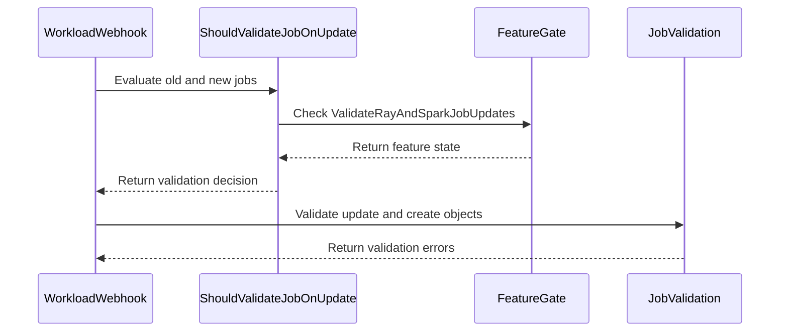

# PR #13293: Validate Ray and Spark jobs on queue-name removal

**Summary**: Validate Ray and Spark jobs on queue-name removal

**Sources**: https://github.com/kubernetes-sigs/kueue/pull/13293

**Last updated**: 2026-08-20T12:34:05Z

---

## Metadata

- **State**: closed (merged)
- **Author**: [@ivnovakov](https://github.com/ivnovakov)
- **Branch**: `fix/webhook-queuename-immutability-bypass` → `main`
- **Created**: 2026-07-21T18:52:29Z
- **Updated**: 2026-08-20T12:34:05Z
- **Merged**: 2026-08-20T05:13:09Z
- **Closed**: 2026-08-20T05:13:09Z
- **Labels**: `kind/bug`, `release-note`, `lgtm`, `size/XL`, `approved`, `cncf-cla: yes`, `area/integrations`
- **Assignees**: [@mykysha](https://github.com/mykysha), [@dkaluza](https://github.com/dkaluza), [@tenzen-y](https://github.com/tenzen-y)
- **Requested reviewers**: [@mszadkow](https://github.com/mszadkow), [@mykysha](https://github.com/mykysha), [@olekzabl](https://github.com/olekzabl), [@dkaluza](https://github.com/dkaluza)
- **Changed files**: 17   **+852 / -100**

## Description

<!--  Thanks for sending a pull request!  Here are some tips for you:

1. If this is your first time, please read our contributor guidelines: https://git.k8s.io/community/contributors/guide/first-contribution.md#your-first-contribution and developer guide https://git.k8s.io/community/contributors/devel/development.md#development-guide
2. Please label this pull request according to what type of issue you are addressing, especially if this is a release targeted pull request. For reference on required PR/issue labels, read here:
https://git.k8s.io/community/contributors/devel/sig-release/release.md#issuepr-kind-label
3. Ensure you have added or ran the appropriate tests for your PR: https://git.k8s.io/community/contributors/devel/sig-testing/testing.md
4. If you want *faster* PR reviews, read how: https://git.k8s.io/community/contributors/guide/pull-requests.md#best-practices-for-faster-reviews
5. If the PR is unfinished, see how to mark it: https://git.k8s.io/community/contributors/guide/pull-requests.md#marking-unfinished-pull-requests
-->

#### What type of PR is this?

<!--
Add one of the following kinds:
/kind bug
/kind cleanup
/kind documentation
/kind feature
/kind kep

Optionally add one or more of the following kinds if applicable:
/kind api-change
/kind deprecation
/kind failing-test
/kind flake
/kind regression

Please also consider setting the area:
/area tas
/area was
/area integrations
/area multikueue
/area dashboard
/area localization
/area testing
/area website
-->

/kind bug
/area integrations

#### What this PR does / why we need it:

The `ValidateUpdate` webhooks for RayJob, RayCluster, RayService and SparkApplication ran
`jobframework.ValidateJobOnUpdate` only when the updated object still carried the
`kueue.x-k8s.io/queue-name` label, or when `manageJobsWithoutQueueName` was enabled.
Removing that label from an unsuspended job made the guard false, so the immutability
check in `validateUpdateForQueueName` was skipped. The job then stopped being managed by
Kueue while its pods kept running, and its resources were no longer counted against quota.

The four webhooks now share `jobframework.ShouldValidateJobOnUpdate`, which also validates
a job that carried the label before the update. A job that carries it neither before nor
after is still not validated. The `ValidateRayAndSparkJobUpdates` feature gate toggles that
added condition and nothing else, so with the gate disabled the guard is the one from
before this change. The gate is Beta and enabled by default in 0.20.


#### Which issue(s) this PR fixes:
<!--
*Automatically closes linked issue when PR is merged.
Usage: `Fixes #<issue number>`, or `Fixes (paste link of issue)`.
_If PR is about `failing-tests or flakes`, please post the related issues/tests in a comment and do not use `Fixes`_*
-->
Fixes #

#### Special notes for your reviewer:

- The unit tables cover every scenario in both gate states. The unmanaged cases change the
  prebuilt workload name on an unsuspended job with no queue-name label on either side.
  That change is invalid on its own, so a nil result with the gate enabled can only mean
  the job was never validated.
- The integration specs cover the fix in both gate states, two per integration. Nothing
  exercises `DefaultLocalQueueExist` through a live webhook. That wiring is shared with
  `BaseWebhook` and every other integration, and was already untested at integration level
  before this PR.
- `log.Info` becomes `log.V(5).Info` in the four webhooks, matching the job, pod,
  deployment, statefulset and leaderworkerset webhooks. Unrelated to the fix.
- This PR was written in part with the assistance of generative AI.

#### Does this PR introduce a user-facing change?
<!--
If no, just write "NONE" in the release-note block below.
If yes, a release note is required:
Enter your extended release note in the block below. If the PR requires additional action from users switching to the new release, include the string "action required".
-->
```release-note
RayJob, RayCluster, RayService, and SparkApplication: Fixed a bug where removing the `kueue.x-k8s.io/queue-name` label from an unsuspended job was accepted, so the job stopped being managed by Kueue while its pods kept running and its resources were no longer counted against quota. Removing the label is now rejected, both from an unsuspended job and from a suspended job in a namespace with a default LocalQueue. Controlled by the `ValidateRayAndSparkJobUpdates` feature gate, which is Beta and enabled by default.
```


<!-- This is an auto-generated comment: release notes by coderabbit.ai -->
## Summary by CodeRabbit

- **New Features**
  - Added the `ValidateRayAndSparkJobUpdates` feature gate, enabled by default.
  - Update validation now consistently applies to RayCluster, RayJob, RayService, and SparkApplication resources.
  - Queue-label changes and removals are rejected when validation is enabled, including for suspended jobs where applicable.
  - Updates remain allowed when the feature gate is disabled or validation is not required.

- **Tests**
  - Added comprehensive unit and integration coverage for queue changes, default queues, suspension states, and feature-gate behavior.
<!-- end of auto-generated comment: release notes by coderabbit.ai -->

## Discussion

### Comment by [@netlify[bot]](https://github.com/apps/netlify) — 2026-07-21T18:54:09Z

### <span aria-hidden="true">✅</span> Deploy Preview for *kubernetes-sigs-kueue* canceled.


|  Name | Link |
|:-:|------------------------|
|<span aria-hidden="true">🔨</span> Latest commit | c00942894939e198bbad2568319d9d07d12c0021 |
|<span aria-hidden="true">🔍</span> Latest deploy log | https://app.netlify.com/projects/kubernetes-sigs-kueue/deploys/6a858f02c5a0f300081fbfea |

### Comment by [@coderabbitai[bot]](https://github.com/apps/coderabbitai) — 2026-07-21T18:54:29Z

<!-- This is an auto-generated comment: summarize by coderabbit.ai -->
<!-- review_stack_entry_start -->

[](https://app.coderabbit.ai/change-stack/kubernetes-sigs/kueue/pull/13293?utm_source=github_walkthrough&utm_medium=github&utm_campaign=change_stack)

<!-- review_stack_entry_end -->
<!-- This is an auto-generated comment: review paused by coderabbit.ai -->

> [!NOTE]
> ## Reviews paused
> 
> It looks like this branch is under active development. To avoid overwhelming you with review comments due to an influx of new commits, CodeRabbit has automatically paused this review. You can configure this behavior by changing the `reviews.auto_review.auto_pause_after_reviewed_commits` setting.
> 
> Use the following commands to manage reviews:
> - `@coderabbitai resume` to resume automatic reviews.
> - `@coderabbitai review` to trigger a single review.
> 
> Use the checkboxes below for quick actions:
> - [ ] <!-- {"checkboxId": "7f6cc2e2-2e4e-497a-8c31-c9e4573e93d1"} --> ▶️ Resume reviews
> - [ ] <!-- {"checkboxId": "e9bb8d72-00e8-4f67-9cb2-caf3b22574fe"} --> 🔍 Trigger review

<!-- end of auto-generated comment: review paused by coderabbit.ai -->
<!-- recent_review_start -->

No actionable comments were generated in the recent review. 🎉

<details>
<summary>ℹ️ Recent review info</summary>

<details>
<summary>⚙️ Run configuration</summary>

**Configuration used**: Path: .coderabbit.yaml

**Review profile**: CHILL

**Plan**: Pro Plus

**Run ID**: `ec4ec897-c9a2-4dab-9200-f99aca9be10e`

</details>

<details>
<summary>📥 Commits</summary>

Reviewing files that changed from the base of the PR and between f7b7f3c7e90d541b3dfddc044e18bb91406e0d0e and 56c0f647c6ece9e188372de2abdc49516ae3f183.

</details>

<details>
<summary>📒 Files selected for processing (17)</summary>

* `pkg/controller/jobframework/validation.go`
* `pkg/controller/jobs/raycluster/raycluster_webhook.go`
* `pkg/controller/jobs/raycluster/raycluster_webhook_test.go`
* `pkg/controller/jobs/rayjob/rayjob_webhook.go`
* `pkg/controller/jobs/rayjob/rayjob_webhook_test.go`
* `pkg/controller/jobs/rayservice/rayservice_webhook.go`
* `pkg/controller/jobs/rayservice/rayservice_webhook_test.go`
* `pkg/controller/jobs/sparkapplication/sparkapplication_webhook.go`
* `pkg/controller/jobs/sparkapplication/sparkapplication_webhook_test.go`
* `pkg/features/kube_features.go`
* `site/data/featuregates/versioned_feature_list.yaml`
* `test/compatibility_lifecycle/reference/versioned_feature_list.yaml`
* `test/integration/singlecluster/webhook/jobs/raycluster_webhook_test.go`
* `test/integration/singlecluster/webhook/jobs/rayjob_webhook_test.go`
* `test/integration/singlecluster/webhook/jobs/rayservice_webhook_test.go`
* `test/integration/singlecluster/webhook/jobs/sparkapplication_webhook_test.go`
* `test/integration/singlecluster/webhook/jobs/suite_test.go`

</details>

<details>
<summary>🚧 Files skipped from review as they are similar to previous changes (1)</summary>

* test/integration/singlecluster/webhook/jobs/suite_test.go

</details>

**Included review availability:** Your plan provides up to 8 included reviews per hour; 7 remain after this review.

</details>

---


<!-- recent_review_end -->
<!-- walkthrough_start -->

<details>
<summary>📝 Walkthrough</summary>

## Walkthrough

The PR centralizes update-validation gating for Ray and Spark workloads. It adds a default-enabled feature gate, updates four webhooks, and expands unit and integration tests for queue-label changes.

### Changes

**Update validation**

|Layer / File(s)|Summary|
|---|---|
|**Shared validation gating and webhook integration** <br> `pkg/controller/jobframework/validation.go`, `pkg/features/kube_features.go`, `site/data/featuregates/...`, `test/compatibility_lifecycle/...`, `pkg/controller/jobs/*/*_webhook.go`|`ShouldValidateJobOnUpdate` now considers job management, queue names, and `ValidateRayAndSparkJobUpdates`. The four webhooks use this decision before running update and create validation.|
|**Unit validation scenarios** <br> `pkg/controller/jobs/raycluster/raycluster_webhook_test.go`, `pkg/controller/jobs/rayjob/rayjob_webhook_test.go`, `pkg/controller/jobs/rayservice/rayservice_webhook_test.go`, `pkg/controller/jobs/sparkapplication/sparkapplication_webhook_test.go`|Tests cover queue-label changes, suspension state, default LocalQueues, feature-gate states, and unmanaged prebuilt workloads.|
|**Integration webhook behavior** <br> `test/integration/singlecluster/webhook/jobs/*`|Integration tests verify that queue-label removal is rejected when validation is enabled and accepted when validation is disabled. Spark Operator CRDs are included in suite setup.|

**Estimated code review effort:** 3 (Moderate) | ~25 minutes

<!-- final_review_risk_start -->
**Merge Risk:** _⚪ Minimal_ · up to `56c0f`

This change rejects removal of the queue label from affected unsuspended jobs while preserving the existing behavior for jobs that never had the label. No actionable merge-blocking risk remains after normal checks and review.
<!-- final_review_risk_end -->

### Sequence Diagram(s)



**Possibly related PRs**

- [kubernetes-sigs/kueue#13547](https://github.com/kubernetes-sigs/kueue/pull/13547): Modifies the RayCluster webhook and may intersect with its update-validation changes.

**Suggested labels:** `lgtm`, `approved`

**Suggested reviewers:** `olekzabl`, `sohankunkerkar`, `mbobrovskyi`

</details>

<!-- walkthrough_end -->
<!-- pre_merge_checks_walkthrough_start -->

<details>
<summary>🚥 Pre-merge checks | ✅ 4 | ❌ 1</summary>

### ❌ Failed checks (1 warning)

|     Check name     | Status     | Explanation                                                                           | Resolution                                                                         |
| :----------------: | :--------- | :------------------------------------------------------------------------------------ | :--------------------------------------------------------------------------------- |
| Docstring Coverage | ⚠️ Warning | Docstring coverage is 25.00% which is insufficient. The required threshold is 80.00%. | Write docstrings for the functions missing them to satisfy the coverage threshold. |

<details>
<summary>✅ Passed checks (4 passed)</summary>

|         Check name         | Status   | Explanation                                                                                                                     |
| :------------------------: | :------- | :------------------------------------------------------------------------------------------------------------------------------ |
|     Linked Issues check    | ✅ Passed | Check skipped because no linked issues were found for this pull request.                                                        |
| Out of Scope Changes check | ✅ Passed | Check skipped because no linked issues were found for this pull request.                                                        |
|      Description Check     | ✅ Passed | Check skipped - CodeRabbit’s high-level summary is enabled.                                                                     |
|         Title check        | ✅ Passed | The title clearly and concisely describes the main change: validating Ray and Spark job updates when the queue name is removed. |

</details>

</details>

<!-- pre_merge_checks_walkthrough_end -->
<!-- finishing_touch_checkbox_start -->

<details>
<summary>✨ Finishing Touches</summary>

<details>
<summary>🧪 Generate unit tests (beta)</summary>

- [ ] <!-- {"checkboxId": "f47ac10b-58cc-4372-a567-0e02b2c3d479", "radioGroupId": "utg-output-choice-group-5333461542"} -->   Create PR with unit tests

</details>

</details>

<!-- finishing_touch_checkbox_end -->
<!-- tips_start -->

---

Thanks for using [CodeRabbit](https://coderabbit.ai?utm_source=oss&utm_medium=github&utm_campaign=kubernetes-sigs/kueue&utm_content=13293)! It's free for OSS, and your support helps us grow. If you like it, consider giving us a shout-out.

<details>
<summary>❤️ Share</summary>

- [X](https://twitter.com/intent/tweet?text=I%20just%20used%20%40coderabbitai%20for%20my%20code%20review%2C%20and%20it%27s%20fantastic%21%20It%27s%20free%20for%20OSS%20and%20offers%20a%20free%20trial%20for%20the%20proprietary%20code.%20Check%20it%20out%3A&url=https%3A//coderabbit.ai)
- [Mastodon](https://mastodon.social/share?text=I%20just%20used%20%40coderabbitai%20for%20my%20code%20review%2C%20and%20it%27s%20fantastic%21%20It%27s%20free%20for%20OSS%20and%20offers%20a%20free%20trial%20for%20the%20proprietary%20code.%20Check%20it%20out%3A%20https%3A%2F%2Fcoderabbit.ai)
- [Reddit](https://www.reddit.com/submit?title=Great%20tool%20for%20code%20review%20-%20CodeRabbit&text=I%20just%20used%20CodeRabbit%20for%20my%20code%20review%2C%20and%20it%27s%20fantastic%21%20It%27s%20free%20for%20OSS%20and%20offers%20a%20free%20trial%20for%20proprietary%20code.%20Check%20it%20out%3A%20https%3A//coderabbit.ai)
- [LinkedIn](https://www.linkedin.com/sharing/share-offsite/?url=https%3A%2F%2Fcoderabbit.ai&mini=true&title=Great%20tool%20for%20code%20review%20-%20CodeRabbit&summary=I%20just%20used%20CodeRabbit%20for%20my%20code%20review%2C%20and%20it%27s%20fantastic%21%20It%27s%20free%20for%20OSS%20and%20offers%20a%20free%20trial%20for%20proprietary%20code)

</details>


<sub>Comment `@coderabbitai help` to get the list of available commands.</sub>

<!-- tips_end -->

### Comment by [@ivnovakov](https://github.com/ivnovakov) — 2026-07-21T19:19:40Z

Known flake #13291
https://prow.k8s.io/view/gs/kubernetes-ci-logs/pr-logs/pull/kubernetes-sigs_kueue/13293/pull-kueue-populator-test-e2e-main/2079641114305892352
/retest pull-kueue-populator-test-e2e-main

### Comment by [@ivnovakov](https://github.com/ivnovakov) — 2026-07-21T19:31:43Z

/test pull-kueue-populator-test-e2e-main

### Comment by [@ivnovakov](https://github.com/ivnovakov) — 2026-07-21T19:41:41Z

/test pull-kueue-populator-test-e2e-main
https://prow.k8s.io/view/gs/kubernetes-ci-logs/pr-logs/pull/kubernetes-sigs_kueue/13293/pull-kueue-populator-test-e2e-main/2079641114305892352

### Comment by [@ivnovakov](https://github.com/ivnovakov) — 2026-07-22T07:18:24Z

/cc @dkaluza @mszadkow ptal

### Comment by [@kubernetes-prow[bot]](https://github.com/apps/kubernetes-prow) — 2026-07-22T07:18:27Z

@ivnovakov: GitHub didn't allow me to request PR reviews from the following users: dkaluza.

Note that only [kubernetes-sigs members](https://github.com/orgs/kubernetes-sigs/people) and repo collaborators can review this PR, and authors cannot review their own PRs.

<details>

In response to [this](https://github.com/kubernetes-sigs/kueue/pull/13293#issuecomment-5043020808):

>/cc @dkaluza @mszadkow 


Instructions for interacting with me using PR comments are available [here](https://git.k8s.io/community/contributors/guide/pull-requests.md).  If you have questions or suggestions related to my behavior, please file an issue against the [kubernetes-sigs/prow](https://github.com/kubernetes-sigs/prow/issues/new?title=Prow%20issue:) repository.
</details>

### Comment by [@ivnovakov](https://github.com/ivnovakov) — 2026-07-28T11:07:13Z

@coderabbitai review

### Comment by [@coderabbitai[bot]](https://github.com/apps/coderabbitai) — 2026-07-28T11:07:19Z

<!-- This is an auto-generated reply by CodeRabbit -->
<!-- CodeRabbit review command invocation: d561a7d0-64f6-440d-9dbd-0e945c4039f8 -->
<details>
<summary>✅ Action performed</summary>

Review finished.

> Note: CodeRabbit is an incremental review system and does not re-review already reviewed commits. This command is applicable only when automatic reviews are paused.

</details>

### Comment by [@ivnovakov](https://github.com/ivnovakov) — 2026-07-28T14:56:46Z

@dkaluza could you please take a second look when you have time?

### Comment by [@ivnovakov](https://github.com/ivnovakov) — 2026-08-03T15:09:03Z

@dkaluza ptal, when you have time. All comments are addressd.

### Comment by [@mykysha](https://github.com/mykysha) — 2026-08-04T09:41:30Z

/lgtm
Thank you!

### Comment by [@kubernetes-prow[bot]](https://github.com/apps/kubernetes-prow) — 2026-08-04T09:41:38Z

LGTM label has been added.  <details>Git tree hash: 8b300c47fbd92b59eede935c0c04a2f9d1e53fdd</details>

### Comment by [@ivnovakov](https://github.com/ivnovakov) — 2026-08-18T20:09:06Z

@coderabbitai review

### Comment by [@coderabbitai[bot]](https://github.com/apps/coderabbitai) — 2026-08-18T20:09:22Z

<!-- This is an auto-generated reply by CodeRabbit -->
<!-- CodeRabbit review command invocation: 38102dc8-9a9c-4224-9af8-16c134826b27 -->
<details>
<summary>✅ Action performed</summary>

Review finished.

> Note: CodeRabbit is an incremental review system and does not re-review already reviewed commits. This command is applicable only when automatic reviews are paused.

</details>

### Comment by [@coderabbitai[bot]](https://github.com/apps/coderabbitai) — 2026-08-18T20:09:27Z

<!-- This is an auto-generated comment by CodeRabbit -->
> [!NOTE]
> GitHub couldn't provide a complete incremental comparison for this pull request, so CodeRabbit is performing a full review instead. This review may take a little longer.

### Comment by [@ivnovakov](https://github.com/ivnovakov) — 2026-08-18T20:28:09Z

@dkaluza ptal, when you have time.

### Comment by [@kubernetes-prow[bot]](https://github.com/apps/kubernetes-prow) — 2026-08-19T10:31:53Z

LGTM label has been added.  <details>Git tree hash: 20a644e2da7c5fd4975d01526315fd7c99ea5f9f</details>

### Comment by [@ivnovakov](https://github.com/ivnovakov) — 2026-08-19T11:11:31Z

@dkaluza, thanks for review!
I addressed small improvement requests 🙂

### Comment by [@ivnovakov](https://github.com/ivnovakov) — 2026-08-19T11:26:36Z

@tenzen-y, @sohankunkerkar, could you ptal, when you have time.

### Comment by [@kubernetes-prow[bot]](https://github.com/apps/kubernetes-prow) — 2026-08-20T04:55:06Z

LGTM label has been added.  <details>Git tree hash: 5b6058a626d38eaf889562a9608ef4bf9eb3b1c6</details>

### Comment by [@kubernetes-prow[bot]](https://github.com/apps/kubernetes-prow) — 2026-08-20T04:55:10Z

[APPROVALNOTIFIER] This PR is **APPROVED**

This pull-request has been approved by: *<a href="https://github.com/kubernetes-sigs/kueue/pull/13293#pullrequestreview-4971158396" title="Approved">dkaluza</a>*, *<a href="https://github.com/kubernetes-sigs/kueue/pull/13293#" title="Author self-approved">ivnovakov</a>*, *<a href="https://github.com/kubernetes-sigs/kueue/pull/13293#pullrequestreview-4979159221" title="Approved">tenzen-y</a>*

The full list of commands accepted by this bot can be found [here](https://go.k8s.io/bot-commands?repo=kubernetes-sigs%2Fkueue).

The pull request process is described [here](https://git.k8s.io/community/contributors/guide/owners.md#the-code-review-process)

<details >
Needs approval from an approver in each of these files:

- ~~[OWNERS](https://github.com/kubernetes-sigs/kueue/blob/main/OWNERS)~~ [tenzen-y]

Approvers can indicate their approval by writing `/approve` in a comment
Approvers can cancel approval by writing `/approve cancel` in a comment
</details>
<!-- META={"approvers":[]} -->

### Comment by [@tenzen-y](https://github.com/tenzen-y) — 2026-08-20T04:55:21Z

/cherrypick release-0.18
/cherrypick release-0.19

### Comment by [@k8s-infra-cherrypick-robot](https://github.com/k8s-infra-cherrypick-robot) — 2026-08-20T04:55:23Z

@tenzen-y: once the present PR merges, I will cherry-pick it on top of `release-0.18`, `release-0.19` in new PRs and assign them to you.

<details>

In response to [this](https://github.com/kubernetes-sigs/kueue/pull/13293#issuecomment-5351539070):

>/cherrypick release-0.18
>/cherrypick release-0.19


Instructions for interacting with me using PR comments are available [here](https://git.k8s.io/community/contributors/guide/pull-requests.md).  If you have questions or suggestions related to my behavior, please file an issue against the [kubernetes-sigs/prow](https://github.com/kubernetes-sigs/prow/issues/new?title=Prow%20issue:) repository.
</details>

### Comment by [@tenzen-y](https://github.com/tenzen-y) — 2026-08-20T04:56:25Z

@coderabbitai Please open a follow-up issue for https://github.com/kubernetes-sigs/kueue/pull/13293#discussion_r3818704908, https://github.com/kubernetes-sigs/kueue/pull/13293#discussion_r3818724380, and https://github.com/kubernetes-sigs/kueue/pull/13293#discussion_r3818725815 w/ kind/cleanup label, and assign @ivnovakov to the issue.

### Comment by [@coderabbitai[bot]](https://github.com/apps/coderabbitai) — 2026-08-20T04:57:15Z

<!-- This is an auto-generated reply by CodeRabbit -->
> [!TIP]
> For best results, initiate chat on the files or code changes.

<details>
<summary>🧩 Analysis chain</summary>

🏁 Script executed:

```shell
#!/bin/bash
set -euo pipefail

repo="kubernetes-sigs/kueue"
pr_number="13293"

echo "== Requested review comments =="
gh api --paginate "repos/${repo}/pulls/${pr_number}/comments?per_page=100" \
  --jq '.[] | select(.id == 3818704908 or .id == 3818724380 or .id == 3818725815) | {id, path, line, side, body, html_url, user: .user.login}'

echo "== Cleanup label =="
gh label list --repo "$repo" --limit 200 --json name --jq '.[] | select(.name == "kind/cleanup")'
```

Length of output: 1724

---

🏁 Script executed:

```shell
#!/bin/bash
set -euo pipefail

repo="kubernetes-sigs/kueue"

issue_url=$(
  gh issue create \
    --repo "$repo" \
    --title "Add no-warning assertions to Ray and Spark webhook update tests" \
    --label "kind/cleanup" \
    --assignee "ivnovakov" \
    --body "$(cat <<'EOF'
## Summary

Add assertions that `ValidateUpdate` returns no warnings in the webhook update unit tests.

## Rationale

The tests currently validate errors but do not confirm that successful update validation produces no admission warnings.

## Affected areas

- `pkg/controller/jobs/raycluster/raycluster_webhook_test.go`
- `pkg/controller/jobs/rayservice/rayservice_webhook_test.go`
- `pkg/controller/jobs/sparkapplication/sparkapplication_webhook_test.go`

## Required changes

For the relevant `ValidateUpdate` test cases, capture the returned warnings and compare them with `admission.Warnings(nil)`. Preserve the existing error assertions.

## Acceptance criteria

- The three affected webhook test suites assert that `ValidateUpdate` returns no warnings where applicable.
- Existing validation-error coverage remains unchanged.

## References

- Follow-up requested by `@tenzen-y` on PR `#13293`.
- PR: https://github.com/kubernetes-sigs/kueue/pull/13293
- Review comment: https://github.com/kubernetes-sigs/kueue/pull/13293#discussion_r3818704908
- Review comment: https://github.com/kubernetes-sigs/kueue/pull/13293#discussion_r3818724380
- Review comment: https://github.com/kubernetes-sigs/kueue/pull/13293#discussion_r3818725815
EOF
)"
)

echo "Created: ${issue_url}"
issue_number="${issue_url##*/}"
gh issue view "$issue_number" --repo "$repo" --json url,title,assignees,labels \
  --jq '{url, title, assignees: [.assignees[].login], labels: [.labels[].name]}'
```

Length of output: 2138

---

</details>

`@tenzen-y` Created follow-up issue `#14665`: **Add no-warning assertions to Ray and Spark webhook update tests**.

The issue includes all three discussion links. It has the `kind/cleanup` label and assigns `@ivnovakov`.

---

<details>
<summary>🧠 Learnings used</summary>

```
Learnt from: mimowo
Repo: kubernetes-sigs/kueue PR: 0
File: :0-0
Timestamp: 2026-07-02T09:39:34.007Z
Learning: Repo: kubernetes-sigs/kueue. The CodeRabbit GitHub App currently lacks "Issues: Write" permission on this repo, so it cannot post comments (e.g., "/kind flake") or add/edit labels on issues directly — both attempts fail with "GraphQL: Resource not accessible by integration". To apply labels like `kind/flake`, post a comment starting with "/kind flake" (k8s-ci-robot will add the label), but this requires the CodeRabbit GitHub App to have write access to issue comments first.
```

---

```
Learnt from: mimowo
Repo: kubernetes-sigs/kueue PR: 0
File: :0-0
Timestamp: 2026-07-02T09:43:20.176Z
Learning: Repo: kubernetes-sigs/kueue. To apply a label like `kind/flake` to a GitHub issue, CodeRabbit should include "/kind flake" as a line directly within its own visible chat reply (which is posted via the main chat pipeline and has comment-write access), rather than attempting to post it via the shell capability's `gh issue comment` command, which uses a separate, more restricted GitHub App token that fails with "Resource not accessible by integration (addComment)". k8s-ci-robot will then pick up the "/kind flake" command and apply the label.
```

---

```
Learnt from: mimowo
Repo: kubernetes-sigs/kueue PR: 0
File: :0-0
Timestamp: 2026-07-02T09:45:25.778Z
Learning: Repo: kubernetes-sigs/kueue. Confirmed working approach for labeling GitHub issues: to apply a `/kind <label>` style label (e.g., `kind/flake` for flake-tracking issues), CodeRabbit should include "/kind flake" as a line directly within its own visible chat reply text (not via the shell capability's `gh issue comment` command). The k8s-ci-robot bot monitors issue comments and applies the corresponding label when it sees the "/kind <label>" command. This was verified working on issue `#12708`. Use this skill going forward whenever creating or labeling flake-tracking issues in this repo.
```

---

```
Learnt from: mimowo
Repo: kubernetes-sigs/kueue PR: 0
File: :0-0
Timestamp: 2026-07-02T09:18:17.453Z
Learning: In kubernetes-sigs/kueue, issue templates live under `.github/ISSUE_TEMPLATE/` as legacy Markdown files (BUG_REPORT.md, CLEANUP.md, DOCUMENTATION.md, ENHANCEMENT.md, FLAKE.md, NEW_RELEASE.md, SUPPORT.md), not GitHub Issue Forms (YAML). Maintainer mimowo asked about preventing duplicate issue reports (e.g., issue `#12709` duplicating `#12708`); suggested mitigations include migrating to YAML issue forms with a "search first" checkbox, adding a search reminder to existing templates, using a similar-issues bot/Action, and leaning on Prow triage commands (`/duplicate`, `/close`).
```

</details>

<sub>You are interacting with an AI system.</sub>

### Comment by [@k8s-infra-cherrypick-robot](https://github.com/k8s-infra-cherrypick-robot) — 2026-08-20T05:13:49Z

@tenzen-y: #13293 failed to apply on top of branch "release-0.18":
```
Applying: Validate Ray and Spark jobs on queue-name removal
Using index info to reconstruct a base tree...
M	pkg/controller/jobs/raycluster/raycluster_webhook.go
M	pkg/controller/jobs/raycluster/raycluster_webhook_test.go
M	pkg/controller/jobs/rayjob/rayjob_webhook.go
M	pkg/controller/jobs/rayjob/rayjob_webhook_test.go
M	pkg/controller/jobs/rayservice/rayservice_webhook.go
M	pkg/controller/jobs/rayservice/rayservice_webhook_test.go
M	pkg/controller/jobs/sparkapplication/sparkapplication_webhook.go
M	pkg/features/kube_features.go
M	site/data/featuregates/versioned_feature_list.yaml
M	test/compatibility_lifecycle/reference/versioned_feature_list.yaml
M	test/integration/singlecluster/webhook/jobs/raycluster_webhook_test.go
M	test/integration/singlecluster/webhook/jobs/suite_test.go
Falling back to patching base and 3-way merge...
Auto-merging pkg/controller/jobs/raycluster/raycluster_webhook.go
Auto-merging pkg/controller/jobs/raycluster/raycluster_webhook_test.go
Auto-merging pkg/controller/jobs/rayjob/rayjob_webhook.go
Auto-merging pkg/controller/jobs/rayjob/rayjob_webhook_test.go
Auto-merging pkg/controller/jobs/rayservice/rayservice_webhook.go
Auto-merging pkg/controller/jobs/rayservice/rayservice_webhook_test.go
CONFLICT (content): Merge conflict in pkg/controller/jobs/rayservice/rayservice_webhook_test.go
Auto-merging pkg/controller/jobs/sparkapplication/sparkapplication_webhook.go
Auto-merging pkg/features/kube_features.go
Auto-merging site/data/featuregates/versioned_feature_list.yaml
CONFLICT (content): Merge conflict in site/data/featuregates/versioned_feature_list.yaml
Auto-merging test/compatibility_lifecycle/reference/versioned_feature_list.yaml
CONFLICT (content): Merge conflict in test/compatibility_lifecycle/reference/versioned_feature_list.yaml
Auto-merging test/integration/singlecluster/webhook/jobs/raycluster_webhook_test.go
Auto-merging test/integration/singlecluster/webhook/jobs/suite_test.go
error: Failed to merge in the changes.
hint: Use 'git am --show-current-patch=diff' to see the failed patch
hint: When you have resolved this problem, run "git am --continue".
hint: If you prefer to skip this patch, run "git am --skip" instead.
hint: To restore the original branch and stop patching, run "git am --abort".
hint: Disable this message with "git config set advice.mergeConflict false"
Patch failed at 0001 Validate Ray and Spark jobs on queue-name removal

```

<details>

In response to [this](https://github.com/kubernetes-sigs/kueue/pull/13293#issuecomment-5351539070):

>/cherrypick release-0.18
>/cherrypick release-0.19


Instructions for interacting with me using PR comments are available [here](https://git.k8s.io/community/contributors/guide/pull-requests.md).  If you have questions or suggestions related to my behavior, please file an issue against the [kubernetes-sigs/prow](https://github.com/kubernetes-sigs/prow/issues/new?title=Prow%20issue:) repository.
</details>

### Comment by [@k8s-infra-cherrypick-robot](https://github.com/k8s-infra-cherrypick-robot) — 2026-08-20T05:14:28Z

@tenzen-y: new pull request created: #14666

<details>

In response to [this](https://github.com/kubernetes-sigs/kueue/pull/13293#issuecomment-5351539070):

>/cherrypick release-0.18
>/cherrypick release-0.19


Instructions for interacting with me using PR comments are available [here](https://git.k8s.io/community/contributors/guide/pull-requests.md).  If you have questions or suggestions related to my behavior, please file an issue against the [kubernetes-sigs/prow](https://github.com/kubernetes-sigs/prow/issues/new?title=Prow%20issue:) repository.
</details>

### Comment by [@tenzen-y](https://github.com/tenzen-y) — 2026-08-20T05:19:30Z

@ivnovakov can you prepare cp for release-0.18?

### Comment by [@tenzen-y](https://github.com/tenzen-y) — 2026-08-20T09:51:43Z

I'm taking over cherry pirkc

### Comment by [@tenzen-y](https://github.com/tenzen-y) — 2026-08-20T12:34:02Z

/release-note-edit
```release-note
RayJob, RayCluster, RayService, and SparkApplication: Fixed a bug where removing the `kueue.x-k8s.io/queue-name` label from an unsuspended job was accepted, so the job stopped being managed by Kueue while its pods kept running and its resources were no longer counted against quota. Removing the label is now rejected, both from an unsuspended job and from a suspended job in a namespace with a default LocalQueue. Controlled by the `ValidateRayAndSparkJobUpdates` feature gate, which is Beta and enabled by default.
```

## Reviews

### Review by [@coderabbitai[bot]](https://github.com/apps/coderabbitai) (commented) — 2026-07-21T19:00:52Z

**Actionable comments posted: 2**

<details>
<summary>🤖 Prompt for all review comments with AI agents</summary>

```
Verify each finding against current code. Fix only still-valid issues, skip the
rest with a brief reason, keep changes minimal, and validate.

Inline comments:
In `@pkg/controller/jobs/rayservice/rayservice_webhook_test.go`:
- Around line 159-167: Strengthen the “queue name should not be removed while
unsuspended” test by replacing the broad wantErr assertion with an expected
field.ErrorList containing the immutable queue-label validation error. Compare
the returned validation error against that expected list, following the
assertion pattern used by the RayCluster, RayJob, and SparkApplication tests.

In `@test/integration/singlecluster/webhook/jobs/rayservice_webhook_test.go`:
- Around line 47-61: The webhook tests currently cover only rejected queue-label
removal. In
test/integration/singlecluster/webhook/jobs/rayservice_webhook_test.go:47-61 and
test/integration/singlecluster/webhook/jobs/sparkapplication_webhook_test.go:47-61,
add a successful update scenario that keeps constants.QueueLabel unchanged while
the workload remains active, and assert the update succeeds; retain the existing
rejection assertions for removing the label.
```

</details>

<details>
<summary>🪄 Autofix (Beta)</summary>

Fix all unresolved CodeRabbit comments on this PR:

- [ ] <!-- {"checkboxId": "4b0d0e0a-96d7-4f10-b296-3a18ea78f0b9"} --> Push a commit to this branch (recommended)
- [ ] <!-- {"checkboxId": "ff5b1114-7d8c-49e6-8ac1-43f82af23a33"} --> Create a new PR with the fixes

</details>

---

<details>
<summary>ℹ️ Review info</summary>

<details>
<summary>⚙️ Run configuration</summary>

**Configuration used**: Path: .coderabbit.yaml

**Review profile**: CHILL

**Plan**: Pro

**Run ID**: `4b98c8be-260d-4885-ad83-b2f9e1341785`

</details>

<details>
<summary>📥 Commits</summary>

Reviewing files that changed from the base of the PR and between 35ff311b705becfe25dc645bceece35949a0bc5a and b4cf82b3af9fe10eaba361bfa350d3614a1ac8ad.

</details>

<details>
<summary>📒 Files selected for processing (13)</summary>

* `pkg/controller/jobs/raycluster/raycluster_webhook.go`
* `pkg/controller/jobs/raycluster/raycluster_webhook_test.go`
* `pkg/controller/jobs/rayjob/rayjob_webhook.go`
* `pkg/controller/jobs/rayjob/rayjob_webhook_test.go`
* `pkg/controller/jobs/rayservice/rayservice_webhook.go`
* `pkg/controller/jobs/rayservice/rayservice_webhook_test.go`
* `pkg/controller/jobs/sparkapplication/sparkapplication_webhook.go`
* `pkg/controller/jobs/sparkapplication/sparkapplication_webhook_test.go`
* `test/integration/singlecluster/webhook/jobs/raycluster_webhook_test.go`
* `test/integration/singlecluster/webhook/jobs/rayjob_webhook_test.go`
* `test/integration/singlecluster/webhook/jobs/rayservice_webhook_test.go`
* `test/integration/singlecluster/webhook/jobs/sparkapplication_webhook_test.go`
* `test/integration/singlecluster/webhook/jobs/suite_test.go`

</details>

</details>

<!-- This is an auto-generated comment by CodeRabbit for review status -->

- **pkg/controller/jobs/rayservice/rayservice_webhook_test.go:167** by [@coderabbitai[bot]](https://github.com/apps/coderabbitai) — 2026-07-21T19:00:51Z
```diff
@@ -142,56 +146,39 @@ func TestValidateUpdate(t *testing.T) {
 		wantErr    bool
 	}{
 		"valid update": {
-			oldService: &rayv1.RayService{
-				ObjectMeta: metav1.ObjectMeta{
-					Name:      "rayservice",
-					Namespace: "ns",
-					Labels: map[string]string{
-						constants.QueueLabel: "queue",
-					},
-				},
-				Spec: rayv1.RayServiceSpec{
-					RayClusterSpec: rayv1.RayClusterSpec{
-						Suspend: new(true),
-						HeadGroupSpec: rayv1.HeadGroupSpec{
-							Template: corev1.PodTemplateSpec{
-								Spec: corev1.PodSpec{
-									Containers: []corev1.Container{{Name: "head"}},
-								},
-							},
-						},
-					},
-				},
-			},
-			newService: &rayv1.RayService{
-				ObjectMeta: metav1.ObjectMeta{
-					Name:      "rayservice",
-					Namespace: "ns",
-					Labels: map[string]string{
-						constants.QueueLabel: "queue",
-					},
-				},
-				Spec: rayv1.RayServiceSpec{
-					RayClusterSpec: rayv1.RayClusterSpec{
-						Suspend: new(false),
-						HeadGroupSpec: rayv1.HeadGroupSpec{
-							Template: corev1.PodTemplateSpec{
-								Spec: corev1.PodSpec{
-									Containers: []corev1.Container{{Name: "head"}},
-								},
-							},
-						},
-					},
-				},
-			},
+			oldService: testingrayservice.MakeService("rayservice", "ns").
+				Queue("queue").
+				Suspend(true).
+				Obj(),
+			newService: testingrayservice.MakeService("rayservice", "ns").
+				Queue("queue").
+				Suspend(false).
+				Obj(),
 			wantErr: false,
 		},
+		"queue name should not be removed while unsuspended": {
+			oldService: testingrayservice.MakeService("rayservice", "ns").
+				Queue("queue").
+				Suspend(false).
+				Obj(),
+			newService: testingrayservice.MakeService("rayservice", "ns").
+				Suspend(false).
+				Obj(),
+			wantErr: true,
```

  _🎯 Functional Correctness_ | _🟡 Minor_ | _⚡ Quick win_
  
  **Assert the immutable queue-label error specifically.**
  
  This case passes for any validation failure, including an unrelated create-validation regression. Store the expected `field.ErrorList` and compare it to the returned error, as the RayCluster, RayJob, and SparkApplication tests do.
  
  <details>
  <summary>🤖 Prompt for AI Agents</summary>
  
  ```
  Verify each finding against current code. Fix only still-valid issues, skip the
  rest with a brief reason, keep changes minimal, and validate.
  
  In `@pkg/controller/jobs/rayservice/rayservice_webhook_test.go` around lines 159 -
  167, Strengthen the “queue name should not be removed while unsuspended” test by
  replacing the broad wantErr assertion with an expected field.ErrorList
  containing the immutable queue-label validation error. Compare the returned
  validation error against that expected list, following the assertion pattern
  used by the RayCluster, RayJob, and SparkApplication tests.
  ```
  
  </details>
  
  <!-- fingerprinting:phantom:poseidon:terra -->
  
  <!-- cr-indicator-types:potential_issue -->
  
  <!-- cr-comment:v1:59c1d2d9f35d273695ea15e4 -->
  
  <!-- This is an auto-generated comment by CodeRabbit -->
  
  ✅ Addressed in commit 9776628

- **test/integration/singlecluster/webhook/jobs/rayservice_webhook_test.go:61** by [@coderabbitai[bot]](https://github.com/apps/coderabbitai) — 2026-07-21T19:00:51Z
```diff
@@ -0,0 +1,63 @@
+/*
+Copyright The Kubernetes Authors.
+
+Licensed under the Apache License, Version 2.0 (the "License");
+you may not use this file except in compliance with the License.
+You may obtain a copy of the License at
+
+    http://www.apache.org/licenses/LICENSE-2.0
+
+Unless required by applicable law or agreed to in writing, software
+distributed under the License is distributed on an "AS IS" BASIS,
+WITHOUT WARRANTIES OR CONDITIONS OF ANY KIND, either express or implied.
+See the License for the specific language governing permissions and
+limitations under the License.
+*/
+
+package jobs
+
+import (
+	"github.com/onsi/ginkgo/v2"
+	"github.com/onsi/gomega"
+	rayv1 "github.com/ray-project/kuberay/ray-operator/apis/ray/v1"
+	corev1 "k8s.io/api/core/v1"
+	"k8s.io/apimachinery/pkg/types"
+
+	"sigs.k8s.io/kueue/pkg/controller/constants"
+	"sigs.k8s.io/kueue/pkg/controller/jobs/rayservice"
+	utiltesting "sigs.k8s.io/kueue/pkg/util/testing"
+	testingrayservice "sigs.k8s.io/kueue/pkg/util/testingjobs/rayservice"
+	"sigs.k8s.io/kueue/test/util"
+)
+
+var _ = ginkgo.Describe("RayService Webhook", func() {
+	var ns *corev1.Namespace
+
+	ginkgo.When("With manageJobsWithoutQueueName disabled", func() {
+		ginkgo.BeforeEach(func() {
+			fwk.StartManager(ctx, cfg, managerSetup(rayservice.SetupRayServiceWebhook))
+			ns = util.CreateNamespaceFromPrefixWithLog(ctx, k8sClient, "rayservice-")
+		})
+
+		ginkgo.AfterEach(func() {
+			gomega.Expect(util.DeleteNamespace(ctx, k8sClient, ns)).To(gomega.Succeed())
+			fwk.StopManager(ctx)
+		})
+
+		ginkgo.It("should reject removing the queue name from a running RayService", func() {
+			service := testingrayservice.MakeService("rayservice", ns.Name).Queue("queue-name").Obj()
+			util.MustCreate(ctx, k8sClient, service)
+
+			lookupKey := types.NamespacedName{Name: service.Name, Namespace: service.Namespace}
+			createdService := &rayv1.RayService{}
+			gomega.Expect(k8sClient.Get(ctx, lookupKey, createdService)).Should(gomega.Succeed())
+
+			// Simulate a running workload dropping its queue name to escape Kueue.
+			delete(createdService.Labels, constants.QueueLabel)
+			createdService.Spec.RayClusterSpec.Suspend = new(false)
+			err := k8sClient.Update(ctx, createdService)
+			gomega.Expect(err).Should(gomega.HaveOccurred())
+			gomega.Expect(err).Should(utiltesting.BeForbiddenError())
+		})
```

  _📐 Maintainability & Code Quality_ | _🟡 Minor_ | _⚡ Quick win_
  
  **Add an allowed-update scenario for both webhooks.**
  
  These tests cover rejection only; add a successful update that retains the queue label to prove the webhook does not over-reject valid active workloads.
  
  - `test/integration/singlecluster/webhook/jobs/rayservice_webhook_test.go#L47-L61`: add a successful update assertion with the queue label unchanged.
  - `test/integration/singlecluster/webhook/jobs/sparkapplication_webhook_test.go#L47-L61`: add a successful update assertion with the queue label unchanged.
  
  
  
  
  
  
  As per path instructions, “Ensure new test cases cover both positive and negative scenarios.”
  
  <details>
  <summary>📍 Affects 2 files</summary>
  
  - `test/integration/singlecluster/webhook/jobs/rayservice_webhook_test.go#L47-L61` (this comment)
  - `test/integration/singlecluster/webhook/jobs/sparkapplication_webhook_test.go#L47-L61`
  
  </details>
  
  <details>
  <summary>🤖 Prompt for AI Agents</summary>
  
  ```
  Verify each finding against current code. Fix only still-valid issues, skip the
  rest with a brief reason, keep changes minimal, and validate.
  
  In `@test/integration/singlecluster/webhook/jobs/rayservice_webhook_test.go`
  around lines 47 - 61, The webhook tests currently cover only rejected
  queue-label removal. In
  test/integration/singlecluster/webhook/jobs/rayservice_webhook_test.go:47-61 and
  test/integration/singlecluster/webhook/jobs/sparkapplication_webhook_test.go:47-61,
  add a successful update scenario that keeps constants.QueueLabel unchanged while
  the workload remains active, and assert the update succeeds; retain the existing
  rejection assertions for removing the label.
  ```
  
  </details>
  
  <!-- consolidated_sites_start -->
  <!--
  <consolidated_sites>
  <site>
  <role>anchor</role>
  <file>test/integration/singlecluster/webhook/jobs/rayservice_webhook_test.go</file>
  <line_range>47-61</line_range>
  </site>
  <site>
  <role>sibling</role>
  <file>test/integration/singlecluster/webhook/jobs/sparkapplication_webhook_test.go</file>
  <line_range>47-61</line_range>
  </site>
  </consolidated_sites>
  -->
  <!-- consolidated_sites_end -->
  
  <!-- fingerprinting:phantom:poseidon:terra -->
  
  <!-- cr-indicator-types:potential_issue -->
  
  <!-- cr-comment:v1:338b6b0bbefd53dd8df5a1ec -->
  
  _Source: Path instructions_
  
  <!-- This is an auto-generated comment by CodeRabbit -->
  
  ✅ Addressed in commit 10ad58d

### Review by [@mesutoezdil](https://github.com/mesutoezdil) (commented) — 2026-07-21T20:35:20Z

- **pkg/controller/jobs/rayjob/rayjob_webhook.go:176** by [@mesutoezdil](https://github.com/mesutoezdil) — 2026-07-21T20:35:21Z
```diff
@@ -165,17 +165,14 @@ func (w *RayJobWebhook) ValidateUpdate(ctx context.Context, oldObj, newObj *rayv
 	oldJob := fromObject(oldObj)
 	newJob := fromObject(newObj)
 	log := ctrl.LoggerFrom(ctx).WithName("rayjob-webhook")
-	if w.manageJobsWithoutQueueName || jobframework.QueueName(newJob) != "" {
-		log.Info("Validating update")
-		allErrors := jobframework.ValidateJobOnUpdate(oldJob, newJob, w.queues.DefaultLocalQueueExist)
-		validationErrs, err := w.validateCreate(ctx, newObj)
-		if err != nil {
-			return nil, err
-		}
-		allErrors = append(allErrors, validationErrs...)
-		return nil, allErrors.ToAggregate()
+	log.Info("Validating update")
+	allErrors := jobframework.ValidateJobOnUpdate(oldJob, newJob, w.queues.DefaultLocalQueueExist)
```

  the queue name immutability check inside this call is only working when new obj is not suspended, so one update which sets suspend to true and removes the label is still accepted, and later update can unsuspend this job which is not managed anymore, so imo the escape from pr description is still possible w/ cost of restart

### Review by [@coderabbitai[bot]](https://github.com/apps/coderabbitai) (commented) — 2026-07-22T15:40:11Z

**Actionable comments posted: 1**

<details>
<summary>🤖 Prompt for all review comments with AI agents</summary>

```
Verify each finding against current code. Fix only still-valid issues, skip the
rest with a brief reason, keep changes minimal, and validate.

Inline comments:
In `@test/integration/singlecluster/webhook/jobs/raycluster_webhook_test.go`:
- Around line 65-79: Update the test case around the createdCluster update to
separate the two scenarios: first set Spec.Suspend to false while retaining
controllerconstants.QueueLabel and assert the update succeeds, then re-fetch the
RayCluster, remove only the queue label, and assert that this update is
forbidden. Preserve the existing running-cluster setup and use the re-fetched
object for the negative immutability check.
```

</details>

<details>
<summary>🪄 Autofix (Beta)</summary>

Fix all unresolved CodeRabbit comments on this PR:

- [ ] <!-- {"checkboxId": "4b0d0e0a-96d7-4f10-b296-3a18ea78f0b9"} --> Push a commit to this branch (recommended)
- [ ] <!-- {"checkboxId": "ff5b1114-7d8c-49e6-8ac1-43f82af23a33"} --> Create a new PR with the fixes

</details>

---

<details>
<summary>ℹ️ Review info</summary>

<details>
<summary>⚙️ Run configuration</summary>

**Configuration used**: Path: .coderabbit.yaml

**Review profile**: CHILL

**Plan**: Pro

**Run ID**: `a92de300-cfdd-4f46-99d1-f56d83a91cf3`

</details>

<details>
<summary>📥 Commits</summary>

Reviewing files that changed from the base of the PR and between 9776628c9af32b3cab2c78499fe754e0f8e4c990 and e644620d7401d4e0786bf35a4f107fed87cbf6c1.

</details>

<details>
<summary>📒 Files selected for processing (13)</summary>

* `pkg/controller/jobs/raycluster/raycluster_webhook.go`
* `pkg/controller/jobs/raycluster/raycluster_webhook_test.go`
* `pkg/controller/jobs/rayjob/rayjob_webhook.go`
* `pkg/controller/jobs/rayjob/rayjob_webhook_test.go`
* `pkg/controller/jobs/rayservice/rayservice_webhook.go`
* `pkg/controller/jobs/rayservice/rayservice_webhook_test.go`
* `pkg/controller/jobs/sparkapplication/sparkapplication_webhook.go`
* `pkg/controller/jobs/sparkapplication/sparkapplication_webhook_test.go`
* `test/integration/singlecluster/webhook/jobs/raycluster_webhook_test.go`
* `test/integration/singlecluster/webhook/jobs/rayjob_webhook_test.go`
* `test/integration/singlecluster/webhook/jobs/rayservice_webhook_test.go`
* `test/integration/singlecluster/webhook/jobs/sparkapplication_webhook_test.go`
* `test/integration/singlecluster/webhook/jobs/suite_test.go`

</details>

<details>
<summary>🚧 Files skipped from review as they are similar to previous changes (10)</summary>

* pkg/controller/jobs/rayservice/rayservice_webhook.go
* pkg/controller/jobs/rayjob/rayjob_webhook.go
* test/integration/singlecluster/webhook/jobs/suite_test.go
* pkg/controller/jobs/sparkapplication/sparkapplication_webhook.go
* pkg/controller/jobs/raycluster/raycluster_webhook.go
* test/integration/singlecluster/webhook/jobs/rayjob_webhook_test.go
* pkg/controller/jobs/raycluster/raycluster_webhook_test.go
* pkg/controller/jobs/sparkapplication/sparkapplication_webhook_test.go
* pkg/controller/jobs/rayservice/rayservice_webhook_test.go
* pkg/controller/jobs/rayjob/rayjob_webhook_test.go

</details>

</details>

<!-- This is an auto-generated comment by CodeRabbit for review status -->

- **test/integration/singlecluster/webhook/jobs/raycluster_webhook_test.go:79** by [@coderabbitai[bot]](https://github.com/apps/coderabbitai) — 2026-07-22T15:40:10Z
```diff
@@ -60,6 +61,22 @@ var _ = ginkgo.Describe("RayCluster Webhook", func() {
 			gomega.Expect(err).Should(gomega.HaveOccurred())
 			gomega.Expect(err).Should(utiltesting.BeForbiddenError())
 		})
+
+		ginkgo.It("should reject removing the queue name from a running RayCluster", func() {
+			cluster := testingraycluster.MakeCluster("raycluster", ns.Name).Queue("queue-name").Obj()
+			util.MustCreate(ctx, k8sClient, cluster)
+
+			lookupKey := types.NamespacedName{Name: cluster.Name, Namespace: cluster.Namespace}
+			createdCluster := &rayv1.RayCluster{}
+			gomega.Expect(k8sClient.Get(ctx, lookupKey, createdCluster)).Should(gomega.Succeed())
+
+			// Simulate a running workload dropping its queue name to escape Kueue.
+			delete(createdCluster.Labels, controllerconstants.QueueLabel)
+			createdCluster.Spec.Suspend = new(false)
+			err := k8sClient.Update(ctx, createdCluster)
+			gomega.Expect(err).Should(gomega.HaveOccurred())
+			gomega.Expect(err).Should(utiltesting.BeForbiddenError())
+		})
```

  _🎯 Functional Correctness_ | _🟡 Minor_ | _⚡ Quick win_
  
  **Separate the unsuspend update from queue-label removal.**
  
  Lines 74-76 change two independent fields in one request. Any `Forbidden` response—including one caused by unsuspending—would make this test pass without proving queue-label immutability. First update and assert success with `Spec.Suspend=false` while retaining the queue label, then re-fetch, remove only `controllerconstants.QueueLabel`, and assert `Forbidden`. This also covers the required positive and negative scenarios.
  
  As per path instructions, integration tests must cover both positive and negative scenarios. 
  
  <details>
  <summary>Proposed adjustment</summary>
  
  ```diff
  -			delete(createdCluster.Labels, controllerconstants.QueueLabel)
   			createdCluster.Spec.Suspend = new(false)
  -			err := k8sClient.Update(ctx, createdCluster)
  +			gomega.Expect(k8sClient.Update(ctx, createdCluster)).To(gomega.Succeed())
  +			gomega.Expect(k8sClient.Get(ctx, lookupKey, createdCluster)).To(gomega.Succeed())
  +
  +			delete(createdCluster.Labels, controllerconstants.QueueLabel)
  +			err := k8sClient.Update(ctx, createdCluster)
  ```
  
  </details>
  
  <!-- suggestion_start -->
  
  <details>
  <summary>📝 Committable suggestion</summary>
  
  > ‼️ **IMPORTANT**
  > Carefully review the code before committing. Ensure that it accurately replaces the highlighted code, contains no missing lines, and has no issues with indentation. Thoroughly test & benchmark the code to ensure it meets the requirements.
  
  ```suggestion
  		ginkgo.It("should reject removing the queue name from a running RayCluster", func() {
  			cluster := testingraycluster.MakeCluster("raycluster", ns.Name).Queue("queue-name").Obj()
  			util.MustCreate(ctx, k8sClient, cluster)
  
  			lookupKey := types.NamespacedName{Name: cluster.Name, Namespace: cluster.Namespace}
  			createdCluster := &rayv1.RayCluster{}
  			gomega.Expect(k8sClient.Get(ctx, lookupKey, createdCluster)).Should(gomega.Succeed())
  
  			// Simulate a running workload dropping its queue name to escape Kueue.
  			createdCluster.Spec.Suspend = new(false)
  			gomega.Expect(k8sClient.Update(ctx, createdCluster)).To(gomega.Succeed())
  			gomega.Expect(k8sClient.Get(ctx, lookupKey, createdCluster)).To(gomega.Succeed())
  
  			delete(createdCluster.Labels, controllerconstants.QueueLabel)
  			err := k8sClient.Update(ctx, createdCluster)
  			gomega.Expect(err).Should(gomega.HaveOccurred())
  			gomega.Expect(err).Should(utiltesting.BeForbiddenError())
  		})
  ```
  
  </details>
  
  <!-- suggestion_end -->
  
  <details>
  <summary>🤖 Prompt for AI Agents</summary>
  
  ```
  Verify each finding against current code. Fix only still-valid issues, skip the
  rest with a brief reason, keep changes minimal, and validate.
  
  In `@test/integration/singlecluster/webhook/jobs/raycluster_webhook_test.go`
  around lines 65 - 79, Update the test case around the createdCluster update to
  separate the two scenarios: first set Spec.Suspend to false while retaining
  controllerconstants.QueueLabel and assert the update succeeds, then re-fetch the
  RayCluster, remove only the queue label, and assert that this update is
  forbidden. Preserve the existing running-cluster setup and use the re-fetched
  object for the negative immutability check.
  ```
  
  </details>
  
  <!-- fingerprinting:phantom:poseidon:luna -->
  
  <!-- cr-indicator-types:potential_issue -->
  
  <!-- cr-comment:v1:d40ea3a18cafab53e8a8ad3b -->
  
  _Source: Path instructions_
  
  <!-- This is an auto-generated comment by CodeRabbit -->
  
  ✅ Addressed in commit 10ad58d

### Review by [@dkaluza](https://github.com/dkaluza) (approved) — 2026-07-23T12:11:51Z

Generally looks good to me

- **pkg/controller/jobs/raycluster/raycluster_webhook_test.go:760** by [@dkaluza](https://github.com/dkaluza) — 2026-07-23T11:44:07Z
```diff
@@ -629,10 +641,15 @@ func TestValidateUpdate(t *testing.T) {
 
 	for name, tc := range testcases {
 		t.Run(name, func(t *testing.T) {
+			ctx, _ := utiltesting.ContextWithLog(t)
+			cli := utiltesting.NewClientBuilder().Build()
+			cqCache := schdcache.New(cli)
+			queueManager := qcache.NewManagerForUnitTests(cli, cqCache)
 			wh := &RayClusterWebhook{
 				manageJobsWithoutQueueName: tc.manageAll,
+				queues:                     queueManager,
```

  jsut curious, how did this work without queueManager? why did we start needing it now?

- **pkg/controller/jobs/rayjob/rayjob_webhook.go:176** by [@dkaluza](https://github.com/dkaluza) — 2026-07-23T12:01:23Z
```diff
@@ -165,17 +165,14 @@ func (w *RayJobWebhook) ValidateUpdate(ctx context.Context, oldObj, newObj *rayv
 	oldJob := fromObject(oldObj)
 	newJob := fromObject(newObj)
 	log := ctrl.LoggerFrom(ctx).WithName("rayjob-webhook")
-	if w.manageJobsWithoutQueueName || jobframework.QueueName(newJob) != "" {
-		log.Info("Validating update")
-		allErrors := jobframework.ValidateJobOnUpdate(oldJob, newJob, w.queues.DefaultLocalQueueExist)
-		validationErrs, err := w.validateCreate(ctx, newObj)
-		if err != nil {
-			return nil, err
-		}
-		allErrors = append(allErrors, validationErrs...)
-		return nil, allErrors.ToAggregate()
+	log.Info("Validating update")
+	allErrors := jobframework.ValidateJobOnUpdate(oldJob, newJob, w.queues.DefaultLocalQueueExist)
```

  Generally Kueue handles only job-like objects that have the queue name label or if appropriate settings are configured https://kueue.sigs.k8s.io/docs/tasks/manage/enforce_job_management/manage_jobs_without_queue_name/
  
  From my point of view we can't and shouldn't try to suspend all of the objects - users still should be able to submit jobs that are not managed by Kueue if they have appropriate privileges and then those jobs will not be be gated by the quota. 
  
  AFAIK there are 3 situations which we have to make sure are gated by quota:
  1. Job has a queue name specified.
  2. Jobs in namespaces that fall into appropriate selector when `manageJobsWithoutQueueName` is set to true.
  3. There exists `default` local queue in the namespace of the job see https://kueue.sigs.k8s.io/docs/tasks/manage/enforce_job_management/setup_default_local_queue/
  
  If in one of those cases we do not suspend the job and it is running even though we do not count it to the quota this will be a problem. If the job is just not managed because there is no appropriate queue in the namespace or namespace is not managed then IMO it is generally fine.
  
  I also believe that as the implementation will now be aligned with that for jobs and other integrations, it should now take into account all those 3 scenarios - if not then we have a separate bug that should be fixed.

- **pkg/controller/jobs/sparkapplication/sparkapplication_webhook_test.go:128** by [@dkaluza](https://github.com/dkaluza) — 2026-07-23T12:05:08Z
```diff
@@ -115,6 +116,57 @@ func TestValidateCreate(t *testing.T) {
 	}
 }
 
+func TestValidateUpdate(t *testing.T) {
+	testSparkApp := sparkapplicationtesting.MakeSparkApplication("test-sparkapp", "test").Suspend(false)
+	testcases := map[string]struct {
+		oldSparkApp *sparkappv1beta2.SparkApplication
+		newSparkApp *sparkappv1beta2.SparkApplication
+		wantErr     error
+	}{
+		"queue name unchanged while unsuspended": {
+			oldSparkApp: testSparkApp.Clone().Queue("local-queue").Obj(),
+			newSparkApp: testSparkApp.Clone().Queue("local-queue").Obj(),
```

  Is there any update here?

- **pkg/controller/jobs/raycluster/raycluster_webhook.go:266** by [@dkaluza](https://github.com/dkaluza) — 2026-07-23T12:08:48Z
```diff
@@ -245,17 +245,14 @@ func (w *RayClusterWebhook) ValidateUpdate(ctx context.Context, oldObj, newObj *
 	oldJob := fromObject(oldObj)
 	newJob := fromObject(newObj)
 	log := ctrl.LoggerFrom(ctx).WithName("raycluster-webhook")
-	if w.manageJobsWithoutQueueName || jobframework.QueueName(newJob) != "" {
```

  I'm generally a little bit concerned by the fact that in this way we will also validate updates on rayclusters that are not managed by Kueue in any way. Can you look into the validation that there is nothing that would be blocking normal usage from the users on objects that are not managed by Kueue?

### Review by [@ivnovakov](https://github.com/ivnovakov) (commented) — 2026-07-27T15:11:40Z

- **pkg/controller/jobs/raycluster/raycluster_webhook_test.go:760** by [@ivnovakov](https://github.com/ivnovakov) — 2026-07-27T15:11:40Z
```diff
@@ -629,10 +641,15 @@ func TestValidateUpdate(t *testing.T) {
 
 	for name, tc := range testcases {
 		t.Run(name, func(t *testing.T) {
+			ctx, _ := utiltesting.ContextWithLog(t)
+			cli := utiltesting.NewClientBuilder().Build()
+			cqCache := schdcache.New(cli)
+			queueManager := qcache.NewManagerForUnitTests(cli, cqCache)
 			wh := &RayClusterWebhook{
 				manageJobsWithoutQueueName: tc.manageAll,
+				queues:                     queueManager,
```

  So, before this PR, RayCluster/RayService/SparkApplication webhooks only called `ValidateJobOnCreate` on create and had no update validation. They skipped `ValidateJobOnUpdate` entirely, so neither `queueManager` nor `cache` was needed.
  
  Now`ValidateJobOnUpdate` was added into the update path, it calls `validateUpdateForQueueName`, which needs `defaultQueueExist` (backed by `queueManager`) to check whether removing a queue name is acceptable. The batch/v1 Job webhook has had these wired up for the same reason.

### Review by [@ivnovakov](https://github.com/ivnovakov) (commented) — 2026-07-27T15:23:43Z

- **pkg/controller/jobs/raycluster/raycluster_webhook.go:266** by [@ivnovakov](https://github.com/ivnovakov) — 2026-07-27T15:23:43Z
```diff
@@ -245,17 +245,14 @@ func (w *RayClusterWebhook) ValidateUpdate(ctx context.Context, oldObj, newObj *
 	oldJob := fromObject(oldObj)
 	newJob := fromObject(newObj)
 	log := ctrl.LoggerFrom(ctx).WithName("raycluster-webhook")
-	if w.manageJobsWithoutQueueName || jobframework.QueueName(newJob) != "" {
```

  Traced through the validation for unmanaged objects with no queue label on both old and new.
  
  In `validateUpdateForQueueName`, the immutability check calls `ValidateImmutableField("", "")`, which is a no-op because old == new.
  The "must not be empty in namespace with default queue" branch requires `QueueName(oldJob) != ""`, which is false. So, no errors here.
  
  In `ValidateQueueName` on create, `ValidateLabelAsCRDName` is called on the queue label.
  When the label is absent the value is `""`, and the validator only fires on non-empty values. So, no errors here.
  
  Unmanaged objects pass through cleanly. The validation only fires when there is a queue label involved.

### Review by [@ivnovakov](https://github.com/ivnovakov) (commented) — 2026-07-27T15:27:28Z

- **pkg/controller/jobs/sparkapplication/sparkapplication_webhook_test.go:128** by [@ivnovakov](https://github.com/ivnovakov) — 2026-07-27T15:27:27Z
```diff
@@ -115,6 +116,57 @@ func TestValidateCreate(t *testing.T) {
 	}
 }
 
+func TestValidateUpdate(t *testing.T) {
+	testSparkApp := sparkapplicationtesting.MakeSparkApplication("test-sparkapp", "test").Suspend(false)
+	testcases := map[string]struct {
+		oldSparkApp *sparkappv1beta2.SparkApplication
+		newSparkApp *sparkappv1beta2.SparkApplication
+		wantErr     error
+	}{
+		"queue name unchanged while unsuspended": {
+			oldSparkApp: testSparkApp.Clone().Queue("local-queue").Obj(),
+			newSparkApp: testSparkApp.Clone().Queue("local-queue").Obj(),
```

  Updated. The `"queue name unchanged while unsuspended"` test case now mutates a dummy label on the new object so old and new are not identical. This proves that non-queue-related updates pass through the webhook without error. Before, old and new were identical, so the webhook passed trivially without comparing any field values.

### Review by [@ivnovakov](https://github.com/ivnovakov) (commented) — 2026-07-27T15:50:01Z

- **pkg/controller/jobs/rayjob/rayjob_webhook.go:176** by [@ivnovakov](https://github.com/ivnovakov) — 2026-07-27T15:50:01Z
```diff
@@ -165,17 +165,14 @@ func (w *RayJobWebhook) ValidateUpdate(ctx context.Context, oldObj, newObj *rayv
 	oldJob := fromObject(oldObj)
 	newJob := fromObject(newObj)
 	log := ctrl.LoggerFrom(ctx).WithName("rayjob-webhook")
-	if w.manageJobsWithoutQueueName || jobframework.QueueName(newJob) != "" {
-		log.Info("Validating update")
-		allErrors := jobframework.ValidateJobOnUpdate(oldJob, newJob, w.queues.DefaultLocalQueueExist)
-		validationErrs, err := w.validateCreate(ctx, newObj)
-		if err != nil {
-			return nil, err
-		}
-		allErrors = append(allErrors, validationErrs...)
-		return nil, allErrors.ToAggregate()
+	log.Info("Validating update")
+	allErrors := jobframework.ValidateJobOnUpdate(oldJob, newJob, w.queues.DefaultLocalQueueExist)
```

  RayCluster and RayJob already had `"invalid unmanaged"` test cases in `TestValidateUpdate` that verify unmanaged objects (no queue label on both old and new) pass through update validation without errors.
  
  Added the same for RayService and SparkApplication. Also standardized the queue-name update test coverage so all four webhooks now cover the same five cases: unmanaged, queue unchanged while unsuspended, queue change rejected while unsuspended, queue removal rejected while unsuspended, and queue change allowed while suspended.

### Review by [@dkaluza](https://github.com/dkaluza) (commented) — 2026-07-30T09:21:07Z

- **pkg/controller/jobframework/validation.go:171** by [@dkaluza](https://github.com/dkaluza) — 2026-07-30T09:08:01Z
```diff
@@ -168,7 +168,7 @@ func ValidateQueueName(obj client.Object) field.ErrorList {
 
 func validateUpdateForQueueName(oldJob, newJob GenericJob, defaultQueueExist func(string) bool) field.ErrorList {
 	var allErrs field.ErrorList
-	if !newJob.IsSuspended() {
+	if !newJob.IsSuspended() || QueueName(newJob) == "" {
```

  why we need this change?

- **pkg/controller/jobframework/validation_test.go:314** by [@dkaluza](https://github.com/dkaluza) — 2026-07-30T09:12:54Z
```diff
@@ -295,13 +295,23 @@ func TestValidateJobOnUpdate(t *testing.T) {
 					Type:  field.ErrorTypeInvalid,
 					Field: fieldString,
 				},
+				&field.Error{
+					Type:  field.ErrorTypeInvalid,
+					Field: fieldString,
+				},
 			},
 		},
-		"local queue can be removed if default queue does not exists and feature is enabled": {
+		"local queue cannot be removed if default queue does not exists and feature is enabled": {
 			featureGates:      map[featuregate.Feature]bool{features.WorkloadIdentifierAnnotations: false},
 			oldJob:            utiltestingjob.MakeJob("test-job", "ns1").Suspend(true).Queue("lq1").Obj(),
 			newJob:            utiltestingjob.MakeJob("test-job", "ns1").Suspend(true).Queue("").Obj(),
 			nsHasDefaultQueue: false,
+			wantErr: field.ErrorList{
+				&field.Error{
+					Type:  field.ErrorTypeInvalid,
+					Field: fieldString,
+				},
+			},
```

  why are we changing the behavior here?
  
  Why it cannot be removed?

- **pkg/controller/jobs/raycluster/raycluster_webhook_test.go:607** by [@dkaluza](https://github.com/dkaluza) — 2026-07-30T09:16:04Z
```diff
@@ -591,6 +591,24 @@ func TestValidateUpdate(t *testing.T) {
 				Obj(),
 			wantErr: nil,
 		},
+		"queue name unchanged while unsuspended": {
+			oldJob: testingrayutil.MakeCluster("job", "ns").
+				Queue("queue").
+				Suspend(false).
+				Obj(),
+			newJob: func() *rayv1.RayCluster {
+				cluster := testingrayutil.MakeCluster("job", "ns").
+					Queue("queue").
+					Suspend(false).
+					Obj()
+				if cluster.Labels == nil {
+					cluster.Labels = make(map[string]string)
+				}
+				cluster.Labels["dummy-label"] = "dummy-value"
```

  Please just use Label helper on the wrapper
  https://github.com/kubernetes-sigs/kueue/blob/94b05c275e72b3586143546a5c34df72d0a212e3/pkg/util/testingjobs/raycluster/wrappers.go#L236
  There is no need to make this a function

- **pkg/controller/jobs/rayjob/rayjob_webhook_test.go:690** by [@dkaluza](https://github.com/dkaluza) — 2026-07-30T09:17:00Z
```diff
@@ -670,6 +670,26 @@ func TestValidateUpdate(t *testing.T) {
 				field.Invalid(field.NewPath("spec", "shutdownAfterJobFinishes"), false, "a kueue managed job should delete the cluster after finishing"),
 			}.ToAggregate(),
 		},
+		"queue name unchanged while unsuspended": {
+			oldJob: testingrayutil.MakeJob("job", "ns").
+				Queue("queue").
+				Suspend(false).
+				ShutdownAfterJobFinishes(true).
+				Obj(),
+			newJob: func() *rayv1.RayJob {
+				job := testingrayutil.MakeJob("job", "ns").
+					Queue("queue").
+					Suspend(false).
+					ShutdownAfterJobFinishes(true).
+					Obj()
+				if job.Labels == nil {
+					job.Labels = make(map[string]string)
+				}
+				job.Labels["dummy-label"] = "dummy-value"
+				return job
+			}(),
```

  as above - use appropriate helper

- **pkg/controller/jobs/sparkapplication/sparkapplication_webhook_test.go:143** by [@dkaluza](https://github.com/dkaluza) — 2026-07-30T09:18:29Z
```diff
@@ -115,6 +116,73 @@ func TestValidateCreate(t *testing.T) {
 	}
 }
 
+func TestValidateUpdate(t *testing.T) {
+	testSparkApp := sparkapplicationtesting.MakeSparkApplication("test-sparkapp", "test").Suspend(false)
+	testcases := map[string]struct {
+		oldSparkApp *sparkappv1beta2.SparkApplication
+		newSparkApp *sparkappv1beta2.SparkApplication
+		wantErr     error
+	}{
+		"unmanaged": {
+			oldSparkApp: sparkapplicationtesting.MakeSparkApplication("test-sparkapp", "test").
+				Suspend(false).
+				Obj(),
+			newSparkApp: sparkapplicationtesting.MakeSparkApplication("test-sparkapp", "test").
+				Suspend(false).
+				Obj(),
+			wantErr: nil,
+		},
+		"queue name unchanged while unsuspended": {
+			oldSparkApp: testSparkApp.Clone().Queue("local-queue").Obj(),
+			newSparkApp: func() *sparkappv1beta2.SparkApplication {
+				app := testSparkApp.Clone().Queue("local-queue").Obj()
+				if app.Labels == nil {
+					app.Labels = make(map[string]string)
+				}
+				app.Labels["dummy-label"] = "dummy-value"
+				return app
```

  Can we use appropriate helper?

### Review by [@ivnovakov](https://github.com/ivnovakov) (commented) — 2026-08-03T07:49:19Z

- **pkg/controller/jobs/raycluster/raycluster_webhook_test.go:607** by [@ivnovakov](https://github.com/ivnovakov) — 2026-08-03T07:49:19Z
```diff
@@ -591,6 +591,24 @@ func TestValidateUpdate(t *testing.T) {
 				Obj(),
 			wantErr: nil,
 		},
+		"queue name unchanged while unsuspended": {
+			oldJob: testingrayutil.MakeCluster("job", "ns").
+				Queue("queue").
+				Suspend(false).
+				Obj(),
+			newJob: func() *rayv1.RayCluster {
+				cluster := testingrayutil.MakeCluster("job", "ns").
+					Queue("queue").
+					Suspend(false).
+					Obj()
+				if cluster.Labels == nil {
+					cluster.Labels = make(map[string]string)
+				}
+				cluster.Labels["dummy-label"] = "dummy-value"
```

  Thanks, done.

### Review by [@ivnovakov](https://github.com/ivnovakov) (commented) — 2026-08-03T07:49:21Z

- **pkg/controller/jobs/rayjob/rayjob_webhook_test.go:690** by [@ivnovakov](https://github.com/ivnovakov) — 2026-08-03T07:49:21Z
```diff
@@ -670,6 +670,26 @@ func TestValidateUpdate(t *testing.T) {
 				field.Invalid(field.NewPath("spec", "shutdownAfterJobFinishes"), false, "a kueue managed job should delete the cluster after finishing"),
 			}.ToAggregate(),
 		},
+		"queue name unchanged while unsuspended": {
+			oldJob: testingrayutil.MakeJob("job", "ns").
+				Queue("queue").
+				Suspend(false).
+				ShutdownAfterJobFinishes(true).
+				Obj(),
+			newJob: func() *rayv1.RayJob {
+				job := testingrayutil.MakeJob("job", "ns").
+					Queue("queue").
+					Suspend(false).
+					ShutdownAfterJobFinishes(true).
+					Obj()
+				if job.Labels == nil {
+					job.Labels = make(map[string]string)
+				}
+				job.Labels["dummy-label"] = "dummy-value"
+				return job
+			}(),
```

  Thanks, done.

### Review by [@ivnovakov](https://github.com/ivnovakov) (commented) — 2026-08-03T07:49:24Z

- **pkg/controller/jobs/sparkapplication/sparkapplication_webhook_test.go:143** by [@ivnovakov](https://github.com/ivnovakov) — 2026-08-03T07:49:24Z
```diff
@@ -115,6 +116,73 @@ func TestValidateCreate(t *testing.T) {
 	}
 }
 
+func TestValidateUpdate(t *testing.T) {
+	testSparkApp := sparkapplicationtesting.MakeSparkApplication("test-sparkapp", "test").Suspend(false)
+	testcases := map[string]struct {
+		oldSparkApp *sparkappv1beta2.SparkApplication
+		newSparkApp *sparkappv1beta2.SparkApplication
+		wantErr     error
+	}{
+		"unmanaged": {
+			oldSparkApp: sparkapplicationtesting.MakeSparkApplication("test-sparkapp", "test").
+				Suspend(false).
+				Obj(),
+			newSparkApp: sparkapplicationtesting.MakeSparkApplication("test-sparkapp", "test").
+				Suspend(false).
+				Obj(),
+			wantErr: nil,
+		},
+		"queue name unchanged while unsuspended": {
+			oldSparkApp: testSparkApp.Clone().Queue("local-queue").Obj(),
+			newSparkApp: func() *sparkappv1beta2.SparkApplication {
+				app := testSparkApp.Clone().Queue("local-queue").Obj()
+				if app.Labels == nil {
+					app.Labels = make(map[string]string)
+				}
+				app.Labels["dummy-label"] = "dummy-value"
+				return app
```

  Thanks, done.

### Review by [@ivnovakov](https://github.com/ivnovakov) (commented) — 2026-08-03T07:57:53Z

- **pkg/controller/jobframework/validation.go:171** by [@ivnovakov](https://github.com/ivnovakov) — 2026-08-03T07:57:52Z
```diff
@@ -168,7 +168,7 @@ func ValidateQueueName(obj client.Object) field.ErrorList {
 
 func validateUpdateForQueueName(oldJob, newJob GenericJob, defaultQueueExist func(string) bool) field.ErrorList {
 	var allErrs field.ErrorList
-	if !newJob.IsSuspended() {
+	if !newJob.IsSuspended() || QueueName(newJob) == "" {
```

  We don't, reverted it. 
  Wanted a stricter guard for the suspend then drop label case above, but this also rejects removing the queue name while suspended, which is allowed when the namespace has no default queue.

### Review by [@ivnovakov](https://github.com/ivnovakov) (commented) — 2026-08-03T07:58:35Z

- **pkg/controller/jobframework/validation_test.go:314** by [@ivnovakov](https://github.com/ivnovakov) — 2026-08-03T07:58:34Z
```diff
@@ -295,13 +295,23 @@ func TestValidateJobOnUpdate(t *testing.T) {
 					Type:  field.ErrorTypeInvalid,
 					Field: fieldString,
 				},
+				&field.Error{
+					Type:  field.ErrorTypeInvalid,
+					Field: fieldString,
+				},
 			},
 		},
-		"local queue can be removed if default queue does not exists and feature is enabled": {
+		"local queue cannot be removed if default queue does not exists and feature is enabled": {
 			featureGates:      map[featuregate.Feature]bool{features.WorkloadIdentifierAnnotations: false},
 			oldJob:            utiltestingjob.MakeJob("test-job", "ns1").Suspend(true).Queue("lq1").Obj(),
 			newJob:            utiltestingjob.MakeJob("test-job", "ns1").Suspend(true).Queue("").Obj(),
 			nsHasDefaultQueue: false,
+			wantErr: field.ErrorList{
+				&field.Error{
+					Type:  field.ErrorTypeInvalid,
+					Field: fieldString,
+				},
+			},
```

  Reverted, same case with comment about.

### Review by [@dkaluza](https://github.com/dkaluza) (approved) — 2026-08-04T08:58:12Z

LGTM, but I still lack lgtm powers - so please get lgtm from somebody and then tag the owners

### Review by [@mimowo](https://github.com/mimowo) (commented) — 2026-08-07T08:42:44Z

- **pkg/controller/jobs/raycluster/raycluster_webhook.go:266** by [@mimowo](https://github.com/mimowo) — 2026-08-07T08:42:44Z
```diff
@@ -259,17 +259,14 @@ func (w *RayClusterWebhook) ValidateUpdate(ctx context.Context, oldObj, newObj *
 	oldJob := fromObject(oldObj)
 	newJob := fromObject(newObj)
 	log := ctrl.LoggerFrom(ctx).WithName("raycluster-webhook")
-	if w.manageJobsWithoutQueueName || jobframework.QueueName(newJob) != "" {
```

  I think this is a valid bugfix, but since it is strenghtening the validation, I would like to do it behind a FG so that users can mitigate in case of a bug.
  
  I propose extracting the validation to a check like `shouldValidateUpdate` and inside the helper we would check the FG.

### Review by [@ivnovakov](https://github.com/ivnovakov) (commented) — 2026-08-07T19:30:04Z

- **pkg/controller/jobs/raycluster/raycluster_webhook.go:266** by [@ivnovakov](https://github.com/ivnovakov) — 2026-08-07T19:30:04Z
```diff
@@ -259,17 +259,14 @@ func (w *RayClusterWebhook) ValidateUpdate(ctx context.Context, oldObj, newObj *
 	oldJob := fromObject(oldObj)
 	newJob := fromObject(newObj)
 	log := ctrl.LoggerFrom(ctx).WithName("raycluster-webhook")
-	if w.manageJobsWithoutQueueName || jobframework.QueueName(newJob) != "" {
```

  Sounds good, added a FG and `shouldValidateUpdate` for each integration.

### Review by [@mimowo](https://github.com/mimowo) (commented) — 2026-08-07T19:31:15Z

- **pkg/controller/jobs/rayjob/rayjob_webhook.go:181** by [@mimowo](https://github.com/mimowo) — 2026-08-07T19:31:15Z
```diff
@@ -164,22 +164,32 @@ func (w *RayJobWebhook) validateTopologyRequest(ctx context.Context, rayJob *ray
 	return raycluster.ValidateTopologyRequest(ctx, w.client, job, rayJob.Spec.RayClusterSpec, headGroupMetaPath, workerGroupSpecsPath)
 }
 
+// shouldValidateUpdate reports whether the update must be validated. The gate keeps the
+// old behavior, which let a running job bypass validation by dropping its queue-name
+// label, available as a mitigation.
+func (w *RayJobWebhook) shouldValidateUpdate(newJob *RayJob) bool {
+	if features.Enabled(features.ValidateRayAndSparkJobUpdates) {
+		return true
+	}
+	return w.manageJobsWithoutQueueName || jobframework.QueueName(newJob) != ""
+}
+
 // ValidateUpdate implements webhook.CustomValidator so a webhook will be registered for the type
 func (w *RayJobWebhook) ValidateUpdate(ctx context.Context, oldObj, newObj *rayv1.RayJob) (admission.Warnings, error) {
 	oldJob := fromObject(oldObj)
 	newJob := fromObject(newObj)
+	if !w.shouldValidateUpdate(newJob) {
```

  I'm not sure is this is correct, because what if there exists a LocalQueue with the "default" name, then such a workload will be actually adopted by Kueue, and so should be validated. Could you double check the logic here, and consider adding an integration test

### Review by [@ivnovakov](https://github.com/ivnovakov) (commented) — 2026-08-11T09:24:42Z

- **pkg/controller/jobs/rayjob/rayjob_webhook.go:181** by [@ivnovakov](https://github.com/ivnovakov) — 2026-08-11T09:24:41Z
```diff
@@ -164,22 +164,32 @@ func (w *RayJobWebhook) validateTopologyRequest(ctx context.Context, rayJob *ray
 	return raycluster.ValidateTopologyRequest(ctx, w.client, job, rayJob.Spec.RayClusterSpec, headGroupMetaPath, workerGroupSpecsPath)
 }
 
+// shouldValidateUpdate reports whether the update must be validated. The gate keeps the
+// old behavior, which let a running job bypass validation by dropping its queue-name
+// label, available as a mitigation.
+func (w *RayJobWebhook) shouldValidateUpdate(newJob *RayJob) bool {
+	if features.Enabled(features.ValidateRayAndSparkJobUpdates) {
+		return true
+	}
+	return w.manageJobsWithoutQueueName || jobframework.QueueName(newJob) != ""
+}
+
 // ValidateUpdate implements webhook.CustomValidator so a webhook will be registered for the type
 func (w *RayJobWebhook) ValidateUpdate(ctx context.Context, oldObj, newObj *rayv1.RayJob) (admission.Warnings, error) {
 	oldJob := fromObject(oldObj)
 	newJob := fromObject(newObj)
+	if !w.shouldValidateUpdate(newJob) {
```

  Thanks for the catch. 
  
  So, `ApplyDefaultLocalQueue` is called only from the mutating webhook, and all four
  mutating webhooks are registered with `verbs=create`. The reconciler never calls
  `DefaultLocalQueueExist`, at `reconciler.go:375-386` a job without a queue name is
  ignored when `manageJobsWithoutQueueName` is disabled. So a job that reaches
  `ValidateUpdate` without the label is not adopted.
  
  You are right that it should be validated, when in a namespace
  with a default LocalQueue the mutating webhook stamps `queue-name: default` at
  create. The job is labelled from the start, so validation has to reject an update
  that removes the label. Both rules in
  `validateUpdateForQueueName` (`validation.go:169-179`) require
  `QueueName(newJob) == ""`, and that is exactly when the old guard returned false.
  With the gate off, both rules were unreachable for the inputs they exist for.
  
  `shouldValidateUpdate` now takes the old object too, and validates when either side
  carries the label. Added unit tests in all four packages and an integration test per
  integration: with the gate off, removing the label from a suspended job in a
  namespace with a default LocalQueue is rejected.

### Review by [@dkaluza](https://github.com/dkaluza) (commented) — 2026-08-12T14:42:56Z

I do not understand new changes - for me it looks like regression we started to block suspended updates that seem reasonable. Unless I'm missing some context, am I? This requires at least more explanation

- **pkg/controller/jobs/raycluster/raycluster_webhook.go:272** by [@dkaluza](https://github.com/dkaluza) — 2026-08-12T14:16:30Z
```diff
@@ -258,22 +258,34 @@ func (w *RayClusterWebhook) validateTopologyRequest(ctx context.Context, rayJob
 	return nil, podSetsErr
 }
 
+// shouldValidateUpdate reports whether the update must be validated. With the gate off it
+// falls back to validating only objects Kueue manages, and keeps validating an object that
+// was managed before the update so its queue-name label cannot be dropped to escape quota.
+func (w *RayClusterWebhook) shouldValidateUpdate(oldJob, newJob *RayCluster) bool {
+	if features.Enabled(features.ValidateRayAndSparkJobUpdates) {
+		return true
+	}
+	return w.manageJobsWithoutQueueName ||
+		jobframework.QueueName(newJob) != "" ||
+		jobframework.QueueName(oldJob) != ""
+}
+
```

  nit: I guess we are adding same code for each webhook here. Do we need a separate helper for each one - cannot we use a common one?

- **pkg/controller/jobs/raycluster/raycluster_webhook_test.go:695** by [@dkaluza](https://github.com/dkaluza) — 2026-08-12T14:20:44Z
```diff
@@ -643,6 +657,56 @@ func TestValidateUpdate(t *testing.T) {
 				Obj(),
 			wantErr: nil,
 		},
+		"invalid managed - queue name should not be removed while unsuspended": {
+			oldJob: testingrayutil.MakeCluster("job", "ns").
+				Queue("queue").
+				Suspend(false).
+				Obj(),
+			newJob: testingrayutil.MakeCluster("job", "ns").
+				Suspend(false).
+				Obj(),
+			wantErr: field.ErrorList{
+				field.Invalid(field.NewPath("metadata", "labels").Key(constants.QueueLabel), kueue.LocalQueueName(""), apivalidation.FieldImmutableErrorMsg),
+			}.ToAggregate(),
+		},
+		"queue name should not be removed while unsuspended when ValidateRayAndSparkJobUpdates is disabled": {
+			oldJob: testingrayutil.MakeCluster("job", "ns").
+				Queue("queue").
+				Suspend(false).
+				Obj(),
+			newJob: testingrayutil.MakeCluster("job", "ns").
+				Suspend(false).
+				Obj(),
+			featureGates: map[featuregate.Feature]bool{features.ValidateRayAndSparkJobUpdates: false},
+			wantErr: field.ErrorList{
+				field.Invalid(field.NewPath("metadata", "labels").Key(constants.QueueLabel), kueue.LocalQueueName(""), apivalidation.FieldImmutableErrorMsg),
+			}.ToAggregate(),
+		},
+		"unmanaged job is not validated when ValidateRayAndSparkJobUpdates is disabled": {
+			oldJob: testingrayutil.MakeCluster("job", "ns").
+				Suspend(false).
+				Obj(),
+			newJob: testingrayutil.MakeCluster("job", "ns").
+				Suspend(false).
+				Label("dummy-label", "dummy-value").
+				Obj(),
+			featureGates: map[featuregate.Feature]bool{features.ValidateRayAndSparkJobUpdates: false},
+			wantErr:      nil,
+		},
```

  How are we checking that is is not validated here? is there something illegal in this job? If yes can we point out what?
  
  Also how does this differ from "invalid unmanaged" test?

- **pkg/controller/jobs/raycluster/raycluster_webhook_test.go:684** by [@dkaluza](https://github.com/dkaluza) — 2026-08-12T14:25:30Z
```diff
@@ -643,6 +657,56 @@ func TestValidateUpdate(t *testing.T) {
 				Obj(),
 			wantErr: nil,
 		},
+		"invalid managed - queue name should not be removed while unsuspended": {
+			oldJob: testingrayutil.MakeCluster("job", "ns").
+				Queue("queue").
+				Suspend(false).
+				Obj(),
+			newJob: testingrayutil.MakeCluster("job", "ns").
+				Suspend(false).
+				Obj(),
+			wantErr: field.ErrorList{
+				field.Invalid(field.NewPath("metadata", "labels").Key(constants.QueueLabel), kueue.LocalQueueName(""), apivalidation.FieldImmutableErrorMsg),
+			}.ToAggregate(),
+		},
+		"queue name should not be removed while unsuspended when ValidateRayAndSparkJobUpdates is disabled": {
+			oldJob: testingrayutil.MakeCluster("job", "ns").
+				Queue("queue").
+				Suspend(false).
+				Obj(),
+			newJob: testingrayutil.MakeCluster("job", "ns").
+				Suspend(false).
+				Obj(),
+			featureGates: map[featuregate.Feature]bool{features.ValidateRayAndSparkJobUpdates: false},
+			wantErr: field.ErrorList{
+				field.Invalid(field.NewPath("metadata", "labels").Key(constants.QueueLabel), kueue.LocalQueueName(""), apivalidation.FieldImmutableErrorMsg),
+			}.ToAggregate(),
+		},
```

  I do not understand this test - shouldn't we rather test that previous behavior is maintained if FG is disabled? Which is actually the opposite...

- **pkg/controller/jobs/raycluster/raycluster_webhook.go:270** by [@dkaluza](https://github.com/dkaluza) — 2026-08-12T14:30:05Z
```diff
@@ -258,22 +258,34 @@ func (w *RayClusterWebhook) validateTopologyRequest(ctx context.Context, rayJob
 	return nil, podSetsErr
 }
 
+// shouldValidateUpdate reports whether the update must be validated. With the gate off it
+// falls back to validating only objects Kueue manages, and keeps validating an object that
+// was managed before the update so its queue-name label cannot be dropped to escape quota.
+func (w *RayClusterWebhook) shouldValidateUpdate(oldJob, newJob *RayCluster) bool {
+	if features.Enabled(features.ValidateRayAndSparkJobUpdates) {
+		return true
+	}
+	return w.manageJobsWithoutQueueName ||
+		jobframework.QueueName(newJob) != "" ||
+		jobframework.QueueName(oldJob) != ""
```

  IMO this should be the previous behavior - otherwise we will make the validation stronger even if FG is false

- **test/integration/singlecluster/webhook/jobs/raycluster_webhook_test.go:111** by [@dkaluza](https://github.com/dkaluza) — 2026-08-12T14:34:11Z
```diff
@@ -60,6 +62,53 @@ var _ = ginkgo.Describe("RayCluster Webhook", func() {
 			gomega.Expect(err).Should(gomega.HaveOccurred())
 			gomega.Expect(err).Should(utiltesting.BeForbiddenError())
 		})
+
+		ginkgo.It("should reject removing the queue name from an active RayCluster", func() {
+			cluster := testingraycluster.MakeCluster("raycluster", ns.Name).Queue("queue-name").Obj()
+			util.MustCreate(ctx, k8sClient, cluster)
+
+			lookupKey := types.NamespacedName{Name: cluster.Name, Namespace: cluster.Namespace}
+			createdCluster := &rayv1.RayCluster{}
+			gomega.Expect(k8sClient.Get(ctx, lookupKey, createdCluster)).Should(gomega.Succeed())
+
+			// Simulate a running workload updating other fields while retaining the queue name.
+			createdCluster.Spec.Suspend = new(false)
+			gomega.Expect(k8sClient.Update(ctx, createdCluster)).Should(gomega.Succeed())
+
+			// Simulate a running workload dropping its queue name to escape Kueue.
+			gomega.Expect(k8sClient.Get(ctx, lookupKey, createdCluster)).Should(gomega.Succeed())
+			delete(createdCluster.Labels, controllerconstants.QueueLabel)
+			err := k8sClient.Update(ctx, createdCluster)
+			gomega.Expect(err).Should(gomega.HaveOccurred())
+			gomega.Expect(err).Should(utiltesting.BeForbiddenError())
+		})
+
+		ginkgo.It("should reject removing the queue name from a suspended RayCluster in a namespace with a default LocalQueue", func() {
+			features.SetFeatureGateDuringTest(ginkgo.GinkgoTB(), features.ValidateRayAndSparkJobUpdates, false)
+
+			defaultLq := utiltestingapi.MakeLocalQueue(string(controllerconstants.DefaultLocalQueueName), ns.Name).
+				ClusterQueue("cluster-queue").Obj()
+			gomega.Expect(queues.AddLocalQueue(ctx, defaultLq)).Should(gomega.Succeed())
+			ginkgo.DeferCleanup(func() {
+				queues.DeleteLocalQueue(logr.Discard(), defaultLq)
+			})
+
+			cluster := testingraycluster.MakeCluster("raycluster-default-lq", ns.Name).
+				Queue(string(controllerconstants.DefaultLocalQueueName)).
+				Suspend(true).
+				Obj()
+			util.MustCreate(ctx, k8sClient, cluster)
+
+			lookupKey := types.NamespacedName{Name: cluster.Name, Namespace: cluster.Namespace}
+			createdCluster := &rayv1.RayCluster{}
+			gomega.Expect(k8sClient.Get(ctx, lookupKey, createdCluster)).Should(gomega.Succeed())
+
+			// Simulate a suspended cluster dropping its queue name to escape Kueue.
+			delete(createdCluster.Labels, controllerconstants.QueueLabel)
+			err := k8sClient.Update(ctx, createdCluster)
+			gomega.Expect(err).Should(gomega.HaveOccurred())
+			gomega.Expect(err).Should(utiltesting.BeForbiddenError())
+		})
```

  I do not understand this one. If it is suspended why and there is a default local queue it should be just labeled with default by mutation webhook, or am I missing something?
  
  Also if it is suspended shouldn't user be able to remove the queue if queue name is not required in this namespace? What is happening here?!

### Review by [@dkaluza](https://github.com/dkaluza) (changes_requested) — 2026-08-12T14:43:14Z

### Review by [@ivnovakov](https://github.com/ivnovakov) (commented) — 2026-08-18T11:00:57Z

- **pkg/controller/jobs/raycluster/raycluster_webhook.go:272** by [@ivnovakov](https://github.com/ivnovakov) — 2026-08-18T11:00:57Z
```diff
@@ -258,22 +258,34 @@ func (w *RayClusterWebhook) validateTopologyRequest(ctx context.Context, rayJob
 	return nil, podSetsErr
 }
 
+// shouldValidateUpdate reports whether the update must be validated. With the gate off it
+// falls back to validating only objects Kueue manages, and keeps validating an object that
+// was managed before the update so its queue-name label cannot be dropped to escape quota.
+func (w *RayClusterWebhook) shouldValidateUpdate(oldJob, newJob *RayCluster) bool {
+	if features.Enabled(features.ValidateRayAndSparkJobUpdates) {
+		return true
+	}
+	return w.manageJobsWithoutQueueName ||
+		jobframework.QueueName(newJob) != "" ||
+		jobframework.QueueName(oldJob) != ""
+}
+
```

  During dev I added one to jobframework, but it felt too specific for general package.
  I figured out how to do it nicely, so now it lives in jobframework eventually. Thanks for asking that question.

### Review by [@ivnovakov](https://github.com/ivnovakov) (commented) — 2026-08-18T11:13:15Z

- **pkg/controller/jobs/raycluster/raycluster_webhook.go:270** by [@ivnovakov](https://github.com/ivnovakov) — 2026-08-18T11:13:15Z
```diff
@@ -258,22 +258,34 @@ func (w *RayClusterWebhook) validateTopologyRequest(ctx context.Context, rayJob
 	return nil, podSetsErr
 }
 
+// shouldValidateUpdate reports whether the update must be validated. With the gate off it
+// falls back to validating only objects Kueue manages, and keeps validating an object that
+// was managed before the update so its queue-name label cannot be dropped to escape quota.
+func (w *RayClusterWebhook) shouldValidateUpdate(oldJob, newJob *RayCluster) bool {
+	if features.Enabled(features.ValidateRayAndSparkJobUpdates) {
+		return true
+	}
+	return w.manageJobsWithoutQueueName ||
+		jobframework.QueueName(newJob) != "" ||
+		jobframework.QueueName(oldJob) != ""
```

  I agree, changed the code to retain previous validation behaviour when FG is false.

### Review by [@ivnovakov](https://github.com/ivnovakov) (commented) — 2026-08-18T19:41:36Z

- **test/integration/singlecluster/webhook/jobs/raycluster_webhook_test.go:111** by [@ivnovakov](https://github.com/ivnovakov) — 2026-08-18T19:41:36Z
```diff
@@ -60,6 +62,53 @@ var _ = ginkgo.Describe("RayCluster Webhook", func() {
 			gomega.Expect(err).Should(gomega.HaveOccurred())
 			gomega.Expect(err).Should(utiltesting.BeForbiddenError())
 		})
+
+		ginkgo.It("should reject removing the queue name from an active RayCluster", func() {
+			cluster := testingraycluster.MakeCluster("raycluster", ns.Name).Queue("queue-name").Obj()
+			util.MustCreate(ctx, k8sClient, cluster)
+
+			lookupKey := types.NamespacedName{Name: cluster.Name, Namespace: cluster.Namespace}
+			createdCluster := &rayv1.RayCluster{}
+			gomega.Expect(k8sClient.Get(ctx, lookupKey, createdCluster)).Should(gomega.Succeed())
+
+			// Simulate a running workload updating other fields while retaining the queue name.
+			createdCluster.Spec.Suspend = new(false)
+			gomega.Expect(k8sClient.Update(ctx, createdCluster)).Should(gomega.Succeed())
+
+			// Simulate a running workload dropping its queue name to escape Kueue.
+			gomega.Expect(k8sClient.Get(ctx, lookupKey, createdCluster)).Should(gomega.Succeed())
+			delete(createdCluster.Labels, controllerconstants.QueueLabel)
+			err := k8sClient.Update(ctx, createdCluster)
+			gomega.Expect(err).Should(gomega.HaveOccurred())
+			gomega.Expect(err).Should(utiltesting.BeForbiddenError())
+		})
+
+		ginkgo.It("should reject removing the queue name from a suspended RayCluster in a namespace with a default LocalQueue", func() {
+			features.SetFeatureGateDuringTest(ginkgo.GinkgoTB(), features.ValidateRayAndSparkJobUpdates, false)
+
+			defaultLq := utiltestingapi.MakeLocalQueue(string(controllerconstants.DefaultLocalQueueName), ns.Name).
+				ClusterQueue("cluster-queue").Obj()
+			gomega.Expect(queues.AddLocalQueue(ctx, defaultLq)).Should(gomega.Succeed())
+			ginkgo.DeferCleanup(func() {
+				queues.DeleteLocalQueue(logr.Discard(), defaultLq)
+			})
+
+			cluster := testingraycluster.MakeCluster("raycluster-default-lq", ns.Name).
+				Queue(string(controllerconstants.DefaultLocalQueueName)).
+				Suspend(true).
+				Obj()
+			util.MustCreate(ctx, k8sClient, cluster)
+
+			lookupKey := types.NamespacedName{Name: cluster.Name, Namespace: cluster.Namespace}
+			createdCluster := &rayv1.RayCluster{}
+			gomega.Expect(k8sClient.Get(ctx, lookupKey, createdCluster)).Should(gomega.Succeed())
+
+			// Simulate a suspended cluster dropping its queue name to escape Kueue.
+			delete(createdCluster.Labels, controllerconstants.QueueLabel)
+			err := k8sClient.Update(ctx, createdCluster)
+			gomega.Expect(err).Should(gomega.HaveOccurred())
+			gomega.Expect(err).Should(utiltesting.BeForbiddenError())
+		})
```

  Those tests were removed because they duplicated unit tests.
  It does label only on create, but validation runs on both create and update.
  
  Here is a table for queue-name label removal update operation.
  
  The table assumes the default `manageJobsWithoutQueueName: false`. With it set to true the guard is satisfied regardless of the label, so validation always runs and both columns match the FG on one. That means the row 4 rejection already ships today for those clusters. It is not new in this PR, `validateUpdateForQueueName` is unchanged, the FG only makes the check reachable by adding `QueueName(oldJob) != ""` to the guard.
  
  | Suspended | Default LQ | FG off | FG on |
  | :---:  | :---: | :---: | :---: |
  | no | no | accepted | rejected |
  | no | yes | accepted | rejected |
  | **yes** | **no** | **accepted** | **accepted** |
  | yes | yes | accepted | rejected |
  
  So, in row 3, there is no default queue present and the object is suspended, in this case removal is allowed and it stays the same with FG on and off.
  
  Row 4 now rejects the update. If it was allowed, then it's possible to remove label then unsuspend then scale without any validation. Nothing re-adds the label, because labeling is done only on create. The validation that rejects the queue-name removal is common and lives in 'jobframework.validateUpdateForQueueName` which every other integration shares by using `BaseWebhook`or `jobframework.ValidateJobOnUpdate` directly.
  
  In case a user wants to hand the existing object in a ns with default queue to non-Kueue workflow, the only way will be to delete and recreate it in another namespace. Are we ok with that?

### Review by [@ivnovakov](https://github.com/ivnovakov) (commented) — 2026-08-18T20:18:49Z

- **pkg/controller/jobs/raycluster/raycluster_webhook_test.go:684** by [@ivnovakov](https://github.com/ivnovakov) — 2026-08-18T20:18:49Z
```diff
@@ -643,6 +657,56 @@ func TestValidateUpdate(t *testing.T) {
 				Obj(),
 			wantErr: nil,
 		},
+		"invalid managed - queue name should not be removed while unsuspended": {
+			oldJob: testingrayutil.MakeCluster("job", "ns").
+				Queue("queue").
+				Suspend(false).
+				Obj(),
+			newJob: testingrayutil.MakeCluster("job", "ns").
+				Suspend(false).
+				Obj(),
+			wantErr: field.ErrorList{
+				field.Invalid(field.NewPath("metadata", "labels").Key(constants.QueueLabel), kueue.LocalQueueName(""), apivalidation.FieldImmutableErrorMsg),
+			}.ToAggregate(),
+		},
+		"queue name should not be removed while unsuspended when ValidateRayAndSparkJobUpdates is disabled": {
+			oldJob: testingrayutil.MakeCluster("job", "ns").
+				Queue("queue").
+				Suspend(false).
+				Obj(),
+			newJob: testingrayutil.MakeCluster("job", "ns").
+				Suspend(false).
+				Obj(),
+			featureGates: map[featuregate.Feature]bool{features.ValidateRayAndSparkJobUpdates: false},
+			wantErr: field.ErrorList{
+				field.Invalid(field.NewPath("metadata", "labels").Key(constants.QueueLabel), kueue.LocalQueueName(""), apivalidation.FieldImmutableErrorMsg),
+			}.ToAggregate(),
+		},
```

  Changed the behavior to retain the same validation with FG off and new validation with FG on. So this test case was replaced with one that is asserting previous behavior when FG is disabled.
  
  > "queue name removal is allowed when the job is unsuspended and ValidateRayAndSparkJobUpdates is disabled"

### Review by [@ivnovakov](https://github.com/ivnovakov) (commented) — 2026-08-18T20:27:53Z

- **pkg/controller/jobs/raycluster/raycluster_webhook_test.go:695** by [@ivnovakov](https://github.com/ivnovakov) — 2026-08-18T20:27:53Z
```diff
@@ -643,6 +657,56 @@ func TestValidateUpdate(t *testing.T) {
 				Obj(),
 			wantErr: nil,
 		},
+		"invalid managed - queue name should not be removed while unsuspended": {
+			oldJob: testingrayutil.MakeCluster("job", "ns").
+				Queue("queue").
+				Suspend(false).
+				Obj(),
+			newJob: testingrayutil.MakeCluster("job", "ns").
+				Suspend(false).
+				Obj(),
+			wantErr: field.ErrorList{
+				field.Invalid(field.NewPath("metadata", "labels").Key(constants.QueueLabel), kueue.LocalQueueName(""), apivalidation.FieldImmutableErrorMsg),
+			}.ToAggregate(),
+		},
+		"queue name should not be removed while unsuspended when ValidateRayAndSparkJobUpdates is disabled": {
+			oldJob: testingrayutil.MakeCluster("job", "ns").
+				Queue("queue").
+				Suspend(false).
+				Obj(),
+			newJob: testingrayutil.MakeCluster("job", "ns").
+				Suspend(false).
+				Obj(),
+			featureGates: map[featuregate.Feature]bool{features.ValidateRayAndSparkJobUpdates: false},
+			wantErr: field.ErrorList{
+				field.Invalid(field.NewPath("metadata", "labels").Key(constants.QueueLabel), kueue.LocalQueueName(""), apivalidation.FieldImmutableErrorMsg),
+			}.ToAggregate(),
+		},
+		"unmanaged job is not validated when ValidateRayAndSparkJobUpdates is disabled": {
+			oldJob: testingrayutil.MakeCluster("job", "ns").
+				Suspend(false).
+				Obj(),
+			newJob: testingrayutil.MakeCluster("job", "ns").
+				Suspend(false).
+				Label("dummy-label", "dummy-value").
+				Obj(),
+			featureGates: map[featuregate.Feature]bool{features.ValidateRayAndSparkJobUpdates: false},
+			wantErr:      nil,
+		},
```

  This test case is outdated and was replaced with 
  
  > "prebuilt workload name change is not validated when the job is unmanaged and ValidateRayAndSparkJobUpdates is enabled" 
  
  which changes PrebuiltWorkloadLabel wl1 to wl2 on an unsuspended job.
  This way we test if `ValidateJobOnUpdate` is skipped which means that in this case `ShouldValidateJobOnUpdate` returned false.
  
  So, it checks that Kueue never validates objects it doesn't manage.

### Review by [@dkaluza](https://github.com/dkaluza) (commented) — 2026-08-19T10:31:44Z

added small improvement requests, besides that
/lgtm

- **pkg/controller/jobframework/validation.go:99** by [@dkaluza](https://github.com/dkaluza) — 2026-08-19T10:16:07Z
```diff
@@ -92,6 +92,17 @@ func ValidateJobOnCreate(job GenericJob) field.ErrorList {
 	return allErrs
 }
 
+// ShouldValidateJobOnUpdate reports whether an update must be validated.
+// Jobs that Kueue does not manage are never validated on update.
+// With ValidateRayAndSparkJobUpdates enabled a job that was managed before the update is
+// also validated, so removing its queue-name label cannot leave it running unmanaged.
+func ShouldValidateJobOnUpdate(oldJob, newJob GenericJob, manageJobsWithoutQueueName bool) bool {
```

  as it is RayAndSpark specific (using related FG) it would be good to indicate this in the function name.

- **pkg/controller/jobs/raycluster/raycluster_webhook_test.go:684** by [@dkaluza](https://github.com/dkaluza) — 2026-08-19T10:24:41Z
```diff
@@ -643,6 +657,68 @@ func TestValidateUpdate(t *testing.T) {
 				Obj(),
 			wantErr: nil,
 		},
+		"queue name removal is rejected when the job is unsuspended and ValidateRayAndSparkJobUpdates is enabled": {
+			oldJob: testingrayutil.MakeCluster("job", "ns").
+				Queue("queue").
+				Suspend(false).
+				Obj(),
+			newJob: testingrayutil.MakeCluster("job", "ns").
+				Suspend(false).
+				Obj(),
+			featureGates: map[featuregate.Feature]bool{features.ValidateRayAndSparkJobUpdates: true},
+			wantErr: field.ErrorList{
+				field.Invalid(field.NewPath("metadata", "labels").Key(constants.QueueLabel), kueue.LocalQueueName(""), apivalidation.FieldImmutableErrorMsg),
+			}.ToAggregate(),
+		},
+		"queue name removal is allowed when the job is unsuspended and ValidateRayAndSparkJobUpdates is disabled": {
+			oldJob: testingrayutil.MakeCluster("job", "ns").
+				Queue("queue").
+				Suspend(false).
+				Obj(),
+			newJob: testingrayutil.MakeCluster("job", "ns").
+				Suspend(false).
+				Obj(),
+			featureGates: map[featuregate.Feature]bool{features.ValidateRayAndSparkJobUpdates: false},
+			wantErr:      nil,
+		},
+		"queue name removal is rejected when the job is suspended in a namespace with a default queue and ValidateRayAndSparkJobUpdates is enabled": {
```

  what if default queue does not exist? I guess we allow queue removal from the suspended jobs then, maybe it is worth a test with the FG on?

### Review by [@dkaluza](https://github.com/dkaluza) (approved) — 2026-08-19T10:32:06Z

### Review by [@ivnovakov](https://github.com/ivnovakov) (commented) — 2026-08-19T11:10:30Z

- **pkg/controller/jobs/raycluster/raycluster_webhook_test.go:684** by [@ivnovakov](https://github.com/ivnovakov) — 2026-08-19T11:10:29Z
```diff
@@ -643,6 +657,68 @@ func TestValidateUpdate(t *testing.T) {
 				Obj(),
 			wantErr: nil,
 		},
+		"queue name removal is rejected when the job is unsuspended and ValidateRayAndSparkJobUpdates is enabled": {
+			oldJob: testingrayutil.MakeCluster("job", "ns").
+				Queue("queue").
+				Suspend(false).
+				Obj(),
+			newJob: testingrayutil.MakeCluster("job", "ns").
+				Suspend(false).
+				Obj(),
+			featureGates: map[featuregate.Feature]bool{features.ValidateRayAndSparkJobUpdates: true},
+			wantErr: field.ErrorList{
+				field.Invalid(field.NewPath("metadata", "labels").Key(constants.QueueLabel), kueue.LocalQueueName(""), apivalidation.FieldImmutableErrorMsg),
+			}.ToAggregate(),
+		},
+		"queue name removal is allowed when the job is unsuspended and ValidateRayAndSparkJobUpdates is disabled": {
+			oldJob: testingrayutil.MakeCluster("job", "ns").
+				Queue("queue").
+				Suspend(false).
+				Obj(),
+			newJob: testingrayutil.MakeCluster("job", "ns").
+				Suspend(false).
+				Obj(),
+			featureGates: map[featuregate.Feature]bool{features.ValidateRayAndSparkJobUpdates: false},
+			wantErr:      nil,
+		},
+		"queue name removal is rejected when the job is suspended in a namespace with a default queue and ValidateRayAndSparkJobUpdates is enabled": {
```

  Added those, so the allowed behavior pinned.

### Review by [@tenzen-y](https://github.com/tenzen-y) (commented) — 2026-08-20T04:54:57Z

Thank you!
/lgtm
/approve

- **pkg/controller/jobs/raycluster/raycluster_webhook_test.go:763** by [@tenzen-y](https://github.com/tenzen-y) — 2026-08-20T04:49:20Z
```diff
@@ -657,10 +744,22 @@ func TestValidateUpdate(t *testing.T) {
 
 	for name, tc := range testcases {
 		t.Run(name, func(t *testing.T) {
+			features.SetFeatureGatesDuringTest(t, tc.featureGates)
+			ctx, _ := utiltesting.ContextWithLog(t)
+			cli := utiltesting.NewClientBuilder().Build()
+			cqCache := schdcache.New(cli)
+			queueManager := qcache.NewManagerForUnitTests(cli, cqCache)
+			if tc.defaultLqExist {
+				if err := queueManager.AddLocalQueue(ctx, utiltestingapi.MakeLocalQueue(
+					string(constants.DefaultLocalQueueName), "ns").ClusterQueue("cluster-queue").Obj()); err != nil {
+					t.Fatalf("Failed to add the default LocalQueue: %v", err)
+				}
+			}
 			wh := &RayClusterWebhook{
 				manageJobsWithoutQueueName: tc.manageAll,
+				queues:                     queueManager,
+				cache:                      cqCache,
 			}
-			ctx, _ := utiltesting.ContextWithLog(t)
 			_, result := wh.ValidateUpdate(ctx, tc.oldJob, tc.newJob)
```

  ```suggestion
  			warnings, result := wh.ValidateUpdate(ctx, tc.oldJob, tc.newJob)
  			if diff := cmp.Diff(admission.Warnings(nil), warnings); diff != "" {
  				t.Errorf("ValidateCreate() mismatched warnings: -want, +got:\n%s", diff)
  			}
  ```
  
  We should confirm if warnings are none.
  But, I'm ok with a follow-up PR.

- **pkg/controller/jobs/rayservice/rayservice_webhook_test.go:296** by [@tenzen-y](https://github.com/tenzen-y) — 2026-08-20T04:52:59Z
```diff
@@ -137,63 +148,154 @@ func TestValidateCreate(t *testing.T) {
 
 func TestValidateUpdate(t *testing.T) {
 	testCases := map[string]struct {
-		oldService *rayv1.RayService
-		newService *rayv1.RayService
-		wantErr    bool
+		oldService     *rayv1.RayService
+		newService     *rayv1.RayService
+		defaultLqExist bool
+		featureGates   map[featuregate.Feature]bool
+		wantErr        error
 	}{
 		"valid update": {
-			oldService: &rayv1.RayService{
-				ObjectMeta: metav1.ObjectMeta{
-					Name:      "rayservice",
-					Namespace: "ns",
-					Labels: map[string]string{
-						constants.QueueLabel: "queue",
-					},
-				},
-				Spec: rayv1.RayServiceSpec{
-					RayClusterSpec: rayv1.RayClusterSpec{
-						Suspend: new(true),
-						HeadGroupSpec: rayv1.HeadGroupSpec{
-							Template: corev1.PodTemplateSpec{
-								Spec: corev1.PodSpec{
-									Containers: []corev1.Container{{Name: "head"}},
-								},
-							},
-						},
-					},
-				},
-			},
-			newService: &rayv1.RayService{
-				ObjectMeta: metav1.ObjectMeta{
-					Name:      "rayservice",
-					Namespace: "ns",
-					Labels: map[string]string{
-						constants.QueueLabel: "queue",
-					},
-				},
-				Spec: rayv1.RayServiceSpec{
-					RayClusterSpec: rayv1.RayClusterSpec{
-						Suspend: new(false),
-						HeadGroupSpec: rayv1.HeadGroupSpec{
-							Template: corev1.PodTemplateSpec{
-								Spec: corev1.PodSpec{
-									Containers: []corev1.Container{{Name: "head"}},
-								},
-							},
-						},
-					},
-				},
-			},
-			wantErr: false,
+			oldService: testingrayservice.MakeService("rayservice", "ns").
+				Queue("queue").
+				Suspend(true).
+				Obj(),
+			newService: testingrayservice.MakeService("rayservice", "ns").
+				Queue("queue").
+				Suspend(false).
+				Obj(),
+			wantErr: nil,
+		},
+		"queue name unchanged while unsuspended": {
+			oldService: testingrayservice.MakeService("rayservice", "ns").
+				Queue("queue").
+				Suspend(false).
+				Obj(),
+			newService: testingrayservice.MakeService("rayservice", "ns").
+				Queue("queue").
+				Suspend(false).
+				Label("test-label", "test-value").
+				Obj(),
+			wantErr: nil,
+		},
+		"queue name should not change while unsuspended": {
+			oldService: testingrayservice.MakeService("rayservice", "ns").
+				Queue("queue").
+				Suspend(false).
+				Obj(),
+			newService: testingrayservice.MakeService("rayservice", "ns").
+				Queue("queue2").
+				Suspend(false).
+				Obj(),
+			wantErr: field.ErrorList{
+				field.Invalid(field.NewPath("metadata", "labels").Key(constants.QueueLabel), kueue.LocalQueueName("queue2"), apivalidation.FieldImmutableErrorMsg),
+			}.ToAggregate(),
+		},
+		"queue name can change while suspended": {
+			oldService: testingrayservice.MakeService("rayservice", "ns").
+				Queue("queue").
+				Suspend(true).
+				Obj(),
+			newService: testingrayservice.MakeService("rayservice", "ns").
+				Queue("queue2").
+				Suspend(true).
+				Obj(),
+			wantErr: nil,
+		},
+		"queue name removal is rejected when the job is unsuspended and ValidateRayAndSparkJobUpdates is enabled": {
+			oldService: testingrayservice.MakeService("rayservice", "ns").
+				Queue("queue").
+				Suspend(false).
+				Obj(),
+			newService: testingrayservice.MakeService("rayservice", "ns").
+				Suspend(false).
+				Obj(),
+			featureGates: map[featuregate.Feature]bool{features.ValidateRayAndSparkJobUpdates: true},
+			wantErr: field.ErrorList{
+				field.Invalid(field.NewPath("metadata", "labels").Key(constants.QueueLabel), kueue.LocalQueueName(""), apivalidation.FieldImmutableErrorMsg),
+			}.ToAggregate(),
+		},
+		"queue name removal is allowed when the job is unsuspended and ValidateRayAndSparkJobUpdates is disabled": {
+			oldService: testingrayservice.MakeService("rayservice", "ns").
+				Queue("queue").
+				Suspend(false).
+				Obj(),
+			newService: testingrayservice.MakeService("rayservice", "ns").
+				Suspend(false).
+				Obj(),
+			featureGates: map[featuregate.Feature]bool{features.ValidateRayAndSparkJobUpdates: false},
+			wantErr:      nil,
+		},
+		"queue name removal is rejected when the job is suspended in a namespace with a default queue and ValidateRayAndSparkJobUpdates is enabled": {
+			oldService: testingrayservice.MakeService("rayservice", "ns").
+				Queue(string(constants.DefaultLocalQueueName)).
+				Suspend(true).
+				Obj(),
+			newService: testingrayservice.MakeService("rayservice", "ns").
+				Suspend(true).
+				Obj(),
+			defaultLqExist: true,
+			featureGates:   map[featuregate.Feature]bool{features.ValidateRayAndSparkJobUpdates: true},
+			wantErr: field.ErrorList{
+				field.Invalid(field.NewPath("metadata", "labels").Key(constants.QueueLabel), "", "queue-name must not be empty in namespace with default queue"),
+			}.ToAggregate(),
+		},
+		"queue name removal is allowed when the job is suspended in a namespace with a default queue and ValidateRayAndSparkJobUpdates is disabled": {
+			oldService: testingrayservice.MakeService("rayservice", "ns").
+				Queue(string(constants.DefaultLocalQueueName)).
+				Suspend(true).
+				Obj(),
+			newService: testingrayservice.MakeService("rayservice", "ns").
+				Suspend(true).
+				Obj(),
+			defaultLqExist: true,
+			featureGates:   map[featuregate.Feature]bool{features.ValidateRayAndSparkJobUpdates: false},
+			wantErr:        nil,
+		},
+		"queue name removal is allowed when the job is suspended in a namespace without a default queue and ValidateRayAndSparkJobUpdates is enabled": {
+			oldService: testingrayservice.MakeService("rayservice", "ns").
+				Queue("queue").
+				Suspend(true).
+				Obj(),
+			newService: testingrayservice.MakeService("rayservice", "ns").
+				Suspend(true).
+				Obj(),
+			featureGates: map[featuregate.Feature]bool{features.ValidateRayAndSparkJobUpdates: true},
+			wantErr:      nil,
+		},
+		"prebuilt workload name change is not validated when the job is unmanaged and ValidateRayAndSparkJobUpdates is enabled": {
+			oldService: testingrayservice.MakeService("rayservice", "ns").
+				Suspend(false).
+				PrebuiltWorkloadLabel("wl1").
+				Obj(),
+			newService: testingrayservice.MakeService("rayservice", "ns").
+				Suspend(false).
+				PrebuiltWorkloadLabel("wl2").
+				Obj(),
+			featureGates: map[featuregate.Feature]bool{features.ValidateRayAndSparkJobUpdates: true},
+			wantErr:      nil,
 		},
 	}
 
 	for name, tc := range testCases {
 		t.Run(name, func(t *testing.T) {
-			webhook := &RayServiceWebhook{}
-			_, err := webhook.ValidateUpdate(t.Context(), tc.oldService, tc.newService)
-			if (err != nil) != tc.wantErr {
-				t.Errorf("ValidateUpdate() error = %v, wantErr %v", err, tc.wantErr)
+			features.SetFeatureGatesDuringTest(t, tc.featureGates)
+			ctx, _ := utiltesting.ContextWithLog(t)
+			cli := utiltesting.NewClientBuilder().Build()
+			cqCache := schdcache.New(cli)
+			queueManager := qcache.NewManagerForUnitTests(cli, cqCache)
+			if tc.defaultLqExist {
+				if err := queueManager.AddLocalQueue(ctx, utiltestingapi.MakeLocalQueue(
+					string(constants.DefaultLocalQueueName), "ns").ClusterQueue("cluster-queue").Obj()); err != nil {
+					t.Fatalf("Failed to add the default LocalQueue: %v", err)
+				}
+			}
+			webhook := &RayServiceWebhook{
+				queues: queueManager,
+				cache:  cqCache,
+			}
+			_, err := webhook.ValidateUpdate(ctx, tc.oldService, tc.newService)
```

  ditto

- **pkg/controller/jobs/sparkapplication/sparkapplication_webhook_test.go:210** by [@tenzen-y](https://github.com/tenzen-y) — 2026-08-20T04:53:12Z
```diff
@@ -115,6 +116,105 @@ func TestValidateCreate(t *testing.T) {
 	}
 }
 
+func TestValidateUpdate(t *testing.T) {
+	testSparkApp := sparkapplicationtesting.MakeSparkApplication("test-sparkapp", "test").Suspend(false)
+	testcases := map[string]struct {
+		oldSparkApp    *sparkappv1beta2.SparkApplication
+		newSparkApp    *sparkappv1beta2.SparkApplication
+		defaultLqExist bool
+		featureGates   map[featuregate.Feature]bool
+		wantErr        error
+	}{
+		"queue name unchanged while unsuspended": {
+			oldSparkApp: testSparkApp.Clone().Queue("local-queue").Obj(),
+			newSparkApp: testSparkApp.Clone().Queue("local-queue").Label("test-label", "test-value").Obj(),
+			wantErr:     nil,
+		},
+		"queue name should not change while unsuspended": {
+			oldSparkApp: testSparkApp.Clone().Queue("local-queue").Obj(),
+			newSparkApp: testSparkApp.Clone().Queue("local-queue-2").Obj(),
+			wantErr: field.ErrorList{
+				field.Invalid(field.NewPath("metadata", "labels").Key(controllerconstants.QueueLabel), kueue.LocalQueueName("local-queue-2"), apivalidation.FieldImmutableErrorMsg),
+			}.ToAggregate(),
+		},
+		"queue name can change while suspended": {
+			oldSparkApp: testSparkApp.Clone().Suspend(true).Queue("local-queue").Obj(),
+			newSparkApp: testSparkApp.Clone().Suspend(true).Queue("local-queue-2").Obj(),
+			wantErr:     nil,
+		},
+		"queue name removal is rejected when the job is unsuspended and ValidateRayAndSparkJobUpdates is enabled": {
+			oldSparkApp:  testSparkApp.Clone().Queue("local-queue").Obj(),
+			newSparkApp:  testSparkApp.Clone().Obj(),
+			featureGates: map[featuregate.Feature]bool{features.ValidateRayAndSparkJobUpdates: true},
+			wantErr: field.ErrorList{
+				field.Invalid(field.NewPath("metadata", "labels").Key(controllerconstants.QueueLabel), kueue.LocalQueueName(""), apivalidation.FieldImmutableErrorMsg),
+			}.ToAggregate(),
+		},
+		"queue name removal is allowed when the job is unsuspended and ValidateRayAndSparkJobUpdates is disabled": {
+			oldSparkApp:  testSparkApp.Clone().Queue("local-queue").Obj(),
+			newSparkApp:  testSparkApp.Clone().Obj(),
+			featureGates: map[featuregate.Feature]bool{features.ValidateRayAndSparkJobUpdates: false},
+			wantErr:      nil,
+		},
+		"queue name removal is rejected when the job is suspended in a namespace with a default queue and ValidateRayAndSparkJobUpdates is enabled": {
+			oldSparkApp:    testSparkApp.Clone().Suspend(true).Queue(string(controllerconstants.DefaultLocalQueueName)).Obj(),
+			newSparkApp:    testSparkApp.Clone().Suspend(true).Obj(),
+			defaultLqExist: true,
+			featureGates:   map[featuregate.Feature]bool{features.ValidateRayAndSparkJobUpdates: true},
+			wantErr: field.ErrorList{
+				field.Invalid(field.NewPath("metadata", "labels").Key(controllerconstants.QueueLabel), "", "queue-name must not be empty in namespace with default queue"),
+			}.ToAggregate(),
+		},
+		"queue name removal is allowed when the job is suspended in a namespace with a default queue and ValidateRayAndSparkJobUpdates is disabled": {
+			oldSparkApp:    testSparkApp.Clone().Suspend(true).Queue(string(controllerconstants.DefaultLocalQueueName)).Obj(),
+			newSparkApp:    testSparkApp.Clone().Suspend(true).Obj(),
+			defaultLqExist: true,
+			featureGates:   map[featuregate.Feature]bool{features.ValidateRayAndSparkJobUpdates: false},
+			wantErr:        nil,
+		},
+		"queue name removal is allowed when the job is suspended in a namespace without a default queue and ValidateRayAndSparkJobUpdates is enabled": {
+			oldSparkApp:  testSparkApp.Clone().Suspend(true).Queue("local-queue").Obj(),
+			newSparkApp:  testSparkApp.Clone().Suspend(true).Obj(),
+			featureGates: map[featuregate.Feature]bool{features.ValidateRayAndSparkJobUpdates: true},
+			wantErr:      nil,
+		},
+		"prebuilt workload name change is not validated when the job is unmanaged and ValidateRayAndSparkJobUpdates is enabled": {
+			oldSparkApp: testSparkApp.Clone().
+				Label(controllerconstants.PrebuiltWorkloadLabel, "wl1").
+				Obj(),
+			newSparkApp: testSparkApp.Clone().
+				Label(controllerconstants.PrebuiltWorkloadLabel, "wl2").
+				Obj(),
+			featureGates: map[featuregate.Feature]bool{features.ValidateRayAndSparkJobUpdates: true},
+			wantErr:      nil,
+		},
+	}
+
+	for name, tc := range testcases {
+		t.Run(name, func(t *testing.T) {
+			features.SetFeatureGatesDuringTest(t, tc.featureGates)
+			ctx, _ := utiltesting.ContextWithLog(t)
+			cli := utiltesting.NewClientBuilder().Build()
+			cqCache := schdcache.New(cli)
+			queueManager := qcache.NewManagerForUnitTests(cli, cqCache)
+			if tc.defaultLqExist {
+				if err := queueManager.AddLocalQueue(ctx, utiltestingapi.MakeLocalQueue(
+					string(controllerconstants.DefaultLocalQueueName), "test").ClusterQueue("cluster-queue").Obj()); err != nil {
+					t.Fatalf("Failed to add the default LocalQueue: %v", err)
+				}
+			}
+			webhook := &SparkApplicationWebhook{
+				queues: queueManager,
+				cache:  cqCache,
+			}
+			_, gotErr := webhook.ValidateUpdate(ctx, tc.oldSparkApp, tc.newSparkApp)
```

  ditto
