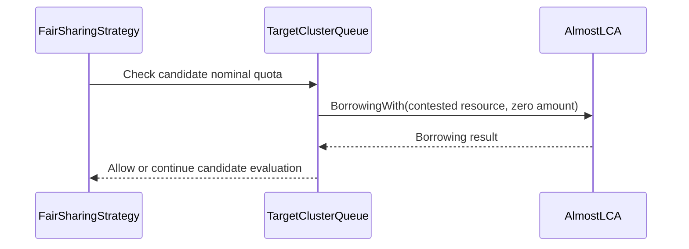

# PR #13307: fix(scheduler): respect cohort nominal quota in fair preemption

**Summary**: fix(scheduler): respect cohort nominal quota in fair preemption

**Sources**: https://github.com/kubernetes-sigs/kueue/pull/13307

**Last updated**: 2026-08-26T22:44:04Z

---

## Metadata

- **State**: open
- **Author**: [@amitaekbote](https://github.com/amitaekbote)
- **Branch**: `fix/fairsharing-cohort-nominal-preemption` → `main`
- **Created**: 2026-07-21T20:40:51Z
- **Updated**: 2026-08-26T22:44:04Z
- **Merged**: —
- **Closed**: —
- **Labels**: `kind/bug`, `size/L`, `needs-rebase`, `ok-to-test`, `do-not-merge/release-note-label-needed`, `cncf-cla: yes`, `area/fair-sharing`
- **Assignees**: [@amy](https://github.com/amy), [@pajakd](https://github.com/pajakd)
- **Requested reviewers**: [@amy](https://github.com/amy), [@tenzen-y](https://github.com/tenzen-y)
- **Changed files**: 4   **+98 / -25**

## Description

#### What type of PR is this?
/kind bug


#### Which issue(s) this PR fixes:

Usage: Fixes https://github.com/kubernetes-sigs/kueue/issues/9466 


<!-- This is an auto-generated comment: release notes by coderabbit.ai -->

## Summary by CodeRabbit

* **Bug Fixes**
  * Improved fair-sharing preemption decisions across multiple resource flavors.
  * Allows eligible workloads to reclaim nominal quota even when aggregate resource usage is high due to borrowing other flavors.
  * Applies nominal-quota checks per preemption candidate for more accurate selection.

* **Tests**
  * Added coverage for nominal-first preemption behavior in multi-flavor queue hierarchies.

<!-- end of auto-generated comment: release notes by coderabbit.ai -->

## Discussion

### Comment by [@kubernetes-prow[bot]](https://github.com/apps/kubernetes-prow) — 2026-07-21T20:40:55Z

Adding the "do-not-merge/release-note-label-needed" label because no release-note block was detected, please follow our [release note process](https://git.k8s.io/community/contributors/guide/release-notes.md) to remove it.

<details>

Instructions for interacting with me using PR comments are available [here](https://git.k8s.io/community/contributors/guide/pull-requests.md).  If you have questions or suggestions related to my behavior, please file an issue against the [kubernetes-sigs/prow](https://github.com/kubernetes-sigs/prow/issues/new?title=Prow%20issue:) repository.
</details>

### Comment by [@netlify[bot]](https://github.com/apps/netlify) — 2026-07-21T20:40:57Z

### <span aria-hidden="true">✅</span> Deploy Preview for *kubernetes-sigs-kueue* canceled.


|  Name | Link |
|:-:|------------------------|
|<span aria-hidden="true">🔨</span> Latest commit | 8dff50628f852b2f9116364def4280b8c595e0d1 |
|<span aria-hidden="true">🔍</span> Latest deploy log | https://app.netlify.com/projects/kubernetes-sigs-kueue/deploys/6a5fe6d71385c1000839ddf9 |

### Comment by [@linux-foundation-easycla[bot]](https://github.com/apps/linux-foundation-easycla) — 2026-07-21T20:41:00Z

<a href="https://easycla.lfx.linuxfoundation.org/#/?version=2"></a><br >The committers listed above are authorized under a signed CLA.<ul><li>:white_check_mark: login: amitaekbote / name: Amita Ekbote (85cf6a95e002e3097fdf576621c2347857a032a4, 8dff50628f852b2f9116364def4280b8c595e0d1)</li></ul>

### Comment by [@kubernetes-prow[bot]](https://github.com/apps/kubernetes-prow) — 2026-07-21T20:41:01Z

Welcome @amitaekbote! <br><br>It looks like this is your first PR to <a href='https://github.com/kubernetes-sigs/kueue'>kubernetes-sigs/kueue</a> 🎉. Please refer to our [pull request process documentation](https://www.kubernetes.dev/docs/guide/pull-requests/) to help your PR have a smooth ride to approval. <br><br>You will be prompted by a bot to use commands during the review process. Do not be afraid to follow the prompts! It is okay to experiment. [Here is the bot commands documentation](https://go.k8s.io/bot-commands). <br><br>You can also check if kubernetes-sigs/kueue has [its own contribution guidelines](https://github.com/kubernetes-sigs/kueue/tree/master/CONTRIBUTING.md). <br><br>You may want to refer to our [testing guide](https://git.k8s.io/community/contributors/devel/sig-testing/testing.md) if you run into trouble with your tests not passing. <br><br>If you are having difficulty getting your pull request seen, please follow the [recommended escalation practices](https://www.kubernetes.dev/docs/guide/pull-requests/#why-is-my-pull-request-not-getting-reviewed). Also, for tips and tricks in the contribution process you may want to read the [Kubernetes contributor cheat sheet](https://www.kubernetes.dev/docs/contributor-cheatsheet/). We want to make sure your contribution gets all the attention it needs! <br><br>Thank you, and welcome to Kubernetes. :smiley:

### Comment by [@kubernetes-prow[bot]](https://github.com/apps/kubernetes-prow) — 2026-07-21T20:41:02Z

Hi @amitaekbote. Thanks for your PR.

I'm waiting for a [kubernetes-sigs](https://github.com/orgs/kubernetes-sigs/people) member to verify that this patch is reasonable to test. If it is, they should reply with `/ok-to-test` on its own line. Until that is done, I will not automatically test new commits in this PR, but the usual testing commands by org members will still work.

Regular contributors should [join the org](https://git.k8s.io/community/community-membership.md#member) to skip this step.

Once the patch is verified, the new status will be reflected by the `ok-to-test` label.

I understand the commands that are listed [here](https://go.k8s.io/bot-commands?repo=kubernetes-sigs%2Fkueue).

<details>

Instructions for interacting with me using PR comments are available [here](https://git.k8s.io/community/contributors/guide/pull-requests.md).  If you have questions or suggestions related to my behavior, please file an issue against the [kubernetes-sigs/prow](https://github.com/kubernetes-sigs/prow/issues/new?title=Prow%20issue:) repository.
</details>

### Comment by [@kubernetes-prow[bot]](https://github.com/apps/kubernetes-prow) — 2026-07-21T20:41:04Z

[APPROVALNOTIFIER] This PR is **NOT APPROVED**

This pull-request has been approved by: *<a href="https://github.com/kubernetes-sigs/kueue/pull/13307#" title="Author self-approved">amitaekbote</a>*
**Once this PR has been reviewed and has the lgtm label**, please assign [mbobrovskyi](https://github.com/mbobrovskyi), [pbundyra](https://github.com/pbundyra), [sohankunkerkar](https://github.com/sohankunkerkar), [tenzen-y](https://github.com/tenzen-y) for approval. For more information see [the Code Review Process](https://git.k8s.io/community/contributors/guide/owners.md#the-code-review-process).

The full list of commands accepted by this bot can be found [here](https://go.k8s.io/bot-commands?repo=kubernetes-sigs%2Fkueue).

<details open>
Needs approval from an approver in each of these files:

- **[OWNERS](https://github.com/kubernetes-sigs/kueue/blob/main/OWNERS)**

Approvers can indicate their approval by writing `/approve` in a comment
Approvers can cancel approval by writing `/approve cancel` in a comment
</details>
<!-- META={"approvers":["mbobrovskyi","pbundyra","sohankunkerkar","tenzen-y"]} -->

### Comment by [@coderabbitai[bot]](https://github.com/apps/coderabbitai) — 2026-07-21T20:41:14Z

<!-- This is an auto-generated comment: summarize by coderabbit.ai -->
<!-- review_stack_entry_start -->

[](https://app.coderabbit.ai/change-stack/kubernetes-sigs/kueue/pull/13307?utm_source=github_walkthrough&utm_medium=github&utm_campaign=change_stack)

<!-- review_stack_entry_end -->
<!-- walkthrough_start -->

<details>
<summary>📝 Walkthrough</summary>

## Walkthrough

Fair-sharing preemption now evaluates nominal quota per candidate subtree and contested resource, replacing a preemptor-wide check. A multi-flavor test covers reclamation when aggregate dominant resource share remains high.

### Changes

**Fair-sharing nominal-first preemption**

|Layer / File(s)|Summary|
|---|---|
|**Nominal quota contract and candidate check** <br> `pkg/scheduler/preemption/fairsharing/least_common_ancestor.go`, `pkg/scheduler/preemption/fairsharing/target.go`|The fair-sharing hierarchy exposes per-resource borrowing checks, and `PreemptorWithinNominal` evaluates all contested resources for a candidate subtree.|
|**Per-candidate preemption flow and validation** <br> `pkg/scheduler/preemption/preemption.go`, `pkg/scheduler/preemption/preemption_fair_test.go`|`runFirstFsStrategy` applies the nominal check per candidate, removes the obsolete helper, and tests multi-flavor nominal-first reclamation.|

**Estimated code review effort:** 3 (Moderate) | ~20 minutes

### Sequence Diagram(s)



**Possibly related PRs**

- [kubernetes-sigs/kueue#11695](https://github.com/kubernetes-sigs/kueue/pull/11695): Updates the FairSharing nominal-first preemption path and related reclamation tests.

**Suggested labels:** `kind/bug`, `release-note`, `area/was`, `wg/workload-aware-scheduling`

**Suggested reviewers:** `kshalot`, `mykysha`, `vladikkuzn`

</details>

<!-- walkthrough_end -->
<!-- pre_merge_checks_walkthrough_start -->

<details>
<summary>🚥 Pre-merge checks | ✅ 5</summary>

<details>
<summary>✅ Passed checks (5 passed)</summary>

|         Check name         | Status   | Explanation                                                                                                  |
| :------------------------: | :------- | :----------------------------------------------------------------------------------------------------------- |
|     Docstring Coverage     | ✅ Passed | No functions found in the changed files to evaluate docstring coverage. Skipping docstring coverage check.   |
|     Linked Issues check    | ✅ Passed | Check skipped because no linked issues were found for this pull request.                                     |
| Out of Scope Changes check | ✅ Passed | Check skipped because no linked issues were found for this pull request.                                     |
|      Description Check     | ✅ Passed | Check skipped - CodeRabbit’s high-level summary is enabled.                                                  |
|         Title check        | ✅ Passed | The title clearly and concisely describes the change to respect cohort nominal quota during fair preemption. |

</details>

</details>

<!-- pre_merge_checks_walkthrough_end -->
<!-- finishing_touch_checkbox_start -->

<details>
<summary>✨ Finishing Touches</summary>

<details>
<summary>🧪 Generate unit tests (beta)</summary>

- [ ] <!-- {"checkboxId": "f47ac10b-58cc-4372-a567-0e02b2c3d479", "radioGroupId": "utg-output-choice-group-unknown_comment_id"} -->   Create PR with unit tests

</details>

</details>

<!-- finishing_touch_checkbox_end -->
<!-- tips_start -->

---

Thanks for using [CodeRabbit](https://coderabbit.ai?utm_source=oss&utm_medium=github&utm_campaign=kubernetes-sigs/kueue&utm_content=13307)! It's free for OSS, and your support helps us grow. If you like it, consider giving us a shout-out.

<details>
<summary>❤️ Share</summary>

- [X](https://twitter.com/intent/tweet?text=I%20just%20used%20%40coderabbitai%20for%20my%20code%20review%2C%20and%20it%27s%20fantastic%21%20It%27s%20free%20for%20OSS%20and%20offers%20a%20free%20trial%20for%20the%20proprietary%20code.%20Check%20it%20out%3A&url=https%3A//coderabbit.ai)
- [Mastodon](https://mastodon.social/share?text=I%20just%20used%20%40coderabbitai%20for%20my%20code%20review%2C%20and%20it%27s%20fantastic%21%20It%27s%20free%20for%20OSS%20and%20offers%20a%20free%20trial%20for%20the%20proprietary%20code.%20Check%20it%20out%3A%20https%3A%2F%2Fcoderabbit.ai)
- [Reddit](https://www.reddit.com/submit?title=Great%20tool%20for%20code%20review%20-%20CodeRabbit&text=I%20just%20used%20CodeRabbit%20for%20my%20code%20review%2C%20and%20it%27s%20fantastic%21%20It%27s%20free%20for%20OSS%20and%20offers%20a%20free%20trial%20for%20proprietary%20code.%20Check%20it%20out%3A%20https%3A//coderabbit.ai)
- [LinkedIn](https://www.linkedin.com/sharing/share-offsite/?url=https%3A%2F%2Fcoderabbit.ai&mini=true&title=Great%20tool%20for%20code%20review%20-%20CodeRabbit&summary=I%20just%20used%20CodeRabbit%20for%20my%20code%20review%2C%20and%20it%27s%20fantastic%21%20It%27s%20free%20for%20OSS%20and%20offers%20a%20free%20trial%20for%20proprietary%20code)

</details>


<sub>Comment `@coderabbitai help` to get the list of available commands.</sub>

<!-- tips_end -->

### Comment by [@amitaekbote](https://github.com/amitaekbote) — 2026-07-21T20:43:34Z

/hold 

checking tests etc. WIP, early comments welcome

### Comment by [@amy](https://github.com/amy) — 2026-07-21T20:46:56Z

/ok-to-test

### Comment by [@mukund-wayve](https://github.com/mukund-wayve) — 2026-07-24T11:06:07Z

@amitaekbote Thanks for raising this! Is this still WIP?

### Comment by [@mimowo](https://github.com/mimowo) — 2026-08-03T19:25:50Z

/kind bug
/area fair-sharing

### Comment by [@amitaekbote](https://github.com/amitaekbote) — 2026-08-03T20:26:27Z

/hold cancel

### Comment by [@mimowo](https://github.com/mimowo) — 2026-08-03T20:29:58Z

/assign @pajakd 
ptal

### Comment by [@mimowo](https://github.com/mimowo) — 2026-08-03T20:30:17Z

@amitaekbote please add release note

### Comment by [@amy](https://github.com/amy) — 2026-08-03T20:34:00Z

/assign

### Comment by [@amy](https://github.com/amy) — 2026-08-11T17:25:32Z

@pajakd could you review this one? Want it unblocked. I would but picking up other ones to review, so I'll be slow.
cc/ @mimowo

### Comment by [@amy](https://github.com/amy) — 2026-08-11T17:50:21Z

also cc/ @kshalot

### Comment by [@tenzen-y](https://github.com/tenzen-y) — 2026-08-15T12:32:28Z

Landing here, I am taking over review and approval.

### Comment by [@kubernetes-prow[bot]](https://github.com/apps/kubernetes-prow) — 2026-08-26T22:41:53Z

@amitaekbote: The following tests **failed**, say `/retest` to rerun all failed tests or `/retest-required` to rerun all mandatory failed tests:

Test name | Commit | Details | Required | Rerun command
--- | --- | --- | --- | ---
pull-kueue-test-e2e-extended-shard-2-main-1-37 | 8dff50628f852b2f9116364def4280b8c595e0d1 | [link](https://prow.k8s.io/view/gs/kubernetes-ci-logs/pr-logs/pull/kubernetes-sigs_kueue/13307/pull-kueue-test-e2e-extended-shard-2-main-1-37/2092744298406612992) | true | `/test pull-kueue-test-e2e-extended-shard-2-main-1-37`
pull-kueue-test-e2e-extended-shard-1-main-1-37 | 8dff50628f852b2f9116364def4280b8c595e0d1 | [link](https://prow.k8s.io/view/gs/kubernetes-ci-logs/pr-logs/pull/kubernetes-sigs_kueue/13307/pull-kueue-test-e2e-extended-shard-1-main-1-37/2092744298209480704) | true | `/test pull-kueue-test-e2e-extended-shard-1-main-1-37`
pull-kueue-test-e2e-extended-shard-0-main-1-37 | 8dff50628f852b2f9116364def4280b8c595e0d1 | [link](https://prow.k8s.io/view/gs/kubernetes-ci-logs/pr-logs/pull/kubernetes-sigs_kueue/13307/pull-kueue-test-e2e-extended-shard-0-main-1-37/2092744298113011712) | true | `/test pull-kueue-test-e2e-extended-shard-0-main-1-37`
pull-kueue-test-e2e-baseline-main-1-37 | 8dff50628f852b2f9116364def4280b8c595e0d1 | [link](https://prow.k8s.io/view/gs/kubernetes-ci-logs/pr-logs/pull/kubernetes-sigs_kueue/13307/pull-kueue-test-e2e-baseline-main-1-37/2092744298012348416) | true | `/test pull-kueue-test-e2e-baseline-main-1-37`

[Full PR test history](https://prow.k8s.io/pr-history?org=kubernetes-sigs&repo=kueue&pr=13307). [Your PR dashboard](https://prow.k8s.io/pr?query=is%3Apr%20state%3Aopen%20author%3Aamitaekbote). Please help us cut down on flakes by [linking to](https://git.k8s.io/community/contributors/devel/sig-testing/flaky-tests.md#filing-issues-for-flaky-tests) an [open issue](https://github.com/kubernetes-sigs/kueue/issues?q=is:issue+is:open) when you hit one in your PR.

<details>

Instructions for interacting with me using PR comments are available [here](https://git.k8s.io/community/contributors/guide/pull-requests.md).  If you have questions or suggestions related to my behavior, please file an issue against the [kubernetes-sigs/prow](https://github.com/kubernetes-sigs/prow/issues/new?title=Prow%20issue:) repository. I understand the commands that are listed [here](https://go.k8s.io/bot-commands).
</details>
<!-- test report -->

### Comment by [@kubernetes-prow[bot]](https://github.com/apps/kubernetes-prow) — 2026-08-26T22:43:23Z

PR needs rebase.

<details>

Instructions for interacting with me using PR comments are available [here](https://git.k8s.io/community/contributors/guide/pull-requests.md).  If you have questions or suggestions related to my behavior, please file an issue against the [kubernetes-sigs/prow](https://github.com/kubernetes-sigs/prow/issues/new?title=Prow%20issue:) repository.
</details>

### Comment by [@kubernetes-prow[bot]](https://github.com/apps/kubernetes-prow) — 2026-08-26T22:43:53Z

PR needs rebase.

<details>

Instructions for interacting with me using PR comments are available [here](https://git.k8s.io/community/contributors/guide/pull-requests.md).  If you have questions or suggestions related to my behavior, please file an issue against the [kubernetes-sigs/prow](https://github.com/kubernetes-sigs/prow/issues/new?title=Prow%20issue:) repository.
</details>

### Comment by [@kubernetes-prow[bot]](https://github.com/apps/kubernetes-prow) — 2026-08-26T22:44:04Z

PR needs rebase.

<details>

Instructions for interacting with me using PR comments are available [here](https://git.k8s.io/community/contributors/guide/pull-requests.md).  If you have questions or suggestions related to my behavior, please file an issue against the [kubernetes-sigs/prow](https://github.com/kubernetes-sigs/prow/issues/new?title=Prow%20issue:) repository.
</details>

## Reviews

### Review by [@pajakd](https://github.com/pajakd) (commented) — 2026-08-26T08:23:14Z

- **pkg/scheduler/preemption/fairsharing/target.go:68** by [@pajakd](https://github.com/pajakd) — 2026-08-26T08:23:14Z
```diff
@@ -55,6 +58,20 @@ func (t *TargetClusterQueue) ComputeShares() (PreemptorNewShare, TargetOldShare)
 	return PreemptorNewShare(preemptorAlmostLCA.DominantResourceShare()), TargetOldShare(targetAlmostLCA.DominantResourceShare())
 }
 
+// PreemptorWithinNominal reports whether the preemptor's subtree at the
+// candidate target's least-common-ancestor boundary stays within nominal
+// quota for every contested flavor-resource. The incoming workload must
+// already be simulated before calling this method.
+func (t *TargetClusterQueue) PreemptorWithinNominal(frs sets.Set[resources.FlavorResource]) bool {
+	preemptorAlmostLCA, _ := getAlmostLCAs(t)
+	for fr := range frs {
+		if preemptorAlmostLCA.BorrowingWith(fr, resources.NewAmount(0)) {
```

  I'm very sorry for the delay in my response. This is definitely a good approach. Especially looking at your unit test. But, we have to make sure that preemption is consistent with scheduling. In #9484 there was also a change in fair_sharing_iterator.go and we probably need something similar here. Otherwise we risk the situation where a preemption will succeed but then in one of the next cycles, the preemptee will be scheduled instead of the preemptor.
  
  To validate the change better, we will also need an integration test for this PR.
