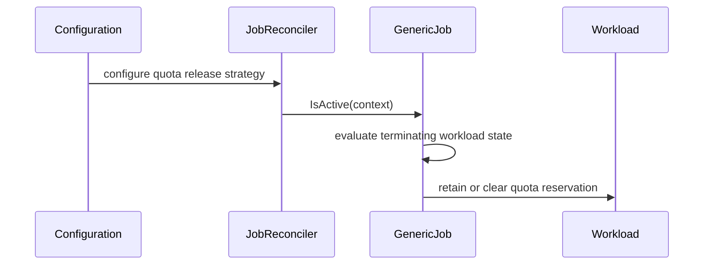

# PR #13308: KEP-10076: Implement Quota Release Strategy

**Summary**: KEP-10076: Implement Quota Release Strategy

**Sources**: https://github.com/kubernetes-sigs/kueue/pull/13308

**Last updated**: 2026-10-01T15:16:56Z

---

## Metadata

- **State**: open
- **Author**: [@vic-comm](https://github.com/vic-comm)
- **Branch**: `impl/quota-release-wiring` → `main`
- **Created**: 2026-07-21T20:42:43Z
- **Updated**: 2026-10-01T15:16:56Z
- **Merged**: —
- **Closed**: —
- **Labels**: `kind/feature`, `release-note`, `size/XL`, `approved`, `ok-to-test`, `cncf-cla: yes`, `area/integrations`
- **Assignees**: [@kannon92](https://github.com/kannon92), [@mimowo](https://github.com/mimowo)
- **Requested reviewers**: [@kannon92](https://github.com/kannon92), [@mimowo](https://github.com/mimowo), [@mbobrovskyi](https://github.com/mbobrovskyi), [@PBundyra](https://github.com/PBundyra)
- **Changed files**: 20   **+719 / -39**

## Description

<!--  Thanks for sending a pull request!  Here are some tips for you:

1. If this is your first time, please read our contributor guidelines: https://git.k8s.io/community/contributors/guide/first-contribution.md#your-first-contribution and developer guide https://git.k8s.io/community/contributors/devel/development.md#development-guide
2. Please label this pull request according to what type of issue you are addressing, especially if this is a release targeted pull request. For reference on required PR/issue labels, read here:
https://git.k8s.io/community/contributors/devel/sig-release/release.md#issuepr-kind-label
3. Ensure you have added or ran the appropriate tests for your PR: https://git.k8s.io/community/contributors/devel/sig-testing/testing.md
4. If you want *faster* PR reviews, read how: https://git.k8s.io/community/contributors/guide/pull-requests.md#best-practices-for-faster-reviews
5. If the PR is unfinished, see how to mark it: https://git.k8s.io/community/contributors/guide/pull-requests.md#marking-unfinished-pull-requests
-->

#### What type of PR is this?

/kind feature

#### What this PR does / why we need it:

Implements the core logic and framework wiring for `QuotaReleaseStrategy`, building upon the API foundation introduced in the previous PR for KEP-6143. 

This PR ensures that all 11 Kueue Job integrations respect the cluster-wide `.scheduling.quotaReleaseStrategy` when determining if a preempted or terminating job is still actively holding quota.

Specifically, this PR:
- Refactors the `GenericJob` interface so that `IsActive(ctx)` accepts a context.
- Updates the central `JobReconciler` to read the configured `QuotaReleaseStrategy` and inject it into the context during reconciliation.
- Modifies the `IsActive` implementations across all framework integrations (e.g., Pod, batch/Job, Ray, MPI) to evaluate `OnTermination` (fast release) vs `OnTerminalBestEffort` (hold quota until full termination).
- Adds unit tests and a new integration test suite (`job_controller_quota_release_test.go`) to verify the new behavior.

#### Which issue(s) this PR fixes:

Part of #13163

#### Special notes for your reviewer:

This is the next PR in the series implementing KEP-6143. It wires the configuration to the Job framework and updates the integration controllers to fulfill the new quota accounting behavior. The full implementation series is tracked on the KEP PR (#13163).


#### Does this PR introduce a user-facing change?

```release-note
Kueue's core job framework and framework integrations (Job, Pod, RayJob, etc.) now actively respect the `scheduling.quotaReleaseStrategy` configuration, successfully holding quota during preemption when configured with `OnTerminalBestEffort`.
```

<!-- This is an auto-generated comment: release notes by coderabbit.ai -->
## Summary by CodeRabbit

* **New Features**
  * Added `scheduling.quotaReleaseStrategy` to configuration (v1beta1 and v1beta2) to control when quota is released for terminating workloads.
  * Supports `OnTermination` (default) and `OnTerminalBestEffort`.
* **Bug Fixes**
  * Terminating-workload quota reservation now follows the selected strategy, including keeping quota until pods reach terminal states when configured.
* **Documentation**
  * Updated the configuration reference docs with the new `scheduling` options and valid values.
* **Validation**
  * Added config validation to reject unsupported `quotaReleaseStrategy` values.
<!-- end of auto-generated comment: release notes by coderabbit.ai -->

## Discussion

### Comment by [@kubernetes-prow[bot]](https://github.com/apps/kubernetes-prow) — 2026-07-21T20:42:54Z

Hi @vic-comm. Thanks for your PR.

I'm waiting for a [kubernetes-sigs](https://github.com/orgs/kubernetes-sigs/people) member to verify that this patch is reasonable to test. If it is, they should reply with `/ok-to-test` on its own line. Until that is done, I will not automatically test new commits in this PR, but the usual testing commands by org members will still work.

>[!TIP]
>**We noticed you've done this a few times! Consider [joining the org](https://git.k8s.io/community/community-membership.md#member) to skip this step and gain `/lgtm` and other bot rights.** We recommend asking approvers on your previous PRs to sponsor you.

Once the patch is verified, the new status will be reflected by the `ok-to-test` label.

I understand the commands that are listed [here](https://go.k8s.io/bot-commands?repo=kubernetes-sigs%2Fkueue).

<details>

Instructions for interacting with me using PR comments are available [here](https://git.k8s.io/community/contributors/guide/pull-requests.md).  If you have questions or suggestions related to my behavior, please file an issue against the [kubernetes-sigs/prow](https://github.com/kubernetes-sigs/prow/issues/new?title=Prow%20issue:) repository.
</details>

### Comment by [@netlify[bot]](https://github.com/apps/netlify) — 2026-07-21T20:42:54Z

### <span aria-hidden="true">✅</span> Deploy Preview for *kubernetes-sigs-kueue* ready!


|  Name | Link |
|:-:|------------------------|
|<span aria-hidden="true">🔨</span> Latest commit | a7d6fbd248ff0df4165ce79eb144dd6171c80369 |
|<span aria-hidden="true">🔍</span> Latest deploy log | https://app.netlify.com/projects/kubernetes-sigs-kueue/deploys/6abd617bd23b2c0008f4e9ec |
|<span aria-hidden="true">😎</span> Deploy Preview | [https://deploy-preview-13308--kubernetes-sigs-kueue.netlify.app](https://deploy-preview-13308--kubernetes-sigs-kueue.netlify.app) |
|<span aria-hidden="true">📱</span> Preview on mobile | <details><summary> Toggle QR Code... </summary><br /><br /><br /><br />_Use your smartphone camera to open QR code link._</details> |
---
<!-- [kubernetes-sigs-kueue Preview](https://deploy-preview-13308--kubernetes-sigs-kueue.netlify.app) -->
_To edit notification comments on pull requests, go to your [Netlify project configuration](https://app.netlify.com/projects/kubernetes-sigs-kueue/configuration/notifications#deploy-notifications)._

### Comment by [@coderabbitai[bot]](https://github.com/apps/coderabbitai) — 2026-07-21T20:43:08Z

<!-- This is an auto-generated comment: summarize by coderabbit.ai -->
<!-- review_stack_entry_start -->

[](https://app.coderabbit.ai/change-stack/kubernetes-sigs/kueue/pull/13308?utm_source=github_walkthrough&utm_medium=github&utm_campaign=change_stack)

<!-- review_stack_entry_end -->
<!-- This is an auto-generated comment: review paused by coderabbit.ai -->

> [!NOTE]
> ## Reviews paused
> 
> It looks like this branch is under active development. To avoid overwhelming you with review comments due to an influx of new commits, CodeRabbit has automatically paused this review. You can configure this behavior by changing the `reviews.auto_review.auto_pause_after_reviewed_commits` setting.
> 
> Use the following commands to manage reviews:
> - `@coderabbitai resume` to resume automatic reviews.
> - `@coderabbitai review` to trigger a single review.
> 
> Use the checkboxes below for quick actions:
> - [ ] <!-- {"checkboxId": "7f6cc2e2-2e4e-497a-8c31-c9e4573e93d1"} --> ▶️ Resume reviews
> - [ ] <!-- {"checkboxId": "e9bb8d72-00e8-4f67-9cb2-caf3b22574fe"} --> 🔍 Trigger review

<!-- end of auto-generated comment: review paused by coderabbit.ai -->
<!-- walkthrough_start -->

<details>
<summary>📝 Walkthrough</summary>

## Walkthrough

The PR adds configurable quota release strategies to both configuration API versions, defaults them to `OnTermination`, propagates the strategy through reconciliation contexts, updates job activity checks, and adds validation, documentation, unit, and integration coverage.

### Changes

**Quota release configuration**

|Layer / File(s)|Summary|
|---|---|
|**Configuration contract and defaults** <br> `apis/config/v1beta1/...`, `apis/config/v1beta2/...`, `pkg/config/...`, `site/content/en/docs/reference/...`|Adds scheduling quota-release APIs, defaults and validates supported strategies, updates configuration expectations, and documents the schema.|

**Context-aware reconciliation**

|Layer / File(s)|Summary|
|---|---|
|**Reconciler strategy propagation** <br> `pkg/controller/jobframework/...`, `internal/mocks/controller/jobframework/interface.go`|Updates `GenericJob.IsActive` to accept context, adds context helpers, configures reconciler options, and injects the selected strategy before activity checks.|

**Job activity behavior**

|Layer / File(s)|Summary|
|---|---|
|**Integration activity checks** <br> `pkg/controller/jobs/*`|Updates job implementations to the context-aware contract; Jobs and Pods apply the configured strategy to terminating workloads.|
|**Activity tests** <br> `pkg/controller/jobs/.../*_test.go`|Adds strategy-specific Job coverage and updates Pod, RayService, and reconciler tests to pass contexts.|

**Integration validation**

|Layer / File(s)|Summary|
|---|---|
|**Terminal best-effort quota release scenario** <br> `test/integration/singlecluster/controller/jobs/job/...`|Verifies quota remains reserved while pods terminate under `OnTerminalBestEffort` and is released after termination completes.|

**Estimated code review effort:** 4 (Complex) | ~60 minutes

### Sequence Diagram(s)



**Possibly related PRs**

- [kubernetes-sigs/kueue#12659](https://github.com/kubernetes-sigs/kueue/pull/12659): Both modify eviction handling in `ReconcileGenericJob`.
- [kubernetes-sigs/kueue#13019](https://github.com/kubernetes-sigs/kueue/pull/13019): Both modify quota-release handling in `ReconcileGenericJob`.
- [kubernetes-sigs/kueue#13224](https://github.com/kubernetes-sigs/kueue/pull/13224): Both add scheduling quota release configuration APIs.

**Suggested labels:** `kind/api-change`, `area/integrations`

**Suggested reviewers:** `mimowo`, `olekzabl`, `pbundyra`, `mbobrovskyi`

</details>

<!-- walkthrough_end -->
<!-- pre_merge_checks_walkthrough_start -->

<details>
<summary>🚥 Pre-merge checks | ✅ 3 | ❌ 2</summary>

### ❌ Failed checks (1 warning, 1 inconclusive)

|     Check name     | Status         | Explanation                                                                                                           | Resolution                                                                                        |
| :----------------: | :------------- | :-------------------------------------------------------------------------------------------------------------------- | :------------------------------------------------------------------------------------------------ |
| Docstring Coverage | ⚠️ Warning     | Docstring coverage is 8.70% which is insufficient. The required threshold is 80.00%.                                  | Write docstrings for the functions missing them to satisfy the coverage threshold.                |
|     Title check    | ❓ Inconclusive | The title is related to the change, but "Impl/quota release wiring" is too vague to clearly describe the main update. | Rename it to something specific, like "Add quota release strategy wiring for job reconciliation". |

<details>
<summary>✅ Passed checks (3 passed)</summary>

|         Check name         | Status   | Explanation                                                              |
| :------------------------: | :------- | :----------------------------------------------------------------------- |
|      Description Check     | ✅ Passed | Check skipped - CodeRabbit’s high-level summary is enabled.              |
|     Linked Issues check    | ✅ Passed | Check skipped because no linked issues were found for this pull request. |
| Out of Scope Changes check | ✅ Passed | Check skipped because no linked issues were found for this pull request. |

</details>

</details>

<!-- pre_merge_checks_walkthrough_end -->
<!-- finishing_touch_checkbox_start -->

<details>
<summary>✨ Finishing Touches</summary>

<details>
<summary>🧪 Generate unit tests (beta)</summary>

- [ ] <!-- {"checkboxId": "f47ac10b-58cc-4372-a567-0e02b2c3d479", "radioGroupId": "utg-output-choice-group-unknown_comment_id"} -->   Create PR with unit tests

</details>

</details>

<!-- finishing_touch_checkbox_end -->
<!-- tips_start -->

---


<sub>Comment `@coderabbitai help` to get the list of available commands.</sub>

<!-- tips_end -->

### Comment by [@mimowo](https://github.com/mimowo) — 2026-07-21T20:47:03Z

/ok-to-test

### Comment by [@vic-comm](https://github.com/vic-comm) — 2026-07-22T16:38:12Z

@mimowo kindly review, thank you.

### Comment by [@mimowo](https://github.com/mimowo) — 2026-08-03T20:15:29Z

/area integrations

### Comment by [@kannon92](https://github.com/kannon92) — 2026-08-14T03:01:42Z

Please fix the rebase.

### Comment by [@kannon92](https://github.com/kannon92) — 2026-08-14T03:01:51Z

/assign

### Comment by [@vic-comm](https://github.com/vic-comm) — 2026-08-15T21:32:45Z

/retest

### Comment by [@vic-comm](https://github.com/vic-comm) — 2026-08-29T15:35:07Z

/retest

### Comment by [@tenzen-y](https://github.com/tenzen-y) — 2026-09-01T05:33:56Z

@vic-comm can you rebase this PR onto the main branch?

### Comment by [@vic-comm](https://github.com/vic-comm) — 2026-09-01T09:03:22Z

> @vic-comm can you rebase this PR onto the main branch?

Done

### Comment by [@mimowo](https://github.com/mimowo) — 2026-09-16T20:59:20Z

@vic-comm please refresh the impl

### Comment by [@tenzen-y](https://github.com/tenzen-y) — 2026-09-16T23:23:01Z

/retitle KEP-10076: Implement Quota Release Strategy

### Comment by [@vic-comm](https://github.com/vic-comm) — 2026-09-17T18:31:46Z

> @vic-comm please refresh the impl

i'm working on it

### Comment by [@tenzen-y](https://github.com/tenzen-y) — 2026-09-19T00:44:06Z

@vic-comm please let me know once this pr is ready

### Comment by [@vic-comm](https://github.com/vic-comm) — 2026-09-19T09:32:53Z

> @vic-comm please let me know once this pr is ready

@tenzen-y , apologies for the delay, kindly review. Thanks.

### Comment by [@tenzen-y](https://github.com/tenzen-y) — 2026-09-19T16:56:49Z

> > @vic-comm please let me know once this pr is ready
> 
> @tenzen-y , apologies for the delay, kindly review. Thanks.

ack

### Comment by [@tenzen-y](https://github.com/tenzen-y) — 2026-09-23T02:35:21Z

@vic-comm can you rebase this PR onto the main branch?

### Comment by [@vic-comm](https://github.com/vic-comm) — 2026-09-23T09:55:36Z

> @vic-comm can you rebase this PR onto the main branch?

Done, thanks

### Comment by [@tenzen-y](https://github.com/tenzen-y) — 2026-09-24T20:47:46Z

I will give the first pass to this PR on Friday

### Comment by [@vic-comm](https://github.com/vic-comm) — 2026-09-24T21:01:15Z

> I will give the first pass to this PR on Friday

Noted, thank you.

### Comment by [@mimowo](https://github.com/mimowo) — 2026-09-25T06:59:50Z

@vic-comm it needs a rebase again

### Comment by [@mimowo](https://github.com/mimowo) — 2026-09-28T11:38:29Z

LGTM overall, but the knob should be moved per integration as planned in the KEP: https://github.com/kubernetes-sigs/kueue/pull/13308#discussion_r4104904872

### Comment by [@tenzen-y](https://github.com/tenzen-y) — 2026-09-28T15:50:35Z

@vic-comm It would be great to address https://github.com/kubernetes-sigs/kueue/pull/13308#discussion_r4104904872 today since tomorrow is our release date.
Otherwise, we have to slip this enhancement in this release cycle and postpone it to v0.21.

### Comment by [@tenzen-y](https://github.com/tenzen-y) — 2026-09-28T17:25:07Z

@vic-comm CI is still failing

### Comment by [@vic-comm](https://github.com/vic-comm) — 2026-09-28T17:57:57Z

/retest

### Comment by [@vic-comm](https://github.com/vic-comm) — 2026-09-28T18:59:52Z

> @vic-comm CI is still failing

Fixed, kindly review, thanks for your patience

### Comment by [@mimowo](https://github.com/mimowo) — 2026-09-29T11:30:02Z

/unhold
As the PR is using new API already

### Comment by [@mimowo](https://github.com/mimowo) — 2026-09-29T11:30:35Z

@vic-comm do you have cycles to address the remaining comments?

### Comment by [@vic-comm](https://github.com/vic-comm) — 2026-09-29T11:39:30Z

> @vic-comm do you have cycles to address the remaining comments?

I'm working on them

### Comment by [@mimowo](https://github.com/mimowo) — 2026-09-29T12:08:17Z

would you like to squash the commits? The PR has a long history so I think rebasing might be a pain. Feel free to squash.

### Comment by [@vic-comm](https://github.com/vic-comm) — 2026-09-29T13:01:09Z

> would you like to squash the commits? The PR has a long history so I think rebasing might be a pain. Feel free to squash.

Done, rebased on top of the latest main and squashed the history into a single clean commit with all review feedback addressed.

### Comment by [@kubernetes-prow[bot]](https://github.com/apps/kubernetes-prow) — 2026-09-29T13:39:52Z

[APPROVALNOTIFIER] This PR is **APPROVED**

This pull-request has been approved by: *<a href="https://github.com/kubernetes-sigs/kueue/pull/13308#pullrequestreview-5353408353" title="Approved">mimowo</a>*, *<a href="https://github.com/kubernetes-sigs/kueue/pull/13308#" title="Author self-approved">vic-comm</a>*

The full list of commands accepted by this bot can be found [here](https://go.k8s.io/bot-commands?repo=kubernetes-sigs%2Fkueue).

The pull request process is described [here](https://git.k8s.io/community/contributors/guide/owners.md#the-code-review-process)

<details >
Needs approval from an approver in each of these files:

- ~~[OWNERS](https://github.com/kubernetes-sigs/kueue/blob/main/OWNERS)~~ [mimowo]

Approvers can indicate their approval by writing `/approve` in a comment
Approvers can cancel approval by writing `/approve cancel` in a comment
</details>
<!-- META={"approvers":[]} -->

### Comment by [@tenzen-y](https://github.com/tenzen-y) — 2026-09-29T19:05:32Z

@mimowo I saw [your comment](https://github.com/kubernetes-sigs/kueue/pull/13308#discussion_r4102105146) to exclude Job integration from this PR. Does that indicate that the batch/v1 Job is out of scope in the Quota Release Strategy? Do you see any problem?

Related to https://github.com/kubernetes-sigs/kueue/pull/13308#discussion_r4126375028

### Comment by [@mimowo](https://github.com/mimowo) — 2026-09-29T19:14:19Z

> @mimowo I saw your comment to exclude Job integration from this PR. Does that indicate that the batch/v1 Job is out of scope in the Quota Release Strategy? Do you see any problem?

I don't see any fundamental problem - the only problem is time. 

It seems we would need to pump the parameter and I'm not sure this can be reliably delivered before release. Thus I proposed narrowing down the scope and relaxing validation in a follow up, say v0.21.

### Comment by [@tenzen-y](https://github.com/tenzen-y) — 2026-09-29T19:16:17Z

> > @mimowo I saw your comment to exclude Job integration from this PR. Does that indicate that the batch/v1 Job is out of scope in the Quota Release Strategy? Do you see any problem?
> 
> 
> 
> I don't see any fundamental problem - the only problem is time. 
> 
> 
> 
> It seems we would need to pump the parameter and I'm not sure this can be reliably delivered before release. Thus I proposed narrowing down the scope and relaxing validation in a follow up, say v0.21.

SGTM. Let’s introduce other integrations as a second alpha in v0.21.

### Comment by [@mimowo](https://github.com/mimowo) — 2026-09-30T06:48:17Z

@vic-comm this requires a rebase

### Comment by [@mimowo](https://github.com/mimowo) — 2026-09-30T09:13:04Z

@tenzen-y @vic-comm I propose to move it for v0.21 with increased scope, and with covering for the OnTerminatingPodsBeyondGracePeriod case which is the current default for Pod integration actually: https://github.com/kubernetes-sigs/kueue/pull/13308#discussion_r4135633051

### Comment by [@vic-comm](https://github.com/vic-comm) — 2026-09-30T10:24:07Z

> @tenzen-y @vic-comm I propose to move it for v0.21 with increased scope, and with covering for the OnTerminatingPodsBeyondGracePeriod case which is the current default for Pod integration actually: [#13308 (comment)](https://github.com/kubernetes-sigs/kueue/pull/13308#discussion_r4135633051)

Noted, moving to v0.21 will give us the space to update KEP-10076 to cleanly formalize the three release behaviors:

OnQuotaReleased (immediate release upon deletion initiation)
OnTerminal (strict hold until terminal Succeeded/Failed phase)
OnTerminatingPodsBeyondGracePeriod (hold while terminating, release if grace period expires — current Pod default) Regarding the expanded scope: should we plan runtime implementation for both pod and batch/job in v0.21, or are there other frameworks you'd like covered under this strategy matrix as well?

### Comment by [@mimowo](https://github.com/mimowo) — 2026-09-30T10:26:51Z

> Regarding the expanded scope: should we plan runtime implementation for both pod and batch/job in v0.21, or are there other frameworks you'd like covered under this strategy matrix as well?

I think it might be challanging for other frameworks for support OnTerminal. Let's revisit during KEP update.

### Comment by [@tenzen-y](https://github.com/tenzen-y) — 2026-09-30T13:26:49Z

> @tenzen-y @vic-comm I propose to move it for v0.21 with increased scope, and with covering for the OnTerminatingPodsBeyondGracePeriod case which is the current default for Pod integration actually: [#13308 (comment)](https://github.com/kubernetes-sigs/kueue/pull/13308#discussion_r4135633051)

I was not sure what OnTerminatingPodsBeyondGracePeriod exactly means, but we can discuss that in the next release cycle.

Anyway, we have already frozen the main branch. So, +1 on holding this PR in this release cycle.

### Comment by [@vic-comm](https://github.com/vic-comm) — 2026-10-01T14:26:21Z

> > @tenzen-y @vic-comm I propose to move it for v0.21 with increased scope, and with covering for the OnTerminatingPodsBeyondGracePeriod case which is the current default for Pod integration actually: [#13308 (comment)](https://github.com/kubernetes-sigs/kueue/pull/13308#discussion_r4135633051)
> 
> I was not sure what OnTerminatingPodsBeyondGracePeriod exactly means, but we can discuss that in the next release cycle.
> 
> Anyway, we have already frozen the main branch. So, +1 on holding this PR in this release cycle.

IIUC what i implemented now as OnTerminal is best described as OnTerminatingPodsBeyondGracePeriod since it has a waiting period before returning false, a correct implementation of OnTerminal should only return false (the isActive function) when in a succeeded or failed state

### Comment by [@vic-comm](https://github.com/vic-comm) — 2026-10-01T14:41:32Z

@mimowo @tenzen-y When updating the KEP for v0.21, how would you prefer we structure the API schema?

1. **A 3-value enum** for `QuotaReleaseStrategy`:
   - `OnQuotaReleased`
   - `OnTerminal`
   - `OnTerminatingPodsBeyondGracePeriod`
2. **A 2-value enum** (`OnQuotaReleased`, `OnTerminal`) paired with an optional timeout setting on `FrameworkConfig` (e.g., an explicit timeout/duration beyond grace period before releasing)?

Curious about your preference before we draft the KEP changes.

### Comment by [@vic-comm](https://github.com/vic-comm) — 2026-10-01T15:16:56Z

Apologies for the delayed turnaround on the earlier review round and misimplementations that caused us to miss the v0.20 cut. I'm ready for another pass whenever you have bandwidth for the v0.21 cycle. Thank you.

## Reviews

### Review by [@coderabbitai[bot]](https://github.com/apps/coderabbitai) (commented) — 2026-07-21T20:48:35Z

**Actionable comments posted: 4**

<details>
<summary>🧹 Nitpick comments (1)</summary><blockquote>

<details>
<summary>pkg/controller/jobframework/reconciler_test.go (1)</summary><blockquote>

`451-451`: _📐 Maintainability & Code Quality_ | _🔵 Trivial_ | _⚡ Quick win_

**Assert the propagated strategy, not merely a context.**

`gomock.Any()` permits a missing or incorrect strategy. Add scenarios using both configured strategies and make `IsActive` inspect `GetQuotaReleaseStrategy(ctx)`; include the no-option default path.


As per path instructions, “Verify that new controller behavior has corresponding unit and integration tests.”


Also applies to: 1185-1185

<details>
<summary>🤖 Prompt for AI Agents</summary>

```
Verify each finding against current code. Fix only still-valid issues, skip the
rest with a brief reason, keep changes minimal, and validate.

In `@pkg/controller/jobframework/reconciler_test.go` at line 451, Update the
IsActive expectations in the reconciler tests to inspect
GetQuotaReleaseStrategy(ctx) and assert the propagated configured strategy
instead of accepting gomock.Any(). Add scenarios for both supported configured
strategies and the no-option default path, preserving the existing active-status
return behavior and covering the corresponding controller paths.
```

</details>

<!-- cr-comment:v1:e311456e5d67c129ec0d982c -->

_Source: Path instructions_

</blockquote></details>

</blockquote></details>

<details>
<summary>🤖 Prompt for all review comments with AI agents</summary>

```
Verify each finding against current code. Fix only still-valid issues, skip the
rest with a brief reason, keep changes minimal, and validate.

Inline comments:
In `@apis/config/v1beta1/configuration_types.go`:
- Around line 283-307: Add explicit enum validation for QuotaReleaseStrategy
using the existing API marker convention in
apis/config/v1beta1/configuration_types.go (lines 283-307) and
apis/config/v1beta2/configuration_types.go (lines 310-334), allowing only
QuotaReleaseOnTermination and QuotaReleaseOnTerminalBestEffort. Add regression
coverage through the repository’s configuration validation tests to reject
unknown values in both API versions.

In `@pkg/controller/jobframework/constants.go`:
- Around line 36-47: Update GetQuotaReleaseStrategy to validate the retrieved
strategy and return QuotaReleaseOnTermination for missing, incorrectly typed,
empty, or unsupported values; preserve only the two supported
QuotaReleaseStrategy values. Add coverage for missing and invalid context
values, including values stored through ContextWithQuotaReleaseStrategy.

In `@pkg/controller/jobframework/reconciler.go`:
- Line 303: Initialize quotaReleaseStrategy in NewReconciler’s option setup to
QuotaReleaseOnTermination when options.QuotaReleaseStrategy is unset, so
option-less construction preserves GetQuotaReleaseStrategy’s termination
behavior. Keep explicitly configured quota-release strategies unchanged.

In `@test/integration/singlecluster/controller/dra/suite_test.go.patch`:
- Around line 7-11: Remove the unused concurrent shared-write block involving
shared, including the goroutine and parent assignment. If the setup behavior
must remain, synchronize both writes with a channel or sync.WaitGroup before
continuing.

---

Nitpick comments:
In `@pkg/controller/jobframework/reconciler_test.go`:
- Line 451: Update the IsActive expectations in the reconciler tests to inspect
GetQuotaReleaseStrategy(ctx) and assert the propagated configured strategy
instead of accepting gomock.Any(). Add scenarios for both supported configured
strategies and the no-option default path, preserving the existing active-status
return behavior and covering the corresponding controller paths.
```

</details>

<details>
<summary>🪄 Autofix (Beta)</summary>

Fix all unresolved CodeRabbit comments on this PR:

- [ ] <!-- {"checkboxId": "4b0d0e0a-96d7-4f10-b296-3a18ea78f0b9"} --> Push a commit to this branch (recommended)
- [ ] <!-- {"checkboxId": "ff5b1114-7d8c-49e6-8ac1-43f82af23a33"} --> Create a new PR with the fixes

</details>

---

<details>
<summary>ℹ️ Review info</summary>

<details>
<summary>⚙️ Run configuration</summary>

**Configuration used**: Path: .coderabbit.yaml

**Review profile**: CHILL

**Plan**: Pro

**Run ID**: `e4e535ef-173f-4956-9186-d6a50b21f046`

</details>

<details>
<summary>📥 Commits</summary>

Reviewing files that changed from the base of the PR and between 9a7725d2793f698a118389c75914de1f53f4579e and a3fec6de2a0251f551e42418b9566ae37b28d31e.

</details>

<details>
<summary>⛔ Files ignored due to path filters (3)</summary>

* `apis/config/v1beta1/zz_generated.conversion.go` is excluded by `!**/*_generated*.go`, `!**/zz_generated.*.go`
* `apis/config/v1beta1/zz_generated.deepcopy.go` is excluded by `!**/*_generated*.go`, `!**/zz_generated.*.go`
* `apis/config/v1beta2/zz_generated.deepcopy.go` is excluded by `!**/*_generated*.go`, `!**/zz_generated.*.go`

</details>

<details>
<summary>📒 Files selected for processing (30)</summary>

* `apis/config/v1beta1/configuration_types.go`
* `apis/config/v1beta1/defaults.go`
* `apis/config/v1beta1/defaults_test.go`
* `apis/config/v1beta2/configuration_types.go`
* `apis/config/v1beta2/defaults.go`
* `apis/config/v1beta2/defaults_test.go`
* `internal/mocks/controller/jobframework/interface.go`
* `pkg/config/config_test.go`
* `pkg/controller/jobframework/constants.go`
* `pkg/controller/jobframework/interface.go`
* `pkg/controller/jobframework/reconciler.go`
* `pkg/controller/jobframework/reconciler_test.go`
* `pkg/controller/jobs/appwrapper/appwrapper_controller.go`
* `pkg/controller/jobs/job/job_controller.go`
* `pkg/controller/jobs/job/job_controller_test.go`
* `pkg/controller/jobs/jobset/jobset_controller.go`
* `pkg/controller/jobs/kubeflow/kubeflowjob/kubeflowjob_controller.go`
* `pkg/controller/jobs/mpijob/mpijob_controller.go`
* `pkg/controller/jobs/pod/pod_controller.go`
* `pkg/controller/jobs/pod/pod_controller_test.go`
* `pkg/controller/jobs/raycluster/raycluster_controller.go`
* `pkg/controller/jobs/rayjob/rayjob_controller.go`
* `pkg/controller/jobs/rayservice/rayservice_controller.go`
* `pkg/controller/jobs/rayservice/rayservice_controller_test.go`
* `pkg/controller/jobs/sparkapplication/sparkapplication_controller.go`
* `pkg/controller/jobs/trainjob/trainjob_controller.go`
* `site/content/en/docs/reference/kueue-config.v1beta1.md`
* `site/content/en/docs/reference/kueue-config.v1beta2.md`
* `test/integration/singlecluster/controller/dra/suite_test.go.patch`
* `test/integration/singlecluster/controller/jobs/job/job_controller_quota_release_test.go`

</details>

</details>

<!-- This is an auto-generated comment by CodeRabbit for review status -->

- **apis/config/v1beta1/configuration_types.go:307** by [@coderabbitai[bot]](https://github.com/apps/coderabbitai) — 2026-07-21T20:48:34Z
```diff
@@ -272,6 +277,36 @@ type ControllerConfigurationSpec struct {
 	CacheSyncTimeout *time.Duration `json:"cacheSyncTimeout,omitempty"`
 }
 
+// Scheduling defines configuration for the quota release strategy,
+// which controls when Kueue releases quota for terminating workloads.
+type Scheduling struct {
+	// QuotaReleaseStrategy controls when Kueue releases a workload's quota
+	// reservation after the workload begins terminating. Defaults to OnTermination.
+	// +optional
+	QuotaReleaseStrategy *QuotaReleaseStrategy `json:"quotaReleaseStrategy,omitempty"`
+}
+
+// QuotaReleaseStrategy defines when Kueue releases quota for a terminating workload.
+//
+// Valid values are:
+// - "OnTermination" (default): releases quota as soon as all pods have a deletionTimestamp set.
+// - "OnTerminalBestEffort": holds quota until all underlying pods have fully reached a terminal phase (Succeeded or Failed).
+//
+// +enum
+type QuotaReleaseStrategy string
+
+const (
+	// QuotaReleaseOnTermination releases quota as soon as all pods have a
+	// deletionTimestamp set. This is the default and matches the existing
+	// behaviour of the batch/v1 Job integration.
+	QuotaReleaseOnTermination QuotaReleaseStrategy = "OnTermination"
+	// QuotaReleaseOnTerminalBestEffort holds quota until all underlying pods
+	// have fully reached a terminal phase (Succeeded or Failed). This prevents
+	// scheduling failures for TopologyAwareScheduling (TAS) workloads where new
+	// pods cannot be placed until old pods physically release the hardware.
+	QuotaReleaseOnTerminalBestEffort QuotaReleaseStrategy = "OnTerminalBestEffort"
```

  _🎯 Functional Correctness_ | _🟡 Minor_ | _⚡ Quick win_
  
  <details>
  <summary>🧩 Analysis chain</summary>
  
  🏁 Script executed:
  
  ```shell
  #!/bin/bash
  rg -n -C2 'QuotaReleaseStrategy|kubebuilder:validation:Enum|func Validate|Validate.*Configuration' \
    apis pkg test
  ```
  
  Repository: kubernetes-sigs/kueue
  
  Length of output: 50377
  
  ---
  
  🏁 Script executed:
  
  ```shell
  #!/bin/bash
  set -euo pipefail
  
  printf '\n== relevant type definitions ==\n'
  sed -n '280,340p' apis/config/v1beta1/configuration_types.go
  printf '\n---\n'
  sed -n '306,346p' apis/config/v1beta2/configuration_types.go
  
  printf '\n== validation/defaulting path ==\n'
  sed -n '1,220p' apis/config/v1beta1/defaults.go
  printf '\n---\n'
  sed -n '1,220p' apis/config/v1beta2/defaults.go
  
  printf '\n== search for explicit validation of quota release strategy ==\n'
  rg -n -C2 'QuotaReleaseStrategy|OnTerminalBestEffort|OnTermination|validation:Enum|Validate.*Configuration|defaulting' apis/config pkg test config .github --glob '!**/zz_generated*'
  ```
  
  Repository: kubernetes-sigs/kueue
  
  Length of output: 50377
  
  ---
  
  🏁 Script executed:
  
  ```shell
  #!/bin/bash
  set -euo pipefail
  
  printf '\n== generated CRD/schema references ==\n'
  rg -n -C2 'QuotaReleaseStrategy|OnTerminalBestEffort|OnTermination|kubebuilder:validation:Enum' apis/config docs config manifests config/ --glob '!**/zz_generated*' --glob '!**/*_test.go'
  
  printf '\n== type metadata / schema generation hints ==\n'
  sed -n '1,220p' apis/config/v1beta1/groupversion_info.go
  printf '\n---\n'
  sed -n '1,220p' apis/config/v1beta2/groupversion_info.go
  ```
  
  Repository: kubernetes-sigs/kueue
  
  Length of output: 6501
  
  ---
  
  🏁 Script executed:
  
  ```shell
  #!/bin/bash
  set -euo pipefail
  
  printf '\n== pkg/config/validation.go ==\n'
  sed -n '1,220p' pkg/config/validation.go
  
  printf '\n== config api schema / generated refs ==\n'
  rg -n -C2 'QuotaReleaseStrategy|OnTerminalBestEffort|OnTermination|enum:' apis/config config pkg --glob '!**/zz_generated*' --glob '!**/*_test.go'
  
  printf '\n== generated files mentioning the field ==\n'
  rg -n -C2 'QuotaReleaseStrategy|OnTerminalBestEffort|OnTermination' apis/config --glob 'zz_generated*' --glob '*.yaml' --glob '*.json'
  ```
  
  Repository: kubernetes-sigs/kueue
  
  Length of output: 47589
  
  ---
  
  
  
  </details>
  
  **Add enum validation for `QuotaReleaseStrategy`**
  `pkg/config/validation.go` doesn’t reject unknown values here, so a typo can slip through and take the non-`OnTermination` path at runtime. Add the enum marker and a regression test in both `apis/config/v1beta1/configuration_types.go` and `apis/config/v1beta2/configuration_types.go`.
  
  <details>
  <summary>📍 Affects 2 files</summary>
  
  - `apis/config/v1beta1/configuration_types.go#L283-L307` (this comment)
  - `apis/config/v1beta2/configuration_types.go#L310-L334`
  
  </details>
  
  <details>
  <summary>🤖 Prompt for AI Agents</summary>
  
  ```
  Verify each finding against current code. Fix only still-valid issues, skip the
  rest with a brief reason, keep changes minimal, and validate.
  
  In `@apis/config/v1beta1/configuration_types.go` around lines 283 - 307, Add
  explicit enum validation for QuotaReleaseStrategy using the existing API marker
  convention in apis/config/v1beta1/configuration_types.go (lines 283-307) and
  apis/config/v1beta2/configuration_types.go (lines 310-334), allowing only
  QuotaReleaseOnTermination and QuotaReleaseOnTerminalBestEffort. Add regression
  coverage through the repository’s configuration validation tests to reject
  unknown values in both API versions.
  ```
  
  </details>
  
  <!-- consolidated_sites_start -->
  <!--
  <consolidated_sites>
  <site>
  <role>anchor</role>
  <file>apis/config/v1beta1/configuration_types.go</file>
  <line_range>283-307</line_range>
  </site>
  <site>
  <role>sibling</role>
  <file>apis/config/v1beta2/configuration_types.go</file>
  <line_range>310-334</line_range>
  </site>
  </consolidated_sites>
  -->
  <!-- consolidated_sites_end -->
  
  <!-- fingerprinting:phantom:poseidon:terra -->
  
  <!-- cr-indicator-types:potential_issue -->
  
  <!-- cr-comment:v1:caacafd03564d3266f6857f1 -->
  
  _Source: Path instructions_
  
  <!-- This is an auto-generated comment by CodeRabbit -->
  
  ✅ Addressed in commit 4b1821f

- **pkg/controller/jobframework/constants.go:47** by [@coderabbitai[bot]](https://github.com/apps/coderabbitai) — 2026-07-21T20:48:34Z
```diff
@@ -16,7 +16,32 @@ limitations under the License.
 
 package jobframework
 
+import (
+	"context"
+
+	configapi "sigs.k8s.io/kueue/apis/config/v1beta1"
+)
+
+type contextKey int
+
 const (
 	// MaxPodSets is the maximum number of PodSets allowed in a Workload.
 	MaxPodSets = 18
 )
+
+const (
+	quotaReleaseStrategyKey contextKey = iota
+)
+
+func GetQuotaReleaseStrategy(ctx context.Context) configapi.QuotaReleaseStrategy {
+	strategy, ok := ctx.Value(quotaReleaseStrategyKey).(configapi.QuotaReleaseStrategy)
+	if !ok {
+		return configapi.QuotaReleaseOnTermination
+	}
+	return strategy
+
+}
+
+func ContextWithQuotaReleaseStrategy(ctx context.Context, strategy configapi.QuotaReleaseStrategy) context.Context {
+	return context.WithValue(ctx, quotaReleaseStrategyKey, strategy)
+}
```

  _🎯 Functional Correctness_ | _🟠 Major_ | _⚡ Quick win_
  
  **Default unsupported strategy values to `OnTermination`.**
  
  `GetQuotaReleaseStrategy` falls back only when the context key is missing or has the wrong type. `ContextWithQuotaReleaseStrategy` can store `""` or any unsupported value, which downstream checks interpret as non-`OnTermination` and may retain quota longer than intended. Validate the two supported values and return `QuotaReleaseOnTermination` for unknown values; add coverage for missing and invalid context values.
  
  <details>
  <summary>Proposed fix</summary>
  
  ```diff
   func GetQuotaReleaseStrategy(ctx context.Context) configapi.QuotaReleaseStrategy {
   	strategy, ok := ctx.Value(quotaReleaseStrategyKey).(configapi.QuotaReleaseStrategy)
   	if !ok {
   		return configapi.QuotaReleaseOnTermination
   	}
  -	return strategy
  +	switch strategy {
  +	case configapi.QuotaReleaseOnTermination, configapi.QuotaReleaseOnTerminalBestEffort:
  +		return strategy
  +	default:
  +		return configapi.QuotaReleaseOnTermination
  +	}
   }
  ```
  
  </details>
  
  <!-- suggestion_start -->
  
  <details>
  <summary>📝 Committable suggestion</summary>
  
  > ‼️ **IMPORTANT**
  > Carefully review the code before committing. Ensure that it accurately replaces the highlighted code, contains no missing lines, and has no issues with indentation. Thoroughly test & benchmark the code to ensure it meets the requirements.
  
  ```suggestion
  func GetQuotaReleaseStrategy(ctx context.Context) configapi.QuotaReleaseStrategy {
  	strategy, ok := ctx.Value(quotaReleaseStrategyKey).(configapi.QuotaReleaseStrategy)
  	if !ok {
  		return configapi.QuotaReleaseOnTermination
  	}
  	switch strategy {
  	case configapi.QuotaReleaseOnTermination, configapi.QuotaReleaseOnTerminalBestEffort:
  		return strategy
  	default:
  		return configapi.QuotaReleaseOnTermination
  	}
  
  }
  
  func ContextWithQuotaReleaseStrategy(ctx context.Context, strategy configapi.QuotaReleaseStrategy) context.Context {
  	return context.WithValue(ctx, quotaReleaseStrategyKey, strategy)
  }
  ```
  
  </details>
  
  <!-- suggestion_end -->
  
  <details>
  <summary>🧰 Tools</summary>
  
  <details>
  <summary>🪛 golangci-lint (2.12.2)</summary>
  
  [error] 41-41: : # sigs.k8s.io/kueue/apis/kueue/v1beta2
  apis/kueue/v1beta2/groupversion_info.go:41:3: cannot use &AdmissionCheck{} (value of type *AdmissionCheck) as "k8s.io/apimachinery/pkg/runtime".Object value in argument to scheme.AddKnownTypes: *AdmissionCheck does not implement "k8s.io/apimachinery/pkg/runtime".Object (missing method DeepCopyObject)
  apis/kueue/v1beta2/groupversion_info.go:41:22: cannot use &AdmissionCheckList{} (value of type *AdmissionCheckList) as "k8s.io/apimachinery/pkg/runtime".Object value in argument to scheme.AddKnownTypes: *AdmissionCheckList does not implement "k8s.io/apimachinery/pkg/runtime".Object (missing method DeepCopyObject)
  apis/kueue/v1beta2/groupversion_info.go:42:3: cannot use &ClusterQueue{} (value of type *ClusterQueue) as "k8s.io/apimachinery/pkg/runtime".Object value in argument to scheme.AddKnownTypes: *ClusterQueue does not implement "k8s.io/apimachinery/pkg/runtime".Object (missing method DeepCopyObject)
  apis/kueue/v1beta2/groupversion_info.go:42:20: cannot use &ClusterQueueList{} (value of type *ClusterQueueList) as "k8s.io/apimachinery/pkg/runtime".Object value in argument to scheme.AddKnownTypes: *ClusterQueueList does not implement "k8s.io/apimachinery/pkg/runtime".Object (missing method DeepCopyObject)
  apis/kueue/v1beta2/groupversion_info.go:43:3: cannot use &Cohort{} (value of type *Cohort) as "k8s.io/apimachinery/pkg/runtime".Object value in argument to scheme.AddKnownTypes: *Cohort does not implement "k8s.io/apimachinery/pkg/runtime".Object (missing method DeepCopyObject)
  apis/kueue/v1beta2/groupversion_info.go:43:14: cannot use &CohortList{} (value of type *CohortList) as "k8s.io/apimachinery/pkg/runtime".Object value in argument to scheme.AddKnownTypes: *CohortList does not implement "k8s.io/apimachinery/pkg/runtime".Object (missing method DeepCopyObject)
  apis/kueue/v1beta2/groupversion_info.go:44:3: cannot use &LocalQueue{} (value of type *LocalQueue) as "k8s.io/apimachinery/pkg/runtime".Object value in argument to scheme.AddKnownTypes: *LocalQueue does not implement "k8s.io/apimachinery/pkg/runtime".Object (missing method DeepCopyObject)
  apis/kueue/v1beta2/groupversion_info.go:44:18: cannot use &LocalQueueList{} (value of type *LocalQueueList) as "k8s.io/apimachinery/pkg/runtime".Object value in argument to scheme.AddKnownTypes: *LocalQueueList does not implement "k8s.io/apimachinery/pkg/runtime".Object (missing method DeepCopyObject)
  apis/kueue/v1beta2/groupversion_info.go:45:3: cannot use &MultiKueueConfig{} (value of type *MultiKueueConfig) as "k8s.io/apimachinery/pkg/runtime".Object value in argument to scheme.AddKnownTypes: *MultiKueueConfig does not implement "k8s.io/apimachinery/pkg/runtime".Object (missing method DeepCopyObject)
  apis/kueue/v1beta2/groupversion_info.go:45:24: cannot use &MultiKueueConfigList{} (value of type *MultiKueueConfigList) as "k8s.io/apimachinery/pkg/runtime".Object value in argument to scheme.AddKnownTypes: *MultiKueueConfigList does not implement "k8s.io/apimachinery/pkg/runtime".Object (missing method DeepCopyObject)
  apis/kueue/v1beta2/groupversion_info.go:45:24: too many errors
  
  (typecheck)
  
  </details>
  
  </details>
  
  <details>
  <summary>🤖 Prompt for AI Agents</summary>
  
  ```
  Verify each finding against current code. Fix only still-valid issues, skip the
  rest with a brief reason, keep changes minimal, and validate.
  
  In `@pkg/controller/jobframework/constants.go` around lines 36 - 47, Update
  GetQuotaReleaseStrategy to validate the retrieved strategy and return
  QuotaReleaseOnTermination for missing, incorrectly typed, empty, or unsupported
  values; preserve only the two supported QuotaReleaseStrategy values. Add
  coverage for missing and invalid context values, including values stored through
  ContextWithQuotaReleaseStrategy.
  ```
  
  </details>
  
  <!-- fingerprinting:phantom:poseidon:luna -->
  
  <!-- cr-indicator-types:potential_issue -->
  
  <!-- cr-comment:v1:10b8debfbae27ce02865b291 -->
  
  <!-- This is an auto-generated comment by CodeRabbit -->
  
  ✅ Addressed in commit 2f40a18

- **pkg/controller/jobframework/reconciler.go:341** by [@coderabbitai[bot]](https://github.com/apps/coderabbitai) — 2026-07-21T20:48:34Z
```diff
@@ -290,6 +300,7 @@ func NewReconciler(
 		workloadRetentionPolicy:      options.WorkloadRetentionPolicy,
 		roleTracker:                  options.RoleTracker,
 		customLabels:                 options.CustomLabels,
+		quotaReleaseStrategy:         options.QuotaReleaseStrategy,
```

  _🎯 Functional Correctness_ | _🟡 Minor_ | _⚡ Quick win_
  
  <details>
  <summary>🧩 Analysis chain</summary>
  
  🏁 Script executed:
  
  ```shell
  #!/bin/bash
  rg -n -C8 'func ProcessOptions|QuotaReleaseStrategy' pkg/controller/jobframework/reconciler.go
  ```
  
  Repository: kubernetes-sigs/kueue
  
  Length of output: 2861
  
  ---
  
  🏁 Script executed:
  
  ```shell
  #!/bin/bash
  set -euo pipefail
  
  echo '--- defaultOptions and related constructors ---'
  rg -n -C6 'defaultOptions|quotaReleaseStrategy|GetQuotaReleaseStrategy|OnTermination|quota release' pkg/controller/jobframework/reconciler.go pkg/controller/jobframework -g '!**/*_test.go'
  
  echo
  echo '--- config definition of QuotaReleaseStrategy ---'
  rg -n -C4 'type QuotaReleaseStrategy|QuotaReleaseOnTermination|QuotaReleaseNever|QuotaReleaseStrategy' -g '*.go' pkg api config
  ```
  
  Repository: kubernetes-sigs/kueue
  
  Length of output: 44589
  
  ---
  
  🏁 Script executed:
  
  ```shell
  #!/bin/bash
  set -euo pipefail
  
  # Find the enum definition and any defaulting for quota release strategy.
  rg -n -C4 'type QuotaReleaseStrategy|QuotaReleaseOnTermination|QuotaReleaseNever|QuotaRelease' pkg api config -g '*.go'
  
  # If found in an api file, show the surrounding lines with numbers.
  fd -a '.*quota.*strategy.*\.go|.*config.*\.go|.*types.*\.go' pkg api config -t f 2>/dev/null | head -n 20
  ```
  
  Repository: kubernetes-sigs/kueue
  
  Length of output: 34163
  
  ---
  
  🏁 Script executed:
  
  ```shell
  #!/bin/bash
  set -euo pipefail
  
  echo '--- enum definition ---'
  rg -n -C4 'type QuotaReleaseStrategy|QuotaReleaseOnTermination|QuotaReleaseOnTerminalBestEffort|QuotaReleaseNever' -g '*.go' .
  
  echo
  echo '--- reconciler option wiring ---'
  rg -n -C4 'WithQuotaReleaseStrategy\(|ProcessOptions\(' -g '*.go' pkg config .
  
  echo
  echo '--- NewReconciler call sites ---'
  rg -n -C3 'NewReconciler\(' -g '*.go' pkg config .
  ```
  
  Repository: kubernetes-sigs/kueue
  
  Length of output: 50378
  
  ---
  
  🏁 Script executed:
  
  ```shell
  #!/bin/bash
  set -euo pipefail
  
  # Show every NewReconciler call site with a few surrounding lines.
  rg -n -C3 'NewReconciler\(' pkg test -g '*.go'
  
  echo
  # Show every place the quota-release option is passed.
  rg -n -C2 'WithQuotaReleaseStrategy\(' pkg test -g '*.go'
  ```
  
  Repository: kubernetes-sigs/kueue
  
  Length of output: 50377
  
  ---
  
  
  
  </details>
  
  **Initialize the reconciler’s quota-release strategy default**   
  `pkg/controller/jobframework/reconciler.go:280-303` leaves `QuotaReleaseStrategy` empty, so option-less `NewReconciler` calls inject the zero value into context and bypass `GetQuotaReleaseStrategy`’s `OnTermination` fallback. Default it to `QuotaReleaseOnTermination` when unset.
  
  <details>
  <summary>🤖 Prompt for AI Agents</summary>
  
  ```
  Verify each finding against current code. Fix only still-valid issues, skip the
  rest with a brief reason, keep changes minimal, and validate.
  
  In `@pkg/controller/jobframework/reconciler.go` at line 303, Initialize
  quotaReleaseStrategy in NewReconciler’s option setup to
  QuotaReleaseOnTermination when options.QuotaReleaseStrategy is unset, so
  option-less construction preserves GetQuotaReleaseStrategy’s termination
  behavior. Keep explicitly configured quota-release strategies unchanged.
  ```
  
  </details>
  
  <!-- fingerprinting:phantom:poseidon:terra -->
  
  <!-- cr-indicator-types:potential_issue -->
  
  <!-- cr-comment:v1:81c176896a3579d5993a33c0 -->
  
  <!-- This is an auto-generated comment by CodeRabbit -->

- **test/integration/singlecluster/controller/dra/suite_test.go.patch:11** by [@coderabbitai[bot]](https://github.com/apps/coderabbitai) — 2026-07-21T20:48:34Z
```diff
@@ -0,0 +1,14 @@
+--- test/integration/singlecluster/controller/dra/suite_test.go
++++ test/integration/singlecluster/controller/dra/suite_test.go
+@@ -73,6 +73,11 @@
+ 
+ 	ctx, k8sClient = fwk.SetupClient(cfg)
+ 
++	var shared int
++	go func() {
++		shared = 1
++	}()
++	shared = 2
```

  _🩺 Stability & Availability_ | _🟠 Major_ | _⚡ Quick win_
  
  **Remove or synchronize the concurrent writes.**
  
  The goroutine and parent both write `shared` without synchronization, so `go test -race` will fail nondeterministically. The value is not consumed, so remove this block; if it is intentional setup behavior, synchronize it with a channel or `sync.WaitGroup`.
  
  <details>
  <summary>Proposed fix</summary>
  
  ```diff
  -	var shared int
  -	go func() {
  -		shared = 1
  -	}()
  -	shared = 2
  ```
  </details>
  
  <!-- suggestion_start -->
  
  <details>
  <summary>📝 Committable suggestion</summary>
  
  > ‼️ **IMPORTANT**
  > Carefully review the code before committing. Ensure that it accurately replaces the highlighted code, contains no missing lines, and has no issues with indentation. Thoroughly test & benchmark the code to ensure it meets the requirements.
  
  ```suggestion
  
  ```
  
  </details>
  
  <!-- suggestion_end -->
  
  <details>
  <summary>🤖 Prompt for AI Agents</summary>
  
  ```
  Verify each finding against current code. Fix only still-valid issues, skip the
  rest with a brief reason, keep changes minimal, and validate.
  
  In `@test/integration/singlecluster/controller/dra/suite_test.go.patch` around
  lines 7 - 11, Remove the unused concurrent shared-write block involving shared,
  including the goroutine and parent assignment. If the setup behavior must
  remain, synchronize both writes with a channel or sync.WaitGroup before
  continuing.
  ```
  
  </details>
  
  <!-- fingerprinting:phantom:poseidon:terra -->
  
  <!-- cr-indicator-types:potential_issue -->
  
  <!-- cr-comment:v1:d4cae7036ca234a5534fec4b -->
  
  <!-- This is an auto-generated comment by CodeRabbit -->
  
  ✅ Addressed in commit 4b1821f

### Review by [@coderabbitai[bot]](https://github.com/apps/coderabbitai) (commented) — 2026-07-22T13:56:31Z


<details>
<summary>🧹 Nitpick comments (1)</summary><blockquote>

<details>
<summary>pkg/config/validation_test.go (1)</summary><blockquote>

`78-91`: _🎯 Functional Correctness_ | _🔵 Trivial_ | _⚡ Quick win_

**Add positive coverage for both supported strategies.**

This case verifies rejection only. Add table entries for `QuotaReleaseOnTermination` and `QuotaReleaseOnTerminalBestEffort` with `wantErr: nil` to ensure both allowlisted values remain accepted.

AI disclosure: This review comment was generated with AI assistance.


As per path instructions, tests should prefer table-driven coverage for multiple scenarios; add these cases to the existing table.

<details>
<summary>🤖 Prompt for AI Agents</summary>

```
Verify each finding against current code. Fix only still-valid issues, skip the
rest with a brief reason, keep changes minimal, and validate.

In `@pkg/config/validation_test.go` around lines 78 - 91, Add table-driven
positive cases alongside the existing invalid quota release strategy case in the
validation test, using QuotaReleaseOnTermination and
QuotaReleaseOnTerminalBestEffort as QuotaReleaseStrategy values and setting
wantErr to nil. Keep the shared default configuration and existing rejection
case unchanged.
```

</details>

<!-- cr-comment:v1:abdde1fa802a874092cb1988 -->

_Source: Path instructions_

</blockquote></details>

</blockquote></details>

<details>
<summary>🤖 Prompt for all review comments with AI agents</summary>

```
Verify each finding against current code. Fix only still-valid issues, skip the
rest with a brief reason, keep changes minimal, and validate.

Nitpick comments:
In `@pkg/config/validation_test.go`:
- Around line 78-91: Add table-driven positive cases alongside the existing
invalid quota release strategy case in the validation test, using
QuotaReleaseOnTermination and QuotaReleaseOnTerminalBestEffort as
QuotaReleaseStrategy values and setting wantErr to nil. Keep the shared default
configuration and existing rejection case unchanged.
```

</details>

---

<details>
<summary>ℹ️ Review info</summary>

<details>
<summary>⚙️ Run configuration</summary>

**Configuration used**: Path: .coderabbit.yaml

**Review profile**: CHILL

**Plan**: Pro

**Run ID**: `7350998f-3571-4994-b808-727c10a1b4f7`

</details>

<details>
<summary>📥 Commits</summary>

Reviewing files that changed from the base of the PR and between 4b1821ff2d4b025652fdf9dd164cbc4cf55bb9d1 and 7fb9db1e20ea648888081d4bf88f9a30cb5eefb1.

</details>

<details>
<summary>⛔ Files ignored due to path filters (3)</summary>

* `apis/config/v1beta1/zz_generated.conversion.go` is excluded by `!**/*_generated*.go`, `!**/zz_generated.*.go`
* `apis/config/v1beta1/zz_generated.deepcopy.go` is excluded by `!**/*_generated*.go`, `!**/zz_generated.*.go`
* `apis/config/v1beta2/zz_generated.deepcopy.go` is excluded by `!**/*_generated*.go`, `!**/zz_generated.*.go`

</details>

<details>
<summary>📒 Files selected for processing (31)</summary>

* `apis/config/v1beta1/configuration_types.go`
* `apis/config/v1beta1/defaults.go`
* `apis/config/v1beta1/defaults_test.go`
* `apis/config/v1beta2/configuration_types.go`
* `apis/config/v1beta2/defaults.go`
* `apis/config/v1beta2/defaults_test.go`
* `internal/mocks/controller/jobframework/interface.go`
* `pkg/config/config_test.go`
* `pkg/config/validation.go`
* `pkg/config/validation_test.go`
* `pkg/controller/jobframework/constants.go`
* `pkg/controller/jobframework/interface.go`
* `pkg/controller/jobframework/reconciler.go`
* `pkg/controller/jobframework/reconciler_test.go`
* `pkg/controller/jobs/appwrapper/appwrapper_controller.go`
* `pkg/controller/jobs/job/job_controller.go`
* `pkg/controller/jobs/job/job_controller_test.go`
* `pkg/controller/jobs/jobset/jobset_controller.go`
* `pkg/controller/jobs/kubeflow/kubeflowjob/kubeflowjob_controller.go`
* `pkg/controller/jobs/mpijob/mpijob_controller.go`
* `pkg/controller/jobs/pod/pod_controller.go`
* `pkg/controller/jobs/pod/pod_controller_test.go`
* `pkg/controller/jobs/raycluster/raycluster_controller.go`
* `pkg/controller/jobs/rayjob/rayjob_controller.go`
* `pkg/controller/jobs/rayservice/rayservice_controller.go`
* `pkg/controller/jobs/rayservice/rayservice_controller_test.go`
* `pkg/controller/jobs/sparkapplication/sparkapplication_controller.go`
* `pkg/controller/jobs/trainjob/trainjob_controller.go`
* `site/content/en/docs/reference/kueue-config.v1beta1.md`
* `site/content/en/docs/reference/kueue-config.v1beta2.md`
* `test/integration/singlecluster/controller/jobs/job/job_controller_quota_release_test.go`

</details>

<details>
<summary>🚧 Files skipped from review as they are similar to previous changes (23)</summary>

* pkg/controller/jobframework/interface.go
* pkg/controller/jobs/rayservice/rayservice_controller.go
* pkg/controller/jobs/appwrapper/appwrapper_controller.go
* pkg/controller/jobs/mpijob/mpijob_controller.go
* pkg/controller/jobs/raycluster/raycluster_controller.go
* pkg/controller/jobs/kubeflow/kubeflowjob/kubeflowjob_controller.go
* pkg/controller/jobs/sparkapplication/sparkapplication_controller.go
* apis/config/v1beta2/defaults.go
* apis/config/v1beta2/defaults_test.go
* pkg/controller/jobs/jobset/jobset_controller.go
* pkg/controller/jobs/job/job_controller.go
* pkg/controller/jobs/pod/pod_controller.go
* pkg/controller/jobframework/reconciler_test.go
* apis/config/v1beta2/configuration_types.go
* pkg/controller/jobs/trainjob/trainjob_controller.go
* pkg/controller/jobs/job/job_controller_test.go
* apis/config/v1beta1/defaults.go
* apis/config/v1beta1/defaults_test.go
* internal/mocks/controller/jobframework/interface.go
* apis/config/v1beta1/configuration_types.go
* pkg/controller/jobs/pod/pod_controller_test.go
* pkg/controller/jobframework/reconciler.go
* pkg/config/config_test.go

</details>

</details>

<!-- This is an auto-generated comment by CodeRabbit for review status -->

### Review by [@coderabbitai[bot]](https://github.com/apps/coderabbitai) (commented) — 2026-07-22T14:07:55Z

**Actionable comments posted: 1**

<details>
<summary>🤖 Prompt for all review comments with AI agents</summary>

```
Verify each finding against current code. Fix only still-valid issues, skip the
rest with a brief reason, keep changes minimal, and validate.

Inline comments:
In `@pkg/controller/jobs/job/job_controller.go`:
- Around line 160-169: Update Job.IsActive in
pkg/controller/jobs/job/job_controller.go:160-169 to return Status.Active for
both quota release strategies, and count nonzero Status.Terminating as active
only for QuotaReleaseOnTerminalBestEffort; update the integration test in
test/integration/singlecluster/controller/jobs/job/job_controller_quota_release_test.go:61-67
to use Active=0 and Terminating=2, and add coverage for both active and inactive
strategy outcomes.
```

</details>

<details>
<summary>🪄 Autofix (Beta)</summary>

Fix all unresolved CodeRabbit comments on this PR:

- [ ] <!-- {"checkboxId": "4b0d0e0a-96d7-4f10-b296-3a18ea78f0b9"} --> Push a commit to this branch (recommended)
- [ ] <!-- {"checkboxId": "ff5b1114-7d8c-49e6-8ac1-43f82af23a33"} --> Create a new PR with the fixes

</details>

---

<details>
<summary>ℹ️ Review info</summary>

<details>
<summary>⚙️ Run configuration</summary>

**Configuration used**: Path: .coderabbit.yaml

**Review profile**: CHILL

**Plan**: Pro

**Run ID**: `00decf0d-1b36-4935-a375-4b4df875c775`

</details>

<details>
<summary>📥 Commits</summary>

Reviewing files that changed from the base of the PR and between 7fb9db1e20ea648888081d4bf88f9a30cb5eefb1 and 8948a12fd6582be5a5e2e36f4f25d09e9d83d9e6.

</details>

<details>
<summary>⛔ Files ignored due to path filters (3)</summary>

* `apis/config/v1beta1/zz_generated.conversion.go` is excluded by `!**/*_generated*.go`, `!**/zz_generated.*.go`
* `apis/config/v1beta1/zz_generated.deepcopy.go` is excluded by `!**/*_generated*.go`, `!**/zz_generated.*.go`
* `apis/config/v1beta2/zz_generated.deepcopy.go` is excluded by `!**/*_generated*.go`, `!**/zz_generated.*.go`

</details>

<details>
<summary>📒 Files selected for processing (31)</summary>

* `apis/config/v1beta1/configuration_types.go`
* `apis/config/v1beta1/defaults.go`
* `apis/config/v1beta1/defaults_test.go`
* `apis/config/v1beta2/configuration_types.go`
* `apis/config/v1beta2/defaults.go`
* `apis/config/v1beta2/defaults_test.go`
* `internal/mocks/controller/jobframework/interface.go`
* `pkg/config/config_test.go`
* `pkg/config/validation.go`
* `pkg/config/validation_test.go`
* `pkg/controller/jobframework/constants.go`
* `pkg/controller/jobframework/interface.go`
* `pkg/controller/jobframework/reconciler.go`
* `pkg/controller/jobframework/reconciler_test.go`
* `pkg/controller/jobs/appwrapper/appwrapper_controller.go`
* `pkg/controller/jobs/job/job_controller.go`
* `pkg/controller/jobs/job/job_controller_test.go`
* `pkg/controller/jobs/jobset/jobset_controller.go`
* `pkg/controller/jobs/kubeflow/kubeflowjob/kubeflowjob_controller.go`
* `pkg/controller/jobs/mpijob/mpijob_controller.go`
* `pkg/controller/jobs/pod/pod_controller.go`
* `pkg/controller/jobs/pod/pod_controller_test.go`
* `pkg/controller/jobs/raycluster/raycluster_controller.go`
* `pkg/controller/jobs/rayjob/rayjob_controller.go`
* `pkg/controller/jobs/rayservice/rayservice_controller.go`
* `pkg/controller/jobs/rayservice/rayservice_controller_test.go`
* `pkg/controller/jobs/sparkapplication/sparkapplication_controller.go`
* `pkg/controller/jobs/trainjob/trainjob_controller.go`
* `site/content/en/docs/reference/kueue-config.v1beta1.md`
* `site/content/en/docs/reference/kueue-config.v1beta2.md`
* `test/integration/singlecluster/controller/jobs/job/job_controller_quota_release_test.go`

</details>

<details>
<summary>🚧 Files skipped from review as they are similar to previous changes (23)</summary>

* apis/config/v1beta1/defaults.go
* pkg/controller/jobs/jobset/jobset_controller.go
* pkg/controller/jobs/rayjob/rayjob_controller.go
* pkg/controller/jobframework/interface.go
* pkg/controller/jobs/mpijob/mpijob_controller.go
* pkg/controller/jobs/sparkapplication/sparkapplication_controller.go
* pkg/controller/jobs/rayservice/rayservice_controller_test.go
* pkg/controller/jobframework/reconciler_test.go
* pkg/controller/jobs/kubeflow/kubeflowjob/kubeflowjob_controller.go
* pkg/controller/jobs/rayservice/rayservice_controller.go
* pkg/controller/jobs/appwrapper/appwrapper_controller.go
* pkg/controller/jobs/raycluster/raycluster_controller.go
* apis/config/v1beta1/configuration_types.go
* pkg/controller/jobs/pod/pod_controller.go
* pkg/controller/jobs/trainjob/trainjob_controller.go
* pkg/config/validation.go
* apis/config/v1beta2/defaults_test.go
* apis/config/v1beta2/defaults.go
* apis/config/v1beta1/defaults_test.go
* apis/config/v1beta2/configuration_types.go
* pkg/controller/jobs/pod/pod_controller_test.go
* pkg/controller/jobframework/reconciler.go
* pkg/config/config_test.go

</details>

</details>

<!-- This is an auto-generated comment by CodeRabbit for review status -->

- **pkg/controller/jobs/job/job_controller.go:169** by [@coderabbitai[bot]](https://github.com/apps/coderabbitai) — 2026-07-22T14:07:53Z
```diff
@@ -156,8 +157,16 @@ func (j *Job) IsSuspended() bool {
 	return j.Spec.Suspend != nil && *j.Spec.Suspend && j.Annotations[StoppingAnnotation] != "true"
 }
 
-func (j *Job) IsActive() bool {
-	return j.Status.Active != 0
+func (j *Job) IsActive(ctx context.Context) bool {
+	active := j.Status.Active
+
+	if jobframework.GetQuotaReleaseStrategy(ctx) == configapi.QuotaReleaseOnTermination {
+		if j.Status.Terminating != nil {
+			active -= *j.Status.Terminating
+		}
+	}
+
+	return active != 0
```

  _🎯 Functional Correctness_ | _🟠 Major_ | _⚡ Quick win_
  
  **Fix the inverted handling of Kubernetes Job termination counts.**
  
  `status.active` excludes terminating Pods, while `status.terminating` counts them separately. With a real terminating-only Job (`active=0`, `terminating>0`), the current code incorrectly keeps quota for `OnTermination` (`-terminating != 0`) and releases it for `OnTerminalBestEffort`. ([kubernetes.io](https://kubernetes.io/docs/reference/kubernetes-api/batch/job-v1/?utm_source=openai))
  
  - `pkg/controller/jobs/job/job_controller.go#L160-L169`: return active for either strategy, and additionally treat a nonzero `Status.Terminating` as active only for `OnTerminalBestEffort`.
  - `test/integration/singlecluster/controller/jobs/job/job_controller_quota_release_test.go#L61-L67`: set `Status.Active` to `0` while `Status.Terminating` is `2`, so the test exercises the API-valid state.
  
  <details>
  <summary>Proposed fix</summary>
  
  ```diff
   func (j *Job) IsActive(ctx context.Context) bool {
  -	active := j.Status.Active
  -
  -	if jobframework.GetQuotaReleaseStrategy(ctx) == configapi.QuotaReleaseOnTermination {
  -		if j.Status.Terminating != nil {
  -			active -= *j.Status.Terminating
  -		}
  +	if j.Status.Active != 0 {
  +		return true
   	}
  -
  -	return active != 0
  +	return jobframework.GetQuotaReleaseStrategy(ctx) == configapi.QuotaReleaseOnTerminalBestEffort &&
  +		ptr.Deref(j.Status.Terminating, 0) > 0
   }
  ```
  
  ```diff
  -	job.Status.Active = 2
  +	job.Status.Active = 0
   	job.Status.Terminating = ptr.To[int32](2)
  ```
  </details>
  
  As per path instructions, integration tests must cover both positive and negative scenarios.
  
  <!-- suggestion_start -->
  
  <details>
  <summary>📝 Committable suggestion</summary>
  
  > ‼️ **IMPORTANT**
  > Carefully review the code before committing. Ensure that it accurately replaces the highlighted code, contains no missing lines, and has no issues with indentation. Thoroughly test & benchmark the code to ensure it meets the requirements.
  
  ```suggestion
  func (j *Job) IsActive(ctx context.Context) bool {
  	if j.Status.Active != 0 {
  		return true
  	}
  
  	return jobframework.GetQuotaReleaseStrategy(ctx) == configapi.QuotaReleaseOnTerminalBestEffort &&
  		ptr.Deref(j.Status.Terminating, 0) > 0
  }
  ```
  
  ```suggestion
  			ginkgo.By("mark the job as active and having terminating pods", func() {
  				gomega.Eventually(func(g gomega.Gomega) {
  					g.Expect(k8sClient.Get(ctx, client.ObjectKeyFromObject(job), job)).To(gomega.Succeed())
  					job.Status.Active = 0
  					job.Status.Terminating = ptr.To[int32](2)
  					g.Expect(k8sClient.Status().Update(ctx, job)).Should(gomega.Succeed())
  				}, util.Timeout, util.Interval).Should(gomega.Succeed())
  ```
  
  </details>
  
  <!-- suggestion_end -->
  
  <details>
  <summary>📍 Affects 2 files</summary>
  
  - `pkg/controller/jobs/job/job_controller.go#L160-L169` (this comment)
  - `test/integration/singlecluster/controller/jobs/job/job_controller_quota_release_test.go#L61-L67`
  
  </details>
  
  <details>
  <summary>🤖 Prompt for AI Agents</summary>
  
  ```
  Verify each finding against current code. Fix only still-valid issues, skip the
  rest with a brief reason, keep changes minimal, and validate.
  
  In `@pkg/controller/jobs/job/job_controller.go` around lines 160 - 169, Update
  Job.IsActive in pkg/controller/jobs/job/job_controller.go:160-169 to return
  Status.Active for both quota release strategies, and count nonzero
  Status.Terminating as active only for QuotaReleaseOnTerminalBestEffort; update
  the integration test in
  test/integration/singlecluster/controller/jobs/job/job_controller_quota_release_test.go:61-67
  to use Active=0 and Terminating=2, and add coverage for both active and inactive
  strategy outcomes.
  ```
  
  </details>
  
  <!-- consolidated_sites_start -->
  <!--
  <consolidated_sites>
  <site>
  <role>anchor</role>
  <file>pkg/controller/jobs/job/job_controller.go</file>
  <line_range>160-169</line_range>
  </site>
  <site>
  <role>sibling</role>
  <file>test/integration/singlecluster/controller/jobs/job/job_controller_quota_release_test.go</file>
  <line_range>61-67</line_range>
  </site>
  </consolidated_sites>
  -->
  <!-- consolidated_sites_end -->
  
  <!-- fingerprinting:phantom:poseidon:terra -->
  
  <!-- cr-indicator-types:potential_issue -->
  
  <!-- cr-comment:v1:6240730473252870ad19db99 -->
  
  _Source: Path instructions_
  
  <!-- This is an auto-generated comment by CodeRabbit -->
  
  ✅ Addressed in commit 2f40a18

### Review by [@mimowo](https://github.com/mimowo) (commented) — 2026-09-03T16:46:33Z

- **pkg/controller/jobframework/constants.go:44** by [@mimowo](https://github.com/mimowo) — 2026-09-03T16:46:33Z
```diff
@@ -16,7 +16,29 @@ limitations under the License.
 
 package jobframework
 
+import (
+	"context"
+
+	configapi "sigs.k8s.io/kueue/apis/config/v1beta2"
+)
+
+type contextKey int
+
 const (
 	// MaxPodSets is the maximum number of PodSets allowed in a Workload.
 	MaxPodSets = 18
 )
+const (
+	quotaReleaseStrategyKey contextKey = iota
+)
+
+func GetQuotaReleaseStrategy(ctx context.Context) configapi.QuotaReleaseStrategy {
+	strategy, ok := ctx.Value(quotaReleaseStrategyKey).(configapi.QuotaReleaseStrategy)
+	if !ok {
+		return configapi.QuotaReleaseOnTerminating
+	}
+	return strategy
+}
+func ContextWithQuotaReleaseStrategy(ctx context.Context, strategy configapi.QuotaReleaseStrategy) context.Context {
+	return context.WithValue(ctx, quotaReleaseStrategyKey, strategy)
+}
```

  Maybe this is a valid approach, but passing values via context we don't really practice in Kueue, and code consistency is important.
  
  Could we just pass the strategy as a parameter to IsActive?

### Review by [@mimowo](https://github.com/mimowo) (commented) — 2026-09-03T16:48:12Z

LGTM overall, thank you 👍A comment wrt the parameter passing

### Review by [@mimowo](https://github.com/mimowo) (commented) — 2026-09-03T16:51:11Z

- **apis/config/v1beta1/configuration_types.go:82** by [@mimowo](https://github.com/mimowo) — 2026-09-03T16:51:11Z
```diff
@@ -76,6 +76,11 @@ type Configuration struct {
 	// is exceeded, then the workload is evicted.
 	WaitForPodsReady *WaitForPodsReady `json:"waitForPodsReady,omitempty"`
 
+	// Scheduling provides configuration options for controlling the quota release
+	// strategy used across all job integrations.
+	// +optional
+	Scheduling *Scheduling `json:"scheduling,omitempty"`
```

  Oh, since this is Alpha we also need the QuotaReleaseStrategy FG in the alpha stage.

### Review by [@mimowo](https://github.com/mimowo) (commented) — 2026-09-03T16:56:26Z

- **apis/config/v1beta1/configuration_types.go:286** by [@mimowo](https://github.com/mimowo) — 2026-09-03T16:56:26Z
```diff
@@ -272,6 +277,37 @@ type ControllerConfigurationSpec struct {
 	CacheSyncTimeout *time.Duration `json:"cacheSyncTimeout,omitempty"`
 }
 
+// Scheduling defines configuration for the quota release strategy,
+// which controls when Kueue releases quota for terminating workloads.
+type Scheduling struct {
+	// QuotaReleaseStrategy controls when Kueue releases a workload's quota
+	// reservation after the workload begins terminating. Defaults to OnTermination.
+	// +optional
+	QuotaReleaseStrategy *QuotaReleaseStrategy `json:"quotaReleaseStrategy,omitempty"`
```

  Actually, sorry for raising this late, but I'm wondering if QuotaReleaseStrategy belongs rather to the Integrations: https://github.com/kubernetes-sigs/kueue/blob/main/apis/config/v1beta2/configuration_types.go#L562
  
  This is because implementing the OnTerminal for some frameworks is really tricky, for example AppWrapper, but also others.
  
  So making it by inegration we could add the support gradually per framework, without claiming this to work of all frameworks, wdyt @tenzen-y @vic-comm @sohankunkerkar ?
  
  /hold
  If we agree I think we need to update the KEP. The KEP also should be updated to include the FG anyway.

### Review by [@tenzen-y](https://github.com/tenzen-y) (commented) — 2026-09-03T18:28:24Z

- **apis/config/v1beta1/configuration_types.go:286** by [@tenzen-y](https://github.com/tenzen-y) — 2026-09-03T18:28:24Z
```diff
@@ -272,6 +277,37 @@ type ControllerConfigurationSpec struct {
 	CacheSyncTimeout *time.Duration `json:"cacheSyncTimeout,omitempty"`
 }
 
+// Scheduling defines configuration for the quota release strategy,
+// which controls when Kueue releases quota for terminating workloads.
+type Scheduling struct {
+	// QuotaReleaseStrategy controls when Kueue releases a workload's quota
+	// reservation after the workload begins terminating. Defaults to OnTermination.
+	// +optional
+	QuotaReleaseStrategy *QuotaReleaseStrategy `json:"quotaReleaseStrategy,omitempty"`
```

  @mimowo Yes, we can. But I discussed the same thing previously with you and conclusion was applying the single policy to all integrations.
  
  Any update on your side? I’m happy with either approach.

### Review by [@mimowo](https://github.com/mimowo) (commented) — 2026-09-03T18:39:20Z

- **apis/config/v1beta1/configuration_types.go:286** by [@mimowo](https://github.com/mimowo) — 2026-09-03T18:39:19Z
```diff
@@ -272,6 +277,37 @@ type ControllerConfigurationSpec struct {
 	CacheSyncTimeout *time.Duration `json:"cacheSyncTimeout,omitempty"`
 }
 
+// Scheduling defines configuration for the quota release strategy,
+// which controls when Kueue releases quota for terminating workloads.
+type Scheduling struct {
+	// QuotaReleaseStrategy controls when Kueue releases a workload's quota
+	// reservation after the workload begins terminating. Defaults to OnTermination.
+	// +optional
+	QuotaReleaseStrategy *QuotaReleaseStrategy `json:"quotaReleaseStrategy,omitempty"`
```

  I cannot recall exactly the thinking process, but now when I saw the implementation for AppWrapper then it struct me the claim OnTerminal will be hard to achieve. btw, the OnTerminating is also not quite true there - we release as soon as quota is released. 
  
  So, I'm wondering how to best handle that. Some ideas that I have:
  1. live with that, but document per integration the current handling and adapt as we go
  2. revisit the supported modes, and introduce a set of enums per handling, say "OnTerminating", "OnTerminal", "OnQuotaLost". Then, for each Integration have validation which modes are supported, and extend gradually as more modes are supported, relaxing the validation. In this case:
  - AppWrapper then only currently supported mode would be "OnQuotaLost" (that could be easy to support for all)
  - Job would support "OnTerminal" and "OnTerminating" 
  - Pods would support "OnTerminal", "OnTerminating", and "OnTerminalOrDeletionTimeoutExceeded"
  - JobSet would support "OnTerminal" and "OnTerminating" 
  
  in this API we would be transparent about the set of supported modes. wdyt?

### Review by [@mimowo](https://github.com/mimowo) (commented) — 2026-09-03T18:41:46Z

- **apis/config/v1beta1/configuration_types.go:286** by [@mimowo](https://github.com/mimowo) — 2026-09-03T18:41:46Z
```diff
@@ -272,6 +277,37 @@ type ControllerConfigurationSpec struct {
 	CacheSyncTimeout *time.Duration `json:"cacheSyncTimeout,omitempty"`
 }
 
+// Scheduling defines configuration for the quota release strategy,
+// which controls when Kueue releases quota for terminating workloads.
+type Scheduling struct {
+	// QuotaReleaseStrategy controls when Kueue releases a workload's quota
+	// reservation after the workload begins terminating. Defaults to OnTermination.
+	// +optional
+	QuotaReleaseStrategy *QuotaReleaseStrategy `json:"quotaReleaseStrategy,omitempty"`
```

  So, I like now (2.), the only downside I see is that the implicit default mode would need to be per integration (if none specified), because this is currently the behavior.
  
  Would you be ok with such an implicit default @tenzen-y ? We have the default currently anyway

### Review by [@tenzen-y](https://github.com/tenzen-y) (commented) — 2026-09-03T18:50:53Z

- **apis/config/v1beta1/configuration_types.go:286** by [@tenzen-y](https://github.com/tenzen-y) — 2026-09-03T18:50:52Z
```diff
@@ -272,6 +277,37 @@ type ControllerConfigurationSpec struct {
 	CacheSyncTimeout *time.Duration `json:"cacheSyncTimeout,omitempty"`
 }
 
+// Scheduling defines configuration for the quota release strategy,
+// which controls when Kueue releases quota for terminating workloads.
+type Scheduling struct {
+	// QuotaReleaseStrategy controls when Kueue releases a workload's quota
+	// reservation after the workload begins terminating. Defaults to OnTermination.
+	// +optional
+	QuotaReleaseStrategy *QuotaReleaseStrategy `json:"quotaReleaseStrategy,omitempty"`
```

  Let's take 2nd approach ("revisit the supported modes, and introduce..."). But, I was not sure what the difference is between "OnTerminating" and "OnQuotaLost". Aren't those the same semantics?
  
  Additionally, the alpha phase supports only the batch/v1 Job, as you can see in https://github.com/kubernetes-sigs/kueue/tree/main/keps/10076-quota-release-strategy#alpha-v020. So, in this 0.20 alpha release cycle, we can work on (1 introducing the enum to correspond to the the current behaviors. (2 support "OnTerminal" only for batch/v1 Job.
  
  In the beta phase, we can expand "OnTerminal" support scope (integrations).
  
  btw, you can find the previous result here: https://github.com/kubernetes-sigs/kueue/tree/main/keps/6143-pod-quota-release-strategy#configuration-api-knob-instead-of-feature-gates

### Review by [@tenzen-y](https://github.com/tenzen-y) (commented) — 2026-09-03T18:52:23Z

- **apis/config/v1beta1/configuration_types.go:286** by [@tenzen-y](https://github.com/tenzen-y) — 2026-09-03T18:52:22Z
```diff
@@ -272,6 +277,37 @@ type ControllerConfigurationSpec struct {
 	CacheSyncTimeout *time.Duration `json:"cacheSyncTimeout,omitempty"`
 }
 
+// Scheduling defines configuration for the quota release strategy,
+// which controls when Kueue releases quota for terminating workloads.
+type Scheduling struct {
+	// QuotaReleaseStrategy controls when Kueue releases a workload's quota
+	// reservation after the workload begins terminating. Defaults to OnTermination.
+	// +optional
+	QuotaReleaseStrategy *QuotaReleaseStrategy `json:"quotaReleaseStrategy,omitempty"`
```

  > Would you be ok with such an implicit default @tenzen-y ? We have the default currently anyway
  
  I'm ok w/ that. We should implicitly use the current main branch behavior. We should not enforce the new policy by default.

### Review by [@mimowo](https://github.com/mimowo) (commented) — 2026-09-03T19:12:19Z

- **apis/config/v1beta1/configuration_types.go:286** by [@mimowo](https://github.com/mimowo) — 2026-09-03T19:12:19Z
```diff
@@ -272,6 +277,37 @@ type ControllerConfigurationSpec struct {
 	CacheSyncTimeout *time.Duration `json:"cacheSyncTimeout,omitempty"`
 }
 
+// Scheduling defines configuration for the quota release strategy,
+// which controls when Kueue releases quota for terminating workloads.
+type Scheduling struct {
+	// QuotaReleaseStrategy controls when Kueue releases a workload's quota
+	// reservation after the workload begins terminating. Defaults to OnTermination.
+	// +optional
+	QuotaReleaseStrategy *QuotaReleaseStrategy `json:"quotaReleaseStrategy,omitempty"`
```

  > ut, I was not sure what the difference is between "OnTerminating" and "OnQuotaLost". Aren't those the same semantics?
  
  OnTerminating - all pods are terminal or terminating - this can be determined for Job by status.active = 0 
  OnQuotaLost - means just that the quota was lost, see the current AppWrapper impl: https://github.com/kubernetes-sigs/kueue/pull/13308/changes#diff-88be4914ee97368634272504411d1d16a4ac236662c40616a8115700accb4528R109
  
  > Additionally, the alpha phase supports only the batch/v1 Job, as you can see in https://github.com/kubernetes-sigs/kueue/tree/main/keps/10076-quota-release-strategy#alpha-v020. So, in this 0.20 alpha release cycle, we can work on (1 introducing the enum to correspond to the the current behaviors. (2 support "OnTerminal" only for batch/v1 Job.
  
  Yes, we can scope that for Alpha to Job. I'm just flagging that if we have top level QuotaReleaseStrategy, then it needs to be supported for all frameworks, which will be very hard (to graduate the feature).

### Review by [@tenzen-y](https://github.com/tenzen-y) (commented) — 2026-09-03T19:19:28Z

- **apis/config/v1beta1/configuration_types.go:286** by [@tenzen-y](https://github.com/tenzen-y) — 2026-09-03T19:19:28Z
```diff
@@ -272,6 +277,37 @@ type ControllerConfigurationSpec struct {
 	CacheSyncTimeout *time.Duration `json:"cacheSyncTimeout,omitempty"`
 }
 
+// Scheduling defines configuration for the quota release strategy,
+// which controls when Kueue releases quota for terminating workloads.
+type Scheduling struct {
+	// QuotaReleaseStrategy controls when Kueue releases a workload's quota
+	// reservation after the workload begins terminating. Defaults to OnTermination.
+	// +optional
+	QuotaReleaseStrategy *QuotaReleaseStrategy `json:"quotaReleaseStrategy,omitempty"`
```

  > OnTerminating - all pods are terminal or terminating - this can be determined for Job by status.active = 0
  OnQuotaLost - means just that the quota was lost, see the current AppWrapper impl: https://github.com/kubernetes-sigs/kueue/pull/13308/changes#diff-88be4914ee97368634272504411d1d16a4ac236662c40616a8115700accb4528R109
  
  I see. In that case, we might be able to have only "OnTerminal" and "OnQuotaLost" since "OnTerminating" also includes "OnQuotaLost" stage, IIUC. In other words, .status.active=0 is also "OnQuotaLost" phase.
  
  Additionally, what about "OnQuotaReleased" to align w/ our existing terminology?

### Review by [@vic-comm](https://github.com/vic-comm) (commented) — 2026-09-03T19:20:13Z

- **pkg/controller/jobframework/constants.go:44** by [@vic-comm](https://github.com/vic-comm) — 2026-09-03T19:20:13Z
```diff
@@ -16,7 +16,29 @@ limitations under the License.
 
 package jobframework
 
+import (
+	"context"
+
+	configapi "sigs.k8s.io/kueue/apis/config/v1beta2"
+)
+
+type contextKey int
+
 const (
 	// MaxPodSets is the maximum number of PodSets allowed in a Workload.
 	MaxPodSets = 18
 )
+const (
+	quotaReleaseStrategyKey contextKey = iota
+)
+
+func GetQuotaReleaseStrategy(ctx context.Context) configapi.QuotaReleaseStrategy {
+	strategy, ok := ctx.Value(quotaReleaseStrategyKey).(configapi.QuotaReleaseStrategy)
+	if !ok {
+		return configapi.QuotaReleaseOnTerminating
+	}
+	return strategy
+}
+func ContextWithQuotaReleaseStrategy(ctx context.Context, strategy configapi.QuotaReleaseStrategy) context.Context {
+	return context.WithValue(ctx, quotaReleaseStrategyKey, strategy)
+}
```

  Yes we can, I've implemented it

### Review by [@mimowo](https://github.com/mimowo) (commented) — 2026-09-03T19:21:25Z

- **apis/config/v1beta1/configuration_types.go:286** by [@mimowo](https://github.com/mimowo) — 2026-09-03T19:21:25Z
```diff
@@ -272,6 +277,37 @@ type ControllerConfigurationSpec struct {
 	CacheSyncTimeout *time.Duration `json:"cacheSyncTimeout,omitempty"`
 }
 
+// Scheduling defines configuration for the quota release strategy,
+// which controls when Kueue releases quota for terminating workloads.
+type Scheduling struct {
+	// QuotaReleaseStrategy controls when Kueue releases a workload's quota
+	// reservation after the workload begins terminating. Defaults to OnTermination.
+	// +optional
+	QuotaReleaseStrategy *QuotaReleaseStrategy `json:"quotaReleaseStrategy,omitempty"`
```

  > Additionally, what about "OnQuotaReleased" to align w/ our existing terminology?
  
  Sure, I just came up with the name quickly to reflect the intention. I'm ok with OnQuotaReleased

### Review by [@mimowo](https://github.com/mimowo) (commented) — 2026-09-03T19:22:50Z

- **apis/config/v1beta1/configuration_types.go:286** by [@mimowo](https://github.com/mimowo) — 2026-09-03T19:22:50Z
```diff
@@ -272,6 +277,37 @@ type ControllerConfigurationSpec struct {
 	CacheSyncTimeout *time.Duration `json:"cacheSyncTimeout,omitempty"`
 }
 
+// Scheduling defines configuration for the quota release strategy,
+// which controls when Kueue releases quota for terminating workloads.
+type Scheduling struct {
+	// QuotaReleaseStrategy controls when Kueue releases a workload's quota
+	// reservation after the workload begins terminating. Defaults to OnTermination.
+	// +optional
+	QuotaReleaseStrategy *QuotaReleaseStrategy `json:"quotaReleaseStrategy,omitempty"`
```

  I think part of the KEP should review the semantics we currently use, and introduce a set of enums corresponding to them, wdyt?

### Review by [@tenzen-y](https://github.com/tenzen-y) (commented) — 2026-09-03T19:22:58Z

- **apis/config/v1beta1/configuration_types.go:286** by [@tenzen-y](https://github.com/tenzen-y) — 2026-09-03T19:22:58Z
```diff
@@ -272,6 +277,37 @@ type ControllerConfigurationSpec struct {
 	CacheSyncTimeout *time.Duration `json:"cacheSyncTimeout,omitempty"`
 }
 
+// Scheduling defines configuration for the quota release strategy,
+// which controls when Kueue releases quota for terminating workloads.
+type Scheduling struct {
+	// QuotaReleaseStrategy controls when Kueue releases a workload's quota
+	// reservation after the workload begins terminating. Defaults to OnTermination.
+	// +optional
+	QuotaReleaseStrategy *QuotaReleaseStrategy `json:"quotaReleaseStrategy,omitempty"`
```

  Sorry I had too many typos. I updated the latest my comment.

### Review by [@tenzen-y](https://github.com/tenzen-y) (commented) — 2026-09-03T19:23:48Z

- **apis/config/v1beta1/configuration_types.go:286** by [@tenzen-y](https://github.com/tenzen-y) — 2026-09-03T19:23:47Z
```diff
@@ -272,6 +277,37 @@ type ControllerConfigurationSpec struct {
 	CacheSyncTimeout *time.Duration `json:"cacheSyncTimeout,omitempty"`
 }
 
+// Scheduling defines configuration for the quota release strategy,
+// which controls when Kueue releases quota for terminating workloads.
+type Scheduling struct {
+	// QuotaReleaseStrategy controls when Kueue releases a workload's quota
+	// reservation after the workload begins terminating. Defaults to OnTermination.
+	// +optional
+	QuotaReleaseStrategy *QuotaReleaseStrategy `json:"quotaReleaseStrategy,omitempty"`
```

  So, the final proposals are "OnTerminal" and "OnQuotaReleased".

### Review by [@tenzen-y](https://github.com/tenzen-y) (commented) — 2026-09-03T19:25:54Z

- **apis/config/v1beta1/configuration_types.go:286** by [@tenzen-y](https://github.com/tenzen-y) — 2026-09-03T19:25:53Z
```diff
@@ -272,6 +277,37 @@ type ControllerConfigurationSpec struct {
 	CacheSyncTimeout *time.Duration `json:"cacheSyncTimeout,omitempty"`
 }
 
+// Scheduling defines configuration for the quota release strategy,
+// which controls when Kueue releases quota for terminating workloads.
+type Scheduling struct {
+	// QuotaReleaseStrategy controls when Kueue releases a workload's quota
+	// reservation after the workload begins terminating. Defaults to OnTermination.
+	// +optional
+	QuotaReleaseStrategy *QuotaReleaseStrategy `json:"quotaReleaseStrategy,omitempty"`
```

  > https://github.com/kubernetes-sigs/kueue/tree/main/keps/10076-quota-release-strategy#alpha-v020
  
  Yeah, we should do that. Actually, we had the current behavior table here: https://github.com/kubernetes-sigs/kueue/tree/main/keps/10076-quota-release-strategy#integration-release-behavior-summary
  
  So, we can add a "Default QuotaReleaseStrategy" column to the table.

### Review by [@mimowo](https://github.com/mimowo) (commented) — 2026-09-03T19:42:18Z

- **apis/config/v1beta1/configuration_types.go:286** by [@mimowo](https://github.com/mimowo) — 2026-09-03T19:42:18Z
```diff
@@ -272,6 +277,37 @@ type ControllerConfigurationSpec struct {
 	CacheSyncTimeout *time.Duration `json:"cacheSyncTimeout,omitempty"`
 }
 
+// Scheduling defines configuration for the quota release strategy,
+// which controls when Kueue releases quota for terminating workloads.
+type Scheduling struct {
+	// QuotaReleaseStrategy controls when Kueue releases a workload's quota
+	// reservation after the workload begins terminating. Defaults to OnTermination.
+	// +optional
+	QuotaReleaseStrategy *QuotaReleaseStrategy `json:"quotaReleaseStrategy,omitempty"`
```

  Ok, in that case I propose to keep the hold here and iterate on the KEP first. I would propose to update the table, and make the API per Integration.

### Review by [@vic-comm](https://github.com/vic-comm) (commented) — 2026-09-03T19:43:27Z

- **apis/config/v1beta1/configuration_types.go:82** by [@vic-comm](https://github.com/vic-comm) — 2026-09-03T19:43:27Z
```diff
@@ -76,6 +76,11 @@ type Configuration struct {
 	// is exceeded, then the workload is evicted.
 	WaitForPodsReady *WaitForPodsReady `json:"waitForPodsReady,omitempty"`
 
+	// Scheduling provides configuration options for controlling the quota release
+	// strategy used across all job integrations.
+	// +optional
+	Scheduling *Scheduling `json:"scheduling,omitempty"`
```

  Noted, i've added QuotaReleaseStrategy feature gate in pkg/features/kube_features.go and gate the API field/reconciler logic behind it.

### Review by [@tenzen-y](https://github.com/tenzen-y) (commented) — 2026-09-03T19:44:33Z

- **apis/config/v1beta1/configuration_types.go:286** by [@tenzen-y](https://github.com/tenzen-y) — 2026-09-03T19:44:33Z
```diff
@@ -272,6 +277,37 @@ type ControllerConfigurationSpec struct {
 	CacheSyncTimeout *time.Duration `json:"cacheSyncTimeout,omitempty"`
 }
 
+// Scheduling defines configuration for the quota release strategy,
+// which controls when Kueue releases quota for terminating workloads.
+type Scheduling struct {
+	// QuotaReleaseStrategy controls when Kueue releases a workload's quota
+	// reservation after the workload begins terminating. Defaults to OnTermination.
+	// +optional
+	QuotaReleaseStrategy *QuotaReleaseStrategy `json:"quotaReleaseStrategy,omitempty"`
```

  That makes sense.
  @vic-comm Are you able to open the KEP update PR separately?

### Review by [@vic-comm](https://github.com/vic-comm) (commented) — 2026-09-03T19:45:54Z

- **apis/config/v1beta1/configuration_types.go:286** by [@vic-comm](https://github.com/vic-comm) — 2026-09-03T19:45:54Z
```diff
@@ -272,6 +277,37 @@ type ControllerConfigurationSpec struct {
 	CacheSyncTimeout *time.Duration `json:"cacheSyncTimeout,omitempty"`
 }
 
+// Scheduling defines configuration for the quota release strategy,
+// which controls when Kueue releases quota for terminating workloads.
+type Scheduling struct {
+	// QuotaReleaseStrategy controls when Kueue releases a workload's quota
+	// reservation after the workload begins terminating. Defaults to OnTermination.
+	// +optional
+	QuotaReleaseStrategy *QuotaReleaseStrategy `json:"quotaReleaseStrategy,omitempty"`
```

  Yes, I'm working on it.

### Review by [@tenzen-y](https://github.com/tenzen-y) (commented) — 2026-09-03T19:47:26Z

- **apis/config/v1beta1/configuration_types.go:286** by [@tenzen-y](https://github.com/tenzen-y) — 2026-09-03T19:47:25Z
```diff
@@ -272,6 +277,37 @@ type ControllerConfigurationSpec struct {
 	CacheSyncTimeout *time.Duration `json:"cacheSyncTimeout,omitempty"`
 }
 
+// Scheduling defines configuration for the quota release strategy,
+// which controls when Kueue releases quota for terminating workloads.
+type Scheduling struct {
+	// QuotaReleaseStrategy controls when Kueue releases a workload's quota
+	// reservation after the workload begins terminating. Defaults to OnTermination.
+	// +optional
+	QuotaReleaseStrategy *QuotaReleaseStrategy `json:"quotaReleaseStrategy,omitempty"`
```

  Thank you!

### Review by [@mimowo](https://github.com/mimowo) (commented) — 2026-09-25T07:00:26Z

- **apis/config/v1beta1/configuration_types.go:279** by [@mimowo](https://github.com/mimowo) — 2026-09-25T07:00:26Z
```diff
@@ -276,19 +276,18 @@ type ControllerConfigurationSpec struct {
 // which is used to ensure that all Pods are ready within the specified time.
 type WaitForPodsReady struct {
 	// Enable indicates whether to enable wait for pods ready feature.
-	// WaitForPodsReady is enabled by default.
+	// Defaults to false.
```

  Drop changes in v1beta1

### Review by [@mimowo](https://github.com/mimowo) (commented) — 2026-09-25T07:12:15Z

- **pkg/config/validation.go:148** by [@mimowo](https://github.com/mimowo) — 2026-09-25T07:12:15Z
```diff
@@ -139,6 +141,24 @@ func validateQuotaCheckStrategy(c *configapi.Configuration) field.ErrorList {
 	return allErrs
 }
 
+func validateQuotaReleaseStrategy(c *configapi.Configuration) field.ErrorList {
+	var allErrs field.ErrorList
+	if c.QuotaReleaseStrategy != nil {
+		strategy := *c.QuotaReleaseStrategy
+		if strategy != configapi.QuotaReleaseOnTerminating && strategy != configapi.QuotaReleaseOnTerminal {
```

  Additionally validate that QuotaReleaseOnTerminal can only be used for Job and Pod integration

### Review by [@mimowo](https://github.com/mimowo) (commented) — 2026-09-25T07:12:43Z

- **pkg/controller/jobs/job/job_controller.go:164** by [@mimowo](https://github.com/mimowo) — 2026-09-25T07:12:44Z
```diff
@@ -155,8 +156,12 @@ func (j *Job) IsSuspended() bool {
 	return j.Spec.Suspend != nil && *j.Spec.Suspend && j.Annotations[StoppingAnnotation] != "true"
 }
 
-func (j *Job) IsActive() bool {
-	return j.Status.Active != 0
+func (j *Job) IsActive(ctx context.Context) bool {
+	if j.Status.Active != 0 {
+		return true
+	}
+	return jobframework.GetQuotaReleaseStrategy(ctx) == configapi.QuotaReleaseOnTerminal &&
+		ptr.Deref(j.Status.Terminating, 0) > 0
```

  This needs to be insider the new FG

### Review by [@mimowo](https://github.com/mimowo) (commented) — 2026-09-25T07:13:30Z

- **pkg/controller/jobs/pod/pod_controller.go:490** by [@mimowo](https://github.com/mimowo) — 2026-09-25T07:13:30Z
```diff
@@ -486,10 +487,12 @@ func (p *Pod) IsActive() bool {
 			continue
 		}
 
-		if features.Enabled(features.FastQuotaReleaseInPodIntegration) && pod.DeletionTimestamp != nil {
-			continue
```

  Dpn't drop checking FastQuotaReleaseInPodIntegration - we cannot drop it in this release to give users one release to migrate.

### Review by [@mimowo](https://github.com/mimowo) (commented) — 2026-09-25T07:13:42Z

- **pkg/controller/jobs/pod/pod_controller.go:494** by [@mimowo](https://github.com/mimowo) — 2026-09-25T07:13:42Z
```diff
@@ -486,10 +487,12 @@ func (p *Pod) IsActive() bool {
 			continue
 		}
 
-		if features.Enabled(features.FastQuotaReleaseInPodIntegration) && pod.DeletionTimestamp != nil {
-			continue
+		if pod.DeletionTimestamp != nil && pod.DeletionGracePeriodSeconds != nil {
+			strategy := jobframework.GetQuotaReleaseStrategy(ctx)
+			if strategy == configapi.QuotaReleaseOnTerminating {
+				continue
+			}
```

  This needs to be checked inside the new FG

### Review by [@mimowo](https://github.com/mimowo) (commented) — 2026-09-25T07:14:25Z

- **pkg/config/validation.go:144** by [@mimowo](https://github.com/mimowo) — 2026-09-25T07:14:25Z
```diff
@@ -139,6 +141,24 @@ func validateQuotaCheckStrategy(c *configapi.Configuration) field.ErrorList {
 	return allErrs
 }
 
+func validateQuotaReleaseStrategy(c *configapi.Configuration) field.ErrorList {
```

  Also add validation the new FG is mutially exclusive with FastQuotaReleaseInPodIntegration

### Review by [@mimowo](https://github.com/mimowo) (commented) — 2026-09-25T07:44:10Z

- **pkg/controller/jobframework/reconciler.go:650** by [@mimowo](https://github.com/mimowo) — 2026-09-25T07:44:10Z
```diff
@@ -634,7 +646,8 @@ func (r *JobReconciler) ReconcileGenericJob(ctx context.Context, req ctrl.Reques
 		if err := r.stopJob(ctx, job, wl, StopReasonWorkloadEvicted, evCond.Message); err != nil {
 			return ctrl.Result{}, err
 		}
-		if !job.IsActive() {
+		ctx = ContextWithQuotaReleaseStrategy(ctx, r.quotaReleaseStrategy)
+		if !job.IsActive(ctx) {
```

  I'm not a fan of that, this looks very excessive to call `ctx = ContextWithQuotaReleaseStrategy(ctx, r.quotaReleaseStrategy)` from multiple places (and very error prone). 
  
  Since quotaReleaseStategy is global configuration I think we should rather pass it at the construction time. You can learn how to do it for example for Pod integration we have the Options struct https://github.com/kubernetes-sigs/kueue/blob/f8ed2866d98dc86f8e692ba9ed1e7274af2ccafa/pkg/controller/jobs/pod/pod_controller.go#L174
  which shows how to wire the global configuration options. This will reduce the diff too. 
  
  If this is tricky for Job let's cut it out from the scope for ALpha1 and focus just on Pod integration.

### Review by [@mimowo](https://github.com/mimowo) (commented) — 2026-09-25T07:45:06Z

- **pkg/config/validation.go:148** by [@mimowo](https://github.com/mimowo) — 2026-09-25T07:45:06Z
```diff
@@ -139,6 +141,24 @@ func validateQuotaCheckStrategy(c *configapi.Configuration) field.ErrorList {
 	return allErrs
 }
 
+func validateQuotaReleaseStrategy(c *configapi.Configuration) field.ErrorList {
+	var allErrs field.ErrorList
+	if c.QuotaReleaseStrategy != nil {
+		strategy := *c.QuotaReleaseStrategy
+		if strategy != configapi.QuotaReleaseOnTerminating && strategy != configapi.QuotaReleaseOnTerminal {
```

  Or even cut the scrope just to Pod integration: https://github.com/kubernetes-sigs/kueue/pull/13308/changes#r4102337359

### Review by [@tenzen-y](https://github.com/tenzen-y) (commented) — 2026-09-25T13:25:23Z

- **apis/config/v1beta2/configuration_types.go:303** by [@tenzen-y](https://github.com/tenzen-y) — 2026-09-25T13:20:44Z
```diff
@@ -299,6 +303,26 @@ type ControllerConfigurationSpec struct {
 	CacheSyncTimeout *time.Duration `json:"cacheSyncTimeout,omitempty"`
 }
 
+// QuotaReleaseStrategy defines when Kueue releases quota for a terminating workload.
+//
```

  Can you add a comment for the default value? IIUC, non Pods use OnTerminating and Pods use OnQuotaReleased, right?

- **apis/config/v1beta2/configuration_types.go:320** by [@tenzen-y](https://github.com/tenzen-y) — 2026-09-25T13:21:12Z
```diff
@@ -299,6 +303,26 @@ type ControllerConfigurationSpec struct {
 	CacheSyncTimeout *time.Duration `json:"cacheSyncTimeout,omitempty"`
 }
 
+// QuotaReleaseStrategy defines when Kueue releases quota for a terminating workload.
+//
+// Valid values are:
+// - "OnTerminating": releases quota as soon as deletion is initiated or the workload is marked finished.
+// - "OnTerminal": holds quota until all underlying pods have reached a terminal phase (Succeeded or Failed).
+//
+// +kubebuilder:validation:Enum=OnTerminating;OnTerminal
+// +enum
+type QuotaReleaseStrategy string
+
+const (
+	// QuotaReleaseOnTerminating releases quota as soon as deletion is initiated
+	// or the workload is marked finished.
+	QuotaReleaseOnTerminating QuotaReleaseStrategy = "OnTerminating"
+
+	// QuotaReleaseOnTerminal holds quota until all underlying pods
+	// have reached a terminal phase (Succeeded or Failed).
+	QuotaReleaseOnTerminal QuotaReleaseStrategy = "OnTerminal"
+)
```

  Can you refresh ENUM w/ the latest KEP?
  https://github.com/kubernetes-sigs/kueue/tree/main/keps/10076-quota-release-strategy#go-api-surface

- **apis/config/v1beta2/configuration_types.go:118** by [@tenzen-y](https://github.com/tenzen-y) — 2026-09-25T13:21:43Z
```diff
@@ -112,6 +112,10 @@ type Configuration struct {
 	// VisibilityServer configures the visibility server.
 	// +optional
 	VisibilityServer *VisibilityServerConfiguration `json:"visibilityServer,omitempty"`
+
+	// QuotaReleaseStrategy provides configuration options for controlling quota release timing.
+	// +optional
+	QuotaReleaseStrategy *QuotaReleaseStrategy `json:"quotaReleaseStrategy,omitempty"`
```

  This is still outdated API. The latest one is https://github.com/kubernetes-sigs/kueue/tree/main/keps/10076-quota-release-strategy#go-api-surface

### Review by [@tenzen-y](https://github.com/tenzen-y) (commented) — 2026-09-25T13:37:09Z

- **pkg/controller/jobs/appwrapper/appwrapper_controller.go:108** by [@tenzen-y](https://github.com/tenzen-y) — 2026-09-25T13:26:49Z
```diff
@@ -105,7 +105,7 @@ func (j *AppWrapper) IsSuspended() bool {
 	return j.Spec.Suspend
 }
 
-func (j *AppWrapper) IsActive() bool {
+func (j *AppWrapper) IsActive(_ context.Context) bool {
```

  ```suggestion
  func (j *AppWrapper) IsActive(context.Context) bool {
  ```
  
  No need `_`.

- **pkg/controller/jobframework/constants.go:45** by [@tenzen-y](https://github.com/tenzen-y) — 2026-09-25T13:32:08Z
```diff
@@ -16,7 +16,30 @@ limitations under the License.
 
 package jobframework
 
+import (
+	"context"
+
+	configapi "sigs.k8s.io/kueue/apis/config/v1beta2"
+)
+
+type contextKey int
+
 const (
 	// MaxPodSets is the maximum number of PodSets allowed in a Workload.
 	MaxPodSets = 18
 )
+const (
+	quotaReleaseStrategyKey contextKey = iota
+)
+
+func GetQuotaReleaseStrategy(ctx context.Context) configapi.QuotaReleaseStrategy {
+	strategy, ok := ctx.Value(quotaReleaseStrategyKey).(configapi.QuotaReleaseStrategy)
+	if !ok || strategy == "" {
+		return configapi.QuotaReleaseOnTerminating
+	}
+	return strategy
+}
+
+func ContextWithQuotaReleaseStrategy(ctx context.Context, strategy configapi.QuotaReleaseStrategy) context.Context {
+	return context.WithValue(ctx, quotaReleaseStrategyKey, strategy)
+}
```

  ```suggestion
  ```
  
  Instead of this mechanism, can you just add quota release strategy to integration call back and use it in Active() function?
  
  https://github.com/kubernetes-sigs/kueue/blob/d241159ea7fbdd3fd39053454eb544ea4b26a2cf/pkg/controller/jobs/job/job_controller.go#L64-L71

- **site/content/en/docs/tasks/manage/setup_quota_release_strategy.md:1** by [@tenzen-y](https://github.com/tenzen-y) — 2026-09-25T13:37:06Z
  Instead of a dedicated page, can you just add the description to https://kueue.sigs.k8s.io/docs/tasks/manage/administer_cluster_quotas/?

### Review by [@vic-comm](https://github.com/vic-comm) (commented) — 2026-09-26T14:46:35Z

- **apis/config/v1beta1/configuration_types.go:279** by [@vic-comm](https://github.com/vic-comm) — 2026-09-26T14:46:35Z
```diff
@@ -276,19 +276,18 @@ type ControllerConfigurationSpec struct {
 // which is used to ensure that all Pods are ready within the specified time.
 type WaitForPodsReady struct {
 	// Enable indicates whether to enable wait for pods ready feature.
-	// WaitForPodsReady is enabled by default.
+	// Defaults to false.
```

  Noted

### Review by [@vic-comm](https://github.com/vic-comm) (commented) — 2026-09-26T14:47:11Z

- **pkg/config/validation.go:148** by [@vic-comm](https://github.com/vic-comm) — 2026-09-26T14:47:11Z
```diff
@@ -139,6 +141,24 @@ func validateQuotaCheckStrategy(c *configapi.Configuration) field.ErrorList {
 	return allErrs
 }
 
+func validateQuotaReleaseStrategy(c *configapi.Configuration) field.ErrorList {
+	var allErrs field.ErrorList
+	if c.QuotaReleaseStrategy != nil {
+		strategy := *c.QuotaReleaseStrategy
+		if strategy != configapi.QuotaReleaseOnTerminating && strategy != configapi.QuotaReleaseOnTerminal {
```

  I cut the implementation to just pod integration

### Review by [@vic-comm](https://github.com/vic-comm) (commented) — 2026-09-26T14:47:33Z

- **pkg/controller/jobs/pod/pod_controller.go:494** by [@vic-comm](https://github.com/vic-comm) — 2026-09-26T14:47:32Z
```diff
@@ -486,10 +487,12 @@ func (p *Pod) IsActive() bool {
 			continue
 		}
 
-		if features.Enabled(features.FastQuotaReleaseInPodIntegration) && pod.DeletionTimestamp != nil {
-			continue
+		if pod.DeletionTimestamp != nil && pod.DeletionGracePeriodSeconds != nil {
+			strategy := jobframework.GetQuotaReleaseStrategy(ctx)
+			if strategy == configapi.QuotaReleaseOnTerminating {
+				continue
+			}
```

  Corrected

### Review by [@vic-comm](https://github.com/vic-comm) (commented) — 2026-09-26T14:48:09Z

- **pkg/config/validation.go:144** by [@vic-comm](https://github.com/vic-comm) — 2026-09-26T14:48:09Z
```diff
@@ -139,6 +141,24 @@ func validateQuotaCheckStrategy(c *configapi.Configuration) field.ErrorList {
 	return allErrs
 }
 
+func validateQuotaReleaseStrategy(c *configapi.Configuration) field.ErrorList {
```

  noted

### Review by [@vic-comm](https://github.com/vic-comm) (commented) — 2026-09-26T14:48:21Z

- **pkg/controller/jobframework/reconciler.go:650** by [@vic-comm](https://github.com/vic-comm) — 2026-09-26T14:48:21Z
```diff
@@ -634,7 +646,8 @@ func (r *JobReconciler) ReconcileGenericJob(ctx context.Context, req ctrl.Reques
 		if err := r.stopJob(ctx, job, wl, StopReasonWorkloadEvicted, evCond.Message); err != nil {
 			return ctrl.Result{}, err
 		}
-		if !job.IsActive() {
+		ctx = ContextWithQuotaReleaseStrategy(ctx, r.quotaReleaseStrategy)
+		if !job.IsActive(ctx) {
```

  Implemented

### Review by [@vic-comm](https://github.com/vic-comm) (commented) — 2026-09-26T14:48:31Z

- **apis/config/v1beta2/configuration_types.go:303** by [@vic-comm](https://github.com/vic-comm) — 2026-09-26T14:48:31Z
```diff
@@ -299,6 +303,26 @@ type ControllerConfigurationSpec struct {
 	CacheSyncTimeout *time.Duration `json:"cacheSyncTimeout,omitempty"`
 }
 
+// QuotaReleaseStrategy defines when Kueue releases quota for a terminating workload.
+//
```

  Noted

### Review by [@vic-comm](https://github.com/vic-comm) (commented) — 2026-09-26T14:48:51Z

- **apis/config/v1beta2/configuration_types.go:320** by [@vic-comm](https://github.com/vic-comm) — 2026-09-26T14:48:50Z
```diff
@@ -299,6 +303,26 @@ type ControllerConfigurationSpec struct {
 	CacheSyncTimeout *time.Duration `json:"cacheSyncTimeout,omitempty"`
 }
 
+// QuotaReleaseStrategy defines when Kueue releases quota for a terminating workload.
+//
+// Valid values are:
+// - "OnTerminating": releases quota as soon as deletion is initiated or the workload is marked finished.
+// - "OnTerminal": holds quota until all underlying pods have reached a terminal phase (Succeeded or Failed).
+//
+// +kubebuilder:validation:Enum=OnTerminating;OnTerminal
+// +enum
+type QuotaReleaseStrategy string
+
+const (
+	// QuotaReleaseOnTerminating releases quota as soon as deletion is initiated
+	// or the workload is marked finished.
+	QuotaReleaseOnTerminating QuotaReleaseStrategy = "OnTerminating"
+
+	// QuotaReleaseOnTerminal holds quota until all underlying pods
+	// have reached a terminal phase (Succeeded or Failed).
+	QuotaReleaseOnTerminal QuotaReleaseStrategy = "OnTerminal"
+)
```

  Apologies for the oversight, implemented

### Review by [@vic-comm](https://github.com/vic-comm) (commented) — 2026-09-26T14:50:08Z

- **pkg/controller/jobs/pod/pod_controller.go:490** by [@vic-comm](https://github.com/vic-comm) — 2026-09-26T14:50:08Z
```diff
@@ -486,10 +487,12 @@ func (p *Pod) IsActive() bool {
 			continue
 		}
 
-		if features.Enabled(features.FastQuotaReleaseInPodIntegration) && pod.DeletionTimestamp != nil {
-			continue
```

  Noted

### Review by [@vic-comm](https://github.com/vic-comm) (commented) — 2026-09-26T14:53:23Z

- **pkg/controller/jobframework/constants.go:45** by [@vic-comm](https://github.com/vic-comm) — 2026-09-26T14:53:23Z
```diff
@@ -16,7 +16,30 @@ limitations under the License.
 
 package jobframework
 
+import (
+	"context"
+
+	configapi "sigs.k8s.io/kueue/apis/config/v1beta2"
+)
+
+type contextKey int
+
 const (
 	// MaxPodSets is the maximum number of PodSets allowed in a Workload.
 	MaxPodSets = 18
 )
+const (
+	quotaReleaseStrategyKey contextKey = iota
+)
+
+func GetQuotaReleaseStrategy(ctx context.Context) configapi.QuotaReleaseStrategy {
+	strategy, ok := ctx.Value(quotaReleaseStrategyKey).(configapi.QuotaReleaseStrategy)
+	if !ok || strategy == "" {
+		return configapi.QuotaReleaseOnTerminating
+	}
+	return strategy
+}
+
+func ContextWithQuotaReleaseStrategy(ctx context.Context, strategy configapi.QuotaReleaseStrategy) context.Context {
+	return context.WithValue(ctx, quotaReleaseStrategyKey, strategy)
+}
```

  Corrected

### Review by [@vic-comm](https://github.com/vic-comm) (commented) — 2026-09-26T14:53:35Z

- **site/content/en/docs/tasks/manage/setup_quota_release_strategy.md:1** by [@vic-comm](https://github.com/vic-comm) — 2026-09-26T14:53:35Z
  Noted

### Review by [@mimowo](https://github.com/mimowo) (commented) — 2026-09-28T11:37:10Z

- **apis/config/v1beta2/configuration_types.go:118** by [@mimowo](https://github.com/mimowo) — 2026-09-28T11:37:09Z
```diff
@@ -112,6 +112,10 @@ type Configuration struct {
 	// VisibilityServer configures the visibility server.
 	// +optional
 	VisibilityServer *VisibilityServerConfiguration `json:"visibilityServer,omitempty"`
+
+	// QuotaReleaseStrategy provides configuration options for controlling quota release timing.
+	// +optional
+	QuotaReleaseStrategy *QuotaReleaseStrategy `json:"quotaReleaseStrategy,omitempty"`
```

  This is not resolved, QuotaReleaseStrategy should be under FrameworkConfig

### Review by [@vic-comm](https://github.com/vic-comm) (commented) — 2026-09-28T16:18:31Z

- **apis/config/v1beta2/configuration_types.go:118** by [@vic-comm](https://github.com/vic-comm) — 2026-09-28T16:18:31Z
```diff
@@ -112,6 +112,10 @@ type Configuration struct {
 	// VisibilityServer configures the visibility server.
 	// +optional
 	VisibilityServer *VisibilityServerConfiguration `json:"visibilityServer,omitempty"`
+
+	// QuotaReleaseStrategy provides configuration options for controlling quota release timing.
+	// +optional
+	QuotaReleaseStrategy *QuotaReleaseStrategy `json:"quotaReleaseStrategy,omitempty"`
```

  I'm really sorryy for wasting time on this and not correctly implementing the kep, i'm working on correcting the implementation

### Review by [@tenzen-y](https://github.com/tenzen-y) (commented) — 2026-09-28T19:48:43Z

- **pkg/controller/jobs/pod/pod_controller.go:1** by [@tenzen-y](https://github.com/tenzen-y) — 2026-09-28T19:48:39Z
  @vic-comm Why did you implement the quota release strategy only for the Pod? IIUC, our first target is Job and Pod, isn't it?

### Review by [@tenzen-y](https://github.com/tenzen-y) (commented) — 2026-09-28T19:52:28Z

- **pkg/controller/jobframework/setup.go:124** by [@tenzen-y](https://github.com/tenzen-y) — 2026-09-28T19:52:28Z
```diff
@@ -115,12 +115,19 @@ func (m *IntegrationManager) setupControllers(ctx context.Context, mgr ctrl.Mana
 }
 
 func (m *IntegrationManager) setupControllerAndWebhook(ctx context.Context, mgr ctrl.Manager, name string, fwkNamePrefix string, cb IntegrationCallbacks, options Options, opts ...Option) error {
+	reconcilerOpts := opts
+	for _, fc := range options.FrameworkConfigs {
+		if fc.Name == name && fc.QuotaReleaseStrategy != nil {
+			reconcilerOpts = append(reconcilerOpts, WithQuotaReleaseStrategy(fc.QuotaReleaseStrategy))
+			break
+		}
+	}
```

  Instead of this one, can you we register quota release strategy to `IntegrationCallbacks`?

### Review by [@vic-comm](https://github.com/vic-comm) (commented) — 2026-09-28T19:53:13Z

### Review by [@vic-comm](https://github.com/vic-comm) (commented) — 2026-09-28T21:03:16Z

- **pkg/controller/jobframework/setup.go:124** by [@vic-comm](https://github.com/vic-comm) — 2026-09-28T21:03:15Z
```diff
@@ -115,12 +115,19 @@ func (m *IntegrationManager) setupControllers(ctx context.Context, mgr ctrl.Mana
 }
 
 func (m *IntegrationManager) setupControllerAndWebhook(ctx context.Context, mgr ctrl.Manager, name string, fwkNamePrefix string, cb IntegrationCallbacks, options Options, opts ...Option) error {
+	reconcilerOpts := opts
+	for _, fc := range options.FrameworkConfigs {
+		if fc.Name == name && fc.QuotaReleaseStrategy != nil {
+			reconcilerOpts = append(reconcilerOpts, WithQuotaReleaseStrategy(fc.QuotaReleaseStrategy))
+			break
+		}
+	}
```

  Done. Updated the wiring to register `QuotaReleaseStrategy` directly on `IntegrationCallbacks`:
  
  1. Added `QuotaReleaseStrategy *configapi.QuotaReleaseStrategy` to `IntegrationCallbacks`.
  2. Added `IntegrationManager.RegisterQuotaReleaseStrategy(name, strategy)` to register the strategy onto the integration descriptor.
  3. In `setupControllers`, registered strategies from `options.FrameworkConfigs` are applied to the `IntegrationManager` before iterating over integrations.
  4. In `setupControllerAndWebhook`, removed the inner lookup loop over `options.FrameworkConfigs`; `cb.QuotaReleaseStrategy` is now consumed directly.
  5. Added unit tests in `integrationmanager_test.go` covering `RegisterQuotaReleaseStrategy`.
  
  _Assisted with AI per Kubernetes AI tool usage policy._

### Review by [@mimowo](https://github.com/mimowo) (commented) — 2026-09-29T07:40:05Z

- **pkg/controller/jobframework/setup.go:79** by [@mimowo](https://github.com/mimowo) — 2026-09-29T07:40:05Z
```diff
@@ -69,6 +69,15 @@ func (m *IntegrationManager) setupControllers(ctx context.Context, mgr ctrl.Mana
 			return err
 		}
 	}
+
+	for _, fc := range options.FrameworkConfigs {
+		if fc.QuotaReleaseStrategy != nil {
+			if err := m.RegisterQuotaReleaseStrategy(fc.Name, fc.QuotaReleaseStrategy); err != nil {
+				return err
+			}
+		}
+	}
```

  I think we should guard it with the FG

### Review by [@mimowo](https://github.com/mimowo) (commented) — 2026-09-29T07:40:26Z

- **pkg/controller/jobframework/setup.go:128** by [@mimowo](https://github.com/mimowo) — 2026-09-29T07:40:27Z
```diff
@@ -115,12 +124,16 @@ func (m *IntegrationManager) setupControllers(ctx context.Context, mgr ctrl.Mana
 }
 
 func (m *IntegrationManager) setupControllerAndWebhook(ctx context.Context, mgr ctrl.Manager, name string, fwkNamePrefix string, cb IntegrationCallbacks, options Options, opts ...Option) error {
+	reconcilerOpts := opts
+	if cb.QuotaReleaseStrategy != nil {
```

  check the FG here too

### Review by [@mimowo](https://github.com/mimowo) (commented) — 2026-09-29T07:46:23Z

- **pkg/controller/jobs/pod/pod_controller.go:509** by [@mimowo](https://github.com/mimowo) — 2026-09-29T07:46:23Z
```diff
@@ -486,10 +498,16 @@ func (p *Pod) IsActive() bool {
 			continue
 		}
 
-		if features.Enabled(features.FastQuotaReleaseInPodIntegration) && pod.DeletionTimestamp != nil {
-			continue
+		if pod.DeletionTimestamp != nil {
+			if features.Enabled(features.QuotaReleaseStrategy) {
+				if p.quotaReleaseStrategy == configapi.QuotaReleaseOnQuotaReleased ||
+					(p.quotaReleaseStrategy == "" && features.Enabled(features.FastQuotaReleaseInPodIntegration)) { //nolint:staticcheck // SA1019: intentional deprecated fallback
+					continue
+				}
+			} else if features.Enabled(features.FastQuotaReleaseInPodIntegration) { //nolint:staticcheck // SA1019: intentional deprecated fallback
+				continue
+			}
```

  Extract this block to a helper `pod.DeletionTimestamp != nil && `considerTerminatingPodAsActive()`, then `considerTerminatingPodAsActive` should encapsulate the check for `FastQuotaReleaseInPodIntegration` and the new FG.

### Review by [@mimowo](https://github.com/mimowo) (commented) — 2026-09-29T07:46:56Z

- **pkg/controller/jobs/pod/pod_controller.go:509** by [@mimowo](https://github.com/mimowo) — 2026-09-29T07:46:56Z
```diff
@@ -486,10 +498,16 @@ func (p *Pod) IsActive() bool {
 			continue
 		}
 
-		if features.Enabled(features.FastQuotaReleaseInPodIntegration) && pod.DeletionTimestamp != nil {
-			continue
+		if pod.DeletionTimestamp != nil {
+			if features.Enabled(features.QuotaReleaseStrategy) {
+				if p.quotaReleaseStrategy == configapi.QuotaReleaseOnQuotaReleased ||
+					(p.quotaReleaseStrategy == "" && features.Enabled(features.FastQuotaReleaseInPodIntegration)) { //nolint:staticcheck // SA1019: intentional deprecated fallback
+					continue
+				}
+			} else if features.Enabled(features.FastQuotaReleaseInPodIntegration) { //nolint:staticcheck // SA1019: intentional deprecated fallback
+				continue
+			}
```

  You could also extract https://github.com/kubernetes-sigs/kueue/pull/13308/changes#diff-dfb49586a8522fa91d733051fd3b7e4b3ff174907898cf249ab16e2620976a5dR511-R519 to the helper

### Review by [@vic-comm](https://github.com/vic-comm) (commented) — 2026-09-29T07:53:52Z

- **pkg/controller/jobs/pod/pod_controller.go:509** by [@vic-comm](https://github.com/vic-comm) — 2026-09-29T07:53:52Z
```diff
@@ -486,10 +498,16 @@ func (p *Pod) IsActive() bool {
 			continue
 		}
 
-		if features.Enabled(features.FastQuotaReleaseInPodIntegration) && pod.DeletionTimestamp != nil {
-			continue
+		if pod.DeletionTimestamp != nil {
+			if features.Enabled(features.QuotaReleaseStrategy) {
+				if p.quotaReleaseStrategy == configapi.QuotaReleaseOnQuotaReleased ||
+					(p.quotaReleaseStrategy == "" && features.Enabled(features.FastQuotaReleaseInPodIntegration)) { //nolint:staticcheck // SA1019: intentional deprecated fallback
+					continue
+				}
+			} else if features.Enabled(features.FastQuotaReleaseInPodIntegration) { //nolint:staticcheck // SA1019: intentional deprecated fallback
+				continue
+			}
```

  Noted

### Review by [@vic-comm](https://github.com/vic-comm) (commented) — 2026-09-29T07:54:04Z

- **pkg/controller/jobframework/setup.go:128** by [@vic-comm](https://github.com/vic-comm) — 2026-09-29T07:54:04Z
```diff
@@ -115,12 +124,16 @@ func (m *IntegrationManager) setupControllers(ctx context.Context, mgr ctrl.Mana
 }
 
 func (m *IntegrationManager) setupControllerAndWebhook(ctx context.Context, mgr ctrl.Manager, name string, fwkNamePrefix string, cb IntegrationCallbacks, options Options, opts ...Option) error {
+	reconcilerOpts := opts
+	if cb.QuotaReleaseStrategy != nil {
```

  You've corrected me on this many times, apologes for the oversight

### Review by [@mimowo](https://github.com/mimowo) (commented) — 2026-09-29T08:50:51Z

- **pkg/config/validation.go:151** by [@mimowo](https://github.com/mimowo) — 2026-09-29T08:50:51Z
```diff
@@ -139,6 +141,61 @@ func validateQuotaCheckStrategy(c *configapi.Configuration) field.ErrorList {
 	return allErrs
 }
 
+var (
+	supportedOnTerminalFrameworks = sets.New(batchjob.FrameworkName, podworkload.FrameworkName)
+)
+
+func validateFrameworkConfigs(c *configapi.Configuration) field.ErrorList {
+	var allErrs field.ErrorList
```

  Wrap validation by the new FG

### Review by [@mimowo](https://github.com/mimowo) (commented) — 2026-09-29T08:51:29Z

- **pkg/config/validation.go:172** by [@mimowo](https://github.com/mimowo) — 2026-09-29T08:51:30Z
```diff
@@ -139,6 +141,61 @@ func validateQuotaCheckStrategy(c *configapi.Configuration) field.ErrorList {
 	return allErrs
 }
 
+var (
+	supportedOnTerminalFrameworks = sets.New(batchjob.FrameworkName, podworkload.FrameworkName)
+)
+
+func validateFrameworkConfigs(c *configapi.Configuration) field.ErrorList {
+	var allErrs field.ErrorList
+	if c.Integrations == nil {
+		return allErrs
+	}
+	seenFrameworks := sets.New[string]()
+	for idx, fc := range c.Integrations.FrameworkConfigs {
+		fcPath := integrationsFrameworkConfigsPath.Index(idx)
+		namePath := fcPath.Child("name")
+		if len(fc.Name) == 0 {
+			allErrs = append(allErrs, field.Required(namePath, "must be specified"))
+		} else {
+			if seenFrameworks.Has(fc.Name) {
+				allErrs = append(allErrs, field.Duplicate(namePath, fc.Name))
+			} else {
+				seenFrameworks.Insert(fc.Name)
+			}
+			if !slices.Contains(c.Integrations.Frameworks, fc.Name) {
+				allErrs = append(allErrs, field.NotSupported(namePath, fc.Name, c.Integrations.Frameworks))
+			}
+		}
+
+		if fc.QuotaReleaseStrategy != nil {
+			strategyPath := fcPath.Child("quotaReleaseStrategy")
+			if !features.Enabled(features.QuotaReleaseStrategy) {
```

  I would drop this check, we can just ignore it for Alpha. If you want, do it in a separate dedicted loop.

### Review by [@vic-comm](https://github.com/vic-comm) (commented) — 2026-09-29T09:15:56Z

- **pkg/controller/jobframework/setup.go:79** by [@vic-comm](https://github.com/vic-comm) — 2026-09-29T09:15:55Z
```diff
@@ -69,6 +69,15 @@ func (m *IntegrationManager) setupControllers(ctx context.Context, mgr ctrl.Mana
 			return err
 		}
 	}
+
+	for _, fc := range options.FrameworkConfigs {
+		if fc.QuotaReleaseStrategy != nil {
+			if err := m.RegisterQuotaReleaseStrategy(fc.Name, fc.QuotaReleaseStrategy); err != nil {
+				return err
+			}
+		}
+	}
```

  Noted

### Review by [@mimowo](https://github.com/mimowo) (commented) — 2026-09-29T12:04:53Z

- **pkg/controller/jobframework/reconciler.go:156** by [@mimowo](https://github.com/mimowo) — 2026-09-29T12:04:53Z
```diff
@@ -147,6 +153,8 @@ type Options struct {
 	CustomLabels                 *metrics.CustomLabels
 	IntegrationManager           *IntegrationManager
 	NoopWebhook                  bool
+	FrameworkConfigs             []configapi.FrameworkConfig
+	QuotaReleaseStrategy         configapi.QuotaReleaseStrategy
```

  nit, but something is off here - either keep the global FrameworkConfigs or specific QuotaReleaseStrategy. I think keeping QuotaReleaseStrategy is preferred because we already instantiate the Reconciler per framework.

### Review by [@mimowo](https://github.com/mimowo) (commented) — 2026-09-29T12:06:50Z

- **pkg/config/validation.go:169** by [@mimowo](https://github.com/mimowo) — 2026-09-29T12:06:50Z
```diff
@@ -139,6 +141,61 @@ func validateQuotaCheckStrategy(c *configapi.Configuration) field.ErrorList {
 	return allErrs
 }
 
+var (
+	supportedOnTerminalFrameworks = sets.New(batchjob.FrameworkName, podworkload.FrameworkName)
+)
+
+func validateFrameworkConfigs(c *configapi.Configuration) field.ErrorList {
+	var allErrs field.ErrorList
+	if c.Integrations == nil {
+		return allErrs
+	}
+	seenFrameworks := sets.New[string]()
+	for idx, fc := range c.Integrations.FrameworkConfigs {
+		fcPath := integrationsFrameworkConfigsPath.Index(idx)
+		namePath := fcPath.Child("name")
+		if len(fc.Name) == 0 {
+			allErrs = append(allErrs, field.Required(namePath, "must be specified"))
+		} else {
+			if seenFrameworks.Has(fc.Name) {
+				allErrs = append(allErrs, field.Duplicate(namePath, fc.Name))
+			} else {
+				seenFrameworks.Insert(fc.Name)
+			}
+			if !slices.Contains(c.Integrations.Frameworks, fc.Name) {
+				allErrs = append(allErrs, field.NotSupported(namePath, fc.Name, c.Integrations.Frameworks))
+			}
+		}
+	}
```

  This is new code that needs a gate too.

### Review by [@mimowo](https://github.com/mimowo) (commented) — 2026-09-29T12:07:24Z

- **pkg/config/validation.go:169** by [@mimowo](https://github.com/mimowo) — 2026-09-29T12:07:23Z
```diff
@@ -139,6 +141,61 @@ func validateQuotaCheckStrategy(c *configapi.Configuration) field.ErrorList {
 	return allErrs
 }
 
+var (
+	supportedOnTerminalFrameworks = sets.New(batchjob.FrameworkName, podworkload.FrameworkName)
+)
+
+func validateFrameworkConfigs(c *configapi.Configuration) field.ErrorList {
+	var allErrs field.ErrorList
+	if c.Integrations == nil {
+		return allErrs
+	}
+	seenFrameworks := sets.New[string]()
+	for idx, fc := range c.Integrations.FrameworkConfigs {
+		fcPath := integrationsFrameworkConfigsPath.Index(idx)
+		namePath := fcPath.Child("name")
+		if len(fc.Name) == 0 {
+			allErrs = append(allErrs, field.Required(namePath, "must be specified"))
+		} else {
+			if seenFrameworks.Has(fc.Name) {
+				allErrs = append(allErrs, field.Duplicate(namePath, fc.Name))
+			} else {
+				seenFrameworks.Insert(fc.Name)
+			}
+			if !slices.Contains(c.Integrations.Frameworks, fc.Name) {
+				allErrs = append(allErrs, field.NotSupported(namePath, fc.Name, c.Integrations.Frameworks))
+			}
+		}
+	}
```

  Could we just short-cirtcuit the function `if !features.Enabled(features.QuotaReleaseStrategy) { return nil }`

### Review by [@vic-comm](https://github.com/vic-comm) (commented) — 2026-09-29T12:52:47Z

- **pkg/config/validation.go:169** by [@vic-comm](https://github.com/vic-comm) — 2026-09-29T12:52:47Z
```diff
@@ -139,6 +141,61 @@ func validateQuotaCheckStrategy(c *configapi.Configuration) field.ErrorList {
 	return allErrs
 }
 
+var (
+	supportedOnTerminalFrameworks = sets.New(batchjob.FrameworkName, podworkload.FrameworkName)
+)
+
+func validateFrameworkConfigs(c *configapi.Configuration) field.ErrorList {
+	var allErrs field.ErrorList
+	if c.Integrations == nil {
+		return allErrs
+	}
+	seenFrameworks := sets.New[string]()
+	for idx, fc := range c.Integrations.FrameworkConfigs {
+		fcPath := integrationsFrameworkConfigsPath.Index(idx)
+		namePath := fcPath.Child("name")
+		if len(fc.Name) == 0 {
+			allErrs = append(allErrs, field.Required(namePath, "must be specified"))
+		} else {
+			if seenFrameworks.Has(fc.Name) {
+				allErrs = append(allErrs, field.Duplicate(namePath, fc.Name))
+			} else {
+				seenFrameworks.Insert(fc.Name)
+			}
+			if !slices.Contains(c.Integrations.Frameworks, fc.Name) {
+				allErrs = append(allErrs, field.NotSupported(namePath, fc.Name, c.Integrations.Frameworks))
+			}
+		}
+	}
```

  Noted

### Review by [@mimowo](https://github.com/mimowo) (commented) — 2026-09-29T13:39:37Z

/lgtm
/approve
Thank you 👍

### Review by [@mimowo](https://github.com/mimowo) (commented) — 2026-09-29T16:00:11Z

- **pkg/config/validation.go:145** by [@mimowo](https://github.com/mimowo) — 2026-09-29T16:00:11Z
```diff
@@ -139,6 +141,59 @@ func validateQuotaCheckStrategy(c *configapi.Configuration) field.ErrorList {
 	return allErrs
 }
 
+var (
+	supportedOnTerminalFrameworks = sets.New(batchjob.FrameworkName, podworkload.FrameworkName)
```

  Oh, Job is not really supported in this PR - no changes. Let's drop the job from here to avoid misleading handling.

### Review by [@mimowo](https://github.com/mimowo) (commented) — 2026-09-29T16:00:26Z

- **pkg/config/validation.go:145** by [@mimowo](https://github.com/mimowo) — 2026-09-29T16:00:26Z
```diff
@@ -139,6 +141,59 @@ func validateQuotaCheckStrategy(c *configapi.Configuration) field.ErrorList {
 	return allErrs
 }
 
+var (
+	supportedOnTerminalFrameworks = sets.New(batchjob.FrameworkName, podworkload.FrameworkName)
```

  We can add job once we support it.

### Review by [@mimowo](https://github.com/mimowo) (commented) — 2026-09-29T16:01:57Z

- **site/content/en/docs/tasks/manage/administer_cluster_quotas.md:505** by [@mimowo](https://github.com/mimowo) — 2026-09-29T16:01:57Z
```diff
@@ -480,3 +480,28 @@ kind: Configuration
 resources:
   quotaCheckStrategy: "IgnoreUndeclared"
 ```
+
+## Configure quota release strategy
+
+
+
+When Kueue manages workloads, it acquires quota from ClusterQueues upon workload admission. When workloads are preempted or deleted, Kueue releases this quota so other workloads can be admitted.
+
+Kueue provides a global `quotaReleaseStrategy` configuration in the `Configuration` to control the timing of quota release during workload termination.
+
+Kueue supports two quota release strategies:
+
+1. **`OnQuotaReleased`** (Default):
+   Quota is released as soon as deletion is initiated or the workload status is updated (for example, when all underlying pods receive a `deletionTimestamp`). This preserves fast readmission for batch jobs and preempted workloads.
+
+2. **`OnTerminal`**:
+   Quota is held until all underlying pods reach a terminal phase (`Succeeded` or `Failed`) and release hardware resources. This strategy is critical for Topology-Aware Scheduling (TAS) and hardware-constrained workloads (such as GPUs or specialized accelerators) where physical node capacity must be fully freed before new workloads can be scheduled on the same hardware. In Alpha (v0.20), `OnTerminal` is supported only for the `pod` integration.
+
+Follow the [installation instructions for using a custom configuration](/docs/installation#install-a-custom-configured-released-version) and configure `quotaReleaseStrategy` in the Kueue `Configuration`:
+
+```yaml
+apiVersion: config.kueue.x-k8s.io/v1beta2
+kind: Configuration
+quotaReleaseStrategy: OnTerminal
```

  This configureation is for old API, drop it or replace.

### Review by [@mimowo](https://github.com/mimowo) (commented) — 2026-09-29T16:04:15Z

- **pkg/controller/jobs/pod/pod_controller.go:530** by [@mimowo](https://github.com/mimowo) — 2026-09-29T16:04:15Z
```diff
@@ -486,26 +498,39 @@ func (p *Pod) IsActive() bool {
 			continue
 		}
 
-		if features.Enabled(features.FastQuotaReleaseInPodIntegration) && pod.DeletionTimestamp != nil {
+		if pod.DeletionTimestamp != nil && !p.considerTerminatingPodAsActive(&pod) {
 			continue
 		}
 
-		// If a pod is stuck terminating (e.g., due to a lost node), we should avoid
-		// counting as Active, as doing so could block the workload to release acquired quota.
-		if pod.DeletionTimestamp != nil && pod.DeletionGracePeriodSeconds != nil {
-			now := p.clock.Now()
-			gracePeriod := time.Duration(*pod.DeletionGracePeriodSeconds) * time.Second
-			if now.After(pod.DeletionTimestamp.Add(gracePeriod)) {
-				continue
-			}
-		}
-
 		// At this point, the pod is Running and not stuck terminating — count as active.
 		return true
 	}
 	return false
 }
 
+func (p *Pod) considerTerminatingPodAsActive(pod *corev1.Pod) bool {
+	if features.Enabled(features.QuotaReleaseStrategy) {
+		if p.quotaReleaseStrategy == configapi.QuotaReleaseOnQuotaReleased ||
+			(p.quotaReleaseStrategy == "" && features.Enabled(features.FastQuotaReleaseInPodIntegration)) { //nolint:staticcheck // SA1019: intentional deprecated fallback
+			return false
+		}
+	} else if features.Enabled(features.FastQuotaReleaseInPodIntegration) { //nolint:staticcheck // SA1019: intentional deprecated fallback
+		return false
+	}
+
+	// If a pod is stuck terminating (e.g., due to a lost node), we should avoid
+	// counting as Active, as doing so could block the workload to release acquired quota.
+	if pod.DeletionGracePeriodSeconds != nil {
+		now := p.clock.Now()
+		gracePeriod := time.Duration(*pod.DeletionGracePeriodSeconds) * time.Second
+		if now.After(pod.DeletionTimestamp.Add(gracePeriod)) {
+			return false
+		}
+	}
+
```

  This part will still require a dedicated option like "OnTerminatingPodsBeyondGracePeriod" or something like this, so that we can graduate it without breaking users.

### Review by [@mimowo](https://github.com/mimowo) (commented) — 2026-09-29T16:04:38Z

/lgtm cancel
I missed some issues, let's try to fix them

### Review by [@vic-comm](https://github.com/vic-comm) (commented) — 2026-09-29T20:21:23Z

- **pkg/controller/jobs/pod/pod_controller.go:530** by [@vic-comm](https://github.com/vic-comm) — 2026-09-29T20:21:23Z
```diff
@@ -486,26 +498,39 @@ func (p *Pod) IsActive() bool {
 			continue
 		}
 
-		if features.Enabled(features.FastQuotaReleaseInPodIntegration) && pod.DeletionTimestamp != nil {
+		if pod.DeletionTimestamp != nil && !p.considerTerminatingPodAsActive(&pod) {
 			continue
 		}
 
-		// If a pod is stuck terminating (e.g., due to a lost node), we should avoid
-		// counting as Active, as doing so could block the workload to release acquired quota.
-		if pod.DeletionTimestamp != nil && pod.DeletionGracePeriodSeconds != nil {
-			now := p.clock.Now()
-			gracePeriod := time.Duration(*pod.DeletionGracePeriodSeconds) * time.Second
-			if now.After(pod.DeletionTimestamp.Add(gracePeriod)) {
-				continue
-			}
-		}
-
 		// At this point, the pod is Running and not stuck terminating — count as active.
 		return true
 	}
 	return false
 }
 
+func (p *Pod) considerTerminatingPodAsActive(pod *corev1.Pod) bool {
+	if features.Enabled(features.QuotaReleaseStrategy) {
+		if p.quotaReleaseStrategy == configapi.QuotaReleaseOnQuotaReleased ||
+			(p.quotaReleaseStrategy == "" && features.Enabled(features.FastQuotaReleaseInPodIntegration)) { //nolint:staticcheck // SA1019: intentional deprecated fallback
+			return false
+		}
+	} else if features.Enabled(features.FastQuotaReleaseInPodIntegration) { //nolint:staticcheck // SA1019: intentional deprecated fallback
+		return false
+	}
+
+	// If a pod is stuck terminating (e.g., due to a lost node), we should avoid
+	// counting as Active, as doing so could block the workload to release acquired quota.
+	if pod.DeletionGracePeriodSeconds != nil {
+		now := p.clock.Now()
+		gracePeriod := time.Duration(*pod.DeletionGracePeriodSeconds) * time.Second
+		if now.After(pod.DeletionTimestamp.Add(gracePeriod)) {
+			return false
+		}
+	}
+
```

  Understood we are keeping the existing grace-period behavior for Alpha compatibility, and tracking a dedicated option (e.g. OnTerminatingPodsBeyondGracePeriod) for Beta graduation.
