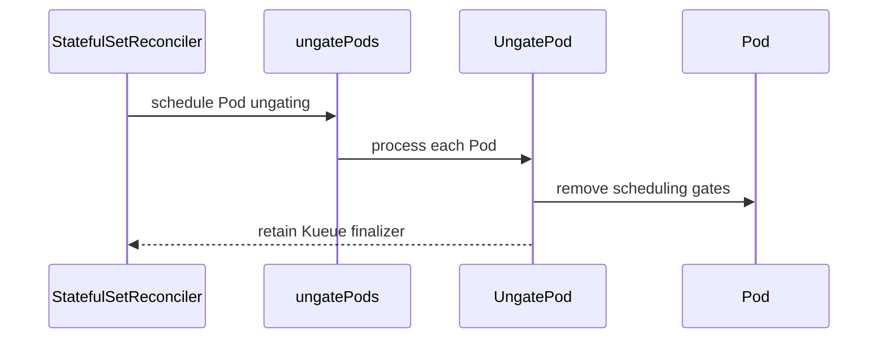

# PR #13316: Remove parent-suspended Pod finalizer cleanup

**Summary**: Remove parent-suspended Pod finalizer cleanup

**Sources**: https://github.com/kubernetes-sigs/kueue/pull/13316

**Last updated**: 2026-09-30T17:50:17Z

---

## Metadata

- **State**: closed (merged)
- **Author**: [@YQ-Wang](https://github.com/YQ-Wang)
- **Branch**: `feat/8571-remove-pod-finalizer-cleanup` → `main`
- **Created**: 2026-07-22T07:50:02Z
- **Updated**: 2026-09-30T17:50:17Z
- **Merged**: 2026-08-18T12:37:08Z
- **Closed**: 2026-08-18T12:37:09Z
- **Labels**: `release-note`, `size/L`, `lgtm`, `approved`, `kind/cleanup`, `ok-to-test`, `cncf-cla: yes`, `area/integrations`, `area/testing`
- **Assignees**: [@tenzen-y](https://github.com/tenzen-y)
- **Requested reviewers**: [@pajakd](https://github.com/pajakd), [@mbobrovskyi](https://github.com/mbobrovskyi), [@olekzabl](https://github.com/olekzabl), [@sohankunkerkar](https://github.com/sohankunkerkar)
- **Changed files**: 9   **+364 / -67**

## Description

#### What type of PR is this?

/kind cleanup
/area integrations
/area testing

#### What this PR does / why we need it:

Kueue stopped adding the `kueue.x-k8s.io/managed` finalizer to Pods suspended by parent integrations in v0.16, but retained StatefulSet and LeaderWorkerSet cleanup paths for a migration window.

This PR completes the planned v0.20 cleanup by:

- removing legacy finalizer removal from the StatefulSet and LeaderWorkerSet reconciliation paths;
- preserving rollout and deleted-parent scheduling-gate removal, including Pods carrying both the standard and topology scheduling gates;
- removing the locked `SkipFinalizersForPodsSuspendedByParent` feature gate and recording its Beta and GA history in the removed-feature list; and
- keeping the generic Pod workload finalizer lifecycle unchanged.

#### Which issue(s) this PR fixes:

Fixes #8571

#### Special notes for your reviewer:

This follows the v0.20 timing agreed in #8571: the cleanup remained available through the v0.18 and v0.19 migration window for long-running serving workloads.

Validation on the rebased head:

- `go test -race -count=1 ./pkg/util/statefulset ./pkg/controller/jobs/statefulset ./pkg/controller/jobs/leaderworkerset`
- `go test -race -count=1 -v ./test/integration/singlecluster/controller/jobs/statefulset` with Kubernetes 1.36.2 envtest assets (4/4 specs passed)
- `go vet ./pkg/util/statefulset ./pkg/controller/jobs/statefulset ./pkg/controller/jobs/leaderworkerset`
- `bin/compatibility-lifecycle feature-gates update`
- `bin/compatibility-lifecycle feature-gates verify`
- `gofmt -d`, generated-list comparison, `git diff --check`, and `git range-diff` against the pre-rebase patch

This PR was developed with assistance from Codex. All changes were reviewed and validated by the author.

#### Does this PR introduce a user-facing change?

```release-note
LeaderWorkerSet & StatefulSet: The legacy parent-suspended Pod finalizer cleanup has been removed.
```

<!-- This is an auto-generated comment: release notes by coderabbit.ai -->
## Summary by CodeRabbit

* **Bug Fixes**
  * StatefulSet, LeaderWorkerSet, and rollout pods are now ungated without removing existing finalizers.
  * Finished, failed, and deleted pods are ignored during reconciliation without finalizer changes or pod removal.
  * Current-revision pods are correctly ungated during StatefulSet rollouts.

* **Configuration**
  * Removed the obsolete `SkipFinalizersForPodsSuspendedByParent` feature gate.

* **Tests**
  * Expanded coverage for ungating and finalizer preservation.
<!-- end of auto-generated comment: release notes by coderabbit.ai -->

## Discussion

### Comment by [@netlify[bot]](https://github.com/apps/netlify) — 2026-07-22T07:50:08Z

### <span aria-hidden="true">✅</span> Deploy Preview for *kubernetes-sigs-kueue* canceled.


|  Name | Link |
|:-:|------------------------|
|<span aria-hidden="true">🔨</span> Latest commit | cacba8c02200133dbb428ae1eb09d020244760a0 |
|<span aria-hidden="true">🔍</span> Latest deploy log | https://app.netlify.com/projects/kubernetes-sigs-kueue/deploys/6a83ae0e37721e0008a2cd5b |

### Comment by [@coderabbitai[bot]](https://github.com/apps/coderabbitai) — 2026-07-22T07:50:09Z

<!-- This is an auto-generated comment: summarize by coderabbit.ai -->
<!-- review_stack_entry_start -->

[](https://app.coderabbit.ai/change-stack/kubernetes-sigs/kueue/pull/13316?utm_source=github_walkthrough&utm_medium=github&utm_campaign=change_stack)

<!-- review_stack_entry_end -->
<!-- This is an auto-generated comment: review paused by coderabbit.ai -->

> [!NOTE]
> ## Reviews paused
> 
> It looks like this branch is under active development. To avoid overwhelming you with review comments due to an influx of new commits, CodeRabbit has automatically paused this review. You can configure this behavior by changing the `reviews.auto_review.auto_pause_after_reviewed_commits` setting.
> 
> Use the following commands to manage reviews:
> - `@coderabbitai resume` to resume automatic reviews.
> - `@coderabbitai review` to trigger a single review.
> 
> Use the checkboxes below for quick actions:
> - [ ] <!-- {"checkboxId": "7f6cc2e2-2e4e-497a-8c31-c9e4573e93d1"} --> ▶️ Resume reviews
> - [ ] <!-- {"checkboxId": "e9bb8d72-00e8-4f67-9cb2-caf3b22574fe"} --> 🔍 Trigger review

<!-- end of auto-generated comment: review paused by coderabbit.ai -->
<!-- walkthrough_start -->

<details>
<summary>📝 Walkthrough</summary>

## Walkthrough

The StatefulSet and LeaderWorkerSet reconcilers now ungate Pods without removing Kueue finalizers. Terminal or deleting Pods remain unchanged. Tests cover rollout and finalizer preservation. The related feature gate is removed from code and versioned metadata.

### Changes

**Pod ungating behavior**

|Layer / File(s)|Summary|
|---|---|
|**Ungating utility contract** <br> `pkg/util/statefulset/statefulset.go`, `pkg/util/statefulset/statefulset_test.go`|Replaces combined ungating and finalization with `UngatePod`. Tests verify gate removal and finalizer preservation.|
|**StatefulSet reconciliation flow** <br> `pkg/controller/jobs/statefulset/*`, `test/integration/singlecluster/controller/jobs/statefulset/*`|Runs Pod ungating during reconciliation. Terminal and deleting Pods remain unchanged.|
|**LeaderWorkerSet reconciliation flow** <br> `pkg/controller/jobs/leaderworkerset/*`|Uses ungating for deletion and revision-change paths. Terminal and deleted Pods retain finalizers.|
|**Feature-gate retirement** <br> `pkg/features/kube_features.go`, `site/data/featuregates/*`, `test/compatibility_lifecycle/reference/*`|Removes the feature gate from code and active version lists. Records its removed versions.|

**Estimated code review effort:** 3 (Moderate) | ~25 minutes

### Sequence Diagram(s)



**Suggested reviewers:** `pajakd`, `mbobrovskyi`, `olekzabl`, `sohankunkerkar`

</details>

<!-- walkthrough_end -->
<!-- pre_merge_checks_walkthrough_start -->

<details>
<summary>🚥 Pre-merge checks | ✅ 4 | ❌ 1</summary>

### ❌ Failed checks (1 warning)

|     Check name     | Status     | Explanation                                                                          | Resolution                                                                         |
| :----------------: | :--------- | :----------------------------------------------------------------------------------- | :--------------------------------------------------------------------------------- |
| Docstring Coverage | ⚠️ Warning | Docstring coverage is 0.00% which is insufficient. The required threshold is 80.00%. | Write docstrings for the functions missing them to satisfy the coverage threshold. |

<details>
<summary>✅ Passed checks (4 passed)</summary>

|         Check name         | Status   | Explanation                                                                                                                                    |
| :------------------------: | :------- | :--------------------------------------------------------------------------------------------------------------------------------------------- |
|     Linked Issues check    | ✅ Passed | The changes remove Pod finalizer cleanup from LeaderWorkerSet and StatefulSet reconciliation paths as required by issue `#8571`.                 |
| Out of Scope Changes check | ✅ Passed | The feature-gate removal, lifecycle records, tests, and scheduling-gate behavior support the linked cleanup objective.                         |
|      Description Check     | ✅ Passed | Check skipped - CodeRabbit’s high-level summary is enabled.                                                                                    |
|         Title check        | ✅ Passed | The title clearly and concisely describes the removal of parent-suspended Pod finalizer cleanup, which is the main change in the pull request. |

</details>

</details>

<!-- pre_merge_checks_walkthrough_end -->
<!-- finishing_touch_checkbox_start -->

<details>
<summary>✨ Finishing Touches</summary>

<details>
<summary>🧪 Generate unit tests (beta)</summary>

- [ ] <!-- {"checkboxId": "f47ac10b-58cc-4372-a567-0e02b2c3d479", "radioGroupId": "utg-output-choice-group-unknown_comment_id"} -->   Create PR with unit tests

</details>

</details>

<!-- finishing_touch_checkbox_end -->
<!-- tips_start -->

---

Thanks for using [CodeRabbit](https://coderabbit.ai?utm_source=oss&utm_medium=github&utm_campaign=kubernetes-sigs/kueue&utm_content=13316)! It's free for OSS, and your support helps us grow. If you like it, consider giving us a shout-out.

<details>
<summary>❤️ Share</summary>

- [X](https://twitter.com/intent/tweet?text=I%20just%20used%20%40coderabbitai%20for%20my%20code%20review%2C%20and%20it%27s%20fantastic%21%20It%27s%20free%20for%20OSS%20and%20offers%20a%20free%20trial%20for%20the%20proprietary%20code.%20Check%20it%20out%3A&url=https%3A//coderabbit.ai)
- [Mastodon](https://mastodon.social/share?text=I%20just%20used%20%40coderabbitai%20for%20my%20code%20review%2C%20and%20it%27s%20fantastic%21%20It%27s%20free%20for%20OSS%20and%20offers%20a%20free%20trial%20for%20the%20proprietary%20code.%20Check%20it%20out%3A%20https%3A%2F%2Fcoderabbit.ai)
- [Reddit](https://www.reddit.com/submit?title=Great%20tool%20for%20code%20review%20-%20CodeRabbit&text=I%20just%20used%20CodeRabbit%20for%20my%20code%20review%2C%20and%20it%27s%20fantastic%21%20It%27s%20free%20for%20OSS%20and%20offers%20a%20free%20trial%20for%20proprietary%20code.%20Check%20it%20out%3A%20https%3A//coderabbit.ai)
- [LinkedIn](https://www.linkedin.com/sharing/share-offsite/?url=https%3A%2F%2Fcoderabbit.ai&mini=true&title=Great%20tool%20for%20code%20review%20-%20CodeRabbit&summary=I%20just%20used%20CodeRabbit%20for%20my%20code%20review%2C%20and%20it%27s%20fantastic%21%20It%27s%20free%20for%20OSS%20and%20offers%20a%20free%20trial%20for%20proprietary%20code)

</details>


<sub>Comment `@coderabbitai help` to get the list of available commands.</sub>

<!-- tips_end -->

### Comment by [@kubernetes-prow[bot]](https://github.com/apps/kubernetes-prow) — 2026-07-22T07:50:12Z

Hi @YQ-Wang. Thanks for your PR.

I'm waiting for a [kubernetes-sigs](https://github.com/orgs/kubernetes-sigs/people) member to verify that this patch is reasonable to test. If it is, they should reply with `/ok-to-test` on its own line. Until that is done, I will not automatically test new commits in this PR, but the usual testing commands by org members will still work.

Regular contributors should [join the org](https://git.k8s.io/community/community-membership.md#member) to skip this step.

Once the patch is verified, the new status will be reflected by the `ok-to-test` label.

I understand the commands that are listed [here](https://go.k8s.io/bot-commands?repo=kubernetes-sigs%2Fkueue).

<details>

Instructions for interacting with me using PR comments are available [here](https://git.k8s.io/community/contributors/guide/pull-requests.md).  If you have questions or suggestions related to my behavior, please file an issue against the [kubernetes-sigs/prow](https://github.com/kubernetes-sigs/prow/issues/new?title=Prow%20issue:) repository.
</details>

### Comment by [@mimowo](https://github.com/mimowo) — 2026-07-22T09:55:44Z

/ok-to-test

### Comment by [@mimowo](https://github.com/mimowo) — 2026-07-24T16:37:11Z

/ok-to-test

### Comment by [@coderabbitai[bot]](https://github.com/apps/coderabbitai) — 2026-08-05T03:28:43Z

<!-- This is an auto-generated comment by CodeRabbit -->
> [!NOTE]
> GitHub couldn't provide a complete incremental comparison for this pull request, so CodeRabbit is performing a full review instead. This review may take a little longer.

### Comment by [@coderabbitai[bot]](https://github.com/apps/coderabbitai) — 2026-08-05T08:29:17Z

<!-- This is an auto-generated comment by CodeRabbit -->
> [!NOTE]
> GitHub couldn't provide a complete incremental comparison for this pull request, so CodeRabbit is performing a full review instead. This review may take a little longer.

### Comment by [@YQ-Wang](https://github.com/YQ-Wang) — 2026-08-07T06:45:17Z

@mbobrovskyi PTAL, thank you!

### Comment by [@mbobrovskyi](https://github.com/mbobrovskyi) — 2026-08-11T17:23:44Z

@YQ-Wang could you please rebase ?

### Comment by [@YQ-Wang](https://github.com/YQ-Wang) — 2026-08-13T23:08:38Z

@mbobrovskyi PTAL, thank you!

### Comment by [@tenzen-y](https://github.com/tenzen-y) — 2026-08-14T21:42:22Z

> @mbobrovskyi PTAL, thank you!

Thank you for working on that. We are currently checking this aspect: https://github.com/kubernetes-sigs/kueue/pull/13316#discussion_r3734180396

### Comment by [@YQ-Wang](https://github.com/YQ-Wang) — 2026-08-17T17:12:49Z

/retest

### Comment by [@kubernetes-prow[bot]](https://github.com/apps/kubernetes-prow) — 2026-08-18T12:21:13Z

LGTM label has been added.  <details>Git tree hash: a5a47d69ba1ffa8bf1ff81df5fd3d5911207f7e2</details>

### Comment by [@kubernetes-prow[bot]](https://github.com/apps/kubernetes-prow) — 2026-08-18T12:21:16Z

[APPROVALNOTIFIER] This PR is **APPROVED**

This pull-request has been approved by: *<a href="https://github.com/kubernetes-sigs/kueue/pull/13316#pullrequestreview-4960909748" title="Approved">tenzen-y</a>*, *<a href="https://github.com/kubernetes-sigs/kueue/pull/13316#" title="Author self-approved">YQ-Wang</a>*

The full list of commands accepted by this bot can be found [here](https://go.k8s.io/bot-commands?repo=kubernetes-sigs%2Fkueue).

The pull request process is described [here](https://git.k8s.io/community/contributors/guide/owners.md#the-code-review-process)

<details >
Needs approval from an approver in each of these files:

- ~~[OWNERS](https://github.com/kubernetes-sigs/kueue/blob/main/OWNERS)~~ [tenzen-y]

Approvers can indicate their approval by writing `/approve` in a comment
Approvers can cancel approval by writing `/approve cancel` in a comment
</details>
<!-- META={"approvers":[]} -->

### Comment by [@tenzen-y](https://github.com/tenzen-y) — 2026-09-30T17:31:33Z

/release-note-edit
```
LeaderWorkerSet & StatefulSet: The legacy parent-suspended Pod finalizer cleanup has been removed.
```

### Comment by [@kubernetes-prow[bot]](https://github.com/apps/kubernetes-prow) — 2026-09-30T17:31:36Z

@tenzen-y: /release-note-edit must be used with a release note block.

<details>

In response to [this](https://github.com/kubernetes-sigs/kueue/pull/13316#issuecomment-5916373560):

>/release-note-edit
>```
>LeaderWorkerSet & StatefulSet: The legacy parent-suspended Pod finalizer cleanup has been removed.
>```


Instructions for interacting with me using PR comments are available [here](https://git.k8s.io/community/contributors/guide/pull-requests.md).  If you have questions or suggestions related to my behavior, please file an issue against the [kubernetes-sigs/prow](https://github.com/kubernetes-sigs/prow/issues/new?title=Prow%20issue:) repository.
</details>

### Comment by [@tenzen-y](https://github.com/tenzen-y) — 2026-09-30T17:50:15Z

/release-note-edit
```release-note
LeaderWorkerSet & StatefulSet: The legacy parent-suspended Pod finalizer cleanup has been removed.
```

## Reviews

### Review by [@coderabbitai[bot]](https://github.com/apps/coderabbitai) (commented) — 2026-07-24T16:02:19Z


<details>
<summary>🧹 Nitpick comments (1)</summary><blockquote>

<details>
<summary>test/integration/singlecluster/controller/jobs/statefulset/statefulset_controller_test.go (1)</summary><blockquote>

`230-269`: _📐 Maintainability & Code Quality_ | _🔵 Trivial_ | _⚡ Quick win_

**Consider adding a negative-case integration scenario alongside this positive one.**

Only the "current-revision pod gets ungated" path is exercised here; the corollary negative case (a pod labeled with the update revision keeps its gates during rollout) is only covered at the unit level. As per path instructions, integration tests under `test/integration/**` should cover both positive and negative scenarios.

<details>
<summary>🤖 Prompt for AI Agents</summary>

```
Verify each finding against current code. Fix only still-valid issues, skip the
rest with a brief reason, keep changes minimal, and validate.

In
`@test/integration/singlecluster/controller/jobs/statefulset/statefulset_controller_test.go`
around lines 230 - 269, Add a companion integration test for the rollout
scenario using the existing StatefulSet and pod setup, but label the pod with
createdSTS.Status.UpdateRevision instead of CurrentRevision. Verify the pod
retains both scheduling gates during reconciliation, while preserving the
existing positive test for current-revision pods.
```

</details>

<!-- cr-comment:v1:bd946a6c9f5dd253fd7161f8 -->

_Source: Path instructions_

</blockquote></details>

</blockquote></details>

<details>
<summary>🤖 Prompt for all review comments with AI agents</summary>

```
Verify each finding against current code. Fix only still-valid issues, skip the
rest with a brief reason, keep changes minimal, and validate.

Nitpick comments:
In
`@test/integration/singlecluster/controller/jobs/statefulset/statefulset_controller_test.go`:
- Around line 230-269: Add a companion integration test for the rollout scenario
using the existing StatefulSet and pod setup, but label the pod with
createdSTS.Status.UpdateRevision instead of CurrentRevision. Verify the pod
retains both scheduling gates during reconciliation, while preserving the
existing positive test for current-revision pods.
```

</details>

---

<details>
<summary>ℹ️ Review info</summary>

<details>
<summary>⚙️ Run configuration</summary>

**Configuration used**: Path: .coderabbit.yaml

**Review profile**: CHILL

**Plan**: Pro Plus

**Run ID**: `158f30e8-9c8a-44ea-b6f4-cc5c7617bf64`

</details>

<details>
<summary>📥 Commits</summary>

Reviewing files that changed from the base of the PR and between d9bbc2246b74bcc6584868cab3a1aff3987e5468 and 7a592ecfd022bc04f982defd7b77e104bade0924.

</details>

<details>
<summary>📒 Files selected for processing (13)</summary>

* `pkg/controller/jobs/leaderworkerset/leaderworkerset_reconciler.go`
* `pkg/controller/jobs/leaderworkerset/leaderworkerset_reconciler_test.go`
* `pkg/controller/jobs/statefulset/statefulset_pod_reconciler.go`
* `pkg/controller/jobs/statefulset/statefulset_pod_reconciler_test.go`
* `pkg/controller/jobs/statefulset/statefulset_reconciler.go`
* `pkg/controller/jobs/statefulset/statefulset_reconciler_test.go`
* `pkg/features/kube_features.go`
* `pkg/util/statefulset/statefulset.go`
* `pkg/util/statefulset/statefulset_test.go`
* `site/data/featuregates/removed_feature_list.yaml`
* `site/data/featuregates/versioned_feature_list.yaml`
* `test/compatibility_lifecycle/reference/versioned_feature_list.yaml`
* `test/integration/singlecluster/controller/jobs/statefulset/statefulset_controller_test.go`

</details>

<details>
<summary>💤 Files with no reviewable changes (3)</summary>

* pkg/features/kube_features.go
* site/data/featuregates/versioned_feature_list.yaml
* test/compatibility_lifecycle/reference/versioned_feature_list.yaml

</details>

</details>

<!-- This is an auto-generated comment by CodeRabbit for review status -->

### Review by [@coderabbitai[bot]](https://github.com/apps/coderabbitai) (commented) — 2026-07-27T20:20:53Z

**Actionable comments posted: 1**

<details>
<summary>🤖 Prompt for all review comments with AI agents</summary>

```
Verify each finding against current code. Fix only still-valid issues, skip the
rest with a brief reason, keep changes minimal, and validate.

Inline comments:
In `@pkg/util/statefulset/statefulset_test.go`:
- Around line 19-30: Convert the statefulset test cases around the existing
table-driven test into the repository’s Ginkgo/Gomega pattern using
DescribeTable and Entry, replacing testing.T and cmp-based assertions with
Gomega expectations. Preserve all existing scenarios, inputs, and expected
results while following nearby test conventions.
```

</details>

<details>
<summary>🪄 Autofix (Beta)</summary>

Fix all unresolved CodeRabbit comments on this PR:

- [ ] <!-- {"checkboxId": "4b0d0e0a-96d7-4f10-b296-3a18ea78f0b9"} --> Push a commit to this branch (recommended)
- [ ] <!-- {"checkboxId": "ff5b1114-7d8c-49e6-8ac1-43f82af23a33"} --> Create a new PR with the fixes

</details>

---

<details>
<summary>ℹ️ Review info</summary>

<details>
<summary>⚙️ Run configuration</summary>

**Configuration used**: Path: .coderabbit.yaml

**Review profile**: CHILL

**Plan**: Pro Plus

**Run ID**: `7da3eeb2-2f7c-4843-9bff-867e6eb6b876`

</details>

<details>
<summary>📥 Commits</summary>

Reviewing files that changed from the base of the PR and between 7a592ecfd022bc04f982defd7b77e104bade0924 and 6bfa2e2b09e0881cea1e51c6e5fb7692bd9c06b3.

</details>

<details>
<summary>📒 Files selected for processing (9)</summary>

* `pkg/controller/jobs/leaderworkerset/leaderworkerset_reconciler.go`
* `pkg/controller/jobs/leaderworkerset/leaderworkerset_reconciler_test.go`
* `pkg/controller/jobs/statefulset/statefulset_pod_reconciler.go`
* `pkg/controller/jobs/statefulset/statefulset_pod_reconciler_test.go`
* `pkg/controller/jobs/statefulset/statefulset_reconciler.go`
* `pkg/controller/jobs/statefulset/statefulset_reconciler_test.go`
* `pkg/features/kube_features.go`
* `pkg/util/statefulset/statefulset.go`
* `pkg/util/statefulset/statefulset_test.go`

</details>

<details>
<summary>🚧 Files skipped from review as they are similar to previous changes (7)</summary>

* pkg/util/statefulset/statefulset.go
* pkg/controller/jobs/statefulset/statefulset_pod_reconciler.go
* pkg/controller/jobs/statefulset/statefulset_reconciler_test.go
* pkg/controller/jobs/statefulset/statefulset_reconciler.go
* pkg/controller/jobs/statefulset/statefulset_pod_reconciler_test.go
* pkg/controller/jobs/leaderworkerset/leaderworkerset_reconciler.go
* pkg/controller/jobs/leaderworkerset/leaderworkerset_reconciler_test.go

</details>

</details>

<!-- This is an auto-generated comment by CodeRabbit for review status -->

- **pkg/util/statefulset/statefulset_test.go:31** by [@coderabbitai[bot]](https://github.com/apps/coderabbitai) — 2026-07-27T20:20:52Z
```diff
@@ -0,0 +1,108 @@
+/*
+Copyright The Kubernetes Authors.
+
+Licensed under the Apache License, Version 2.0 (the "License");
+you may not use this file except in compliance with the License.
+You may obtain a copy of the License at
+
+    http://www.apache.org/licenses/LICENSE-2.0
+
+Unless required by applicable law or agreed to in writing, software
+distributed under the License is distributed on an "AS IS" BASIS,
+WITHOUT WARRANTIES OR CONDITIONS OF ANY KIND, either express or implied.
+See the License for the specific language governing permissions and
+limitations under the License.
+*/
+
+package statefulset
+
+import (
+	"testing"
+
+	"github.com/google/go-cmp/cmp"
+	"github.com/google/go-cmp/cmp/cmpopts"
+	appsv1 "k8s.io/api/apps/v1"
+	corev1 "k8s.io/api/core/v1"
+	metav1 "k8s.io/apimachinery/pkg/apis/meta/v1"
+
+	kueue "sigs.k8s.io/kueue/apis/kueue/v1beta2"
+	podconstants "sigs.k8s.io/kueue/pkg/controller/jobs/pod/constants"
+)
```

  _📐 Maintainability & Code Quality_ | _🟠 Major_ | _⚡ Quick win_
  
  **Use the repository’s Ginkgo/Gomega test pattern.**
  
  This test is appropriately table-driven, but it uses `testing.T` and `cmp` instead of the required Ginkgo/Gomega style. Convert the cases to `DescribeTable`/`Entry` with Gomega assertions while preserving the current scenario coverage.
  
  As per path instructions, `**/*_test.go` files must follow existing Ginkgo/Gomega patterns and prefer table-driven tests.
  
  
  
  
  
  
  Also applies to: 32-93
  
  <details>
  <summary>🤖 Prompt for AI Agents</summary>
  
  ```
  Verify each finding against current code. Fix only still-valid issues, skip the
  rest with a brief reason, keep changes minimal, and validate.
  
  In `@pkg/util/statefulset/statefulset_test.go` around lines 19 - 30, Convert the
  statefulset test cases around the existing table-driven test into the
  repository’s Ginkgo/Gomega pattern using DescribeTable and Entry, replacing
  testing.T and cmp-based assertions with Gomega expectations. Preserve all
  existing scenarios, inputs, and expected results while following nearby test
  conventions.
  ```
  
  </details>
  
  <!-- fingerprinting:phantom:poseidon:luna -->
  
  <!-- cr-indicator-types:refactor_suggestion -->
  
  <!-- cr-comment:v1:f89a91c8094d4614f3b6912e -->
  
  _Source: Path instructions_
  
  <!-- This is an auto-generated comment by CodeRabbit -->

### Review by [@mbobrovskyi](https://github.com/mbobrovskyi) (commented) — 2026-08-07T07:34:21Z

- **pkg/controller/jobs/statefulset/statefulset_pod_reconciler.go:89** by [@mbobrovskyi](https://github.com/mbobrovskyi) — 2026-08-07T07:34:22Z
```diff
@@ -86,27 +86,28 @@ func (r *PodReconciler) Reconcile(ctx context.Context, req reconcile.Request) (r
 	log := ctrl.LoggerFrom(ctx)
 	log.V(2).Info("Reconcile StatefulSet Pod")
 
-	if utilpod.IsTerminated(pod) || pod.DeletionTimestamp != nil {
+	if utilstatefulset.ShouldFinalizePod(pod) {
```

  This is actually a question: do we still need this logic? After graduation, I think we can remove this deprecated logic because we are no longer setting a finalizer on the StatefulSet.
  
  @mimowo WDYT?

### Review by [@mbobrovskyi](https://github.com/mbobrovskyi) (commented) — 2026-08-12T15:13:50Z

- **pkg/controller/jobs/statefulset/statefulset_pod_reconciler.go:89** by [@mbobrovskyi](https://github.com/mbobrovskyi) — 2026-08-12T15:13:50Z
```diff
@@ -86,27 +86,28 @@ func (r *PodReconciler) Reconcile(ctx context.Context, req reconcile.Request) (r
 	log := ctrl.LoggerFrom(ctx)
 	log.V(2).Info("Reconcile StatefulSet Pod")
 
-	if utilpod.IsTerminated(pod) || pod.DeletionTimestamp != nil {
+	if utilstatefulset.ShouldFinalizePod(pod) {
```

  @tenzen-y, maybe you can help with this. I think we can remove it because the `SkipFinalizersForPodsSuspendedByParent` feature gate became GA in 0.18 and was removed in #13696.
  
  So I think `pkg/controller/jobs/statefulset/statefulset_pod_reconciler.go` can be removed, and `utilstatefulset.ShouldFinalizePod` can be deleted from the other places where it's used.

### Review by [@tenzen-y](https://github.com/tenzen-y) (commented) — 2026-08-14T21:41:50Z

- **pkg/controller/jobs/statefulset/statefulset_pod_reconciler.go:89** by [@tenzen-y](https://github.com/tenzen-y) — 2026-08-14T21:41:50Z
```diff
@@ -86,27 +86,28 @@ func (r *PodReconciler) Reconcile(ctx context.Context, req reconcile.Request) (r
 	log := ctrl.LoggerFrom(ctx)
 	log.V(2).Info("Reconcile StatefulSet Pod")
 
-	if utilpod.IsTerminated(pod) || pod.DeletionTimestamp != nil {
+	if utilstatefulset.ShouldFinalizePod(pod) {
```

  @mbobrovskyi I agree with removing the entire branch ( `utilstatefulset.ShouldFinalizePod`) b/c we no longer support Pods w/ finalizers.
  
  But, I was not sure the reason why we can remove the `pkg/controller/jobs/statefulset/statefulset_pod_reconciler.go` b/c it has still have some defaulting mechanism which has PodGroup related annotations mutatating mechanism and so on.

### Review by [@tenzen-y](https://github.com/tenzen-y) (commented) — 2026-08-14T22:12:39Z

- **pkg/controller/jobs/statefulset/statefulset_pod_reconciler.go:89** by [@tenzen-y](https://github.com/tenzen-y) — 2026-08-14T22:12:39Z
```diff
@@ -86,27 +86,28 @@ func (r *PodReconciler) Reconcile(ctx context.Context, req reconcile.Request) (r
 	log := ctrl.LoggerFrom(ctx)
 	log.V(2).Info("Reconcile StatefulSet Pod")
 
-	if utilpod.IsTerminated(pod) || pod.DeletionTimestamp != nil {
+	if utilstatefulset.ShouldFinalizePod(pod) {
```

  @mbobrovskyi Or does that mean moving the remaining `statefulset_pod_reconciler.go` logic to `statefulset_controller.go` instead of just deleting `statefulset_pod_reconciler.go`?

### Review by [@mbobrovskyi](https://github.com/mbobrovskyi) (commented) — 2026-08-17T08:54:47Z

- **pkg/controller/jobs/statefulset/statefulset_pod_reconciler.go:89** by [@mbobrovskyi](https://github.com/mbobrovskyi) — 2026-08-17T08:54:47Z
```diff
@@ -86,27 +86,28 @@ func (r *PodReconciler) Reconcile(ctx context.Context, req reconcile.Request) (r
 	log := ctrl.LoggerFrom(ctx)
 	log.V(2).Info("Reconcile StatefulSet Pod")
 
-	if utilpod.IsTerminated(pod) || pod.DeletionTimestamp != nil {
+	if utilstatefulset.ShouldFinalizePod(pod) {
```

  > @mbobrovskyi Or does that mean moving the remaining statefulset_pod_reconciler.go logic to statefulset_controller.go instead of just deleting statefulset_pod_reconciler.go?
  
  Yeah, that's what I mean: move it to `statefulset_reconciler.go`. But I think we can do that in a follow-up.

### Review by [@mbobrovskyi](https://github.com/mbobrovskyi) (commented) — 2026-08-17T12:13:29Z

- **pkg/controller/jobs/statefulset/statefulset_pod_reconciler.go:89** by [@mbobrovskyi](https://github.com/mbobrovskyi) — 2026-08-17T12:13:29Z
```diff
@@ -86,27 +86,28 @@ func (r *PodReconciler) Reconcile(ctx context.Context, req reconcile.Request) (r
 	log := ctrl.LoggerFrom(ctx)
 	log.V(2).Info("Reconcile StatefulSet Pod")
 
-	if utilpod.IsTerminated(pod) || pod.DeletionTimestamp != nil {
+	if utilstatefulset.ShouldFinalizePod(pod) {
```

  > @mbobrovskyi I agree with removing the entire branch ( utilstatefulset.ShouldFinalizePod) b/c we no longer support Pods w/ finalizers.
  
  @YQ-Wang could you please address this?

### Review by [@tenzen-y](https://github.com/tenzen-y) (commented) — 2026-08-17T21:02:44Z

- **pkg/controller/jobs/statefulset/statefulset_pod_reconciler.go:89** by [@tenzen-y](https://github.com/tenzen-y) — 2026-08-17T21:02:43Z
```diff
@@ -86,27 +86,28 @@ func (r *PodReconciler) Reconcile(ctx context.Context, req reconcile.Request) (r
 	log := ctrl.LoggerFrom(ctx)
 	log.V(2).Info("Reconcile StatefulSet Pod")
 
-	if utilpod.IsTerminated(pod) || pod.DeletionTimestamp != nil {
+	if utilstatefulset.ShouldFinalizePod(pod) {
```

  > Yeah, that's what I mean: move it to statefulset_reconciler.go. But I think we can do that in a follow-up.
  
  Follow-up sounds good to me.

### Review by [@tenzen-y](https://github.com/tenzen-y) (commented) — 2026-08-17T22:49:44Z

Otherwise LGTM, thanks.

- **test/integration/singlecluster/controller/jobs/statefulset/statefulset_controller_test.go:299** by [@tenzen-y](https://github.com/tenzen-y) — 2026-08-17T22:46:12Z
```diff
@@ -224,6 +225,91 @@ var _ = ginkgo.Describe("StatefulSet controller", ginkgo.Label("job:statefulset"
 			util.ExpectWorkloadsToBeAdmittedByKeys(ctx, k8sClient, client.ObjectKeyFromObject(wl))
 		}, util.LongTimeout, util.Interval).Should(gomega.Succeed())
 	})
+
+	ginkgo.It("Should remove all Kueue scheduling gates from a current-revision Pod without removing its finalizer", func() {
+		ginkgo.By("Creating a StatefulSet with a rollout in progress")
+		sts := testingstatefulset.MakeStatefulSet("test-sts", ns.Name).
+			Queue("lq").
+			Replicas(1).
+			Request(corev1.ResourceCPU, "100m").
+			Obj()
+		util.MustCreate(ctx, k8sClient, sts)
+
+		createdSTS := &appsv1.StatefulSet{}
+		gomega.Eventually(func(g gomega.Gomega) {
+			g.Expect(k8sClient.Get(ctx, client.ObjectKeyFromObject(sts), createdSTS)).Should(gomega.Succeed())
+			createdSTS.Status.CurrentRevision = "revision-1"
+			createdSTS.Status.UpdateRevision = "revision-2"
+			g.Expect(k8sClient.Status().Update(ctx, createdSTS)).Should(gomega.Succeed())
+		}, util.Timeout, util.Interval).Should(gomega.Succeed())
+
+		workloadName := statefulset.GetWorkloadName(createdSTS.UID, createdSTS.Name)
+		pod := testingjobspod.MakePod("test-sts-0", ns.Name).
+			Annotation(constants.SuspendedByParentAnnotation, statefulset.FrameworkName).
+			GroupNameLabel(workloadName).
+			GroupTotalCount("1").
+			Label(appsv1.ControllerRevisionHashLabelKey, "revision-1").
+			Gate(constants.SchedulingGateName).
+			Gate(kueue.TopologySchedulingGate).
+			KueueFinalizer().
+			Obj()
+		pod.OwnerReferences = []metav1.OwnerReference{
+			*metav1.NewControllerRef(createdSTS, appsv1.SchemeGroupVersion.WithKind("StatefulSet")),
+		}
+		util.MustCreate(ctx, k8sClient, pod)
+
+		ginkgo.By("Verifying the Pod is ungated while its legacy finalizer remains untouched")
+		gotPod := &corev1.Pod{}
+		gomega.Eventually(func(g gomega.Gomega) {
+			g.Expect(k8sClient.Get(ctx, client.ObjectKeyFromObject(pod), gotPod)).Should(gomega.Succeed())
+			g.Expect(gotPod.Spec.SchedulingGates).Should(gomega.BeEmpty())
+			g.Expect(gotPod.Finalizers).Should(gomega.ConsistOf(constants.PodFinalizer))
+		}, util.Timeout, util.Interval).Should(gomega.Succeed())
+	})
+
+	ginkgo.It("Should keep Kueue scheduling gates on an update-revision Pod during a rollout", func() {
+		ginkgo.By("Creating a StatefulSet with a rollout in progress")
+		sts := testingstatefulset.MakeStatefulSet("test-sts", ns.Name).
+			Queue("lq").
+			Replicas(1).
+			Request(corev1.ResourceCPU, "100m").
+			Obj()
+		util.MustCreate(ctx, k8sClient, sts)
+
+		createdSTS := &appsv1.StatefulSet{}
+		gomega.Eventually(func(g gomega.Gomega) {
+			g.Expect(k8sClient.Get(ctx, client.ObjectKeyFromObject(sts), createdSTS)).Should(gomega.Succeed())
+			createdSTS.Status.CurrentRevision = "revision-1"
+			createdSTS.Status.UpdateRevision = "revision-2"
+			g.Expect(k8sClient.Status().Update(ctx, createdSTS)).Should(gomega.Succeed())
+		}, util.Timeout, util.Interval).Should(gomega.Succeed())
+
+		workloadName := statefulset.GetWorkloadName(createdSTS.UID, createdSTS.Name)
+		pod := testingjobspod.MakePod("test-sts-0", ns.Name).
+			Annotation(constants.SuspendedByParentAnnotation, statefulset.FrameworkName).
+			GroupNameLabel(workloadName).
+			GroupTotalCount("1").
+			Label(appsv1.ControllerRevisionHashLabelKey, createdSTS.Status.UpdateRevision).
+			Gate(constants.SchedulingGateName).
+			Gate(kueue.TopologySchedulingGate).
+			KueueFinalizer().
+			Obj()
+		pod.OwnerReferences = []metav1.OwnerReference{
+			*metav1.NewControllerRef(createdSTS, appsv1.SchemeGroupVersion.WithKind("StatefulSet")),
+		}
```

  Can you use `OwnerReference` Pod wrapper function instead of this?

- **test/integration/singlecluster/controller/jobs/statefulset/statefulset_controller_test.go:258** by [@tenzen-y](https://github.com/tenzen-y) — 2026-08-17T22:46:32Z
```diff
@@ -224,6 +225,91 @@ var _ = ginkgo.Describe("StatefulSet controller", ginkgo.Label("job:statefulset"
 			util.ExpectWorkloadsToBeAdmittedByKeys(ctx, k8sClient, client.ObjectKeyFromObject(wl))
 		}, util.LongTimeout, util.Interval).Should(gomega.Succeed())
 	})
+
+	ginkgo.It("Should remove all Kueue scheduling gates from a current-revision Pod without removing its finalizer", func() {
+		ginkgo.By("Creating a StatefulSet with a rollout in progress")
+		sts := testingstatefulset.MakeStatefulSet("test-sts", ns.Name).
+			Queue("lq").
+			Replicas(1).
+			Request(corev1.ResourceCPU, "100m").
+			Obj()
+		util.MustCreate(ctx, k8sClient, sts)
+
+		createdSTS := &appsv1.StatefulSet{}
+		gomega.Eventually(func(g gomega.Gomega) {
+			g.Expect(k8sClient.Get(ctx, client.ObjectKeyFromObject(sts), createdSTS)).Should(gomega.Succeed())
+			createdSTS.Status.CurrentRevision = "revision-1"
+			createdSTS.Status.UpdateRevision = "revision-2"
+			g.Expect(k8sClient.Status().Update(ctx, createdSTS)).Should(gomega.Succeed())
+		}, util.Timeout, util.Interval).Should(gomega.Succeed())
+
+		workloadName := statefulset.GetWorkloadName(createdSTS.UID, createdSTS.Name)
+		pod := testingjobspod.MakePod("test-sts-0", ns.Name).
+			Annotation(constants.SuspendedByParentAnnotation, statefulset.FrameworkName).
+			GroupNameLabel(workloadName).
+			GroupTotalCount("1").
+			Label(appsv1.ControllerRevisionHashLabelKey, "revision-1").
+			Gate(constants.SchedulingGateName).
+			Gate(kueue.TopologySchedulingGate).
+			KueueFinalizer().
+			Obj()
+		pod.OwnerReferences = []metav1.OwnerReference{
+			*metav1.NewControllerRef(createdSTS, appsv1.SchemeGroupVersion.WithKind("StatefulSet")),
+		}
```

  ditto

- **test/integration/singlecluster/controller/jobs/statefulset/statefulset_controller_test.go:311** by [@tenzen-y](https://github.com/tenzen-y) — 2026-08-17T22:47:39Z
```diff
@@ -224,6 +225,91 @@ var _ = ginkgo.Describe("StatefulSet controller", ginkgo.Label("job:statefulset"
 			util.ExpectWorkloadsToBeAdmittedByKeys(ctx, k8sClient, client.ObjectKeyFromObject(wl))
 		}, util.LongTimeout, util.Interval).Should(gomega.Succeed())
 	})
+
+	ginkgo.It("Should remove all Kueue scheduling gates from a current-revision Pod without removing its finalizer", func() {
+		ginkgo.By("Creating a StatefulSet with a rollout in progress")
+		sts := testingstatefulset.MakeStatefulSet("test-sts", ns.Name).
+			Queue("lq").
+			Replicas(1).
+			Request(corev1.ResourceCPU, "100m").
+			Obj()
+		util.MustCreate(ctx, k8sClient, sts)
+
+		createdSTS := &appsv1.StatefulSet{}
+		gomega.Eventually(func(g gomega.Gomega) {
+			g.Expect(k8sClient.Get(ctx, client.ObjectKeyFromObject(sts), createdSTS)).Should(gomega.Succeed())
+			createdSTS.Status.CurrentRevision = "revision-1"
+			createdSTS.Status.UpdateRevision = "revision-2"
+			g.Expect(k8sClient.Status().Update(ctx, createdSTS)).Should(gomega.Succeed())
+		}, util.Timeout, util.Interval).Should(gomega.Succeed())
+
+		workloadName := statefulset.GetWorkloadName(createdSTS.UID, createdSTS.Name)
+		pod := testingjobspod.MakePod("test-sts-0", ns.Name).
+			Annotation(constants.SuspendedByParentAnnotation, statefulset.FrameworkName).
+			GroupNameLabel(workloadName).
+			GroupTotalCount("1").
+			Label(appsv1.ControllerRevisionHashLabelKey, "revision-1").
+			Gate(constants.SchedulingGateName).
+			Gate(kueue.TopologySchedulingGate).
+			KueueFinalizer().
+			Obj()
+		pod.OwnerReferences = []metav1.OwnerReference{
+			*metav1.NewControllerRef(createdSTS, appsv1.SchemeGroupVersion.WithKind("StatefulSet")),
+		}
+		util.MustCreate(ctx, k8sClient, pod)
+
+		ginkgo.By("Verifying the Pod is ungated while its legacy finalizer remains untouched")
+		gotPod := &corev1.Pod{}
+		gomega.Eventually(func(g gomega.Gomega) {
+			g.Expect(k8sClient.Get(ctx, client.ObjectKeyFromObject(pod), gotPod)).Should(gomega.Succeed())
+			g.Expect(gotPod.Spec.SchedulingGates).Should(gomega.BeEmpty())
+			g.Expect(gotPod.Finalizers).Should(gomega.ConsistOf(constants.PodFinalizer))
+		}, util.Timeout, util.Interval).Should(gomega.Succeed())
+	})
+
+	ginkgo.It("Should keep Kueue scheduling gates on an update-revision Pod during a rollout", func() {
+		ginkgo.By("Creating a StatefulSet with a rollout in progress")
+		sts := testingstatefulset.MakeStatefulSet("test-sts", ns.Name).
+			Queue("lq").
+			Replicas(1).
+			Request(corev1.ResourceCPU, "100m").
+			Obj()
+		util.MustCreate(ctx, k8sClient, sts)
+
+		createdSTS := &appsv1.StatefulSet{}
+		gomega.Eventually(func(g gomega.Gomega) {
+			g.Expect(k8sClient.Get(ctx, client.ObjectKeyFromObject(sts), createdSTS)).Should(gomega.Succeed())
+			createdSTS.Status.CurrentRevision = "revision-1"
+			createdSTS.Status.UpdateRevision = "revision-2"
+			g.Expect(k8sClient.Status().Update(ctx, createdSTS)).Should(gomega.Succeed())
+		}, util.Timeout, util.Interval).Should(gomega.Succeed())
+
+		workloadName := statefulset.GetWorkloadName(createdSTS.UID, createdSTS.Name)
+		pod := testingjobspod.MakePod("test-sts-0", ns.Name).
+			Annotation(constants.SuspendedByParentAnnotation, statefulset.FrameworkName).
+			GroupNameLabel(workloadName).
+			GroupTotalCount("1").
+			Label(appsv1.ControllerRevisionHashLabelKey, createdSTS.Status.UpdateRevision).
+			Gate(constants.SchedulingGateName).
+			Gate(kueue.TopologySchedulingGate).
+			KueueFinalizer().
+			Obj()
+		pod.OwnerReferences = []metav1.OwnerReference{
+			*metav1.NewControllerRef(createdSTS, appsv1.SchemeGroupVersion.WithKind("StatefulSet")),
+		}
+		util.MustCreate(ctx, k8sClient, pod)
+
+		ginkgo.By("Verifying the update-revision Pod retains both scheduling gates")
+		gotPod := &corev1.Pod{}
+		gomega.Consistently(func(g gomega.Gomega) {
+			g.Expect(k8sClient.Get(ctx, client.ObjectKeyFromObject(pod), gotPod)).Should(gomega.Succeed())
+			g.Expect(gotPod.Spec.SchedulingGates).Should(gomega.ConsistOf(
+				corev1.PodSchedulingGate{Name: constants.SchedulingGateName},
+				corev1.PodSchedulingGate{Name: kueue.TopologySchedulingGate},
+			))
+			g.Expect(gotPod.Finalizers).Should(gomega.ConsistOf(constants.PodFinalizer))
+		}, util.LongConsistentDuration, util.ShortInterval).Should(gomega.Succeed())
```

  why not "ConsistentDuration"? any reason?

- **pkg/util/statefulset/statefulset_test.go:119** by [@tenzen-y](https://github.com/tenzen-y) — 2026-08-17T22:48:24Z
```diff
@@ -0,0 +1,119 @@
+/*
+Copyright The Kubernetes Authors.
+
+Licensed under the Apache License, Version 2.0 (the "License");
+you may not use this file except in compliance with the License.
+You may obtain a copy of the License at
+
+    http://www.apache.org/licenses/LICENSE-2.0
+
+Unless required by applicable law or agreed to in writing, software
+distributed under the License is distributed on an "AS IS" BASIS,
+WITHOUT WARRANTIES OR CONDITIONS OF ANY KIND, either express or implied.
+See the License for the specific language governing permissions and
+limitations under the License.
+*/
+
+package statefulset
+
+import (
+	"testing"
+
+	"github.com/google/go-cmp/cmp"
+	"github.com/google/go-cmp/cmp/cmpopts"
+	appsv1 "k8s.io/api/apps/v1"
+	corev1 "k8s.io/api/core/v1"
+	metav1 "k8s.io/apimachinery/pkg/apis/meta/v1"
+
+	kueue "sigs.k8s.io/kueue/apis/kueue/v1beta2"
+	podconstants "sigs.k8s.io/kueue/pkg/controller/jobs/pod/constants"
+)
+
+func TestUngatePod(t *testing.T) {
+	currentStatefulSet := &appsv1.StatefulSet{
+		Status: appsv1.StatefulSetStatus{
+			CurrentRevision: "current",
+			UpdateRevision:  "current",
+		},
+	}
+	updatingStatefulSet := currentStatefulSet.DeepCopy()
+	updatingStatefulSet.Status.UpdateRevision = "update"
+
+	testCases := map[string]struct {
+		statefulSet *appsv1.StatefulSet
+		pod         *corev1.Pod
+		force       bool
+		wantChanged bool
+		wantGates   []corev1.PodSchedulingGate
+	}{
+		"current revision is unchanged": {
+			statefulSet: currentStatefulSet,
+			pod:         podWithGates("current", podconstants.SchedulingGateName),
+			wantGates:   []corev1.PodSchedulingGate{{Name: podconstants.SchedulingGateName}},
+		},
+		"current revision during rollout is ungated": {
+			statefulSet: updatingStatefulSet,
+			pod:         podWithGates("current", podconstants.SchedulingGateName),
+			wantChanged: true,
+		},
+		"current revision topology gate is removed during rollout": {
+			statefulSet: updatingStatefulSet,
+			pod:         podWithGates("current", kueue.TopologySchedulingGate),
+			wantChanged: true,
+		},
+		"all current revision gates are removed during rollout": {
+			statefulSet: updatingStatefulSet,
+			pod: podWithGates("current",
+				podconstants.SchedulingGateName,
+				kueue.TopologySchedulingGate,
+			),
+			wantChanged: true,
+		},
+		"update revision during rollout keeps gates": {
+			statefulSet: updatingStatefulSet,
+			pod: podWithGates("update",
+				podconstants.SchedulingGateName,
+				kueue.TopologySchedulingGate,
+			),
+			wantGates: []corev1.PodSchedulingGate{
+				{Name: podconstants.SchedulingGateName},
+				{Name: kueue.TopologySchedulingGate},
+			},
+		},
+		"force ungates current revision": {
+			statefulSet: currentStatefulSet,
+			pod:         podWithGates("current", podconstants.SchedulingGateName),
+			force:       true,
+			wantChanged: true,
+		},
+	}
+
+	for name, tc := range testCases {
+		t.Run(name, func(t *testing.T) {
+			if changed := UngatePod(tc.statefulSet, tc.pod, tc.force); changed != tc.wantChanged {
+				t.Errorf("UngatePod() changed = %t, want %t", changed, tc.wantChanged)
+			}
+			if diff := cmp.Diff(tc.wantGates, tc.pod.Spec.SchedulingGates, cmpopts.EquateEmpty()); diff != "" {
+				t.Errorf("SchedulingGates after UngatePod() (-want,+got):\n%s", diff)
+			}
+			if diff := cmp.Diff([]string{podconstants.PodFinalizer}, tc.pod.Finalizers); diff != "" {
+				t.Errorf("Finalizers after UngatePod() (-want,+got):\n%s", diff)
+			}
+		})
+	}
+}
+
+func podWithGates(revision string, gates ...string) *corev1.Pod {
+	pod := &corev1.Pod{
+		ObjectMeta: metav1.ObjectMeta{
+			Labels: map[string]string{
+				appsv1.ControllerRevisionHashLabelKey: revision,
+			},
+			Finalizers: []string{podconstants.PodFinalizer},
+		},
+	}
+	for _, gate := range gates {
+		pod.Spec.SchedulingGates = append(pod.Spec.SchedulingGates, corev1.PodSchedulingGate{Name: gate})
+	}
+	return pod
+}
```

  ```suggestion
  ```
  
  Eliminating helper function and use wrapper (or expand wrapper) directrly in each test case.

- **pkg/util/statefulset/statefulset_test.go:40** by [@tenzen-y](https://github.com/tenzen-y) — 2026-08-17T22:49:04Z
```diff
@@ -0,0 +1,119 @@
+/*
+Copyright The Kubernetes Authors.
+
+Licensed under the Apache License, Version 2.0 (the "License");
+you may not use this file except in compliance with the License.
+You may obtain a copy of the License at
+
+    http://www.apache.org/licenses/LICENSE-2.0
+
+Unless required by applicable law or agreed to in writing, software
+distributed under the License is distributed on an "AS IS" BASIS,
+WITHOUT WARRANTIES OR CONDITIONS OF ANY KIND, either express or implied.
+See the License for the specific language governing permissions and
+limitations under the License.
+*/
+
+package statefulset
+
+import (
+	"testing"
+
+	"github.com/google/go-cmp/cmp"
+	"github.com/google/go-cmp/cmp/cmpopts"
+	appsv1 "k8s.io/api/apps/v1"
+	corev1 "k8s.io/api/core/v1"
+	metav1 "k8s.io/apimachinery/pkg/apis/meta/v1"
+
+	kueue "sigs.k8s.io/kueue/apis/kueue/v1beta2"
+	podconstants "sigs.k8s.io/kueue/pkg/controller/jobs/pod/constants"
+)
+
+func TestUngatePod(t *testing.T) {
+	currentStatefulSet := &appsv1.StatefulSet{
+		Status: appsv1.StatefulSetStatus{
+			CurrentRevision: "current",
+			UpdateRevision:  "current",
+		},
+	}
+	updatingStatefulSet := currentStatefulSet.DeepCopy()
+	updatingStatefulSet.Status.UpdateRevision = "update"
```

  Use wrapper. If there is not enough wrapper function, you can extend it.

### Review by [@YQ-Wang](https://github.com/YQ-Wang) (commented) — 2026-08-18T00:59:43Z

- **pkg/util/statefulset/statefulset_test.go:40** by [@YQ-Wang](https://github.com/YQ-Wang) — 2026-08-18T00:59:43Z
```diff
@@ -0,0 +1,119 @@
+/*
+Copyright The Kubernetes Authors.
+
+Licensed under the Apache License, Version 2.0 (the "License");
+you may not use this file except in compliance with the License.
+You may obtain a copy of the License at
+
+    http://www.apache.org/licenses/LICENSE-2.0
+
+Unless required by applicable law or agreed to in writing, software
+distributed under the License is distributed on an "AS IS" BASIS,
+WITHOUT WARRANTIES OR CONDITIONS OF ANY KIND, either express or implied.
+See the License for the specific language governing permissions and
+limitations under the License.
+*/
+
+package statefulset
+
+import (
+	"testing"
+
+	"github.com/google/go-cmp/cmp"
+	"github.com/google/go-cmp/cmp/cmpopts"
+	appsv1 "k8s.io/api/apps/v1"
+	corev1 "k8s.io/api/core/v1"
+	metav1 "k8s.io/apimachinery/pkg/apis/meta/v1"
+
+	kueue "sigs.k8s.io/kueue/apis/kueue/v1beta2"
+	podconstants "sigs.k8s.io/kueue/pkg/controller/jobs/pod/constants"
+)
+
+func TestUngatePod(t *testing.T) {
+	currentStatefulSet := &appsv1.StatefulSet{
+		Status: appsv1.StatefulSetStatus{
+			CurrentRevision: "current",
+			UpdateRevision:  "current",
+		},
+	}
+	updatingStatefulSet := currentStatefulSet.DeepCopy()
+	updatingStatefulSet.Status.UpdateRevision = "update"
```

  Done

### Review by [@YQ-Wang](https://github.com/YQ-Wang) (commented) — 2026-08-18T01:03:08Z

- **test/integration/singlecluster/controller/jobs/statefulset/statefulset_controller_test.go:311** by [@YQ-Wang](https://github.com/YQ-Wang) — 2026-08-18T01:03:07Z
```diff
@@ -224,6 +225,91 @@ var _ = ginkgo.Describe("StatefulSet controller", ginkgo.Label("job:statefulset"
 			util.ExpectWorkloadsToBeAdmittedByKeys(ctx, k8sClient, client.ObjectKeyFromObject(wl))
 		}, util.LongTimeout, util.Interval).Should(gomega.Succeed())
 	})
+
+	ginkgo.It("Should remove all Kueue scheduling gates from a current-revision Pod without removing its finalizer", func() {
+		ginkgo.By("Creating a StatefulSet with a rollout in progress")
+		sts := testingstatefulset.MakeStatefulSet("test-sts", ns.Name).
+			Queue("lq").
+			Replicas(1).
+			Request(corev1.ResourceCPU, "100m").
+			Obj()
+		util.MustCreate(ctx, k8sClient, sts)
+
+		createdSTS := &appsv1.StatefulSet{}
+		gomega.Eventually(func(g gomega.Gomega) {
+			g.Expect(k8sClient.Get(ctx, client.ObjectKeyFromObject(sts), createdSTS)).Should(gomega.Succeed())
+			createdSTS.Status.CurrentRevision = "revision-1"
+			createdSTS.Status.UpdateRevision = "revision-2"
+			g.Expect(k8sClient.Status().Update(ctx, createdSTS)).Should(gomega.Succeed())
+		}, util.Timeout, util.Interval).Should(gomega.Succeed())
+
+		workloadName := statefulset.GetWorkloadName(createdSTS.UID, createdSTS.Name)
+		pod := testingjobspod.MakePod("test-sts-0", ns.Name).
+			Annotation(constants.SuspendedByParentAnnotation, statefulset.FrameworkName).
+			GroupNameLabel(workloadName).
+			GroupTotalCount("1").
+			Label(appsv1.ControllerRevisionHashLabelKey, "revision-1").
+			Gate(constants.SchedulingGateName).
+			Gate(kueue.TopologySchedulingGate).
+			KueueFinalizer().
+			Obj()
+		pod.OwnerReferences = []metav1.OwnerReference{
+			*metav1.NewControllerRef(createdSTS, appsv1.SchemeGroupVersion.WithKind("StatefulSet")),
+		}
+		util.MustCreate(ctx, k8sClient, pod)
+
+		ginkgo.By("Verifying the Pod is ungated while its legacy finalizer remains untouched")
+		gotPod := &corev1.Pod{}
+		gomega.Eventually(func(g gomega.Gomega) {
+			g.Expect(k8sClient.Get(ctx, client.ObjectKeyFromObject(pod), gotPod)).Should(gomega.Succeed())
+			g.Expect(gotPod.Spec.SchedulingGates).Should(gomega.BeEmpty())
+			g.Expect(gotPod.Finalizers).Should(gomega.ConsistOf(constants.PodFinalizer))
+		}, util.Timeout, util.Interval).Should(gomega.Succeed())
+	})
+
+	ginkgo.It("Should keep Kueue scheduling gates on an update-revision Pod during a rollout", func() {
+		ginkgo.By("Creating a StatefulSet with a rollout in progress")
+		sts := testingstatefulset.MakeStatefulSet("test-sts", ns.Name).
+			Queue("lq").
+			Replicas(1).
+			Request(corev1.ResourceCPU, "100m").
+			Obj()
+		util.MustCreate(ctx, k8sClient, sts)
+
+		createdSTS := &appsv1.StatefulSet{}
+		gomega.Eventually(func(g gomega.Gomega) {
+			g.Expect(k8sClient.Get(ctx, client.ObjectKeyFromObject(sts), createdSTS)).Should(gomega.Succeed())
+			createdSTS.Status.CurrentRevision = "revision-1"
+			createdSTS.Status.UpdateRevision = "revision-2"
+			g.Expect(k8sClient.Status().Update(ctx, createdSTS)).Should(gomega.Succeed())
+		}, util.Timeout, util.Interval).Should(gomega.Succeed())
+
+		workloadName := statefulset.GetWorkloadName(createdSTS.UID, createdSTS.Name)
+		pod := testingjobspod.MakePod("test-sts-0", ns.Name).
+			Annotation(constants.SuspendedByParentAnnotation, statefulset.FrameworkName).
+			GroupNameLabel(workloadName).
+			GroupTotalCount("1").
+			Label(appsv1.ControllerRevisionHashLabelKey, createdSTS.Status.UpdateRevision).
+			Gate(constants.SchedulingGateName).
+			Gate(kueue.TopologySchedulingGate).
+			KueueFinalizer().
+			Obj()
+		pod.OwnerReferences = []metav1.OwnerReference{
+			*metav1.NewControllerRef(createdSTS, appsv1.SchemeGroupVersion.WithKind("StatefulSet")),
+		}
+		util.MustCreate(ctx, k8sClient, pod)
+
+		ginkgo.By("Verifying the update-revision Pod retains both scheduling gates")
+		gotPod := &corev1.Pod{}
+		gomega.Consistently(func(g gomega.Gomega) {
+			g.Expect(k8sClient.Get(ctx, client.ObjectKeyFromObject(pod), gotPod)).Should(gomega.Succeed())
+			g.Expect(gotPod.Spec.SchedulingGates).Should(gomega.ConsistOf(
+				corev1.PodSchedulingGate{Name: constants.SchedulingGateName},
+				corev1.PodSchedulingGate{Name: kueue.TopologySchedulingGate},
+			))
+			g.Expect(gotPod.Finalizers).Should(gomega.ConsistOf(constants.PodFinalizer))
+		}, util.LongConsistentDuration, util.ShortInterval).Should(gomega.Succeed())
```

  Switched to ConsistentDuration to match the other Consistently checks.

### Review by [@YQ-Wang](https://github.com/YQ-Wang) (commented) — 2026-08-18T01:24:10Z

- **pkg/util/statefulset/statefulset_test.go:119** by [@YQ-Wang](https://github.com/YQ-Wang) — 2026-08-18T01:24:10Z
```diff
@@ -0,0 +1,119 @@
+/*
+Copyright The Kubernetes Authors.
+
+Licensed under the Apache License, Version 2.0 (the "License");
+you may not use this file except in compliance with the License.
+You may obtain a copy of the License at
+
+    http://www.apache.org/licenses/LICENSE-2.0
+
+Unless required by applicable law or agreed to in writing, software
+distributed under the License is distributed on an "AS IS" BASIS,
+WITHOUT WARRANTIES OR CONDITIONS OF ANY KIND, either express or implied.
+See the License for the specific language governing permissions and
+limitations under the License.
+*/
+
+package statefulset
+
+import (
+	"testing"
+
+	"github.com/google/go-cmp/cmp"
+	"github.com/google/go-cmp/cmp/cmpopts"
+	appsv1 "k8s.io/api/apps/v1"
+	corev1 "k8s.io/api/core/v1"
+	metav1 "k8s.io/apimachinery/pkg/apis/meta/v1"
+
+	kueue "sigs.k8s.io/kueue/apis/kueue/v1beta2"
+	podconstants "sigs.k8s.io/kueue/pkg/controller/jobs/pod/constants"
+)
+
+func TestUngatePod(t *testing.T) {
+	currentStatefulSet := &appsv1.StatefulSet{
+		Status: appsv1.StatefulSetStatus{
+			CurrentRevision: "current",
+			UpdateRevision:  "current",
+		},
+	}
+	updatingStatefulSet := currentStatefulSet.DeepCopy()
+	updatingStatefulSet.Status.UpdateRevision = "update"
+
+	testCases := map[string]struct {
+		statefulSet *appsv1.StatefulSet
+		pod         *corev1.Pod
+		force       bool
+		wantChanged bool
+		wantGates   []corev1.PodSchedulingGate
+	}{
+		"current revision is unchanged": {
+			statefulSet: currentStatefulSet,
+			pod:         podWithGates("current", podconstants.SchedulingGateName),
+			wantGates:   []corev1.PodSchedulingGate{{Name: podconstants.SchedulingGateName}},
+		},
+		"current revision during rollout is ungated": {
+			statefulSet: updatingStatefulSet,
+			pod:         podWithGates("current", podconstants.SchedulingGateName),
+			wantChanged: true,
+		},
+		"current revision topology gate is removed during rollout": {
+			statefulSet: updatingStatefulSet,
+			pod:         podWithGates("current", kueue.TopologySchedulingGate),
+			wantChanged: true,
+		},
+		"all current revision gates are removed during rollout": {
+			statefulSet: updatingStatefulSet,
+			pod: podWithGates("current",
+				podconstants.SchedulingGateName,
+				kueue.TopologySchedulingGate,
+			),
+			wantChanged: true,
+		},
+		"update revision during rollout keeps gates": {
+			statefulSet: updatingStatefulSet,
+			pod: podWithGates("update",
+				podconstants.SchedulingGateName,
+				kueue.TopologySchedulingGate,
+			),
+			wantGates: []corev1.PodSchedulingGate{
+				{Name: podconstants.SchedulingGateName},
+				{Name: kueue.TopologySchedulingGate},
+			},
+		},
+		"force ungates current revision": {
+			statefulSet: currentStatefulSet,
+			pod:         podWithGates("current", podconstants.SchedulingGateName),
+			force:       true,
+			wantChanged: true,
+		},
+	}
+
+	for name, tc := range testCases {
+		t.Run(name, func(t *testing.T) {
+			if changed := UngatePod(tc.statefulSet, tc.pod, tc.force); changed != tc.wantChanged {
+				t.Errorf("UngatePod() changed = %t, want %t", changed, tc.wantChanged)
+			}
+			if diff := cmp.Diff(tc.wantGates, tc.pod.Spec.SchedulingGates, cmpopts.EquateEmpty()); diff != "" {
+				t.Errorf("SchedulingGates after UngatePod() (-want,+got):\n%s", diff)
+			}
+			if diff := cmp.Diff([]string{podconstants.PodFinalizer}, tc.pod.Finalizers); diff != "" {
+				t.Errorf("Finalizers after UngatePod() (-want,+got):\n%s", diff)
+			}
+		})
+	}
+}
+
+func podWithGates(revision string, gates ...string) *corev1.Pod {
+	pod := &corev1.Pod{
+		ObjectMeta: metav1.ObjectMeta{
+			Labels: map[string]string{
+				appsv1.ControllerRevisionHashLabelKey: revision,
+			},
+			Finalizers: []string{podconstants.PodFinalizer},
+		},
+	}
+	for _, gate := range gates {
+		pod.Spec.SchedulingGates = append(pod.Spec.SchedulingGates, corev1.PodSchedulingGate{Name: gate})
+	}
+	return pod
+}
```

  Done

### Review by [@tenzen-y](https://github.com/tenzen-y) (commented) — 2026-08-18T12:21:05Z

Thank you!
/lgtm
/approve

### Review by [@tenzen-y](https://github.com/tenzen-y) (commented) — 2026-08-18T12:22:09Z

- **pkg/controller/jobs/statefulset/statefulset_pod_reconciler.go:89** by [@tenzen-y](https://github.com/tenzen-y) — 2026-08-18T12:22:09Z
```diff
@@ -86,27 +86,28 @@ func (r *PodReconciler) Reconcile(ctx context.Context, req reconcile.Request) (r
 	log := ctrl.LoggerFrom(ctx)
 	log.V(2).Info("Reconcile StatefulSet Pod")
 
-	if utilpod.IsTerminated(pod) || pod.DeletionTimestamp != nil {
+	if utilstatefulset.ShouldFinalizePod(pod) {
```

  @coderabbitai Please open a follow-up issue based on this discussion w/ kind/cleanup label, but no one should be assigned to there

### Review by [@coderabbitai[bot]](https://github.com/apps/coderabbitai) (commented) — 2026-08-18T12:22:50Z

- **pkg/controller/jobs/statefulset/statefulset_pod_reconciler.go:89** by [@coderabbitai[bot]](https://github.com/apps/coderabbitai) — 2026-08-18T12:22:50Z
```diff
@@ -86,27 +86,28 @@ func (r *PodReconciler) Reconcile(ctx context.Context, req reconcile.Request) (r
 	log := ctrl.LoggerFrom(ctx)
 	log.V(2).Info("Reconcile StatefulSet Pod")
 
-	if utilpod.IsTerminated(pod) || pod.DeletionTimestamp != nil {
+	if utilstatefulset.ShouldFinalizePod(pod) {
```

  <details>
  <summary>🧩 Analysis chain</summary>
  
  🏁 Script executed:
  
  ```shell
  #!/bin/bash
  set -euo pipefail
  
  repo="kubernetes-sigs/kueue"
  title="Consolidate StatefulSet Pod defaulting reconciliation"
  body="$(cat <<'EOF'
  ## Summary
  
  Move the remaining StatefulSet Pod defaulting logic from `pkg/controller/jobs/statefulset/statefulset_pod_reconciler.go` into `pkg/controller/jobs/statefulset/statefulset_reconciler.go`.
  
  ## Rationale
  
  The parent-suspended Pod finalizer cleanup is removed. The dedicated Pod reconciler remains only for StatefulSet Pod defaulting, including PodGroup-related labels and annotations. Consolidating this behavior into the StatefulSet reconciler will remove the separate reconciler when it is no longer needed.
  
  ## Affected areas
  
  - `pkg/controller/jobs/statefulset/statefulset_pod_reconciler.go`
  - `pkg/controller/jobs/statefulset/statefulset_reconciler.go`
  - Related StatefulSet controller tests
  
  ## Acceptance criteria
  
  - The StatefulSet reconciler performs the required defaulting for relevant Pods.
  - Existing defaulting behavior remains covered by tests.
  - `pkg/controller/jobs/statefulset/statefulset_pod_reconciler.go` is removed if no independent responsibility remains.
  - The change does not reintroduce parent-suspended Pod finalizer cleanup.
  
  ## References
  
  - Pull request: https://github.com/kubernetes-sigs/kueue/pull/13316
  - Discussion: https://github.com/kubernetes-sigs/kueue/pull/13316#discussion_r3734180396
  - Requested by: `@tenzen-y`
  
  AI assistance was used to draft this issue.
  EOF
  )"
  
  issue_url=$(gh issue create \
    --repo "$repo" \
    --title "$title" \
    --body "$body" \
    --label "kind/cleanup")
  
  printf '%s\n' "$issue_url"
  ```
  
  Length of output: 1791
  
  ---
  
  </details>
  
  `@tenzen-y`, I created follow-up issue `#14584` with the `kind/cleanup` label and no assignee.
  
  <sub>You are interacting with an AI system.</sub>
  
  <!-- This is an auto-generated reply by CodeRabbit -->
