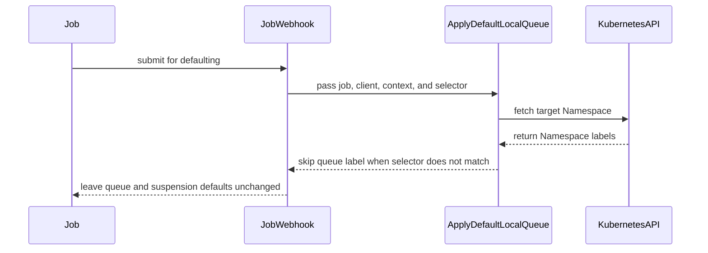

# PR #13375: Check managedJobsNamespaceSelector in Job webhooks before applying defaults

**Summary**: Check managedJobsNamespaceSelector in Job webhooks before applying defaults

**Sources**: https://github.com/kubernetes-sigs/kueue/pull/13375

**Last updated**: 2026-09-30T12:57:51Z

---

## Metadata

- **State**: closed (merged)
- **Author**: [@PannagaRao](https://github.com/PannagaRao)
- **Branch**: `fix-defaulting-webhook-namespace-selector` → `main`
- **Created**: 2026-07-22T22:04:40Z
- **Updated**: 2026-09-30T12:57:51Z
- **Merged**: 2026-07-24T10:29:52Z
- **Closed**: 2026-07-24T10:29:52Z
- **Labels**: `kind/bug`, `release-note`, `size/L`, `lgtm`, `approved`, `cncf-cla: yes`
- **Assignees**: [@mimowo](https://github.com/mimowo)
- **Requested reviewers**: [@PBundyra](https://github.com/PBundyra)
- **Changed files**: 18   **+173 / -37**

## Description

Signed-off-by: Pannaga Rao Bhoja Ramamanohara

<!--  Thanks for sending a pull request!  Here are some tips for you:

1. If this is your first time, please read our contributor guidelines: https://git.k8s.io/community/contributors/guide/first-contribution.md#your-first-contribution and developer guide https://git.k8s.io/community/contributors/devel/development.md#development-guide
2. Please label this pull request according to what type of issue you are addressing, especially if this is a release targeted pull request. For reference on required PR/issue labels, read here:
https://git.k8s.io/community/contributors/devel/sig-release/release.md#issuepr-kind-label
3. Ensure you have added or ran the appropriate tests for your PR: https://git.k8s.io/community/contributors/devel/sig-testing/testing.md
4. If you want *faster* PR reviews, read how: https://git.k8s.io/community/contributors/guide/pull-requests.md#best-practices-for-faster-reviews
5. If the PR is unfinished, see how to mark it: https://git.k8s.io/community/contributors/guide/pull-requests.md#marking-unfinished-pull-requests
-->

#### What type of PR is this?
/kind bug

#### What this PR does / why we need it:
The Job and BaseWebhook `Default()` methods now check `managedJobsNamespaceSelector` before applying any defaults, matching the existing Pod webhook behavior.

#### Which issue(s) this PR fixes:
<!--
*Automatically closes linked issue when PR is merged.
Usage: `Fixes #<issue number>`, or `Fixes (paste link of issue)`.
_If PR is about `failing-tests or flakes`, please post the related issues/tests in a comment and do not use `Fixes`_*
-->
Fixes #13374 

#### Special notes for your reviewer:

#### Does this PR introduce a user-facing change?
<!--
If no, just write "NONE" in the release-note block below.
If yes, a release note is required:
Enter your extended release note in the block below. If the PR requires additional action from users switching to the new release, include the string "action required".
-->
```release-note
ManagedJobsNamespaceSelector: Fixed a bug that added the queue-name label and suspended Jobs in excluded namespaces. Jobs in excluded namespaces are left unchanged.
```


<!-- This is an auto-generated comment: release notes by coderabbit.ai -->
## Summary by CodeRabbit

* **Bug Fixes**
  * Default local-queue label handling now consistently respects the managed-namespace selector across job-related webhooks (including Job, Deployment, JobSet, LeaderWorkerset, MPIJob, Ray*, SparkApplication, StatefulSet, and TrainJob), so workloads in unmanaged namespaces aren’t labeled or suspended.
  * Local-queue defaulting is now context/client aware, and any failures during defaulting are correctly propagated.
* **Tests**
  * Added and expanded unit and integration coverage for managed vs. unmanaged namespaces, including cases that prevent overwriting existing queue labels.
<!-- end of auto-generated comment: release notes by coderabbit.ai -->

## Discussion

### Comment by [@netlify[bot]](https://github.com/apps/netlify) — 2026-07-22T22:04:47Z

### <span aria-hidden="true">✅</span> Deploy Preview for *kubernetes-sigs-kueue* canceled.


|  Name | Link |
|:-:|------------------------|
|<span aria-hidden="true">🔨</span> Latest commit | 3d95946b7fba110e87f29bee82c669761d8aece4 |
|<span aria-hidden="true">🔍</span> Latest deploy log | https://app.netlify.com/projects/kubernetes-sigs-kueue/deploys/6a6333cc6d677a00085c6490 |

### Comment by [@coderabbitai[bot]](https://github.com/apps/coderabbitai) — 2026-07-22T22:05:11Z

<!-- This is an auto-generated comment: summarize by coderabbit.ai -->
<!-- review_stack_entry_start -->

[](https://app.coderabbit.ai/change-stack/kubernetes-sigs/kueue/pull/13375?utm_source=github_walkthrough&utm_medium=github&utm_campaign=change_stack)

<!-- review_stack_entry_end -->
<!-- This is an auto-generated comment: review paused by coderabbit.ai -->

> [!NOTE]
> ## Reviews paused
> 
> It looks like this branch is under active development. To avoid overwhelming you with review comments due to an influx of new commits, CodeRabbit has automatically paused this review. You can configure this behavior by changing the `reviews.auto_review.auto_pause_after_reviewed_commits` setting.
> 
> Use the following commands to manage reviews:
> - `@coderabbitai resume` to resume automatic reviews.
> - `@coderabbitai review` to trigger a single review.
> 
> Use the checkboxes below for quick actions:
> - [ ] <!-- {"checkboxId": "7f6cc2e2-2e4e-497a-8c31-c9e4573e93d1"} --> ▶️ Resume reviews
> - [ ] <!-- {"checkboxId": "e9bb8d72-00e8-4f67-9cb2-caf3b22574fe"} --> 🔍 Trigger review

<!-- end of auto-generated comment: review paused by coderabbit.ai -->
No actionable comments were generated in the recent review. 🎉

<details>
<summary>ℹ️ Recent review info</summary>

<details>
<summary>⚙️ Run configuration</summary>

**Configuration used**: Path: .coderabbit.yaml

**Review profile**: CHILL

**Plan**: Pro Plus

**Run ID**: `19dfdc1d-0054-4db3-9f5d-d26698c18d2c`

</details>

<details>
<summary>📥 Commits</summary>

Reviewing files that changed from the base of the PR and between 9fe3b88505d274402cb4f7e181749ee1ad65582f and 3d95946b7fba110e87f29bee82c669761d8aece4.

</details>

<details>
<summary>📒 Files selected for processing (18)</summary>

* `pkg/controller/jobframework/base_webhook.go`
* `pkg/controller/jobframework/base_webhook_test.go`
* `pkg/controller/jobframework/defaults.go`
* `pkg/controller/jobframework/defaults_test.go`
* `pkg/controller/jobframework/utils.go`
* `pkg/controller/jobs/deployment/deployment_webhook.go`
* `pkg/controller/jobs/job/job_webhook.go`
* `pkg/controller/jobs/job/job_webhook_test.go`
* `pkg/controller/jobs/jobset/jobset_webhook.go`
* `pkg/controller/jobs/leaderworkerset/leaderworkerset_webhook.go`
* `pkg/controller/jobs/mpijob/mpijob_webhook.go`
* `pkg/controller/jobs/raycluster/raycluster_webhook.go`
* `pkg/controller/jobs/rayjob/rayjob_webhook.go`
* `pkg/controller/jobs/rayservice/rayservice_webhook.go`
* `pkg/controller/jobs/sparkapplication/sparkapplication_webhook.go`
* `pkg/controller/jobs/statefulset/statefulset_webhook.go`
* `pkg/controller/jobs/trainjob/trainjob_webhook.go`
* `test/integration/singlecluster/webhook/jobs/job_webhook_test.go`

</details>

<details>
<summary>🚧 Files skipped from review as they are similar to previous changes (15)</summary>

* pkg/controller/jobs/rayservice/rayservice_webhook.go
* pkg/controller/jobs/mpijob/mpijob_webhook.go
* pkg/controller/jobs/deployment/deployment_webhook.go
* pkg/controller/jobs/raycluster/raycluster_webhook.go
* pkg/controller/jobs/sparkapplication/sparkapplication_webhook.go
* pkg/controller/jobs/leaderworkerset/leaderworkerset_webhook.go
* pkg/controller/jobframework/base_webhook.go
* pkg/controller/jobs/trainjob/trainjob_webhook.go
* pkg/controller/jobs/job/job_webhook.go
* pkg/controller/jobs/jobset/jobset_webhook.go
* pkg/controller/jobframework/base_webhook_test.go
* pkg/controller/jobs/statefulset/statefulset_webhook.go
* pkg/controller/jobframework/defaults_test.go
* pkg/controller/jobs/job/job_webhook_test.go
* pkg/controller/jobframework/defaults.go

</details>

</details>

---
<!-- walkthrough_start -->

<details>
<summary>📝 Walkthrough</summary>

## Walkthrough

Webhook local-queue defaulting now receives namespace selector context and skips queue labeling for namespaces excluded by `managedJobsNamespaceSelector`. Framework, workload-specific webhooks, namespace matching logic, and validation tests were updated.

### Changes

**Namespace selector defaulting**

|Layer / File(s)|Summary|
|---|---|
|**Gate local-queue defaulting by namespace selector** <br> `pkg/controller/jobframework/defaults.go`, `pkg/controller/jobframework/utils.go`|`ApplyDefaultLocalQueue` checks namespace labels before assigning the default queue, while `namespaceMatchesSelector` centralizes selector matching and namespace lookup errors.|
|**Wire selector-aware defaulting into webhooks** <br> `pkg/controller/jobframework/base_webhook.go`, `pkg/controller/jobs/*/*_webhook.go`|Webhook defaulting calls pass request context, the Kubernetes client, queue-existence checks, and the managed namespace selector, returning helper errors.|
|**Validate managed and unmanaged namespace behavior** <br> `pkg/controller/jobframework/*_test.go`, `pkg/controller/jobs/job/job_webhook_test.go`, `test/integration/singlecluster/webhook/jobs/job_webhook_test.go`|Tests verify that excluded namespaces do not receive the default queue label or suspension, while existing labels and managed namespace behavior remain covered.|

**Estimated code review effort:** 3 (Moderate) | ~20 minutes

**Suggested labels:** `area/integrations`

**Suggested reviewers:** `pbundyra`, `tenzen-y`

### Sequence Diagram(s)



</details>

<!-- walkthrough_end -->
<!-- pre_merge_checks_walkthrough_start -->

<details>
<summary>🚥 Pre-merge checks | ✅ 4 | ❌ 1</summary>

### ❌ Failed checks (1 warning)

|     Check name     | Status     | Explanation                                                                          | Resolution                                                                         |
| :----------------: | :--------- | :----------------------------------------------------------------------------------- | :--------------------------------------------------------------------------------- |
| Docstring Coverage | ⚠️ Warning | Docstring coverage is 0.00% which is insufficient. The required threshold is 80.00%. | Write docstrings for the functions missing them to satisfy the coverage threshold. |

<details>
<summary>✅ Passed checks (4 passed)</summary>

|         Check name         | Status   | Explanation                                                                                                                                   |
| :------------------------: | :------- | :-------------------------------------------------------------------------------------------------------------------------------------------- |
|      Description Check     | ✅ Passed | Check skipped - CodeRabbit’s high-level summary is enabled.                                                                                   |
|         Title check        | ✅ Passed | Clearly describes the main change: checking managedJobsNamespaceSelector before applying Job defaults.                                        |
|     Linked Issues check    | ✅ Passed | The selector is checked before defaulting, preventing unmanaged Jobs from getting the default queue label or being suspended; tests cover it. |
| Out of Scope Changes check | ✅ Passed | The broader webhook and helper updates all support the same selector-before-defaulting fix and are not unrelated changes.                     |

</details>

</details>

<!-- pre_merge_checks_walkthrough_end -->
<!-- finishing_touch_checkbox_start -->

<details>
<summary>✨ Finishing Touches</summary>

<details>
<summary>🧪 Generate unit tests (beta)</summary>

- [ ] <!-- {"checkboxId": "f47ac10b-58cc-4372-a567-0e02b2c3d479", "radioGroupId": "utg-output-choice-group-unknown_comment_id"} -->   Create PR with unit tests

</details>

</details>

<!-- finishing_touch_checkbox_end -->
<!-- tips_start -->

---

Thanks for using [CodeRabbit](https://coderabbit.ai?utm_source=oss&utm_medium=github&utm_campaign=kubernetes-sigs/kueue&utm_content=13375)! It's free for OSS, and your support helps us grow. If you like it, consider giving us a shout-out.

<details>
<summary>❤️ Share</summary>

- [X](https://twitter.com/intent/tweet?text=I%20just%20used%20%40coderabbitai%20for%20my%20code%20review%2C%20and%20it%27s%20fantastic%21%20It%27s%20free%20for%20OSS%20and%20offers%20a%20free%20trial%20for%20the%20proprietary%20code.%20Check%20it%20out%3A&url=https%3A//coderabbit.ai)
- [Mastodon](https://mastodon.social/share?text=I%20just%20used%20%40coderabbitai%20for%20my%20code%20review%2C%20and%20it%27s%20fantastic%21%20It%27s%20free%20for%20OSS%20and%20offers%20a%20free%20trial%20for%20the%20proprietary%20code.%20Check%20it%20out%3A%20https%3A%2F%2Fcoderabbit.ai)
- [Reddit](https://www.reddit.com/submit?title=Great%20tool%20for%20code%20review%20-%20CodeRabbit&text=I%20just%20used%20CodeRabbit%20for%20my%20code%20review%2C%20and%20it%27s%20fantastic%21%20It%27s%20free%20for%20OSS%20and%20offers%20a%20free%20trial%20for%20proprietary%20code.%20Check%20it%20out%3A%20https%3A//coderabbit.ai)
- [LinkedIn](https://www.linkedin.com/sharing/share-offsite/?url=https%3A%2F%2Fcoderabbit.ai&mini=true&title=Great%20tool%20for%20code%20review%20-%20CodeRabbit&summary=I%20just%20used%20CodeRabbit%20for%20my%20code%20review%2C%20and%20it%27s%20fantastic%21%20It%27s%20free%20for%20OSS%20and%20offers%20a%20free%20trial%20for%20proprietary%20code)

</details>


<sub>Comment `@coderabbitai help` to get the list of available commands.</sub>

<!-- tips_end -->

### Comment by [@mimowo](https://github.com/mimowo) — 2026-07-23T06:46:51Z

/release-note-edit
```release-note
Webhooks: Fix defaulting webhook injecting queue-name label and suspending jobs in namespaces excluded by managedJobsNamespaceSelector.
```

### Comment by [@mimowo](https://github.com/mimowo) — 2026-07-23T07:16:27Z

cc @kannon92

### Comment by [@kubernetes-prow[bot]](https://github.com/apps/kubernetes-prow) — 2026-07-24T09:46:28Z

LGTM label has been added.  <details>Git tree hash: 4f1fdc3290861dfe3231f780590c90691178299b</details>

### Comment by [@kubernetes-prow[bot]](https://github.com/apps/kubernetes-prow) — 2026-07-24T09:46:31Z

[APPROVALNOTIFIER] This PR is **APPROVED**

This pull-request has been approved by: *<a href="https://github.com/kubernetes-sigs/kueue/pull/13375#pullrequestreview-4772090198" title="Approved">mimowo</a>*, *<a href="https://github.com/kubernetes-sigs/kueue/pull/13375#" title="Author self-approved">PannagaRao</a>*

The full list of commands accepted by this bot can be found [here](https://go.k8s.io/bot-commands?repo=kubernetes-sigs%2Fkueue).

The pull request process is described [here](https://git.k8s.io/community/contributors/guide/owners.md#the-code-review-process)

<details >
Needs approval from an approver in each of these files:

- ~~[pkg/controller/OWNERS](https://github.com/kubernetes-sigs/kueue/blob/main/pkg/controller/OWNERS)~~ [mimowo]
- ~~[test/OWNERS](https://github.com/kubernetes-sigs/kueue/blob/main/test/OWNERS)~~ [mimowo]

Approvers can indicate their approval by writing `/approve` in a comment
Approvers can cancel approval by writing `/approve cancel` in a comment
</details>
<!-- META={"approvers":[]} -->

### Comment by [@mimowo](https://github.com/mimowo) — 2026-07-24T09:46:44Z

Please prepare the CPs manually in case the robot fails on conflicts

### Comment by [@PannagaRao](https://github.com/PannagaRao) — 2026-07-24T10:32:52Z

/cherrypick release-0.19

### Comment by [@k8s-infra-cherrypick-robot](https://github.com/k8s-infra-cherrypick-robot) — 2026-07-24T10:33:32Z

@PannagaRao: new pull request created: #13459

<details>

In response to [this](https://github.com/kubernetes-sigs/kueue/pull/13375#issuecomment-5068843858):

>/cherrypick release-0.19


Instructions for interacting with me using PR comments are available [here](https://git.k8s.io/community/contributors/guide/pull-requests.md).  If you have questions or suggestions related to my behavior, please file an issue against the [kubernetes-sigs/prow](https://github.com/kubernetes-sigs/prow/issues/new?title=Prow%20issue:) repository.
</details>

### Comment by [@PannagaRao](https://github.com/PannagaRao) — 2026-07-24T10:36:24Z

/cherrypick release-0.18

### Comment by [@k8s-infra-cherrypick-robot](https://github.com/k8s-infra-cherrypick-robot) — 2026-07-24T10:37:03Z

@PannagaRao: new pull request created: #13460

<details>

In response to [this](https://github.com/kubernetes-sigs/kueue/pull/13375#issuecomment-5068874750):

>/cherrypick release-0.18


Instructions for interacting with me using PR comments are available [here](https://git.k8s.io/community/contributors/guide/pull-requests.md).  If you have questions or suggestions related to my behavior, please file an issue against the [kubernetes-sigs/prow](https://github.com/kubernetes-sigs/prow/issues/new?title=Prow%20issue:) repository.
</details>

### Comment by [@tenzen-y](https://github.com/tenzen-y) — 2026-08-12T11:11:59Z

/release-note-edit

```release-note
managedJobsNamespaceSelector: Fixed a bug that added the queue-name label and suspended Jobs in excluded namespaces. Jobs in excluded namespaces are left unchanged.`
```

### Comment by [@mimowo](https://github.com/mimowo) — 2026-09-30T12:57:48Z

/release-note-edit
```release-note
ManagedJobsNamespaceSelector: Fixed a bug that added the queue-name label and suspended Jobs in excluded namespaces. Jobs in excluded namespaces are left unchanged.
```

## Reviews

### Review by [@coderabbitai[bot]](https://github.com/apps/coderabbitai) (commented) — 2026-07-22T22:08:09Z

**Actionable comments posted: 1**

<details>
<summary>🤖 Prompt for all review comments with AI agents</summary>

```
Verify each finding against current code. Fix only still-valid issues, skip the
rest with a brief reason, keep changes minimal, and validate.

Inline comments:
In `@test/integration/singlecluster/webhook/jobs/job_webhook_test.go`:
- Around line 103-111: The test must ensure the LocalQueue created as defaultLq
is available in the webhook cache before creating the Job. Adjust the setup
around the test’s manager/cache lifecycle to create defaultLq before starting
the manager, or wait for the explicit queue-cache readiness signal before
calling MustCreate for the Job, while preserving the existing
unmanaged-namespace assertions and cleanup.
```

</details>

<details>
<summary>🪄 Autofix (Beta)</summary>

Fix all unresolved CodeRabbit comments on this PR:

- [ ] <!-- {"checkboxId": "4b0d0e0a-96d7-4f10-b296-3a18ea78f0b9"} --> Push a commit to this branch (recommended)
- [ ] <!-- {"checkboxId": "ff5b1114-7d8c-49e6-8ac1-43f82af23a33"} --> Create a new PR with the fixes

</details>

---

<details>
<summary>ℹ️ Review info</summary>

<details>
<summary>⚙️ Run configuration</summary>

**Configuration used**: Path: .coderabbit.yaml

**Review profile**: CHILL

**Plan**: Pro

**Run ID**: `1a1ec8b2-a74d-4e20-a852-1f7ccd0af8af`

</details>

<details>
<summary>📥 Commits</summary>

Reviewing files that changed from the base of the PR and between a6a57123e7e0ff88bb5964a3fa96907e25746ee8 and 2d0d050ff35f382b64b57484490e9ee52f984fe8.

</details>

<details>
<summary>📒 Files selected for processing (4)</summary>

* `pkg/controller/jobframework/base_webhook.go`
* `pkg/controller/jobframework/base_webhook_test.go`
* `pkg/controller/jobs/job/job_webhook.go`
* `test/integration/singlecluster/webhook/jobs/job_webhook_test.go`

</details>

</details>

<!-- This is an auto-generated comment by CodeRabbit for review status -->

- **test/integration/singlecluster/webhook/jobs/job_webhook_test.go:110** by [@coderabbitai[bot]](https://github.com/apps/coderabbitai) — 2026-07-22T22:08:07Z
```diff
@@ -99,6 +100,37 @@ var _ = ginkgo.Describe("Job Webhook With manageJobsWithoutQueueName enabled", f
 		}, util.ConsistentDuration, util.ShortInterval).Should(gomega.Succeed())
 	})
 
+	ginkgo.It("Should not inject default queue label for a Job in an unmanaged namespace", func() {
+		defaultLq := utiltestingapi.MakeLocalQueue("default", unmanagedNs.Name).ClusterQueue("cluster-queue").Obj()
+		util.MustCreate(ctx, k8sClient, defaultLq)
+		ginkgo.DeferCleanup(func() {
+			gomega.Expect(client.IgnoreNotFound(k8sClient.Delete(ctx, defaultLq))).To(gomega.Succeed())
+		})
+
+		j := testingjob.MakeJob("job-default-lq-unmanaged", unmanagedNs.Name).Suspend(false).Obj()
+		util.MustCreate(ctx, k8sClient, j)
```

  _🎯 Functional Correctness_ | _🟡 Minor_ | _⚡ Quick win_
  
  **Ensure the LocalQueue is visible to the webhook cache before creating the Job.**
  
  `MustCreate` only confirms API persistence; admission can run before `DefaultLocalQueueExist` observes this LocalQueue. Then this test passes even if selector gating is removed. Create the LocalQueue before starting the manager, or wait on an explicit queue-cache readiness signal.
  
  <details>
  <summary>🤖 Prompt for AI Agents</summary>
  
  ```
  Verify each finding against current code. Fix only still-valid issues, skip the
  rest with a brief reason, keep changes minimal, and validate.
  
  In `@test/integration/singlecluster/webhook/jobs/job_webhook_test.go` around lines
  103 - 111, The test must ensure the LocalQueue created as defaultLq is available
  in the webhook cache before creating the Job. Adjust the setup around the test’s
  manager/cache lifecycle to create defaultLq before starting the manager, or wait
  for the explicit queue-cache readiness signal before calling MustCreate for the
  Job, while preserving the existing unmanaged-namespace assertions and cleanup.
  ```
  
  </details>
  
  <!-- fingerprinting:phantom:poseidon:terra -->
  
  <!-- cr-indicator-types:potential_issue -->
  
  <!-- cr-comment:v1:13260445a400806a887eb1a6 -->
  
  <!-- This is an auto-generated comment by CodeRabbit -->
  
  ✅ Addressed in commit 6d08155

### Review by [@mimowo](https://github.com/mimowo) (commented) — 2026-07-23T06:45:50Z

- **test/integration/singlecluster/webhook/jobs/job_webhook_test.go:119** by [@mimowo](https://github.com/mimowo) — 2026-07-23T06:45:50Z
```diff
@@ -99,6 +100,37 @@ var _ = ginkgo.Describe("Job Webhook With manageJobsWithoutQueueName enabled", f
 		}, util.ConsistentDuration, util.ShortInterval).Should(gomega.Succeed())
 	})
 
+	ginkgo.It("Should not inject default queue label for a Job in an unmanaged namespace", func() {
+		defaultLq := utiltestingapi.MakeLocalQueue("default", unmanagedNs.Name).ClusterQueue("cluster-queue").Obj()
+		util.MustCreate(ctx, k8sClient, defaultLq)
+		ginkgo.DeferCleanup(func() {
+			gomega.Expect(client.IgnoreNotFound(k8sClient.Delete(ctx, defaultLq))).To(gomega.Succeed())
+		})
+
+		j := testingjob.MakeJob("job-default-lq-unmanaged", unmanagedNs.Name).Suspend(false).Obj()
+		util.MustCreate(ctx, k8sClient, j)
+
+		lookupKey := types.NamespacedName{Name: j.Name, Namespace: j.Namespace}
+		createdJob := &batchv1.Job{}
+		gomega.Consistently(func(g gomega.Gomega) {
+			g.Expect(k8sClient.Get(ctx, lookupKey, createdJob)).Should(gomega.Succeed())
+			g.Expect(createdJob.Spec.Suspend).Should(gomega.Equal(new(false)))
+			g.Expect(createdJob.Labels).ShouldNot(gomega.HaveKey(constants.QueueLabel))
+		}, util.ConsistentDuration, util.ShortInterval).Should(gomega.Succeed())
```

  nit, I wouldn't use consistently here as this is time-costly. Since they are injected by webhook they are either injected on creation or never. I know this is "knowing" about the impl, but time is important for our CI testing, so I think we need to be careful about overusing Consitently.

### Review by [@mimowo](https://github.com/mimowo) (commented) — 2026-07-23T06:55:31Z

- **pkg/controller/jobs/job/job_webhook.go:116** by [@mimowo](https://github.com/mimowo) — 2026-07-23T06:55:31Z
```diff
@@ -104,6 +105,16 @@ func (w *JobWebhook) Default(ctx context.Context, obj *batchv1.Job) error {
 	log := ctrl.LoggerFrom(ctx).WithName("job-webhook")
 	log.V(5).Info("Applying defaults")
 
+	if w.managedJobsNamespaceSelector != nil {
+		ns := corev1.Namespace{}
+		if err := w.client.Get(ctx, client.ObjectKey{Name: obj.GetNamespace()}, &ns); err != nil {
+			return fmt.Errorf("failed to get namespace: %w", err)
+		}
+		if !w.managedJobsNamespaceSelector.Matches(labels.Set(ns.GetLabels())) {
+			return nil
+		}
+	}
```

  Hm, what about many other Jobs like Pods. Kuberay, JobSet or LWS, etc.? 
  
  Should we rather move this verification into `jobframework.ApplyDefaultLocalQueue`? Otherwise we need to make it a one-liner check and inject everywhere before calling `jobframework.ApplyDefaultLocalQueue`, iiuc?

### Review by [@PannagaRao](https://github.com/PannagaRao) (commented) — 2026-07-23T20:15:00Z

- **pkg/controller/jobs/job/job_webhook.go:116** by [@PannagaRao](https://github.com/PannagaRao) — 2026-07-23T20:15:00Z
```diff
@@ -104,6 +105,16 @@ func (w *JobWebhook) Default(ctx context.Context, obj *batchv1.Job) error {
 	log := ctrl.LoggerFrom(ctx).WithName("job-webhook")
 	log.V(5).Info("Applying defaults")
 
+	if w.managedJobsNamespaceSelector != nil {
+		ns := corev1.Namespace{}
+		if err := w.client.Get(ctx, client.ObjectKey{Name: obj.GetNamespace()}, &ns); err != nil {
+			return fmt.Errorf("failed to get namespace: %w", err)
+		}
+		if !w.managedJobsNamespaceSelector.Matches(labels.Set(ns.GetLabels())) {
+			return nil
+		}
+	}
```

  Thanks for the review! Moved the namespace selector check into ApplyDefaultLocalQueue tocover all integrations.

### Review by [@PannagaRao](https://github.com/PannagaRao) (commented) — 2026-07-23T20:15:25Z

- **test/integration/singlecluster/webhook/jobs/job_webhook_test.go:119** by [@PannagaRao](https://github.com/PannagaRao) — 2026-07-23T20:15:25Z
```diff
@@ -99,6 +100,37 @@ var _ = ginkgo.Describe("Job Webhook With manageJobsWithoutQueueName enabled", f
 		}, util.ConsistentDuration, util.ShortInterval).Should(gomega.Succeed())
 	})
 
+	ginkgo.It("Should not inject default queue label for a Job in an unmanaged namespace", func() {
+		defaultLq := utiltestingapi.MakeLocalQueue("default", unmanagedNs.Name).ClusterQueue("cluster-queue").Obj()
+		util.MustCreate(ctx, k8sClient, defaultLq)
+		ginkgo.DeferCleanup(func() {
+			gomega.Expect(client.IgnoreNotFound(k8sClient.Delete(ctx, defaultLq))).To(gomega.Succeed())
+		})
+
+		j := testingjob.MakeJob("job-default-lq-unmanaged", unmanagedNs.Name).Suspend(false).Obj()
+		util.MustCreate(ctx, k8sClient, j)
+
+		lookupKey := types.NamespacedName{Name: j.Name, Namespace: j.Namespace}
+		createdJob := &batchv1.Job{}
+		gomega.Consistently(func(g gomega.Gomega) {
+			g.Expect(k8sClient.Get(ctx, lookupKey, createdJob)).Should(gomega.Succeed())
+			g.Expect(createdJob.Spec.Suspend).Should(gomega.Equal(new(false)))
+			g.Expect(createdJob.Labels).ShouldNot(gomega.HaveKey(constants.QueueLabel))
+		}, util.ConsistentDuration, util.ShortInterval).Should(gomega.Succeed())
```

  Done. Replaced Consistently with direct check

### Review by [@mimowo](https://github.com/mimowo) (commented) — 2026-07-23T20:15:34Z

- **pkg/controller/jobframework/defaults.go:54** by [@mimowo](https://github.com/mimowo) — 2026-07-23T20:15:34Z
```diff
@@ -46,7 +47,16 @@ func ApplyDefaultForSuspend(ctx context.Context, job GenericJob, k8sClient clien
 	return nil
 }
 
-func ApplyDefaultLocalQueue(jobObj client.Object, defaultQueueExist func(string) bool) {
+func ApplyDefaultLocalQueue(ctx context.Context, k8sClient client.Client, jobObj client.Object, defaultQueueExist func(string) bool, managedJobsNamespaceSelector labels.Selector) {
+	if managedJobsNamespaceSelector != nil {
+		ns := corev1.Namespace{}
+		if err := k8sClient.Get(ctx, client.ObjectKey{Name: jobObj.GetNamespace()}, &ns); err != nil {
+			return
```

  Let's propagate the error up.

### Review by [@mimowo](https://github.com/mimowo) (commented) — 2026-07-23T20:18:11Z

- **pkg/controller/jobframework/defaults.go:59** by [@mimowo](https://github.com/mimowo) — 2026-07-23T20:18:11Z
```diff
@@ -46,7 +47,16 @@ func ApplyDefaultForSuspend(ctx context.Context, job GenericJob, k8sClient clien
 	return nil
 }
 
-func ApplyDefaultLocalQueue(jobObj client.Object, defaultQueueExist func(string) bool) {
+func ApplyDefaultLocalQueue(ctx context.Context, k8sClient client.Client, jobObj client.Object, defaultQueueExist func(string) bool, managedJobsNamespaceSelector labels.Selector) {
+	if managedJobsNamespaceSelector != nil {
+		ns := corev1.Namespace{}
+		if err := k8sClient.Get(ctx, client.ObjectKey{Name: jobObj.GetNamespace()}, &ns); err != nil {
+			return
+		}
+		if !managedJobsNamespaceSelector.Matches(labels.Set(ns.GetLabels())) {
+			return
+		}
+	}
```

  Extract the check to a helper functions, and I think we could check it only later, somwhere here: https://github.com/kubernetes-sigs/kueue/pull/13375/changes#diff-499dd23c8f7c3f92136abb69dd3ab665bf388142fcf2e03104b66d95f66173fdR67

### Review by [@kannon92](https://github.com/kannon92) (commented) — 2026-07-23T20:22:25Z

- **test/integration/singlecluster/webhook/jobs/job_webhook_test.go:115** by [@kannon92](https://github.com/kannon92) — 2026-07-23T20:22:26Z
```diff
@@ -99,6 +100,23 @@ var _ = ginkgo.Describe("Job Webhook With manageJobsWithoutQueueName enabled", f
 		}, util.ConsistentDuration, util.ShortInterval).Should(gomega.Succeed())
 	})
 
+	ginkgo.It("Should not inject default queue label for a Job in an unmanaged namespace", func() {
+		defaultLq := utiltestingapi.MakeLocalQueue("default", unmanagedNs.Name).ClusterQueue("cluster-queue").Obj()
+		util.MustCreate(ctx, k8sClient, defaultLq)
+		ginkgo.DeferCleanup(func() {
+			gomega.Expect(client.IgnoreNotFound(k8sClient.Delete(ctx, defaultLq))).To(gomega.Succeed())
+		})
+
+		j := testingjob.MakeJob("job-default-lq-unmanaged", unmanagedNs.Name).Suspend(false).Obj()
+		util.MustCreate(ctx, k8sClient, j)
+
+		lookupKey := types.NamespacedName{Name: j.Name, Namespace: j.Namespace}
+		createdJob := &batchv1.Job{}
+		gomega.Expect(k8sClient.Get(ctx, lookupKey, createdJob)).Should(gomega.Succeed())
```

  I would probably have an eventually here with a short timelimit but there should be cases where the job does not create fast enough for this code.

### Review by [@PannagaRao](https://github.com/PannagaRao) (commented) — 2026-07-23T21:26:44Z

- **test/integration/singlecluster/webhook/jobs/job_webhook_test.go:115** by [@PannagaRao](https://github.com/PannagaRao) — 2026-07-23T21:26:43Z
```diff
@@ -99,6 +100,23 @@ var _ = ginkgo.Describe("Job Webhook With manageJobsWithoutQueueName enabled", f
 		}, util.ConsistentDuration, util.ShortInterval).Should(gomega.Succeed())
 	})
 
+	ginkgo.It("Should not inject default queue label for a Job in an unmanaged namespace", func() {
+		defaultLq := utiltestingapi.MakeLocalQueue("default", unmanagedNs.Name).ClusterQueue("cluster-queue").Obj()
+		util.MustCreate(ctx, k8sClient, defaultLq)
+		ginkgo.DeferCleanup(func() {
+			gomega.Expect(client.IgnoreNotFound(k8sClient.Delete(ctx, defaultLq))).To(gomega.Succeed())
+		})
+
+		j := testingjob.MakeJob("job-default-lq-unmanaged", unmanagedNs.Name).Suspend(false).Obj()
+		util.MustCreate(ctx, k8sClient, j)
+
+		lookupKey := types.NamespacedName{Name: j.Name, Namespace: j.Namespace}
+		createdJob := &batchv1.Job{}
+		gomega.Expect(k8sClient.Get(ctx, lookupKey, createdJob)).Should(gomega.Succeed())
```

  Added Eventually with a ShortTimeOut

### Review by [@PannagaRao](https://github.com/PannagaRao) (commented) — 2026-07-23T21:27:12Z

- **pkg/controller/jobframework/defaults.go:59** by [@PannagaRao](https://github.com/PannagaRao) — 2026-07-23T21:27:12Z
```diff
@@ -46,7 +47,16 @@ func ApplyDefaultForSuspend(ctx context.Context, job GenericJob, k8sClient clien
 	return nil
 }
 
-func ApplyDefaultLocalQueue(jobObj client.Object, defaultQueueExist func(string) bool) {
+func ApplyDefaultLocalQueue(ctx context.Context, k8sClient client.Client, jobObj client.Object, defaultQueueExist func(string) bool, managedJobsNamespaceSelector labels.Selector) {
+	if managedJobsNamespaceSelector != nil {
+		ns := corev1.Namespace{}
+		if err := k8sClient.Get(ctx, client.ObjectKey{Name: jobObj.GetNamespace()}, &ns); err != nil {
+			return
+		}
+		if !managedJobsNamespaceSelector.Matches(labels.Set(ns.GetLabels())) {
+			return
+		}
+	}
```

  Done. Extracted the check into a shared helper.

### Review by [@PannagaRao](https://github.com/PannagaRao) (commented) — 2026-07-23T21:27:24Z

- **pkg/controller/jobframework/defaults.go:54** by [@PannagaRao](https://github.com/PannagaRao) — 2026-07-23T21:27:24Z
```diff
@@ -46,7 +47,16 @@ func ApplyDefaultForSuspend(ctx context.Context, job GenericJob, k8sClient clien
 	return nil
 }
 
-func ApplyDefaultLocalQueue(jobObj client.Object, defaultQueueExist func(string) bool) {
+func ApplyDefaultLocalQueue(ctx context.Context, k8sClient client.Client, jobObj client.Object, defaultQueueExist func(string) bool, managedJobsNamespaceSelector labels.Selector) {
+	if managedJobsNamespaceSelector != nil {
+		ns := corev1.Namespace{}
+		if err := k8sClient.Get(ctx, client.ObjectKey{Name: jobObj.GetNamespace()}, &ns); err != nil {
+			return
```

  Done

### Review by [@mimowo](https://github.com/mimowo) (commented) — 2026-07-24T07:12:40Z

- **pkg/controller/jobframework/utils.go:134** by [@mimowo](https://github.com/mimowo) — 2026-07-24T07:12:40Z
```diff
@@ -124,22 +124,24 @@ func WorkloadShouldBeSuspended(ctx context.Context, jobObj client.Object, k8sCli
 
 	// Logic for managing jobs without queue names.
 	if manageJobsWithoutQueueName {
-		if managedJobsNamespaceSelector != nil {
-			// Default suspend the job if the namespace selector matches
-			ns := corev1.Namespace{}
-			err := k8sClient.Get(ctx, client.ObjectKey{Name: jobObj.GetNamespace()}, &ns)
-			if err != nil {
-				return false, fmt.Errorf("failed to get namespace: %w", err)
-			}
-			return managedJobsNamespaceSelector.Matches(labels.Set(ns.GetLabels())), nil
-		} else {
-			// Namespace filtering is disabled; unconditionally default suspend
-			return true, nil
-		}
+		return NamespaceMatchesSelector(ctx, k8sClient, jobObj.GetNamespace(), managedJobsNamespaceSelector)
 	}
 	return false, nil
 }
 
+// NamespaceMatchesSelector returns true if the namespace matches the given selector.
+// If the selector is nil, all namespaces are considered matching.
+func NamespaceMatchesSelector(ctx context.Context, k8sClient client.Client, namespace string, selector labels.Selector) (bool, error) {
```

  nit, but I think we don't need exporing this function  because it is called from jobframework

### Review by [@mimowo](https://github.com/mimowo) (commented) — 2026-07-24T07:13:31Z

- **pkg/controller/jobframework/utils.go:127** by [@mimowo](https://github.com/mimowo) — 2026-07-24T07:13:31Z
```diff
@@ -124,22 +124,24 @@ func WorkloadShouldBeSuspended(ctx context.Context, jobObj client.Object, k8sCli
 
 	// Logic for managing jobs without queue names.
 	if manageJobsWithoutQueueName {
-		if managedJobsNamespaceSelector != nil {
-			// Default suspend the job if the namespace selector matches
-			ns := corev1.Namespace{}
-			err := k8sClient.Get(ctx, client.ObjectKey{Name: jobObj.GetNamespace()}, &ns)
-			if err != nil {
-				return false, fmt.Errorf("failed to get namespace: %w", err)
-			}
-			return managedJobsNamespaceSelector.Matches(labels.Set(ns.GetLabels())), nil
-		} else {
-			// Namespace filtering is disabled; unconditionally default suspend
-			return true, nil
-		}
+		return NamespaceMatchesSelector(ctx, k8sClient, jobObj.GetNamespace(), managedJobsNamespaceSelector)
```

  Nice notice for commonizing the code 🥇

### Review by [@mimowo](https://github.com/mimowo) (commented) — 2026-07-24T07:15:07Z

- **test/integration/singlecluster/webhook/jobs/job_webhook_test.go:107** by [@mimowo](https://github.com/mimowo) — 2026-07-24T07:15:07Z
```diff
@@ -99,6 +100,25 @@ var _ = ginkgo.Describe("Job Webhook With manageJobsWithoutQueueName enabled", f
 		}, util.ConsistentDuration, util.ShortInterval).Should(gomega.Succeed())
 	})
 
+	ginkgo.It("Should not inject default queue label for a Job in an unmanaged namespace", func() {
+		defaultLq := utiltestingapi.MakeLocalQueue("default", unmanagedNs.Name).ClusterQueue("cluster-queue").Obj()
+		util.MustCreate(ctx, k8sClient, defaultLq)
+		ginkgo.DeferCleanup(func() {
+			gomega.Expect(client.IgnoreNotFound(k8sClient.Delete(ctx, defaultLq))).To(gomega.Succeed())
```

  nit, could you use the util.ExpectObjectDeleted as it handles retries in case of transient api-server issues

### Review by [@mimowo](https://github.com/mimowo) (commented) — 2026-07-24T07:15:56Z

LGTM overall, thank you 👍

### Review by [@PannagaRao](https://github.com/PannagaRao) (commented) — 2026-07-24T09:43:59Z

- **test/integration/singlecluster/webhook/jobs/job_webhook_test.go:107** by [@PannagaRao](https://github.com/PannagaRao) — 2026-07-24T09:43:59Z
```diff
@@ -99,6 +100,25 @@ var _ = ginkgo.Describe("Job Webhook With manageJobsWithoutQueueName enabled", f
 		}, util.ConsistentDuration, util.ShortInterval).Should(gomega.Succeed())
 	})
 
+	ginkgo.It("Should not inject default queue label for a Job in an unmanaged namespace", func() {
+		defaultLq := utiltestingapi.MakeLocalQueue("default", unmanagedNs.Name).ClusterQueue("cluster-queue").Obj()
+		util.MustCreate(ctx, k8sClient, defaultLq)
+		ginkgo.DeferCleanup(func() {
+			gomega.Expect(client.IgnoreNotFound(k8sClient.Delete(ctx, defaultLq))).To(gomega.Succeed())
```

  Done

### Review by [@mimowo](https://github.com/mimowo) (commented) — 2026-07-24T09:46:20Z

/lgtm
/approve
/cherrypick release-0.19
/cherrypick release-0.18
Thank you for fixing the LocalQueueDefaulting feature 👍
