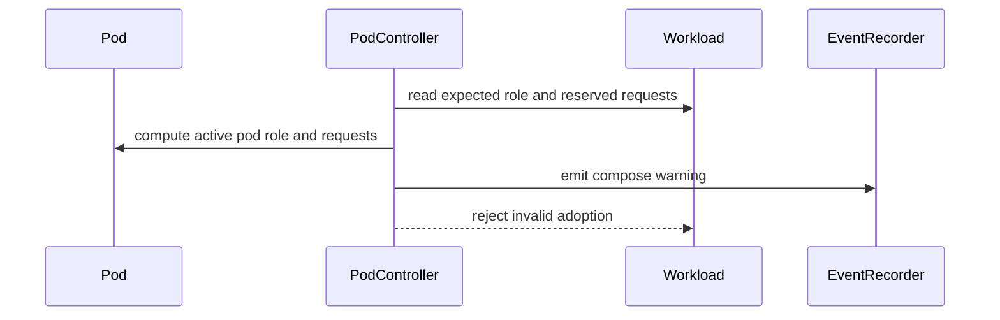

# PR #13382: fix(pod): prevent role-hash forgery and oversized pod admission

**Summary**: fix(pod): prevent role-hash forgery and oversized pod admission

**Sources**: https://github.com/kubernetes-sigs/kueue/pull/13382

**Last updated**: 2026-08-26T22:38:55Z

---

## Metadata

- **State**: open
- **Author**: [@vladikkuzn](https://github.com/vladikkuzn)
- **Branch**: `fix/pod-role-hash-forgery` → `main`
- **Created**: 2026-07-23T03:19:08Z
- **Updated**: 2026-08-26T22:38:55Z
- **Merged**: —
- **Closed**: —
- **Labels**: `kind/bug`, `size/XXL`, `release-note-action-required`, `needs-rebase`, `do-not-merge/hold`, `cncf-cla: yes`, `area/integrations`
- **Assignees**: [@vladikkuzn](https://github.com/vladikkuzn)
- **Requested reviewers**: [@amy](https://github.com/amy), [@mwielgus](https://github.com/mwielgus), [@olekzabl](https://github.com/olekzabl)
- **Changed files**: 12   **+1222 / -186**

## Description

#### What type of PR is this?

/kind bug
/area integrations

#### What this PR does / why we need it:

## Context

This is **Vector 2** of the pod-group quota-bypass fix, split out from #13014 per review feedback.

Sibling PR (#13014) covers **Vector 1** (cross-framework Workload hijack via `pod-group-name` / `is-group-workload` adoption refusal).

### Vector 2 — Intra-group role-hash forgery (+ defense in depth)

`getRoleHash` trusts a user-supplied `kueue.x-k8s.io/role-hash` annotation, and the create-only mutating webhook previously preserved that value instead of recomputing it. The role hash is the podset identity and normally binds resource requests. By forging the annotation to an existing role's hash, a tenant can run an oversized Pod under a cheaper role of a genuine pod-group Workload (within its count).

## Approach

- **Root cause:** the create-only mutating webhook recomputes the role hash from the Pod spec for tenant Pods, and preserves it only for matching parent-managed integrations (`SuspendedByParent` + ancestor GVK) or prebuilt Workloads.
- **Defense in depth:** on the adoption path (`FindMatchingWorkloads`), refuse to adopt a Pod that requests more of any resource than its role reserves in the existing Workload, setting a `ComposeRejected` condition and emitting a Warning event instead of deleting the Workload. Fresh group construction is unaffected: it takes the element-wise maximum of requests per role and does not reject.

Both behaviours are gated by the new `PodIntegrationRecomputeRoleHash` feature gate (Beta, enabled by default). Disabling it restores the previous behaviour: the webhook honours a supplied role-hash annotation, and the adoption path does not reject oversized Pods.

#### Which issue(s) this PR fixes:
<!--
*Automatically closes linked issue when PR is merged.
Usage: `Fixes #<issue number>`, or `Fixes (paste link of issue)`.
_If PR is about `failing-tests or flakes`, please post the related issues/tests in a comment and do not use `Fixes`_*
-->

#### Special notes for your reviewer:

- Split from #13014 (Vector 1 remains there). Includes approved review-comment cleanups from that PR (structured error helpers, flattened fast-admission loop, split `addRoleHash` / `preserveRoleHashAnnotation`, fixture UID alignment, comments).
- Owner-reference UID validation in `FindAncestorJobManagedByKueue` was de-coupled from this PR and now lives in #13802.

#### Does this PR introduce a user-facing change?
<!--
If no, just write "NONE" in the release-note block below.
If yes, a release note is required:
Enter your extended release note in the block below. If the PR requires additional action from users switching to the new release, include the string "action required".
-->
```release-note
action required: Pods: Fixed a bug where a Pod could bypass ClusterQueue quota by forging the `kueue.x-k8s.io/role-hash` annotation to run oversized Pods under a cheaper role. Kueue now recomputes the role hash from the Pod spec for tenant-created Pods, preserving a supplied hash only for prebuilt Workloads and for parent-managed Pods whose ancestor is managed by the corresponding integration, and refuses to adopt a Pod that requests more resources than its role reserves in the existing Workload. Operators whose Pods are created exclusively by a trusted controller and that set `kueue.x-k8s.io/role-hash` themselves can set the `PodIntegrationRecomputeRoleHash=false` feature gate to keep the previous behaviour; otherwise replacement Pods in existing Pod groups may remain SchedulingGated.
```

## Discussion

### Comment by [@netlify[bot]](https://github.com/apps/netlify) — 2026-07-23T03:19:13Z

### <span aria-hidden="true">✅</span> Deploy Preview for *kubernetes-sigs-kueue* ready!


|  Name | Link |
|:-:|------------------------|
|<span aria-hidden="true">🔨</span> Latest commit | 8d4093f92e463d4a6bf08c77ece1bbe29f382993 |
|<span aria-hidden="true">🔍</span> Latest deploy log | https://app.netlify.com/projects/kubernetes-sigs-kueue/deploys/6a7a6fbf0d561400080beb93 |
|<span aria-hidden="true">😎</span> Deploy Preview | [https://deploy-preview-13382--kubernetes-sigs-kueue.netlify.app](https://deploy-preview-13382--kubernetes-sigs-kueue.netlify.app) |
|<span aria-hidden="true">📱</span> Preview on mobile | <details><summary> Toggle QR Code... </summary><br /><br /><br /><br />_Use your smartphone camera to open QR code link._</details> |
---
<!-- [kubernetes-sigs-kueue Preview](https://deploy-preview-13382--kubernetes-sigs-kueue.netlify.app) -->
_To edit notification comments on pull requests, go to your [Netlify project configuration](https://app.netlify.com/projects/kubernetes-sigs-kueue/configuration/notifications#deploy-notifications)._

### Comment by [@vladikkuzn](https://github.com/vladikkuzn) — 2026-07-23T03:19:35Z

Split out from https://github.com/kubernetes-sigs/kueue/pull/13014 per review feedback that the original XL change mixed two independent quota-bypass vectors.

- **This PR (Vector 2):** role-hash forgery defenses (webhook recompute/preserve, per-role request limits, ownerRef UID validation) plus the review cleanups from #13014.
- **Sibling (Vector 1):** https://github.com/kubernetes-sigs/kueue/pull/13014 — refuse adopting non-pod-group Workloads by group name.

The two PRs are independent off `main` and can be reviewed/merged separately.

### Comment by [@coderabbitai[bot]](https://github.com/apps/coderabbitai) — 2026-07-23T03:19:41Z

<!-- This is an auto-generated comment: summarize by coderabbit.ai -->
<!-- review_stack_entry_start -->

[](https://app.coderabbit.ai/change-stack/kubernetes-sigs/kueue/pull/13382?utm_source=github_walkthrough&utm_medium=github&utm_campaign=change_stack)

<!-- review_stack_entry_end -->
<!-- This is an auto-generated comment: review paused by coderabbit.ai -->

> [!NOTE]
> ## Reviews paused
> 
> It looks like this branch is under active development. To avoid overwhelming you with review comments due to an influx of new commits, CodeRabbit has automatically paused this review. You can configure this behavior by changing the `reviews.auto_review.auto_pause_after_reviewed_commits` setting.
> 
> Use the following commands to manage reviews:
> - `@coderabbitai resume` to resume automatic reviews.
> - `@coderabbitai review` to trigger a single review.
> 
> Use the checkboxes below for quick actions:
> - [ ] <!-- {"checkboxId": "7f6cc2e2-2e4e-497a-8c31-c9e4573e93d1"} --> ▶️ Resume reviews
> - [ ] <!-- {"checkboxId": "e9bb8d72-00e8-4f67-9cb2-caf3b22574fe"} --> 🔍 Trigger review

<!-- end of auto-generated comment: review paused by coderabbit.ai -->
<!-- walkthrough_start -->

<details>
<summary>📝 Walkthrough</summary>

## Walkthrough

Ownership traversal now validates UIDs, unretryable compose errors emit warning events, pod-group admission enforces role and resource consistency, and pod webhook defaulting distinguishes trusted role-hash preservation from recomputation.

### Changes

**Pod admission and ownership safety**

|Layer / File(s)|Summary|
|---|---|
|**Ownership identity and compose error guards** <br> `pkg/controller/jobframework/reconciler.go`, `pkg/controller/jobframework/reconciler_test.go`, `pkg/controller/jobs/job/job_controller_test.go`, `pkg/util/testingjobs/{job,pod}/wrappers.go`|Ancestor traversal stops on owner UID mismatches, unretryable compose errors emit warning events, and test scenarios use explicit owner identities.|
|**Role-hash recomputation and preservation** <br> `pkg/controller/jobs/pod/pod_webhook.go`, `pkg/controller/jobs/pod/pod_webhook_test.go`|Pod defaulting recomputes untrusted role hashes and preserves them only for verified prebuilt or parent-managed integrations.|
|**Pod-group role and resource validation** <br> `pkg/controller/jobs/pod/pod_controller.go`, `pkg/controller/jobs/pod/pod_controller_test.go`, `test/integration/singlecluster/controller/jobs/pod/pod_controller_test.go`|Fast and regular pod-group paths reject divergent roles and requests above reservations, enforce count bounds, emit warning events, and verify non-adoption through unit and integration tests.|

**Estimated code review effort:** 4 (Complex) | ~45 minutes

### Sequence Diagram(s)



**Possibly related PRs**

- [kubernetes-sigs/kueue#13014](https://github.com/kubernetes-sigs/kueue/pull/13014): Overlaps on owner UID validation and warning events for unretryable compose failures.
- [kubernetes-sigs/kueue#13299](https://github.com/kubernetes-sigs/kueue/pull/13299): Overlaps on trusted role-hash preservation and recomputation in the pod webhook.
- [kubernetes-sigs/kueue#13498](https://github.com/kubernetes-sigs/kueue/pull/13498): Overlaps on fast-admission role-hash divergence detection and integration coverage.

**Suggested labels:** `area/testing`

**Suggested reviewers:** `amy`, `olekzabl`, `ivnovakov`, `kannon92`, `tenzen-y`

</details>

<!-- walkthrough_end -->
<!-- pre_merge_checks_walkthrough_start -->

<details>
<summary>🚥 Pre-merge checks | ✅ 4 | ❌ 1</summary>

### ❌ Failed checks (1 warning)

|     Check name     | Status     | Explanation                                                                           | Resolution                                                                         |
| :----------------: | :--------- | :------------------------------------------------------------------------------------ | :--------------------------------------------------------------------------------- |
| Docstring Coverage | ⚠️ Warning | Docstring coverage is 35.71% which is insufficient. The required threshold is 80.00%. | Write docstrings for the functions missing them to satisfy the coverage threshold. |

<details>
<summary>✅ Passed checks (4 passed)</summary>

|         Check name         | Status   | Explanation                                                                                                            |
| :------------------------: | :------- | :--------------------------------------------------------------------------------------------------------------------- |
|     Linked Issues check    | ✅ Passed | Check skipped because no linked issues were found for this pull request.                                               |
| Out of Scope Changes check | ✅ Passed | Check skipped because no linked issues were found for this pull request.                                               |
|      Description Check     | ✅ Passed | Check skipped - CodeRabbit’s high-level summary is enabled.                                                            |
|         Title check        | ✅ Passed | The title clearly and concisely summarizes the main changes: preventing role-hash forgery and oversized pod admission. |

</details>

</details>

<!-- pre_merge_checks_walkthrough_end -->
<!-- finishing_touch_checkbox_start -->

<details>
<summary>✨ Finishing Touches</summary>

<details>
<summary>🧪 Generate unit tests (beta)</summary>

- [ ] <!-- {"checkboxId": "f47ac10b-58cc-4372-a567-0e02b2c3d479", "radioGroupId": "utg-output-choice-group-unknown_comment_id"} -->   Create PR with unit tests

</details>

</details>

<!-- finishing_touch_checkbox_end -->
<!-- tips_start -->

---

Thanks for using [CodeRabbit](https://coderabbit.ai?utm_source=oss&utm_medium=github&utm_campaign=kubernetes-sigs/kueue&utm_content=13382)! It's free for OSS, and your support helps us grow. If you like it, consider giving us a shout-out.

<details>
<summary>❤️ Share</summary>

- [X](https://twitter.com/intent/tweet?text=I%20just%20used%20%40coderabbitai%20for%20my%20code%20review%2C%20and%20it%27s%20fantastic%21%20It%27s%20free%20for%20OSS%20and%20offers%20a%20free%20trial%20for%20the%20proprietary%20code.%20Check%20it%20out%3A&url=https%3A//coderabbit.ai)
- [Mastodon](https://mastodon.social/share?text=I%20just%20used%20%40coderabbitai%20for%20my%20code%20review%2C%20and%20it%27s%20fantastic%21%20It%27s%20free%20for%20OSS%20and%20offers%20a%20free%20trial%20for%20the%20proprietary%20code.%20Check%20it%20out%3A%20https%3A%2F%2Fcoderabbit.ai)
- [Reddit](https://www.reddit.com/submit?title=Great%20tool%20for%20code%20review%20-%20CodeRabbit&text=I%20just%20used%20CodeRabbit%20for%20my%20code%20review%2C%20and%20it%27s%20fantastic%21%20It%27s%20free%20for%20OSS%20and%20offers%20a%20free%20trial%20for%20proprietary%20code.%20Check%20it%20out%3A%20https%3A//coderabbit.ai)
- [LinkedIn](https://www.linkedin.com/sharing/share-offsite/?url=https%3A%2F%2Fcoderabbit.ai&mini=true&title=Great%20tool%20for%20code%20review%20-%20CodeRabbit&summary=I%20just%20used%20CodeRabbit%20for%20my%20code%20review%2C%20and%20it%27s%20fantastic%21%20It%27s%20free%20for%20OSS%20and%20offers%20a%20free%20trial%20for%20proprietary%20code)

</details>


<sub>Comment `@coderabbitai help` to get the list of available commands.</sub>

<!-- tips_end -->

### Comment by [@vladikkuzn](https://github.com/vladikkuzn) — 2026-07-23T08:29:26Z

/assign 
/cc @dkaluza

### Comment by [@kubernetes-prow[bot]](https://github.com/apps/kubernetes-prow) — 2026-07-23T08:29:29Z

@vladikkuzn: GitHub didn't allow me to request PR reviews from the following users: dkaluza.

Note that only [kubernetes-sigs members](https://github.com/orgs/kubernetes-sigs/people) and repo collaborators can review this PR, and authors cannot review their own PRs.

<details>

In response to [this](https://github.com/kubernetes-sigs/kueue/pull/13382#issuecomment-5056138220):

>/assign 
>/cc @dkaluza 


Instructions for interacting with me using PR comments are available [here](https://git.k8s.io/community/contributors/guide/pull-requests.md).  If you have questions or suggestions related to my behavior, please file an issue against the [kubernetes-sigs/prow](https://github.com/kubernetes-sigs/prow/issues/new?title=Prow%20issue:) repository.
</details>

### Comment by [@vladikkuzn](https://github.com/vladikkuzn) — 2026-07-30T12:03:50Z

## Workload `ComposeRejected` condition (feedback welcome)

For the repeated Warning event on compose failures (pod requests exceed reserved role, fast-admission role mismatch), I'm trying a **Workload status condition** instead of emitting an event on every reconcile:

- New condition type: `ComposeRejected` (`True` when the pod group cannot be composed into the existing workload)
- Warning event is emitted **only on the first transition** to `ComposeRejected=True`
- Cleared (`False`) when compose succeeds on a later reconcile via `CustomWorkloadConditions`

This is pod-controller-local today (not promoted to the kueue API constants yet).

**Question for reviewers:** Is a Workload condition the right mechanism here, or would you prefer a different approach (e.g. annotation-based dedup, relying on events alone, or a first-class API condition)? Happy to adjust before merge.

### Comment by [@vladikkuzn](https://github.com/vladikkuzn) — 2026-08-03T10:00:49Z

/cc @mimowo

### Comment by [@amy](https://github.com/amy) — 2026-08-04T12:22:35Z

Not sure if I'm right or not. But may wanna check with @varunsyal if this breaks their setup or not.

I forget if this is the hash they change or not. Just double check.

@mimowo

### Comment by [@amy](https://github.com/amy) — 2026-08-04T12:23:28Z

/hold

### Comment by [@amy](https://github.com/amy) — 2026-08-06T19:48:03Z

Confirmed with lokesh. Yeah it'll break their setup. He'll comment on this thread.

### Comment by [@lokeshgahlot](https://github.com/lokeshgahlot) — 2026-08-07T05:18:55Z

Thanks for working on this — the bypass is real and worth fixing. Following up on @amy's hold, I have one compatibility concern.

**How we use this today**

In our setup, tenants don't create Pods. One trusted controller builds every Pod spec. So the `role-hash` annotation is never set by an untrusted party.

We set that annotation ourselves, to a value based on the pod group's identity. Here's why.

If the hash is derived from the Pod spec, it is only as stable as the spec. Suppose a Pod is replaced, and something in `SpecShape` has changed since the group started — say a sidecar's resource requests grew during a rollout. The replacement Pod now gets a different hash. But the Workload's PodSet names are immutable. So the new hash matches nothing, `equivalentToWorkload` fails, and the Pod is never ungated. It stays `SchedulingGated` indefinitely, while the Workload keeps holding quota with no Pod running.

Setting the annotation to a stable per-group value avoids that. Every replacement gets the same hash, so it always matches.

**Concern 1: existing Workloads have no way forward**

Our existing PodSet names come from that stable scheme. A recomputed hash is built only from the Pod spec, so it can never produce those names. And PodSets cannot be updated.

So once this webhook ships, every existing pod group breaks the first time it needs a replacement Pod.

It won't show up at upgrade time. It appears slowly, as Pods happen to get replaced, which makes it hard to connect back to the upgrade.

Could the webhook keep the supplied hash when it already matches a PodSet name on the group's existing Workload? New groups would still get the full protection.

**Concern 2: the exceeds-reserved check can reject healthy Pods**

Same root cause. A replacement Pod can end up requesting a little more than the frozen template reserves — for example that same sidecar whose requests grew. Today that Pod runs fine. With this change it is rejected.

Could that check start as warn-only (event and condition, no rejection)?

**What I'd like to ask for**

#13014 shipped with a feature gate (`PodIntegrationValidateGroupOwner`) so operators could fall back during rollout. Could this change get the same kind of gate?

Where Pod creation is fully operator-controlled, the attack this prevents isn't possible. A gate would let those operators opt out, while the fix stays on by default for everyone else.

Also, if this gets backported, an action-required release note would help. The behaviour change isn't obvious from a normal bug-fix note.

Happy to help test.

### Comment by [@kubernetes-prow[bot]](https://github.com/apps/kubernetes-prow) — 2026-08-11T00:41:48Z

[APPROVALNOTIFIER] This PR is **NOT APPROVED**

This pull-request has been approved by: *<a href="https://github.com/kubernetes-sigs/kueue/pull/13382#" title="Author self-approved">vladikkuzn</a>*
**Once this PR has been reviewed and has the lgtm label**, please assign [sohankunkerkar](https://github.com/sohankunkerkar) for approval. For more information see [the Code Review Process](https://git.k8s.io/community/contributors/guide/owners.md#the-code-review-process).

The full list of commands accepted by this bot can be found [here](https://go.k8s.io/bot-commands?repo=kubernetes-sigs%2Fkueue).

<details open>
Needs approval from an approver in each of these files:

- **[OWNERS](https://github.com/kubernetes-sigs/kueue/blob/main/OWNERS)**

Approvers can indicate their approval by writing `/approve` in a comment
Approvers can cancel approval by writing `/approve cancel` in a comment
</details>
<!-- META={"approvers":["sohankunkerkar"]} -->

### Comment by [@vladikkuzn](https://github.com/vladikkuzn) — 2026-08-11T00:43:18Z

@lokeshgahlot thanks for the detailed write-up, and for the concrete failure mode — that is exactly the input this needed. @amy thanks for routing it here before this merged.

**Confirming the current behaviour, so we're working from the same picture**

`shouldPreserveRoleHash` in `pkg/controller/jobs/pod/pod_webhook.go` preserves a supplied `role-hash` in two cases only: Pods carrying a prebuilt-workload annotation, and Pods carrying `SuspendedByParent` whose Kueue-managed ancestor GVK matches that integration (StatefulSet / Deployment / LeaderWorkerSet). A pod group built by your own controller hits neither branch, so the annotation is recomputed at create time.

Your Concern 1 is real. The slow-onset failure you describe — replacement Pod, recomputed hash matches no PodSet name, Pod stays `SchedulingGated` while the Workload keeps holding quota — is what would happen, and it would surface gradually rather than at upgrade time. I don't want to ship that.

**Concern 1: why not preserve a supplied hash that matches an existing PodSet name**

I looked at this as the first option and I don't think it can be the default. PodSet names are readable by anyone who can read the Workload. So "the supplied hash matches an existing PodSet name" is precisely the shape of a successful forgery — a tenant reads the cheapest role's hash off the Workload and supplies it. Preserving on match would only stop forgeries that guess wrong, which is not the interesting case.

The one thing left standing between that and a quota bypass would be the exceeds-reserved check, which is the check Concern 2 asks to relax. Taken together the two requests restore the full bypass this PR exists to close, so I'd rather not take either as a default and instead give you an explicit switch (below).

**Concern 2: scope of the exceeds-reserved rejection**

Worth narrowing this one. The rejection fires only on the adoption path in `FindMatchingWorkloads`, against a Workload whose PodSet template is already frozen. Fresh group construction takes the element-wise maximum of requests per role and never rejects, so new groups are unaffected. The exposure is exactly replacement Pods whose spec drifted — your sidecar case.

That drift is a pre-existing limitation in Kueue (mutable Pod specs against immutable PodSets). Today it silently consumes more than the Workload reserves; this PR turns it into a visible refusal. Making it warn-only by default would restore the silent over-consumption, so again I'd rather put it behind the switch than change the default.

**Concern 3: the feature gate — added**

Agreed, and done in 8d4093f92. New gate `PodIntegrationRecomputeRoleHash`, Beta, enabled by default, covering **both** behaviours:

- the webhook recomputing a supplied `role-hash`
- the exceeds-reserved adoption rejection

Setting `PodIntegrationRecomputeRoleHash=false` restores the previous behaviour end to end: the webhook honours the supplied annotation exactly as before, and the adoption path does not reject oversized Pods. That is a coherent position for a cluster where Pod creation is fully operator-controlled, and it gives your existing groups an upgrade path instead of a per-group migration. Gate-off unit coverage is included at both call sites.

One correction on the precedent you cited: `PodIntegrationValidateGroupOwner` is no longer on main — #13014 merged as 4ad84193c and was reverted by #13945, because the merged fix guarded adoption but left the finalization path exposed via `ListChildWorkloads`. The gate pattern still stands, it just isn't a live example any more.

**Release note**

Also done — the PR description's `release-note` block is now an `action required:` note naming the gate and spelling out the SchedulingGated consequence for operators who set the annotation themselves. I also corrected some stale claims in the description while I was there (owner-reference UID validation moved to #13802; the `groupTotalCount` bound and the prebuilt-sync Warning events were de-coupled out; and the exceeds check is adoption-path only, not all three paths as it previously said).

**Open question for @mimowo**

Longer term I think the durable fix is making replacement-Pod matching tolerate spec drift rather than depending on a stable hash, but that is a larger change than this PR should carry.

Taking you up on the offer to test — the gate is pushed, so it is ready whenever you are. Leaving @amy's hold in place until @mimowo has weighed in.

### Comment by [@kubernetes-prow[bot]](https://github.com/apps/kubernetes-prow) — 2026-08-12T05:33:38Z

PR needs rebase.

<details>

Instructions for interacting with me using PR comments are available [here](https://git.k8s.io/community/contributors/guide/pull-requests.md).  If you have questions or suggestions related to my behavior, please file an issue against the [kubernetes-sigs/prow](https://github.com/kubernetes-sigs/prow/issues/new?title=Prow%20issue:) repository.
</details>

### Comment by [@vladikkuzn](https://github.com/vladikkuzn) — 2026-08-12T17:14:05Z

/cc @mwielgus 
as Amy pointed out

### Comment by [@kubernetes-prow[bot]](https://github.com/apps/kubernetes-prow) — 2026-08-26T22:38:53Z

@vladikkuzn: The following tests **failed**, say `/retest` to rerun all failed tests or `/retest-required` to rerun all mandatory failed tests:

Test name | Commit | Details | Required | Rerun command
--- | --- | --- | --- | ---
pull-kueue-test-e2e-baseline-main-1-37 | 8d4093f92e463d4a6bf08c77ece1bbe29f382993 | [link](https://prow.k8s.io/view/gs/kubernetes-ci-logs/pr-logs/pull/kubernetes-sigs_kueue/13382/pull-kueue-test-e2e-baseline-main-1-37/2092743543041822720) | true | `/test pull-kueue-test-e2e-baseline-main-1-37`
pull-kueue-test-e2e-extended-shard-0-main-1-37 | 8d4093f92e463d4a6bf08c77ece1bbe29f382993 | [link](https://prow.k8s.io/view/gs/kubernetes-ci-logs/pr-logs/pull/kubernetes-sigs_kueue/13382/pull-kueue-test-e2e-extended-shard-0-main-1-37/2092743543134097408) | true | `/test pull-kueue-test-e2e-extended-shard-0-main-1-37`
pull-kueue-test-e2e-extended-shard-2-main-1-37 | 8d4093f92e463d4a6bf08c77ece1bbe29f382993 | [link](https://prow.k8s.io/view/gs/kubernetes-ci-logs/pr-logs/pull/kubernetes-sigs_kueue/13382/pull-kueue-test-e2e-extended-shard-2-main-1-37/2092743543293480960) | true | `/test pull-kueue-test-e2e-extended-shard-2-main-1-37`
pull-kueue-test-e2e-extended-shard-1-main-1-37 | 8d4093f92e463d4a6bf08c77ece1bbe29f382993 | [link](https://prow.k8s.io/view/gs/kubernetes-ci-logs/pr-logs/pull/kubernetes-sigs_kueue/13382/pull-kueue-test-e2e-extended-shard-1-main-1-37/2092743543213789184) | true | `/test pull-kueue-test-e2e-extended-shard-1-main-1-37`

[Full PR test history](https://prow.k8s.io/pr-history?org=kubernetes-sigs&repo=kueue&pr=13382). [Your PR dashboard](https://prow.k8s.io/pr?query=is%3Apr%20state%3Aopen%20author%3Avladikkuzn). Please help us cut down on flakes by [linking to](https://git.k8s.io/community/contributors/devel/sig-testing/flaky-tests.md#filing-issues-for-flaky-tests) an [open issue](https://github.com/kubernetes-sigs/kueue/issues?q=is:issue+is:open) when you hit one in your PR.

<details>

Instructions for interacting with me using PR comments are available [here](https://git.k8s.io/community/contributors/guide/pull-requests.md).  If you have questions or suggestions related to my behavior, please file an issue against the [kubernetes-sigs/prow](https://github.com/kubernetes-sigs/prow/issues/new?title=Prow%20issue:) repository. I understand the commands that are listed [here](https://go.k8s.io/bot-commands).
</details>
<!-- test report -->

## Reviews

### Review by [@coderabbitai[bot]](https://github.com/apps/coderabbitai) (commented) — 2026-07-23T03:30:01Z

**Actionable comments posted: 1**

<details>
<summary>🤖 Prompt for all review comments with AI agents</summary>

```
Verify each finding against current code. Fix only still-valid issues, skip the
rest with a brief reason, keep changes minimal, and validate.

Inline comments:
In `@pkg/controller/jobs/pod/pod_controller.go`:
- Around line 767-806: Update the GroupTotalCountAnnotation parsing/validation
path to reject values greater than math.MaxInt32, in addition to the existing
gtc < 1 check, before converting the value to int32. Ensure
constructGroupPodSetsFast receives only validated counts so podSets[0].Count
cannot wrap.
```

</details>

<details>
<summary>🪄 Autofix (Beta)</summary>

Fix all unresolved CodeRabbit comments on this PR:

- [ ] <!-- {"checkboxId": "4b0d0e0a-96d7-4f10-b296-3a18ea78f0b9"} --> Push a commit to this branch (recommended)
- [ ] <!-- {"checkboxId": "ff5b1114-7d8c-49e6-8ac1-43f82af23a33"} --> Create a new PR with the fixes

</details>

---

<details>
<summary>ℹ️ Review info</summary>

<details>
<summary>⚙️ Run configuration</summary>

**Configuration used**: Path: .coderabbit.yaml

**Review profile**: CHILL

**Plan**: Pro Plus

**Run ID**: `2e7c1da5-66a7-4903-bb25-439053971b90`

</details>

<details>
<summary>📥 Commits</summary>

Reviewing files that changed from the base of the PR and between a7afef6e3f80bbf9ccfa517909a4d4a661ff4421 and 8921c4cbc3af806091857dc93a1e6698832f9f60.

</details>

<details>
<summary>📒 Files selected for processing (8)</summary>

* `pkg/controller/jobframework/reconciler.go`
* `pkg/controller/jobframework/reconciler_test.go`
* `pkg/controller/jobs/job/job_controller_test.go`
* `pkg/controller/jobs/pod/pod_controller.go`
* `pkg/controller/jobs/pod/pod_controller_test.go`
* `pkg/controller/jobs/pod/pod_webhook.go`
* `pkg/controller/jobs/pod/pod_webhook_test.go`
* `test/integration/singlecluster/controller/jobs/pod/pod_controller_test.go`

</details>

</details>

<!-- This is an auto-generated comment by CodeRabbit for review status -->

- **pkg/controller/jobs/pod/pod_controller.go:813** by [@coderabbitai[bot]](https://github.com/apps/coderabbitai) — 2026-07-23T03:30:00Z
```diff
@@ -761,24 +765,83 @@ func constructPodSet(p *corev1.Pod) (kueue.PodSet, error) {
 }
 
 func constructGroupPodSetsFast(pods []corev1.Pod, groupTotalCount int) ([]kueue.PodSet, error) {
-	for _, podInGroup := range pods {
-		if !isPodRunnableOrSucceeded(&podInGroup) {
+	var (
+		roleHash string
+		reserved resources.Requests
+		podSets  []kueue.PodSet
+		found    bool
+	)
+	for i := range pods {
+		podInGroup := &pods[i]
+		if !isPodRunnableOrSucceeded(podInGroup) {
 			continue
 		}
-		roleHash, err := getRoleHash(podInGroup)
+		hash, err := getRoleHash(*podInGroup)
 		if err != nil {
 			return nil, fmt.Errorf("failed to calculate pod role hash: %w", err)
 		}
-		podSets, err := constructPodSets(&podInGroup)
-		if err != nil {
-			return nil, err
+		if !found {
+			podSets, err = constructPodSets(podInGroup)
+			if err != nil {
+				return nil, err
+			}
+			roleHash = hash
+			podSets[0].Name = kueue.NewPodSetReference(roleHash)
+			podSets[0].Count = int32(groupTotalCount)
+			reserved = resources.NewRequestsFromPodSpec(&podSets[0].Template.Spec)
+			found = true
+			continue
+		}
+		if hash != roleHash {
+			return nil, errFastAdmissionRoleMismatch(podInGroup.Name, hash, roleHash)
+		}
+		if podExceedsRequests(podInGroup, reserved) {
+			return nil, errPodExceedsReservedRequests(podInGroup.Name, roleHash)
 		}
-		podSets[0].Name = kueue.NewPodSetReference(roleHash)
-		podSets[0].Count = int32(groupTotalCount)
-		return podSets, nil
 	}
+	if !found {
+		return nil, errors.New("failed to find a runnable pod in the group")
+	}
+	return podSets, nil
+}
```

  _🎯 Functional Correctness_ | _🟡 Minor_ | _⚡ Quick win_
  
  <details>
  <summary>🧩 Analysis chain</summary>
  
  🏁 Script executed:
  
  ```shell
  #!/bin/bash
  # Description: Find where GroupTotalCountAnnotation is parsed and check for int32 bounds validation.
  rg -n -A5 -B5 'GroupTotalCountAnnotation' --type=go pkg/util/pod pkg/controller/jobs/pod
  rg -nP '\bfunc\b.*(GroupTotalCount|GetPodGroupTotalCount)' --type=go
  ```
  
  Repository: kubernetes-sigs/kueue
  
  Length of output: 8378
  
  ---
  
  🏁 Script executed:
  
  ```shell
  #!/bin/bash
  set -euo pipefail
  
  echo "== pod_controller relevant helpers =="
  sed -n '620,670p' pkg/controller/jobs/pod/pod_controller.go
  sed -n '900,945p' pkg/controller/jobs/pod/pod_controller.go
  sed -n '760,795p' pkg/controller/jobs/pod/pod_controller.go
  
  echo "== pod_webhook group total count validation =="
  sed -n '330,380p' pkg/controller/jobs/pod/pod_webhook.go
  
  echo "== Go int/int32 constants =="
  python3 - <<'PY'
  print("max int32:", (1<<31)-1)
  print("examples:", repr(int(2**32)), repr(int(2**32).bit_length()))
  PY
  ```
  
  Repository: kubernetes-sigs/kueue
  
  Length of output: 6958
  
  ---
  
  
  
  </details>
  
  **Reject oversized `GroupTotalCountAnnotation` values before converting to `int32`.**
  
  `strconv.Atoi` accepts values beyond the `int32` range and `pkg/controller/jobs/pod/pod_controller.go` only rejects `gtc < 1`, while `podSets[0].Count = int32(groupTotalCount)` can wrap to negative. Add an upper-bound check such as `gtc > math.MaxInt32` in the parser/validation path and reject it before this narrowing conversion.
  
  <details>
  <summary>🧰 Tools</summary>
  
  <details>
  <summary>🪛 ast-grep (0.44.1)</summary>
  
  [warning] 789-789: Narrowing a non-constant integer to a smaller fixed-width type (int8/int16/int32, uint8/uint16/uint32) can silently overflow or wrap, yielding negative or truncated values that are dangerous in size, length, or index logic. Validate the source value is within the target type's range before converting (e.g. bounds-check, or use a checked helper), and avoid narrowing untrusted or len()/parsed values.
  Context: int32(groupTotalCount)
  Note: [CWE-190] Integer Overflow or Wraparound.
  
  (integer-overflow-narrowing-conversion-go)
  
  </details>
  
  </details>
  
  <details>
  <summary>🤖 Prompt for AI Agents</summary>
  
  ```
  Verify each finding against current code. Fix only still-valid issues, skip the
  rest with a brief reason, keep changes minimal, and validate.
  
  In `@pkg/controller/jobs/pod/pod_controller.go` around lines 767 - 806, Update the
  GroupTotalCountAnnotation parsing/validation path to reject values greater than
  math.MaxInt32, in addition to the existing gtc < 1 check, before converting the
  value to int32. Ensure constructGroupPodSetsFast receives only validated counts
  so podSets[0].Count cannot wrap.
  ```
  
  </details>
  
  <!-- fingerprinting:phantom:medusa:beignet -->
  
  <!-- cr-indicator-types:potential_issue -->
  
  <!-- cr-comment:v1:0554ebfbcfbedd38f0b66b51 -->
  
  _Source: Linters/SAST tools_
  
  <!-- This is an auto-generated comment by CodeRabbit -->
  
  ✅ Addressed in commits d434342 to fa90890

### Review by [@dkaluza](https://github.com/dkaluza) (commented) — 2026-07-27T16:29:38Z

- **pkg/controller/jobs/job/job_controller_test.go:3272** by [@dkaluza](https://github.com/dkaluza) — 2026-07-27T14:56:20Z
```diff
@@ -3252,16 +3252,24 @@ func TestReconciler(t *testing.T) {
 
 				features.AssignQueueLabelsForPods: true,
 			},
-			job: baseJobWrapper.
-				Clone().
-				OwnerReference("parent", batchv1.SchemeGroupVersion.WithKind("Job")).
-				Suspend(false).
-				Obj(),
-			wantJob: *baseJobWrapper.
-				Clone().
-				OwnerReference("parent", batchv1.SchemeGroupVersion.WithKind("Job")).
-				Suspend(false).
-				Obj(),
+			job: func() *batchv1.Job {
+				j := baseJobWrapper.
+					Clone().
+					OwnerReference("parent", batchv1.SchemeGroupVersion.WithKind("Job")).
+					Suspend(false).
+					Obj()
+				j.OwnerReferences[0].UID = "parent-uid"
+				return j
+			}(),
+			wantJob: func() batchv1.Job {
+				j := baseJobWrapper.
+					Clone().
+					OwnerReference("parent", batchv1.SchemeGroupVersion.WithKind("Job")).
+					Suspend(false).
+					Obj()
+				j.OwnerReferences[0].UID = "parent-uid"
+				return *j
+			}(),
```

  Are we making those a function calls just to set uid in the owner reference?
  
  Cannot we just have a helper for that in wrapper instead? it will be far easier/more readable from my point of view. 
  I also see that other wrappers have it as an arg to OwnerReference, but this can be too large change to introduce this with this fix.

- **pkg/controller/jobframework/reconciler_test.go:920** by [@dkaluza](https://github.com/dkaluza) — 2026-07-27T15:05:51Z
```diff
@@ -899,6 +901,24 @@ func TestFindAncestorJobManagedByKueue(t *testing.T) {
 				Obj(),
 			wantManaged: testingaw.MakeAppWrapper("aw", jobNamespace).UID("aw").Queue("test-q").Obj(),
 		},
+		"child job has ownerReference whose UID does not match the referenced object => nil": {
+			integrations: []string{"kubeflow.org/mpijob"},
+			ancestors: []client.Object{
+				testingmpijob.MakeMPIJob(parentJobName, jobNamespace).
+					UID(parentJobName).
+					Queue("test-q").
+					Obj(),
+			},
+			job: func() client.Object {
+				job := testingjob.MakeJob(childJobName, jobNamespace).
+					OwnerReference(parentJobName, kfmpi.SchemeGroupVersionKind).
+					Obj()
+				// Point owner reference at the real parent by name with a mismatched UID.
+				job.OwnerReferences[0].UID = types.UID("forged-uid")
+				return job
+			}(),
+			wantManaged: nil,
```

  Does this generate any error/warning event? If it does not how the user will know that it was rejected? if yes can we check it here?

- **pkg/controller/jobs/pod/pod_controller.go:793** by [@dkaluza](https://github.com/dkaluza) — 2026-07-27T15:16:31Z
```diff
@@ -761,24 +765,90 @@ func constructPodSet(p *corev1.Pod) (kueue.PodSet, error) {
 }
 
 func constructGroupPodSetsFast(pods []corev1.Pod, groupTotalCount int) ([]kueue.PodSet, error) {
-	for _, podInGroup := range pods {
-		if !isPodRunnableOrSucceeded(&podInGroup) {
+	var (
+		roleHash string
+		reserved resources.Requests
+		podSets  []kueue.PodSet
+		found    bool
+	)
+	for i := range pods {
+		podInGroup := &pods[i]
+		if !isPodRunnableOrSucceeded(podInGroup) {
 			continue
 		}
-		roleHash, err := getRoleHash(podInGroup)
+		hash, err := getRoleHash(*podInGroup)
 		if err != nil {
 			return nil, fmt.Errorf("failed to calculate pod role hash: %w", err)
 		}
-		podSets, err := constructPodSets(&podInGroup)
-		if err != nil {
-			return nil, err
+		if !found {
```

  nit: you can just use roleHash since you are setting it only once, no need for additional variable. Probably it is also worth it to rename it to `foundRoleHash` to make it more distinct/obvious how it compares with `hash`

- **pkg/controller/jobs/pod/pod_controller.go:835** by [@dkaluza](https://github.com/dkaluza) — 2026-07-27T15:34:33Z
```diff
@@ -761,24 +765,90 @@ func constructPodSet(p *corev1.Pod) (kueue.PodSet, error) {
 }
 
 func constructGroupPodSetsFast(pods []corev1.Pod, groupTotalCount int) ([]kueue.PodSet, error) {
-	for _, podInGroup := range pods {
-		if !isPodRunnableOrSucceeded(&podInGroup) {
+	var (
+		roleHash string
+		reserved resources.Requests
+		podSets  []kueue.PodSet
+		found    bool
+	)
+	for i := range pods {
+		podInGroup := &pods[i]
+		if !isPodRunnableOrSucceeded(podInGroup) {
 			continue
 		}
-		roleHash, err := getRoleHash(podInGroup)
+		hash, err := getRoleHash(*podInGroup)
 		if err != nil {
 			return nil, fmt.Errorf("failed to calculate pod role hash: %w", err)
 		}
-		podSets, err := constructPodSets(&podInGroup)
-		if err != nil {
-			return nil, err
+		if !found {
+			podSets, err = constructPodSets(podInGroup)
+			if err != nil {
+				return nil, err
+			}
+			roleHash = hash
+			podSets[0].Name = kueue.NewPodSetReference(roleHash)
+			podSets[0].Count = int32(groupTotalCount)
+			reserved = resources.NewRequestsFromPodSpec(&podSets[0].Template.Spec)
+			found = true
+			continue
+		}
+		if hash != roleHash {
+			return nil, errFastAdmissionRoleMismatch(podInGroup.Name, hash, roleHash)
+		}
+		if podExceedsRequests(podInGroup, reserved) {
+			return nil, errPodExceedsReservedRequests(podInGroup.Name, roleHash)
 		}
-		podSets[0].Name = kueue.NewPodSetReference(roleHash)
-		podSets[0].Count = int32(groupTotalCount)
-		return podSets, nil
 	}
+	if !found {
+		return nil, errors.New("failed to find a runnable pod in the group")
+	}
+	return podSets, nil
+}
+
+// podExceedsRequests reports whether the pod requests more of any resource than reserved
+// for its role. Unreserved resources count as zero.
+// NewRequestsFromPodSpec may return a nil Requests for empty specs; treat that as zero.
+func podExceedsRequests(pod *corev1.Pod, reserved resources.Requests) bool {
+	actual := resources.NewRequestsFromPodSpec(&pod.Spec)
+	if actual == nil {
+		return false
+	}
+	if reserved == nil {
+		reserved = resources.CreateEmpty()
+	}
+	exceeds := false
+	actual.ForEach(func(name corev1.ResourceName, value int64) {
+		if value > reserved.GetValue(name) {
+			exceeds = true
+		}
+	})
+	return exceeds
+}
+
+func errFastAdmissionRoleMismatch(podName, gotRole, expectedRole string) error {
+	return jobframework.UnretryableError(fmt.Sprintf(
+		"pod %q has role %q but fast admission requires all pods to have the same role %q",
+		podName, gotRole, expectedRole))
+}
 
-	return nil, errors.New("failed to find a runnable pod in the group")
+func errPodExceedsReservedRequests(podName, roleHash string) error {
+	return fmt.Errorf("pod %q requests more resources than reserved for role %q: %w",
```

  Why this one is retryable and the above one is not?

- **pkg/controller/jobs/pod/pod_controller.go:845** by [@dkaluza](https://github.com/dkaluza) — 2026-07-27T15:43:36Z
```diff
@@ -761,24 +765,90 @@ func constructPodSet(p *corev1.Pod) (kueue.PodSet, error) {
 }
 
 func constructGroupPodSetsFast(pods []corev1.Pod, groupTotalCount int) ([]kueue.PodSet, error) {
-	for _, podInGroup := range pods {
-		if !isPodRunnableOrSucceeded(&podInGroup) {
+	var (
+		roleHash string
+		reserved resources.Requests
+		podSets  []kueue.PodSet
+		found    bool
+	)
+	for i := range pods {
+		podInGroup := &pods[i]
+		if !isPodRunnableOrSucceeded(podInGroup) {
 			continue
 		}
-		roleHash, err := getRoleHash(podInGroup)
+		hash, err := getRoleHash(*podInGroup)
 		if err != nil {
 			return nil, fmt.Errorf("failed to calculate pod role hash: %w", err)
 		}
-		podSets, err := constructPodSets(&podInGroup)
-		if err != nil {
-			return nil, err
+		if !found {
+			podSets, err = constructPodSets(podInGroup)
+			if err != nil {
+				return nil, err
+			}
+			roleHash = hash
+			podSets[0].Name = kueue.NewPodSetReference(roleHash)
+			podSets[0].Count = int32(groupTotalCount)
+			reserved = resources.NewRequestsFromPodSpec(&podSets[0].Template.Spec)
+			found = true
+			continue
+		}
+		if hash != roleHash {
+			return nil, errFastAdmissionRoleMismatch(podInGroup.Name, hash, roleHash)
+		}
+		if podExceedsRequests(podInGroup, reserved) {
+			return nil, errPodExceedsReservedRequests(podInGroup.Name, roleHash)
 		}
-		podSets[0].Name = kueue.NewPodSetReference(roleHash)
-		podSets[0].Count = int32(groupTotalCount)
-		return podSets, nil
 	}
+	if !found {
+		return nil, errors.New("failed to find a runnable pod in the group")
+	}
+	return podSets, nil
+}
+
+// podExceedsRequests reports whether the pod requests more of any resource than reserved
+// for its role. Unreserved resources count as zero.
+// NewRequestsFromPodSpec may return a nil Requests for empty specs; treat that as zero.
+func podExceedsRequests(pod *corev1.Pod, reserved resources.Requests) bool {
+	actual := resources.NewRequestsFromPodSpec(&pod.Spec)
+	if actual == nil {
+		return false
+	}
+	if reserved == nil {
+		reserved = resources.CreateEmpty()
+	}
+	exceeds := false
+	actual.ForEach(func(name corev1.ResourceName, value int64) {
+		if value > reserved.GetValue(name) {
+			exceeds = true
+		}
+	})
+	return exceeds
+}
+
+func errFastAdmissionRoleMismatch(podName, gotRole, expectedRole string) error {
+	return jobframework.UnretryableError(fmt.Sprintf(
+		"pod %q has role %q but fast admission requires all pods to have the same role %q",
+		podName, gotRole, expectedRole))
+}
 
-	return nil, errors.New("failed to find a runnable pod in the group")
+func errPodExceedsReservedRequests(podName, roleHash string) error {
+	return fmt.Errorf("pod %q requests more resources than reserved for role %q: %w",
+		podName, roleHash, errPodExceedsGroupRequests)
+}
+
+// validateFastAdmissionSingleRole ensures every active pod shares the expected role hash.
+func validateFastAdmissionSingleRole(activePods []corev1.Pod, expectedRole string) error {
+	for i := range activePods {
+		pod := &activePods[i]
+		hash, err := getRoleHash(*pod)
+		if err != nil {
+			return fmt.Errorf("failed to calculate pod role hash: %w", err)
```

  This Errorf is repeated multiple times, can we standardize with some helper or structured error?

- **pkg/controller/jobs/pod/pod_controller.go:1366** by [@dkaluza](https://github.com/dkaluza) — 2026-07-27T15:52:18Z
```diff
@@ -1269,6 +1356,19 @@ func (p *Pod) FindMatchingWorkloads(ctx context.Context, c client.Client, r even
 			return nil, nil, fmt.Errorf("failed to calculate pod role hash: %w", errors.Join(roleHashErrors...))
 		}
 
+		// Reject pods that request more than their role reserved; refuse adoption, do not delete the Workload.
+		reserved := resources.NewRequestsFromPodSpec(&ps.Template.Spec)
+		for i := range roleActivePods {
+			pod := &roleActivePods[i]
+			if podExceedsRequests(pod, reserved) {
+				log.V(4).Info("Pod requests exceed the reserved requests of its role in the workload; refusing adoption",
+					"workload", klog.KObj(workload), "pod", klog.KObj(pod), "role", ps.Name)
+				r.Eventf(pod, nil, corev1.EventTypeWarning, ReasonPodResourceConflict, "Admission",
```

  Should this really be "Admission"? just few lines before we stated that action is "ErrWorkloadCompose".
  Shouldn't those be the same? If I understand correctly previous one was just extra validation for fast admission.

- **pkg/controller/jobs/pod/pod_controller.go:1366** by [@dkaluza](https://github.com/dkaluza) — 2026-07-27T15:55:55Z
```diff
@@ -1269,6 +1356,19 @@ func (p *Pod) FindMatchingWorkloads(ctx context.Context, c client.Client, r even
 			return nil, nil, fmt.Errorf("failed to calculate pod role hash: %w", errors.Join(roleHashErrors...))
 		}
 
+		// Reject pods that request more than their role reserved; refuse adoption, do not delete the Workload.
+		reserved := resources.NewRequestsFromPodSpec(&ps.Template.Spec)
+		for i := range roleActivePods {
+			pod := &roleActivePods[i]
+			if podExceedsRequests(pod, reserved) {
+				log.V(4).Info("Pod requests exceed the reserved requests of its role in the workload; refusing adoption",
+					"workload", klog.KObj(workload), "pod", klog.KObj(pod), "role", ps.Name)
+				r.Eventf(pod, nil, corev1.EventTypeWarning, ReasonPodResourceConflict, "Admission",
```

  Also won't this be checked few lines anyway by 	`jobPodSets, err := constructGroupPodSets(keptPods)`? Do we need this additional checking here?

- **pkg/controller/jobs/pod/pod_controller_test.go:352** by [@dkaluza](https://github.com/dkaluza) — 2026-07-27T16:06:12Z
```diff
@@ -323,6 +325,129 @@ func TestPodSets(t *testing.T) {
 	}
 }
 
+func TestConstructGroupPodSets(t *testing.T) {
+	features.SetFeatureGatesDuringTest(t, map[featuregate.Feature]bool{features.TopologyAwareScheduling: false})
+
+	podSetRole := kueue.NewPodSetReference("role-a")
+	basePod := testingpod.MakePod("pod", "ns").
+		Image("", nil).
+		Request(corev1.ResourceCPU, "1").
+		RoleHash(string(podSetRole)).
+		Obj()
+
+	testCases := map[string]struct {
+		pods        []corev1.Pod
+		wantPodSets []kueue.PodSet
+		wantErr     error
+	}{
+		"folds pods with matching role hash": {
+			pods: []corev1.Pod{
+				*basePod.DeepCopy(),
+				*testingpod.MakePod("pod-2", "ns").
+					Image("", nil).
+					Request(corev1.ResourceCPU, "500m").
+					RoleHash(string(podSetRole)).
```

  Will this work if they are the other way around? 500m first and then 1?
  
  If not do we have this information that they should be ordered by resource requests somewhere in the docs? Or is this just a result of sorting somewhere?
  From my perspective it is quite unexpected for the user that we validate based on order of objects. Maybe we should just take max of the requests to make this not order dependent?

- **pkg/controller/jobs/pod/pod_controller_test.go:449** by [@dkaluza](https://github.com/dkaluza) — 2026-07-27T16:10:16Z
```diff
@@ -323,6 +325,129 @@ func TestPodSets(t *testing.T) {
 	}
 }
 
+func TestConstructGroupPodSets(t *testing.T) {
+	features.SetFeatureGatesDuringTest(t, map[featuregate.Feature]bool{features.TopologyAwareScheduling: false})
+
+	podSetRole := kueue.NewPodSetReference("role-a")
+	basePod := testingpod.MakePod("pod", "ns").
+		Image("", nil).
+		Request(corev1.ResourceCPU, "1").
+		RoleHash(string(podSetRole)).
+		Obj()
+
+	testCases := map[string]struct {
+		pods        []corev1.Pod
+		wantPodSets []kueue.PodSet
+		wantErr     error
+	}{
+		"folds pods with matching role hash": {
+			pods: []corev1.Pod{
+				*basePod.DeepCopy(),
+				*testingpod.MakePod("pod-2", "ns").
+					Image("", nil).
+					Request(corev1.ResourceCPU, "500m").
+					RoleHash(string(podSetRole)).
+					Obj(),
+			},
+			wantPodSets: []kueue.PodSet{
+				*utiltestingapi.MakePodSet(podSetRole, 2).
+					PodSpec(*basePod.Spec.DeepCopy()).
+					Obj(),
+			},
+		},
+		"rejects pod exceeding matching role requests": {
+			pods: []corev1.Pod{
+				*basePod.DeepCopy(),
+				*testingpod.MakePod("pod-2", "ns").
+					Image("", nil).
+					Request(corev1.ResourceCPU, "2").
+					RoleHash(string(podSetRole)).
+					Obj(),
+			},
+			wantErr: errPodExceedsGroupRequests,
+		},
+	}
+
+	for name, tc := range testCases {
+		t.Run(name, func(t *testing.T) {
+			gotPodSets, gotErr := constructGroupPodSets(tc.pods)
+			if tc.wantErr != nil {
+				if !errors.Is(gotErr, tc.wantErr) {
+					t.Fatalf("error = %v, want %v", gotErr, tc.wantErr)
+				}
+				if !jobframework.IsUnretryableError(gotErr) {
+					t.Fatalf("error = %v, want unretryable error", gotErr)
+				}
+				return
+			}
+			if gotErr != nil {
+				t.Fatalf("unexpected error: %v", gotErr)
+			}
+			if diff := cmp.Diff(tc.wantPodSets, gotPodSets, cmpopts.EquateEmpty()); diff != "" {
+				t.Errorf("pod sets mismatch (-want +got):\n%s", diff)
+			}
+		})
+	}
+}
+
+func TestConstructGroupPodSetsFastRejectsPodExceedingTemplateRequests(t *testing.T) {
+	features.SetFeatureGatesDuringTest(t, map[featuregate.Feature]bool{features.TopologyAwareScheduling: false})
+
+	gotPodSets, gotErr := constructGroupPodSetsFast([]corev1.Pod{
+		*testingpod.MakePod("pod", "ns").
+			Image("", nil).
+			Request(corev1.ResourceCPU, "1").
+			RoleHash("role-a").
+			Obj(),
+		*testingpod.MakePod("pod-2", "ns").
+			Image("", nil).
+			Request(corev1.ResourceCPU, "2").
+			RoleHash("role-a").
+			Obj(),
+	}, 2)
+
+	if !errors.Is(gotErr, errPodExceedsGroupRequests) {
+		t.Fatalf("error = %v, want %v", gotErr, errPodExceedsGroupRequests)
+	}
+	if !jobframework.IsUnretryableError(gotErr) {
+		t.Fatalf("error = %v, want unretryable error", gotErr)
+	}
+	if gotPodSets != nil {
+		t.Fatalf("podSets = %v, want nil", gotPodSets)
+	}
+}
+
+func TestConstructGroupPodSetsFastRejectsPodsWithDivergingRoles(t *testing.T) {
+	features.SetFeatureGatesDuringTest(t, map[featuregate.Feature]bool{features.TopologyAwareScheduling: false})
+
+	gotPodSets, gotErr := constructGroupPodSetsFast([]corev1.Pod{
+		*testingpod.MakePod("pod", "ns").
+			Image("", nil).
+			Request(corev1.ResourceCPU, "1").
+			RoleHash("role-a").
+			Obj(),
+		*testingpod.MakePod("pod-2", "ns").
+			Image("", nil).
+			Request(corev1.ResourceCPU, "1").
+			RoleHash("role-b").
+			Obj(),
+	}, 2)
+
+	wantErr := errFastAdmissionRoleMismatch("pod-2", "role-b", "role-a")
+	if gotErr == nil {
+		t.Fatalf("got nil error, want %v", wantErr)
+	}
+	if gotErr.Error() != wantErr.Error() {
+		t.Fatalf("error = %q, want %q", gotErr.Error(), wantErr.Error())
+	}
+	if !jobframework.IsUnretryableError(gotErr) {
+		t.Fatalf("error = %v, want unretryable error", gotErr)
+	}
+	if gotPodSets != nil {
+		t.Fatalf("podSets = %v, want nil", gotPodSets)
+	}
+}
```

  Can those be just test cases in a single table like test?
  Also can we have a non error test?

- **pkg/controller/jobs/pod/pod_controller_test.go:1619** by [@dkaluza](https://github.com/dkaluza) — 2026-07-27T16:12:01Z
```diff
@@ -1436,6 +1561,65 @@ func TestReconciler(t *testing.T) {
 			},
 			workloadCmpOpts: defaultWorkloadCmpOpts,
 		},
+		"pod group does not adopt a workload when a pod requests more than its role reserved": {
+			featureGates: map[featuregate.Feature]bool{features.WorkloadIdentifierAnnotations: false},
+			pods: []corev1.Pod{
+				*basePodWrapper.
+					Clone().
+					ManagedByKueueLabel().
+					KueueFinalizer().
+					KueueSchedulingGate().
+					GroupNameLabel("test-group").
+					GroupTotalCount("1").
+					// Forge role hash to match the reserved role while requesting more than reserved.
+					RoleHash(podUID).
+					Request(corev1.ResourceCPU, "100").
+					Obj(),
+			},
+			wantPods: []corev1.Pod{
+				*basePodWrapper.
+					Clone().
+					ManagedByKueueLabel().
+					KueueFinalizer().
+					KueueSchedulingGate().
+					GroupNameLabel("test-group").
+					GroupTotalCount("1").
+					RoleHash(podUID).
+					Request(corev1.ResourceCPU, "100").
+					Obj(),
+			},
+			workloads: []kueue.Workload{
+				*utiltestingapi.MakeWorkload("test-group", "ns").Finalizers(kueue.ResourceInUseFinalizerName).
+					PodSets(
+						*utiltestingapi.MakePodSet(kueue.NewPodSetReference(podUID), 1).
+							Request(corev1.ResourceCPU, "1").
+							Obj(),
+					).
+					Queue(localUserQueueName).
+					Priority(0).
+					Obj(),
+			},
+			wantWorkloads: []kueue.Workload{
+				*utiltestingapi.MakeWorkload("test-group", "ns").Finalizers(kueue.ResourceInUseFinalizerName).
+					PodSets(
+						*utiltestingapi.MakePodSet(kueue.NewPodSetReference(podUID), 1).
+							Request(corev1.ResourceCPU, "1").
+							Obj(),
+					).
+					Queue(localUserQueueName).
+					Priority(0).
+					Obj(),
+			},
+			workloadCmpOpts: defaultWorkloadCmpOpts,
+			wantEvents: []utiltesting.EventRecord{
+				{
+					Key:       types.NamespacedName{Name: "pod", Namespace: "ns"},
+					EventType: "Warning",
+					Reason:    ReasonPodResourceConflict,
+					Message:   `Pod requests exceed the resources reserved for role "dc85db45" in workload "test-group"; this pod group cannot be admitted`,
```

  How can I know `"dc85db45" ` is a correct role? can we improve the test so it is clearly visible for the reader?

- **pkg/controller/jobs/pod/pod_webhook.go:171** by [@dkaluza](https://github.com/dkaluza) — 2026-07-27T16:22:35Z
```diff
@@ -101,14 +119,55 @@ func (p *Pod) addRoleHash() error {
 	return nil
 }
 
+func (w *PodWebhook) shouldPreserveRoleHash(ctx context.Context, pod *Pod) (bool, error) {
+	// Prebuilt Workloads keep the user-assigned role hash so pods match the Workload's PodSet names.
+	// Ownership is verified separately; per-role request limits still apply at group construction.
+	if jobframework.PrebuiltWorkloadNameFor(pod.Object()) != "" {
+		return true, nil
+	}
+
+	frameworkName, suspendByParent := pod.pod.GetAnnotations()[podconstants.SuspendedByParentAnnotation]
+	if !suspendByParent {
+		// Standalone/untrusted pod: do not trust a tenant-supplied role-hash; recompute.
+		return false, nil
+	}
+
+	integration, found := jobframework.GetIntegration(frameworkName)
+	if !found {
+		return false, nil
+	}
+
+	ancestorJob, err := jobframework.FindAncestorJobManagedByKueue(ctx, w.client, pod.Object(), w.manageJobsWithoutQueueName)
+	if err != nil || ancestorJob == nil {
+		return false, err
+	}
+
+	ancestorGVK, err := apiutil.GVKForObject(ancestorJob, w.client.Scheme())
+	if err != nil {
+		return false, err
+	}
+	integrationGVK, err := apiutil.GVKForObject(integration.JobType, w.client.Scheme())
+	if err != nil {
+		return false, err
+	}
+
+	// Only StatefulSet/Deployment/LeaderWorkerSet set SuspendedByParent and may preserve when ancestor GVK matches.
```

  What wil lhappen if user sets `podconstants.SuspendedByParentAnnotation` manually and ancestor of the job to appropriate integration?
  
  I guess it will return that role hash should be preserved. Can user use it to append a foreign pod to existing workload? Is there a possible vector of attack here?

- **pkg/controller/jobs/pod/pod_webhook_test.go:143** by [@dkaluza](https://github.com/dkaluza) — 2026-07-27T16:24:24Z
```diff
@@ -126,6 +129,169 @@ func TestDefault(t *testing.T) {
 				KueueFinalizer().
 				Obj(),
 		},
+		"tenant-supplied role-hash is ignored and recomputed from the spec": {
+			featureGates: map[featuregate.Feature]bool{features.TopologyAwareScheduling: false},
+			initObjects:  []client.Object{defaultNamespace},
+			pod: testingpod.MakePod("test-pod", defaultNamespace.Name).
+				Queue("test-queue").
+				RoleHash("forged").
+				Obj(),
+			want: testingpod.MakePod("test-pod", defaultNamespace.Name).
+				Queue("test-queue").
+				ManagedByKueueLabel().
+				KueueSchedulingGate().
+				RoleHash("a9f06f3a").
```

  how can I know this work has is correct? Maybe we can create a variable by appropriate hash generation function?

- **pkg/controller/jobs/pod/pod_webhook_test.go:252** by [@dkaluza](https://github.com/dkaluza) — 2026-07-27T16:26:12Z
```diff
@@ -126,6 +129,169 @@ func TestDefault(t *testing.T) {
 				KueueFinalizer().
 				Obj(),
 		},
+		"tenant-supplied role-hash is ignored and recomputed from the spec": {
+			featureGates: map[featuregate.Feature]bool{features.TopologyAwareScheduling: false},
+			initObjects:  []client.Object{defaultNamespace},
+			pod: testingpod.MakePod("test-pod", defaultNamespace.Name).
+				Queue("test-queue").
+				RoleHash("forged").
+				Obj(),
+			want: testingpod.MakePod("test-pod", defaultNamespace.Name).
+				Queue("test-queue").
+				ManagedByKueueLabel().
+				KueueSchedulingGate().
+				RoleHash("a9f06f3a").
+				KueueFinalizer().
+				Obj(),
+		},
+		"parent-managed pod preserves its role-hash": {
+			featureGates: map[featuregate.Feature]bool{features.TopologyAwareScheduling: false},
+			initObjects: []client.Object{
+				defaultNamespace,
+				testingdeployment.MakeDeployment("parent-deployment", defaultNamespace.Name).
+					UID("parent-deployment").
+					Queue("test-queue").
+					Obj(),
+				&appsv1.ReplicaSet{
+					ObjectMeta: metav1.ObjectMeta{
+						Name:      "parent-replicaset",
+						Namespace: defaultNamespace.Name,
+						UID:       "parent-replicaset",
+						OwnerReferences: []metav1.OwnerReference{{
+							Name:       "parent-deployment",
+							APIVersion: appsv1.SchemeGroupVersion.String(),
+							Kind:       "Deployment",
+							UID:        "parent-deployment",
+							Controller: new(true),
+						}},
+					},
+				},
+			},
+			pod: testingpod.MakePod("test-pod", defaultNamespace.Name).
+				SuspendedByParent(kueuedeployment.FrameworkName).
+				Queue("test-queue").
+				RoleHash("leader").
+				OwnerReference("parent-replicaset", appsv1.SchemeGroupVersion.WithKind("ReplicaSet")).
+				Obj(),
+			enableIntegrations: []string{kueuedeployment.FrameworkName},
+			want: testingpod.MakePod("test-pod", defaultNamespace.Name).
+				SuspendedByParent(kueuedeployment.FrameworkName).
+				Queue("test-queue").
+				KueueSchedulingGate().
+				RoleHash("leader").
+				OwnerReference("parent-replicaset", appsv1.SchemeGroupVersion.WithKind("ReplicaSet")).
+				Obj(),
+		},
+		"pod claims a real integration name but the resolvable ancestor GVK mismatches recomputes role-hash": {
+			featureGates: map[featuregate.Feature]bool{features.TopologyAwareScheduling: false},
+			initObjects: []client.Object{
+				defaultNamespace,
+				testingjob.MakeJob("parent-job", defaultNamespace.Name).
+					UID("parent-job").
+					Queue("test-queue").
+					Obj(),
+			},
+			pod: testingpod.MakePod("test-pod", defaultNamespace.Name).
+				SuspendedByParent(kueuedeployment.FrameworkName).
+				Queue("test-queue").
+				RoleHash("forged").
+				OwnerReference("parent-job", batchv1.SchemeGroupVersion.WithKind("Job")).
+				Obj(),
+			enableIntegrations: []string{kueuedeployment.FrameworkName, "batch/job"},
+			want: testingpod.MakePod("test-pod", defaultNamespace.Name).
+				SuspendedByParent(kueuedeployment.FrameworkName).
+				Queue("test-queue").
+				KueueSchedulingGate().
+				RoleHash("a9f06f3a").
+				OwnerReference("parent-job", batchv1.SchemeGroupVersion.WithKind("Job")).
+				Obj(),
+		},
+		"pod forges owner reference UID to hijack a real ReplicaSet ancestor recomputes role-hash": {
+			featureGates: map[featuregate.Feature]bool{features.TopologyAwareScheduling: false},
+			initObjects: []client.Object{
+				defaultNamespace,
+				testingdeployment.MakeDeployment("parent-deployment", defaultNamespace.Name).
+					UID("parent-deployment").
+					Queue("test-queue").
+					Obj(),
+				&appsv1.ReplicaSet{
+					ObjectMeta: metav1.ObjectMeta{
+						Name:      "parent-replicaset",
+						Namespace: defaultNamespace.Name,
+						UID:       "parent-replicaset",
+						OwnerReferences: []metav1.OwnerReference{{
+							Name:       "parent-deployment",
+							APIVersion: appsv1.SchemeGroupVersion.String(),
+							Kind:       "Deployment",
+							UID:        "parent-deployment",
+							Controller: new(true),
+						}},
+					},
+				},
+			},
+			pod: func() *corev1.Pod {
+				p := testingpod.MakePod("test-pod", defaultNamespace.Name).
+					SuspendedByParent(kueuedeployment.FrameworkName).
+					Queue("test-queue").
+					RoleHash("leader").
+					OwnerReference("parent-replicaset", appsv1.SchemeGroupVersion.WithKind("ReplicaSet")).
+					Obj()
+				// Owner reference name matches, UID does not.
+				p.OwnerReferences[0].UID = "forged-uid"
+				return p
+			}(),
+			enableIntegrations: []string{kueuedeployment.FrameworkName},
+			want: func() *corev1.Pod {
+				w := testingpod.MakePod("test-pod", defaultNamespace.Name).
+					SuspendedByParent(kueuedeployment.FrameworkName).
+					Queue("test-queue").
+					KueueSchedulingGate().
+					RoleHash("a9f06f3a").
+					OwnerReference("parent-replicaset", appsv1.SchemeGroupVersion.WithKind("ReplicaSet")).
+					Obj()
+				w.OwnerReferences[0].UID = "forged-uid"
```

  can we just have uuid setting helper in wrapper?

### Review by [@vladikkuzn](https://github.com/vladikkuzn) (commented) — 2026-07-27T22:40:30Z

- **pkg/controller/jobframework/reconciler_test.go:920** by [@vladikkuzn](https://github.com/vladikkuzn) — 2026-07-27T22:40:30Z
```diff
@@ -899,6 +901,24 @@ func TestFindAncestorJobManagedByKueue(t *testing.T) {
 				Obj(),
 			wantManaged: testingaw.MakeAppWrapper("aw", jobNamespace).UID("aw").Queue("test-q").Obj(),
 		},
+		"child job has ownerReference whose UID does not match the referenced object => nil": {
+			integrations: []string{"kubeflow.org/mpijob"},
+			ancestors: []client.Object{
+				testingmpijob.MakeMPIJob(parentJobName, jobNamespace).
+					UID(parentJobName).
+					Queue("test-q").
+					Obj(),
+			},
+			job: func() client.Object {
+				job := testingjob.MakeJob(childJobName, jobNamespace).
+					OwnerReference(parentJobName, kfmpi.SchemeGroupVersionKind).
+					Obj()
+				// Point owner reference at the real parent by name with a mismatched UID.
+				job.OwnerReferences[0].UID = types.UID("forged-uid")
+				return job
+			}(),
+			wantManaged: nil,
```

  FindAncestorJobManagedByKueue does not emit Kubernetes events. On UID mismatch it logs at V(3) and returns nil/partial ancestor (reconciler.go:905-913). Downstream, the pod webhook recomputes role-hash when preservation fails (see forged-UID cases in pod_webhook_test.go). The forged-UID case in reconciler_test.go documents the no-event contract with `wantEvents: []utiltesting.EventRecord{}`.

### Review by [@vladikkuzn](https://github.com/vladikkuzn) (commented) — 2026-07-27T23:03:57Z

- **pkg/controller/jobs/pod/pod_controller.go:835** by [@vladikkuzn](https://github.com/vladikkuzn) — 2026-07-27T22:40:30Z
```diff
@@ -761,24 +765,90 @@ func constructPodSet(p *corev1.Pod) (kueue.PodSet, error) {
 }
 
 func constructGroupPodSetsFast(pods []corev1.Pod, groupTotalCount int) ([]kueue.PodSet, error) {
-	for _, podInGroup := range pods {
-		if !isPodRunnableOrSucceeded(&podInGroup) {
+	var (
+		roleHash string
+		reserved resources.Requests
+		podSets  []kueue.PodSet
+		found    bool
+	)
+	for i := range pods {
+		podInGroup := &pods[i]
+		if !isPodRunnableOrSucceeded(podInGroup) {
 			continue
 		}
-		roleHash, err := getRoleHash(podInGroup)
+		hash, err := getRoleHash(*podInGroup)
 		if err != nil {
 			return nil, fmt.Errorf("failed to calculate pod role hash: %w", err)
 		}
-		podSets, err := constructPodSets(&podInGroup)
-		if err != nil {
-			return nil, err
+		if !found {
+			podSets, err = constructPodSets(podInGroup)
+			if err != nil {
+				return nil, err
+			}
+			roleHash = hash
+			podSets[0].Name = kueue.NewPodSetReference(roleHash)
+			podSets[0].Count = int32(groupTotalCount)
+			reserved = resources.NewRequestsFromPodSpec(&podSets[0].Template.Spec)
+			found = true
+			continue
+		}
+		if hash != roleHash {
+			return nil, errFastAdmissionRoleMismatch(podInGroup.Name, hash, roleHash)
+		}
+		if podExceedsRequests(podInGroup, reserved) {
+			return nil, errPodExceedsReservedRequests(podInGroup.Name, roleHash)
 		}
-		podSets[0].Name = kueue.NewPodSetReference(roleHash)
-		podSets[0].Count = int32(groupTotalCount)
-		return podSets, nil
 	}
+	if !found {
+		return nil, errors.New("failed to find a runnable pod in the group")
+	}
+	return podSets, nil
+}
+
+// podExceedsRequests reports whether the pod requests more of any resource than reserved
+// for its role. Unreserved resources count as zero.
+// NewRequestsFromPodSpec may return a nil Requests for empty specs; treat that as zero.
+func podExceedsRequests(pod *corev1.Pod, reserved resources.Requests) bool {
+	actual := resources.NewRequestsFromPodSpec(&pod.Spec)
+	if actual == nil {
+		return false
+	}
+	if reserved == nil {
+		reserved = resources.CreateEmpty()
+	}
+	exceeds := false
+	actual.ForEach(func(name corev1.ResourceName, value int64) {
+		if value > reserved.GetValue(name) {
+			exceeds = true
+		}
+	})
+	return exceeds
+}
+
+func errFastAdmissionRoleMismatch(podName, gotRole, expectedRole string) error {
+	return jobframework.UnretryableError(fmt.Sprintf(
+		"pod %q has role %q but fast admission requires all pods to have the same role %q",
+		podName, gotRole, expectedRole))
+}
 
-	return nil, errors.New("failed to find a runnable pod in the group")
+func errPodExceedsReservedRequests(podName, roleHash string) error {
+	return fmt.Errorf("pod %q requests more resources than reserved for role %q: %w",
```

  Both paths are unretryable: `errFastAdmissionRoleMismatch` returns `jobframework.UnretryableError` directly; `errPodExceedsReservedRequests` wraps `errPodExceedsGroupRequests` (also UnretryableError) with `%w`, and `IsUnretryableError` uses `errors.As` (errors.go:35-37). Tests already assert unretryable for the fast-admission reject cases (pod_controller_test.go).

- **pkg/controller/jobs/pod/pod_webhook.go:171** by [@vladikkuzn](https://github.com/vladikkuzn) — 2026-07-27T22:40:31Z
```diff
@@ -101,14 +119,55 @@ func (p *Pod) addRoleHash() error {
 	return nil
 }
 
+func (w *PodWebhook) shouldPreserveRoleHash(ctx context.Context, pod *Pod) (bool, error) {
+	// Prebuilt Workloads keep the user-assigned role hash so pods match the Workload's PodSet names.
+	// Ownership is verified separately; per-role request limits still apply at group construction.
+	if jobframework.PrebuiltWorkloadNameFor(pod.Object()) != "" {
+		return true, nil
+	}
+
+	frameworkName, suspendByParent := pod.pod.GetAnnotations()[podconstants.SuspendedByParentAnnotation]
+	if !suspendByParent {
+		// Standalone/untrusted pod: do not trust a tenant-supplied role-hash; recompute.
+		return false, nil
+	}
+
+	integration, found := jobframework.GetIntegration(frameworkName)
+	if !found {
+		return false, nil
+	}
+
+	ancestorJob, err := jobframework.FindAncestorJobManagedByKueue(ctx, w.client, pod.Object(), w.manageJobsWithoutQueueName)
+	if err != nil || ancestorJob == nil {
+		return false, err
+	}
+
+	ancestorGVK, err := apiutil.GVKForObject(ancestorJob, w.client.Scheme())
+	if err != nil {
+		return false, err
+	}
+	integrationGVK, err := apiutil.GVKForObject(integration.JobType, w.client.Scheme())
+	if err != nil {
+		return false, err
+	}
+
+	// Only StatefulSet/Deployment/LeaderWorkerSet set SuspendedByParent and may preserve when ancestor GVK matches.
```

  Role-hash preservation requires (a) a valid integration name, (b) a resolvable ancestor via `FindAncestorJobManagedByKueue` with per-hop UID match, and (c) ancestor GVK == integration GVK. Forged/mismatched owner UIDs stop the walk (reconciler.go:905-913) → `shouldPreserveRoleHash` returns false → role-hash is recomputed (covered by pod_webhook_test forged-UID cases). Joining an existing workload still requires matching group name, role hash matching a PodSet, and passing per-role request caps at admission. Setting `SuspendedByParentAnnotation` alone cannot append a foreign pod to an existing workload without a valid owner chain.

### Review by [@coderabbitai[bot]](https://github.com/apps/coderabbitai) (commented) — 2026-07-28T01:01:22Z

**Actionable comments posted: 1**

<details>
<summary>🧹 Nitpick comments (3)</summary><blockquote>

<details>
<summary>pkg/controller/jobs/pod/pod_webhook_test.go (1)</summary><blockquote>

`997-1010`: _📐 Maintainability & Code Quality_ | _🔵 Trivial_ | _💤 Low value_

**`math.MaxInt32 + 1` is not portable to 32-bit builds.**

The untyped constant `2147483648` passed to `strconv.Itoa` (which takes `int`) fails to compile when `int` is 32 bits. Use an explicit 64-bit formatting instead.


<details>
<summary>♻️ Portable alternative</summary>

```diff
-				GroupTotalCount(strconv.Itoa(math.MaxInt32 + 1)).
+				GroupTotalCount(strconv.FormatInt(int64(math.MaxInt32)+1, 10)).
```
</details>

<details>
<summary>🤖 Prompt for AI Agents</summary>

```
Verify each finding against current code. Fix only still-valid issues, skip the
rest with a brief reason, keep changes minimal, and validate.

In `@pkg/controller/jobs/pod/pod_webhook_test.go` around lines 997 - 1010, Update
the “pod with group total count exceeding int32 max” test case to format
math.MaxInt32+1 using an explicit 64-bit conversion and formatter instead of
strconv.Itoa, ensuring it compiles on 32-bit platforms while preserving the same
annotation value.
```

</details>

<!-- cr-comment:v1:33c9511bcd3d9823f9b016eb -->

</blockquote></details>
<details>
<summary>pkg/controller/jobs/pod/pod_controller_test.go (2)</summary><blockquote>

`547-548`: _📐 Maintainability & Code Quality_ | _🔵 Trivial_ | _💤 Low value_

**Remaining hardcoded `"dc85db45"` literals.**

Lines 1438, 1490, 1527, 6252, 6293, 6348 and 6390 still spell the hash out; folding them into `forgedRoleHash` keeps the fixture consistent and makes future hash-function changes a one-line edit.

<details>
<summary>🤖 Prompt for AI Agents</summary>

```
Verify each finding against current code. Fix only still-valid issues, skip the
rest with a brief reason, keep changes minimal, and validate.

In `@pkg/controller/jobs/pod/pod_controller_test.go` around lines 547 - 548, The
test fixtures still hardcode the forged role hash in multiple locations. Replace
the `"dc85db45"` literals referenced by the comment with the existing
`forgedRoleHash` variable, preserving the fixture behavior and centralizing
future hash changes in that single definition.
```

</details>

<!-- cr-comment:v1:243712b0f77ccd50ed561dcc -->

---

`378-388`: _🎯 Functional Correctness_ | _🔵 Trivial_ | _⚡ Quick win_

**Add a case with incomparable request vectors.**

Both "max requests" cases compare pods that differ in a single resource, so they can't catch the ordering/domination gap in `podWithHighestRequests` (see `pkg/controller/jobs/pod/pod_controller.go` Line 814-826). A case with e.g. `{cpu: 2}` and `{cpu: 1, memory: 1Gi}` — asserted in both orders — would pin the intended semantics.

<details>
<summary>🤖 Prompt for AI Agents</summary>

```
Verify each finding against current code. Fix only still-valid issues, skip the
rest with a brief reason, keep changes minimal, and validate.

In `@pkg/controller/jobs/pod/pod_controller_test.go` around lines 378 - 388, Add
table-driven test cases for podWithHighestRequests covering incomparable request
vectors, such as one pod requesting cpu: 2 and another requesting cpu: 1 plus
memory: 1Gi. Assert the expected result with the pods supplied in both orders,
alongside the existing max-request cases, to define the intended behavior for
incomparable vectors.
```

</details>

<!-- cr-comment:v1:afc0d17d1eec4688ff9d615b -->

</blockquote></details>

</blockquote></details>

<details>
<summary>🤖 Prompt for all review comments with AI agents</summary>

```
Verify each finding against current code. Fix only still-valid issues, skip the
rest with a brief reason, keep changes minimal, and validate.

Inline comments:
In `@pkg/controller/jobs/pod/pod_controller.go`:
- Around line 814-826: Update podWithHighestRequests to compute an element-wise
maximum request vector across all pods instead of selecting a single pod via
podExceedsRequests. Preserve every resource’s highest requested value in the
returned result, and adjust the surrounding template-building flow to use that
dominating vector so incomparable pod requests are not lost.

---

Nitpick comments:
In `@pkg/controller/jobs/pod/pod_controller_test.go`:
- Around line 547-548: The test fixtures still hardcode the forged role hash in
multiple locations. Replace the `"dc85db45"` literals referenced by the comment
with the existing `forgedRoleHash` variable, preserving the fixture behavior and
centralizing future hash changes in that single definition.
- Around line 378-388: Add table-driven test cases for podWithHighestRequests
covering incomparable request vectors, such as one pod requesting cpu: 2 and
another requesting cpu: 1 plus memory: 1Gi. Assert the expected result with the
pods supplied in both orders, alongside the existing max-request cases, to
define the intended behavior for incomparable vectors.

In `@pkg/controller/jobs/pod/pod_webhook_test.go`:
- Around line 997-1010: Update the “pod with group total count exceeding int32
max” test case to format math.MaxInt32+1 using an explicit 64-bit conversion and
formatter instead of strconv.Itoa, ensuring it compiles on 32-bit platforms
while preserving the same annotation value.
```

</details>

<details>
<summary>🪄 Autofix (Beta)</summary>

Fix all unresolved CodeRabbit comments on this PR:

- [ ] <!-- {"checkboxId": "4b0d0e0a-96d7-4f10-b296-3a18ea78f0b9"} --> Push a commit to this branch (recommended)
- [ ] <!-- {"checkboxId": "ff5b1114-7d8c-49e6-8ac1-43f82af23a33"} --> Create a new PR with the fixes

</details>

---

<details>
<summary>ℹ️ Review info</summary>

<details>
<summary>⚙️ Run configuration</summary>

**Configuration used**: Path: .coderabbit.yaml

**Review profile**: CHILL

**Plan**: Pro Plus

**Run ID**: `19089e1e-3250-4476-8c87-d8e2f66590af`

</details>

<details>
<summary>📥 Commits</summary>

Reviewing files that changed from the base of the PR and between bb046eda0e6b1dc260e45145d795f4f483a88b95 and fa908905f35916208860cac3a4cbdb63a8b8c77b.

</details>

<details>
<summary>📒 Files selected for processing (10)</summary>

* `pkg/controller/jobframework/reconciler.go`
* `pkg/controller/jobframework/reconciler_test.go`
* `pkg/controller/jobs/job/job_controller_test.go`
* `pkg/controller/jobs/pod/pod_controller.go`
* `pkg/controller/jobs/pod/pod_controller_test.go`
* `pkg/controller/jobs/pod/pod_webhook.go`
* `pkg/controller/jobs/pod/pod_webhook_test.go`
* `pkg/util/testingjobs/job/wrappers.go`
* `pkg/util/testingjobs/pod/wrappers.go`
* `test/integration/singlecluster/controller/jobs/pod/pod_controller_test.go`

</details>

<details>
<summary>🚧 Files skipped from review as they are similar to previous changes (4)</summary>

* pkg/controller/jobframework/reconciler_test.go
* pkg/controller/jobframework/reconciler.go
* test/integration/singlecluster/controller/jobs/pod/pod_controller_test.go
* pkg/controller/jobs/pod/pod_webhook.go

</details>

</details>

<!-- This is an auto-generated comment by CodeRabbit for review status -->

- **pkg/controller/jobs/pod/pod_controller.go:826** by [@coderabbitai[bot]](https://github.com/apps/coderabbitai) — 2026-07-28T01:01:21Z
```diff
@@ -761,28 +770,112 @@ func constructPodSet(p *corev1.Pod) (kueue.PodSet, error) {
 }
 
 func constructGroupPodSetsFast(pods []corev1.Pod, groupTotalCount int) ([]kueue.PodSet, error) {
-	for _, podInGroup := range pods {
-		if !isPodRunnableOrSucceeded(&podInGroup) {
+	var (
+		foundRoleHash string
+		reserved      resources.Requests
+		podSets       []kueue.PodSet
+		found         bool
+	)
+	for i := range pods {
+		podInGroup := &pods[i]
+		if !isPodRunnableOrSucceeded(podInGroup) {
 			continue
 		}
-		roleHash, err := getRoleHash(podInGroup)
+		hash, err := getRoleHash(*podInGroup)
 		if err != nil {
-			return nil, fmt.Errorf("failed to calculate pod role hash: %w", err)
+			return nil, errRoleHashCalculation(podInGroup.Name, err)
 		}
-		podSets, err := constructPodSets(&podInGroup)
-		if err != nil {
-			return nil, err
+		if !found {
+			podSets, err = constructPodSets(podInGroup)
+			if err != nil {
+				return nil, err
+			}
+			foundRoleHash = hash
+			podSets[0].Name = kueue.NewPodSetReference(foundRoleHash)
+			podSets[0].Count = int32(groupTotalCount)
+			reserved = resources.NewRequestsFromPodSpec(&podSets[0].Template.Spec)
+			found = true
+			continue
+		}
+		if hash != foundRoleHash {
+			return nil, errFastAdmissionRoleMismatch(podInGroup.Name, hash, foundRoleHash)
+		}
+		if podExceedsRequests(podInGroup, reserved) {
+			reserved = resources.NewRequestsFromPodSpec(&podInGroup.Spec)
+			podSets[0].Template.Spec = *podInGroup.Spec.DeepCopy()
+		}
+	}
+	if !found {
+		return nil, errors.New("failed to find a runnable pod in the group")
+	}
+	return podSets, nil
+}
+
+// podWithHighestRequests returns the pod whose requests are not exceeded by any other pod in the group.
+func podWithHighestRequests(pods []corev1.Pod) *corev1.Pod {
+	var best *corev1.Pod
+	var bestReq resources.Requests
+	for i := range pods {
+		actual := resources.NewRequestsFromPodSpec(&pods[i].Spec)
+		if best == nil || podExceedsRequests(&pods[i], bestReq) {
+			best = &pods[i]
+			bestReq = actual
 		}
-		podSets[0].Name = kueue.NewPodSetReference(roleHash)
-		podSets[0].Count = int32(groupTotalCount)
-		return podSets, nil
 	}
+	return best
+}
```

  _🎯 Functional Correctness_ | _🟠 Major_ | _🏗️ Heavy lift_
  
  **`podWithHighestRequests` does not compute a dominating request vector.**
  
  `podExceedsRequests` returns true as soon as *any* single resource is greater, so with incomparable pods (e.g. `{cpu:2}` vs `{cpu:1, mem:1Gi}`) the "best" pod is whichever comes last in iteration order, and the resulting PodSet template can under-reserve resources that an earlier pod requests. Two consequences:
  
  - Quota under-reservation for the role, which is the vector this PR is hardening against.
  - `FindMatchingWorkloads` (Line 1380-1391) will then permanently refuse adoption with an unretryable error for a group Kueue itself composed.
  
  Consider computing an element-wise max of requests and building the template from that, rather than picking a single pod.
  
  <details>
  <summary>🤖 Prompt for AI Agents</summary>
  
  ```
  Verify each finding against current code. Fix only still-valid issues, skip the
  rest with a brief reason, keep changes minimal, and validate.
  
  In `@pkg/controller/jobs/pod/pod_controller.go` around lines 814 - 826, Update
  podWithHighestRequests to compute an element-wise maximum request vector across
  all pods instead of selecting a single pod via podExceedsRequests. Preserve
  every resource’s highest requested value in the returned result, and adjust the
  surrounding template-building flow to use that dominating vector so incomparable
  pod requests are not lost.
  ```
  
  </details>
  
  <!-- fingerprinting:phantom:medusa:komodo -->
  
  <!-- cr-indicator-types:potential_issue -->
  
  <!-- cr-comment:v1:41fefbae9a1ca53fb93ee954 -->
  
  <!-- This is an auto-generated reply by CodeRabbit -->
  
  ✅ Addressed in commits f9afdfa to 77d637e

### Review by [@vladikkuzn](https://github.com/vladikkuzn) (commented) — 2026-07-28T14:37:30Z

- **pkg/controller/jobframework/reconciler_test.go:920** by [@vladikkuzn](https://github.com/vladikkuzn) — 2026-07-28T14:37:30Z
```diff
@@ -899,6 +901,24 @@ func TestFindAncestorJobManagedByKueue(t *testing.T) {
 				Obj(),
 			wantManaged: testingaw.MakeAppWrapper("aw", jobNamespace).UID("aw").Queue("test-q").Obj(),
 		},
+		"child job has ownerReference whose UID does not match the referenced object => nil": {
+			integrations: []string{"kubeflow.org/mpijob"},
+			ancestors: []client.Object{
+				testingmpijob.MakeMPIJob(parentJobName, jobNamespace).
+					UID(parentJobName).
+					Queue("test-q").
+					Obj(),
+			},
+			job: func() client.Object {
+				job := testingjob.MakeJob(childJobName, jobNamespace).
+					OwnerReference(parentJobName, kfmpi.SchemeGroupVersionKind).
+					Obj()
+				// Point owner reference at the real parent by name with a mismatched UID.
+				job.OwnerReferences[0].UID = types.UID("forged-uid")
+				return job
+			}(),
+			wantManaged: nil,
```

  Documented the no-event contract in the test case with `wantEvents: []utiltesting.EventRecord{}`. UID mismatch is logged at V(3) and returns nil; the pod webhook then recomputes role-hash on the forged pod.
  
  Fixed in: https://github.com/vladikkuzn/kueue/commit/8dcb363463171278d6fb255c86d3f0fb27659d44

### Review by [@vladikkuzn](https://github.com/vladikkuzn) (commented) — 2026-07-28T14:37:33Z

- **pkg/controller/jobs/pod/pod_controller.go:793** by [@vladikkuzn](https://github.com/vladikkuzn) — 2026-07-28T14:37:33Z
```diff
@@ -761,24 +765,90 @@ func constructPodSet(p *corev1.Pod) (kueue.PodSet, error) {
 }
 
 func constructGroupPodSetsFast(pods []corev1.Pod, groupTotalCount int) ([]kueue.PodSet, error) {
-	for _, podInGroup := range pods {
-		if !isPodRunnableOrSucceeded(&podInGroup) {
+	var (
+		roleHash string
+		reserved resources.Requests
+		podSets  []kueue.PodSet
+		found    bool
+	)
+	for i := range pods {
+		podInGroup := &pods[i]
+		if !isPodRunnableOrSucceeded(podInGroup) {
 			continue
 		}
-		roleHash, err := getRoleHash(podInGroup)
+		hash, err := getRoleHash(*podInGroup)
 		if err != nil {
 			return nil, fmt.Errorf("failed to calculate pod role hash: %w", err)
 		}
-		podSets, err := constructPodSets(&podInGroup)
-		if err != nil {
-			return nil, err
+		if !found {
```

  Renamed to `foundRoleHash` and removed the extra intermediate variable in `constructGroupPodSetsFast`.
  
  Fixed in: https://github.com/vladikkuzn/kueue/commit/8dcb363463171278d6fb255c86d3f0fb27659d44

### Review by [@vladikkuzn](https://github.com/vladikkuzn) (commented) — 2026-07-28T14:37:35Z

- **pkg/controller/jobs/pod/pod_controller_test.go:352** by [@vladikkuzn](https://github.com/vladikkuzn) — 2026-07-28T14:37:35Z
```diff
@@ -323,6 +325,129 @@ func TestPodSets(t *testing.T) {
 	}
 }
 
+func TestConstructGroupPodSets(t *testing.T) {
+	features.SetFeatureGatesDuringTest(t, map[featuregate.Feature]bool{features.TopologyAwareScheduling: false})
+
+	podSetRole := kueue.NewPodSetReference("role-a")
+	basePod := testingpod.MakePod("pod", "ns").
+		Image("", nil).
+		Request(corev1.ResourceCPU, "1").
+		RoleHash(string(podSetRole)).
+		Obj()
+
+	testCases := map[string]struct {
+		pods        []corev1.Pod
+		wantPodSets []kueue.PodSet
+		wantErr     error
+	}{
+		"folds pods with matching role hash": {
+			pods: []corev1.Pod{
+				*basePod.DeepCopy(),
+				*testingpod.MakePod("pod-2", "ns").
+					Image("", nil).
+					Request(corev1.ResourceCPU, "500m").
+					RoleHash(string(podSetRole)).
```

  PodSet templates now use the element-wise maximum request vector across pods in a role (`mergeMaxRequests` / `podWithMaxRequests`), so order no longer matters and incomparable profiles (e.g. {cpu:2} vs {cpu:1, mem:1Gi}) reserve the union of resources. Added tests for both orderings and incomparable requests.
  
  Fixed in: https://github.com/vladikkuzn/kueue/commit/77d637ea412688d69075deafe2bb8f9ae87d3673

### Review by [@vladikkuzn](https://github.com/vladikkuzn) (commented) — 2026-07-28T14:37:38Z

- **pkg/controller/jobs/pod/pod_webhook.go:171** by [@vladikkuzn](https://github.com/vladikkuzn) — 2026-07-28T14:37:38Z
```diff
@@ -101,14 +119,55 @@ func (p *Pod) addRoleHash() error {
 	return nil
 }
 
+func (w *PodWebhook) shouldPreserveRoleHash(ctx context.Context, pod *Pod) (bool, error) {
+	// Prebuilt Workloads keep the user-assigned role hash so pods match the Workload's PodSet names.
+	// Ownership is verified separately; per-role request limits still apply at group construction.
+	if jobframework.PrebuiltWorkloadNameFor(pod.Object()) != "" {
+		return true, nil
+	}
+
+	frameworkName, suspendByParent := pod.pod.GetAnnotations()[podconstants.SuspendedByParentAnnotation]
+	if !suspendByParent {
+		// Standalone/untrusted pod: do not trust a tenant-supplied role-hash; recompute.
+		return false, nil
+	}
+
+	integration, found := jobframework.GetIntegration(frameworkName)
+	if !found {
+		return false, nil
+	}
+
+	ancestorJob, err := jobframework.FindAncestorJobManagedByKueue(ctx, w.client, pod.Object(), w.manageJobsWithoutQueueName)
+	if err != nil || ancestorJob == nil {
+		return false, err
+	}
+
+	ancestorGVK, err := apiutil.GVKForObject(ancestorJob, w.client.Scheme())
+	if err != nil {
+		return false, err
+	}
+	integrationGVK, err := apiutil.GVKForObject(integration.JobType, w.client.Scheme())
+	if err != nil {
+		return false, err
+	}
+
+	// Only StatefulSet/Deployment/LeaderWorkerSet set SuspendedByParent and may preserve when ancestor GVK matches.
```

  Attack vector blocked: role-hash preservation still requires a valid integration, resolvable ancestor with per-hop UID match, and matching ancestor GVK. Forged UIDs stop the owner walk and force role-hash recomputation (covered by `pod_webhook_test` forged-UID cases). Joining an existing workload still requires matching group name, role hash, and per-role request caps.
  
  Tests/docs in: https://github.com/vladikkuzn/kueue/commit/8dcb363463171278d6fb255c86d3f0fb27659d44

### Review by [@vladikkuzn](https://github.com/vladikkuzn) (commented) — 2026-07-28T14:37:42Z

- **pkg/controller/jobs/pod/pod_controller.go:826** by [@vladikkuzn](https://github.com/vladikkuzn) — 2026-07-28T14:37:42Z
```diff
@@ -761,28 +770,112 @@ func constructPodSet(p *corev1.Pod) (kueue.PodSet, error) {
 }
 
 func constructGroupPodSetsFast(pods []corev1.Pod, groupTotalCount int) ([]kueue.PodSet, error) {
-	for _, podInGroup := range pods {
-		if !isPodRunnableOrSucceeded(&podInGroup) {
+	var (
+		foundRoleHash string
+		reserved      resources.Requests
+		podSets       []kueue.PodSet
+		found         bool
+	)
+	for i := range pods {
+		podInGroup := &pods[i]
+		if !isPodRunnableOrSucceeded(podInGroup) {
 			continue
 		}
-		roleHash, err := getRoleHash(podInGroup)
+		hash, err := getRoleHash(*podInGroup)
 		if err != nil {
-			return nil, fmt.Errorf("failed to calculate pod role hash: %w", err)
+			return nil, errRoleHashCalculation(podInGroup.Name, err)
 		}
-		podSets, err := constructPodSets(&podInGroup)
-		if err != nil {
-			return nil, err
+		if !found {
+			podSets, err = constructPodSets(podInGroup)
+			if err != nil {
+				return nil, err
+			}
+			foundRoleHash = hash
+			podSets[0].Name = kueue.NewPodSetReference(foundRoleHash)
+			podSets[0].Count = int32(groupTotalCount)
+			reserved = resources.NewRequestsFromPodSpec(&podSets[0].Template.Spec)
+			found = true
+			continue
+		}
+		if hash != foundRoleHash {
+			return nil, errFastAdmissionRoleMismatch(podInGroup.Name, hash, foundRoleHash)
+		}
+		if podExceedsRequests(podInGroup, reserved) {
+			reserved = resources.NewRequestsFromPodSpec(&podInGroup.Spec)
+			podSets[0].Template.Spec = *podInGroup.Spec.DeepCopy()
+		}
+	}
+	if !found {
+		return nil, errors.New("failed to find a runnable pod in the group")
+	}
+	return podSets, nil
+}
+
+// podWithHighestRequests returns the pod whose requests are not exceeded by any other pod in the group.
+func podWithHighestRequests(pods []corev1.Pod) *corev1.Pod {
+	var best *corev1.Pod
+	var bestReq resources.Requests
+	for i := range pods {
+		actual := resources.NewRequestsFromPodSpec(&pods[i].Spec)
+		if best == nil || podExceedsRequests(&pods[i], bestReq) {
+			best = &pods[i]
+			bestReq = actual
 		}
-		podSets[0].Name = kueue.NewPodSetReference(roleHash)
-		podSets[0].Count = int32(groupTotalCount)
-		return podSets, nil
 	}
+	return best
+}
```

  Replaced single-pod selection with element-wise max request merging (`mergeMaxRequests`, `maxPodRequests`, `podWithMaxRequests`) in both `constructGroupPodSets` and `constructGroupPodSetsFast`, so PodSet templates always reserve the dominating request vector.
  
  Fixed in: https://github.com/vladikkuzn/kueue/commit/77d637ea412688d69075deafe2bb8f9ae87d3673

### Review by [@coderabbitai[bot]](https://github.com/apps/coderabbitai) (commented) — 2026-07-28T14:38:01Z

- **pkg/controller/jobs/pod/pod_controller.go:826** by [@coderabbitai[bot]](https://github.com/apps/coderabbitai) — 2026-07-28T14:38:01Z
```diff
@@ -761,28 +770,112 @@ func constructPodSet(p *corev1.Pod) (kueue.PodSet, error) {
 }
 
 func constructGroupPodSetsFast(pods []corev1.Pod, groupTotalCount int) ([]kueue.PodSet, error) {
-	for _, podInGroup := range pods {
-		if !isPodRunnableOrSucceeded(&podInGroup) {
+	var (
+		foundRoleHash string
+		reserved      resources.Requests
+		podSets       []kueue.PodSet
+		found         bool
+	)
+	for i := range pods {
+		podInGroup := &pods[i]
+		if !isPodRunnableOrSucceeded(podInGroup) {
 			continue
 		}
-		roleHash, err := getRoleHash(podInGroup)
+		hash, err := getRoleHash(*podInGroup)
 		if err != nil {
-			return nil, fmt.Errorf("failed to calculate pod role hash: %w", err)
+			return nil, errRoleHashCalculation(podInGroup.Name, err)
 		}
-		podSets, err := constructPodSets(&podInGroup)
-		if err != nil {
-			return nil, err
+		if !found {
+			podSets, err = constructPodSets(podInGroup)
+			if err != nil {
+				return nil, err
+			}
+			foundRoleHash = hash
+			podSets[0].Name = kueue.NewPodSetReference(foundRoleHash)
+			podSets[0].Count = int32(groupTotalCount)
+			reserved = resources.NewRequestsFromPodSpec(&podSets[0].Template.Spec)
+			found = true
+			continue
+		}
+		if hash != foundRoleHash {
+			return nil, errFastAdmissionRoleMismatch(podInGroup.Name, hash, foundRoleHash)
+		}
+		if podExceedsRequests(podInGroup, reserved) {
+			reserved = resources.NewRequestsFromPodSpec(&podInGroup.Spec)
+			podSets[0].Template.Spec = *podInGroup.Spec.DeepCopy()
+		}
+	}
+	if !found {
+		return nil, errors.New("failed to find a runnable pod in the group")
+	}
+	return podSets, nil
+}
+
+// podWithHighestRequests returns the pod whose requests are not exceeded by any other pod in the group.
+func podWithHighestRequests(pods []corev1.Pod) *corev1.Pod {
+	var best *corev1.Pod
+	var bestReq resources.Requests
+	for i := range pods {
+		actual := resources.NewRequestsFromPodSpec(&pods[i].Spec)
+		if best == nil || podExceedsRequests(&pods[i], bestReq) {
+			best = &pods[i]
+			bestReq = actual
 		}
-		podSets[0].Name = kueue.NewPodSetReference(roleHash)
-		podSets[0].Count = int32(groupTotalCount)
-		return podSets, nil
 	}
+	return best
+}
```

  `@vladikkuzn`, thanks—confirmed. The element-wise request merging preserves the dominating reservation vector for both regular and fast pod-group construction, resolving the under-reservation and self-rejection concern.
  
  _AI-assisted review acknowledgment._
  
  <!-- <review_comment_addressed> -->
  
  ---
  
  <!-- This is an auto-generated comment: tweet message by coderabbit.ai -->
  
  If you found this review helpful, would you consider giving us a shout-out on [X](https://twitter.com/intent/tweet?related=CodeRabbitAI&text=%40coderabbitai%20caught%20a%20subtle%20quota%20bug%3A%20single-pod%20selection%20lost%20incomparable%20CPU%2Fmemory%20requests.%20Element-wise%20max%20now%20builds%20dominating%20PodSet%20vectors%2C%20preventing%20under-reservation.%20Try%20it!%20%F0%9F%8E%AF&url=https%3A%2F%2Fgithub.com%2Fkubernetes-sigs%2Fkueue%2Fpull%2F13382%23discussion_r3662010657)?
  
  Thank you for using CodeRabbit!
  
  <!-- end of auto-generated comment: tweet message by coderabbit.ai -->
  
  
  
  <!-- This is an auto-generated reply by CodeRabbit -->

### Review by [@coderabbitai[bot]](https://github.com/apps/coderabbitai) (commented) — 2026-07-28T14:43:13Z

**Actionable comments posted: 2**

<details>
<summary>🧹 Nitpick comments (1)</summary><blockquote>

<details>
<summary>pkg/controller/jobs/pod/pod_controller.go (1)</summary><blockquote>

`901-937`: _📐 Maintainability & Code Quality_ | _🔵 Trivial_ | _💤 Low value_

**`roleInfo` and `roleOrder` are redundant here.**

The struct wraps a single slice field, and the discovery order is discarded by the `slices.SortFunc` at Line 940. A `map[string][]corev1.Pod` iterated directly gives the same deterministic result.


<details>
<summary>♻️ Proposed simplification</summary>

```diff
-	type roleInfo struct {
-		pods []corev1.Pod
-	}
-	roles := make(map[string]*roleInfo)
-	var roleOrder []string
+	roles := make(map[string][]corev1.Pod)
@@
-		info, ok := roles[roleHash]
-		if !ok {
-			info = &roleInfo{}
-			roles[roleHash] = info
-			roleOrder = append(roleOrder, roleHash)
-		}
-		info.pods = append(info.pods, podInGroup)
+		roles[roleHash] = append(roles[roleHash], podInGroup)
 	}
 
 	resultPodSets := make([]kueue.PodSet, 0, len(roles))
-	for _, roleHash := range roleOrder {
-		info := roles[roleHash]
-		templatePod := podWithMaxRequests(info.pods)
+	for roleHash, rolePods := range roles {
+		templatePod := podWithMaxRequests(rolePods)
 		podSet, err := constructPodSet(templatePod)
 		if err != nil {
 			return nil, err
 		}
 		podSet.Name = kueue.NewPodSetReference(roleHash)
-		podSet.Count = int32(len(info.pods))
+		podSet.Count = int32(len(rolePods))
 		resultPodSets = append(resultPodSets, podSet)
 	}
```
</details>

<details>
<summary>🤖 Prompt for AI Agents</summary>

```
Verify each finding against current code. Fix only still-valid issues, skip the
rest with a brief reason, keep changes minimal, and validate.

In `@pkg/controller/jobs/pod/pod_controller.go` around lines 901 - 937, Remove the
redundant roleInfo wrapper and roleOrder tracking in constructGroupPodSets,
storing grouped pods directly in a map[string][]corev1.Pod. Iterate the map when
constructing resultPodSets, preserving the existing podWithMaxRequests,
constructPodSet, naming, and count behavior; rely on the existing
slices.SortFunc ordering afterward.
```

</details>

<!-- cr-comment:v1:a3b0d5bd2b06d68cae12073c -->

</blockquote></details>

</blockquote></details>

<details>
<summary>🤖 Prompt for all review comments with AI agents</summary>

```
Verify each finding against current code. Fix only still-valid issues, skip the
rest with a brief reason, keep changes minimal, and validate.

Inline comments:
In `@pkg/controller/jobs/pod/pod_controller.go`:
- Around line 1408-1419: Update the pod-exceeds-role-requests handling in
FindMatchingWorkloads so the permanent refusal is recorded through a durable
group or Workload state/condition and the Warning event is emitted only once.
Preserve the existing refusal and errPodExceedsRoleRequests behavior, while
ensuring subsequent reconciles do not re-emit the same event indefinitely and
the recorded terminal failure remains visible to operators.
- Around line 838-847: Update applyRequestsToPodSpec to preserve the original
per-container request distribution instead of clearing every container and
assigning the merged vector only to spec.Containers[0]. Split the merged request
vector across the existing containers using the same allocation semantics as
podWithMaxRequests and resource accounting, ensuring the resulting PodSpec
matches running pods and does not create Requests greater than Limits on any
container.

---

Nitpick comments:
In `@pkg/controller/jobs/pod/pod_controller.go`:
- Around line 901-937: Remove the redundant roleInfo wrapper and roleOrder
tracking in constructGroupPodSets, storing grouped pods directly in a
map[string][]corev1.Pod. Iterate the map when constructing resultPodSets,
preserving the existing podWithMaxRequests, constructPodSet, naming, and count
behavior; rely on the existing slices.SortFunc ordering afterward.
```

</details>

<details>
<summary>🪄 Autofix (Beta)</summary>

Fix all unresolved CodeRabbit comments on this PR:

- [ ] <!-- {"checkboxId": "4b0d0e0a-96d7-4f10-b296-3a18ea78f0b9"} --> Push a commit to this branch (recommended)
- [ ] <!-- {"checkboxId": "ff5b1114-7d8c-49e6-8ac1-43f82af23a33"} --> Create a new PR with the fixes

</details>

---

<details>
<summary>ℹ️ Review info</summary>

<details>
<summary>⚙️ Run configuration</summary>

**Configuration used**: Path: .coderabbit.yaml

**Review profile**: CHILL

**Plan**: Pro Plus

**Run ID**: `1416ca2f-1ba5-47e4-a13e-aaa44c0115ea`

</details>

<details>
<summary>📥 Commits</summary>

Reviewing files that changed from the base of the PR and between fa908905f35916208860cac3a4cbdb63a8b8c77b and 77d637ea412688d69075deafe2bb8f9ae87d3673.

</details>

<details>
<summary>📒 Files selected for processing (10)</summary>

* `pkg/controller/jobframework/reconciler.go`
* `pkg/controller/jobframework/reconciler_test.go`
* `pkg/controller/jobs/job/job_controller_test.go`
* `pkg/controller/jobs/pod/pod_controller.go`
* `pkg/controller/jobs/pod/pod_controller_test.go`
* `pkg/controller/jobs/pod/pod_webhook.go`
* `pkg/controller/jobs/pod/pod_webhook_test.go`
* `pkg/util/testingjobs/job/wrappers.go`
* `pkg/util/testingjobs/pod/wrappers.go`
* `test/integration/singlecluster/controller/jobs/pod/pod_controller_test.go`

</details>

<details>
<summary>🚧 Files skipped from review as they are similar to previous changes (9)</summary>

* pkg/util/testingjobs/job/wrappers.go
* pkg/controller/jobs/job/job_controller_test.go
* pkg/controller/jobs/pod/pod_webhook.go
* pkg/controller/jobframework/reconciler.go
* pkg/controller/jobframework/reconciler_test.go
* pkg/util/testingjobs/pod/wrappers.go
* pkg/controller/jobs/pod/pod_webhook_test.go
* pkg/controller/jobs/pod/pod_controller_test.go
* test/integration/singlecluster/controller/jobs/pod/pod_controller_test.go

</details>

</details>

<!-- This is an auto-generated comment by CodeRabbit for review status -->

- **pkg/controller/jobs/pod/pod_controller.go:847** by [@coderabbitai[bot]](https://github.com/apps/coderabbitai) — 2026-07-28T14:43:12Z
```diff
@@ -761,28 +770,140 @@ func constructPodSet(p *corev1.Pod) (kueue.PodSet, error) {
 }
 
 func constructGroupPodSetsFast(pods []corev1.Pod, groupTotalCount int) ([]kueue.PodSet, error) {
-	for _, podInGroup := range pods {
-		if !isPodRunnableOrSucceeded(&podInGroup) {
+	var (
+		foundRoleHash string
+		reserved      resources.Requests
+		podSets       []kueue.PodSet
+		found         bool
+	)
+	for i := range pods {
+		podInGroup := &pods[i]
+		if !isPodRunnableOrSucceeded(podInGroup) {
 			continue
 		}
-		roleHash, err := getRoleHash(podInGroup)
+		hash, err := getRoleHash(*podInGroup)
 		if err != nil {
-			return nil, fmt.Errorf("failed to calculate pod role hash: %w", err)
+			return nil, errRoleHashCalculation(podInGroup.Name, err)
 		}
-		podSets, err := constructPodSets(&podInGroup)
-		if err != nil {
-			return nil, err
+		if !found {
+			podSets, err = constructPodSets(podInGroup)
+			if err != nil {
+				return nil, err
+			}
+			foundRoleHash = hash
+			podSets[0].Name = kueue.NewPodSetReference(foundRoleHash)
+			podSets[0].Count = int32(groupTotalCount)
+			reserved = resources.NewRequestsFromPodSpec(&podSets[0].Template.Spec)
+			found = true
+			continue
 		}
-		podSets[0].Name = kueue.NewPodSetReference(roleHash)
-		podSets[0].Count = int32(groupTotalCount)
-		return podSets, nil
+		if hash != foundRoleHash {
+			return nil, errFastAdmissionRoleMismatch(podInGroup.Name, hash, foundRoleHash)
+		}
+		reserved = mergeMaxRequests(reserved, resources.NewRequestsFromPodSpec(&podInGroup.Spec))
+		applyRequestsToPodSpec(&podSets[0].Template.Spec, reserved)
+	}
+	if !found {
+		return nil, errors.New("failed to find a runnable pod in the group")
 	}
+	return podSets, nil
+}
 
-	return nil, errors.New("failed to find a runnable pod in the group")
+// mergeMaxRequests returns the element-wise maximum of two request vectors.
+func mergeMaxRequests(base, other resources.Requests) resources.Requests {
+	if other == nil {
+		return base
+	}
+	if base == nil {
+		return other.Clone()
+	}
+	result := base.Clone()
+	other.ForEach(func(name corev1.ResourceName, val int64) {
+		if val > result.GetValue(name) {
+			result.Set(name, val)
+		}
+	})
+	return result
+}
+
+// maxPodRequests returns the element-wise maximum resource requests across pods.
+func maxPodRequests(pods []corev1.Pod) resources.Requests {
+	max := resources.CreateEmpty()
+	for i := range pods {
+		max = mergeMaxRequests(max, resources.NewRequestsFromPodSpec(&pods[i].Spec))
+	}
+	return max
+}
+
+func applyRequestsToPodSpec(spec *corev1.PodSpec, req resources.Requests) {
+	if spec == nil || len(spec.Containers) == 0 || req == nil {
+		return
+	}
+	rl := req.ToResourceList(resources.NewResourceFormatter())
+	for i := range spec.Containers {
+		spec.Containers[i].Resources.Requests = nil
+	}
+	spec.Containers[0].Resources.Requests = rl
+}
```

  _🗄️ Data Integrity & Integration_ | _🟠 Major_ | _⚡ Quick win_
  
  <details>
  <summary>🧩 Analysis chain</summary>
  
  🏁 Script executed:
  
  ```shell
  #!/bin/bash
  # Does Kueue validate Workload PodSet templates as PodSpecs?
  rg -nP 'ValidatePodSpec|validatePodSet|corevalidation|ValidatePodTemplateSpec' --type=go pkg/webhooks pkg/util | head -50
  ```
  
  Repository: kubernetes-sigs/kueue
  
  Length of output: 1176
  
  ---
  
  🏁 Script executed:
  
  ```shell
  #!/bin/bash
  set -euo pipefail
  
  printf '== workload_webhook relevant sections ==\n'
  sed -n '1,230p' pkg/webhooks/workload_webhook.go | cat -n
  
  printf '\n== constructGroupPodSetsFast region ==\n'
  sed -n '760,860p' pkg/controller/jobs/pod/pod_controller.go | cat -n
  
  printf '\n== Resource formatting helper and ToResourceList call sites ==\n'
  rg -n "applyRequestsToPodSpec|ToResourceList|NewRequestsFromPodSpec|PodRequests|NewResourceFormatter" --type=go pkg | head -120
  ```
  
  Repository: kubernetes-sigs/kueue
  
  Length of output: 27286
  
  ---
  
  
  
  </details>
  
  **Avoid collapsing Pod request vectors into a single container.**
  
  `applyRequestsToPodSpec` clears requests from every container and writes the merged vector to `containers[0]`, which can make the Workload PodSet template differ from the running pods and can produce `Requests > Limits` on that container. Split the merged request vector back into the original containers the same way `podWithMaxRequests`/resource accounting expects it.
  
  <details>
  <summary>🤖 Prompt for AI Agents</summary>
  
  ```
  Verify each finding against current code. Fix only still-valid issues, skip the
  rest with a brief reason, keep changes minimal, and validate.
  
  In `@pkg/controller/jobs/pod/pod_controller.go` around lines 838 - 847, Update
  applyRequestsToPodSpec to preserve the original per-container request
  distribution instead of clearing every container and assigning the merged vector
  only to spec.Containers[0]. Split the merged request vector across the existing
  containers using the same allocation semantics as podWithMaxRequests and
  resource accounting, ensuring the resulting PodSpec matches running pods and
  does not create Requests greater than Limits on any container.
  ```
  
  </details>
  
  <!-- fingerprinting:phantom:medusa:komodo -->
  
  <!-- cr-indicator-types:potential_issue -->
  
  <!-- cr-comment:v1:a96aa52857e9182fefbf5f08 -->
  
  <!-- This is an auto-generated reply by CodeRabbit -->
  
  ✅ Confirmed as addressed by @vladikkuzn
  
  <!-- This is an auto-generated comment by CodeRabbit -->

- **pkg/controller/jobs/pod/pod_controller.go:1432** by [@coderabbitai[bot]](https://github.com/apps/coderabbitai) — 2026-07-28T14:43:12Z
```diff
@@ -1269,6 +1405,19 @@ func (p *Pod) FindMatchingWorkloads(ctx context.Context, c client.Client, r even
 			return nil, nil, fmt.Errorf("failed to calculate pod role hash: %w", errors.Join(roleHashErrors...))
 		}
 
+		// Reject pods that request more than their role reserved; refuse adoption, do not delete the Workload.
+		reserved := resources.NewRequestsFromPodSpec(&ps.Template.Spec)
+		for i := range roleActivePods {
+			pod := &roleActivePods[i]
+			if podExceedsRequests(pod, reserved) {
+				log.V(4).Info("Pod requests exceed the reserved requests of its role in the workload; refusing adoption",
+					"workload", klog.KObj(workload), "pod", klog.KObj(pod), "role", ps.Name)
+				r.Eventf(pod, nil, corev1.EventTypeWarning, jobframework.ReasonErrWorkloadCompose, "ErrWorkloadCompose",
+					"Pod requests exceed the resources reserved for role %q in workload %q; this pod group cannot be admitted", ps.Name, groupName)
+				return nil, nil, errPodExceedsRoleRequests
+			}
+		}
```

  _🩺 Stability & Availability_ | _🟠 Major_ | _⚡ Quick win_
  
  **Warning event is re-emitted on every reconcile with no terminal state.**
  
  `FindMatchingWorkloads` runs on each reconcile of each pod in the group. Once one pod exceeds its role reservation, this path emits a Warning and returns an unretryable error forever — the offending pod is never finalized and no condition records the permanent failure, so operators only see a repeating event stream. Consider recording the refusal once (e.g. guarded by a state flag on the group or a Workload condition) rather than per reconcile.
  
  
  
  
  
  As per path instructions, reconciliation logic should be reviewed for "correctness, idempotency, and proper error handling".
  
  <details>
  <summary>🤖 Prompt for AI Agents</summary>
  
  ```
  Verify each finding against current code. Fix only still-valid issues, skip the
  rest with a brief reason, keep changes minimal, and validate.
  
  In `@pkg/controller/jobs/pod/pod_controller.go` around lines 1408 - 1419, Update
  the pod-exceeds-role-requests handling in FindMatchingWorkloads so the permanent
  refusal is recorded through a durable group or Workload state/condition and the
  Warning event is emitted only once. Preserve the existing refusal and
  errPodExceedsRoleRequests behavior, while ensuring subsequent reconciles do not
  re-emit the same event indefinitely and the recorded terminal failure remains
  visible to operators.
  ```
  
  </details>
  
  <!-- fingerprinting:phantom:medusa:komodo -->
  
  <!-- cr-indicator-types:potential_issue -->
  
  <!-- cr-comment:v1:668dfd6f6cadc1b9145c1e92 -->
  
  _Source: Path instructions_
  
  <!-- This is an auto-generated reply by CodeRabbit -->
  
  ✅ Confirmed as addressed by @vladikkuzn
  
  <!-- This is an auto-generated comment by CodeRabbit -->

### Review by [@vladikkuzn](https://github.com/vladikkuzn) (commented) — 2026-07-30T11:59:00Z

- **pkg/controller/jobs/job/job_controller_test.go:3272** by [@vladikkuzn](https://github.com/vladikkuzn) — 2026-07-30T11:59:00Z
```diff
@@ -3252,16 +3252,24 @@ func TestReconciler(t *testing.T) {
 
 				features.AssignQueueLabelsForPods: true,
 			},
-			job: baseJobWrapper.
-				Clone().
-				OwnerReference("parent", batchv1.SchemeGroupVersion.WithKind("Job")).
-				Suspend(false).
-				Obj(),
-			wantJob: *baseJobWrapper.
-				Clone().
-				OwnerReference("parent", batchv1.SchemeGroupVersion.WithKind("Job")).
-				Suspend(false).
-				Obj(),
+			job: func() *batchv1.Job {
+				j := baseJobWrapper.
+					Clone().
+					OwnerReference("parent", batchv1.SchemeGroupVersion.WithKind("Job")).
+					Suspend(false).
+					Obj()
+				j.OwnerReferences[0].UID = "parent-uid"
+				return j
+			}(),
+			wantJob: func() batchv1.Job {
+				j := baseJobWrapper.
+					Clone().
+					OwnerReference("parent", batchv1.SchemeGroupVersion.WithKind("Job")).
+					Suspend(false).
+					Obj()
+				j.OwnerReferences[0].UID = "parent-uid"
+				return *j
+			}(),
```

  Added `OwnerReferenceWithUID` on the job and pod test wrappers (commit 3). Parent jobs in these cases are separate init objects, so their UID is set via `MakeJob().UID()`. I kept the existing `OwnerReference(name, gvk)` signature to avoid a repo-wide wrapper change in this security fix.

### Review by [@vladikkuzn](https://github.com/vladikkuzn) (commented) — 2026-07-30T11:59:02Z

- **pkg/controller/jobs/pod/pod_controller.go:1366** by [@vladikkuzn](https://github.com/vladikkuzn) — 2026-07-30T11:59:02Z
```diff
@@ -1269,6 +1356,19 @@ func (p *Pod) FindMatchingWorkloads(ctx context.Context, c client.Client, r even
 			return nil, nil, fmt.Errorf("failed to calculate pod role hash: %w", errors.Join(roleHashErrors...))
 		}
 
+		// Reject pods that request more than their role reserved; refuse adoption, do not delete the Workload.
+		reserved := resources.NewRequestsFromPodSpec(&ps.Template.Spec)
+		for i := range roleActivePods {
+			pod := &roleActivePods[i]
+			if podExceedsRequests(pod, reserved) {
+				log.V(4).Info("Pod requests exceed the reserved requests of its role in the workload; refusing adoption",
+					"workload", klog.KObj(workload), "pod", klog.KObj(pod), "role", ps.Name)
+				r.Eventf(pod, nil, corev1.EventTypeWarning, ReasonPodResourceConflict, "Admission",
```

  (1) Updated — all compose-failure paths use `ReasonErrWorkloadCompose`. (2) The early check is required: it refuses adoption while keeping the workload. `constructGroupPodSets` does not compare against reserved requests; without the check the workload would be marked for deletion on mismatch.

### Review by [@vladikkuzn](https://github.com/vladikkuzn) (commented) — 2026-07-30T11:59:03Z

- **pkg/controller/jobs/pod/pod_controller_test.go:449** by [@vladikkuzn](https://github.com/vladikkuzn) — 2026-07-30T11:59:03Z
```diff
@@ -323,6 +325,129 @@ func TestPodSets(t *testing.T) {
 	}
 }
 
+func TestConstructGroupPodSets(t *testing.T) {
+	features.SetFeatureGatesDuringTest(t, map[featuregate.Feature]bool{features.TopologyAwareScheduling: false})
+
+	podSetRole := kueue.NewPodSetReference("role-a")
+	basePod := testingpod.MakePod("pod", "ns").
+		Image("", nil).
+		Request(corev1.ResourceCPU, "1").
+		RoleHash(string(podSetRole)).
+		Obj()
+
+	testCases := map[string]struct {
+		pods        []corev1.Pod
+		wantPodSets []kueue.PodSet
+		wantErr     error
+	}{
+		"folds pods with matching role hash": {
+			pods: []corev1.Pod{
+				*basePod.DeepCopy(),
+				*testingpod.MakePod("pod-2", "ns").
+					Image("", nil).
+					Request(corev1.ResourceCPU, "500m").
+					RoleHash(string(podSetRole)).
+					Obj(),
+			},
+			wantPodSets: []kueue.PodSet{
+				*utiltestingapi.MakePodSet(podSetRole, 2).
+					PodSpec(*basePod.Spec.DeepCopy()).
+					Obj(),
+			},
+		},
+		"rejects pod exceeding matching role requests": {
+			pods: []corev1.Pod{
+				*basePod.DeepCopy(),
+				*testingpod.MakePod("pod-2", "ns").
+					Image("", nil).
+					Request(corev1.ResourceCPU, "2").
+					RoleHash(string(podSetRole)).
+					Obj(),
+			},
+			wantErr: errPodExceedsGroupRequests,
+		},
+	}
+
+	for name, tc := range testCases {
+		t.Run(name, func(t *testing.T) {
+			gotPodSets, gotErr := constructGroupPodSets(tc.pods)
+			if tc.wantErr != nil {
+				if !errors.Is(gotErr, tc.wantErr) {
+					t.Fatalf("error = %v, want %v", gotErr, tc.wantErr)
+				}
+				if !jobframework.IsUnretryableError(gotErr) {
+					t.Fatalf("error = %v, want unretryable error", gotErr)
+				}
+				return
+			}
+			if gotErr != nil {
+				t.Fatalf("unexpected error: %v", gotErr)
+			}
+			if diff := cmp.Diff(tc.wantPodSets, gotPodSets, cmpopts.EquateEmpty()); diff != "" {
+				t.Errorf("pod sets mismatch (-want +got):\n%s", diff)
+			}
+		})
+	}
+}
+
+func TestConstructGroupPodSetsFastRejectsPodExceedingTemplateRequests(t *testing.T) {
+	features.SetFeatureGatesDuringTest(t, map[featuregate.Feature]bool{features.TopologyAwareScheduling: false})
+
+	gotPodSets, gotErr := constructGroupPodSetsFast([]corev1.Pod{
+		*testingpod.MakePod("pod", "ns").
+			Image("", nil).
+			Request(corev1.ResourceCPU, "1").
+			RoleHash("role-a").
+			Obj(),
+		*testingpod.MakePod("pod-2", "ns").
+			Image("", nil).
+			Request(corev1.ResourceCPU, "2").
+			RoleHash("role-a").
+			Obj(),
+	}, 2)
+
+	if !errors.Is(gotErr, errPodExceedsGroupRequests) {
+		t.Fatalf("error = %v, want %v", gotErr, errPodExceedsGroupRequests)
+	}
+	if !jobframework.IsUnretryableError(gotErr) {
+		t.Fatalf("error = %v, want unretryable error", gotErr)
+	}
+	if gotPodSets != nil {
+		t.Fatalf("podSets = %v, want nil", gotPodSets)
+	}
+}
+
+func TestConstructGroupPodSetsFastRejectsPodsWithDivergingRoles(t *testing.T) {
+	features.SetFeatureGatesDuringTest(t, map[featuregate.Feature]bool{features.TopologyAwareScheduling: false})
+
+	gotPodSets, gotErr := constructGroupPodSetsFast([]corev1.Pod{
+		*testingpod.MakePod("pod", "ns").
+			Image("", nil).
+			Request(corev1.ResourceCPU, "1").
+			RoleHash("role-a").
+			Obj(),
+		*testingpod.MakePod("pod-2", "ns").
+			Image("", nil).
+			Request(corev1.ResourceCPU, "1").
+			RoleHash("role-b").
+			Obj(),
+	}, 2)
+
+	wantErr := errFastAdmissionRoleMismatch("pod-2", "role-b", "role-a")
+	if gotErr == nil {
+		t.Fatalf("got nil error, want %v", wantErr)
+	}
+	if gotErr.Error() != wantErr.Error() {
+		t.Fatalf("error = %q, want %q", gotErr.Error(), wantErr.Error())
+	}
+	if !jobframework.IsUnretryableError(gotErr) {
+		t.Fatalf("error = %v, want unretryable error", gotErr)
+	}
+	if gotPodSets != nil {
+		t.Fatalf("podSets = %v, want nil", gotPodSets)
+	}
+}
```

  Consolidated into table-driven tests: `TestConstructGroupPodSetsFast` (success + error cases) and `TestPodExceedsRequests` (including success paths where pod does not exceed reserved requests).

### Review by [@vladikkuzn](https://github.com/vladikkuzn) (commented) — 2026-07-30T12:27:19Z

- **pkg/controller/jobs/pod/pod_controller.go:845** by [@vladikkuzn](https://github.com/vladikkuzn) — 2026-07-30T12:27:19Z
```diff
@@ -761,24 +765,90 @@ func constructPodSet(p *corev1.Pod) (kueue.PodSet, error) {
 }
 
 func constructGroupPodSetsFast(pods []corev1.Pod, groupTotalCount int) ([]kueue.PodSet, error) {
-	for _, podInGroup := range pods {
-		if !isPodRunnableOrSucceeded(&podInGroup) {
+	var (
+		roleHash string
+		reserved resources.Requests
+		podSets  []kueue.PodSet
+		found    bool
+	)
+	for i := range pods {
+		podInGroup := &pods[i]
+		if !isPodRunnableOrSucceeded(podInGroup) {
 			continue
 		}
-		roleHash, err := getRoleHash(podInGroup)
+		hash, err := getRoleHash(*podInGroup)
 		if err != nil {
 			return nil, fmt.Errorf("failed to calculate pod role hash: %w", err)
 		}
-		podSets, err := constructPodSets(&podInGroup)
-		if err != nil {
-			return nil, err
+		if !found {
+			podSets, err = constructPodSets(podInGroup)
+			if err != nil {
+				return nil, err
+			}
+			roleHash = hash
+			podSets[0].Name = kueue.NewPodSetReference(roleHash)
+			podSets[0].Count = int32(groupTotalCount)
+			reserved = resources.NewRequestsFromPodSpec(&podSets[0].Template.Spec)
+			found = true
+			continue
+		}
+		if hash != roleHash {
+			return nil, errFastAdmissionRoleMismatch(podInGroup.Name, hash, roleHash)
+		}
+		if podExceedsRequests(podInGroup, reserved) {
+			return nil, errPodExceedsReservedRequests(podInGroup.Name, roleHash)
 		}
-		podSets[0].Name = kueue.NewPodSetReference(roleHash)
-		podSets[0].Count = int32(groupTotalCount)
-		return podSets, nil
 	}
+	if !found {
+		return nil, errors.New("failed to find a runnable pod in the group")
+	}
+	return podSets, nil
+}
+
+// podExceedsRequests reports whether the pod requests more of any resource than reserved
+// for its role. Unreserved resources count as zero.
+// NewRequestsFromPodSpec may return a nil Requests for empty specs; treat that as zero.
+func podExceedsRequests(pod *corev1.Pod, reserved resources.Requests) bool {
+	actual := resources.NewRequestsFromPodSpec(&pod.Spec)
+	if actual == nil {
+		return false
+	}
+	if reserved == nil {
+		reserved = resources.CreateEmpty()
+	}
+	exceeds := false
+	actual.ForEach(func(name corev1.ResourceName, value int64) {
+		if value > reserved.GetValue(name) {
+			exceeds = true
+		}
+	})
+	return exceeds
+}
+
+func errFastAdmissionRoleMismatch(podName, gotRole, expectedRole string) error {
+	return jobframework.UnretryableError(fmt.Sprintf(
+		"pod %q has role %q but fast admission requires all pods to have the same role %q",
+		podName, gotRole, expectedRole))
+}
 
-	return nil, errors.New("failed to find a runnable pod in the group")
+func errPodExceedsReservedRequests(podName, roleHash string) error {
+	return fmt.Errorf("pod %q requests more resources than reserved for role %q: %w",
+		podName, roleHash, errPodExceedsGroupRequests)
+}
+
+// validateFastAdmissionSingleRole ensures every active pod shares the expected role hash.
+func validateFastAdmissionSingleRole(activePods []corev1.Pod, expectedRole string) error {
+	for i := range activePods {
+		pod := &activePods[i]
+		hash, err := getRoleHash(*pod)
+		if err != nil {
+			return fmt.Errorf("failed to calculate pod role hash: %w", err)
```

  Added `errRoleHashCalculations(errs []error)` for batched role-hash errors; `FindMatchingWorkloads` now uses it instead of inline `fmt.Errorf`.

### Review by [@vladikkuzn](https://github.com/vladikkuzn) (commented) — 2026-07-30T12:27:21Z

- **pkg/controller/jobs/pod/pod_controller.go:847** by [@vladikkuzn](https://github.com/vladikkuzn) — 2026-07-30T12:27:21Z
```diff
@@ -761,28 +770,140 @@ func constructPodSet(p *corev1.Pod) (kueue.PodSet, error) {
 }
 
 func constructGroupPodSetsFast(pods []corev1.Pod, groupTotalCount int) ([]kueue.PodSet, error) {
-	for _, podInGroup := range pods {
-		if !isPodRunnableOrSucceeded(&podInGroup) {
+	var (
+		foundRoleHash string
+		reserved      resources.Requests
+		podSets       []kueue.PodSet
+		found         bool
+	)
+	for i := range pods {
+		podInGroup := &pods[i]
+		if !isPodRunnableOrSucceeded(podInGroup) {
 			continue
 		}
-		roleHash, err := getRoleHash(podInGroup)
+		hash, err := getRoleHash(*podInGroup)
 		if err != nil {
-			return nil, fmt.Errorf("failed to calculate pod role hash: %w", err)
+			return nil, errRoleHashCalculation(podInGroup.Name, err)
 		}
-		podSets, err := constructPodSets(&podInGroup)
-		if err != nil {
-			return nil, err
+		if !found {
+			podSets, err = constructPodSets(podInGroup)
+			if err != nil {
+				return nil, err
+			}
+			foundRoleHash = hash
+			podSets[0].Name = kueue.NewPodSetReference(foundRoleHash)
+			podSets[0].Count = int32(groupTotalCount)
+			reserved = resources.NewRequestsFromPodSpec(&podSets[0].Template.Spec)
+			found = true
+			continue
 		}
-		podSets[0].Name = kueue.NewPodSetReference(roleHash)
-		podSets[0].Count = int32(groupTotalCount)
-		return podSets, nil
+		if hash != foundRoleHash {
+			return nil, errFastAdmissionRoleMismatch(podInGroup.Name, hash, foundRoleHash)
+		}
+		reserved = mergeMaxRequests(reserved, resources.NewRequestsFromPodSpec(&podInGroup.Spec))
+		applyRequestsToPodSpec(&podSets[0].Template.Spec, reserved)
+	}
+	if !found {
+		return nil, errors.New("failed to find a runnable pod in the group")
 	}
+	return podSets, nil
+}
 
-	return nil, errors.New("failed to find a runnable pod in the group")
+// mergeMaxRequests returns the element-wise maximum of two request vectors.
+func mergeMaxRequests(base, other resources.Requests) resources.Requests {
+	if other == nil {
+		return base
+	}
+	if base == nil {
+		return other.Clone()
+	}
+	result := base.Clone()
+	other.ForEach(func(name corev1.ResourceName, val int64) {
+		if val > result.GetValue(name) {
+			result.Set(name, val)
+		}
+	})
+	return result
+}
+
+// maxPodRequests returns the element-wise maximum resource requests across pods.
+func maxPodRequests(pods []corev1.Pod) resources.Requests {
+	max := resources.CreateEmpty()
+	for i := range pods {
+		max = mergeMaxRequests(max, resources.NewRequestsFromPodSpec(&pods[i].Spec))
+	}
+	return max
+}
+
+func applyRequestsToPodSpec(spec *corev1.PodSpec, req resources.Requests) {
+	if spec == nil || len(spec.Containers) == 0 || req == nil {
+		return
+	}
+	rl := req.ToResourceList(resources.NewResourceFormatter())
+	for i := range spec.Containers {
+		spec.Containers[i].Resources.Requests = nil
+	}
+	spec.Containers[0].Resources.Requests = rl
+}
```

  Fixed: `mergeMaxPodSpecsInto` now merges resource requests per container index (element-wise max), so multi-container pods keep per-container profiles. Added test case in `TestConstructGroupPodSetsFast`.

### Review by [@vladikkuzn](https://github.com/vladikkuzn) (commented) — 2026-07-30T12:27:23Z

- **pkg/controller/jobs/pod/pod_controller.go:1432** by [@vladikkuzn](https://github.com/vladikkuzn) — 2026-07-30T12:27:23Z
```diff
@@ -1269,6 +1405,19 @@ func (p *Pod) FindMatchingWorkloads(ctx context.Context, c client.Client, r even
 			return nil, nil, fmt.Errorf("failed to calculate pod role hash: %w", errors.Join(roleHashErrors...))
 		}
 
+		// Reject pods that request more than their role reserved; refuse adoption, do not delete the Workload.
+		reserved := resources.NewRequestsFromPodSpec(&ps.Template.Spec)
+		for i := range roleActivePods {
+			pod := &roleActivePods[i]
+			if podExceedsRequests(pod, reserved) {
+				log.V(4).Info("Pod requests exceed the reserved requests of its role in the workload; refusing adoption",
+					"workload", klog.KObj(workload), "pod", klog.KObj(pod), "role", ps.Name)
+				r.Eventf(pod, nil, corev1.EventTypeWarning, jobframework.ReasonErrWorkloadCompose, "ErrWorkloadCompose",
+					"Pod requests exceed the resources reserved for role %q in workload %q; this pod group cannot be admitted", ps.Name, groupName)
+				return nil, nil, errPodExceedsRoleRequests
+			}
+		}
```

  Added `ComposeRejected` workload condition; Warning event emits only on first transition to `True`. Posted a PR comment asking if this is the preferred mechanism — open to alternatives.

### Review by [@vladikkuzn](https://github.com/vladikkuzn) (commented) — 2026-07-30T12:27:25Z

- **pkg/controller/jobs/pod/pod_controller_test.go:1619** by [@vladikkuzn](https://github.com/vladikkuzn) — 2026-07-30T12:27:25Z
```diff
@@ -1436,6 +1561,65 @@ func TestReconciler(t *testing.T) {
 			},
 			workloadCmpOpts: defaultWorkloadCmpOpts,
 		},
+		"pod group does not adopt a workload when a pod requests more than its role reserved": {
+			featureGates: map[featuregate.Feature]bool{features.WorkloadIdentifierAnnotations: false},
+			pods: []corev1.Pod{
+				*basePodWrapper.
+					Clone().
+					ManagedByKueueLabel().
+					KueueFinalizer().
+					KueueSchedulingGate().
+					GroupNameLabel("test-group").
+					GroupTotalCount("1").
+					// Forge role hash to match the reserved role while requesting more than reserved.
+					RoleHash(podUID).
+					Request(corev1.ResourceCPU, "100").
+					Obj(),
+			},
+			wantPods: []corev1.Pod{
+				*basePodWrapper.
+					Clone().
+					ManagedByKueueLabel().
+					KueueFinalizer().
+					KueueSchedulingGate().
+					GroupNameLabel("test-group").
+					GroupTotalCount("1").
+					RoleHash(podUID).
+					Request(corev1.ResourceCPU, "100").
+					Obj(),
+			},
+			workloads: []kueue.Workload{
+				*utiltestingapi.MakeWorkload("test-group", "ns").Finalizers(kueue.ResourceInUseFinalizerName).
+					PodSets(
+						*utiltestingapi.MakePodSet(kueue.NewPodSetReference(podUID), 1).
+							Request(corev1.ResourceCPU, "1").
+							Obj(),
+					).
+					Queue(localUserQueueName).
+					Priority(0).
+					Obj(),
+			},
+			wantWorkloads: []kueue.Workload{
+				*utiltestingapi.MakeWorkload("test-group", "ns").Finalizers(kueue.ResourceInUseFinalizerName).
+					PodSets(
+						*utiltestingapi.MakePodSet(kueue.NewPodSetReference(podUID), 1).
+							Request(corev1.ResourceCPU, "1").
+							Obj(),
+					).
+					Queue(localUserQueueName).
+					Priority(0).
+					Obj(),
+			},
+			workloadCmpOpts: defaultWorkloadCmpOpts,
+			wantEvents: []utiltesting.EventRecord{
+				{
+					Key:       types.NamespacedName{Name: "pod", Namespace: "ns"},
+					EventType: "Warning",
+					Reason:    ReasonPodResourceConflict,
+					Message:   `Pod requests exceed the resources reserved for role "dc85db45" in workload "test-group"; this pod group cannot be admitted`,
```

  Split documentation: `legitRoleHash` from `utilpod.GenerateRoleHash` for real hashes; `forgedRoleHash` remains an explicit attacker-chosen value matching a pre-created workload PodSet name.

### Review by [@vladikkuzn](https://github.com/vladikkuzn) (commented) — 2026-07-30T12:27:27Z

- **pkg/controller/jobs/pod/pod_webhook_test.go:143** by [@vladikkuzn](https://github.com/vladikkuzn) — 2026-07-30T12:27:27Z
```diff
@@ -126,6 +129,169 @@ func TestDefault(t *testing.T) {
 				KueueFinalizer().
 				Obj(),
 		},
+		"tenant-supplied role-hash is ignored and recomputed from the spec": {
+			featureGates: map[featuregate.Feature]bool{features.TopologyAwareScheduling: false},
+			initObjects:  []client.Object{defaultNamespace},
+			pod: testingpod.MakePod("test-pod", defaultNamespace.Name).
+				Queue("test-queue").
+				RoleHash("forged").
+				Obj(),
+			want: testingpod.MakePod("test-pod", defaultNamespace.Name).
+				Queue("test-queue").
+				ManagedByKueueLabel().
+				KueueSchedulingGate().
+				RoleHash("a9f06f3a").
```

  Added `preservedParentRoleHash` constant with comment that parent-managed pods preserve pre-set role-hash without recomputation.

### Review by [@vladikkuzn](https://github.com/vladikkuzn) (commented) — 2026-07-30T12:27:29Z

- **pkg/controller/jobs/pod/pod_webhook_test.go:252** by [@vladikkuzn](https://github.com/vladikkuzn) — 2026-07-30T12:27:29Z
```diff
@@ -126,6 +129,169 @@ func TestDefault(t *testing.T) {
 				KueueFinalizer().
 				Obj(),
 		},
+		"tenant-supplied role-hash is ignored and recomputed from the spec": {
+			featureGates: map[featuregate.Feature]bool{features.TopologyAwareScheduling: false},
+			initObjects:  []client.Object{defaultNamespace},
+			pod: testingpod.MakePod("test-pod", defaultNamespace.Name).
+				Queue("test-queue").
+				RoleHash("forged").
+				Obj(),
+			want: testingpod.MakePod("test-pod", defaultNamespace.Name).
+				Queue("test-queue").
+				ManagedByKueueLabel().
+				KueueSchedulingGate().
+				RoleHash("a9f06f3a").
+				KueueFinalizer().
+				Obj(),
+		},
+		"parent-managed pod preserves its role-hash": {
+			featureGates: map[featuregate.Feature]bool{features.TopologyAwareScheduling: false},
+			initObjects: []client.Object{
+				defaultNamespace,
+				testingdeployment.MakeDeployment("parent-deployment", defaultNamespace.Name).
+					UID("parent-deployment").
+					Queue("test-queue").
+					Obj(),
+				&appsv1.ReplicaSet{
+					ObjectMeta: metav1.ObjectMeta{
+						Name:      "parent-replicaset",
+						Namespace: defaultNamespace.Name,
+						UID:       "parent-replicaset",
+						OwnerReferences: []metav1.OwnerReference{{
+							Name:       "parent-deployment",
+							APIVersion: appsv1.SchemeGroupVersion.String(),
+							Kind:       "Deployment",
+							UID:        "parent-deployment",
+							Controller: new(true),
+						}},
+					},
+				},
+			},
+			pod: testingpod.MakePod("test-pod", defaultNamespace.Name).
+				SuspendedByParent(kueuedeployment.FrameworkName).
+				Queue("test-queue").
+				RoleHash("leader").
+				OwnerReference("parent-replicaset", appsv1.SchemeGroupVersion.WithKind("ReplicaSet")).
+				Obj(),
+			enableIntegrations: []string{kueuedeployment.FrameworkName},
+			want: testingpod.MakePod("test-pod", defaultNamespace.Name).
+				SuspendedByParent(kueuedeployment.FrameworkName).
+				Queue("test-queue").
+				KueueSchedulingGate().
+				RoleHash("leader").
+				OwnerReference("parent-replicaset", appsv1.SchemeGroupVersion.WithKind("ReplicaSet")).
+				Obj(),
+		},
+		"pod claims a real integration name but the resolvable ancestor GVK mismatches recomputes role-hash": {
+			featureGates: map[featuregate.Feature]bool{features.TopologyAwareScheduling: false},
+			initObjects: []client.Object{
+				defaultNamespace,
+				testingjob.MakeJob("parent-job", defaultNamespace.Name).
+					UID("parent-job").
+					Queue("test-queue").
+					Obj(),
+			},
+			pod: testingpod.MakePod("test-pod", defaultNamespace.Name).
+				SuspendedByParent(kueuedeployment.FrameworkName).
+				Queue("test-queue").
+				RoleHash("forged").
+				OwnerReference("parent-job", batchv1.SchemeGroupVersion.WithKind("Job")).
+				Obj(),
+			enableIntegrations: []string{kueuedeployment.FrameworkName, "batch/job"},
+			want: testingpod.MakePod("test-pod", defaultNamespace.Name).
+				SuspendedByParent(kueuedeployment.FrameworkName).
+				Queue("test-queue").
+				KueueSchedulingGate().
+				RoleHash("a9f06f3a").
+				OwnerReference("parent-job", batchv1.SchemeGroupVersion.WithKind("Job")).
+				Obj(),
+		},
+		"pod forges owner reference UID to hijack a real ReplicaSet ancestor recomputes role-hash": {
+			featureGates: map[featuregate.Feature]bool{features.TopologyAwareScheduling: false},
+			initObjects: []client.Object{
+				defaultNamespace,
+				testingdeployment.MakeDeployment("parent-deployment", defaultNamespace.Name).
+					UID("parent-deployment").
+					Queue("test-queue").
+					Obj(),
+				&appsv1.ReplicaSet{
+					ObjectMeta: metav1.ObjectMeta{
+						Name:      "parent-replicaset",
+						Namespace: defaultNamespace.Name,
+						UID:       "parent-replicaset",
+						OwnerReferences: []metav1.OwnerReference{{
+							Name:       "parent-deployment",
+							APIVersion: appsv1.SchemeGroupVersion.String(),
+							Kind:       "Deployment",
+							UID:        "parent-deployment",
+							Controller: new(true),
+						}},
+					},
+				},
+			},
+			pod: func() *corev1.Pod {
+				p := testingpod.MakePod("test-pod", defaultNamespace.Name).
+					SuspendedByParent(kueuedeployment.FrameworkName).
+					Queue("test-queue").
+					RoleHash("leader").
+					OwnerReference("parent-replicaset", appsv1.SchemeGroupVersion.WithKind("ReplicaSet")).
+					Obj()
+				// Owner reference name matches, UID does not.
+				p.OwnerReferences[0].UID = "forged-uid"
+				return p
+			}(),
+			enableIntegrations: []string{kueuedeployment.FrameworkName},
+			want: func() *corev1.Pod {
+				w := testingpod.MakePod("test-pod", defaultNamespace.Name).
+					SuspendedByParent(kueuedeployment.FrameworkName).
+					Queue("test-queue").
+					KueueSchedulingGate().
+					RoleHash("a9f06f3a").
+					OwnerReference("parent-replicaset", appsv1.SchemeGroupVersion.WithKind("ReplicaSet")).
+					Obj()
+				w.OwnerReferences[0].UID = "forged-uid"
```

  Added `pkg/util/testingjobs/replicaset` wrapper with `UID()` and migrated webhook tests to use it.

### Review by [@coderabbitai[bot]](https://github.com/apps/coderabbitai) (commented) — 2026-07-30T12:28:01Z

- **pkg/controller/jobs/pod/pod_controller.go:1432** by [@coderabbitai[bot]](https://github.com/apps/coderabbitai) — 2026-07-30T12:28:01Z
```diff
@@ -1269,6 +1405,19 @@ func (p *Pod) FindMatchingWorkloads(ctx context.Context, c client.Client, r even
 			return nil, nil, fmt.Errorf("failed to calculate pod role hash: %w", errors.Join(roleHashErrors...))
 		}
 
+		// Reject pods that request more than their role reserved; refuse adoption, do not delete the Workload.
+		reserved := resources.NewRequestsFromPodSpec(&ps.Template.Spec)
+		for i := range roleActivePods {
+			pod := &roleActivePods[i]
+			if podExceedsRequests(pod, reserved) {
+				log.V(4).Info("Pod requests exceed the reserved requests of its role in the workload; refusing adoption",
+					"workload", klog.KObj(workload), "pod", klog.KObj(pod), "role", ps.Name)
+				r.Eventf(pod, nil, corev1.EventTypeWarning, jobframework.ReasonErrWorkloadCompose, "ErrWorkloadCompose",
+					"Pod requests exceed the resources reserved for role %q in workload %q; this pod group cannot be admitted", ps.Name, groupName)
+				return nil, nil, errPodExceedsRoleRequests
+			}
+		}
```

  `@vladikkuzn`, yes—this is the preferred mechanism. Persisting `ComposeRejected=True` on the Workload makes the refusal durable and visible, while emitting the Warning only on the initial transition prevents reconcile-driven event spam. Preserving `errPodExceedsRoleRequests` also retains the intended admission refusal behavior.
  
  Thanks for addressing this. _AI-assisted review._
  
  <!-- <review_comment_addressed> -->
  
  ---
  
  <!-- This is an auto-generated comment: tweet message by coderabbit.ai -->
  
  If you found this review helpful, would you consider giving us a shout-out on [X](https://twitter.com/intent/tweet?related=CodeRabbitAI&text=Repeated%20reconciles%20can%20spam%20warnings%20and%20hide%20permanent%20failures.%20Record%20terminal%20refusal%20durably%20and%20emit%20the%20event%20once%20for%20idempotent%2C%20operator-friendly%20handling.%20Try%20%40coderabbitai%20%F0%9F%A9%BA&url=https%3A%2F%2Fgithub.com%2Fkubernetes-sigs%2Fkueue%2Fpull%2F13382%23discussion_r3666508866)?
  
  Thank you for using CodeRabbit!
  
  <!-- end of auto-generated comment: tweet message by coderabbit.ai -->
  
  <sub>You are interacting with an AI system.</sub>
  
  <!-- This is an auto-generated reply by CodeRabbit -->

### Review by [@coderabbitai[bot]](https://github.com/apps/coderabbitai) (commented) — 2026-07-30T12:28:05Z

- **pkg/controller/jobs/pod/pod_controller.go:847** by [@coderabbitai[bot]](https://github.com/apps/coderabbitai) — 2026-07-30T12:28:05Z
```diff
@@ -761,28 +770,140 @@ func constructPodSet(p *corev1.Pod) (kueue.PodSet, error) {
 }
 
 func constructGroupPodSetsFast(pods []corev1.Pod, groupTotalCount int) ([]kueue.PodSet, error) {
-	for _, podInGroup := range pods {
-		if !isPodRunnableOrSucceeded(&podInGroup) {
+	var (
+		foundRoleHash string
+		reserved      resources.Requests
+		podSets       []kueue.PodSet
+		found         bool
+	)
+	for i := range pods {
+		podInGroup := &pods[i]
+		if !isPodRunnableOrSucceeded(podInGroup) {
 			continue
 		}
-		roleHash, err := getRoleHash(podInGroup)
+		hash, err := getRoleHash(*podInGroup)
 		if err != nil {
-			return nil, fmt.Errorf("failed to calculate pod role hash: %w", err)
+			return nil, errRoleHashCalculation(podInGroup.Name, err)
 		}
-		podSets, err := constructPodSets(&podInGroup)
-		if err != nil {
-			return nil, err
+		if !found {
+			podSets, err = constructPodSets(podInGroup)
+			if err != nil {
+				return nil, err
+			}
+			foundRoleHash = hash
+			podSets[0].Name = kueue.NewPodSetReference(foundRoleHash)
+			podSets[0].Count = int32(groupTotalCount)
+			reserved = resources.NewRequestsFromPodSpec(&podSets[0].Template.Spec)
+			found = true
+			continue
 		}
-		podSets[0].Name = kueue.NewPodSetReference(roleHash)
-		podSets[0].Count = int32(groupTotalCount)
-		return podSets, nil
+		if hash != foundRoleHash {
+			return nil, errFastAdmissionRoleMismatch(podInGroup.Name, hash, foundRoleHash)
+		}
+		reserved = mergeMaxRequests(reserved, resources.NewRequestsFromPodSpec(&podInGroup.Spec))
+		applyRequestsToPodSpec(&podSets[0].Template.Spec, reserved)
+	}
+	if !found {
+		return nil, errors.New("failed to find a runnable pod in the group")
 	}
+	return podSets, nil
+}
 
-	return nil, errors.New("failed to find a runnable pod in the group")
+// mergeMaxRequests returns the element-wise maximum of two request vectors.
+func mergeMaxRequests(base, other resources.Requests) resources.Requests {
+	if other == nil {
+		return base
+	}
+	if base == nil {
+		return other.Clone()
+	}
+	result := base.Clone()
+	other.ForEach(func(name corev1.ResourceName, val int64) {
+		if val > result.GetValue(name) {
+			result.Set(name, val)
+		}
+	})
+	return result
+}
+
+// maxPodRequests returns the element-wise maximum resource requests across pods.
+func maxPodRequests(pods []corev1.Pod) resources.Requests {
+	max := resources.CreateEmpty()
+	for i := range pods {
+		max = mergeMaxRequests(max, resources.NewRequestsFromPodSpec(&pods[i].Spec))
+	}
+	return max
+}
+
+func applyRequestsToPodSpec(spec *corev1.PodSpec, req resources.Requests) {
+	if spec == nil || len(spec.Containers) == 0 || req == nil {
+		return
+	}
+	rl := req.ToResourceList(resources.NewResourceFormatter())
+	for i := range spec.Containers {
+		spec.Containers[i].Resources.Requests = nil
+	}
+	spec.Containers[0].Resources.Requests = rl
+}
```

  `@vladikkuzn` Thanks—confirmed. Per-container, element-wise merging via `mergeMaxPodSpecsInto` addresses the request-collapse issue, and the added fast-admission test coverage is appropriate. 🤖
  
  <!-- AI-assisted review response. -->
  <!-- <review_comment_addressed> -->
  
  ---
  
  <!-- This is an auto-generated comment: tweet message by coderabbit.ai -->
  
  If you found this review helpful, would you consider giving us a shout-out on [X](https://twitter.com/intent/tweet?related=CodeRabbitAI&text=%40coderabbitai%20caught%20a%20subtle%20multi-container%20resource%20bug%3A%20preserve%20per-container%20request%20profiles%20to%20prevent%20Requests%20%3E%20Limits%20and%20keep%20Workload%20PodSets%20accurate.%20Try%20it%20for%20sharper%20reviews!%20%F0%9F%94%8D%F0%9F%9B%A1%EF%B8%8F&url=https%3A%2F%2Fgithub.com%2Fkubernetes-sigs%2Fkueue%2Fpull%2F13382%23discussion_r3666508855)?
  
  Thank you for using CodeRabbit!
  
  <!-- end of auto-generated comment: tweet message by coderabbit.ai -->
  
  <sub>You are interacting with an AI system.</sub>
  
  <!-- This is an auto-generated reply by CodeRabbit -->

### Review by [@coderabbitai[bot]](https://github.com/apps/coderabbitai) (commented) — 2026-07-30T12:35:23Z


<details>
<summary>🧹 Nitpick comments (4)</summary><blockquote>

<details>
<summary>pkg/controller/jobs/pod/pod_webhook_test.go (1)</summary><blockquote>

`970-983`: _📐 Maintainability & Code Quality_ | _🔵 Trivial_ | _💤 Low value_

**Make the out-of-range constant 32-bit-safe.**

`math.MaxInt32 + 1` is an untyped constant passed to `strconv.Itoa(int)`; on a 32-bit build this fails to compile ("constant overflows int"). Using an explicit `int64` keeps the test portable.


<details>
<summary>♻️ Proposed tweak</summary>

```diff
-				GroupTotalCount(strconv.Itoa(math.MaxInt32 + 1)).
+				GroupTotalCount(strconv.FormatInt(int64(math.MaxInt32)+1, 10)).
```
</details>

<details>
<summary>🤖 Prompt for AI Agents</summary>

```
Verify each finding against current code. Fix only still-valid issues, skip the
rest with a brief reason, keep changes minimal, and validate.

In `@pkg/controller/jobs/pod/pod_webhook_test.go` around lines 970 - 983, Update
the “pod with group total count exceeding int32 max” test case to convert the
out-of-range value through an explicit int64 before formatting it, avoiding the
untyped math.MaxInt32 + 1 constant flowing into strconv.Itoa(int) on 32-bit
builds.
```

</details>

<!-- cr-comment:v1:3706c03ac8f7c31e176ce021 -->

</blockquote></details>
<details>
<summary>pkg/controller/jobs/pod/pod_controller.go (1)</summary><blockquote>

`1582-1614`: _🩺 Stability & Availability_ | _🔵 Trivial_ | _⚡ Quick win_

**Message-only changes are silently swallowed.**

When the condition is already `True` and only the message differs (e.g. a different role now violates its reservation), the status is updated but `newlyRejected` stays `false`, so no event is emitted and users never see the new cause. Consider emitting when the message changes too.


<details>
<summary>♻️ Proposed change</summary>

```diff
 	var newlyRejected bool
 	err := workloadpatching.PatchStatus(ctx, c, wl, podControllerWorkloadStatusOwner, func(wl *kueue.Workload) (bool, error) {
 		cond := apimeta.FindStatusCondition(wl.Status.Conditions, WorkloadComposeRejected)
 		if cond != nil && cond.Status == metav1.ConditionTrue {
 			if cond.Message == message {
 				return false, nil
 			}
+			newlyRejected = true
 			cond = cond.DeepCopy()
 		} else {
 			newlyRejected = true
 			cond = &metav1.Condition{Type: WorkloadComposeRejected}
 		}
```
</details>

<details>
<summary>🤖 Prompt for AI Agents</summary>

```
Verify each finding against current code. Fix only still-valid issues, skip the
rest with a brief reason, keep changes minimal, and validate.

In `@pkg/controller/jobs/pod/pod_controller.go` around lines 1582 - 1614, Update
patchComposeRejected so newlyRejected is also set when an existing
WorkloadComposeRejected condition is True but its Message differs from the new
message. Preserve the no-op path for identical messages, and ensure the updated
cause emits the existing warning event.
```

</details>

<!-- cr-comment:v1:673d09558e7170f9da182559 -->

</blockquote></details>
<details>
<summary>test/integration/singlecluster/controller/jobs/pod/pod_controller_test.go (1)</summary><blockquote>

`973-995`: _📐 Maintainability & Code Quality_ | _🔵 Trivial_ | _💤 Low value_

**Two small assertion-strength nits.**

1. `strings.Contains(e.Note, "fast admission requires all pods to have the same role")` hardcodes the wording of `errFastAdmissionRoleMismatch`; the message will drift silently. Matching on the reason alone (or building the expected note from the same helper) is more robust.
2. The `Consistently` block treats `NotFound` as success, so if the workload were deleted the spec would pass vacuously — the reject path is supposed to keep it. Consider asserting the workload keeps existing with exactly one PodSet.

<details>
<summary>🤖 Prompt for AI Agents</summary>

```
Verify each finding against current code. Fix only still-valid issues, skip the
rest with a brief reason, keep changes minimal, and validate.

In `@test/integration/singlecluster/controller/jobs/pod/pod_controller_test.go`
around lines 973 - 995, Strengthen the assertions in the diverging-role test:
update the event matcher to rely on the stable ErrWorkloadCompose reason/type or
the canonical errFastAdmissionRoleMismatch message source instead of hardcoded
note text, and make the Consistently block fail on NotFound so the workload must
remain present with exactly one PodSet.
```

</details>

<!-- cr-comment:v1:6ca08fe0d2c57df90f133514 -->

</blockquote></details>
<details>
<summary>pkg/controller/jobs/pod/pod_controller_test.go (1)</summary><blockquote>

`659-668`: _📐 Maintainability & Code Quality_ | _🔵 Trivial_ | _⚡ Quick win_

**`forgedRoleHash` is asserted to equal `legitRoleHash`, so the name misleads in most call sites.**

The setup guard proves the value *is* the legitimate hash for `basePodWrapper`, yet it's then used as the expected PodSet name in ~80 cases where nothing is forged; only the new "pod requests more than its role reserved" case actually forges it. Consider using `legitRoleHash` for the normal cases and keeping a separate `forgedRoleHash` literal only where forgery is the point. A few sites (e.g. Lines 1558, 1610, 1647, 6378, 6419, 6474, 6516) also still hardcode `"dc85db45"`, which will silently drift if the hash function changes.

Minor: `wantErr` in `TestConstructGroupPodSets`/`TestConstructGroupPodSetsFast` is never set by any case, so the `errors.Is` branch is dead.

<details>
<summary>🤖 Prompt for AI Agents</summary>

```
Verify each finding against current code. Fix only still-valid issues, skip the
rest with a brief reason, keep changes minimal, and validate.

In `@pkg/controller/jobs/pod/pod_controller_test.go` around lines 659 - 668, Use
legitRoleHash for normal PodSet expectations instead of forgedRoleHash, and
retain a separate literal forgedRoleHash only in the test case that
intentionally simulates forgery. Replace remaining hardcoded "dc85db45" values
in the affected cases with the generated legitimate hash so expectations track
hash-function changes. Remove the unused wantErr/error-checking branch from
TestConstructGroupPodSets and TestConstructGroupPodSetsFast.
```

</details>

<!-- cr-comment:v1:5c98380db248243f8ebff930 -->

</blockquote></details>

</blockquote></details>

<details>
<summary>🤖 Prompt for all review comments with AI agents</summary>

```
Verify each finding against current code. Fix only still-valid issues, skip the
rest with a brief reason, keep changes minimal, and validate.

Nitpick comments:
In `@pkg/controller/jobs/pod/pod_controller_test.go`:
- Around line 659-668: Use legitRoleHash for normal PodSet expectations instead
of forgedRoleHash, and retain a separate literal forgedRoleHash only in the test
case that intentionally simulates forgery. Replace remaining hardcoded
"dc85db45" values in the affected cases with the generated legitimate hash so
expectations track hash-function changes. Remove the unused
wantErr/error-checking branch from TestConstructGroupPodSets and
TestConstructGroupPodSetsFast.

In `@pkg/controller/jobs/pod/pod_controller.go`:
- Around line 1582-1614: Update patchComposeRejected so newlyRejected is also
set when an existing WorkloadComposeRejected condition is True but its Message
differs from the new message. Preserve the no-op path for identical messages,
and ensure the updated cause emits the existing warning event.

In `@pkg/controller/jobs/pod/pod_webhook_test.go`:
- Around line 970-983: Update the “pod with group total count exceeding int32
max” test case to convert the out-of-range value through an explicit int64
before formatting it, avoiding the untyped math.MaxInt32 + 1 constant flowing
into strconv.Itoa(int) on 32-bit builds.

In `@test/integration/singlecluster/controller/jobs/pod/pod_controller_test.go`:
- Around line 973-995: Strengthen the assertions in the diverging-role test:
update the event matcher to rely on the stable ErrWorkloadCompose reason/type or
the canonical errFastAdmissionRoleMismatch message source instead of hardcoded
note text, and make the Consistently block fail on NotFound so the workload must
remain present with exactly one PodSet.
```

</details>

---

<details>
<summary>ℹ️ Review info</summary>

<details>
<summary>⚙️ Run configuration</summary>

**Configuration used**: Path: .coderabbit.yaml

**Review profile**: CHILL

**Plan**: Pro Plus

**Run ID**: `06634192-74d7-43ab-b817-77911c2ba30a`

</details>

<details>
<summary>📥 Commits</summary>

Reviewing files that changed from the base of the PR and between 77d637ea412688d69075deafe2bb8f9ae87d3673 and c1186fc1c9b0fd57eb7fe5b47db8b3bf5569463d.

</details>

<details>
<summary>📒 Files selected for processing (11)</summary>

* `pkg/controller/jobframework/reconciler.go`
* `pkg/controller/jobframework/reconciler_test.go`
* `pkg/controller/jobs/job/job_controller_test.go`
* `pkg/controller/jobs/pod/pod_controller.go`
* `pkg/controller/jobs/pod/pod_controller_test.go`
* `pkg/controller/jobs/pod/pod_webhook.go`
* `pkg/controller/jobs/pod/pod_webhook_test.go`
* `pkg/util/testingjobs/job/wrappers.go`
* `pkg/util/testingjobs/pod/wrappers.go`
* `pkg/util/testingjobs/replicaset/wrappers.go`
* `test/integration/singlecluster/controller/jobs/pod/pod_controller_test.go`

</details>

<details>
<summary>🚧 Files skipped from review as they are similar to previous changes (1)</summary>

* pkg/util/testingjobs/job/wrappers.go

</details>

</details>

<!-- This is an auto-generated comment by CodeRabbit for review status -->

### Review by [@mbobrovskyi](https://github.com/mbobrovskyi) (commented) — 2026-07-30T16:12:09Z

- **pkg/controller/jobs/pod/pod_controller.go:83** by [@mbobrovskyi](https://github.com/mbobrovskyi) — 2026-07-30T16:12:09Z
```diff
@@ -77,17 +80,23 @@ var errMsgIncorrectGroupRoleCount = fmt.Sprintf("pod group can't include more th
 const (
 	ReasonExcessPodDeleted     = "ExcessPodDeleted"
 	ReasonOwnerReferencesAdded = "OwnerReferencesAdded"
+	ReasonPodResourceConflict  = "PodResourceConflict"
```

  ```suggestion
  ```
  
  Looks like not useful.

### Review by [@mbobrovskyi](https://github.com/mbobrovskyi) (commented) — 2026-07-30T16:13:03Z

- **pkg/controller/jobframework/reconciler_test.go:917** by [@mbobrovskyi](https://github.com/mbobrovskyi) — 2026-07-30T16:13:03Z
```diff
@@ -899,6 +901,25 @@ func TestFindAncestorJobManagedByKueue(t *testing.T) {
 				Obj(),
 			wantManaged: testingaw.MakeAppWrapper("aw", jobNamespace).UID("aw").Queue("test-q").Obj(),
 		},
+		"child job has ownerReference whose UID does not match the referenced object => nil": {
+			integrations: []string{"kubeflow.org/mpijob"},
+			ancestors: []client.Object{
+				testingmpijob.MakeMPIJob(parentJobName, jobNamespace).
+					UID(parentJobName).
+					Queue("test-q").
+					Obj(),
+			},
+			job: func() client.Object {
+				job := testingjob.MakeJob(childJobName, jobNamespace).
+					OwnerReference(parentJobName, kfmpi.SchemeGroupVersionKind).
+					Obj()
+				// Point owner reference at the real parent by name with a mismatched UID.
+				job.OwnerReferences[0].UID = types.UID("forged-uid")
```

  ```suggestion
  				job.OwnerReferences[0].UID = "forged-uid"
  ```
  nit

### Review by [@mimowo](https://github.com/mimowo) (commented) — 2026-08-03T10:11:48Z

- **pkg/controller/jobframework/reconciler.go:905** by [@mimowo](https://github.com/mimowo) — 2026-08-03T10:11:48Z
```diff
@@ -902,6 +902,16 @@ func FindAncestorJobManagedByKueue(ctx context.Context, c client.Client, jobObj
 		if err := c.Get(ctx, client.ObjectKey{Name: owner.Name, Namespace: jobObj.GetNamespace()}, parentObj); err != nil {
 			return nil, errors.Join(ErrWorkloadOwnerNotFound, err)
 		}
+		if parentObj.GetUID() != owner.UID {
```

  This check goes beyond just the role-hash changes, it protects all integrations. Please de-couple.

### Review by [@mimowo](https://github.com/mimowo) (commented) — 2026-08-03T10:13:53Z

- **pkg/controller/jobframework/reconciler.go:1239** by [@mimowo](https://github.com/mimowo) — 2026-08-03T10:13:53Z
```diff
@@ -1222,6 +1232,11 @@ func (r *JobReconciler) ensurePrebuiltWorkloadInSync(ctx context.Context, wl *ku
 
 	if !equivalent || err != nil {
 		if err != nil {
+			// Emit a Warning for unretryable compose errors so the rejection is user-visible,
+			// matching ConstructComposableWorkload on the creation path.
+			if IsUnretryableError(err) {
+				r.record.Eventf(job.Object(), nil, corev1.EventTypeWarning, ReasonErrWorkloadCompose, "ErrWorkloadCompose", api.TruncateEventMessage(err.Error()))
+			}
```

  This seems to go beyond role-hash forgery, should we de-couple as a generic observability improvement?
  
  Also, why IsUnretryableError implies ReasonErrWorkloadCompose ? This looks weird.

### Review by [@mimowo](https://github.com/mimowo) (commented) — 2026-08-03T10:14:52Z

- **pkg/controller/jobs/pod/pod_controller.go:669** by [@mimowo](https://github.com/mimowo) — 2026-08-03T10:14:52Z
```diff
@@ -654,6 +662,11 @@ func (p *Pod) groupTotalCount() (int, error) {
 			podconstants.GroupTotalCountAnnotation, gtcAnnotation)
 	}
 
+	if gtc > math.MaxInt32 {
+		return 0, fmt.Errorf("incorrect annotation value '%s=%s': group total count exceeds maximum %d",
+			podconstants.GroupTotalCountAnnotation, gtcAnnotation, math.MaxInt32)
+	}
+
```

  I think this is not relevant for the problem directly, let's de-couple if indeed not relevant.

### Review by [@mimowo](https://github.com/mimowo) (commented) — 2026-08-03T10:16:32Z

- **pkg/controller/jobs/pod/pod_controller.go:779** by [@mimowo](https://github.com/mimowo) — 2026-08-03T10:16:33Z
```diff
@@ -761,28 +774,141 @@ func constructPodSet(p *corev1.Pod) (kueue.PodSet, error) {
 }
 
 func constructGroupPodSetsFast(pods []corev1.Pod, groupTotalCount int) ([]kueue.PodSet, error) {
-	for _, podInGroup := range pods {
-		if !isPodRunnableOrSucceeded(&podInGroup) {
+	var (
```

  Changes in this file look pretty involving (I haven't yet reviewed in detail).
  
  could you check all the new code paths are covered with unit tests?
  
  if some are not covered let us know why. If some can be covered let's just cover them.

### Review by [@mimowo](https://github.com/mimowo) (commented) — 2026-08-03T10:17:37Z

- **pkg/controller/jobs/pod/pod_webhook.go:124** by [@mimowo](https://github.com/mimowo) — 2026-08-03T10:17:37Z
```diff
@@ -101,14 +119,55 @@ func (p *Pod) addRoleHash() error {
 	return nil
 }
 
+func (w *PodWebhook) shouldPreserveRoleHash(ctx context.Context, pod *Pod) (bool, error) {
```

  This looks very involving with many branches, some of them being anomalies. Should we log the anomalies with V2 and more populat branches with higher logging levels V3-V5,.

### Review by [@vladikkuzn](https://github.com/vladikkuzn) (commented) — 2026-08-04T11:37:52Z

- **pkg/controller/jobs/pod/pod_controller.go:669** by [@vladikkuzn](https://github.com/vladikkuzn) — 2026-08-04T11:37:52Z
```diff
@@ -654,6 +662,11 @@ func (p *Pod) groupTotalCount() (int, error) {
 			podconstants.GroupTotalCountAnnotation, gtcAnnotation)
 	}
 
+	if gtc > math.MaxInt32 {
+		return 0, fmt.Errorf("incorrect annotation value '%s=%s': group total count exceeds maximum %d",
+			podconstants.GroupTotalCountAnnotation, gtcAnnotation, math.MaxInt32)
+	}
+
```

  Agreed — this is general validation around `PodSet.Count` being `int32`, not specific to role-hash forgery. Removed from this PR; we can follow up separately if we want a hard upper bound.

### Review by [@vladikkuzn](https://github.com/vladikkuzn) (commented) — 2026-08-04T11:37:53Z

- **pkg/controller/jobframework/reconciler.go:1239** by [@vladikkuzn](https://github.com/vladikkuzn) — 2026-08-04T11:37:53Z
```diff
@@ -1222,6 +1232,11 @@ func (r *JobReconciler) ensurePrebuiltWorkloadInSync(ctx context.Context, wl *ku
 
 	if !equivalent || err != nil {
 		if err != nil {
+			// Emit a Warning for unretryable compose errors so the rejection is user-visible,
+			// matching ConstructComposableWorkload on the creation path.
+			if IsUnretryableError(err) {
+				r.record.Eventf(job.Object(), nil, corev1.EventTypeWarning, ReasonErrWorkloadCompose, "ErrWorkloadCompose", api.TruncateEventMessage(err.Error()))
+			}
```

  Agreed — this is a generic observability improvement for the prebuilt-sync path, not required for the role-hash fix. Removed from this PR.
  
  On the reason: elsewhere we already emit `ReasonErrWorkloadCompose` when `IsUnretryableError` fires during compose/sync (e.g. pod `ConstructComposableWorkload`). That is a convention (“unretryable during compose”), not a type-level implication. Happy to revisit naming in a follow-up if we want a more precise event reason.

### Review by [@vladikkuzn](https://github.com/vladikkuzn) (commented) — 2026-08-04T11:37:57Z

- **pkg/controller/jobs/pod/pod_webhook.go:124** by [@vladikkuzn](https://github.com/vladikkuzn) — 2026-08-04T11:37:57Z
```diff
@@ -101,14 +119,55 @@ func (p *Pod) addRoleHash() error {
 	return nil
 }
 
+func (w *PodWebhook) shouldPreserveRoleHash(ctx context.Context, pod *Pod) (bool, error) {
```

  Added verbosity-tiered structured logs in `shouldPreserveRoleHash`: anomalies (unknown integration / GVK mismatch / ancestor lookup failure) at V(2), and the common preserve/recompute decisions at V(3)+.

### Review by [@vladikkuzn](https://github.com/vladikkuzn) (commented) — 2026-08-04T11:37:58Z

- **pkg/controller/jobs/pod/pod_controller.go:779** by [@vladikkuzn](https://github.com/vladikkuzn) — 2026-08-04T11:37:58Z
```diff
@@ -761,28 +774,141 @@ func constructPodSet(p *corev1.Pod) (kueue.PodSet, error) {
 }
 
 func constructGroupPodSetsFast(pods []corev1.Pod, groupTotalCount int) ([]kueue.PodSet, error) {
-	for _, podInGroup := range pods {
-		if !isPodRunnableOrSucceeded(&podInGroup) {
+	var (
```

  Coverage for the new pod-controller paths on this PR:
  
  **Covered**
  - `constructGroupPodSets` / `constructGroupPodSetsFast`: max-request merge, order independence, multi-container element-wise max, diverging-role reject (`TestConstructGroupPodSets`, `TestConstructGroupPodSetsFast`)
  - `podExceedsRequests` helper (`TestPodExceedsRequests`)
  - Adoption refuse when pod exceeds reserved role + `ComposeRejected` condition + Warning event (reconciler table case)
  - Max pod-set / role count (`TestConstructComposableWorkloadPodGroupRoleLimit`)
  - Webhook preserve vs recompute and forged `SuspendedByParent` (`pod_webhook_test.go`)
  
  **Moved to follow-up** https://github.com/kubernetes-sigs/kueue/pull/13802
  - FindAncestor owner-ref UID validation + reconciler test (webhook forged-UID cases deferred until this PR's preserve path lands)
  
  **Not unit-covered (why)**
  - Fast-admission adoption refuse via `validateFastAdmissionSingleRole` in `FindMatchingWorkloads` (only covered at `constructGroupPodSetsFast` unit level, not as a full reconciler adoption + `ComposeRejected` case)
  - `ensurePrebuiltWorkloadInSync` Warning event (removed per de-couple request)
  - MaxInt32 `groupTotalCount` bound (removed per de-couple)
  - Clearing `ComposeRejected` when the issue resolves (`composeRejectedCondition`) — secondary condition plumbing
  
  I can add a reconciler table case for fast-admission role-mismatch on adoption if you want that covered before merge.

### Review by [@vladikkuzn](https://github.com/vladikkuzn) (commented) — 2026-08-04T11:37:58Z

- **pkg/controller/jobframework/reconciler.go:905** by [@vladikkuzn](https://github.com/vladikkuzn) — 2026-08-04T11:37:58Z
```diff
@@ -902,6 +902,16 @@ func FindAncestorJobManagedByKueue(ctx context.Context, c client.Client, jobObj
 		if err := c.Get(ctx, client.ObjectKey{Name: owner.Name, Namespace: jobObj.GetNamespace()}, parentObj); err != nil {
 			return nil, errors.Join(ErrWorkloadOwnerNotFound, err)
 		}
+		if parentObj.GetUID() != owner.UID {
```

  Agreed — the UID check is cross-integration DiD, not specific to role-hash recomputation. Moved to follow-up https://github.com/kubernetes-sigs/kueue/pull/13802 (reconciler test included; webhook forged-UID cases noted there as deferred until the preserve path from this PR lands). Prefer merging 13802 before or stacked with this PR.
