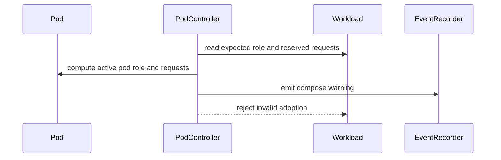

# PR #13382: fix(pod): verify role requests before ungating a pod group

**Summary**: fix(pod): verify role requests before ungating a pod group

**Sources**: https://github.com/kubernetes-sigs/kueue/pull/13382

**Last updated**: 2026-10-14T13:47:32Z

---

## Metadata

- **State**: closed (merged)
- **Author**: [@vladikkuzn](https://github.com/vladikkuzn)
- **Branch**: `fix/pod-role-hash-forgery` → `main`
- **Created**: 2026-07-23T03:19:08Z
- **Updated**: 2026-10-14T13:47:32Z
- **Merged**: 2026-10-12T14:10:08Z
- **Closed**: 2026-10-12T14:10:08Z
- **Labels**: `kind/bug`, `lgtm`, `size/XXL`, `release-note-action-required`, `approved`, `cncf-cla: yes`, `area/integrations`
- **Assignees**: [@mimowo](https://github.com/mimowo), [@mbobrovskyi](https://github.com/mbobrovskyi), [@vladikkuzn](https://github.com/vladikkuzn)
- **Requested reviewers**: [@amy](https://github.com/amy), [@mwielgus](https://github.com/mwielgus), [@mbobrovskyi](https://github.com/mbobrovskyi), [@olekzabl](https://github.com/olekzabl)
- **Changed files**: 9   **+1748 / -14**

## Description

#### What type of PR is this?

/kind bug
/area integrations

#### What this PR does / why we need it:

## Context

This is **Vector 2** of the pod-group quota-bypass fix, split out from #13014 per review feedback.

Sibling PR (#13014) covers **Vector 1** (cross-framework Workload hijack via `pod-group-name` / `is-group-workload` adoption refusal).

### Vector 2 — Intra-group role-hash forgery

`getRoleHash` trusts a user-supplied `kueue.x-k8s.io/role-hash` annotation. The role hash is the PodSet identity and normally binds resource requests. By forging the annotation to another role's value, a tenant can run an oversized Pod under a cheaper role of a genuine pod-group Workload (within its count).

The annotation is a **name, not a credential**: it is never overwritten and never validated at write time. Verification happens once, at the single choke point where quota starts being consumed — `Pod.Run()`.

`prepare()` is the only place `kueue.x-k8s.io/admission` is removed, and it is only called from `Run()`. Replacement Pods joining an already-admitted group flow back through `startJob` → `Run`. The TAS ungater removes only `kueue.TopologySchedulingGate`; the Kueue gate still requires `Run()`.

## Approach

Verify at ungate time, not in the webhook and not on the adoption path. Workload construction matches main.

- Before `Run()` ungates any member of a group, `validatePodsBeforeUngating` checks that every still-gated Pod fits the PodSet its role-hash names. Comparison is against the effective PodSet spec (`workload.EffectivePodSpecs` with LimitRange defaults, requests defaulted from limits and RuntimeClass overhead applied, the same view quota is accounted against), not the raw `wl.Spec.PodSets[].Template.Spec`, via `resources.NewRequestsFromPodSpec` (requests only). The adjustment inputs are resolved only when the gate is on and the group has a gated Pod.
- A Pod that does not fit is kept gated and is skipped by `parallelize.Until`, while the rest of the group is ungated as usual. It is not an error: the Workload stays admitted, its quota reservation is unchanged, and Running peers are not disturbed, so a Pod created in the namespace cannot fail someone else's running group. A `PodExceedsRoleRequests` Warning event on the offending Pod names the Pod, the role, and the exceeded resource. Deleting it and creating a replacement that fits lets the group continue.
- `getRoleHash` keeps a user-supplied `kueue.x-k8s.io/role-hash`. The hash is not recomputed and the annotation is not rewritten.
- Workload construction matches main. The slow path uses the first pod of each role as the PodSet template. Fast admission snapshots the first runnable pod, sets count to the group total, and returns. PodSets are immutable, so a later or larger pod that names an existing role cannot grow the reservation; the ungate check leaves that pod gated.

The entire webhook diff is **zero** — no Pod annotation is written differently — so rollback is clean. `PodIntegrationVerifyRoleRequests` wraps only `validatePodsBeforeUngating` and `keepGated`. With the gate off, ungating and construction match main, and a supplied role hash is still kept.

### Requests-only narrowing

mimowo's sketch used `isMatchingPodSet` (full template equivalence). This PR compares **requests only**. Full equivalence would block ungating on drift in image, env, tolerations, or labels, none of which affect quota, and would resurrect lokeshgahlot's Concern 2 in a broader form. (The sketch's condition was also inverted.)

### Unknown-role hoist

`Run()` already returned a permanent `podset.ErrInvalidPodsetInfo` when the role-hash named no PodSet. Hoisting that check into the pre-pass is atomic-only; behaviour is otherwise unchanged.

### Failure-mode trade-off

A replacement Pod whose spec drifted upward (grown sidecar) stays **gated** (with a Warning event) rather than running over its reservation. It does not fail the Workload or disturb already-Running peers, but the group cannot become PodsReady until the Pod is replaced by one that fits; with `waitForPodsReady`, the Workload is evicted and requeued (up to the requeue limit). Failing the whole group instead would let anyone able to create Pods in the namespace disrupt a running group, and would leave already-Running peers running after the Workload finished. With `PodIntegrationVerifyRoleRequests` disabled, the previous behavior is kept.

Non-group Pods are skipped (no role hash; single PodSet built from the Pod itself). Prebuilt single-Pod Workloads remain covered by `EquivalentToWorkload`. Prebuilt and MultiKueue group Workloads are covered by the same effective-spec comparison, so a template that sets only limits, or relies on a LimitRange `defaultRequest` or RuntimeClass overhead, does not leave honest Pods gated. Fast admission snapshots the first runnable pod, the same as main. The ungate check then keeps an oversized pod for that role gated.

Pre-existing limitation, unchanged: this covers only Pods that Kueue ungates. A Pod that reaches Running without ever carrying Kueue's gate (excluded namespace, gate stripped by another plugin) is outside this fix, as today.

Gated by `PodIntegrationVerifyRoleRequests` (Beta, default true, 0.21). The 0.20/0.19 cherry-picks keep it Alpha, default false.

#### Which issue(s) this PR fixes:

#### Special notes for your reviewer:

- Split from #13014 (Vector 1 remains there). Includes approved review-comment cleanups from that PR (structured error helpers).
- Owner-reference UID validation in `FindAncestorJobManagedByKueue` was de-coupled from this PR and now lives in #13802.
- AI usage: implementation assistance via Cursor (code, tests, and this PR description). No AI authorship markers in commits.

#### Does this PR introduce a user-facing change?

```release-note
ACTION REQUIRED: Pods: Fixed a bug where a Pod could bypass ClusterQueue quota by setting the `kueue.x-k8s.io/role-hash` annotation to another role's value and running an oversized Pod under that role's reservation. Kueue now verifies, before removing the scheduling gate, that each Pod of a group fits the effective spec (LimitRange and RuntimeClass adjustments applied) of the PodSet its role hash names; a Pod that does not fit is kept gated and a Warning event is emitted. The gated Pod does not fail the Workload or disturb running peers, but the group cannot become PodsReady until the Pod is replaced by one that fits; with `waitForPodsReady`, the Workload is evicted and requeued (up to the requeue limit). The check is controlled by the Beta `PodIntegrationVerifyRoleRequests` feature gate, enabled by default in 0.21. If you set the `kueue.x-k8s.io/role-hash` annotation yourself and replacement Pods of a group can request more than the Pods the Workload was built from, set `PodIntegrationVerifyRoleRequests=false`, or recreate the group (delete its Workload and re-create the Pods) so a new Workload is built from the larger Pods.
```

## Discussion

### Comment by [@netlify[bot]](https://github.com/apps/netlify) — 2026-07-23T03:19:13Z

### <span aria-hidden="true">✅</span> Deploy Preview for *kubernetes-sigs-kueue* canceled.


|  Name | Link |
|:-:|------------------------|
|<span aria-hidden="true">🔨</span> Latest commit | 55131088bb376c5cd0a31aa09b32ddcf56d752bf |
|<span aria-hidden="true">🔍</span> Latest deploy log | https://app.netlify.com/projects/kubernetes-sigs-kueue/deploys/6ac820d7218b2300081f9c2d |

### Comment by [@vladikkuzn](https://github.com/vladikkuzn) — 2026-07-23T03:19:35Z

Split out from https://github.com/kubernetes-sigs/kueue/pull/13014 per review feedback that the original XL change mixed two independent quota-bypass vectors.

- **This PR (Vector 2):** role-hash forgery defenses (webhook recompute/preserve, per-role request limits, ownerRef UID validation) plus the review cleanups from #13014.
- **Sibling (Vector 1):** https://github.com/kubernetes-sigs/kueue/pull/13014 — refuse adopting non-pod-group Workloads by group name.

The two PRs are independent off `main` and can be reviewed/merged separately.

### Comment by [@coderabbitai[bot]](https://github.com/apps/coderabbitai) — 2026-07-23T03:19:41Z

<!-- This is an auto-generated comment: summarize by coderabbit.ai -->
<!-- review_stack_entry_start -->

[](https://app.coderabbit.ai/change-stack/kubernetes-sigs/kueue/pull/13382?utm_source=github_walkthrough&utm_medium=github&utm_campaign=change_stack)

<!-- review_stack_entry_end -->
<!-- This is an auto-generated comment: review paused by coderabbit.ai -->

> [!NOTE]
> ## Reviews paused
> 
> It looks like this branch is under active development. To avoid overwhelming you with review comments due to an influx of new commits, CodeRabbit has automatically paused this review. You can configure this behavior by changing the `reviews.auto_review.auto_pause_after_reviewed_commits` setting.
> 
> Use the following commands to manage reviews:
> - `@coderabbitai resume` to resume automatic reviews.
> - `@coderabbitai review` to trigger a single review.
> 
> Use the checkboxes below for quick actions:
> - [ ] <!-- {"checkboxId": "7f6cc2e2-2e4e-497a-8c31-c9e4573e93d1"} --> ▶️ Resume reviews
> - [ ] <!-- {"checkboxId": "e9bb8d72-00e8-4f67-9cb2-caf3b22574fe"} --> 🔍 Trigger review

<!-- end of auto-generated comment: review paused by coderabbit.ai -->
<!-- walkthrough_start -->

<details>
<summary>📝 Walkthrough</summary>

## Walkthrough

Ownership traversal now validates UIDs, unretryable compose errors emit warning events, pod-group admission enforces role and resource consistency, and pod webhook defaulting distinguishes trusted role-hash preservation from recomputation.

### Changes

**Pod admission and ownership safety**

|Layer / File(s)|Summary|
|:---|:---|
|**Ownership identity and compose error guards** <br> `pkg/controller/jobframework/reconciler.go`, `pkg/controller/jobframework/reconciler_test.go`, `pkg/controller/jobs/job/job_controller_test.go`, `pkg/util/testingjobs/{job,pod}/wrappers.go`|Ancestor traversal stops on owner UID mismatches, unretryable compose errors emit warning events, and test scenarios use explicit owner identities.|
|**Role-hash recomputation and preservation** <br> `pkg/controller/jobs/pod/pod_webhook.go`, `pkg/controller/jobs/pod/pod_webhook_test.go`|Pod defaulting recomputes untrusted role hashes and preserves them only for verified prebuilt or parent-managed integrations.|
|**Pod-group role and resource validation** <br> `pkg/controller/jobs/pod/pod_controller.go`, `pkg/controller/jobs/pod/pod_controller_test.go`, `test/integration/singlecluster/controller/jobs/pod/pod_controller_test.go`|Fast and regular pod-group paths reject divergent roles and requests above reservations, enforce count bounds, emit warning events, and verify non-adoption through unit and integration tests.|

**Estimated code review effort:** 4 (Complex) | ~45 minutes

### Sequence Diagram(s)



**Possibly related PRs**

- [kubernetes-sigs/kueue#13014](https://github.com/kubernetes-sigs/kueue/pull/13014): Overlaps on owner UID validation and warning events for unretryable compose failures.
- [kubernetes-sigs/kueue#13299](https://github.com/kubernetes-sigs/kueue/pull/13299): Overlaps on trusted role-hash preservation and recomputation in the pod webhook.
- [kubernetes-sigs/kueue#13498](https://github.com/kubernetes-sigs/kueue/pull/13498): Overlaps on fast-admission role-hash divergence detection and integration coverage.

**Suggested labels:** `area/testing`

**Suggested reviewers:** `amy`, `olekzabl`, `ivnovakov`, `kannon92`, `tenzen-y`

</details>

<!-- walkthrough_end -->
<!-- pre_merge_checks_walkthrough_start -->

<details>
<summary>🚥 Pre-merge checks | ✅ 4 | ❌ 1</summary>

### ❌ Failed checks (1 warning)

|     Check name     | Status     | Explanation                                                                           | Resolution                                                                         |
| :---------------- | :--------- | :------------------------------------------------------------------------------------ | :--------------------------------------------------------------------------------- |
| Docstring Coverage | ⚠️ Warning | Docstring coverage is 35.71% which is insufficient. The required threshold is 80.00%. | Write docstrings for the functions missing them to satisfy the coverage threshold. |

<details>
<summary>✅ Passed checks (4 passed)</summary>

|         Check name         | Status   | Explanation                                                                                                                              |
| :------------------------ | :------- | :--------------------------------------------------------------------------------------------------------------------------------------- |
|     Linked Issues check    | ✅ Passed | Check skipped because no linked issues were found for this pull request.                                                                 |
| Out of Scope Changes check | ✅ Passed | Check skipped because no linked issues were found for this pull request.                                                                 |
|      Description Check     | ✅ Passed | Check skipped - CodeRabbit’s high-level summary is enabled.                                                                              |
|         Title check        | ✅ Passed | The title clearly describes the primary pod-controller change: validating role resource requests before allowing a pod group to proceed. |

</details>

</details>

<!-- pre_merge_checks_walkthrough_end -->
<!-- finishing_touch_checkbox_start -->

<details>
<summary>✨ Finishing Touches</summary>

<details>
<summary>🧪 Generate unit tests (beta)</summary>

- [ ] <!-- {"checkboxId": "f47ac10b-58cc-4372-a567-0e02b2c3d479", "radioGroupId": "utg-output-choice-group-unknown_comment_id"} -->   Create PR with unit tests

</details>

</details>

<!-- finishing_touch_checkbox_end -->
<!-- tips_start -->

---


<sub>Comment `@coderabbitai help` to get the list of available commands.</sub>

<!-- tips_end -->

### Comment by [@vladikkuzn](https://github.com/vladikkuzn) — 2026-07-23T08:29:26Z

/assign 
/cc @dkaluza

### Comment by [@kubernetes-prow[bot]](https://github.com/apps/kubernetes-prow) — 2026-07-23T08:29:29Z

@vladikkuzn: GitHub didn't allow me to request PR reviews from the following users: dkaluza.

Note that only [kubernetes-sigs members](https://github.com/orgs/kubernetes-sigs/people) and repo collaborators can review this PR, and authors cannot review their own PRs.

<details>

In response to [this](https://github.com/kubernetes-sigs/kueue/pull/13382#issuecomment-5056138220):

>/assign 
>/cc @dkaluza 


Instructions for interacting with me using PR comments are available [here](https://git.k8s.io/community/contributors/guide/pull-requests.md).  If you have questions or suggestions related to my behavior, please file an issue against the [kubernetes-sigs/prow](https://github.com/kubernetes-sigs/prow/issues/new?title=Prow%20issue:) repository.
</details>

### Comment by [@vladikkuzn](https://github.com/vladikkuzn) — 2026-07-30T12:03:50Z

## Workload `ComposeRejected` condition (feedback welcome)

For the repeated Warning event on compose failures (pod requests exceed reserved role, fast-admission role mismatch), I'm trying a **Workload status condition** instead of emitting an event on every reconcile:

- New condition type: `ComposeRejected` (`True` when the pod group cannot be composed into the existing workload)
- Warning event is emitted **only on the first transition** to `ComposeRejected=True`
- Cleared (`False`) when compose succeeds on a later reconcile via `CustomWorkloadConditions`

This is pod-controller-local today (not promoted to the kueue API constants yet).

**Question for reviewers:** Is a Workload condition the right mechanism here, or would you prefer a different approach (e.g. annotation-based dedup, relying on events alone, or a first-class API condition)? Happy to adjust before merge.

### Comment by [@vladikkuzn](https://github.com/vladikkuzn) — 2026-08-03T10:00:49Z

/cc @mimowo

### Comment by [@amy](https://github.com/amy) — 2026-08-04T12:22:35Z

Not sure if I'm right or not. But may wanna check with @varunsyal if this breaks their setup or not.

I forget if this is the hash they change or not. Just double check.

@mimowo

### Comment by [@amy](https://github.com/amy) — 2026-08-04T12:23:28Z

/hold

### Comment by [@amy](https://github.com/amy) — 2026-08-06T19:48:03Z

Confirmed with lokesh. Yeah it'll break their setup. He'll comment on this thread.

### Comment by [@lokeshgahlot](https://github.com/lokeshgahlot) — 2026-08-07T05:18:55Z

Thanks for working on this — the bypass is real and worth fixing. Following up on @amy's hold, I have one compatibility concern.

**How we use this today**

In our setup, tenants don't create Pods. One trusted controller builds every Pod spec. So the `role-hash` annotation is never set by an untrusted party.

We set that annotation ourselves, to a value based on the pod group's identity. Here's why.

If the hash is derived from the Pod spec, it is only as stable as the spec. Suppose a Pod is replaced, and something in `SpecShape` has changed since the group started — say a sidecar's resource requests grew during a rollout. The replacement Pod now gets a different hash. But the Workload's PodSet names are immutable. So the new hash matches nothing, `equivalentToWorkload` fails, and the Pod is never ungated. It stays `SchedulingGated` indefinitely, while the Workload keeps holding quota with no Pod running.

Setting the annotation to a stable per-group value avoids that. Every replacement gets the same hash, so it always matches.

**Concern 1: existing Workloads have no way forward**

Our existing PodSet names come from that stable scheme. A recomputed hash is built only from the Pod spec, so it can never produce those names. And PodSets cannot be updated.

So once this webhook ships, every existing pod group breaks the first time it needs a replacement Pod.

It won't show up at upgrade time. It appears slowly, as Pods happen to get replaced, which makes it hard to connect back to the upgrade.

Could the webhook keep the supplied hash when it already matches a PodSet name on the group's existing Workload? New groups would still get the full protection.

**Concern 2: the exceeds-reserved check can reject healthy Pods**

Same root cause. A replacement Pod can end up requesting a little more than the frozen template reserves — for example that same sidecar whose requests grew. Today that Pod runs fine. With this change it is rejected.

Could that check start as warn-only (event and condition, no rejection)?

**What I'd like to ask for**

#13014 shipped with a feature gate (`PodIntegrationValidateGroupOwner`) so operators could fall back during rollout. Could this change get the same kind of gate?

Where Pod creation is fully operator-controlled, the attack this prevents isn't possible. A gate would let those operators opt out, while the fix stays on by default for everyone else.

Also, if this gets backported, an action-required release note would help. The behaviour change isn't obvious from a normal bug-fix note.

Happy to help test.

### Comment by [@vladikkuzn](https://github.com/vladikkuzn) — 2026-08-11T00:43:18Z

@lokeshgahlot thanks for the detailed write-up, and for the concrete failure mode — that is exactly the input this needed. @amy thanks for routing it here before this merged.

**Confirming the current behaviour, so we're working from the same picture**

`shouldPreserveRoleHash` in `pkg/controller/jobs/pod/pod_webhook.go` preserves a supplied `role-hash` in two cases only: Pods carrying a prebuilt-workload annotation, and Pods carrying `SuspendedByParent` whose Kueue-managed ancestor GVK matches that integration (StatefulSet / Deployment / LeaderWorkerSet). A pod group built by your own controller hits neither branch, so the annotation is recomputed at create time.

Your Concern 1 is real. The slow-onset failure you describe — replacement Pod, recomputed hash matches no PodSet name, Pod stays `SchedulingGated` while the Workload keeps holding quota — is what would happen, and it would surface gradually rather than at upgrade time. I don't want to ship that.

**Concern 1: why not preserve a supplied hash that matches an existing PodSet name**

I looked at this as the first option and I don't think it can be the default. PodSet names are readable by anyone who can read the Workload. So "the supplied hash matches an existing PodSet name" is precisely the shape of a successful forgery — a tenant reads the cheapest role's hash off the Workload and supplies it. Preserving on match would only stop forgeries that guess wrong, which is not the interesting case.

The one thing left standing between that and a quota bypass would be the exceeds-reserved check, which is the check Concern 2 asks to relax. Taken together the two requests restore the full bypass this PR exists to close, so I'd rather not take either as a default and instead give you an explicit switch (below).

**Concern 2: scope of the exceeds-reserved rejection**

Worth narrowing this one. The rejection fires only on the adoption path in `FindMatchingWorkloads`, against a Workload whose PodSet template is already frozen. Fresh group construction takes the element-wise maximum of requests per role and never rejects, so new groups are unaffected. The exposure is exactly replacement Pods whose spec drifted — your sidecar case.

That drift is a pre-existing limitation in Kueue (mutable Pod specs against immutable PodSets). Today it silently consumes more than the Workload reserves; this PR turns it into a visible refusal. Making it warn-only by default would restore the silent over-consumption, so again I'd rather put it behind the switch than change the default.

**Concern 3: the feature gate — added**

Agreed, and done in 8d4093f92. New gate `PodIntegrationRecomputeRoleHash`, Beta, enabled by default, covering **both** behaviours:

- the webhook recomputing a supplied `role-hash`
- the exceeds-reserved adoption rejection

Setting `PodIntegrationRecomputeRoleHash=false` restores the previous behaviour end to end: the webhook honours the supplied annotation exactly as before, and the adoption path does not reject oversized Pods. That is a coherent position for a cluster where Pod creation is fully operator-controlled, and it gives your existing groups an upgrade path instead of a per-group migration. Gate-off unit coverage is included at both call sites.

One correction on the precedent you cited: `PodIntegrationValidateGroupOwner` is no longer on main — #13014 merged as 4ad84193c and was reverted by #13945, because the merged fix guarded adoption but left the finalization path exposed via `ListChildWorkloads`. The gate pattern still stands, it just isn't a live example any more.

**Release note**

Also done — the PR description's `release-note` block is now an `action required:` note naming the gate and spelling out the SchedulingGated consequence for operators who set the annotation themselves. I also corrected some stale claims in the description while I was there (owner-reference UID validation moved to #13802; the `groupTotalCount` bound and the prebuilt-sync Warning events were de-coupled out; and the exceeds check is adoption-path only, not all three paths as it previously said).

**Open question for @mimowo**

Longer term I think the durable fix is making replacement-Pod matching tolerate spec drift rather than depending on a stable hash, but that is a larger change than this PR should carry.

Taking you up on the offer to test — the gate is pushed, so it is ready whenever you are. Leaving @amy's hold in place until @mimowo has weighed in.

### Comment by [@vladikkuzn](https://github.com/vladikkuzn) — 2026-08-12T17:14:05Z

/cc @mwielgus 
as Amy pointed out

### Comment by [@mimowo](https://github.com/mimowo) — 2026-09-04T13:36:41Z

I think the PR is still not correct. Aside from the compatibility issues which may break users there is another fundamental problem with re-computing the hash on Create:
1. the webhook is CREATE-only so nothing would stop the hash forgery later on: https://github.com/kubernetes-sigs/kueue/pull/13382/changes#diff-8653db7737ac7710352223a2af7723aa2def7cc433c73b1d151c7502d2a9af17R87

Also, another very risky scenario is ProvisiningRequest injecting the nodeSelectors on admission which may result in changing the hash in case we re-computed also on Updates.

We need to re-think the approach, but I think there should exist a solution which preserves the previous behavior just blocks adopion of replacement pods in case they use more resources. 

I will continue thinking about it, heads up for now to share my concerns about the approach.

### Comment by [@mimowo](https://github.com/mimowo) — 2026-09-04T14:30:57Z

I think the confusion might stem from the fact this annotation is called "role-hash", i think this is more of "podset-name". within the "podset-group". To make life easy we allow to derive the "podset-name" based on the scheduling directives by hashing, but we also allow a user to be specific about it.

### Comment by [@mimowo](https://github.com/mimowo) — 2026-09-04T16:49:37Z

So I want to propose a much simpler conceptually fix (I think), smaller in code, and more robust (no compatibility breaking):
- we consider  the "role-hash" annotation as "untrusted podset-name", but respect whatever is supplied (no override)
- the trust verification happens just before ungating - at this moment we have already all the nodeSelectors injected into the Pod so we can check the PodSetTemplate equivalence with the Pod Template equivalence.
- I assume somewhere here in side the pod-controller [Run()](https://github.com/kubernetes-sigs/kueue/blob/ebaaea22638dfc796869ee1a86b4c0aa921998cb/pkg/controller/jobs/pod/pod_controller.go#L293-L358) we can inject the verification such as:

```
func validatePodsBeforeUngating(pods []corev1.Pod, wl *kueue.Workload) error {
    podSets := indexPodSetsByName(wl.Spec.PodSets)

    for i := range pods {
        pod := &pods[i]
        if !isGated(pod) {
            continue
        }
        role := getRoleHash(*pod)         // fetch the untrusted selector just to resolve the podSet
        podSet, found := podSets[role] 
        if !found {
            return errUnknownRole
        }
        podSetTemplate := resources.NewRequestsFromPodSpec(&podSet.Template.Spec)
        if isMatchingPodSet(pod, podSetTemplate) { 
            return errPodExceedsRoleRequests
        }
    }
    return nil
}
```
Here `isMatchingPodSet` can check the actual equivalence between the PodTemplate (already with the injected node selectors) and the Pod template recorded in the PodSet.


Certainly a FG will be needed still, because isMatchingPodSet is done badly could be disruptive. The good news is that with this approach even if there is a bug, the FG can be disabled and the cluster restores the operation smoothly, because no Pod annotations are updated.

cc @amy @lokeshgahlot @varunsyal @vladikkuzn 

Let me know folks if this makes sense or there are some gaps needing polishing.

### Comment by [@mimowo](https://github.com/mimowo) — 2026-09-04T16:50:14Z

This is one of the bugs which would probably never be discovered or reported if not for the AI scans. The tools are bloody good at discovering these type of  vulnerabilities, and solving them costs code complexity.

### Comment by [@vladikkuzn](https://github.com/vladikkuzn) — 2026-09-18T08:44:27Z

/cc @mbobrovskyi

### Comment by [@mbobrovskyi](https://github.com/mbobrovskyi) — 2026-09-18T09:56:23Z

@vladikkuzn could you please rebase?

### Comment by [@vladikkuzn](https://github.com/vladikkuzn) — 2026-09-19T22:44:30Z

/test pull-kueue-test-integration-shard-2-main

### Comment by [@vladikkuzn](https://github.com/vladikkuzn) — 2026-09-28T08:38:48Z

@mbobrovskyi rebased onto the latest main.

### Comment by [@mbobrovskyi](https://github.com/mbobrovskyi) — 2026-09-28T10:20:00Z

Overall LGTM. Thank you!

### Comment by [@mbobrovskyi](https://github.com/mbobrovskyi) — 2026-09-28T10:20:09Z

Please also rebase this onto main.

### Comment by [@vladikkuzn](https://github.com/vladikkuzn) — 2026-09-28T13:29:32Z

@mbobrovskyi rebased onto the latest main and pushed, also addressing your two inline comments (container/init-container merge helper, feature gate `pr:` link). Thanks for the review!

### Comment by [@mbobrovskyi](https://github.com/mbobrovskyi) — 2026-09-29T08:22:36Z

@vladikkuzn, please rebase one more time.

### Comment by [@kubernetes-prow[bot]](https://github.com/apps/kubernetes-prow) — 2026-09-29T08:56:25Z

LGTM label has been added.  <details>Git tree hash: 621674e3d419c700fd23c650b0cdff34926b4c39</details>

### Comment by [@mbobrovskyi](https://github.com/mbobrovskyi) — 2026-09-29T08:56:38Z

/cc @mimowo

### Comment by [@mimowo](https://github.com/mimowo) — 2026-10-06T09:40:36Z

@vladikkuzn please squash the PR

### Comment by [@mimowo](https://github.com/mimowo) — 2026-10-06T14:34:03Z

@lokeshgahlot @varunsyal @anguszzzz please check the latest version of the PR. Now the PR should handle the concern (1.) from https://github.com/kubernetes-sigs/kueue/pull/13382#issuecomment-5212743276 as we respec the role-hashes of pre-existing workloads and pods. Now the change only focuses on blocking ungating of oversized pods. 

Let us know if you foresee still issues with this approach. If so, I would like to brainstorm how we can mitigate those and yet fix the vulnerability which allows quota hijaking (which allows running pods bigger than the admitted workloads sizes).

### Comment by [@anguszzzz](https://github.com/anguszzzz) — 2026-10-06T20:34:18Z

Thanks @mimowo. This version resolves concern (1). Supplied role-hashes are kept as is.

Concern (2) still affects us, in a one role-hash per pod group case, each group's template is its first attempt's pod. After a preemption, Kueue deletes the pod and requeues the Workload, and we create a replacement in the same group. That replacement can legitimately be larger:

- If the relaunch lands on local NVMe instead of a PVC, it requests `ephemeral-storage`, which the template doesn't have.
- init container raised cpu/memory above templates created before the rollout.

For pod-group pods request more than their template, with the gate on, each would be admitted and then kept gated, holding quota until the PodsReady timeout. It would then be requeued with the same template, and the cycle would repeat until the requeue limit deactivates it.

`PodIntegrationVerifyRoleRequests` can be disabled for now. But would this opt-out goes away at GA?, Some other thoughts on this:

1. If the Workload has no quota reservation (requeued or pending), refresh the PodSet templates from the current pods instead of gating. PodSets are still mutable then, and the Workload keeps its queue position. This covers our main case.
2. Build a role's template from the per-resource max, or use a deterministic pod order. Today it is the first pod in cache order, so with mixed sizes, whether a pod gets gated depends on that order.
4. Mark the release note ACTION REQUIRED, and keep the gate default-off if it is cherry-picked?

### Comment by [@vladikkuzn](https://github.com/vladikkuzn) — 2026-10-07T13:22:49Z

> Mark the release note ACTION REQUIRED, and keep the gate default-off if it is cherry-picked?

That's what we've done with another PR related to this one:  for CPs it's disabled by default, while for new release it's enabled

What I'm not sure about is whether FG should be on Alpha (and enabled by default) here and on Beta (and disabled by default) for CPs @mimowo

### Comment by [@mimowo](https://github.com/mimowo) — 2026-10-07T13:26:49Z

> What I'm not sure about is whether FG should be on Alpha (and enabled by default) here and on Beta (and disabled by default) for CPs @mimowo

Keep it enabled for 0.21. As suggested by @anguszzzz we will make it Alpha for 0.20 and 0.19 so make sure all tests parametrize by the FG.

I'm yet checking correctness and thinking how we could address concern (2.) properly.

### Comment by [@vladikkuzn](https://github.com/vladikkuzn) — 2026-10-07T15:17:34Z

Thanks @anguszzzz, that's a precise description of the failure mode. Updates in [23a4850c6](https://github.com/kubernetes-sigs/kueue/pull/13382/commits/23a4850c66148c3b8ec6d0affb6a53c3b1292cd7):

- The gate is now **Alpha, disabled by default** (`PodIntegrationVerifyRoleRequests`, 0.21), so nothing changes for existing users unless they opt in. For cherry-picks to release branches it would also ship disabled by default.
- The gate comment and the release note / trade-off section in the PR description now state the real gang behavior: the gated Pod doesn't fail the Workload or disturb Running peers, but the group can't become PodsReady until the Pod is replaced; with `waitForPodsReady` the Workload is evicted and requeued up to the requeue limit.

For the replacement-pod drift you describe (larger ephemeral-storage / init-container requests after preemption), these are the options I see:

- **A. Keep the current scope.** The check stays as is behind the opt-in gate; drift handling is a follow-up. Lowest risk, but users who enable the gate keep hitting the requeue loop when replacement pods grow.
- **B. Compare only quota-relevant resources.** Check only resources present in the PodSet's admission (the keys of `PodSetAssignments[].Flavors`, which already respect `excludeResourcePrefixes`). Fixes the NVMe ephemeral-storage case with no loss of protection, since a resource the ClusterQueue doesn't account for can't be used to bypass quota. It intentionally still gates init-container cpu/memory growth, because that is the over-consumption this PR prevents. Small change plus tests.
- **C. Refresh PodSet templates from current pods while the Workload has no quota reservation** (your option 1). Keeps the preemption flow working, but adds Workload mutation to the pod reconciler, lets any pod creator in the namespace inflate a pending group's quota request, needs a 'largest pod' or synthetic template to express a max, and races with re-admission. Significant scope for this PR.
- **D. Deterministic pod order or per-resource max template** (your option 2). Ordering (creationTimestamp, then name) makes outcomes predictable but doesn't remove the loop; a per-resource max changes the quota every existing pod group requests.

On GA: removing the opt-out should wait until the drift question is settled. On the default for cherry-picks, I'm happy to follow the maintainers' preference.

@mimowo which direction would you prefer? I can do B here and track C/D in a follow-up issue, or keep this PR at A.

### Comment by [@mimowo](https://github.com/mimowo) — 2026-10-07T15:37:45Z

> The gate is now Alpha, disabled by default (PodIntegrationVerifyRoleRequests, 0.21), so nothing changes for existing users unless they opt in. For cherry-picks to release branches it would also ship disabled by default.

I would rather go with beta for 0.21, and backport as alpha. I think concern (2.) is rather that the change breaks the "quota forgery" a user used as a workaround. 

> A. Keep the current scope. The check stays as is behind the opt-in gate; drift handling is a follow-up. Lowest risk, but users who enable the gate keep hitting the requeue loop when replacement pods grow.

I think this could work if the external controller deletes the Workload, so that the workload is re-created with increased size. This will result in eviction, but maybe that is acceptable, wdyt @anguszzzz. @vladikkuzn could you test experimentally if this would indeed work as expected if the workload is deleted?

> B. Compare only quota-relevant resources. 

This could work for extra stuff, but will not help for increased size of Pods.

> D. Deterministic pod order or per-resource max template (your option 2). Ordering (creationTimestamp, then name) makes outcomes predictable but doesn't remove the loop; a per-resource max changes the quota every existing pod group requests.

This I don't understand, I think our ordering of PodSets is already determinisitc since https://github.com/kubernetes-sigs/kueue/pull/14809. However, I'm not sure how this could fix quota forgery, maybe some example could help.

The idea I have is:
A) if we can accept workload deletetion and re-creation 
B) support elastic workload slices for PodGroups, then for re-sized PodGroup a new workload slice is created and the new bigger Pod remains suspended until the new slice is admitted. For now we only support batch Job and KubeRay, but this feels the most natural fix actually to support the use case going forward.

### Comment by [@mimowo](https://github.com/mimowo) — 2026-10-07T15:51:51Z

btw, it seems the concern (2.) is the classic problem when a bug is exploited as a feature for someone :) . 

Quota hijaking (running pods exceeding quota) is considered vulnerability (serious bug) in Kueue. So, I still consider this Beta-level fix  - users will be able to disable the FG to keep using the loophole. Then we need to consider - either users migrate to some other approach, or we need to probably support elastic PodGroups.

### Comment by [@vladikkuzn](https://github.com/vladikkuzn) — 2026-10-07T21:29:37Z

@mimowo Yes, that's what I meant. In 80ae470ed:
- `PodIntegrationVerifyRoleRequests` is Beta, enabled by default in 0.21. The 0.20/0.19 cherry-picks will ship it as Alpha, disabled by default.
- All tests set the gate explicitly and cover both values.
- Deleting the Workload works: every Pod of the group is stopped, and re-created Pods get a new Workload built from the larger template, which gets admitted. A new integration test covers this.

### Comment by [@vladikkuzn](https://github.com/vladikkuzn) — 2026-10-07T21:29:39Z

@lokeshgahlot @anguszzzz The release note is now marked `ACTION REQUIRED:`. It explains how to opt out (`PodIntegrationVerifyRoleRequests=false`) or recreate the group so the Workload is rebuilt from the larger Pods. See the release-note section of the PR description.

### Comment by [@mimowo](https://github.com/mimowo) — 2026-10-12T13:50:20Z

/unhold

### Comment by [@mimowo](https://github.com/mimowo) — 2026-10-12T13:55:01Z

/lgtm
/approve
Thank you @vladikkuzn 👍 I think we need to move this forward to fix the quota forgery gaps. @anguszzzz @lokeshgahlot as discussed in https://github.com/kubernetes-sigs/kueue/pull/13382#issuecomment-5212743276 I take your concern (2.) seriously, but: what you consider a feature here (running larger pods) is actually a bug from our security policy: https://github.com/kubernetes-sigs/kueue/blob/716f8609c9c6ae36ead901736c93c1c03d08739e/SECURITY-INSIGHTS.yaml#L62

So, we need to fix it by default. I will keep the FG PodIntegrationVerifyRoleRequests for now, but we will decomission it. So, ideally if you can migrate away from this approach. A solution in Kueue is also possible (I think) using ElasticWorkloads supported for PodGroup, but that is a substantial effort. It might not be justified yet.

### Comment by [@kubernetes-prow[bot]](https://github.com/apps/kubernetes-prow) — 2026-10-12T13:55:10Z

LGTM label has been added.  <details>Git tree hash: e0dfa786d2d257271d564b082b668f2b19d5a4ab</details>

### Comment by [@kubernetes-prow[bot]](https://github.com/apps/kubernetes-prow) — 2026-10-12T13:55:18Z

[APPROVALNOTIFIER] This PR is **APPROVED**

This pull-request has been approved by: *<a href="https://github.com/kubernetes-sigs/kueue/pull/13382#issuecomment-6125714228" title="Approved">mimowo</a>*, *<a href="https://github.com/kubernetes-sigs/kueue/pull/13382#" title="Author self-approved">vladikkuzn</a>*

The full list of commands accepted by this bot can be found [here](https://go.k8s.io/bot-commands?repo=kubernetes-sigs%2Fkueue).

The pull request process is described [here](https://git.k8s.io/community/contributors/guide/owners.md#the-code-review-process)

<details >
Needs approval from an approver in each of these files:

- ~~[OWNERS](https://github.com/kubernetes-sigs/kueue/blob/main/OWNERS)~~ [mimowo]

Approvers can indicate their approval by writing `/approve` in a comment
Approvers can cancel approval by writing `/approve cancel` in a comment
</details>
<!-- META={"approvers":[]} -->

### Comment by [@mimowo](https://github.com/mimowo) — 2026-10-12T13:56:31Z

@vladikkuzn please prepare CPs for 0.19 and 0.20 adjusting the FG as alpha (disabled by default).

## Reviews

### Review by [@coderabbitai[bot]](https://github.com/apps/coderabbitai) (commented) — 2026-07-23T03:30:01Z

**Actionable comments posted: 1**

<details>
<summary>🤖 Prompt for all review comments with AI agents</summary>

```
Verify each finding against current code. Fix only still-valid issues, skip the
rest with a brief reason, keep changes minimal, and validate.

Inline comments:
In `@pkg/controller/jobs/pod/pod_controller.go`:
- Around line 767-806: Update the GroupTotalCountAnnotation parsing/validation
path to reject values greater than math.MaxInt32, in addition to the existing
gtc < 1 check, before converting the value to int32. Ensure
constructGroupPodSetsFast receives only validated counts so podSets[0].Count
cannot wrap.
```

</details>

<details>
<summary>🪄 Autofix (Beta)</summary>

Fix all unresolved CodeRabbit comments on this PR:

- [ ] <!-- {"checkboxId": "4b0d0e0a-96d7-4f10-b296-3a18ea78f0b9"} --> Push a commit to this branch (recommended)
- [ ] <!-- {"checkboxId": "ff5b1114-7d8c-49e6-8ac1-43f82af23a33"} --> Create a new PR with the fixes

</details>

---

<details>
<summary>ℹ️ Review info</summary>

<details>
<summary>⚙️ Run configuration</summary>

**Configuration used**: Path: .coderabbit.yaml

**Review profile**: CHILL

**Plan**: Pro Plus

**Run ID**: `2e7c1da5-66a7-4903-bb25-439053971b90`

</details>

<details>
<summary>📥 Commits</summary>

Reviewing files that changed from the base of the PR and between a7afef6e3f80bbf9ccfa517909a4d4a661ff4421 and 8921c4cbc3af806091857dc93a1e6698832f9f60.

</details>

<details>
<summary>📒 Files selected for processing (8)</summary>

* `pkg/controller/jobframework/reconciler.go`
* `pkg/controller/jobframework/reconciler_test.go`
* `pkg/controller/jobs/job/job_controller_test.go`
* `pkg/controller/jobs/pod/pod_controller.go`
* `pkg/controller/jobs/pod/pod_controller_test.go`
* `pkg/controller/jobs/pod/pod_webhook.go`
* `pkg/controller/jobs/pod/pod_webhook_test.go`
* `test/integration/singlecluster/controller/jobs/pod/pod_controller_test.go`

</details>

</details>

<!-- This is an auto-generated comment by CodeRabbit for review status -->

- **pkg/controller/jobs/pod/pod_controller.go:972** by [@coderabbitai[bot]](https://github.com/apps/coderabbitai) — 2026-07-23T03:30:00Z
```diff
@@ -761,24 +765,83 @@ func constructPodSet(p *corev1.Pod) (kueue.PodSet, error) {
 }
 
 func constructGroupPodSetsFast(pods []corev1.Pod, groupTotalCount int) ([]kueue.PodSet, error) {
-	for _, podInGroup := range pods {
-		if !isPodRunnableOrSucceeded(&podInGroup) {
+	var (
+		roleHash string
+		reserved resources.Requests
+		podSets  []kueue.PodSet
+		found    bool
+	)
+	for i := range pods {
+		podInGroup := &pods[i]
+		if !isPodRunnableOrSucceeded(podInGroup) {
 			continue
 		}
-		roleHash, err := getRoleHash(podInGroup)
+		hash, err := getRoleHash(*podInGroup)
 		if err != nil {
 			return nil, fmt.Errorf("failed to calculate pod role hash: %w", err)
 		}
-		podSets, err := constructPodSets(&podInGroup)
-		if err != nil {
-			return nil, err
+		if !found {
+			podSets, err = constructPodSets(podInGroup)
+			if err != nil {
+				return nil, err
+			}
+			roleHash = hash
+			podSets[0].Name = kueue.NewPodSetReference(roleHash)
+			podSets[0].Count = int32(groupTotalCount)
+			reserved = resources.NewRequestsFromPodSpec(&podSets[0].Template.Spec)
+			found = true
+			continue
+		}
+		if hash != roleHash {
+			return nil, errFastAdmissionRoleMismatch(podInGroup.Name, hash, roleHash)
+		}
+		if podExceedsRequests(podInGroup, reserved) {
+			return nil, errPodExceedsReservedRequests(podInGroup.Name, roleHash)
 		}
-		podSets[0].Name = kueue.NewPodSetReference(roleHash)
-		podSets[0].Count = int32(groupTotalCount)
-		return podSets, nil
 	}
+	if !found {
+		return nil, errors.New("failed to find a runnable pod in the group")
+	}
+	return podSets, nil
+}
```

  _🎯 Functional Correctness_ | _🟡 Minor_ | _⚡ Quick win_
  
  <details>
  <summary>🧩 Analysis chain</summary>
  
  🏁 Script executed:
  
  ```shell
  #!/bin/bash
  # Description: Find where GroupTotalCountAnnotation is parsed and check for int32 bounds validation.
  rg -n -A5 -B5 'GroupTotalCountAnnotation' --type=go pkg/util/pod pkg/controller/jobs/pod
  rg -nP '\bfunc\b.*(GroupTotalCount|GetPodGroupTotalCount)' --type=go
  ```
  
  Repository: kubernetes-sigs/kueue
  
  Length of output: 8378
  
  ---
  
  🏁 Script executed:
  
  ```shell
  #!/bin/bash
  set -euo pipefail
  
  echo "== pod_controller relevant helpers =="
  sed -n '620,670p' pkg/controller/jobs/pod/pod_controller.go
  sed -n '900,945p' pkg/controller/jobs/pod/pod_controller.go
  sed -n '760,795p' pkg/controller/jobs/pod/pod_controller.go
  
  echo "== pod_webhook group total count validation =="
  sed -n '330,380p' pkg/controller/jobs/pod/pod_webhook.go
  
  echo "== Go int/int32 constants =="
  python3 - <<'PY'
  print("max int32:", (1<<31)-1)
  print("examples:", repr(int(2**32)), repr(int(2**32).bit_length()))
  PY
  ```
  
  Repository: kubernetes-sigs/kueue
  
  Length of output: 6958
  
  ---
  
  
  
  </details>
  
  **Reject oversized `GroupTotalCountAnnotation` values before converting to `int32`.**
  
  `strconv.Atoi` accepts values beyond the `int32` range and `pkg/controller/jobs/pod/pod_controller.go` only rejects `gtc < 1`, while `podSets[0].Count = int32(groupTotalCount)` can wrap to negative. Add an upper-bound check such as `gtc > math.MaxInt32` in the parser/validation path and reject it before this narrowing conversion.
  
  <details>
  <summary>🧰 Tools</summary>
  
  <details>
  <summary>🪛 ast-grep (0.44.1)</summary>
  
  [warning] 789-789: Narrowing a non-constant integer to a smaller fixed-width type (int8/int16/int32, uint8/uint16/uint32) can silently overflow or wrap, yielding negative or truncated values that are dangerous in size, length, or index logic. Validate the source value is within the target type's range before converting (e.g. bounds-check, or use a checked helper), and avoid narrowing untrusted or len()/parsed values.
  Context: int32(groupTotalCount)
  Note: [CWE-190] Integer Overflow or Wraparound.
  
  (integer-overflow-narrowing-conversion-go)
  
  </details>
  
  </details>
  
  <details>
  <summary>🤖 Prompt for AI Agents</summary>
  
  ```
  Verify each finding against current code. Fix only still-valid issues, skip the
  rest with a brief reason, keep changes minimal, and validate.
  
  In `@pkg/controller/jobs/pod/pod_controller.go` around lines 767 - 806, Update the
  GroupTotalCountAnnotation parsing/validation path to reject values greater than
  math.MaxInt32, in addition to the existing gtc < 1 check, before converting the
  value to int32. Ensure constructGroupPodSetsFast receives only validated counts
  so podSets[0].Count cannot wrap.
  ```
  
  </details>
  
  <!-- fingerprinting:phantom:medusa:beignet -->
  
  <!-- cr-indicator-types:potential_issue -->
  
  <!-- cr-comment:v1:0554ebfbcfbedd38f0b66b51 -->
  
  _Source: Linters/SAST tools_
  
  <!-- This is an auto-generated comment by CodeRabbit -->
  
  ✅ Addressed in commits d434342 to fa90890

### Review by [@dkaluza](https://github.com/dkaluza) (commented) — 2026-07-27T16:29:38Z

- **pkg/controller/jobs/job/job_controller_test.go:3272** by [@dkaluza](https://github.com/dkaluza) — 2026-07-27T14:56:20Z
```diff
@@ -3252,16 +3252,24 @@ func TestReconciler(t *testing.T) {
 
 				features.AssignQueueLabelsForPods: true,
 			},
-			job: baseJobWrapper.
-				Clone().
-				OwnerReference("parent", batchv1.SchemeGroupVersion.WithKind("Job")).
-				Suspend(false).
-				Obj(),
-			wantJob: *baseJobWrapper.
-				Clone().
-				OwnerReference("parent", batchv1.SchemeGroupVersion.WithKind("Job")).
-				Suspend(false).
-				Obj(),
+			job: func() *batchv1.Job {
+				j := baseJobWrapper.
+					Clone().
+					OwnerReference("parent", batchv1.SchemeGroupVersion.WithKind("Job")).
+					Suspend(false).
+					Obj()
+				j.OwnerReferences[0].UID = "parent-uid"
+				return j
+			}(),
+			wantJob: func() batchv1.Job {
+				j := baseJobWrapper.
+					Clone().
+					OwnerReference("parent", batchv1.SchemeGroupVersion.WithKind("Job")).
+					Suspend(false).
+					Obj()
+				j.OwnerReferences[0].UID = "parent-uid"
+				return *j
+			}(),
```

  Are we making those a function calls just to set uid in the owner reference?
  
  Cannot we just have a helper for that in wrapper instead? it will be far easier/more readable from my point of view. 
  I also see that other wrappers have it as an arg to OwnerReference, but this can be too large change to introduce this with this fix.

- **pkg/controller/jobframework/reconciler_test.go:1910** by [@dkaluza](https://github.com/dkaluza) — 2026-07-27T15:05:51Z
```diff
@@ -899,6 +901,24 @@ func TestFindAncestorJobManagedByKueue(t *testing.T) {
 				Obj(),
 			wantManaged: testingaw.MakeAppWrapper("aw", jobNamespace).UID("aw").Queue("test-q").Obj(),
 		},
+		"child job has ownerReference whose UID does not match the referenced object => nil": {
+			integrations: []string{"kubeflow.org/mpijob"},
+			ancestors: []client.Object{
+				testingmpijob.MakeMPIJob(parentJobName, jobNamespace).
+					UID(parentJobName).
+					Queue("test-q").
+					Obj(),
+			},
+			job: func() client.Object {
+				job := testingjob.MakeJob(childJobName, jobNamespace).
+					OwnerReference(parentJobName, kfmpi.SchemeGroupVersionKind).
+					Obj()
+				// Point owner reference at the real parent by name with a mismatched UID.
+				job.OwnerReferences[0].UID = types.UID("forged-uid")
+				return job
+			}(),
+			wantManaged: nil,
```

  Does this generate any error/warning event? If it does not how the user will know that it was rejected? if yes can we check it here?

- **pkg/controller/jobs/pod/pod_controller.go:783** by [@dkaluza](https://github.com/dkaluza) — 2026-07-27T15:16:31Z
```diff
@@ -761,24 +765,90 @@ func constructPodSet(p *corev1.Pod) (kueue.PodSet, error) {
 }
 
 func constructGroupPodSetsFast(pods []corev1.Pod, groupTotalCount int) ([]kueue.PodSet, error) {
-	for _, podInGroup := range pods {
-		if !isPodRunnableOrSucceeded(&podInGroup) {
+	var (
+		roleHash string
+		reserved resources.Requests
+		podSets  []kueue.PodSet
+		found    bool
+	)
+	for i := range pods {
+		podInGroup := &pods[i]
+		if !isPodRunnableOrSucceeded(podInGroup) {
 			continue
 		}
-		roleHash, err := getRoleHash(podInGroup)
+		hash, err := getRoleHash(*podInGroup)
 		if err != nil {
 			return nil, fmt.Errorf("failed to calculate pod role hash: %w", err)
 		}
-		podSets, err := constructPodSets(&podInGroup)
-		if err != nil {
-			return nil, err
+		if !found {
```

  nit: you can just use roleHash since you are setting it only once, no need for additional variable. Probably it is also worth it to rename it to `foundRoleHash` to make it more distinct/obvious how it compares with `hash`

- **pkg/controller/jobs/pod/pod_controller.go:835** by [@dkaluza](https://github.com/dkaluza) — 2026-07-27T15:34:33Z
```diff
@@ -761,24 +765,90 @@ func constructPodSet(p *corev1.Pod) (kueue.PodSet, error) {
 }
 
 func constructGroupPodSetsFast(pods []corev1.Pod, groupTotalCount int) ([]kueue.PodSet, error) {
-	for _, podInGroup := range pods {
-		if !isPodRunnableOrSucceeded(&podInGroup) {
+	var (
+		roleHash string
+		reserved resources.Requests
+		podSets  []kueue.PodSet
+		found    bool
+	)
+	for i := range pods {
+		podInGroup := &pods[i]
+		if !isPodRunnableOrSucceeded(podInGroup) {
 			continue
 		}
-		roleHash, err := getRoleHash(podInGroup)
+		hash, err := getRoleHash(*podInGroup)
 		if err != nil {
 			return nil, fmt.Errorf("failed to calculate pod role hash: %w", err)
 		}
-		podSets, err := constructPodSets(&podInGroup)
-		if err != nil {
-			return nil, err
+		if !found {
+			podSets, err = constructPodSets(podInGroup)
+			if err != nil {
+				return nil, err
+			}
+			roleHash = hash
+			podSets[0].Name = kueue.NewPodSetReference(roleHash)
+			podSets[0].Count = int32(groupTotalCount)
+			reserved = resources.NewRequestsFromPodSpec(&podSets[0].Template.Spec)
+			found = true
+			continue
+		}
+		if hash != roleHash {
+			return nil, errFastAdmissionRoleMismatch(podInGroup.Name, hash, roleHash)
+		}
+		if podExceedsRequests(podInGroup, reserved) {
+			return nil, errPodExceedsReservedRequests(podInGroup.Name, roleHash)
 		}
-		podSets[0].Name = kueue.NewPodSetReference(roleHash)
-		podSets[0].Count = int32(groupTotalCount)
-		return podSets, nil
 	}
+	if !found {
+		return nil, errors.New("failed to find a runnable pod in the group")
+	}
+	return podSets, nil
+}
+
+// podExceedsRequests reports whether the pod requests more of any resource than reserved
+// for its role. Unreserved resources count as zero.
+// NewRequestsFromPodSpec may return a nil Requests for empty specs; treat that as zero.
+func podExceedsRequests(pod *corev1.Pod, reserved resources.Requests) bool {
+	actual := resources.NewRequestsFromPodSpec(&pod.Spec)
+	if actual == nil {
+		return false
+	}
+	if reserved == nil {
+		reserved = resources.CreateEmpty()
+	}
+	exceeds := false
+	actual.ForEach(func(name corev1.ResourceName, value int64) {
+		if value > reserved.GetValue(name) {
+			exceeds = true
+		}
+	})
+	return exceeds
+}
+
+func errFastAdmissionRoleMismatch(podName, gotRole, expectedRole string) error {
+	return jobframework.UnretryableError(fmt.Sprintf(
+		"pod %q has role %q but fast admission requires all pods to have the same role %q",
+		podName, gotRole, expectedRole))
+}
 
-	return nil, errors.New("failed to find a runnable pod in the group")
+func errPodExceedsReservedRequests(podName, roleHash string) error {
+	return fmt.Errorf("pod %q requests more resources than reserved for role %q: %w",
```

  Why this one is retryable and the above one is not?

- **pkg/controller/jobs/pod/pod_controller.go:845** by [@dkaluza](https://github.com/dkaluza) — 2026-07-27T15:43:36Z
```diff
@@ -761,24 +765,90 @@ func constructPodSet(p *corev1.Pod) (kueue.PodSet, error) {
 }
 
 func constructGroupPodSetsFast(pods []corev1.Pod, groupTotalCount int) ([]kueue.PodSet, error) {
-	for _, podInGroup := range pods {
-		if !isPodRunnableOrSucceeded(&podInGroup) {
+	var (
+		roleHash string
+		reserved resources.Requests
+		podSets  []kueue.PodSet
+		found    bool
+	)
+	for i := range pods {
+		podInGroup := &pods[i]
+		if !isPodRunnableOrSucceeded(podInGroup) {
 			continue
 		}
-		roleHash, err := getRoleHash(podInGroup)
+		hash, err := getRoleHash(*podInGroup)
 		if err != nil {
 			return nil, fmt.Errorf("failed to calculate pod role hash: %w", err)
 		}
-		podSets, err := constructPodSets(&podInGroup)
-		if err != nil {
-			return nil, err
+		if !found {
+			podSets, err = constructPodSets(podInGroup)
+			if err != nil {
+				return nil, err
+			}
+			roleHash = hash
+			podSets[0].Name = kueue.NewPodSetReference(roleHash)
+			podSets[0].Count = int32(groupTotalCount)
+			reserved = resources.NewRequestsFromPodSpec(&podSets[0].Template.Spec)
+			found = true
+			continue
+		}
+		if hash != roleHash {
+			return nil, errFastAdmissionRoleMismatch(podInGroup.Name, hash, roleHash)
+		}
+		if podExceedsRequests(podInGroup, reserved) {
+			return nil, errPodExceedsReservedRequests(podInGroup.Name, roleHash)
 		}
-		podSets[0].Name = kueue.NewPodSetReference(roleHash)
-		podSets[0].Count = int32(groupTotalCount)
-		return podSets, nil
 	}
+	if !found {
+		return nil, errors.New("failed to find a runnable pod in the group")
+	}
+	return podSets, nil
+}
+
+// podExceedsRequests reports whether the pod requests more of any resource than reserved
+// for its role. Unreserved resources count as zero.
+// NewRequestsFromPodSpec may return a nil Requests for empty specs; treat that as zero.
+func podExceedsRequests(pod *corev1.Pod, reserved resources.Requests) bool {
+	actual := resources.NewRequestsFromPodSpec(&pod.Spec)
+	if actual == nil {
+		return false
+	}
+	if reserved == nil {
+		reserved = resources.CreateEmpty()
+	}
+	exceeds := false
+	actual.ForEach(func(name corev1.ResourceName, value int64) {
+		if value > reserved.GetValue(name) {
+			exceeds = true
+		}
+	})
+	return exceeds
+}
+
+func errFastAdmissionRoleMismatch(podName, gotRole, expectedRole string) error {
+	return jobframework.UnretryableError(fmt.Sprintf(
+		"pod %q has role %q but fast admission requires all pods to have the same role %q",
+		podName, gotRole, expectedRole))
+}
 
-	return nil, errors.New("failed to find a runnable pod in the group")
+func errPodExceedsReservedRequests(podName, roleHash string) error {
+	return fmt.Errorf("pod %q requests more resources than reserved for role %q: %w",
+		podName, roleHash, errPodExceedsGroupRequests)
+}
+
+// validateFastAdmissionSingleRole ensures every active pod shares the expected role hash.
+func validateFastAdmissionSingleRole(activePods []corev1.Pod, expectedRole string) error {
+	for i := range activePods {
+		pod := &activePods[i]
+		hash, err := getRoleHash(*pod)
+		if err != nil {
+			return fmt.Errorf("failed to calculate pod role hash: %w", err)
```

  This Errorf is repeated multiple times, can we standardize with some helper or structured error?

- **pkg/controller/jobs/pod/pod_controller.go:1366** by [@dkaluza](https://github.com/dkaluza) — 2026-07-27T15:52:18Z
```diff
@@ -1269,6 +1356,19 @@ func (p *Pod) FindMatchingWorkloads(ctx context.Context, c client.Client, r even
 			return nil, nil, fmt.Errorf("failed to calculate pod role hash: %w", errors.Join(roleHashErrors...))
 		}
 
+		// Reject pods that request more than their role reserved; refuse adoption, do not delete the Workload.
+		reserved := resources.NewRequestsFromPodSpec(&ps.Template.Spec)
+		for i := range roleActivePods {
+			pod := &roleActivePods[i]
+			if podExceedsRequests(pod, reserved) {
+				log.V(4).Info("Pod requests exceed the reserved requests of its role in the workload; refusing adoption",
+					"workload", klog.KObj(workload), "pod", klog.KObj(pod), "role", ps.Name)
+				r.Eventf(pod, nil, corev1.EventTypeWarning, ReasonPodResourceConflict, "Admission",
```

  Should this really be "Admission"? just few lines before we stated that action is "ErrWorkloadCompose".
  Shouldn't those be the same? If I understand correctly previous one was just extra validation for fast admission.

- **pkg/controller/jobs/pod/pod_controller.go:1366** by [@dkaluza](https://github.com/dkaluza) — 2026-07-27T15:55:55Z
```diff
@@ -1269,6 +1356,19 @@ func (p *Pod) FindMatchingWorkloads(ctx context.Context, c client.Client, r even
 			return nil, nil, fmt.Errorf("failed to calculate pod role hash: %w", errors.Join(roleHashErrors...))
 		}
 
+		// Reject pods that request more than their role reserved; refuse adoption, do not delete the Workload.
+		reserved := resources.NewRequestsFromPodSpec(&ps.Template.Spec)
+		for i := range roleActivePods {
+			pod := &roleActivePods[i]
+			if podExceedsRequests(pod, reserved) {
+				log.V(4).Info("Pod requests exceed the reserved requests of its role in the workload; refusing adoption",
+					"workload", klog.KObj(workload), "pod", klog.KObj(pod), "role", ps.Name)
+				r.Eventf(pod, nil, corev1.EventTypeWarning, ReasonPodResourceConflict, "Admission",
```

  Also won't this be checked few lines anyway by 	`jobPodSets, err := constructGroupPodSets(keptPods)`? Do we need this additional checking here?

- **pkg/controller/jobs/pod/pod_controller_test.go:1609** by [@dkaluza](https://github.com/dkaluza) — 2026-07-27T16:06:12Z
```diff
@@ -323,6 +325,129 @@ func TestPodSets(t *testing.T) {
 	}
 }
 
+func TestConstructGroupPodSets(t *testing.T) {
+	features.SetFeatureGatesDuringTest(t, map[featuregate.Feature]bool{features.TopologyAwareScheduling: false})
+
+	podSetRole := kueue.NewPodSetReference("role-a")
+	basePod := testingpod.MakePod("pod", "ns").
+		Image("", nil).
+		Request(corev1.ResourceCPU, "1").
+		RoleHash(string(podSetRole)).
+		Obj()
+
+	testCases := map[string]struct {
+		pods        []corev1.Pod
+		wantPodSets []kueue.PodSet
+		wantErr     error
+	}{
+		"folds pods with matching role hash": {
+			pods: []corev1.Pod{
+				*basePod.DeepCopy(),
+				*testingpod.MakePod("pod-2", "ns").
+					Image("", nil).
+					Request(corev1.ResourceCPU, "500m").
+					RoleHash(string(podSetRole)).
```

  Will this work if they are the other way around? 500m first and then 1?
  
  If not do we have this information that they should be ordered by resource requests somewhere in the docs? Or is this just a result of sorting somewhere?
  From my perspective it is quite unexpected for the user that we validate based on order of objects. Maybe we should just take max of the requests to make this not order dependent?

- **pkg/controller/jobs/pod/pod_controller_test.go:449** by [@dkaluza](https://github.com/dkaluza) — 2026-07-27T16:10:16Z
```diff
@@ -323,6 +325,129 @@ func TestPodSets(t *testing.T) {
 	}
 }
 
+func TestConstructGroupPodSets(t *testing.T) {
+	features.SetFeatureGatesDuringTest(t, map[featuregate.Feature]bool{features.TopologyAwareScheduling: false})
+
+	podSetRole := kueue.NewPodSetReference("role-a")
+	basePod := testingpod.MakePod("pod", "ns").
+		Image("", nil).
+		Request(corev1.ResourceCPU, "1").
+		RoleHash(string(podSetRole)).
+		Obj()
+
+	testCases := map[string]struct {
+		pods        []corev1.Pod
+		wantPodSets []kueue.PodSet
+		wantErr     error
+	}{
+		"folds pods with matching role hash": {
+			pods: []corev1.Pod{
+				*basePod.DeepCopy(),
+				*testingpod.MakePod("pod-2", "ns").
+					Image("", nil).
+					Request(corev1.ResourceCPU, "500m").
+					RoleHash(string(podSetRole)).
+					Obj(),
+			},
+			wantPodSets: []kueue.PodSet{
+				*utiltestingapi.MakePodSet(podSetRole, 2).
+					PodSpec(*basePod.Spec.DeepCopy()).
+					Obj(),
+			},
+		},
+		"rejects pod exceeding matching role requests": {
+			pods: []corev1.Pod{
+				*basePod.DeepCopy(),
+				*testingpod.MakePod("pod-2", "ns").
+					Image("", nil).
+					Request(corev1.ResourceCPU, "2").
+					RoleHash(string(podSetRole)).
+					Obj(),
+			},
+			wantErr: errPodExceedsGroupRequests,
+		},
+	}
+
+	for name, tc := range testCases {
+		t.Run(name, func(t *testing.T) {
+			gotPodSets, gotErr := constructGroupPodSets(tc.pods)
+			if tc.wantErr != nil {
+				if !errors.Is(gotErr, tc.wantErr) {
+					t.Fatalf("error = %v, want %v", gotErr, tc.wantErr)
+				}
+				if !jobframework.IsUnretryableError(gotErr) {
+					t.Fatalf("error = %v, want unretryable error", gotErr)
+				}
+				return
+			}
+			if gotErr != nil {
+				t.Fatalf("unexpected error: %v", gotErr)
+			}
+			if diff := cmp.Diff(tc.wantPodSets, gotPodSets, cmpopts.EquateEmpty()); diff != "" {
+				t.Errorf("pod sets mismatch (-want +got):\n%s", diff)
+			}
+		})
+	}
+}
+
+func TestConstructGroupPodSetsFastRejectsPodExceedingTemplateRequests(t *testing.T) {
+	features.SetFeatureGatesDuringTest(t, map[featuregate.Feature]bool{features.TopologyAwareScheduling: false})
+
+	gotPodSets, gotErr := constructGroupPodSetsFast([]corev1.Pod{
+		*testingpod.MakePod("pod", "ns").
+			Image("", nil).
+			Request(corev1.ResourceCPU, "1").
+			RoleHash("role-a").
+			Obj(),
+		*testingpod.MakePod("pod-2", "ns").
+			Image("", nil).
+			Request(corev1.ResourceCPU, "2").
+			RoleHash("role-a").
+			Obj(),
+	}, 2)
+
+	if !errors.Is(gotErr, errPodExceedsGroupRequests) {
+		t.Fatalf("error = %v, want %v", gotErr, errPodExceedsGroupRequests)
+	}
+	if !jobframework.IsUnretryableError(gotErr) {
+		t.Fatalf("error = %v, want unretryable error", gotErr)
+	}
+	if gotPodSets != nil {
+		t.Fatalf("podSets = %v, want nil", gotPodSets)
+	}
+}
+
+func TestConstructGroupPodSetsFastRejectsPodsWithDivergingRoles(t *testing.T) {
+	features.SetFeatureGatesDuringTest(t, map[featuregate.Feature]bool{features.TopologyAwareScheduling: false})
+
+	gotPodSets, gotErr := constructGroupPodSetsFast([]corev1.Pod{
+		*testingpod.MakePod("pod", "ns").
+			Image("", nil).
+			Request(corev1.ResourceCPU, "1").
+			RoleHash("role-a").
+			Obj(),
+		*testingpod.MakePod("pod-2", "ns").
+			Image("", nil).
+			Request(corev1.ResourceCPU, "1").
+			RoleHash("role-b").
+			Obj(),
+	}, 2)
+
+	wantErr := errFastAdmissionRoleMismatch("pod-2", "role-b", "role-a")
+	if gotErr == nil {
+		t.Fatalf("got nil error, want %v", wantErr)
+	}
+	if gotErr.Error() != wantErr.Error() {
+		t.Fatalf("error = %q, want %q", gotErr.Error(), wantErr.Error())
+	}
+	if !jobframework.IsUnretryableError(gotErr) {
+		t.Fatalf("error = %v, want unretryable error", gotErr)
+	}
+	if gotPodSets != nil {
+		t.Fatalf("podSets = %v, want nil", gotPodSets)
+	}
+}
```

  Can those be just test cases in a single table like test?
  Also can we have a non error test?

- **pkg/controller/jobs/pod/pod_controller_test.go:1619** by [@dkaluza](https://github.com/dkaluza) — 2026-07-27T16:12:01Z
```diff
@@ -1436,6 +1561,65 @@ func TestReconciler(t *testing.T) {
 			},
 			workloadCmpOpts: defaultWorkloadCmpOpts,
 		},
+		"pod group does not adopt a workload when a pod requests more than its role reserved": {
+			featureGates: map[featuregate.Feature]bool{features.WorkloadIdentifierAnnotations: false},
+			pods: []corev1.Pod{
+				*basePodWrapper.
+					Clone().
+					ManagedByKueueLabel().
+					KueueFinalizer().
+					KueueSchedulingGate().
+					GroupNameLabel("test-group").
+					GroupTotalCount("1").
+					// Forge role hash to match the reserved role while requesting more than reserved.
+					RoleHash(podUID).
+					Request(corev1.ResourceCPU, "100").
+					Obj(),
+			},
+			wantPods: []corev1.Pod{
+				*basePodWrapper.
+					Clone().
+					ManagedByKueueLabel().
+					KueueFinalizer().
+					KueueSchedulingGate().
+					GroupNameLabel("test-group").
+					GroupTotalCount("1").
+					RoleHash(podUID).
+					Request(corev1.ResourceCPU, "100").
+					Obj(),
+			},
+			workloads: []kueue.Workload{
+				*utiltestingapi.MakeWorkload("test-group", "ns").Finalizers(kueue.ResourceInUseFinalizerName).
+					PodSets(
+						*utiltestingapi.MakePodSet(kueue.NewPodSetReference(podUID), 1).
+							Request(corev1.ResourceCPU, "1").
+							Obj(),
+					).
+					Queue(localUserQueueName).
+					Priority(0).
+					Obj(),
+			},
+			wantWorkloads: []kueue.Workload{
+				*utiltestingapi.MakeWorkload("test-group", "ns").Finalizers(kueue.ResourceInUseFinalizerName).
+					PodSets(
+						*utiltestingapi.MakePodSet(kueue.NewPodSetReference(podUID), 1).
+							Request(corev1.ResourceCPU, "1").
+							Obj(),
+					).
+					Queue(localUserQueueName).
+					Priority(0).
+					Obj(),
+			},
+			workloadCmpOpts: defaultWorkloadCmpOpts,
+			wantEvents: []utiltesting.EventRecord{
+				{
+					Key:       types.NamespacedName{Name: "pod", Namespace: "ns"},
+					EventType: "Warning",
+					Reason:    ReasonPodResourceConflict,
+					Message:   `Pod requests exceed the resources reserved for role "dc85db45" in workload "test-group"; this pod group cannot be admitted`,
```

  How can I know `"dc85db45" ` is a correct role? can we improve the test so it is clearly visible for the reader?

- **pkg/controller/jobs/pod/pod_webhook.go:154** by [@dkaluza](https://github.com/dkaluza) — 2026-07-27T16:22:35Z
```diff
@@ -101,14 +119,55 @@ func (p *Pod) addRoleHash() error {
 	return nil
 }
 
+func (w *PodWebhook) shouldPreserveRoleHash(ctx context.Context, pod *Pod) (bool, error) {
+	// Prebuilt Workloads keep the user-assigned role hash so pods match the Workload's PodSet names.
+	// Ownership is verified separately; per-role request limits still apply at group construction.
+	if jobframework.PrebuiltWorkloadNameFor(pod.Object()) != "" {
+		return true, nil
+	}
+
+	frameworkName, suspendByParent := pod.pod.GetAnnotations()[podconstants.SuspendedByParentAnnotation]
+	if !suspendByParent {
+		// Standalone/untrusted pod: do not trust a tenant-supplied role-hash; recompute.
+		return false, nil
+	}
+
+	integration, found := jobframework.GetIntegration(frameworkName)
+	if !found {
+		return false, nil
+	}
+
+	ancestorJob, err := jobframework.FindAncestorJobManagedByKueue(ctx, w.client, pod.Object(), w.manageJobsWithoutQueueName)
+	if err != nil || ancestorJob == nil {
+		return false, err
+	}
+
+	ancestorGVK, err := apiutil.GVKForObject(ancestorJob, w.client.Scheme())
+	if err != nil {
+		return false, err
+	}
+	integrationGVK, err := apiutil.GVKForObject(integration.JobType, w.client.Scheme())
+	if err != nil {
+		return false, err
+	}
+
+	// Only StatefulSet/Deployment/LeaderWorkerSet set SuspendedByParent and may preserve when ancestor GVK matches.
```

  What wil lhappen if user sets `podconstants.SuspendedByParentAnnotation` manually and ancestor of the job to appropriate integration?
  
  I guess it will return that role hash should be preserved. Can user use it to append a foreign pod to existing workload? Is there a possible vector of attack here?

- **pkg/controller/jobs/pod/pod_webhook_test.go:143** by [@dkaluza](https://github.com/dkaluza) — 2026-07-27T16:24:24Z
```diff
@@ -126,6 +129,169 @@ func TestDefault(t *testing.T) {
 				KueueFinalizer().
 				Obj(),
 		},
+		"tenant-supplied role-hash is ignored and recomputed from the spec": {
+			featureGates: map[featuregate.Feature]bool{features.TopologyAwareScheduling: false},
+			initObjects:  []client.Object{defaultNamespace},
+			pod: testingpod.MakePod("test-pod", defaultNamespace.Name).
+				Queue("test-queue").
+				RoleHash("forged").
+				Obj(),
+			want: testingpod.MakePod("test-pod", defaultNamespace.Name).
+				Queue("test-queue").
+				ManagedByKueueLabel().
+				KueueSchedulingGate().
+				RoleHash("a9f06f3a").
```

  how can I know this work has is correct? Maybe we can create a variable by appropriate hash generation function?

- **pkg/controller/jobs/pod/pod_webhook_test.go:252** by [@dkaluza](https://github.com/dkaluza) — 2026-07-27T16:26:12Z
```diff
@@ -126,6 +129,169 @@ func TestDefault(t *testing.T) {
 				KueueFinalizer().
 				Obj(),
 		},
+		"tenant-supplied role-hash is ignored and recomputed from the spec": {
+			featureGates: map[featuregate.Feature]bool{features.TopologyAwareScheduling: false},
+			initObjects:  []client.Object{defaultNamespace},
+			pod: testingpod.MakePod("test-pod", defaultNamespace.Name).
+				Queue("test-queue").
+				RoleHash("forged").
+				Obj(),
+			want: testingpod.MakePod("test-pod", defaultNamespace.Name).
+				Queue("test-queue").
+				ManagedByKueueLabel().
+				KueueSchedulingGate().
+				RoleHash("a9f06f3a").
+				KueueFinalizer().
+				Obj(),
+		},
+		"parent-managed pod preserves its role-hash": {
+			featureGates: map[featuregate.Feature]bool{features.TopologyAwareScheduling: false},
+			initObjects: []client.Object{
+				defaultNamespace,
+				testingdeployment.MakeDeployment("parent-deployment", defaultNamespace.Name).
+					UID("parent-deployment").
+					Queue("test-queue").
+					Obj(),
+				&appsv1.ReplicaSet{
+					ObjectMeta: metav1.ObjectMeta{
+						Name:      "parent-replicaset",
+						Namespace: defaultNamespace.Name,
+						UID:       "parent-replicaset",
+						OwnerReferences: []metav1.OwnerReference{{
+							Name:       "parent-deployment",
+							APIVersion: appsv1.SchemeGroupVersion.String(),
+							Kind:       "Deployment",
+							UID:        "parent-deployment",
+							Controller: new(true),
+						}},
+					},
+				},
+			},
+			pod: testingpod.MakePod("test-pod", defaultNamespace.Name).
+				SuspendedByParent(kueuedeployment.FrameworkName).
+				Queue("test-queue").
+				RoleHash("leader").
+				OwnerReference("parent-replicaset", appsv1.SchemeGroupVersion.WithKind("ReplicaSet")).
+				Obj(),
+			enableIntegrations: []string{kueuedeployment.FrameworkName},
+			want: testingpod.MakePod("test-pod", defaultNamespace.Name).
+				SuspendedByParent(kueuedeployment.FrameworkName).
+				Queue("test-queue").
+				KueueSchedulingGate().
+				RoleHash("leader").
+				OwnerReference("parent-replicaset", appsv1.SchemeGroupVersion.WithKind("ReplicaSet")).
+				Obj(),
+		},
+		"pod claims a real integration name but the resolvable ancestor GVK mismatches recomputes role-hash": {
+			featureGates: map[featuregate.Feature]bool{features.TopologyAwareScheduling: false},
+			initObjects: []client.Object{
+				defaultNamespace,
+				testingjob.MakeJob("parent-job", defaultNamespace.Name).
+					UID("parent-job").
+					Queue("test-queue").
+					Obj(),
+			},
+			pod: testingpod.MakePod("test-pod", defaultNamespace.Name).
+				SuspendedByParent(kueuedeployment.FrameworkName).
+				Queue("test-queue").
+				RoleHash("forged").
+				OwnerReference("parent-job", batchv1.SchemeGroupVersion.WithKind("Job")).
+				Obj(),
+			enableIntegrations: []string{kueuedeployment.FrameworkName, "batch/job"},
+			want: testingpod.MakePod("test-pod", defaultNamespace.Name).
+				SuspendedByParent(kueuedeployment.FrameworkName).
+				Queue("test-queue").
+				KueueSchedulingGate().
+				RoleHash("a9f06f3a").
+				OwnerReference("parent-job", batchv1.SchemeGroupVersion.WithKind("Job")).
+				Obj(),
+		},
+		"pod forges owner reference UID to hijack a real ReplicaSet ancestor recomputes role-hash": {
+			featureGates: map[featuregate.Feature]bool{features.TopologyAwareScheduling: false},
+			initObjects: []client.Object{
+				defaultNamespace,
+				testingdeployment.MakeDeployment("parent-deployment", defaultNamespace.Name).
+					UID("parent-deployment").
+					Queue("test-queue").
+					Obj(),
+				&appsv1.ReplicaSet{
+					ObjectMeta: metav1.ObjectMeta{
+						Name:      "parent-replicaset",
+						Namespace: defaultNamespace.Name,
+						UID:       "parent-replicaset",
+						OwnerReferences: []metav1.OwnerReference{{
+							Name:       "parent-deployment",
+							APIVersion: appsv1.SchemeGroupVersion.String(),
+							Kind:       "Deployment",
+							UID:        "parent-deployment",
+							Controller: new(true),
+						}},
+					},
+				},
+			},
+			pod: func() *corev1.Pod {
+				p := testingpod.MakePod("test-pod", defaultNamespace.Name).
+					SuspendedByParent(kueuedeployment.FrameworkName).
+					Queue("test-queue").
+					RoleHash("leader").
+					OwnerReference("parent-replicaset", appsv1.SchemeGroupVersion.WithKind("ReplicaSet")).
+					Obj()
+				// Owner reference name matches, UID does not.
+				p.OwnerReferences[0].UID = "forged-uid"
+				return p
+			}(),
+			enableIntegrations: []string{kueuedeployment.FrameworkName},
+			want: func() *corev1.Pod {
+				w := testingpod.MakePod("test-pod", defaultNamespace.Name).
+					SuspendedByParent(kueuedeployment.FrameworkName).
+					Queue("test-queue").
+					KueueSchedulingGate().
+					RoleHash("a9f06f3a").
+					OwnerReference("parent-replicaset", appsv1.SchemeGroupVersion.WithKind("ReplicaSet")).
+					Obj()
+				w.OwnerReferences[0].UID = "forged-uid"
```

  can we just have uuid setting helper in wrapper?

### Review by [@vladikkuzn](https://github.com/vladikkuzn) (commented) — 2026-07-27T22:40:30Z

- **pkg/controller/jobframework/reconciler_test.go:1910** by [@vladikkuzn](https://github.com/vladikkuzn) — 2026-07-27T22:40:30Z
```diff
@@ -899,6 +901,24 @@ func TestFindAncestorJobManagedByKueue(t *testing.T) {
 				Obj(),
 			wantManaged: testingaw.MakeAppWrapper("aw", jobNamespace).UID("aw").Queue("test-q").Obj(),
 		},
+		"child job has ownerReference whose UID does not match the referenced object => nil": {
+			integrations: []string{"kubeflow.org/mpijob"},
+			ancestors: []client.Object{
+				testingmpijob.MakeMPIJob(parentJobName, jobNamespace).
+					UID(parentJobName).
+					Queue("test-q").
+					Obj(),
+			},
+			job: func() client.Object {
+				job := testingjob.MakeJob(childJobName, jobNamespace).
+					OwnerReference(parentJobName, kfmpi.SchemeGroupVersionKind).
+					Obj()
+				// Point owner reference at the real parent by name with a mismatched UID.
+				job.OwnerReferences[0].UID = types.UID("forged-uid")
+				return job
+			}(),
+			wantManaged: nil,
```

  FindAncestorJobManagedByKueue does not emit Kubernetes events. On UID mismatch it logs at V(3) and returns nil/partial ancestor (reconciler.go:905-913). Downstream, the pod webhook recomputes role-hash when preservation fails (see forged-UID cases in pod_webhook_test.go). The forged-UID case in reconciler_test.go documents the no-event contract with `wantEvents: []utiltesting.EventRecord{}`.

### Review by [@vladikkuzn](https://github.com/vladikkuzn) (commented) — 2026-07-27T23:03:57Z

- **pkg/controller/jobs/pod/pod_controller.go:835** by [@vladikkuzn](https://github.com/vladikkuzn) — 2026-07-27T22:40:30Z
```diff
@@ -761,24 +765,90 @@ func constructPodSet(p *corev1.Pod) (kueue.PodSet, error) {
 }
 
 func constructGroupPodSetsFast(pods []corev1.Pod, groupTotalCount int) ([]kueue.PodSet, error) {
-	for _, podInGroup := range pods {
-		if !isPodRunnableOrSucceeded(&podInGroup) {
+	var (
+		roleHash string
+		reserved resources.Requests
+		podSets  []kueue.PodSet
+		found    bool
+	)
+	for i := range pods {
+		podInGroup := &pods[i]
+		if !isPodRunnableOrSucceeded(podInGroup) {
 			continue
 		}
-		roleHash, err := getRoleHash(podInGroup)
+		hash, err := getRoleHash(*podInGroup)
 		if err != nil {
 			return nil, fmt.Errorf("failed to calculate pod role hash: %w", err)
 		}
-		podSets, err := constructPodSets(&podInGroup)
-		if err != nil {
-			return nil, err
+		if !found {
+			podSets, err = constructPodSets(podInGroup)
+			if err != nil {
+				return nil, err
+			}
+			roleHash = hash
+			podSets[0].Name = kueue.NewPodSetReference(roleHash)
+			podSets[0].Count = int32(groupTotalCount)
+			reserved = resources.NewRequestsFromPodSpec(&podSets[0].Template.Spec)
+			found = true
+			continue
+		}
+		if hash != roleHash {
+			return nil, errFastAdmissionRoleMismatch(podInGroup.Name, hash, roleHash)
+		}
+		if podExceedsRequests(podInGroup, reserved) {
+			return nil, errPodExceedsReservedRequests(podInGroup.Name, roleHash)
 		}
-		podSets[0].Name = kueue.NewPodSetReference(roleHash)
-		podSets[0].Count = int32(groupTotalCount)
-		return podSets, nil
 	}
+	if !found {
+		return nil, errors.New("failed to find a runnable pod in the group")
+	}
+	return podSets, nil
+}
+
+// podExceedsRequests reports whether the pod requests more of any resource than reserved
+// for its role. Unreserved resources count as zero.
+// NewRequestsFromPodSpec may return a nil Requests for empty specs; treat that as zero.
+func podExceedsRequests(pod *corev1.Pod, reserved resources.Requests) bool {
+	actual := resources.NewRequestsFromPodSpec(&pod.Spec)
+	if actual == nil {
+		return false
+	}
+	if reserved == nil {
+		reserved = resources.CreateEmpty()
+	}
+	exceeds := false
+	actual.ForEach(func(name corev1.ResourceName, value int64) {
+		if value > reserved.GetValue(name) {
+			exceeds = true
+		}
+	})
+	return exceeds
+}
+
+func errFastAdmissionRoleMismatch(podName, gotRole, expectedRole string) error {
+	return jobframework.UnretryableError(fmt.Sprintf(
+		"pod %q has role %q but fast admission requires all pods to have the same role %q",
+		podName, gotRole, expectedRole))
+}
 
-	return nil, errors.New("failed to find a runnable pod in the group")
+func errPodExceedsReservedRequests(podName, roleHash string) error {
+	return fmt.Errorf("pod %q requests more resources than reserved for role %q: %w",
```

  Both paths are unretryable: `errFastAdmissionRoleMismatch` returns `jobframework.UnretryableError` directly; `errPodExceedsReservedRequests` wraps `errPodExceedsGroupRequests` (also UnretryableError) with `%w`, and `IsUnretryableError` uses `errors.As` (errors.go:35-37). Tests already assert unretryable for the fast-admission reject cases (pod_controller_test.go).

- **pkg/controller/jobs/pod/pod_webhook.go:154** by [@vladikkuzn](https://github.com/vladikkuzn) — 2026-07-27T22:40:31Z
```diff
@@ -101,14 +119,55 @@ func (p *Pod) addRoleHash() error {
 	return nil
 }
 
+func (w *PodWebhook) shouldPreserveRoleHash(ctx context.Context, pod *Pod) (bool, error) {
+	// Prebuilt Workloads keep the user-assigned role hash so pods match the Workload's PodSet names.
+	// Ownership is verified separately; per-role request limits still apply at group construction.
+	if jobframework.PrebuiltWorkloadNameFor(pod.Object()) != "" {
+		return true, nil
+	}
+
+	frameworkName, suspendByParent := pod.pod.GetAnnotations()[podconstants.SuspendedByParentAnnotation]
+	if !suspendByParent {
+		// Standalone/untrusted pod: do not trust a tenant-supplied role-hash; recompute.
+		return false, nil
+	}
+
+	integration, found := jobframework.GetIntegration(frameworkName)
+	if !found {
+		return false, nil
+	}
+
+	ancestorJob, err := jobframework.FindAncestorJobManagedByKueue(ctx, w.client, pod.Object(), w.manageJobsWithoutQueueName)
+	if err != nil || ancestorJob == nil {
+		return false, err
+	}
+
+	ancestorGVK, err := apiutil.GVKForObject(ancestorJob, w.client.Scheme())
+	if err != nil {
+		return false, err
+	}
+	integrationGVK, err := apiutil.GVKForObject(integration.JobType, w.client.Scheme())
+	if err != nil {
+		return false, err
+	}
+
+	// Only StatefulSet/Deployment/LeaderWorkerSet set SuspendedByParent and may preserve when ancestor GVK matches.
```

  Role-hash preservation requires (a) a valid integration name, (b) a resolvable ancestor via `FindAncestorJobManagedByKueue` with per-hop UID match, and (c) ancestor GVK == integration GVK. Forged/mismatched owner UIDs stop the walk (reconciler.go:905-913) → `shouldPreserveRoleHash` returns false → role-hash is recomputed (covered by pod_webhook_test forged-UID cases). Joining an existing workload still requires matching group name, role hash matching a PodSet, and passing per-role request caps at admission. Setting `SuspendedByParentAnnotation` alone cannot append a foreign pod to an existing workload without a valid owner chain.

### Review by [@coderabbitai[bot]](https://github.com/apps/coderabbitai) (commented) — 2026-07-28T01:01:22Z

**Actionable comments posted: 1**

<details>
<summary>🧹 Nitpick comments (3)</summary><blockquote>

<details>
<summary>pkg/controller/jobs/pod/pod_webhook_test.go (1)</summary><blockquote>

`997-1010`: _📐 Maintainability & Code Quality_ | _🔵 Trivial_ | _💤 Low value_

**`math.MaxInt32 + 1` is not portable to 32-bit builds.**

The untyped constant `2147483648` passed to `strconv.Itoa` (which takes `int`) fails to compile when `int` is 32 bits. Use an explicit 64-bit formatting instead.


<details>
<summary>♻️ Portable alternative</summary>

```diff
-				GroupTotalCount(strconv.Itoa(math.MaxInt32 + 1)).
+				GroupTotalCount(strconv.FormatInt(int64(math.MaxInt32)+1, 10)).
```
</details>

<details>
<summary>🤖 Prompt for AI Agents</summary>

```
Verify each finding against current code. Fix only still-valid issues, skip the
rest with a brief reason, keep changes minimal, and validate.

In `@pkg/controller/jobs/pod/pod_webhook_test.go` around lines 997 - 1010, Update
the “pod with group total count exceeding int32 max” test case to format
math.MaxInt32+1 using an explicit 64-bit conversion and formatter instead of
strconv.Itoa, ensuring it compiles on 32-bit platforms while preserving the same
annotation value.
```

</details>

<!-- cr-comment:v1:33c9511bcd3d9823f9b016eb -->

</blockquote></details>
<details>
<summary>pkg/controller/jobs/pod/pod_controller_test.go (2)</summary><blockquote>

`547-548`: _📐 Maintainability & Code Quality_ | _🔵 Trivial_ | _💤 Low value_

**Remaining hardcoded `"dc85db45"` literals.**

Lines 1438, 1490, 1527, 6252, 6293, 6348 and 6390 still spell the hash out; folding them into `forgedRoleHash` keeps the fixture consistent and makes future hash-function changes a one-line edit.

<details>
<summary>🤖 Prompt for AI Agents</summary>

```
Verify each finding against current code. Fix only still-valid issues, skip the
rest with a brief reason, keep changes minimal, and validate.

In `@pkg/controller/jobs/pod/pod_controller_test.go` around lines 547 - 548, The
test fixtures still hardcode the forged role hash in multiple locations. Replace
the `"dc85db45"` literals referenced by the comment with the existing
`forgedRoleHash` variable, preserving the fixture behavior and centralizing
future hash changes in that single definition.
```

</details>

<!-- cr-comment:v1:243712b0f77ccd50ed561dcc -->

---

`378-388`: _🎯 Functional Correctness_ | _🔵 Trivial_ | _⚡ Quick win_

**Add a case with incomparable request vectors.**

Both "max requests" cases compare pods that differ in a single resource, so they can't catch the ordering/domination gap in `podWithHighestRequests` (see `pkg/controller/jobs/pod/pod_controller.go` Line 814-826). A case with e.g. `{cpu: 2}` and `{cpu: 1, memory: 1Gi}` — asserted in both orders — would pin the intended semantics.

<details>
<summary>🤖 Prompt for AI Agents</summary>

```
Verify each finding against current code. Fix only still-valid issues, skip the
rest with a brief reason, keep changes minimal, and validate.

In `@pkg/controller/jobs/pod/pod_controller_test.go` around lines 378 - 388, Add
table-driven test cases for podWithHighestRequests covering incomparable request
vectors, such as one pod requesting cpu: 2 and another requesting cpu: 1 plus
memory: 1Gi. Assert the expected result with the pods supplied in both orders,
alongside the existing max-request cases, to define the intended behavior for
incomparable vectors.
```

</details>

<!-- cr-comment:v1:afc0d17d1eec4688ff9d615b -->

</blockquote></details>

</blockquote></details>

<details>
<summary>🤖 Prompt for all review comments with AI agents</summary>

```
Verify each finding against current code. Fix only still-valid issues, skip the
rest with a brief reason, keep changes minimal, and validate.

Inline comments:
In `@pkg/controller/jobs/pod/pod_controller.go`:
- Around line 814-826: Update podWithHighestRequests to compute an element-wise
maximum request vector across all pods instead of selecting a single pod via
podExceedsRequests. Preserve every resource’s highest requested value in the
returned result, and adjust the surrounding template-building flow to use that
dominating vector so incomparable pod requests are not lost.

---

Nitpick comments:
In `@pkg/controller/jobs/pod/pod_controller_test.go`:
- Around line 547-548: The test fixtures still hardcode the forged role hash in
multiple locations. Replace the `"dc85db45"` literals referenced by the comment
with the existing `forgedRoleHash` variable, preserving the fixture behavior and
centralizing future hash changes in that single definition.
- Around line 378-388: Add table-driven test cases for podWithHighestRequests
covering incomparable request vectors, such as one pod requesting cpu: 2 and
another requesting cpu: 1 plus memory: 1Gi. Assert the expected result with the
pods supplied in both orders, alongside the existing max-request cases, to
define the intended behavior for incomparable vectors.

In `@pkg/controller/jobs/pod/pod_webhook_test.go`:
- Around line 997-1010: Update the “pod with group total count exceeding int32
max” test case to format math.MaxInt32+1 using an explicit 64-bit conversion and
formatter instead of strconv.Itoa, ensuring it compiles on 32-bit platforms
while preserving the same annotation value.
```

</details>

<details>
<summary>🪄 Autofix (Beta)</summary>

Fix all unresolved CodeRabbit comments on this PR:

- [ ] <!-- {"checkboxId": "4b0d0e0a-96d7-4f10-b296-3a18ea78f0b9"} --> Push a commit to this branch (recommended)
- [ ] <!-- {"checkboxId": "ff5b1114-7d8c-49e6-8ac1-43f82af23a33"} --> Create a new PR with the fixes

</details>

---

<details>
<summary>ℹ️ Review info</summary>

<details>
<summary>⚙️ Run configuration</summary>

**Configuration used**: Path: .coderabbit.yaml

**Review profile**: CHILL

**Plan**: Pro Plus

**Run ID**: `19089e1e-3250-4476-8c87-d8e2f66590af`

</details>

<details>
<summary>📥 Commits</summary>

Reviewing files that changed from the base of the PR and between bb046eda0e6b1dc260e45145d795f4f483a88b95 and fa908905f35916208860cac3a4cbdb63a8b8c77b.

</details>

<details>
<summary>📒 Files selected for processing (10)</summary>

* `pkg/controller/jobframework/reconciler.go`
* `pkg/controller/jobframework/reconciler_test.go`
* `pkg/controller/jobs/job/job_controller_test.go`
* `pkg/controller/jobs/pod/pod_controller.go`
* `pkg/controller/jobs/pod/pod_controller_test.go`
* `pkg/controller/jobs/pod/pod_webhook.go`
* `pkg/controller/jobs/pod/pod_webhook_test.go`
* `pkg/util/testingjobs/job/wrappers.go`
* `pkg/util/testingjobs/pod/wrappers.go`
* `test/integration/singlecluster/controller/jobs/pod/pod_controller_test.go`

</details>

<details>
<summary>🚧 Files skipped from review as they are similar to previous changes (4)</summary>

* pkg/controller/jobframework/reconciler_test.go
* pkg/controller/jobframework/reconciler.go
* test/integration/singlecluster/controller/jobs/pod/pod_controller_test.go
* pkg/controller/jobs/pod/pod_webhook.go

</details>

</details>

<!-- This is an auto-generated comment by CodeRabbit for review status -->

- **pkg/controller/jobs/pod/pod_controller.go:826** by [@coderabbitai[bot]](https://github.com/apps/coderabbitai) — 2026-07-28T01:01:21Z
```diff
@@ -761,28 +770,112 @@ func constructPodSet(p *corev1.Pod) (kueue.PodSet, error) {
 }
 
 func constructGroupPodSetsFast(pods []corev1.Pod, groupTotalCount int) ([]kueue.PodSet, error) {
-	for _, podInGroup := range pods {
-		if !isPodRunnableOrSucceeded(&podInGroup) {
+	var (
+		foundRoleHash string
+		reserved      resources.Requests
+		podSets       []kueue.PodSet
+		found         bool
+	)
+	for i := range pods {
+		podInGroup := &pods[i]
+		if !isPodRunnableOrSucceeded(podInGroup) {
 			continue
 		}
-		roleHash, err := getRoleHash(podInGroup)
+		hash, err := getRoleHash(*podInGroup)
 		if err != nil {
-			return nil, fmt.Errorf("failed to calculate pod role hash: %w", err)
+			return nil, errRoleHashCalculation(podInGroup.Name, err)
 		}
-		podSets, err := constructPodSets(&podInGroup)
-		if err != nil {
-			return nil, err
+		if !found {
+			podSets, err = constructPodSets(podInGroup)
+			if err != nil {
+				return nil, err
+			}
+			foundRoleHash = hash
+			podSets[0].Name = kueue.NewPodSetReference(foundRoleHash)
+			podSets[0].Count = int32(groupTotalCount)
+			reserved = resources.NewRequestsFromPodSpec(&podSets[0].Template.Spec)
+			found = true
+			continue
+		}
+		if hash != foundRoleHash {
+			return nil, errFastAdmissionRoleMismatch(podInGroup.Name, hash, foundRoleHash)
+		}
+		if podExceedsRequests(podInGroup, reserved) {
+			reserved = resources.NewRequestsFromPodSpec(&podInGroup.Spec)
+			podSets[0].Template.Spec = *podInGroup.Spec.DeepCopy()
+		}
+	}
+	if !found {
+		return nil, errors.New("failed to find a runnable pod in the group")
+	}
+	return podSets, nil
+}
+
+// podWithHighestRequests returns the pod whose requests are not exceeded by any other pod in the group.
+func podWithHighestRequests(pods []corev1.Pod) *corev1.Pod {
+	var best *corev1.Pod
+	var bestReq resources.Requests
+	for i := range pods {
+		actual := resources.NewRequestsFromPodSpec(&pods[i].Spec)
+		if best == nil || podExceedsRequests(&pods[i], bestReq) {
+			best = &pods[i]
+			bestReq = actual
 		}
-		podSets[0].Name = kueue.NewPodSetReference(roleHash)
-		podSets[0].Count = int32(groupTotalCount)
-		return podSets, nil
 	}
+	return best
+}
```

  _🎯 Functional Correctness_ | _🟠 Major_ | _🏗️ Heavy lift_
  
  **`podWithHighestRequests` does not compute a dominating request vector.**
  
  `podExceedsRequests` returns true as soon as *any* single resource is greater, so with incomparable pods (e.g. `{cpu:2}` vs `{cpu:1, mem:1Gi}`) the "best" pod is whichever comes last in iteration order, and the resulting PodSet template can under-reserve resources that an earlier pod requests. Two consequences:
  
  - Quota under-reservation for the role, which is the vector this PR is hardening against.
  - `FindMatchingWorkloads` (Line 1380-1391) will then permanently refuse adoption with an unretryable error for a group Kueue itself composed.
  
  Consider computing an element-wise max of requests and building the template from that, rather than picking a single pod.
  
  <details>
  <summary>🤖 Prompt for AI Agents</summary>
  
  ```
  Verify each finding against current code. Fix only still-valid issues, skip the
  rest with a brief reason, keep changes minimal, and validate.
  
  In `@pkg/controller/jobs/pod/pod_controller.go` around lines 814 - 826, Update
  podWithHighestRequests to compute an element-wise maximum request vector across
  all pods instead of selecting a single pod via podExceedsRequests. Preserve
  every resource’s highest requested value in the returned result, and adjust the
  surrounding template-building flow to use that dominating vector so incomparable
  pod requests are not lost.
  ```
  
  </details>
  
  <!-- fingerprinting:phantom:medusa:komodo -->
  
  <!-- cr-indicator-types:potential_issue -->
  
  <!-- cr-comment:v1:41fefbae9a1ca53fb93ee954 -->
  
  <!-- This is an auto-generated reply by CodeRabbit -->
  
  ✅ Addressed in commits f9afdfa to 77d637e

### Review by [@vladikkuzn](https://github.com/vladikkuzn) (commented) — 2026-07-28T14:37:30Z

- **pkg/controller/jobframework/reconciler_test.go:1910** by [@vladikkuzn](https://github.com/vladikkuzn) — 2026-07-28T14:37:30Z
```diff
@@ -899,6 +901,24 @@ func TestFindAncestorJobManagedByKueue(t *testing.T) {
 				Obj(),
 			wantManaged: testingaw.MakeAppWrapper("aw", jobNamespace).UID("aw").Queue("test-q").Obj(),
 		},
+		"child job has ownerReference whose UID does not match the referenced object => nil": {
+			integrations: []string{"kubeflow.org/mpijob"},
+			ancestors: []client.Object{
+				testingmpijob.MakeMPIJob(parentJobName, jobNamespace).
+					UID(parentJobName).
+					Queue("test-q").
+					Obj(),
+			},
+			job: func() client.Object {
+				job := testingjob.MakeJob(childJobName, jobNamespace).
+					OwnerReference(parentJobName, kfmpi.SchemeGroupVersionKind).
+					Obj()
+				// Point owner reference at the real parent by name with a mismatched UID.
+				job.OwnerReferences[0].UID = types.UID("forged-uid")
+				return job
+			}(),
+			wantManaged: nil,
```

  Documented the no-event contract in the test case with `wantEvents: []utiltesting.EventRecord{}`. UID mismatch is logged at V(3) and returns nil; the pod webhook then recomputes role-hash on the forged pod.
  
  Fixed in: https://github.com/vladikkuzn/kueue/commit/8dcb363463171278d6fb255c86d3f0fb27659d44

### Review by [@vladikkuzn](https://github.com/vladikkuzn) (commented) — 2026-07-28T14:37:33Z

- **pkg/controller/jobs/pod/pod_controller.go:783** by [@vladikkuzn](https://github.com/vladikkuzn) — 2026-07-28T14:37:33Z
```diff
@@ -761,24 +765,90 @@ func constructPodSet(p *corev1.Pod) (kueue.PodSet, error) {
 }
 
 func constructGroupPodSetsFast(pods []corev1.Pod, groupTotalCount int) ([]kueue.PodSet, error) {
-	for _, podInGroup := range pods {
-		if !isPodRunnableOrSucceeded(&podInGroup) {
+	var (
+		roleHash string
+		reserved resources.Requests
+		podSets  []kueue.PodSet
+		found    bool
+	)
+	for i := range pods {
+		podInGroup := &pods[i]
+		if !isPodRunnableOrSucceeded(podInGroup) {
 			continue
 		}
-		roleHash, err := getRoleHash(podInGroup)
+		hash, err := getRoleHash(*podInGroup)
 		if err != nil {
 			return nil, fmt.Errorf("failed to calculate pod role hash: %w", err)
 		}
-		podSets, err := constructPodSets(&podInGroup)
-		if err != nil {
-			return nil, err
+		if !found {
```

  Renamed to `foundRoleHash` and removed the extra intermediate variable in `constructGroupPodSetsFast`.
  
  Fixed in: https://github.com/vladikkuzn/kueue/commit/8dcb363463171278d6fb255c86d3f0fb27659d44

### Review by [@vladikkuzn](https://github.com/vladikkuzn) (commented) — 2026-07-28T14:37:35Z

- **pkg/controller/jobs/pod/pod_controller_test.go:1609** by [@vladikkuzn](https://github.com/vladikkuzn) — 2026-07-28T14:37:35Z
```diff
@@ -323,6 +325,129 @@ func TestPodSets(t *testing.T) {
 	}
 }
 
+func TestConstructGroupPodSets(t *testing.T) {
+	features.SetFeatureGatesDuringTest(t, map[featuregate.Feature]bool{features.TopologyAwareScheduling: false})
+
+	podSetRole := kueue.NewPodSetReference("role-a")
+	basePod := testingpod.MakePod("pod", "ns").
+		Image("", nil).
+		Request(corev1.ResourceCPU, "1").
+		RoleHash(string(podSetRole)).
+		Obj()
+
+	testCases := map[string]struct {
+		pods        []corev1.Pod
+		wantPodSets []kueue.PodSet
+		wantErr     error
+	}{
+		"folds pods with matching role hash": {
+			pods: []corev1.Pod{
+				*basePod.DeepCopy(),
+				*testingpod.MakePod("pod-2", "ns").
+					Image("", nil).
+					Request(corev1.ResourceCPU, "500m").
+					RoleHash(string(podSetRole)).
```

  PodSet templates now use the element-wise maximum request vector across pods in a role (`mergeMaxRequests` / `podWithMaxRequests`), so order no longer matters and incomparable profiles (e.g. {cpu:2} vs {cpu:1, mem:1Gi}) reserve the union of resources. Added tests for both orderings and incomparable requests.
  
  Fixed in: https://github.com/vladikkuzn/kueue/commit/77d637ea412688d69075deafe2bb8f9ae87d3673

### Review by [@vladikkuzn](https://github.com/vladikkuzn) (commented) — 2026-07-28T14:37:38Z

- **pkg/controller/jobs/pod/pod_webhook.go:154** by [@vladikkuzn](https://github.com/vladikkuzn) — 2026-07-28T14:37:38Z
```diff
@@ -101,14 +119,55 @@ func (p *Pod) addRoleHash() error {
 	return nil
 }
 
+func (w *PodWebhook) shouldPreserveRoleHash(ctx context.Context, pod *Pod) (bool, error) {
+	// Prebuilt Workloads keep the user-assigned role hash so pods match the Workload's PodSet names.
+	// Ownership is verified separately; per-role request limits still apply at group construction.
+	if jobframework.PrebuiltWorkloadNameFor(pod.Object()) != "" {
+		return true, nil
+	}
+
+	frameworkName, suspendByParent := pod.pod.GetAnnotations()[podconstants.SuspendedByParentAnnotation]
+	if !suspendByParent {
+		// Standalone/untrusted pod: do not trust a tenant-supplied role-hash; recompute.
+		return false, nil
+	}
+
+	integration, found := jobframework.GetIntegration(frameworkName)
+	if !found {
+		return false, nil
+	}
+
+	ancestorJob, err := jobframework.FindAncestorJobManagedByKueue(ctx, w.client, pod.Object(), w.manageJobsWithoutQueueName)
+	if err != nil || ancestorJob == nil {
+		return false, err
+	}
+
+	ancestorGVK, err := apiutil.GVKForObject(ancestorJob, w.client.Scheme())
+	if err != nil {
+		return false, err
+	}
+	integrationGVK, err := apiutil.GVKForObject(integration.JobType, w.client.Scheme())
+	if err != nil {
+		return false, err
+	}
+
+	// Only StatefulSet/Deployment/LeaderWorkerSet set SuspendedByParent and may preserve when ancestor GVK matches.
```

  Attack vector blocked: role-hash preservation still requires a valid integration, resolvable ancestor with per-hop UID match, and matching ancestor GVK. Forged UIDs stop the owner walk and force role-hash recomputation (covered by `pod_webhook_test` forged-UID cases). Joining an existing workload still requires matching group name, role hash, and per-role request caps.
  
  Tests/docs in: https://github.com/vladikkuzn/kueue/commit/8dcb363463171278d6fb255c86d3f0fb27659d44

### Review by [@vladikkuzn](https://github.com/vladikkuzn) (commented) — 2026-07-28T14:37:42Z

- **pkg/controller/jobs/pod/pod_controller.go:826** by [@vladikkuzn](https://github.com/vladikkuzn) — 2026-07-28T14:37:42Z
```diff
@@ -761,28 +770,112 @@ func constructPodSet(p *corev1.Pod) (kueue.PodSet, error) {
 }
 
 func constructGroupPodSetsFast(pods []corev1.Pod, groupTotalCount int) ([]kueue.PodSet, error) {
-	for _, podInGroup := range pods {
-		if !isPodRunnableOrSucceeded(&podInGroup) {
+	var (
+		foundRoleHash string
+		reserved      resources.Requests
+		podSets       []kueue.PodSet
+		found         bool
+	)
+	for i := range pods {
+		podInGroup := &pods[i]
+		if !isPodRunnableOrSucceeded(podInGroup) {
 			continue
 		}
-		roleHash, err := getRoleHash(podInGroup)
+		hash, err := getRoleHash(*podInGroup)
 		if err != nil {
-			return nil, fmt.Errorf("failed to calculate pod role hash: %w", err)
+			return nil, errRoleHashCalculation(podInGroup.Name, err)
 		}
-		podSets, err := constructPodSets(&podInGroup)
-		if err != nil {
-			return nil, err
+		if !found {
+			podSets, err = constructPodSets(podInGroup)
+			if err != nil {
+				return nil, err
+			}
+			foundRoleHash = hash
+			podSets[0].Name = kueue.NewPodSetReference(foundRoleHash)
+			podSets[0].Count = int32(groupTotalCount)
+			reserved = resources.NewRequestsFromPodSpec(&podSets[0].Template.Spec)
+			found = true
+			continue
+		}
+		if hash != foundRoleHash {
+			return nil, errFastAdmissionRoleMismatch(podInGroup.Name, hash, foundRoleHash)
+		}
+		if podExceedsRequests(podInGroup, reserved) {
+			reserved = resources.NewRequestsFromPodSpec(&podInGroup.Spec)
+			podSets[0].Template.Spec = *podInGroup.Spec.DeepCopy()
+		}
+	}
+	if !found {
+		return nil, errors.New("failed to find a runnable pod in the group")
+	}
+	return podSets, nil
+}
+
+// podWithHighestRequests returns the pod whose requests are not exceeded by any other pod in the group.
+func podWithHighestRequests(pods []corev1.Pod) *corev1.Pod {
+	var best *corev1.Pod
+	var bestReq resources.Requests
+	for i := range pods {
+		actual := resources.NewRequestsFromPodSpec(&pods[i].Spec)
+		if best == nil || podExceedsRequests(&pods[i], bestReq) {
+			best = &pods[i]
+			bestReq = actual
 		}
-		podSets[0].Name = kueue.NewPodSetReference(roleHash)
-		podSets[0].Count = int32(groupTotalCount)
-		return podSets, nil
 	}
+	return best
+}
```

  Replaced single-pod selection with element-wise max request merging (`mergeMaxRequests`, `maxPodRequests`, `podWithMaxRequests`) in both `constructGroupPodSets` and `constructGroupPodSetsFast`, so PodSet templates always reserve the dominating request vector.
  
  Fixed in: https://github.com/vladikkuzn/kueue/commit/77d637ea412688d69075deafe2bb8f9ae87d3673

### Review by [@coderabbitai[bot]](https://github.com/apps/coderabbitai) (commented) — 2026-07-28T14:38:01Z

- **pkg/controller/jobs/pod/pod_controller.go:826** by [@coderabbitai[bot]](https://github.com/apps/coderabbitai) — 2026-07-28T14:38:01Z
```diff
@@ -761,28 +770,112 @@ func constructPodSet(p *corev1.Pod) (kueue.PodSet, error) {
 }
 
 func constructGroupPodSetsFast(pods []corev1.Pod, groupTotalCount int) ([]kueue.PodSet, error) {
-	for _, podInGroup := range pods {
-		if !isPodRunnableOrSucceeded(&podInGroup) {
+	var (
+		foundRoleHash string
+		reserved      resources.Requests
+		podSets       []kueue.PodSet
+		found         bool
+	)
+	for i := range pods {
+		podInGroup := &pods[i]
+		if !isPodRunnableOrSucceeded(podInGroup) {
 			continue
 		}
-		roleHash, err := getRoleHash(podInGroup)
+		hash, err := getRoleHash(*podInGroup)
 		if err != nil {
-			return nil, fmt.Errorf("failed to calculate pod role hash: %w", err)
+			return nil, errRoleHashCalculation(podInGroup.Name, err)
 		}
-		podSets, err := constructPodSets(&podInGroup)
-		if err != nil {
-			return nil, err
+		if !found {
+			podSets, err = constructPodSets(podInGroup)
+			if err != nil {
+				return nil, err
+			}
+			foundRoleHash = hash
+			podSets[0].Name = kueue.NewPodSetReference(foundRoleHash)
+			podSets[0].Count = int32(groupTotalCount)
+			reserved = resources.NewRequestsFromPodSpec(&podSets[0].Template.Spec)
+			found = true
+			continue
+		}
+		if hash != foundRoleHash {
+			return nil, errFastAdmissionRoleMismatch(podInGroup.Name, hash, foundRoleHash)
+		}
+		if podExceedsRequests(podInGroup, reserved) {
+			reserved = resources.NewRequestsFromPodSpec(&podInGroup.Spec)
+			podSets[0].Template.Spec = *podInGroup.Spec.DeepCopy()
+		}
+	}
+	if !found {
+		return nil, errors.New("failed to find a runnable pod in the group")
+	}
+	return podSets, nil
+}
+
+// podWithHighestRequests returns the pod whose requests are not exceeded by any other pod in the group.
+func podWithHighestRequests(pods []corev1.Pod) *corev1.Pod {
+	var best *corev1.Pod
+	var bestReq resources.Requests
+	for i := range pods {
+		actual := resources.NewRequestsFromPodSpec(&pods[i].Spec)
+		if best == nil || podExceedsRequests(&pods[i], bestReq) {
+			best = &pods[i]
+			bestReq = actual
 		}
-		podSets[0].Name = kueue.NewPodSetReference(roleHash)
-		podSets[0].Count = int32(groupTotalCount)
-		return podSets, nil
 	}
+	return best
+}
```

  `@vladikkuzn`, thanks—confirmed. The element-wise request merging preserves the dominating reservation vector for both regular and fast pod-group construction, resolving the under-reservation and self-rejection concern.
  
  _AI-assisted review acknowledgment._
  
  <!-- <review_comment_addressed> -->
  
  ---
  
  <!-- This is an auto-generated comment: tweet message by coderabbit.ai -->
  
  If you found this review helpful, would you consider giving us a shout-out on [X](https://twitter.com/intent/tweet?related=CodeRabbitAI&text=%40coderabbitai%20caught%20a%20subtle%20quota%20bug%3A%20single-pod%20selection%20lost%20incomparable%20CPU%2Fmemory%20requests.%20Element-wise%20max%20now%20builds%20dominating%20PodSet%20vectors%2C%20preventing%20under-reservation.%20Try%20it!%20%F0%9F%8E%AF&url=https%3A%2F%2Fgithub.com%2Fkubernetes-sigs%2Fkueue%2Fpull%2F13382%23discussion_r3662010657)?
  
  Thank you for using CodeRabbit!
  
  <!-- end of auto-generated comment: tweet message by coderabbit.ai -->
  
  
  
  <!-- This is an auto-generated reply by CodeRabbit -->

### Review by [@coderabbitai[bot]](https://github.com/apps/coderabbitai) (commented) — 2026-07-28T14:43:13Z

**Actionable comments posted: 2**

<details>
<summary>🧹 Nitpick comments (1)</summary><blockquote>

<details>
<summary>pkg/controller/jobs/pod/pod_controller.go (1)</summary><blockquote>

`901-937`: _📐 Maintainability & Code Quality_ | _🔵 Trivial_ | _💤 Low value_

**`roleInfo` and `roleOrder` are redundant here.**

The struct wraps a single slice field, and the discovery order is discarded by the `slices.SortFunc` at Line 940. A `map[string][]corev1.Pod` iterated directly gives the same deterministic result.


<details>
<summary>♻️ Proposed simplification</summary>

```diff
-	type roleInfo struct {
-		pods []corev1.Pod
-	}
-	roles := make(map[string]*roleInfo)
-	var roleOrder []string
+	roles := make(map[string][]corev1.Pod)
@@
-		info, ok := roles[roleHash]
-		if !ok {
-			info = &roleInfo{}
-			roles[roleHash] = info
-			roleOrder = append(roleOrder, roleHash)
-		}
-		info.pods = append(info.pods, podInGroup)
+		roles[roleHash] = append(roles[roleHash], podInGroup)
 	}
 
 	resultPodSets := make([]kueue.PodSet, 0, len(roles))
-	for _, roleHash := range roleOrder {
-		info := roles[roleHash]
-		templatePod := podWithMaxRequests(info.pods)
+	for roleHash, rolePods := range roles {
+		templatePod := podWithMaxRequests(rolePods)
 		podSet, err := constructPodSet(templatePod)
 		if err != nil {
 			return nil, err
 		}
 		podSet.Name = kueue.NewPodSetReference(roleHash)
-		podSet.Count = int32(len(info.pods))
+		podSet.Count = int32(len(rolePods))
 		resultPodSets = append(resultPodSets, podSet)
 	}
```
</details>

<details>
<summary>🤖 Prompt for AI Agents</summary>

```
Verify each finding against current code. Fix only still-valid issues, skip the
rest with a brief reason, keep changes minimal, and validate.

In `@pkg/controller/jobs/pod/pod_controller.go` around lines 901 - 937, Remove the
redundant roleInfo wrapper and roleOrder tracking in constructGroupPodSets,
storing grouped pods directly in a map[string][]corev1.Pod. Iterate the map when
constructing resultPodSets, preserving the existing podWithMaxRequests,
constructPodSet, naming, and count behavior; rely on the existing
slices.SortFunc ordering afterward.
```

</details>

<!-- cr-comment:v1:a3b0d5bd2b06d68cae12073c -->

</blockquote></details>

</blockquote></details>

<details>
<summary>🤖 Prompt for all review comments with AI agents</summary>

```
Verify each finding against current code. Fix only still-valid issues, skip the
rest with a brief reason, keep changes minimal, and validate.

Inline comments:
In `@pkg/controller/jobs/pod/pod_controller.go`:
- Around line 1408-1419: Update the pod-exceeds-role-requests handling in
FindMatchingWorkloads so the permanent refusal is recorded through a durable
group or Workload state/condition and the Warning event is emitted only once.
Preserve the existing refusal and errPodExceedsRoleRequests behavior, while
ensuring subsequent reconciles do not re-emit the same event indefinitely and
the recorded terminal failure remains visible to operators.
- Around line 838-847: Update applyRequestsToPodSpec to preserve the original
per-container request distribution instead of clearing every container and
assigning the merged vector only to spec.Containers[0]. Split the merged request
vector across the existing containers using the same allocation semantics as
podWithMaxRequests and resource accounting, ensuring the resulting PodSpec
matches running pods and does not create Requests greater than Limits on any
container.

---

Nitpick comments:
In `@pkg/controller/jobs/pod/pod_controller.go`:
- Around line 901-937: Remove the redundant roleInfo wrapper and roleOrder
tracking in constructGroupPodSets, storing grouped pods directly in a
map[string][]corev1.Pod. Iterate the map when constructing resultPodSets,
preserving the existing podWithMaxRequests, constructPodSet, naming, and count
behavior; rely on the existing slices.SortFunc ordering afterward.
```

</details>

<details>
<summary>🪄 Autofix (Beta)</summary>

Fix all unresolved CodeRabbit comments on this PR:

- [ ] <!-- {"checkboxId": "4b0d0e0a-96d7-4f10-b296-3a18ea78f0b9"} --> Push a commit to this branch (recommended)
- [ ] <!-- {"checkboxId": "ff5b1114-7d8c-49e6-8ac1-43f82af23a33"} --> Create a new PR with the fixes

</details>

---

<details>
<summary>ℹ️ Review info</summary>

<details>
<summary>⚙️ Run configuration</summary>

**Configuration used**: Path: .coderabbit.yaml

**Review profile**: CHILL

**Plan**: Pro Plus

**Run ID**: `1416ca2f-1ba5-47e4-a13e-aaa44c0115ea`

</details>

<details>
<summary>📥 Commits</summary>

Reviewing files that changed from the base of the PR and between fa908905f35916208860cac3a4cbdb63a8b8c77b and 77d637ea412688d69075deafe2bb8f9ae87d3673.

</details>

<details>
<summary>📒 Files selected for processing (10)</summary>

* `pkg/controller/jobframework/reconciler.go`
* `pkg/controller/jobframework/reconciler_test.go`
* `pkg/controller/jobs/job/job_controller_test.go`
* `pkg/controller/jobs/pod/pod_controller.go`
* `pkg/controller/jobs/pod/pod_controller_test.go`
* `pkg/controller/jobs/pod/pod_webhook.go`
* `pkg/controller/jobs/pod/pod_webhook_test.go`
* `pkg/util/testingjobs/job/wrappers.go`
* `pkg/util/testingjobs/pod/wrappers.go`
* `test/integration/singlecluster/controller/jobs/pod/pod_controller_test.go`

</details>

<details>
<summary>🚧 Files skipped from review as they are similar to previous changes (9)</summary>

* pkg/util/testingjobs/job/wrappers.go
* pkg/controller/jobs/job/job_controller_test.go
* pkg/controller/jobs/pod/pod_webhook.go
* pkg/controller/jobframework/reconciler.go
* pkg/controller/jobframework/reconciler_test.go
* pkg/util/testingjobs/pod/wrappers.go
* pkg/controller/jobs/pod/pod_webhook_test.go
* pkg/controller/jobs/pod/pod_controller_test.go
* test/integration/singlecluster/controller/jobs/pod/pod_controller_test.go

</details>

</details>

<!-- This is an auto-generated comment by CodeRabbit for review status -->

- **pkg/controller/jobs/pod/pod_controller.go:847** by [@coderabbitai[bot]](https://github.com/apps/coderabbitai) — 2026-07-28T14:43:12Z
```diff
@@ -761,28 +770,140 @@ func constructPodSet(p *corev1.Pod) (kueue.PodSet, error) {
 }
 
 func constructGroupPodSetsFast(pods []corev1.Pod, groupTotalCount int) ([]kueue.PodSet, error) {
-	for _, podInGroup := range pods {
-		if !isPodRunnableOrSucceeded(&podInGroup) {
+	var (
+		foundRoleHash string
+		reserved      resources.Requests
+		podSets       []kueue.PodSet
+		found         bool
+	)
+	for i := range pods {
+		podInGroup := &pods[i]
+		if !isPodRunnableOrSucceeded(podInGroup) {
 			continue
 		}
-		roleHash, err := getRoleHash(podInGroup)
+		hash, err := getRoleHash(*podInGroup)
 		if err != nil {
-			return nil, fmt.Errorf("failed to calculate pod role hash: %w", err)
+			return nil, errRoleHashCalculation(podInGroup.Name, err)
 		}
-		podSets, err := constructPodSets(&podInGroup)
-		if err != nil {
-			return nil, err
+		if !found {
+			podSets, err = constructPodSets(podInGroup)
+			if err != nil {
+				return nil, err
+			}
+			foundRoleHash = hash
+			podSets[0].Name = kueue.NewPodSetReference(foundRoleHash)
+			podSets[0].Count = int32(groupTotalCount)
+			reserved = resources.NewRequestsFromPodSpec(&podSets[0].Template.Spec)
+			found = true
+			continue
 		}
-		podSets[0].Name = kueue.NewPodSetReference(roleHash)
-		podSets[0].Count = int32(groupTotalCount)
-		return podSets, nil
+		if hash != foundRoleHash {
+			return nil, errFastAdmissionRoleMismatch(podInGroup.Name, hash, foundRoleHash)
+		}
+		reserved = mergeMaxRequests(reserved, resources.NewRequestsFromPodSpec(&podInGroup.Spec))
+		applyRequestsToPodSpec(&podSets[0].Template.Spec, reserved)
+	}
+	if !found {
+		return nil, errors.New("failed to find a runnable pod in the group")
 	}
+	return podSets, nil
+}
 
-	return nil, errors.New("failed to find a runnable pod in the group")
+// mergeMaxRequests returns the element-wise maximum of two request vectors.
+func mergeMaxRequests(base, other resources.Requests) resources.Requests {
+	if other == nil {
+		return base
+	}
+	if base == nil {
+		return other.Clone()
+	}
+	result := base.Clone()
+	other.ForEach(func(name corev1.ResourceName, val int64) {
+		if val > result.GetValue(name) {
+			result.Set(name, val)
+		}
+	})
+	return result
+}
+
+// maxPodRequests returns the element-wise maximum resource requests across pods.
+func maxPodRequests(pods []corev1.Pod) resources.Requests {
+	max := resources.CreateEmpty()
+	for i := range pods {
+		max = mergeMaxRequests(max, resources.NewRequestsFromPodSpec(&pods[i].Spec))
+	}
+	return max
+}
+
+func applyRequestsToPodSpec(spec *corev1.PodSpec, req resources.Requests) {
+	if spec == nil || len(spec.Containers) == 0 || req == nil {
+		return
+	}
+	rl := req.ToResourceList(resources.NewResourceFormatter())
+	for i := range spec.Containers {
+		spec.Containers[i].Resources.Requests = nil
+	}
+	spec.Containers[0].Resources.Requests = rl
+}
```

  _🗄️ Data Integrity & Integration_ | _🟠 Major_ | _⚡ Quick win_
  
  <details>
  <summary>🧩 Analysis chain</summary>
  
  🏁 Script executed:
  
  ```shell
  #!/bin/bash
  # Does Kueue validate Workload PodSet templates as PodSpecs?
  rg -nP 'ValidatePodSpec|validatePodSet|corevalidation|ValidatePodTemplateSpec' --type=go pkg/webhooks pkg/util | head -50
  ```
  
  Repository: kubernetes-sigs/kueue
  
  Length of output: 1176
  
  ---
  
  🏁 Script executed:
  
  ```shell
  #!/bin/bash
  set -euo pipefail
  
  printf '== workload_webhook relevant sections ==\n'
  sed -n '1,230p' pkg/webhooks/workload_webhook.go | cat -n
  
  printf '\n== constructGroupPodSetsFast region ==\n'
  sed -n '760,860p' pkg/controller/jobs/pod/pod_controller.go | cat -n
  
  printf '\n== Resource formatting helper and ToResourceList call sites ==\n'
  rg -n "applyRequestsToPodSpec|ToResourceList|NewRequestsFromPodSpec|PodRequests|NewResourceFormatter" --type=go pkg | head -120
  ```
  
  Repository: kubernetes-sigs/kueue
  
  Length of output: 27286
  
  ---
  
  
  
  </details>
  
  **Avoid collapsing Pod request vectors into a single container.**
  
  `applyRequestsToPodSpec` clears requests from every container and writes the merged vector to `containers[0]`, which can make the Workload PodSet template differ from the running pods and can produce `Requests > Limits` on that container. Split the merged request vector back into the original containers the same way `podWithMaxRequests`/resource accounting expects it.
  
  <details>
  <summary>🤖 Prompt for AI Agents</summary>
  
  ```
  Verify each finding against current code. Fix only still-valid issues, skip the
  rest with a brief reason, keep changes minimal, and validate.
  
  In `@pkg/controller/jobs/pod/pod_controller.go` around lines 838 - 847, Update
  applyRequestsToPodSpec to preserve the original per-container request
  distribution instead of clearing every container and assigning the merged vector
  only to spec.Containers[0]. Split the merged request vector across the existing
  containers using the same allocation semantics as podWithMaxRequests and
  resource accounting, ensuring the resulting PodSpec matches running pods and
  does not create Requests greater than Limits on any container.
  ```
  
  </details>
  
  <!-- fingerprinting:phantom:medusa:komodo -->
  
  <!-- cr-indicator-types:potential_issue -->
  
  <!-- cr-comment:v1:a96aa52857e9182fefbf5f08 -->
  
  <!-- This is an auto-generated reply by CodeRabbit -->
  
  ✅ Confirmed as addressed by @vladikkuzn
  
  <!-- This is an auto-generated comment by CodeRabbit -->

- **pkg/controller/jobs/pod/pod_controller.go:1419** by [@coderabbitai[bot]](https://github.com/apps/coderabbitai) — 2026-07-28T14:43:12Z
```diff
@@ -1269,6 +1405,19 @@ func (p *Pod) FindMatchingWorkloads(ctx context.Context, c client.Client, r even
 			return nil, nil, fmt.Errorf("failed to calculate pod role hash: %w", errors.Join(roleHashErrors...))
 		}
 
+		// Reject pods that request more than their role reserved; refuse adoption, do not delete the Workload.
+		reserved := resources.NewRequestsFromPodSpec(&ps.Template.Spec)
+		for i := range roleActivePods {
+			pod := &roleActivePods[i]
+			if podExceedsRequests(pod, reserved) {
+				log.V(4).Info("Pod requests exceed the reserved requests of its role in the workload; refusing adoption",
+					"workload", klog.KObj(workload), "pod", klog.KObj(pod), "role", ps.Name)
+				r.Eventf(pod, nil, corev1.EventTypeWarning, jobframework.ReasonErrWorkloadCompose, "ErrWorkloadCompose",
+					"Pod requests exceed the resources reserved for role %q in workload %q; this pod group cannot be admitted", ps.Name, groupName)
+				return nil, nil, errPodExceedsRoleRequests
+			}
+		}
```

  _🩺 Stability & Availability_ | _🟠 Major_ | _⚡ Quick win_
  
  **Warning event is re-emitted on every reconcile with no terminal state.**
  
  `FindMatchingWorkloads` runs on each reconcile of each pod in the group. Once one pod exceeds its role reservation, this path emits a Warning and returns an unretryable error forever — the offending pod is never finalized and no condition records the permanent failure, so operators only see a repeating event stream. Consider recording the refusal once (e.g. guarded by a state flag on the group or a Workload condition) rather than per reconcile.
  
  
  
  
  
  As per path instructions, reconciliation logic should be reviewed for "correctness, idempotency, and proper error handling".
  
  <details>
  <summary>🤖 Prompt for AI Agents</summary>
  
  ```
  Verify each finding against current code. Fix only still-valid issues, skip the
  rest with a brief reason, keep changes minimal, and validate.
  
  In `@pkg/controller/jobs/pod/pod_controller.go` around lines 1408 - 1419, Update
  the pod-exceeds-role-requests handling in FindMatchingWorkloads so the permanent
  refusal is recorded through a durable group or Workload state/condition and the
  Warning event is emitted only once. Preserve the existing refusal and
  errPodExceedsRoleRequests behavior, while ensuring subsequent reconciles do not
  re-emit the same event indefinitely and the recorded terminal failure remains
  visible to operators.
  ```
  
  </details>
  
  <!-- fingerprinting:phantom:medusa:komodo -->
  
  <!-- cr-indicator-types:potential_issue -->
  
  <!-- cr-comment:v1:668dfd6f6cadc1b9145c1e92 -->
  
  _Source: Path instructions_
  
  <!-- This is an auto-generated reply by CodeRabbit -->
  
  ✅ Confirmed as addressed by @vladikkuzn
  
  <!-- This is an auto-generated comment by CodeRabbit -->

### Review by [@vladikkuzn](https://github.com/vladikkuzn) (commented) — 2026-07-30T11:59:00Z

- **pkg/controller/jobs/job/job_controller_test.go:3272** by [@vladikkuzn](https://github.com/vladikkuzn) — 2026-07-30T11:59:00Z
```diff
@@ -3252,16 +3252,24 @@ func TestReconciler(t *testing.T) {
 
 				features.AssignQueueLabelsForPods: true,
 			},
-			job: baseJobWrapper.
-				Clone().
-				OwnerReference("parent", batchv1.SchemeGroupVersion.WithKind("Job")).
-				Suspend(false).
-				Obj(),
-			wantJob: *baseJobWrapper.
-				Clone().
-				OwnerReference("parent", batchv1.SchemeGroupVersion.WithKind("Job")).
-				Suspend(false).
-				Obj(),
+			job: func() *batchv1.Job {
+				j := baseJobWrapper.
+					Clone().
+					OwnerReference("parent", batchv1.SchemeGroupVersion.WithKind("Job")).
+					Suspend(false).
+					Obj()
+				j.OwnerReferences[0].UID = "parent-uid"
+				return j
+			}(),
+			wantJob: func() batchv1.Job {
+				j := baseJobWrapper.
+					Clone().
+					OwnerReference("parent", batchv1.SchemeGroupVersion.WithKind("Job")).
+					Suspend(false).
+					Obj()
+				j.OwnerReferences[0].UID = "parent-uid"
+				return *j
+			}(),
```

  Added `OwnerReferenceWithUID` on the job and pod test wrappers (commit 3). Parent jobs in these cases are separate init objects, so their UID is set via `MakeJob().UID()`. I kept the existing `OwnerReference(name, gvk)` signature to avoid a repo-wide wrapper change in this security fix.

### Review by [@vladikkuzn](https://github.com/vladikkuzn) (commented) — 2026-07-30T11:59:02Z

- **pkg/controller/jobs/pod/pod_controller.go:1366** by [@vladikkuzn](https://github.com/vladikkuzn) — 2026-07-30T11:59:02Z
```diff
@@ -1269,6 +1356,19 @@ func (p *Pod) FindMatchingWorkloads(ctx context.Context, c client.Client, r even
 			return nil, nil, fmt.Errorf("failed to calculate pod role hash: %w", errors.Join(roleHashErrors...))
 		}
 
+		// Reject pods that request more than their role reserved; refuse adoption, do not delete the Workload.
+		reserved := resources.NewRequestsFromPodSpec(&ps.Template.Spec)
+		for i := range roleActivePods {
+			pod := &roleActivePods[i]
+			if podExceedsRequests(pod, reserved) {
+				log.V(4).Info("Pod requests exceed the reserved requests of its role in the workload; refusing adoption",
+					"workload", klog.KObj(workload), "pod", klog.KObj(pod), "role", ps.Name)
+				r.Eventf(pod, nil, corev1.EventTypeWarning, ReasonPodResourceConflict, "Admission",
```

  (1) Updated — all compose-failure paths use `ReasonErrWorkloadCompose`. (2) The early check is required: it refuses adoption while keeping the workload. `constructGroupPodSets` does not compare against reserved requests; without the check the workload would be marked for deletion on mismatch.

### Review by [@vladikkuzn](https://github.com/vladikkuzn) (commented) — 2026-07-30T11:59:03Z

- **pkg/controller/jobs/pod/pod_controller_test.go:449** by [@vladikkuzn](https://github.com/vladikkuzn) — 2026-07-30T11:59:03Z
```diff
@@ -323,6 +325,129 @@ func TestPodSets(t *testing.T) {
 	}
 }
 
+func TestConstructGroupPodSets(t *testing.T) {
+	features.SetFeatureGatesDuringTest(t, map[featuregate.Feature]bool{features.TopologyAwareScheduling: false})
+
+	podSetRole := kueue.NewPodSetReference("role-a")
+	basePod := testingpod.MakePod("pod", "ns").
+		Image("", nil).
+		Request(corev1.ResourceCPU, "1").
+		RoleHash(string(podSetRole)).
+		Obj()
+
+	testCases := map[string]struct {
+		pods        []corev1.Pod
+		wantPodSets []kueue.PodSet
+		wantErr     error
+	}{
+		"folds pods with matching role hash": {
+			pods: []corev1.Pod{
+				*basePod.DeepCopy(),
+				*testingpod.MakePod("pod-2", "ns").
+					Image("", nil).
+					Request(corev1.ResourceCPU, "500m").
+					RoleHash(string(podSetRole)).
+					Obj(),
+			},
+			wantPodSets: []kueue.PodSet{
+				*utiltestingapi.MakePodSet(podSetRole, 2).
+					PodSpec(*basePod.Spec.DeepCopy()).
+					Obj(),
+			},
+		},
+		"rejects pod exceeding matching role requests": {
+			pods: []corev1.Pod{
+				*basePod.DeepCopy(),
+				*testingpod.MakePod("pod-2", "ns").
+					Image("", nil).
+					Request(corev1.ResourceCPU, "2").
+					RoleHash(string(podSetRole)).
+					Obj(),
+			},
+			wantErr: errPodExceedsGroupRequests,
+		},
+	}
+
+	for name, tc := range testCases {
+		t.Run(name, func(t *testing.T) {
+			gotPodSets, gotErr := constructGroupPodSets(tc.pods)
+			if tc.wantErr != nil {
+				if !errors.Is(gotErr, tc.wantErr) {
+					t.Fatalf("error = %v, want %v", gotErr, tc.wantErr)
+				}
+				if !jobframework.IsUnretryableError(gotErr) {
+					t.Fatalf("error = %v, want unretryable error", gotErr)
+				}
+				return
+			}
+			if gotErr != nil {
+				t.Fatalf("unexpected error: %v", gotErr)
+			}
+			if diff := cmp.Diff(tc.wantPodSets, gotPodSets, cmpopts.EquateEmpty()); diff != "" {
+				t.Errorf("pod sets mismatch (-want +got):\n%s", diff)
+			}
+		})
+	}
+}
+
+func TestConstructGroupPodSetsFastRejectsPodExceedingTemplateRequests(t *testing.T) {
+	features.SetFeatureGatesDuringTest(t, map[featuregate.Feature]bool{features.TopologyAwareScheduling: false})
+
+	gotPodSets, gotErr := constructGroupPodSetsFast([]corev1.Pod{
+		*testingpod.MakePod("pod", "ns").
+			Image("", nil).
+			Request(corev1.ResourceCPU, "1").
+			RoleHash("role-a").
+			Obj(),
+		*testingpod.MakePod("pod-2", "ns").
+			Image("", nil).
+			Request(corev1.ResourceCPU, "2").
+			RoleHash("role-a").
+			Obj(),
+	}, 2)
+
+	if !errors.Is(gotErr, errPodExceedsGroupRequests) {
+		t.Fatalf("error = %v, want %v", gotErr, errPodExceedsGroupRequests)
+	}
+	if !jobframework.IsUnretryableError(gotErr) {
+		t.Fatalf("error = %v, want unretryable error", gotErr)
+	}
+	if gotPodSets != nil {
+		t.Fatalf("podSets = %v, want nil", gotPodSets)
+	}
+}
+
+func TestConstructGroupPodSetsFastRejectsPodsWithDivergingRoles(t *testing.T) {
+	features.SetFeatureGatesDuringTest(t, map[featuregate.Feature]bool{features.TopologyAwareScheduling: false})
+
+	gotPodSets, gotErr := constructGroupPodSetsFast([]corev1.Pod{
+		*testingpod.MakePod("pod", "ns").
+			Image("", nil).
+			Request(corev1.ResourceCPU, "1").
+			RoleHash("role-a").
+			Obj(),
+		*testingpod.MakePod("pod-2", "ns").
+			Image("", nil).
+			Request(corev1.ResourceCPU, "1").
+			RoleHash("role-b").
+			Obj(),
+	}, 2)
+
+	wantErr := errFastAdmissionRoleMismatch("pod-2", "role-b", "role-a")
+	if gotErr == nil {
+		t.Fatalf("got nil error, want %v", wantErr)
+	}
+	if gotErr.Error() != wantErr.Error() {
+		t.Fatalf("error = %q, want %q", gotErr.Error(), wantErr.Error())
+	}
+	if !jobframework.IsUnretryableError(gotErr) {
+		t.Fatalf("error = %v, want unretryable error", gotErr)
+	}
+	if gotPodSets != nil {
+		t.Fatalf("podSets = %v, want nil", gotPodSets)
+	}
+}
```

  Consolidated into table-driven tests: `TestConstructGroupPodSetsFast` (success + error cases) and `TestPodExceedsRequests` (including success paths where pod does not exceed reserved requests).

### Review by [@vladikkuzn](https://github.com/vladikkuzn) (commented) — 2026-07-30T12:27:19Z

- **pkg/controller/jobs/pod/pod_controller.go:845** by [@vladikkuzn](https://github.com/vladikkuzn) — 2026-07-30T12:27:19Z
```diff
@@ -761,24 +765,90 @@ func constructPodSet(p *corev1.Pod) (kueue.PodSet, error) {
 }
 
 func constructGroupPodSetsFast(pods []corev1.Pod, groupTotalCount int) ([]kueue.PodSet, error) {
-	for _, podInGroup := range pods {
-		if !isPodRunnableOrSucceeded(&podInGroup) {
+	var (
+		roleHash string
+		reserved resources.Requests
+		podSets  []kueue.PodSet
+		found    bool
+	)
+	for i := range pods {
+		podInGroup := &pods[i]
+		if !isPodRunnableOrSucceeded(podInGroup) {
 			continue
 		}
-		roleHash, err := getRoleHash(podInGroup)
+		hash, err := getRoleHash(*podInGroup)
 		if err != nil {
 			return nil, fmt.Errorf("failed to calculate pod role hash: %w", err)
 		}
-		podSets, err := constructPodSets(&podInGroup)
-		if err != nil {
-			return nil, err
+		if !found {
+			podSets, err = constructPodSets(podInGroup)
+			if err != nil {
+				return nil, err
+			}
+			roleHash = hash
+			podSets[0].Name = kueue.NewPodSetReference(roleHash)
+			podSets[0].Count = int32(groupTotalCount)
+			reserved = resources.NewRequestsFromPodSpec(&podSets[0].Template.Spec)
+			found = true
+			continue
+		}
+		if hash != roleHash {
+			return nil, errFastAdmissionRoleMismatch(podInGroup.Name, hash, roleHash)
+		}
+		if podExceedsRequests(podInGroup, reserved) {
+			return nil, errPodExceedsReservedRequests(podInGroup.Name, roleHash)
 		}
-		podSets[0].Name = kueue.NewPodSetReference(roleHash)
-		podSets[0].Count = int32(groupTotalCount)
-		return podSets, nil
 	}
+	if !found {
+		return nil, errors.New("failed to find a runnable pod in the group")
+	}
+	return podSets, nil
+}
+
+// podExceedsRequests reports whether the pod requests more of any resource than reserved
+// for its role. Unreserved resources count as zero.
+// NewRequestsFromPodSpec may return a nil Requests for empty specs; treat that as zero.
+func podExceedsRequests(pod *corev1.Pod, reserved resources.Requests) bool {
+	actual := resources.NewRequestsFromPodSpec(&pod.Spec)
+	if actual == nil {
+		return false
+	}
+	if reserved == nil {
+		reserved = resources.CreateEmpty()
+	}
+	exceeds := false
+	actual.ForEach(func(name corev1.ResourceName, value int64) {
+		if value > reserved.GetValue(name) {
+			exceeds = true
+		}
+	})
+	return exceeds
+}
+
+func errFastAdmissionRoleMismatch(podName, gotRole, expectedRole string) error {
+	return jobframework.UnretryableError(fmt.Sprintf(
+		"pod %q has role %q but fast admission requires all pods to have the same role %q",
+		podName, gotRole, expectedRole))
+}
 
-	return nil, errors.New("failed to find a runnable pod in the group")
+func errPodExceedsReservedRequests(podName, roleHash string) error {
+	return fmt.Errorf("pod %q requests more resources than reserved for role %q: %w",
+		podName, roleHash, errPodExceedsGroupRequests)
+}
+
+// validateFastAdmissionSingleRole ensures every active pod shares the expected role hash.
+func validateFastAdmissionSingleRole(activePods []corev1.Pod, expectedRole string) error {
+	for i := range activePods {
+		pod := &activePods[i]
+		hash, err := getRoleHash(*pod)
+		if err != nil {
+			return fmt.Errorf("failed to calculate pod role hash: %w", err)
```

  Added `errRoleHashCalculations(errs []error)` for batched role-hash errors; `FindMatchingWorkloads` now uses it instead of inline `fmt.Errorf`.

### Review by [@vladikkuzn](https://github.com/vladikkuzn) (commented) — 2026-07-30T12:27:21Z

- **pkg/controller/jobs/pod/pod_controller.go:847** by [@vladikkuzn](https://github.com/vladikkuzn) — 2026-07-30T12:27:21Z
```diff
@@ -761,28 +770,140 @@ func constructPodSet(p *corev1.Pod) (kueue.PodSet, error) {
 }
 
 func constructGroupPodSetsFast(pods []corev1.Pod, groupTotalCount int) ([]kueue.PodSet, error) {
-	for _, podInGroup := range pods {
-		if !isPodRunnableOrSucceeded(&podInGroup) {
+	var (
+		foundRoleHash string
+		reserved      resources.Requests
+		podSets       []kueue.PodSet
+		found         bool
+	)
+	for i := range pods {
+		podInGroup := &pods[i]
+		if !isPodRunnableOrSucceeded(podInGroup) {
 			continue
 		}
-		roleHash, err := getRoleHash(podInGroup)
+		hash, err := getRoleHash(*podInGroup)
 		if err != nil {
-			return nil, fmt.Errorf("failed to calculate pod role hash: %w", err)
+			return nil, errRoleHashCalculation(podInGroup.Name, err)
 		}
-		podSets, err := constructPodSets(&podInGroup)
-		if err != nil {
-			return nil, err
+		if !found {
+			podSets, err = constructPodSets(podInGroup)
+			if err != nil {
+				return nil, err
+			}
+			foundRoleHash = hash
+			podSets[0].Name = kueue.NewPodSetReference(foundRoleHash)
+			podSets[0].Count = int32(groupTotalCount)
+			reserved = resources.NewRequestsFromPodSpec(&podSets[0].Template.Spec)
+			found = true
+			continue
 		}
-		podSets[0].Name = kueue.NewPodSetReference(roleHash)
-		podSets[0].Count = int32(groupTotalCount)
-		return podSets, nil
+		if hash != foundRoleHash {
+			return nil, errFastAdmissionRoleMismatch(podInGroup.Name, hash, foundRoleHash)
+		}
+		reserved = mergeMaxRequests(reserved, resources.NewRequestsFromPodSpec(&podInGroup.Spec))
+		applyRequestsToPodSpec(&podSets[0].Template.Spec, reserved)
+	}
+	if !found {
+		return nil, errors.New("failed to find a runnable pod in the group")
 	}
+	return podSets, nil
+}
 
-	return nil, errors.New("failed to find a runnable pod in the group")
+// mergeMaxRequests returns the element-wise maximum of two request vectors.
+func mergeMaxRequests(base, other resources.Requests) resources.Requests {
+	if other == nil {
+		return base
+	}
+	if base == nil {
+		return other.Clone()
+	}
+	result := base.Clone()
+	other.ForEach(func(name corev1.ResourceName, val int64) {
+		if val > result.GetValue(name) {
+			result.Set(name, val)
+		}
+	})
+	return result
+}
+
+// maxPodRequests returns the element-wise maximum resource requests across pods.
+func maxPodRequests(pods []corev1.Pod) resources.Requests {
+	max := resources.CreateEmpty()
+	for i := range pods {
+		max = mergeMaxRequests(max, resources.NewRequestsFromPodSpec(&pods[i].Spec))
+	}
+	return max
+}
+
+func applyRequestsToPodSpec(spec *corev1.PodSpec, req resources.Requests) {
+	if spec == nil || len(spec.Containers) == 0 || req == nil {
+		return
+	}
+	rl := req.ToResourceList(resources.NewResourceFormatter())
+	for i := range spec.Containers {
+		spec.Containers[i].Resources.Requests = nil
+	}
+	spec.Containers[0].Resources.Requests = rl
+}
```

  Fixed: `mergeMaxPodSpecsInto` now merges resource requests per container index (element-wise max), so multi-container pods keep per-container profiles. Added test case in `TestConstructGroupPodSetsFast`.

### Review by [@vladikkuzn](https://github.com/vladikkuzn) (commented) — 2026-07-30T12:27:23Z

- **pkg/controller/jobs/pod/pod_controller.go:1419** by [@vladikkuzn](https://github.com/vladikkuzn) — 2026-07-30T12:27:23Z
```diff
@@ -1269,6 +1405,19 @@ func (p *Pod) FindMatchingWorkloads(ctx context.Context, c client.Client, r even
 			return nil, nil, fmt.Errorf("failed to calculate pod role hash: %w", errors.Join(roleHashErrors...))
 		}
 
+		// Reject pods that request more than their role reserved; refuse adoption, do not delete the Workload.
+		reserved := resources.NewRequestsFromPodSpec(&ps.Template.Spec)
+		for i := range roleActivePods {
+			pod := &roleActivePods[i]
+			if podExceedsRequests(pod, reserved) {
+				log.V(4).Info("Pod requests exceed the reserved requests of its role in the workload; refusing adoption",
+					"workload", klog.KObj(workload), "pod", klog.KObj(pod), "role", ps.Name)
+				r.Eventf(pod, nil, corev1.EventTypeWarning, jobframework.ReasonErrWorkloadCompose, "ErrWorkloadCompose",
+					"Pod requests exceed the resources reserved for role %q in workload %q; this pod group cannot be admitted", ps.Name, groupName)
+				return nil, nil, errPodExceedsRoleRequests
+			}
+		}
```

  Added `ComposeRejected` workload condition; Warning event emits only on first transition to `True`. Posted a PR comment asking if this is the preferred mechanism — open to alternatives.

### Review by [@vladikkuzn](https://github.com/vladikkuzn) (commented) — 2026-07-30T12:27:25Z

- **pkg/controller/jobs/pod/pod_controller_test.go:1619** by [@vladikkuzn](https://github.com/vladikkuzn) — 2026-07-30T12:27:25Z
```diff
@@ -1436,6 +1561,65 @@ func TestReconciler(t *testing.T) {
 			},
 			workloadCmpOpts: defaultWorkloadCmpOpts,
 		},
+		"pod group does not adopt a workload when a pod requests more than its role reserved": {
+			featureGates: map[featuregate.Feature]bool{features.WorkloadIdentifierAnnotations: false},
+			pods: []corev1.Pod{
+				*basePodWrapper.
+					Clone().
+					ManagedByKueueLabel().
+					KueueFinalizer().
+					KueueSchedulingGate().
+					GroupNameLabel("test-group").
+					GroupTotalCount("1").
+					// Forge role hash to match the reserved role while requesting more than reserved.
+					RoleHash(podUID).
+					Request(corev1.ResourceCPU, "100").
+					Obj(),
+			},
+			wantPods: []corev1.Pod{
+				*basePodWrapper.
+					Clone().
+					ManagedByKueueLabel().
+					KueueFinalizer().
+					KueueSchedulingGate().
+					GroupNameLabel("test-group").
+					GroupTotalCount("1").
+					RoleHash(podUID).
+					Request(corev1.ResourceCPU, "100").
+					Obj(),
+			},
+			workloads: []kueue.Workload{
+				*utiltestingapi.MakeWorkload("test-group", "ns").Finalizers(kueue.ResourceInUseFinalizerName).
+					PodSets(
+						*utiltestingapi.MakePodSet(kueue.NewPodSetReference(podUID), 1).
+							Request(corev1.ResourceCPU, "1").
+							Obj(),
+					).
+					Queue(localUserQueueName).
+					Priority(0).
+					Obj(),
+			},
+			wantWorkloads: []kueue.Workload{
+				*utiltestingapi.MakeWorkload("test-group", "ns").Finalizers(kueue.ResourceInUseFinalizerName).
+					PodSets(
+						*utiltestingapi.MakePodSet(kueue.NewPodSetReference(podUID), 1).
+							Request(corev1.ResourceCPU, "1").
+							Obj(),
+					).
+					Queue(localUserQueueName).
+					Priority(0).
+					Obj(),
+			},
+			workloadCmpOpts: defaultWorkloadCmpOpts,
+			wantEvents: []utiltesting.EventRecord{
+				{
+					Key:       types.NamespacedName{Name: "pod", Namespace: "ns"},
+					EventType: "Warning",
+					Reason:    ReasonPodResourceConflict,
+					Message:   `Pod requests exceed the resources reserved for role "dc85db45" in workload "test-group"; this pod group cannot be admitted`,
```

  Split documentation: `legitRoleHash` from `utilpod.GenerateRoleHash` for real hashes; `forgedRoleHash` remains an explicit attacker-chosen value matching a pre-created workload PodSet name.

### Review by [@vladikkuzn](https://github.com/vladikkuzn) (commented) — 2026-07-30T12:27:27Z

- **pkg/controller/jobs/pod/pod_webhook_test.go:143** by [@vladikkuzn](https://github.com/vladikkuzn) — 2026-07-30T12:27:27Z
```diff
@@ -126,6 +129,169 @@ func TestDefault(t *testing.T) {
 				KueueFinalizer().
 				Obj(),
 		},
+		"tenant-supplied role-hash is ignored and recomputed from the spec": {
+			featureGates: map[featuregate.Feature]bool{features.TopologyAwareScheduling: false},
+			initObjects:  []client.Object{defaultNamespace},
+			pod: testingpod.MakePod("test-pod", defaultNamespace.Name).
+				Queue("test-queue").
+				RoleHash("forged").
+				Obj(),
+			want: testingpod.MakePod("test-pod", defaultNamespace.Name).
+				Queue("test-queue").
+				ManagedByKueueLabel().
+				KueueSchedulingGate().
+				RoleHash("a9f06f3a").
```

  Added `preservedParentRoleHash` constant with comment that parent-managed pods preserve pre-set role-hash without recomputation.

### Review by [@vladikkuzn](https://github.com/vladikkuzn) (commented) — 2026-07-30T12:27:29Z

- **pkg/controller/jobs/pod/pod_webhook_test.go:252** by [@vladikkuzn](https://github.com/vladikkuzn) — 2026-07-30T12:27:29Z
```diff
@@ -126,6 +129,169 @@ func TestDefault(t *testing.T) {
 				KueueFinalizer().
 				Obj(),
 		},
+		"tenant-supplied role-hash is ignored and recomputed from the spec": {
+			featureGates: map[featuregate.Feature]bool{features.TopologyAwareScheduling: false},
+			initObjects:  []client.Object{defaultNamespace},
+			pod: testingpod.MakePod("test-pod", defaultNamespace.Name).
+				Queue("test-queue").
+				RoleHash("forged").
+				Obj(),
+			want: testingpod.MakePod("test-pod", defaultNamespace.Name).
+				Queue("test-queue").
+				ManagedByKueueLabel().
+				KueueSchedulingGate().
+				RoleHash("a9f06f3a").
+				KueueFinalizer().
+				Obj(),
+		},
+		"parent-managed pod preserves its role-hash": {
+			featureGates: map[featuregate.Feature]bool{features.TopologyAwareScheduling: false},
+			initObjects: []client.Object{
+				defaultNamespace,
+				testingdeployment.MakeDeployment("parent-deployment", defaultNamespace.Name).
+					UID("parent-deployment").
+					Queue("test-queue").
+					Obj(),
+				&appsv1.ReplicaSet{
+					ObjectMeta: metav1.ObjectMeta{
+						Name:      "parent-replicaset",
+						Namespace: defaultNamespace.Name,
+						UID:       "parent-replicaset",
+						OwnerReferences: []metav1.OwnerReference{{
+							Name:       "parent-deployment",
+							APIVersion: appsv1.SchemeGroupVersion.String(),
+							Kind:       "Deployment",
+							UID:        "parent-deployment",
+							Controller: new(true),
+						}},
+					},
+				},
+			},
+			pod: testingpod.MakePod("test-pod", defaultNamespace.Name).
+				SuspendedByParent(kueuedeployment.FrameworkName).
+				Queue("test-queue").
+				RoleHash("leader").
+				OwnerReference("parent-replicaset", appsv1.SchemeGroupVersion.WithKind("ReplicaSet")).
+				Obj(),
+			enableIntegrations: []string{kueuedeployment.FrameworkName},
+			want: testingpod.MakePod("test-pod", defaultNamespace.Name).
+				SuspendedByParent(kueuedeployment.FrameworkName).
+				Queue("test-queue").
+				KueueSchedulingGate().
+				RoleHash("leader").
+				OwnerReference("parent-replicaset", appsv1.SchemeGroupVersion.WithKind("ReplicaSet")).
+				Obj(),
+		},
+		"pod claims a real integration name but the resolvable ancestor GVK mismatches recomputes role-hash": {
+			featureGates: map[featuregate.Feature]bool{features.TopologyAwareScheduling: false},
+			initObjects: []client.Object{
+				defaultNamespace,
+				testingjob.MakeJob("parent-job", defaultNamespace.Name).
+					UID("parent-job").
+					Queue("test-queue").
+					Obj(),
+			},
+			pod: testingpod.MakePod("test-pod", defaultNamespace.Name).
+				SuspendedByParent(kueuedeployment.FrameworkName).
+				Queue("test-queue").
+				RoleHash("forged").
+				OwnerReference("parent-job", batchv1.SchemeGroupVersion.WithKind("Job")).
+				Obj(),
+			enableIntegrations: []string{kueuedeployment.FrameworkName, "batch/job"},
+			want: testingpod.MakePod("test-pod", defaultNamespace.Name).
+				SuspendedByParent(kueuedeployment.FrameworkName).
+				Queue("test-queue").
+				KueueSchedulingGate().
+				RoleHash("a9f06f3a").
+				OwnerReference("parent-job", batchv1.SchemeGroupVersion.WithKind("Job")).
+				Obj(),
+		},
+		"pod forges owner reference UID to hijack a real ReplicaSet ancestor recomputes role-hash": {
+			featureGates: map[featuregate.Feature]bool{features.TopologyAwareScheduling: false},
+			initObjects: []client.Object{
+				defaultNamespace,
+				testingdeployment.MakeDeployment("parent-deployment", defaultNamespace.Name).
+					UID("parent-deployment").
+					Queue("test-queue").
+					Obj(),
+				&appsv1.ReplicaSet{
+					ObjectMeta: metav1.ObjectMeta{
+						Name:      "parent-replicaset",
+						Namespace: defaultNamespace.Name,
+						UID:       "parent-replicaset",
+						OwnerReferences: []metav1.OwnerReference{{
+							Name:       "parent-deployment",
+							APIVersion: appsv1.SchemeGroupVersion.String(),
+							Kind:       "Deployment",
+							UID:        "parent-deployment",
+							Controller: new(true),
+						}},
+					},
+				},
+			},
+			pod: func() *corev1.Pod {
+				p := testingpod.MakePod("test-pod", defaultNamespace.Name).
+					SuspendedByParent(kueuedeployment.FrameworkName).
+					Queue("test-queue").
+					RoleHash("leader").
+					OwnerReference("parent-replicaset", appsv1.SchemeGroupVersion.WithKind("ReplicaSet")).
+					Obj()
+				// Owner reference name matches, UID does not.
+				p.OwnerReferences[0].UID = "forged-uid"
+				return p
+			}(),
+			enableIntegrations: []string{kueuedeployment.FrameworkName},
+			want: func() *corev1.Pod {
+				w := testingpod.MakePod("test-pod", defaultNamespace.Name).
+					SuspendedByParent(kueuedeployment.FrameworkName).
+					Queue("test-queue").
+					KueueSchedulingGate().
+					RoleHash("a9f06f3a").
+					OwnerReference("parent-replicaset", appsv1.SchemeGroupVersion.WithKind("ReplicaSet")).
+					Obj()
+				w.OwnerReferences[0].UID = "forged-uid"
```

  Added `pkg/util/testingjobs/replicaset` wrapper with `UID()` and migrated webhook tests to use it.

### Review by [@coderabbitai[bot]](https://github.com/apps/coderabbitai) (commented) — 2026-07-30T12:28:01Z

- **pkg/controller/jobs/pod/pod_controller.go:1419** by [@coderabbitai[bot]](https://github.com/apps/coderabbitai) — 2026-07-30T12:28:01Z
```diff
@@ -1269,6 +1405,19 @@ func (p *Pod) FindMatchingWorkloads(ctx context.Context, c client.Client, r even
 			return nil, nil, fmt.Errorf("failed to calculate pod role hash: %w", errors.Join(roleHashErrors...))
 		}
 
+		// Reject pods that request more than their role reserved; refuse adoption, do not delete the Workload.
+		reserved := resources.NewRequestsFromPodSpec(&ps.Template.Spec)
+		for i := range roleActivePods {
+			pod := &roleActivePods[i]
+			if podExceedsRequests(pod, reserved) {
+				log.V(4).Info("Pod requests exceed the reserved requests of its role in the workload; refusing adoption",
+					"workload", klog.KObj(workload), "pod", klog.KObj(pod), "role", ps.Name)
+				r.Eventf(pod, nil, corev1.EventTypeWarning, jobframework.ReasonErrWorkloadCompose, "ErrWorkloadCompose",
+					"Pod requests exceed the resources reserved for role %q in workload %q; this pod group cannot be admitted", ps.Name, groupName)
+				return nil, nil, errPodExceedsRoleRequests
+			}
+		}
```

  `@vladikkuzn`, yes—this is the preferred mechanism. Persisting `ComposeRejected=True` on the Workload makes the refusal durable and visible, while emitting the Warning only on the initial transition prevents reconcile-driven event spam. Preserving `errPodExceedsRoleRequests` also retains the intended admission refusal behavior.
  
  Thanks for addressing this. _AI-assisted review._
  
  <!-- <review_comment_addressed> -->
  
  ---
  
  <!-- This is an auto-generated comment: tweet message by coderabbit.ai -->
  
  If you found this review helpful, would you consider giving us a shout-out on [X](https://twitter.com/intent/tweet?related=CodeRabbitAI&text=Repeated%20reconciles%20can%20spam%20warnings%20and%20hide%20permanent%20failures.%20Record%20terminal%20refusal%20durably%20and%20emit%20the%20event%20once%20for%20idempotent%2C%20operator-friendly%20handling.%20Try%20%40coderabbitai%20%F0%9F%A9%BA&url=https%3A%2F%2Fgithub.com%2Fkubernetes-sigs%2Fkueue%2Fpull%2F13382%23discussion_r3666508866)?
  
  Thank you for using CodeRabbit!
  
  <!-- end of auto-generated comment: tweet message by coderabbit.ai -->
  
  <sub>You are interacting with an AI system.</sub>
  
  <!-- This is an auto-generated reply by CodeRabbit -->

### Review by [@coderabbitai[bot]](https://github.com/apps/coderabbitai) (commented) — 2026-07-30T12:28:05Z

- **pkg/controller/jobs/pod/pod_controller.go:847** by [@coderabbitai[bot]](https://github.com/apps/coderabbitai) — 2026-07-30T12:28:05Z
```diff
@@ -761,28 +770,140 @@ func constructPodSet(p *corev1.Pod) (kueue.PodSet, error) {
 }
 
 func constructGroupPodSetsFast(pods []corev1.Pod, groupTotalCount int) ([]kueue.PodSet, error) {
-	for _, podInGroup := range pods {
-		if !isPodRunnableOrSucceeded(&podInGroup) {
+	var (
+		foundRoleHash string
+		reserved      resources.Requests
+		podSets       []kueue.PodSet
+		found         bool
+	)
+	for i := range pods {
+		podInGroup := &pods[i]
+		if !isPodRunnableOrSucceeded(podInGroup) {
 			continue
 		}
-		roleHash, err := getRoleHash(podInGroup)
+		hash, err := getRoleHash(*podInGroup)
 		if err != nil {
-			return nil, fmt.Errorf("failed to calculate pod role hash: %w", err)
+			return nil, errRoleHashCalculation(podInGroup.Name, err)
 		}
-		podSets, err := constructPodSets(&podInGroup)
-		if err != nil {
-			return nil, err
+		if !found {
+			podSets, err = constructPodSets(podInGroup)
+			if err != nil {
+				return nil, err
+			}
+			foundRoleHash = hash
+			podSets[0].Name = kueue.NewPodSetReference(foundRoleHash)
+			podSets[0].Count = int32(groupTotalCount)
+			reserved = resources.NewRequestsFromPodSpec(&podSets[0].Template.Spec)
+			found = true
+			continue
 		}
-		podSets[0].Name = kueue.NewPodSetReference(roleHash)
-		podSets[0].Count = int32(groupTotalCount)
-		return podSets, nil
+		if hash != foundRoleHash {
+			return nil, errFastAdmissionRoleMismatch(podInGroup.Name, hash, foundRoleHash)
+		}
+		reserved = mergeMaxRequests(reserved, resources.NewRequestsFromPodSpec(&podInGroup.Spec))
+		applyRequestsToPodSpec(&podSets[0].Template.Spec, reserved)
+	}
+	if !found {
+		return nil, errors.New("failed to find a runnable pod in the group")
 	}
+	return podSets, nil
+}
 
-	return nil, errors.New("failed to find a runnable pod in the group")
+// mergeMaxRequests returns the element-wise maximum of two request vectors.
+func mergeMaxRequests(base, other resources.Requests) resources.Requests {
+	if other == nil {
+		return base
+	}
+	if base == nil {
+		return other.Clone()
+	}
+	result := base.Clone()
+	other.ForEach(func(name corev1.ResourceName, val int64) {
+		if val > result.GetValue(name) {
+			result.Set(name, val)
+		}
+	})
+	return result
+}
+
+// maxPodRequests returns the element-wise maximum resource requests across pods.
+func maxPodRequests(pods []corev1.Pod) resources.Requests {
+	max := resources.CreateEmpty()
+	for i := range pods {
+		max = mergeMaxRequests(max, resources.NewRequestsFromPodSpec(&pods[i].Spec))
+	}
+	return max
+}
+
+func applyRequestsToPodSpec(spec *corev1.PodSpec, req resources.Requests) {
+	if spec == nil || len(spec.Containers) == 0 || req == nil {
+		return
+	}
+	rl := req.ToResourceList(resources.NewResourceFormatter())
+	for i := range spec.Containers {
+		spec.Containers[i].Resources.Requests = nil
+	}
+	spec.Containers[0].Resources.Requests = rl
+}
```

  `@vladikkuzn` Thanks—confirmed. Per-container, element-wise merging via `mergeMaxPodSpecsInto` addresses the request-collapse issue, and the added fast-admission test coverage is appropriate. 🤖
  
  <!-- AI-assisted review response. -->
  <!-- <review_comment_addressed> -->
  
  ---
  
  <!-- This is an auto-generated comment: tweet message by coderabbit.ai -->
  
  If you found this review helpful, would you consider giving us a shout-out on [X](https://twitter.com/intent/tweet?related=CodeRabbitAI&text=%40coderabbitai%20caught%20a%20subtle%20multi-container%20resource%20bug%3A%20preserve%20per-container%20request%20profiles%20to%20prevent%20Requests%20%3E%20Limits%20and%20keep%20Workload%20PodSets%20accurate.%20Try%20it%20for%20sharper%20reviews!%20%F0%9F%94%8D%F0%9F%9B%A1%EF%B8%8F&url=https%3A%2F%2Fgithub.com%2Fkubernetes-sigs%2Fkueue%2Fpull%2F13382%23discussion_r3666508855)?
  
  Thank you for using CodeRabbit!
  
  <!-- end of auto-generated comment: tweet message by coderabbit.ai -->
  
  <sub>You are interacting with an AI system.</sub>
  
  <!-- This is an auto-generated reply by CodeRabbit -->

### Review by [@coderabbitai[bot]](https://github.com/apps/coderabbitai) (commented) — 2026-07-30T12:35:23Z


<details>
<summary>🧹 Nitpick comments (4)</summary><blockquote>

<details>
<summary>pkg/controller/jobs/pod/pod_webhook_test.go (1)</summary><blockquote>

`970-983`: _📐 Maintainability & Code Quality_ | _🔵 Trivial_ | _💤 Low value_

**Make the out-of-range constant 32-bit-safe.**

`math.MaxInt32 + 1` is an untyped constant passed to `strconv.Itoa(int)`; on a 32-bit build this fails to compile ("constant overflows int"). Using an explicit `int64` keeps the test portable.


<details>
<summary>♻️ Proposed tweak</summary>

```diff
-				GroupTotalCount(strconv.Itoa(math.MaxInt32 + 1)).
+				GroupTotalCount(strconv.FormatInt(int64(math.MaxInt32)+1, 10)).
```
</details>

<details>
<summary>🤖 Prompt for AI Agents</summary>

```
Verify each finding against current code. Fix only still-valid issues, skip the
rest with a brief reason, keep changes minimal, and validate.

In `@pkg/controller/jobs/pod/pod_webhook_test.go` around lines 970 - 983, Update
the “pod with group total count exceeding int32 max” test case to convert the
out-of-range value through an explicit int64 before formatting it, avoiding the
untyped math.MaxInt32 + 1 constant flowing into strconv.Itoa(int) on 32-bit
builds.
```

</details>

<!-- cr-comment:v1:3706c03ac8f7c31e176ce021 -->

</blockquote></details>
<details>
<summary>pkg/controller/jobs/pod/pod_controller.go (1)</summary><blockquote>

`1582-1614`: _🩺 Stability & Availability_ | _🔵 Trivial_ | _⚡ Quick win_

**Message-only changes are silently swallowed.**

When the condition is already `True` and only the message differs (e.g. a different role now violates its reservation), the status is updated but `newlyRejected` stays `false`, so no event is emitted and users never see the new cause. Consider emitting when the message changes too.


<details>
<summary>♻️ Proposed change</summary>

```diff
 	var newlyRejected bool
 	err := workloadpatching.PatchStatus(ctx, c, wl, podControllerWorkloadStatusOwner, func(wl *kueue.Workload) (bool, error) {
 		cond := apimeta.FindStatusCondition(wl.Status.Conditions, WorkloadComposeRejected)
 		if cond != nil && cond.Status == metav1.ConditionTrue {
 			if cond.Message == message {
 				return false, nil
 			}
+			newlyRejected = true
 			cond = cond.DeepCopy()
 		} else {
 			newlyRejected = true
 			cond = &metav1.Condition{Type: WorkloadComposeRejected}
 		}
```
</details>

<details>
<summary>🤖 Prompt for AI Agents</summary>

```
Verify each finding against current code. Fix only still-valid issues, skip the
rest with a brief reason, keep changes minimal, and validate.

In `@pkg/controller/jobs/pod/pod_controller.go` around lines 1582 - 1614, Update
patchComposeRejected so newlyRejected is also set when an existing
WorkloadComposeRejected condition is True but its Message differs from the new
message. Preserve the no-op path for identical messages, and ensure the updated
cause emits the existing warning event.
```

</details>

<!-- cr-comment:v1:673d09558e7170f9da182559 -->

</blockquote></details>
<details>
<summary>test/integration/singlecluster/controller/jobs/pod/pod_controller_test.go (1)</summary><blockquote>

`973-995`: _📐 Maintainability & Code Quality_ | _🔵 Trivial_ | _💤 Low value_

**Two small assertion-strength nits.**

1. `strings.Contains(e.Note, "fast admission requires all pods to have the same role")` hardcodes the wording of `errFastAdmissionRoleMismatch`; the message will drift silently. Matching on the reason alone (or building the expected note from the same helper) is more robust.
2. The `Consistently` block treats `NotFound` as success, so if the workload were deleted the spec would pass vacuously — the reject path is supposed to keep it. Consider asserting the workload keeps existing with exactly one PodSet.

<details>
<summary>🤖 Prompt for AI Agents</summary>

```
Verify each finding against current code. Fix only still-valid issues, skip the
rest with a brief reason, keep changes minimal, and validate.

In `@test/integration/singlecluster/controller/jobs/pod/pod_controller_test.go`
around lines 973 - 995, Strengthen the assertions in the diverging-role test:
update the event matcher to rely on the stable ErrWorkloadCompose reason/type or
the canonical errFastAdmissionRoleMismatch message source instead of hardcoded
note text, and make the Consistently block fail on NotFound so the workload must
remain present with exactly one PodSet.
```

</details>

<!-- cr-comment:v1:6ca08fe0d2c57df90f133514 -->

</blockquote></details>
<details>
<summary>pkg/controller/jobs/pod/pod_controller_test.go (1)</summary><blockquote>

`659-668`: _📐 Maintainability & Code Quality_ | _🔵 Trivial_ | _⚡ Quick win_

**`forgedRoleHash` is asserted to equal `legitRoleHash`, so the name misleads in most call sites.**

The setup guard proves the value *is* the legitimate hash for `basePodWrapper`, yet it's then used as the expected PodSet name in ~80 cases where nothing is forged; only the new "pod requests more than its role reserved" case actually forges it. Consider using `legitRoleHash` for the normal cases and keeping a separate `forgedRoleHash` literal only where forgery is the point. A few sites (e.g. Lines 1558, 1610, 1647, 6378, 6419, 6474, 6516) also still hardcode `"dc85db45"`, which will silently drift if the hash function changes.

Minor: `wantErr` in `TestConstructGroupPodSets`/`TestConstructGroupPodSetsFast` is never set by any case, so the `errors.Is` branch is dead.

<details>
<summary>🤖 Prompt for AI Agents</summary>

```
Verify each finding against current code. Fix only still-valid issues, skip the
rest with a brief reason, keep changes minimal, and validate.

In `@pkg/controller/jobs/pod/pod_controller_test.go` around lines 659 - 668, Use
legitRoleHash for normal PodSet expectations instead of forgedRoleHash, and
retain a separate literal forgedRoleHash only in the test case that
intentionally simulates forgery. Replace remaining hardcoded "dc85db45" values
in the affected cases with the generated legitimate hash so expectations track
hash-function changes. Remove the unused wantErr/error-checking branch from
TestConstructGroupPodSets and TestConstructGroupPodSetsFast.
```

</details>

<!-- cr-comment:v1:5c98380db248243f8ebff930 -->

</blockquote></details>

</blockquote></details>

<details>
<summary>🤖 Prompt for all review comments with AI agents</summary>

```
Verify each finding against current code. Fix only still-valid issues, skip the
rest with a brief reason, keep changes minimal, and validate.

Nitpick comments:
In `@pkg/controller/jobs/pod/pod_controller_test.go`:
- Around line 659-668: Use legitRoleHash for normal PodSet expectations instead
of forgedRoleHash, and retain a separate literal forgedRoleHash only in the test
case that intentionally simulates forgery. Replace remaining hardcoded
"dc85db45" values in the affected cases with the generated legitimate hash so
expectations track hash-function changes. Remove the unused
wantErr/error-checking branch from TestConstructGroupPodSets and
TestConstructGroupPodSetsFast.

In `@pkg/controller/jobs/pod/pod_controller.go`:
- Around line 1582-1614: Update patchComposeRejected so newlyRejected is also
set when an existing WorkloadComposeRejected condition is True but its Message
differs from the new message. Preserve the no-op path for identical messages,
and ensure the updated cause emits the existing warning event.

In `@pkg/controller/jobs/pod/pod_webhook_test.go`:
- Around line 970-983: Update the “pod with group total count exceeding int32
max” test case to convert the out-of-range value through an explicit int64
before formatting it, avoiding the untyped math.MaxInt32 + 1 constant flowing
into strconv.Itoa(int) on 32-bit builds.

In `@test/integration/singlecluster/controller/jobs/pod/pod_controller_test.go`:
- Around line 973-995: Strengthen the assertions in the diverging-role test:
update the event matcher to rely on the stable ErrWorkloadCompose reason/type or
the canonical errFastAdmissionRoleMismatch message source instead of hardcoded
note text, and make the Consistently block fail on NotFound so the workload must
remain present with exactly one PodSet.
```

</details>

---

<details>
<summary>ℹ️ Review info</summary>

<details>
<summary>⚙️ Run configuration</summary>

**Configuration used**: Path: .coderabbit.yaml

**Review profile**: CHILL

**Plan**: Pro Plus

**Run ID**: `06634192-74d7-43ab-b817-77911c2ba30a`

</details>

<details>
<summary>📥 Commits</summary>

Reviewing files that changed from the base of the PR and between 77d637ea412688d69075deafe2bb8f9ae87d3673 and c1186fc1c9b0fd57eb7fe5b47db8b3bf5569463d.

</details>

<details>
<summary>📒 Files selected for processing (11)</summary>

* `pkg/controller/jobframework/reconciler.go`
* `pkg/controller/jobframework/reconciler_test.go`
* `pkg/controller/jobs/job/job_controller_test.go`
* `pkg/controller/jobs/pod/pod_controller.go`
* `pkg/controller/jobs/pod/pod_controller_test.go`
* `pkg/controller/jobs/pod/pod_webhook.go`
* `pkg/controller/jobs/pod/pod_webhook_test.go`
* `pkg/util/testingjobs/job/wrappers.go`
* `pkg/util/testingjobs/pod/wrappers.go`
* `pkg/util/testingjobs/replicaset/wrappers.go`
* `test/integration/singlecluster/controller/jobs/pod/pod_controller_test.go`

</details>

<details>
<summary>🚧 Files skipped from review as they are similar to previous changes (1)</summary>

* pkg/util/testingjobs/job/wrappers.go

</details>

</details>

<!-- This is an auto-generated comment by CodeRabbit for review status -->

### Review by [@mbobrovskyi](https://github.com/mbobrovskyi) (commented) — 2026-07-30T16:12:09Z

- **pkg/controller/jobs/pod/pod_controller.go:83** by [@mbobrovskyi](https://github.com/mbobrovskyi) — 2026-07-30T16:12:09Z
```diff
@@ -77,17 +80,23 @@ var errMsgIncorrectGroupRoleCount = fmt.Sprintf("pod group can't include more th
 const (
 	ReasonExcessPodDeleted     = "ExcessPodDeleted"
 	ReasonOwnerReferencesAdded = "OwnerReferencesAdded"
+	ReasonPodResourceConflict  = "PodResourceConflict"
```

  ```suggestion
  ```
  
  Looks like not useful.

### Review by [@mbobrovskyi](https://github.com/mbobrovskyi) (commented) — 2026-07-30T16:13:03Z

- **pkg/controller/jobframework/reconciler_test.go:917** by [@mbobrovskyi](https://github.com/mbobrovskyi) — 2026-07-30T16:13:03Z
```diff
@@ -899,6 +901,25 @@ func TestFindAncestorJobManagedByKueue(t *testing.T) {
 				Obj(),
 			wantManaged: testingaw.MakeAppWrapper("aw", jobNamespace).UID("aw").Queue("test-q").Obj(),
 		},
+		"child job has ownerReference whose UID does not match the referenced object => nil": {
+			integrations: []string{"kubeflow.org/mpijob"},
+			ancestors: []client.Object{
+				testingmpijob.MakeMPIJob(parentJobName, jobNamespace).
+					UID(parentJobName).
+					Queue("test-q").
+					Obj(),
+			},
+			job: func() client.Object {
+				job := testingjob.MakeJob(childJobName, jobNamespace).
+					OwnerReference(parentJobName, kfmpi.SchemeGroupVersionKind).
+					Obj()
+				// Point owner reference at the real parent by name with a mismatched UID.
+				job.OwnerReferences[0].UID = types.UID("forged-uid")
```

  ```suggestion
  				job.OwnerReferences[0].UID = "forged-uid"
  ```
  nit

### Review by [@mimowo](https://github.com/mimowo) (commented) — 2026-08-03T10:11:48Z

- **pkg/controller/jobframework/reconciler.go:1066** by [@mimowo](https://github.com/mimowo) — 2026-08-03T10:11:48Z
```diff
@@ -902,6 +902,16 @@ func FindAncestorJobManagedByKueue(ctx context.Context, c client.Client, jobObj
 		if err := c.Get(ctx, client.ObjectKey{Name: owner.Name, Namespace: jobObj.GetNamespace()}, parentObj); err != nil {
 			return nil, errors.Join(ErrWorkloadOwnerNotFound, err)
 		}
+		if parentObj.GetUID() != owner.UID {
```

  This check goes beyond just the role-hash changes, it protects all integrations. Please de-couple.

### Review by [@mimowo](https://github.com/mimowo) (commented) — 2026-08-03T10:13:53Z

- **pkg/controller/jobframework/reconciler.go:1239** by [@mimowo](https://github.com/mimowo) — 2026-08-03T10:13:53Z
```diff
@@ -1222,6 +1232,11 @@ func (r *JobReconciler) ensurePrebuiltWorkloadInSync(ctx context.Context, wl *ku
 
 	if !equivalent || err != nil {
 		if err != nil {
+			// Emit a Warning for unretryable compose errors so the rejection is user-visible,
+			// matching ConstructComposableWorkload on the creation path.
+			if IsUnretryableError(err) {
+				r.record.Eventf(job.Object(), nil, corev1.EventTypeWarning, ReasonErrWorkloadCompose, "ErrWorkloadCompose", api.TruncateEventMessage(err.Error()))
+			}
```

  This seems to go beyond role-hash forgery, should we de-couple as a generic observability improvement?
  
  Also, why IsUnretryableError implies ReasonErrWorkloadCompose ? This looks weird.

### Review by [@mimowo](https://github.com/mimowo) (commented) — 2026-08-03T10:14:52Z

- **pkg/controller/jobs/pod/pod_controller.go:669** by [@mimowo](https://github.com/mimowo) — 2026-08-03T10:14:52Z
```diff
@@ -654,6 +662,11 @@ func (p *Pod) groupTotalCount() (int, error) {
 			podconstants.GroupTotalCountAnnotation, gtcAnnotation)
 	}
 
+	if gtc > math.MaxInt32 {
+		return 0, fmt.Errorf("incorrect annotation value '%s=%s': group total count exceeds maximum %d",
+			podconstants.GroupTotalCountAnnotation, gtcAnnotation, math.MaxInt32)
+	}
+
```

  I think this is not relevant for the problem directly, let's de-couple if indeed not relevant.

### Review by [@mimowo](https://github.com/mimowo) (commented) — 2026-08-03T10:16:32Z

- **pkg/controller/jobs/pod/pod_controller.go:777** by [@mimowo](https://github.com/mimowo) — 2026-08-03T10:16:33Z
```diff
@@ -761,28 +774,141 @@ func constructPodSet(p *corev1.Pod) (kueue.PodSet, error) {
 }
 
 func constructGroupPodSetsFast(pods []corev1.Pod, groupTotalCount int) ([]kueue.PodSet, error) {
-	for _, podInGroup := range pods {
-		if !isPodRunnableOrSucceeded(&podInGroup) {
+	var (
```

  Changes in this file look pretty involving (I haven't yet reviewed in detail).
  
  could you check all the new code paths are covered with unit tests?
  
  if some are not covered let us know why. If some can be covered let's just cover them.

### Review by [@mimowo](https://github.com/mimowo) (commented) — 2026-08-03T10:17:37Z

- **pkg/controller/jobs/pod/pod_webhook.go:122** by [@mimowo](https://github.com/mimowo) — 2026-08-03T10:17:37Z
```diff
@@ -101,14 +119,55 @@ func (p *Pod) addRoleHash() error {
 	return nil
 }
 
+func (w *PodWebhook) shouldPreserveRoleHash(ctx context.Context, pod *Pod) (bool, error) {
```

  This looks very involving with many branches, some of them being anomalies. Should we log the anomalies with V2 and more populat branches with higher logging levels V3-V5,.

### Review by [@vladikkuzn](https://github.com/vladikkuzn) (commented) — 2026-08-04T11:37:52Z

- **pkg/controller/jobs/pod/pod_controller.go:669** by [@vladikkuzn](https://github.com/vladikkuzn) — 2026-08-04T11:37:52Z
```diff
@@ -654,6 +662,11 @@ func (p *Pod) groupTotalCount() (int, error) {
 			podconstants.GroupTotalCountAnnotation, gtcAnnotation)
 	}
 
+	if gtc > math.MaxInt32 {
+		return 0, fmt.Errorf("incorrect annotation value '%s=%s': group total count exceeds maximum %d",
+			podconstants.GroupTotalCountAnnotation, gtcAnnotation, math.MaxInt32)
+	}
+
```

  Agreed — this is general validation around `PodSet.Count` being `int32`, not specific to role-hash forgery. Removed from this PR; we can follow up separately if we want a hard upper bound.

### Review by [@vladikkuzn](https://github.com/vladikkuzn) (commented) — 2026-08-04T11:37:53Z

- **pkg/controller/jobframework/reconciler.go:1239** by [@vladikkuzn](https://github.com/vladikkuzn) — 2026-08-04T11:37:53Z
```diff
@@ -1222,6 +1232,11 @@ func (r *JobReconciler) ensurePrebuiltWorkloadInSync(ctx context.Context, wl *ku
 
 	if !equivalent || err != nil {
 		if err != nil {
+			// Emit a Warning for unretryable compose errors so the rejection is user-visible,
+			// matching ConstructComposableWorkload on the creation path.
+			if IsUnretryableError(err) {
+				r.record.Eventf(job.Object(), nil, corev1.EventTypeWarning, ReasonErrWorkloadCompose, "ErrWorkloadCompose", api.TruncateEventMessage(err.Error()))
+			}
```

  Agreed — this is a generic observability improvement for the prebuilt-sync path, not required for the role-hash fix. Removed from this PR.
  
  On the reason: elsewhere we already emit `ReasonErrWorkloadCompose` when `IsUnretryableError` fires during compose/sync (e.g. pod `ConstructComposableWorkload`). That is a convention (“unretryable during compose”), not a type-level implication. Happy to revisit naming in a follow-up if we want a more precise event reason.

### Review by [@vladikkuzn](https://github.com/vladikkuzn) (commented) — 2026-08-04T11:37:57Z

- **pkg/controller/jobs/pod/pod_webhook.go:122** by [@vladikkuzn](https://github.com/vladikkuzn) — 2026-08-04T11:37:57Z
```diff
@@ -101,14 +119,55 @@ func (p *Pod) addRoleHash() error {
 	return nil
 }
 
+func (w *PodWebhook) shouldPreserveRoleHash(ctx context.Context, pod *Pod) (bool, error) {
```

  Added verbosity-tiered structured logs in `shouldPreserveRoleHash`: anomalies (unknown integration / GVK mismatch / ancestor lookup failure) at V(2), and the common preserve/recompute decisions at V(3)+.

### Review by [@vladikkuzn](https://github.com/vladikkuzn) (commented) — 2026-08-04T11:37:58Z

- **pkg/controller/jobs/pod/pod_controller.go:777** by [@vladikkuzn](https://github.com/vladikkuzn) — 2026-08-04T11:37:58Z
```diff
@@ -761,28 +774,141 @@ func constructPodSet(p *corev1.Pod) (kueue.PodSet, error) {
 }
 
 func constructGroupPodSetsFast(pods []corev1.Pod, groupTotalCount int) ([]kueue.PodSet, error) {
-	for _, podInGroup := range pods {
-		if !isPodRunnableOrSucceeded(&podInGroup) {
+	var (
```

  Coverage for the new pod-controller paths on this PR:
  
  **Covered**
  - `constructGroupPodSets` / `constructGroupPodSetsFast`: max-request merge, order independence, multi-container element-wise max, diverging-role reject (`TestConstructGroupPodSets`, `TestConstructGroupPodSetsFast`)
  - `podExceedsRequests` helper (`TestPodExceedsRequests`)
  - Adoption refuse when pod exceeds reserved role + `ComposeRejected` condition + Warning event (reconciler table case)
  - Max pod-set / role count (`TestConstructComposableWorkloadPodGroupRoleLimit`)
  - Webhook preserve vs recompute and forged `SuspendedByParent` (`pod_webhook_test.go`)
  
  **Moved to follow-up** https://github.com/kubernetes-sigs/kueue/pull/13802
  - FindAncestor owner-ref UID validation + reconciler test (webhook forged-UID cases deferred until this PR's preserve path lands)
  
  **Not unit-covered (why)**
  - Fast-admission adoption refuse via `validateFastAdmissionSingleRole` in `FindMatchingWorkloads` (only covered at `constructGroupPodSetsFast` unit level, not as a full reconciler adoption + `ComposeRejected` case)
  - `ensurePrebuiltWorkloadInSync` Warning event (removed per de-couple request)
  - MaxInt32 `groupTotalCount` bound (removed per de-couple)
  - Clearing `ComposeRejected` when the issue resolves (`composeRejectedCondition`) — secondary condition plumbing
  
  I can add a reconciler table case for fast-admission role-mismatch on adoption if you want that covered before merge.

### Review by [@vladikkuzn](https://github.com/vladikkuzn) (commented) — 2026-08-04T11:37:58Z

- **pkg/controller/jobframework/reconciler.go:1066** by [@vladikkuzn](https://github.com/vladikkuzn) — 2026-08-04T11:37:58Z
```diff
@@ -902,6 +902,16 @@ func FindAncestorJobManagedByKueue(ctx context.Context, c client.Client, jobObj
 		if err := c.Get(ctx, client.ObjectKey{Name: owner.Name, Namespace: jobObj.GetNamespace()}, parentObj); err != nil {
 			return nil, errors.Join(ErrWorkloadOwnerNotFound, err)
 		}
+		if parentObj.GetUID() != owner.UID {
```

  Agreed — the UID check is cross-integration DiD, not specific to role-hash recomputation. Moved to follow-up https://github.com/kubernetes-sigs/kueue/pull/13802 (reconciler test included; webhook forged-UID cases noted there as deferred until the preserve path from this PR lands). Prefer merging 13802 before or stacked with this PR.

### Review by [@ivnovakov](https://github.com/ivnovakov) (commented) — 2026-09-21T19:41:28Z

- **pkg/controller/jobs/pod/pod_controller.go:905** by [@ivnovakov](https://github.com/ivnovakov) — 2026-09-21T19:41:28Z
```diff
@@ -853,28 +857,212 @@ func constructPodSet(p *corev1.Pod) (kueue.PodSet, error) {
 }
 
 func constructGroupPodSetsFast(pods []corev1.Pod, groupTotalCount int) ([]kueue.PodSet, error) {
-	for _, podInGroup := range pods {
-		if !isPodRunnableOrSucceeded(&podInGroup) {
+	var (
+		foundRoleHash string
+		podSets       []kueue.PodSet
+		found         bool
+	)
+	for i := range pods {
+		podInGroup := &pods[i]
+		if !isPodRunnableOrSucceeded(podInGroup) {
 			continue
 		}
-		roleHash, err := getRoleHash(podInGroup)
+		hash, err := getRoleHash(*podInGroup)
 		if err != nil {
-			return nil, fmt.Errorf("failed to calculate pod role hash: %w", err)
+			return nil, errRoleHashCalculation(podInGroup.Name, err)
+		}
+		if !found {
+			podSets, err = constructPodSets(podInGroup)
+			if err != nil {
+				return nil, err
+			}
+			foundRoleHash = hash
+			podSets[0].Name = kueue.NewPodSetReference(foundRoleHash)
+			podSets[0].Count = int32(groupTotalCount)
+			found = true
+			continue
+		}
+		if hash != foundRoleHash {
+			return nil, errFastAdmissionRoleMismatch(podInGroup.Name, hash, foundRoleHash)
+		}
+		mergeMaxPodSpecsInto(&podSets[0].Template.Spec, &podInGroup.Spec)
+	}
+	if !found {
+		return nil, errors.New("failed to find a runnable pod in the group")
+	}
+	return podSets, nil
+}
+
+// mergeMaxPodSpecsInto merges resource requests, taking the element-wise maximum.
+// Regular containers are merged by index. InitContainers (including sidecars
+// with restartPolicy: Always) are merged by index, and extra init containers on
+// other are appended. Pod-level Resources (KEP-2837) are merged the same way.
+// This matches resourcehelpers.PodRequests, which accounts for all three.
+func mergeMaxPodSpecsInto(template, other *corev1.PodSpec) {
+	if template == nil || other == nil {
+		return
+	}
+	for i := range template.Containers {
```

  This iterates over `template.Containers`. If `other` has more containers than `template`, the extras are silently dropped. The `InitContainers` loop at line 915 correctly iterates over `other.InitContainers` and appends, but the `Containers` loop does not.
  
  `constructGroupPodSetsFast` (line 888) and `podWithMaxRequests` (line 965) both call this. If the first pod in the group seeds `template` with fewer containers than a later pod, the Workload reservation ends up too small. `validatePodsBeforeUngating` then catches the mismatch and permanently fails the Workload, but the failure is wrong: an honest group whose pods differ in container count gets rejected instead of reserving the max.
  
  There is no test in `TestConstructGroupPodSetsFast` where pods have different container counts. Could you fix the loop to mirror the `InitContainers` logic and add a test case for that?

### Review by [@mbobrovskyi](https://github.com/mbobrovskyi) (commented) — 2026-09-22T05:39:14Z

@vladikkuzn, thank you for this changes!

I think we can decouple `mergeMaxPodSpecsInto` logic to separate PR.

- **pkg/controller/jobs/pod/pod_controller.go:865** by [@mbobrovskyi](https://github.com/mbobrovskyi) — 2026-09-22T03:43:16Z
```diff
@@ -853,28 +857,212 @@ func constructPodSet(p *corev1.Pod) (kueue.PodSet, error) {
 }
 
 func constructGroupPodSetsFast(pods []corev1.Pod, groupTotalCount int) ([]kueue.PodSet, error) {
-	for _, podInGroup := range pods {
-		if !isPodRunnableOrSucceeded(&podInGroup) {
+	var (
+		foundRoleHash string
+		podSets       []kueue.PodSet
+		found         bool
+	)
+	for i := range pods {
```

  ```suggestion
  	for _, podInGroup := range pods {
  ```
  Let's revert it to minimize changes.

- **pkg/controller/jobs/pod/pod_controller.go:863** by [@mbobrovskyi](https://github.com/mbobrovskyi) — 2026-09-22T03:49:17Z
```diff
@@ -853,28 +857,212 @@ func constructPodSet(p *corev1.Pod) (kueue.PodSet, error) {
 }
 
 func constructGroupPodSetsFast(pods []corev1.Pod, groupTotalCount int) ([]kueue.PodSet, error) {
-	for _, podInGroup := range pods {
-		if !isPodRunnableOrSucceeded(&podInGroup) {
+	var (
+		foundRoleHash string
+		podSets       []kueue.PodSet
+		found         bool
```

  ```suggestion
  ```
  Could we use `foundRoleHash != ""` to determine whether it was found instead of `!found`? I think `found` is redundant variable.

- **pkg/controller/jobs/pod/pod_controller.go:888** by [@mbobrovskyi](https://github.com/mbobrovskyi) — 2026-09-22T04:05:43Z
```diff
@@ -853,28 +857,212 @@ func constructPodSet(p *corev1.Pod) (kueue.PodSet, error) {
 }
 
 func constructGroupPodSetsFast(pods []corev1.Pod, groupTotalCount int) ([]kueue.PodSet, error) {
-	for _, podInGroup := range pods {
-		if !isPodRunnableOrSucceeded(&podInGroup) {
+	var (
+		foundRoleHash string
+		podSets       []kueue.PodSet
+		found         bool
+	)
+	for i := range pods {
+		podInGroup := &pods[i]
+		if !isPodRunnableOrSucceeded(podInGroup) {
 			continue
 		}
-		roleHash, err := getRoleHash(podInGroup)
+		hash, err := getRoleHash(*podInGroup)
 		if err != nil {
-			return nil, fmt.Errorf("failed to calculate pod role hash: %w", err)
+			return nil, errRoleHashCalculation(podInGroup.Name, err)
+		}
+		if !found {
+			podSets, err = constructPodSets(podInGroup)
+			if err != nil {
+				return nil, err
+			}
+			foundRoleHash = hash
+			podSets[0].Name = kueue.NewPodSetReference(foundRoleHash)
+			podSets[0].Count = int32(groupTotalCount)
+			found = true
+			continue
+		}
+		if hash != foundRoleHash {
+			return nil, errFastAdmissionRoleMismatch(podInGroup.Name, hash, foundRoleHash)
+		}
+		mergeMaxPodSpecsInto(&podSets[0].Template.Spec, &podInGroup.Spec)
```

  Can we decouple this changes to follow-up PR?

- **pkg/controller/jobs/pod/pod_controller.go:1037** by [@mbobrovskyi](https://github.com/mbobrovskyi) — 2026-09-22T04:28:13Z
```diff
@@ -853,28 +857,212 @@ func constructPodSet(p *corev1.Pod) (kueue.PodSet, error) {
 }
 
 func constructGroupPodSetsFast(pods []corev1.Pod, groupTotalCount int) ([]kueue.PodSet, error) {
-	for _, podInGroup := range pods {
-		if !isPodRunnableOrSucceeded(&podInGroup) {
+	var (
+		foundRoleHash string
+		podSets       []kueue.PodSet
+		found         bool
+	)
+	for i := range pods {
+		podInGroup := &pods[i]
+		if !isPodRunnableOrSucceeded(podInGroup) {
 			continue
 		}
-		roleHash, err := getRoleHash(podInGroup)
+		hash, err := getRoleHash(*podInGroup)
 		if err != nil {
-			return nil, fmt.Errorf("failed to calculate pod role hash: %w", err)
+			return nil, errRoleHashCalculation(podInGroup.Name, err)
+		}
+		if !found {
+			podSets, err = constructPodSets(podInGroup)
+			if err != nil {
+				return nil, err
+			}
+			foundRoleHash = hash
+			podSets[0].Name = kueue.NewPodSetReference(foundRoleHash)
+			podSets[0].Count = int32(groupTotalCount)
+			found = true
+			continue
+		}
+		if hash != foundRoleHash {
+			return nil, errFastAdmissionRoleMismatch(podInGroup.Name, hash, foundRoleHash)
+		}
+		mergeMaxPodSpecsInto(&podSets[0].Template.Spec, &podInGroup.Spec)
+	}
+	if !found {
+		return nil, errors.New("failed to find a runnable pod in the group")
+	}
+	return podSets, nil
+}
+
+// mergeMaxPodSpecsInto merges resource requests, taking the element-wise maximum.
+// Regular containers are merged by index. InitContainers (including sidecars
+// with restartPolicy: Always) are merged by index, and extra init containers on
+// other are appended. Pod-level Resources (KEP-2837) are merged the same way.
+// This matches resourcehelpers.PodRequests, which accounts for all three.
+func mergeMaxPodSpecsInto(template, other *corev1.PodSpec) {
+	if template == nil || other == nil {
+		return
+	}
+	for i := range template.Containers {
+		if i >= len(other.Containers) {
+			continue
+		}
+		merged := mergeMaxRequests(
+			resources.NewRequestsFromResourceList(template.Containers[i].Resources.Requests),
+			resources.NewRequestsFromResourceList(other.Containers[i].Resources.Requests),
+		)
+		template.Containers[i].Resources.Requests = merged.ToResourceList(resources.NewResourceFormatter())
+	}
+	for i := range other.InitContainers {
+		if i >= len(template.InitContainers) {
+			template.InitContainers = append(template.InitContainers, *other.InitContainers[i].DeepCopy())
+			continue
+		}
+		merged := mergeMaxRequests(
+			resources.NewRequestsFromResourceList(template.InitContainers[i].Resources.Requests),
+			resources.NewRequestsFromResourceList(other.InitContainers[i].Resources.Requests),
+		)
+		template.InitContainers[i].Resources.Requests = merged.ToResourceList(resources.NewResourceFormatter())
+	}
+	if other.Resources == nil {
+		return
+	}
+	if template.Resources == nil {
+		template.Resources = other.Resources.DeepCopy()
+		return
+	}
+	merged := mergeMaxRequests(
+		resources.NewRequestsFromResourceList(template.Resources.Requests),
+		resources.NewRequestsFromResourceList(other.Resources.Requests),
+	)
+	template.Resources.Requests = merged.ToResourceList(resources.NewResourceFormatter())
+}
+
+// mergeMaxRequests returns the element-wise maximum of two request vectors.
+func mergeMaxRequests(base, other resources.Requests) resources.Requests {
+	if other == nil {
+		return base
+	}
+	if base == nil {
+		return other.Clone()
+	}
+	result := base.Clone()
+	other.ForEach(func(name corev1.ResourceName, val int64) {
+		if val > result.ResourceValue(name) {
+			result.Set(name, val)
+		}
+	})
+	return result
+}
+
+// podWithMaxRequests returns a pod template whose requests are the element-wise
+// maximum across all pods in the group, per container.
+func podWithMaxRequests(pods []corev1.Pod) *corev1.Pod {
+	if len(pods) == 0 {
+		return nil
+	}
+	template := pods[0].DeepCopy()
+	for i := 1; i < len(pods); i++ {
+		mergeMaxPodSpecsInto(&template.Spec, &pods[i].Spec)
+	}
+	return template
+}
+
+// podExceedsRequests reports whether the pod requests more of any resource than reserved
+// for its role. Unreserved / missing reserved keys count as zero.
+func podExceedsRequests(pod *corev1.Pod, reserved resources.Requests) bool {
+	_, found := firstExceededResource(pod, reserved)
+	return found
+}
+
+// firstExceededResource returns the first resource the pod requests above the reservation.
+// A resource absent from the reservation is treated as zero.
+func firstExceededResource(pod *corev1.Pod, reserved resources.Requests) (corev1.ResourceName, bool) {
+	actual := resources.NewRequestsFromPodSpec(&pod.Spec)
+	if reserved == nil {
+		reserved = resources.NewRequests()
+	}
+	for name, val := range actual.Iter() {
+		if val > reserved.ResourceValue(name) {
+			return name, true
+		}
+	}
+	return "", false
+}
+
+// validatePodsBeforeUngating verifies that every gated pod fits the PodSet its
+// role-hash annotation names. The annotation is user-supplied and is treated as an
+// untrusted PodSet name: it selects the reservation to check against, it does not
+// assert anything about the pod. Verifying here rather than at admission means the
+// pod is in its final shape (admission-check nodeSelectors already applied) and no
+// pod annotation has to be rewritten to make the check sound.
+func validatePodsBeforeUngating(pods []corev1.Pod, wl *kueue.Workload, recorder events.EventRecorder) error {
+	if !features.Enabled(features.PodIntegrationVerifyRoleRequests) {
+		return nil
+	}
+	podSets := utilslices.ToRefMap(wl.Spec.PodSets, func(ps *kueue.PodSet) kueue.PodSetReference { return ps.Name })
+	for i := range pods {
+		pod := &pods[i]
+		if !isGated(pod) {
+			continue
 		}
-		podSets, err := constructPodSets(&podInGroup)
+		role, err := getRoleHash(*pod)
 		if err != nil {
-			return nil, err
+			return errRoleHashCalculation(pod.Name, err)
+		}
+		ps, found := podSets[kueue.NewPodSetReference(role)]
+		if !found {
+			return fmt.Errorf("%w: no podset named %q for pod %q", podset.ErrInvalidPodsetInfo, role, pod.Name)
+		}
+		reserved := resources.NewRequestsFromPodSpec(&ps.Template.Spec)
+		resourceName, exceeds := firstExceededResource(pod, reserved)
+		if !exceeds {
+			continue
+		}
+		msg := fmt.Sprintf("Pod %q requests more %s than podset %q reserves", pod.Name, resourceName, role)
+		if recorder != nil {
+			recorder.Eventf(pod, nil, corev1.EventTypeWarning, ReasonPodExceedsRoleRequests, "Admission", api.TruncateEventMessage(msg))
 		}
-		podSets[0].Name = kueue.NewPodSetReference(roleHash)
-		podSets[0].Count = int32(groupTotalCount)
-		return podSets, nil
+		return fmt.Errorf("%w: pod %q requests more than podset %q reserves",
+			podset.ErrInvalidPodsetInfo, pod.Name, role)
 	}
+	return nil
+}
 
-	return nil, errors.New("failed to find a runnable pod in the group")
+func errFastAdmissionRoleMismatch(podName, gotRole, expectedRole string) error {
+	return jobframework.UnretryableError(fmt.Sprintf(
+		"pod %q has role %q but fast admission requires all pods to have the same role %q",
+		podName, gotRole, expectedRole))
+}
+
+func errRoleHashCalculation(podName string, err error) error {
```

  ```suggestion
  func errRoleHashCalculationForPod(podName string, err error) error {
  ```

- **pkg/controller/jobs/pod/pod_controller.go:1041** by [@mbobrovskyi](https://github.com/mbobrovskyi) — 2026-09-22T04:28:21Z
```diff
@@ -853,28 +857,212 @@ func constructPodSet(p *corev1.Pod) (kueue.PodSet, error) {
 }
 
 func constructGroupPodSetsFast(pods []corev1.Pod, groupTotalCount int) ([]kueue.PodSet, error) {
-	for _, podInGroup := range pods {
-		if !isPodRunnableOrSucceeded(&podInGroup) {
+	var (
+		foundRoleHash string
+		podSets       []kueue.PodSet
+		found         bool
+	)
+	for i := range pods {
+		podInGroup := &pods[i]
+		if !isPodRunnableOrSucceeded(podInGroup) {
 			continue
 		}
-		roleHash, err := getRoleHash(podInGroup)
+		hash, err := getRoleHash(*podInGroup)
 		if err != nil {
-			return nil, fmt.Errorf("failed to calculate pod role hash: %w", err)
+			return nil, errRoleHashCalculation(podInGroup.Name, err)
+		}
+		if !found {
+			podSets, err = constructPodSets(podInGroup)
+			if err != nil {
+				return nil, err
+			}
+			foundRoleHash = hash
+			podSets[0].Name = kueue.NewPodSetReference(foundRoleHash)
+			podSets[0].Count = int32(groupTotalCount)
+			found = true
+			continue
+		}
+		if hash != foundRoleHash {
+			return nil, errFastAdmissionRoleMismatch(podInGroup.Name, hash, foundRoleHash)
+		}
+		mergeMaxPodSpecsInto(&podSets[0].Template.Spec, &podInGroup.Spec)
+	}
+	if !found {
+		return nil, errors.New("failed to find a runnable pod in the group")
+	}
+	return podSets, nil
+}
+
+// mergeMaxPodSpecsInto merges resource requests, taking the element-wise maximum.
+// Regular containers are merged by index. InitContainers (including sidecars
+// with restartPolicy: Always) are merged by index, and extra init containers on
+// other are appended. Pod-level Resources (KEP-2837) are merged the same way.
+// This matches resourcehelpers.PodRequests, which accounts for all three.
+func mergeMaxPodSpecsInto(template, other *corev1.PodSpec) {
+	if template == nil || other == nil {
+		return
+	}
+	for i := range template.Containers {
+		if i >= len(other.Containers) {
+			continue
+		}
+		merged := mergeMaxRequests(
+			resources.NewRequestsFromResourceList(template.Containers[i].Resources.Requests),
+			resources.NewRequestsFromResourceList(other.Containers[i].Resources.Requests),
+		)
+		template.Containers[i].Resources.Requests = merged.ToResourceList(resources.NewResourceFormatter())
+	}
+	for i := range other.InitContainers {
+		if i >= len(template.InitContainers) {
+			template.InitContainers = append(template.InitContainers, *other.InitContainers[i].DeepCopy())
+			continue
+		}
+		merged := mergeMaxRequests(
+			resources.NewRequestsFromResourceList(template.InitContainers[i].Resources.Requests),
+			resources.NewRequestsFromResourceList(other.InitContainers[i].Resources.Requests),
+		)
+		template.InitContainers[i].Resources.Requests = merged.ToResourceList(resources.NewResourceFormatter())
+	}
+	if other.Resources == nil {
+		return
+	}
+	if template.Resources == nil {
+		template.Resources = other.Resources.DeepCopy()
+		return
+	}
+	merged := mergeMaxRequests(
+		resources.NewRequestsFromResourceList(template.Resources.Requests),
+		resources.NewRequestsFromResourceList(other.Resources.Requests),
+	)
+	template.Resources.Requests = merged.ToResourceList(resources.NewResourceFormatter())
+}
+
+// mergeMaxRequests returns the element-wise maximum of two request vectors.
+func mergeMaxRequests(base, other resources.Requests) resources.Requests {
+	if other == nil {
+		return base
+	}
+	if base == nil {
+		return other.Clone()
+	}
+	result := base.Clone()
+	other.ForEach(func(name corev1.ResourceName, val int64) {
+		if val > result.ResourceValue(name) {
+			result.Set(name, val)
+		}
+	})
+	return result
+}
+
+// podWithMaxRequests returns a pod template whose requests are the element-wise
+// maximum across all pods in the group, per container.
+func podWithMaxRequests(pods []corev1.Pod) *corev1.Pod {
+	if len(pods) == 0 {
+		return nil
+	}
+	template := pods[0].DeepCopy()
+	for i := 1; i < len(pods); i++ {
+		mergeMaxPodSpecsInto(&template.Spec, &pods[i].Spec)
+	}
+	return template
+}
+
+// podExceedsRequests reports whether the pod requests more of any resource than reserved
+// for its role. Unreserved / missing reserved keys count as zero.
+func podExceedsRequests(pod *corev1.Pod, reserved resources.Requests) bool {
+	_, found := firstExceededResource(pod, reserved)
+	return found
+}
+
+// firstExceededResource returns the first resource the pod requests above the reservation.
+// A resource absent from the reservation is treated as zero.
+func firstExceededResource(pod *corev1.Pod, reserved resources.Requests) (corev1.ResourceName, bool) {
+	actual := resources.NewRequestsFromPodSpec(&pod.Spec)
+	if reserved == nil {
+		reserved = resources.NewRequests()
+	}
+	for name, val := range actual.Iter() {
+		if val > reserved.ResourceValue(name) {
+			return name, true
+		}
+	}
+	return "", false
+}
+
+// validatePodsBeforeUngating verifies that every gated pod fits the PodSet its
+// role-hash annotation names. The annotation is user-supplied and is treated as an
+// untrusted PodSet name: it selects the reservation to check against, it does not
+// assert anything about the pod. Verifying here rather than at admission means the
+// pod is in its final shape (admission-check nodeSelectors already applied) and no
+// pod annotation has to be rewritten to make the check sound.
+func validatePodsBeforeUngating(pods []corev1.Pod, wl *kueue.Workload, recorder events.EventRecorder) error {
+	if !features.Enabled(features.PodIntegrationVerifyRoleRequests) {
+		return nil
+	}
+	podSets := utilslices.ToRefMap(wl.Spec.PodSets, func(ps *kueue.PodSet) kueue.PodSetReference { return ps.Name })
+	for i := range pods {
+		pod := &pods[i]
+		if !isGated(pod) {
+			continue
 		}
-		podSets, err := constructPodSets(&podInGroup)
+		role, err := getRoleHash(*pod)
 		if err != nil {
-			return nil, err
+			return errRoleHashCalculation(pod.Name, err)
+		}
+		ps, found := podSets[kueue.NewPodSetReference(role)]
+		if !found {
+			return fmt.Errorf("%w: no podset named %q for pod %q", podset.ErrInvalidPodsetInfo, role, pod.Name)
+		}
+		reserved := resources.NewRequestsFromPodSpec(&ps.Template.Spec)
+		resourceName, exceeds := firstExceededResource(pod, reserved)
+		if !exceeds {
+			continue
+		}
+		msg := fmt.Sprintf("Pod %q requests more %s than podset %q reserves", pod.Name, resourceName, role)
+		if recorder != nil {
+			recorder.Eventf(pod, nil, corev1.EventTypeWarning, ReasonPodExceedsRoleRequests, "Admission", api.TruncateEventMessage(msg))
 		}
-		podSets[0].Name = kueue.NewPodSetReference(roleHash)
-		podSets[0].Count = int32(groupTotalCount)
-		return podSets, nil
+		return fmt.Errorf("%w: pod %q requests more than podset %q reserves",
+			podset.ErrInvalidPodsetInfo, pod.Name, role)
 	}
+	return nil
+}
 
-	return nil, errors.New("failed to find a runnable pod in the group")
+func errFastAdmissionRoleMismatch(podName, gotRole, expectedRole string) error {
+	return jobframework.UnretryableError(fmt.Sprintf(
+		"pod %q has role %q but fast admission requires all pods to have the same role %q",
+		podName, gotRole, expectedRole))
+}
+
+func errRoleHashCalculation(podName string, err error) error {
+	return fmt.Errorf("failed to calculate pod role hash for pod %q: %w", podName, err)
+}
+
+func errRoleHashCalculations(errs []error) error {
```

  ```suggestion
  func errRoleHashCalculation(errs []error) error {
  ```

- **pkg/controller/jobs/pod/pod_controller.go:889** by [@mbobrovskyi](https://github.com/mbobrovskyi) — 2026-09-22T04:43:41Z
```diff
@@ -853,28 +857,212 @@ func constructPodSet(p *corev1.Pod) (kueue.PodSet, error) {
 }
 
 func constructGroupPodSetsFast(pods []corev1.Pod, groupTotalCount int) ([]kueue.PodSet, error) {
-	for _, podInGroup := range pods {
-		if !isPodRunnableOrSucceeded(&podInGroup) {
+	var (
+		foundRoleHash string
+		podSets       []kueue.PodSet
+		found         bool
+	)
+	for i := range pods {
+		podInGroup := &pods[i]
+		if !isPodRunnableOrSucceeded(podInGroup) {
 			continue
 		}
-		roleHash, err := getRoleHash(podInGroup)
+		hash, err := getRoleHash(*podInGroup)
 		if err != nil {
-			return nil, fmt.Errorf("failed to calculate pod role hash: %w", err)
+			return nil, errRoleHashCalculation(podInGroup.Name, err)
+		}
+		if !found {
+			podSets, err = constructPodSets(podInGroup)
+			if err != nil {
+				return nil, err
+			}
+			foundRoleHash = hash
+			podSets[0].Name = kueue.NewPodSetReference(foundRoleHash)
+			podSets[0].Count = int32(groupTotalCount)
+			found = true
+			continue
+		}
+		if hash != foundRoleHash {
+			return nil, errFastAdmissionRoleMismatch(podInGroup.Name, hash, foundRoleHash)
+		}
+		mergeMaxPodSpecsInto(&podSets[0].Template.Spec, &podInGroup.Spec)
+	}
```

  Should we cover this by feature gate as well?

- **pkg/controller/jobs/pod/pod_controller.go:1027** by [@mbobrovskyi](https://github.com/mbobrovskyi) — 2026-09-22T04:48:28Z
```diff
@@ -853,28 +857,212 @@ func constructPodSet(p *corev1.Pod) (kueue.PodSet, error) {
 }
 
 func constructGroupPodSetsFast(pods []corev1.Pod, groupTotalCount int) ([]kueue.PodSet, error) {
-	for _, podInGroup := range pods {
-		if !isPodRunnableOrSucceeded(&podInGroup) {
+	var (
+		foundRoleHash string
+		podSets       []kueue.PodSet
+		found         bool
+	)
+	for i := range pods {
+		podInGroup := &pods[i]
+		if !isPodRunnableOrSucceeded(podInGroup) {
 			continue
 		}
-		roleHash, err := getRoleHash(podInGroup)
+		hash, err := getRoleHash(*podInGroup)
 		if err != nil {
-			return nil, fmt.Errorf("failed to calculate pod role hash: %w", err)
+			return nil, errRoleHashCalculation(podInGroup.Name, err)
+		}
+		if !found {
+			podSets, err = constructPodSets(podInGroup)
+			if err != nil {
+				return nil, err
+			}
+			foundRoleHash = hash
+			podSets[0].Name = kueue.NewPodSetReference(foundRoleHash)
+			podSets[0].Count = int32(groupTotalCount)
+			found = true
+			continue
+		}
+		if hash != foundRoleHash {
+			return nil, errFastAdmissionRoleMismatch(podInGroup.Name, hash, foundRoleHash)
+		}
+		mergeMaxPodSpecsInto(&podSets[0].Template.Spec, &podInGroup.Spec)
+	}
+	if !found {
+		return nil, errors.New("failed to find a runnable pod in the group")
+	}
+	return podSets, nil
+}
+
+// mergeMaxPodSpecsInto merges resource requests, taking the element-wise maximum.
+// Regular containers are merged by index. InitContainers (including sidecars
+// with restartPolicy: Always) are merged by index, and extra init containers on
+// other are appended. Pod-level Resources (KEP-2837) are merged the same way.
+// This matches resourcehelpers.PodRequests, which accounts for all three.
+func mergeMaxPodSpecsInto(template, other *corev1.PodSpec) {
+	if template == nil || other == nil {
+		return
+	}
+	for i := range template.Containers {
+		if i >= len(other.Containers) {
+			continue
+		}
+		merged := mergeMaxRequests(
+			resources.NewRequestsFromResourceList(template.Containers[i].Resources.Requests),
+			resources.NewRequestsFromResourceList(other.Containers[i].Resources.Requests),
+		)
+		template.Containers[i].Resources.Requests = merged.ToResourceList(resources.NewResourceFormatter())
+	}
+	for i := range other.InitContainers {
+		if i >= len(template.InitContainers) {
+			template.InitContainers = append(template.InitContainers, *other.InitContainers[i].DeepCopy())
+			continue
+		}
+		merged := mergeMaxRequests(
+			resources.NewRequestsFromResourceList(template.InitContainers[i].Resources.Requests),
+			resources.NewRequestsFromResourceList(other.InitContainers[i].Resources.Requests),
+		)
+		template.InitContainers[i].Resources.Requests = merged.ToResourceList(resources.NewResourceFormatter())
+	}
+	if other.Resources == nil {
+		return
+	}
+	if template.Resources == nil {
+		template.Resources = other.Resources.DeepCopy()
+		return
+	}
+	merged := mergeMaxRequests(
+		resources.NewRequestsFromResourceList(template.Resources.Requests),
+		resources.NewRequestsFromResourceList(other.Resources.Requests),
+	)
+	template.Resources.Requests = merged.ToResourceList(resources.NewResourceFormatter())
+}
+
+// mergeMaxRequests returns the element-wise maximum of two request vectors.
+func mergeMaxRequests(base, other resources.Requests) resources.Requests {
+	if other == nil {
+		return base
+	}
+	if base == nil {
+		return other.Clone()
+	}
+	result := base.Clone()
+	other.ForEach(func(name corev1.ResourceName, val int64) {
+		if val > result.ResourceValue(name) {
+			result.Set(name, val)
+		}
+	})
+	return result
+}
+
+// podWithMaxRequests returns a pod template whose requests are the element-wise
+// maximum across all pods in the group, per container.
+func podWithMaxRequests(pods []corev1.Pod) *corev1.Pod {
+	if len(pods) == 0 {
+		return nil
+	}
+	template := pods[0].DeepCopy()
+	for i := 1; i < len(pods); i++ {
+		mergeMaxPodSpecsInto(&template.Spec, &pods[i].Spec)
+	}
+	return template
+}
+
+// podExceedsRequests reports whether the pod requests more of any resource than reserved
+// for its role. Unreserved / missing reserved keys count as zero.
+func podExceedsRequests(pod *corev1.Pod, reserved resources.Requests) bool {
+	_, found := firstExceededResource(pod, reserved)
+	return found
+}
+
+// firstExceededResource returns the first resource the pod requests above the reservation.
+// A resource absent from the reservation is treated as zero.
+func firstExceededResource(pod *corev1.Pod, reserved resources.Requests) (corev1.ResourceName, bool) {
+	actual := resources.NewRequestsFromPodSpec(&pod.Spec)
+	if reserved == nil {
+		reserved = resources.NewRequests()
+	}
+	for name, val := range actual.Iter() {
+		if val > reserved.ResourceValue(name) {
+			return name, true
+		}
+	}
+	return "", false
+}
+
+// validatePodsBeforeUngating verifies that every gated pod fits the PodSet its
+// role-hash annotation names. The annotation is user-supplied and is treated as an
+// untrusted PodSet name: it selects the reservation to check against, it does not
+// assert anything about the pod. Verifying here rather than at admission means the
+// pod is in its final shape (admission-check nodeSelectors already applied) and no
+// pod annotation has to be rewritten to make the check sound.
+func validatePodsBeforeUngating(pods []corev1.Pod, wl *kueue.Workload, recorder events.EventRecorder) error {
+	if !features.Enabled(features.PodIntegrationVerifyRoleRequests) {
+		return nil
+	}
+	podSets := utilslices.ToRefMap(wl.Spec.PodSets, func(ps *kueue.PodSet) kueue.PodSetReference { return ps.Name })
+	for i := range pods {
+		pod := &pods[i]
+		if !isGated(pod) {
+			continue
 		}
-		podSets, err := constructPodSets(&podInGroup)
+		role, err := getRoleHash(*pod)
 		if err != nil {
-			return nil, err
+			return errRoleHashCalculation(pod.Name, err)
+		}
+		ps, found := podSets[kueue.NewPodSetReference(role)]
+		if !found {
+			return fmt.Errorf("%w: no podset named %q for pod %q", podset.ErrInvalidPodsetInfo, role, pod.Name)
+		}
+		reserved := resources.NewRequestsFromPodSpec(&ps.Template.Spec)
+		resourceName, exceeds := firstExceededResource(pod, reserved)
+		if !exceeds {
+			continue
+		}
+		msg := fmt.Sprintf("Pod %q requests more %s than podset %q reserves", pod.Name, resourceName, role)
+		if recorder != nil {
+			recorder.Eventf(pod, nil, corev1.EventTypeWarning, ReasonPodExceedsRoleRequests, "Admission", api.TruncateEventMessage(msg))
 		}
-		podSets[0].Name = kueue.NewPodSetReference(roleHash)
-		podSets[0].Count = int32(groupTotalCount)
-		return podSets, nil
+		return fmt.Errorf("%w: pod %q requests more than podset %q reserves",
+			podset.ErrInvalidPodsetInfo, pod.Name, role)
 	}
```

  I think we can decouple this for follow-up as well.

- **pkg/controller/jobs/pod/pod_controller_test.go:237** by [@mbobrovskyi](https://github.com/mbobrovskyi) — 2026-09-22T05:00:17Z
```diff
@@ -204,23 +206,210 @@ func TestPodsReady(t *testing.T) {
 }
 
 func TestRun(t *testing.T) {
+	roleA := "role-a"
+	gpu := corev1.ResourceName("nvidia.com/gpu")
+	runInfoRoleA := []podset.PodSetInfo{{Name: kueue.NewPodSetReference(roleA)}}
+
+	gatedGroupPod := func(name, cpu string) corev1.Pod {
+		return *testingpod.MakePod(name, metav1.NamespaceDefault).
+			Image("", nil).
+			Request(corev1.ResourceCPU, cpu).
+			RoleHash(roleA).
+			KueueSchedulingGate().
+			Obj()
+	}
+
+	wlWithRoleA := func(cpu string) *kueue.Workload {
+		return utiltestingapi.MakeWorkload("wl", metav1.NamespaceDefault).
+			PodSets(*utiltestingapi.MakePodSet(kueue.NewPodSetReference(roleA), 2).
+				Request(corev1.ResourceCPU, cpu).
+				Obj()).
+			Obj()
+	}
+
 	testCases := map[string]struct {
-		wl                   *kueue.Workload
-		pods                 []corev1.Pod
-		runInfo, restoreInfo []podset.PodSetInfo
-		wantErr              error
+		wl           *kueue.Workload
+		pods         []corev1.Pod
+		runInfo      []podset.PodSetInfo
+		isGroup      bool
+		featureGates map[featuregate.Feature]bool
+		wantErr      error
+		wantGated    *bool
```

  Instead of `wantGated`, could we use `wantPods` to fully compare the Pods?

- **pkg/controller/jobs/pod/pod_controller_test.go:803** by [@mbobrovskyi](https://github.com/mbobrovskyi) — 2026-09-22T05:07:05Z
```diff
@@ -204,23 +206,210 @@ func TestPodsReady(t *testing.T) {
 }
 
 func TestRun(t *testing.T) {
+	roleA := "role-a"
+	gpu := corev1.ResourceName("nvidia.com/gpu")
+	runInfoRoleA := []podset.PodSetInfo{{Name: kueue.NewPodSetReference(roleA)}}
+
+	gatedGroupPod := func(name, cpu string) corev1.Pod {
+		return *testingpod.MakePod(name, metav1.NamespaceDefault).
+			Image("", nil).
+			Request(corev1.ResourceCPU, cpu).
+			RoleHash(roleA).
+			KueueSchedulingGate().
+			Obj()
+	}
+
+	wlWithRoleA := func(cpu string) *kueue.Workload {
+		return utiltestingapi.MakeWorkload("wl", metav1.NamespaceDefault).
+			PodSets(*utiltestingapi.MakePodSet(kueue.NewPodSetReference(roleA), 2).
+				Request(corev1.ResourceCPU, cpu).
+				Obj()).
+			Obj()
+	}
+
 	testCases := map[string]struct {
-		wl                   *kueue.Workload
-		pods                 []corev1.Pod
-		runInfo, restoreInfo []podset.PodSetInfo
-		wantErr              error
+		wl           *kueue.Workload
+		pods         []corev1.Pod
+		runInfo      []podset.PodSetInfo
+		isGroup      bool
+		featureGates map[featuregate.Feature]bool
+		wantErr      error
+		wantGated    *bool
+		wantEvents   []utiltesting.EventRecord
 	}{
 		"pod set info > 1 for the single pod": {
 			wl:      utiltestingapi.MakeWorkload("wl", metav1.NamespaceDefault).Obj(),
 			pods:    []corev1.Pod{*testingpod.MakePod("test-pod", metav1.NamespaceDefault).Obj()},
 			runInfo: make([]podset.PodSetInfo, 2),
 			wantErr: podset.ErrInvalidPodsetInfo,
 		},
+		"honest group within reservation is ungated": {
+			wl:        wlWithRoleA("1"),
+			pods:      []corev1.Pod{gatedGroupPod("p1", "1"), gatedGroupPod("p2", "1")},
+			runInfo:   runInfoRoleA,
+			isGroup:   true,
+			wantGated: new(false),
+		},
+		"forged hash requesting more than the role reserves is permanent and atomic": {
+			wl:        wlWithRoleA("1"),
+			pods:      []corev1.Pod{gatedGroupPod("p1", "1"), gatedGroupPod("p2", "2")},
+			runInfo:   runInfoRoleA,
+			isGroup:   true,
+			wantErr:   podset.ErrInvalidPodsetInfo,
+			wantGated: new(true),
+			wantEvents: []utiltesting.EventRecord{{
+				Key:       types.NamespacedName{Name: "p2", Namespace: metav1.NamespaceDefault},
+				EventType: corev1.EventTypeWarning,
+				Reason:    ReasonPodExceedsRoleRequests,
+				Message:   `Pod "p2" requests more cpu than podset "role-a" reserves`,
+			}},
+		},
+		"pod requesting a resource the role reserves none of is rejected": {
+			wl: wlWithRoleA("1"),
+			pods: []corev1.Pod{
+				*testingpod.MakePod("p1", metav1.NamespaceDefault).
+					Image("", nil).
+					Request(corev1.ResourceCPU, "1").
+					Request(gpu, "1").
+					RoleHash(roleA).
+					KueueSchedulingGate().
+					Obj(),
+			},
+			runInfo:   runInfoRoleA,
+			isGroup:   true,
+			wantErr:   podset.ErrInvalidPodsetInfo,
+			wantGated: new(true),
+			wantEvents: []utiltesting.EventRecord{{
+				Key:       types.NamespacedName{Name: "p1", Namespace: metav1.NamespaceDefault},
+				EventType: corev1.EventTypeWarning,
+				Reason:    ReasonPodExceedsRoleRequests,
+				Message:   `Pod "p1" requests more nvidia.com/gpu than podset "role-a" reserves`,
+			}},
+		},
+		"pod requesting less than the role reserves is ungated": {
+			wl:        wlWithRoleA("1"),
+			pods:      []corev1.Pod{gatedGroupPod("p1", "500m")},
+			runInfo:   runInfoRoleA,
+			isGroup:   true,
+			wantGated: new(false),
+		},
+		"unknown role name is a permanent error": {
+			wl: wlWithRoleA("1"),
+			pods: []corev1.Pod{
+				*testingpod.MakePod("p1", metav1.NamespaceDefault).
+					Image("", nil).
+					Request(corev1.ResourceCPU, "1").
+					RoleHash("role-unknown").
+					KueueSchedulingGate().
+					Obj(),
+			},
+			runInfo:   runInfoRoleA,
+			isGroup:   true,
+			wantErr:   podset.ErrInvalidPodsetInfo,
+			wantGated: new(true),
+		},
+		"init-container requests above the reservation are rejected": {
+			wl: wlWithRoleA("1"),
+			pods: []corev1.Pod{
+				func() corev1.Pod {
+					p := podWithInitContainer("p1", roleA, "2")
+					p.Namespace = metav1.NamespaceDefault
+					gate(p)
+					return *p
+				}(),
+			},
+			runInfo:   runInfoRoleA,
+			isGroup:   true,
+			wantErr:   podset.ErrInvalidPodsetInfo,
+			wantGated: new(true),
+			wantEvents: []utiltesting.EventRecord{{
+				Key:       types.NamespacedName{Name: "p1", Namespace: metav1.NamespaceDefault},
+				EventType: corev1.EventTypeWarning,
+				Reason:    ReasonPodExceedsRoleRequests,
+				Message:   `Pod "p1" requests more cpu than podset "role-a" reserves`,
+			}},
+		},
+		"sidecar requests above the reservation are rejected": {
+			wl: wlWithRoleA("1"),
+			pods: []corev1.Pod{
+				func() corev1.Pod {
+					p := podWithSidecar("p1", roleA, "2")
+					p.Namespace = metav1.NamespaceDefault
+					gate(p)
+					return *p
+				}(),
+			},
+			runInfo:   runInfoRoleA,
+			isGroup:   true,
+			wantErr:   podset.ErrInvalidPodsetInfo,
+			wantGated: new(true),
+			wantEvents: []utiltesting.EventRecord{{
+				Key:       types.NamespacedName{Name: "p1", Namespace: metav1.NamespaceDefault},
+				EventType: corev1.EventTypeWarning,
+				Reason:    ReasonPodExceedsRoleRequests,
+				Message:   `Pod "p1" requests more cpu than podset "role-a" reserves`,
+			}},
+		},
+		"pod-level resource requests above the reservation are rejected": {
+			wl: wlWithRoleA("1"),
+			pods: []corev1.Pod{
+				func() corev1.Pod {
+					p := podWithPodLevelResources("p1", roleA, "2")
+					p.Namespace = metav1.NamespaceDefault
+					gate(p)
+					return *p
+				}(),
+			},
+			runInfo:   runInfoRoleA,
+			isGroup:   true,
+			wantErr:   podset.ErrInvalidPodsetInfo,
+			wantGated: new(true),
+			wantEvents: []utiltesting.EventRecord{{
+				Key:       types.NamespacedName{Name: "p1", Namespace: metav1.NamespaceDefault},
+				EventType: corev1.EventTypeWarning,
+				Reason:    ReasonPodExceedsRoleRequests,
+				Message:   `Pod "p1" requests more cpu than podset "role-a" reserves`,
+			}},
+		},
+		"gate off ungates a forged oversized pod": {
+			featureGates: map[featuregate.Feature]bool{features.PodIntegrationVerifyRoleRequests: false},
+			wl:           wlWithRoleA("1"),
+			pods:         []corev1.Pod{gatedGroupPod("p1", "1"), gatedGroupPod("p2", "2")},
+			runInfo:      runInfoRoleA,
+			isGroup:      true,
+			wantGated:    new(false),
+		},
+		"gate off ungates a pod requesting an unreserved resource": {
+			featureGates: map[featuregate.Feature]bool{features.PodIntegrationVerifyRoleRequests: false},
+			wl:           wlWithRoleA("1"),
+			pods: []corev1.Pod{
+				*testingpod.MakePod("p1", metav1.NamespaceDefault).
+					Image("", nil).
+					Request(corev1.ResourceCPU, "1").
+					Request(gpu, "1").
+					RoleHash(roleA).
+					KueueSchedulingGate().
+					Obj(),
+			},
+			runInfo:   runInfoRoleA,
+			isGroup:   true,
+			wantGated: new(false),
+		},
 	}
 
 	for name, tc := range testCases {
 		t.Run(name, func(t *testing.T) {
+			if tc.featureGates != nil {
+				features.SetFeatureGatesDuringTest(t, tc.featureGates)
+			} else {
+				features.SetFeatureGateDuringTest(t, features.PodIntegrationVerifyRoleRequests, true)
+			}
```

  ```suggestion
  			features.SetFeatureGatesDuringTest(t, tc.featureGates)
  ```
  It's enabled by default.

- **pkg/controller/jobs/pod/pod_controller_test.go:444** by [@mbobrovskyi](https://github.com/mbobrovskyi) — 2026-09-22T05:15:49Z
```diff
@@ -229,12 +418,34 @@ func TestRun(t *testing.T) {
 			}
 
 			kClient := clientBuilder.WithLists(&corev1.PodList{Items: tc.pods}).Build()
+			recorder := &utiltesting.EventRecorder{}
 
-			gotErr := pod.Run(ctx, kClient, tc.wl, tc.runInfo, nil, "")
+			gotErr := pod.Run(ctx, kClient, tc.wl, tc.runInfo, recorder, "")
 
 			if diff := cmp.Diff(tc.wantErr, gotErr, cmpopts.EquateErrors()); diff != "" {
 				t.Errorf("error mismatch (-want +got):\n%s", diff)
 			}
+			if tc.wantErr != nil && podset.IsPermanent(tc.wantErr) && !podset.IsPermanent(gotErr) {
+				t.Errorf("got error %v, want permanent", gotErr)
+			}
+
+			if tc.wantGated != nil {
+				for i := range tc.pods {
+					got := &corev1.Pod{}
+					if err := kClient.Get(ctx, client.ObjectKeyFromObject(&tc.pods[i]), got); err != nil {
+						t.Fatalf("get pod %q: %v", tc.pods[i].Name, err)
+					}
+					if gated := isGated(got); gated != *tc.wantGated {
+						t.Errorf("pod %q gated = %v, want %v", got.Name, gated, *tc.wantGated)
+					}
+				}
+			}
+
+			if tc.wantEvents != nil {
```

  ```suggestion
  ```

- **pkg/controller/jobs/pod/pod_controller_test.go:1540** by [@mbobrovskyi](https://github.com/mbobrovskyi) — 2026-09-22T05:22:24Z
```diff
@@ -663,6 +874,420 @@ func TestPodSets(t *testing.T) {
 	}
 }
 
+func podWithInitContainer(name, roleHash, cpu string) *corev1.Pod {
```

  Could we use `MakePod` directly here? It may result in a bit more duplication, but I think it would make the test easier to read since we wouldn't need to scroll up and down to check what these helpers contain.

- **pkg/controller/jobs/pod/pod_controller_test.go:924** by [@mbobrovskyi](https://github.com/mbobrovskyi) — 2026-09-22T05:23:59Z
```diff
@@ -663,6 +874,420 @@ func TestPodSets(t *testing.T) {
 	}
 }
 
+func podWithInitContainer(name, roleHash, cpu string) *corev1.Pod {
+	pod := testingpod.MakePod(name, "ns").
+		Image("", nil).
+		Request(corev1.ResourceCPU, "1").
+		RoleHash(roleHash).
+		Obj()
+	pod.Spec.InitContainers = []corev1.Container{{
+		Name:  "init",
+		Image: pod.Spec.Containers[0].Image,
+		Resources: corev1.ResourceRequirements{
+			Requests: corev1.ResourceList{corev1.ResourceCPU: resource.MustParse(cpu)},
+		},
+	}}
+	return pod
+}
+
+func podWithSidecar(name, roleHash, cpu string) *corev1.Pod {
+	pod := testingpod.MakePod(name, "ns").
+		Image("", nil).
+		Request(corev1.ResourceCPU, "1").
+		RoleHash(roleHash).
+		Obj()
+	always := corev1.ContainerRestartPolicyAlways
+	pod.Spec.InitContainers = []corev1.Container{{
+		Name:          "sidecar",
+		Image:         pod.Spec.Containers[0].Image,
+		RestartPolicy: &always,
+		Resources: corev1.ResourceRequirements{
+			Requests: corev1.ResourceList{corev1.ResourceCPU: resource.MustParse(cpu)},
+		},
+	}}
+	return pod
+}
+
+func podWithPodLevelResources(name, roleHash, cpu string) *corev1.Pod {
+	pod := testingpod.MakePod(name, "ns").
+		Image("", nil).
+		Request(corev1.ResourceCPU, "1").
+		RoleHash(roleHash).
+		Obj()
+	pod.Spec.Resources = &corev1.ResourceRequirements{
+		Requests: corev1.ResourceList{corev1.ResourceCPU: resource.MustParse(cpu)},
+	}
+	return pod
+}
+
+func TestConstructGroupPodSets(t *testing.T) {
+	features.SetFeatureGatesDuringTest(t, map[featuregate.Feature]bool{features.TopologyAwareScheduling: false})
```

  ```suggestion
  ```
  This feature is enabled by default, and we plan to graduate it in the future. I don't think it's related to your changes, so I don't think we need to disable it.

- **pkg/controller/jobs/pod/pod_controller_test.go:1079** by [@mbobrovskyi](https://github.com/mbobrovskyi) — 2026-09-22T05:24:59Z
```diff
@@ -663,6 +874,420 @@ func TestPodSets(t *testing.T) {
 	}
 }
 
+func podWithInitContainer(name, roleHash, cpu string) *corev1.Pod {
+	pod := testingpod.MakePod(name, "ns").
+		Image("", nil).
+		Request(corev1.ResourceCPU, "1").
+		RoleHash(roleHash).
+		Obj()
+	pod.Spec.InitContainers = []corev1.Container{{
+		Name:  "init",
+		Image: pod.Spec.Containers[0].Image,
+		Resources: corev1.ResourceRequirements{
+			Requests: corev1.ResourceList{corev1.ResourceCPU: resource.MustParse(cpu)},
+		},
+	}}
+	return pod
+}
+
+func podWithSidecar(name, roleHash, cpu string) *corev1.Pod {
+	pod := testingpod.MakePod(name, "ns").
+		Image("", nil).
+		Request(corev1.ResourceCPU, "1").
+		RoleHash(roleHash).
+		Obj()
+	always := corev1.ContainerRestartPolicyAlways
+	pod.Spec.InitContainers = []corev1.Container{{
+		Name:          "sidecar",
+		Image:         pod.Spec.Containers[0].Image,
+		RestartPolicy: &always,
+		Resources: corev1.ResourceRequirements{
+			Requests: corev1.ResourceList{corev1.ResourceCPU: resource.MustParse(cpu)},
+		},
+	}}
+	return pod
+}
+
+func podWithPodLevelResources(name, roleHash, cpu string) *corev1.Pod {
+	pod := testingpod.MakePod(name, "ns").
+		Image("", nil).
+		Request(corev1.ResourceCPU, "1").
+		RoleHash(roleHash).
+		Obj()
+	pod.Spec.Resources = &corev1.ResourceRequirements{
+		Requests: corev1.ResourceList{corev1.ResourceCPU: resource.MustParse(cpu)},
+	}
+	return pod
+}
+
+func TestConstructGroupPodSets(t *testing.T) {
+	features.SetFeatureGatesDuringTest(t, map[featuregate.Feature]bool{features.TopologyAwareScheduling: false})
+
+	podSetRole := kueue.NewPodSetReference("role-a")
+	basePod := testingpod.MakePod("pod", "ns").
+		Image("", nil).
+		Request(corev1.ResourceCPU, "1").
+		RoleHash(string(podSetRole)).
+		Obj()
+	higherRequestPod := testingpod.MakePod("pod-2", "ns").
+		Image("", nil).
+		Request(corev1.ResourceCPU, "2").
+		RoleHash(string(podSetRole)).
+		Obj()
+
+	testCases := map[string]struct {
+		pods        []corev1.Pod
+		wantPodSets []kueue.PodSet
+		wantErr     error
+	}{
+		"folds pods with matching role hash": {
+			pods: []corev1.Pod{
+				*basePod.DeepCopy(),
+				*testingpod.MakePod("pod-2", "ns").
+					Image("", nil).
+					Request(corev1.ResourceCPU, "500m").
+					RoleHash(string(podSetRole)).
+					Obj(),
+			},
+			wantPodSets: []kueue.PodSet{
+				*utiltestingapi.MakePodSet(podSetRole, 2).
+					PodSpec(*basePod.Spec.DeepCopy()).
+					Obj(),
+			},
+		},
+		"folds pods with matching role hash regardless of pod order": {
+			pods: []corev1.Pod{
+				*testingpod.MakePod("pod-2", "ns").
+					Image("", nil).
+					Request(corev1.ResourceCPU, "500m").
+					RoleHash(string(podSetRole)).
+					Obj(),
+				*basePod.DeepCopy(),
+			},
+			wantPodSets: []kueue.PodSet{
+				*utiltestingapi.MakePodSet(podSetRole, 2).
+					PodSpec(*basePod.Spec.DeepCopy()).
+					Obj(),
+			},
+		},
+		"uses max requests across pods with matching role hash": {
+			pods: []corev1.Pod{
+				*basePod.DeepCopy(),
+				*higherRequestPod.DeepCopy(),
+			},
+			wantPodSets: []kueue.PodSet{
+				*utiltestingapi.MakePodSet(podSetRole, 2).
+					PodSpec(*higherRequestPod.Spec.DeepCopy()).
+					Obj(),
+			},
+		},
+		"uses element-wise max for incomparable pod requests": {
+			pods: []corev1.Pod{
+				*testingpod.MakePod("pod-cpu", "ns").
+					Image("", nil).
+					Request(corev1.ResourceCPU, "2").
+					RoleHash(string(podSetRole)).
+					Obj(),
+				*testingpod.MakePod("pod-mixed", "ns").
+					Image("", nil).
+					Request(corev1.ResourceCPU, "1").
+					Request(corev1.ResourceMemory, "1Gi").
+					RoleHash(string(podSetRole)).
+					Obj(),
+			},
+			wantPodSets: func() []kueue.PodSet {
+				wantPod := testingpod.MakePod("pod", "ns").
+					Image("", nil).
+					Request(corev1.ResourceCPU, "2").
+					Request(corev1.ResourceMemory, "1Gi").
+					RoleHash(string(podSetRole)).
+					Obj()
+				return []kueue.PodSet{
+					*utiltestingapi.MakePodSet(podSetRole, 2).
+						PodSpec(wantPod.Spec).
+						Obj(),
+				}
+			}(),
+		},
+		"uses max init-container requests across pods with matching role hash": {
+			pods: []corev1.Pod{
+				*podWithInitContainer("pod-a", string(podSetRole), "1"),
+				*podWithInitContainer("pod-b", string(podSetRole), "2"),
+			},
+			wantPodSets: []kueue.PodSet{
+				*utiltestingapi.MakePodSet(podSetRole, 2).
+					PodSpec(podWithInitContainer("pod", string(podSetRole), "2").Spec).
+					Obj(),
+			},
+		},
+		"uses max sidecar init-container requests across pods with matching role hash": {
+			pods: []corev1.Pod{
+				*podWithSidecar("pod-a", string(podSetRole), "500m"),
+				*podWithSidecar("pod-b", string(podSetRole), "1"),
+			},
+			wantPodSets: []kueue.PodSet{
+				*utiltestingapi.MakePodSet(podSetRole, 2).
+					PodSpec(podWithSidecar("pod", string(podSetRole), "1").Spec).
+					Obj(),
+			},
+		},
+		"uses max pod-level resource requests across pods with matching role hash": {
+			pods: []corev1.Pod{
+				*podWithPodLevelResources("pod-a", string(podSetRole), "1"),
+				*podWithPodLevelResources("pod-b", string(podSetRole), "2"),
+			},
+			wantPodSets: []kueue.PodSet{
+				*utiltestingapi.MakePodSet(podSetRole, 2).
+					PodSpec(podWithPodLevelResources("pod", string(podSetRole), "2").Spec).
+					Obj(),
+			},
+		},
+	}
+
+	for name, tc := range testCases {
+		t.Run(name, func(t *testing.T) {
+			gotPodSets, gotErr := constructGroupPodSets(tc.pods)
+			if tc.wantErr != nil {
+				if !errors.Is(gotErr, tc.wantErr) {
+					t.Fatalf("error = %v, want %v", gotErr, tc.wantErr)
+				}
+				if !jobframework.IsUnretryableError(gotErr) {
+					t.Fatalf("error = %v, want unretryable error", gotErr)
+				}
+				return
+			}
+			if gotErr != nil {
+				t.Fatalf("unexpected error: %v", gotErr)
+			}
+			if diff := cmp.Diff(tc.wantPodSets, gotPodSets, cmpopts.EquateEmpty()); diff != "" {
+				t.Errorf("pod sets mismatch (-want +got):\n%s", diff)
+			}
+
+			for i := range tc.pods {
+				gate(&tc.pods[i])
+			}
+			features.SetFeatureGateDuringTest(t, features.PodIntegrationVerifyRoleRequests, true)
+			wl := utiltestingapi.MakeWorkload("wl", "ns").PodSets(gotPodSets...).Obj()
+			if err := validatePodsBeforeUngating(tc.pods, wl, nil); err != nil {
+				t.Errorf("honest max-merged group failed validatePodsBeforeUngating: %v", err)
+			}
+		})
+	}
+}
+
+func TestConstructGroupPodSetsFast(t *testing.T) {
+	features.SetFeatureGatesDuringTest(t, map[featuregate.Feature]bool{features.TopologyAwareScheduling: false})
```

  ```suggestion
  ```
  The same here.

- **pkg/controller/jobs/pod/pod_controller_test.go:1069** by [@mbobrovskyi](https://github.com/mbobrovskyi) — 2026-09-22T05:29:27Z
```diff
@@ -663,6 +874,420 @@ func TestPodSets(t *testing.T) {
 	}
 }
 
+func podWithInitContainer(name, roleHash, cpu string) *corev1.Pod {
+	pod := testingpod.MakePod(name, "ns").
+		Image("", nil).
+		Request(corev1.ResourceCPU, "1").
+		RoleHash(roleHash).
+		Obj()
+	pod.Spec.InitContainers = []corev1.Container{{
+		Name:  "init",
+		Image: pod.Spec.Containers[0].Image,
+		Resources: corev1.ResourceRequirements{
+			Requests: corev1.ResourceList{corev1.ResourceCPU: resource.MustParse(cpu)},
+		},
+	}}
+	return pod
+}
+
+func podWithSidecar(name, roleHash, cpu string) *corev1.Pod {
+	pod := testingpod.MakePod(name, "ns").
+		Image("", nil).
+		Request(corev1.ResourceCPU, "1").
+		RoleHash(roleHash).
+		Obj()
+	always := corev1.ContainerRestartPolicyAlways
+	pod.Spec.InitContainers = []corev1.Container{{
+		Name:          "sidecar",
+		Image:         pod.Spec.Containers[0].Image,
+		RestartPolicy: &always,
+		Resources: corev1.ResourceRequirements{
+			Requests: corev1.ResourceList{corev1.ResourceCPU: resource.MustParse(cpu)},
+		},
+	}}
+	return pod
+}
+
+func podWithPodLevelResources(name, roleHash, cpu string) *corev1.Pod {
+	pod := testingpod.MakePod(name, "ns").
+		Image("", nil).
+		Request(corev1.ResourceCPU, "1").
+		RoleHash(roleHash).
+		Obj()
+	pod.Spec.Resources = &corev1.ResourceRequirements{
+		Requests: corev1.ResourceList{corev1.ResourceCPU: resource.MustParse(cpu)},
+	}
+	return pod
+}
+
+func TestConstructGroupPodSets(t *testing.T) {
+	features.SetFeatureGatesDuringTest(t, map[featuregate.Feature]bool{features.TopologyAwareScheduling: false})
+
+	podSetRole := kueue.NewPodSetReference("role-a")
+	basePod := testingpod.MakePod("pod", "ns").
+		Image("", nil).
+		Request(corev1.ResourceCPU, "1").
+		RoleHash(string(podSetRole)).
+		Obj()
+	higherRequestPod := testingpod.MakePod("pod-2", "ns").
+		Image("", nil).
+		Request(corev1.ResourceCPU, "2").
+		RoleHash(string(podSetRole)).
+		Obj()
+
+	testCases := map[string]struct {
+		pods        []corev1.Pod
+		wantPodSets []kueue.PodSet
+		wantErr     error
+	}{
+		"folds pods with matching role hash": {
+			pods: []corev1.Pod{
+				*basePod.DeepCopy(),
+				*testingpod.MakePod("pod-2", "ns").
+					Image("", nil).
+					Request(corev1.ResourceCPU, "500m").
+					RoleHash(string(podSetRole)).
+					Obj(),
+			},
+			wantPodSets: []kueue.PodSet{
+				*utiltestingapi.MakePodSet(podSetRole, 2).
+					PodSpec(*basePod.Spec.DeepCopy()).
+					Obj(),
+			},
+		},
+		"folds pods with matching role hash regardless of pod order": {
+			pods: []corev1.Pod{
+				*testingpod.MakePod("pod-2", "ns").
+					Image("", nil).
+					Request(corev1.ResourceCPU, "500m").
+					RoleHash(string(podSetRole)).
+					Obj(),
+				*basePod.DeepCopy(),
+			},
+			wantPodSets: []kueue.PodSet{
+				*utiltestingapi.MakePodSet(podSetRole, 2).
+					PodSpec(*basePod.Spec.DeepCopy()).
+					Obj(),
+			},
+		},
+		"uses max requests across pods with matching role hash": {
+			pods: []corev1.Pod{
+				*basePod.DeepCopy(),
+				*higherRequestPod.DeepCopy(),
+			},
+			wantPodSets: []kueue.PodSet{
+				*utiltestingapi.MakePodSet(podSetRole, 2).
+					PodSpec(*higherRequestPod.Spec.DeepCopy()).
+					Obj(),
+			},
+		},
+		"uses element-wise max for incomparable pod requests": {
+			pods: []corev1.Pod{
+				*testingpod.MakePod("pod-cpu", "ns").
+					Image("", nil).
+					Request(corev1.ResourceCPU, "2").
+					RoleHash(string(podSetRole)).
+					Obj(),
+				*testingpod.MakePod("pod-mixed", "ns").
+					Image("", nil).
+					Request(corev1.ResourceCPU, "1").
+					Request(corev1.ResourceMemory, "1Gi").
+					RoleHash(string(podSetRole)).
+					Obj(),
+			},
+			wantPodSets: func() []kueue.PodSet {
+				wantPod := testingpod.MakePod("pod", "ns").
+					Image("", nil).
+					Request(corev1.ResourceCPU, "2").
+					Request(corev1.ResourceMemory, "1Gi").
+					RoleHash(string(podSetRole)).
+					Obj()
+				return []kueue.PodSet{
+					*utiltestingapi.MakePodSet(podSetRole, 2).
+						PodSpec(wantPod.Spec).
+						Obj(),
+				}
+			}(),
+		},
+		"uses max init-container requests across pods with matching role hash": {
+			pods: []corev1.Pod{
+				*podWithInitContainer("pod-a", string(podSetRole), "1"),
+				*podWithInitContainer("pod-b", string(podSetRole), "2"),
+			},
+			wantPodSets: []kueue.PodSet{
+				*utiltestingapi.MakePodSet(podSetRole, 2).
+					PodSpec(podWithInitContainer("pod", string(podSetRole), "2").Spec).
+					Obj(),
+			},
+		},
+		"uses max sidecar init-container requests across pods with matching role hash": {
+			pods: []corev1.Pod{
+				*podWithSidecar("pod-a", string(podSetRole), "500m"),
+				*podWithSidecar("pod-b", string(podSetRole), "1"),
+			},
+			wantPodSets: []kueue.PodSet{
+				*utiltestingapi.MakePodSet(podSetRole, 2).
+					PodSpec(podWithSidecar("pod", string(podSetRole), "1").Spec).
+					Obj(),
+			},
+		},
+		"uses max pod-level resource requests across pods with matching role hash": {
+			pods: []corev1.Pod{
+				*podWithPodLevelResources("pod-a", string(podSetRole), "1"),
+				*podWithPodLevelResources("pod-b", string(podSetRole), "2"),
+			},
+			wantPodSets: []kueue.PodSet{
+				*utiltestingapi.MakePodSet(podSetRole, 2).
+					PodSpec(podWithPodLevelResources("pod", string(podSetRole), "2").Spec).
+					Obj(),
+			},
+		},
+	}
+
+	for name, tc := range testCases {
+		t.Run(name, func(t *testing.T) {
+			gotPodSets, gotErr := constructGroupPodSets(tc.pods)
+			if tc.wantErr != nil {
+				if !errors.Is(gotErr, tc.wantErr) {
+					t.Fatalf("error = %v, want %v", gotErr, tc.wantErr)
+				}
+				if !jobframework.IsUnretryableError(gotErr) {
+					t.Fatalf("error = %v, want unretryable error", gotErr)
+				}
+				return
+			}
+			if gotErr != nil {
+				t.Fatalf("unexpected error: %v", gotErr)
+			}
+			if diff := cmp.Diff(tc.wantPodSets, gotPodSets, cmpopts.EquateEmpty()); diff != "" {
+				t.Errorf("pod sets mismatch (-want +got):\n%s", diff)
+			}
+
+			for i := range tc.pods {
+				gate(&tc.pods[i])
+			}
+			features.SetFeatureGateDuringTest(t, features.PodIntegrationVerifyRoleRequests, true)
```

  ```suggestion
  ```
  It's enabled by default, but I would also like to add test cases with the feature disabled.

- **pkg/controller/jobs/pod/pod_controller_test.go:1341** by [@mbobrovskyi](https://github.com/mbobrovskyi) — 2026-09-22T05:30:32Z
```diff
@@ -704,7 +1329,16 @@ func TestReconciler(t *testing.T) {
 		Request(corev1.ResourceCPU, "1").
 		Image("", nil)
 
-	podUID := "dc85db45"
+	legitRoleHash, err := utilpod.GenerateRoleHash(&basePodWrapper.Obj().Spec)
+	if err != nil {
+		t.Fatalf("failed to generate legit role hash: %v", err)
+	}
+	// forgedRoleHash is an attacker-chosen value matching a pre-created workload PodSet
+	// name, NOT derived from the pod spec.
+	forgedRoleHash := "dc85db45"
+	if legitRoleHash != forgedRoleHash {
+		t.Fatalf("test setup: legitRoleHash %q != forgedRoleHash %q for base pod", legitRoleHash, forgedRoleHash)
+	}
```

  ```suggestion
  	podUID, err := utilpod.GenerateRoleHash(&basePodWrapper.Obj().Spec)
  	if err != nil {
  		t.Fatalf("failed to generate legit role hash: %v", err)
  	}
  ```

- **pkg/controller/jobs/pod/pod_controller_test.go:2609** by [@mbobrovskyi](https://github.com/mbobrovskyi) — 2026-09-22T05:33:33Z
```diff
@@ -1971,6 +2605,64 @@ func TestReconciler(t *testing.T) {
 				},
 			},
 		},
+		"pod group does not adopt a workload when a fast-admission pod has a different role": {
+			featureGates: map[featuregate.Feature]bool{features.WorkloadIdentifierAnnotations: false},
```

  ```suggestion
  ```

- **pkg/controller/jobs/pod/pod_controller_test.go:742** by [@mbobrovskyi](https://github.com/mbobrovskyi) — 2026-09-22T05:34:56Z
```diff
@@ -204,23 +206,210 @@ func TestPodsReady(t *testing.T) {
 }
 
 func TestRun(t *testing.T) {
+	roleA := "role-a"
+	gpu := corev1.ResourceName("nvidia.com/gpu")
+	runInfoRoleA := []podset.PodSetInfo{{Name: kueue.NewPodSetReference(roleA)}}
+
+	gatedGroupPod := func(name, cpu string) corev1.Pod {
+		return *testingpod.MakePod(name, metav1.NamespaceDefault).
+			Image("", nil).
+			Request(corev1.ResourceCPU, cpu).
+			RoleHash(roleA).
+			KueueSchedulingGate().
+			Obj()
+	}
+
+	wlWithRoleA := func(cpu string) *kueue.Workload {
+		return utiltestingapi.MakeWorkload("wl", metav1.NamespaceDefault).
+			PodSets(*utiltestingapi.MakePodSet(kueue.NewPodSetReference(roleA), 2).
+				Request(corev1.ResourceCPU, cpu).
+				Obj()).
+			Obj()
+	}
+
 	testCases := map[string]struct {
-		wl                   *kueue.Workload
-		pods                 []corev1.Pod
-		runInfo, restoreInfo []podset.PodSetInfo
-		wantErr              error
+		wl           *kueue.Workload
+		pods         []corev1.Pod
+		runInfo      []podset.PodSetInfo
+		isGroup      bool
+		featureGates map[featuregate.Feature]bool
+		wantErr      error
+		wantGated    *bool
+		wantEvents   []utiltesting.EventRecord
 	}{
 		"pod set info > 1 for the single pod": {
 			wl:      utiltestingapi.MakeWorkload("wl", metav1.NamespaceDefault).Obj(),
 			pods:    []corev1.Pod{*testingpod.MakePod("test-pod", metav1.NamespaceDefault).Obj()},
 			runInfo: make([]podset.PodSetInfo, 2),
 			wantErr: podset.ErrInvalidPodsetInfo,
 		},
+		"honest group within reservation is ungated": {
+			wl:        wlWithRoleA("1"),
+			pods:      []corev1.Pod{gatedGroupPod("p1", "1"), gatedGroupPod("p2", "1")},
+			runInfo:   runInfoRoleA,
+			isGroup:   true,
+			wantGated: new(false),
+		},
+		"forged hash requesting more than the role reserves is permanent and atomic": {
+			wl:        wlWithRoleA("1"),
+			pods:      []corev1.Pod{gatedGroupPod("p1", "1"), gatedGroupPod("p2", "2")},
+			runInfo:   runInfoRoleA,
+			isGroup:   true,
+			wantErr:   podset.ErrInvalidPodsetInfo,
+			wantGated: new(true),
+			wantEvents: []utiltesting.EventRecord{{
+				Key:       types.NamespacedName{Name: "p2", Namespace: metav1.NamespaceDefault},
+				EventType: corev1.EventTypeWarning,
+				Reason:    ReasonPodExceedsRoleRequests,
+				Message:   `Pod "p2" requests more cpu than podset "role-a" reserves`,
+			}},
+		},
+		"pod requesting a resource the role reserves none of is rejected": {
+			wl: wlWithRoleA("1"),
+			pods: []corev1.Pod{
+				*testingpod.MakePod("p1", metav1.NamespaceDefault).
+					Image("", nil).
+					Request(corev1.ResourceCPU, "1").
+					Request(gpu, "1").
+					RoleHash(roleA).
+					KueueSchedulingGate().
+					Obj(),
+			},
+			runInfo:   runInfoRoleA,
+			isGroup:   true,
+			wantErr:   podset.ErrInvalidPodsetInfo,
+			wantGated: new(true),
+			wantEvents: []utiltesting.EventRecord{{
+				Key:       types.NamespacedName{Name: "p1", Namespace: metav1.NamespaceDefault},
+				EventType: corev1.EventTypeWarning,
+				Reason:    ReasonPodExceedsRoleRequests,
+				Message:   `Pod "p1" requests more nvidia.com/gpu than podset "role-a" reserves`,
+			}},
+		},
+		"pod requesting less than the role reserves is ungated": {
+			wl:        wlWithRoleA("1"),
+			pods:      []corev1.Pod{gatedGroupPod("p1", "500m")},
+			runInfo:   runInfoRoleA,
+			isGroup:   true,
+			wantGated: new(false),
+		},
+		"unknown role name is a permanent error": {
+			wl: wlWithRoleA("1"),
+			pods: []corev1.Pod{
+				*testingpod.MakePod("p1", metav1.NamespaceDefault).
+					Image("", nil).
+					Request(corev1.ResourceCPU, "1").
+					RoleHash("role-unknown").
+					KueueSchedulingGate().
+					Obj(),
+			},
+			runInfo:   runInfoRoleA,
+			isGroup:   true,
+			wantErr:   podset.ErrInvalidPodsetInfo,
+			wantGated: new(true),
+		},
+		"init-container requests above the reservation are rejected": {
+			wl: wlWithRoleA("1"),
+			pods: []corev1.Pod{
+				func() corev1.Pod {
+					p := podWithInitContainer("p1", roleA, "2")
+					p.Namespace = metav1.NamespaceDefault
+					gate(p)
+					return *p
+				}(),
+			},
+			runInfo:   runInfoRoleA,
+			isGroup:   true,
+			wantErr:   podset.ErrInvalidPodsetInfo,
+			wantGated: new(true),
+			wantEvents: []utiltesting.EventRecord{{
+				Key:       types.NamespacedName{Name: "p1", Namespace: metav1.NamespaceDefault},
+				EventType: corev1.EventTypeWarning,
+				Reason:    ReasonPodExceedsRoleRequests,
+				Message:   `Pod "p1" requests more cpu than podset "role-a" reserves`,
+			}},
+		},
+		"sidecar requests above the reservation are rejected": {
+			wl: wlWithRoleA("1"),
+			pods: []corev1.Pod{
+				func() corev1.Pod {
+					p := podWithSidecar("p1", roleA, "2")
+					p.Namespace = metav1.NamespaceDefault
+					gate(p)
+					return *p
+				}(),
+			},
+			runInfo:   runInfoRoleA,
+			isGroup:   true,
+			wantErr:   podset.ErrInvalidPodsetInfo,
+			wantGated: new(true),
+			wantEvents: []utiltesting.EventRecord{{
+				Key:       types.NamespacedName{Name: "p1", Namespace: metav1.NamespaceDefault},
+				EventType: corev1.EventTypeWarning,
+				Reason:    ReasonPodExceedsRoleRequests,
+				Message:   `Pod "p1" requests more cpu than podset "role-a" reserves`,
+			}},
+		},
+		"pod-level resource requests above the reservation are rejected": {
+			wl: wlWithRoleA("1"),
+			pods: []corev1.Pod{
+				func() corev1.Pod {
+					p := podWithPodLevelResources("p1", roleA, "2")
+					p.Namespace = metav1.NamespaceDefault
+					gate(p)
+					return *p
+				}(),
+			},
+			runInfo:   runInfoRoleA,
+			isGroup:   true,
+			wantErr:   podset.ErrInvalidPodsetInfo,
+			wantGated: new(true),
+			wantEvents: []utiltesting.EventRecord{{
+				Key:       types.NamespacedName{Name: "p1", Namespace: metav1.NamespaceDefault},
+				EventType: corev1.EventTypeWarning,
+				Reason:    ReasonPodExceedsRoleRequests,
+				Message:   `Pod "p1" requests more cpu than podset "role-a" reserves`,
+			}},
+		},
+		"gate off ungates a forged oversized pod": {
+			featureGates: map[featuregate.Feature]bool{features.PodIntegrationVerifyRoleRequests: false},
```

  Please mention in the test case name that `PodIntegrationVerifyRoleRequests` is disabled. Also, add a test case with this feature enabled.
  
  Please also check the other tests to make sure we cover both scenarios: `PodIntegrationVerifyRoleRequests=true` and `PodIntegrationVerifyRoleRequests=false`.

### Review by [@vladikkuzn](https://github.com/vladikkuzn) (commented) — 2026-09-22T14:57:22Z

- **pkg/controller/jobs/pod/pod_controller_test.go:1540** by [@vladikkuzn](https://github.com/vladikkuzn) — 2026-09-22T14:57:21Z
```diff
@@ -663,6 +874,420 @@ func TestPodSets(t *testing.T) {
 	}
 }
 
+func podWithInitContainer(name, roleHash, cpu string) *corev1.Pod {
```

  Keeping max-merge in this PR on both construct paths. It is what makes multi-pod roles reserve the element-wise max; splitting it out would leave the role reservation incomplete. The extra-container bug in that merge is fixed in 592eaf72a (https://github.com/kubernetes-sigs/kueue/pull/13382/commits/592eaf72a9fbfdb715b16838a8ff0299ebc298f4).

### Review by [@vladikkuzn](https://github.com/vladikkuzn) (commented) — 2026-09-22T14:57:28Z

- **pkg/controller/jobs/pod/pod_controller.go:888** by [@vladikkuzn](https://github.com/vladikkuzn) — 2026-09-22T14:57:27Z
```diff
@@ -853,28 +857,212 @@ func constructPodSet(p *corev1.Pod) (kueue.PodSet, error) {
 }
 
 func constructGroupPodSetsFast(pods []corev1.Pod, groupTotalCount int) ([]kueue.PodSet, error) {
-	for _, podInGroup := range pods {
-		if !isPodRunnableOrSucceeded(&podInGroup) {
+	var (
+		foundRoleHash string
+		podSets       []kueue.PodSet
+		found         bool
+	)
+	for i := range pods {
+		podInGroup := &pods[i]
+		if !isPodRunnableOrSucceeded(podInGroup) {
 			continue
 		}
-		roleHash, err := getRoleHash(podInGroup)
+		hash, err := getRoleHash(*podInGroup)
 		if err != nil {
-			return nil, fmt.Errorf("failed to calculate pod role hash: %w", err)
+			return nil, errRoleHashCalculation(podInGroup.Name, err)
+		}
+		if !found {
+			podSets, err = constructPodSets(podInGroup)
+			if err != nil {
+				return nil, err
+			}
+			foundRoleHash = hash
+			podSets[0].Name = kueue.NewPodSetReference(foundRoleHash)
+			podSets[0].Count = int32(groupTotalCount)
+			found = true
+			continue
+		}
+		if hash != foundRoleHash {
+			return nil, errFastAdmissionRoleMismatch(podInGroup.Name, hash, foundRoleHash)
+		}
+		mergeMaxPodSpecsInto(&podSets[0].Template.Spec, &podInGroup.Spec)
```

  No — PodIntegrationVerifyRoleRequests only wraps validatePodsBeforeUngating. Max-merge is reservation correctness, not the forgery check. Disabling the gate should restore pre-verify ungating behavior, not shrink reservations.

### Review by [@vladikkuzn](https://github.com/vladikkuzn) (commented) — 2026-09-22T14:57:33Z

- **pkg/controller/jobs/pod/pod_controller.go:889** by [@vladikkuzn](https://github.com/vladikkuzn) — 2026-09-22T14:57:33Z
```diff
@@ -853,28 +857,212 @@ func constructPodSet(p *corev1.Pod) (kueue.PodSet, error) {
 }
 
 func constructGroupPodSetsFast(pods []corev1.Pod, groupTotalCount int) ([]kueue.PodSet, error) {
-	for _, podInGroup := range pods {
-		if !isPodRunnableOrSucceeded(&podInGroup) {
+	var (
+		foundRoleHash string
+		podSets       []kueue.PodSet
+		found         bool
+	)
+	for i := range pods {
+		podInGroup := &pods[i]
+		if !isPodRunnableOrSucceeded(podInGroup) {
 			continue
 		}
-		roleHash, err := getRoleHash(podInGroup)
+		hash, err := getRoleHash(*podInGroup)
 		if err != nil {
-			return nil, fmt.Errorf("failed to calculate pod role hash: %w", err)
+			return nil, errRoleHashCalculation(podInGroup.Name, err)
+		}
+		if !found {
+			podSets, err = constructPodSets(podInGroup)
+			if err != nil {
+				return nil, err
+			}
+			foundRoleHash = hash
+			podSets[0].Name = kueue.NewPodSetReference(foundRoleHash)
+			podSets[0].Count = int32(groupTotalCount)
+			found = true
+			continue
+		}
+		if hash != foundRoleHash {
+			return nil, errFastAdmissionRoleMismatch(podInGroup.Name, hash, foundRoleHash)
+		}
+		mergeMaxPodSpecsInto(&podSets[0].Template.Spec, &podInGroup.Spec)
+	}
```

  Keeping validatePodsBeforeUngating in this PR. That check is the bypass close this PR exists for; moving it to a follow-up would leave forged oversized pods able to ungate.

### Review by [@vladikkuzn](https://github.com/vladikkuzn) (commented) — 2026-09-22T14:57:38Z

- **pkg/controller/jobs/pod/pod_controller.go:1027** by [@vladikkuzn](https://github.com/vladikkuzn) — 2026-09-22T14:57:37Z
```diff
@@ -853,28 +857,212 @@ func constructPodSet(p *corev1.Pod) (kueue.PodSet, error) {
 }
 
 func constructGroupPodSetsFast(pods []corev1.Pod, groupTotalCount int) ([]kueue.PodSet, error) {
-	for _, podInGroup := range pods {
-		if !isPodRunnableOrSucceeded(&podInGroup) {
+	var (
+		foundRoleHash string
+		podSets       []kueue.PodSet
+		found         bool
+	)
+	for i := range pods {
+		podInGroup := &pods[i]
+		if !isPodRunnableOrSucceeded(podInGroup) {
 			continue
 		}
-		roleHash, err := getRoleHash(podInGroup)
+		hash, err := getRoleHash(*podInGroup)
 		if err != nil {
-			return nil, fmt.Errorf("failed to calculate pod role hash: %w", err)
+			return nil, errRoleHashCalculation(podInGroup.Name, err)
+		}
+		if !found {
+			podSets, err = constructPodSets(podInGroup)
+			if err != nil {
+				return nil, err
+			}
+			foundRoleHash = hash
+			podSets[0].Name = kueue.NewPodSetReference(foundRoleHash)
+			podSets[0].Count = int32(groupTotalCount)
+			found = true
+			continue
+		}
+		if hash != foundRoleHash {
+			return nil, errFastAdmissionRoleMismatch(podInGroup.Name, hash, foundRoleHash)
+		}
+		mergeMaxPodSpecsInto(&podSets[0].Template.Spec, &podInGroup.Spec)
+	}
+	if !found {
+		return nil, errors.New("failed to find a runnable pod in the group")
+	}
+	return podSets, nil
+}
+
+// mergeMaxPodSpecsInto merges resource requests, taking the element-wise maximum.
+// Regular containers are merged by index. InitContainers (including sidecars
+// with restartPolicy: Always) are merged by index, and extra init containers on
+// other are appended. Pod-level Resources (KEP-2837) are merged the same way.
+// This matches resourcehelpers.PodRequests, which accounts for all three.
+func mergeMaxPodSpecsInto(template, other *corev1.PodSpec) {
+	if template == nil || other == nil {
+		return
+	}
+	for i := range template.Containers {
+		if i >= len(other.Containers) {
+			continue
+		}
+		merged := mergeMaxRequests(
+			resources.NewRequestsFromResourceList(template.Containers[i].Resources.Requests),
+			resources.NewRequestsFromResourceList(other.Containers[i].Resources.Requests),
+		)
+		template.Containers[i].Resources.Requests = merged.ToResourceList(resources.NewResourceFormatter())
+	}
+	for i := range other.InitContainers {
+		if i >= len(template.InitContainers) {
+			template.InitContainers = append(template.InitContainers, *other.InitContainers[i].DeepCopy())
+			continue
+		}
+		merged := mergeMaxRequests(
+			resources.NewRequestsFromResourceList(template.InitContainers[i].Resources.Requests),
+			resources.NewRequestsFromResourceList(other.InitContainers[i].Resources.Requests),
+		)
+		template.InitContainers[i].Resources.Requests = merged.ToResourceList(resources.NewResourceFormatter())
+	}
+	if other.Resources == nil {
+		return
+	}
+	if template.Resources == nil {
+		template.Resources = other.Resources.DeepCopy()
+		return
+	}
+	merged := mergeMaxRequests(
+		resources.NewRequestsFromResourceList(template.Resources.Requests),
+		resources.NewRequestsFromResourceList(other.Resources.Requests),
+	)
+	template.Resources.Requests = merged.ToResourceList(resources.NewResourceFormatter())
+}
+
+// mergeMaxRequests returns the element-wise maximum of two request vectors.
+func mergeMaxRequests(base, other resources.Requests) resources.Requests {
+	if other == nil {
+		return base
+	}
+	if base == nil {
+		return other.Clone()
+	}
+	result := base.Clone()
+	other.ForEach(func(name corev1.ResourceName, val int64) {
+		if val > result.ResourceValue(name) {
+			result.Set(name, val)
+		}
+	})
+	return result
+}
+
+// podWithMaxRequests returns a pod template whose requests are the element-wise
+// maximum across all pods in the group, per container.
+func podWithMaxRequests(pods []corev1.Pod) *corev1.Pod {
+	if len(pods) == 0 {
+		return nil
+	}
+	template := pods[0].DeepCopy()
+	for i := 1; i < len(pods); i++ {
+		mergeMaxPodSpecsInto(&template.Spec, &pods[i].Spec)
+	}
+	return template
+}
+
+// podExceedsRequests reports whether the pod requests more of any resource than reserved
+// for its role. Unreserved / missing reserved keys count as zero.
+func podExceedsRequests(pod *corev1.Pod, reserved resources.Requests) bool {
+	_, found := firstExceededResource(pod, reserved)
+	return found
+}
+
+// firstExceededResource returns the first resource the pod requests above the reservation.
+// A resource absent from the reservation is treated as zero.
+func firstExceededResource(pod *corev1.Pod, reserved resources.Requests) (corev1.ResourceName, bool) {
+	actual := resources.NewRequestsFromPodSpec(&pod.Spec)
+	if reserved == nil {
+		reserved = resources.NewRequests()
+	}
+	for name, val := range actual.Iter() {
+		if val > reserved.ResourceValue(name) {
+			return name, true
+		}
+	}
+	return "", false
+}
+
+// validatePodsBeforeUngating verifies that every gated pod fits the PodSet its
+// role-hash annotation names. The annotation is user-supplied and is treated as an
+// untrusted PodSet name: it selects the reservation to check against, it does not
+// assert anything about the pod. Verifying here rather than at admission means the
+// pod is in its final shape (admission-check nodeSelectors already applied) and no
+// pod annotation has to be rewritten to make the check sound.
+func validatePodsBeforeUngating(pods []corev1.Pod, wl *kueue.Workload, recorder events.EventRecorder) error {
+	if !features.Enabled(features.PodIntegrationVerifyRoleRequests) {
+		return nil
+	}
+	podSets := utilslices.ToRefMap(wl.Spec.PodSets, func(ps *kueue.PodSet) kueue.PodSetReference { return ps.Name })
+	for i := range pods {
+		pod := &pods[i]
+		if !isGated(pod) {
+			continue
 		}
-		podSets, err := constructPodSets(&podInGroup)
+		role, err := getRoleHash(*pod)
 		if err != nil {
-			return nil, err
+			return errRoleHashCalculation(pod.Name, err)
+		}
+		ps, found := podSets[kueue.NewPodSetReference(role)]
+		if !found {
+			return fmt.Errorf("%w: no podset named %q for pod %q", podset.ErrInvalidPodsetInfo, role, pod.Name)
+		}
+		reserved := resources.NewRequestsFromPodSpec(&ps.Template.Spec)
+		resourceName, exceeds := firstExceededResource(pod, reserved)
+		if !exceeds {
+			continue
+		}
+		msg := fmt.Sprintf("Pod %q requests more %s than podset %q reserves", pod.Name, resourceName, role)
+		if recorder != nil {
+			recorder.Eventf(pod, nil, corev1.EventTypeWarning, ReasonPodExceedsRoleRequests, "Admission", api.TruncateEventMessage(msg))
 		}
-		podSets[0].Name = kueue.NewPodSetReference(roleHash)
-		podSets[0].Count = int32(groupTotalCount)
-		return podSets, nil
+		return fmt.Errorf("%w: pod %q requests more than podset %q reserves",
+			podset.ErrInvalidPodsetInfo, pod.Name, role)
 	}
```

  Addressed in 592eaf72a (https://github.com/kubernetes-sigs/kueue/pull/13382/commits/592eaf72a9fbfdb715b16838a8ff0299ebc298f4): removed the explicit PodIntegrationVerifyRoleRequests enable in TestConstructGroupPodSets (gate defaults on). Gate-off ungating stays covered by the TestRun cases.

### Review by [@vladikkuzn](https://github.com/vladikkuzn) (commented) — 2026-09-22T14:57:43Z

- **pkg/controller/jobs/pod/pod_controller_test.go:1069** by [@vladikkuzn](https://github.com/vladikkuzn) — 2026-09-22T14:57:43Z
```diff
@@ -663,6 +874,420 @@ func TestPodSets(t *testing.T) {
 	}
 }
 
+func podWithInitContainer(name, roleHash, cpu string) *corev1.Pod {
+	pod := testingpod.MakePod(name, "ns").
+		Image("", nil).
+		Request(corev1.ResourceCPU, "1").
+		RoleHash(roleHash).
+		Obj()
+	pod.Spec.InitContainers = []corev1.Container{{
+		Name:  "init",
+		Image: pod.Spec.Containers[0].Image,
+		Resources: corev1.ResourceRequirements{
+			Requests: corev1.ResourceList{corev1.ResourceCPU: resource.MustParse(cpu)},
+		},
+	}}
+	return pod
+}
+
+func podWithSidecar(name, roleHash, cpu string) *corev1.Pod {
+	pod := testingpod.MakePod(name, "ns").
+		Image("", nil).
+		Request(corev1.ResourceCPU, "1").
+		RoleHash(roleHash).
+		Obj()
+	always := corev1.ContainerRestartPolicyAlways
+	pod.Spec.InitContainers = []corev1.Container{{
+		Name:          "sidecar",
+		Image:         pod.Spec.Containers[0].Image,
+		RestartPolicy: &always,
+		Resources: corev1.ResourceRequirements{
+			Requests: corev1.ResourceList{corev1.ResourceCPU: resource.MustParse(cpu)},
+		},
+	}}
+	return pod
+}
+
+func podWithPodLevelResources(name, roleHash, cpu string) *corev1.Pod {
+	pod := testingpod.MakePod(name, "ns").
+		Image("", nil).
+		Request(corev1.ResourceCPU, "1").
+		RoleHash(roleHash).
+		Obj()
+	pod.Spec.Resources = &corev1.ResourceRequirements{
+		Requests: corev1.ResourceList{corev1.ResourceCPU: resource.MustParse(cpu)},
+	}
+	return pod
+}
+
+func TestConstructGroupPodSets(t *testing.T) {
+	features.SetFeatureGatesDuringTest(t, map[featuregate.Feature]bool{features.TopologyAwareScheduling: false})
+
+	podSetRole := kueue.NewPodSetReference("role-a")
+	basePod := testingpod.MakePod("pod", "ns").
+		Image("", nil).
+		Request(corev1.ResourceCPU, "1").
+		RoleHash(string(podSetRole)).
+		Obj()
+	higherRequestPod := testingpod.MakePod("pod-2", "ns").
+		Image("", nil).
+		Request(corev1.ResourceCPU, "2").
+		RoleHash(string(podSetRole)).
+		Obj()
+
+	testCases := map[string]struct {
+		pods        []corev1.Pod
+		wantPodSets []kueue.PodSet
+		wantErr     error
+	}{
+		"folds pods with matching role hash": {
+			pods: []corev1.Pod{
+				*basePod.DeepCopy(),
+				*testingpod.MakePod("pod-2", "ns").
+					Image("", nil).
+					Request(corev1.ResourceCPU, "500m").
+					RoleHash(string(podSetRole)).
+					Obj(),
+			},
+			wantPodSets: []kueue.PodSet{
+				*utiltestingapi.MakePodSet(podSetRole, 2).
+					PodSpec(*basePod.Spec.DeepCopy()).
+					Obj(),
+			},
+		},
+		"folds pods with matching role hash regardless of pod order": {
+			pods: []corev1.Pod{
+				*testingpod.MakePod("pod-2", "ns").
+					Image("", nil).
+					Request(corev1.ResourceCPU, "500m").
+					RoleHash(string(podSetRole)).
+					Obj(),
+				*basePod.DeepCopy(),
+			},
+			wantPodSets: []kueue.PodSet{
+				*utiltestingapi.MakePodSet(podSetRole, 2).
+					PodSpec(*basePod.Spec.DeepCopy()).
+					Obj(),
+			},
+		},
+		"uses max requests across pods with matching role hash": {
+			pods: []corev1.Pod{
+				*basePod.DeepCopy(),
+				*higherRequestPod.DeepCopy(),
+			},
+			wantPodSets: []kueue.PodSet{
+				*utiltestingapi.MakePodSet(podSetRole, 2).
+					PodSpec(*higherRequestPod.Spec.DeepCopy()).
+					Obj(),
+			},
+		},
+		"uses element-wise max for incomparable pod requests": {
+			pods: []corev1.Pod{
+				*testingpod.MakePod("pod-cpu", "ns").
+					Image("", nil).
+					Request(corev1.ResourceCPU, "2").
+					RoleHash(string(podSetRole)).
+					Obj(),
+				*testingpod.MakePod("pod-mixed", "ns").
+					Image("", nil).
+					Request(corev1.ResourceCPU, "1").
+					Request(corev1.ResourceMemory, "1Gi").
+					RoleHash(string(podSetRole)).
+					Obj(),
+			},
+			wantPodSets: func() []kueue.PodSet {
+				wantPod := testingpod.MakePod("pod", "ns").
+					Image("", nil).
+					Request(corev1.ResourceCPU, "2").
+					Request(corev1.ResourceMemory, "1Gi").
+					RoleHash(string(podSetRole)).
+					Obj()
+				return []kueue.PodSet{
+					*utiltestingapi.MakePodSet(podSetRole, 2).
+						PodSpec(wantPod.Spec).
+						Obj(),
+				}
+			}(),
+		},
+		"uses max init-container requests across pods with matching role hash": {
+			pods: []corev1.Pod{
+				*podWithInitContainer("pod-a", string(podSetRole), "1"),
+				*podWithInitContainer("pod-b", string(podSetRole), "2"),
+			},
+			wantPodSets: []kueue.PodSet{
+				*utiltestingapi.MakePodSet(podSetRole, 2).
+					PodSpec(podWithInitContainer("pod", string(podSetRole), "2").Spec).
+					Obj(),
+			},
+		},
+		"uses max sidecar init-container requests across pods with matching role hash": {
+			pods: []corev1.Pod{
+				*podWithSidecar("pod-a", string(podSetRole), "500m"),
+				*podWithSidecar("pod-b", string(podSetRole), "1"),
+			},
+			wantPodSets: []kueue.PodSet{
+				*utiltestingapi.MakePodSet(podSetRole, 2).
+					PodSpec(podWithSidecar("pod", string(podSetRole), "1").Spec).
+					Obj(),
+			},
+		},
+		"uses max pod-level resource requests across pods with matching role hash": {
+			pods: []corev1.Pod{
+				*podWithPodLevelResources("pod-a", string(podSetRole), "1"),
+				*podWithPodLevelResources("pod-b", string(podSetRole), "2"),
+			},
+			wantPodSets: []kueue.PodSet{
+				*utiltestingapi.MakePodSet(podSetRole, 2).
+					PodSpec(podWithPodLevelResources("pod", string(podSetRole), "2").Spec).
+					Obj(),
+			},
+		},
+	}
+
+	for name, tc := range testCases {
+		t.Run(name, func(t *testing.T) {
+			gotPodSets, gotErr := constructGroupPodSets(tc.pods)
+			if tc.wantErr != nil {
+				if !errors.Is(gotErr, tc.wantErr) {
+					t.Fatalf("error = %v, want %v", gotErr, tc.wantErr)
+				}
+				if !jobframework.IsUnretryableError(gotErr) {
+					t.Fatalf("error = %v, want unretryable error", gotErr)
+				}
+				return
+			}
+			if gotErr != nil {
+				t.Fatalf("unexpected error: %v", gotErr)
+			}
+			if diff := cmp.Diff(tc.wantPodSets, gotPodSets, cmpopts.EquateEmpty()); diff != "" {
+				t.Errorf("pod sets mismatch (-want +got):\n%s", diff)
+			}
+
+			for i := range tc.pods {
+				gate(&tc.pods[i])
+			}
+			features.SetFeatureGateDuringTest(t, features.PodIntegrationVerifyRoleRequests, true)
```

  Addressed in 592eaf72a (https://github.com/kubernetes-sigs/kueue/pull/13382/commits/592eaf72a9fbfdb715b16838a8ff0299ebc298f4): mergeMaxPodSpecsInto now appends extra containers the same way as init containers, and both construct tests cover a second pod with an extra higher-request container.

### Review by [@vladikkuzn](https://github.com/vladikkuzn) (commented) — 2026-09-22T14:57:47Z

- **pkg/controller/jobs/pod/pod_controller.go:905** by [@vladikkuzn](https://github.com/vladikkuzn) — 2026-09-22T14:57:47Z
```diff
@@ -853,28 +857,212 @@ func constructPodSet(p *corev1.Pod) (kueue.PodSet, error) {
 }
 
 func constructGroupPodSetsFast(pods []corev1.Pod, groupTotalCount int) ([]kueue.PodSet, error) {
-	for _, podInGroup := range pods {
-		if !isPodRunnableOrSucceeded(&podInGroup) {
+	var (
+		foundRoleHash string
+		podSets       []kueue.PodSet
+		found         bool
+	)
+	for i := range pods {
+		podInGroup := &pods[i]
+		if !isPodRunnableOrSucceeded(podInGroup) {
 			continue
 		}
-		roleHash, err := getRoleHash(podInGroup)
+		hash, err := getRoleHash(*podInGroup)
 		if err != nil {
-			return nil, fmt.Errorf("failed to calculate pod role hash: %w", err)
+			return nil, errRoleHashCalculation(podInGroup.Name, err)
+		}
+		if !found {
+			podSets, err = constructPodSets(podInGroup)
+			if err != nil {
+				return nil, err
+			}
+			foundRoleHash = hash
+			podSets[0].Name = kueue.NewPodSetReference(foundRoleHash)
+			podSets[0].Count = int32(groupTotalCount)
+			found = true
+			continue
+		}
+		if hash != foundRoleHash {
+			return nil, errFastAdmissionRoleMismatch(podInGroup.Name, hash, foundRoleHash)
+		}
+		mergeMaxPodSpecsInto(&podSets[0].Template.Spec, &podInGroup.Spec)
+	}
+	if !found {
+		return nil, errors.New("failed to find a runnable pod in the group")
+	}
+	return podSets, nil
+}
+
+// mergeMaxPodSpecsInto merges resource requests, taking the element-wise maximum.
+// Regular containers are merged by index. InitContainers (including sidecars
+// with restartPolicy: Always) are merged by index, and extra init containers on
+// other are appended. Pod-level Resources (KEP-2837) are merged the same way.
+// This matches resourcehelpers.PodRequests, which accounts for all three.
+func mergeMaxPodSpecsInto(template, other *corev1.PodSpec) {
+	if template == nil || other == nil {
+		return
+	}
+	for i := range template.Containers {
```

  Addressed in 592eaf72a (https://github.com/kubernetes-sigs/kueue/pull/13382/commits/592eaf72a9fbfdb715b16838a8ff0299ebc298f4): constructGroupPodSetsFast now ranges `for _, podInGroup := range pods`.

### Review by [@vladikkuzn](https://github.com/vladikkuzn) (commented) — 2026-09-22T14:57:51Z

- **pkg/controller/jobs/pod/pod_controller.go:865** by [@vladikkuzn](https://github.com/vladikkuzn) — 2026-09-22T14:57:51Z
```diff
@@ -853,28 +857,212 @@ func constructPodSet(p *corev1.Pod) (kueue.PodSet, error) {
 }
 
 func constructGroupPodSetsFast(pods []corev1.Pod, groupTotalCount int) ([]kueue.PodSet, error) {
-	for _, podInGroup := range pods {
-		if !isPodRunnableOrSucceeded(&podInGroup) {
+	var (
+		foundRoleHash string
+		podSets       []kueue.PodSet
+		found         bool
+	)
+	for i := range pods {
```

  Addressed in 592eaf72a (https://github.com/kubernetes-sigs/kueue/pull/13382/commits/592eaf72a9fbfdb715b16838a8ff0299ebc298f4): dropped the redundant found bool; empty foundRoleHash means not found.

### Review by [@vladikkuzn](https://github.com/vladikkuzn) (commented) — 2026-09-22T14:58:46Z

- **pkg/controller/jobs/pod/pod_controller_test.go:1540** by [@vladikkuzn](https://github.com/vladikkuzn) — 2026-09-22T14:58:46Z
```diff
@@ -663,6 +874,420 @@ func TestPodSets(t *testing.T) {
 	}
 }
 
+func podWithInitContainer(name, roleHash, cpu string) *corev1.Pod {
```

  Correcting the previous reply — it was posted on the wrong thread.
  
  Keeping the helpers. They are shared by TestRun, TestConstructGroupPodSets, and TestConstructGroupPodSetsFast; inlining at every call site would make those tests harder to scan.

### Review by [@vladikkuzn](https://github.com/vladikkuzn) (commented) — 2026-09-22T14:58:50Z

- **pkg/controller/jobs/pod/pod_controller.go:888** by [@vladikkuzn](https://github.com/vladikkuzn) — 2026-09-22T14:58:50Z
```diff
@@ -853,28 +857,212 @@ func constructPodSet(p *corev1.Pod) (kueue.PodSet, error) {
 }
 
 func constructGroupPodSetsFast(pods []corev1.Pod, groupTotalCount int) ([]kueue.PodSet, error) {
-	for _, podInGroup := range pods {
-		if !isPodRunnableOrSucceeded(&podInGroup) {
+	var (
+		foundRoleHash string
+		podSets       []kueue.PodSet
+		found         bool
+	)
+	for i := range pods {
+		podInGroup := &pods[i]
+		if !isPodRunnableOrSucceeded(podInGroup) {
 			continue
 		}
-		roleHash, err := getRoleHash(podInGroup)
+		hash, err := getRoleHash(*podInGroup)
 		if err != nil {
-			return nil, fmt.Errorf("failed to calculate pod role hash: %w", err)
+			return nil, errRoleHashCalculation(podInGroup.Name, err)
+		}
+		if !found {
+			podSets, err = constructPodSets(podInGroup)
+			if err != nil {
+				return nil, err
+			}
+			foundRoleHash = hash
+			podSets[0].Name = kueue.NewPodSetReference(foundRoleHash)
+			podSets[0].Count = int32(groupTotalCount)
+			found = true
+			continue
+		}
+		if hash != foundRoleHash {
+			return nil, errFastAdmissionRoleMismatch(podInGroup.Name, hash, foundRoleHash)
+		}
+		mergeMaxPodSpecsInto(&podSets[0].Template.Spec, &podInGroup.Spec)
```

  Correcting the previous reply — it was posted on the wrong thread.
  
  Keeping max-merge in this PR on both construct paths. It is what makes multi-pod roles reserve the element-wise max; splitting it out would leave the role reservation incomplete. The extra-container bug in that merge is fixed in 592eaf72a (https://github.com/kubernetes-sigs/kueue/pull/13382/commits/592eaf72a9fbfdb715b16838a8ff0299ebc298f4).

### Review by [@vladikkuzn](https://github.com/vladikkuzn) (commented) — 2026-09-22T14:58:54Z

- **pkg/controller/jobs/pod/pod_controller.go:889** by [@vladikkuzn](https://github.com/vladikkuzn) — 2026-09-22T14:58:54Z
```diff
@@ -853,28 +857,212 @@ func constructPodSet(p *corev1.Pod) (kueue.PodSet, error) {
 }
 
 func constructGroupPodSetsFast(pods []corev1.Pod, groupTotalCount int) ([]kueue.PodSet, error) {
-	for _, podInGroup := range pods {
-		if !isPodRunnableOrSucceeded(&podInGroup) {
+	var (
+		foundRoleHash string
+		podSets       []kueue.PodSet
+		found         bool
+	)
+	for i := range pods {
+		podInGroup := &pods[i]
+		if !isPodRunnableOrSucceeded(podInGroup) {
 			continue
 		}
-		roleHash, err := getRoleHash(podInGroup)
+		hash, err := getRoleHash(*podInGroup)
 		if err != nil {
-			return nil, fmt.Errorf("failed to calculate pod role hash: %w", err)
+			return nil, errRoleHashCalculation(podInGroup.Name, err)
+		}
+		if !found {
+			podSets, err = constructPodSets(podInGroup)
+			if err != nil {
+				return nil, err
+			}
+			foundRoleHash = hash
+			podSets[0].Name = kueue.NewPodSetReference(foundRoleHash)
+			podSets[0].Count = int32(groupTotalCount)
+			found = true
+			continue
+		}
+		if hash != foundRoleHash {
+			return nil, errFastAdmissionRoleMismatch(podInGroup.Name, hash, foundRoleHash)
+		}
+		mergeMaxPodSpecsInto(&podSets[0].Template.Spec, &podInGroup.Spec)
+	}
```

  Correcting the previous reply — it was posted on the wrong thread.
  
  No — PodIntegrationVerifyRoleRequests only wraps validatePodsBeforeUngating. Max-merge is reservation correctness, not the forgery check. Disabling the gate should restore pre-verify ungating behavior, not shrink reservations.

### Review by [@vladikkuzn](https://github.com/vladikkuzn) (commented) — 2026-09-22T14:58:57Z

- **pkg/controller/jobs/pod/pod_controller.go:1027** by [@vladikkuzn](https://github.com/vladikkuzn) — 2026-09-22T14:58:57Z
```diff
@@ -853,28 +857,212 @@ func constructPodSet(p *corev1.Pod) (kueue.PodSet, error) {
 }
 
 func constructGroupPodSetsFast(pods []corev1.Pod, groupTotalCount int) ([]kueue.PodSet, error) {
-	for _, podInGroup := range pods {
-		if !isPodRunnableOrSucceeded(&podInGroup) {
+	var (
+		foundRoleHash string
+		podSets       []kueue.PodSet
+		found         bool
+	)
+	for i := range pods {
+		podInGroup := &pods[i]
+		if !isPodRunnableOrSucceeded(podInGroup) {
 			continue
 		}
-		roleHash, err := getRoleHash(podInGroup)
+		hash, err := getRoleHash(*podInGroup)
 		if err != nil {
-			return nil, fmt.Errorf("failed to calculate pod role hash: %w", err)
+			return nil, errRoleHashCalculation(podInGroup.Name, err)
+		}
+		if !found {
+			podSets, err = constructPodSets(podInGroup)
+			if err != nil {
+				return nil, err
+			}
+			foundRoleHash = hash
+			podSets[0].Name = kueue.NewPodSetReference(foundRoleHash)
+			podSets[0].Count = int32(groupTotalCount)
+			found = true
+			continue
+		}
+		if hash != foundRoleHash {
+			return nil, errFastAdmissionRoleMismatch(podInGroup.Name, hash, foundRoleHash)
+		}
+		mergeMaxPodSpecsInto(&podSets[0].Template.Spec, &podInGroup.Spec)
+	}
+	if !found {
+		return nil, errors.New("failed to find a runnable pod in the group")
+	}
+	return podSets, nil
+}
+
+// mergeMaxPodSpecsInto merges resource requests, taking the element-wise maximum.
+// Regular containers are merged by index. InitContainers (including sidecars
+// with restartPolicy: Always) are merged by index, and extra init containers on
+// other are appended. Pod-level Resources (KEP-2837) are merged the same way.
+// This matches resourcehelpers.PodRequests, which accounts for all three.
+func mergeMaxPodSpecsInto(template, other *corev1.PodSpec) {
+	if template == nil || other == nil {
+		return
+	}
+	for i := range template.Containers {
+		if i >= len(other.Containers) {
+			continue
+		}
+		merged := mergeMaxRequests(
+			resources.NewRequestsFromResourceList(template.Containers[i].Resources.Requests),
+			resources.NewRequestsFromResourceList(other.Containers[i].Resources.Requests),
+		)
+		template.Containers[i].Resources.Requests = merged.ToResourceList(resources.NewResourceFormatter())
+	}
+	for i := range other.InitContainers {
+		if i >= len(template.InitContainers) {
+			template.InitContainers = append(template.InitContainers, *other.InitContainers[i].DeepCopy())
+			continue
+		}
+		merged := mergeMaxRequests(
+			resources.NewRequestsFromResourceList(template.InitContainers[i].Resources.Requests),
+			resources.NewRequestsFromResourceList(other.InitContainers[i].Resources.Requests),
+		)
+		template.InitContainers[i].Resources.Requests = merged.ToResourceList(resources.NewResourceFormatter())
+	}
+	if other.Resources == nil {
+		return
+	}
+	if template.Resources == nil {
+		template.Resources = other.Resources.DeepCopy()
+		return
+	}
+	merged := mergeMaxRequests(
+		resources.NewRequestsFromResourceList(template.Resources.Requests),
+		resources.NewRequestsFromResourceList(other.Resources.Requests),
+	)
+	template.Resources.Requests = merged.ToResourceList(resources.NewResourceFormatter())
+}
+
+// mergeMaxRequests returns the element-wise maximum of two request vectors.
+func mergeMaxRequests(base, other resources.Requests) resources.Requests {
+	if other == nil {
+		return base
+	}
+	if base == nil {
+		return other.Clone()
+	}
+	result := base.Clone()
+	other.ForEach(func(name corev1.ResourceName, val int64) {
+		if val > result.ResourceValue(name) {
+			result.Set(name, val)
+		}
+	})
+	return result
+}
+
+// podWithMaxRequests returns a pod template whose requests are the element-wise
+// maximum across all pods in the group, per container.
+func podWithMaxRequests(pods []corev1.Pod) *corev1.Pod {
+	if len(pods) == 0 {
+		return nil
+	}
+	template := pods[0].DeepCopy()
+	for i := 1; i < len(pods); i++ {
+		mergeMaxPodSpecsInto(&template.Spec, &pods[i].Spec)
+	}
+	return template
+}
+
+// podExceedsRequests reports whether the pod requests more of any resource than reserved
+// for its role. Unreserved / missing reserved keys count as zero.
+func podExceedsRequests(pod *corev1.Pod, reserved resources.Requests) bool {
+	_, found := firstExceededResource(pod, reserved)
+	return found
+}
+
+// firstExceededResource returns the first resource the pod requests above the reservation.
+// A resource absent from the reservation is treated as zero.
+func firstExceededResource(pod *corev1.Pod, reserved resources.Requests) (corev1.ResourceName, bool) {
+	actual := resources.NewRequestsFromPodSpec(&pod.Spec)
+	if reserved == nil {
+		reserved = resources.NewRequests()
+	}
+	for name, val := range actual.Iter() {
+		if val > reserved.ResourceValue(name) {
+			return name, true
+		}
+	}
+	return "", false
+}
+
+// validatePodsBeforeUngating verifies that every gated pod fits the PodSet its
+// role-hash annotation names. The annotation is user-supplied and is treated as an
+// untrusted PodSet name: it selects the reservation to check against, it does not
+// assert anything about the pod. Verifying here rather than at admission means the
+// pod is in its final shape (admission-check nodeSelectors already applied) and no
+// pod annotation has to be rewritten to make the check sound.
+func validatePodsBeforeUngating(pods []corev1.Pod, wl *kueue.Workload, recorder events.EventRecorder) error {
+	if !features.Enabled(features.PodIntegrationVerifyRoleRequests) {
+		return nil
+	}
+	podSets := utilslices.ToRefMap(wl.Spec.PodSets, func(ps *kueue.PodSet) kueue.PodSetReference { return ps.Name })
+	for i := range pods {
+		pod := &pods[i]
+		if !isGated(pod) {
+			continue
 		}
-		podSets, err := constructPodSets(&podInGroup)
+		role, err := getRoleHash(*pod)
 		if err != nil {
-			return nil, err
+			return errRoleHashCalculation(pod.Name, err)
+		}
+		ps, found := podSets[kueue.NewPodSetReference(role)]
+		if !found {
+			return fmt.Errorf("%w: no podset named %q for pod %q", podset.ErrInvalidPodsetInfo, role, pod.Name)
+		}
+		reserved := resources.NewRequestsFromPodSpec(&ps.Template.Spec)
+		resourceName, exceeds := firstExceededResource(pod, reserved)
+		if !exceeds {
+			continue
+		}
+		msg := fmt.Sprintf("Pod %q requests more %s than podset %q reserves", pod.Name, resourceName, role)
+		if recorder != nil {
+			recorder.Eventf(pod, nil, corev1.EventTypeWarning, ReasonPodExceedsRoleRequests, "Admission", api.TruncateEventMessage(msg))
 		}
-		podSets[0].Name = kueue.NewPodSetReference(roleHash)
-		podSets[0].Count = int32(groupTotalCount)
-		return podSets, nil
+		return fmt.Errorf("%w: pod %q requests more than podset %q reserves",
+			podset.ErrInvalidPodsetInfo, pod.Name, role)
 	}
```

  Correcting the previous reply — it was posted on the wrong thread.
  
  Keeping validatePodsBeforeUngating in this PR. That check is the bypass close this PR exists for; moving it to a follow-up would leave forged oversized pods able to ungate.

### Review by [@vladikkuzn](https://github.com/vladikkuzn) (commented) — 2026-09-22T14:59:01Z

- **pkg/controller/jobs/pod/pod_controller_test.go:1069** by [@vladikkuzn](https://github.com/vladikkuzn) — 2026-09-22T14:59:01Z
```diff
@@ -663,6 +874,420 @@ func TestPodSets(t *testing.T) {
 	}
 }
 
+func podWithInitContainer(name, roleHash, cpu string) *corev1.Pod {
+	pod := testingpod.MakePod(name, "ns").
+		Image("", nil).
+		Request(corev1.ResourceCPU, "1").
+		RoleHash(roleHash).
+		Obj()
+	pod.Spec.InitContainers = []corev1.Container{{
+		Name:  "init",
+		Image: pod.Spec.Containers[0].Image,
+		Resources: corev1.ResourceRequirements{
+			Requests: corev1.ResourceList{corev1.ResourceCPU: resource.MustParse(cpu)},
+		},
+	}}
+	return pod
+}
+
+func podWithSidecar(name, roleHash, cpu string) *corev1.Pod {
+	pod := testingpod.MakePod(name, "ns").
+		Image("", nil).
+		Request(corev1.ResourceCPU, "1").
+		RoleHash(roleHash).
+		Obj()
+	always := corev1.ContainerRestartPolicyAlways
+	pod.Spec.InitContainers = []corev1.Container{{
+		Name:          "sidecar",
+		Image:         pod.Spec.Containers[0].Image,
+		RestartPolicy: &always,
+		Resources: corev1.ResourceRequirements{
+			Requests: corev1.ResourceList{corev1.ResourceCPU: resource.MustParse(cpu)},
+		},
+	}}
+	return pod
+}
+
+func podWithPodLevelResources(name, roleHash, cpu string) *corev1.Pod {
+	pod := testingpod.MakePod(name, "ns").
+		Image("", nil).
+		Request(corev1.ResourceCPU, "1").
+		RoleHash(roleHash).
+		Obj()
+	pod.Spec.Resources = &corev1.ResourceRequirements{
+		Requests: corev1.ResourceList{corev1.ResourceCPU: resource.MustParse(cpu)},
+	}
+	return pod
+}
+
+func TestConstructGroupPodSets(t *testing.T) {
+	features.SetFeatureGatesDuringTest(t, map[featuregate.Feature]bool{features.TopologyAwareScheduling: false})
+
+	podSetRole := kueue.NewPodSetReference("role-a")
+	basePod := testingpod.MakePod("pod", "ns").
+		Image("", nil).
+		Request(corev1.ResourceCPU, "1").
+		RoleHash(string(podSetRole)).
+		Obj()
+	higherRequestPod := testingpod.MakePod("pod-2", "ns").
+		Image("", nil).
+		Request(corev1.ResourceCPU, "2").
+		RoleHash(string(podSetRole)).
+		Obj()
+
+	testCases := map[string]struct {
+		pods        []corev1.Pod
+		wantPodSets []kueue.PodSet
+		wantErr     error
+	}{
+		"folds pods with matching role hash": {
+			pods: []corev1.Pod{
+				*basePod.DeepCopy(),
+				*testingpod.MakePod("pod-2", "ns").
+					Image("", nil).
+					Request(corev1.ResourceCPU, "500m").
+					RoleHash(string(podSetRole)).
+					Obj(),
+			},
+			wantPodSets: []kueue.PodSet{
+				*utiltestingapi.MakePodSet(podSetRole, 2).
+					PodSpec(*basePod.Spec.DeepCopy()).
+					Obj(),
+			},
+		},
+		"folds pods with matching role hash regardless of pod order": {
+			pods: []corev1.Pod{
+				*testingpod.MakePod("pod-2", "ns").
+					Image("", nil).
+					Request(corev1.ResourceCPU, "500m").
+					RoleHash(string(podSetRole)).
+					Obj(),
+				*basePod.DeepCopy(),
+			},
+			wantPodSets: []kueue.PodSet{
+				*utiltestingapi.MakePodSet(podSetRole, 2).
+					PodSpec(*basePod.Spec.DeepCopy()).
+					Obj(),
+			},
+		},
+		"uses max requests across pods with matching role hash": {
+			pods: []corev1.Pod{
+				*basePod.DeepCopy(),
+				*higherRequestPod.DeepCopy(),
+			},
+			wantPodSets: []kueue.PodSet{
+				*utiltestingapi.MakePodSet(podSetRole, 2).
+					PodSpec(*higherRequestPod.Spec.DeepCopy()).
+					Obj(),
+			},
+		},
+		"uses element-wise max for incomparable pod requests": {
+			pods: []corev1.Pod{
+				*testingpod.MakePod("pod-cpu", "ns").
+					Image("", nil).
+					Request(corev1.ResourceCPU, "2").
+					RoleHash(string(podSetRole)).
+					Obj(),
+				*testingpod.MakePod("pod-mixed", "ns").
+					Image("", nil).
+					Request(corev1.ResourceCPU, "1").
+					Request(corev1.ResourceMemory, "1Gi").
+					RoleHash(string(podSetRole)).
+					Obj(),
+			},
+			wantPodSets: func() []kueue.PodSet {
+				wantPod := testingpod.MakePod("pod", "ns").
+					Image("", nil).
+					Request(corev1.ResourceCPU, "2").
+					Request(corev1.ResourceMemory, "1Gi").
+					RoleHash(string(podSetRole)).
+					Obj()
+				return []kueue.PodSet{
+					*utiltestingapi.MakePodSet(podSetRole, 2).
+						PodSpec(wantPod.Spec).
+						Obj(),
+				}
+			}(),
+		},
+		"uses max init-container requests across pods with matching role hash": {
+			pods: []corev1.Pod{
+				*podWithInitContainer("pod-a", string(podSetRole), "1"),
+				*podWithInitContainer("pod-b", string(podSetRole), "2"),
+			},
+			wantPodSets: []kueue.PodSet{
+				*utiltestingapi.MakePodSet(podSetRole, 2).
+					PodSpec(podWithInitContainer("pod", string(podSetRole), "2").Spec).
+					Obj(),
+			},
+		},
+		"uses max sidecar init-container requests across pods with matching role hash": {
+			pods: []corev1.Pod{
+				*podWithSidecar("pod-a", string(podSetRole), "500m"),
+				*podWithSidecar("pod-b", string(podSetRole), "1"),
+			},
+			wantPodSets: []kueue.PodSet{
+				*utiltestingapi.MakePodSet(podSetRole, 2).
+					PodSpec(podWithSidecar("pod", string(podSetRole), "1").Spec).
+					Obj(),
+			},
+		},
+		"uses max pod-level resource requests across pods with matching role hash": {
+			pods: []corev1.Pod{
+				*podWithPodLevelResources("pod-a", string(podSetRole), "1"),
+				*podWithPodLevelResources("pod-b", string(podSetRole), "2"),
+			},
+			wantPodSets: []kueue.PodSet{
+				*utiltestingapi.MakePodSet(podSetRole, 2).
+					PodSpec(podWithPodLevelResources("pod", string(podSetRole), "2").Spec).
+					Obj(),
+			},
+		},
+	}
+
+	for name, tc := range testCases {
+		t.Run(name, func(t *testing.T) {
+			gotPodSets, gotErr := constructGroupPodSets(tc.pods)
+			if tc.wantErr != nil {
+				if !errors.Is(gotErr, tc.wantErr) {
+					t.Fatalf("error = %v, want %v", gotErr, tc.wantErr)
+				}
+				if !jobframework.IsUnretryableError(gotErr) {
+					t.Fatalf("error = %v, want unretryable error", gotErr)
+				}
+				return
+			}
+			if gotErr != nil {
+				t.Fatalf("unexpected error: %v", gotErr)
+			}
+			if diff := cmp.Diff(tc.wantPodSets, gotPodSets, cmpopts.EquateEmpty()); diff != "" {
+				t.Errorf("pod sets mismatch (-want +got):\n%s", diff)
+			}
+
+			for i := range tc.pods {
+				gate(&tc.pods[i])
+			}
+			features.SetFeatureGateDuringTest(t, features.PodIntegrationVerifyRoleRequests, true)
```

  Correcting the previous reply — it was posted on the wrong thread.
  
  Addressed in 592eaf72a (https://github.com/kubernetes-sigs/kueue/pull/13382/commits/592eaf72a9fbfdb715b16838a8ff0299ebc298f4): removed the explicit PodIntegrationVerifyRoleRequests enable in TestConstructGroupPodSets (gate defaults on). Gate-off ungating stays covered by the TestRun cases.

### Review by [@vladikkuzn](https://github.com/vladikkuzn) (commented) — 2026-09-22T14:59:04Z

- **pkg/controller/jobs/pod/pod_controller.go:905** by [@vladikkuzn](https://github.com/vladikkuzn) — 2026-09-22T14:59:04Z
```diff
@@ -853,28 +857,212 @@ func constructPodSet(p *corev1.Pod) (kueue.PodSet, error) {
 }
 
 func constructGroupPodSetsFast(pods []corev1.Pod, groupTotalCount int) ([]kueue.PodSet, error) {
-	for _, podInGroup := range pods {
-		if !isPodRunnableOrSucceeded(&podInGroup) {
+	var (
+		foundRoleHash string
+		podSets       []kueue.PodSet
+		found         bool
+	)
+	for i := range pods {
+		podInGroup := &pods[i]
+		if !isPodRunnableOrSucceeded(podInGroup) {
 			continue
 		}
-		roleHash, err := getRoleHash(podInGroup)
+		hash, err := getRoleHash(*podInGroup)
 		if err != nil {
-			return nil, fmt.Errorf("failed to calculate pod role hash: %w", err)
+			return nil, errRoleHashCalculation(podInGroup.Name, err)
+		}
+		if !found {
+			podSets, err = constructPodSets(podInGroup)
+			if err != nil {
+				return nil, err
+			}
+			foundRoleHash = hash
+			podSets[0].Name = kueue.NewPodSetReference(foundRoleHash)
+			podSets[0].Count = int32(groupTotalCount)
+			found = true
+			continue
+		}
+		if hash != foundRoleHash {
+			return nil, errFastAdmissionRoleMismatch(podInGroup.Name, hash, foundRoleHash)
+		}
+		mergeMaxPodSpecsInto(&podSets[0].Template.Spec, &podInGroup.Spec)
+	}
+	if !found {
+		return nil, errors.New("failed to find a runnable pod in the group")
+	}
+	return podSets, nil
+}
+
+// mergeMaxPodSpecsInto merges resource requests, taking the element-wise maximum.
+// Regular containers are merged by index. InitContainers (including sidecars
+// with restartPolicy: Always) are merged by index, and extra init containers on
+// other are appended. Pod-level Resources (KEP-2837) are merged the same way.
+// This matches resourcehelpers.PodRequests, which accounts for all three.
+func mergeMaxPodSpecsInto(template, other *corev1.PodSpec) {
+	if template == nil || other == nil {
+		return
+	}
+	for i := range template.Containers {
```

  Correcting the previous reply — it was posted on the wrong thread.
  
  Addressed in 592eaf72a (https://github.com/kubernetes-sigs/kueue/pull/13382/commits/592eaf72a9fbfdb715b16838a8ff0299ebc298f4): mergeMaxPodSpecsInto now appends extra containers the same way as init containers, and both construct tests cover a second pod with an extra higher-request container.

### Review by [@vladikkuzn](https://github.com/vladikkuzn) (commented) — 2026-09-22T14:59:08Z

- **pkg/controller/jobs/pod/pod_controller.go:865** by [@vladikkuzn](https://github.com/vladikkuzn) — 2026-09-22T14:59:08Z
```diff
@@ -853,28 +857,212 @@ func constructPodSet(p *corev1.Pod) (kueue.PodSet, error) {
 }
 
 func constructGroupPodSetsFast(pods []corev1.Pod, groupTotalCount int) ([]kueue.PodSet, error) {
-	for _, podInGroup := range pods {
-		if !isPodRunnableOrSucceeded(&podInGroup) {
+	var (
+		foundRoleHash string
+		podSets       []kueue.PodSet
+		found         bool
+	)
+	for i := range pods {
```

  Correcting the previous reply — it was posted on the wrong thread.
  
  Addressed in 592eaf72a (https://github.com/kubernetes-sigs/kueue/pull/13382/commits/592eaf72a9fbfdb715b16838a8ff0299ebc298f4): constructGroupPodSetsFast now ranges `for _, podInGroup := range pods`.

### Review by [@vladikkuzn](https://github.com/vladikkuzn) (commented) — 2026-09-22T14:59:11Z

- **pkg/controller/jobs/pod/pod_controller.go:863** by [@vladikkuzn](https://github.com/vladikkuzn) — 2026-09-22T14:59:11Z
```diff
@@ -853,28 +857,212 @@ func constructPodSet(p *corev1.Pod) (kueue.PodSet, error) {
 }
 
 func constructGroupPodSetsFast(pods []corev1.Pod, groupTotalCount int) ([]kueue.PodSet, error) {
-	for _, podInGroup := range pods {
-		if !isPodRunnableOrSucceeded(&podInGroup) {
+	var (
+		foundRoleHash string
+		podSets       []kueue.PodSet
+		found         bool
```

  Addressed in 592eaf72a (https://github.com/kubernetes-sigs/kueue/pull/13382/commits/592eaf72a9fbfdb715b16838a8ff0299ebc298f4): dropped the redundant found bool; empty foundRoleHash means not found.

### Review by [@vladikkuzn](https://github.com/vladikkuzn) (commented) — 2026-09-22T14:59:14Z

- **pkg/controller/jobs/pod/pod_controller.go:1037** by [@vladikkuzn](https://github.com/vladikkuzn) — 2026-09-22T14:59:14Z
```diff
@@ -853,28 +857,212 @@ func constructPodSet(p *corev1.Pod) (kueue.PodSet, error) {
 }
 
 func constructGroupPodSetsFast(pods []corev1.Pod, groupTotalCount int) ([]kueue.PodSet, error) {
-	for _, podInGroup := range pods {
-		if !isPodRunnableOrSucceeded(&podInGroup) {
+	var (
+		foundRoleHash string
+		podSets       []kueue.PodSet
+		found         bool
+	)
+	for i := range pods {
+		podInGroup := &pods[i]
+		if !isPodRunnableOrSucceeded(podInGroup) {
 			continue
 		}
-		roleHash, err := getRoleHash(podInGroup)
+		hash, err := getRoleHash(*podInGroup)
 		if err != nil {
-			return nil, fmt.Errorf("failed to calculate pod role hash: %w", err)
+			return nil, errRoleHashCalculation(podInGroup.Name, err)
+		}
+		if !found {
+			podSets, err = constructPodSets(podInGroup)
+			if err != nil {
+				return nil, err
+			}
+			foundRoleHash = hash
+			podSets[0].Name = kueue.NewPodSetReference(foundRoleHash)
+			podSets[0].Count = int32(groupTotalCount)
+			found = true
+			continue
+		}
+		if hash != foundRoleHash {
+			return nil, errFastAdmissionRoleMismatch(podInGroup.Name, hash, foundRoleHash)
+		}
+		mergeMaxPodSpecsInto(&podSets[0].Template.Spec, &podInGroup.Spec)
+	}
+	if !found {
+		return nil, errors.New("failed to find a runnable pod in the group")
+	}
+	return podSets, nil
+}
+
+// mergeMaxPodSpecsInto merges resource requests, taking the element-wise maximum.
+// Regular containers are merged by index. InitContainers (including sidecars
+// with restartPolicy: Always) are merged by index, and extra init containers on
+// other are appended. Pod-level Resources (KEP-2837) are merged the same way.
+// This matches resourcehelpers.PodRequests, which accounts for all three.
+func mergeMaxPodSpecsInto(template, other *corev1.PodSpec) {
+	if template == nil || other == nil {
+		return
+	}
+	for i := range template.Containers {
+		if i >= len(other.Containers) {
+			continue
+		}
+		merged := mergeMaxRequests(
+			resources.NewRequestsFromResourceList(template.Containers[i].Resources.Requests),
+			resources.NewRequestsFromResourceList(other.Containers[i].Resources.Requests),
+		)
+		template.Containers[i].Resources.Requests = merged.ToResourceList(resources.NewResourceFormatter())
+	}
+	for i := range other.InitContainers {
+		if i >= len(template.InitContainers) {
+			template.InitContainers = append(template.InitContainers, *other.InitContainers[i].DeepCopy())
+			continue
+		}
+		merged := mergeMaxRequests(
+			resources.NewRequestsFromResourceList(template.InitContainers[i].Resources.Requests),
+			resources.NewRequestsFromResourceList(other.InitContainers[i].Resources.Requests),
+		)
+		template.InitContainers[i].Resources.Requests = merged.ToResourceList(resources.NewResourceFormatter())
+	}
+	if other.Resources == nil {
+		return
+	}
+	if template.Resources == nil {
+		template.Resources = other.Resources.DeepCopy()
+		return
+	}
+	merged := mergeMaxRequests(
+		resources.NewRequestsFromResourceList(template.Resources.Requests),
+		resources.NewRequestsFromResourceList(other.Resources.Requests),
+	)
+	template.Resources.Requests = merged.ToResourceList(resources.NewResourceFormatter())
+}
+
+// mergeMaxRequests returns the element-wise maximum of two request vectors.
+func mergeMaxRequests(base, other resources.Requests) resources.Requests {
+	if other == nil {
+		return base
+	}
+	if base == nil {
+		return other.Clone()
+	}
+	result := base.Clone()
+	other.ForEach(func(name corev1.ResourceName, val int64) {
+		if val > result.ResourceValue(name) {
+			result.Set(name, val)
+		}
+	})
+	return result
+}
+
+// podWithMaxRequests returns a pod template whose requests are the element-wise
+// maximum across all pods in the group, per container.
+func podWithMaxRequests(pods []corev1.Pod) *corev1.Pod {
+	if len(pods) == 0 {
+		return nil
+	}
+	template := pods[0].DeepCopy()
+	for i := 1; i < len(pods); i++ {
+		mergeMaxPodSpecsInto(&template.Spec, &pods[i].Spec)
+	}
+	return template
+}
+
+// podExceedsRequests reports whether the pod requests more of any resource than reserved
+// for its role. Unreserved / missing reserved keys count as zero.
+func podExceedsRequests(pod *corev1.Pod, reserved resources.Requests) bool {
+	_, found := firstExceededResource(pod, reserved)
+	return found
+}
+
+// firstExceededResource returns the first resource the pod requests above the reservation.
+// A resource absent from the reservation is treated as zero.
+func firstExceededResource(pod *corev1.Pod, reserved resources.Requests) (corev1.ResourceName, bool) {
+	actual := resources.NewRequestsFromPodSpec(&pod.Spec)
+	if reserved == nil {
+		reserved = resources.NewRequests()
+	}
+	for name, val := range actual.Iter() {
+		if val > reserved.ResourceValue(name) {
+			return name, true
+		}
+	}
+	return "", false
+}
+
+// validatePodsBeforeUngating verifies that every gated pod fits the PodSet its
+// role-hash annotation names. The annotation is user-supplied and is treated as an
+// untrusted PodSet name: it selects the reservation to check against, it does not
+// assert anything about the pod. Verifying here rather than at admission means the
+// pod is in its final shape (admission-check nodeSelectors already applied) and no
+// pod annotation has to be rewritten to make the check sound.
+func validatePodsBeforeUngating(pods []corev1.Pod, wl *kueue.Workload, recorder events.EventRecorder) error {
+	if !features.Enabled(features.PodIntegrationVerifyRoleRequests) {
+		return nil
+	}
+	podSets := utilslices.ToRefMap(wl.Spec.PodSets, func(ps *kueue.PodSet) kueue.PodSetReference { return ps.Name })
+	for i := range pods {
+		pod := &pods[i]
+		if !isGated(pod) {
+			continue
 		}
-		podSets, err := constructPodSets(&podInGroup)
+		role, err := getRoleHash(*pod)
 		if err != nil {
-			return nil, err
+			return errRoleHashCalculation(pod.Name, err)
+		}
+		ps, found := podSets[kueue.NewPodSetReference(role)]
+		if !found {
+			return fmt.Errorf("%w: no podset named %q for pod %q", podset.ErrInvalidPodsetInfo, role, pod.Name)
+		}
+		reserved := resources.NewRequestsFromPodSpec(&ps.Template.Spec)
+		resourceName, exceeds := firstExceededResource(pod, reserved)
+		if !exceeds {
+			continue
+		}
+		msg := fmt.Sprintf("Pod %q requests more %s than podset %q reserves", pod.Name, resourceName, role)
+		if recorder != nil {
+			recorder.Eventf(pod, nil, corev1.EventTypeWarning, ReasonPodExceedsRoleRequests, "Admission", api.TruncateEventMessage(msg))
 		}
-		podSets[0].Name = kueue.NewPodSetReference(roleHash)
-		podSets[0].Count = int32(groupTotalCount)
-		return podSets, nil
+		return fmt.Errorf("%w: pod %q requests more than podset %q reserves",
+			podset.ErrInvalidPodsetInfo, pod.Name, role)
 	}
+	return nil
+}
 
-	return nil, errors.New("failed to find a runnable pod in the group")
+func errFastAdmissionRoleMismatch(podName, gotRole, expectedRole string) error {
+	return jobframework.UnretryableError(fmt.Sprintf(
+		"pod %q has role %q but fast admission requires all pods to have the same role %q",
+		podName, gotRole, expectedRole))
+}
+
+func errRoleHashCalculation(podName string, err error) error {
```

  Addressed in 592eaf72a (https://github.com/kubernetes-sigs/kueue/pull/13382/commits/592eaf72a9fbfdb715b16838a8ff0299ebc298f4): renamed errRoleHashCalculation to errRoleHashCalculationForPod.

### Review by [@vladikkuzn](https://github.com/vladikkuzn) (commented) — 2026-09-22T14:59:18Z

- **pkg/controller/jobs/pod/pod_controller.go:1041** by [@vladikkuzn](https://github.com/vladikkuzn) — 2026-09-22T14:59:18Z
```diff
@@ -853,28 +857,212 @@ func constructPodSet(p *corev1.Pod) (kueue.PodSet, error) {
 }
 
 func constructGroupPodSetsFast(pods []corev1.Pod, groupTotalCount int) ([]kueue.PodSet, error) {
-	for _, podInGroup := range pods {
-		if !isPodRunnableOrSucceeded(&podInGroup) {
+	var (
+		foundRoleHash string
+		podSets       []kueue.PodSet
+		found         bool
+	)
+	for i := range pods {
+		podInGroup := &pods[i]
+		if !isPodRunnableOrSucceeded(podInGroup) {
 			continue
 		}
-		roleHash, err := getRoleHash(podInGroup)
+		hash, err := getRoleHash(*podInGroup)
 		if err != nil {
-			return nil, fmt.Errorf("failed to calculate pod role hash: %w", err)
+			return nil, errRoleHashCalculation(podInGroup.Name, err)
+		}
+		if !found {
+			podSets, err = constructPodSets(podInGroup)
+			if err != nil {
+				return nil, err
+			}
+			foundRoleHash = hash
+			podSets[0].Name = kueue.NewPodSetReference(foundRoleHash)
+			podSets[0].Count = int32(groupTotalCount)
+			found = true
+			continue
+		}
+		if hash != foundRoleHash {
+			return nil, errFastAdmissionRoleMismatch(podInGroup.Name, hash, foundRoleHash)
+		}
+		mergeMaxPodSpecsInto(&podSets[0].Template.Spec, &podInGroup.Spec)
+	}
+	if !found {
+		return nil, errors.New("failed to find a runnable pod in the group")
+	}
+	return podSets, nil
+}
+
+// mergeMaxPodSpecsInto merges resource requests, taking the element-wise maximum.
+// Regular containers are merged by index. InitContainers (including sidecars
+// with restartPolicy: Always) are merged by index, and extra init containers on
+// other are appended. Pod-level Resources (KEP-2837) are merged the same way.
+// This matches resourcehelpers.PodRequests, which accounts for all three.
+func mergeMaxPodSpecsInto(template, other *corev1.PodSpec) {
+	if template == nil || other == nil {
+		return
+	}
+	for i := range template.Containers {
+		if i >= len(other.Containers) {
+			continue
+		}
+		merged := mergeMaxRequests(
+			resources.NewRequestsFromResourceList(template.Containers[i].Resources.Requests),
+			resources.NewRequestsFromResourceList(other.Containers[i].Resources.Requests),
+		)
+		template.Containers[i].Resources.Requests = merged.ToResourceList(resources.NewResourceFormatter())
+	}
+	for i := range other.InitContainers {
+		if i >= len(template.InitContainers) {
+			template.InitContainers = append(template.InitContainers, *other.InitContainers[i].DeepCopy())
+			continue
+		}
+		merged := mergeMaxRequests(
+			resources.NewRequestsFromResourceList(template.InitContainers[i].Resources.Requests),
+			resources.NewRequestsFromResourceList(other.InitContainers[i].Resources.Requests),
+		)
+		template.InitContainers[i].Resources.Requests = merged.ToResourceList(resources.NewResourceFormatter())
+	}
+	if other.Resources == nil {
+		return
+	}
+	if template.Resources == nil {
+		template.Resources = other.Resources.DeepCopy()
+		return
+	}
+	merged := mergeMaxRequests(
+		resources.NewRequestsFromResourceList(template.Resources.Requests),
+		resources.NewRequestsFromResourceList(other.Resources.Requests),
+	)
+	template.Resources.Requests = merged.ToResourceList(resources.NewResourceFormatter())
+}
+
+// mergeMaxRequests returns the element-wise maximum of two request vectors.
+func mergeMaxRequests(base, other resources.Requests) resources.Requests {
+	if other == nil {
+		return base
+	}
+	if base == nil {
+		return other.Clone()
+	}
+	result := base.Clone()
+	other.ForEach(func(name corev1.ResourceName, val int64) {
+		if val > result.ResourceValue(name) {
+			result.Set(name, val)
+		}
+	})
+	return result
+}
+
+// podWithMaxRequests returns a pod template whose requests are the element-wise
+// maximum across all pods in the group, per container.
+func podWithMaxRequests(pods []corev1.Pod) *corev1.Pod {
+	if len(pods) == 0 {
+		return nil
+	}
+	template := pods[0].DeepCopy()
+	for i := 1; i < len(pods); i++ {
+		mergeMaxPodSpecsInto(&template.Spec, &pods[i].Spec)
+	}
+	return template
+}
+
+// podExceedsRequests reports whether the pod requests more of any resource than reserved
+// for its role. Unreserved / missing reserved keys count as zero.
+func podExceedsRequests(pod *corev1.Pod, reserved resources.Requests) bool {
+	_, found := firstExceededResource(pod, reserved)
+	return found
+}
+
+// firstExceededResource returns the first resource the pod requests above the reservation.
+// A resource absent from the reservation is treated as zero.
+func firstExceededResource(pod *corev1.Pod, reserved resources.Requests) (corev1.ResourceName, bool) {
+	actual := resources.NewRequestsFromPodSpec(&pod.Spec)
+	if reserved == nil {
+		reserved = resources.NewRequests()
+	}
+	for name, val := range actual.Iter() {
+		if val > reserved.ResourceValue(name) {
+			return name, true
+		}
+	}
+	return "", false
+}
+
+// validatePodsBeforeUngating verifies that every gated pod fits the PodSet its
+// role-hash annotation names. The annotation is user-supplied and is treated as an
+// untrusted PodSet name: it selects the reservation to check against, it does not
+// assert anything about the pod. Verifying here rather than at admission means the
+// pod is in its final shape (admission-check nodeSelectors already applied) and no
+// pod annotation has to be rewritten to make the check sound.
+func validatePodsBeforeUngating(pods []corev1.Pod, wl *kueue.Workload, recorder events.EventRecorder) error {
+	if !features.Enabled(features.PodIntegrationVerifyRoleRequests) {
+		return nil
+	}
+	podSets := utilslices.ToRefMap(wl.Spec.PodSets, func(ps *kueue.PodSet) kueue.PodSetReference { return ps.Name })
+	for i := range pods {
+		pod := &pods[i]
+		if !isGated(pod) {
+			continue
 		}
-		podSets, err := constructPodSets(&podInGroup)
+		role, err := getRoleHash(*pod)
 		if err != nil {
-			return nil, err
+			return errRoleHashCalculation(pod.Name, err)
+		}
+		ps, found := podSets[kueue.NewPodSetReference(role)]
+		if !found {
+			return fmt.Errorf("%w: no podset named %q for pod %q", podset.ErrInvalidPodsetInfo, role, pod.Name)
+		}
+		reserved := resources.NewRequestsFromPodSpec(&ps.Template.Spec)
+		resourceName, exceeds := firstExceededResource(pod, reserved)
+		if !exceeds {
+			continue
+		}
+		msg := fmt.Sprintf("Pod %q requests more %s than podset %q reserves", pod.Name, resourceName, role)
+		if recorder != nil {
+			recorder.Eventf(pod, nil, corev1.EventTypeWarning, ReasonPodExceedsRoleRequests, "Admission", api.TruncateEventMessage(msg))
 		}
-		podSets[0].Name = kueue.NewPodSetReference(roleHash)
-		podSets[0].Count = int32(groupTotalCount)
-		return podSets, nil
+		return fmt.Errorf("%w: pod %q requests more than podset %q reserves",
+			podset.ErrInvalidPodsetInfo, pod.Name, role)
 	}
+	return nil
+}
 
-	return nil, errors.New("failed to find a runnable pod in the group")
+func errFastAdmissionRoleMismatch(podName, gotRole, expectedRole string) error {
+	return jobframework.UnretryableError(fmt.Sprintf(
+		"pod %q has role %q but fast admission requires all pods to have the same role %q",
+		podName, gotRole, expectedRole))
+}
+
+func errRoleHashCalculation(podName string, err error) error {
+	return fmt.Errorf("failed to calculate pod role hash for pod %q: %w", podName, err)
+}
+
+func errRoleHashCalculations(errs []error) error {
```

  Addressed in 592eaf72a (https://github.com/kubernetes-sigs/kueue/pull/13382/commits/592eaf72a9fbfdb715b16838a8ff0299ebc298f4): renamed errRoleHashCalculations to errRoleHashCalculation.

### Review by [@vladikkuzn](https://github.com/vladikkuzn) (commented) — 2026-09-22T14:59:22Z

- **pkg/controller/jobs/pod/pod_controller_test.go:237** by [@vladikkuzn](https://github.com/vladikkuzn) — 2026-09-22T14:59:22Z
```diff
@@ -204,23 +206,210 @@ func TestPodsReady(t *testing.T) {
 }
 
 func TestRun(t *testing.T) {
+	roleA := "role-a"
+	gpu := corev1.ResourceName("nvidia.com/gpu")
+	runInfoRoleA := []podset.PodSetInfo{{Name: kueue.NewPodSetReference(roleA)}}
+
+	gatedGroupPod := func(name, cpu string) corev1.Pod {
+		return *testingpod.MakePod(name, metav1.NamespaceDefault).
+			Image("", nil).
+			Request(corev1.ResourceCPU, cpu).
+			RoleHash(roleA).
+			KueueSchedulingGate().
+			Obj()
+	}
+
+	wlWithRoleA := func(cpu string) *kueue.Workload {
+		return utiltestingapi.MakeWorkload("wl", metav1.NamespaceDefault).
+			PodSets(*utiltestingapi.MakePodSet(kueue.NewPodSetReference(roleA), 2).
+				Request(corev1.ResourceCPU, cpu).
+				Obj()).
+			Obj()
+	}
+
 	testCases := map[string]struct {
-		wl                   *kueue.Workload
-		pods                 []corev1.Pod
-		runInfo, restoreInfo []podset.PodSetInfo
-		wantErr              error
+		wl           *kueue.Workload
+		pods         []corev1.Pod
+		runInfo      []podset.PodSetInfo
+		isGroup      bool
+		featureGates map[featuregate.Feature]bool
+		wantErr      error
+		wantGated    *bool
```

  Addressed in 592eaf72a (https://github.com/kubernetes-sigs/kueue/pull/13382/commits/592eaf72a9fbfdb715b16838a8ff0299ebc298f4): TestRun now compares full wantPods instead of wantGated.

### Review by [@vladikkuzn](https://github.com/vladikkuzn) (commented) — 2026-09-22T14:59:25Z

- **pkg/controller/jobs/pod/pod_controller_test.go:803** by [@vladikkuzn](https://github.com/vladikkuzn) — 2026-09-22T14:59:25Z
```diff
@@ -204,23 +206,210 @@ func TestPodsReady(t *testing.T) {
 }
 
 func TestRun(t *testing.T) {
+	roleA := "role-a"
+	gpu := corev1.ResourceName("nvidia.com/gpu")
+	runInfoRoleA := []podset.PodSetInfo{{Name: kueue.NewPodSetReference(roleA)}}
+
+	gatedGroupPod := func(name, cpu string) corev1.Pod {
+		return *testingpod.MakePod(name, metav1.NamespaceDefault).
+			Image("", nil).
+			Request(corev1.ResourceCPU, cpu).
+			RoleHash(roleA).
+			KueueSchedulingGate().
+			Obj()
+	}
+
+	wlWithRoleA := func(cpu string) *kueue.Workload {
+		return utiltestingapi.MakeWorkload("wl", metav1.NamespaceDefault).
+			PodSets(*utiltestingapi.MakePodSet(kueue.NewPodSetReference(roleA), 2).
+				Request(corev1.ResourceCPU, cpu).
+				Obj()).
+			Obj()
+	}
+
 	testCases := map[string]struct {
-		wl                   *kueue.Workload
-		pods                 []corev1.Pod
-		runInfo, restoreInfo []podset.PodSetInfo
-		wantErr              error
+		wl           *kueue.Workload
+		pods         []corev1.Pod
+		runInfo      []podset.PodSetInfo
+		isGroup      bool
+		featureGates map[featuregate.Feature]bool
+		wantErr      error
+		wantGated    *bool
+		wantEvents   []utiltesting.EventRecord
 	}{
 		"pod set info > 1 for the single pod": {
 			wl:      utiltestingapi.MakeWorkload("wl", metav1.NamespaceDefault).Obj(),
 			pods:    []corev1.Pod{*testingpod.MakePod("test-pod", metav1.NamespaceDefault).Obj()},
 			runInfo: make([]podset.PodSetInfo, 2),
 			wantErr: podset.ErrInvalidPodsetInfo,
 		},
+		"honest group within reservation is ungated": {
+			wl:        wlWithRoleA("1"),
+			pods:      []corev1.Pod{gatedGroupPod("p1", "1"), gatedGroupPod("p2", "1")},
+			runInfo:   runInfoRoleA,
+			isGroup:   true,
+			wantGated: new(false),
+		},
+		"forged hash requesting more than the role reserves is permanent and atomic": {
+			wl:        wlWithRoleA("1"),
+			pods:      []corev1.Pod{gatedGroupPod("p1", "1"), gatedGroupPod("p2", "2")},
+			runInfo:   runInfoRoleA,
+			isGroup:   true,
+			wantErr:   podset.ErrInvalidPodsetInfo,
+			wantGated: new(true),
+			wantEvents: []utiltesting.EventRecord{{
+				Key:       types.NamespacedName{Name: "p2", Namespace: metav1.NamespaceDefault},
+				EventType: corev1.EventTypeWarning,
+				Reason:    ReasonPodExceedsRoleRequests,
+				Message:   `Pod "p2" requests more cpu than podset "role-a" reserves`,
+			}},
+		},
+		"pod requesting a resource the role reserves none of is rejected": {
+			wl: wlWithRoleA("1"),
+			pods: []corev1.Pod{
+				*testingpod.MakePod("p1", metav1.NamespaceDefault).
+					Image("", nil).
+					Request(corev1.ResourceCPU, "1").
+					Request(gpu, "1").
+					RoleHash(roleA).
+					KueueSchedulingGate().
+					Obj(),
+			},
+			runInfo:   runInfoRoleA,
+			isGroup:   true,
+			wantErr:   podset.ErrInvalidPodsetInfo,
+			wantGated: new(true),
+			wantEvents: []utiltesting.EventRecord{{
+				Key:       types.NamespacedName{Name: "p1", Namespace: metav1.NamespaceDefault},
+				EventType: corev1.EventTypeWarning,
+				Reason:    ReasonPodExceedsRoleRequests,
+				Message:   `Pod "p1" requests more nvidia.com/gpu than podset "role-a" reserves`,
+			}},
+		},
+		"pod requesting less than the role reserves is ungated": {
+			wl:        wlWithRoleA("1"),
+			pods:      []corev1.Pod{gatedGroupPod("p1", "500m")},
+			runInfo:   runInfoRoleA,
+			isGroup:   true,
+			wantGated: new(false),
+		},
+		"unknown role name is a permanent error": {
+			wl: wlWithRoleA("1"),
+			pods: []corev1.Pod{
+				*testingpod.MakePod("p1", metav1.NamespaceDefault).
+					Image("", nil).
+					Request(corev1.ResourceCPU, "1").
+					RoleHash("role-unknown").
+					KueueSchedulingGate().
+					Obj(),
+			},
+			runInfo:   runInfoRoleA,
+			isGroup:   true,
+			wantErr:   podset.ErrInvalidPodsetInfo,
+			wantGated: new(true),
+		},
+		"init-container requests above the reservation are rejected": {
+			wl: wlWithRoleA("1"),
+			pods: []corev1.Pod{
+				func() corev1.Pod {
+					p := podWithInitContainer("p1", roleA, "2")
+					p.Namespace = metav1.NamespaceDefault
+					gate(p)
+					return *p
+				}(),
+			},
+			runInfo:   runInfoRoleA,
+			isGroup:   true,
+			wantErr:   podset.ErrInvalidPodsetInfo,
+			wantGated: new(true),
+			wantEvents: []utiltesting.EventRecord{{
+				Key:       types.NamespacedName{Name: "p1", Namespace: metav1.NamespaceDefault},
+				EventType: corev1.EventTypeWarning,
+				Reason:    ReasonPodExceedsRoleRequests,
+				Message:   `Pod "p1" requests more cpu than podset "role-a" reserves`,
+			}},
+		},
+		"sidecar requests above the reservation are rejected": {
+			wl: wlWithRoleA("1"),
+			pods: []corev1.Pod{
+				func() corev1.Pod {
+					p := podWithSidecar("p1", roleA, "2")
+					p.Namespace = metav1.NamespaceDefault
+					gate(p)
+					return *p
+				}(),
+			},
+			runInfo:   runInfoRoleA,
+			isGroup:   true,
+			wantErr:   podset.ErrInvalidPodsetInfo,
+			wantGated: new(true),
+			wantEvents: []utiltesting.EventRecord{{
+				Key:       types.NamespacedName{Name: "p1", Namespace: metav1.NamespaceDefault},
+				EventType: corev1.EventTypeWarning,
+				Reason:    ReasonPodExceedsRoleRequests,
+				Message:   `Pod "p1" requests more cpu than podset "role-a" reserves`,
+			}},
+		},
+		"pod-level resource requests above the reservation are rejected": {
+			wl: wlWithRoleA("1"),
+			pods: []corev1.Pod{
+				func() corev1.Pod {
+					p := podWithPodLevelResources("p1", roleA, "2")
+					p.Namespace = metav1.NamespaceDefault
+					gate(p)
+					return *p
+				}(),
+			},
+			runInfo:   runInfoRoleA,
+			isGroup:   true,
+			wantErr:   podset.ErrInvalidPodsetInfo,
+			wantGated: new(true),
+			wantEvents: []utiltesting.EventRecord{{
+				Key:       types.NamespacedName{Name: "p1", Namespace: metav1.NamespaceDefault},
+				EventType: corev1.EventTypeWarning,
+				Reason:    ReasonPodExceedsRoleRequests,
+				Message:   `Pod "p1" requests more cpu than podset "role-a" reserves`,
+			}},
+		},
+		"gate off ungates a forged oversized pod": {
+			featureGates: map[featuregate.Feature]bool{features.PodIntegrationVerifyRoleRequests: false},
+			wl:           wlWithRoleA("1"),
+			pods:         []corev1.Pod{gatedGroupPod("p1", "1"), gatedGroupPod("p2", "2")},
+			runInfo:      runInfoRoleA,
+			isGroup:      true,
+			wantGated:    new(false),
+		},
+		"gate off ungates a pod requesting an unreserved resource": {
+			featureGates: map[featuregate.Feature]bool{features.PodIntegrationVerifyRoleRequests: false},
+			wl:           wlWithRoleA("1"),
+			pods: []corev1.Pod{
+				*testingpod.MakePod("p1", metav1.NamespaceDefault).
+					Image("", nil).
+					Request(corev1.ResourceCPU, "1").
+					Request(gpu, "1").
+					RoleHash(roleA).
+					KueueSchedulingGate().
+					Obj(),
+			},
+			runInfo:   runInfoRoleA,
+			isGroup:   true,
+			wantGated: new(false),
+		},
 	}
 
 	for name, tc := range testCases {
 		t.Run(name, func(t *testing.T) {
+			if tc.featureGates != nil {
+				features.SetFeatureGatesDuringTest(t, tc.featureGates)
+			} else {
+				features.SetFeatureGateDuringTest(t, features.PodIntegrationVerifyRoleRequests, true)
+			}
```

  Addressed in 592eaf72a (https://github.com/kubernetes-sigs/kueue/pull/13382/commits/592eaf72a9fbfdb715b16838a8ff0299ebc298f4): TestRun no longer force-enables the gate; it only applies tc.featureGates when set.

### Review by [@vladikkuzn](https://github.com/vladikkuzn) (commented) — 2026-09-22T14:59:29Z

- **pkg/controller/jobs/pod/pod_controller_test.go:444** by [@vladikkuzn](https://github.com/vladikkuzn) — 2026-09-22T14:59:29Z
```diff
@@ -229,12 +418,34 @@ func TestRun(t *testing.T) {
 			}
 
 			kClient := clientBuilder.WithLists(&corev1.PodList{Items: tc.pods}).Build()
+			recorder := &utiltesting.EventRecorder{}
 
-			gotErr := pod.Run(ctx, kClient, tc.wl, tc.runInfo, nil, "")
+			gotErr := pod.Run(ctx, kClient, tc.wl, tc.runInfo, recorder, "")
 
 			if diff := cmp.Diff(tc.wantErr, gotErr, cmpopts.EquateErrors()); diff != "" {
 				t.Errorf("error mismatch (-want +got):\n%s", diff)
 			}
+			if tc.wantErr != nil && podset.IsPermanent(tc.wantErr) && !podset.IsPermanent(gotErr) {
+				t.Errorf("got error %v, want permanent", gotErr)
+			}
+
+			if tc.wantGated != nil {
+				for i := range tc.pods {
+					got := &corev1.Pod{}
+					if err := kClient.Get(ctx, client.ObjectKeyFromObject(&tc.pods[i]), got); err != nil {
+						t.Fatalf("get pod %q: %v", tc.pods[i].Name, err)
+					}
+					if gated := isGated(got); gated != *tc.wantGated {
+						t.Errorf("pod %q gated = %v, want %v", got.Name, gated, *tc.wantGated)
+					}
+				}
+			}
+
+			if tc.wantEvents != nil {
```

  Addressed in 592eaf72a (https://github.com/kubernetes-sigs/kueue/pull/13382/commits/592eaf72a9fbfdb715b16838a8ff0299ebc298f4): TestRun always compares recorded events (empty want means no events).

### Review by [@vladikkuzn](https://github.com/vladikkuzn) (commented) — 2026-09-22T14:59:34Z

- **pkg/controller/jobs/pod/pod_controller_test.go:924** by [@vladikkuzn](https://github.com/vladikkuzn) — 2026-09-22T14:59:34Z
```diff
@@ -663,6 +874,420 @@ func TestPodSets(t *testing.T) {
 	}
 }
 
+func podWithInitContainer(name, roleHash, cpu string) *corev1.Pod {
+	pod := testingpod.MakePod(name, "ns").
+		Image("", nil).
+		Request(corev1.ResourceCPU, "1").
+		RoleHash(roleHash).
+		Obj()
+	pod.Spec.InitContainers = []corev1.Container{{
+		Name:  "init",
+		Image: pod.Spec.Containers[0].Image,
+		Resources: corev1.ResourceRequirements{
+			Requests: corev1.ResourceList{corev1.ResourceCPU: resource.MustParse(cpu)},
+		},
+	}}
+	return pod
+}
+
+func podWithSidecar(name, roleHash, cpu string) *corev1.Pod {
+	pod := testingpod.MakePod(name, "ns").
+		Image("", nil).
+		Request(corev1.ResourceCPU, "1").
+		RoleHash(roleHash).
+		Obj()
+	always := corev1.ContainerRestartPolicyAlways
+	pod.Spec.InitContainers = []corev1.Container{{
+		Name:          "sidecar",
+		Image:         pod.Spec.Containers[0].Image,
+		RestartPolicy: &always,
+		Resources: corev1.ResourceRequirements{
+			Requests: corev1.ResourceList{corev1.ResourceCPU: resource.MustParse(cpu)},
+		},
+	}}
+	return pod
+}
+
+func podWithPodLevelResources(name, roleHash, cpu string) *corev1.Pod {
+	pod := testingpod.MakePod(name, "ns").
+		Image("", nil).
+		Request(corev1.ResourceCPU, "1").
+		RoleHash(roleHash).
+		Obj()
+	pod.Spec.Resources = &corev1.ResourceRequirements{
+		Requests: corev1.ResourceList{corev1.ResourceCPU: resource.MustParse(cpu)},
+	}
+	return pod
+}
+
+func TestConstructGroupPodSets(t *testing.T) {
+	features.SetFeatureGatesDuringTest(t, map[featuregate.Feature]bool{features.TopologyAwareScheduling: false})
```

  Addressed in 592eaf72a (https://github.com/kubernetes-sigs/kueue/pull/13382/commits/592eaf72a9fbfdb715b16838a8ff0299ebc298f4): removed the blanket TopologyAwareScheduling: false disable in TestConstructGroupPodSets.

### Review by [@vladikkuzn](https://github.com/vladikkuzn) (commented) — 2026-09-22T14:59:37Z

- **pkg/controller/jobs/pod/pod_controller_test.go:1079** by [@vladikkuzn](https://github.com/vladikkuzn) — 2026-09-22T14:59:37Z
```diff
@@ -663,6 +874,420 @@ func TestPodSets(t *testing.T) {
 	}
 }
 
+func podWithInitContainer(name, roleHash, cpu string) *corev1.Pod {
+	pod := testingpod.MakePod(name, "ns").
+		Image("", nil).
+		Request(corev1.ResourceCPU, "1").
+		RoleHash(roleHash).
+		Obj()
+	pod.Spec.InitContainers = []corev1.Container{{
+		Name:  "init",
+		Image: pod.Spec.Containers[0].Image,
+		Resources: corev1.ResourceRequirements{
+			Requests: corev1.ResourceList{corev1.ResourceCPU: resource.MustParse(cpu)},
+		},
+	}}
+	return pod
+}
+
+func podWithSidecar(name, roleHash, cpu string) *corev1.Pod {
+	pod := testingpod.MakePod(name, "ns").
+		Image("", nil).
+		Request(corev1.ResourceCPU, "1").
+		RoleHash(roleHash).
+		Obj()
+	always := corev1.ContainerRestartPolicyAlways
+	pod.Spec.InitContainers = []corev1.Container{{
+		Name:          "sidecar",
+		Image:         pod.Spec.Containers[0].Image,
+		RestartPolicy: &always,
+		Resources: corev1.ResourceRequirements{
+			Requests: corev1.ResourceList{corev1.ResourceCPU: resource.MustParse(cpu)},
+		},
+	}}
+	return pod
+}
+
+func podWithPodLevelResources(name, roleHash, cpu string) *corev1.Pod {
+	pod := testingpod.MakePod(name, "ns").
+		Image("", nil).
+		Request(corev1.ResourceCPU, "1").
+		RoleHash(roleHash).
+		Obj()
+	pod.Spec.Resources = &corev1.ResourceRequirements{
+		Requests: corev1.ResourceList{corev1.ResourceCPU: resource.MustParse(cpu)},
+	}
+	return pod
+}
+
+func TestConstructGroupPodSets(t *testing.T) {
+	features.SetFeatureGatesDuringTest(t, map[featuregate.Feature]bool{features.TopologyAwareScheduling: false})
+
+	podSetRole := kueue.NewPodSetReference("role-a")
+	basePod := testingpod.MakePod("pod", "ns").
+		Image("", nil).
+		Request(corev1.ResourceCPU, "1").
+		RoleHash(string(podSetRole)).
+		Obj()
+	higherRequestPod := testingpod.MakePod("pod-2", "ns").
+		Image("", nil).
+		Request(corev1.ResourceCPU, "2").
+		RoleHash(string(podSetRole)).
+		Obj()
+
+	testCases := map[string]struct {
+		pods        []corev1.Pod
+		wantPodSets []kueue.PodSet
+		wantErr     error
+	}{
+		"folds pods with matching role hash": {
+			pods: []corev1.Pod{
+				*basePod.DeepCopy(),
+				*testingpod.MakePod("pod-2", "ns").
+					Image("", nil).
+					Request(corev1.ResourceCPU, "500m").
+					RoleHash(string(podSetRole)).
+					Obj(),
+			},
+			wantPodSets: []kueue.PodSet{
+				*utiltestingapi.MakePodSet(podSetRole, 2).
+					PodSpec(*basePod.Spec.DeepCopy()).
+					Obj(),
+			},
+		},
+		"folds pods with matching role hash regardless of pod order": {
+			pods: []corev1.Pod{
+				*testingpod.MakePod("pod-2", "ns").
+					Image("", nil).
+					Request(corev1.ResourceCPU, "500m").
+					RoleHash(string(podSetRole)).
+					Obj(),
+				*basePod.DeepCopy(),
+			},
+			wantPodSets: []kueue.PodSet{
+				*utiltestingapi.MakePodSet(podSetRole, 2).
+					PodSpec(*basePod.Spec.DeepCopy()).
+					Obj(),
+			},
+		},
+		"uses max requests across pods with matching role hash": {
+			pods: []corev1.Pod{
+				*basePod.DeepCopy(),
+				*higherRequestPod.DeepCopy(),
+			},
+			wantPodSets: []kueue.PodSet{
+				*utiltestingapi.MakePodSet(podSetRole, 2).
+					PodSpec(*higherRequestPod.Spec.DeepCopy()).
+					Obj(),
+			},
+		},
+		"uses element-wise max for incomparable pod requests": {
+			pods: []corev1.Pod{
+				*testingpod.MakePod("pod-cpu", "ns").
+					Image("", nil).
+					Request(corev1.ResourceCPU, "2").
+					RoleHash(string(podSetRole)).
+					Obj(),
+				*testingpod.MakePod("pod-mixed", "ns").
+					Image("", nil).
+					Request(corev1.ResourceCPU, "1").
+					Request(corev1.ResourceMemory, "1Gi").
+					RoleHash(string(podSetRole)).
+					Obj(),
+			},
+			wantPodSets: func() []kueue.PodSet {
+				wantPod := testingpod.MakePod("pod", "ns").
+					Image("", nil).
+					Request(corev1.ResourceCPU, "2").
+					Request(corev1.ResourceMemory, "1Gi").
+					RoleHash(string(podSetRole)).
+					Obj()
+				return []kueue.PodSet{
+					*utiltestingapi.MakePodSet(podSetRole, 2).
+						PodSpec(wantPod.Spec).
+						Obj(),
+				}
+			}(),
+		},
+		"uses max init-container requests across pods with matching role hash": {
+			pods: []corev1.Pod{
+				*podWithInitContainer("pod-a", string(podSetRole), "1"),
+				*podWithInitContainer("pod-b", string(podSetRole), "2"),
+			},
+			wantPodSets: []kueue.PodSet{
+				*utiltestingapi.MakePodSet(podSetRole, 2).
+					PodSpec(podWithInitContainer("pod", string(podSetRole), "2").Spec).
+					Obj(),
+			},
+		},
+		"uses max sidecar init-container requests across pods with matching role hash": {
+			pods: []corev1.Pod{
+				*podWithSidecar("pod-a", string(podSetRole), "500m"),
+				*podWithSidecar("pod-b", string(podSetRole), "1"),
+			},
+			wantPodSets: []kueue.PodSet{
+				*utiltestingapi.MakePodSet(podSetRole, 2).
+					PodSpec(podWithSidecar("pod", string(podSetRole), "1").Spec).
+					Obj(),
+			},
+		},
+		"uses max pod-level resource requests across pods with matching role hash": {
+			pods: []corev1.Pod{
+				*podWithPodLevelResources("pod-a", string(podSetRole), "1"),
+				*podWithPodLevelResources("pod-b", string(podSetRole), "2"),
+			},
+			wantPodSets: []kueue.PodSet{
+				*utiltestingapi.MakePodSet(podSetRole, 2).
+					PodSpec(podWithPodLevelResources("pod", string(podSetRole), "2").Spec).
+					Obj(),
+			},
+		},
+	}
+
+	for name, tc := range testCases {
+		t.Run(name, func(t *testing.T) {
+			gotPodSets, gotErr := constructGroupPodSets(tc.pods)
+			if tc.wantErr != nil {
+				if !errors.Is(gotErr, tc.wantErr) {
+					t.Fatalf("error = %v, want %v", gotErr, tc.wantErr)
+				}
+				if !jobframework.IsUnretryableError(gotErr) {
+					t.Fatalf("error = %v, want unretryable error", gotErr)
+				}
+				return
+			}
+			if gotErr != nil {
+				t.Fatalf("unexpected error: %v", gotErr)
+			}
+			if diff := cmp.Diff(tc.wantPodSets, gotPodSets, cmpopts.EquateEmpty()); diff != "" {
+				t.Errorf("pod sets mismatch (-want +got):\n%s", diff)
+			}
+
+			for i := range tc.pods {
+				gate(&tc.pods[i])
+			}
+			features.SetFeatureGateDuringTest(t, features.PodIntegrationVerifyRoleRequests, true)
+			wl := utiltestingapi.MakeWorkload("wl", "ns").PodSets(gotPodSets...).Obj()
+			if err := validatePodsBeforeUngating(tc.pods, wl, nil); err != nil {
+				t.Errorf("honest max-merged group failed validatePodsBeforeUngating: %v", err)
+			}
+		})
+	}
+}
+
+func TestConstructGroupPodSetsFast(t *testing.T) {
+	features.SetFeatureGatesDuringTest(t, map[featuregate.Feature]bool{features.TopologyAwareScheduling: false})
```

  Addressed in 592eaf72a (https://github.com/kubernetes-sigs/kueue/pull/13382/commits/592eaf72a9fbfdb715b16838a8ff0299ebc298f4): removed the blanket TopologyAwareScheduling: false disable in TestConstructGroupPodSetsFast.

### Review by [@vladikkuzn](https://github.com/vladikkuzn) (commented) — 2026-09-22T14:59:40Z

- **pkg/controller/jobs/pod/pod_controller_test.go:1341** by [@vladikkuzn](https://github.com/vladikkuzn) — 2026-09-22T14:59:40Z
```diff
@@ -704,7 +1329,16 @@ func TestReconciler(t *testing.T) {
 		Request(corev1.ResourceCPU, "1").
 		Image("", nil)
 
-	podUID := "dc85db45"
+	legitRoleHash, err := utilpod.GenerateRoleHash(&basePodWrapper.Obj().Spec)
+	if err != nil {
+		t.Fatalf("failed to generate legit role hash: %v", err)
+	}
+	// forgedRoleHash is an attacker-chosen value matching a pre-created workload PodSet
+	// name, NOT derived from the pod spec.
+	forgedRoleHash := "dc85db45"
+	if legitRoleHash != forgedRoleHash {
+		t.Fatalf("test setup: legitRoleHash %q != forgedRoleHash %q for base pod", legitRoleHash, forgedRoleHash)
+	}
```

  Addressed in 592eaf72a (https://github.com/kubernetes-sigs/kueue/pull/13382/commits/592eaf72a9fbfdb715b16838a8ff0299ebc298f4): renamed legitRoleHash to podUID in that GenerateRoleHash setup.

### Review by [@vladikkuzn](https://github.com/vladikkuzn) (commented) — 2026-09-22T14:59:44Z

- **pkg/controller/jobs/pod/pod_controller_test.go:2609** by [@vladikkuzn](https://github.com/vladikkuzn) — 2026-09-22T14:59:44Z
```diff
@@ -1971,6 +2605,64 @@ func TestReconciler(t *testing.T) {
 				},
 			},
 		},
+		"pod group does not adopt a workload when a fast-admission pod has a different role": {
+			featureGates: map[featuregate.Feature]bool{features.WorkloadIdentifierAnnotations: false},
```

  Addressed in 592eaf72a (https://github.com/kubernetes-sigs/kueue/pull/13382/commits/592eaf72a9fbfdb715b16838a8ff0299ebc298f4): removed WorkloadIdentifierAnnotations: false from the fast-admission different-role case.

### Review by [@vladikkuzn](https://github.com/vladikkuzn) (commented) — 2026-09-22T15:00:20Z

- **pkg/controller/jobs/pod/pod_controller_test.go:742** by [@vladikkuzn](https://github.com/vladikkuzn) — 2026-09-22T15:00:20Z
```diff
@@ -204,23 +206,210 @@ func TestPodsReady(t *testing.T) {
 }
 
 func TestRun(t *testing.T) {
+	roleA := "role-a"
+	gpu := corev1.ResourceName("nvidia.com/gpu")
+	runInfoRoleA := []podset.PodSetInfo{{Name: kueue.NewPodSetReference(roleA)}}
+
+	gatedGroupPod := func(name, cpu string) corev1.Pod {
+		return *testingpod.MakePod(name, metav1.NamespaceDefault).
+			Image("", nil).
+			Request(corev1.ResourceCPU, cpu).
+			RoleHash(roleA).
+			KueueSchedulingGate().
+			Obj()
+	}
+
+	wlWithRoleA := func(cpu string) *kueue.Workload {
+		return utiltestingapi.MakeWorkload("wl", metav1.NamespaceDefault).
+			PodSets(*utiltestingapi.MakePodSet(kueue.NewPodSetReference(roleA), 2).
+				Request(corev1.ResourceCPU, cpu).
+				Obj()).
+			Obj()
+	}
+
 	testCases := map[string]struct {
-		wl                   *kueue.Workload
-		pods                 []corev1.Pod
-		runInfo, restoreInfo []podset.PodSetInfo
-		wantErr              error
+		wl           *kueue.Workload
+		pods         []corev1.Pod
+		runInfo      []podset.PodSetInfo
+		isGroup      bool
+		featureGates map[featuregate.Feature]bool
+		wantErr      error
+		wantGated    *bool
+		wantEvents   []utiltesting.EventRecord
 	}{
 		"pod set info > 1 for the single pod": {
 			wl:      utiltestingapi.MakeWorkload("wl", metav1.NamespaceDefault).Obj(),
 			pods:    []corev1.Pod{*testingpod.MakePod("test-pod", metav1.NamespaceDefault).Obj()},
 			runInfo: make([]podset.PodSetInfo, 2),
 			wantErr: podset.ErrInvalidPodsetInfo,
 		},
+		"honest group within reservation is ungated": {
+			wl:        wlWithRoleA("1"),
+			pods:      []corev1.Pod{gatedGroupPod("p1", "1"), gatedGroupPod("p2", "1")},
+			runInfo:   runInfoRoleA,
+			isGroup:   true,
+			wantGated: new(false),
+		},
+		"forged hash requesting more than the role reserves is permanent and atomic": {
+			wl:        wlWithRoleA("1"),
+			pods:      []corev1.Pod{gatedGroupPod("p1", "1"), gatedGroupPod("p2", "2")},
+			runInfo:   runInfoRoleA,
+			isGroup:   true,
+			wantErr:   podset.ErrInvalidPodsetInfo,
+			wantGated: new(true),
+			wantEvents: []utiltesting.EventRecord{{
+				Key:       types.NamespacedName{Name: "p2", Namespace: metav1.NamespaceDefault},
+				EventType: corev1.EventTypeWarning,
+				Reason:    ReasonPodExceedsRoleRequests,
+				Message:   `Pod "p2" requests more cpu than podset "role-a" reserves`,
+			}},
+		},
+		"pod requesting a resource the role reserves none of is rejected": {
+			wl: wlWithRoleA("1"),
+			pods: []corev1.Pod{
+				*testingpod.MakePod("p1", metav1.NamespaceDefault).
+					Image("", nil).
+					Request(corev1.ResourceCPU, "1").
+					Request(gpu, "1").
+					RoleHash(roleA).
+					KueueSchedulingGate().
+					Obj(),
+			},
+			runInfo:   runInfoRoleA,
+			isGroup:   true,
+			wantErr:   podset.ErrInvalidPodsetInfo,
+			wantGated: new(true),
+			wantEvents: []utiltesting.EventRecord{{
+				Key:       types.NamespacedName{Name: "p1", Namespace: metav1.NamespaceDefault},
+				EventType: corev1.EventTypeWarning,
+				Reason:    ReasonPodExceedsRoleRequests,
+				Message:   `Pod "p1" requests more nvidia.com/gpu than podset "role-a" reserves`,
+			}},
+		},
+		"pod requesting less than the role reserves is ungated": {
+			wl:        wlWithRoleA("1"),
+			pods:      []corev1.Pod{gatedGroupPod("p1", "500m")},
+			runInfo:   runInfoRoleA,
+			isGroup:   true,
+			wantGated: new(false),
+		},
+		"unknown role name is a permanent error": {
+			wl: wlWithRoleA("1"),
+			pods: []corev1.Pod{
+				*testingpod.MakePod("p1", metav1.NamespaceDefault).
+					Image("", nil).
+					Request(corev1.ResourceCPU, "1").
+					RoleHash("role-unknown").
+					KueueSchedulingGate().
+					Obj(),
+			},
+			runInfo:   runInfoRoleA,
+			isGroup:   true,
+			wantErr:   podset.ErrInvalidPodsetInfo,
+			wantGated: new(true),
+		},
+		"init-container requests above the reservation are rejected": {
+			wl: wlWithRoleA("1"),
+			pods: []corev1.Pod{
+				func() corev1.Pod {
+					p := podWithInitContainer("p1", roleA, "2")
+					p.Namespace = metav1.NamespaceDefault
+					gate(p)
+					return *p
+				}(),
+			},
+			runInfo:   runInfoRoleA,
+			isGroup:   true,
+			wantErr:   podset.ErrInvalidPodsetInfo,
+			wantGated: new(true),
+			wantEvents: []utiltesting.EventRecord{{
+				Key:       types.NamespacedName{Name: "p1", Namespace: metav1.NamespaceDefault},
+				EventType: corev1.EventTypeWarning,
+				Reason:    ReasonPodExceedsRoleRequests,
+				Message:   `Pod "p1" requests more cpu than podset "role-a" reserves`,
+			}},
+		},
+		"sidecar requests above the reservation are rejected": {
+			wl: wlWithRoleA("1"),
+			pods: []corev1.Pod{
+				func() corev1.Pod {
+					p := podWithSidecar("p1", roleA, "2")
+					p.Namespace = metav1.NamespaceDefault
+					gate(p)
+					return *p
+				}(),
+			},
+			runInfo:   runInfoRoleA,
+			isGroup:   true,
+			wantErr:   podset.ErrInvalidPodsetInfo,
+			wantGated: new(true),
+			wantEvents: []utiltesting.EventRecord{{
+				Key:       types.NamespacedName{Name: "p1", Namespace: metav1.NamespaceDefault},
+				EventType: corev1.EventTypeWarning,
+				Reason:    ReasonPodExceedsRoleRequests,
+				Message:   `Pod "p1" requests more cpu than podset "role-a" reserves`,
+			}},
+		},
+		"pod-level resource requests above the reservation are rejected": {
+			wl: wlWithRoleA("1"),
+			pods: []corev1.Pod{
+				func() corev1.Pod {
+					p := podWithPodLevelResources("p1", roleA, "2")
+					p.Namespace = metav1.NamespaceDefault
+					gate(p)
+					return *p
+				}(),
+			},
+			runInfo:   runInfoRoleA,
+			isGroup:   true,
+			wantErr:   podset.ErrInvalidPodsetInfo,
+			wantGated: new(true),
+			wantEvents: []utiltesting.EventRecord{{
+				Key:       types.NamespacedName{Name: "p1", Namespace: metav1.NamespaceDefault},
+				EventType: corev1.EventTypeWarning,
+				Reason:    ReasonPodExceedsRoleRequests,
+				Message:   `Pod "p1" requests more cpu than podset "role-a" reserves`,
+			}},
+		},
+		"gate off ungates a forged oversized pod": {
+			featureGates: map[featuregate.Feature]bool{features.PodIntegrationVerifyRoleRequests: false},
```

  Addressed in 592eaf72a (https://github.com/kubernetes-sigs/kueue/pull/13382/commits/592eaf72a9fbfdb715b16838a8ff0299ebc298f4): gate-off TestRun case names now state PodIntegrationVerifyRoleRequests=false. Other cases run with the default (gate on).

### Review by [@mimowo](https://github.com/mimowo) (commented) — 2026-09-22T15:37:38Z

- **pkg/controller/jobs/pod/pod_controller.go:1094** by [@mimowo](https://github.com/mimowo) — 2026-09-22T15:37:39Z
```diff
@@ -883,27 +1069,29 @@ func constructGroupPodSets(pods []corev1.Pod) ([]kueue.PodSet, error) {
 
 		roleHash, err := getRoleHash(podInGroup)
 		if err != nil {
-			return nil, fmt.Errorf("failed to calculate pod role hash: %w", err)
+			return nil, errRoleHashCalculationForPod(podInGroup.Name, err)
 		}
 
-		podRoleFound := false
-		for psi := range resultPodSets {
-			if string(resultPodSets[psi].Name) == roleHash {
-				podRoleFound = true
-				resultPodSets[psi].Count++
-				break
-			}
+		info, ok := roles[roleHash]
+		if !ok {
+			info = &roleInfo{}
+			roles[roleHash] = info
+			roleOrder = append(roleOrder, roleHash)
 		}
+		info.pods = append(info.pods, podInGroup)
+	}
 
-		if !podRoleFound {
-			podSet, err := constructPodSet(&podInGroup)
-			if err != nil {
-				return nil, err
-			}
-			podSet.Name = kueue.NewPodSetReference(roleHash)
-
-			resultPodSets = append(resultPodSets, podSet)
+	resultPodSets := make([]kueue.PodSet, 0, len(roles))
+	for _, roleHash := range roleOrder {
+		info := roles[roleHash]
+		templatePod := podWithMaxRequests(info.pods)
+		podSet, err := constructPodSet(templatePod)
+		if err != nil {
+			return nil, err
 		}
+		podSet.Name = kueue.NewPodSetReference(roleHash)
+		podSet.Count = int32(len(info.pods))
+		resultPodSets = append(resultPodSets, podSet)
```

  Hm, this reminds me another PodSet order related PR, ptal: https://github.com/kubernetes-sigs/kueue/pull/14809. I'm wondering if it could simplify this PR if had the other one merged, wdyt?

### Review by [@vladikkuzn](https://github.com/vladikkuzn) (commented) — 2026-09-22T19:37:29Z

- **pkg/controller/jobs/pod/pod_controller.go:1094** by [@vladikkuzn](https://github.com/vladikkuzn) — 2026-09-22T19:37:29Z
```diff
@@ -883,27 +1069,29 @@ func constructGroupPodSets(pods []corev1.Pod) ([]kueue.PodSet, error) {
 
 		roleHash, err := getRoleHash(podInGroup)
 		if err != nil {
-			return nil, fmt.Errorf("failed to calculate pod role hash: %w", err)
+			return nil, errRoleHashCalculationForPod(podInGroup.Name, err)
 		}
 
-		podRoleFound := false
-		for psi := range resultPodSets {
-			if string(resultPodSets[psi].Name) == roleHash {
-				podRoleFound = true
-				resultPodSets[psi].Count++
-				break
-			}
+		info, ok := roles[roleHash]
+		if !ok {
+			info = &roleInfo{}
+			roles[roleHash] = info
+			roleOrder = append(roleOrder, roleHash)
 		}
+		info.pods = append(info.pods, podInGroup)
+	}
 
-		if !podRoleFound {
-			podSet, err := constructPodSet(&podInGroup)
-			if err != nil {
-				return nil, err
-			}
-			podSet.Name = kueue.NewPodSetReference(roleHash)
-
-			resultPodSets = append(resultPodSets, podSet)
+	resultPodSets := make([]kueue.PodSet, 0, len(roles))
+	for _, roleHash := range roleOrder {
+		info := roles[roleHash]
+		templatePod := podWithMaxRequests(info.pods)
+		podSet, err := constructPodSet(templatePod)
+		if err != nil {
+			return nil, err
 		}
+		podSet.Name = kueue.NewPodSetReference(roleHash)
+		podSet.Count = int32(len(info.pods))
+		resultPodSets = append(resultPodSets, podSet)
```

  Thanks, I looked at 14809. The two are complementary rather than overlapping. 14809 changes the order of PodSets, but the PodSet is still named after the client's role-hash. The bypass here is a pod claiming another role's PodSet, and `validatePodsBeforeUngating` finds the PodSet by name, so it doesn't depend on order. With 14809 merged I could drop at most the `roleOrder` bookkeeping. They do conflict in `constructGroupPodSets`, and there is one interaction: after this PR the template is the per-role max, so 14809's shape hash should be computed from that merged template rather than from the first pod. I'd prefer to keep them independent, so the security fix can be cherry-picked on its own, and whichever lands second rebases. Happy to sync with @amirialy on that.

### Review by [@mimowo](https://github.com/mimowo) (commented) — 2026-09-24T20:31:14Z

- **test/integration/singlecluster/controller/jobs/pod/pod_controller_test.go:1371** by [@mimowo](https://github.com/mimowo) — 2026-09-24T20:31:14Z
```diff
@@ -1245,6 +1302,142 @@ var _ = ginkgo.Describe("Pod controller", ginkgo.Label("job:pod", "area:jobs"),
 				}, util.Timeout, util.Interval).Should(gomega.Succeed())
 			})
 
+			ginkgo.It("Should fail the group when a replacement pod requests more than its role reserves", func() {
+				const roleHash = "role-a"
+				pod1 := testingpod.MakePod("test-pod1", ns.Name).
+					GroupNameLabel("test-group").
+					GroupTotalCount("2").
+					RoleHash(roleHash).
+					Request(corev1.ResourceCPU, "1").
+					Queue(lq.Name).
+					Obj()
+				pod2 := testingpod.MakePod("test-pod2", ns.Name).
+					GroupNameLabel("test-group").
+					GroupTotalCount("2").
+					RoleHash(roleHash).
+					Request(corev1.ResourceCPU, "1").
+					Queue(lq.Name).
+					Obj()
+				pod1LookupKey := client.ObjectKeyFromObject(pod1)
+				pod2LookupKey := client.ObjectKeyFromObject(pod2)
+
+				util.MustCreate(ctx, k8sClient, pod1)
+				util.MustCreate(ctx, k8sClient, pod2)
+
+				wlLookupKey := types.NamespacedName{Namespace: ns.Name, Name: "test-group"}
+				createdWorkload := &kueue.Workload{}
+				ginkgo.By("checking that the group workload is created")
+				gomega.Eventually(func(g gomega.Gomega) {
+					g.Expect(k8sClient.Get(ctx, wlLookupKey, createdWorkload)).Should(gomega.Succeed())
+					g.Expect(createdWorkload.Spec.PodSets).To(gomega.HaveLen(1))
+				}, util.Timeout, util.Interval).Should(gomega.Succeed())
+
+				ginkgo.By("admitting the group")
+				admission := utiltestingapi.MakeAdmission(kueue.ClusterQueueReference(cq.Name)).
+					PodSets(utiltestingapi.MakePodSetAssignment(kueue.NewPodSetReference(roleHash)).
+						Assignment(corev1.ResourceCPU, kueue.ResourceFlavorReference(fl.Name), "1").
+						Count(2).
+						Obj()).
+					Obj()
+				util.SetQuotaReservation(ctx, k8sClient, wlLookupKey, admission)
+				util.SyncAdmittedConditionForWorkloads(ctx, k8sClient, createdWorkload)
+				util.ExpectPodUnsuspendedWithNodeSelectors(ctx, k8sClient, pod1LookupKey, nil)
+				util.ExpectPodUnsuspendedWithNodeSelectors(ctx, k8sClient, pod2LookupKey, nil)
+				util.SetPodsPhase(ctx, k8sClient, corev1.PodRunning, pod1, pod2)
+
+				ginkgo.By("failing one pod and creating an oversized replacement with the same role-hash")
+				util.SetPodsPhase(ctx, k8sClient, corev1.PodFailed, pod2)
+				replacementPod := testingpod.MakePod("replacement-oversized", ns.Name).
+					GroupNameLabel("test-group").
+					GroupTotalCount("2").
+					RoleHash(roleHash).
+					Request(corev1.ResourceCPU, "2").
+					Queue(lq.Name).
+					Obj()
+				util.MustCreate(ctx, k8sClient, replacementPod)
+				replacementKey := client.ObjectKeyFromObject(replacementPod)
+
+				ginkgo.By("checking that the replacement stays gated")
+				gomega.Consistently(func(g gomega.Gomega) {
+					created := &corev1.Pod{}
+					g.Expect(k8sClient.Get(ctx, replacementKey, created)).To(gomega.Succeed())
+					g.Expect(created.Spec.SchedulingGates).To(gomega.ContainElement(corev1.PodSchedulingGate{Name: podconstants.SchedulingGateName}))
+				}, util.ConsistentDuration, util.ShortInterval).Should(gomega.Succeed())
+
+				ginkgo.By("checking that the workload is finished failed and a Warning is emitted")
+				gomega.Eventually(func(g gomega.Gomega) {
+					g.Expect(k8sClient.Get(ctx, wlLookupKey, createdWorkload)).To(gomega.Succeed())
+					g.Expect(createdWorkload.Status.Conditions).To(
+						utiltesting.HaveConditionStatusTrueAndReason(kueue.WorkloadFinished, jobframework.FailedToStartFinishedReason))
```

  Does it also release quota (the workload finish)?

### Review by [@mimowo](https://github.com/mimowo) (commented) — 2026-09-24T20:35:53Z

- **test/integration/singlecluster/controller/jobs/pod/pod_controller_test.go:1370** by [@mimowo](https://github.com/mimowo) — 2026-09-24T20:35:53Z
```diff
@@ -1245,6 +1302,142 @@ var _ = ginkgo.Describe("Pod controller", ginkgo.Label("job:pod", "area:jobs"),
 				}, util.Timeout, util.Interval).Should(gomega.Succeed())
 			})
 
+			ginkgo.It("Should fail the group when a replacement pod requests more than its role reserves", func() {
+				const roleHash = "role-a"
+				pod1 := testingpod.MakePod("test-pod1", ns.Name).
+					GroupNameLabel("test-group").
+					GroupTotalCount("2").
+					RoleHash(roleHash).
+					Request(corev1.ResourceCPU, "1").
+					Queue(lq.Name).
+					Obj()
+				pod2 := testingpod.MakePod("test-pod2", ns.Name).
+					GroupNameLabel("test-group").
+					GroupTotalCount("2").
+					RoleHash(roleHash).
+					Request(corev1.ResourceCPU, "1").
+					Queue(lq.Name).
+					Obj()
+				pod1LookupKey := client.ObjectKeyFromObject(pod1)
+				pod2LookupKey := client.ObjectKeyFromObject(pod2)
+
+				util.MustCreate(ctx, k8sClient, pod1)
+				util.MustCreate(ctx, k8sClient, pod2)
+
+				wlLookupKey := types.NamespacedName{Namespace: ns.Name, Name: "test-group"}
+				createdWorkload := &kueue.Workload{}
+				ginkgo.By("checking that the group workload is created")
+				gomega.Eventually(func(g gomega.Gomega) {
+					g.Expect(k8sClient.Get(ctx, wlLookupKey, createdWorkload)).Should(gomega.Succeed())
+					g.Expect(createdWorkload.Spec.PodSets).To(gomega.HaveLen(1))
+				}, util.Timeout, util.Interval).Should(gomega.Succeed())
+
+				ginkgo.By("admitting the group")
+				admission := utiltestingapi.MakeAdmission(kueue.ClusterQueueReference(cq.Name)).
+					PodSets(utiltestingapi.MakePodSetAssignment(kueue.NewPodSetReference(roleHash)).
+						Assignment(corev1.ResourceCPU, kueue.ResourceFlavorReference(fl.Name), "1").
+						Count(2).
+						Obj()).
+					Obj()
+				util.SetQuotaReservation(ctx, k8sClient, wlLookupKey, admission)
+				util.SyncAdmittedConditionForWorkloads(ctx, k8sClient, createdWorkload)
+				util.ExpectPodUnsuspendedWithNodeSelectors(ctx, k8sClient, pod1LookupKey, nil)
+				util.ExpectPodUnsuspendedWithNodeSelectors(ctx, k8sClient, pod2LookupKey, nil)
+				util.SetPodsPhase(ctx, k8sClient, corev1.PodRunning, pod1, pod2)
+
+				ginkgo.By("failing one pod and creating an oversized replacement with the same role-hash")
+				util.SetPodsPhase(ctx, k8sClient, corev1.PodFailed, pod2)
+				replacementPod := testingpod.MakePod("replacement-oversized", ns.Name).
+					GroupNameLabel("test-group").
+					GroupTotalCount("2").
+					RoleHash(roleHash).
+					Request(corev1.ResourceCPU, "2").
+					Queue(lq.Name).
+					Obj()
+				util.MustCreate(ctx, k8sClient, replacementPod)
+				replacementKey := client.ObjectKeyFromObject(replacementPod)
+
+				ginkgo.By("checking that the replacement stays gated")
+				gomega.Consistently(func(g gomega.Gomega) {
+					created := &corev1.Pod{}
+					g.Expect(k8sClient.Get(ctx, replacementKey, created)).To(gomega.Succeed())
+					g.Expect(created.Spec.SchedulingGates).To(gomega.ContainElement(corev1.PodSchedulingGate{Name: podconstants.SchedulingGateName}))
+				}, util.ConsistentDuration, util.ShortInterval).Should(gomega.Succeed())
+
+				ginkgo.By("checking that the workload is finished failed and a Warning is emitted")
+				gomega.Eventually(func(g gomega.Gomega) {
+					g.Expect(k8sClient.Get(ctx, wlLookupKey, createdWorkload)).To(gomega.Succeed())
+					g.Expect(createdWorkload.Status.Conditions).To(
```

  I'm also wondering if finishing the workload is not too aggressive. It still allows a malicious user to disrupt a running workload of someone else. 
  
  Yeah, users with namespace access could disrupt other workloads, but I'm wondering if it would be more (maybe less) work to just ignore the oversized Pod, wdyt?

### Review by [@vladikkuzn](https://github.com/vladikkuzn) (commented) — 2026-09-28T08:38:18Z

- **test/integration/singlecluster/controller/jobs/pod/pod_controller_test.go:1370** by [@vladikkuzn](https://github.com/vladikkuzn) — 2026-09-28T08:38:18Z
```diff
@@ -1245,6 +1302,142 @@ var _ = ginkgo.Describe("Pod controller", ginkgo.Label("job:pod", "area:jobs"),
 				}, util.Timeout, util.Interval).Should(gomega.Succeed())
 			})
 
+			ginkgo.It("Should fail the group when a replacement pod requests more than its role reserves", func() {
+				const roleHash = "role-a"
+				pod1 := testingpod.MakePod("test-pod1", ns.Name).
+					GroupNameLabel("test-group").
+					GroupTotalCount("2").
+					RoleHash(roleHash).
+					Request(corev1.ResourceCPU, "1").
+					Queue(lq.Name).
+					Obj()
+				pod2 := testingpod.MakePod("test-pod2", ns.Name).
+					GroupNameLabel("test-group").
+					GroupTotalCount("2").
+					RoleHash(roleHash).
+					Request(corev1.ResourceCPU, "1").
+					Queue(lq.Name).
+					Obj()
+				pod1LookupKey := client.ObjectKeyFromObject(pod1)
+				pod2LookupKey := client.ObjectKeyFromObject(pod2)
+
+				util.MustCreate(ctx, k8sClient, pod1)
+				util.MustCreate(ctx, k8sClient, pod2)
+
+				wlLookupKey := types.NamespacedName{Namespace: ns.Name, Name: "test-group"}
+				createdWorkload := &kueue.Workload{}
+				ginkgo.By("checking that the group workload is created")
+				gomega.Eventually(func(g gomega.Gomega) {
+					g.Expect(k8sClient.Get(ctx, wlLookupKey, createdWorkload)).Should(gomega.Succeed())
+					g.Expect(createdWorkload.Spec.PodSets).To(gomega.HaveLen(1))
+				}, util.Timeout, util.Interval).Should(gomega.Succeed())
+
+				ginkgo.By("admitting the group")
+				admission := utiltestingapi.MakeAdmission(kueue.ClusterQueueReference(cq.Name)).
+					PodSets(utiltestingapi.MakePodSetAssignment(kueue.NewPodSetReference(roleHash)).
+						Assignment(corev1.ResourceCPU, kueue.ResourceFlavorReference(fl.Name), "1").
+						Count(2).
+						Obj()).
+					Obj()
+				util.SetQuotaReservation(ctx, k8sClient, wlLookupKey, admission)
+				util.SyncAdmittedConditionForWorkloads(ctx, k8sClient, createdWorkload)
+				util.ExpectPodUnsuspendedWithNodeSelectors(ctx, k8sClient, pod1LookupKey, nil)
+				util.ExpectPodUnsuspendedWithNodeSelectors(ctx, k8sClient, pod2LookupKey, nil)
+				util.SetPodsPhase(ctx, k8sClient, corev1.PodRunning, pod1, pod2)
+
+				ginkgo.By("failing one pod and creating an oversized replacement with the same role-hash")
+				util.SetPodsPhase(ctx, k8sClient, corev1.PodFailed, pod2)
+				replacementPod := testingpod.MakePod("replacement-oversized", ns.Name).
+					GroupNameLabel("test-group").
+					GroupTotalCount("2").
+					RoleHash(roleHash).
+					Request(corev1.ResourceCPU, "2").
+					Queue(lq.Name).
+					Obj()
+				util.MustCreate(ctx, k8sClient, replacementPod)
+				replacementKey := client.ObjectKeyFromObject(replacementPod)
+
+				ginkgo.By("checking that the replacement stays gated")
+				gomega.Consistently(func(g gomega.Gomega) {
+					created := &corev1.Pod{}
+					g.Expect(k8sClient.Get(ctx, replacementKey, created)).To(gomega.Succeed())
+					g.Expect(created.Spec.SchedulingGates).To(gomega.ContainElement(corev1.PodSchedulingGate{Name: podconstants.SchedulingGateName}))
+				}, util.ConsistentDuration, util.ShortInterval).Should(gomega.Succeed())
+
+				ginkgo.By("checking that the workload is finished failed and a Warning is emitted")
+				gomega.Eventually(func(g gomega.Gomega) {
+					g.Expect(k8sClient.Get(ctx, wlLookupKey, createdWorkload)).To(gomega.Succeed())
+					g.Expect(createdWorkload.Status.Conditions).To(
```

  Agreed — switched to ignoring the oversized Pod in 9a5125136 (https://github.com/kubernetes-sigs/kueue/pull/13382/commits/9a51251365fb84254fb265aadf3a314d8cb58a8d). `validatePodsBeforeUngating` now returns the set of gated Pods whose requests exceed their role's reservation; `Run` keeps those gated and emits a `PodExceedsRoleRequests` Warning, while the rest of the group is ungated as usual. The Workload stays admitted and its reservation is unchanged, so a Pod in the namespace can no longer take down someone else's running group. Recovery is deleting the Pod and creating one that fits. The unknown-role case is unchanged (still a permanent error). The integration test is now "Should keep an oversized replacement pod gated without disrupting the group", and the PR description / release note are updated accordingly.

### Review by [@vladikkuzn](https://github.com/vladikkuzn) (commented) — 2026-09-28T08:38:30Z

- **test/integration/singlecluster/controller/jobs/pod/pod_controller_test.go:1371** by [@vladikkuzn](https://github.com/vladikkuzn) — 2026-09-28T08:38:30Z
```diff
@@ -1245,6 +1302,142 @@ var _ = ginkgo.Describe("Pod controller", ginkgo.Label("job:pod", "area:jobs"),
 				}, util.Timeout, util.Interval).Should(gomega.Succeed())
 			})
 
+			ginkgo.It("Should fail the group when a replacement pod requests more than its role reserves", func() {
+				const roleHash = "role-a"
+				pod1 := testingpod.MakePod("test-pod1", ns.Name).
+					GroupNameLabel("test-group").
+					GroupTotalCount("2").
+					RoleHash(roleHash).
+					Request(corev1.ResourceCPU, "1").
+					Queue(lq.Name).
+					Obj()
+				pod2 := testingpod.MakePod("test-pod2", ns.Name).
+					GroupNameLabel("test-group").
+					GroupTotalCount("2").
+					RoleHash(roleHash).
+					Request(corev1.ResourceCPU, "1").
+					Queue(lq.Name).
+					Obj()
+				pod1LookupKey := client.ObjectKeyFromObject(pod1)
+				pod2LookupKey := client.ObjectKeyFromObject(pod2)
+
+				util.MustCreate(ctx, k8sClient, pod1)
+				util.MustCreate(ctx, k8sClient, pod2)
+
+				wlLookupKey := types.NamespacedName{Namespace: ns.Name, Name: "test-group"}
+				createdWorkload := &kueue.Workload{}
+				ginkgo.By("checking that the group workload is created")
+				gomega.Eventually(func(g gomega.Gomega) {
+					g.Expect(k8sClient.Get(ctx, wlLookupKey, createdWorkload)).Should(gomega.Succeed())
+					g.Expect(createdWorkload.Spec.PodSets).To(gomega.HaveLen(1))
+				}, util.Timeout, util.Interval).Should(gomega.Succeed())
+
+				ginkgo.By("admitting the group")
+				admission := utiltestingapi.MakeAdmission(kueue.ClusterQueueReference(cq.Name)).
+					PodSets(utiltestingapi.MakePodSetAssignment(kueue.NewPodSetReference(roleHash)).
+						Assignment(corev1.ResourceCPU, kueue.ResourceFlavorReference(fl.Name), "1").
+						Count(2).
+						Obj()).
+					Obj()
+				util.SetQuotaReservation(ctx, k8sClient, wlLookupKey, admission)
+				util.SyncAdmittedConditionForWorkloads(ctx, k8sClient, createdWorkload)
+				util.ExpectPodUnsuspendedWithNodeSelectors(ctx, k8sClient, pod1LookupKey, nil)
+				util.ExpectPodUnsuspendedWithNodeSelectors(ctx, k8sClient, pod2LookupKey, nil)
+				util.SetPodsPhase(ctx, k8sClient, corev1.PodRunning, pod1, pod2)
+
+				ginkgo.By("failing one pod and creating an oversized replacement with the same role-hash")
+				util.SetPodsPhase(ctx, k8sClient, corev1.PodFailed, pod2)
+				replacementPod := testingpod.MakePod("replacement-oversized", ns.Name).
+					GroupNameLabel("test-group").
+					GroupTotalCount("2").
+					RoleHash(roleHash).
+					Request(corev1.ResourceCPU, "2").
+					Queue(lq.Name).
+					Obj()
+				util.MustCreate(ctx, k8sClient, replacementPod)
+				replacementKey := client.ObjectKeyFromObject(replacementPod)
+
+				ginkgo.By("checking that the replacement stays gated")
+				gomega.Consistently(func(g gomega.Gomega) {
+					created := &corev1.Pod{}
+					g.Expect(k8sClient.Get(ctx, replacementKey, created)).To(gomega.Succeed())
+					g.Expect(created.Spec.SchedulingGates).To(gomega.ContainElement(corev1.PodSchedulingGate{Name: podconstants.SchedulingGateName}))
+				}, util.ConsistentDuration, util.ShortInterval).Should(gomega.Succeed())
+
+				ginkgo.By("checking that the workload is finished failed and a Warning is emitted")
+				gomega.Eventually(func(g gomega.Gomega) {
+					g.Expect(k8sClient.Get(ctx, wlLookupKey, createdWorkload)).To(gomega.Succeed())
+					g.Expect(createdWorkload.Status.Conditions).To(
+						utiltesting.HaveConditionStatusTrueAndReason(kueue.WorkloadFinished, jobframework.FailedToStartFinishedReason))
```

  With the previous approach quota was released in accounting terms (the Finished workload left the CQ reservation), but the test didn't assert it — and looking into it showed the healthy peer kept Running after the workload finished, i.e. outside quota. That's gone with 9a5125136 (https://github.com/kubernetes-sigs/kueue/pull/13382/commits/9a51251365fb84254fb265aadf3a314d8cb58a8d): the workload is no longer finished. The test now asserts the opposite invariants over a Consistently window: the workload stays Admitted and not Finished, ClusterQueue ReservingWorkloads/AdmittedWorkloads stay at 1, test-pod1 stays Running, and the oversized pod stays gated with a Warning event; after replacing it with a fitting pod, the replacement is ungated.

### Review by [@mbobrovskyi](https://github.com/mbobrovskyi) (commented) — 2026-09-28T10:04:25Z

- **pkg/features/kube_features.go:709** by [@mbobrovskyi](https://github.com/mbobrovskyi) — 2026-09-28T10:04:26Z
```diff
@@ -704,6 +704,17 @@ const (
 	// by the pod-group framework (missing is-group-workload annotation).
 	PodIntegrationValidateGroupOwner featuregate.Feature = "PodIntegrationValidateGroupOwner"
 
+	// owner: @vladikkuzn
+	//
+	// issue: https://github.com/kubernetes-sigs/kueue/issues/13382
```

  ```suggestion
  	// pr: https://github.com/kubernetes-sigs/kueue/pull/13382
  ```

### Review by [@mbobrovskyi](https://github.com/mbobrovskyi) (commented) — 2026-09-28T10:17:56Z

- **pkg/controller/jobs/pod/pod_controller.go:916** by [@mbobrovskyi](https://github.com/mbobrovskyi) — 2026-09-28T10:17:56Z
```diff
@@ -853,28 +862,213 @@ func constructPodSet(p *corev1.Pod) (kueue.PodSet, error) {
 }
 
 func constructGroupPodSetsFast(pods []corev1.Pod, groupTotalCount int) ([]kueue.PodSet, error) {
+	var (
+		foundRoleHash string
+		podSets       []kueue.PodSet
+	)
 	for _, podInGroup := range pods {
 		if !isPodRunnableOrSucceeded(&podInGroup) {
 			continue
 		}
-		roleHash, err := getRoleHash(podInGroup)
+		hash, err := getRoleHash(podInGroup)
 		if err != nil {
-			return nil, fmt.Errorf("failed to calculate pod role hash: %w", err)
+			return nil, errRoleHashCalculationForPod(podInGroup.Name, err)
+		}
+		if foundRoleHash == "" {
+			podSets, err = constructPodSets(&podInGroup)
+			if err != nil {
+				return nil, err
+			}
+			foundRoleHash = hash
+			podSets[0].Name = kueue.NewPodSetReference(foundRoleHash)
+			podSets[0].Count = int32(groupTotalCount)
+			continue
+		}
+		if hash != foundRoleHash {
+			return nil, errFastAdmissionRoleMismatch(podInGroup.Name, hash, foundRoleHash)
+		}
+		mergeMaxPodSpecsInto(&podSets[0].Template.Spec, &podInGroup.Spec)
+	}
+	if foundRoleHash == "" {
+		return nil, errors.New("failed to find a runnable pod in the group")
+	}
+	return podSets, nil
+}
+
+// mergeMaxPodSpecsInto merges resource requests, taking the element-wise maximum.
+// Containers and InitContainers (including sidecars with restartPolicy: Always)
+// are merged by index, and extras on other are appended. Pod-level Resources
+// (KEP-2837) are merged the same way. This matches resourcehelpers.PodRequests,
+// which accounts for all three.
+func mergeMaxPodSpecsInto(template, other *corev1.PodSpec) {
+	if template == nil || other == nil {
+		return
+	}
+	for i := range other.Containers {
+		if i >= len(template.Containers) {
+			template.Containers = append(template.Containers, *other.Containers[i].DeepCopy())
+			continue
+		}
+		merged := mergeMaxRequests(
+			resources.NewRequestsFromResourceList(template.Containers[i].Resources.Requests),
+			resources.NewRequestsFromResourceList(other.Containers[i].Resources.Requests),
+		)
+		template.Containers[i].Resources.Requests = merged.ToResourceList(resources.NewResourceFormatter())
```

  It looks like there is some duplication between `Containers` and `InitContainers`. Could we move this logic into a helper and reuse it?

### Review by [@vladikkuzn](https://github.com/vladikkuzn) (commented) — 2026-09-28T13:28:59Z

- **pkg/features/kube_features.go:709** by [@vladikkuzn](https://github.com/vladikkuzn) — 2026-09-28T13:28:59Z
```diff
@@ -704,6 +704,17 @@ const (
 	// by the pod-group framework (missing is-group-workload annotation).
 	PodIntegrationValidateGroupOwner featuregate.Feature = "PodIntegrationValidateGroupOwner"
 
+	// owner: @vladikkuzn
+	//
+	// issue: https://github.com/kubernetes-sigs/kueue/issues/13382
```

  Done in 248e135fa (https://github.com/kubernetes-sigs/kueue/pull/13382/commits/248e135fa454ea7d60ee6ebe152878985b22f16a), switched to the `// pr:` link. Thanks!

### Review by [@vladikkuzn](https://github.com/vladikkuzn) (commented) — 2026-09-28T13:29:12Z

- **pkg/controller/jobs/pod/pod_controller.go:916** by [@vladikkuzn](https://github.com/vladikkuzn) — 2026-09-28T13:29:12Z
```diff
@@ -853,28 +862,213 @@ func constructPodSet(p *corev1.Pod) (kueue.PodSet, error) {
 }
 
 func constructGroupPodSetsFast(pods []corev1.Pod, groupTotalCount int) ([]kueue.PodSet, error) {
+	var (
+		foundRoleHash string
+		podSets       []kueue.PodSet
+	)
 	for _, podInGroup := range pods {
 		if !isPodRunnableOrSucceeded(&podInGroup) {
 			continue
 		}
-		roleHash, err := getRoleHash(podInGroup)
+		hash, err := getRoleHash(podInGroup)
 		if err != nil {
-			return nil, fmt.Errorf("failed to calculate pod role hash: %w", err)
+			return nil, errRoleHashCalculationForPod(podInGroup.Name, err)
+		}
+		if foundRoleHash == "" {
+			podSets, err = constructPodSets(&podInGroup)
+			if err != nil {
+				return nil, err
+			}
+			foundRoleHash = hash
+			podSets[0].Name = kueue.NewPodSetReference(foundRoleHash)
+			podSets[0].Count = int32(groupTotalCount)
+			continue
+		}
+		if hash != foundRoleHash {
+			return nil, errFastAdmissionRoleMismatch(podInGroup.Name, hash, foundRoleHash)
+		}
+		mergeMaxPodSpecsInto(&podSets[0].Template.Spec, &podInGroup.Spec)
+	}
+	if foundRoleHash == "" {
+		return nil, errors.New("failed to find a runnable pod in the group")
+	}
+	return podSets, nil
+}
+
+// mergeMaxPodSpecsInto merges resource requests, taking the element-wise maximum.
+// Containers and InitContainers (including sidecars with restartPolicy: Always)
+// are merged by index, and extras on other are appended. Pod-level Resources
+// (KEP-2837) are merged the same way. This matches resourcehelpers.PodRequests,
+// which accounts for all three.
+func mergeMaxPodSpecsInto(template, other *corev1.PodSpec) {
+	if template == nil || other == nil {
+		return
+	}
+	for i := range other.Containers {
+		if i >= len(template.Containers) {
+			template.Containers = append(template.Containers, *other.Containers[i].DeepCopy())
+			continue
+		}
+		merged := mergeMaxRequests(
+			resources.NewRequestsFromResourceList(template.Containers[i].Resources.Requests),
+			resources.NewRequestsFromResourceList(other.Containers[i].Resources.Requests),
+		)
+		template.Containers[i].Resources.Requests = merged.ToResourceList(resources.NewResourceFormatter())
```

  Done in 92eef805b (https://github.com/kubernetes-sigs/kueue/pull/13382/commits/92eef805b3084f65fd95621f61f8f789b83ae04e): extracted `mergeMaxContainers` and used it for both `Containers` and `InitContainers` in `mergeMaxPodSpecsInto`.

### Review by [@mbobrovskyi](https://github.com/mbobrovskyi) (commented) — 2026-09-29T08:56:17Z

Thank you!

/lgtm

### Review by [@mimowo](https://github.com/mimowo) (commented) — 2026-09-29T17:18:33Z

- **pkg/controller/jobs/pod/pod_controller.go:1756** by [@mimowo](https://github.com/mimowo) — 2026-09-29T17:16:07Z
```diff
@@ -1552,6 +1744,17 @@ func (p *Pod) FindMatchingWorkloads(ctx context.Context, c client.Client, r even
 	// Cleanup excess pods for each workload pod set (role)
 	activePods, inactivePods := p.partitionPods()
 
+	// Fast admission reserves one role for the group; refuse adoption if an active pod
+	// has a different role rather than silently dropping it.
+	if p.fastAdmission() && len(workload.Spec.PodSets) > 0 {
+		// For pod groups, PodSet.Name is the role hash (NewPodSetReference(roleHash)).
+		expectedRole := string(workload.Spec.PodSets[0].Name)
+		if err := validateFastAdmissionSingleRole(activePods, expectedRole); err != nil {
+			r.Eventf(&p.pod, nil, corev1.EventTypeWarning, jobframework.ReasonErrWorkloadCompose, "ErrWorkloadCompose", api.TruncateEventMessage(err.Error()))
+			return nil, nil, err
+		}
+	}
```

  For one this introduces new code without FG so needs to be wrapped. 
  
  Second this feels buggy because if we use fast-admission a Pod might be already running. Now imagine we delete the Workload object, then we should stop the running but, but the new code  IIUC will intercept the reconcile and will not let deleting the Pod (when a new tricky pod is added).

- **pkg/controller/jobs/pod/pod_controller.go:1756** by [@mimowo](https://github.com/mimowo) — 2026-09-29T17:18:28Z
```diff
@@ -1552,6 +1744,17 @@ func (p *Pod) FindMatchingWorkloads(ctx context.Context, c client.Client, r even
 	// Cleanup excess pods for each workload pod set (role)
 	activePods, inactivePods := p.partitionPods()
 
+	// Fast admission reserves one role for the group; refuse adoption if an active pod
+	// has a different role rather than silently dropping it.
+	if p.fastAdmission() && len(workload.Spec.PodSets) > 0 {
+		// For pod groups, PodSet.Name is the role hash (NewPodSetReference(roleHash)).
+		expectedRole := string(workload.Spec.PodSets[0].Name)
+		if err := validateFastAdmissionSingleRole(activePods, expectedRole); err != nil {
+			r.Eventf(&p.pod, nil, corev1.EventTypeWarning, jobframework.ReasonErrWorkloadCompose, "ErrWorkloadCompose", api.TruncateEventMessage(err.Error()))
+			return nil, nil, err
+		}
+	}
```

  I think we could fix probably by removing the early return but please provide a unit test for Reconcile in this scenario.

### Review by [@mimowo](https://github.com/mimowo) (commented) — 2026-09-29T17:26:39Z

- **pkg/controller/jobs/pod/pod_controller.go:1056** by [@mimowo](https://github.com/mimowo) — 2026-09-29T17:26:39Z
```diff
@@ -966,7 +1153,11 @@ type podSetWithShapeHash struct {
 }
 
 func constructGroupPodSets(pods []corev1.Pod, referenceOrder []kueue.PodSetReference) ([]kueue.PodSet, error) {
```

  This is a lot of new ungated code which makes me anxious, could we gate it somehow?
  
  Maybe something like:
  
  ```golang
  fund constructGroupPodSets(...) { 
  	if features.Enabled(features.PodIntegrationVerifyRoleRequests) {
  		return constructGroupPodSetsFastWithMaxRequests(pods, groupTotalCount)
  	}
  	// as below, potentially commonize in a another function
  ```
  Alternatively maybe some prepatatory PR/ commit would help. It is really tricky to follow now.

### Review by [@mimowo](https://github.com/mimowo) (commented) — 2026-09-29T17:54:37Z

- **pkg/controller/jobs/pod/pod_controller.go:1007** by [@mimowo](https://github.com/mimowo) — 2026-09-29T17:54:37Z
```diff
@@ -940,24 +949,202 @@ func constructPodSet(p *corev1.Pod) (kueue.PodSet, error) {
 }
 
 func constructGroupPodSetsFast(pods []corev1.Pod, groupTotalCount int) ([]kueue.PodSet, error) {
+	var (
+		foundRoleHash string
+		podSets       []kueue.PodSet
+	)
 	for _, podInGroup := range pods {
 		if !isPodRunnableOrSucceeded(&podInGroup) {
 			continue
 		}
-		roleHash, err := getRoleHash(podInGroup)
+		hash, err := getRoleHash(podInGroup)
 		if err != nil {
-			return nil, fmt.Errorf("failed to calculate pod role hash: %w", err)
+			return nil, errRoleHashCalculationForPod(podInGroup.Name, err)
+		}
+		if foundRoleHash == "" {
+			podSets, err = constructPodSets(&podInGroup)
+			if err != nil {
+				return nil, err
+			}
+			foundRoleHash = hash
+			podSets[0].Name = kueue.NewPodSetReference(foundRoleHash)
+			podSets[0].Count = int32(groupTotalCount)
+			continue
+		}
+		if hash != foundRoleHash {
+			return nil, errFastAdmissionRoleMismatch(podInGroup.Name, hash, foundRoleHash)
+		}
+		mergeMaxPodSpecsInto(&podSets[0].Template.Spec, &podInGroup.Spec)
+	}
+	if foundRoleHash == "" {
+		return nil, errors.New("failed to find a runnable pod in the group")
+	}
+	return podSets, nil
+}
+
+// mergeMaxPodSpecsInto merges resource requests, taking the element-wise maximum.
+// Containers and InitContainers (including sidecars with restartPolicy: Always)
+// are merged by index, and extras on other are appended. Pod-level Resources
+// (KEP-2837) are merged the same way. This matches resourcehelpers.PodRequests,
+// which accounts for all three.
+func mergeMaxPodSpecsInto(template, other *corev1.PodSpec) {
+	if template == nil || other == nil {
+		return
+	}
+	template.Containers = mergeMaxContainers(template.Containers, other.Containers)
+	template.InitContainers = mergeMaxContainers(template.InitContainers, other.InitContainers)
+	if other.Resources == nil {
+		return
+	}
+	if template.Resources == nil {
+		template.Resources = other.Resources.DeepCopy()
+		return
+	}
+	merged := mergeMaxRequests(
+		resources.NewRequestsFromResourceList(template.Resources.Requests),
+		resources.NewRequestsFromResourceList(other.Resources.Requests),
+	)
+	template.Resources.Requests = merged.ToResourceList(resources.NewResourceFormatter())
```

  Actually I think this might be problematic for PodGroups, assume you have two pods:
  1. PodA has requests=1cpu, limits=1cpu, Pod2 has requests=2CPU, limits=2cpu, then you will have for PodA requests=2CPU, and limits=1CPU which may violate k8s api validations. This can probably result in problems for ProvReq integration which saves the PodTemplates.
  
  I'm still wondering why we even do changes to constructGroupPodSetsFast, and all the max merging play. Why are changes to validatePodsBeforeUngating +  keepGated not enough?

### Review by [@mimowo](https://github.com/mimowo) (commented) — 2026-09-29T18:01:19Z

- **pkg/controller/jobs/pod/pod_controller.go:1007** by [@mimowo](https://github.com/mimowo) — 2026-09-29T18:01:19Z
```diff
@@ -940,24 +949,202 @@ func constructPodSet(p *corev1.Pod) (kueue.PodSet, error) {
 }
 
 func constructGroupPodSetsFast(pods []corev1.Pod, groupTotalCount int) ([]kueue.PodSet, error) {
+	var (
+		foundRoleHash string
+		podSets       []kueue.PodSet
+	)
 	for _, podInGroup := range pods {
 		if !isPodRunnableOrSucceeded(&podInGroup) {
 			continue
 		}
-		roleHash, err := getRoleHash(podInGroup)
+		hash, err := getRoleHash(podInGroup)
 		if err != nil {
-			return nil, fmt.Errorf("failed to calculate pod role hash: %w", err)
+			return nil, errRoleHashCalculationForPod(podInGroup.Name, err)
+		}
+		if foundRoleHash == "" {
+			podSets, err = constructPodSets(&podInGroup)
+			if err != nil {
+				return nil, err
+			}
+			foundRoleHash = hash
+			podSets[0].Name = kueue.NewPodSetReference(foundRoleHash)
+			podSets[0].Count = int32(groupTotalCount)
+			continue
+		}
+		if hash != foundRoleHash {
+			return nil, errFastAdmissionRoleMismatch(podInGroup.Name, hash, foundRoleHash)
+		}
+		mergeMaxPodSpecsInto(&podSets[0].Template.Spec, &podInGroup.Spec)
+	}
+	if foundRoleHash == "" {
+		return nil, errors.New("failed to find a runnable pod in the group")
+	}
+	return podSets, nil
+}
+
+// mergeMaxPodSpecsInto merges resource requests, taking the element-wise maximum.
+// Containers and InitContainers (including sidecars with restartPolicy: Always)
+// are merged by index, and extras on other are appended. Pod-level Resources
+// (KEP-2837) are merged the same way. This matches resourcehelpers.PodRequests,
+// which accounts for all three.
+func mergeMaxPodSpecsInto(template, other *corev1.PodSpec) {
+	if template == nil || other == nil {
+		return
+	}
+	template.Containers = mergeMaxContainers(template.Containers, other.Containers)
+	template.InitContainers = mergeMaxContainers(template.InitContainers, other.InitContainers)
+	if other.Resources == nil {
+		return
+	}
+	if template.Resources == nil {
+		template.Resources = other.Resources.DeepCopy()
+		return
+	}
+	merged := mergeMaxRequests(
+		resources.NewRequestsFromResourceList(template.Resources.Requests),
+		resources.NewRequestsFromResourceList(other.Resources.Requests),
+	)
+	template.Resources.Requests = merged.ToResourceList(resources.NewResourceFormatter())
```

  IIUC no integration test depends on the changes in constructGroupPodSetsFast so I really don't understand the purpose of the changes. If this is really needed maybe it would be a dedicated integration test or follow up? Currently I think this is too hard to review and too easy to slip bugs as shown above.

### Review by [@mimowo](https://github.com/mimowo) (commented) — 2026-09-29T18:05:04Z

- **pkg/controller/jobs/pod/pod_controller.go:1756** by [@mimowo](https://github.com/mimowo) — 2026-09-29T18:05:04Z
```diff
@@ -1552,6 +1744,17 @@ func (p *Pod) FindMatchingWorkloads(ctx context.Context, c client.Client, r even
 	// Cleanup excess pods for each workload pod set (role)
 	activePods, inactivePods := p.partitionPods()
 
+	// Fast admission reserves one role for the group; refuse adoption if an active pod
+	// has a different role rather than silently dropping it.
+	if p.fastAdmission() && len(workload.Spec.PodSets) > 0 {
+		// For pod groups, PodSet.Name is the role hash (NewPodSetReference(roleHash)).
+		expectedRole := string(workload.Spec.PodSets[0].Name)
+		if err := validateFastAdmissionSingleRole(activePods, expectedRole); err != nil {
+			r.Eventf(&p.pod, nil, corev1.EventTypeWarning, jobframework.ReasonErrWorkloadCompose, "ErrWorkloadCompose", api.TruncateEventMessage(err.Error()))
+			return nil, nil, err
+		}
+	}
```

  but again, as asked in another comment I have no idea what is the role of this code. I imagine we could scope the fix to just prevention of ungating which is the narrow fix for the issue.

### Review by [@mimowo](https://github.com/mimowo) (commented) — 2026-09-29T18:12:32Z

- **test/integration/singlecluster/controller/jobs/pod/pod_controller_test.go:956** by [@mimowo](https://github.com/mimowo) — 2026-09-29T18:12:32Z
```diff
@@ -952,6 +953,62 @@ var _ = ginkgo.Describe("Pod controller", ginkgo.Label("job:pod", "area:jobs"),
 				})
 			})
 
+			ginkgo.It("Should surface diverging pod roles in a fast admission group as an unretryable error instead of composing a hijacked workload", func() {
```

  I think the main intantion of the test should be to show that the new Pod which doesn't fit the role is kept gated. The event is secondary,, I think we could keep the event production based on validatePodsBeforeUngating

### Review by [@vladikkuzn](https://github.com/vladikkuzn) (commented) — 2026-09-30T19:26:42Z

- **pkg/controller/jobs/pod/pod_controller.go:1756** by [@vladikkuzn](https://github.com/vladikkuzn) — 2026-09-30T19:26:42Z
```diff
@@ -1552,6 +1744,17 @@ func (p *Pod) FindMatchingWorkloads(ctx context.Context, c client.Client, r even
 	// Cleanup excess pods for each workload pod set (role)
 	activePods, inactivePods := p.partitionPods()
 
+	// Fast admission reserves one role for the group; refuse adoption if an active pod
+	// has a different role rather than silently dropping it.
+	if p.fastAdmission() && len(workload.Spec.PodSets) > 0 {
+		// For pod groups, PodSet.Name is the role hash (NewPodSetReference(roleHash)).
+		expectedRole := string(workload.Spec.PodSets[0].Name)
+		if err := validateFastAdmissionSingleRole(activePods, expectedRole); err != nil {
+			r.Eventf(&p.pod, nil, corev1.EventTypeWarning, jobframework.ReasonErrWorkloadCompose, "ErrWorkloadCompose", api.TruncateEventMessage(err.Error()))
+			return nil, nil, err
+		}
+	}
```

  Removed the `validateFastAdmissionSingleRole` early return in `findMatchingWorkloads` so a mismatched or oversized pod cannot block reconcile or workload deletion. Ungating is still refused in `validatePodsBeforeUngating`. Covered by the new workload-deleted + oversized-member reconciler test.
  
  https://github.com/kubernetes-sigs/kueue/pull/13382/commits/d1eb68e34d5cf835a3d32f547acb9a94934e967e (`d1eb68e34`)

### Review by [@vladikkuzn](https://github.com/vladikkuzn) (commented) — 2026-09-30T19:26:48Z

- **pkg/controller/jobs/pod/pod_controller.go:1056** by [@vladikkuzn](https://github.com/vladikkuzn) — 2026-09-30T19:26:48Z
```diff
@@ -966,7 +1153,11 @@ type podSetWithShapeHash struct {
 }
 
 func constructGroupPodSets(pods []corev1.Pod, referenceOrder []kueue.PodSetReference) ([]kueue.PodSet, error) {
```

  `podWithMaxRequests` and the Fast-path max-merge now run only when `PodIntegrationVerifyRoleRequests` is enabled. With the gate off, construction stays first-pod (previous behavior).
  
  https://github.com/kubernetes-sigs/kueue/pull/13382/commits/d1eb68e34d5cf835a3d32f547acb9a94934e967e (`d1eb68e34`)

### Review by [@vladikkuzn](https://github.com/vladikkuzn) (commented) — 2026-09-30T19:26:50Z

- **pkg/controller/jobs/pod/pod_controller.go:1007** by [@vladikkuzn](https://github.com/vladikkuzn) — 2026-09-30T19:26:50Z
```diff
@@ -940,24 +949,202 @@ func constructPodSet(p *corev1.Pod) (kueue.PodSet, error) {
 }
 
 func constructGroupPodSetsFast(pods []corev1.Pod, groupTotalCount int) ([]kueue.PodSet, error) {
+	var (
+		foundRoleHash string
+		podSets       []kueue.PodSet
+	)
 	for _, podInGroup := range pods {
 		if !isPodRunnableOrSucceeded(&podInGroup) {
 			continue
 		}
-		roleHash, err := getRoleHash(podInGroup)
+		hash, err := getRoleHash(podInGroup)
 		if err != nil {
-			return nil, fmt.Errorf("failed to calculate pod role hash: %w", err)
+			return nil, errRoleHashCalculationForPod(podInGroup.Name, err)
+		}
+		if foundRoleHash == "" {
+			podSets, err = constructPodSets(&podInGroup)
+			if err != nil {
+				return nil, err
+			}
+			foundRoleHash = hash
+			podSets[0].Name = kueue.NewPodSetReference(foundRoleHash)
+			podSets[0].Count = int32(groupTotalCount)
+			continue
+		}
+		if hash != foundRoleHash {
+			return nil, errFastAdmissionRoleMismatch(podInGroup.Name, hash, foundRoleHash)
+		}
+		mergeMaxPodSpecsInto(&podSets[0].Template.Spec, &podInGroup.Spec)
+	}
+	if foundRoleHash == "" {
+		return nil, errors.New("failed to find a runnable pod in the group")
+	}
+	return podSets, nil
+}
+
+// mergeMaxPodSpecsInto merges resource requests, taking the element-wise maximum.
+// Containers and InitContainers (including sidecars with restartPolicy: Always)
+// are merged by index, and extras on other are appended. Pod-level Resources
+// (KEP-2837) are merged the same way. This matches resourcehelpers.PodRequests,
+// which accounts for all three.
+func mergeMaxPodSpecsInto(template, other *corev1.PodSpec) {
+	if template == nil || other == nil {
+		return
+	}
+	template.Containers = mergeMaxContainers(template.Containers, other.Containers)
+	template.InitContainers = mergeMaxContainers(template.InitContainers, other.InitContainers)
+	if other.Resources == nil {
+		return
+	}
+	if template.Resources == nil {
+		template.Resources = other.Resources.DeepCopy()
+		return
+	}
+	merged := mergeMaxRequests(
+		resources.NewRequestsFromResourceList(template.Resources.Requests),
+		resources.NewRequestsFromResourceList(other.Resources.Requests),
+	)
+	template.Resources.Requests = merged.ToResourceList(resources.NewResourceFormatter())
```

  When max-merge runs, limits are raised with the merged requests so a PodSet never ends up with requests greater than limits. The Fast path uses the same merge. This is behind the same `PodIntegrationVerifyRoleRequests` gate.
  
  https://github.com/kubernetes-sigs/kueue/pull/13382/commits/d1eb68e34d5cf835a3d32f547acb9a94934e967e (`d1eb68e34`)

### Review by [@vladikkuzn](https://github.com/vladikkuzn) (commented) — 2026-09-30T19:26:52Z

- **test/integration/singlecluster/controller/jobs/pod/pod_controller_test.go:956** by [@vladikkuzn](https://github.com/vladikkuzn) — 2026-09-30T19:26:52Z
```diff
@@ -952,6 +953,62 @@ var _ = ginkgo.Describe("Pod controller", ginkgo.Label("job:pod", "area:jobs"),
 				})
 			})
 
+			ginkgo.It("Should surface diverging pod roles in a fast admission group as an unretryable error instead of composing a hijacked workload", func() {
```

  Dropped the diverging-role test that expected `ErrWorkloadCompose` from the fast-admission early return. Oversized pods staying gated remains covered through `validatePodsBeforeUngating`, and the new reconciler case asserts workload deletion is not blocked.
  
  https://github.com/kubernetes-sigs/kueue/pull/13382/commits/d1eb68e34d5cf835a3d32f547acb9a94934e967e (`d1eb68e34`)

### Review by [@mimowo](https://github.com/mimowo) (commented) — 2026-09-30T20:23:40Z

- **pkg/controller/jobs/pod/pod_controller.go:1007** by [@mimowo](https://github.com/mimowo) — 2026-09-30T20:23:40Z
```diff
@@ -940,24 +949,202 @@ func constructPodSet(p *corev1.Pod) (kueue.PodSet, error) {
 }
 
 func constructGroupPodSetsFast(pods []corev1.Pod, groupTotalCount int) ([]kueue.PodSet, error) {
+	var (
+		foundRoleHash string
+		podSets       []kueue.PodSet
+	)
 	for _, podInGroup := range pods {
 		if !isPodRunnableOrSucceeded(&podInGroup) {
 			continue
 		}
-		roleHash, err := getRoleHash(podInGroup)
+		hash, err := getRoleHash(podInGroup)
 		if err != nil {
-			return nil, fmt.Errorf("failed to calculate pod role hash: %w", err)
+			return nil, errRoleHashCalculationForPod(podInGroup.Name, err)
+		}
+		if foundRoleHash == "" {
+			podSets, err = constructPodSets(&podInGroup)
+			if err != nil {
+				return nil, err
+			}
+			foundRoleHash = hash
+			podSets[0].Name = kueue.NewPodSetReference(foundRoleHash)
+			podSets[0].Count = int32(groupTotalCount)
+			continue
+		}
+		if hash != foundRoleHash {
+			return nil, errFastAdmissionRoleMismatch(podInGroup.Name, hash, foundRoleHash)
+		}
+		mergeMaxPodSpecsInto(&podSets[0].Template.Spec, &podInGroup.Spec)
+	}
+	if foundRoleHash == "" {
+		return nil, errors.New("failed to find a runnable pod in the group")
+	}
+	return podSets, nil
+}
+
+// mergeMaxPodSpecsInto merges resource requests, taking the element-wise maximum.
+// Containers and InitContainers (including sidecars with restartPolicy: Always)
+// are merged by index, and extras on other are appended. Pod-level Resources
+// (KEP-2837) are merged the same way. This matches resourcehelpers.PodRequests,
+// which accounts for all three.
+func mergeMaxPodSpecsInto(template, other *corev1.PodSpec) {
+	if template == nil || other == nil {
+		return
+	}
+	template.Containers = mergeMaxContainers(template.Containers, other.Containers)
+	template.InitContainers = mergeMaxContainers(template.InitContainers, other.InitContainers)
+	if other.Resources == nil {
+		return
+	}
+	if template.Resources == nil {
+		template.Resources = other.Resources.DeepCopy()
+		return
+	}
+	merged := mergeMaxRequests(
+		resources.NewRequestsFromResourceList(template.Resources.Requests),
+		resources.NewRequestsFromResourceList(other.Resources.Requests),
+	)
+	template.Resources.Requests = merged.ToResourceList(resources.NewResourceFormatter())
```

  I still don't know / understand why we have any changes to constructGroupPodSetsFast and the inner function mergeMaxPodSpecsInto etc. 
  
  What wrong would happen if we drop all this code and only keep `validatePodsBeforeUngating + keepGated`

### Review by [@vladikkuzn](https://github.com/vladikkuzn) (commented) — 2026-10-01T15:32:24Z

- **pkg/controller/jobs/pod/pod_controller.go:1007** by [@vladikkuzn](https://github.com/vladikkuzn) — 2026-10-01T15:32:24Z
```diff
@@ -940,24 +949,202 @@ func constructPodSet(p *corev1.Pod) (kueue.PodSet, error) {
 }
 
 func constructGroupPodSetsFast(pods []corev1.Pod, groupTotalCount int) ([]kueue.PodSet, error) {
+	var (
+		foundRoleHash string
+		podSets       []kueue.PodSet
+	)
 	for _, podInGroup := range pods {
 		if !isPodRunnableOrSucceeded(&podInGroup) {
 			continue
 		}
-		roleHash, err := getRoleHash(podInGroup)
+		hash, err := getRoleHash(podInGroup)
 		if err != nil {
-			return nil, fmt.Errorf("failed to calculate pod role hash: %w", err)
+			return nil, errRoleHashCalculationForPod(podInGroup.Name, err)
+		}
+		if foundRoleHash == "" {
+			podSets, err = constructPodSets(&podInGroup)
+			if err != nil {
+				return nil, err
+			}
+			foundRoleHash = hash
+			podSets[0].Name = kueue.NewPodSetReference(foundRoleHash)
+			podSets[0].Count = int32(groupTotalCount)
+			continue
+		}
+		if hash != foundRoleHash {
+			return nil, errFastAdmissionRoleMismatch(podInGroup.Name, hash, foundRoleHash)
+		}
+		mergeMaxPodSpecsInto(&podSets[0].Template.Spec, &podInGroup.Spec)
+	}
+	if foundRoleHash == "" {
+		return nil, errors.New("failed to find a runnable pod in the group")
+	}
+	return podSets, nil
+}
+
+// mergeMaxPodSpecsInto merges resource requests, taking the element-wise maximum.
+// Containers and InitContainers (including sidecars with restartPolicy: Always)
+// are merged by index, and extras on other are appended. Pod-level Resources
+// (KEP-2837) are merged the same way. This matches resourcehelpers.PodRequests,
+// which accounts for all three.
+func mergeMaxPodSpecsInto(template, other *corev1.PodSpec) {
+	if template == nil || other == nil {
+		return
+	}
+	template.Containers = mergeMaxContainers(template.Containers, other.Containers)
+	template.InitContainers = mergeMaxContainers(template.InitContainers, other.InitContainers)
+	if other.Resources == nil {
+		return
+	}
+	if template.Resources == nil {
+		template.Resources = other.Resources.DeepCopy()
+		return
+	}
+	merged := mergeMaxRequests(
+		resources.NewRequestsFromResourceList(template.Resources.Requests),
+		resources.NewRequestsFromResourceList(other.Resources.Requests),
+	)
+	template.Resources.Requests = merged.ToResourceList(resources.NewResourceFormatter())
```

  @mimowo the ungate check does not depend on the merge. In Run, validatePodsBeforeUngating compares each gated pod to the PodSet named by its role-hash and keepGated leaves an oversized pod SchedulingGated. mergeMaxPodSpecsInto is not called there.
  
  The merge runs only while the Workload PodSets are built, and only when PodIntegrationVerifyRoleRequests is on. getRoleHash keeps a supplied kueue.x-k8s.io/role-hash, so one name can cover specs whose requests differ. constructGroupPodSets / constructGroupPodSetsFast then set that PodSet to the element-wise max (podWithMaxRequests / mergeMaxPodSpecsInto) so those pods still pass the ungate check. A forged pod that is present at compose inflates that role's reservation. Limits are raised with the merged requests, so the template does not end up with requests greater than limits.
  
  Webhook-computed hashes already include container requests in SpecShape, so they do not need the merge. Replacement pods do not see it either: the Workload template is frozen before Run, and only the ungate check applies.
  
  Dropping the merge would leave that check in place. Fresh groups would keep the first pod's template, and any pod in the role above that template would stay SchedulingGated. Fast admission would go back to the first runnable pod only.
  
  Keeping the compose-time max-merge for that case: pods that share a supplied role name but differ in requests still ungate, and the reservation grows to the largest one.

### Review by [@mimowo](https://github.com/mimowo) (commented) — 2026-10-02T11:29:53Z

- **pkg/controller/jobs/pod/pod_controller.go:1007** by [@mimowo](https://github.com/mimowo) — 2026-10-02T11:29:52Z
```diff
@@ -940,24 +949,202 @@ func constructPodSet(p *corev1.Pod) (kueue.PodSet, error) {
 }
 
 func constructGroupPodSetsFast(pods []corev1.Pod, groupTotalCount int) ([]kueue.PodSet, error) {
+	var (
+		foundRoleHash string
+		podSets       []kueue.PodSet
+	)
 	for _, podInGroup := range pods {
 		if !isPodRunnableOrSucceeded(&podInGroup) {
 			continue
 		}
-		roleHash, err := getRoleHash(podInGroup)
+		hash, err := getRoleHash(podInGroup)
 		if err != nil {
-			return nil, fmt.Errorf("failed to calculate pod role hash: %w", err)
+			return nil, errRoleHashCalculationForPod(podInGroup.Name, err)
+		}
+		if foundRoleHash == "" {
+			podSets, err = constructPodSets(&podInGroup)
+			if err != nil {
+				return nil, err
+			}
+			foundRoleHash = hash
+			podSets[0].Name = kueue.NewPodSetReference(foundRoleHash)
+			podSets[0].Count = int32(groupTotalCount)
+			continue
+		}
+		if hash != foundRoleHash {
+			return nil, errFastAdmissionRoleMismatch(podInGroup.Name, hash, foundRoleHash)
+		}
+		mergeMaxPodSpecsInto(&podSets[0].Template.Spec, &podInGroup.Spec)
+	}
+	if foundRoleHash == "" {
+		return nil, errors.New("failed to find a runnable pod in the group")
+	}
+	return podSets, nil
+}
+
+// mergeMaxPodSpecsInto merges resource requests, taking the element-wise maximum.
+// Containers and InitContainers (including sidecars with restartPolicy: Always)
+// are merged by index, and extras on other are appended. Pod-level Resources
+// (KEP-2837) are merged the same way. This matches resourcehelpers.PodRequests,
+// which accounts for all three.
+func mergeMaxPodSpecsInto(template, other *corev1.PodSpec) {
+	if template == nil || other == nil {
+		return
+	}
+	template.Containers = mergeMaxContainers(template.Containers, other.Containers)
+	template.InitContainers = mergeMaxContainers(template.InitContainers, other.InitContainers)
+	if other.Resources == nil {
+		return
+	}
+	if template.Resources == nil {
+		template.Resources = other.Resources.DeepCopy()
+		return
+	}
+	merged := mergeMaxRequests(
+		resources.NewRequestsFromResourceList(template.Resources.Requests),
+		resources.NewRequestsFromResourceList(other.Resources.Requests),
+	)
+	template.Resources.Requests = merged.ToResourceList(resources.NewResourceFormatter())
```

  > Dropping the merge would leave that check in place. Fresh groups would keep the first pod's template, and any pod in the role above that template would stay SchedulingGated. Fast admission would go back to the first runnable pod only.
  
  IIUC, this is what we want as a minimal fix for the reported issue. The issue says: "By forging the annotation to another role's value, **a tenant can run an oversized Pod under a cheaper role of a genuine pod-group Workload (within its count).**"
  
  So IIUC by keeping just `validatePodsBeforeUngating` we can prevent that malicious running of oversized Pods (or even any pods with different templates, but we can just prevent oversized ones). 
  
  > Keeping the compose-time max-merge for that case: pods that share a supplied role name but differ in requests still ungate, and the reservation grows to the largest one.
  
  I'm not sure why we need to grow the reservation or work hard on nice UX for mallicious scenarios. I would  vote for a simple targeted fix for the reported forgery.

### Review by [@vladikkuzn](https://github.com/vladikkuzn) (commented) — 2026-10-03T18:37:58Z

- **pkg/controller/jobs/pod/pod_controller.go:1007** by [@vladikkuzn](https://github.com/vladikkuzn) — 2026-10-03T18:37:58Z
```diff
@@ -940,24 +949,202 @@ func constructPodSet(p *corev1.Pod) (kueue.PodSet, error) {
 }
 
 func constructGroupPodSetsFast(pods []corev1.Pod, groupTotalCount int) ([]kueue.PodSet, error) {
+	var (
+		foundRoleHash string
+		podSets       []kueue.PodSet
+	)
 	for _, podInGroup := range pods {
 		if !isPodRunnableOrSucceeded(&podInGroup) {
 			continue
 		}
-		roleHash, err := getRoleHash(podInGroup)
+		hash, err := getRoleHash(podInGroup)
 		if err != nil {
-			return nil, fmt.Errorf("failed to calculate pod role hash: %w", err)
+			return nil, errRoleHashCalculationForPod(podInGroup.Name, err)
+		}
+		if foundRoleHash == "" {
+			podSets, err = constructPodSets(&podInGroup)
+			if err != nil {
+				return nil, err
+			}
+			foundRoleHash = hash
+			podSets[0].Name = kueue.NewPodSetReference(foundRoleHash)
+			podSets[0].Count = int32(groupTotalCount)
+			continue
+		}
+		if hash != foundRoleHash {
+			return nil, errFastAdmissionRoleMismatch(podInGroup.Name, hash, foundRoleHash)
+		}
+		mergeMaxPodSpecsInto(&podSets[0].Template.Spec, &podInGroup.Spec)
+	}
+	if foundRoleHash == "" {
+		return nil, errors.New("failed to find a runnable pod in the group")
+	}
+	return podSets, nil
+}
+
+// mergeMaxPodSpecsInto merges resource requests, taking the element-wise maximum.
+// Containers and InitContainers (including sidecars with restartPolicy: Always)
+// are merged by index, and extras on other are appended. Pod-level Resources
+// (KEP-2837) are merged the same way. This matches resourcehelpers.PodRequests,
+// which accounts for all three.
+func mergeMaxPodSpecsInto(template, other *corev1.PodSpec) {
+	if template == nil || other == nil {
+		return
+	}
+	template.Containers = mergeMaxContainers(template.Containers, other.Containers)
+	template.InitContainers = mergeMaxContainers(template.InitContainers, other.InitContainers)
+	if other.Resources == nil {
+		return
+	}
+	if template.Resources == nil {
+		template.Resources = other.Resources.DeepCopy()
+		return
+	}
+	merged := mergeMaxRequests(
+		resources.NewRequestsFromResourceList(template.Resources.Requests),
+		resources.NewRequestsFromResourceList(other.Resources.Requests),
+	)
+	template.Resources.Requests = merged.ToResourceList(resources.NewResourceFormatter())
```

  @mimowo Dropped the constructGroupPodSetsFast changes and mergeMaxPodSpecsInto, including the non-fast compose path, in 9cd0f0f15 (https://github.com/kubernetes-sigs/kueue/pull/13382/commits/9cd0f0f1581a5190971c4c086f55f16073f1d835). The bypass fix is validatePodsBeforeUngating + keepGated. The role-hash annotation stays user-supplied, and a gated Pod that requests more than the PodSet it names stays gated. That runs in Run, so it sees the Pod after admission nodeSelectors are applied. PodIntegrationVerifyRoleRequests stays default-on and wraps only that check. Gate off restores previous construction and ungating without rewriting annotations. The limits change was only there to make the merge valid, so it went away with the merge.

### Review by [@mimowo](https://github.com/mimowo) (commented) — 2026-10-06T13:14:15Z

- **pkg/features/kube_features.go:1319** by [@mimowo](https://github.com/mimowo) — 2026-10-06T13:14:15Z
```diff
@@ -1303,6 +1314,10 @@ var defaultVersionedFeatureGates = map[featuregate.Feature]featuregate.Versioned
 	HighMaxParallelismWithinReconcile: {
 		{Version: version.MustParse("0.20"), Default: true, PreRelease: featuregate.Beta},
 	},
+
+	PodIntegrationVerifyRoleRequests: {
+		{Version: version.MustParse("0.20"), Default: true, PreRelease: featuregate.Beta},
```

  bump to v0.21

### Review by [@mimowo](https://github.com/mimowo) (commented) — 2026-10-06T13:14:54Z

- **pkg/controller/jobs/pod/pod_controller.go:1029** by [@mimowo](https://github.com/mimowo) — 2026-10-06T13:14:54Z
```diff
@@ -961,6 +970,78 @@ func constructGroupPodSetsFast(pods []corev1.Pod, groupTotalCount int) ([]kueue.
 	return nil, errors.New("failed to find a runnable pod in the group")
 }
 
+// podExceedsRequests reports whether the pod requests more of any resource than reserved
+// for its role. Unreserved / missing reserved keys count as zero.
+func podExceedsRequests(pod *corev1.Pod, reserved resources.Requests) bool {
+	_, found := firstExceededResource(pod, reserved)
+	return found
+}
+
+// firstExceededResource returns the first resource the pod requests above the reservation.
+// A resource absent from the reservation is treated as zero.
+func firstExceededResource(pod *corev1.Pod, reserved resources.Requests) (corev1.ResourceName, bool) {
+	actual := resources.NewRequestsFromPodSpec(&pod.Spec)
+	if reserved == nil {
+		reserved = resources.NewRequests()
+	}
+	for name, val := range actual.Iter() {
+		if val.Cmp(reserved.ResourceValue(name)) > 0 {
+			return name, true
+		}
+	}
+	return "", false
+}
+
+// validatePodsBeforeUngating verifies that every gated pod fits the PodSet its
+// role-hash annotation names, and returns the names of the pods that do not. The
+// annotation is user-supplied and is treated as an untrusted PodSet name: it selects
+// the reservation to check against, it does not assert anything about the pod.
+// Verifying here rather than at admission means the pod is in its final shape
+// (admission-check nodeSelectors already applied) and no pod annotation has to be
+// rewritten to make the check sound. A pod exceeding its reservation gets a Warning
+// event and is left gated instead of failing the group, so that such a pod cannot
+// disrupt an already admitted group.
+func validatePodsBeforeUngating(pods []corev1.Pod, wl *kueue.Workload, recorder events.EventRecorder) (sets.Set[string], error) {
+	if !features.Enabled(features.PodIntegrationVerifyRoleRequests) {
+		return nil, nil
+	}
+	oversized := sets.New[string]()
+	podSets := utilslices.ToRefMap(wl.Spec.PodSets, func(ps *kueue.PodSet) kueue.PodSetReference { return ps.Name })
+	for i := range pods {
+		pod := &pods[i]
+		if !isGated(pod) {
+			continue
+		}
+		role, err := getRoleHash(*pod)
+		if err != nil {
+			return nil, errRoleHashCalculationForPod(pod.Name, err)
+		}
+		ps, found := podSets[kueue.NewPodSetReference(role)]
+		if !found {
+			return nil, fmt.Errorf("%w: no podset named %q for pod %q", podset.ErrInvalidPodsetInfo, role, pod.Name)
+		}
+		reserved := resources.NewRequestsFromPodSpec(&ps.Template.Spec)
+		resourceName, exceeds := firstExceededResource(pod, reserved)
+		if !exceeds {
+			continue
+		}
+		msg := fmt.Sprintf("Pod %q requests more %s than podset %q reserves", pod.Name, resourceName, role)
+		if recorder != nil {
```

  why the nil-ness check?

### Review by [@vladikkuzn](https://github.com/vladikkuzn) (commented) — 2026-10-06T13:53:50Z

- **pkg/controller/jobs/pod/pod_controller.go:1029** by [@vladikkuzn](https://github.com/vladikkuzn) — 2026-10-06T13:53:50Z
```diff
@@ -961,6 +970,78 @@ func constructGroupPodSetsFast(pods []corev1.Pod, groupTotalCount int) ([]kueue.
 	return nil, errors.New("failed to find a runnable pod in the group")
 }
 
+// podExceedsRequests reports whether the pod requests more of any resource than reserved
+// for its role. Unreserved / missing reserved keys count as zero.
+func podExceedsRequests(pod *corev1.Pod, reserved resources.Requests) bool {
+	_, found := firstExceededResource(pod, reserved)
+	return found
+}
+
+// firstExceededResource returns the first resource the pod requests above the reservation.
+// A resource absent from the reservation is treated as zero.
+func firstExceededResource(pod *corev1.Pod, reserved resources.Requests) (corev1.ResourceName, bool) {
+	actual := resources.NewRequestsFromPodSpec(&pod.Spec)
+	if reserved == nil {
+		reserved = resources.NewRequests()
+	}
+	for name, val := range actual.Iter() {
+		if val.Cmp(reserved.ResourceValue(name)) > 0 {
+			return name, true
+		}
+	}
+	return "", false
+}
+
+// validatePodsBeforeUngating verifies that every gated pod fits the PodSet its
+// role-hash annotation names, and returns the names of the pods that do not. The
+// annotation is user-supplied and is treated as an untrusted PodSet name: it selects
+// the reservation to check against, it does not assert anything about the pod.
+// Verifying here rather than at admission means the pod is in its final shape
+// (admission-check nodeSelectors already applied) and no pod annotation has to be
+// rewritten to make the check sound. A pod exceeding its reservation gets a Warning
+// event and is left gated instead of failing the group, so that such a pod cannot
+// disrupt an already admitted group.
+func validatePodsBeforeUngating(pods []corev1.Pod, wl *kueue.Workload, recorder events.EventRecorder) (sets.Set[string], error) {
+	if !features.Enabled(features.PodIntegrationVerifyRoleRequests) {
+		return nil, nil
+	}
+	oversized := sets.New[string]()
+	podSets := utilslices.ToRefMap(wl.Spec.PodSets, func(ps *kueue.PodSet) kueue.PodSetReference { return ps.Name })
+	for i := range pods {
+		pod := &pods[i]
+		if !isGated(pod) {
+			continue
+		}
+		role, err := getRoleHash(*pod)
+		if err != nil {
+			return nil, errRoleHashCalculationForPod(pod.Name, err)
+		}
+		ps, found := podSets[kueue.NewPodSetReference(role)]
+		if !found {
+			return nil, fmt.Errorf("%w: no podset named %q for pod %q", podset.ErrInvalidPodsetInfo, role, pod.Name)
+		}
+		reserved := resources.NewRequestsFromPodSpec(&ps.Template.Spec)
+		resourceName, exceeds := firstExceededResource(pod, reserved)
+		if !exceeds {
+			continue
+		}
+		msg := fmt.Sprintf("Pod %q requests more %s than podset %q reserves", pod.Name, resourceName, role)
+		if recorder != nil {
```

  Removed the nil check in 342553c7c (https://github.com/kubernetes-sigs/kueue/pull/13382/commits/342553c7c5e5103ef2c237d6f8dec58ec9c6e397). The Warning is always recorded, and the pod is still added to the keep-gated set.
  
  Current callers never pass nil: Run passes r.record, and the unit test passes &utiltesting.EventRecorder{}.

### Review by [@vladikkuzn](https://github.com/vladikkuzn) (commented) — 2026-10-06T13:54:02Z

- **pkg/features/kube_features.go:1319** by [@vladikkuzn](https://github.com/vladikkuzn) — 2026-10-06T13:54:02Z
```diff
@@ -1303,6 +1314,10 @@ var defaultVersionedFeatureGates = map[featuregate.Feature]featuregate.Versioned
 	HighMaxParallelismWithinReconcile: {
 		{Version: version.MustParse("0.20"), Default: true, PreRelease: featuregate.Beta},
 	},
+
+	PodIntegrationVerifyRoleRequests: {
+		{Version: version.MustParse("0.20"), Default: true, PreRelease: featuregate.Beta},
```

  Bumped PodIntegrationVerifyRoleRequests to 0.21 in 342553c7c (https://github.com/kubernetes-sigs/kueue/pull/13382/commits/342553c7c5e5103ef2c237d6f8dec58ec9c6e397). It stays Beta and default on. Regenerated the feature-gate lists.

### Review by [@anguszzzz](https://github.com/anguszzzz) (commented) — 2026-10-06T20:25:26Z

overall lgtm, just one nit comment

- **pkg/features/kube_features.go:765** by [@anguszzzz](https://github.com/anguszzzz) — 2026-10-06T20:20:35Z
```diff
@@ -756,6 +756,17 @@ const (
 	// by the pod-group framework (missing is-group-workload annotation).
 	PodIntegrationValidateGroupOwner featuregate.Feature = "PodIntegrationValidateGroupOwner"
 
+	// owner: @vladikkuzn
+	//
+	// pr: https://github.com/kubernetes-sigs/kueue/pull/13382
+	// Before ungating a pod-group Pod, verify that it fits the PodSet named by its
+	// kueue.x-k8s.io/role-hash annotation. The annotation is treated as an untrusted
+	// PodSet name, not a credential. A Pod requesting more than that PodSet reserves
+	// is kept gated, without affecting the rest of the group. Disable to restore the
```

  For a gang this isn't quite true. The Workload stays Admitted and holds quota, but PodsReady never becomes true, so with waitForPodsReady the whole group is evicted and requeued with the same template, and the cycle repeats until the requeue limit.

### Review by [@vladikkuzn](https://github.com/vladikkuzn) (commented) — 2026-10-07T15:17:40Z

- **pkg/features/kube_features.go:765** by [@vladikkuzn](https://github.com/vladikkuzn) — 2026-10-07T15:17:40Z
```diff
@@ -756,6 +756,17 @@ const (
 	// by the pod-group framework (missing is-group-workload annotation).
 	PodIntegrationValidateGroupOwner featuregate.Feature = "PodIntegrationValidateGroupOwner"
 
+	// owner: @vladikkuzn
+	//
+	// pr: https://github.com/kubernetes-sigs/kueue/pull/13382
+	// Before ungating a pod-group Pod, verify that it fits the PodSet named by its
+	// kueue.x-k8s.io/role-hash annotation. The annotation is treated as an untrusted
+	// PodSet name, not a credential. A Pod requesting more than that PodSet reserves
+	// is kept gated, without affecting the rest of the group. Disable to restore the
```

  Good catch, you're right. Keeping the pod gated stops it from failing the Workload or disturbing Running peers, but the group as a whole can't reach PodsReady, so with waitForPodsReady it is evicted and requeued with the same template until the requeue limit; without waitForPodsReady it holds quota until the pod is replaced. Corrected the gate comment in [23a4850c6](https://github.com/kubernetes-sigs/kueue/pull/13382/commits/23a4850c66148c3b8ec6d0affb6a53c3b1292cd7) and the release note / trade-off section in the PR description.

### Review by [@mimowo](https://github.com/mimowo) (commented) — 2026-10-07T15:44:12Z

- **pkg/controller/jobs/pod/pod_controller.go:1017** by [@mimowo](https://github.com/mimowo) — 2026-10-07T15:44:12Z
```diff
@@ -961,6 +970,69 @@ func constructGroupPodSetsFast(pods []corev1.Pod, groupTotalCount int) ([]kueue.
 	return nil, errors.New("failed to find a runnable pod in the group")
 }
 
+// firstExceededResource returns the first resource the pod requests above the reservation.
+// A resource absent from the reservation is treated as zero.
+func firstExceededResource(pod *corev1.Pod, reserved resources.Requests) (corev1.ResourceName, bool) {
+	actual := resources.NewRequestsFromPodSpec(&pod.Spec)
+	if reserved == nil {
+		reserved = resources.NewRequests()
+	}
+	for name, val := range actual.Iter() {
+		if val.Cmp(reserved.ResourceValue(name)) > 0 {
+			return name, true
+		}
+	}
+	return "", false
+}
+
+// validatePodsBeforeUngating verifies that every gated pod fits the PodSet its
+// role-hash annotation names, and returns the names of the pods that do not. The
+// annotation is user-supplied and is treated as an untrusted PodSet name: it selects
+// the reservation to check against, it does not assert anything about the pod.
+// Verifying here rather than at admission means the pod is in its final shape
+// (admission-check nodeSelectors already applied) and no pod annotation has to be
+// rewritten to make the check sound. A pod exceeding its reservation gets a Warning
+// event and is left gated instead of failing the group, so that such a pod cannot
+// disrupt an already admitted group.
+func validatePodsBeforeUngating(pods []corev1.Pod, wl *kueue.Workload, recorder events.EventRecorder) (sets.Set[string], error) {
+	if !features.Enabled(features.PodIntegrationVerifyRoleRequests) {
+		return nil, nil
+	}
+	oversized := sets.New[string]()
+	podSets := utilslices.ToRefMap(wl.Spec.PodSets, func(ps *kueue.PodSet) kueue.PodSetReference { return ps.Name })
+	for i := range pods {
+		pod := &pods[i]
+		if !isGated(pod) {
+			continue
+		}
+		role, err := getRoleHash(*pod)
+		if err != nil {
+			return nil, errRoleHashCalculationForPod(pod.Name, err)
+		}
+		ps, found := podSets[kueue.NewPodSetReference(role)]
+		if !found {
+			return nil, fmt.Errorf("%w: no podset named %q for pod %q", podset.ErrInvalidPodsetInfo, role, pod.Name)
+		}
+		reserved := resources.NewRequestsFromPodSpec(&ps.Template.Spec)
+		resourceName, exceeds := firstExceededResource(pod, reserved)
```

  I'm not sure if this already covers defaulting which may come from:
  1. requests are defaulted based on limits if not specified
  2. requests may be computed based on RuntimeClass or LimitRanges
  
  So, I would like to request additionally an integration test to double check this works well for Pods which specifiy (a) only limits, (b) rely on LitmitRange for defaulting.
  
  If these are not covered we may need to rather check `status.admission.podSetAssignments[].resourceUsage` which actually keeps the value requested, and only fallback to the spec if not admitted currently. 
  
  However, I'm not sure how the defaulting will happen now, better to have 2 new integration tests and fix if needed.

### Review by [@vladikkuzn](https://github.com/vladikkuzn) (commented) — 2026-10-07T21:29:33Z

- **pkg/controller/jobs/pod/pod_controller.go:1017** by [@vladikkuzn](https://github.com/vladikkuzn) — 2026-10-07T21:29:33Z
```diff
@@ -961,6 +970,69 @@ func constructGroupPodSetsFast(pods []corev1.Pod, groupTotalCount int) ([]kueue.
 	return nil, errors.New("failed to find a runnable pod in the group")
 }
 
+// firstExceededResource returns the first resource the pod requests above the reservation.
+// A resource absent from the reservation is treated as zero.
+func firstExceededResource(pod *corev1.Pod, reserved resources.Requests) (corev1.ResourceName, bool) {
+	actual := resources.NewRequestsFromPodSpec(&pod.Spec)
+	if reserved == nil {
+		reserved = resources.NewRequests()
+	}
+	for name, val := range actual.Iter() {
+		if val.Cmp(reserved.ResourceValue(name)) > 0 {
+			return name, true
+		}
+	}
+	return "", false
+}
+
+// validatePodsBeforeUngating verifies that every gated pod fits the PodSet its
+// role-hash annotation names, and returns the names of the pods that do not. The
+// annotation is user-supplied and is treated as an untrusted PodSet name: it selects
+// the reservation to check against, it does not assert anything about the pod.
+// Verifying here rather than at admission means the pod is in its final shape
+// (admission-check nodeSelectors already applied) and no pod annotation has to be
+// rewritten to make the check sound. A pod exceeding its reservation gets a Warning
+// event and is left gated instead of failing the group, so that such a pod cannot
+// disrupt an already admitted group.
+func validatePodsBeforeUngating(pods []corev1.Pod, wl *kueue.Workload, recorder events.EventRecorder) (sets.Set[string], error) {
+	if !features.Enabled(features.PodIntegrationVerifyRoleRequests) {
+		return nil, nil
+	}
+	oversized := sets.New[string]()
+	podSets := utilslices.ToRefMap(wl.Spec.PodSets, func(ps *kueue.PodSet) kueue.PodSetReference { return ps.Name })
+	for i := range pods {
+		pod := &pods[i]
+		if !isGated(pod) {
+			continue
+		}
+		role, err := getRoleHash(*pod)
+		if err != nil {
+			return nil, errRoleHashCalculationForPod(pod.Name, err)
+		}
+		ps, found := podSets[kueue.NewPodSetReference(role)]
+		if !found {
+			return nil, fmt.Errorf("%w: no podset named %q for pod %q", podset.ErrInvalidPodsetInfo, role, pod.Name)
+		}
+		reserved := resources.NewRequestsFromPodSpec(&ps.Template.Spec)
+		resourceName, exceeds := firstExceededResource(pod, reserved)
```

  Done in 80ae470ed. When Kueue builds a group Workload from the Pods, the template is already API-defaulted (requests from limits, LimitRange, RuntimeClass overhead), but prebuilt group templates aren't. So the check now compares against `workload.EffectivePodSpecs`, the same view quota is accounted against, instead of the raw template. I added envtest coverage for limits-only templates, LimitRange `defaultRequest` and RuntimeClass overhead.
  
  I didn't use `resourceUsage`: it's a total for the whole PodSet, computed after `resourceTransformations`/`excludeResourcePrefixes`, so it can't be compared per Pod.

### Review by [@mimowo](https://github.com/mimowo) (commented) — 2026-10-08T06:42:37Z

- **test/integration/singlecluster/controller/jobs/pod/pod_controller_test.go:4015** by [@mimowo](https://github.com/mimowo) — 2026-10-08T06:42:37Z
```diff
@@ -3731,6 +3912,395 @@ var _ = ginkgo.Describe("Pod controller interacting with scheduler", ginkgo.Labe
 			})
 		})
 	})
+
+	// With PodIntegrationVerifyRoleRequests disabled the check returns before the
+	// effective PodSet spec is resolved, which is covered by the gate-off specs of
+	// the "Pod controller" suite, so these specs only run with the gate enabled.
+	ginkgo.When("verifying group pod requests against the effective PodSet spec", func() {
+		const roleHash = "role-a"
+
+		ginkgo.BeforeEach(func() {
+			features.SetFeatureGateDuringTest(ginkgo.GinkgoTB(), features.PodIntegrationVerifyRoleRequests, true)
+		})
+
+		ginkgo.It("Should ungate a prebuilt group whose template sets only limits and keep an oversized replacement gated", func() {
+			const workloadName = "limits-only"
+			pod1 := testingpod.MakePod("test-pod1", ns.Name).
+				GroupNameLabel(workloadName).
+				GroupTotalCount("2").
+				RoleHash(roleHash).
+				Limit(corev1.ResourceCPU, "1").
+				Queue(lq.Name).
+				PrebuiltWorkloadLabel(workloadName).
+				Obj()
+			pod2 := testingpod.MakePod("test-pod2", ns.Name).
+				GroupNameLabel(workloadName).
+				GroupTotalCount("2").
+				RoleHash(roleHash).
+				Limit(corev1.ResourceCPU, "1").
+				Queue(lq.Name).
+				PrebuiltWorkloadLabel(workloadName).
+				Obj()
+			wl := utiltestingapi.MakeWorkload(workloadName, ns.Name).
+				Queue(kueue.LocalQueueName(lq.Name)).
+				Annotation(podconstants.IsGroupWorkloadAnnotationKey, podconstants.IsGroupWorkloadAnnotationValue).
+				PodSets(*utiltestingapi.MakePodSet(roleHash, 2).PodSpec(*pod1.Spec.DeepCopy()).Obj()).
+				Obj()
+			wlLookupKey := client.ObjectKeyFromObject(wl)
+
+			ginkgo.By("creating the prebuilt workload whose template sets only limits", func() {
+				behavioral.MustCreate(ctx, k8sClient, wl)
+				createdWorkload := &kueue.Workload{}
+				gomega.Expect(k8sClient.Get(ctx, wlLookupKey, createdWorkload)).To(gomega.Succeed())
+				gomega.Expect(createdWorkload.Spec.PodSets[0].Template.Spec.Containers[0].Resources.Requests).To(gomega.BeEmpty())
+			})
+
+			ginkgo.By("creating the group pods and checking they are ungated once admitted", func() {
+				behavioral.MustCreate(ctx, k8sClient, pod1)
+				behavioral.MustCreate(ctx, k8sClient, pod2)
+				behavioral.ExpectWorkloadsToBeAdmittedByKeys(ctx, k8sClient, wlLookupKey)
+				behavioral.ExpectPodUnsuspendedWithNodeSelectors(ctx, k8sClient, client.ObjectKeyFromObject(pod1), nil)
+				behavioral.ExpectPodUnsuspendedWithNodeSelectors(ctx, k8sClient, client.ObjectKeyFromObject(pod2), nil)
+				integration.SetPodsPhase(ctx, k8sClient, corev1.PodRunning, pod1, pod2)
+			})
+
+			ginkgo.By("failing one pod and creating a replacement whose limits exceed the role", func() {
+				integration.SetPodsPhase(ctx, k8sClient, corev1.PodFailed, pod2)
+			})
+			oversized := testingpod.MakePod("replacement-oversized", ns.Name).
+				GroupNameLabel(workloadName).
+				GroupTotalCount("2").
+				RoleHash(roleHash).
+				Limit(corev1.ResourceCPU, "2").
+				Queue(lq.Name).
+				PrebuiltWorkloadLabel(workloadName).
+				Obj()
+			behavioral.MustCreate(ctx, k8sClient, oversized)
+
+			ginkgo.By("checking that the oversized replacement stays gated", func() {
+				gomega.Eventually(func(g gomega.Gomega) {
+					ok, err := utiltesting.HasMatchingEventAppeared(ctx, k8sClient, func(e *eventsv1.Event) bool {
+						return e.Reason == podcontroller.ReasonPodExceedsRoleRequests &&
+							e.Regarding.Namespace == ns.Name &&
+							e.Regarding.Name == oversized.Name
+					})
+					g.Expect(err).NotTo(gomega.HaveOccurred())
+					g.Expect(ok).To(gomega.BeTrue(), "expected a PodExceedsRoleRequests warning event")
+				}, behavioral.Timeout, behavioral.Interval).Should(gomega.Succeed())
+				createdPod := &corev1.Pod{}
+				gomega.Expect(k8sClient.Get(ctx, client.ObjectKeyFromObject(oversized), createdPod)).To(gomega.Succeed())
+				gomega.Expect(createdPod.Spec.SchedulingGates).To(gomega.ContainElement(corev1.PodSchedulingGate{Name: podconstants.SchedulingGateName}))
+			})
+
+			ginkgo.By("replacing the oversized pod with one that fits the role", func() {
+				gomega.Expect(k8sClient.Delete(ctx, oversized)).To(gomega.Succeed())
+				honest := testingpod.MakePod("replacement-honest", ns.Name).
+					GroupNameLabel(workloadName).
+					GroupTotalCount("2").
+					RoleHash(roleHash).
+					Limit(corev1.ResourceCPU, "1").
+					Queue(lq.Name).
+					PrebuiltWorkloadLabel(workloadName).
+					Obj()
+				behavioral.MustCreate(ctx, k8sClient, honest)
+				behavioral.ExpectPodUnsuspendedWithNodeSelectors(ctx, k8sClient, client.ObjectKeyFromObject(honest), nil)
+			})
+		})
+
+		ginkgo.It("Should ungate a group whose requests come from the LimitRange defaultRequest and keep an oversized replacement gated", func() {
+			const workloadName = "limit-range"
+			limitRange := utiltesting.MakeLimitRange("defaults", ns.Name).
+				WithValue("DefaultRequest", corev1.ResourceCPU, "1").
+				Obj()
+			behavioral.MustCreate(ctx, k8sClient, limitRange)
```

  I think there is likely a flake here because we have no way of telling if the Kueue informer has already seen the LimitRange or RuntimeClass instance. 
  
  We had this issue / flake in the past and solved this way: https://github.com/kubernetes-sigs/kueue/pull/16611.
  
  I'm wondering if we could follow or even move the new test to a new suite where we would do the trick. This file is already very long.

### Review by [@vladikkuzn](https://github.com/vladikkuzn) (commented) — 2026-10-08T23:02:38Z

- **test/integration/singlecluster/controller/jobs/pod/pod_controller_test.go:4015** by [@vladikkuzn](https://github.com/vladikkuzn) — 2026-10-08T23:02:38Z
```diff
@@ -3731,6 +3912,395 @@ var _ = ginkgo.Describe("Pod controller interacting with scheduler", ginkgo.Labe
 			})
 		})
 	})
+
+	// With PodIntegrationVerifyRoleRequests disabled the check returns before the
+	// effective PodSet spec is resolved, which is covered by the gate-off specs of
+	// the "Pod controller" suite, so these specs only run with the gate enabled.
+	ginkgo.When("verifying group pod requests against the effective PodSet spec", func() {
+		const roleHash = "role-a"
+
+		ginkgo.BeforeEach(func() {
+			features.SetFeatureGateDuringTest(ginkgo.GinkgoTB(), features.PodIntegrationVerifyRoleRequests, true)
+		})
+
+		ginkgo.It("Should ungate a prebuilt group whose template sets only limits and keep an oversized replacement gated", func() {
+			const workloadName = "limits-only"
+			pod1 := testingpod.MakePod("test-pod1", ns.Name).
+				GroupNameLabel(workloadName).
+				GroupTotalCount("2").
+				RoleHash(roleHash).
+				Limit(corev1.ResourceCPU, "1").
+				Queue(lq.Name).
+				PrebuiltWorkloadLabel(workloadName).
+				Obj()
+			pod2 := testingpod.MakePod("test-pod2", ns.Name).
+				GroupNameLabel(workloadName).
+				GroupTotalCount("2").
+				RoleHash(roleHash).
+				Limit(corev1.ResourceCPU, "1").
+				Queue(lq.Name).
+				PrebuiltWorkloadLabel(workloadName).
+				Obj()
+			wl := utiltestingapi.MakeWorkload(workloadName, ns.Name).
+				Queue(kueue.LocalQueueName(lq.Name)).
+				Annotation(podconstants.IsGroupWorkloadAnnotationKey, podconstants.IsGroupWorkloadAnnotationValue).
+				PodSets(*utiltestingapi.MakePodSet(roleHash, 2).PodSpec(*pod1.Spec.DeepCopy()).Obj()).
+				Obj()
+			wlLookupKey := client.ObjectKeyFromObject(wl)
+
+			ginkgo.By("creating the prebuilt workload whose template sets only limits", func() {
+				behavioral.MustCreate(ctx, k8sClient, wl)
+				createdWorkload := &kueue.Workload{}
+				gomega.Expect(k8sClient.Get(ctx, wlLookupKey, createdWorkload)).To(gomega.Succeed())
+				gomega.Expect(createdWorkload.Spec.PodSets[0].Template.Spec.Containers[0].Resources.Requests).To(gomega.BeEmpty())
+			})
+
+			ginkgo.By("creating the group pods and checking they are ungated once admitted", func() {
+				behavioral.MustCreate(ctx, k8sClient, pod1)
+				behavioral.MustCreate(ctx, k8sClient, pod2)
+				behavioral.ExpectWorkloadsToBeAdmittedByKeys(ctx, k8sClient, wlLookupKey)
+				behavioral.ExpectPodUnsuspendedWithNodeSelectors(ctx, k8sClient, client.ObjectKeyFromObject(pod1), nil)
+				behavioral.ExpectPodUnsuspendedWithNodeSelectors(ctx, k8sClient, client.ObjectKeyFromObject(pod2), nil)
+				integration.SetPodsPhase(ctx, k8sClient, corev1.PodRunning, pod1, pod2)
+			})
+
+			ginkgo.By("failing one pod and creating a replacement whose limits exceed the role", func() {
+				integration.SetPodsPhase(ctx, k8sClient, corev1.PodFailed, pod2)
+			})
+			oversized := testingpod.MakePod("replacement-oversized", ns.Name).
+				GroupNameLabel(workloadName).
+				GroupTotalCount("2").
+				RoleHash(roleHash).
+				Limit(corev1.ResourceCPU, "2").
+				Queue(lq.Name).
+				PrebuiltWorkloadLabel(workloadName).
+				Obj()
+			behavioral.MustCreate(ctx, k8sClient, oversized)
+
+			ginkgo.By("checking that the oversized replacement stays gated", func() {
+				gomega.Eventually(func(g gomega.Gomega) {
+					ok, err := utiltesting.HasMatchingEventAppeared(ctx, k8sClient, func(e *eventsv1.Event) bool {
+						return e.Reason == podcontroller.ReasonPodExceedsRoleRequests &&
+							e.Regarding.Namespace == ns.Name &&
+							e.Regarding.Name == oversized.Name
+					})
+					g.Expect(err).NotTo(gomega.HaveOccurred())
+					g.Expect(ok).To(gomega.BeTrue(), "expected a PodExceedsRoleRequests warning event")
+				}, behavioral.Timeout, behavioral.Interval).Should(gomega.Succeed())
+				createdPod := &corev1.Pod{}
+				gomega.Expect(k8sClient.Get(ctx, client.ObjectKeyFromObject(oversized), createdPod)).To(gomega.Succeed())
+				gomega.Expect(createdPod.Spec.SchedulingGates).To(gomega.ContainElement(corev1.PodSchedulingGate{Name: podconstants.SchedulingGateName}))
+			})
+
+			ginkgo.By("replacing the oversized pod with one that fits the role", func() {
+				gomega.Expect(k8sClient.Delete(ctx, oversized)).To(gomega.Succeed())
+				honest := testingpod.MakePod("replacement-honest", ns.Name).
+					GroupNameLabel(workloadName).
+					GroupTotalCount("2").
+					RoleHash(roleHash).
+					Limit(corev1.ResourceCPU, "1").
+					Queue(lq.Name).
+					PrebuiltWorkloadLabel(workloadName).
+					Obj()
+				behavioral.MustCreate(ctx, k8sClient, honest)
+				behavioral.ExpectPodUnsuspendedWithNodeSelectors(ctx, k8sClient, client.ObjectKeyFromObject(honest), nil)
+			})
+		})
+
+		ginkgo.It("Should ungate a group whose requests come from the LimitRange defaultRequest and keep an oversized replacement gated", func() {
+			const workloadName = "limit-range"
+			limitRange := utiltesting.MakeLimitRange("defaults", ns.Name).
+				WithValue("DefaultRequest", corev1.ResourceCPU, "1").
+				Obj()
+			behavioral.MustCreate(ctx, k8sClient, limitRange)
```

  Good catch, thanks. Both the LimitRange and the RuntimeClass are read through the manager's cache when the effective PodSet spec is resolved before ungating, so if that cache lags the create, the pods are compared against a template without the defaultRequest/overhead and stay gated.
  
  In 55131088b I followed https://github.com/kubernetes-sigs/kueue/pull/16611: the pod suite now exposes `managerClient` (the manager's cached client), and both specs wait until it sees the LimitRange / RuntimeClass before creating the group pods. I also moved the effective-PodSet-spec specs into `pod_role_requests_test.go` with their own Describe so `pod_controller_test.go` doesn't grow further.
