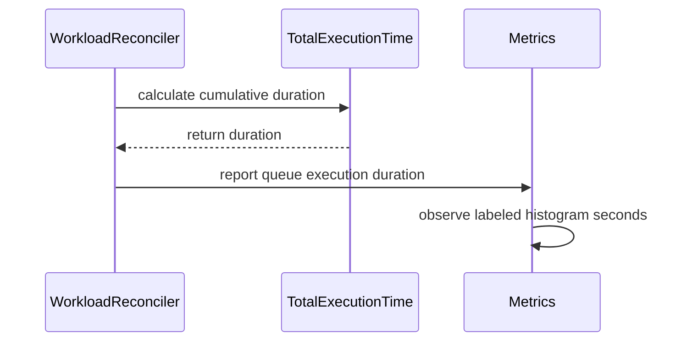

# PR #13420: Add workload execution time histogram metric

**Summary**: Add workload execution time histogram metric

**Sources**: https://github.com/kubernetes-sigs/kueue/pull/13420

**Last updated**: 2026-09-30T11:54:20Z

---

## Metadata

- **State**: closed (merged)
- **Author**: [@sohankunkerkar](https://github.com/sohankunkerkar)
- **Branch**: `add-execution-time-metric` → `main`
- **Created**: 2026-07-23T18:06:45Z
- **Updated**: 2026-09-30T11:54:20Z
- **Merged**: 2026-07-24T19:15:52Z
- **Closed**: 2026-07-24T19:15:52Z
- **Labels**: `kind/feature`, `release-note`, `size/L`, `lgtm`, `approved`, `cncf-cla: yes`
- **Assignees**: [@mimowo](https://github.com/mimowo)
- **Requested reviewers**: [@mbobrovskyi](https://github.com/mbobrovskyi), [@PBundyra](https://github.com/PBundyra)
- **Changed files**: 7   **+310 / -3**

## Description

<!--  Thanks for sending a pull request!  Here are some tips for you:

1. If this is your first time, please read our contributor guidelines: https://git.k8s.io/community/contributors/guide/first-contribution.md#your-first-contribution and developer guide https://git.k8s.io/community/contributors/devel/development.md#development-guide
2. Please label this pull request according to what type of issue you are addressing, especially if this is a release targeted pull request. For reference on required PR/issue labels, read here:
https://git.k8s.io/community/contributors/devel/sig-release/release.md#issuepr-kind-label
3. Ensure you have added or ran the appropriate tests for your PR: https://git.k8s.io/community/contributors/devel/sig-testing/testing.md
4. If you want *faster* PR reviews, read how: https://git.k8s.io/community/contributors/guide/pull-requests.md#best-practices-for-faster-reviews
5. If the PR is unfinished, see how to mark it: https://git.k8s.io/community/contributors/guide/pull-requests.md#marking-unfinished-pull-requests
-->

#### What type of PR is this?
/kind feature

<!--
Add one of the following kinds:
/kind bug
/kind cleanup
/kind documentation
/kind feature
/kind kep

Optionally add one or more of the following kinds if applicable:
/kind api-change
/kind deprecation
/kind failing-test
/kind flake
/kind regression

Please also consider setting the area:
/area tas
/area was
/area integrations
/area multikueue
/area dashboard
/area localization
/area testing
/area website
-->

#### What this PR does / why we need it:
Adds `kueue_execution_time_seconds` and `kueue_local_queue_execution_time_seconds` histogram metrics that record total workload execution time (admission to completion, cumulative across evict/readmit cycles). Kueue currently has zero execution-time histograms.


#### Which issue(s) this PR fixes:
<!--
*Automatically closes linked issue when PR is merged.
Usage: `Fixes #<issue number>`, or `Fixes (paste link of issue)`.
_If PR is about `failing-tests or flakes`, please post the related issues/tests in a comment and do not use `Fixes`_*
-->
Part of #13159 

#### Special notes for your reviewer:

#### Does this PR introduce a user-facing change?
<!--
If no, just write "NONE" in the release-note block below.
If yes, a release note is required:
Enter your extended release note in the block below. If the PR requires additional action from users switching to the new release, include the string "action required".
-->
```release-note
Observability: Added kueue_execution_time_seconds and kueue_local_queue_execution_time_seconds histograms. At Workload completion, they record total execution time across all admissions, including readmissions after eviction.
```


<!-- This is an auto-generated comment: release notes by coderabbit.ai -->
## Summary by CodeRabbit

* **New Features**
  * Added Prometheus histogram metrics for finished-workload execution time for both cluster queues and local queues.
  * Execution time is recorded when an admitted workload completes, including time accumulated across evict/readmit cycles.
  * Metrics are labeled by queue identity, priority class, and replica role (local-queue metrics also include namespace).
* **Bug Fixes**
  * No execution-time samples are emitted if a workload is marked finished without ever being admitted.
* **Documentation**
  * Updated the metrics reference page with the new execution-time histograms.
* **Tests**
  * Added integration tests covering admitted success, non-admitted completion, and evict/readmit accumulation.
<!-- end of auto-generated comment: release notes by coderabbit.ai -->

## Discussion

### Comment by [@netlify[bot]](https://github.com/apps/netlify) — 2026-07-23T18:06:52Z

### <span aria-hidden="true">✅</span> Deploy Preview for *kubernetes-sigs-kueue* canceled.


|  Name | Link |
|:-:|------------------------|
|<span aria-hidden="true">🔨</span> Latest commit | e587765c57a68b3d83376fe578f293d2f7eeb585 |
|<span aria-hidden="true">🔍</span> Latest deploy log | https://app.netlify.com/projects/kubernetes-sigs-kueue/deploys/6a63b6d5b3f1430008e4e5c1 |

### Comment by [@coderabbitai[bot]](https://github.com/apps/coderabbitai) — 2026-07-23T18:07:36Z

<!-- This is an auto-generated comment: summarize by coderabbit.ai -->
<!-- review_stack_entry_start -->

[](https://app.coderabbit.ai/change-stack/kubernetes-sigs/kueue/pull/13420?utm_source=github_walkthrough&utm_medium=github&utm_campaign=change_stack)

<!-- review_stack_entry_end -->
<!-- This is an auto-generated comment: review paused by coderabbit.ai -->

> [!NOTE]
> ## Reviews paused
> 
> It looks like this branch is under active development. To avoid overwhelming you with review comments due to an influx of new commits, CodeRabbit has automatically paused this review. You can configure this behavior by changing the `reviews.auto_review.auto_pause_after_reviewed_commits` setting.
> 
> Use the following commands to manage reviews:
> - `@coderabbitai resume` to resume automatic reviews.
> - `@coderabbitai review` to trigger a single review.
> 
> Use the checkboxes below for quick actions:
> - [ ] <!-- {"checkboxId": "7f6cc2e2-2e4e-497a-8c31-c9e4573e93d1"} --> ▶️ Resume reviews
> - [ ] <!-- {"checkboxId": "e9bb8d72-00e8-4f67-9cb2-caf3b22574fe"} --> 🔍 Trigger review

<!-- end of auto-generated comment: review paused by coderabbit.ai -->
<!-- walkthrough_start -->

<details>
<summary>📝 Walkthrough</summary>

## Walkthrough

The controller reports cumulative execution time for finished admitted workloads through cluster-queue and local-queue Prometheus histograms. Metric setup, cleanup, documentation, assertion helpers, and integration tests cover completion, non-admitted workloads, and eviction/readmission.

### Changes

**Execution-time metrics**

|Layer / File(s)|Summary|
|---|---|
|**Execution-time calculation** <br> `pkg/workload/workload.go`|Adds `TotalExecutionTime`, combining accumulated execution with the current admitted-to-finished interval and returning an inapplicable value when admission or completion conditions are missing.|
|**Execution-time histogram metrics** <br> `pkg/metrics/metrics.go`, `site/content/en/docs/reference/metrics.md`|Adds cluster-queue and local-queue histograms, reporting functions, registration, duration clamping, cleanup handling, and reference documentation.|
|**Finished workload reporting** <br> `pkg/controller/core/workload_controller.go`|Computes cumulative execution time and reports it for applicable finished workloads.|
|**Execution-time integration coverage** <br> `test/util/metrics.go`, `test/integration/singlecluster/controller/core/workload_controller_test.go`|Adds histogram assertion helpers and tests for completion, non-admitted workloads, and eviction/readmission accumulation.|

**Estimated code review effort:** 3 (Moderate) | ~20 minutes

### Sequence Diagram(s)



**Suggested labels:** `area/integrations`

**Suggested reviewers:** `mbobrovskyi`, `pbundyra`, `yq-wang`

</details>

<!-- walkthrough_end -->
<!-- pre_merge_checks_walkthrough_start -->

<details>
<summary>🚥 Pre-merge checks | ✅ 4 | ❌ 1</summary>

### ❌ Failed checks (1 warning)

|     Check name     | Status     | Explanation                                                                           | Resolution                                                                         |
| :----------------: | :--------- | :------------------------------------------------------------------------------------ | :--------------------------------------------------------------------------------- |
| Docstring Coverage | ⚠️ Warning | Docstring coverage is 37.50% which is insufficient. The required threshold is 80.00%. | Write docstrings for the functions missing them to satisfy the coverage threshold. |

<details>
<summary>✅ Passed checks (4 passed)</summary>

|         Check name         | Status   | Explanation                                                                                    |
| :------------------------: | :------- | :--------------------------------------------------------------------------------------------- |
|      Description Check     | ✅ Passed | Check skipped - CodeRabbit’s high-level summary is enabled.                                    |
|         Title check        | ✅ Passed | The title clearly describes the main change: adding workload execution-time histogram metrics. |
|     Linked Issues check    | ✅ Passed | Check skipped because no linked issues were found for this pull request.                       |
| Out of Scope Changes check | ✅ Passed | Check skipped because no linked issues were found for this pull request.                       |

</details>

</details>

<!-- pre_merge_checks_walkthrough_end -->
<!-- finishing_touch_checkbox_start -->

<details>
<summary>✨ Finishing Touches</summary>

<details>
<summary>🧪 Generate unit tests (beta)</summary>

- [ ] <!-- {"checkboxId": "f47ac10b-58cc-4372-a567-0e02b2c3d479", "radioGroupId": "utg-output-choice-group-unknown_comment_id"} -->   Create PR with unit tests

</details>

</details>

<!-- finishing_touch_checkbox_end -->
<!-- tips_start -->

---

Thanks for using [CodeRabbit](https://coderabbit.ai?utm_source=oss&utm_medium=github&utm_campaign=kubernetes-sigs/kueue&utm_content=13420)! It's free for OSS, and your support helps us grow. If you like it, consider giving us a shout-out.

<details>
<summary>❤️ Share</summary>

- [X](https://twitter.com/intent/tweet?text=I%20just%20used%20%40coderabbitai%20for%20my%20code%20review%2C%20and%20it%27s%20fantastic%21%20It%27s%20free%20for%20OSS%20and%20offers%20a%20free%20trial%20for%20the%20proprietary%20code.%20Check%20it%20out%3A&url=https%3A//coderabbit.ai)
- [Mastodon](https://mastodon.social/share?text=I%20just%20used%20%40coderabbitai%20for%20my%20code%20review%2C%20and%20it%27s%20fantastic%21%20It%27s%20free%20for%20OSS%20and%20offers%20a%20free%20trial%20for%20the%20proprietary%20code.%20Check%20it%20out%3A%20https%3A%2F%2Fcoderabbit.ai)
- [Reddit](https://www.reddit.com/submit?title=Great%20tool%20for%20code%20review%20-%20CodeRabbit&text=I%20just%20used%20CodeRabbit%20for%20my%20code%20review%2C%20and%20it%27s%20fantastic%21%20It%27s%20free%20for%20OSS%20and%20offers%20a%20free%20trial%20for%20proprietary%20code.%20Check%20it%20out%3A%20https%3A//coderabbit.ai)
- [LinkedIn](https://www.linkedin.com/sharing/share-offsite/?url=https%3A%2F%2Fcoderabbit.ai&mini=true&title=Great%20tool%20for%20code%20review%20-%20CodeRabbit&summary=I%20just%20used%20CodeRabbit%20for%20my%20code%20review%2C%20and%20it%27s%20fantastic%21%20It%27s%20free%20for%20OSS%20and%20offers%20a%20free%20trial%20for%20proprietary%20code)

</details>


<sub>Comment `@coderabbitai help` to get the list of available commands.</sub>

<!-- tips_end -->

### Comment by [@sohankunkerkar](https://github.com/sohankunkerkar) — 2026-07-24T16:30:13Z

/retest

### Comment by [@sohankunkerkar](https://github.com/sohankunkerkar) — 2026-07-24T18:41:11Z

@mimowo @kshalot PTAL

### Comment by [@kubernetes-prow[bot]](https://github.com/apps/kubernetes-prow) — 2026-07-24T19:07:06Z

LGTM label has been added.  <details>Git tree hash: f99b90ba8ea0bdc5ecdb20180bb3c23d9f06d415</details>

### Comment by [@kubernetes-prow[bot]](https://github.com/apps/kubernetes-prow) — 2026-07-24T19:07:10Z

[APPROVALNOTIFIER] This PR is **APPROVED**

This pull-request has been approved by: *<a href="https://github.com/kubernetes-sigs/kueue/pull/13420#pullrequestreview-4776032658" title="Approved">mimowo</a>*, *<a href="https://github.com/kubernetes-sigs/kueue/pull/13420#" title="Author self-approved">sohankunkerkar</a>*

The full list of commands accepted by this bot can be found [here](https://go.k8s.io/bot-commands?repo=kubernetes-sigs%2Fkueue).

The pull request process is described [here](https://git.k8s.io/community/contributors/guide/owners.md#the-code-review-process)

<details >
Needs approval from an approver in each of these files:

- ~~[OWNERS](https://github.com/kubernetes-sigs/kueue/blob/main/OWNERS)~~ [mimowo]

Approvers can indicate their approval by writing `/approve` in a comment
Approvers can cancel approval by writing `/approve cancel` in a comment
</details>
<!-- META={"approvers":[]} -->

### Comment by [@mimowo](https://github.com/mimowo) — 2026-09-30T11:54:18Z

/release-note-edit
```release-note
Observability: Added kueue_execution_time_seconds and kueue_local_queue_execution_time_seconds histograms. At Workload completion, they record total execution time across all admissions, including readmissions after eviction.
```

## Reviews

### Review by [@copilot-pull-request-reviewer[bot]](https://github.com/apps/copilot-pull-request-reviewer) (commented) — 2026-07-23T18:11:33Z

## Pull request overview

This PR adds new Prometheus histogram metrics to track total workload execution time (from admission to completion, cumulative across evict/readmit cycles) at both ClusterQueue and LocalQueue scopes, and extends integration test coverage to validate the metrics are recorded (and not recorded when not admitted).

**Changes:**
- Add `kueue_execution_time_seconds` (ClusterQueue) and `kueue_local_queue_execution_time_seconds` (LocalQueue) histogram vectors plus reporting helpers.
- Report execution time when a workload transitions to Finished, using admitted/finished condition timestamps plus accumulated past execution time.
- Add integration test cases and test utilities for asserting the new histogram metrics.

### Reviewed changes

Copilot reviewed 4 out of 4 changed files in this pull request and generated 3 comments.

| File | Description |
| ---- | ----------- |
| pkg/metrics/metrics.go | Defines the new histogram vectors and exposes reporting/clearing helpers. |
| pkg/controller/core/workload_controller.go | Reports execution time on workload finish (including evict/readmit accumulation). |
| test/util/metrics.go | Adds test helper assertions for the new histogram metrics. |
| test/integration/singlecluster/controller/core/workload_controller_test.go | Adds integration tests covering execution time metric emission behavior. |


<details>
<summary>Comments suppressed due to low confidence (1)</summary>

**test/integration/singlecluster/controller/core/workload_controller_test.go:1668**
* This Eventually block appends a WorkloadFinished condition on every retry. If Status().Update conflicts and retries, the slice can accumulate duplicates and the object’s resourceVersion can go stale, causing flakes. Prefer apimeta.SetStatusCondition (idempotent) after re-GETing the workload within the Eventually closure.
```
				gomega.Eventually(func(g gomega.Gomega) {
					g.Expect(k8sClient.Get(ctx, wlKey, wl)).To(gomega.Succeed())
					wl.Status.Conditions = append(wl.Status.Conditions, metav1.Condition{
						Type:               kueue.WorkloadFinished,
						Status:             metav1.ConditionTrue,
```
</details>


---

💡 <a href="/kubernetes-sigs/kueue/new/main?filename=.github/instructions/*.instructions.md" class="Link--inTextBlock" target="_blank" rel="noopener noreferrer">Add Copilot custom instructions</a> for smarter, more guided reviews. <a href="https://docs.github.com/en/copilot/customizing-copilot/adding-repository-custom-instructions-for-github-copilot" class="Link--inTextBlock" target="_blank" rel="noopener noreferrer">Learn how to get started</a>.

- **pkg/metrics/metrics.go:498** by [@Copilot](https://github.com/apps/copilot-pull-request-reviewer) — 2026-07-23T18:11:32Z
```diff
@@ -482,6 +490,24 @@ The label 'result' can have the following values:
 		}, append([]string{"name", "namespace", "priority_class", "replica_role"}, localQueueMetricsLabels...),
 	)
 
+	ExecutionTimeSeconds = prometheus.NewHistogramVec(
+		prometheus.HistogramOpts{
+			Subsystem: constants.KueueName,
+			Name:      "execution_time_seconds",
+			Help:      "The total execution time of a finished workload (from first admission to completion, including time across evict/readmit cycles), per 'cluster_queue'",
+			Buckets:   generateExponentialBuckets(14),
```

  ExecutionTimeSeconds and LocalQueueExecutionTimeSeconds are created here, but they are not registered with the Prometheus registry (missing from Register() and RegisterLQMetrics()). As a result the metrics will never be exposed, even though controller code observes them.

- **test/integration/singlecluster/controller/core/workload_controller_test.go:1609** by [@Copilot](https://github.com/apps/copilot-pull-request-reviewer) — 2026-07-23T18:11:33Z
```diff
@@ -1536,6 +1536,148 @@ var _ = ginkgo.Describe("Workload controller with resource retention", func() {
 				util.ExpectLQFinishedWorkloadsGaugeMetric(localQueue, 0)
 			})
 		})
+
+		ginkgo.It("should record execution time metric when workload finishes", func() {
+			var (
+				wl    *kueue.Workload
+				wlKey client.ObjectKey
+			)
+
+			ginkgo.By("creating a workload", func() {
+				wl = utiltestingapi.MakeWorkload("wl-exec-time", ns.Name).Queue("q").
+					Request(corev1.ResourceCPU, "1").Obj()
+				wlKey = client.ObjectKeyFromObject(wl)
+				gomega.Expect(k8sClient.Create(ctx, wl)).To(gomega.Succeed())
+			})
+
+			ginkgo.By("simulating workload admission", func() {
+				admission := utiltestingapi.MakeAdmission("cq").Obj()
+				util.SetQuotaReservation(ctx, k8sClient, wlKey, admission)
+				util.SyncAdmittedConditionForWorkloads(ctx, k8sClient, wl)
+			})
+
+			ginkgo.By("marking workload as finished", func() {
+				gomega.Eventually(func(g gomega.Gomega) {
+					g.Expect(k8sClient.Get(ctx, wlKey, &createdWorkload)).To(gomega.Succeed())
+					apimeta.SetStatusCondition(&createdWorkload.Status.Conditions, metav1.Condition{
+						Type:               kueue.WorkloadFinished,
+						Status:             metav1.ConditionTrue,
+						LastTransitionTime: metav1.Now(),
+						Reason:             "Succeeded",
+						Message:            "Job finished successfully",
+					})
+					g.Expect(k8sClient.Status().Update(ctx, &createdWorkload)).To(gomega.Succeed())
+				}, util.Timeout, util.Interval).Should(gomega.Succeed())
+			})
+
+			ginkgo.By("verifying that execution time metric is recorded", func() {
+				util.ExpectExecutionTimeMetric(clusterQueue, "", 1)
+				util.ExpectLQExecutionTimeMetric(localQueue, "", 1)
+			})
+		})
+
+		ginkgo.It("should not record execution time metric when workload finishes without being admitted", func() {
+			var (
+				wl    *kueue.Workload
+				wlKey client.ObjectKey
+			)
+
+			ginkgo.By("creating a workload without admitting it", func() {
+				wl = utiltestingapi.MakeWorkload("wl-no-admit", ns.Name).Queue("q").
+					Request(corev1.ResourceCPU, "1").Obj()
+				wlKey = client.ObjectKeyFromObject(wl)
+				gomega.Expect(k8sClient.Create(ctx, wl)).To(gomega.Succeed())
+			})
+
+			ginkgo.By("marking workload as finished directly", func() {
+				gomega.Expect(k8sClient.Get(ctx, wlKey, &createdWorkload)).To(gomega.Succeed())
+				gomega.Eventually(func(g gomega.Gomega) {
+					createdWorkload.Status.Conditions = append(createdWorkload.Status.Conditions, metav1.Condition{
+						Type:               kueue.WorkloadFinished,
+						Status:             metav1.ConditionTrue,
+						LastTransitionTime: metav1.Now(),
+						Reason:             "Failed",
+						Message:            "Job failed without admission",
+					})
+					g.Expect(k8sClient.Status().Update(ctx, &createdWorkload)).To(gomega.Succeed())
+				}, util.Timeout, util.Interval).Should(gomega.Succeed())
+			})
```

  This Eventually block appends a new WorkloadFinished condition on every retry without re-fetching the latest object. If the Status().Update conflicts and retries, the test can accumulate duplicate conditions and keep using a stale resourceVersion, causing flakes. Prefer re-GET inside the Eventually and use apimeta.SetStatusCondition (as the other test does) instead of append.
  
  This issue also appears on line 1664 of the same file.

- **test/integration/singlecluster/controller/core/workload_controller_test.go:1614** by [@Copilot](https://github.com/apps/copilot-pull-request-reviewer) — 2026-07-23T18:11:33Z
```diff
@@ -1536,6 +1536,148 @@ var _ = ginkgo.Describe("Workload controller with resource retention", func() {
 				util.ExpectLQFinishedWorkloadsGaugeMetric(localQueue, 0)
 			})
 		})
+
+		ginkgo.It("should record execution time metric when workload finishes", func() {
+			var (
+				wl    *kueue.Workload
+				wlKey client.ObjectKey
+			)
+
+			ginkgo.By("creating a workload", func() {
+				wl = utiltestingapi.MakeWorkload("wl-exec-time", ns.Name).Queue("q").
+					Request(corev1.ResourceCPU, "1").Obj()
+				wlKey = client.ObjectKeyFromObject(wl)
+				gomega.Expect(k8sClient.Create(ctx, wl)).To(gomega.Succeed())
+			})
+
+			ginkgo.By("simulating workload admission", func() {
+				admission := utiltestingapi.MakeAdmission("cq").Obj()
+				util.SetQuotaReservation(ctx, k8sClient, wlKey, admission)
+				util.SyncAdmittedConditionForWorkloads(ctx, k8sClient, wl)
+			})
+
+			ginkgo.By("marking workload as finished", func() {
+				gomega.Eventually(func(g gomega.Gomega) {
+					g.Expect(k8sClient.Get(ctx, wlKey, &createdWorkload)).To(gomega.Succeed())
+					apimeta.SetStatusCondition(&createdWorkload.Status.Conditions, metav1.Condition{
+						Type:               kueue.WorkloadFinished,
+						Status:             metav1.ConditionTrue,
+						LastTransitionTime: metav1.Now(),
+						Reason:             "Succeeded",
+						Message:            "Job finished successfully",
+					})
+					g.Expect(k8sClient.Status().Update(ctx, &createdWorkload)).To(gomega.Succeed())
+				}, util.Timeout, util.Interval).Should(gomega.Succeed())
+			})
+
+			ginkgo.By("verifying that execution time metric is recorded", func() {
+				util.ExpectExecutionTimeMetric(clusterQueue, "", 1)
+				util.ExpectLQExecutionTimeMetric(localQueue, "", 1)
+			})
+		})
+
+		ginkgo.It("should not record execution time metric when workload finishes without being admitted", func() {
+			var (
+				wl    *kueue.Workload
+				wlKey client.ObjectKey
+			)
+
+			ginkgo.By("creating a workload without admitting it", func() {
+				wl = utiltestingapi.MakeWorkload("wl-no-admit", ns.Name).Queue("q").
+					Request(corev1.ResourceCPU, "1").Obj()
+				wlKey = client.ObjectKeyFromObject(wl)
+				gomega.Expect(k8sClient.Create(ctx, wl)).To(gomega.Succeed())
+			})
+
+			ginkgo.By("marking workload as finished directly", func() {
+				gomega.Expect(k8sClient.Get(ctx, wlKey, &createdWorkload)).To(gomega.Succeed())
+				gomega.Eventually(func(g gomega.Gomega) {
+					createdWorkload.Status.Conditions = append(createdWorkload.Status.Conditions, metav1.Condition{
+						Type:               kueue.WorkloadFinished,
+						Status:             metav1.ConditionTrue,
+						LastTransitionTime: metav1.Now(),
+						Reason:             "Failed",
+						Message:            "Job failed without admission",
+					})
+					g.Expect(k8sClient.Status().Update(ctx, &createdWorkload)).To(gomega.Succeed())
+				}, util.Timeout, util.Interval).Should(gomega.Succeed())
+			})
+
+			ginkgo.By("verifying that execution time metric is not recorded", func() {
+				util.ExpectExecutionTimeMetric(clusterQueue, "", 0)
+			})
```

  This test asserts the ClusterQueue execution time histogram is not recorded, but it doesn’t assert the LocalQueue execution time histogram is also not recorded. Since the controller reports both metrics, adding the LocalQueue assertion prevents a regression where only one side is gated correctly.

### Review by [@coderabbitai[bot]](https://github.com/apps/coderabbitai) (commented) — 2026-07-23T18:14:01Z

**Actionable comments posted: 1**

> [!CAUTION]
> Some comments are outside the diff and can’t be posted inline due to platform limitations.
> 
> 
> 
> <details>
> <summary>⚠️ Outside diff range comments (1)</summary><blockquote>
> 
> <details>
> <summary>pkg/controller/core/workload_controller.go (1)</summary><blockquote>
> 
> `1541-1560`: _🎯 Functional Correctness_ | _🟠 Major_ | _⚡ Quick win_
> 
> **Execution time metric is silently dropped for workloads finished while evicted (not readmitted).**
> 
> The guard `admittedCond != nil && admittedCond.Status == metav1.ConditionTrue && finishedCond != nil` skips reporting entirely whenever the workload isn't currently admitted at finish time — even if `AccumulatedPastExecutionTimeSeconds` is non-zero (e.g. workload was admitted, evicted, then finished/deactivated without being readmitted). That accumulated execution time is real and should still be reported; only the "current segment" computation (which relies on `admittedCond.LastTransitionTime`) is invalid in that state, not the whole observation. This scenario isn't covered by the new integration tests either — as per path instructions, new controller behavior should have corresponding tests (`pkg/controller/**/*.go`: "Verify that new controller behavior has corresponding unit and integration tests").
> 
> 
> 
> 
> 
> 
> <details>
> <summary>🐛 Proposed fix to preserve accumulated execution time when not currently admitted</summary>
> 
> ```diff
>  	admittedCond := apimeta.FindStatusCondition(wl.Status.Conditions, kueue.WorkloadAdmitted)
>  	finishedCond := apimeta.FindStatusCondition(wl.Status.Conditions, kueue.WorkloadFinished)
> -	if admittedCond != nil && admittedCond.Status == metav1.ConditionTrue && finishedCond != nil {
> -		currentSegment := finishedCond.LastTransitionTime.Time.Sub(admittedCond.LastTransitionTime.Time)
> -		accumulatedPast := time.Duration(ptr.Deref(wl.Status.AccumulatedPastExecutionTimeSeconds, 0)) * time.Second
> -		totalExecutionTime := accumulatedPast + currentSegment
> +	if finishedCond != nil {
> +		accumulatedPast := time.Duration(ptr.Deref(wl.Status.AccumulatedPastExecutionTimeSeconds, 0)) * time.Second
> +		var totalExecutionTime time.Duration
> +		switch {
> +		case admittedCond != nil && admittedCond.Status == metav1.ConditionTrue:
> +			totalExecutionTime = accumulatedPast + finishedCond.LastTransitionTime.Time.Sub(admittedCond.LastTransitionTime.Time)
> +		case accumulatedPast > 0:
> +			totalExecutionTime = accumulatedPast
> +		default:
> +			return
> +		}
>  		metrics.ReportExecutionTime(cqName, priorityClassName, totalExecutionTime, r.customLabels.CQGet(cqName), r.roleTracker)
>  		if r.cache.ShouldExposeLocalQueueMetricsForWorkload(log, wl) {
>  			metrics.ReportLocalQueueExecutionTime(lqRef, priorityClassName, totalExecutionTime, r.customLabels.LQGet(qutil.KeyFromWorkload(wl)), r.roleTracker)
>  		}
>  	}
> ```
> </details>
> 
> <details>
> <summary>🤖 Prompt for AI Agents</summary>
> 
> ```
> Verify each finding against current code. Fix only still-valid issues, skip the
> rest with a brief reason, keep changes minimal, and validate.
> 
> In `@pkg/controller/core/workload_controller.go` around lines 1541 - 1560, Update
> reportFinishedWorkload so execution time is reported whenever finishedCond
> exists and accumulated execution time is non-zero, even when the workload is not
> currently admitted. Compute the current segment only when admittedCond is
> present and true; otherwise use zero and preserve accumulatedPast as the
> reported total. Add or update controller unit/integration tests covering a
> workload admitted, evicted, then finished without readmission.
> ```
> 
> </details>
> 
> <!-- cr-comment:v1:25af39291b426975098cbb07 -->
> 
> _Source: Path instructions_
> 
> </blockquote></details>
> 
> </blockquote></details>

<details>
<summary>🧹 Nitpick comments (1)</summary><blockquote>

<details>
<summary>test/integration/singlecluster/controller/core/workload_controller_test.go (1)</summary><blockquote>

`1677-1680`: _🎯 Functional Correctness_ | _🔵 Trivial_ | _⚡ Quick win_

**Test doesn't actually verify "cumulative" behavior, only that one observation occurred.**

The assertion only checks the observation count (`1`), not that the recorded value reflects `accumulatedPast + currentSegment`. A test with this name should assert on the observed sum/value (e.g. via a histogram-sum helper) so it would fail if the accumulated-past time were dropped.

<details>
<summary>🤖 Prompt for AI Agents</summary>

```
Verify each finding against current code. Fix only still-valid issues, skip the
rest with a brief reason, keep changes minimal, and validate.

In `@test/integration/singlecluster/controller/core/workload_controller_test.go`
around lines 1677 - 1680, The execution-time metric test around
util.ExpectExecutionTimeMetric currently verifies only that one observation
exists, not the cumulative value. Update the test to assert the histogram sum or
equivalent observed value equals accumulatedPast plus currentSegment, using the
existing metric helper or assertion utilities, while preserving the
single-observation check if needed.
```

</details>

<!-- cr-comment:v1:d6a2120d1cec888c42134291 -->

</blockquote></details>

</blockquote></details>

<details>
<summary>🤖 Prompt for all review comments with AI agents</summary>

```
Verify each finding against current code. Fix only still-valid issues, skip the
rest with a brief reason, keep changes minimal, and validate.

Inline comments:
In `@pkg/metrics/metrics.go`:
- Around line 493-510: Update the bucket configuration for ExecutionTimeSeconds
and LocalQueueExecutionTimeSeconds to use the existing longer-range 16-bucket
exponential range, or an equivalent range that exceeds the current maximum.
Leave the metric names, labels, and help text unchanged.

---

Outside diff comments:
In `@pkg/controller/core/workload_controller.go`:
- Around line 1541-1560: Update reportFinishedWorkload so execution time is
reported whenever finishedCond exists and accumulated execution time is
non-zero, even when the workload is not currently admitted. Compute the current
segment only when admittedCond is present and true; otherwise use zero and
preserve accumulatedPast as the reported total. Add or update controller
unit/integration tests covering a workload admitted, evicted, then finished
without readmission.

---

Nitpick comments:
In `@test/integration/singlecluster/controller/core/workload_controller_test.go`:
- Around line 1677-1680: The execution-time metric test around
util.ExpectExecutionTimeMetric currently verifies only that one observation
exists, not the cumulative value. Update the test to assert the histogram sum or
equivalent observed value equals accumulatedPast plus currentSegment, using the
existing metric helper or assertion utilities, while preserving the
single-observation check if needed.
```

</details>

<details>
<summary>🪄 Autofix (Beta)</summary>

Fix all unresolved CodeRabbit comments on this PR:

- [ ] <!-- {"checkboxId": "4b0d0e0a-96d7-4f10-b296-3a18ea78f0b9"} --> Push a commit to this branch (recommended)
- [ ] <!-- {"checkboxId": "ff5b1114-7d8c-49e6-8ac1-43f82af23a33"} --> Create a new PR with the fixes

</details>

---

<details>
<summary>ℹ️ Review info</summary>

<details>
<summary>⚙️ Run configuration</summary>

**Configuration used**: Path: .coderabbit.yaml

**Review profile**: CHILL

**Plan**: Pro Plus

**Run ID**: `76121c56-bfce-4694-adb3-fd145ebdba94`

</details>

<details>
<summary>📥 Commits</summary>

Reviewing files that changed from the base of the PR and between 3c92153c54c17402594fba0b0239145828764a53 and 68df7cac87fc68605709436e867c93b8364d109d.

</details>

<details>
<summary>📒 Files selected for processing (4)</summary>

* `pkg/controller/core/workload_controller.go`
* `pkg/metrics/metrics.go`
* `test/integration/singlecluster/controller/core/workload_controller_test.go`
* `test/util/metrics.go`

</details>

</details>

<!-- This is an auto-generated comment by CodeRabbit for review status -->

- **pkg/metrics/metrics.go:510** by [@coderabbitai[bot]](https://github.com/apps/coderabbitai) — 2026-07-23T18:14:00Z
```diff
@@ -482,6 +490,24 @@ The label 'result' can have the following values:
 		}, append([]string{"name", "namespace", "priority_class", "replica_role"}, localQueueMetricsLabels...),
 	)
 
+	ExecutionTimeSeconds = prometheus.NewHistogramVec(
+		prometheus.HistogramOpts{
+			Subsystem: constants.KueueName,
+			Name:      "execution_time_seconds",
+			Help:      "The total execution time of a finished workload (from first admission to completion, including time across evict/readmit cycles), per 'cluster_queue'",
+			Buckets:   generateExponentialBuckets(14),
+		}, append([]string{"cluster_queue", "priority_class", "replica_role"}, clusterQueueMetricsLabels...),
+	)
+
+	LocalQueueExecutionTimeSeconds = prometheus.NewHistogramVec(
+		prometheus.HistogramOpts{
+			Subsystem: constants.KueueName,
+			Name:      "local_queue_execution_time_seconds",
+			Help:      "The total execution time of a finished workload (from first admission to completion, including time across evict/readmit cycles), per 'local_queue'",
+			Buckets:   generateExponentialBuckets(14),
+		}, append([]string{"name", "namespace", "priority_class", "replica_role"}, localQueueMetricsLabels...),
+	)
+
```

  _🚀 Performance & Scalability_ | _🟡 Minor_ | _⚡ Quick win_
  
  <details>
  <summary>🧩 Analysis chain</summary>
  
  🏁 Script executed:
  
  ```shell
  #!/bin/bash
  # Find the bucket-generation helper and its bucket boundaries.
  rg -n -A6 'func generateExponentialBuckets' pkg/metrics/metrics.go
  ```
  
  Repository: kubernetes-sigs/kueue
  
  Length of output: 544
  
  ---
  
  🏁 Script executed:
  
  ```shell
  #!/bin/bash
  set -euo pipefail
  
  # Inspect the relevant histogram registrations and probe the generated bucket boundaries.
  sed -n '450,520p;980,1010p' pkg/metrics/metrics.go
  
  python3 - <<'PY'
  import subprocess, ast
  
  def float_seq(n):
      v = 1.0
      seq = [v]
      for _ in range(n-1):
          v = v * 2.5
          seq.append(v)
      return seq
  
  print("generateExponentialBuckets(14):", float_seq(14))
  print("generateExponentialBuckets(16):", float_seq(16))
  PY
  ```
  
  Repository: kubernetes-sigs/kueue
  
  Length of output: 5225
  
  ---
  
  
  
  </details>
  
  **Use longer-range buckets for execution-time histograms.**
  
  `generateExponentialBuckets(14)` produces max boundary `~1.49e5` seconds (about 1.7 days). Cumulative execution time can exceed this for long-running workloads, collapsing those observations into `+Inf`; use a longer range, such as the existing 16-bucket range or longer, for these metrics.
  
  <details>
  <summary>🤖 Prompt for AI Agents</summary>
  
  ```
  Verify each finding against current code. Fix only still-valid issues, skip the
  rest with a brief reason, keep changes minimal, and validate.
  
  In `@pkg/metrics/metrics.go` around lines 493 - 510, Update the bucket
  configuration for ExecutionTimeSeconds and LocalQueueExecutionTimeSeconds to use
  the existing longer-range 16-bucket exponential range, or an equivalent range
  that exceeds the current maximum. Leave the metric names, labels, and help text
  unchanged.
  ```
  
  </details>
  
  <!-- fingerprinting:phantom:medusa:beignet -->
  
  <!-- cr-indicator-types:potential_issue -->
  
  <!-- cr-comment:v1:1b65613ca9a0bbcf78c147f3 -->
  
  <!-- This is an auto-generated comment by CodeRabbit -->
  
  ✅ Addressed in commit 7567229

### Review by [@mimowo](https://github.com/mimowo) (commented) — 2026-07-23T19:21:58Z

- **pkg/controller/core/workload_controller.go:1559** by [@mimowo](https://github.com/mimowo) — 2026-07-23T19:21:58Z
```diff
@@ -1546,6 +1546,17 @@ func (r *WorkloadReconciler) reportFinishedWorkload(log logr.Logger, wl *kueue.W
 	if r.cache.ShouldExposeLocalQueueMetricsForWorkload(log, wl) {
 		metrics.IncrementLocalQueueFinishedWorkloadTotal(lqRef, priorityClassName, r.customLabels.LQGet(qutil.KeyFromWorkload(wl)), r.roleTracker)
 	}
+	admittedCond := apimeta.FindStatusCondition(wl.Status.Conditions, kueue.WorkloadAdmitted)
+	finishedCond := apimeta.FindStatusCondition(wl.Status.Conditions, kueue.WorkloadFinished)
+	if admittedCond != nil && admittedCond.Status == metav1.ConditionTrue && finishedCond != nil {
+		currentSegment := finishedCond.LastTransitionTime.Sub(admittedCond.LastTransitionTime.Time)
+		accumulatedPast := time.Duration(ptr.Deref(wl.Status.AccumulatedPastExecutionTimeSeconds, 0)) * time.Second
+		totalExecutionTime := accumulatedPast + currentSegment
+		metrics.ReportExecutionTime(cqName, priorityClassName, totalExecutionTime, r.customLabels.CQGet(cqName), r.roleTracker)
+		if r.cache.ShouldExposeLocalQueueMetricsForWorkload(log, wl) {
+			metrics.ReportLocalQueueExecutionTime(lqRef, priorityClassName, totalExecutionTime, r.customLabels.LQGet(qutil.KeyFromWorkload(wl)), r.roleTracker)
+		}
+	}
```

  Could you please move it to a helper function?

### Review by [@coderabbitai[bot]](https://github.com/apps/coderabbitai) (commented) — 2026-07-23T19:25:05Z

**Actionable comments posted: 1**

<details>
<summary>🤖 Prompt for all review comments with AI agents</summary>

```
Verify each finding against current code. Fix only still-valid issues, skip the
rest with a brief reason, keep changes minimal, and validate.

Inline comments:
In `@site/content/en/docs/reference/metrics.md`:
- Line 60: Update both descriptions of kueue_execution_time_seconds to
explicitly state that the metric records only workloads admitted at least once,
using wording such as “finished admitted workload.” Preserve the existing timing
definition and label descriptions.
```

</details>

<details>
<summary>🪄 Autofix (Beta)</summary>

Fix all unresolved CodeRabbit comments on this PR:

- [ ] <!-- {"checkboxId": "4b0d0e0a-96d7-4f10-b296-3a18ea78f0b9"} --> Push a commit to this branch (recommended)
- [ ] <!-- {"checkboxId": "ff5b1114-7d8c-49e6-8ac1-43f82af23a33"} --> Create a new PR with the fixes

</details>

---

<details>
<summary>ℹ️ Review info</summary>

<details>
<summary>⚙️ Run configuration</summary>

**Configuration used**: Path: .coderabbit.yaml

**Review profile**: CHILL

**Plan**: Pro Plus

**Run ID**: `4d317890-90be-4252-994b-c1924454c7d2`

</details>

<details>
<summary>📥 Commits</summary>

Reviewing files that changed from the base of the PR and between da232eaec6d8760ce4a07a83c7a50544bcd202b9 and 6e0585d36b9c70f6123f79cf0be6d7273c70222c.

</details>

<details>
<summary>📒 Files selected for processing (5)</summary>

* `pkg/controller/core/workload_controller.go`
* `pkg/metrics/metrics.go`
* `site/content/en/docs/reference/metrics.md`
* `test/integration/singlecluster/controller/core/workload_controller_test.go`
* `test/util/metrics.go`

</details>

<details>
<summary>🚧 Files skipped from review as they are similar to previous changes (4)</summary>

* pkg/controller/core/workload_controller.go
* test/util/metrics.go
* test/integration/singlecluster/controller/core/workload_controller_test.go
* pkg/metrics/metrics.go

</details>

</details>

<!-- This is an auto-generated comment by CodeRabbit for review status -->

- **site/content/en/docs/reference/metrics.md:60** by [@coderabbitai[bot]](https://github.com/apps/coderabbitai) — 2026-07-23T19:25:04Z
```diff
@@ -57,6 +57,7 @@ Use the following metrics to monitor the status of your ClusterQueues:
 | `kueue_cluster_queue_status` | Gauge | Reports 'cluster_queue' with its 'status' (with possible values 'pending', 'active' or 'terminated').<br>For a ClusterQueue, the metric only reports a value of 1 for one of the statuses. | `cluster_queue`: the name of the ClusterQueue<br> `status`: one of `pending`, `active`, or `terminated`<br> `replica_role`: one of `leader`, `follower`, or `standalone` |
 | `kueue_evicted_workloads_once_total` | Counter | The number of unique workload evictions per 'cluster_queue',<br>The label 'reason' can have the following values:<br>- "Preempted" means that the workload was evicted in order to free resources for a workload with a higher priority or reclamation of nominal quota.<br>- "PodsReadyTimeout" means that the eviction took place due to a PodsReady timeout.<br>- "AdmissionCheck" means that the workload was evicted because at least one admission check transitioned to False.<br>- "ClusterQueueStopped" means that the workload was evicted because the ClusterQueue is stopped.<br>- "LocalQueueStopped" means that the workload was evicted because the LocalQueue is stopped.<br>- "NodeFailures" means that the workload was evicted due to node failures when using TopologyAwareScheduling.<br>- "Deactivated" means that the workload was evicted because spec.active is set to false.<br>The label 'underlying_cause' can have the following values:<br>- "" means that the value in 'reason' label is the root cause for eviction.<br>- "WaitForStart" means that the pods have not been ready since admission, or the workload is not admitted.<br>- "WaitForRecovery" means that the Pods were ready since the workload admission, but some pod has failed.<br>- "AdmissionCheck" means that the workload was evicted by Kueue due to a rejected admission check.<br>- "MaximumExecutionTimeExceeded" means that the workload was evicted by Kueue due to maximum execution time exceeded.<br>- "RequeuingLimitExceeded" means that the workload was evicted by Kueue due to requeuing limit exceeded. | `cluster_queue`: the name of the ClusterQueue<br> `reason`: eviction or preemption reason<br> `underlying_cause`: root cause for eviction<br> `priority_class`: the priority class name<br> `replica_role`: one of `leader`, `follower`, or `standalone` |
 | `kueue_evicted_workloads_total` | Counter | The number of evicted workloads per 'cluster_queue',<br>The label 'reason' can have the following values:<br>- "Preempted" means that the workload was evicted in order to free resources for a workload with a higher priority or reclamation of nominal quota.<br>- "PodsReadyTimeout" means that the eviction took place due to a PodsReady timeout.<br>- "AdmissionCheck" means that the workload was evicted because at least one admission check transitioned to False.<br>- "ClusterQueueStopped" means that the workload was evicted because the ClusterQueue is stopped.<br>- "LocalQueueStopped" means that the workload was evicted because the LocalQueue is stopped.<br>- "NodeFailures" means that the workload was evicted due to node failures when using TopologyAwareScheduling.<br>- "Deactivated" means that the workload was evicted because spec.active is set to false.<br>The label 'underlying_cause' can have the following values:<br>- "" means that the value in 'reason' label is the root cause for eviction.<br>- "AdmissionCheck" means that the workload was evicted by Kueue due to a rejected admission check.<br>- "MaximumExecutionTimeExceeded" means that the workload was evicted by Kueue due to maximum execution time exceeded.<br>- "RequeuingLimitExceeded" means that the workload was evicted by Kueue due to requeuing limit exceeded. | `cluster_queue`: the name of the ClusterQueue<br> `reason`: eviction or preemption reason<br> `underlying_cause`: root cause for eviction<br> `priority_class`: the priority class name<br> `replica_role`: one of `leader`, `follower`, or `standalone` |
+| `kueue_execution_time_seconds` | Histogram | The total execution time of a finished workload (from first admission to completion, including time across evict/readmit cycles), per 'cluster_queue' | `cluster_queue`: the name of the ClusterQueue<br> `priority_class`: the priority class name<br> `replica_role`: one of `leader`, `follower`, or `standalone` |
```

  _📐 Maintainability & Code Quality_ | _🟡 Minor_ | _⚡ Quick win_
  
  **Clarify that only admitted workloads are recorded.**
  
  The metric measures execution from first admission to completion, so “finished workload” may incorrectly imply that never-admitted completions are included. Use “finished admitted workload” or “finished workload that was admitted at least once” in both descriptions.
  
  AI assistance was used to generate this review. As per path instructions, `site/**/*.md` files must focus on technical accuracy, clarity, and Markdown formatting.
      
  
  
  Also applies to: 87-87
  
  <details>
  <summary>🤖 Prompt for AI Agents</summary>
  
  ```
  Verify each finding against current code. Fix only still-valid issues, skip the
  rest with a brief reason, keep changes minimal, and validate.
  
  In `@site/content/en/docs/reference/metrics.md` at line 60, Update both
  descriptions of kueue_execution_time_seconds to explicitly state that the metric
  records only workloads admitted at least once, using wording such as “finished
  admitted workload.” Preserve the existing timing definition and label
  descriptions.
  ```
  
  </details>
  
  <!-- fingerprinting:phantom:triton:luna -->
  
  <!-- cr-indicator-types:potential_issue -->
  
  <!-- cr-comment:v1:ba21294a249221c2ef1880ba -->
  
  _Source: Path instructions_
  
  <!-- This is an auto-generated comment by CodeRabbit -->

### Review by [@coderabbitai[bot]](https://github.com/apps/coderabbitai) (commented) — 2026-07-23T19:29:31Z

**Actionable comments posted: 1**

<details>
<summary>🧹 Nitpick comments (1)</summary><blockquote>

<details>
<summary>pkg/controller/core/workload_controller.go (1)</summary><blockquote>

`1549-1554`: _🚀 Performance & Scalability_ | _🔵 Trivial_ | _⚡ Quick win_

**Reuse the local-queue exposure decision.**

`ShouldExposeLocalQueueMetricsForWorkload` is already called at Lines 1546–1547, then called again at Line 1551. Compute the result once and reuse it to avoid duplicate cache lookups and inconsistent counter/histogram emission if the cache changes between calls.

<details>
<summary>Proposed refactor</summary>

```diff
+	exposeLocalQueueMetrics := r.cache.ShouldExposeLocalQueueMetricsForWorkload(log, wl)
-	if r.cache.ShouldExposeLocalQueueMetricsForWorkload(log, wl) {
+	if exposeLocalQueueMetrics {
 		metrics.IncrementLocalQueueFinishedWorkloadTotal(...)
 	}
 	if totalExecutionTime := workload.TotalExecutionTime(wl); totalExecutionTime >= 0 {
 		metrics.ReportExecutionTime(...)
-		if r.cache.ShouldExposeLocalQueueMetricsForWorkload(log, wl) {
+		if exposeLocalQueueMetrics {
 			metrics.ReportLocalQueueExecutionTime(...)
 		}
 	}
```
</details>

<details>
<summary>🤖 Prompt for AI Agents</summary>

```
Verify each finding against current code. Fix only still-valid issues, skip the
rest with a brief reason, keep changes minimal, and validate.

In `@pkg/controller/core/workload_controller.go` around lines 1549 - 1554, Compute
the ShouldExposeLocalQueueMetricsForWorkload result once in the surrounding
workload metrics flow and store it in a local variable, then reuse that variable
for the local-queue metric emission near ReportLocalQueueExecutionTime. Remove
the duplicate cache lookup while preserving the existing counter and histogram
behavior.
```

</details>

<!-- cr-comment:v1:5810fbb745109fdb50f7ff32 -->

</blockquote></details>

</blockquote></details>

<details>
<summary>🤖 Prompt for all review comments with AI agents</summary>

```
Verify each finding against current code. Fix only still-valid issues, skip the
rest with a brief reason, keep changes minimal, and validate.

Inline comments:
In `@pkg/workload/workload.go`:
- Around line 829-830: The execution-time calculation must require a true
WorkloadFinished condition. Update the guard in the workload execution-time
function around admittedCond and finishedCond to return -1 when finishedCond is
nil or its Status is not metav1.ConditionTrue, and add regression coverage for
False and Unknown finished conditions.

---

Nitpick comments:
In `@pkg/controller/core/workload_controller.go`:
- Around line 1549-1554: Compute the ShouldExposeLocalQueueMetricsForWorkload
result once in the surrounding workload metrics flow and store it in a local
variable, then reuse that variable for the local-queue metric emission near
ReportLocalQueueExecutionTime. Remove the duplicate cache lookup while
preserving the existing counter and histogram behavior.
```

</details>

<details>
<summary>🪄 Autofix (Beta)</summary>

Fix all unresolved CodeRabbit comments on this PR:

- [ ] <!-- {"checkboxId": "4b0d0e0a-96d7-4f10-b296-3a18ea78f0b9"} --> Push a commit to this branch (recommended)
- [ ] <!-- {"checkboxId": "ff5b1114-7d8c-49e6-8ac1-43f82af23a33"} --> Create a new PR with the fixes

</details>

---

<details>
<summary>ℹ️ Review info</summary>

<details>
<summary>⚙️ Run configuration</summary>

**Configuration used**: Path: .coderabbit.yaml

**Review profile**: CHILL

**Plan**: Pro Plus

**Run ID**: `c91efe3a-520c-4ea2-bf2e-2938079d1226`

</details>

<details>
<summary>📥 Commits</summary>

Reviewing files that changed from the base of the PR and between 6e0585d36b9c70f6123f79cf0be6d7273c70222c and 410425f3113b357100cf5e6107fca566ea8413bc.

</details>

<details>
<summary>📒 Files selected for processing (6)</summary>

* `pkg/controller/core/workload_controller.go`
* `pkg/metrics/metrics.go`
* `pkg/workload/workload.go`
* `site/content/en/docs/reference/metrics.md`
* `test/integration/singlecluster/controller/core/workload_controller_test.go`
* `test/util/metrics.go`

</details>

<details>
<summary>🚧 Files skipped from review as they are similar to previous changes (4)</summary>

* site/content/en/docs/reference/metrics.md
* test/util/metrics.go
* test/integration/singlecluster/controller/core/workload_controller_test.go
* pkg/metrics/metrics.go

</details>

</details>

<!-- This is an auto-generated comment by CodeRabbit for review status -->

- **pkg/workload/workload.go:830** by [@coderabbitai[bot]](https://github.com/apps/coderabbitai) — 2026-07-23T19:29:29Z
```diff
@@ -822,6 +822,18 @@ func SetRequeuedCondition(wl *kueue.Workload, reason, message string, status boo
 	return apimeta.SetStatusCondition(&wl.Status.Conditions, condition)
 }
 
+// TotalExecutionTime returns the cumulative admitted duration across evict/readmit cycles, or -1 if not applicable.
+func TotalExecutionTime(wl *kueue.Workload) time.Duration {
+	admittedCond := apimeta.FindStatusCondition(wl.Status.Conditions, kueue.WorkloadAdmitted)
+	finishedCond := apimeta.FindStatusCondition(wl.Status.Conditions, kueue.WorkloadFinished)
+	if admittedCond == nil || admittedCond.Status != metav1.ConditionTrue || finishedCond == nil {
+		return -1
```

  _🎯 Functional Correctness_ | _🟠 Major_ | _⚡ Quick win_
  
  **Require a true finished condition before calculating execution time.**
  
  Line 829 only checks that `finishedCond` exists. A `False` or `Unknown` `WorkloadFinished` condition can therefore produce a duration and downstream histogram observation. Also add a regression test for non-true finished conditions.
  
  <details>
  <summary>Proposed fix</summary>
  
  ```diff
  -	if admittedCond == nil || admittedCond.Status != metav1.ConditionTrue || finishedCond == nil {
  +	if admittedCond == nil ||
  +		admittedCond.Status != metav1.ConditionTrue ||
  +		finishedCond == nil ||
  +		finishedCond.Status != metav1.ConditionTrue {
  ```
  </details>
  
  <!-- suggestion_start -->
  
  <details>
  <summary>📝 Committable suggestion</summary>
  
  > ‼️ **IMPORTANT**
  > Carefully review the code before committing. Ensure that it accurately replaces the highlighted code, contains no missing lines, and has no issues with indentation. Thoroughly test & benchmark the code to ensure it meets the requirements.
  
  ```suggestion
  	if admittedCond == nil ||
  		admittedCond.Status != metav1.ConditionTrue ||
  		finishedCond == nil ||
  		finishedCond.Status != metav1.ConditionTrue {
  ```
  
  </details>
  
  <!-- suggestion_end -->
  
  <details>
  <summary>🤖 Prompt for AI Agents</summary>
  
  ```
  Verify each finding against current code. Fix only still-valid issues, skip the
  rest with a brief reason, keep changes minimal, and validate.
  
  In `@pkg/workload/workload.go` around lines 829 - 830, The execution-time
  calculation must require a true WorkloadFinished condition. Update the guard in
  the workload execution-time function around admittedCond and finishedCond to
  return -1 when finishedCond is nil or its Status is not metav1.ConditionTrue,
  and add regression coverage for False and Unknown finished conditions.
  ```
  
  </details>
  
  <!-- fingerprinting:phantom:triton:luna -->
  
  <!-- cr-indicator-types:potential_issue -->
  
  <!-- cr-comment:v1:98681802e5ae31e3868845ce -->
  
  <!-- This is an auto-generated comment by CodeRabbit -->

### Review by [@mimowo](https://github.com/mimowo) (commented) — 2026-07-23T19:55:20Z

- **pkg/workload/workload.go:831** by [@mimowo](https://github.com/mimowo) — 2026-07-23T19:55:20Z
```diff
@@ -822,6 +822,18 @@ func SetRequeuedCondition(wl *kueue.Workload, reason, message string, status boo
 	return apimeta.SetStatusCondition(&wl.Status.Conditions, condition)
 }
 
+// TotalExecutionTime returns the cumulative admitted duration across evict/readmit cycles, or -1 if not applicable.
+func TotalExecutionTime(wl *kueue.Workload) time.Duration {
+	admittedCond := apimeta.FindStatusCondition(wl.Status.Conditions, kueue.WorkloadAdmitted)
+	finishedCond := apimeta.FindStatusCondition(wl.Status.Conditions, kueue.WorkloadFinished)
```

  We can short circuit on this condition before `finishedCond := apimeta.FindStatusCondition`

### Review by [@mimowo](https://github.com/mimowo) (commented) — 2026-07-23T19:56:31Z

- **pkg/workload/workload.go:830** by [@mimowo](https://github.com/mimowo) — 2026-07-23T19:56:31Z
```diff
@@ -822,6 +822,18 @@ func SetRequeuedCondition(wl *kueue.Workload, reason, message string, status boo
 	return apimeta.SetStatusCondition(&wl.Status.Conditions, condition)
 }
 
+// TotalExecutionTime returns the cumulative admitted duration across evict/readmit cycles, or -1 if not applicable.
+func TotalExecutionTime(wl *kueue.Workload) time.Duration {
+	admittedCond := apimeta.FindStatusCondition(wl.Status.Conditions, kueue.WorkloadAdmitted)
+	finishedCond := apimeta.FindStatusCondition(wl.Status.Conditions, kueue.WorkloadFinished)
+	if admittedCond == nil || admittedCond.Status != metav1.ConditionTrue || finishedCond == nil {
+		return -1
```

  Let's return nil rather than the -1 hack.

### Review by [@sohankunkerkar](https://github.com/sohankunkerkar) (commented) — 2026-07-23T20:02:33Z

- **pkg/workload/workload.go:830** by [@sohankunkerkar](https://github.com/sohankunkerkar) — 2026-07-23T20:02:33Z
```diff
@@ -822,6 +822,18 @@ func SetRequeuedCondition(wl *kueue.Workload, reason, message string, status boo
 	return apimeta.SetStatusCondition(&wl.Status.Conditions, condition)
 }
 
+// TotalExecutionTime returns the cumulative admitted duration across evict/readmit cycles, or -1 if not applicable.
+func TotalExecutionTime(wl *kueue.Workload) time.Duration {
+	admittedCond := apimeta.FindStatusCondition(wl.Status.Conditions, kueue.WorkloadAdmitted)
+	finishedCond := apimeta.FindStatusCondition(wl.Status.Conditions, kueue.WorkloadFinished)
+	if admittedCond == nil || admittedCond.Status != metav1.ConditionTrue || finishedCond == nil {
+		return -1
```

  sure

### Review by [@mimowo](https://github.com/mimowo) (commented) — 2026-07-23T20:06:26Z

- **test/integration/singlecluster/controller/core/workload_controller_test.go:1643** by [@mimowo](https://github.com/mimowo) — 2026-07-23T20:06:26Z
```diff
@@ -1536,6 +1536,149 @@ var _ = ginkgo.Describe("Workload controller with resource retention", func() {
 				util.ExpectLQFinishedWorkloadsGaugeMetric(localQueue, 0)
 			})
 		})
+
+		ginkgo.It("should record execution time metric when workload finishes", func() {
+			var (
+				wl    *kueue.Workload
+				wlKey client.ObjectKey
+			)
+
+			ginkgo.By("creating a workload", func() {
+				wl = utiltestingapi.MakeWorkload("wl-exec-time", ns.Name).Queue("q").
+					Request(corev1.ResourceCPU, "1").Obj()
+				wlKey = client.ObjectKeyFromObject(wl)
+				gomega.Expect(k8sClient.Create(ctx, wl)).To(gomega.Succeed())
+			})
+
+			ginkgo.By("simulating workload admission", func() {
+				admission := utiltestingapi.MakeAdmission("cq").Obj()
+				util.SetQuotaReservation(ctx, k8sClient, wlKey, admission)
+				util.SyncAdmittedConditionForWorkloads(ctx, k8sClient, wl)
+			})
+
+			ginkgo.By("marking workload as finished", func() {
+				gomega.Eventually(func(g gomega.Gomega) {
+					g.Expect(k8sClient.Get(ctx, wlKey, &createdWorkload)).To(gomega.Succeed())
+					apimeta.SetStatusCondition(&createdWorkload.Status.Conditions, metav1.Condition{
+						Type:               kueue.WorkloadFinished,
+						Status:             metav1.ConditionTrue,
+						LastTransitionTime: metav1.Now(),
+						Reason:             "Succeeded",
+						Message:            "Job finished successfully",
+					})
+					g.Expect(k8sClient.Status().Update(ctx, &createdWorkload)).To(gomega.Succeed())
+				}, util.Timeout, util.Interval).Should(gomega.Succeed())
+			})
+
+			ginkgo.By("verifying that execution time metric is recorded", func() {
+				util.ExpectExecutionTimeMetric(clusterQueue, "", 1)
+				util.ExpectLQExecutionTimeMetric(localQueue, "", 1)
+			})
+		})
+
+		ginkgo.It("should not record execution time metric when workload finishes without being admitted", func() {
+			var (
+				wl    *kueue.Workload
+				wlKey client.ObjectKey
+			)
+
+			ginkgo.By("creating a workload without admitting it", func() {
+				wl = utiltestingapi.MakeWorkload("wl-no-admit", ns.Name).Queue("q").
+					Request(corev1.ResourceCPU, "1").Obj()
+				wlKey = client.ObjectKeyFromObject(wl)
+				gomega.Expect(k8sClient.Create(ctx, wl)).To(gomega.Succeed())
+			})
+
+			ginkgo.By("marking workload as finished directly", func() {
+				gomega.Expect(k8sClient.Get(ctx, wlKey, &createdWorkload)).To(gomega.Succeed())
+				gomega.Eventually(func(g gomega.Gomega) {
+					createdWorkload.Status.Conditions = append(createdWorkload.Status.Conditions, metav1.Condition{
+						Type:               kueue.WorkloadFinished,
+						Status:             metav1.ConditionTrue,
+						LastTransitionTime: metav1.Now(),
+						Reason:             "Failed",
+						Message:            "Job failed without admission",
+					})
+					g.Expect(k8sClient.Status().Update(ctx, &createdWorkload)).To(gomega.Succeed())
+				}, util.Timeout, util.Interval).Should(gomega.Succeed())
+			})
+
+			ginkgo.By("verifying that execution time metric is not recorded", func() {
+				util.ExpectExecutionTimeMetric(clusterQueue, "", 0)
+				util.ExpectLQExecutionTimeMetric(localQueue, "", 0)
+			})
+		})
+
+		ginkgo.It("should record cumulative execution time across evict/readmit cycles", func() {
+			var (
+				wl    *kueue.Workload
+				wlKey client.ObjectKey
+			)
+
+			ginkgo.By("creating and admitting a workload", func() {
+				wl = utiltestingapi.MakeWorkload("wl-evict-readmit", ns.Name).Queue("q").
+					Request(corev1.ResourceCPU, "1").Obj()
+				wlKey = client.ObjectKeyFromObject(wl)
+				gomega.Expect(k8sClient.Create(ctx, wl)).To(gomega.Succeed())
+				admission := utiltestingapi.MakeAdmission("cq").Obj()
+				util.SetQuotaReservation(ctx, k8sClient, wlKey, admission)
+				util.SyncAdmittedConditionForWorkloads(ctx, k8sClient, wl)
+			})
+
+			ginkgo.By("waiting for the workload to be admitted", func() {
+				gomega.Eventually(func(g gomega.Gomega) {
+					g.Expect(k8sClient.Get(ctx, wlKey, wl)).To(gomega.Succeed())
+					g.Expect(workload.IsAdmitted(wl)).To(gomega.BeTrue())
+				}, util.Timeout, util.Interval).Should(gomega.Succeed())
+				admittedCond := apimeta.FindStatusCondition(wl.Status.Conditions, kueue.WorkloadAdmitted)
+				gomega.Expect(admittedCond).NotTo(gomega.BeNil())
+				time.Sleep(time.Until(admittedCond.LastTransitionTime.Add(time.Second)))
```

  This looks very spooky without any comment.
  
  It is not conceptually part of "waiting for the workload to be admitted", so I would wrap this in a dedicated ginkgo.By to exaplain what it does.

### Review by [@sohankunkerkar](https://github.com/sohankunkerkar) (commented) — 2026-07-23T20:13:35Z

- **test/integration/singlecluster/controller/core/workload_controller_test.go:1643** by [@sohankunkerkar](https://github.com/sohankunkerkar) — 2026-07-23T20:13:35Z
```diff
@@ -1536,6 +1536,149 @@ var _ = ginkgo.Describe("Workload controller with resource retention", func() {
 				util.ExpectLQFinishedWorkloadsGaugeMetric(localQueue, 0)
 			})
 		})
+
+		ginkgo.It("should record execution time metric when workload finishes", func() {
+			var (
+				wl    *kueue.Workload
+				wlKey client.ObjectKey
+			)
+
+			ginkgo.By("creating a workload", func() {
+				wl = utiltestingapi.MakeWorkload("wl-exec-time", ns.Name).Queue("q").
+					Request(corev1.ResourceCPU, "1").Obj()
+				wlKey = client.ObjectKeyFromObject(wl)
+				gomega.Expect(k8sClient.Create(ctx, wl)).To(gomega.Succeed())
+			})
+
+			ginkgo.By("simulating workload admission", func() {
+				admission := utiltestingapi.MakeAdmission("cq").Obj()
+				util.SetQuotaReservation(ctx, k8sClient, wlKey, admission)
+				util.SyncAdmittedConditionForWorkloads(ctx, k8sClient, wl)
+			})
+
+			ginkgo.By("marking workload as finished", func() {
+				gomega.Eventually(func(g gomega.Gomega) {
+					g.Expect(k8sClient.Get(ctx, wlKey, &createdWorkload)).To(gomega.Succeed())
+					apimeta.SetStatusCondition(&createdWorkload.Status.Conditions, metav1.Condition{
+						Type:               kueue.WorkloadFinished,
+						Status:             metav1.ConditionTrue,
+						LastTransitionTime: metav1.Now(),
+						Reason:             "Succeeded",
+						Message:            "Job finished successfully",
+					})
+					g.Expect(k8sClient.Status().Update(ctx, &createdWorkload)).To(gomega.Succeed())
+				}, util.Timeout, util.Interval).Should(gomega.Succeed())
+			})
+
+			ginkgo.By("verifying that execution time metric is recorded", func() {
+				util.ExpectExecutionTimeMetric(clusterQueue, "", 1)
+				util.ExpectLQExecutionTimeMetric(localQueue, "", 1)
+			})
+		})
+
+		ginkgo.It("should not record execution time metric when workload finishes without being admitted", func() {
+			var (
+				wl    *kueue.Workload
+				wlKey client.ObjectKey
+			)
+
+			ginkgo.By("creating a workload without admitting it", func() {
+				wl = utiltestingapi.MakeWorkload("wl-no-admit", ns.Name).Queue("q").
+					Request(corev1.ResourceCPU, "1").Obj()
+				wlKey = client.ObjectKeyFromObject(wl)
+				gomega.Expect(k8sClient.Create(ctx, wl)).To(gomega.Succeed())
+			})
+
+			ginkgo.By("marking workload as finished directly", func() {
+				gomega.Expect(k8sClient.Get(ctx, wlKey, &createdWorkload)).To(gomega.Succeed())
+				gomega.Eventually(func(g gomega.Gomega) {
+					createdWorkload.Status.Conditions = append(createdWorkload.Status.Conditions, metav1.Condition{
+						Type:               kueue.WorkloadFinished,
+						Status:             metav1.ConditionTrue,
+						LastTransitionTime: metav1.Now(),
+						Reason:             "Failed",
+						Message:            "Job failed without admission",
+					})
+					g.Expect(k8sClient.Status().Update(ctx, &createdWorkload)).To(gomega.Succeed())
+				}, util.Timeout, util.Interval).Should(gomega.Succeed())
+			})
+
+			ginkgo.By("verifying that execution time metric is not recorded", func() {
+				util.ExpectExecutionTimeMetric(clusterQueue, "", 0)
+				util.ExpectLQExecutionTimeMetric(localQueue, "", 0)
+			})
+		})
+
+		ginkgo.It("should record cumulative execution time across evict/readmit cycles", func() {
+			var (
+				wl    *kueue.Workload
+				wlKey client.ObjectKey
+			)
+
+			ginkgo.By("creating and admitting a workload", func() {
+				wl = utiltestingapi.MakeWorkload("wl-evict-readmit", ns.Name).Queue("q").
+					Request(corev1.ResourceCPU, "1").Obj()
+				wlKey = client.ObjectKeyFromObject(wl)
+				gomega.Expect(k8sClient.Create(ctx, wl)).To(gomega.Succeed())
+				admission := utiltestingapi.MakeAdmission("cq").Obj()
+				util.SetQuotaReservation(ctx, k8sClient, wlKey, admission)
+				util.SyncAdmittedConditionForWorkloads(ctx, k8sClient, wl)
+			})
+
+			ginkgo.By("waiting for the workload to be admitted", func() {
+				gomega.Eventually(func(g gomega.Gomega) {
+					g.Expect(k8sClient.Get(ctx, wlKey, wl)).To(gomega.Succeed())
+					g.Expect(workload.IsAdmitted(wl)).To(gomega.BeTrue())
+				}, util.Timeout, util.Interval).Should(gomega.Succeed())
+				admittedCond := apimeta.FindStatusCondition(wl.Status.Conditions, kueue.WorkloadAdmitted)
+				gomega.Expect(admittedCond).NotTo(gomega.BeNil())
+				time.Sleep(time.Until(admittedCond.LastTransitionTime.Add(time.Second)))
```

  I'm using the same pattern as the existing ones but you are right I need to put that inside ginkgo.By to explain things.

### Review by [@mimowo](https://github.com/mimowo) (commented) — 2026-07-24T06:43:12Z

- **pkg/workload/workload.go:832** by [@mimowo](https://github.com/mimowo) — 2026-07-24T06:43:12Z
```diff
@@ -822,6 +822,21 @@ func SetRequeuedCondition(wl *kueue.Workload, reason, message string, status boo
 	return apimeta.SetStatusCondition(&wl.Status.Conditions, condition)
 }
 
+// TotalExecutionTime returns the cumulative admitted duration across evict/readmit cycles, or nil if not applicable.
+func TotalExecutionTime(wl *kueue.Workload) *time.Duration {
+	admittedCond := apimeta.FindStatusCondition(wl.Status.Conditions, kueue.WorkloadAdmitted)
+	if admittedCond == nil || admittedCond.Status != metav1.ConditionTrue {
+		return nil
+	}
+	finishedCond := apimeta.FindStatusCondition(wl.Status.Conditions, kueue.WorkloadFinished)
+	if finishedCond == nil {
```

  ```suggestion
  	if finishedCond == nil || finishedCond.Status != metav1.ConditionTrue { {
  ```
  I know this is checked by the caller, but this is an exposed function so it would be good to make it correct regardless of the called.

### Review by [@mimowo](https://github.com/mimowo) (commented) — 2026-07-24T06:43:38Z

- **pkg/workload/workload.go:826** by [@mimowo](https://github.com/mimowo) — 2026-07-24T06:43:38Z
```diff
@@ -822,6 +822,21 @@ func SetRequeuedCondition(wl *kueue.Workload, reason, message string, status boo
 	return apimeta.SetStatusCondition(&wl.Status.Conditions, condition)
 }
 
+// TotalExecutionTime returns the cumulative admitted duration across evict/readmit cycles, or nil if not applicable.
+func TotalExecutionTime(wl *kueue.Workload) *time.Duration {
```

  Since this is an exposed function let's add TestTotalExecutionTime in workload_test.go

### Review by [@mimowo](https://github.com/mimowo) (commented) — 2026-07-24T06:44:42Z

- **test/integration/singlecluster/controller/core/workload_controller_test.go:1643** by [@mimowo](https://github.com/mimowo) — 2026-07-24T06:44:41Z
```diff
@@ -1536,6 +1536,149 @@ var _ = ginkgo.Describe("Workload controller with resource retention", func() {
 				util.ExpectLQFinishedWorkloadsGaugeMetric(localQueue, 0)
 			})
 		})
+
+		ginkgo.It("should record execution time metric when workload finishes", func() {
+			var (
+				wl    *kueue.Workload
+				wlKey client.ObjectKey
+			)
+
+			ginkgo.By("creating a workload", func() {
+				wl = utiltestingapi.MakeWorkload("wl-exec-time", ns.Name).Queue("q").
+					Request(corev1.ResourceCPU, "1").Obj()
+				wlKey = client.ObjectKeyFromObject(wl)
+				gomega.Expect(k8sClient.Create(ctx, wl)).To(gomega.Succeed())
+			})
+
+			ginkgo.By("simulating workload admission", func() {
+				admission := utiltestingapi.MakeAdmission("cq").Obj()
+				util.SetQuotaReservation(ctx, k8sClient, wlKey, admission)
+				util.SyncAdmittedConditionForWorkloads(ctx, k8sClient, wl)
+			})
+
+			ginkgo.By("marking workload as finished", func() {
+				gomega.Eventually(func(g gomega.Gomega) {
+					g.Expect(k8sClient.Get(ctx, wlKey, &createdWorkload)).To(gomega.Succeed())
+					apimeta.SetStatusCondition(&createdWorkload.Status.Conditions, metav1.Condition{
+						Type:               kueue.WorkloadFinished,
+						Status:             metav1.ConditionTrue,
+						LastTransitionTime: metav1.Now(),
+						Reason:             "Succeeded",
+						Message:            "Job finished successfully",
+					})
+					g.Expect(k8sClient.Status().Update(ctx, &createdWorkload)).To(gomega.Succeed())
+				}, util.Timeout, util.Interval).Should(gomega.Succeed())
+			})
+
+			ginkgo.By("verifying that execution time metric is recorded", func() {
+				util.ExpectExecutionTimeMetric(clusterQueue, "", 1)
+				util.ExpectLQExecutionTimeMetric(localQueue, "", 1)
+			})
+		})
+
+		ginkgo.It("should not record execution time metric when workload finishes without being admitted", func() {
+			var (
+				wl    *kueue.Workload
+				wlKey client.ObjectKey
+			)
+
+			ginkgo.By("creating a workload without admitting it", func() {
+				wl = utiltestingapi.MakeWorkload("wl-no-admit", ns.Name).Queue("q").
+					Request(corev1.ResourceCPU, "1").Obj()
+				wlKey = client.ObjectKeyFromObject(wl)
+				gomega.Expect(k8sClient.Create(ctx, wl)).To(gomega.Succeed())
+			})
+
+			ginkgo.By("marking workload as finished directly", func() {
+				gomega.Expect(k8sClient.Get(ctx, wlKey, &createdWorkload)).To(gomega.Succeed())
+				gomega.Eventually(func(g gomega.Gomega) {
+					createdWorkload.Status.Conditions = append(createdWorkload.Status.Conditions, metav1.Condition{
+						Type:               kueue.WorkloadFinished,
+						Status:             metav1.ConditionTrue,
+						LastTransitionTime: metav1.Now(),
+						Reason:             "Failed",
+						Message:            "Job failed without admission",
+					})
+					g.Expect(k8sClient.Status().Update(ctx, &createdWorkload)).To(gomega.Succeed())
+				}, util.Timeout, util.Interval).Should(gomega.Succeed())
+			})
+
+			ginkgo.By("verifying that execution time metric is not recorded", func() {
+				util.ExpectExecutionTimeMetric(clusterQueue, "", 0)
+				util.ExpectLQExecutionTimeMetric(localQueue, "", 0)
+			})
+		})
+
+		ginkgo.It("should record cumulative execution time across evict/readmit cycles", func() {
+			var (
+				wl    *kueue.Workload
+				wlKey client.ObjectKey
+			)
+
+			ginkgo.By("creating and admitting a workload", func() {
+				wl = utiltestingapi.MakeWorkload("wl-evict-readmit", ns.Name).Queue("q").
+					Request(corev1.ResourceCPU, "1").Obj()
+				wlKey = client.ObjectKeyFromObject(wl)
+				gomega.Expect(k8sClient.Create(ctx, wl)).To(gomega.Succeed())
+				admission := utiltestingapi.MakeAdmission("cq").Obj()
+				util.SetQuotaReservation(ctx, k8sClient, wlKey, admission)
+				util.SyncAdmittedConditionForWorkloads(ctx, k8sClient, wl)
+			})
+
+			ginkgo.By("waiting for the workload to be admitted", func() {
+				gomega.Eventually(func(g gomega.Gomega) {
+					g.Expect(k8sClient.Get(ctx, wlKey, wl)).To(gomega.Succeed())
+					g.Expect(workload.IsAdmitted(wl)).To(gomega.BeTrue())
+				}, util.Timeout, util.Interval).Should(gomega.Succeed())
+				admittedCond := apimeta.FindStatusCondition(wl.Status.Conditions, kueue.WorkloadAdmitted)
+				gomega.Expect(admittedCond).NotTo(gomega.BeNil())
+				time.Sleep(time.Until(admittedCond.LastTransitionTime.Add(time.Second)))
```

  I see, yes it's better to move. The pattern was rather an omission than "gold standard"

### Review by [@kshalot](https://github.com/kshalot) (commented) — 2026-07-24T10:10:08Z

- **pkg/controller/core/workload_controller.go:1551** by [@kshalot](https://github.com/kshalot) — 2026-07-24T10:10:08Z
```diff
@@ -1543,9 +1543,16 @@ func (r *WorkloadReconciler) reportFinishedWorkload(log logr.Logger, wl *kueue.W
 	cqName := ptr.Deref(wl.Status.Admission, kueue.Admission{}).ClusterQueue
 	metrics.IncrementFinishedWorkloadTotal(cqName, priorityClassName, r.customLabels.CQGet(cqName), r.roleTracker)
 	lqRef := metrics.LQRefFromWorkload(wl)
-	if r.cache.ShouldExposeLocalQueueMetricsForWorkload(log, wl) {
+	exposeLQ := r.cache.ShouldExposeLocalQueueMetricsForWorkload(log, wl)
+	if exposeLQ {
 		metrics.IncrementLocalQueueFinishedWorkloadTotal(lqRef, priorityClassName, r.customLabels.LQGet(qutil.KeyFromWorkload(wl)), r.roleTracker)
 	}
+	if totalExecutionTime := workload.TotalExecutionTime(wl); totalExecutionTime != nil {
+		metrics.ReportExecutionTime(cqName, priorityClassName, *totalExecutionTime, r.customLabels.CQGet(cqName), r.roleTracker)
```

  Nit: Consider extracting the result of `r.customLabels.CQGet` and `r.customLabels.LQGet` to a variable, because now we are calling each of them twice.

### Review by [@kshalot](https://github.com/kshalot) (commented) — 2026-07-24T10:27:30Z

- **pkg/workload/workload.go:826** by [@kshalot](https://github.com/kshalot) — 2026-07-24T10:27:30Z
```diff
@@ -822,6 +822,21 @@ func SetRequeuedCondition(wl *kueue.Workload, reason, message string, status boo
 	return apimeta.SetStatusCondition(&wl.Status.Conditions, condition)
 }
 
+// TotalExecutionTime returns the cumulative admitted duration across evict/readmit cycles, or nil if not applicable.
+func TotalExecutionTime(wl *kueue.Workload) *time.Duration {
```

  I'm playing around with what the compiler does and I noticed we could avoid the heap allocation here:
  ```
  pkg/workload/workload.go:836:2: total escapes to heap in TotalExecutionTime:                                                                                              
  pkg/workload/workload.go:836:2:   flow: ~r0 ← &total:                                                                                                                     pkg/workload/workload.go:836:2:     from &total (address-of) at pkg/workload/workload.go:837:9                      
  pkg/workload/workload.go:836:2:     from return &total (return) at pkg/workload/workload.go:837:2                                                     
  ```
  This function is not inlined either.
  
  So nit: I'd consider returning `(time.Duration, bool)` to avoid a heap allocation. But this is not really a hot-path, so it's not a big deal 🤷 I'm mentioning only because avoiding a pointer and nil-check seems cleaner in general.

### Review by [@mimowo](https://github.com/mimowo) (commented) — 2026-07-24T10:50:54Z

- **pkg/workload/workload.go:826** by [@mimowo](https://github.com/mimowo) — 2026-07-24T10:50:54Z
```diff
@@ -822,6 +822,21 @@ func SetRequeuedCondition(wl *kueue.Workload, reason, message string, status boo
 	return apimeta.SetStatusCondition(&wl.Status.Conditions, condition)
 }
 
+// TotalExecutionTime returns the cumulative admitted duration across evict/readmit cycles, or nil if not applicable.
+func TotalExecutionTime(wl *kueue.Workload) *time.Duration {
```

  Wow, I didn't know that, thank you for sharing. Yes, here it does not matter, but in the hot-loop paths we may prefer the `(value, bool)` pattern

### Review by [@mimowo](https://github.com/mimowo) (commented) — 2026-07-24T18:54:08Z

- **pkg/workload/workload_test.go:3399** by [@mimowo](https://github.com/mimowo) — 2026-07-24T18:54:08Z
```diff
@@ -3349,3 +3350,82 @@ func TestCalcLocalQueueFSUsage(t *testing.T) {
 		})
 	}
 }
+
+func TestTotalExecutionTime(t *testing.T) {
+	now := time.Now().Truncate(time.Second)
+	admission := utiltestingapi.MakeAdmission("cq").Obj()
+
+	cases := map[string]struct {
+		wl   *kueue.Workload
+		want *time.Duration
+	}{
+		"admitted and finished": {
+			wl: utiltestingapi.MakeWorkload("wl", "ns").
+				ReserveQuotaAt(admission, now).
+				AdmittedAt(true, now).
+				FinishedAt(now.Add(10 * time.Second)).
+				Obj(),
+			want: ptr.To(10 * time.Second),
+		},
+		"not admitted": {
+			wl: utiltestingapi.MakeWorkload("wl", "ns").Obj(),
+		},
+		"admitted but not finished": {
+			wl: utiltestingapi.MakeWorkload("wl", "ns").
+				ReserveQuotaAt(admission, now).
+				AdmittedAt(true, now).
+				Obj(),
+		},
+		"admitted false": {
+			wl: utiltestingapi.MakeWorkload("wl", "ns").
+				ReserveQuotaAt(admission, now).
+				AdmittedAt(false, now).
+				FinishedAt(now.Add(10 * time.Second)).
+				Obj(),
+		},
+		"finished condition false": {
+			wl: func() *kueue.Workload {
+				wl := utiltestingapi.MakeWorkload("wl", "ns").
+					ReserveQuotaAt(admission, now).
+					AdmittedAt(true, now).
+					Obj()
+				apimeta.SetStatusCondition(&wl.Status.Conditions, metav1.Condition{
+					Type:               kueue.WorkloadFinished,
+					Status:             metav1.ConditionFalse,
+					LastTransitionTime: metav1.NewTime(now.Add(10 * time.Second)),
+					Reason:             "ByTest",
+				})
+				return wl
+			}(),
```

  nit, instead of that could we use the WorkloadWrapper to avoid the lmabdas? I mean convert the old Workload to Wrapper, then mutate, then convert to Workload again, chaining functions. wdyt?

### Review by [@sohankunkerkar](https://github.com/sohankunkerkar) (commented) — 2026-07-24T19:03:11Z

- **pkg/workload/workload_test.go:3399** by [@sohankunkerkar](https://github.com/sohankunkerkar) — 2026-07-24T19:03:11Z
```diff
@@ -3349,3 +3350,82 @@ func TestCalcLocalQueueFSUsage(t *testing.T) {
 		})
 	}
 }
+
+func TestTotalExecutionTime(t *testing.T) {
+	now := time.Now().Truncate(time.Second)
+	admission := utiltestingapi.MakeAdmission("cq").Obj()
+
+	cases := map[string]struct {
+		wl   *kueue.Workload
+		want *time.Duration
+	}{
+		"admitted and finished": {
+			wl: utiltestingapi.MakeWorkload("wl", "ns").
+				ReserveQuotaAt(admission, now).
+				AdmittedAt(true, now).
+				FinishedAt(now.Add(10 * time.Second)).
+				Obj(),
+			want: ptr.To(10 * time.Second),
+		},
+		"not admitted": {
+			wl: utiltestingapi.MakeWorkload("wl", "ns").Obj(),
+		},
+		"admitted but not finished": {
+			wl: utiltestingapi.MakeWorkload("wl", "ns").
+				ReserveQuotaAt(admission, now).
+				AdmittedAt(true, now).
+				Obj(),
+		},
+		"admitted false": {
+			wl: utiltestingapi.MakeWorkload("wl", "ns").
+				ReserveQuotaAt(admission, now).
+				AdmittedAt(false, now).
+				FinishedAt(now.Add(10 * time.Second)).
+				Obj(),
+		},
+		"finished condition false": {
+			wl: func() *kueue.Workload {
+				wl := utiltestingapi.MakeWorkload("wl", "ns").
+					ReserveQuotaAt(admission, now).
+					AdmittedAt(true, now).
+					Obj()
+				apimeta.SetStatusCondition(&wl.Status.Conditions, metav1.Condition{
+					Type:               kueue.WorkloadFinished,
+					Status:             metav1.ConditionFalse,
+					LastTransitionTime: metav1.NewTime(now.Add(10 * time.Second)),
+					Reason:             "ByTest",
+				})
+				return wl
+			}(),
```

  Fixed!

### Review by [@mimowo](https://github.com/mimowo) (commented) — 2026-07-24T19:06:59Z

/lgtm
/approve
Thank you, this looks great to me 👍
