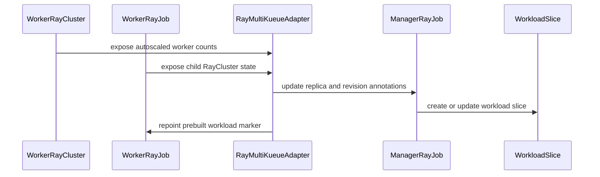

# PR #13435: MultiKueue: support worker-side Ray in-tree autoscaling for elastic jobs

**Summary**: MultiKueue: support worker-side Ray in-tree autoscaling for elastic jobs

**Sources**: https://github.com/kubernetes-sigs/kueue/pull/13435

**Last updated**: 2026-09-30T12:51:16Z

---

## Metadata

- **State**: closed (merged)
- **Author**: [@kevin85421](https://github.com/kevin85421)
- **Branch**: `multikueue-ray-autoscaling-a2` → `main`
- **Created**: 2026-07-24T07:57:30Z
- **Updated**: 2026-09-30T12:51:16Z
- **Merged**: 2026-09-17T08:01:25Z
- **Closed**: 2026-09-17T08:01:25Z
- **Labels**: `kind/feature`, `release-note`, `lgtm`, `size/XL`, `approved`, `ok-to-test`, `cncf-cla: yes`, `area/multikueue`, `area/integrations`, `area/elastic-jobs`, `area/ray-integration`
- **Assignees**: [@mimowo](https://github.com/mimowo)
- **Requested reviewers**: [@kannon92](https://github.com/kannon92), [@pajakd](https://github.com/pajakd), [@olekzabl](https://github.com/olekzabl), [@kshalot](https://github.com/kshalot), [@tenzen-y](https://github.com/tenzen-y)
- **Changed files**: 16   **+690 / -65**

## Description

#### What type of PR is this?

/kind feature
/area multikueue
/area integrations

#### What this PR does / why we need it:

Implements the proposal in https://github.com/kubernetes-sigs/kueue/pull/13494.

#### Which issue(s) this PR fixes:

KEP: https://github.com/kubernetes-sigs/kueue/pull/13494

#### Special notes for your reviewer:

AI usage disclosure: developed and reviewed with AI assistance; all changes were verified by the author.

#### Does this PR introduce a user-facing change?

```release-note
MultiKueue: Added worker-side in-tree autoscaling for elastic RayClusters and RayJobs. Requires MultiKueueRayInTreeAutoscaling.
```

## Discussion

### Comment by [@netlify[bot]](https://github.com/apps/netlify) — 2026-07-24T07:57:35Z

### <span aria-hidden="true">✅</span> Deploy Preview for *kubernetes-sigs-kueue* canceled.


|  Name | Link |
|:-:|------------------------|
|<span aria-hidden="true">🔨</span> Latest commit | 5ffbbea21a3633375b2ea0408375616f5e9b51bb |
|<span aria-hidden="true">🔍</span> Latest deploy log | https://app.netlify.com/projects/kubernetes-sigs-kueue/deploys/6aab9ac65e807000086e4453 |

### Comment by [@coderabbitai[bot]](https://github.com/apps/coderabbitai) — 2026-07-24T07:57:36Z

<!-- This is an auto-generated comment: summarize by coderabbit.ai -->
<!-- review_stack_entry_start -->

[](https://app.coderabbit.ai/change-stack/kubernetes-sigs/kueue/pull/13435?utm_source=github_walkthrough&utm_medium=github&utm_campaign=change_stack)

<!-- review_stack_entry_end -->
<!-- This is an auto-generated comment: review paused by coderabbit.ai -->

> [!NOTE]
> ## Reviews paused
> 
> It looks like this branch is under active development. To avoid overwhelming you with review comments due to an influx of new commits, CodeRabbit has automatically paused this review. You can configure this behavior by changing the `reviews.auto_review.auto_pause_after_reviewed_commits` setting.
> 
> Use the following commands to manage reviews:
> - `@coderabbitai resume` to resume automatic reviews.
> - `@coderabbitai review` to trigger a single review.
> 
> Use the checkboxes below for quick actions:
> - [ ] <!-- {"checkboxId": "7f6cc2e2-2e4e-497a-8c31-c9e4573e93d1"} --> ▶️ Resume reviews
> - [ ] <!-- {"checkboxId": "e9bb8d72-00e8-4f67-9cb2-caf3b22574fe"} --> 🔍 Trigger review

<!-- end of auto-generated comment: review paused by coderabbit.ai -->
<!-- walkthrough_start -->

<details>
<summary>📝 Walkthrough</summary>

## Walkthrough

MultiKueue elastic Ray workloads now synchronize worker-driven autoscaling through spec or runtime replica hooks, preserve runtime counts during handover, tolerate transient slice mismatches, and select admitted workload slices consistently.

### Changes

**Elastic MultiKueue synchronization**

|Layer / File(s)|Summary|
|---|---|
|**Resize handover and slice normalization** <br> `pkg/controller/jobframework/reconciler.go`, `pkg/workloadslicing/workloadslicing.go`, `pkg/workloadslicing/workloadslicing_test.go`|In-sync checks tolerate transient MultiKueue replica mismatches, while slice normalization uses admitted workloads for replacement selection and preservation.|
|**Elastic replica synchronization contract** <br> `pkg/controller/jobs/ray/ray_multikueue_adapter.go`|Elastic synchronization supports spec-based and runtime-based hooks, bounded reverse synchronization, suspension checks, and prebuilt-workload repointing.|
|**RayCluster runtime synchronization** <br> `pkg/controller/jobs/raycluster/...`, `pkg/util/testingjobs/raycluster/wrappers.go`|RayCluster adapters serialize worker counts, apply runtime annotations when child objects are missing, preserve generation annotations, and reflect bounded autoscaler changes.|
|**RayJob child-state reflection** <br> `pkg/controller/jobs/rayjob/...`, `pkg/util/testingjobs/rayjob/wrappers.go`|RayJob adapters fetch child RayCluster state and write replica counts and revisions to manager annotations, with suspended and missing-child handling.|
|**Multi-cluster validation** <br> `test/integration/multikueue/jobs_test.go`, `test/e2e/multikueue/extended/e2e_test.go`|Integration and end-to-end tests cover stable admission, scale-up replacement slices, scale-down in-place updates, and worker preservation during handover.|

**Estimated code review effort:** 4 (Complex) | ~60 minutes

### Sequence Diagram(s)



**Possibly related PRs**

- [kubernetes-sigs/kueue#12405](https://github.com/kubernetes-sigs/kueue/pull/12405): Updates RayCluster workload-slicing pod-set accounting for the autoscaler sidecar.
- [kubernetes-sigs/kueue#12885](https://github.com/kubernetes-sigs/kueue/pull/12885): Changes the MultiKueue elastic replica synchronization and handover flow in the Ray adapter.
- [kubernetes-sigs/kueue#12931](https://github.com/kubernetes-sigs/kueue/pull/12931): Changes workload-slice normalization and replacement ordering.

**Suggested labels:** `area/ray-integration`

**Suggested reviewers:** `kannon92`, `pajakd`, `olekzabl`, `tenzen-y`

</details>

<!-- walkthrough_end -->
<!-- pre_merge_checks_walkthrough_start -->

<details>
<summary>🚥 Pre-merge checks | ✅ 4 | ❌ 1</summary>

### ❌ Failed checks (1 warning)

|     Check name     | Status     | Explanation                                                                           | Resolution                                                                         |
| :----------------: | :--------- | :------------------------------------------------------------------------------------ | :--------------------------------------------------------------------------------- |
| Docstring Coverage | ⚠️ Warning | Docstring coverage is 36.84% which is insufficient. The required threshold is 80.00%. | Write docstrings for the functions missing them to satisfy the coverage threshold. |

<details>
<summary>✅ Passed checks (4 passed)</summary>

|         Check name         | Status   | Explanation                                                                                                                                   |
| :------------------------: | :------- | :-------------------------------------------------------------------------------------------------------------------------------------------- |
|     Linked Issues check    | ✅ Passed | Check skipped because no linked issues were found for this pull request.                                                                      |
| Out of Scope Changes check | ✅ Passed | Check skipped because no linked issues were found for this pull request.                                                                      |
|      Description Check     | ✅ Passed | Check skipped - CodeRabbit’s high-level summary is enabled.                                                                                   |
|         Title check        | ✅ Passed | The title clearly and concisely describes the main change: adding MultiKueue support for worker-side Ray in-tree autoscaling of elastic jobs. |

</details>

</details>

<!-- pre_merge_checks_walkthrough_end -->
<!-- finishing_touch_checkbox_start -->

<details>
<summary>✨ Finishing Touches</summary>

<details>
<summary>🧪 Generate unit tests (beta)</summary>

- [ ] <!-- {"checkboxId": "f47ac10b-58cc-4372-a567-0e02b2c3d479", "radioGroupId": "utg-output-choice-group-unknown_comment_id"} -->   Create PR with unit tests

</details>

</details>

<!-- finishing_touch_checkbox_end -->
<!-- tips_start -->

---


<sub>Comment `@coderabbitai help` to get the list of available commands.</sub>

<!-- tips_end -->

### Comment by [@linux-foundation-easycla[bot]](https://github.com/apps/linux-foundation-easycla) — 2026-07-24T07:57:40Z

<a href="https://easycla.lfx.linuxfoundation.org/#/?version=2"></a><br >The committers listed above are authorized under a signed CLA.<ul><li>:white_check_mark: login: kevin85421 / name: Kai-Hsun Chen (00bbe7006429cb4fa239c9b0b16963ef76415439, 0b2b384afac73a477c4aa9637d93f8dcf63797c8, 0ecf2e06f308d1d84fe9ce78e1d9e47793b619d0, 201a2c57f6f928e259b5585f3dd8b59c08aa036d, 3b0aea5243fb204b5d629e228e6b45a77d2f38e8, 43c8db591c957525918d2df61ff392042de04be8, 4c4271831e81bad861d5c0f40d3f30d2972ae68e, 59decec26968fffb05f986df8c409bc01b39c1e3, 637551dddc1a2a896b47151f391ad14c6948b65d, 7657801893fe3c30d81f82a27337ab622d8652f5, 833986dc7f198323b723589f058818b1331ec7e0, 83a46cec3f002553e75eb475ddd2dd7d82439f7d, a3d015836470c13915e18c0068a794e727161f79, ac4437037dfe99a5d748190fd9739e326e15c488, ace49331d468a0446ff27ea6985b45a3dcfbbd9a, ad9bbe2d697b4454a406070cdc5ef534785b3b08, b58c0042adcd0dfeeb0a8f611e8265ae74dbf1c9, ba49c40d2918fc68c6df867b48fd727a62d19016, bf480d1fa4f8ff2903383fcec1a7f45a0114091e, cb1ca6be402cd22a32b139a888b3fef0a8df56fc, cc7f6b3893fee607a19005ab3b2e1f7a074eb4e9, d06f4ee49d53a567aff9b40155c914a34e6b96d7, d8edc01920f08d2fd53cabc23e380da21bac97e6, e50c30e5bfe3dcd858058eceb17b5a53421b9122, e58edbeb52a6d54c5dafb2123c3d86d20eaf6960, efa9c0cda12dd60df36d6a5f8f03a6664d088691, f3486aeef95d4f0ca116e2a8124086ca46e26b7c, fbf6afaa4f8cd8707fa23c9d6a4207ac0a34867f, ff3b043264df9e64a08285fb49b96a0b05a23c17, ffc16249436c994ee24c704ef2b9fd56f12fa793)</li></ul>

### Comment by [@kubernetes-prow[bot]](https://github.com/apps/kubernetes-prow) — 2026-07-24T07:57:40Z

Hi @kevin85421. Thanks for your PR.

I'm waiting for a [kubernetes-sigs](https://github.com/orgs/kubernetes-sigs/people) member to verify that this patch is reasonable to test. If it is, they should reply with `/ok-to-test` on its own line. Until that is done, I will not automatically test new commits in this PR, but the usual testing commands by org members will still work.

>[!TIP]
>**We noticed you've done this a few times! Consider [joining the org](https://git.k8s.io/community/community-membership.md#member) to skip this step and gain `/lgtm` and other bot rights.** We recommend asking approvers on your previous PRs to sponsor you.

Once the patch is verified, the new status will be reflected by the `ok-to-test` label.

I understand the commands that are listed [here](https://go.k8s.io/bot-commands?repo=kubernetes-sigs%2Fkueue).

<details>

Instructions for interacting with me using PR comments are available [here](https://git.k8s.io/community/contributors/guide/pull-requests.md).  If you have questions or suggestions related to my behavior, please file an issue against the [kubernetes-sigs/prow](https://github.com/kubernetes-sigs/prow/issues/new?title=Prow%20issue:) repository.
</details>

### Comment by [@kevin85421](https://github.com/kevin85421) — 2026-07-24T08:00:18Z

/easycla

### Comment by [@kevin85421](https://github.com/kevin85421) — 2026-07-24T08:06:45Z

cc @mimowo would you mind enabling CI for this PR?

This PR is not ready for review. I am trying to do a POC to ensure my understanding is correct and then I will open a PR for a KEP for autoscaling in MultiKueue. Then, after we reach a consensus on the KEP, I will return to this PR to polish it or open a new PR for the implementation. Thanks.

### Comment by [@mimowo](https://github.com/mimowo) — 2026-07-24T08:07:08Z

/hold 
/ok-to-test

### Comment by [@mimowo](https://github.com/mimowo) — 2026-07-28T03:23:22Z

FYI @kevin85421 as you are working on this maybe the answer in another thread can be helpful, ptal: https://github.com/kubernetes-sigs/kueue/pull/13244#issuecomment-5099024026

### Comment by [@kevin85421](https://github.com/kevin85421) — 2026-07-28T17:51:18Z

> FYI @kevin85421 as you are working on this maybe the answer in another thread can be helpful, ptal: [#13244 (comment)](https://github.com/kubernetes-sigs/kueue/pull/13244#issuecomment-5099024026)

Thanks! 

It's good to know that we can use the existing annotations, `RayClusterPodsetReplicaSizesAnnotation` and `RayClusterGenerationAnnotation`. My current implementation introduces a new annotation to achieve the same result. I didn’t modify `RayClusterPodsetReplicaSizesAnnotation` because it is currently dead code, and I don’t have the historical context behind it.

> They are specifically designed to propagate the information from the RayCluster to RayJob and RayService without overriding the user settings in the spec.

This would be great. Currently, this PR divides jobs into two categories. In the first category, the PodSets can be inferred from the job CR (e.g., a RayCluster). In the second category, the PodSets can only be inferred from the runtime state (e.g., a RayJob needs to infer its PodSets from its underlying RayCluster). For the former, this PR implements a mechanism to sync the spec from the worker cluster back to the CR in the manager cluster. For the latter, it allows the manager cluster to retrieve the runtime state and store the derived PodSets in an annotation.

Because the community prefers not to override user-defined settings in the spec, we can always retrieve the runtime state and remove the mechanism that syncs the CR spec back from the worker cluster.

### Comment by [@kevin85421](https://github.com/kevin85421) — 2026-08-03T07:34:13Z

The POC has already been deployed to our production environment last Friday. This is the POC of https://github.com/kubernetes-sigs/kueue/pull/13494.

### Comment by [@mimowo](https://github.com/mimowo) — 2026-08-03T19:54:37Z

/area elastic-jobs
/area ray-integration
/area integrations

### Comment by [@mimowo](https://github.com/mimowo) — 2026-09-09T17:29:25Z

@kevin85421 please rebase

### Comment by [@kevin85421](https://github.com/kevin85421) — 2026-09-11T17:59:37Z

Thanks, @mimowo! This PR still has some inconsistencies with the KEP. I’ll ping you when it’s ready for review.

### Comment by [@kevin85421](https://github.com/kevin85421) — 2026-09-14T06:10:55Z

cc @mimowo this PR is ready for review. I’ll also do another self-review focusing on the tests. Thanks.

### Comment by [@mimowo](https://github.com/mimowo) — 2026-09-17T07:52:37Z

/lgtm
/approve
Thank you 👍

### Comment by [@kubernetes-prow[bot]](https://github.com/apps/kubernetes-prow) — 2026-09-17T07:52:45Z

LGTM label has been added.  <details>Git tree hash: 65c474e67a749ec528c2a8396aa6a783c355ef75</details>

### Comment by [@kubernetes-prow[bot]](https://github.com/apps/kubernetes-prow) — 2026-09-17T07:52:49Z

[APPROVALNOTIFIER] This PR is **APPROVED**

This pull-request has been approved by: *<a href="https://github.com/kubernetes-sigs/kueue/pull/13435#" title="Author self-approved">kevin85421</a>*, *<a href="https://github.com/kubernetes-sigs/kueue/pull/13435#issuecomment-5710941510" title="Approved">mimowo</a>*

The full list of commands accepted by this bot can be found [here](https://go.k8s.io/bot-commands?repo=kubernetes-sigs%2Fkueue).

The pull request process is described [here](https://git.k8s.io/community/contributors/guide/owners.md#the-code-review-process)

<details >
Needs approval from an approver in each of these files:

- ~~[OWNERS](https://github.com/kubernetes-sigs/kueue/blob/main/OWNERS)~~ [mimowo]

Approvers can indicate their approval by writing `/approve` in a comment
Approvers can cancel approval by writing `/approve cancel` in a comment
</details>
<!-- META={"approvers":[]} -->

### Comment by [@mimowo](https://github.com/mimowo) — 2026-09-17T07:52:50Z

/unhold

### Comment by [@mimowo](https://github.com/mimowo) — 2026-09-30T12:51:13Z

/release-note-edit
```release-note
MultiKueue: Added worker-side in-tree autoscaling for elastic RayClusters and RayJobs. Requires MultiKueueRayInTreeAutoscaling.
```

## Reviews

### Review by [@coderabbitai[bot]](https://github.com/apps/coderabbitai) (commented) — 2026-07-24T09:12:24Z

**Actionable comments posted: 2**

<details>
<summary>🤖 Prompt for all review comments with AI agents</summary>

```
Verify each finding against current code. Fix only still-valid issues, skip the
rest with a brief reason, keep changes minimal, and validate.

Inline comments:
In `@pkg/controller/jobframework/reconciler.go`:
- Around line 948-960: Restrict the early return in the workloadslicing handover
path around jobResizeAgainstWorkloadPending to cases where only PodSet counts
differ: after detecting resizePending, still run the existing equivalence
validation for non-count fields such as templates/resources and return OutOfSync
when they differ. Add a negative test covering a workload with both a count
change and a PodSet template mutation, while preserving the bypass for
count-only changes.

In `@pkg/controller/jobs/raycluster/raycluster_multikueue_adapter.go`:
- Around line 71-92: Update reflectWorkerReplicas to handle a nil want (source
Replicas) before applying bounds or assigning it to the destination. When want
is nil, preserve the manager’s existing explicit Replicas value and skip the
update; retain the current validation and assignment behavior for non-nil
values.
```

</details>

<details>
<summary>🪄 Autofix (Beta)</summary>

Fix all unresolved CodeRabbit comments on this PR:

- [ ] <!-- {"checkboxId": "4b0d0e0a-96d7-4f10-b296-3a18ea78f0b9"} --> Push a commit to this branch (recommended)
- [ ] <!-- {"checkboxId": "ff5b1114-7d8c-49e6-8ac1-43f82af23a33"} --> Create a new PR with the fixes

</details>

---

<details>
<summary>ℹ️ Review info</summary>

<details>
<summary>⚙️ Run configuration</summary>

**Configuration used**: Path: .coderabbit.yaml

**Review profile**: CHILL

**Plan**: Pro Plus

**Run ID**: `6bfc5d7c-7995-418c-9f1d-080a18e2b4ad`

</details>

<details>
<summary>📥 Commits</summary>

Reviewing files that changed from the base of the PR and between e6839e2dfd0935413321d82d7f94e77f4655033a and db8e80ade49b9794196c94e295d70f133a873029.

</details>

<details>
<summary>📒 Files selected for processing (16)</summary>

* `pkg/controller/elasticjobs/elastic_job_ungater.go`
* `pkg/controller/elasticjobs/elastic_job_ungater_test.go`
* `pkg/controller/jobframework/reconciler.go`
* `pkg/controller/jobs/ray/ray_multikueue_adapter.go`
* `pkg/controller/jobs/raycluster/common.go`
* `pkg/controller/jobs/raycluster/common_test.go`
* `pkg/controller/jobs/raycluster/raycluster_multikueue_adapter.go`
* `pkg/controller/jobs/raycluster/raycluster_multikueue_adapter_test.go`
* `pkg/controller/jobs/raycluster/raycluster_webhook_test.go`
* `pkg/controller/jobs/rayjob/rayjob_controller.go`
* `pkg/controller/jobs/rayjob/rayjob_multikueue_adapter.go`
* `pkg/controller/jobs/rayjob/rayjob_multikueue_adapter_test.go`
* `pkg/util/testingjobs/raycluster/wrappers.go`
* `pkg/util/testingjobs/rayjob/wrappers.go`
* `test/e2e/multikueue/extended/e2e_test.go`
* `test/integration/multikueue/jobs_test.go`

</details>

</details>

<!-- This is an auto-generated comment by CodeRabbit for review status -->

- **pkg/controller/jobframework/reconciler.go:960** by [@coderabbitai[bot]](https://github.com/apps/coderabbitai) — 2026-07-24T09:12:23Z
```diff
@@ -945,6 +945,21 @@ func (r *JobReconciler) ensureOneWorkload(ctx context.Context, job GenericJob, o
 			return wl, nil
 		}
 
+		// Also tolerate a transient job/slice count mismatch on the worker side
+		// of a MultiKueue elastic resize handover instead of finishing the
+		// workload OutOfSync — see jobResizeAgainstWorkloadPending for why both
+		// directions are safe.
+		if workloadslicing.Enabled(object) {
+			resizePending, err := jobResizeAgainstWorkloadPending(ctx, r.client, job, wl)
+			if err != nil {
+				return nil, err
+			}
+			if resizePending {
+				log.V(3).Info("WorkloadSlice: skip in-sync check during resize handover")
+				return wl, nil
+			}
```

  _🎯 Functional Correctness_ | _🟠 Major_ | _⚡ Quick win_
  
  **Limit the handover bypass to count-only changes.**
  
  Matching PodSet keys plus different counts skips the *entire* equivalence check. A worker job that also changes a PodSet template/resources will remain tolerated while its count differs, instead of being marked out of sync. Verify non-count fields still match before returning early, and add a negative test for a count-plus-template mutation.
  
  
  
  
  
  
  Also applies to: 1240-1245
  
  <details>
  <summary>🤖 Prompt for AI Agents</summary>
  
  ```
  Verify each finding against current code. Fix only still-valid issues, skip the
  rest with a brief reason, keep changes minimal, and validate.
  
  In `@pkg/controller/jobframework/reconciler.go` around lines 948 - 960, Restrict
  the early return in the workloadslicing handover path around
  jobResizeAgainstWorkloadPending to cases where only PodSet counts differ: after
  detecting resizePending, still run the existing equivalence validation for
  non-count fields such as templates/resources and return OutOfSync when they
  differ. Add a negative test covering a workload with both a count change and a
  PodSet template mutation, while preserving the bypass for count-only changes.
  ```
  
  </details>
  
  <!-- fingerprinting:phantom:poseidon:terra -->
  
  <!-- cr-indicator-types:potential_issue -->
  
  <!-- cr-comment:v1:86566c6fcb0aa9d48c4ca48a -->
  
  <!-- This is an auto-generated comment by CodeRabbit -->
  
  ✅ Addressed in commits 0883924 to a480b0f

- **pkg/controller/jobs/raycluster/raycluster_multikueue_adapter.go:92** by [@coderabbitai[bot]](https://github.com/apps/coderabbitai) — 2026-07-24T09:12:23Z
```diff
@@ -42,41 +43,58 @@ func copyJobSpec(dst, src *rayv1.RayCluster) {
 		ObjectMeta: api.CloneObjectMetaForCreation(&src.ObjectMeta),
 		Spec:       *src.Spec.DeepCopy(),
 	}
-	// An elastic RayCluster over MultiKueue is scaled by the manager: the
-	// manager's worker replica counts are the source of truth and are propagated
-	// to this remote copy on each sync. The remote must therefore not run the
-	// in-tree Ray autoscaler, which would otherwise fight the manager by editing
-	// worker replicas on the worker cluster.
-	if workloadslicing.Enabled(src) {
-		dst.Spec.EnableInTreeAutoscaling = nil
-	}
 }
 
 // elasticReplicaSync wires the RayCluster-specific hooks used by the shared Ray
 // MultiKueue adapter to propagate manager-driven worker replica changes.
 func elasticReplicaSync() *ray.ElasticReplicaSync[*rayv1.RayCluster, rayv1.RayCluster] {
 	return &ray.ElasticReplicaSync[*rayv1.RayCluster, rayv1.RayCluster]{
-		SyncReplicas:          syncWorkerReplicas,
-		WorkerReplicas:        workerReplicaCounts,
+		Spec: &ray.SpecReplicaSync[*rayv1.RayCluster]{
+			Push:    syncWorkerReplicas,
+			Reflect: reflectWorkerReplicas,
+			Counts: func(rc *rayv1.RayCluster) map[kueue.PodSetReference]int32 {
+				return WorkerGroupPodCounts(&rc.Spec)
+			},
+		},
 		WorkloadNameExtraPart: func(rc *rayv1.RayCluster) string { return GetWorkloadNameExtraPart(rc) },
+		AutoscalingEnabled:    func(rc *rayv1.RayCluster) bool { return ptr.Deref(rc.Spec.EnableInTreeAutoscaling, false) },
+		RemoteSuspended:       func(rc *rayv1.RayCluster) bool { return ptr.Deref(rc.Spec.Suspend, false) },
 	}
 }
 
-// workerReplicaCounts returns the effective worker pod count per worker group,
-// matching how BuildPodSets derives PodSet counts (replicas scaled by NumOfHosts).
-func workerReplicaCounts(rc *rayv1.RayCluster) map[kueue.PodSetReference]int32 {
-	counts := make(map[kueue.PodSetReference]int32, len(rc.Spec.WorkerGroupSpecs))
-	for i := range rc.Spec.WorkerGroupSpecs {
-		wgs := &rc.Spec.WorkerGroupSpecs[i]
-		counts[kueue.NewPodSetReference(wgs.GroupName)] = effectiveWorkerCount(wgs)
+// reflectWorkerReplicas copies autoscaler-driven Replicas from the remote
+// (worker) copy in src onto the manager's copy in dst, matching groups by
+// name, and returns whether dst changed. Only Replicas moves in this
+// direction: the manager owns MinReplicas, MaxReplicas and the autoscaling
+// flag. A count outside the manager-declared [minReplicas, maxReplicas]
+// cannot come from the autoscaler and is ignored.
+func reflectWorkerReplicas(dst, src *rayv1.RayCluster) bool {
+	srcReplicas := make(map[string]*int32, len(src.Spec.WorkerGroupSpecs))
+	for i := range src.Spec.WorkerGroupSpecs {
+		wgs := &src.Spec.WorkerGroupSpecs[i]
+		srcReplicas[wgs.GroupName] = wgs.Replicas
+	}
+	changed := false
+	for i := range dst.Spec.WorkerGroupSpecs {
+		wgs := &dst.Spec.WorkerGroupSpecs[i]
+		want, ok := srcReplicas[wgs.GroupName]
+		if !ok || ptr.Equal(wgs.Replicas, want) {
+			continue
+		}
+		count := ptr.Deref(want, 1)
+		if count < ptr.Deref(wgs.MinReplicas, 0) || count > ptr.Deref(wgs.MaxReplicas, math.MaxInt32) {
+			continue
+		}
+		wgs.Replicas = want
+		changed = true
 	}
-	return counts
+	return changed
 }
```

  _🎯 Functional Correctness_ | _🟡 Minor_ | _⚡ Quick win_
  
  <details>
  <summary>🧩 Analysis chain</summary>
  
  🏁 Script executed:
  
  ```shell
  #!/bin/bash
  set -euo pipefail
  
  echo "== locate file =="
  fd -a 'raycluster_multikueue_adapter.go|raycluster.*adapter' . | sed 's#^\./##'
  
  echo "== relevant snippets =="
  if [ -f pkg/controller/jobs/raycluster/raycluster_multikueue_adapter.go ]; then
    wc -l pkg/controller/jobs/raycluster/raycluster_multikueue_adapter.go
    sed -n '1,170p' pkg/controller/jobs/raycluster/raycluster_multikueue_adapter.go | cat -n
  fi
  
  echo "== search RayCluster types and worker replicas usage =="
  rg -n "WorkerGroupSpecs|Replicas|MinReplicas|MaxReplicas|reflectWorkerReplicas|syncWorkerReplicas" -S --glob 'pkg/controller/jobs/raycluster/**' .
  ```
  
  Repository: kubernetes-sigs/kueue
  
  Length of output: 20868
  
  ---
  
  🌐 Web query:
  
  `KubeRay ray-operator autoscaler updates WorkerGroupSpec Replicas nil behavior`
  
  💡 Result:
  
  In KubeRay, the Replicas field within WorkerGroupSpec has been made optional (represented as a pointer to an integer, *int32, in the Go API) to resolve conflicts with GitOps tools such as FluxCD and ArgoCD [1][2]. When the Ray Autoscaler is active, it dynamically modifies the Replicas field to scale the cluster up or down [1][3]. If this field is explicitly defined in a manifest managed by a GitOps controller, those controllers often detect the Autoscaler's modifications as configuration drift and continuously revert the Replicas value to the hardcoded state defined in the Git repository [1][4]. Making the field optional allows users to manage static configurations declaratively while permitting the Autoscaler to manage the dynamic replica count without triggering revert loops [1][5]. Key technical points regarding this behavior include: - API Definition: The field is defined as *int32 with the omitempty JSON tag, allowing it to be omitted from the Kubernetes Custom Resource (CR) [2]. - Motivation: This change was primarily driven by the need to prevent GitOps reconciliation loops where the Autoscaler and the GitOps controller constantly fight over the desired replica count [1][4]. - Autoscaler Interaction: When autoscaling is enabled, the Ray Autoscaler still relies on defined ranges (minReplicas and maxReplicas) to govern the scaling behavior [6][3]. If the Replicas field is omitted, the operator proceeds with its logic using the provided bounds [6]. For environments using GitOps, it is recommended to omit the Replicas field in the manifest once the cluster is initialized if you intend to rely solely on the Ray Autoscaler for capacity management [1][4].
  
  Citations:
  
  - 1: https://github.com/ray-project/kuberay/pull/1443
  - 2: https://github.com/ray-project/kuberay/blob/7c6aedff5b4106281f50e87a7e9e177bf1237ec7/ray-operator/apis/ray/v1/raycluster%5Ftypes.go
  - 3: https://docs.ray.io/en/releases-2.46.0/cluster/kubernetes/user-guides/configuring-autoscaling.html
  - 4: https://github.com/ray-project/kuberay/pull/1154
  - 5: https://github.com/ray-project/kuberay/issues/265
  - 6: https://github.com/ray-project/kuberay/blob/7be103f2/docs/reference/api.md
  
  ---
  
  🌐 Web query:
  
  `git clone github.com ray-project kuberay ray-operator autoscaler update worker group replicas nil code`
  
  💡 Result:
  
  In KubeRay, the replicas field within the WorkerGroupSpec is an optional field that represents the desired number of pods for a worker group [1]. When using the KubeRay autoscaler, this field is dynamic; the autoscaler modifies it to match workload demands, scaling the cluster up or down within the constraints defined by minReplicas and maxReplicas [2][3]. Key points regarding the replicas field and autoscaling behavior: 1. Dynamic Updates: The autoscaler is responsible for calculating the target number of replicas based on workload requirements (tasks, actors, placement groups) and patching the RayCluster CRD with the new desired replica count [4][3]. 2. Optionality: The field was made optional to support GitOps workflows (e.g., using ArgoCD or FluxCD) [5][2]. If the replicas field is omitted or nil in the configuration, the operator interprets the current state, preventing unnecessary reconciliation loops where the GitOps controller would otherwise overwrite the autoscaler's updates [5][2]. 3. Manual Interaction: While the autoscaler manages this field, users may still manually update it or other parameters like minReplicas [4][6]. If a user manually decreases the replicas count without specifying pods to delete, the autoscaler may attempt to correct this by comparing the observed state to ensure the replica count remains consistent with actual running workers [4]. 4. RayService and Rollouts: To prevent unintended rollouts, certain tools and controller logic (such as those for RayService) often exclude the replicas field from hash calculations, allowing for changes to replica counts without triggering a full cluster upgrade [7][8]. If you are observing a behavior where setting this field to nil causes issues, ensure your KubeRay version is up to date, as the optionality and handling of this field have undergone several refinements to better support autoscaling and declarative management [5][2][8].
  
  Citations:
  
  - 1: https://ray-project.github.io/kuberay/reference/api/
  - 2: https://github.com/ray-project/kuberay/issues/265
  - 3: https://docs.ray.io/en/latest/ray-core/internals/autoscaler-v2.html
  - 4: https://github.com/ray-project/ray/blob/master/python/ray/autoscaler/v2/instance_manager/cloud_providers/kuberay/cloud_provider.py
  - 5: https://github.com/ray-project/kuberay/pull/1154
  - 6: https://github.com/ray-project/kuberay/issues/2576
  - 7: https://github.com/ray-project/kuberay/pull/1734
  - 8: https://github.com/ray-project/kuberay/commit/aeb8b03dfedcebf5105352a552b164afc5bfdbfb
  
  ---
  
  🏁 Script executed:
  
  ```shell
  #!/bin/bash
  set -euo pipefail
  
  echo "== go module kuberay version =="
  rg -n 'github.com/ray-project/kuberay' go.mod go.sum | head -40 || true
  
  echo "== check local kuberay dep source if vendored/modcache =="
  go env GOMODCACHE 2>/dev/null || true
  MODCACHE=$(go env GOMODCACHE 2>/dev/null)
  if [ -n "$MODCACHE" ]; then
    find "$MODCACHE" -path '*/github.com/ray-project/kuberay/ray-operator/apis/ray/v1/raycluster_types.go' 2>/dev/null | head -5 || true
    find "$MODCACHE" -path '*/github.com/ray-project/kuberay/ray-operator/controllers/autoscaler*' -type d 2>/dev/null | head -10 || true
  fi
  
  echo "== focused search repo for pointer nil handling =="
  rg -n "func.*SetWorkerGroupReplicas|SetWorkerGroupReplicas|Replicas = .*minReplicas|targetReplica|scalingGroup|desiredReplicas" -S .
  ```
  
  Repository: kubernetes-sigs/kueue
  
  Length of output: 9069
  
  ---
  
  🏁 Script executed:
  
  ```shell
  #!/bin/bash
  set -euo pipefail
  
  echo "== kuberay autoscaler/controller search in go module cache =="
  MODCACHE=$(go env GOMODCACHE 2>/dev/null || true)
  if [ -z "$MODCACHE" ]; then
    echo "GOMODCACHE unavailable"
    exit 1
  fi
  
  echo "MODCACHE=$MODCACHE"
  
  find "$MODCACHE/github.com/ray-project/ray@*" "$MODCACHE/github.com/ray-project/kuberay@*" -type f \
    \( -path '*/autoscaler*' -o -path '*/ray-operator*' \) 2>/dev/null | head -200 || true
  
  echo "== exact kuberay ray-operator files for v1.6.2 =="
  if [ -d "$MODCACHE/github.com/ray-project/kuberay/ray-operator@v1.6.2" ]; then
    echo "found ray-operator@v1.6.2"
    rg -n "SetWorkerGroupReplicas|Replicas|targetReplicas|minReplicas|maxReplicas|autoscaler" "$MODCACHE/github.com/ray-project/kuberay/ray-operator@v1.6.2" -S | head -250 || true
  else
    echo "ray-operator@v1.6.2 directory not found"
    find "$MODCACHE" -path '*/github.com/ray-project/kuberay/ray-operator@*' -maxdepth 1 -type d 2>/dev/null || true
  fi
  
  echo "== kuberay API types v1.6.2 =="
  if [ -f "$MODCACHE/github.com/ray-project/kuberay/ray-operator@v1.6.2/apis/ray/v1/raycluster_types.go" ]; then
    sed -n '220,340p' "$MODCACHE/github.com/ray-project/kuberay/ray-operator@v1.6.2/apis/ray/v1/raycluster_types.go" | cat -n
  fi
  ```
  
  Repository: kubernetes-sigs/kueue
  
  Length of output: 50377
  
  ---
  
  🏁 Script executed:
  
  ```shell
  #!/bin/bash
  set -euo pipefail
  
  MODCACHE=$(go env GOMODCACHE 2>/dev/null)
  if [ -z "$MODCACHE" ]; then exit 1; fi
  
  echo "== kuberay autoscaler files in v1.6.2 =="
  find "$MODCACHE/github.com/ray-project/kuberay/ray-operator@v1.6.2" -type f \( -name '*autoscaler*.go' -o -path '*/ray/v1/*autoscaler*' \) -o -path '*/controllers/autoscaler/*.go' | sed 's#^'"$MODCACHE/github.com/ray-project/kuberay/ray-operator@v1.6.2"'/##' | sort
  
  echo "== focused autoscaler code snippets =="
  for f in \
    "$MODCACHE/github.com/ray-project/kuberay/ray-operator@v1.6.2/ray-operator/apis/ray/v1/raycluster_types.go" \
    "$MODCACHE/github.com/ray-project/kuberay/ray-operator@v1.6.2/controllers/ray/utils/util.go" \
    "$MODCACHE/github.com/ray-project/kuberay/ray-operator@v1.6.2/controllers/ray/raycluster_controller.go" \
    "$MODCACHE/github.com/ray-project/kuberay/ray-operator@v1.6.2/apis/ray/v1/raycluster_types.go" \
    "$MODCACHE/github.com/ray-project/kuberay/ray-operator@v1.6.2/pkg/utils/ray_jobs.go" \
    "$MODCACHE/github.com/ray-project/kuberay/ray-operator@v1.6.2/pkg/utils/ray_jobs.go"; do
    if [ -f "$f" ]; then
      echo "--- $f ---"
      rg -n -C 4 "Replicas|MinReplicas|SetWorkerGroupReplicas|desired.*Replicas|minReplicas|maxReplicas|autoscaler" "$f" -S | head -240 || true
    fi
  done
  
  echo "== behavioral probe for reflectWorkerReplicas nil-want path using local module source logic =="
  python3 - <<'PY'
  class WGS:
      def __init__(self, name, replicas, min_replicas, max_replicas):
          self.GroupName = name
          self.Replicas = replicas
          self.MinReplicas = min_replicas
          self.MaxReplicas = max_replicas
  
  def ptr_equal(a, b):
      return a == b
  
  def ptr_deref(ptr, default):
      return default if ptr is None else ptr
  
  changed = False
  src = type('RayCluster', (), {})()
  src.Spec = type('Spec', (), {})()
  src.Spec.WorkerGroupSpecs = [WGS('worker-group', None, None, 5)]
  dst = type('RayCluster', (), {})()
  dst.Spec = type('Spec', (), {})()
  dst.Spec.WorkerGroupSpecs = [WGS('worker-group', 3, None, 5)]
  srcReplicas = {wgs.GroupName: wgs.Replicas for wgs in src.Spec.WorkerGroupSpecs}
  wgs = dst.Spec.WorkerGroupSpecs[0]
  want = srcReplicas[wgs.GroupName]
  count = ptr_deref(want, 1)
  if count < ptr_deref(wgs.MinReplicas, 0) or count > ptr_deref(wgs.MaxReplicas, 9223372036854775807):
      pass
  else:
      dst.Replicas_orig = wgs.Replicas
      wgs.Replicas = want
      changed = True
  
  print("src_replicas_nil:", src.Spec.WorkerGroupSpecs[0].Replicas)
  print("dst_replicas_before:", dst.Spec.WorkerGroupSpecs[0].Replica_orig if hasattr(dst, "Replicas_orig") else None)
  print("dst_replicas_after:", dst.Spec.WorkerGroupSpecs[0].Replicas)
  print("changed:", changed)
  PY
  ```
  
  Repository: kubernetes-sigs/kueue
  
  Length of output: 22784
  
  ---
  
  🏁 Script executed:
  
  ```shell
  #!/bin/bash
  set -euo pipefail
  
  MODCACHE=$(go env GOMODCACHE 2>/dev/null)
  if [ -z "$MODCACHE" ]; then exit 1; fi
  
  echo "== focused patches that set worker replicas in v1.6.2 =="
  rg -n -C 6 "\.Replicas\s*=|Replicas:" "$MODCACHE/github.com/ray-project/kuberay/ray-operator@v1.6.2" -S \
    --glob '*.go' \
    | rg -n -C 6 -i "worker|autoscaler|minReplicas|maxReplicas|desired.*replica|patch|default value" \
    | head -300 || true
  
  echo "== common.go snippets around optional nil handling =="
  sed -n '60,90p' pkg/controller/jobs/raycluster/common.go | cat -n
  sed -n '236,255p' pkg/controller/jobs/raycluster/common.go | cat -n
  ```
  
  Repository: kubernetes-sigs/kueue
  
  Length of output: 50377
  
  ---
  
  
  
  </details>
  
  **Skip nil `Replicas` before clearing the manager count.**
  
  `ptr.Deref(want, 1)` treats a nil autoscaled `Replicas` as 1, so the manager’s explicit count is replaced with nil. KubeRay still tolerates nil `Replicas` and treats it as the desired count in its reconciliation path, so an omit/clear on the worker cluster can legitimately cross from autoscaler/GitOps configuration; guard that path before assigning `want`.
  
  <details>
  <summary>🤖 Prompt for AI Agents</summary>
  
  ```
  Verify each finding against current code. Fix only still-valid issues, skip the
  rest with a brief reason, keep changes minimal, and validate.
  
  In `@pkg/controller/jobs/raycluster/raycluster_multikueue_adapter.go` around lines
  71 - 92, Update reflectWorkerReplicas to handle a nil want (source Replicas)
  before applying bounds or assigning it to the destination. When want is nil,
  preserve the manager’s existing explicit Replicas value and skip the update;
  retain the current validation and assignment behavior for non-nil values.
  ```
  
  </details>
  
  <!-- fingerprinting:phantom:medusa:capybara -->
  
  <!-- cr-indicator-types:potential_issue -->
  
  <!-- cr-comment:v1:aca7dfeac7dab9aabbd5afaa -->
  
  _Source: Path instructions_
  
  <!-- This is an auto-generated comment by CodeRabbit -->
  
  ✅ Addressed in commits 0883924 to 4cdcd08

### Review by [@coderabbitai[bot]](https://github.com/apps/coderabbitai) (commented) — 2026-07-25T07:46:21Z


<details>
<summary>🧹 Nitpick comments (1)</summary><blockquote>

<details>
<summary>pkg/workloadslicing/workloadslicing_test.go (1)</summary><blockquote>

`1013-1016`: _📐 Maintainability & Code Quality_ | _🔵 Trivial_ | _⚡ Quick win_

**Cover a quota-reserved but unadmitted replacement.**

Extend the pending-replacement scenario so the replacement calls `ReserveQuotaAt(...)` but not `AdmittedAt(...)`. It must remain selected while the admitted original remains unfinished; otherwise a regression to quota-reservation-based selection would still pass.

As per coding guidelines, “Disclose AI usage in pull request descriptions, comments, and issue filings.” AI-assisted review.

<details>
<summary>🤖 Prompt for AI Agents</summary>

```
Verify each finding against current code. Fix only still-valid issues, skip the
rest with a brief reason, keep changes minimal, and validate.

In `@pkg/workloadslicing/workloadslicing_test.go` around lines 1013 - 1016, Update
the admitted helper or pending-replacement scenario in the workloadslicing test
so the replacement invokes ReserveQuotaAt(...) without AdmittedAt(...), while
the original remains admitted and unfinished. Assert that this quota-reserved,
unadmitted replacement stays selected, ensuring selection is based on admission
status rather than quota reservation alone.
```

</details>

<!-- cr-comment:v1:4f46a74cf9361aa716719e6b -->

_Source: Coding guidelines_

</blockquote></details>

</blockquote></details>

<details>
<summary>🤖 Prompt for all review comments with AI agents</summary>

```
Verify each finding against current code. Fix only still-valid issues, skip the
rest with a brief reason, keep changes minimal, and validate.

Nitpick comments:
In `@pkg/workloadslicing/workloadslicing_test.go`:
- Around line 1013-1016: Update the admitted helper or pending-replacement
scenario in the workloadslicing test so the replacement invokes
ReserveQuotaAt(...) without AdmittedAt(...), while the original remains admitted
and unfinished. Assert that this quota-reserved, unadmitted replacement stays
selected, ensuring selection is based on admission status rather than quota
reservation alone.
```

</details>

---

<details>
<summary>ℹ️ Review info</summary>

<details>
<summary>⚙️ Run configuration</summary>

**Configuration used**: Path: .coderabbit.yaml

**Review profile**: CHILL

**Plan**: Pro Plus

**Run ID**: `e73a2153-d792-4884-9c32-121c92423b34`

</details>

<details>
<summary>📥 Commits</summary>

Reviewing files that changed from the base of the PR and between db8e80ade49b9794196c94e295d70f133a873029 and 8476f1947da58ab55ba0460b545c2d5a77122392.

</details>

<details>
<summary>📒 Files selected for processing (2)</summary>

* `pkg/workloadslicing/workloadslicing.go`
* `pkg/workloadslicing/workloadslicing_test.go`

</details>

</details>

<!-- This is an auto-generated comment by CodeRabbit for review status -->

### Review by [@mimowo](https://github.com/mimowo) (commented) — 2026-09-11T15:53:38Z

- **pkg/controller/jobframework/reconciler.go:1064** by [@mimowo](https://github.com/mimowo) — 2026-09-11T15:53:38Z
```diff
@@ -1061,6 +1061,17 @@ func (r *JobReconciler) ensureOneWorkload(ctx context.Context, job GenericJob, o
 			return wl, nil
 		}
 
+		if workloadslicing.Enabled(object) {
```

  The KEP defines the MultiKueueRayInTreeAutoscaling FG as alpha. Should we isolate the new code using the alpha feature?

### Review by [@mimowo](https://github.com/mimowo) (commented) — 2026-09-11T15:54:57Z

- **test/e2e/multikueue/extended/e2e_test.go:818** by [@mimowo](https://github.com/mimowo) — 2026-09-11T15:54:57Z
```diff
@@ -770,6 +815,164 @@ var _ = ginkgo.Describe("MultiKueue", func() {
 				})
 			})
 
+			ginkgo.It("Should reflect worker-side autoscaler resizes (up, down, and up again) of an elastic RayJob's child RayCluster back on the manager", func() {
```

  As we make the FG alpha we will need to move the test to the sequential suite.

### Review by [@kevin85421](https://github.com/kevin85421) (commented) — 2026-09-13T05:04:02Z

- **test/e2e/multikueue/extended/e2e_test.go:818** by [@kevin85421](https://github.com/kevin85421) — 2026-09-13T05:04:02Z
```diff
@@ -770,6 +815,164 @@ var _ = ginkgo.Describe("MultiKueue", func() {
 				})
 			})
 
+			ginkgo.It("Should reflect worker-side autoscaler resizes (up, down, and up again) of an elastic RayJob's child RayCluster back on the manager", func() {
```

  I have already moved the test to the sequential suite. For the alpha FG, I will track the progress in https://github.com/kubernetes-sigs/kueue/pull/13435#discussion_r3990938746 instead.

### Review by [@kevin85421](https://github.com/kevin85421) (commented) — 2026-09-13T17:59:47Z

- **test/util/kuberay.go:51** by [@kevin85421](https://github.com/kevin85421) — 2026-09-13T17:59:48Z
```diff
@@ -44,6 +48,43 @@ func GetRayClusterHeadPod(ctx context.Context, c client.Client, rayClusterKey cl
 	return &pods.Items[0], nil
 }
 
+// ExecuteCommandInRayClusterHead waits for the RayCluster head to become ready,
```

  Move this to a separate PR: https://github.com/kubernetes-sigs/kueue/pull/15535

### Review by [@kevin85421](https://github.com/kevin85421) (commented) — 2026-09-14T06:04:46Z

- **pkg/controller/jobframework/reconciler.go:1064** by [@kevin85421](https://github.com/kevin85421) — 2026-09-14T06:04:45Z
```diff
@@ -1061,6 +1061,17 @@ func (r *JobReconciler) ensureOneWorkload(ctx context.Context, job GenericJob, o
 			return wl, nil
 		}
 
+		if workloadslicing.Enabled(object) {
```

  Added an alpha feature gate.

### Review by [@mimowo](https://github.com/mimowo) (commented) — 2026-09-15T19:13:08Z

- **hack/make/test.mk:239** by [@mimowo](https://github.com/mimowo) — 2026-09-15T19:13:08Z
```diff
@@ -226,12 +226,17 @@ test-multikueue-e2e-extended-shard-1: setup-e2e-env run-test-multikueue-e2e-exte
 .PHONY: test-multikueue-e2e-sequential
 test-multikueue-e2e-sequential: setup-e2e-env kind-secretreader-plugin-image-build run-test-e2e-multikueue-sequential-$(E2E_KIND_VERSION:kindest/node:v%=%) ## Run the sequential MultiKueue e2e test suite.
 
+TEST_MULTIKUEUE_E2E_SEQUENTIAL_KUBERAY_TARGETS := test-multikueue-e2e-sequential test-multikueue-e2e-sequential-shard-1
+$(TEST_MULTIKUEUE_E2E_SEQUENTIAL_KUBERAY_TARGETS): export KUBERAY_VERSION := $(KUBERAY_VERSION)
+$(TEST_MULTIKUEUE_E2E_SEQUENTIAL_KUBERAY_TARGETS): export RAY_VERSION := $(RAY_VERSION)
+$(TEST_MULTIKUEUE_E2E_SEQUENTIAL_KUBERAY_TARGETS): export RAYMINI_VERSION := $(RAYMINI_VERSION)
+
 .PHONY: test-multikueue-e2e-sequential-shard-0
 test-multikueue-e2e-sequential-shard-0: GINKGO_ARGS=--label-filter=shard-0
 test-multikueue-e2e-sequential-shard-0: test-multikueue-e2e-sequential
 
 .PHONY: test-multikueue-e2e-sequential-shard-1
-test-multikueue-e2e-sequential-shard-1: GINKGO_ARGS=--label-filter=shard-1
+test-multikueue-e2e-sequential-shard-1: GINKGO_ARGS=--label-filter=shard-1,feature:kuberay
```

  How to you envision rolling the tests, will they have a dedicated CI job?
  
  I think actually this is a new category of tests so probably a dedicated CI job?
  
  Actually the tests in this PR took 23min: `Test started today at 8:57 AM passed after 23m48s. (more info)`  see: https://prow.k8s.io/view/gs/kubernetes-ci-logs/pr-logs/pull/kubernetes-sigs_kueue/13435/pull-kueue-test-e2e-multikueue-sequential-shard-1-main/2099754352984985600
  
  which is much longer than our baseline around 12min: https://prow.k8s.io/job-history/gs/kubernetes-ci-logs/pr-logs/directory/pull-kueue-test-e2e-multikueue-sequential-shard-1-main
  
  So I think we should consider: `test-multikueue-e2e-extended-sequential`. 
  
  Another approach is to customize the configuration of `test-multikueue-e2e-extended` but change the configuration to enable the FG during cluster creation, wdyt?

### Review by [@mimowo](https://github.com/mimowo) (commented) — 2026-09-15T19:14:00Z

- **test/e2e/multikueue/extended/e2e_test.go:207** by [@mimowo](https://github.com/mimowo) — 2026-09-15T19:14:00Z
```diff
@@ -204,7 +204,7 @@ var _ = ginkgo.Describe("MultiKueue", func() {
 		worker2Cq = utiltestingapi.MakeClusterQueue(managerCq.Name).
 			ResourceGroup(
 				*utiltestingapi.MakeFlavorQuotas(worker2Flavor.Name).
-					Resource(corev1.ResourceCPU, "1200m").
```

  Is it related to the PR? I don't see any changes in the "extended" suite now so I'm surprised. If the change is desired then move to a dedicated PR so that we can CP.

### Review by [@mimowo](https://github.com/mimowo) (commented) — 2026-09-16T20:14:48Z

- **pkg/controller/jobs/raycluster/raycluster_controller.go:119** by [@mimowo](https://github.com/mimowo) — 2026-09-16T20:14:48Z
```diff
@@ -103,7 +104,19 @@ func (j *RayCluster) PodLabelSelector() string {
 }
 
 func (j *RayCluster) PodSets(ctx context.Context, _ client.Client) ([]kueue.PodSet, error) {
-	return BuildPodSets(&j.Spec, j.Annotations)
+	podSets, err := BuildPodSets(&j.Spec, j.Annotations)
+	if err != nil {
+		return nil, err
+	}
+	// On a MultiKueue manager an autoscaling RayCluster's worker replicas are
+	// owned by the worker cluster: the manager spec keeps the user-declared
+	// values and the live per-group counts are reflected here as an annotation
+	// by the MultiKueue workload controller. Non-autoscaling scaling edits the
+	// spec directly, so BuildPodSets already reflects it.
+	if ptr.Deref(j.Spec.ManagedBy, "") == kueue.MultiKueueControllerName && ptr.Deref(j.Spec.EnableInTreeAutoscaling, false) {
+		podSets = applyRuntimeCountsAnnotation(ctrl.LoggerFrom(ctx), podSets, j.Object())
+	}
+	return podSets, nil
```

  This code doesn't seem to be isolated by the new FG, is it intentionally? Is this maybe a bugfix to some scenario?

### Review by [@mimowo](https://github.com/mimowo) (commented) — 2026-09-16T20:16:40Z

- **pkg/controller/jobs/rayjob/rayjob_controller.go:203** by [@mimowo](https://github.com/mimowo) — 2026-09-16T20:16:40Z
```diff
@@ -198,7 +200,7 @@ func (j *RayJob) RestorePodSetsInfo(ctx context.Context, podSetsInfo []podset.Po
 			"expectedCount", expected,
 			"gotCount", len(podSetsInfo),
 		)
-		return false
+		return raycluster.ClearRuntimeWorkerStateAnnotations(j.Object())
```

  This code is not isolated by the new FG, is it intentional?

### Review by [@mimowo](https://github.com/mimowo) (commented) — 2026-09-16T20:18:32Z

- **pkg/controller/jobs/rayjob/rayjob_controller.go:203** by [@mimowo](https://github.com/mimowo) — 2026-09-16T20:18:19Z
```diff
@@ -198,7 +200,7 @@ func (j *RayJob) RestorePodSetsInfo(ctx context.Context, podSetsInfo []podset.Po
 			"expectedCount", expected,
 			"gotCount", len(podSetsInfo),
 		)
-		return false
+		return raycluster.ClearRuntimeWorkerStateAnnotations(j.Object())
```

  Also, it seems like `raycluster.ClearRuntimeWorkerStateAnnotations(j.Object())` needs to be called anyway, could we call it first and remember in the "changed" variable?

### Review by [@kevin85421](https://github.com/kevin85421) (commented) — 2026-09-16T22:15:24Z

- **hack/make/test.mk:239** by [@kevin85421](https://github.com/kevin85421) — 2026-09-16T22:15:23Z
```diff
@@ -226,12 +226,17 @@ test-multikueue-e2e-extended-shard-1: setup-e2e-env run-test-multikueue-e2e-exte
 .PHONY: test-multikueue-e2e-sequential
 test-multikueue-e2e-sequential: setup-e2e-env kind-secretreader-plugin-image-build run-test-e2e-multikueue-sequential-$(E2E_KIND_VERSION:kindest/node:v%=%) ## Run the sequential MultiKueue e2e test suite.
 
+TEST_MULTIKUEUE_E2E_SEQUENTIAL_KUBERAY_TARGETS := test-multikueue-e2e-sequential test-multikueue-e2e-sequential-shard-1
+$(TEST_MULTIKUEUE_E2E_SEQUENTIAL_KUBERAY_TARGETS): export KUBERAY_VERSION := $(KUBERAY_VERSION)
+$(TEST_MULTIKUEUE_E2E_SEQUENTIAL_KUBERAY_TARGETS): export RAY_VERSION := $(RAY_VERSION)
+$(TEST_MULTIKUEUE_E2E_SEQUENTIAL_KUBERAY_TARGETS): export RAYMINI_VERSION := $(RAYMINI_VERSION)
+
 .PHONY: test-multikueue-e2e-sequential-shard-0
 test-multikueue-e2e-sequential-shard-0: GINKGO_ARGS=--label-filter=shard-0
 test-multikueue-e2e-sequential-shard-0: test-multikueue-e2e-sequential
 
 .PHONY: test-multikueue-e2e-sequential-shard-1
-test-multikueue-e2e-sequential-shard-1: GINKGO_ARGS=--label-filter=shard-1
+test-multikueue-e2e-sequential-shard-1: GINKGO_ARGS=--label-filter=shard-1,feature:kuberay
```

  Discussed offline: We’ll add the end-to-end tests in follow-up PRs.

### Review by [@kevin85421](https://github.com/kevin85421) (commented) — 2026-09-16T22:15:31Z

- **test/e2e/multikueue/extended/e2e_test.go:207** by [@kevin85421](https://github.com/kevin85421) — 2026-09-16T22:15:31Z
```diff
@@ -204,7 +204,7 @@ var _ = ginkgo.Describe("MultiKueue", func() {
 		worker2Cq = utiltestingapi.MakeClusterQueue(managerCq.Name).
 			ResourceGroup(
 				*utiltestingapi.MakeFlavorQuotas(worker2Flavor.Name).
-					Resource(corev1.ResourceCPU, "1200m").
```

  Discussed offline: We’ll add the end-to-end tests in follow-up PRs.

### Review by [@kevin85421](https://github.com/kevin85421) (commented) — 2026-09-17T00:42:21Z

- **pkg/controller/jobs/rayjob/rayjob_controller.go:203** by [@kevin85421](https://github.com/kevin85421) — 2026-09-17T00:42:21Z
```diff
@@ -198,7 +200,7 @@ func (j *RayJob) RestorePodSetsInfo(ctx context.Context, podSetsInfo []podset.Po
 			"expectedCount", expected,
 			"gotCount", len(podSetsInfo),
 		)
-		return false
+		return raycluster.ClearRuntimeWorkerStateAnnotations(j.Object())
```

  > This code is not isolated by the new FG, is it intentional?
  
  Yes, this is intentional. Removing the annotations is harmless even when the feature gate is disabled. It also handles cases where users enable, disable, and later re-enable the feature (I guess this is very rare); otherwise, stale annotations might be left behind in some edge cases.
  
  > Also, it seems like raycluster.ClearRuntimeWorkerStateAnnotations(j.Object()) needs to be called anyway, could we call it first and remember in the "changed" variable?
  
  Updated: https://github.com/kubernetes-sigs/kueue/pull/13435/commits/05512d3f2488495b7b0e21c7d66667919aecacc4

### Review by [@kevin85421](https://github.com/kevin85421) (commented) — 2026-09-17T01:31:01Z

- **pkg/controller/jobs/raycluster/raycluster_controller.go:119** by [@kevin85421](https://github.com/kevin85421) — 2026-09-17T01:31:00Z
```diff
@@ -103,7 +104,19 @@ func (j *RayCluster) PodLabelSelector() string {
 }
 
 func (j *RayCluster) PodSets(ctx context.Context, _ client.Client) ([]kueue.PodSet, error) {
-	return BuildPodSets(&j.Spec, j.Annotations)
+	podSets, err := BuildPodSets(&j.Spec, j.Annotations)
+	if err != nil {
+		return nil, err
+	}
+	// On a MultiKueue manager an autoscaling RayCluster's worker replicas are
+	// owned by the worker cluster: the manager spec keeps the user-declared
+	// values and the live per-group counts are reflected here as an annotation
+	// by the MultiKueue workload controller. Non-autoscaling scaling edits the
+	// spec directly, so BuildPodSets already reflects it.
+	if ptr.Deref(j.Spec.ManagedBy, "") == kueue.MultiKueueControllerName && ptr.Deref(j.Spec.EnableInTreeAutoscaling, false) {
+		podSets = applyRuntimeCountsAnnotation(ctrl.LoggerFrom(ctx), podSets, j.Object())
+	}
+	return podSets, nil
```

  Good catch. Initially, I only added the feature gate to prevent the manager cluster from producing the annotation. Add the gate here: https://github.com/kubernetes-sigs/kueue/pull/13435/changes/2543af3f68fd81d23153eddc69bdbb7dab80dffc.

### Review by [@mimowo](https://github.com/mimowo) (commented) — 2026-09-17T07:35:06Z

- **pkg/controller/jobs/raycluster/raycluster_webhook.go:219** by [@mimowo](https://github.com/mimowo) — 2026-09-17T07:35:06Z
```diff
@@ -216,18 +216,6 @@ func validateElasticJob(job *rayv1.RayCluster) field.ErrorList {
 		)
 	}
 
-	// MultiKueue does not support Ray autoscaling yet.
```

  I think this validation should be relaxed only when MultiKueueRayInTreeAutoscaling is enabled. Extend the failure message to guide the users to enable the FG if they want to use the feature.

### Review by [@mimowo](https://github.com/mimowo) (commented) — 2026-09-17T07:36:19Z

LGTM, I have one small comment about validation

### Review by [@kevin85421](https://github.com/kevin85421) (commented) — 2026-09-17T07:47:06Z

- **pkg/controller/jobs/raycluster/raycluster_webhook.go:219** by [@kevin85421](https://github.com/kevin85421) — 2026-09-17T07:47:06Z
```diff
@@ -216,18 +216,6 @@ func validateElasticJob(job *rayv1.RayCluster) field.ErrorList {
 		)
 	}
 
-	// MultiKueue does not support Ray autoscaling yet.
```

  Updated: https://github.com/kubernetes-sigs/kueue/pull/13435/changes/5ffbbea21a3633375b2ea0408375616f5e9b51bb
