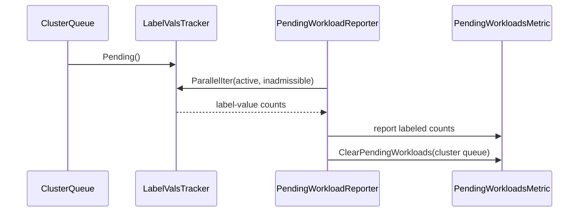

# PR #13469: Custom Metric Labels - Workload Labels support for Pending Workloads

**Summary**: Custom Metric Labels - Workload Labels support for Pending Workloads

**Sources**: https://github.com/kubernetes-sigs/kueue/pull/13469

**Last updated**: 2026-09-30T12:55:21Z

---

## Metadata

- **State**: closed (merged)
- **Author**: [@Singularity23x0](https://github.com/Singularity23x0)
- **Branch**: `12629-pending_workloads` → `main`
- **Created**: 2026-07-24T13:20:09Z
- **Updated**: 2026-09-30T12:55:21Z
- **Merged**: 2026-08-07T14:11:02Z
- **Closed**: 2026-08-07T14:11:02Z
- **Labels**: `kind/feature`, `release-note`, `lgtm`, `size/XXL`, `approved`, `cncf-cla: yes`, `area/observability`
- **Assignees**: [@amy](https://github.com/amy), [@mimowo](https://github.com/mimowo), [@olekzabl](https://github.com/olekzabl), [@kshalot](https://github.com/kshalot)
- **Requested reviewers**: [@kannon92](https://github.com/kannon92), [@amy](https://github.com/amy), [@olekzabl](https://github.com/olekzabl), [@sohankunkerkar](https://github.com/sohankunkerkar), [@kshalot](https://github.com/kshalot)
- **Changed files**: 13   **+1038 / -97**

## Description

<!--  Thanks for sending a pull request!  Here are some tips for you:

1. If this is your first time, please read our contributor guidelines: https://git.k8s.io/community/contributors/guide/first-contribution.md#your-first-contribution and developer guide https://git.k8s.io/community/contributors/devel/development.md#development-guide
2. Please label this pull request according to what type of issue you are addressing, especially if this is a release targeted pull request. For reference on required PR/issue labels, read here:
https://git.k8s.io/community/contributors/devel/sig-release/release.md#issuepr-kind-label
3. Ensure you have added or ran the appropriate tests for your PR: https://git.k8s.io/community/contributors/devel/sig-testing/testing.md
4. If you want *faster* PR reviews, read how: https://git.k8s.io/community/contributors/guide/pull-requests.md#best-practices-for-faster-reviews
5. If the PR is unfinished, see how to mark it: https://git.k8s.io/community/contributors/guide/pull-requests.md#marking-unfinished-pull-requests
-->

#### What type of PR is this?
/kind feature

<!--
Add one of the following kinds:
/kind bug
/kind cleanup
/kind documentation
/kind feature
/kind kep

Optionally add one or more of the following kinds if applicable:
/kind api-change
/kind deprecation
/kind failing-test
/kind flake
/kind regression

Please also consider setting the area:
/area tas
/area was
/area integrations
/area multikueue
/area dashboard
/area localization
/area testing
/area website
-->

#### What this PR does / why we need it:
Extends the Custom Metric Labels support for workload labels to the PendingWorkloads metric.

#### Which issue(s) this PR fixes:
<!--
*Automatically closes linked issue when PR is merged.
Usage: `Fixes #<issue number>`, or `Fixes (paste link of issue)`.
_If PR is about `failing-tests or flakes`, please post the related issues/tests in a comment and do not use `Fixes`_*
-->
Fixes #13586
Contributes to #12629

#### Special notes for your reviewer:
AI used for test implementation.

#### Does this PR introduce a user-facing change?
<!--
If no, just write "NONE" in the release-note block below.
If yes, a release note is required:
Enter your extended release note in the block below. If the PR requires additional action from users switching to the new release, include the string "action required".
-->
```release-note
Observability: The kueue_pending_workloads metric now supports configured Workload labels through metrics.customLabels. Requires the CustomMetricLabels feature gate.
```


<!-- This is an auto-generated comment: release notes by coderabbit.ai -->
## Summary by CodeRabbit

## New Features
- Pending-workload metrics now support breakdowns by configured workload labels.
- Added tracking and aggregation for custom label-value combinations.
- Pending workload counts now provide overall totals and label-based breakdowns.
- Metrics are automatically cleaned up when queue data changes, workloads are removed, or labels change.
- Custom-label validation now uses a consistent maximum-label limit.

## Tests
- Added coverage for label-based pending counts, metric updates, queue transitions, label changes, inadmissible workloads, and metric cleanup.
<!-- end of auto-generated comment: release notes by coderabbit.ai -->

## Discussion

### Comment by [@kubernetes-prow[bot]](https://github.com/apps/kubernetes-prow) — 2026-07-24T13:20:11Z

Skipping CI for Draft Pull Request.
If you want CI signal for your change, please convert it to an actual PR.
You can still manually trigger a test run with `/test all`

### Comment by [@netlify[bot]](https://github.com/apps/netlify) — 2026-07-24T13:20:15Z

### <span aria-hidden="true">✅</span> Deploy Preview for *kubernetes-sigs-kueue* canceled.


|  Name | Link |
|:-:|------------------------|
|<span aria-hidden="true">🔨</span> Latest commit | 34bb370157126167a9f6a185ffbb03b7050f1caa |
|<span aria-hidden="true">🔍</span> Latest deploy log | https://app.netlify.com/projects/kubernetes-sigs-kueue/deploys/6a75dfa6b5dd38000847a314 |

### Comment by [@coderabbitai[bot]](https://github.com/apps/coderabbitai) — 2026-07-24T13:20:17Z

<!-- This is an auto-generated comment: summarize by coderabbit.ai -->
<!-- review_stack_entry_start -->

[](https://app.coderabbit.ai/change-stack/kubernetes-sigs/kueue/pull/13469?utm_source=github_walkthrough&utm_medium=github&utm_campaign=change_stack)

<!-- review_stack_entry_end -->
<!-- This is an auto-generated comment: review paused by coderabbit.ai -->

> [!NOTE]
> ## Reviews paused
> 
> It looks like this branch is under active development. To avoid overwhelming you with review comments due to an influx of new commits, CodeRabbit has automatically paused this review. You can configure this behavior by changing the `reviews.auto_review.auto_pause_after_reviewed_commits` setting.
> 
> Use the following commands to manage reviews:
> - `@coderabbitai resume` to resume automatic reviews.
> - `@coderabbitai review` to trigger a single review.
> 
> Use the checkboxes below for quick actions:
> - [ ] <!-- {"checkboxId": "7f6cc2e2-2e4e-497a-8c31-c9e4573e93d1"} --> ▶️ Resume reviews
> - [ ] <!-- {"checkboxId": "e9bb8d72-00e8-4f67-9cb2-caf3b22574fe"} --> 🔍 Trigger review

<!-- end of auto-generated comment: review paused by coderabbit.ai -->
<!-- walkthrough_start -->

<details>
<summary>📝 Walkthrough</summary>

## Walkthrough

### Changes

Custom label tracking now supports per-value counters and paired iteration. `ClusterQueue` tracks pending and inadmissible workloads by workload labels. `PendingWorkloads` reports labeled counts and clears stale series. Validation uses the shared label limit. Unit and integration tests cover the behavior.

### Changes

**Pending workload metrics**

|Layer / File(s)|Summary|
|---|---|
|**Label tracking and validation** <br> `pkg/metrics/custom_labels.go`, `pkg/config/validation.go`, `pkg/metrics/custom_labels_test.go`|Adds source-kind helpers, fixed-size label-value trackers, tracker merging and iteration, wrapper APIs, shared limits, and tracker tests.|
|**ClusterQueue pending aggregation** <br> `pkg/cache/queue/cluster_queue.go`, `pkg/cache/queue/inadmissible_workloads.go`, `pkg/cache/queue/manager.go`, `pkg/cache/queue/cluster_queue_test.go`|Replaces scalar pending results with total and active/inadmissible tracker APIs. Workload mutations maintain both trackers.|
|**PendingWorkloads metric reporting** <br> `pkg/cache/queue/metrics.go`, `pkg/metrics/metrics.go`|Reports counts per combined ClusterQueue and workload label values, clears prior ClusterQueue series, and retains aggregate reporting.|
|**Integration coverage** <br> `test/integration/singlecluster/controller/core/custom_labels_test.go`, `test/integration/singlecluster/controller/core/suite_test.go`|Adds scenarios for active and inadmissible counts, queue transitions, label changes, and metric cleanup.|

**Estimated code review effort:** 4 (Complex) | ~45 minutes

**Possibly related issues**

- `kubernetes-sigs/kueue#12629`: Requests workload-label breakdowns for `pending_workloads`, matching this change.
- `kubernetes-sigs/kueue#13587`: Requests workload custom-label tracking and reporting for pending workload metrics.
- `kubernetes-sigs/kueue#13588`: Requests related custom-label support for local-queue pending workloads.

**Possibly related PRs**

- [kubernetes-sigs/kueue#12713](https://github.com/kubernetes-sigs/kueue/pull/12713): Introduces the `CustomLabels` and `LabelValsTracker` APIs used by this change.
- [kubernetes-sigs/kueue#12631](https://github.com/kubernetes-sigs/kueue/pull/12631): Implements related workload-label custom metrics behavior.
- [kubernetes-sigs/kueue#13660](https://github.com/kubernetes-sigs/kueue/pull/13660): Modifies the same ClusterQueue pending and inadmissible workload paths.

**Suggested labels:** `area/testing`

**Suggested reviewers:** `kannon92`, `mimowo`, `olekzabl`, `sohankunkerkar`

### Sequence Diagram(s)



</details>

<!-- walkthrough_end -->
<!-- pre_merge_checks_walkthrough_start -->

<details>
<summary>🚥 Pre-merge checks | ✅ 4 | ❌ 1</summary>

### ❌ Failed checks (1 warning)

|     Check name     | Status     | Explanation                                                                          | Resolution                                                                         |
| :----------------: | :--------- | :----------------------------------------------------------------------------------- | :--------------------------------------------------------------------------------- |
| Docstring Coverage | ⚠️ Warning | Docstring coverage is 7.14% which is insufficient. The required threshold is 80.00%. | Write docstrings for the functions missing them to satisfy the coverage threshold. |

<details>
<summary>✅ Passed checks (4 passed)</summary>

|         Check name         | Status   | Explanation                                                                                                                                                                                                                                            |
| :------------------------: | :------- | :----------------------------------------------------------------------------------------------------------------------------------------------------------------------------------------------------------------------------------------------------- |
|      Description Check     | ✅ Passed | Check skipped - CodeRabbit’s high-level summary is enabled.                                                                                                                                                                                            |
|         Title check        | ✅ Passed | The title directly summarizes the primary change: adding workload labels support to the pending workloads metric through custom metric labels.                                                                                                         |
|     Linked Issues check    | ✅ Passed | The PR implements the completion requirements from issue `#13586`: it adds custom label support for workload labels to the pending_workloads metric and includes integration tests in custom_labels_test.go.                                             |
| Out of Scope Changes check | ✅ Passed | All code changes support the stated objective of adding workload labels to the pending_workloads metric. Changes include tracker infrastructure, validation rules, configuration handling, and integration tests; all directly related to the feature. |

</details>

</details>

<!-- pre_merge_checks_walkthrough_end -->
<!-- finishing_touch_checkbox_start -->

<details>
<summary>✨ Finishing Touches</summary>

<details>
<summary>🧪 Generate unit tests (beta)</summary>

- [ ] <!-- {"checkboxId": "f47ac10b-58cc-4372-a567-0e02b2c3d479", "radioGroupId": "utg-output-choice-group-unknown_comment_id"} -->   Create PR with unit tests

</details>

</details>

<!-- finishing_touch_checkbox_end -->
<!-- tips_start -->

---

Thanks for using [CodeRabbit](https://coderabbit.ai?utm_source=oss&utm_medium=github&utm_campaign=kubernetes-sigs/kueue&utm_content=13469)! It's free for OSS, and your support helps us grow. If you like it, consider giving us a shout-out.

<details>
<summary>❤️ Share</summary>

- [X](https://twitter.com/intent/tweet?text=I%20just%20used%20%40coderabbitai%20for%20my%20code%20review%2C%20and%20it%27s%20fantastic%21%20It%27s%20free%20for%20OSS%20and%20offers%20a%20free%20trial%20for%20the%20proprietary%20code.%20Check%20it%20out%3A&url=https%3A//coderabbit.ai)
- [Mastodon](https://mastodon.social/share?text=I%20just%20used%20%40coderabbitai%20for%20my%20code%20review%2C%20and%20it%27s%20fantastic%21%20It%27s%20free%20for%20OSS%20and%20offers%20a%20free%20trial%20for%20the%20proprietary%20code.%20Check%20it%20out%3A%20https%3A%2F%2Fcoderabbit.ai)
- [Reddit](https://www.reddit.com/submit?title=Great%20tool%20for%20code%20review%20-%20CodeRabbit&text=I%20just%20used%20CodeRabbit%20for%20my%20code%20review%2C%20and%20it%27s%20fantastic%21%20It%27s%20free%20for%20OSS%20and%20offers%20a%20free%20trial%20for%20proprietary%20code.%20Check%20it%20out%3A%20https%3A//coderabbit.ai)
- [LinkedIn](https://www.linkedin.com/sharing/share-offsite/?url=https%3A%2F%2Fcoderabbit.ai&mini=true&title=Great%20tool%20for%20code%20review%20-%20CodeRabbit&summary=I%20just%20used%20CodeRabbit%20for%20my%20code%20review%2C%20and%20it%27s%20fantastic%21%20It%27s%20free%20for%20OSS%20and%20offers%20a%20free%20trial%20for%20proprietary%20code)

</details>


<sub>Comment `@coderabbitai help` to get the list of available commands.</sub>

<!-- tips_end -->

### Comment by [@mimowo](https://github.com/mimowo) — 2026-07-27T16:32:53Z

Would you like to review @amy ?

### Comment by [@Singularity23x0](https://github.com/Singularity23x0) — 2026-07-28T10:18:58Z

/assign @amy

### Comment by [@kshalot](https://github.com/kshalot) — 2026-07-31T10:36:29Z

/assign

### Comment by [@Singularity23x0](https://github.com/Singularity23x0) — 2026-07-31T13:11:19Z

/retest

### Comment by [@mimowo](https://github.com/mimowo) — 2026-08-03T19:21:13Z

/area observability

### Comment by [@amy](https://github.com/amy) — 2026-08-04T16:26:44Z

lol is prow okay... seems like it triggered a bunch of tests without a trigger. Are they are all different batches or something?

### Comment by [@Singularity23x0](https://github.com/Singularity23x0) — 2026-08-05T09:01:39Z

> lol is prow okay... seems like it triggered a bunch of tests without a trigger. Are they are all different batches or something?

It is likely the effect of me doing an amend to the latest commit. It seems the latest version has confirmed correctly though.

### Comment by [@amy](https://github.com/amy) — 2026-08-05T17:25:42Z

/lgtm

oh gotcha. Anyways PR lgtm! Will let @olekzabl / @mimowo take a final pass.

### Comment by [@kubernetes-prow[bot]](https://github.com/apps/kubernetes-prow) — 2026-08-05T17:25:49Z

LGTM label has been added.  <details>Git tree hash: 4d829cd0e57481c123ee93420eb5ffd93d73ab51</details>

### Comment by [@olekzabl](https://github.com/olekzabl) — 2026-08-07T08:26:50Z

/lgtm

### Comment by [@kubernetes-prow[bot]](https://github.com/apps/kubernetes-prow) — 2026-08-07T08:26:58Z

LGTM label has been added.  <details>Git tree hash: 14ca7cd5bc020552826f36f3ccc36cc3e0aa2f93</details>

### Comment by [@coderabbitai[bot]](https://github.com/apps/coderabbitai) — 2026-08-07T13:28:00Z

<!-- This is an auto-generated reply by CodeRabbit -->
### Chat

There are 3 ways to chat with [CodeRabbit](https://coderabbit.ai?utm_source=oss&utm_medium=github&utm_campaign=kubernetes-sigs/kueue&utm_content=13469):

- Review comments: Directly reply to a review comment made by CodeRabbit. Example:
  - `I pushed a fix in commit <commit_id>, please review it.`
  - `Open a follow-up GitHub issue for this discussion.`
- Files and specific lines of code (under the "Files changed" tab): Tag `@coderabbitai` in a new review comment at the desired location with your query.
- PR comments: Tag `@coderabbitai` in a new PR comment to ask questions about the PR branch. For the best results, please provide a very specific query, as very limited context is provided in this mode. Examples:
  - `@coderabbitai gather interesting stats about this repository and render them as a table. Additionally, render a pie chart showing the language distribution in the codebase.`
  - `@coderabbitai read the files in the src/scheduler package and generate a class diagram using mermaid and a README in the markdown format.`

### CodeRabbit commands

> These commands are invoked using PR/Issue comments.

- `@coderabbitai pause` to pause the reviews on a PR.
- `@coderabbitai resume` to resume the paused reviews.
- `@coderabbitai review` to trigger an incremental review. This is useful when automatic reviews are disabled for the repository.
- `@coderabbitai full review` to do a full review from scratch and review all the files again.
- `@coderabbitai rate limit` to show your current review rate limit status.
- `@coderabbitai summary` to regenerate the summary of the PR.
- `@coderabbitai evaluate custom pre-merge check --instructions <custom-checks-instructions> --name <custom-checks-title> [--mode <error|warning>]` to validate the custom pre-merge checks instructions. Defaults to `error` when `--mode` is omitted.
- `@coderabbitai ignore pre-merge checks` to override pre-merge checks and get an approval on PR.
- `@coderabbitai run pre-merge checks` to run pre-merge checks on the pull request.
- `@coderabbitai generate docstrings` to [generate docstrings](https://docs.coderabbit.ai/finishing-touches/docstrings) for this PR.
- `@coderabbitai generate sequence diagram` to generate a sequence diagram of the changes in this PR.
- `@coderabbitai generate unit tests` to generate unit tests for this PR.
- `@coderabbitai emit path instructions` to emit generated path-specific review instructions for this repository.
- `@coderabbitai resolve merge conflict` to automatically resolve merge conflicts.
- `@coderabbitai autofix` to automatically fix issues identified in unresolved review comments.
- `@coderabbitai fix-ci` to automatically fix failing CI checks in a stacked pull request.
- `@coderabbitai fix-ci commit` to automatically fix failing CI checks by committing fixes to the current branch.
- `@coderabbitai resolve` to resolve all the CodeRabbit review comments.
- `@coderabbitai configuration` to show the current CodeRabbit configuration for the repository.
- `@coderabbitai generate configuration` to create a PR that adds the current resolved configuration as `.coderabbit.yaml` (or show it if already present).
- `@coderabbitai help` to get help.

### Other keywords and placeholders

- Add `@coderabbitai ignore` or `@coderabbit ignore` anywhere in the PR description to prevent this PR from being reviewed.
- Add `@coderabbitai summary` to generate the high-level summary at a specific location in the PR description.
- Add `@coderabbitai` anywhere in the PR title to generate the title automatically.


### Status, support, documentation and community

- Visit our [status page](https://status.coderabbit.ai) to check the current availability of CodeRabbit.
- Create a ticket on our [support page](https://www.coderabbit.ai/contact-us/support) for assistance with any issues or questions.
- Visit our [documentation site](https://docs.coderabbit.ai) for detailed information on how to use CodeRabbit.
- Join our [Discord community](http://discord.gg/coderabbit) to connect with other users and get help from the community.
- Follow us on [X/Twitter](https://twitter.com/coderabbitai) for updates and announcements.

### Comment by [@mimowo](https://github.com/mimowo) — 2026-08-07T14:09:48Z

/lgtm 
/approve
Thank you!

### Comment by [@kubernetes-prow[bot]](https://github.com/apps/kubernetes-prow) — 2026-08-07T14:09:57Z

LGTM label has been added.  <details>Git tree hash: acac5982d5959a912585ba52cd588644f6cbda69</details>

### Comment by [@kubernetes-prow[bot]](https://github.com/apps/kubernetes-prow) — 2026-08-07T14:10:02Z

[APPROVALNOTIFIER] This PR is **APPROVED**

This pull-request has been approved by: *<a href="https://github.com/kubernetes-sigs/kueue/pull/13469#issuecomment-5218105796" title="Approved">mimowo</a>*, *<a href="https://github.com/kubernetes-sigs/kueue/pull/13469#" title="Author self-approved">Singularity23x0</a>*

The full list of commands accepted by this bot can be found [here](https://go.k8s.io/bot-commands?repo=kubernetes-sigs%2Fkueue).

The pull request process is described [here](https://git.k8s.io/community/contributors/guide/owners.md#the-code-review-process)

<details >
Needs approval from an approver in each of these files:

- ~~[OWNERS](https://github.com/kubernetes-sigs/kueue/blob/main/OWNERS)~~ [mimowo]

Approvers can indicate their approval by writing `/approve` in a comment
Approvers can cancel approval by writing `/approve cancel` in a comment
</details>
<!-- META={"approvers":[]} -->

### Comment by [@mimowo](https://github.com/mimowo) — 2026-09-30T12:55:19Z

/release-note-edit
```release-note
Observability: The kueue_pending_workloads metric now supports configured Workload labels through metrics.customLabels. Requires the CustomMetricLabels feature gate.
```

## Reviews

### Review by [@coderabbitai[bot]](https://github.com/apps/coderabbitai) (commented) — 2026-07-27T09:50:04Z

**Actionable comments posted: 2**

<details>
<summary>🧹 Nitpick comments (3)</summary><blockquote>

<details>
<summary>test/integration/singlecluster/controller/core/custom_labels_test.go (2)</summary><blockquote>

`1309-1337`: _📐 Maintainability & Code Quality_ | _🔵 Trivial_ | _💤 Low value_

**Consider extracting the "pop + requeue as inadmissible" setup into a helper.**

Lines 1277-1290 and 1328-1337 repeat the same Eventually/`Heads`/`RequeueWorkload` sequence; a small helper would keep the two scenarios from drifting.

<details>
<summary>🤖 Prompt for AI Agents</summary>

```
Verify each finding against current code. Fix only still-valid issues, skip the
rest with a brief reason, keep changes minimal, and validate.

In `@test/integration/singlecluster/controller/core/custom_labels_test.go` around
lines 1309 - 1337, Extract the repeated Eventually check, qManager.Heads call,
workload fetch, and RequeueWorkload setup into a shared helper near the affected
test cases. Update both scenarios, including the CQ stop/resume case around
qManager.RequeueWorkload, to call the helper while preserving the existing
inadmissible requeue behavior and assertions.
```

</details>

<!-- cr-comment:v1:cb89f956d3bba5fb4d7ab184 -->

---

`1246-1255`: _📐 Maintainability & Code Quality_ | _🔵 Trivial_ | _⚡ Quick win_

**Use the exported untracked value reference instead of duplicating the literal.**

`apis/config/v1beta2/configuration_types.go` already exports `config.UntrackedCustomLabelValue`; reference it here so renaming the sentinel is caught by the compiler.

<details>
<summary>🤖 Prompt for AI Agents</summary>

```
Verify each finding against current code. Fix only still-valid issues, skip the
rest with a brief reason, keep changes minimal, and validate.

In `@test/integration/singlecluster/controller/core/custom_labels_test.go` around
lines 1246 - 1255, Replace the hardcoded "_UNTRACKED_VALUE_" argument in the
custom-label metric assertion within the active pending workloads test with the
exported config.UntrackedCustomLabelValue constant. Keep the existing metric
expectations and other label arguments unchanged.
```

</details>

<!-- cr-comment:v1:ae9e7e3a002e60c56fb684c9 -->

</blockquote></details>
<details>
<summary>pkg/metrics/custom_labels.go (1)</summary><blockquote>

`103-133`: _🩺 Stability & Availability_ | _🔵 Trivial_ | _⚡ Quick win_

**Clamp `size` in `MakeValsSet` to the fixed array capacity.**

`ls.size = len(vals)` is set without bounding it to `len(ls.vals)` (`MaxCustomLabelsForSourceKind`). `copy` silently truncates the copied elements to 6, but `size` can still exceed 6, so a later `OrderedList()` call (`s.vals[:s.size]`) would panic with an out-of-range slice. Today this is unreachable only because `pkg/config/validation.go` independently guarantees per-kind label counts stay ≤ `MaxCustomLabelsForSourceKind` — an implicit, cross-package invariant with no local safety net here.

<details>
<summary>🛡️ Proposed defensive clamp</summary>

```diff
 func (cl *CustomLabels) MakeValsSet(kind configapi.SourceKind, labels, annotations map[string]string) (ls labelValsSet) {
 	if !cl.enabled() || cl.m[kind] == nil {
 		return Empty()
 	}
 	vals := cl.m[kind].extractValues(labels, annotations)
-	copy(ls.vals[:], vals)
-	ls.size = len(vals)
+	ls.size = copy(ls.vals[:], vals)
 	return
 }
```
</details>

<details>
<summary>🤖 Prompt for AI Agents</summary>

```
Verify each finding against current code. Fix only still-valid issues, skip the
rest with a brief reason, keep changes minimal, and validate.

In `@pkg/metrics/custom_labels.go` around lines 103 - 133, Update
CustomLabels.MakeValsSet to clamp ls.size to the fixed ls.vals capacity after
copying extracted values, using the smaller of len(vals) and len(ls.vals).
Preserve the existing Empty result and copied values while ensuring later
OrderedList slicing cannot exceed the array bounds.
```

</details>

<!-- cr-comment:v1:5a5736b92540f173df5f5752 -->

</blockquote></details>

</blockquote></details>

<details>
<summary>🤖 Prompt for all review comments with AI agents</summary>

```
Verify each finding against current code. Fix only still-valid issues, skip the
rest with a brief reason, keep changes minimal, and validate.

Inline comments:
In `@pkg/cache/queue/cluster_queue.go`:
- Around line 694-736: Update pendingActive and pendingInadmissible so
workload-label breakdown always adds a zero-count entry when no workloads are
present. Use cl.MakeValsSet(configapi.SourceKindWorkload, nil, nil) for the
empty-label values, while preserving the existing per-workload counting and
non-breakdown behavior.

In `@test/integration/singlecluster/controller/core/custom_labels_test.go`:
- Around line 1442-1443: Replace the zero-valued ExpectPendingWorkloadsMetric
assertion in the old ClusterQueue label cleanup verification with the
filtered-collect assertion pattern used near line 1472, so the stale
ml-team/kind1 series must be absent rather than merely report zero. Apply the
same change to the corresponding assertion near line 1405, preserving the
existing cleanup scenario.

---

Nitpick comments:
In `@pkg/metrics/custom_labels.go`:
- Around line 103-133: Update CustomLabels.MakeValsSet to clamp ls.size to the
fixed ls.vals capacity after copying extracted values, using the smaller of
len(vals) and len(ls.vals). Preserve the existing Empty result and copied values
while ensuring later OrderedList slicing cannot exceed the array bounds.

In `@test/integration/singlecluster/controller/core/custom_labels_test.go`:
- Around line 1309-1337: Extract the repeated Eventually check, qManager.Heads
call, workload fetch, and RequeueWorkload setup into a shared helper near the
affected test cases. Update both scenarios, including the CQ stop/resume case
around qManager.RequeueWorkload, to call the helper while preserving the
existing inadmissible requeue behavior and assertions.
- Around line 1246-1255: Replace the hardcoded "_UNTRACKED_VALUE_" argument in
the custom-label metric assertion within the active pending workloads test with
the exported config.UntrackedCustomLabelValue constant. Keep the existing metric
expectations and other label arguments unchanged.
```

</details>

<details>
<summary>🪄 Autofix (Beta)</summary>

Fix all unresolved CodeRabbit comments on this PR:

- [ ] <!-- {"checkboxId": "4b0d0e0a-96d7-4f10-b296-3a18ea78f0b9"} --> Push a commit to this branch (recommended)
- [ ] <!-- {"checkboxId": "ff5b1114-7d8c-49e6-8ac1-43f82af23a33"} --> Create a new PR with the fixes

</details>

---

<details>
<summary>ℹ️ Review info</summary>

<details>
<summary>⚙️ Run configuration</summary>

**Configuration used**: Path: .coderabbit.yaml

**Review profile**: CHILL

**Plan**: Pro Plus

**Run ID**: `fa76fe3f-ad3a-4306-887b-86075521047d`

</details>

<details>
<summary>📥 Commits</summary>

Reviewing files that changed from the base of the PR and between b7ac6ee8e9a91701cdfec3662f47690d4e166b53 and 21d1a5e04d49787153b35cbf0714893a58d0710b.

</details>

<details>
<summary>📒 Files selected for processing (9)</summary>

* `pkg/cache/queue/cluster_queue.go`
* `pkg/cache/queue/cluster_queue_test.go`
* `pkg/cache/queue/metrics.go`
* `pkg/config/validation.go`
* `pkg/metrics/custom_labels.go`
* `pkg/metrics/custom_labels_test.go`
* `pkg/metrics/metrics.go`
* `test/integration/singlecluster/controller/core/custom_labels_test.go`
* `test/integration/singlecluster/controller/core/suite_test.go`

</details>

</details>

<!-- This is an auto-generated comment by CodeRabbit for review status -->

- **pkg/cache/queue/cluster_queue.go:736** by [@coderabbitai[bot]](https://github.com/apps/coderabbitai) — 2026-07-27T09:50:03Z
```diff
@@ -680,32 +680,63 @@ func (c *ClusterQueue) pendingResources() map[corev1.ResourceName]int64 {
 
 // PendingTotal returns the total number of pending workloads.
 func (c *ClusterQueue) PendingTotal() int {
-	active, inadmissible := c.Pending()
-	return active + inadmissible
+	active, inadmissible := c.Pending(nil)
+	return active.Total() + inadmissible.Total()
 }
 
 // Pending returns the number of active and inadmissible pending workloads.
-func (c *ClusterQueue) Pending() (int, int) {
+func (c *ClusterQueue) Pending(cl *metrics.CustomLabels) (*metrics.LabelValsTracker, *metrics.LabelValsTracker) {
 	c.rwm.RLock()
 	defer c.rwm.RUnlock()
-	return c.pendingActive(), c.pendingInadmissible()
+	return c.pendingActive(cl), c.pendingInadmissible(cl)
 }
 
 // pendingActive returns the number of active pending workloads,
 // workloads that are in the admission queue.
-func (c *ClusterQueue) pendingActive() int {
-	result := c.heap.Len()
+func (c *ClusterQueue) pendingActive(cl *metrics.CustomLabels) *metrics.LabelValsTracker {
+	result := metrics.NewLabelValsTracker()
+
+	if !breakDownByWorkloadLabels(cl) {
+		emptyVals := metrics.Empty()
+		result.Add(emptyVals, c.heap.Len())
+		if c.inflight != nil {
+			result.Incr(emptyVals)
+		}
+		return result
+	}
+
+	for _, wl := range c.heap.List() {
+		vals := cl.MakeValsSet(configapi.SourceKindWorkload, wl.Obj.Labels, wl.Obj.Annotations)
+		result.Incr(vals)
+	}
 	if c.inflight != nil {
-		result++
+		vals := cl.MakeValsSet(configapi.SourceKindWorkload, c.inflight.Obj.Labels, c.inflight.Obj.Annotations)
+		result.Incr(vals)
 	}
 	return result
 }
 
 // pendingInadmissible returns the number of inadmissible pending workloads,
 // workloads that were already tried and are waiting for cluster conditions
 // to change to potentially become admissible.
-func (c *ClusterQueue) pendingInadmissible() int {
-	return c.inadmissibleWorkloads.len()
+func (c *ClusterQueue) pendingInadmissible(cl *metrics.CustomLabels) *metrics.LabelValsTracker {
+	result := metrics.NewLabelValsTracker()
+
+	if !breakDownByWorkloadLabels(cl) {
+		emptyVals := metrics.Empty()
+		result.Add(emptyVals, len(c.inadmissibleWorkloads))
+		return result
+	}
+
+	for _, wl := range c.inadmissibleWorkloads {
+		vals := cl.MakeValsSet(configapi.SourceKindWorkload, wl.Obj.Labels, wl.Obj.Annotations)
+		result.Incr(vals)
+	}
+	return result
+}
```

  _🎯 Functional Correctness_ | _🟠 Major_ | _⚡ Quick win_
  
  <details>
  <summary>🧩 Analysis chain</summary>
  
  🏁 Script executed:
  
  ```shell
  #!/bin/bash
  set -euo pipefail
  
  echo "== files =="
  git ls-files | rg '(^|/)pkg/cache/queue/(cluster_queue|metrics)\.go$|(^|/)metrics/.*go$' || true
  
  echo "== target section =="
  sed -n '640,765p' pkg/cache/queue/cluster_queue.go
  
  echo "== metrics related search =="
  rg -n "reportCQPendingWorkloads|ClearPendingWorkloads|ReportPendingWorkloads|ParallelIter|LabelValsTracker|NewLabelValsTracker|make.*labelValsSet|size|count" pkg/cache/queue metrics pkg/cache -g '*.go' | head -n 200
  ```
  
  Repository: kubernetes-sigs/kueue
  
  Length of output: 32085
  
  ---
  
  🏁 Script executed:
  
  ```shell
  # Inspect focused metrics files/structures without executing repo code.
  set -euo pipefail
  
  for f in pkg/cache/queue/metrics.go metrics/metrics.go pkg/cache/metrics.go; do
    if [ -f "$f" ]; then
      echo "== $f =="
      wc -l "$f"
      sed -n '1,260p' "$f" | nl -ba
    fi
  done
  
  echo "== LabelValsTracker definitions/usages =="
  rg -n "type LabelValsTracker|func NewLabelValsTracker|func .*LabelValsTracker|ParallelIter|Empty|clear" -g '*.go' .
  ```
  
  Repository: kubernetes-sigs/kueue
  
  Length of output: 263
  
  ---
  
  🏁 Script executed:
  
  ```shell
  #!/bin/bash
  set -euo pipefail
  
  echo "== pkg/cache/queue/metrics.go =="
  cat -n pkg/cache/queue/metrics.go | sed -n '1,120p'
  
  echo "== pkg/metrics/custom_labels.go =="
  cat -n pkg/metrics/custom_labels.go | sed -n '1,260p'
  
  echo "== pkg/metrics/metrics.go relevant =="
  cat -n pkg/metrics/metrics.go | sed -n '1,260p'
  
  echo "== parallel util search =="
  rg -n "type ParallelIter|ParallelIter|ParallelIter\\(|labelValsSet|LabelValsSet|Labels|LabelNames|SourceKindClusterQueue|SourceKindWorkload|ClearPendingWorkloads|ReportPendingWorkloads" pkg/metrics pkg/cache/queue -g '*.go'
  ```
  
  Repository: kubernetes-sigs/kueue
  
  Length of output: 50377
  
  ---
  
  🏁 Script executed:
  
  ```shell
  #!/bin/bash
  set -euo pipefail
  
  echo "== custom_labels.go Tail =="
  wc -l pkg/metrics/custom_labels.go
  cat -n pkg/metrics/custom_labels.go | sed -n '260,500p'
  
  echo "== metrics.go custom label report/clear/repo =="
  cat -n pkg/metrics/metrics.go | sed -n '720,880p'
  
  echo "== test around ParallelIter =="
  cat -n pkg/metrics/custom_labels_test.go | sed -n '430,535p'
  
  echo "== static verifier for pendingActive/inadmissible empty-breakdown behavior =="
  python3 - <<'PY'
  from pathlib import Path
  p = Path('pkg/cache/queue/cluster_queue.go')
  s = p.read_text()
  for name in ('pendingActive', 'pendingInadmissible'):
      start = s.index(f'func (c *ClusterQueue) {name}')
      end = s.index('\nfunc ', start+1)
      body = s[start:end]
      has_label_breakdown_if = '!breakDownByWorkloadLabels(cl)'
      has_loop = 'for _, wl' in body or 'for _, wl:' in body
      has_add_before_loop = 'result.Add(' in body.split('for _, wl', 1)[0]
      print(f'{name}: breakdown_if={has_label_breakdown_if}, loop={has_loop}, add_before_loop={has_add_before_loop}')
      if not (has_label_breakdown_if and has_loop and not has_add_before_loop):
          raise SystemExit(1)
  print('empty-breakdown case has no initial Add before loops.')
  PY
  ```
  
  Repository: kubernetes-sigs/kueue
  
  Length of output: 18257
  
  ---
  
  🏁 Script executed:
  
  ```shell
  #!/bin/bash
  set -euo pipefail
  
  echo "== report/clear definitions =="
  rg -n "func ReportPendingWorkloads|func ClearPendingWorkloads|pending_workloads|PendingWorkloads" pkg/metrics/metrics.go pkg -g '*.go' | head -n 80
  
  echo "== report/metrics.go Tail section =="
  cat -n pkg/metrics/metrics.go | sed -n '880,970p'
  ```
  
  Repository: kubernetes-sigs/kueue
  
  Length of output: 13007
  
  ---
  
  
  
  </details>
  
  **Keep pending workload metrics present when there are no matching workloads.**
  
  When workload label breakdown is enabled and a ClusterQueue has zero active/inadmissible workloads, both trackers are empty, `ParallelIter` yields no entries, and after `ClearPendingWorkloads(cq.name)` the ClusterQueue’s `kueue_pending_workloads` series disappears. Add a zero-count entry for workload label breakdown too; a correctly built `cl.MakeValsSet(configapi.SourceKindWorkload, nil, nil)` already matches the configured empty-label values and avoids introducing mismatched label-cardinality combinations.
  
  <details>
  <summary>🤖 Prompt for AI Agents</summary>
  
  ```
  Verify each finding against current code. Fix only still-valid issues, skip the
  rest with a brief reason, keep changes minimal, and validate.
  
  In `@pkg/cache/queue/cluster_queue.go` around lines 694 - 736, Update
  pendingActive and pendingInadmissible so workload-label breakdown always adds a
  zero-count entry when no workloads are present. Use
  cl.MakeValsSet(configapi.SourceKindWorkload, nil, nil) for the empty-label
  values, while preserving the existing per-workload counting and non-breakdown
  behavior.
  ```
  
  </details>
  
  <!-- fingerprinting:phantom:medusa:beignet -->
  
  <!-- cr-indicator-types:refactor_suggestion -->
  
  <!-- cr-comment:v1:54879725d576c02fffd36dd6 -->
  
  <!-- This is an auto-generated reply by CodeRabbit -->
  
  ✅ Addressed in commits ae67e97 to 34bb370
  
  <!-- This is an auto-generated comment by CodeRabbit -->

- **test/integration/singlecluster/controller/core/custom_labels_test.go:1443** by [@coderabbitai[bot]](https://github.com/apps/coderabbitai) — 2026-07-27T09:50:03Z
```diff
@@ -1182,4 +1184,298 @@ var _ = ginkgo.Describe("CustomMetricLabels", ginkgo.Label("controller:clusterqu
 			util.ExpectAdmittedActiveWorkloadsGaugeMetric(kueue.ClusterQueueReference(cq.Name), 0, "ml-team", "kind1")
 		})
 	})
+
+	ginkgo.When("PendingWorkloads metric when CustomMetricLabels is enabled with workload custom labels", func() {
+		var (
+			cq *kueue.ClusterQueue
+		)
+
+		ginkgo.BeforeEach(func() {
+			features.SetFeatureGateDuringTest(ginkgo.GinkgoTB(), features.CustomMetricLabels, true)
+			controllersCfg := &config.Configuration{}
+			controllersCfg.Metrics.CustomLabels = []config.ControllerMetricsCustomLabel{
+				{Name: "team_cq", SourceLabelKey: "team", SourceKind: ptr.To(config.SourceKindClusterQueue)},
+				{Name: "wl_kind", SourceLabelKey: "workload-kind", SourceKind: ptr.To(config.SourceKindWorkload), TrackedValues: []string{"kind1", "kind2"}},
+			}
+			fwk.StartManager(ctx, cfg, managerAndControllerSetup(controllersCfg))
+			defaultFlavor = utiltestingapi.MakeResourceFlavor("default").Obj()
+			util.MustCreate(ctx, k8sClient, defaultFlavor)
+			ns = util.CreateNamespaceFromPrefixWithLog(ctx, k8sClient, "custom-labels-wl-")
+		})
+
+		ginkgo.AfterEach(func() {
+			gomega.Expect(util.DeleteWorkloadsInNamespace(ctx, k8sClient, ns)).To(gomega.Succeed())
+			util.ExpectObjectToBeDeleted(ctx, k8sClient, cq, true)
+			gomega.Expect(util.DeleteNamespace(ctx, k8sClient, ns)).To(gomega.Succeed())
+			util.ExpectObjectToBeDeleted(ctx, k8sClient, defaultFlavor, true)
+			fwk.StopManager(ctx)
+			metrics.InitMetricVectors(nil)
+		})
+
+		ginkgo.It("should track active pending workloads with custom labels", func() {
+			cq = utiltestingapi.MakeClusterQueue("cq").
+				ResourceGroup(
+					*utiltestingapi.MakeFlavorQuotas(defaultFlavor.Name).
+						Resource(corev1.ResourceCPU, "5").
+						Obj(),
+				).Label("team", "ml-team").Obj()
+			util.CreateClusterQueuesAndWaitForActive(ctx, k8sClient, cq)
+
+			lq := utiltestingapi.MakeLocalQueue("lq", ns.Name).
+				ClusterQueue(cq.Name).Obj()
+			util.CreateLocalQueuesAndWaitForActive(ctx, k8sClient, lq)
+
+			wl1 := utiltestingapi.MakeWorkload("wl1", ns.Name).
+				Label("workload-kind", "kind1").
+				Queue(kueue.LocalQueueName(lq.Name)).
+				Request(corev1.ResourceCPU, "1").Obj()
+			util.MustCreate(ctx, k8sClient, wl1)
+
+			wl2 := utiltestingapi.MakeWorkload("wl2", ns.Name).
+				Label("workload-kind", "kind1").
+				Queue(kueue.LocalQueueName(lq.Name)).
+				Request(corev1.ResourceCPU, "1").Obj()
+			util.MustCreate(ctx, k8sClient, wl2)
+
+			wl3 := utiltestingapi.MakeWorkload("wl3", ns.Name).
+				Label("workload-kind", "kind2").
+				Queue(kueue.LocalQueueName(lq.Name)).
+				Request(corev1.ResourceCPU, "1").Obj()
+			util.MustCreate(ctx, k8sClient, wl3)
+
+			wlUntracked := utiltestingapi.MakeWorkload("wl-untracked", ns.Name).
+				Label("workload-kind", "kind3").
+				Queue(kueue.LocalQueueName(lq.Name)).
+				Request(corev1.ResourceCPU, "1").Obj()
+			util.MustCreate(ctx, k8sClient, wlUntracked)
+
+			ginkgo.By("verifying active pending workloads metric counts match the custom labels")
+			util.ExpectPendingWorkloadsMetric(cq, 2, 0, "ml-team", "kind1")
+			util.ExpectPendingWorkloadsMetric(cq, 1, 0, "ml-team", "kind2")
+			util.ExpectPendingWorkloadsMetric(cq, 1, 0, "ml-team", "kueue.x-k8s.io/_UNTRACKED_VALUE_")
+		})
+
+		ginkgo.It("should track inadmissible pending workloads", func() {
+			cq = utiltestingapi.MakeClusterQueue("cq").
+				ResourceGroup(
+					*utiltestingapi.MakeFlavorQuotas(defaultFlavor.Name).
+						Resource(corev1.ResourceCPU, "5").
+						Obj(),
+				).Label("team", "ml-team").Obj()
+			util.CreateClusterQueuesAndWaitForActive(ctx, k8sClient, cq)
+
+			lq := utiltestingapi.MakeLocalQueue("lq", ns.Name).
+				ClusterQueue(cq.Name).Obj()
+			util.CreateLocalQueuesAndWaitForActive(ctx, k8sClient, lq)
+
+			wl3 := utiltestingapi.MakeWorkload("wl3", ns.Name).
+				Label("workload-kind", "kind2").
+				Queue(kueue.LocalQueueName(lq.Name)).
+				Request(corev1.ResourceCPU, "1").Obj()
+			util.MustCreate(ctx, k8sClient, wl3)
+
+			ginkgo.By("waiting for wl3 to be present in the queue manager active heap")
+			gomega.Eventually(func(g gomega.Gomega) {
+				g.Expect(qManager.PendingWorkloadsInfo(kueue.ClusterQueueReference(cq.Name))).To(gomega.HaveLen(1))
+			}, util.Timeout, util.Interval).Should(gomega.Succeed())
+
+			ginkgo.By("popping wl3 from the queue manager to increment popCycle and clear it from active heap")
+			popped := qManager.Heads(ctx)
+			gomega.Expect(popped).To(gomega.HaveLen(1))
+			gomega.Expect(workload.Key(popped[0].Obj)).To(gomega.Equal(workload.Key(wl3)))
+
+			ginkgo.By("making popped workload (wl3) inadmissible")
+			var fetchedWl3 kueue.Workload
+			gomega.Expect(k8sClient.Get(ctx, client.ObjectKeyFromObject(wl3), &fetchedWl3)).To(gomega.Succeed())
+			qManager.RequeueWorkload(ctx, workload.NewInfo(&fetchedWl3), qcache.RequeueReasonGeneric, "")
+
+			wl1 := utiltestingapi.MakeWorkload("wl1", ns.Name).
+				Label("workload-kind", "kind1").
+				Queue(kueue.LocalQueueName(lq.Name)).
+				Request(corev1.ResourceCPU, "1").Obj()
+			util.MustCreate(ctx, k8sClient, wl1)
+
+			wl2 := utiltestingapi.MakeWorkload("wl2", ns.Name).
+				Label("workload-kind", "kind2").
+				Queue(kueue.LocalQueueName(lq.Name)).
+				Request(corev1.ResourceCPU, "1").Obj()
+			util.MustCreate(ctx, k8sClient, wl2)
+
+			ginkgo.By("verifying counts: wl1 active kind1, wl2 active kind2, wl3 inadmissible kind2")
+			util.ExpectPendingWorkloadsMetric(cq, 1, 0, "ml-team", "kind1")
+			util.ExpectPendingWorkloadsMetric(cq, 1, 1, "ml-team", "kind2")
+		})
+
+		ginkgo.It("should count workloads correctly on CQ stop/resume", func() {
+			cq = utiltestingapi.MakeClusterQueue("cq").
+				ResourceGroup(
+					*utiltestingapi.MakeFlavorQuotas(defaultFlavor.Name).
+						Resource(corev1.ResourceCPU, "5").
+						Obj(),
+				).Label("team", "ml-team").Obj()
+			util.CreateClusterQueuesAndWaitForActive(ctx, k8sClient, cq)
+
+			lq := utiltestingapi.MakeLocalQueue("lq", ns.Name).
+				ClusterQueue(cq.Name).Obj()
+			util.CreateLocalQueuesAndWaitForActive(ctx, k8sClient, lq)
+
+			wl3 := utiltestingapi.MakeWorkload("wl3", ns.Name).
+				Label("workload-kind", "kind2").
+				Queue(kueue.LocalQueueName(lq.Name)).
+				Request(corev1.ResourceCPU, "1").Obj()
+			util.MustCreate(ctx, k8sClient, wl3)
+
+			gomega.Eventually(func(g gomega.Gomega) {
+				g.Expect(qManager.PendingWorkloadsInfo(kueue.ClusterQueueReference(cq.Name))).To(gomega.HaveLen(1))
+			}, util.Timeout, util.Interval).Should(gomega.Succeed())
+
+			popped := qManager.Heads(ctx)
+			gomega.Expect(popped).To(gomega.HaveLen(1))
+
+			var fetchedWl3 kueue.Workload
+			gomega.Expect(k8sClient.Get(ctx, client.ObjectKeyFromObject(wl3), &fetchedWl3)).To(gomega.Succeed())
+			qManager.RequeueWorkload(ctx, workload.NewInfo(&fetchedWl3), qcache.RequeueReasonGeneric, "")
+
+			wl1 := utiltestingapi.MakeWorkload("wl1", ns.Name).
+				Label("workload-kind", "kind1").
+				Queue(kueue.LocalQueueName(lq.Name)).
+				Request(corev1.ResourceCPU, "1").Obj()
+			util.MustCreate(ctx, k8sClient, wl1)
+
+			ginkgo.By("verifying initial active vs inadmissible counts")
+			util.ExpectPendingWorkloadsMetric(cq, 1, 0, "ml-team", "kind1")
+			util.ExpectPendingWorkloadsMetric(cq, 0, 1, "ml-team", "kind2")
+
+			ginkgo.By("stopping the ClusterQueue to make it inactive")
+			gomega.Eventually(func(g gomega.Gomega) {
+				var updatedCq kueue.ClusterQueue
+				g.Expect(k8sClient.Get(ctx, client.ObjectKeyFromObject(cq), &updatedCq)).To(gomega.Succeed())
+				updatedCq.Spec.StopPolicy = ptr.To(kueue.Hold)
+				g.Expect(k8sClient.Update(ctx, &updatedCq)).To(gomega.Succeed())
+			}, util.Timeout, util.Interval).Should(gomega.Succeed())
+
+			ginkgo.By("verifying both active and inadmissible workloads are reported as inadmissible")
+			util.ExpectPendingWorkloadsMetric(cq, 0, 1, "ml-team", "kind1")
+			util.ExpectPendingWorkloadsMetric(cq, 0, 1, "ml-team", "kind2")
+
+			ginkgo.By("resuming the ClusterQueue to make it active")
+			gomega.Eventually(func(g gomega.Gomega) {
+				var updatedCq kueue.ClusterQueue
+				g.Expect(k8sClient.Get(ctx, client.ObjectKeyFromObject(cq), &updatedCq)).To(gomega.Succeed())
+				updatedCq.Spec.StopPolicy = ptr.To(kueue.None)
+				g.Expect(k8sClient.Update(ctx, &updatedCq)).To(gomega.Succeed())
+			}, util.Timeout, util.Interval).Should(gomega.Succeed())
+
+			ginkgo.By("verifying they restore to active statuses")
+			util.ExpectPendingWorkloadsMetric(cq, 1, 0, "ml-team", "kind1")
+			util.ExpectPendingWorkloadsMetric(cq, 1, 0, "ml-team", "kind2")
+		})
+
+		ginkgo.It("should update metrics when labels on a pending workload change", func() {
+			cq = utiltestingapi.MakeClusterQueue("cq").
+				ResourceGroup(
+					*utiltestingapi.MakeFlavorQuotas(defaultFlavor.Name).
+						Resource(corev1.ResourceCPU, "5").
+						Obj(),
+				).Label("team", "ml-team").Obj()
+			util.CreateClusterQueuesAndWaitForActive(ctx, k8sClient, cq)
+
+			lq := utiltestingapi.MakeLocalQueue("lq", ns.Name).
+				ClusterQueue(cq.Name).Obj()
+			util.CreateLocalQueuesAndWaitForActive(ctx, k8sClient, lq)
+
+			wl1 := utiltestingapi.MakeWorkload("wl1", ns.Name).
+				Label("workload-kind", "kind1").
+				Queue(kueue.LocalQueueName(lq.Name)).
+				Request(corev1.ResourceCPU, "1").Obj()
+			util.MustCreate(ctx, k8sClient, wl1)
+
+			ginkgo.By("verifying initial active count")
+			util.ExpectPendingWorkloadsMetric(cq, 1, 0, "ml-team", "kind1")
+
+			ginkgo.By("changing label on the workload from kind1 to kind2")
+			gomega.Eventually(func(g gomega.Gomega) {
+				var updatedWl1 kueue.Workload
+				g.Expect(k8sClient.Get(ctx, client.ObjectKeyFromObject(wl1), &updatedWl1)).To(gomega.Succeed())
+				updatedWl1.Labels["workload-kind"] = "kind2"
+				g.Expect(k8sClient.Update(ctx, &updatedWl1)).To(gomega.Succeed())
+			}, util.Timeout, util.Interval).Should(gomega.Succeed())
+
+			ginkgo.By("verifying that the metric counts are updated according to the new workload label")
+			util.ExpectPendingWorkloadsMetric(cq, 0, 0, "ml-team", "kind1")
+			util.ExpectPendingWorkloadsMetric(cq, 1, 0, "ml-team", "kind2")
+		})
+
+		ginkgo.It("should update metrics when labels on a ClusterQueue change", func() {
+			cq = utiltestingapi.MakeClusterQueue("cq").
+				ResourceGroup(
+					*utiltestingapi.MakeFlavorQuotas(defaultFlavor.Name).
+						Resource(corev1.ResourceCPU, "5").
+						Obj(),
+				).Label("team", "ml-team").Obj()
+			util.CreateClusterQueuesAndWaitForActive(ctx, k8sClient, cq)
+
+			lq := utiltestingapi.MakeLocalQueue("lq", ns.Name).
+				ClusterQueue(cq.Name).Obj()
+			util.CreateLocalQueuesAndWaitForActive(ctx, k8sClient, lq)
+
+			wl1 := utiltestingapi.MakeWorkload("wl1", ns.Name).
+				Label("workload-kind", "kind1").
+				Queue(kueue.LocalQueueName(lq.Name)).
+				Request(corev1.ResourceCPU, "1").Obj()
+			util.MustCreate(ctx, k8sClient, wl1)
+
+			ginkgo.By("verifying initial active count under old CQ label")
+			util.ExpectPendingWorkloadsMetric(cq, 1, 0, "ml-team", "kind1")
+
+			ginkgo.By("changing label on the ClusterQueue from ml-team to data-team")
+			gomega.Eventually(func(g gomega.Gomega) {
+				var updatedCq kueue.ClusterQueue
+				g.Expect(k8sClient.Get(ctx, client.ObjectKeyFromObject(cq), &updatedCq)).To(gomega.Succeed())
+				updatedCq.Labels["team"] = "data-team"
+				g.Expect(k8sClient.Update(ctx, &updatedCq)).To(gomega.Succeed())
+			}, util.Timeout, util.Interval).Should(gomega.Succeed())
+
+			ginkgo.By("verifying that the metric counts are updated under the new ClusterQueue label")
+			util.ExpectPendingWorkloadsMetric(cq, 1, 0, "data-team", "kind1")
+
+			ginkgo.By("verifying that the old ClusterQueue label series are cleaned up")
+			util.ExpectPendingWorkloadsMetric(cq, 0, 0, "ml-team", "kind1")
```

  _🎯 Functional Correctness_ | _🟡 Minor_ | _⚡ Quick win_
  
  **A `0` assertion doesn't verify series cleanup.**
  
  `ExpectPendingWorkloadsMetric` resolves the child via `WithLabelValues`, which creates a zero-valued series if it doesn't exist. So this passes whether the stale `ml-team` series was deleted or merely reported as 0 — and it re-registers the series afterwards. Use the filtered-collect form (as at Line 1472) to assert absence. Same pattern at Line 1405.
  
  
  
  
  <details>
  <summary>💚 Proposed assertion change</summary>
  
  ```diff
   			ginkgo.By("verifying that the old ClusterQueue label series are cleaned up")
  -			util.ExpectPendingWorkloadsMetric(cq, 0, 0, "ml-team", "kind1")
  +			gomega.Eventually(func(g gomega.Gomega) {
  +				g.Expect(testingmetrics.CollectFilteredGaugeVec(metrics.PendingWorkloads, map[string]string{
  +					"cluster_queue":  cq.Name,
  +					"custom_team_cq": "ml-team",
  +				})).To(gomega.BeEmpty())
  +			}, util.Timeout, util.Interval).Should(gomega.Succeed())
  ```
  </details>
  
  <!-- suggestion_start -->
  
  <details>
  <summary>📝 Committable suggestion</summary>
  
  > ‼️ **IMPORTANT**
  > Carefully review the code before committing. Ensure that it accurately replaces the highlighted code, contains no missing lines, and has no issues with indentation. Thoroughly test & benchmark the code to ensure it meets the requirements.
  
  ```suggestion
  			ginkgo.By("verifying that the old ClusterQueue label series are cleaned up")
  			gomega.Eventually(func(g gomega.Gomega) {
  				g.Expect(testingmetrics.CollectFilteredGaugeVec(metrics.PendingWorkloads, map[string]string{
  					"cluster_queue":  cq.Name,
  					"custom_team_cq": "ml-team",
  				})).To(gomega.BeEmpty())
  			}, util.Timeout, util.Interval).Should(gomega.Succeed())
  ```
  
  </details>
  
  <!-- suggestion_end -->
  
  <details>
  <summary>🤖 Prompt for AI Agents</summary>
  
  ```
  Verify each finding against current code. Fix only still-valid issues, skip the
  rest with a brief reason, keep changes minimal, and validate.
  
  In `@test/integration/singlecluster/controller/core/custom_labels_test.go` around
  lines 1442 - 1443, Replace the zero-valued ExpectPendingWorkloadsMetric
  assertion in the old ClusterQueue label cleanup verification with the
  filtered-collect assertion pattern used near line 1472, so the stale
  ml-team/kind1 series must be absent rather than merely report zero. Apply the
  same change to the corresponding assertion near line 1405, preserving the
  existing cleanup scenario.
  ```
  
  </details>
  
  <!-- fingerprinting:phantom:medusa:komodo -->
  
  <!-- cr-indicator-types:potential_issue -->
  
  <!-- cr-comment:v1:b5dfeae6d5eded0c1ff666e1 -->
  
  <!-- This is an auto-generated comment by CodeRabbit -->
  
  ✅ Addressed in commit 666d976

### Review by [@Singularity23x0](https://github.com/Singularity23x0) (commented) — 2026-07-27T11:22:19Z

- **pkg/cache/queue/cluster_queue.go:736** by [@Singularity23x0](https://github.com/Singularity23x0) — 2026-07-27T11:22:19Z
```diff
@@ -680,32 +680,63 @@ func (c *ClusterQueue) pendingResources() map[corev1.ResourceName]int64 {
 
 // PendingTotal returns the total number of pending workloads.
 func (c *ClusterQueue) PendingTotal() int {
-	active, inadmissible := c.Pending()
-	return active + inadmissible
+	active, inadmissible := c.Pending(nil)
+	return active.Total() + inadmissible.Total()
 }
 
 // Pending returns the number of active and inadmissible pending workloads.
-func (c *ClusterQueue) Pending() (int, int) {
+func (c *ClusterQueue) Pending(cl *metrics.CustomLabels) (*metrics.LabelValsTracker, *metrics.LabelValsTracker) {
 	c.rwm.RLock()
 	defer c.rwm.RUnlock()
-	return c.pendingActive(), c.pendingInadmissible()
+	return c.pendingActive(cl), c.pendingInadmissible(cl)
 }
 
 // pendingActive returns the number of active pending workloads,
 // workloads that are in the admission queue.
-func (c *ClusterQueue) pendingActive() int {
-	result := c.heap.Len()
+func (c *ClusterQueue) pendingActive(cl *metrics.CustomLabels) *metrics.LabelValsTracker {
+	result := metrics.NewLabelValsTracker()
+
+	if !breakDownByWorkloadLabels(cl) {
+		emptyVals := metrics.Empty()
+		result.Add(emptyVals, c.heap.Len())
+		if c.inflight != nil {
+			result.Incr(emptyVals)
+		}
+		return result
+	}
+
+	for _, wl := range c.heap.List() {
+		vals := cl.MakeValsSet(configapi.SourceKindWorkload, wl.Obj.Labels, wl.Obj.Annotations)
+		result.Incr(vals)
+	}
 	if c.inflight != nil {
-		result++
+		vals := cl.MakeValsSet(configapi.SourceKindWorkload, c.inflight.Obj.Labels, c.inflight.Obj.Annotations)
+		result.Incr(vals)
 	}
 	return result
 }
 
 // pendingInadmissible returns the number of inadmissible pending workloads,
 // workloads that were already tried and are waiting for cluster conditions
 // to change to potentially become admissible.
-func (c *ClusterQueue) pendingInadmissible() int {
-	return c.inadmissibleWorkloads.len()
+func (c *ClusterQueue) pendingInadmissible(cl *metrics.CustomLabels) *metrics.LabelValsTracker {
+	result := metrics.NewLabelValsTracker()
+
+	if !breakDownByWorkloadLabels(cl) {
+		emptyVals := metrics.Empty()
+		result.Add(emptyVals, len(c.inadmissibleWorkloads))
+		return result
+	}
+
+	for _, wl := range c.inadmissibleWorkloads {
+		vals := cl.MakeValsSet(configapi.SourceKindWorkload, wl.Obj.Labels, wl.Obj.Annotations)
+		result.Incr(vals)
+	}
+	return result
+}
```

  This would lead to reporitng an entry with count 0 and workload label values set to empty string. This would not be consistent with the meaning of an empty field and how we handle zero-value entries in general when workloads with non-empty label values finish and are cleared out.

### Review by [@coderabbitai[bot]](https://github.com/apps/coderabbitai) (commented) — 2026-07-27T11:22:38Z

- **pkg/cache/queue/cluster_queue.go:736** by [@coderabbitai[bot]](https://github.com/apps/coderabbitai) — 2026-07-27T11:22:38Z
```diff
@@ -680,32 +680,63 @@ func (c *ClusterQueue) pendingResources() map[corev1.ResourceName]int64 {
 
 // PendingTotal returns the total number of pending workloads.
 func (c *ClusterQueue) PendingTotal() int {
-	active, inadmissible := c.Pending()
-	return active + inadmissible
+	active, inadmissible := c.Pending(nil)
+	return active.Total() + inadmissible.Total()
 }
 
 // Pending returns the number of active and inadmissible pending workloads.
-func (c *ClusterQueue) Pending() (int, int) {
+func (c *ClusterQueue) Pending(cl *metrics.CustomLabels) (*metrics.LabelValsTracker, *metrics.LabelValsTracker) {
 	c.rwm.RLock()
 	defer c.rwm.RUnlock()
-	return c.pendingActive(), c.pendingInadmissible()
+	return c.pendingActive(cl), c.pendingInadmissible(cl)
 }
 
 // pendingActive returns the number of active pending workloads,
 // workloads that are in the admission queue.
-func (c *ClusterQueue) pendingActive() int {
-	result := c.heap.Len()
+func (c *ClusterQueue) pendingActive(cl *metrics.CustomLabels) *metrics.LabelValsTracker {
+	result := metrics.NewLabelValsTracker()
+
+	if !breakDownByWorkloadLabels(cl) {
+		emptyVals := metrics.Empty()
+		result.Add(emptyVals, c.heap.Len())
+		if c.inflight != nil {
+			result.Incr(emptyVals)
+		}
+		return result
+	}
+
+	for _, wl := range c.heap.List() {
+		vals := cl.MakeValsSet(configapi.SourceKindWorkload, wl.Obj.Labels, wl.Obj.Annotations)
+		result.Incr(vals)
+	}
 	if c.inflight != nil {
-		result++
+		vals := cl.MakeValsSet(configapi.SourceKindWorkload, c.inflight.Obj.Labels, c.inflight.Obj.Annotations)
+		result.Incr(vals)
 	}
 	return result
 }
 
 // pendingInadmissible returns the number of inadmissible pending workloads,
 // workloads that were already tried and are waiting for cluster conditions
 // to change to potentially become admissible.
-func (c *ClusterQueue) pendingInadmissible() int {
-	return c.inadmissibleWorkloads.len()
+func (c *ClusterQueue) pendingInadmissible(cl *metrics.CustomLabels) *metrics.LabelValsTracker {
+	result := metrics.NewLabelValsTracker()
+
+	if !breakDownByWorkloadLabels(cl) {
+		emptyVals := metrics.Empty()
+		result.Add(emptyVals, len(c.inadmissibleWorkloads))
+		return result
+	}
+
+	for _, wl := range c.inadmissibleWorkloads {
+		vals := cl.MakeValsSet(configapi.SourceKindWorkload, wl.Obj.Labels, wl.Obj.Annotations)
+		result.Incr(vals)
+	}
+	return result
+}
```

  `@Singularity23x0`, agreed—thanks for the clarification. Emitting a synthetic zero-valued series with empty workload-label values would incorrectly imply a meaningful empty-label workload and would be inconsistent with the existing cleanup behavior for exhausted non-empty label combinations. The metric series should disappear when no corresponding workloads remain.
  
  I’ll withdraw this finding. *(AI-assisted review response.)*
  
  
  <!-- <review_comment_withdrawn> -->
  
  ---
  
  <details>
  <summary>✏️ Learnings added</summary>
  
  ```
  Learnt from: Singularity23x0
  Repo: kubernetes-sigs/kueue PR: 13469
  File: pkg/cache/queue/cluster_queue.go:694-736
  Timestamp: 2026-07-27T11:22:31.726Z
  Learning: For `kueue_pending_workloads` custom labels derived from Workloads, `pkg/cache/queue/cluster_queue.go` must not emit a synthetic zero-count series using empty-string workload label values when no workloads match. Empty workload label values do not represent a valid replacement for removed non-empty label-value combinations; those metric series should be cleared when their workloads finish or are removed.
  ```
  
  > Note: Learnings are effective only in the context of similar code segments. To apply general coding guidelines, please configure [review instructions](https://docs.coderabbit.ai/guides/review-instructions). You can manage existing learnings in the [app](https://app.coderabbit.ai/learnings).
  
  </details>
  
  
  
  <!-- This is an auto-generated reply by CodeRabbit -->

### Review by [@kshalot](https://github.com/kshalot) (commented) — 2026-07-31T10:29:01Z

I made a quick first pass.

- **pkg/cache/queue/metrics.go:61** by [@kshalot](https://github.com/kshalot) — 2026-07-31T10:25:00Z
```diff
@@ -44,13 +46,28 @@ func reportPendingWorkloads(m *Manager, cqRef kueue.ClusterQueueReference) {
 }
 
 func reportCQPendingWorkloads(m *Manager, cq *ClusterQueue) {
-	active, inadmissible := cq.Pending()
+	active, inadmissible := cq.Pending(m.customLabels)
 	if m.statusChecker != nil && !m.statusChecker.ClusterQueueActive(cq.name) {
-		inadmissible += active
-		active = 0
+		inadmissible = metrics.MergedTracker(inadmissible, active)
+		active = metrics.NewLabelValsTracker()
 	}
 	cqCustomLabels := m.customLabels.CQGet(cq.name)
-	metrics.ReportPendingWorkloads(cq.name, active, inadmissible, cqCustomLabels, m.roleTracker)
+
+	if features.Enabled(features.CustomMetricLabels) && m.customLabels.KindConfigured(configapi.SourceKindWorkload) {
+		// Clear the metric to remove series with stale workload label value combinations
+		metrics.ClearPendingWorkloads(cq.name)
+
+		// Report data for every recorded unique workload label values combination.
+		for wlLabelVals, counts := range metrics.ParallelIter(active, inadmissible) {
```

  If active and inadmissible are both empty, won't you completely drop the metric because the iterator won't yield any items? I'd rather expect the metrics to report `0`.

- **pkg/cache/queue/cluster_queue.go:708** by [@kshalot](https://github.com/kshalot) — 2026-07-31T10:28:30Z
```diff
@@ -686,32 +680,63 @@ func (c *ClusterQueue) pendingResources() map[corev1.ResourceName]int64 {
 
 // PendingTotal returns the total number of pending workloads.
 func (c *ClusterQueue) PendingTotal() int {
-	active, inadmissible := c.Pending()
-	return active + inadmissible
+	active, inadmissible := c.Pending(nil)
+	return active.Total() + inadmissible.Total()
 }
 
 // Pending returns the number of active and inadmissible pending workloads.
-func (c *ClusterQueue) Pending() (int, int) {
+func (c *ClusterQueue) Pending(cl *metrics.CustomLabels) (*metrics.LabelValsTracker, *metrics.LabelValsTracker) {
 	c.rwm.RLock()
 	defer c.rwm.RUnlock()
-	return c.pendingActive(), c.pendingInadmissible()
+	return c.pendingActive(cl), c.pendingInadmissible(cl)
 }
 
 // pendingActive returns the number of active pending workloads,
 // workloads that are in the admission queue.
-func (c *ClusterQueue) pendingActive() int {
-	result := c.heap.Len()
+func (c *ClusterQueue) pendingActive(cl *metrics.CustomLabels) *metrics.LabelValsTracker {
+	result := metrics.NewLabelValsTracker()
+
+	if !breakDownByWorkloadLabels(cl) {
+		emptyVals := metrics.Empty()
+		result.Add(emptyVals, c.heap.Len())
+		if c.inflight != nil {
+			result.Incr(emptyVals)
+		}
+		return result
+	}
+
+	for _, wl := range c.heap.List() {
```

  This looks pretty heavy, because it's sitting in the hot path. So any pushing and popping will trigger this O(N) operation. We already have a precedence with `pendingResources`, where we maintain an up-to-date view rather than computing this on the fly every time.

### Review by [@kshalot](https://github.com/kshalot) (commented) — 2026-07-31T10:33:38Z

- **pkg/config/validation.go:837** by [@kshalot](https://github.com/kshalot) — 2026-07-31T10:33:38Z
```diff
@@ -829,6 +833,9 @@ func validateCustomLabels(c *configapi.Configuration) field.ErrorList {
 
 	for _, kind := range slices.Sorted(maps.Keys(countPerSourceKind)) {
 		labelLimit, kindSupported := maxCustomLabelsPerSourceKind[kind]
+		if labelLimit > metrics.MaxCustomLabelsForSourceKind {
+			panic(fmt.Sprintf("BUG: custom label limit for source kind %s is misconfigured", kind))
```

  This doesn't look user friendly or robust.
  
  I'd rather not have panics scattered around the codebase. We already exit the program if the validation of the config fails, so what is the thought process here? We could just return an error. Or does this actually require some distinct handling?

### Review by [@kshalot](https://github.com/kshalot) (commented) — 2026-07-31T10:36:00Z

- **pkg/config/validation.go:837** by [@kshalot](https://github.com/kshalot) — 2026-07-31T10:36:00Z
```diff
@@ -829,6 +833,9 @@ func validateCustomLabels(c *configapi.Configuration) field.ErrorList {
 
 	for _, kind := range slices.Sorted(maps.Keys(countPerSourceKind)) {
 		labelLimit, kindSupported := maxCustomLabelsPerSourceKind[kind]
+		if labelLimit > metrics.MaxCustomLabelsForSourceKind {
+			panic(fmt.Sprintf("BUG: custom label limit for source kind %s is misconfigured", kind))
```

  I'd say `field.TooMany` fits best here.

### Review by [@Singularity23x0](https://github.com/Singularity23x0) (commented) — 2026-07-31T11:00:00Z

- **pkg/cache/queue/metrics.go:61** by [@Singularity23x0](https://github.com/Singularity23x0) — 2026-07-31T11:00:00Z
```diff
@@ -44,13 +46,28 @@ func reportPendingWorkloads(m *Manager, cqRef kueue.ClusterQueueReference) {
 }
 
 func reportCQPendingWorkloads(m *Manager, cq *ClusterQueue) {
-	active, inadmissible := cq.Pending()
+	active, inadmissible := cq.Pending(m.customLabels)
 	if m.statusChecker != nil && !m.statusChecker.ClusterQueueActive(cq.name) {
-		inadmissible += active
-		active = 0
+		inadmissible = metrics.MergedTracker(inadmissible, active)
+		active = metrics.NewLabelValsTracker()
 	}
 	cqCustomLabels := m.customLabels.CQGet(cq.name)
-	metrics.ReportPendingWorkloads(cq.name, active, inadmissible, cqCustomLabels, m.roleTracker)
+
+	if features.Enabled(features.CustomMetricLabels) && m.customLabels.KindConfigured(configapi.SourceKindWorkload) {
+		// Clear the metric to remove series with stale workload label value combinations
+		metrics.ClearPendingWorkloads(cq.name)
+
+		// Report data for every recorded unique workload label values combination.
+		for wlLabelVals, counts := range metrics.ParallelIter(active, inadmissible) {
```

  With workload labels enabled and present keeping the 0 will mean keeping all zero-value series in the metric.
  This is mitigated by the constraints on the config, but the desired eventual state of Kueue metrics is not to hold the 0-value series in the data so as we do not leak memory.

### Review by [@Singularity23x0](https://github.com/Singularity23x0) (commented) — 2026-07-31T11:01:42Z

- **pkg/config/validation.go:837** by [@Singularity23x0](https://github.com/Singularity23x0) — 2026-07-31T11:01:42Z
```diff
@@ -829,6 +833,9 @@ func validateCustomLabels(c *configapi.Configuration) field.ErrorList {
 
 	for _, kind := range slices.Sorted(maps.Keys(countPerSourceKind)) {
 		labelLimit, kindSupported := maxCustomLabelsPerSourceKind[kind]
+		if labelLimit > metrics.MaxCustomLabelsForSourceKind {
+			panic(fmt.Sprintf("BUG: custom label limit for source kind %s is misconfigured", kind))
```

  Well - the idea of a panic here is to ensure a developer error is visible. As we already have validation for the data, this code should never throw a panic. It is only here to ensure the devs know if they misuse the methods, rather than failing silently.

### Review by [@kshalot](https://github.com/kshalot) (commented) — 2026-07-31T11:06:02Z

- **pkg/config/validation.go:837** by [@kshalot](https://github.com/kshalot) — 2026-07-31T11:06:02Z
```diff
@@ -829,6 +833,9 @@ func validateCustomLabels(c *configapi.Configuration) field.ErrorList {
 
 	for _, kind := range slices.Sorted(maps.Keys(countPerSourceKind)) {
 		labelLimit, kindSupported := maxCustomLabelsPerSourceKind[kind]
+		if labelLimit > metrics.MaxCustomLabelsForSourceKind {
+			panic(fmt.Sprintf("BUG: custom label limit for source kind %s is misconfigured", kind))
```

  But this is a config validation and when any error is returned, we log it and do `os.Exit`.

### Review by [@Singularity23x0](https://github.com/Singularity23x0) (commented) — 2026-07-31T11:35:08Z

- **pkg/cache/queue/cluster_queue.go:708** by [@Singularity23x0](https://github.com/Singularity23x0) — 2026-07-31T11:35:08Z
```diff
@@ -686,32 +680,63 @@ func (c *ClusterQueue) pendingResources() map[corev1.ResourceName]int64 {
 
 // PendingTotal returns the total number of pending workloads.
 func (c *ClusterQueue) PendingTotal() int {
-	active, inadmissible := c.Pending()
-	return active + inadmissible
+	active, inadmissible := c.Pending(nil)
+	return active.Total() + inadmissible.Total()
 }
 
 // Pending returns the number of active and inadmissible pending workloads.
-func (c *ClusterQueue) Pending() (int, int) {
+func (c *ClusterQueue) Pending(cl *metrics.CustomLabels) (*metrics.LabelValsTracker, *metrics.LabelValsTracker) {
 	c.rwm.RLock()
 	defer c.rwm.RUnlock()
-	return c.pendingActive(), c.pendingInadmissible()
+	return c.pendingActive(cl), c.pendingInadmissible(cl)
 }
 
 // pendingActive returns the number of active pending workloads,
 // workloads that are in the admission queue.
-func (c *ClusterQueue) pendingActive() int {
-	result := c.heap.Len()
+func (c *ClusterQueue) pendingActive(cl *metrics.CustomLabels) *metrics.LabelValsTracker {
+	result := metrics.NewLabelValsTracker()
+
+	if !breakDownByWorkloadLabels(cl) {
+		emptyVals := metrics.Empty()
+		result.Add(emptyVals, c.heap.Len())
+		if c.inflight != nil {
+			result.Incr(emptyVals)
+		}
+		return result
+	}
+
+	for _, wl := range c.heap.List() {
```

  Good point. Reworked to use a live tracker.

### Review by [@coderabbitai[bot]](https://github.com/apps/coderabbitai) (commented) — 2026-07-31T11:37:29Z

**Actionable comments posted: 2**

<details>
<summary>🤖 Prompt for all review comments with AI agents</summary>

```
Verify each finding against current code. Fix only still-valid issues, skip the
rest with a brief reason, keep changes minimal, and validate.

Inline comments:
In `@pkg/cache/queue/cluster_queue.go`:
- Around line 791-794: Update ClusterQueue.pendingInadmissible to return a
snapshot via metrics.Copy(c.inadmissibleWorkloadsTracker) when
breakDownByWorkloadLabels() is enabled, matching the existing pendingActive
behavior and preventing callers from reading mutable tracker state after the
queue lock is released.
- Line 482: Update the update path around addInadmissible to remove the existing
oldInfo from the inadmissible tracker before adding wInfo, keeping label-bucket
counts balanced across repeated updates and label or annotation changes. Add
coverage for repeated updates and changed workload labels, and follow the
repository’s required AI-usage comment convention.
```

</details>

<details>
<summary>🪄 Autofix (Beta)</summary>

Fix all unresolved CodeRabbit comments on this PR:

- [ ] <!-- {"checkboxId": "4b0d0e0a-96d7-4f10-b296-3a18ea78f0b9"} --> Push a commit to this branch (recommended)
- [ ] <!-- {"checkboxId": "ff5b1114-7d8c-49e6-8ac1-43f82af23a33"} --> Create a new PR with the fixes

</details>

---

<details>
<summary>ℹ️ Review info</summary>

<details>
<summary>⚙️ Run configuration</summary>

**Configuration used**: Path: .coderabbit.yaml

**Review profile**: CHILL

**Plan**: Pro Plus

**Run ID**: `1a0723c7-2ff0-4b6d-8679-361686ba0af9`

</details>

<details>
<summary>📥 Commits</summary>

Reviewing files that changed from the base of the PR and between 666d976bbef11d22fa2a07a6bcd4880ef7e1935c and e748524e5ebd6b603897503f2891057516d21ea9.

</details>

<details>
<summary>📒 Files selected for processing (6)</summary>

* `pkg/cache/queue/cluster_queue.go`
* `pkg/cache/queue/cluster_queue_test.go`
* `pkg/cache/queue/inadmissible_workloads.go`
* `pkg/cache/queue/manager.go`
* `pkg/cache/queue/metrics.go`
* `pkg/metrics/custom_labels.go`

</details>

<details>
<summary>🚧 Files skipped from review as they are similar to previous changes (2)</summary>

* pkg/cache/queue/metrics.go
* pkg/metrics/custom_labels.go

</details>

</details>

<!-- This is an auto-generated comment by CodeRabbit for review status -->

- **pkg/cache/queue/cluster_queue.go:482** by [@coderabbitai[bot]](https://github.com/apps/coderabbitai) — 2026-07-31T11:37:28Z
```diff
@@ -405,7 +479,7 @@ func (c *ClusterQueue) PushOrUpdate(wInfo *workload.Info) {
 				apimeta.FindStatusCondition(wInfo.Obj.Status.Conditions, kueue.WorkloadRequeued)) &&
 			workload.HasClosedPreemptionGate(oldInfo.Obj) == workload.HasClosedPreemptionGate(wInfo.Obj) &&
 			!draRequestsChanged(oldInfo, wInfo) {
-			c.inadmissibleWorkloads.insert(key, wInfo)
+			c.addInadmissible(key, wInfo)
```

  _🗄️ Data Integrity & Integration_ | _🟠 Major_ | _⚡ Quick win_
  
  **Keep the inadmissible tracker balanced on updates.**
  
  `oldInfo` already exists in this path. `addInadmissible` overwrites the map entry and increments the new label bucket. It does not decrement the old label bucket.
  
  Repeated informer updates inflate `PendingTotal()`. A label or annotation change also leaves the old label bucket counted.
  
  Remove `oldInfo` from the tracker before adding `wInfo`. Add a test for repeated updates and changed workload labels.
  
  <details>
  <summary>Proposed fix</summary>
  
  ```diff
  -			c.addInadmissible(key, wInfo)
  +			c.removeInadmissible(key, oldInfo)
  +			c.addInadmissible(key, wInfo)
  ```
  </details>
  
  As per coding guidelines, disclose AI usage in comments. AI-assisted review.
  
  <!-- suggestion_start -->
  
  <details>
  <summary>📝 Committable suggestion</summary>
  
  > ‼️ **IMPORTANT**
  > Carefully review the code before committing. Ensure that it accurately replaces the highlighted code, contains no missing lines, and has no issues with indentation. Thoroughly test & benchmark the code to ensure it meets the requirements.
  
  ```suggestion
  			c.removeInadmissible(key, oldInfo)
  			c.addInadmissible(key, wInfo)
  ```
  
  </details>
  
  <!-- suggestion_end -->
  
  <details>
  <summary>🤖 Prompt for AI Agents</summary>
  
  ```
  Verify each finding against current code. Fix only still-valid issues, skip the
  rest with a brief reason, keep changes minimal, and validate.
  
  In `@pkg/cache/queue/cluster_queue.go` at line 482, Update the update path around
  addInadmissible to remove the existing oldInfo from the inadmissible tracker
  before adding wInfo, keeping label-bucket counts balanced across repeated
  updates and label or annotation changes. Add coverage for repeated updates and
  changed workload labels, and follow the repository’s required AI-usage comment
  convention.
  ```
  
  </details>
  
  <!-- fingerprinting:phantom:poseidon:terra -->
  
  <!-- cr-indicator-types:potential_issue -->
  
  <!-- cr-comment:v1:27ea2127ec3194c27ad9ed8e -->
  
  _Source: Coding guidelines_
  
  <!-- This is an auto-generated comment by CodeRabbit -->

- **pkg/cache/queue/cluster_queue.go:794** by [@coderabbitai[bot]](https://github.com/apps/coderabbitai) — 2026-07-31T11:37:28Z
```diff
@@ -681,31 +755,51 @@ func (c *ClusterQueue) pendingResources() map[corev1.ResourceName]int64 {
 // PendingTotal returns the total number of pending workloads.
 func (c *ClusterQueue) PendingTotal() int {
 	active, inadmissible := c.Pending()
-	return active + inadmissible
+	return active.Total() + inadmissible.Total()
 }
 
 // Pending returns the number of active and inadmissible pending workloads.
-func (c *ClusterQueue) Pending() (int, int) {
+func (c *ClusterQueue) Pending() (*metrics.LabelValsTracker, *metrics.LabelValsTracker) {
 	c.rwm.RLock()
 	defer c.rwm.RUnlock()
 	return c.pendingActive(), c.pendingInadmissible()
 }
 
 // pendingActive returns the number of active pending workloads,
 // workloads that are in the admission queue.
-func (c *ClusterQueue) pendingActive() int {
-	result := c.heap.Len()
+func (c *ClusterQueue) pendingActive() *metrics.LabelValsTracker {
+	if c.breakDownByWorkloadLabels() {
+		result := metrics.Copy(c.pendingWorkloadsTracker)
+		if c.inflight != nil {
+			vals := c.customLabels.MakeValsSet(configapi.SourceKindWorkload, c.inflight.Obj.Labels, c.inflight.Obj.Annotations)
+			result.Incr(vals)
+		}
+		return result
+	}
+	result := metrics.NewLabelValsTracker()
+	emptyVals := metrics.Empty()
+	result.Add(emptyVals, c.heap.Len())
 	if c.inflight != nil {
-		result++
+		result.Incr(emptyVals)
 	}
 	return result
 }
 
 // pendingInadmissible returns the number of inadmissible pending workloads,
 // workloads that were already tried and are waiting for cluster conditions
 // to change to potentially become admissible.
-func (c *ClusterQueue) pendingInadmissible() int {
-	return c.inadmissibleWorkloads.len()
+func (c *ClusterQueue) pendingInadmissible() *metrics.LabelValsTracker {
+	if c.breakDownByWorkloadLabels() {
+		return c.inadmissibleWorkloadsTracker
+	}
```

  _🩺 Stability & Availability_ | _🟠 Major_ | _⚡ Quick win_
  
  **Return a snapshot of the inadmissible tracker.**
  
  `Pending` releases `c.rwm` before the caller reads this tracker. Queue mutations can then modify `counts` and `total` concurrently. This causes a data race and can cause concurrent map iteration failures during metric reporting.
  
  Return `metrics.Copy(c.inadmissibleWorkloadsTracker)`, as `pendingActive` already does.
  
  <details>
  <summary>Proposed fix</summary>
  
  ```diff
   	if c.breakDownByWorkloadLabels() {
  -		return c.inadmissibleWorkloadsTracker
  +		return metrics.Copy(c.inadmissibleWorkloadsTracker)
   	}
  ```
  </details>
  
  As per coding guidelines, disclose AI usage in comments. AI-assisted review.
  
  <!-- suggestion_start -->
  
  <details>
  <summary>📝 Committable suggestion</summary>
  
  > ‼️ **IMPORTANT**
  > Carefully review the code before committing. Ensure that it accurately replaces the highlighted code, contains no missing lines, and has no issues with indentation. Thoroughly test & benchmark the code to ensure it meets the requirements.
  
  ```suggestion
  func (c *ClusterQueue) pendingInadmissible() *metrics.LabelValsTracker {
  	if c.breakDownByWorkloadLabels() {
  		return metrics.Copy(c.inadmissibleWorkloadsTracker)
  	}
  ```
  
  </details>
  
  <!-- suggestion_end -->
  
  <details>
  <summary>🤖 Prompt for AI Agents</summary>
  
  ```
  Verify each finding against current code. Fix only still-valid issues, skip the
  rest with a brief reason, keep changes minimal, and validate.
  
  In `@pkg/cache/queue/cluster_queue.go` around lines 791 - 794, Update
  ClusterQueue.pendingInadmissible to return a snapshot via
  metrics.Copy(c.inadmissibleWorkloadsTracker) when breakDownByWorkloadLabels() is
  enabled, matching the existing pendingActive behavior and preventing callers
  from reading mutable tracker state after the queue lock is released.
  ```
  
  </details>
  
  <!-- fingerprinting:phantom:poseidon:terra -->
  
  <!-- cr-indicator-types:potential_issue -->
  
  <!-- cr-comment:v1:0936876c082fdcdf4f84891c -->
  
  _Source: Coding guidelines_
  
  <!-- This is an auto-generated comment by CodeRabbit -->
  
  ✅ Addressed in commits ae67e97 to 34bb370

### Review by [@Singularity23x0](https://github.com/Singularity23x0) (commented) — 2026-07-31T11:39:11Z

- **pkg/config/validation.go:837** by [@Singularity23x0](https://github.com/Singularity23x0) — 2026-07-31T11:39:11Z
```diff
@@ -829,6 +833,9 @@ func validateCustomLabels(c *configapi.Configuration) field.ErrorList {
 
 	for _, kind := range slices.Sorted(maps.Keys(countPerSourceKind)) {
 		labelLimit, kindSupported := maxCustomLabelsPerSourceKind[kind]
+		if labelLimit > metrics.MaxCustomLabelsForSourceKind {
+			panic(fmt.Sprintf("BUG: custom label limit for source kind %s is misconfigured", kind))
```

  Sorry, got my validation mixed up. This specifically checks if the setup defined in this file is correct. I.e. if the defined label limits for source kinds don't go over the max limit for any label.
  This is to ensure we fail immediately upon any test that sets this up if a user misconfigures the constants and vars.
  
  If you see a better way of making this rule enforced to avoid developer mistakes please share, I'm happy to adjust this logic.

### Review by [@kshalot](https://github.com/kshalot) (commented) — 2026-07-31T13:40:28Z

- **pkg/config/validation.go:837** by [@kshalot](https://github.com/kshalot) — 2026-07-31T13:40:28Z
```diff
@@ -829,6 +833,9 @@ func validateCustomLabels(c *configapi.Configuration) field.ErrorList {
 
 	for _, kind := range slices.Sorted(maps.Keys(countPerSourceKind)) {
 		labelLimit, kindSupported := maxCustomLabelsPerSourceKind[kind]
+		if labelLimit > metrics.MaxCustomLabelsForSourceKind {
+			panic(fmt.Sprintf("BUG: custom label limit for source kind %s is misconfigured", kind))
```

  I understand that we want to catch misconfigurations, but why are we doing this via panics? If we return an error here, for example `field.TooMany` which is semantically consistent with what you are validation (you defined to many labels), the logic in `main.go` will just log the error and exit. So the end result is similar, but without the panic.
  
  I think we shouldn't pepper the code with panics like this, as a matter of principle. + we already have an established way of short-circuiting the execution upon configuration error.
  
  You said "test" - if this is specifically for test then I'd also push back I think. Having a test-specific panic in production code makes me a bit uneasy. WDYT?

### Review by [@Singularity23x0](https://github.com/Singularity23x0) (commented) — 2026-07-31T14:33:20Z

- **pkg/config/validation.go:837** by [@Singularity23x0](https://github.com/Singularity23x0) — 2026-07-31T14:33:20Z
```diff
@@ -829,6 +833,9 @@ func validateCustomLabels(c *configapi.Configuration) field.ErrorList {
 
 	for _, kind := range slices.Sorted(maps.Keys(countPerSourceKind)) {
 		labelLimit, kindSupported := maxCustomLabelsPerSourceKind[kind]
+		if labelLimit > metrics.MaxCustomLabelsForSourceKind {
+			panic(fmt.Sprintf("BUG: custom label limit for source kind %s is misconfigured", kind))
```

  I provided a different approach that should ensure setup clarity while removing the panic call.

### Review by [@amy](https://github.com/amy) (commented) — 2026-08-01T02:57:18Z

- **pkg/cache/queue/metrics.go:58** by [@amy](https://github.com/amy) — 2026-08-01T02:57:18Z
```diff
@@ -46,11 +48,26 @@ func reportPendingWorkloads(m *Manager, cqRef kueue.ClusterQueueReference) {
 func reportCQPendingWorkloads(m *Manager, cq *ClusterQueue) {
 	active, inadmissible := cq.Pending()
 	if m.statusChecker != nil && !m.statusChecker.ClusterQueueActive(cq.name) {
-		inadmissible += active
-		active = 0
+		inadmissible = metrics.MergedTracker(inadmissible, active)
+		active = metrics.NewLabelValsTracker()
 	}
 	cqCustomLabels := m.customLabels.CQGet(cq.name)
-	metrics.ReportPendingWorkloads(cq.name, active, inadmissible, cqCustomLabels, m.roleTracker)
+
+	if features.Enabled(features.CustomMetricLabels) && m.customLabels.KindConfigured(configapi.SourceKindWorkload) {
+		// Clear the metric to remove series with stale workload label value combinations
+		metrics.ClearPendingWorkloads(cq.name)
```

  **Departs from existing pattern.** Every other `DeletePartialMatch` in `pkg/metrics` runs on lifecycle events (CQ delete, label change via `resyncClusterQueueGaugeMetrics`), never on the report path. CQ label changes are already cleaned up there, so this clear only exists to remove series for workload combos that dropped to zero.
  
  **Cost + flapping.** It write-locks the vec and scans every series across all CQs, on every workload add/requeue/delete and per CQ per `heads()` cycle. And a scrape between the clear and the re-`Set` loop sees the CQ's series missing.
  
  **Suggestion.** Follow the `unadmitted_workloads.go` pattern (`updateUnadmittedWorkloadMetric`): it tracks the same kind of per-label-combo counts and, when a combo drops to zero, deletes exactly that series via `DeleteLabelValues` instead of clearing everything. Here that could be a diff against the previously reported combo set after the `Set` loop.

### Review by [@amy](https://github.com/amy) (commented) — 2026-08-01T03:01:34Z

- **pkg/cache/queue/metrics.go:56** by [@amy](https://github.com/amy) — 2026-08-01T03:01:34Z
```diff
@@ -46,11 +48,26 @@ func reportPendingWorkloads(m *Manager, cqRef kueue.ClusterQueueReference) {
 func reportCQPendingWorkloads(m *Manager, cq *ClusterQueue) {
 	active, inadmissible := cq.Pending()
 	if m.statusChecker != nil && !m.statusChecker.ClusterQueueActive(cq.name) {
-		inadmissible += active
-		active = 0
+		inadmissible = metrics.MergedTracker(inadmissible, active)
+		active = metrics.NewLabelValsTracker()
 	}
 	cqCustomLabels := m.customLabels.CQGet(cq.name)
-	metrics.ReportPendingWorkloads(cq.name, active, inadmissible, cqCustomLabels, m.roleTracker)
+
+	if features.Enabled(features.CustomMetricLabels) && m.customLabels.KindConfigured(configapi.SourceKindWorkload) {
```

  `KindConfigured` already checks the gate and nil via `enabled()`, so this can reduce to `m.customLabels.KindConfigured(configapi.SourceKindWorkload)`, and `breakDownByWorkloadLabels()` likewise. One shared predicate also removes the risk of the two drifting apart (report branch on, trackers off), which would panic `WithLabelValues` on label-count mismatch.

### Review by [@amy](https://github.com/amy) (commented) — 2026-08-01T03:03:07Z

- **pkg/metrics/custom_labels.go:332** by [@amy](https://github.com/amy) — 2026-08-01T03:03:07Z
```diff
@@ -233,38 +303,94 @@ func (s *SourceKindLabelStore) delete(key ...string) {
 	}
 }
 
-func (cl *CustomLabels) CQStore(key kueue.ClusterQueueReference, labels, annotations map[string]string) bool {
-	return cl.Store(configapi.SourceKindClusterQueue, string(key), labels, annotations)
+type LabelValsTracker struct {
+	counts map[labelValsSet]int
+	total  int
 }
 
-func (cl *CustomLabels) CQGet(key kueue.ClusterQueueReference) []string {
-	return cl.Get(configapi.SourceKindClusterQueue, string(key))
+// Wrapper for a list representing values of a custom labels set.
+type labelValsSet struct {
+	vals [MaxCustomLabelsForSourceKind]string
+	size int
 }
 
-func (cl *CustomLabels) CQDelete(key kueue.ClusterQueueReference) {
-	cl.Delete(configapi.SourceKindClusterQueue, string(key))
+func NewLabelValsTracker() *LabelValsTracker {
+	return &LabelValsTracker{
+		counts: make(map[labelValsSet]int, 0),
+		total:  0,
+	}
 }
 
-func (cl *CustomLabels) LQStore(key utilqueue.LocalQueueReference, labels, annotations map[string]string) bool {
-	return cl.Store(configapi.SourceKindLocalQueue, string(key), labels, annotations)
+func MergedTracker(a, b *LabelValsTracker) *LabelValsTracker {
+	return NewLabelValsTracker().merge(a).merge(b)
 }
 
-func (cl *CustomLabels) LQGet(key utilqueue.LocalQueueReference) []string {
-	return cl.Get(configapi.SourceKindLocalQueue, string(key))
+func Copy(t *LabelValsTracker) *LabelValsTracker {
+	return NewLabelValsTracker().merge(t)
 }
 
-func (cl *CustomLabels) LQDelete(key utilqueue.LocalQueueReference) {
-	cl.Delete(configapi.SourceKindLocalQueue, string(key))
+type pair struct {
```

  `type pendingCounts struct { Active, Inadmissible int }` is more clear.

### Review by [@amy](https://github.com/amy) (commented) — 2026-08-01T03:04:31Z

- **pkg/metrics/custom_labels.go:117** by [@amy](https://github.com/amy) — 2026-08-01T03:04:31Z
```diff
@@ -97,6 +100,37 @@ func (cl *CustomLabels) LabelNames(srcs ...configapi.SourceKind) []string {
 	return labels
 }
 
+func (cl *CustomLabels) KindConfigured(kind configapi.SourceKind) (isConfigured bool) {
+	if !cl.enabled() {
+		return
+	}
+	_, isConfigured = cl.m[kind]
+	return
+}
+
+func (cl *CustomLabels) MakeValsSet(kind configapi.SourceKind, labels, annotations map[string]string) (ls labelValsSet) {
+	if !cl.enabled() || cl.m[kind] == nil {
+		return Empty()
+	}
+	vals := cl.m[kind].extractValues(labels, annotations)
+	copy(ls.vals[:], vals)
+	ls.size = len(vals)
```

  Change to: 
  ```go
  ls.size = copy(ls.vals[:], vals)
  ```
  `copy` truncates at the array length but `size` keeps the full length, so if `extractValues` ever returns more than 6 values, `OrderedList()` panics.

### Review by [@amy](https://github.com/amy) (commented) — 2026-08-01T03:09:21Z

- **pkg/metrics/custom_labels.go:356** by [@amy](https://github.com/amy) — 2026-08-01T03:09:21Z
```diff
@@ -233,38 +303,94 @@ func (s *SourceKindLabelStore) delete(key ...string) {
 	}
 }
 
-func (cl *CustomLabels) CQStore(key kueue.ClusterQueueReference, labels, annotations map[string]string) bool {
-	return cl.Store(configapi.SourceKindClusterQueue, string(key), labels, annotations)
+type LabelValsTracker struct {
+	counts map[labelValsSet]int
+	total  int
 }
 
-func (cl *CustomLabels) CQGet(key kueue.ClusterQueueReference) []string {
-	return cl.Get(configapi.SourceKindClusterQueue, string(key))
+// Wrapper for a list representing values of a custom labels set.
+type labelValsSet struct {
+	vals [MaxCustomLabelsForSourceKind]string
+	size int
 }
 
-func (cl *CustomLabels) CQDelete(key kueue.ClusterQueueReference) {
-	cl.Delete(configapi.SourceKindClusterQueue, string(key))
+func NewLabelValsTracker() *LabelValsTracker {
+	return &LabelValsTracker{
+		counts: make(map[labelValsSet]int, 0),
+		total:  0,
+	}
 }
 
-func (cl *CustomLabels) LQStore(key utilqueue.LocalQueueReference, labels, annotations map[string]string) bool {
-	return cl.Store(configapi.SourceKindLocalQueue, string(key), labels, annotations)
+func MergedTracker(a, b *LabelValsTracker) *LabelValsTracker {
+	return NewLabelValsTracker().merge(a).merge(b)
 }
 
-func (cl *CustomLabels) LQGet(key utilqueue.LocalQueueReference) []string {
-	return cl.Get(configapi.SourceKindLocalQueue, string(key))
+func Copy(t *LabelValsTracker) *LabelValsTracker {
+	return NewLabelValsTracker().merge(t)
 }
 
-func (cl *CustomLabels) LQDelete(key utilqueue.LocalQueueReference) {
-	cl.Delete(configapi.SourceKindLocalQueue, string(key))
+type pair struct {
+	First  int
+	Second int
 }
 
-func (cl *CustomLabels) CohortStore(key kueue.CohortReference, labels, annotations map[string]string) bool {
-	return cl.Store(configapi.SourceKindCohort, string(key), labels, annotations)
+// ParallelIter returns an iterator over both provided trackers.
+// It iterates over a union of keys from both trackers.
+// For each key it yields a pair of values from both trackers,
+// each corresponding to one tracker, ordered as passed in params.
+// If a key is missing in one of the trackers, the iterator yields 0 for the corresponding value.
+func ParallelIter(first, second *LabelValsTracker) iter.Seq2[labelValsSet, pair] {
+	allValSets := sets.New[labelValsSet]()
+	allValSets = allValSets.Union(sets.KeySet(first.counts))
+	allValSets = allValSets.Union(sets.KeySet(second.counts))
+	return func(yield func(labelValsSet, pair) bool) {
+		for ls := range allValSets {
+			if !yield(ls, pair{First: first.Get(ls), Second: second.Get(ls)}) {
+				return
+			}
+		}
+	}
 }
 
-func (cl *CustomLabels) CohortGet(key kueue.CohortReference) []string {
-	return cl.Get(configapi.SourceKindCohort, string(key))
+func (c *LabelValsTracker) Incr(ls labelValsSet) {
+	c.Add(ls, 1)
 }
 
-func (cl *CustomLabels) CohortDelete(key kueue.CohortReference) {
-	cl.Delete(configapi.SourceKindCohort, string(key))
+func (c *LabelValsTracker) Decr(ls labelValsSet) {
+	c.Add(ls, -1)
+}
+
+func (c *LabelValsTracker) Add(ls labelValsSet, incr int) {
```

  nit: an unpaired `Decr` (count already 0) deletes the key but keeps the negative remainder in `total` forever, silently skewing `Total()` (feeds `PendingTotal()` and CQ status). All current callers pair correctly, so just hardening, but a clamp keeps `total == sum(counts)`:
  
  ```go
  old := c.counts[ls]
  newVal := max(old+incr, 0)
  if newVal == 0 {
        delete(c.counts, ls)
  } else {
        c.counts[ls] = newVal
  }
  c.total += newVal - old
  ```

### Review by [@amy](https://github.com/amy) (commented) — 2026-08-01T03:14:44Z

- **pkg/cache/queue/cluster_queue.go:214** by [@amy](https://github.com/amy) — 2026-08-01T03:14:44Z
```diff
@@ -197,6 +201,74 @@ type ClusterQueue struct {
 	pendingResourcesTotal map[corev1.ResourceName]int64
 }
 
+func (c *ClusterQueue) updateInadmissible(key workload.Reference, wInfo *workload.Info) {
+	if c.breakDownByWorkloadLabels() {
+		if oldInfo := c.inadmissibleWorkloads.get(key); oldInfo != nil {
+			c.inadmissibleWorkloadsTracker.Decr(c.customLabels.MakeValsSet(configapi.SourceKindWorkload, oldInfo.Obj.Labels, oldInfo.Obj.Annotations))
+		}
+		c.inadmissibleWorkloadsTracker.Incr(c.customLabels.MakeValsSet(configapi.SourceKindWorkload, wInfo.Obj.Labels, wInfo.Obj.Annotations))
+	}
+	c.inadmissibleWorkloads.insert(key, wInfo)
+}
+
+func (c *ClusterQueue) removeInadmissible(key workload.Reference, wInfo *workload.Info) {
```

  `removeInadmissible` reads interchangeable with the existing `removeFromInadmissible`. Use `untrackInadmissible`.

### Review by [@amy](https://github.com/amy) (commented) — 2026-08-01T03:15:18Z

- **pkg/cache/queue/cluster_queue.go:204** by [@amy](https://github.com/amy) — 2026-08-01T03:15:18Z
```diff
@@ -197,6 +201,74 @@ type ClusterQueue struct {
 	pendingResourcesTotal map[corev1.ResourceName]int64
 }
 
+func (c *ClusterQueue) updateInadmissible(key workload.Reference, wInfo *workload.Info) {
```

  Change to `upsertInadmissible`

### Review by [@amy](https://github.com/amy) (commented) — 2026-08-01T03:20:44Z

- **pkg/cache/queue/cluster_queue.go:771** by [@amy](https://github.com/amy) — 2026-08-01T03:20:44Z
```diff
@@ -687,31 +764,51 @@ func (c *ClusterQueue) pendingResources() map[corev1.ResourceName]int64 {
 // PendingTotal returns the total number of pending workloads.
 func (c *ClusterQueue) PendingTotal() int {
 	active, inadmissible := c.Pending()
-	return active + inadmissible
+	return active.Total() + inadmissible.Total()
 }
 
 // Pending returns the number of active and inadmissible pending workloads.
-func (c *ClusterQueue) Pending() (int, int) {
+func (c *ClusterQueue) Pending() (*metrics.LabelValsTracker, *metrics.LabelValsTracker) {
```

  Keep `Pending()` returning `(int, int)` as before, and add a second method (e.g. `PendingBreakdown()`) returning the two trackers, called only from the workload-labels branch of `reportCQPendingWorkloads`.
  
  separate nit: the docstrings here still say "returns the number of" but now return trackers.

### Review by [@amy](https://github.com/amy) (commented) — 2026-08-01T03:32:07Z

- **pkg/metrics/custom_labels.go:112** by [@amy](https://github.com/amy) — 2026-08-01T03:32:07Z
```diff
@@ -97,6 +100,37 @@ func (cl *CustomLabels) LabelNames(srcs ...configapi.SourceKind) []string {
 	return labels
 }
 
+func (cl *CustomLabels) KindConfigured(kind configapi.SourceKind) (isConfigured bool) {
+	if !cl.enabled() {
+		return
+	}
+	_, isConfigured = cl.m[kind]
+	return
+}
+
+func (cl *CustomLabels) MakeValsSet(kind configapi.SourceKind, labels, annotations map[string]string) (ls labelValsSet) {
```

  `c.customLabels.MakeValsSet(configapi.SourceKindWorkload, wInfo.Obj.Labels, wInfo.Obj.Annotations)` is repeated 11 times in this file. It can't be extracted into a helper because the return type `labelValsSet` is unexported, so this package can't name it. Exporting the type, or adding e.g. `IncrWorkload`/`DecrWorkload` methods in `pkg/metrics`, would reduce
  
  ```go
  c.pendingWorkloadsTracker.Incr(c.customLabels.MakeValsSet(configapi.SourceKindWorkload, wInfo.Obj.Labels, wInfo.Obj.Annotations))
  ```
  to
  ```go
  c.pendingWorkloadsTracker.IncrWorkload(c.customLabels, wInfo.Obj)
  ```
  and keep the label-extraction recipe in one place.
  
  separate nit: `Get` is exported but its parameter type is unexported, so no external caller can use it; make it unexported.

### Review by [@amy](https://github.com/amy) (commented) — 2026-08-01T03:34:45Z

- **pkg/cache/queue/cluster_queue_test.go:2148** by [@amy](https://github.com/amy) — 2026-08-01T03:34:45Z
```diff
@@ -1941,3 +1945,241 @@ func TestGetNoFitReason(t *testing.T) {
 		})
 	}
 }
+
+type operations func(context.Context, logr.Logger, *ClusterQueue)
+
+func TestClusterQueuePendingTrackers(t *testing.T) {
+	cqLabel := config.ControllerMetricsCustomLabel{
+		Name:           "cq-team",
+		SourceLabelKey: "team",
+		SourceKind:     ptr.To(config.SourceKindClusterQueue),
+	}
+	wlLabel1 := config.ControllerMetricsCustomLabel{
+		Name:           "workload-project",
+		SourceLabelKey: "project",
+		SourceKind:     ptr.To(config.SourceKindWorkload),
+		TrackedValues:  []string{"project-a", "project-b"},
+	}
+	wlLabel2 := config.ControllerMetricsCustomLabel{
+		Name:           "workload-type",
+		SourceLabelKey: "type",
+		SourceKind:     ptr.To(config.SourceKindWorkload),
+		TrackedValues:  []string{"type-a", "type-b"},
+	}
+
+	customLabels := metrics.NewCustomLabels([]config.ControllerMetricsCustomLabel{cqLabel, wlLabel1, wlLabel2})
+	wlOnlyCustomLabels := metrics.NewCustomLabels([]config.ControllerMetricsCustomLabel{wlLabel1, wlLabel2})
+
+	labelVals1 := wlOnlyCustomLabels.MakeValsSet(config.SourceKindWorkload, map[string]string{"project": "project-a", "type": "type-a"}, nil)
+	labelVals2 := wlOnlyCustomLabels.MakeValsSet(config.SourceKindWorkload, map[string]string{"project": "project-b", "type": "type-b"}, nil)
+	wlValsUntracked := wlOnlyCustomLabels.MakeValsSet(config.SourceKindWorkload, map[string]string{"project": config.UntrackedCustomLabelValue, "type": config.UntrackedCustomLabelValue}, nil)
+
+	makeWorkload := func(name string, labels map[string]string) *workload.Info {
+		wl := utiltestingapi.MakeWorkload(name, defaultNamespace).
+			Labels(labels).
+			Obj()
+		return workload.NewInfo(wl)
+	}
+
+	cases := map[string]struct {
+		cl               *metrics.CustomLabels
+		ops              operations
+		wantPending      metrics.LabelValsTracker
+		wantInadmissible metrics.LabelValsTracker
+	}{
+		"no custom labels defined": {
+			cl: metrics.NewCustomLabels(nil),
+			ops: func(ctx context.Context, log logr.Logger, cq *ClusterQueue) {
+				wl1 := makeWorkload("wl1", map[string]string{"project": "project-a"})
+				wl2 := makeWorkload("wl2", map[string]string{"project": "project-b"})
+				cq.pushOrUpdatePending(wl1)
+				cq.pushOrUpdatePending(wl2)
+				popped := cq.Pop()
+				cq.RequeueIfNotPresent(ctx, popped, RequeueReasonNoFit, QuotaReservedReason(""))
+			},
+			wantPending: func() metrics.LabelValsTracker {
+				t := metrics.NewLabelValsTracker()
+				t.Add(metrics.Empty(), 1)
+				return *t
+			}(),
+			wantInadmissible: func() metrics.LabelValsTracker {
+				t := metrics.NewLabelValsTracker()
+				t.Add(metrics.Empty(), 1)
+				return *t
+			}(),
+		},
+		"only ClusterQueue custom label defined": {
+			cl: metrics.NewCustomLabels([]config.ControllerMetricsCustomLabel{cqLabel}),
+			ops: func(ctx context.Context, log logr.Logger, cq *ClusterQueue) {
+				wl1 := makeWorkload("wl1", map[string]string{"project": "project-a"})
+				wl2 := makeWorkload("wl2", map[string]string{"project": "project-b"})
+				cq.pushOrUpdatePending(wl1)
+				cq.pushOrUpdatePending(wl2)
+				popped := cq.Pop()
+				cq.RequeueIfNotPresent(ctx, popped, RequeueReasonNoFit, QuotaReservedReason(""))
+			},
+			wantPending: func() metrics.LabelValsTracker {
+				t := metrics.NewLabelValsTracker()
+				t.Add(metrics.Empty(), 1)
+				return *t
+			}(),
+			wantInadmissible: func() metrics.LabelValsTracker {
+				t := metrics.NewLabelValsTracker()
+				t.Add(metrics.Empty(), 1)
+				return *t
+			}(),
+		},
+		"Workload custom label defined: Push and Pop operations": {
+			cl: wlOnlyCustomLabels,
+			ops: func(ctx context.Context, log logr.Logger, cq *ClusterQueue) {
+				wl1 := makeWorkload("wl1", map[string]string{"project": "project-a", "type": "type-a"})
+				wl2 := makeWorkload("wl2", map[string]string{"project": "project-a", "type": "type-a"})
+				wl3 := makeWorkload("wl3", map[string]string{"project": "project-b", "type": "type-b"})
+				cq.pushOrUpdatePending(wl1)
+				cq.pushOrUpdatePending(wl2)
+				cq.pushOrUpdatePending(wl3)
+				cq.Pop()
+			},
+			wantPending: func() metrics.LabelValsTracker {
+				t := metrics.NewLabelValsTracker()
+				t.Add(labelVals1, 2)
+				t.Add(labelVals2, 1)
+				return *t
+			}(),
+			wantInadmissible: *metrics.NewLabelValsTracker(),
+		},
+		"Workload custom label defined: ClearInflight and Delete": {
+			cl: wlOnlyCustomLabels,
+			ops: func(ctx context.Context, log logr.Logger, cq *ClusterQueue) {
+				wl1 := makeWorkload("wl1", map[string]string{"project": "project-a", "type": "type-a"})
+				wl2 := makeWorkload("wl2", map[string]string{"project": "project-b", "type": "type-b"})
+				cq.pushOrUpdatePending(wl1)
+				cq.pushOrUpdatePending(wl2)
+				popped := cq.Pop()
+				cq.Delete(log, workload.Key(popped.Obj))
+				cq.Delete(log, workload.Key(wl2.Obj))
+			},
+			wantPending:      *metrics.NewLabelValsTracker(),
+			wantInadmissible: *metrics.NewLabelValsTracker(),
+		},
+		"Workload custom label defined: Requeue to inadmissible and QueueInadmissibleWorkloads": {
+			cl: wlOnlyCustomLabels,
+			ops: func(ctx context.Context, log logr.Logger, cq *ClusterQueue) {
+				wl1 := makeWorkload("wl1", map[string]string{"project": "project-a", "type": "type-a"})
+				wl2 := makeWorkload("wl2", map[string]string{"project": "project-b", "type": "type-b"})
+				cq.pushOrUpdatePending(wl1)
+				cq.pushOrUpdatePending(wl2)
+				popped1 := cq.Pop()
+				cq.RequeueIfNotPresent(ctx, popped1, RequeueReasonNoFit, QuotaReservedReason(""))
+				popped2 := cq.Pop()
+				cq.RequeueIfNotPresent(ctx, popped2, RequeueReasonNoFit, QuotaReservedReason(""))
+				queueInadmissibleWorkloads(ctx, cq, utiltesting.NewFakeClient(
+					wl1.Obj, wl2.Obj, utiltesting.MakeNamespace(defaultNamespace),
+				))
+			},
+			wantPending: func() metrics.LabelValsTracker {
+				t := metrics.NewLabelValsTracker()
+				t.Add(labelVals1, 1)
+				t.Add(labelVals2, 1)
+				return *t
+			}(),
+			wantInadmissible: *metrics.NewLabelValsTracker(),
+		},
+		"Workload custom label defined: Update workload in queue with modified label": {
+			cl: wlOnlyCustomLabels,
+			ops: func(ctx context.Context, log logr.Logger, cq *ClusterQueue) {
+				wl1 := makeWorkload("wl1", map[string]string{"project": "project-a", "type": "type-a"})
+				cq.pushOrUpdatePending(wl1)
+				wl1Updated := makeWorkload("wl1", map[string]string{"project": "project-b", "type": "type-b"})
+				cq.pushOrUpdatePending(wl1Updated)
+			},
+			wantPending: func() metrics.LabelValsTracker {
+				t := metrics.NewLabelValsTracker()
+				t.Add(labelVals2, 1)
+				return *t
+			}(),
+			wantInadmissible: *metrics.NewLabelValsTracker(),
+		},
+		"Workload custom label defined: Delete workload from inadmissible": {
+			cl: wlOnlyCustomLabels,
+			ops: func(ctx context.Context, log logr.Logger, cq *ClusterQueue) {
+				wl1 := makeWorkload("wl1", map[string]string{"project": "project-a", "type": "type-a"})
+				wl2 := makeWorkload("wl2", map[string]string{"project": "project-a", "type": "type-a"})
+				cq.pushOrUpdatePending(wl1)
+				cq.pushOrUpdatePending(wl2)
+				popped1 := cq.Pop()
+				cq.RequeueIfNotPresent(ctx, popped1, RequeueReasonNoFit, QuotaReservedReason(""))
+				popped2 := cq.Pop()
+				cq.RequeueIfNotPresent(ctx, popped2, RequeueReasonNoFit, QuotaReservedReason(""))
+				cq.Delete(log, workload.Key(wl1.Obj))
+			},
+			wantPending: *metrics.NewLabelValsTracker(),
+			wantInadmissible: func() metrics.LabelValsTracker {
+				t := metrics.NewLabelValsTracker()
+				t.Add(labelVals1, 1)
+				return *t
+			}(),
+		},
+		"Both ClusterQueue and Workload custom labels defined": {
+			cl: customLabels,
+			ops: func(ctx context.Context, log logr.Logger, cq *ClusterQueue) {
+				wl1 := makeWorkload("wl1", map[string]string{"project": "project-a", "type": "type-a"})
+				wl2 := makeWorkload("wl2", map[string]string{"project": "project-b", "type": "type-b"})
+				cq.pushOrUpdatePending(wl1)
+				cq.pushOrUpdatePending(wl2)
+				popped1 := cq.Pop()
+				cq.RequeueIfNotPresent(ctx, popped1, RequeueReasonNoFit, QuotaReservedReason(""))
+			},
+			wantPending: func() metrics.LabelValsTracker {
+				t := metrics.NewLabelValsTracker()
+				t.Add(labelVals2, 1)
+				return *t
+			}(),
+			wantInadmissible: func() metrics.LabelValsTracker {
+				t := metrics.NewLabelValsTracker()
+				t.Add(labelVals1, 1)
+				return *t
+			}(),
+		},
+		"Workload custom label using undefined label values": {
+			cl: wlOnlyCustomLabels,
+			ops: func(ctx context.Context, log logr.Logger, cq *ClusterQueue) {
+				wl1 := makeWorkload("wl1", map[string]string{"project": "project-a", "type": "type-a"})
+				wl2 := makeWorkload("wl2", map[string]string{"project": config.UntrackedCustomLabelValue, "type": config.UntrackedCustomLabelValue})
```

  This test is meant to check that an untracked label value gets replaced with `UntrackedCustomLabelValue`, but the input already is `UntrackedCustomLabelValue`, so it passes even if no replacement happens. Use a value not in `TrackedValues`, like `"project-c"`.

### Review by [@amy](https://github.com/amy) (commented) — 2026-08-01T03:40:45Z

- **pkg/metrics/custom_labels_test.go:440** by [@amy](https://github.com/amy) — 2026-08-01T03:40:45Z
```diff
@@ -435,3 +436,92 @@ func TestCustomLabelsDisabled(t *testing.T) {
 	}
 	nilCl.CohortDelete(kueue.CohortReference("cohort"))
 }
+
+func TestLabelValueSetCounter(t *testing.T) {
```

  Leftovers from an earlier name of `LabelValsTracker`:
  
  - `TestLabelValueSetCounter` -> `TestLabelValsTracker`.
  - Comments at lines 454 and 505 reference `NewLabelSetCount` and `CombinedCounters`, which don't exist.
  - Methods use receiver `c` (from "counter"); file convention is `cl`/`s`.
  
  Separately: consider table-driven style here (like `TestClusterQueuePendingTrackers`), since the numbered steps mutate shared state.

### Review by [@amy](https://github.com/amy) (commented) — 2026-08-01T03:42:28Z

- **pkg/cache/queue/metrics.go:20** by [@amy](https://github.com/amy) — 2026-08-01T03:42:28Z
```diff
@@ -17,7 +17,9 @@ limitations under the License.
 package queue
 
 import (
+	configapi "sigs.k8s.io/kueue/apis/config/v1beta2"
```

  nit: rename to `config` for alias like in `manager.go`

### Review by [@olekzabl](https://github.com/olekzabl) (commented) — 2026-08-01T11:12:51Z

- **pkg/metrics/custom_labels.go:202** by [@olekzabl](https://github.com/olekzabl) — 2026-07-31T20:51:18Z
```diff
@@ -165,6 +199,42 @@ func (cl *CustomLabels) labelStoreIter(srcs []configapi.SourceKind) iter.Seq2[*S
 	}
 }
 
+func (cl *CustomLabels) CQStore(key kueue.ClusterQueueReference, labels, annotations map[string]string) bool {
```

  Nit: `CQStore` et al. show up in the diff (at least for me) even though they haven't been changed.
  Probably because you moved them in this file.
  Try to keep them in the original place, for a smaller diff.

- **pkg/cache/queue/cluster_queue.go:166** by [@olekzabl](https://github.com/olekzabl) — 2026-07-31T20:53:36Z
```diff
@@ -148,9 +148,13 @@ type ClusterQueue struct {
 	heap              heap.Heap[workload.Info, workload.Reference]
 	namespaceSelector labels.Selector
 	active            bool
+	customLabels      *metrics.CustomLabels
+
+	pendingWorkloadsTracker *metrics.LabelValsTracker
 
 	// inadmissibleWorkloads are workloads that have been tried at least once and couldn't be admitted.
-	inadmissibleWorkloads inadmissibleWorkloads
+	inadmissibleWorkloads        inadmissibleWorkloads
+	inadmissibleWorkloadsTracker *metrics.LabelValsTracker
```

  So inadmissible are also in scope? How about reflecting it in PR title / description?

- **pkg/metrics/custom_labels.go:390** by [@olekzabl](https://github.com/olekzabl) — 2026-07-31T21:39:48Z
```diff
@@ -233,38 +303,94 @@ func (s *SourceKindLabelStore) delete(key ...string) {
 	}
 }
 
-func (cl *CustomLabels) CQStore(key kueue.ClusterQueueReference, labels, annotations map[string]string) bool {
-	return cl.Store(configapi.SourceKindClusterQueue, string(key), labels, annotations)
+type LabelValsTracker struct {
+	counts map[labelValsSet]int
+	total  int
 }
 
-func (cl *CustomLabels) CQGet(key kueue.ClusterQueueReference) []string {
-	return cl.Get(configapi.SourceKindClusterQueue, string(key))
+// Wrapper for a list representing values of a custom labels set.
+type labelValsSet struct {
+	vals [MaxCustomLabelsForSourceKind]string
+	size int
 }
 
-func (cl *CustomLabels) CQDelete(key kueue.ClusterQueueReference) {
-	cl.Delete(configapi.SourceKindClusterQueue, string(key))
+func NewLabelValsTracker() *LabelValsTracker {
+	return &LabelValsTracker{
+		counts: make(map[labelValsSet]int, 0),
+		total:  0,
+	}
 }
 
-func (cl *CustomLabels) LQStore(key utilqueue.LocalQueueReference, labels, annotations map[string]string) bool {
-	return cl.Store(configapi.SourceKindLocalQueue, string(key), labels, annotations)
+func MergedTracker(a, b *LabelValsTracker) *LabelValsTracker {
+	return NewLabelValsTracker().merge(a).merge(b)
 }
 
-func (cl *CustomLabels) LQGet(key utilqueue.LocalQueueReference) []string {
-	return cl.Get(configapi.SourceKindLocalQueue, string(key))
+func Copy(t *LabelValsTracker) *LabelValsTracker {
+	return NewLabelValsTracker().merge(t)
 }
 
-func (cl *CustomLabels) LQDelete(key utilqueue.LocalQueueReference) {
-	cl.Delete(configapi.SourceKindLocalQueue, string(key))
+type pair struct {
+	First  int
+	Second int
 }
 
-func (cl *CustomLabels) CohortStore(key kueue.CohortReference, labels, annotations map[string]string) bool {
-	return cl.Store(configapi.SourceKindCohort, string(key), labels, annotations)
+// ParallelIter returns an iterator over both provided trackers.
+// It iterates over a union of keys from both trackers.
+// For each key it yields a pair of values from both trackers,
+// each corresponding to one tracker, ordered as passed in params.
+// If a key is missing in one of the trackers, the iterator yields 0 for the corresponding value.
+func ParallelIter(first, second *LabelValsTracker) iter.Seq2[labelValsSet, pair] {
+	allValSets := sets.New[labelValsSet]()
+	allValSets = allValSets.Union(sets.KeySet(first.counts))
+	allValSets = allValSets.Union(sets.KeySet(second.counts))
+	return func(yield func(labelValsSet, pair) bool) {
+		for ls := range allValSets {
+			if !yield(ls, pair{First: first.Get(ls), Second: second.Get(ls)}) {
+				return
+			}
+		}
+	}
 }
 
-func (cl *CustomLabels) CohortGet(key kueue.CohortReference) []string {
-	return cl.Get(configapi.SourceKindCohort, string(key))
+func (c *LabelValsTracker) Incr(ls labelValsSet) {
+	c.Add(ls, 1)
 }
 
-func (cl *CustomLabels) CohortDelete(key kueue.CohortReference) {
-	cl.Delete(configapi.SourceKindCohort, string(key))
+func (c *LabelValsTracker) Decr(ls labelValsSet) {
+	c.Add(ls, -1)
+}
+
+func (c *LabelValsTracker) Add(ls labelValsSet, incr int) {
+	c.counts[ls] += incr
+	c.total += incr
+	if c.counts[ls] <= 0 {
+		delete(c.counts, ls)
+	}
+}
+
+func (c *LabelValsTracker) Get(ls labelValsSet) int {
+	return c.counts[ls]
+}
+
+func (c *LabelValsTracker) Total() int {
+	return c.total
+}
+
+func (c *LabelValsTracker) merge(other *LabelValsTracker) *LabelValsTracker {
+	if other == nil {
+		return c
+	}
+	for k, v := range other.counts {
+		c.counts[k] += v
+	}
+	c.total += other.total
+	return c
+}
+
+func Empty() labelValsSet {
```

  Nit: calls to this look like `metrics.Empty()`, which feels a bit confusing.
  I'd rename to `EmptyValsSet()`, consistently with `MakeValsSet()`.

- **pkg/cache/queue/cluster_queue.go:558** by [@olekzabl](https://github.com/olekzabl) — 2026-07-31T21:50:08Z
```diff
@@ -505,13 +582,13 @@ func (c *ClusterQueue) subtractPendingResources(wInfo *workload.Info) {
 }
 
 func (c *ClusterQueue) insertInadmissible(key workload.Reference, wInfo *workload.Info) {
-	c.inadmissibleWorkloads.insert(key, wInfo)
+	c.updateInadmissible(key, wInfo)
 	c.addPendingResources(wInfo)
 }
 
 func (c *ClusterQueue) removeFromInadmissible(key workload.Reference, wInfo *workload.Info) {
 	c.subtractPendingResources(wInfo)
-	c.inadmissibleWorkloads.delete(key)
+	c.removeInadmissible(key, wInfo)
 }
```

  `removeFromInadmissible` calls `removeInadmissible` - that's already a smell.
  
  Moreover, `removeInadmissible` can be also called directly - IIUC in case when a workload is "promoted" from inadmissible back into heap, which means no-op for pending resource totals.
  But I'd say the current naming does not reflect that story.
  
  For my feeling, just swapping these 2 names would be clearer...
  ("removeX" sounds like "delete an object which was X", "removeFromX" sounds like "don't necessarily delete the object, but at least move it outside X").
  Though feel free to suggest sth else.

- **pkg/cache/queue/metrics.go:56** by [@olekzabl](https://github.com/olekzabl) — 2026-07-31T21:54:09Z
```diff
@@ -46,11 +48,26 @@ func reportPendingWorkloads(m *Manager, cqRef kueue.ClusterQueueReference) {
 func reportCQPendingWorkloads(m *Manager, cq *ClusterQueue) {
 	active, inadmissible := cq.Pending()
 	if m.statusChecker != nil && !m.statusChecker.ClusterQueueActive(cq.name) {
-		inadmissible += active
-		active = 0
+		inadmissible = metrics.MergedTracker(inadmissible, active)
+		active = metrics.NewLabelValsTracker()
 	}
 	cqCustomLabels := m.customLabels.CQGet(cq.name)
-	metrics.ReportPendingWorkloads(cq.name, active, inadmissible, cqCustomLabels, m.roleTracker)
+
+	if features.Enabled(features.CustomMetricLabels) && m.customLabels.KindConfigured(configapi.SourceKindWorkload) {
```

  ```suggestion
  	if cq.breakDownByWorkloadLabels() {
  ```

- **pkg/cache/queue/cluster_queue_test.go:2071** by [@olekzabl](https://github.com/olekzabl) — 2026-08-01T10:54:47Z
```diff
@@ -1941,3 +1945,241 @@ func TestGetNoFitReason(t *testing.T) {
 		})
 	}
 }
+
+type operations func(context.Context, logr.Logger, *ClusterQueue)
+
+func TestClusterQueuePendingTrackers(t *testing.T) {
+	cqLabel := config.ControllerMetricsCustomLabel{
+		Name:           "cq-team",
+		SourceLabelKey: "team",
+		SourceKind:     ptr.To(config.SourceKindClusterQueue),
+	}
```

  `cqLabel` seems to be a Chekhov's gun that doesn't fire.
  AFAICS the CQ has never this label set, and we never expect to see it in the output.
  Is it deliberate?

- **pkg/metrics/custom_labels_test.go:454** by [@olekzabl](https://github.com/olekzabl) — 2026-08-01T10:58:59Z
```diff
@@ -435,3 +436,92 @@ func TestCustomLabelsDisabled(t *testing.T) {
 	}
 	nilCl.CohortDelete(kueue.CohortReference("cohort"))
 }
+
+func TestLabelValueSetCounter(t *testing.T) {
+	k1 := labelValsSet{
+		vals: [MaxCustomLabelsForSourceKind]string{"v1", "v2"},
+		size: 2,
+	}
+	k2 := labelValsSet{
+		vals: [MaxCustomLabelsForSourceKind]string{"v3", "v4"},
+		size: 2,
+	}
+	k3 := labelValsSet{
+		vals: [MaxCustomLabelsForSourceKind]string{"v5"},
+		size: 1,
+	}
+
+	// 1. Test NewLabelSetCount and Empty
```

  Are these sub-scenarios 1.-5. independent?
  Can you turn this into 5 tests, with k1, k2, k3 declared outside them?
  (These k1, k2, k3 are effectively constant, right?)

- **pkg/cache/queue/cluster_queue.go:204** by [@olekzabl](https://github.com/olekzabl) — 2026-08-01T11:12:15Z
```diff
@@ -197,6 +201,74 @@ type ClusterQueue struct {
 	pendingResourcesTotal map[corev1.ResourceName]int64
 }
 
+func (c *ClusterQueue) updateInadmissible(key workload.Reference, wInfo *workload.Info) {
```

  My 2 cents:
  
  1. `upsert` is a nice word but it doesn't appear in Kueue codebase; I think our standard is rather `addOrUpdate`.
  2. I was also considering to propose `addOrUpdate` here.
     Though then, my problem is that we'd have `insertInadmissible` calling `addOrUpdateInadmissible` (and doing more than that!); that would also look confusing.
     (BTW this is similar as in my other comment about `remove` / `removeFrom`).
  
  For now I don't have a nice idea how to deal with this :/

### Review by [@Singularity23x0](https://github.com/Singularity23x0) (commented) — 2026-08-03T08:58:37Z

- **pkg/metrics/custom_labels.go:332** by [@Singularity23x0](https://github.com/Singularity23x0) — 2026-08-03T08:58:37Z
```diff
@@ -233,38 +303,94 @@ func (s *SourceKindLabelStore) delete(key ...string) {
 	}
 }
 
-func (cl *CustomLabels) CQStore(key kueue.ClusterQueueReference, labels, annotations map[string]string) bool {
-	return cl.Store(configapi.SourceKindClusterQueue, string(key), labels, annotations)
+type LabelValsTracker struct {
+	counts map[labelValsSet]int
+	total  int
 }
 
-func (cl *CustomLabels) CQGet(key kueue.ClusterQueueReference) []string {
-	return cl.Get(configapi.SourceKindClusterQueue, string(key))
+// Wrapper for a list representing values of a custom labels set.
+type labelValsSet struct {
+	vals [MaxCustomLabelsForSourceKind]string
+	size int
 }
 
-func (cl *CustomLabels) CQDelete(key kueue.ClusterQueueReference) {
-	cl.Delete(configapi.SourceKindClusterQueue, string(key))
+func NewLabelValsTracker() *LabelValsTracker {
+	return &LabelValsTracker{
+		counts: make(map[labelValsSet]int, 0),
+		total:  0,
+	}
 }
 
-func (cl *CustomLabels) LQStore(key utilqueue.LocalQueueReference, labels, annotations map[string]string) bool {
-	return cl.Store(configapi.SourceKindLocalQueue, string(key), labels, annotations)
+func MergedTracker(a, b *LabelValsTracker) *LabelValsTracker {
+	return NewLabelValsTracker().merge(a).merge(b)
 }
 
-func (cl *CustomLabels) LQGet(key utilqueue.LocalQueueReference) []string {
-	return cl.Get(configapi.SourceKindLocalQueue, string(key))
+func Copy(t *LabelValsTracker) *LabelValsTracker {
+	return NewLabelValsTracker().merge(t)
 }
 
-func (cl *CustomLabels) LQDelete(key utilqueue.LocalQueueReference) {
-	cl.Delete(configapi.SourceKindLocalQueue, string(key))
+type pair struct {
```

  The idea is to make the parallel iterator more generic. I proposed a version of the function that combines that with your proposal to make the usage more readable upon invocation, ptal.

### Review by [@Singularity23x0](https://github.com/Singularity23x0) (commented) — 2026-08-03T09:19:03Z

- **pkg/metrics/custom_labels.go:356** by [@Singularity23x0](https://github.com/Singularity23x0) — 2026-08-03T09:19:03Z
```diff
@@ -233,38 +303,94 @@ func (s *SourceKindLabelStore) delete(key ...string) {
 	}
 }
 
-func (cl *CustomLabels) CQStore(key kueue.ClusterQueueReference, labels, annotations map[string]string) bool {
-	return cl.Store(configapi.SourceKindClusterQueue, string(key), labels, annotations)
+type LabelValsTracker struct {
+	counts map[labelValsSet]int
+	total  int
 }
 
-func (cl *CustomLabels) CQGet(key kueue.ClusterQueueReference) []string {
-	return cl.Get(configapi.SourceKindClusterQueue, string(key))
+// Wrapper for a list representing values of a custom labels set.
+type labelValsSet struct {
+	vals [MaxCustomLabelsForSourceKind]string
+	size int
 }
 
-func (cl *CustomLabels) CQDelete(key kueue.ClusterQueueReference) {
-	cl.Delete(configapi.SourceKindClusterQueue, string(key))
+func NewLabelValsTracker() *LabelValsTracker {
+	return &LabelValsTracker{
+		counts: make(map[labelValsSet]int, 0),
+		total:  0,
+	}
 }
 
-func (cl *CustomLabels) LQStore(key utilqueue.LocalQueueReference, labels, annotations map[string]string) bool {
-	return cl.Store(configapi.SourceKindLocalQueue, string(key), labels, annotations)
+func MergedTracker(a, b *LabelValsTracker) *LabelValsTracker {
+	return NewLabelValsTracker().merge(a).merge(b)
 }
 
-func (cl *CustomLabels) LQGet(key utilqueue.LocalQueueReference) []string {
-	return cl.Get(configapi.SourceKindLocalQueue, string(key))
+func Copy(t *LabelValsTracker) *LabelValsTracker {
+	return NewLabelValsTracker().merge(t)
 }
 
-func (cl *CustomLabels) LQDelete(key utilqueue.LocalQueueReference) {
-	cl.Delete(configapi.SourceKindLocalQueue, string(key))
+type pair struct {
+	First  int
+	Second int
 }
 
-func (cl *CustomLabels) CohortStore(key kueue.CohortReference, labels, annotations map[string]string) bool {
-	return cl.Store(configapi.SourceKindCohort, string(key), labels, annotations)
+// ParallelIter returns an iterator over both provided trackers.
+// It iterates over a union of keys from both trackers.
+// For each key it yields a pair of values from both trackers,
+// each corresponding to one tracker, ordered as passed in params.
+// If a key is missing in one of the trackers, the iterator yields 0 for the corresponding value.
+func ParallelIter(first, second *LabelValsTracker) iter.Seq2[labelValsSet, pair] {
+	allValSets := sets.New[labelValsSet]()
+	allValSets = allValSets.Union(sets.KeySet(first.counts))
+	allValSets = allValSets.Union(sets.KeySet(second.counts))
+	return func(yield func(labelValsSet, pair) bool) {
+		for ls := range allValSets {
+			if !yield(ls, pair{First: first.Get(ls), Second: second.Get(ls)}) {
+				return
+			}
+		}
+	}
 }
 
-func (cl *CustomLabels) CohortGet(key kueue.CohortReference) []string {
-	return cl.Get(configapi.SourceKindCohort, string(key))
+func (c *LabelValsTracker) Incr(ls labelValsSet) {
+	c.Add(ls, 1)
 }
 
-func (cl *CustomLabels) CohortDelete(key kueue.CohortReference) {
-	cl.Delete(configapi.SourceKindCohort, string(key))
+func (c *LabelValsTracker) Decr(ls labelValsSet) {
+	c.Add(ls, -1)
+}
+
+func (c *LabelValsTracker) Add(ls labelValsSet, incr int) {
```

  Updated taking into account that we do not remove zero counts out right, but rather only once we pop them via dedicated func.

### Review by [@Singularity23x0](https://github.com/Singularity23x0) (commented) — 2026-08-03T09:21:30Z

- **pkg/cache/queue/cluster_queue.go:204** by [@Singularity23x0](https://github.com/Singularity23x0) — 2026-08-03T09:21:29Z
```diff
@@ -197,6 +201,74 @@ type ClusterQueue struct {
 	pendingResourcesTotal map[corev1.ResourceName]int64
 }
 
+func (c *ClusterQueue) updateInadmissible(key workload.Reference, wInfo *workload.Info) {
```

  To follow up on the proposed above "untrackInadmissible", i propose moving forward with "recordInadmissible".

### Review by [@Singularity23x0](https://github.com/Singularity23x0) (commented) — 2026-08-03T11:13:55Z

- **pkg/metrics/custom_labels.go:332** by [@Singularity23x0](https://github.com/Singularity23x0) — 2026-08-03T11:13:55Z
```diff
@@ -233,38 +303,94 @@ func (s *SourceKindLabelStore) delete(key ...string) {
 	}
 }
 
-func (cl *CustomLabels) CQStore(key kueue.ClusterQueueReference, labels, annotations map[string]string) bool {
-	return cl.Store(configapi.SourceKindClusterQueue, string(key), labels, annotations)
+type LabelValsTracker struct {
+	counts map[labelValsSet]int
+	total  int
 }
 
-func (cl *CustomLabels) CQGet(key kueue.ClusterQueueReference) []string {
-	return cl.Get(configapi.SourceKindClusterQueue, string(key))
+// Wrapper for a list representing values of a custom labels set.
+type labelValsSet struct {
+	vals [MaxCustomLabelsForSourceKind]string
+	size int
 }
 
-func (cl *CustomLabels) CQDelete(key kueue.ClusterQueueReference) {
-	cl.Delete(configapi.SourceKindClusterQueue, string(key))
+func NewLabelValsTracker() *LabelValsTracker {
+	return &LabelValsTracker{
+		counts: make(map[labelValsSet]int, 0),
+		total:  0,
+	}
 }
 
-func (cl *CustomLabels) LQStore(key utilqueue.LocalQueueReference, labels, annotations map[string]string) bool {
-	return cl.Store(configapi.SourceKindLocalQueue, string(key), labels, annotations)
+func MergedTracker(a, b *LabelValsTracker) *LabelValsTracker {
+	return NewLabelValsTracker().merge(a).merge(b)
 }
 
-func (cl *CustomLabels) LQGet(key utilqueue.LocalQueueReference) []string {
-	return cl.Get(configapi.SourceKindLocalQueue, string(key))
+func Copy(t *LabelValsTracker) *LabelValsTracker {
+	return NewLabelValsTracker().merge(t)
 }
 
-func (cl *CustomLabels) LQDelete(key utilqueue.LocalQueueReference) {
-	cl.Delete(configapi.SourceKindLocalQueue, string(key))
+type pair struct {
```

  As of ight now the parallel iterator has been removed.

### Review by [@Singularity23x0](https://github.com/Singularity23x0) (commented) — 2026-08-03T11:23:36Z

- **pkg/metrics/custom_labels.go:112** by [@Singularity23x0](https://github.com/Singularity23x0) — 2026-08-03T11:23:36Z
```diff
@@ -97,6 +100,37 @@ func (cl *CustomLabels) LabelNames(srcs ...configapi.SourceKind) []string {
 	return labels
 }
 
+func (cl *CustomLabels) KindConfigured(kind configapi.SourceKind) (isConfigured bool) {
+	if !cl.enabled() {
+		return
+	}
+	_, isConfigured = cl.m[kind]
+	return
+}
+
+func (cl *CustomLabels) MakeValsSet(kind configapi.SourceKind, labels, annotations map[string]string) (ls labelValsSet) {
```

  Implemented as a helper of ClusterQueue, as it is the only file where this mechanism is needed.

### Review by [@Singularity23x0](https://github.com/Singularity23x0) (commented) — 2026-08-03T11:27:42Z

- **pkg/cache/queue/cluster_queue_test.go:2071** by [@Singularity23x0](https://github.com/Singularity23x0) — 2026-08-03T11:27:41Z
```diff
@@ -1941,3 +1945,241 @@ func TestGetNoFitReason(t *testing.T) {
 		})
 	}
 }
+
+type operations func(context.Context, logr.Logger, *ClusterQueue)
+
+func TestClusterQueuePendingTrackers(t *testing.T) {
+	cqLabel := config.ControllerMetricsCustomLabel{
+		Name:           "cq-team",
+		SourceLabelKey: "team",
+		SourceKind:     ptr.To(config.SourceKindClusterQueue),
+	}
```

  It is there to create noise in the test. We add it not to check for it, but to ensure correct data is stored despite it being present/absent.

### Review by [@Singularity23x0](https://github.com/Singularity23x0) (commented) — 2026-08-03T11:52:24Z

- **pkg/cache/queue/cluster_queue.go:166** by [@Singularity23x0](https://github.com/Singularity23x0) — 2026-08-03T11:52:24Z
```diff
@@ -148,9 +148,13 @@ type ClusterQueue struct {
 	heap              heap.Heap[workload.Info, workload.Reference]
 	namespaceSelector labels.Selector
 	active            bool
+	customLabels      *metrics.CustomLabels
+
+	pendingWorkloadsTracker *metrics.LabelValsTracker
 
 	// inadmissibleWorkloads are workloads that have been tried at least once and couldn't be admitted.
-	inadmissibleWorkloads inadmissibleWorkloads
+	inadmissibleWorkloads        inadmissibleWorkloads
+	inadmissibleWorkloadsTracker *metrics.LabelValsTracker
```

  Inadmissible are pending. The Pending Workloads metric has two type of entries, based on Pending Status:
  Inadmissible and Active.

### Review by [@Singularity23x0](https://github.com/Singularity23x0) (commented) — 2026-08-03T11:54:19Z

- **pkg/cache/queue/cluster_queue.go:558** by [@Singularity23x0](https://github.com/Singularity23x0) — 2026-08-03T11:54:18Z
```diff
@@ -505,13 +582,13 @@ func (c *ClusterQueue) subtractPendingResources(wInfo *workload.Info) {
 }
 
 func (c *ClusterQueue) insertInadmissible(key workload.Reference, wInfo *workload.Info) {
-	c.inadmissibleWorkloads.insert(key, wInfo)
+	c.updateInadmissible(key, wInfo)
 	c.addPendingResources(wInfo)
 }
 
 func (c *ClusterQueue) removeFromInadmissible(key workload.Reference, wInfo *workload.Info) {
 	c.subtractPendingResources(wInfo)
-	c.inadmissibleWorkloads.delete(key)
+	c.removeInadmissible(key, wInfo)
 }
```

  Now its `untrackInadmissible`.

### Review by [@Singularity23x0](https://github.com/Singularity23x0) (commented) — 2026-08-03T11:56:48Z

- **pkg/metrics/custom_labels_test.go:454** by [@Singularity23x0](https://github.com/Singularity23x0) — 2026-08-03T11:56:47Z
```diff
@@ -435,3 +436,92 @@ func TestCustomLabelsDisabled(t *testing.T) {
 	}
 	nilCl.CohortDelete(kueue.CohortReference("cohort"))
 }
+
+func TestLabelValueSetCounter(t *testing.T) {
+	k1 := labelValsSet{
+		vals: [MaxCustomLabelsForSourceKind]string{"v1", "v2"},
+		size: 2,
+	}
+	k2 := labelValsSet{
+		vals: [MaxCustomLabelsForSourceKind]string{"v3", "v4"},
+		size: 2,
+	}
+	k3 := labelValsSet{
+		vals: [MaxCustomLabelsForSourceKind]string{"v5"},
+		size: 1,
+	}
+
+	// 1. Test NewLabelSetCount and Empty
```

  I am reworking this test to be cleaner. Will notify when done.

### Review by [@Singularity23x0](https://github.com/Singularity23x0) (commented) — 2026-08-03T11:57:47Z

- **pkg/metrics/custom_labels_test.go:440** by [@Singularity23x0](https://github.com/Singularity23x0) — 2026-08-03T11:57:46Z
```diff
@@ -435,3 +436,92 @@ func TestCustomLabelsDisabled(t *testing.T) {
 	}
 	nilCl.CohortDelete(kueue.CohortReference("cohort"))
 }
+
+func TestLabelValueSetCounter(t *testing.T) {
```

  Reworking.

### Review by [@Singularity23x0](https://github.com/Singularity23x0) (commented) — 2026-08-03T12:13:20Z

- **pkg/metrics/custom_labels_test.go:440** by [@Singularity23x0](https://github.com/Singularity23x0) — 2026-08-03T12:13:20Z
```diff
@@ -435,3 +436,92 @@ func TestCustomLabelsDisabled(t *testing.T) {
 	}
 	nilCl.CohortDelete(kueue.CohortReference("cohort"))
 }
+
+func TestLabelValueSetCounter(t *testing.T) {
```

  Updated.

### Review by [@Singularity23x0](https://github.com/Singularity23x0) (commented) — 2026-08-03T12:13:41Z

- **pkg/metrics/custom_labels_test.go:454** by [@Singularity23x0](https://github.com/Singularity23x0) — 2026-08-03T12:13:40Z
```diff
@@ -435,3 +436,92 @@ func TestCustomLabelsDisabled(t *testing.T) {
 	}
 	nilCl.CohortDelete(kueue.CohortReference("cohort"))
 }
+
+func TestLabelValueSetCounter(t *testing.T) {
+	k1 := labelValsSet{
+		vals: [MaxCustomLabelsForSourceKind]string{"v1", "v2"},
+		size: 2,
+	}
+	k2 := labelValsSet{
+		vals: [MaxCustomLabelsForSourceKind]string{"v3", "v4"},
+		size: 2,
+	}
+	k3 := labelValsSet{
+		vals: [MaxCustomLabelsForSourceKind]string{"v5"},
+		size: 1,
+	}
+
+	// 1. Test NewLabelSetCount and Empty
```

  Updated.
  K1-3 are indeed effectively constants.

### Review by [@olekzabl](https://github.com/olekzabl) (commented) — 2026-08-03T13:03:08Z

- **pkg/cache/queue/cluster_queue.go:204** by [@olekzabl](https://github.com/olekzabl) — 2026-08-03T13:03:08Z
```diff
@@ -197,6 +201,74 @@ type ClusterQueue struct {
 	pendingResourcesTotal map[corev1.ResourceName]int64
 }
 
+func (c *ClusterQueue) updateInadmissible(key workload.Reference, wInfo *workload.Info) {
```

  Is this `untrack` opposite to `record`? Then, how about `track` instead of `record`?

### Review by [@Singularity23x0](https://github.com/Singularity23x0) (commented) — 2026-08-03T15:10:55Z

- **pkg/cache/queue/cluster_queue.go:204** by [@Singularity23x0](https://github.com/Singularity23x0) — 2026-08-03T15:10:55Z
```diff
@@ -197,6 +201,74 @@ type ClusterQueue struct {
 	pendingResourcesTotal map[corev1.ResourceName]int64
 }
 
+func (c *ClusterQueue) updateInadmissible(key workload.Reference, wInfo *workload.Info) {
```

  Changed to `forget` instead.

### Review by [@olekzabl](https://github.com/olekzabl) (commented) — 2026-08-06T12:16:59Z

- **pkg/cache/queue/cluster_queue_test.go:2056** by [@olekzabl](https://github.com/olekzabl) — 2026-08-06T12:07:08Z
```diff
@@ -2048,3 +2052,224 @@ func TestGetNoFitReason(t *testing.T) {
 		})
 	}
 }
+
+type operations func(context.Context, logr.Logger, *ClusterQueue)
```

  Nit: this has just 1 usage; I'd inline it.

- **pkg/cache/queue/inadmissible_workloads.go:181** by [@olekzabl](https://github.com/olekzabl) — 2026-08-06T12:14:01Z
```diff
@@ -176,20 +171,19 @@ func queueInadmissibleWorkloads(ctx context.Context, c *ClusterQueue, client cli
 		return 0
 	}
 	log.V(2).Info("Resetting the head of the ClusterQueue", "clusterQueue", c.name)
-	newInadmissibleWorkloads := make(inadmissibleWorkloads)
 	moved := 0
 	for key, wInfo := range c.inadmissibleWorkloads {
 		ns := corev1.Namespace{}
 		err := client.Get(ctx, types.NamespacedName{Name: wInfo.Obj.Namespace}, &ns)
 		if err != nil || !c.namespaceSelector.Matches(labels.Set(ns.Labels)) || !c.backoffWaitingTimeExpired(wInfo) {
-			newInadmissibleWorkloads.insert(key, wInfo)
-		} else if c.pushPendingIfNotPresent(wInfo) {
+			continue
+		}
+		// TODO: FIX
```

  ?

### Review by [@Singularity23x0](https://github.com/Singularity23x0) (commented) — 2026-08-06T12:45:28Z

- **pkg/cache/queue/inadmissible_workloads.go:181** by [@Singularity23x0](https://github.com/Singularity23x0) — 2026-08-06T12:45:27Z
```diff
@@ -176,20 +171,19 @@ func queueInadmissibleWorkloads(ctx context.Context, c *ClusterQueue, client cli
 		return 0
 	}
 	log.V(2).Info("Resetting the head of the ClusterQueue", "clusterQueue", c.name)
-	newInadmissibleWorkloads := make(inadmissibleWorkloads)
 	moved := 0
 	for key, wInfo := range c.inadmissibleWorkloads {
 		ns := corev1.Namespace{}
 		err := client.Get(ctx, types.NamespacedName{Name: wInfo.Obj.Namespace}, &ns)
 		if err != nil || !c.namespaceSelector.Matches(labels.Set(ns.Labels)) || !c.backoffWaitingTimeExpired(wInfo) {
-			newInadmissibleWorkloads.insert(key, wInfo)
-		} else if c.pushPendingIfNotPresent(wInfo) {
+			continue
+		}
+		// TODO: FIX
```

  Leftover. Cleaning up.

### Review by [@mimowo](https://github.com/mimowo) (commented) — 2026-08-07T09:35:44Z

- **pkg/cache/queue/cluster_queue.go:330** by [@mimowo](https://github.com/mimowo) — 2026-08-07T09:35:44Z
```diff
@@ -293,19 +332,22 @@ func newClusterQueueImpl(ctx context.Context, client client.Client, wo workload.
 		options.afsEntryPenalties, options.afsConsumedResources,
 	)
 	return &ClusterQueue{
-		heap:                      *heap.New(workloadKey, lessFunc),
-		inadmissibleWorkloads:     make(inadmissibleWorkloads),
-		hashToBulkMoveReason:      make(map[workload.EquivalenceHash]QuotaReservedReason),
-		finishedWorkloads:         sets.New[workload.Reference](),
-		queueInadmissibleCycle:    -1,
-		compareFunc:               compareFunc,
-		snapshotSort:              snapshotSort,
-		rwm:                       sync.RWMutex{},
-		clock:                     clock,
-		afsEntryPenalties:         options.afsEntryPenalties,
-		localQueuesInClusterQueue: make(map[utilqueue.LocalQueueReference]bool),
-		sw:                        &sw,
-		pendingResourcesTotal:     make(map[corev1.ResourceName]int64),
+		customLabels:                 cl,
+		heap:                         *heap.New(workloadKey, lessFunc),
+		pendingWorkloadsTracker:      metrics.NewLabelValsTracker(),
+		inadmissibleWorkloads:        make(inadmissibleWorkloads),
+		inadmissibleWorkloadsTracker: metrics.NewLabelValsTracker(),
```

  This `pendingWorkloadsTracker` and `inadmissibleWorkloadsTracker` seem to be mutually exclusive, so I think it would be better to encapsulate them in a struct, say `customLabelValsTracker`?
  
  Also, it would help to offload the struct in general, which is too big for too long.

### Review by [@mimowo](https://github.com/mimowo) (commented) — 2026-08-07T09:47:11Z

- **pkg/cache/queue/cluster_queue.go:213** by [@mimowo](https://github.com/mimowo) — 2026-08-07T09:47:11Z
```diff
@@ -206,6 +210,39 @@ type ClusterQueue struct {
 	pendingResourcesTotal map[corev1.ResourceName]int64
 }
 
+func (c *ClusterQueue) trackWorkload(tracker *metrics.LabelValsTracker, w *kueue.Workload) {
```

  could you consider if some of the functions could be moved to `cache/queue/metrics.go`? 
  
  I'm wondering if we could de-couple more the metrics from actual logic a bit better

### Review by [@mimowo](https://github.com/mimowo) (commented) — 2026-08-07T09:49:33Z

- **pkg/cache/queue/cluster_queue.go:845** by [@mimowo](https://github.com/mimowo) — 2026-08-07T09:49:33Z
```diff
@@ -741,32 +792,58 @@ func (c *ClusterQueue) pendingResources() map[corev1.ResourceName]int64 {
 
 // PendingTotal returns the total number of pending workloads.
 func (c *ClusterQueue) PendingTotal() int {
-	active, inadmissible := c.Pending()
-	return active + inadmissible
+	active, inadmissible := c.PendingBreakdown()
+	return active.Total() + inadmissible.Total()
 }
 
 // Pending returns the number of active and inadmissible pending workloads.
 func (c *ClusterQueue) Pending() (int, int) {
+	active, inadmissible := c.PendingBreakdown()
+	return active.Total(), inadmissible.Total()
+}
+
+// Pending returns the number of active and inadmissible pending workloads.
+func (c *ClusterQueue) PendingBreakdown() (*metrics.LabelValsTracker, *metrics.LabelValsTracker) {
 	c.rwm.RLock()
 	defer c.rwm.RUnlock()
 	return c.pendingActive(), c.pendingInadmissible()
 }
 
 // pendingActive returns the number of active pending workloads,
 // workloads that are in the admission queue.
-func (c *ClusterQueue) pendingActive() int {
-	result := c.heap.Len()
+func (c *ClusterQueue) pendingActive() *metrics.LabelValsTracker {
+	if c.breakDownByWorkloadLabels() {
+		result := metrics.Copy(c.pendingWorkloadsTracker)
+		if c.inflight != nil {
+			vals := c.customLabels.MakeValsSet(configapi.SourceKindWorkload, c.inflight.Obj.Labels, c.inflight.Obj.Annotations)
+			result.Incr(vals)
+		}
+		return result
+	}
+	result := metrics.NewLabelValsTracker()
+	emptyVals := metrics.EmptyValsSet()
+	result.Add(emptyVals, c.heap.Len())
 	if c.inflight != nil {
-		result++
+		result.Incr(emptyVals)
 	}
 	return result
 }
 
 // pendingInadmissible returns the number of inadmissible pending workloads,
 // workloads that were already tried and are waiting for cluster conditions
 // to change to potentially become admissible.
-func (c *ClusterQueue) pendingInadmissible() int {
-	return c.inadmissibleWorkloads.len()
+func (c *ClusterQueue) pendingInadmissible() *metrics.LabelValsTracker {
+	if c.breakDownByWorkloadLabels() {
+		return metrics.Copy(c.inadmissibleWorkloadsTracker)
+	}
+	result := metrics.NewLabelValsTracker()
+	emptyVals := metrics.EmptyValsSet()
+	result.Add(emptyVals, len(c.inadmissibleWorkloads))
+	return result
+}
+
+func (c *ClusterQueue) breakDownByWorkloadLabels() bool {
```

  This function tricks me, it seems like we now duplicate the effort - implement things twice depending if the breakdown enabled or not. I'm wondering  if we could have just one logic assume it is always enabled, but maybe the breakdown is just singleton element - so not **actual** breakdown, but single code path?

### Review by [@mimowo](https://github.com/mimowo) (commented) — 2026-08-07T09:50:22Z

- **pkg/metrics/custom_labels.go:309** by [@mimowo](https://github.com/mimowo) — 2026-08-07T09:50:22Z
```diff
@@ -268,3 +301,90 @@ func (cl *CustomLabels) CohortGet(key kueue.CohortReference) []string {
 func (cl *CustomLabels) CohortDelete(key kueue.CohortReference) {
 	cl.Delete(configapi.SourceKindCohort, string(key))
 }
+
+type LabelValsTracker struct {
+	counts map[labelValsSet]int
+	total  int
```

  Add R/W lock to ensure this is in sync

### Review by [@Singularity23x0](https://github.com/Singularity23x0) (commented) — 2026-08-07T10:38:10Z

- **pkg/cache/queue/cluster_queue.go:330** by [@Singularity23x0](https://github.com/Singularity23x0) — 2026-08-07T10:38:09Z
```diff
@@ -293,19 +332,22 @@ func newClusterQueueImpl(ctx context.Context, client client.Client, wo workload.
 		options.afsEntryPenalties, options.afsConsumedResources,
 	)
 	return &ClusterQueue{
-		heap:                      *heap.New(workloadKey, lessFunc),
-		inadmissibleWorkloads:     make(inadmissibleWorkloads),
-		hashToBulkMoveReason:      make(map[workload.EquivalenceHash]QuotaReservedReason),
-		finishedWorkloads:         sets.New[workload.Reference](),
-		queueInadmissibleCycle:    -1,
-		compareFunc:               compareFunc,
-		snapshotSort:              snapshotSort,
-		rwm:                       sync.RWMutex{},
-		clock:                     clock,
-		afsEntryPenalties:         options.afsEntryPenalties,
-		localQueuesInClusterQueue: make(map[utilqueue.LocalQueueReference]bool),
-		sw:                        &sw,
-		pendingResourcesTotal:     make(map[corev1.ResourceName]int64),
+		customLabels:                 cl,
+		heap:                         *heap.New(workloadKey, lessFunc),
+		pendingWorkloadsTracker:      metrics.NewLabelValsTracker(),
+		inadmissibleWorkloads:        make(inadmissibleWorkloads),
+		inadmissibleWorkloadsTracker: metrics.NewLabelValsTracker(),
```

  Do you mean to create a wrapper with these 2 inside or would you like to merge them?
  
  If the former - I would like to confirm why do we wan't to do this here and not for heap+inadmissibleWorkloads? The exclusivity of the trackers is the exact same as these 2 structures.
  
  The latter is not possible as we can have two workloads with the same label vals but one being inadmissible and the other active.

### Review by [@mimowo](https://github.com/mimowo) (commented) — 2026-08-07T10:43:52Z

- **pkg/cache/queue/cluster_queue.go:330** by [@mimowo](https://github.com/mimowo) — 2026-08-07T10:43:52Z
```diff
@@ -293,19 +332,22 @@ func newClusterQueueImpl(ctx context.Context, client client.Client, wo workload.
 		options.afsEntryPenalties, options.afsConsumedResources,
 	)
 	return &ClusterQueue{
-		heap:                      *heap.New(workloadKey, lessFunc),
-		inadmissibleWorkloads:     make(inadmissibleWorkloads),
-		hashToBulkMoveReason:      make(map[workload.EquivalenceHash]QuotaReservedReason),
-		finishedWorkloads:         sets.New[workload.Reference](),
-		queueInadmissibleCycle:    -1,
-		compareFunc:               compareFunc,
-		snapshotSort:              snapshotSort,
-		rwm:                       sync.RWMutex{},
-		clock:                     clock,
-		afsEntryPenalties:         options.afsEntryPenalties,
-		localQueuesInClusterQueue: make(map[utilqueue.LocalQueueReference]bool),
-		sw:                        &sw,
-		pendingResourcesTotal:     make(map[corev1.ResourceName]int64),
+		customLabels:                 cl,
+		heap:                         *heap.New(workloadKey, lessFunc),
+		pendingWorkloadsTracker:      metrics.NewLabelValsTracker(),
+		inadmissibleWorkloads:        make(inadmissibleWorkloads),
+		inadmissibleWorkloadsTracker: metrics.NewLabelValsTracker(),
```

  Yes, I meant a wrapper with these two fields. 
  
  > I would like to confirm why do we wan't to do this here and not for heap+inadmissibleWorkloads?
  
  Yes, ideally, this is also encapsulated along with `heap+inadmissibleWorkloads` and `inflight` and potentially some other fields tracking workloads.
  
  Answering your question - I don't request that in the PR because this is a pre-existing debt, and solving this in the same PR would make the diff less readable, but if you want to follow up, I will support that for sure. Our clusterQueue structure is too large so we need to oflload to sub-structures.

### Review by [@Singularity23x0](https://github.com/Singularity23x0) (commented) — 2026-08-07T12:33:03Z

- **pkg/cache/queue/cluster_queue.go:845** by [@Singularity23x0](https://github.com/Singularity23x0) — 2026-08-07T12:33:03Z
```diff
@@ -741,32 +792,58 @@ func (c *ClusterQueue) pendingResources() map[corev1.ResourceName]int64 {
 
 // PendingTotal returns the total number of pending workloads.
 func (c *ClusterQueue) PendingTotal() int {
-	active, inadmissible := c.Pending()
-	return active + inadmissible
+	active, inadmissible := c.PendingBreakdown()
+	return active.Total() + inadmissible.Total()
 }
 
 // Pending returns the number of active and inadmissible pending workloads.
 func (c *ClusterQueue) Pending() (int, int) {
+	active, inadmissible := c.PendingBreakdown()
+	return active.Total(), inadmissible.Total()
+}
+
+// Pending returns the number of active and inadmissible pending workloads.
+func (c *ClusterQueue) PendingBreakdown() (*metrics.LabelValsTracker, *metrics.LabelValsTracker) {
 	c.rwm.RLock()
 	defer c.rwm.RUnlock()
 	return c.pendingActive(), c.pendingInadmissible()
 }
 
 // pendingActive returns the number of active pending workloads,
 // workloads that are in the admission queue.
-func (c *ClusterQueue) pendingActive() int {
-	result := c.heap.Len()
+func (c *ClusterQueue) pendingActive() *metrics.LabelValsTracker {
+	if c.breakDownByWorkloadLabels() {
+		result := metrics.Copy(c.pendingWorkloadsTracker)
+		if c.inflight != nil {
+			vals := c.customLabels.MakeValsSet(configapi.SourceKindWorkload, c.inflight.Obj.Labels, c.inflight.Obj.Annotations)
+			result.Incr(vals)
+		}
+		return result
+	}
+	result := metrics.NewLabelValsTracker()
+	emptyVals := metrics.EmptyValsSet()
+	result.Add(emptyVals, c.heap.Len())
 	if c.inflight != nil {
-		result++
+		result.Incr(emptyVals)
 	}
 	return result
 }
 
 // pendingInadmissible returns the number of inadmissible pending workloads,
 // workloads that were already tried and are waiting for cluster conditions
 // to change to potentially become admissible.
-func (c *ClusterQueue) pendingInadmissible() int {
-	return c.inadmissibleWorkloads.len()
+func (c *ClusterQueue) pendingInadmissible() *metrics.LabelValsTracker {
+	if c.breakDownByWorkloadLabels() {
+		return metrics.Copy(c.inadmissibleWorkloadsTracker)
+	}
+	result := metrics.NewLabelValsTracker()
+	emptyVals := metrics.EmptyValsSet()
+	result.Add(emptyVals, len(c.inadmissibleWorkloads))
+	return result
+}
+
+func (c *ClusterQueue) breakDownByWorkloadLabels() bool {
```

  Removed and unified - now we automatically track all under an empty label if wl not supported.

### Review by [@Singularity23x0](https://github.com/Singularity23x0) (commented) — 2026-08-07T12:33:10Z

- **pkg/cache/queue/cluster_queue.go:213** by [@Singularity23x0](https://github.com/Singularity23x0) — 2026-08-07T12:33:09Z
```diff
@@ -206,6 +210,39 @@ type ClusterQueue struct {
 	pendingResourcesTotal map[corev1.ResourceName]int64
 }
 
+func (c *ClusterQueue) trackWorkload(tracker *metrics.LabelValsTracker, w *kueue.Workload) {
```

  Moved.

### Review by [@Singularity23x0](https://github.com/Singularity23x0) (commented) — 2026-08-07T13:08:46Z

- **pkg/cache/queue/cluster_queue.go:330** by [@Singularity23x0](https://github.com/Singularity23x0) — 2026-08-07T13:08:46Z
```diff
@@ -293,19 +332,22 @@ func newClusterQueueImpl(ctx context.Context, client client.Client, wo workload.
 		options.afsEntryPenalties, options.afsConsumedResources,
 	)
 	return &ClusterQueue{
-		heap:                      *heap.New(workloadKey, lessFunc),
-		inadmissibleWorkloads:     make(inadmissibleWorkloads),
-		hashToBulkMoveReason:      make(map[workload.EquivalenceHash]QuotaReservedReason),
-		finishedWorkloads:         sets.New[workload.Reference](),
-		queueInadmissibleCycle:    -1,
-		compareFunc:               compareFunc,
-		snapshotSort:              snapshotSort,
-		rwm:                       sync.RWMutex{},
-		clock:                     clock,
-		afsEntryPenalties:         options.afsEntryPenalties,
-		localQueuesInClusterQueue: make(map[utilqueue.LocalQueueReference]bool),
-		sw:                        &sw,
-		pendingResourcesTotal:     make(map[corev1.ResourceName]int64),
+		customLabels:                 cl,
+		heap:                         *heap.New(workloadKey, lessFunc),
+		pendingWorkloadsTracker:      metrics.NewLabelValsTracker(),
+		inadmissibleWorkloads:        make(inadmissibleWorkloads),
+		inadmissibleWorkloadsTracker: metrics.NewLabelValsTracker(),
```

  Given that we have the heap+inadmissible, inflight, and other fields around - I would recommend leaving it here as is and doing a direct followup (happy to do it immediately after this PR merges) to clean it all up in move to a single sub-structure, that controls the flow of data between the active and inadmissible pending states. 
  WDYT?

### Review by [@mimowo](https://github.com/mimowo) (commented) — 2026-08-07T13:11:42Z

- **pkg/cache/queue/cluster_queue.go:330** by [@mimowo](https://github.com/mimowo) — 2026-08-07T13:11:42Z
```diff
@@ -293,19 +332,22 @@ func newClusterQueueImpl(ctx context.Context, client client.Client, wo workload.
 		options.afsEntryPenalties, options.afsConsumedResources,
 	)
 	return &ClusterQueue{
-		heap:                      *heap.New(workloadKey, lessFunc),
-		inadmissibleWorkloads:     make(inadmissibleWorkloads),
-		hashToBulkMoveReason:      make(map[workload.EquivalenceHash]QuotaReservedReason),
-		finishedWorkloads:         sets.New[workload.Reference](),
-		queueInadmissibleCycle:    -1,
-		compareFunc:               compareFunc,
-		snapshotSort:              snapshotSort,
-		rwm:                       sync.RWMutex{},
-		clock:                     clock,
-		afsEntryPenalties:         options.afsEntryPenalties,
-		localQueuesInClusterQueue: make(map[utilqueue.LocalQueueReference]bool),
-		sw:                        &sw,
-		pendingResourcesTotal:     make(map[corev1.ResourceName]int64),
+		customLabels:                 cl,
+		heap:                         *heap.New(workloadKey, lessFunc),
+		pendingWorkloadsTracker:      metrics.NewLabelValsTracker(),
+		inadmissibleWorkloads:        make(inadmissibleWorkloads),
+		inadmissibleWorkloadsTracker: metrics.NewLabelValsTracker(),
```

  sgtm

### Review by [@coderabbitai[bot]](https://github.com/apps/coderabbitai) (commented) — 2026-08-07T13:28:56Z

- **pkg/cache/queue/cluster_queue.go:330** by [@coderabbitai[bot]](https://github.com/apps/coderabbitai) — 2026-08-07T13:28:56Z
```diff
@@ -293,19 +332,22 @@ func newClusterQueueImpl(ctx context.Context, client client.Client, wo workload.
 		options.afsEntryPenalties, options.afsConsumedResources,
 	)
 	return &ClusterQueue{
-		heap:                      *heap.New(workloadKey, lessFunc),
-		inadmissibleWorkloads:     make(inadmissibleWorkloads),
-		hashToBulkMoveReason:      make(map[workload.EquivalenceHash]QuotaReservedReason),
-		finishedWorkloads:         sets.New[workload.Reference](),
-		queueInadmissibleCycle:    -1,
-		compareFunc:               compareFunc,
-		snapshotSort:              snapshotSort,
-		rwm:                       sync.RWMutex{},
-		clock:                     clock,
-		afsEntryPenalties:         options.afsEntryPenalties,
-		localQueuesInClusterQueue: make(map[utilqueue.LocalQueueReference]bool),
-		sw:                        &sw,
-		pendingResourcesTotal:     make(map[corev1.ResourceName]int64),
+		customLabels:                 cl,
+		heap:                         *heap.New(workloadKey, lessFunc),
+		pendingWorkloadsTracker:      metrics.NewLabelValsTracker(),
+		inadmissibleWorkloads:        make(inadmissibleWorkloads),
+		inadmissibleWorkloadsTracker: metrics.NewLabelValsTracker(),
```

  <details>
  <summary>🧩 Analysis chain</summary>
  
  🏁 Script executed:
  
  ```shell
  #!/bin/bash
  set -euo pipefail
  
  repo="kubernetes-sigs/kueue"
  body=$(cat <<'EOF'
  ## Summary
  
  Refactor the pending-workload state owned by `ClusterQueue` into a dedicated sub-structure.
  
  ## Rationale
  
  `ClusterQueue` currently owns several fields and helper methods for active, inadmissible, and inflight workloads. The new workload custom-label trackers add more state to this area:
  
  - `heap`
  - `inadmissibleWorkloads`
  - `inflight`
  - `pendingWorkloadsTracker`
  - `inadmissibleWorkloadsTracker`
  
  Encapsulating this state will reduce the size of `ClusterQueue` and make state transitions and accounting easier to maintain.
  
  ## Affected area
  
  - `pkg/cache/queue/cluster_queue.go`
  - Related queue tests in `pkg/cache/queue`
  
  ## Required changes
  
  Create a pending-workload state sub-structure that owns the active, inadmissible, and inflight workload state. Move the associated workload-label trackers and transition/accounting helpers into that sub-structure where practical. Preserve the existing scheduling behavior, pending-workload metrics, resource accounting, and locking guarantees.
  
  ## Acceptance criteria
  
  - `ClusterQueue` no longer directly owns the pending-workload state fields listed above where the refactor can encapsulate them.
  - The sub-structure provides clear operations for active, inadmissible, and inflight transitions.
  - Custom-label tracking stays consistent for each workload transition.
  - Pending resource and scheduling-hash accounting stays correct.
  - Existing relevant unit and integration tests pass, with tests updated or added for the refactored boundary.
  
  ## Backlinks
  
  - Pull request: https://github.com/kubernetes-sigs/kueue/pull/13469
  - Review discussion: https://github.com/kubernetes-sigs/kueue/pull/13469#discussion_r3734833784
  - Requested by: `@Singularity23x0`
  
  AI usage: This issue description was drafted with assistance from CodeRabbit AI.
  EOF
  )
  
  gh issue create \
    --repo "$repo" \
    --title "Refactor ClusterQueue pending-workload state into a dedicated structure" \
    --body "$body" \
    --assignee "Singularity23x0"
  ```
  
  Length of output: 2246
  
  ---
  
  </details>
  
  `@Singularity23x0`, I created and assigned the follow-up issue: `#13964`.
  
  <sub>You are interacting with an AI system.</sub>
  
  <!-- This is an auto-generated reply by CodeRabbit -->

### Review by [@Singularity23x0](https://github.com/Singularity23x0) (commented) — 2026-08-07T13:29:53Z

- **pkg/cache/queue/cluster_queue.go:330** by [@Singularity23x0](https://github.com/Singularity23x0) — 2026-08-07T13:29:52Z
```diff
@@ -293,19 +332,22 @@ func newClusterQueueImpl(ctx context.Context, client client.Client, wo workload.
 		options.afsEntryPenalties, options.afsConsumedResources,
 	)
 	return &ClusterQueue{
-		heap:                      *heap.New(workloadKey, lessFunc),
-		inadmissibleWorkloads:     make(inadmissibleWorkloads),
-		hashToBulkMoveReason:      make(map[workload.EquivalenceHash]QuotaReservedReason),
-		finishedWorkloads:         sets.New[workload.Reference](),
-		queueInadmissibleCycle:    -1,
-		compareFunc:               compareFunc,
-		snapshotSort:              snapshotSort,
-		rwm:                       sync.RWMutex{},
-		clock:                     clock,
-		afsEntryPenalties:         options.afsEntryPenalties,
-		localQueuesInClusterQueue: make(map[utilqueue.LocalQueueReference]bool),
-		sw:                        &sw,
-		pendingResourcesTotal:     make(map[corev1.ResourceName]int64),
+		customLabels:                 cl,
+		heap:                         *heap.New(workloadKey, lessFunc),
+		pendingWorkloadsTracker:      metrics.NewLabelValsTracker(),
+		inadmissibleWorkloads:        make(inadmissibleWorkloads),
+		inadmissibleWorkloadsTracker: metrics.NewLabelValsTracker(),
```

  Followup: https://github.com/kubernetes-sigs/kueue/issues/13965

### Review by [@coderabbitai[bot]](https://github.com/apps/coderabbitai) (commented) — 2026-08-07T13:29:59Z

- **pkg/cache/queue/cluster_queue.go:330** by [@coderabbitai[bot]](https://github.com/apps/coderabbitai) — 2026-08-07T13:29:59Z
```diff
@@ -293,19 +332,22 @@ func newClusterQueueImpl(ctx context.Context, client client.Client, wo workload.
 		options.afsEntryPenalties, options.afsConsumedResources,
 	)
 	return &ClusterQueue{
-		heap:                      *heap.New(workloadKey, lessFunc),
-		inadmissibleWorkloads:     make(inadmissibleWorkloads),
-		hashToBulkMoveReason:      make(map[workload.EquivalenceHash]QuotaReservedReason),
-		finishedWorkloads:         sets.New[workload.Reference](),
-		queueInadmissibleCycle:    -1,
-		compareFunc:               compareFunc,
-		snapshotSort:              snapshotSort,
-		rwm:                       sync.RWMutex{},
-		clock:                     clock,
-		afsEntryPenalties:         options.afsEntryPenalties,
-		localQueuesInClusterQueue: make(map[utilqueue.LocalQueueReference]bool),
-		sw:                        &sw,
-		pendingResourcesTotal:     make(map[corev1.ResourceName]int64),
+		customLabels:                 cl,
+		heap:                         *heap.New(workloadKey, lessFunc),
+		pendingWorkloadsTracker:      metrics.NewLabelValsTracker(),
+		inadmissibleWorkloads:        make(inadmissibleWorkloads),
+		inadmissibleWorkloadsTracker: metrics.NewLabelValsTracker(),
```

  > Seems like the humans are having a chat. I'll hop back into my burrow for now. If you need me again, just tag @coderabbitai in a new comment, and I'll come hopping out!
  
  <!-- This is an auto-generated mute comment by CodeRabbit -->
