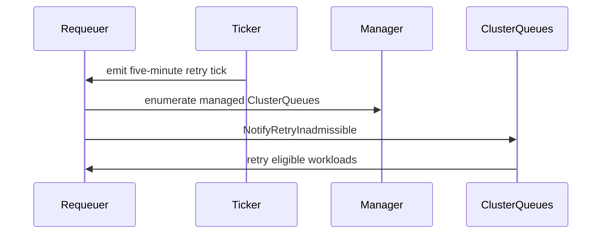

# PR #13483: scheduler: periodically retry inadmissible workloads

**Summary**: scheduler: periodically retry inadmissible workloads

**Sources**: https://github.com/kubernetes-sigs/kueue/pull/13483

**Last updated**: 2026-10-14T06:33:29Z

---

## Metadata

- **State**: open
- **Author**: [@piyushbag](https://github.com/piyushbag)
- **Branch**: `agent/periodic-inadmissible-resync` → `main`
- **Created**: 2026-07-24T18:35:20Z
- **Updated**: 2026-10-14T06:33:29Z
- **Merged**: —
- **Closed**: —
- **Labels**: `kind/feature`, `size/L`, `release-note-none`, `cncf-cla: no`, `needs-rebase`, `ok-to-test`, `do-not-merge/work-in-progress`
- **Assignees**: _none_
- **Requested reviewers**: [@kshalot](https://github.com/kshalot), [@tenzen-y](https://github.com/tenzen-y)
- **Changed files**: 3   **+157 / -11**

## Description

<!--  Thanks for sending a pull request!  Here are some tips for you:

1. If this is your first time, please read our contributor guidelines: https://git.k8s.io/community/contributors/guide/first-contribution.md#your-first-contribution and developer guide https://git.k8s.io/community/contributors/devel/development.md#development-guide
2. Please label this pull request according to what type of issue you are addressing, especially if this is a release targeted pull request. For reference on required PR/issue labels, read here:
https://git.k8s.io/community/contributors/devel/sig-release/release.md#issuepr-kind-label
3. Ensure you have added or ran the appropriate tests for your PR: https://git.k8s.io/community/contributors/devel/sig-testing/testing.md
4. If you want *faster* PR reviews, read how: https://git.k8s.io/community/contributors/guide/pull-requests.md#best-practices-for-faster-reviews
5. If the PR is unfinished, see how to mark it: https://git.k8s.io/community/contributors/guide/pull-requests.md#marking-unfinished-pull-requests
-->

#### What type of PR is this?

/kind feature

#### What this PR does / why we need it:

Inadmissible workloads are currently reconsidered only when Kueue observes a known resource or configuration event. If an event is missed or not modeled, an otherwise schedulable workload can remain inadmissible indefinitely.

This adds a five-minute safety retry to the existing `InadmissibleWorkloadRequeuer`. Each tick enumerates the current ClusterQueues and uses `NotifyRetryInadmissible`, preserving the existing delaying-workqueue batching and root-Cohort deduplication. It adds no API or configuration.

The retry uses a fixed wall-clock interval. Resetting the interval after every unrelated scheduling cycle could indefinitely postpone recovery for a workload affected by a missing event.

AI usage disclosure: I used OpenAI Codex to assist with investigation, implementation, and test design under my direction. I reviewed the patch and independently ran the evidence below.

Evidence:

- Regression proof: with the periodic worker start removed, `TestWorkqueueRequeuer_PeriodicRetry` fails with `Periodic retry did not start: context deadline exceeded`; restoring it makes the test pass.
- The fake-clock test proves no early retry, retry at the interval boundary, movement from the inadmissible map to the active heap, and clean `Start` shutdown on context cancellation.
- `go test ./pkg/cache/queue -run 'Test(NewRequeuer|WorkqueueRequeuer_PeriodicRetry|QueueInadmissibleWorkloads)$' -count=20`
- `go test -race ./pkg/cache/queue -run 'Test(NewRequeuer|WorkqueueRequeuer_PeriodicRetry|QueueInadmissibleWorkloads)$' -count=1`
- `go test ./pkg/cache/... -count=1`
- `go test ./pkg/scheduler/... -count=1`
- `go vet ./pkg/cache/queue`
- Kueue's pinned `golangci-lint` v2.12.2 on `./pkg/cache/queue/...`: 0 issues.

The committed benchmark measures the ClusterQueue enumeration/deduplication notification path, not subsequent workload processing. On an Apple M4 Pro, three 500 ms runs measured:

| ClusterQueues | Time/op | Allocations/op |
|---:|---:|---:|
| 10 | 0.66–0.70 µs | 4 |
| 100 | 5.48–5.49 µs | 4 |
| 1,000 | 70.2–71.1 µs | 6 |
| 10,000 | 0.860–0.868 ms | 34 |

The repository `make fmt-verify` wrapper could not start on this macOS host because GNU `sed` is unavailable. The three changed Go files pass direct `gofmt -d`, and `git diff --check` is clean.

#### Which issue(s) this PR fixes:

Fixes https://github.com/kubernetes-sigs/kueue/issues/7139

#### Special notes for your reviewer:

The issue discussion also suggested triggering five minutes after the last scheduling cycle. I chose a fixed safety interval to avoid unrelated cycles starving recovery; I can revise this if maintainers prefer the inactivity-based interpretation.

#### Does this PR introduce a user-facing change?

```release-note
NONE
```


<!-- This is an auto-generated comment: release notes by coderabbit.ai -->

## Summary by CodeRabbit

* **New Features**
  * Inadmissible workloads are now retried automatically every five minutes.
  * Periodic retries cover all managed cluster queues and stop cleanly when processing is shut down.

* **Bug Fixes**
  * Workloads can return to active processing without requiring a separate retry trigger.

* **Tests**
  * Added coverage for timed retries, shutdown behavior, and retry performance at scale.

<!-- end of auto-generated comment: release notes by coderabbit.ai -->

## Discussion

### Comment by [@netlify[bot]](https://github.com/apps/netlify) — 2026-07-24T18:35:26Z

### <span aria-hidden="true">✅</span> Deploy Preview for *kubernetes-sigs-kueue* ready!


|  Name | Link |
|:-:|------------------------|
|<span aria-hidden="true">🔨</span> Latest commit | 921efbcd97a1d2f74498fcf336c54790372b1d23 |
|<span aria-hidden="true">🔍</span> Latest deploy log | https://app.netlify.com/projects/kubernetes-sigs-kueue/deploys/6a63b06b30840f000844cc77 |
|<span aria-hidden="true">😎</span> Deploy Preview | [https://deploy-preview-13483--kubernetes-sigs-kueue.netlify.app](https://deploy-preview-13483--kubernetes-sigs-kueue.netlify.app) |
|<span aria-hidden="true">📱</span> Preview on mobile | <details><summary> Toggle QR Code... </summary><br /><br /><br /><br />_Use your smartphone camera to open QR code link._</details> |
---
<!-- [kubernetes-sigs-kueue Preview](https://deploy-preview-13483--kubernetes-sigs-kueue.netlify.app) -->
_To edit notification comments on pull requests, go to your [Netlify project configuration](https://app.netlify.com/projects/kubernetes-sigs-kueue/configuration/notifications#deploy-notifications)._

### Comment by [@linux-foundation-easycla[bot]](https://github.com/apps/linux-foundation-easycla) — 2026-07-24T18:35:27Z

<a href="https://api.easycla.lfx.linuxfoundation.org/v2/repository-provider/github/sign/20677499/459870310/13483/#/?version=2"></a><br/><br ><ul><li><a href='https://api.easycla.lfx.linuxfoundation.org/v2/repository-provider/github/sign/20677499/459870310/13483/#/?version=2' target='_blank'>:x:</a> - login: @piyushbag / name: Piyush Bag. The commit (921efbcd97a1d2f74498fcf336c54790372b1d23) is not authorized under a signed CLA. <a href='https://api.easycla.lfx.linuxfoundation.org/v2/repository-provider/github/sign/20677499/459870310/13483/#/?version=2' target='_blank'>Please click here to be authorized</a>. For further assistance with EasyCLA, <a href='https://easycla.lfx.linuxfoundation.org/' target='_blank'>please visit our EasyCLA portal</a> and chat with our support bot.</li></ul>

### Comment by [@coderabbitai[bot]](https://github.com/apps/coderabbitai) — 2026-07-24T18:35:28Z

<!-- This is an auto-generated comment: summarize by coderabbit.ai -->
<!-- review_stack_entry_start -->

[](https://app.coderabbit.ai/change-stack/kubernetes-sigs/kueue/pull/13483?utm_source=github_walkthrough&utm_medium=github&utm_campaign=change_stack)

<!-- review_stack_entry_end -->
<!-- walkthrough_start -->

<details>
<summary><strong>📝 Walkthrough</strong></summary>
<dl>
<dd>

The inadmissible workload requeuer now retries all managed ClusterQueues every five minutes using an injected ticker. Tests cover configuration, fake-clock retry behavior, cancellation, and benchmarking notification across varying ClusterQueue counts.

**Changes: Periodic inadmissible workload retries**

|Layer / File(s)|Summary|
|:---|:---|
|**Retry configuration and construction** <br> `pkg/cache/queue/inadmissible_workloads.go`, `pkg/cache/queue/inadmissible_workloads_test.go`|Adds the five-minute retry interval, ticker dependency, constructor wiring, and configuration assertions.|
|**Periodic retry loop** <br> `pkg/cache/queue/inadmissible_workloads.go`, `pkg/cache/queue/inadmissible_workloads_test.go`|Starts periodic notifications for managed ClusterQueues, verifies fake-clock retry behavior, and checks clean shutdown on cancellation.|
|**Retry notification benchmark** <br> `pkg/cache/queue/periodic_retry_benchmark_test.go`|Benchmarks retry notification across 10, 100, 1,000, and 10,000 ClusterQueues.|

**Estimated code review effort:** 3 (Moderate) | ~20 minutes

### Sequence Diagram(s)



**Possibly related PRs**

- [kubernetes-sigs/kueue#12520](https://github.com/kubernetes-sigs/kueue/pull/12520): Updates the inadmissible-to-active requeue path and scheduling-hash bookkeeping.

**Suggested labels:** `area/testing`

**Suggested reviewers:** `kshalot`, `tenzen-y`, `amy`, `sohankunkerkar`

</dd>
</dl>
</details>

<!-- walkthrough_end -->
<!-- pre_merge_checks_walkthrough_start -->

<details>
<summary><strong>Pre-merge checks: <sup><picture></picture></sup> 4 · <sup><picture></picture></sup> 1</strong></summary>
<dl>
<dd>

<strong><sup><picture></picture></sup> Failed checks: 1 warning</strong>

|     Check name     |                                              Status                                              | Explanation                                                                          | Resolution                                                                         |
| :---------------- | :----------------------------------------------------------------------------------------------: | :----------------------------------------------------------------------------------- | :--------------------------------------------------------------------------------- |
| Docstring Coverage |  | Docstring coverage is 0.00% which is insufficient. The required threshold is 80.00%. | Write docstrings for the functions missing them to satisfy the coverage threshold. |

<details>
<summary><strong><sup><picture></picture></sup> Passed checks: 4 passed</strong></summary>
<dl>
<dd>

|         Check name         |                                             Status                                             | Explanation                                                                                                                         |
| :------------------------ | :--------------------------------------------------------------------------------------------: | :---------------------------------------------------------------------------------------------------------------------------------- |
|     Linked Issues check    |  | The PR implements the requested time-based safety retry cycle for inadmissible workloads and scheduler recovery from missed events. |
| Out of Scope Changes check |  | The added benchmark and tests directly support the retry mechanism and do not appear unrelated to the issue scope.                  |
|      Description Check     |  | Check skipped - CodeRabbit’s high-level summary is enabled.                                                                         |
|         Title check        |  | The title clearly and concisely describes the main change: adding periodic retries for inadmissible workloads in the scheduler.     |

</dd>
</dl>
</details>

</dd>
</dl>
</details>

<!-- pre_merge_checks_walkthrough_end -->

- [ ] <!-- {"checkboxId":"585bb3f6-faf5-4dbf-96d2-74e382adf19a"} --> Fix all pre-merge checks with AI
<!-- finishing_touch_checkbox_start -->

<details>
<summary><strong>✨ Finishing Touches</strong></summary>
<dl>
<dd>

<details>
<summary><strong>🧪 Generate unit tests (beta)</strong></summary>
<dl>
<dd>

- [ ] <!-- {"checkboxId": "f47ac10b-58cc-4372-a567-0e02b2c3d479", "radioGroupId": "utg-output-choice-group-5073237112"} -->   Create PR with unit tests

</dd>
</dl>
</details>

</dd>
</dl>
</details>

<!-- finishing_touch_checkbox_end -->
<!-- tips_start -->


<sub>Comment `@coderabbitai help` to get the list of available commands.</sub>

<!-- tips_end -->

### Comment by [@kubernetes-prow[bot]](https://github.com/apps/kubernetes-prow) — 2026-07-24T18:35:29Z

Welcome @piyushbag! <br><br>It looks like this is your first PR to <a href='https://github.com/kubernetes-sigs/kueue'>kubernetes-sigs/kueue</a> 🎉. Please refer to our [pull request process documentation](https://www.kubernetes.dev/docs/guide/pull-requests/) to help your PR have a smooth ride to approval. <br><br>You will be prompted by a bot to use commands during the review process. Do not be afraid to follow the prompts! It is okay to experiment. [Here is the bot commands documentation](https://go.k8s.io/bot-commands). <br><br>You can also check if kubernetes-sigs/kueue has [its own contribution guidelines](https://github.com/kubernetes-sigs/kueue/tree/master/CONTRIBUTING.md). <br><br>You may want to refer to our [testing guide](https://git.k8s.io/community/contributors/devel/sig-testing/testing.md) if you run into trouble with your tests not passing. <br><br>If you are having difficulty getting your pull request seen, please follow the [recommended escalation practices](https://www.kubernetes.dev/docs/guide/pull-requests/#why-is-my-pull-request-not-getting-reviewed). Also, for tips and tricks in the contribution process you may want to read the [Kubernetes contributor cheat sheet](https://www.kubernetes.dev/docs/contributor-cheatsheet/). We want to make sure your contribution gets all the attention it needs! <br><br>Thank you, and welcome to Kubernetes. :smiley:

### Comment by [@kubernetes-prow[bot]](https://github.com/apps/kubernetes-prow) — 2026-07-24T18:35:30Z

Hi @piyushbag. Thanks for your PR.

I'm waiting for a [kubernetes-sigs](https://github.com/orgs/kubernetes-sigs/people) member to verify that this patch is reasonable to test. If it is, they should reply with `/ok-to-test` on its own line. Until that is done, I will not automatically test new commits in this PR, but the usual testing commands by org members will still work.

Regular contributors should [join the org](https://git.k8s.io/community/community-membership.md#member) to skip this step.

Once the patch is verified, the new status will be reflected by the `ok-to-test` label.

I understand the commands that are listed [here](https://go.k8s.io/bot-commands?repo=kubernetes-sigs%2Fkueue).

<details>

Instructions for interacting with me using PR comments are available [here](https://git.k8s.io/community/contributors/guide/pull-requests.md).  If you have questions or suggestions related to my behavior, please file an issue against the [kubernetes-sigs/prow](https://github.com/kubernetes-sigs/prow/issues/new?title=Prow%20issue:) repository.
</details>

### Comment by [@kubernetes-prow[bot]](https://github.com/apps/kubernetes-prow) — 2026-07-24T18:35:39Z

[APPROVALNOTIFIER] This PR is **NOT APPROVED**

This pull-request has been approved by: *<a href="https://github.com/kubernetes-sigs/kueue/pull/13483#" title="Author self-approved">piyushbag</a>*
**Once this PR has been reviewed and has the lgtm label**, please assign [mbobrovskyi](https://github.com/mbobrovskyi), [sohankunkerkar](https://github.com/sohankunkerkar), [tenzen-y](https://github.com/tenzen-y) for approval. For more information see [the Code Review Process](https://git.k8s.io/community/contributors/guide/owners.md#the-code-review-process).

The full list of commands accepted by this bot can be found [here](https://go.k8s.io/bot-commands?repo=kubernetes-sigs%2Fkueue).

<details open>
Needs approval from an approver in each of these files:

- **[OWNERS](https://github.com/kubernetes-sigs/kueue/blob/main/OWNERS)**

Approvers can indicate their approval by writing `/approve` in a comment
Approvers can cancel approval by writing `/approve cancel` in a comment
</details>
<!-- META={"approvers":["mbobrovskyi","sohankunkerkar","tenzen-y"]} -->

### Comment by [@piyushbag](https://github.com/piyushbag) — 2026-07-24T18:35:59Z

@coderabbitai review

### Comment by [@coderabbitai[bot]](https://github.com/apps/coderabbitai) — 2026-07-24T18:36:04Z

<!-- This is an auto-generated reply by CodeRabbit -->
<!-- CodeRabbit review command invocation: d3f8f5c7-b61e-4523-83f8-9bbffac6886f -->
<details>
<summary>✅ Action performed</summary>

Review finished.

> Note: CodeRabbit is an incremental review system and does not re-review already reviewed commits. This command is applicable only when automatic reviews are paused.

</details>

### Comment by [@kubernetes-prow[bot]](https://github.com/apps/kubernetes-prow) — 2026-08-11T02:10:40Z

PR needs rebase.

<details>

Instructions for interacting with me using PR comments are available [here](https://git.k8s.io/community/contributors/guide/pull-requests.md).  If you have questions or suggestions related to my behavior, please file an issue against the [kubernetes-sigs/prow](https://github.com/kubernetes-sigs/prow/issues/new?title=Prow%20issue:) repository.
</details>

### Comment by [@mimowo](https://github.com/mimowo) — 2026-10-14T06:33:14Z

/ok-to-test

## Reviews

### Review by [@coderabbitai[bot]](https://github.com/apps/coderabbitai) (commented) — 2026-07-24T18:40:51Z

**Actionable comments posted: 2**

<details>
<summary>🤖 Prompt for all review comments with AI agents</summary>

```
Verify each finding against current code. Fix only still-valid issues, skip the
rest with a brief reason, keep changes minimal, and validate.

Inline comments:
In `@pkg/cache/queue/inadmissible_workloads_test.go`:
- Around line 154-162: Update the shutdown assertions around Start and the
cancellation flow to poll until fakeClock.HasWaiters() is false after the
requeuer returns. Require the ticker goroutine to release its waiter before
accepting the test, while preserving the existing error and timeout checks.

In `@pkg/cache/queue/periodic_retry_benchmark_test.go`:
- Around line 39-46: Move requeuer.cqs.Clear() out of the timed b.Loop in the
benchmark using the relevant benchmark setup/cleanup flow, so each measured
iteration includes only NotifyRetryInadmissible while preserving the existing
cache reset behavior between iterations.
```

</details>

<details>
<summary>🪄 Autofix (Beta)</summary>

Fix all unresolved CodeRabbit comments on this PR:

- [ ] <!-- {"checkboxId": "4b0d0e0a-96d7-4f10-b296-3a18ea78f0b9"} --> Push a commit to this branch (recommended)
- [ ] <!-- {"checkboxId": "ff5b1114-7d8c-49e6-8ac1-43f82af23a33"} --> Create a new PR with the fixes

</details>

---

<details>
<summary>ℹ️ Review info</summary>

<details>
<summary>⚙️ Run configuration</summary>

**Configuration used**: Path: .coderabbit.yaml

**Review profile**: CHILL

**Plan**: Pro Plus

**Run ID**: `515c6c48-cc0b-43f4-9113-0347da1c2cf0`

</details>

<details>
<summary>📥 Commits</summary>

Reviewing files that changed from the base of the PR and between 11fd88aa56c5fe3b0420d07009bb3d52ac7fd332 and 921efbcd97a1d2f74498fcf336c54790372b1d23.

</details>

<details>
<summary>📒 Files selected for processing (3)</summary>

* `pkg/cache/queue/inadmissible_workloads.go`
* `pkg/cache/queue/inadmissible_workloads_test.go`
* `pkg/cache/queue/periodic_retry_benchmark_test.go`

</details>

</details>

<!-- This is an auto-generated comment by CodeRabbit for review status -->

- **pkg/cache/queue/inadmissible_workloads_test.go:162** by [@coderabbitai[bot]](https://github.com/apps/coderabbitai) — 2026-07-24T18:40:50Z
```diff
@@ -81,10 +89,79 @@ func TestNewRequeuer(t *testing.T) {
 			if diff := cmp.Diff(tc.want.batchPeriod, requeuer.batchPeriod); len(diff) != 0 {
 				t.Errorf("Unexpected requeue batch period (-want,+got):\n%s", diff)
 			}
+			if diff := cmp.Diff(tc.want.periodicRetryPeriod, requeuer.periodicRetryPeriod); len(diff) != 0 {
+				t.Errorf("Unexpected periodic retry period (-want,+got):\n%s", diff)
+			}
 		})
 	}
 }
 
+func TestWorkqueueRequeuer_PeriodicRetry(t *testing.T) {
+	const retryPeriod = time.Minute
+	ctx, _ := utiltesting.ContextWithLog(t)
+	ctx, cancel := context.WithCancel(ctx)
+	defer cancel()
+
+	cl := utiltesting.NewFakeClient(utiltesting.MakeNamespace("ns"))
+	manager, _ := NewManagerForUnitTestsWithRequeuer(cl, nil)
+	cq := utiltestingapi.MakeClusterQueue("cq").Obj()
+	if err := manager.AddClusterQueue(ctx, cq); err != nil {
+		t.Fatalf("Failed adding ClusterQueue: %v", err)
+	}
+	lq := utiltestingapi.MakeLocalQueue("lq", "ns").ClusterQueue("cq").Obj()
+	if err := manager.AddLocalQueue(ctx, lq); err != nil {
+		t.Fatalf("Failed adding LocalQueue: %v", err)
+	}
+	wl := utiltestingapi.MakeWorkload("wl", "ns").Queue("lq").Creation(time.Now()).Obj()
+	if err := cl.Create(ctx, wl); err != nil {
+		t.Fatalf("Failed adding Workload to client: %v", err)
+	}
+	manager.getClusterQueue("cq").popCycle++
+	manager.RequeueWorkload(ctx, workload.NewInfo(wl), RequeueReasonGeneric, "")
+	if got := manager.DumpInadmissible(); len(got["cq"]) != 1 {
+		t.Fatalf("Workload is not in the inadmissible queue: %v", got)
+	}
+
+	fakeClock := testingclock.NewFakeClock(time.Now())
+	requeuer := NewRequeuer(WithBatchPeriod(0))
+	requeuer.clock = fakeClock
+	requeuer.periodicRetryPeriod = retryPeriod
+	requeuer.setManager(manager)
+	manager.requeuer = requeuer
+
+	errCh := make(chan error, 1)
+	go func() {
+		errCh <- requeuer.Start(ctx)
+	}()
+	if err := wait.PollUntilContextTimeout(t.Context(), time.Millisecond, time.Second, true, func(context.Context) (bool, error) {
+		return fakeClock.HasWaiters(), nil
+	}); err != nil {
+		t.Fatalf("Periodic retry did not start: %v", err)
+	}
+
+	fakeClock.Step(retryPeriod - time.Nanosecond)
+	if got := manager.DumpInadmissible(); len(got["cq"]) != 1 {
+		t.Fatalf("Workload retried before the periodic interval elapsed: %v", got)
+	}
+
+	fakeClock.Step(time.Nanosecond)
+	if err := wait.PollUntilContextTimeout(t.Context(), time.Millisecond, time.Second, true, func(context.Context) (bool, error) {
+		return len(manager.Dump()["cq"]) == 1, nil
+	}); err != nil {
+		t.Fatalf("Periodic retry did not move the Workload to the active heap: %v", err)
+	}
+
+	cancel()
+	select {
+	case err := <-errCh:
+		if err != nil {
+			t.Fatalf("Requeuer returned an error: %v", err)
+		}
+	case <-time.After(time.Second):
+		t.Fatal("Requeuer did not stop after context cancellation")
+	}
```

  _🩺 Stability & Availability_ | _🟡 Minor_ | _⚡ Quick win_
  
  <details>
  <summary>🧩 Analysis chain</summary>
  
  🏁 Script executed:
  
  ```shell
  #!/bin/bash
  set -euo pipefail
  
  echo "Files matching inadmissible_workloads_test.go:"
  fd -a 'inadmissible_workloads_test\.go$' . || true
  
  file="$(fd 'inadmissible_workloads_test\.go$' . | head -n1 || true)"
  if [ -n "${file:-}" ]; then
    echo
    echo "wc -l $file"
    wc -l "$file"
    echo
    echo "Outline:"
    ast-grep outline "$file" || true
    echo
    echo "Relevant lines 120-185:"
    sed -n '120,185p' "$file" | cat -n -v
    echo
    echo "Relevant searches in repo:"
    rg -n "Requeuer|Start|ticker|HasWaiters|fakeClock|wait\.PollUntilContextTimeout" -S pkg/cache/queue || true
  fi
  ```
  
  Repository: kubernetes-sigs/kueue
  
  Length of output: 10772
  
  ---
  
  🏁 Script executed:
  
  ```shell
  #!/bin/bash
  set -euo pipefail
  
  echo "pkg/cache/queue/inadmissible_workloads.go lines 243-325:"
  sed -n '243,325p' pkg/cache/queue/inadmissible_workloads.go | cat -n -v
  
  echo
  echo "Finding FakeClock/NewTicker/HasWaiters definitions:"
  rg -n "type FakeClock|func .*FakeClock|NewTicker|HasWaiters|Ticker interface|Ticker C" pkg -S || true
  
  echo
  echo "Find testingclock package files:"
  fd -a '.*clock.*\.go$' . | sed 's#^\./##' | head -80
  ```
  
  Repository: kubernetes-sigs/kueue
  
  Length of output: 3750
  
  ---
  
  🏁 Script executed:
  
  ```shell
  #!/bin/bash
  set -euo pipefail
  
  echo "pkg/cache/queue/inadmissible_workloads_test.go import aliases:"
  sed -n '1,80p' pkg/cache/queue/inadmissible_workloads_test.go | cat -n -v
  
  echo
  echo "vendor k8s.io/utils/clock/testing/fake_clock.go relevant content:"
  sed -n '1,260p' /home/jailuser/git/vendor/k8s.io/utils/clock/testing/fake_clock.go | cat -n -v
  
  echo
  echo "Search for k8s.io/utils/clock importing alias:"
  rg -n "k8s.io/utils/clock/testing" pkg/cache/queue pkg -S || true
  ```
  
  Repository: kubernetes-sigs/kueue
  
  Length of output: 14880
  
  ---
  
  🏁 Script executed:
  
  ```shell
  #!/bin/bash
  set -euo pipefail
  
  echo "pkg/cache/queue/inadmissible_workloads_test.go TestWorkqueueRequeuer_PeriodicRetry lines 98-162:"
  sed -n '98,162p' pkg/cache/queue/inadmissible_workloads_test.go | cat -n -v
  
  echo
  echo "Relevant definitions from vendored fake_clock.go:"
  sed -n '260,360p' /home/jailuser/git/vendor/k8s.io/utils/clock/testing/fake_clock.go | cat -n -v
  ```
  
  Repository: kubernetes-sigs/kueue
  
  Length of output: 6785
  
  ---
  
  
  
  </details>
  
  **Assert periodic-worker shutdown explicitly.**
  
  `Start` returns when the queue worker shuts down, but the ticker can still be blocked in its goroutine. Poll for `!fakeClock.HasWaiters()` after cancellation before accepting the test.
  
  <details>
  <summary>🤖 Prompt for AI Agents</summary>
  
  ```
  Verify each finding against current code. Fix only still-valid issues, skip the
  rest with a brief reason, keep changes minimal, and validate.
  
  In `@pkg/cache/queue/inadmissible_workloads_test.go` around lines 154 - 162,
  Update the shutdown assertions around Start and the cancellation flow to poll
  until fakeClock.HasWaiters() is false after the requeuer returns. Require the
  ticker goroutine to release its waiter before accepting the test, while
  preserving the existing error and timeout checks.
  ```
  
  </details>
  
  <!-- fingerprinting:phantom:poseidon:terra -->
  
  <!-- cr-indicator-types:potential_issue -->
  
  <!-- cr-comment:v1:6599ac66def9c3ef6279a2ce -->
  
  <!-- This is an auto-generated comment by CodeRabbit -->

- **pkg/cache/queue/periodic_retry_benchmark_test.go:46** by [@coderabbitai[bot]](https://github.com/apps/coderabbitai) — 2026-07-24T18:40:50Z
```diff
@@ -0,0 +1,49 @@
+/*
+Copyright The Kubernetes Authors.
+
+Licensed under the Apache License, Version 2.0 (the "License");
+you may not use this file except in compliance with the License.
+You may obtain a copy of the License at
+
+    http://www.apache.org/licenses/LICENSE-2.0
+
+Unless required by applicable law or agreed to in writing, software
+distributed under the License is distributed on an "AS IS" BASIS,
+WITHOUT WARRANTIES OR CONDITIONS OF ANY KIND, either express or implied.
+See the License for the specific language governing permissions and
+limitations under the License.
+*/
+
+package queue
+
+import (
+	"fmt"
+	"testing"
+
+	"k8s.io/apimachinery/pkg/util/sets"
+
+	kueue "sigs.k8s.io/kueue/apis/kueue/v1beta2"
+	"sigs.k8s.io/kueue/pkg/workload"
+)
+
+func BenchmarkNotifyRetryAllClusterQueues(b *testing.B) {
+	for _, clusterQueueCount := range []int{10, 100, 1_000, 10_000} {
+		b.Run(fmt.Sprintf("clusterqueues-%d", clusterQueueCount), func(b *testing.B) {
+			manager, requeuer := NewManagerForUnitTestsWithRequeuer(nil, nil)
+			for i := range clusterQueueCount {
+				cq := newClusterQueueImpl(b.Context(), nil, workload.Ordering{}, realClock)
+				cq.name = kueue.ClusterQueueReference(fmt.Sprintf("cq-%d", i))
+				manager.hm.AddClusterQueue(cq)
+			}
+
+			b.ResetTimer()
+			for b.Loop() {
+				NotifyRetryInadmissible(
+					manager,
+					sets.New(manager.GetClusterQueueNames()...),
+				)
+				requeuer.cqs.Clear()
+			}
```

  _🚀 Performance & Scalability_ | _🟡 Minor_ | _⚡ Quick win_
  
  <details>
  <summary>🧩 Analysis chain</summary>
  
  🏁 Script executed:
  
  ```shell
  #!/usr/bin/env bash
  set -euo pipefail
  
  echo "== locate file =="
  git ls-files | grep -F 'pkg/cache/queue/periodic_retry_benchmark_test.go' || true
  
  echo "== file snippet =="
  if [ -f pkg/cache/queue/periodic_retry_benchmark_test.go ]; then
    cat -n pkg/cache/queue/periodic_retry_benchmark_test.go | sed -n '1,120p'
  fi
  
  echo "== related definitions/usages =="
  rg -n "NotifyRetryInadmissible|type .*Requeuer|cqs|func .*Clear|Benchmark.*Retry|PeriodicRetry" pkg/cache/queue -S || true
  
  echo "== diff stat/name-only =="
  git diff --stat || true
  git diff -- pkg/cache/queue/periodic_retry_benchmark_test.go | sed -n '1,160p' || true
  ```
  
  Repository: kubernetes-sigs/kueue
  
  Length of output: 3781
  
  ---
  
  🏁 Script executed:
  
  ```shell
  #!/usr/bin/env bash
  set -euo pipefail
  
  echo "== test_util.go outline =="
  ast-grep outline pkg/cache/queue/test_util.go --view expanded || true
  
  echo "== test_util.go relevant sections =="
  cat -n pkg/cache/queue/test_util.go | sed -n '1,100p'
  
  echo "== inadmissible_workloads.go relevant sections =="
  ast-grep outline pkg/cache/queue/inadmissible_workloads.go --view expanded || true
  cat -n pkg/cache/queue/inadmissible_workloads.go | sed -n '170,225p'
  
  echo "== call sites around NotifyRetryInadmissible =="
  cat -n pkg/cache/queue/inadmissible_workloads.go | sed -n '198,215p'
  
  echo "== timing semantics probe:"
  python3 - <<'PY'
  # Read-only text probe to identify whether requeuer.cqs.Clear() is syntactically inside b.Loop().
  with open('pkg/cache/queue/periodic_retry_benchmark_test.go', encoding='utf-8') as f:
      text = f.read()
  start = text.index('for b.Loop()')
  loop_block = text[start:text.index('})', start) + 2]
  print('Clear inside b.Loop block:', 'requeuer.cqs.Clear()' in loop_block)
  print(loop_block)
  PY
  ```
  
  Repository: kubernetes-sigs/kueue
  
  Length of output: 10838
  
  ---
  
  
  
  </details>
  
  **Exclude benchmark cleanup from measured time.**
  
  `requeuer.cqs.Clear()` runs inside `b.Loop`, so the results include the per-iteration cleanup cost rather than only `NotifyRetryInadmissible`.
  
  <details><summary>Proposed fix</summary>
  
  ```diff
   for b.Loop() {
   	NotifyRetryInadmissible(
   		manager,
   		sets.New(manager.GetClusterQueueNames()...),
   	)
  +	b.StopTimer()
   	requeuer.cqs.Clear()
  +	b.StartTimer()
   }
  ```
  </details>
  
  <!-- suggestion_start -->
  
  <details>
  <summary>📝 Committable suggestion</summary>
  
  > ‼️ **IMPORTANT**
  > Carefully review the code before committing. Ensure that it accurately replaces the highlighted code, contains no missing lines, and has no issues with indentation. Thoroughly test & benchmark the code to ensure it meets the requirements.
  
  ```suggestion
  			b.ResetTimer()
  			for b.Loop() {
  				NotifyRetryInadmissible(
  					manager,
  					sets.New(manager.GetClusterQueueNames()...),
  				)
  				b.StopTimer()
  				requeuer.cqs.Clear()
  				b.StartTimer()
  			}
  ```
  
  </details>
  
  <!-- suggestion_end -->
  
  <details>
  <summary>🧰 Tools</summary>
  
  <details>
  <summary>🪛 golangci-lint (2.12.2)</summary>
  
  [error] 41-41: : # sigs.k8s.io/kueue/apis/kueue/v1beta2
  apis/kueue/v1beta2/groupversion_info.go:41:3: cannot use &AdmissionCheck{} (value of type *AdmissionCheck) as "k8s.io/apimachinery/pkg/runtime".Object value in argument to scheme.AddKnownTypes: *AdmissionCheck does not implement "k8s.io/apimachinery/pkg/runtime".Object (missing method DeepCopyObject)
  apis/kueue/v1beta2/groupversion_info.go:41:22: cannot use &AdmissionCheckList{} (value of type *AdmissionCheckList) as "k8s.io/apimachinery/pkg/runtime".Object value in argument to scheme.AddKnownTypes: *AdmissionCheckList does not implement "k8s.io/apimachinery/pkg/runtime".Object (missing method DeepCopyObject)
  apis/kueue/v1beta2/groupversion_info.go:42:3: cannot use &ClusterQueue{} (value of type *ClusterQueue) as "k8s.io/apimachinery/pkg/runtime".Object value in argument to scheme.AddKnownTypes: *ClusterQueue does not implement "k8s.io/apimachinery/pkg/runtime".Object (missing method DeepCopyObject)
  apis/kueue/v1beta2/groupversion_info.go:42:20: cannot use &ClusterQueueList{} (value of type *ClusterQueueList) as "k8s.io/apimachinery/pkg/runtime".Object value in argument to scheme.AddKnownTypes: *ClusterQueueList does not implement "k8s.io/apimachinery/pkg/runtime".Object (missing method DeepCopyObject)
  apis/kueue/v1beta2/groupversion_info.go:43:3: cannot use &Cohort{} (value of type *Cohort) as "k8s.io/apimachinery/pkg/runtime".Object value in argument to scheme.AddKnownTypes: *Cohort does not implement "k8s.io/apimachinery/pkg/runtime".Object (missing method DeepCopyObject)
  apis/kueue/v1beta2/groupversion_info.go:43:14: cannot use &CohortList{} (value of type *CohortList) as "k8s.io/apimachinery/pkg/runtime".Object value in argument to scheme.AddKnownTypes: *CohortList does not implement "k8s.io/apimachinery/pkg/runtime".Object (missing method DeepCopyObject)
  apis/kueue/v1beta2/groupversion_info.go:44:3: cannot use &LocalQueue{} (value of type *LocalQueue) as "k8s.io/apimachinery/pkg/runtime".Object value in argument to scheme.AddKnownTypes: *LocalQueue does not implement "k8s.io/apimachinery/pkg/runtime".Object (missing method DeepCopyObject)
  apis/kueue/v1beta2/groupversion_info.go:44:18: cannot use &LocalQueueList{} (value of type *LocalQueueList) as "k8s.io/apimachinery/pkg/runtime".Object value in argument to scheme.AddKnownTypes: *LocalQueueList does not implement "k8s.io/apimachinery/pkg/runtime".Object (missing method DeepCopyObject)
  apis/kueue/v1beta2/groupversion_info.go:45:3: cannot use &MultiKueueConfig{} (value of type *MultiKueueConfig) as "k8s.io/apimachinery/pkg/runtime".Object value in argument to scheme.AddKnownTypes: *MultiKueueConfig does not implement "k8s.io/apimachinery/pkg/runtime".Object (missing method DeepCopyObject)
  apis/kueue/v1beta2/groupversion_info.go:45:24: cannot use &MultiKueueConfigList{} (value of type *MultiKueueConfigList) as "k8s.io/apimachinery/pkg/runtime".Object value in argument to scheme.AddKnownTypes: *MultiKueueConfigList does not implement "k8s.io/apimachinery/pkg/runtime".Object (missing method DeepCopyObject)
  apis/kueue/v1beta2/groupversion_info.go:45:24: too many errors
  
  (typecheck)
  
  </details>
  
  </details>
  
  <details>
  <summary>🤖 Prompt for AI Agents</summary>
  
  ```
  Verify each finding against current code. Fix only still-valid issues, skip the
  rest with a brief reason, keep changes minimal, and validate.
  
  In `@pkg/cache/queue/periodic_retry_benchmark_test.go` around lines 39 - 46, Move
  requeuer.cqs.Clear() out of the timed b.Loop in the benchmark using the relevant
  benchmark setup/cleanup flow, so each measured iteration includes only
  NotifyRetryInadmissible while preserving the existing cache reset behavior
  between iterations.
  ```
  
  </details>
  
  <!-- fingerprinting:phantom:poseidon:terra -->
  
  <!-- cr-indicator-types:potential_issue -->
  
  <!-- cr-comment:v1:29a143d1b425d0ed2ae3079b -->
  
  <!-- This is an auto-generated comment by CodeRabbit -->
