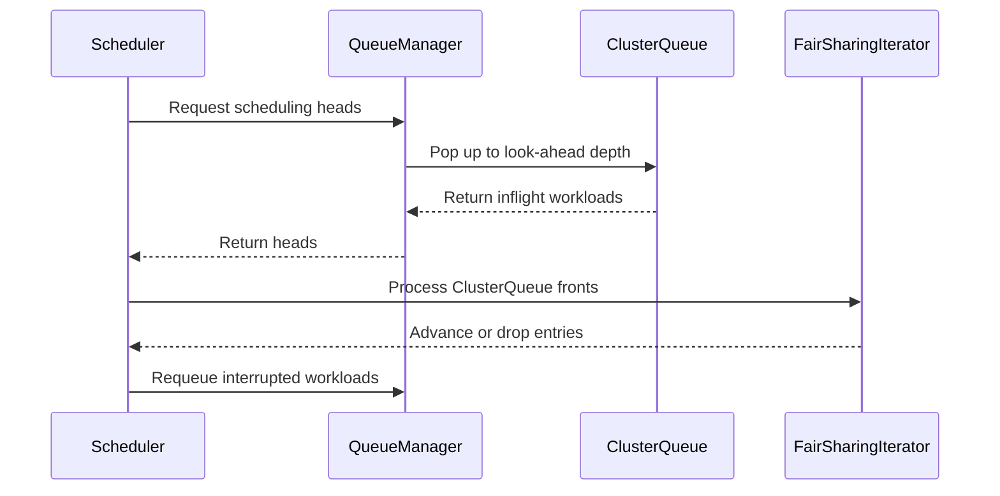

# PR #13496: Add fair sharing look-ahead behind the FairSharingLookAhead gate

**Summary**: Add fair sharing look-ahead behind the FairSharingLookAhead gate

**Sources**: https://github.com/kubernetes-sigs/kueue/pull/13496

**Last updated**: 2026-10-20T10:26:11Z

---

## Metadata

- **State**: open
- **Author**: [@apullo777](https://github.com/apullo777)
- **Branch**: `fairsharing-deep-admission-9345` → `main`
- **Created**: 2026-07-27T00:08:55Z
- **Updated**: 2026-10-20T10:26:11Z
- **Merged**: —
- **Closed**: —
- **Labels**: `kind/feature`, `release-note`, `lifecycle/stale`, `size/XXL`, `needs-rebase`, `ok-to-test`, `do-not-merge/work-in-progress`, `cncf-cla: yes`, `area/fair-sharing`
- **Assignees**: [@amy](https://github.com/amy)
- **Requested reviewers**: [@kannon92](https://github.com/kannon92), [@olekzabl](https://github.com/olekzabl)
- **Changed files**: 19   **+2309 / -109**

## Description


<!--  Thanks for sending a pull request!  Here are some tips for you:

1. If this is your first time, please read our contributor guidelines: https://git.k8s.io/community/contributors/guide/first-contribution.md#your-first-contribution and developer guide https://git.k8s.io/community/contributors/devel/development.md#development-guide
2. Please label this pull request according to what type of issue you are addressing, especially if this is a release targeted pull request. For reference on required PR/issue labels, read here:
https://git.k8s.io/community/contributors/devel/sig-release/release.md#issuepr-kind-label
3. Ensure you have added or ran the appropriate tests for your PR: https://git.k8s.io/community/contributors/devel/sig-testing/testing.md
4. If you want *faster* PR reviews, read how: https://git.k8s.io/community/contributors/guide/pull-requests.md#best-practices-for-faster-reviews
5. If the PR is unfinished, see how to mark it: https://git.k8s.io/community/contributors/guide/pull-requests.md#marking-unfinished-pull-requests
-->

#### What type of PR is this?

/kind bug

#### What this PR does / why we need it:

With Fair Sharing enabled, the scheduler currently considers only one head workload per ClusterQueue in each scheduling cycle. When multiple units of cohort capacity become available at once, the under-share ClusterQueue may receive the first admission but not the next one, because its next workload is not part of the candidate set.

This can leave the DominantResourceShare unbalanced indefinitely when preemption is disabled, or cause admit-then-preempt churn when preemption is enabled.

Following the approach proposed in https://github.com/kubernetes-sigs/kueue/issues/9345#issuecomment-4893176111, this PR introduces the alpha `FairSharingLookAhead` feature gate, disabled by default. When enabled together with Fair Sharing:

- the queue manager samples up to two workloads per ClusterQueue;
- only the front workload of each ClusterQueue participates in each DRS tournament round;
- all sampled workloads are nominated at the start of the cycle, with stale assignments recomputed when an entry becomes eligible;
- after a successful admission, the next workload from that ClusterQueue becomes eligible and its DRS is recomputed;
- once a top-level subtree admits two workloads, the remaining entries in the same root-cohort scope are requeued for the next scheduling cycle.

Unlike the proposal, nomination remains an eager cycle stage rather than occurring on replacement; the recompute path handles the resulting same-cycle staleness.

The number of workloads examined per ClusterQueue remains bounded, so this does not change the asymptotic complexity of a scheduling cycle.

This PR carries forward #12834 by @mukund-wayve. The first commit preserves the original implementation with attribution and lists @apullo777 alongside @mukund-wayve as an owner of the new feature gate, reflecting the handoff of its ongoing maintenance.

Commits 2–5 add the validation fixes, tests, documentation, and follow-up hardening:

- entries removed by an interrupt, or blocked behind an unsuccessful front workload, now return directly to the active heap, while paths that pop without requeueing explicitly clear or restore multi-inflight bookkeeping;
- second-pass workloads now bypass the per-CQ front protocol: they run before the tournament, failures no longer drop fresh CQ heads, and interrupts neither discard them nor count them toward the subtree budget;
- second-pass workloads also bypass the `waitForPodsReady` admission block, and a pre-existing single-entry shadowing bug is fixed;
- look-ahead entries recompute assignments only when the current assignment no longer fits and, mid-cycle, only when their own ClusterQueue has already consumed quota, preventing a potentially more-borrowing assignment from bypassing the tournament's DRS ranking while preserving skip-and-re-rank behavior for cross-CQ conflicts;
- cycle cost is reduced by rebuilding each ClusterQueue's AFS pending-penalty heap at most once per `heads()` sweep, reporting pending gauges once per queue, and skipping interrupt scans for solo ClusterQueues. A new `kueue_look_ahead_interrupts_total` counter and cycle-summary log expose interrupt pressure; the counter increments only when entries are actually requeued, while the log reports the interrupt count and droppedEntries total, including deeper heads dropped behind a failed front.

AI assistance was used for parts of the analysis and drafting; all changes were reviewed and validated by me.

#### Which issue(s) this PR fixes:
<!--
*Automatically closes linked issue when PR is merged.
Usage: `Fixes #<issue number>`, or `Fixes (paste link of issue)`.
_If PR is about `failing-tests or flakes`, please post the related issues/tests in a comment and do not use `Fixes`_*
-->
Fixes #9345

#### Special notes for your reviewer:

**Decisions requested before merge:**

1. The original proposal interrupts the whole scheduling cycle once a ClusterQueue admits its second workload. This PR narrows that behavior in two ways:
   - only entries in the affected root-cohort scope are dropped, since unrelated root cohorts do not compete for the same capacity;
   - admissions are counted per top-level subtree rather than per ClusterQueue, so two sibling CQs in the same sub-cohort cannot each admit one workload and reproduce the imbalance one level higher.

   In nested cohorts, this may also drop remaining heads from the winning subtree; they requeue immediately and are reconsidered in the next cycle. Please confirm that root-cohort scoping and top-level-subtree accounting are the intended interpretation. Once confirmed, I will add the nested-cohort integration case (nested behavior currently has unit coverage).

2. The alpha implementation uses a fixed depth of two. Larger bursts converge over successive cycles, and configurability can be revisited before beta. Please confirm that a fixed depth is acceptable for alpha.

3. The interrupt currently applies even when all DRS values are zero. This can bound an all-nominal cohort to two admissions in a cycle and require the remaining entries to be nominated again. An alternative is to interrupt only when the winning subtree is borrowing. The spare-capacity variant of this behavior is pinned by a test.

Inline comments at the relevant code paths request rulings on the all-nominal interrupt behavior, `ConcurrentAdmission` exclusivity, the `PartialAdmission` recompute limitation, and stale same-CQ preemption targets.

**Additional behavior covered by tests:**

With Admission Fair Sharing enabled, a less-active LocalQueue can admit at most the look-ahead depth before its entry penalty affects subsequent ordering; a dedicated test pins this bound.

**Tracked separately:**

I kept the following interactions out of scope to keep this review focused. 
I can fold in any that reviewers consider merge-blocking.

- A second-pass assumption currently pushes the LocalQueue entry penalty again, while two-step admissions do not settle it because settlement only covers `Pending → Admitted`. This is a pre-existing accounting gap made more visible by prompt second-pass processing; tracked in #13495.

- Under StrictFIFO, an inadmissible deeper entry can produce a status patch and warning event after its front admits. Addressing this may require broadening `skipStatusUpdate` from "dropped without evaluation" to include an evaluated-but-silent case. I will file a follow-up after merge if this behavior remains.

- With `SchedulingEquivalenceHashing`, an immediately requeued deeper head can bypass its equivalence class's bulk parking and pay one additional nomination. This is bounded by the pop depth and does not affect ordering. I will file a follow-up after merge if this behavior remains.

- Narrowing mid-cycle recomputation removes an incidental entry into the multi-flavor elastic-slice topology-retention path. Defining the intended retention semantics requires TAS-owner input; I will open a dedicated issue alongside this PR.

**Preemption behavior:**

Look-ahead does not increase per-CQ preemption issuance within a cycle: a Preempt-mode entry is not assumed, so its ClusterQueue chain ends, while the existing sticky-preemption ordering continues to apply until eviction resolves. Victims retain quota until eviction completes, after which the released capacity returns to the normal DRS tournament; the interrupt therefore counts only successful assumptions.

**Gate-off behavior:**

With the gate disabled, or with Fair Sharing not configured, the scheduler retains the depth-one path. Three gate-independent corrections remain:

- second-pass entries are processed before the tournament, fixing the existing shadowing behavior; this may reorder them relative to fresh heads within a cycle, but does not change quota ownership;
- second-pass entries bypass the `waitForPodsReady` block, avoiding release of their own existing reservation;
- paths that pop without requeueing now clear or restore multi-inflight bookkeeping; the full path enumeration is in the second commit.

The two assignment-recompute log lines are also moved to V(4), an observational change only. Immediately requeued entries do not busy-loop: interrupts require a successful admission, while genuinely inadmissible entries retain the existing non-immediate requeue behavior.

Validation includes unit and integration coverage, Admission Fair Sharing coverage, kind-cluster testing, and documentation updates.

The snapshot-construction-failure cleanup path is the one known test gap: exercising it would require adding an error-injection seam to snapshot construction, so I verified the path by code inspection. I can add the seam if maintainers prefer explicit regression coverage.

In the reproduced burst, the gate-off path ends at weightedShare 750/250 or incurs an `InCohortFairSharing` admit/preempt round trip; with the gate enabled, it converges to 500/500 without fair-sharing preemption.

#### Does this PR introduce a user-facing change?
<!--
If no, just write "NONE" in the release-note block below.
If yes, a release note is required:
Enter your extended release note in the block below. If the PR requires additional action from users switching to the new release, include the string "action required".
-->
```release-note
FairSharing: Added the alpha FairSharingLookAhead feature gate, disabled by default. When enabled together with Fair Sharing, the scheduler can consider up to two workloads per ClusterQueue per cycle, preventing bursts of freed cohort capacity from producing unbalanced DominantResourceShare or admit-then-preempt churn.
```

<!-- This is an auto-generated comment: release notes by coderabbit.ai -->
## Summary by CodeRabbit

## Summary by CodeRabbit

* **New Features**
  * Added alpha Fair Sharing look-ahead scheduling, allowing up to two workloads per ClusterQueue when enabled.
  * Added a feature gate and Prometheus metric for look-ahead interruptions.

* **Bug Fixes**
  * Improved workload requeueing, queue bookkeeping, and cleanup when queues change or workloads become inadmissible.
  * Improved tracking of multiple in-flight workloads and resource accounting.

* **Documentation**
  * Documented look-ahead configuration, behavior, limitations, and metrics.
<!-- end of auto-generated comment: release notes by coderabbit.ai -->

## Discussion

### Comment by [@netlify[bot]](https://github.com/apps/netlify) — 2026-07-27T00:09:01Z

### <span aria-hidden="true">✅</span> Deploy Preview for *kubernetes-sigs-kueue* ready!


|  Name | Link |
|:-:|------------------------|
|<span aria-hidden="true">🔨</span> Latest commit | fb35ec7af6bd7082dcc3170ab7d20a74e6e62529 |
|<span aria-hidden="true">🔍</span> Latest deploy log | https://app.netlify.com/projects/kubernetes-sigs-kueue/deploys/6a76aa60a54f0d00083f2ded |
|<span aria-hidden="true">😎</span> Deploy Preview | [https://deploy-preview-13496--kubernetes-sigs-kueue.netlify.app](https://deploy-preview-13496--kubernetes-sigs-kueue.netlify.app) |
|<span aria-hidden="true">📱</span> Preview on mobile | <details><summary> Toggle QR Code... </summary><br /><br /><br /><br />_Use your smartphone camera to open QR code link._</details> |
---
<!-- [kubernetes-sigs-kueue Preview](https://deploy-preview-13496--kubernetes-sigs-kueue.netlify.app) -->
_To edit notification comments on pull requests, go to your [Netlify project configuration](https://app.netlify.com/projects/kubernetes-sigs-kueue/configuration/notifications#deploy-notifications)._

### Comment by [@kubernetes-prow[bot]](https://github.com/apps/kubernetes-prow) — 2026-07-27T00:09:06Z

Hi @apullo777. Thanks for your PR.

I'm waiting for a [kubernetes-sigs](https://github.com/orgs/kubernetes-sigs/people) member to verify that this patch is reasonable to test. If it is, they should reply with `/ok-to-test` on its own line. Until that is done, I will not automatically test new commits in this PR, but the usual testing commands by org members will still work.

>[!TIP]
>**We noticed you've done this a few times! Consider [joining the org](https://git.k8s.io/community/community-membership.md#member) to skip this step and gain `/lgtm` and other bot rights.** We recommend asking approvers on your previous PRs to sponsor you.

Once the patch is verified, the new status will be reflected by the `ok-to-test` label.

I understand the commands that are listed [here](https://go.k8s.io/bot-commands?repo=kubernetes-sigs%2Fkueue).

<details>

Instructions for interacting with me using PR comments are available [here](https://git.k8s.io/community/contributors/guide/pull-requests.md).  If you have questions or suggestions related to my behavior, please file an issue against the [kubernetes-sigs/prow](https://github.com/kubernetes-sigs/prow/issues/new?title=Prow%20issue:) repository.
</details>

### Comment by [@kubernetes-prow[bot]](https://github.com/apps/kubernetes-prow) — 2026-07-27T00:09:14Z

[APPROVALNOTIFIER] This PR is **NOT APPROVED**

This pull-request has been approved by: *<a href="https://github.com/kubernetes-sigs/kueue/pull/13496#" title="Author self-approved">apullo777</a>*
**Once this PR has been reviewed and has the lgtm label**, please assign [tenzen-y](https://github.com/tenzen-y) for approval. For more information see [the Code Review Process](https://git.k8s.io/community/contributors/guide/owners.md#the-code-review-process).

The full list of commands accepted by this bot can be found [here](https://go.k8s.io/bot-commands?repo=kubernetes-sigs%2Fkueue).

<details open>
Needs approval from an approver in each of these files:

- **[OWNERS](https://github.com/kubernetes-sigs/kueue/blob/main/OWNERS)**

Approvers can indicate their approval by writing `/approve` in a comment
Approvers can cancel approval by writing `/approve cancel` in a comment
</details>
<!-- META={"approvers":["tenzen-y"]} -->

### Comment by [@coderabbitai[bot]](https://github.com/apps/coderabbitai) — 2026-07-27T00:09:33Z

<!-- This is an auto-generated comment: summarize by coderabbit.ai -->
<!-- review_stack_entry_start -->

[](https://app.coderabbit.ai/change-stack/kubernetes-sigs/kueue/pull/13496?utm_source=github_walkthrough&utm_medium=github&utm_campaign=change_stack)

<!-- review_stack_entry_end -->
<!-- This is an auto-generated comment: skip review by coderabbit.ai -->

> [!IMPORTANT]
> ## Review skipped
> 
> Auto reviews are limited based on label configuration.
> 
> <details>
> <summary><strong>:no_entry_sign: Review skipped — only excluded labels are configured.: 3</strong></summary>
> <dl>
> <dd>
> 
> * needs-ok-to-test
> * do-not-merge/work-in-progress
> * cncf-cla: no
> 
> </dd>
> </dl>
> </details>
> 
> Please check the settings in the CodeRabbit UI or the `.coderabbit.yaml` file in this repository. To trigger a single review, invoke the `@coderabbitai review` command.
> 
> <details>
> <summary><strong>⚙️ Run configuration</strong></summary>
> <dl>
> <dd>
> 
> - **Configuration used**: Repository: kubernetes-sigs/kueue/.coderabbit.yaml
> - **Review profile**: CHILL
> - **Plan**: Advanced
> - **Run ID**: `eadd3ea9-c66e-4207-a5f3-c9b803941a6e`
> 
> </dd>
> </dl>
> </details>
> 
> You can disable this status message by setting the `reviews.review_status` to `false` in the CodeRabbit configuration file.
> 
> Use the checkbox below for a quick retry:
> - [ ] <!-- {"checkboxId":"e9bb8d72-00e8-4f67-9cb2-caf3b22574fe"} --> 🔍 Trigger review

<!-- end of auto-generated comment: skip review by coderabbit.ai -->

<!-- This is an auto-generated comment: review paused by coderabbit.ai -->

> [!NOTE]
> ## Reviews paused
> 
> It looks like this branch is under active development. To avoid overwhelming you with review comments due to an influx of new commits, CodeRabbit has automatically paused this review. You can configure this behavior by changing the `reviews.auto_review.auto_pause_after_reviewed_commits` setting.
> 
> - Last reviewed commit: db5d28581c7501bf5b466f7c1c5eb67f8171ab85
> - Latest commit, not reviewed: fb35ec7af6bd7082dcc3170ab7d20a74e6e62529
> 
> Use the following commands to manage reviews:
> - `@coderabbitai resume` to resume automatic reviews.
> - `@coderabbitai review` to trigger a single review.
> 
> Use the checkboxes below for quick actions:
> - [ ] <!-- {"checkboxId": "7f6cc2e2-2e4e-497a-8c31-c9e4573e93d1"} --> ▶️ Resume reviews
> - [ ] <!-- {"checkboxId": "e9bb8d72-00e8-4f67-9cb2-caf3b22574fe"} --> 🔍 Trigger review

<!-- end of auto-generated comment: review paused by coderabbit.ai -->
<!-- walkthrough_start -->

<details>
<summary><strong>📝 Walkthrough</strong></summary>
<dl>
<dd>

Fair Sharing adds feature-gated look-ahead admission. Queue managers can pop multiple inflight workloads. Schedulers track per-ClusterQueue and subtree limits, drop unevaluated entries, record interruptions, and requeue workloads for later cycles.

**Changes: Fair Sharing look-ahead**

|Layer / File(s)|Summary|
|:---|:---|
|**Feature and observability contracts** <br> `pkg/features/kube_features.go`, `pkg/metrics/metrics.go`, `site/content/en/docs/...`, `site/data/...`, `test/compatibility_lifecycle/...`|Adds the alpha `FairSharingLookAhead` gate, the `look_ahead_interrupts_total` metric, versioned configuration, and documentation.|
|**Queue look-ahead support** <br> `cmd/kueue/main.go`, `pkg/cache/queue/...`, `test/integration/singlecluster/scheduler/fairsharing/suite_test.go`|Adds fair-sharing queue wiring, batch head selection, multiple inflight workload tracking, aggregate pending accounting, and requeue cleanup.|
|**Scheduler look-ahead flow** <br> `pkg/scheduler/fair_sharing_iterator.go`, `pkg/scheduler/scheduler.go`|Adds second-pass handling, same-ClusterQueue blocking, subtree admission limits, dropped-entry requeueing, assignment refresh behavior, and interruption tracking.|
|**Look-ahead validation** <br> `pkg/cache/queue/*_test.go`, `pkg/scheduler/*_test.go`, `test/integration/singlecluster/scheduler/fairsharing/fair_sharing_test.go`|Adds unit, scheduler, and integration coverage for queue accounting, feature-gated behavior, interruption cases, hierarchical cohorts, and later reconsideration of dropped workloads.|

**Estimated code review effort:** 5 (Critical) | ~90 minutes

**Possibly related issues**

- `#13695` — The changes address scheduler-cycle batching, Fair Sharing look-ahead, workload reordering, and inflight queue bookkeeping.

**Suggested reviewers:** `kannon92`, `olekzabl`

### Sequence Diagram(s)



</dd>
</dl>
</details>

<!-- walkthrough_end -->
<!-- pre_merge_checks_walkthrough_start -->

<details>
<summary><strong>🚥 Pre-merge checks | ✅ 4 | ❌ 1</strong></summary>
<dl>
<dd>

### ❌ Failed checks (1 warning)

|     Check name     | Status     | Explanation                                                                           | Resolution                                                                         |
| :---------------- | :--------- | :------------------------------------------------------------------------------------ | :--------------------------------------------------------------------------------- |
| Docstring Coverage | ⚠️ Warning | Docstring coverage is 21.74% which is insufficient. The required threshold is 80.00%. | Write docstrings for the functions missing them to satisfy the coverage threshold. |

<details>
<summary><strong>✅ Passed checks (4 passed)</strong></summary>
<dl>
<dd>

|         Check name         | Status   | Explanation                                                                                                                           |
| :------------------------ | :------- | :------------------------------------------------------------------------------------------------------------------------------------ |
|      Description Check     | ✅ Passed | Check skipped - CodeRabbit’s high-level summary is enabled.                                                                           |
|         Title check        | ✅ Passed | The title clearly and concisely describes the main change: adding Fair Sharing look-ahead behind a feature gate.                      |
|     Linked Issues check    | ✅ Passed | The gated look-ahead implementation addresses the deeper-workload scheduling objective and improves DRS balance described in [`#9345`]. |
| Out of Scope Changes check | ✅ Passed | The code, tests, metrics, feature-gate definitions, and documentation directly support the Fair Sharing look-ahead objective.         |

</dd>
</dl>
</details>

</dd>
</dl>
</details>

<!-- pre_merge_checks_walkthrough_end -->
<!-- finishing_touch_checkbox_start -->

<details>
<summary><strong>✨ Finishing Touches</strong></summary>
<dl>
<dd>

<details>
<summary><strong>🧪 Generate unit tests (beta)</strong></summary>
<dl>
<dd>

- [ ] <!-- {"checkboxId": "f47ac10b-58cc-4372-a567-0e02b2c3d479", "radioGroupId": "utg-output-choice-group-unknown_comment_id"} -->   Create PR with unit tests

</dd>
</dl>
</details>

</dd>
</dl>
</details>

<!-- finishing_touch_checkbox_end -->
<!-- tips_start -->


<sub>Comment `@coderabbitai help` to get the list of available commands.</sub>

<!-- tips_end -->

### Comment by [@apullo777](https://github.com/apullo777) — 2026-07-27T00:27:23Z

cc @mimowo @amy

### Comment by [@mimowo](https://github.com/mimowo) — 2026-07-27T06:10:50Z

/ok-to-test

### Comment by [@mimowo](https://github.com/mimowo) — 2026-07-27T06:55:52Z

@apullo777 could you open another experimental PR with the FG enabled so that 
1. see if maybe there are some bugs in the new logic if the old unrelated tests get broken
2. we see if we have any tests which relied on the old behavior for no good reason

Additionally, I would like to run and compare pprofs (before /after) for the benchamark used in this work: https://github.com/kubernetes-sigs/kueue/issues/13148

### Comment by [@apullo777](https://github.com/apullo777) — 2026-07-27T19:02:26Z

> @apullo777 could you open another experimental PR with the FG enabled so that
> 
> 1. see if maybe there are some bugs in the new logic if the old unrelated tests get broken
> 2. we see if we have any tests which relied on the old behavior for no good reason
> 
The experimental PR is up: #13551. It already surfaces locally one AFS test failure with the gate enabled; I'll follow up with the analysis once the full CI results are available.

### Comment by [@apullo777](https://github.com/apullo777) — 2026-07-27T23:31:09Z

> Additionally, I would like to run and compare pprofs (before /after) for the benchamark used in this work: https://github.com/kubernetes-sigs/kueue/issues/13148

**Existing BenchmarkSchedulerTAS**

Base `db455fc03` vs head `325e7b561`, 10 alternating rounds with `-benchtime=10s`:

```
sec/op      73.71m ± 2%  ->  74.11m ± 1%   ~ (p=0.247)
B/op        51.47Mi      ->  51.48Mi       +0.01%
allocs/op   140.5k       ->  140.5k        +0.01%
```

The profiles below are from separate runs of 200 iterations on each side, focused on `(*Scheduler).schedule`: 9.93s (38.5%) at base and 9.61s (37.5%) at head, within the same noise band as the timing above.

<!-- tas-cpu-base.png / tas-cpu-head.png -->


However, this fixture has one ClusterQueue, no cohort, and Fair Sharing disabled, so `deepAdmission` is always false. This confirms that the PR does not affect the existing TAS hot path optimized in #13148, but the benchmark cannot measure the feature itself.

**Feature-reachable TAS + Fair Sharing variant**

I also ran a local variant with 1000 nodes, 4 ClusterQueues under one root cohort, two lending and two borrowing above nominal quota, a fully packed cluster, and 3 pending workloads per queue.

Gate off vs on, n=10:

```
sec/op                      24.55m  ->  38.60m   +57.2%
B/op                        12.62Mi ->  18.27Mi  +44.8%
admits/preempts per cycle     0 / 2 ->    0 / 2  unchanged
```

The cycle produces the same result for 57% more time and 45% more allocation. This is the constant factor anticipated by the design.

With the gate enabled, the number of nominated heads doubles (one cycle, from the scheduler's own logs):

```
gate off: heads=4   nomination duration≈17 ms
gate on:  heads=8   nomination duration≈34 ms
```

Since neither arm admits a workload, no subtree budget is consumed and the interrupt does not fire. The difference here is nomination cost: each additional head performs a full TAS assignment and preemption-target search, but is not processed after the front entry fails.

The allocation profiles place the additional work under `(*Scheduler).nominate`, especially TAS assignment and preemption:

```
+279.5MB  (*Scheduler).nominate
+243.7MB    getInitialAssignments
+194.9MB    preemption.GetTargets
+173.6MB    FindTopologyAssignmentsForWorkload
```
<!-- alloc-gate-off.png / alloc-gate-on.png -->


CPU time directly under `(*Scheduler).schedule` is nearly unchanged, 2.80s vs 2.81s, while total process CPU increases from about 9.15s to 13.06s. The added wall time therefore appears mainly through allocation and GC pressure; the CPU profiles alone understate it.

One cost is independent of the gate: `makeIterator` selects the fair-sharing iterator based on `fairsharing.Enabled(s.fairSharing)` alone (`scheduler.go:364`), so existing Fair Sharing users receive the rewritten iterator even with this gate off. With 32 ClusterQueues, base vs head showed no significant time difference (p=0.218–0.529), but B/op increased by 1.1–1.3% (p=0.000). This is small at that size; I have not measured how it scales with larger cohorts.

Limits: these measurements cover one cycle and 4 ClusterQueues, so they measure per-cycle cost rather than the intended cross-cycle convergence benefit, and do not establish scaling with larger CQ counts. The fixture is also cheaper per nomination than production (one podset and no admission checks). So it may understate the cost of doubling the head count.

I've pushed the benchmarks to #13551 so they're easy to inspect and rerun.

`BenchmarkSchedulerTAS` covers the pure TAS path, while `BenchmarkSchedulerTASFairSharing` covers its intersection with Fair Sharing. The two guard tests ensure that the fixture continues to exercise the intended paths instead of silently drifting away from the code being measured.

Happy to move them into #13496 if you think they're worth keeping in-tree; otherwise, they can remain in the experimental PR for reproducibility only.

### Comment by [@mimowo](https://github.com/mimowo) — 2026-07-27T23:50:20Z

I think this feature can also solve another problem we observe:
1. consider a cohort, the cluster is full
2. now users of CQx start to submit a storm of small workloads (say 500 Workloads corresponding to Deployment-owned Pods)
**Issue**: This means the CQx in the consecutive scheduling cycles needs to perform 500 preemptions. Assuming preemption latency of 30s this gives 500*30s=4h o waiting time.

If we could process more children of the CQ in a single scheduling cycle we could reduce this scenario signifficantly.
With the current fixed 2 workload per CQ we will not fix it, but if we make it more adaptative (say +1 look-ahead level per scheduling cycle for CQs which successfully admitted), then we can grow the look-ahead depth as 1+2+3+4+... so sqrt(500)*30s=11min (approx). So that would be a great win.

We should not do this in the initial PR, but I think this is opening the possible fix closer. 

cc @varunsyal @pajakd who are considering similar scenarios related to https://github.com/kubernetes-sigs/kueue/issues/13320

### Comment by [@mimowo](https://github.com/mimowo) — 2026-07-28T00:02:12Z

> sec/op                      24.55m  ->  38.60m   +57.2%

Yes, this additional cost can be prohibitory to some users who prefer shorter scheduling cycles vs. accuracy. This is not provibitive for the enhancement as such, but we may need to maintain both modes in the long run. This may mean ConfigAPI switch between the two modes in the long run. We don't need to introduce the API now, but we should be ready for it later.

### Comment by [@mimowo](https://github.com/mimowo) — 2026-07-28T00:06:14Z

Since this is a deep change to how our scheduling works, would you mind submit also an accompanying KEP PR? I think it would be great to have some of the design choices aligned. We could discuss there:
1. the scope -FairSharing or Scheduling in general
2. choice of the details, like the depth
3.  It will be a great basis for potential future extensions like the adaptative look ahead: https://github.com/kubernetes-sigs/kueue/pull/13496#issuecomment-5098145290

Having the prototype is great, this proves that the idea can be implemented, but as we productionize the solution we should have a trace of design for such a complex code.

### Comment by [@mimowo](https://github.com/mimowo) — 2026-07-28T00:41:52Z

cc @amy would you like to give it a pass?

### Comment by [@amy](https://github.com/amy) — 2026-07-28T00:42:56Z

/assign

### Comment by [@amy](https://github.com/amy) — 2026-07-28T05:08:28Z

Took as pass! Will add some comments tomorrow morning. Will comment on some explicit tradeoffs we're making with this feature turned on along with interactions it has with other features turned on/off.

### Comment by [@sohankunkerkar](https://github.com/sohankunkerkar) — 2026-07-28T14:39:21Z

I think this PR is categorized incorrectly.
/kind feature

### Comment by [@sohankunkerkar](https://github.com/sohankunkerkar) — 2026-07-28T14:40:09Z

/remove-kind bug

### Comment by [@sohankunkerkar](https://github.com/sohankunkerkar) — 2026-07-28T15:14:26Z

> since this is a deep change to how our scheduling works, would you mind submit also an accompanying KEP PR?

+1 to this and the gate-independent fixes are real bug fixes that work regardless of the feature gate. Factoring them into a separate PR would make them independently reviewable and cherry-pickable, and shrink this PR's review surface.

### Comment by [@amy](https://github.com/amy) — 2026-07-29T00:46:16Z

@mimowo @apullo777

One alternative worth considering before the interrupt condition freezes: instead of counting admissions per subtree... 
⭐ **check the unfairness directly.**

Right before admitting a workload, we check:
1. Was a workload from some other CQ admitted earlier in this cycle?
2. Is that CQ still poorer (lower DRS, already including what it admitted)?
3. Does its queue still have pending workloads?

If yes, we block just this entry, requeue it, and the cycle continues for everyone else. Next cycle pops the poorer CQ's next workload through the normal path, and it competes in the tournament as usual.

We track per cohort the lowest DRS among CQs that already admitted a workload this cycle and still have pending workloads in their queue, and block any entry whose DRS is above it. 

Sample:
```
    Start:  pool [a0][a1][ ][ ]   A rich (using 2), B poor (using 0)
            waiting: A: a2        B: b0, b1

    CYCLE 1  (in the room: a2, b0 — one per CQ)
      b0 → guard: anyone poorer being walked past? nobody won yet → ADMIT
           pool [a0][a1][b0][ ]
      a2 → guard: B won this cycle, B still poorer, B still has b1 waiting
           → BLOCK. a2 requeues untouched; the cycle continues for other CQs.
           pool [a0][a1][b0][ ]   ← last GPU deliberately left open

    CYCLE 2  (in the room: a2, b1 — normal one-per-CQ pop brings b1 in)
      b1 → beats a2 in a regular DRS contest (B still poorer) → ADMIT
           pool [a0][a1][b0][b1]   DRS 500/500 ✓
      a2 → no GPUs left → waits like any workload without capacity
```
This way we ensure three things:

1. **Fix the bug:** if there is a CQ with low DRS we keep admitting its workloads first across cycles (fixing the bug, same as this PR);
2. **Keep admission speed:** in the balanced situation the check never fires, including the all-nominal case. The current PR's interrupt can cap the cohort at 2 admissions per cycle on a tie-break streak. It would also cap cohorts where every CQ borrows from a shared pool, where even a borrowing-only interrupt would fire every contended cycle. So those keep admitting at full speed for the new proposal.
3. **Block Surgically:** only entries richer than the lagging CQ are blocked, so poorer siblings keep scheduling and freed capacity does not sit idle for a cycle.

If this check is sufficient, the second popped head may not be needed, which would also remove most of the complexity in this PR: the doubled nomination, the multi-inflight bookkeeping, the assignment recompute, and the ConcurrentAdmission interaction. The trade is recovery speed: one admission per cycle instead of two while an imbalance drains. On the #9345 example this means balancing one cycle later than this PR.

### Comment by [@apullo777](https://github.com/apullo777) — 2026-07-29T22:37:37Z

> One alternative worth considering before the interrupt condition freezes: instead of counting admissions per subtree...
> ⭐ check the unfairness directly.

@amy Thanks! I think this is a very promising direction, especially because it goes straight at the part of the current design I was least comfortable with: the count-based interrupt

This could be a much cheaper way to solve #9345 than look-ahead. The benchmark shows the cost clearly: with 32 CQs, admissions per cycle drop from 16 to 5 in a flat cohort and to 2 with nested sub-cohorts, where one sub-cohort hitting the depth stops the other seven.

Two details seem worth pinning down early:

- Nested cohorts: I think the guard needs to track the poorest previously winning child subtree at each level, not the poorest leaf CQ. Otherwise, a non-borrowing leaf inside a rich subtree can slip through and let that subtree win again.
- When the guard clears: DRS stays at 0 while a CQ is within nominal quota, so the guard clears only when its backlog drains. A long backlog could therefore hold richer siblings to one admission per cycle for quite a while. That may be the trade-off we want, but it should be explicit.

Putting this next to @mimowo's workload-storm scenario, I think we're having two separate problems here. #9345 may not need look-ahead, while the storm case still gives look-ahead an independent motivation as a more general multi-candidate scheduling and preemption capability. That distinction seems worth capturing before we settle the KEP scope.

I'm happy to write up your proposal from this thread, or leave that section to you if you'd rather frame it directly :)

### Comment by [@apullo777](https://github.com/apullo777) — 2026-07-29T22:50:23Z

@mimowo I dug into the storm scenario a bit more. I think the problem is real, but this PR as written would not reduce the number of 30-second preemption rounds.

When the front entry issues preemptions, it returns without becoming `assumed`, so `fairSharingIterator.done()` drops the remaining entries from that ClusterQueue for the cycle. On a full cluster, most entries take that path, which means the additional candidates are usually nominated and then discarded.

To get the adaptive behaviour you described, I think we would need three more pieces:

1. allow a ClusterQueue to continue after its front entry issues preemptions
2. let later candidates exclude victims already selected earlier in the cycle, which overlaps with part of what is being explored in #13320
3. define how adaptive depth grows, resets, and stays within a per-cycle cost budget

As noted above, this seems distinct from #9345: Amy's guard may solve that case without look-ahead, while the storm case needs actual multi-candidate preemption. These may ultimately warrant separate KEPs, depending on how broadly you want to scope the first one. WDYT?

### Comment by [@apullo777](https://github.com/apullo777) — 2026-07-29T22:59:32Z

> the gate-independent fixes are real bug fixes that work regardless of the feature gate. Factoring them into a separate PR would make them independently reviewable and cherry-pickable, and shrink this PR's review surface.

I can start by splitting out the `waitForPodsReady` exemption. It’s a standalone bug on main.

As for inflight cleanup and second-pass ordering changes, they are tied to the new iterator shape. On main, a later `Pop` overwrites the stale inflight entry, so there’s no independent symptom to fix. And now that we have an alternative for #9345, I’d prefer to keep those changes here until the design settles :)

### Comment by [@mimowo](https://github.com/mimowo) — 2026-07-30T01:18:36Z

Yes, @amy 's idea is certainly worth considering, and seems cheaper.  Let me consider the tradeoffs identified by @apullo777 :
> Nested cohorts: I think the guard needs to track the poorest previously winning child subtree at each level, not the poorest leaf CQ. Otherwise, a non-borrowing leaf inside a rich subtree can slip through and let that subtree win again.

Yes, while the approach seems simple on the surface it may result into DRS-specific simulation of the tournament after every admission inside a scheduling cycle. I'm not sure about:
1. actual simplicity - the approach is coupled to FairSharing and may require trickier than it seems checks for DRS in hierchical setups
2. performance - when many CQs admit within a scheduling cycle it still means a lot of DRS play

> When the guard clears: DRS stays at 0 while a CQ is within nominal quota, so the guard clears only when its backlog drains. A long backlog could therefore hold richer siblings to one admission per cycle for quite a while. That may be the trade-off we want, but it should be explicit.

Hmm, IIUC such a deep CQ with low DRS (say newly added) may effectively block any scheduling from other rich CQs for multiple scheduling cycles?  The look-ahead approach is also susceptible to the scenario, but can process the backlog 2x faster.

One more, rather obvious caveat, is that in this approach we could continue scheduling for CQs belonging to disjoint cohorts, or maybe even separated from the CQ by borrowing / landing limits . We may need to look deeper into the actual influence scope for the guard.

Overall, indeed, the trade-offs seems to still point that we need both approaches in the long run, but de-coupling might be better:
1. re-check the DRS values after admission to solve the problem with unbalanced DRSs
2. look-ahead (ideally adaptative) for the long backlogs

I think both could co-exist. I'm happy to explore another prototype for (1.) @apullo777 if you have cycles. Once we have it we will be in better position to assess:
1. code  complexity as the approach may be more involving than it seems (see above)
2. benchmart both look-ahead and DRS-re-check in various scenarios: (a) balanced CQs, (b) empty CQ with long backlog.

wdyt @apullo777 about the prototype for the other approach?

### Comment by [@apullo777](https://github.com/apullo777) — 2026-07-30T01:31:41Z

> I think both could co-exist. I'm happy to explore another prototype for (1.) @apullo777 if you have cycles. Once we have it we will be in better position to assess:
> wdyt @apullo777 about the prototype for the other approach?

@mimowo sounds good! I’ll take a pass at prototyping the guard, then we can compare it with the current look-ahead approach under the same benchmarks.

### Comment by [@mimowo](https://github.com/mimowo) — 2026-07-30T01:34:38Z

> I can start by splitting out the waitForPodsReady exemption. It’s a standalone bug on main

Yes please do extract any bugfixes you noticed along the way

### Comment by [@amy](https://github.com/amy) — 2026-07-30T03:53:17Z

@apullo777 @mimowo Have some comments for this PR pending that I didn't share yet bc I don't want to clutter this thread even more while we're still ideating. I think... there's still complexity for this PR that we could reduce.

And yeah... I agree with the backlog issue with my suggestion because it stops an entire cohort from progressing when something is unfair.

---
Here's ANOTHER idea that sorta combines our ideas 😂  (cq processing depth and drs comparison)

⭐ **Refill: When a workload is admitted, its ClusterQueue's next workload immediately joins the current scheduling cycle, instead of waiting for the next one.**

Today, when the poor CQ's head wins the DRS tournament and admits, that CQ is done for the cycle. Its next workload waits outside while richer CQs take the remaining capacity. That's #9345. Refill instead pops that CQ's next workload the moment one admits, nominates it against the room's current state, and lets it compete. The poorest CQ keeps winning until it's no longer poorest or its queue drains.

Example: pool of 9. A using 4, C using 2, B using 0 (just added). 3 GPUs free up. Waiting: A: a0, a1, …; B: b0, b1 (only two); C: c0, c1. DRS order: B < C < A.

```
REFILL, one cycle:
  Room: {a0, b0, c0}                      (3 nominations)
  b0 wins (B poorest)       → ADMIT → b1 joins the room
  b1 wins (B still poorest) → ADMIT → B empty, no refill
  c0 wins (C < A)           → ADMIT
  → 3 admissions, 0 idle GPUs, every nomination used
  
---

THIS PR (depth-2 + interrupt):
  Room: {a0, a1, b0, b1, c0, c1}          (6 nominations upfront)
  b0, b1 admit → INTERRUPT → a0, a1, c0, c1 requeued
  → 2 admissions; 1 GPU idles a cycle even though C is next-poorest

MY PREVIOUS GUARD:
  b0 admits → B still poorer with b1 waiting → a0, c0 BLOCKED
  → 1 admission; 2 GPUs idle until cycle 2 admits b1 and c0
```
No blocking, no interrupt, no upfront doubling: the tournament does all the fairness work, with fresh DRS at every step.

**Complexity:** The queue-manager multiple pop plumbing is shared with this PR. The difference is scheduler-side:

- **This PR** pops both workloads up front, so the second workload exists all cycle in a waiting state. The front workload logic, stale assignment recompute, and interrupt/subtree accounting all exist to manage that waiting entry.
- **Refill** never creates it. The next workload is popped only after its predecessor's admission is final, so the scheduler never holds two undecided entries from the same CQ, which is the what the admission loop already does today.

**Budget:** To bound cycle length, refill is capped by a budget: a configurable max number of extra workloads one cycle may admit after the initial CQ heads. When it runs out, the cycle stops refilling and the remaining backlog waits for the next cycle.

- budget 0 → exactly today's behavior
- small budget → roughly this PR's benefit, without the interrupt
- large budget → approaches adaptive look-ahead, without depth state across cycles

**Trade:** cycles get longer when many workloads admit (bounded by the budget).

---

And to repeat what @apullo777 said. The issue is that per CQ per cycle, the chain stops at the first entry that needs preemption for both this PR and the above proposal. ie in your 500 workloads storm, it stops after the first workload in that chain that requires preemption.

### Comment by [@mimowo](https://github.com/mimowo) — 2026-07-30T04:17:53Z

This looks really cool, seems like we arrive at the reasonable design.

Yes preemptions remain a problem, and this is a practical problem because on production the clusters really rarely have free capacity. In practice we often need to preempt to get in. 

However we need to progress gradually with the improvements to keep complexity under control. As long as the design can handle refill with multiple preemptors in the long term I think we are good. Afaik the preemption problem is more of a current technical detail than a design blocker, but let me know if this is deeper problem.

### Comment by [@amy](https://github.com/amy) — 2026-07-30T05:04:08Z

> This looks really cool, seems like we arrive at the reasonable design.

nice. @apullo777 lol sorry for the thrashing. Can you actually benchmark this one instead of the other one I suggested? 

> As long as the design can handle refill with multiple preemptors in the long term I think we are good.

@mimowo Yeah multiple preemptors from 1 CQ can be punted to another KEP after this one is implemented. I see that Dominik Pająk is thinking about overlapping preemption target. Though... I would prefer if overlapping preemption problem is a longer term KEP so that we're not rushed to review. Can take some learnings from my past failed attempts & bad code 😂 , summary here: https://github.com/kubernetes-sigs/kueue/issues/13320#issuecomment-5100495192

### Comment by [@mimowo](https://github.com/mimowo) — 2026-07-30T05:13:29Z

> Though... I would prefer if overlapping preemption problem is a longer term KEP so that we're not rushed to review. Can take some learnings from my past failed attempts & bad code 😂 , summary here: https://github.com/kubernetes-sigs/kueue/issues/13320#issuecomment-5100495192

Smart choice. Let's make sure we have a path forward with the design, but cut the scope for  individual steps and PRs aggressively. Trying to re-write Kueue in one PR will not end up well , guaranteed :)

### Comment by [@apullo777](https://github.com/apullo777) — 2026-07-30T23:17:22Z

@amy I really like refill as the direction here. It keeps the useful part of both approaches while cutting away a lot of the awkward machinery in the current design. I’m happy to prototype and benchmark it :)

One thing I want the benchmark to expose is the per-cycle refill budget boundary. When the budget is exhausted, the under-share CQ’s successor is still in the heap while the other initial heads remain in the room. If we keep processing those heads, they can take the remaining capacity even though that CQ still has eligible backlog: a bounded version of the #9345 shape, capped by the budget.

Rather than change the semantics now, I’ll measure how often the budget binds and whether it meaningfully changes the resulting allocation. We can take the policy question to the KEP if the numbers show it matters.

I also checked what carries over from this PR. Refill still needs the shared multi-pop and multi-inflight plumbing, plus explicit handling for `ConcurrentAdmission` and `waitForPodsReady`. What it removes is the eager second nomination, per-subtree interrupt accounting, the front-only protocol, and the same-CQ assignment recompute. I’ll also track cross-CQ skips as admissions accumulate within a cycle.

### Comment by [@amy](https://github.com/amy) — 2026-07-30T23:41:05Z

> One thing I want the benchmark to expose is the per-cycle refill budget boundary. When the budget is exhausted, the under-share CQ’s successor is still in the heap while the other initial heads remain in the room. If we keep processing those heads, they can take the remaining capacity even though that CQ still has eligible backlog: a bounded version of the https://github.com/kubernetes-sigs/kueue/issues/9345 shape, capped by the budget.

@apullo777 What does this mean? 

Here's what I think it means. Let's say budget is 1 extra non-head workload:
```
2 queues, B poor, A rich. A already using 6 GPUs. B just added, using 0. 3 GPUs free. Budget = 1 extra admission.

B gets GPU #1        (normal, free)
B gets GPU #2        (used the 1 refill, budget now empty)
B wants GPU #3 too   ✗ budget empty, B forced to stop
A gets GPU #3        ✓ A never needed budget, A just takes it

So b2 is still blocked despite a0 being admitted.
```

If so, yeah that's fine. The reason we need a bound is so that the cycle isn't too long and indefinite. Ex: lets say you have the 500 workload burst case, we do not want to sit there for 500 extra workloads per schedule invocation with no visibility into admission decisions. At that point, its good to interrupt and bump to next cycle + fresh snapshot cache. Plus I'm sure all sort of weird interactions with TAS.

### Comment by [@mimowo](https://github.com/mimowo) — 2026-08-03T19:20:55Z

/area fair-sharing

### Comment by [@kubernetes-prow[bot]](https://github.com/apps/kubernetes-prow) — 2026-08-12T05:33:36Z

PR needs rebase.

<details>

Instructions for interacting with me using PR comments are available [here](https://git.k8s.io/community/contributors/guide/pull-requests.md).  If you have questions or suggestions related to my behavior, please file an issue against the [kubernetes-sigs/prow](https://github.com/kubernetes-sigs/prow/issues/new?title=Prow%20issue:) repository.
</details>

### Comment by [@kubernetes-prow[bot]](https://github.com/apps/kubernetes-prow) — 2026-08-26T22:36:41Z

@apullo777: The following tests **failed**, say `/retest` to rerun all failed tests or `/retest-required` to rerun all mandatory failed tests:

Test name | Commit | Details | Required | Rerun command
--- | --- | --- | --- | ---
pull-kueue-test-e2e-extended-shard-2-main-1-37 | fb35ec7af6bd7082dcc3170ab7d20a74e6e62529 | [link](https://prow.k8s.io/view/gs/kubernetes-ci-logs/pr-logs/pull/kubernetes-sigs_kueue/13496/pull-kueue-test-e2e-extended-shard-2-main-1-37/2092742989699878912) | true | `/test pull-kueue-test-e2e-extended-shard-2-main-1-37`
pull-kueue-test-e2e-extended-shard-0-main-1-37 | fb35ec7af6bd7082dcc3170ab7d20a74e6e62529 | [link](https://prow.k8s.io/view/gs/kubernetes-ci-logs/pr-logs/pull/kubernetes-sigs_kueue/13496/pull-kueue-test-e2e-extended-shard-0-main-1-37/2092742989502746624) | true | `/test pull-kueue-test-e2e-extended-shard-0-main-1-37`
pull-kueue-test-e2e-extended-shard-1-main-1-37 | fb35ec7af6bd7082dcc3170ab7d20a74e6e62529 | [link](https://prow.k8s.io/view/gs/kubernetes-ci-logs/pr-logs/pull/kubernetes-sigs_kueue/13496/pull-kueue-test-e2e-extended-shard-1-main-1-37/2092742989611798528) | true | `/test pull-kueue-test-e2e-extended-shard-1-main-1-37`
pull-kueue-test-e2e-baseline-main-1-37 | fb35ec7af6bd7082dcc3170ab7d20a74e6e62529 | [link](https://prow.k8s.io/view/gs/kubernetes-ci-logs/pr-logs/pull/kubernetes-sigs_kueue/13496/pull-kueue-test-e2e-baseline-main-1-37/2092742989418860544) | true | `/test pull-kueue-test-e2e-baseline-main-1-37`

[Full PR test history](https://prow.k8s.io/pr-history?org=kubernetes-sigs&repo=kueue&pr=13496). [Your PR dashboard](https://prow.k8s.io/pr?query=is%3Apr%20state%3Aopen%20author%3Aapullo777). Please help us cut down on flakes by [linking to](https://git.k8s.io/community/contributors/devel/sig-testing/flaky-tests.md#filing-issues-for-flaky-tests) an [open issue](https://github.com/kubernetes-sigs/kueue/issues?q=is:issue+is:open) when you hit one in your PR.

<details>

Instructions for interacting with me using PR comments are available [here](https://git.k8s.io/community/contributors/guide/pull-requests.md).  If you have questions or suggestions related to my behavior, please file an issue against the [kubernetes-sigs/prow](https://github.com/kubernetes-sigs/prow/issues/new?title=Prow%20issue:) repository. I understand the commands that are listed [here](https://go.k8s.io/bot-commands).
</details>
<!-- test report -->

### Comment by [@k8s-triage-robot](https://github.com/k8s-triage-robot) — 2026-10-20T10:26:02Z

The Kubernetes project currently lacks enough active contributors to adequately respond to all PRs.

This bot triages PRs according to the following rules:
- After 30d of inactivity, `lifecycle/stale` is applied
- After 30d of inactivity since `lifecycle/stale` was applied, `lifecycle/rotten` is applied
- After 30d of inactivity since `lifecycle/rotten` was applied, the PR is closed

You can:
- Mark this PR as fresh with `/remove-lifecycle stale`
- Close this PR with `/close`
- Offer to help out with [Issue Triage][1]

Please send feedback to us at [Kueue](https://github.com/kubernetes-sigs/kueue/tree/main#community-discussion-contribution-and-support).

/lifecycle stale

[1]: https://www.kubernetes.dev/docs/guide/issue-triage/

## Reviews

### Review by [@coderabbitai[bot]](https://github.com/apps/coderabbitai) (commented) — 2026-07-27T00:16:21Z


<details>
<summary>🧹 Nitpick comments (2)</summary><blockquote>

<details>
<summary>test/integration/singlecluster/scheduler/fairsharing/fair_sharing_test.go (1)</summary><blockquote>

`252-271`: _🎯 Functional Correctness_ | _🔵 Trivial_ | _⚡ Quick win_

**Enable preemption for the “no preemption” assertion to be meaningful.**

`cqA` and `cqB` have no preemption policy, so lines 304-307 and 346-349 will remain zero regardless of a regression that triggers cross-CQ fair-share preemption in preemption-capable queues. Configure the queues with the applicable cohort preemption policy, then retain the zero-counter assertions.

AI-assisted review. As per path instructions, integration tests must cover both positive and negative scenarios.

<details>
<summary>🤖 Prompt for AI Agents</summary>

```
Verify each finding against current code. Fix only still-valid issues, skip the
rest with a brief reason, keep changes minimal, and validate.

In `@test/integration/singlecluster/scheduler/fairsharing/fair_sharing_test.go`
around lines 252 - 271, Update the queue setup in the BeforeEach block for cqA
and cqB to configure the applicable cohort preemption policy, while preserving
their zero nominal CPU quotas and shared cohort. Keep the existing zero
preemption-counter assertions unchanged so the test still verifies the negative
scenario.
```

</details>

<!-- cr-comment:v1:9a7dbf2599852e77302c4f60 -->

_Sources: Coding guidelines, Path instructions_

</blockquote></details>
<details>
<summary>pkg/scheduler/scheduler.go (1)</summary><blockquote>

`374-421`: _🩺 Stability & Availability_ | _🔵 Trivial_ | _💤 Low value_

**Consider a comma-ok type assertion for the iterator.**

`iterator.(*fairSharingIterator)` panics if `makeIterator` ever returns a different type for a fair-sharing cycle. The invariant is documented, but a comma-ok with a log-and-skip fallback removes the crash surface for free.

<details>
<summary>♻️ Optional hardening</summary>

```diff
-				droppedByInterrupt := iterator.(*fairSharingIterator).dropWhile(func(e *entry) bool {
-					return e.clusterQueueSnapshot.HasParent() && e.clusterQueueSnapshot.Parent().Root() == root
-				})
+				fsIter, ok := iterator.(*fairSharingIterator)
+				if !ok {
+					log.V(3).Info("Deep-admission interrupt skipped: iterator is not fair-sharing")
+					continue
+				}
+				droppedByInterrupt := fsIter.dropWhile(func(e *entry) bool {
+					return e.clusterQueueSnapshot.HasParent() && e.clusterQueueSnapshot.Parent().Root() == root
+				})
```
</details>

<details>
<summary>🤖 Prompt for AI Agents</summary>

```
Verify each finding against current code. Fix only still-valid issues, skip the
rest with a brief reason, keep changes minimal, and validate.

In `@pkg/scheduler/scheduler.go` around lines 374 - 421, Harden the deep-admission
interrupt path in the scheduler loop by replacing the unchecked iterator
assertion with a comma-ok assertion on iterator.(*fairSharingIterator). If the
assertion fails, log the skipped interrupt context and continue without calling
dropWhile; preserve the existing drop, metric, and interruption behavior when
the assertion succeeds.
```

</details>

<!-- cr-comment:v1:db379c6a2d7fc9fefc8a5777 -->

</blockquote></details>

</blockquote></details>

<details>
<summary>🤖 Prompt for all review comments with AI agents</summary>

```
Verify each finding against current code. Fix only still-valid issues, skip the
rest with a brief reason, keep changes minimal, and validate.

Nitpick comments:
In `@pkg/scheduler/scheduler.go`:
- Around line 374-421: Harden the deep-admission interrupt path in the scheduler
loop by replacing the unchecked iterator assertion with a comma-ok assertion on
iterator.(*fairSharingIterator). If the assertion fails, log the skipped
interrupt context and continue without calling dropWhile; preserve the existing
drop, metric, and interruption behavior when the assertion succeeds.

In `@test/integration/singlecluster/scheduler/fairsharing/fair_sharing_test.go`:
- Around line 252-271: Update the queue setup in the BeforeEach block for cqA
and cqB to configure the applicable cohort preemption policy, while preserving
their zero nominal CPU quotas and shared cohort. Keep the existing zero
preemption-counter assertions unchanged so the test still verifies the negative
scenario.
```

</details>

---

<details>
<summary>ℹ️ Review info</summary>

<details>
<summary>⚙️ Run configuration</summary>

**Configuration used**: Path: .coderabbit.yaml

**Review profile**: CHILL

**Plan**: Pro Plus

**Run ID**: `1c8286bd-305d-4c94-a83c-7917363a3836`

</details>

<details>
<summary>📥 Commits</summary>

Reviewing files that changed from the base of the PR and between 8912bdf3ecccf1f119fdd69e7dd32f7abbd0e5f2 and 9323da035be32153a260688b71ffd400eadaa6d4.

</details>

<details>
<summary>📒 Files selected for processing (19)</summary>

* `cmd/kueue/main.go`
* `pkg/cache/queue/cluster_queue.go`
* `pkg/cache/queue/cluster_queue_test.go`
* `pkg/cache/queue/manager.go`
* `pkg/cache/queue/manager_test.go`
* `pkg/features/kube_features.go`
* `pkg/metrics/metrics.go`
* `pkg/scheduler/fair_sharing_iterator.go`
* `pkg/scheduler/scheduler.go`
* `pkg/scheduler/scheduler_afs_test.go`
* `pkg/scheduler/scheduler_fs_test.go`
* `pkg/scheduler/scheduler_tas_test.go`
* `pkg/scheduler/scheduler_test.go`
* `site/content/en/docs/concepts/fair_sharing.md`
* `site/content/en/docs/reference/metrics.md`
* `site/data/featuregates/versioned_feature_list.yaml`
* `test/compatibility_lifecycle/reference/versioned_feature_list.yaml`
* `test/integration/singlecluster/scheduler/fairsharing/fair_sharing_test.go`
* `test/integration/singlecluster/scheduler/fairsharing/suite_test.go`

</details>

</details>

<!-- This is an auto-generated comment by CodeRabbit for review status -->

### Review by [@apullo777](https://github.com/apullo777) (commented) — 2026-07-27T00:16:43Z

- **pkg/cache/queue/manager.go:947** by [@apullo777](https://github.com/apullo777) — 2026-07-27T00:16:44Z
```diff
@@ -900,25 +939,38 @@ func (m *Manager) Heads(ctx context.Context) []workload.Info {
 
 func (m *Manager) heads() []workload.Info {
 	workloads := m.secondPassQueue.takeAllReady()
+	// With Fair Sharing deep admission, look a fixed depth into each CQ so the
+	// DRS tournament can keep serving a low-DRS owner before an over-share
+	// sibling borrows freed capacity (see issue #9345).
+	depth := 1
+	if m.fairSharingEnabled && features.Enabled(features.FairSharingDeepAdmission) {
+		depth = FairSharingDeepAdmissionDepth
```

  Increasing the per-CQ sample depth can place two `ConcurrentAdmission` variants of the same job in one scheduling cycle. Both sibling checks (`findAdmittedMoreFavorableSibling` at entry and `findAdmittedLessFavorableSibling` before admission) use the shared helper below, which reads the pre-cycle snapshot:
  
  https://github.com/kubernetes-sigs/kueue/blob/9323da035be32153a260688b71ffd400eadaa6d4/pkg/scheduler/scheduler.go#L1422-L1439
  
  As a result, both variants could pass because neither same-cycle assumption is visible to those checks.
  
  Until same-cycle deduplication is implemented, I think the two alpha gates should be treated as mutually exclusive. For alpha, would you prefer that to be documented, or enforced through config validation?

### Review by [@apullo777](https://github.com/apullo777) (commented) — 2026-07-27T00:19:26Z

- **pkg/scheduler/scheduler_fs_test.go:3862** by [@apullo777](https://github.com/apullo777) — 2026-07-27T00:19:26Z
```diff
@@ -3583,6 +3585,988 @@ func TestScheduleForFairSharing(t *testing.T) {
 				utiltesting.MakeEventRecord("default", "fs-high-pob", kueue.WorkloadQuotaReservedReasonWaitingForPreemptedWorkloads, corev1.EventTypeWarning).Obj(),
 			},
 		},
+		// Reproduces https://github.com/kubernetes-sigs/kueue/issues/9345.
+		// Cohort has 4 shared CPU; deep-a is already using 2 (over-share).
+		// deep-a has one pending head (a2); deep-b has two (b0, b1) and 2 CPU is
+		// free. With deep admission, the DRS tournament sends both freed units to
+		// the under-share deep-b (b0 then b1); deep-b reaching depth 2 interrupts
+		// the cycle, so the over-share deep-a does not borrow. DRS ends balanced.
+		"fair sharing deep admission: both freed units go to the under-share CQ": {
+			enableFairSharing: true,
+			featureGates:      map[featuregate.Feature]bool{features.FairSharingDeepAdmission: true},
+			additionalClusterQueues: []kueue.ClusterQueue{
+				*utiltestingapi.MakeClusterQueue("deep-a").
+					FairWeight(resource.MustParse("1")).
+					Cohort("deep-cohort").
+					ResourceGroup(*utiltestingapi.MakeFlavorQuotas("on-demand").
+						Resource(corev1.ResourceCPU, "0").Obj()).
+					Obj(),
+				*utiltestingapi.MakeClusterQueue("deep-b").
+					FairWeight(resource.MustParse("1")).
+					Cohort("deep-cohort").
+					ResourceGroup(*utiltestingapi.MakeFlavorQuotas("on-demand").
+						Resource(corev1.ResourceCPU, "0").Obj()).
+					Obj(),
+				*utiltestingapi.MakeClusterQueue("deep-lender").
+					FairWeight(resource.MustParse("1")).
+					Cohort("deep-cohort").
+					ResourceGroup(*utiltestingapi.MakeFlavorQuotas("on-demand").
+						Resource(corev1.ResourceCPU, "4").Obj()).
+					Obj(),
+			},
+			additionalLocalQueues: []kueue.LocalQueue{
+				*utiltestingapi.MakeLocalQueue("deep-a-q", "default").ClusterQueue("deep-a").Obj(),
+				*utiltestingapi.MakeLocalQueue("deep-b-q", "default").ClusterQueue("deep-b").Obj(),
+			},
+			workloads: []kueue.Workload{
+				*utiltestingapi.MakeWorkload("deep-a-run", "default").
+					Queue("deep-a-q").
+					Request(corev1.ResourceCPU, "2").
+					ReserveQuotaAt(utiltestingapi.MakeAdmission("deep-a").
+						PodSets(utiltestingapi.MakePodSetAssignment(kueue.DefaultPodSetName).
+							Assignment(corev1.ResourceCPU, "on-demand", "2000m").Obj()).
+						Obj(), now).
+					AdmittedAt(true, now).
+					Obj(),
+				*utiltestingapi.MakeWorkload("deep-a2", "default").
+					Queue("deep-a-q").
+					Creation(now).
+					Request(corev1.ResourceCPU, "1").
+					Obj(),
+				*utiltestingapi.MakeWorkload("deep-b0", "default").
+					Queue("deep-b-q").
+					Creation(now).
+					Request(corev1.ResourceCPU, "1").
+					Obj(),
+				*utiltestingapi.MakeWorkload("deep-b1", "default").
+					Queue("deep-b-q").
+					Creation(now.Add(time.Second)).
+					Request(corev1.ResourceCPU, "1").
+					Obj(),
+			},
+			wantWorkloads: []kueue.Workload{
+				*utiltestingapi.MakeWorkload("deep-a-run", "default").
+					Queue("deep-a-q").
+					Request(corev1.ResourceCPU, "2").
+					ReserveQuotaAt(utiltestingapi.MakeAdmission("deep-a").
+						PodSets(utiltestingapi.MakePodSetAssignment(kueue.DefaultPodSetName).
+							Assignment(corev1.ResourceCPU, "on-demand", "2000m").Obj()).
+						Obj(), now).
+					AdmittedAt(true, now).
+					Obj(),
+				// deep-a2 was dropped by the interrupt without evaluation:
+				// no status patch, requeued straight back to the heap.
+				*utiltestingapi.MakeWorkload("deep-a2", "default").
+					Queue("deep-a-q").
+					Creation(now).
+					Request(corev1.ResourceCPU, "1").
+					Obj(),
+				*utiltestingapi.MakeWorkload("deep-b0", "default").
+					Queue("deep-b-q").
+					Creation(now).
+					Request(corev1.ResourceCPU, "1").
+					Condition(metav1.Condition{
+						Type:               kueue.WorkloadQuotaReserved,
+						Status:             metav1.ConditionTrue,
+						Reason:             "QuotaReserved",
+						Message:            "Quota reserved in ClusterQueue deep-b",
+						LastTransitionTime: metav1.NewTime(now),
+					}).
+					Condition(metav1.Condition{
+						Type:               kueue.WorkloadAdmitted,
+						Status:             metav1.ConditionTrue,
+						Reason:             "Admitted",
+						Message:            "The workload is admitted",
+						LastTransitionTime: metav1.NewTime(now),
+					}).
+					Admission(utiltestingapi.MakeAdmission("deep-b").
+						PodSets(utiltestingapi.MakePodSetAssignment(kueue.DefaultPodSetName).
+							Assignment(corev1.ResourceCPU, "on-demand", "1000m").Obj()).Obj()).
+					Obj(),
+				*utiltestingapi.MakeWorkload("deep-b1", "default").
+					Queue("deep-b-q").
+					Creation(now.Add(time.Second)).
+					Request(corev1.ResourceCPU, "1").
+					Condition(metav1.Condition{
+						Type:               kueue.WorkloadQuotaReserved,
+						Status:             metav1.ConditionTrue,
+						Reason:             "QuotaReserved",
+						Message:            "Quota reserved in ClusterQueue deep-b",
+						LastTransitionTime: metav1.NewTime(now),
+					}).
+					Condition(metav1.Condition{
+						Type:               kueue.WorkloadAdmitted,
+						Status:             metav1.ConditionTrue,
+						Reason:             "Admitted",
+						Message:            "The workload is admitted",
+						LastTransitionTime: metav1.NewTime(now),
+					}).
+					Admission(utiltestingapi.MakeAdmission("deep-b").
+						PodSets(utiltestingapi.MakePodSetAssignment(kueue.DefaultPodSetName).
+							Assignment(corev1.ResourceCPU, "on-demand", "1000m").Obj()).Obj()).
+					Obj(),
+			},
+			wantAssignments: map[workload.Reference]kueue.Admission{
+				"default/deep-a-run": *utiltestingapi.MakeAdmission("deep-a").
+					PodSets(utiltestingapi.MakePodSetAssignment(kueue.DefaultPodSetName).
+						Assignment(corev1.ResourceCPU, "on-demand", "2000m").Obj()).Obj(),
+				"default/deep-b0": *utiltestingapi.MakeAdmission("deep-b").
+					PodSets(utiltestingapi.MakePodSetAssignment(kueue.DefaultPodSetName).
+						Assignment(corev1.ResourceCPU, "on-demand", "1000m").Obj()).Obj(),
+				"default/deep-b1": *utiltestingapi.MakeAdmission("deep-b").
+					PodSets(utiltestingapi.MakePodSetAssignment(kueue.DefaultPodSetName).
+						Assignment(corev1.ResourceCPU, "on-demand", "1000m").Obj()).Obj(),
+			},
+			wantLeft: map[kueue.ClusterQueueReference][]workload.Reference{
+				"deep-a": {"default/deep-a2"},
+			},
+		},
+		// Same scenario as above but with the gate off: only one head per CQ is
+		// considered, so after the under-share deep-b admits its single head the
+		// cycle falls through to the over-share deep-a (the original #9345 bug).
+		// This documents the pre-fix behavior and guards the gate-off path.
+		"fair sharing deep admission gate off: over-share CQ still borrows the freed unit": {
+			enableFairSharing: true,
+			featureGates:      map[featuregate.Feature]bool{features.FairSharingDeepAdmission: false},
+			additionalClusterQueues: []kueue.ClusterQueue{
+				*utiltestingapi.MakeClusterQueue("deep-a").
+					FairWeight(resource.MustParse("1")).
+					Cohort("deep-cohort").
+					ResourceGroup(*utiltestingapi.MakeFlavorQuotas("on-demand").
+						Resource(corev1.ResourceCPU, "0").Obj()).
+					Obj(),
+				*utiltestingapi.MakeClusterQueue("deep-b").
+					FairWeight(resource.MustParse("1")).
+					Cohort("deep-cohort").
+					ResourceGroup(*utiltestingapi.MakeFlavorQuotas("on-demand").
+						Resource(corev1.ResourceCPU, "0").Obj()).
+					Obj(),
+				*utiltestingapi.MakeClusterQueue("deep-lender").
+					FairWeight(resource.MustParse("1")).
+					Cohort("deep-cohort").
+					ResourceGroup(*utiltestingapi.MakeFlavorQuotas("on-demand").
+						Resource(corev1.ResourceCPU, "4").Obj()).
+					Obj(),
+			},
+			additionalLocalQueues: []kueue.LocalQueue{
+				*utiltestingapi.MakeLocalQueue("deep-a-q", "default").ClusterQueue("deep-a").Obj(),
+				*utiltestingapi.MakeLocalQueue("deep-b-q", "default").ClusterQueue("deep-b").Obj(),
+			},
+			workloads: []kueue.Workload{
+				*utiltestingapi.MakeWorkload("deep-a-run", "default").
+					Queue("deep-a-q").
+					Request(corev1.ResourceCPU, "2").
+					ReserveQuotaAt(utiltestingapi.MakeAdmission("deep-a").
+						PodSets(utiltestingapi.MakePodSetAssignment(kueue.DefaultPodSetName).
+							Assignment(corev1.ResourceCPU, "on-demand", "2000m").Obj()).
+						Obj(), now).
+					AdmittedAt(true, now).
+					Obj(),
+				*utiltestingapi.MakeWorkload("deep-a2", "default").
+					Queue("deep-a-q").
+					Creation(now).
+					Request(corev1.ResourceCPU, "1").
+					Obj(),
+				*utiltestingapi.MakeWorkload("deep-b0", "default").
+					Queue("deep-b-q").
+					Creation(now).
+					Request(corev1.ResourceCPU, "1").
+					Obj(),
+				*utiltestingapi.MakeWorkload("deep-b1", "default").
+					Queue("deep-b-q").
+					Creation(now.Add(time.Second)).
+					Request(corev1.ResourceCPU, "1").
+					Obj(),
+			},
+			wantWorkloads: []kueue.Workload{
+				*utiltestingapi.MakeWorkload("deep-a-run", "default").
+					Queue("deep-a-q").
+					Request(corev1.ResourceCPU, "2").
+					ReserveQuotaAt(utiltestingapi.MakeAdmission("deep-a").
+						PodSets(utiltestingapi.MakePodSetAssignment(kueue.DefaultPodSetName).
+							Assignment(corev1.ResourceCPU, "on-demand", "2000m").Obj()).
+						Obj(), now).
+					AdmittedAt(true, now).
+					Obj(),
+				*utiltestingapi.MakeWorkload("deep-a2", "default").
+					Queue("deep-a-q").
+					Creation(now).
+					Request(corev1.ResourceCPU, "1").
+					Condition(metav1.Condition{
+						Type:               kueue.WorkloadQuotaReserved,
+						Status:             metav1.ConditionTrue,
+						Reason:             "QuotaReserved",
+						Message:            "Quota reserved in ClusterQueue deep-a",
+						LastTransitionTime: metav1.NewTime(now),
+					}).
+					Condition(metav1.Condition{
+						Type:               kueue.WorkloadAdmitted,
+						Status:             metav1.ConditionTrue,
+						Reason:             "Admitted",
+						Message:            "The workload is admitted",
+						LastTransitionTime: metav1.NewTime(now),
+					}).
+					Admission(utiltestingapi.MakeAdmission("deep-a").
+						PodSets(utiltestingapi.MakePodSetAssignment(kueue.DefaultPodSetName).
+							Assignment(corev1.ResourceCPU, "on-demand", "1000m").Obj()).Obj()).
+					Obj(),
+				*utiltestingapi.MakeWorkload("deep-b0", "default").
+					Queue("deep-b-q").
+					Creation(now).
+					Request(corev1.ResourceCPU, "1").
+					Condition(metav1.Condition{
+						Type:               kueue.WorkloadQuotaReserved,
+						Status:             metav1.ConditionTrue,
+						Reason:             "QuotaReserved",
+						Message:            "Quota reserved in ClusterQueue deep-b",
+						LastTransitionTime: metav1.NewTime(now),
+					}).
+					Condition(metav1.Condition{
+						Type:               kueue.WorkloadAdmitted,
+						Status:             metav1.ConditionTrue,
+						Reason:             "Admitted",
+						Message:            "The workload is admitted",
+						LastTransitionTime: metav1.NewTime(now),
+					}).
+					Admission(utiltestingapi.MakeAdmission("deep-b").
+						PodSets(utiltestingapi.MakePodSetAssignment(kueue.DefaultPodSetName).
+							Assignment(corev1.ResourceCPU, "on-demand", "1000m").Obj()).Obj()).
+					Obj(),
+				*utiltestingapi.MakeWorkload("deep-b1", "default").
+					Queue("deep-b-q").
+					Creation(now.Add(time.Second)).
+					Request(corev1.ResourceCPU, "1").
+					Obj(),
+			},
+			wantAssignments: map[workload.Reference]kueue.Admission{
+				"default/deep-a-run": *utiltestingapi.MakeAdmission("deep-a").
+					PodSets(utiltestingapi.MakePodSetAssignment(kueue.DefaultPodSetName).
+						Assignment(corev1.ResourceCPU, "on-demand", "2000m").Obj()).Obj(),
+				"default/deep-a2": *utiltestingapi.MakeAdmission("deep-a").
+					PodSets(utiltestingapi.MakePodSetAssignment(kueue.DefaultPodSetName).
+						Assignment(corev1.ResourceCPU, "on-demand", "1000m").Obj()).Obj(),
+				"default/deep-b0": *utiltestingapi.MakeAdmission("deep-b").
+					PodSets(utiltestingapi.MakePodSetAssignment(kueue.DefaultPodSetName).
+						Assignment(corev1.ResourceCPU, "on-demand", "1000m").Obj()).Obj(),
+			},
+			wantLeft: map[kueue.ClusterQueueReference][]workload.Reference{
+				"deep-b": {"default/deep-b1"},
+			},
+		},
+		// High-DRS starvation with abundant free capacity. Cohort has 6 shared
+		// CPU; hd-a is already using 3 (high DRS) and hd-b is idle (low DRS).
+		// 3 CPU is free and both CQs are backlogged. Deep admission sends the
+		// freed capacity to hd-b, but the interrupt bounds it to N=2 this cycle,
+		// so only b0 and b1 admit (b2 waits for a later cycle) and the over-share
+		// hd-a admits nothing despite the spare unit.
+		"fair sharing deep admission: interrupt bounds admissions to depth even with spare capacity": {
```

  The interrupt is currently uniform: once a subtree reaches the deep-admission depth, the root-cohort scope closes even if all DRS values are zero.
  
  This test pins the depth limit under spare capacity, but it does not cover the all-nominal case: its winning subtree is borrowing. Narrowing the rule would therefore require a non-borrowing variant to pin the new behavior.
  
  Should we keep the uniform rule for alpha, or interrupt only when the winning subtree is borrowing?

### Review by [@apullo777](https://github.com/apullo777) (commented) — 2026-07-27T00:24:06Z

- **pkg/scheduler/scheduler.go:401** by [@apullo777](https://github.com/apullo777) — 2026-07-27T00:24:06Z
```diff
@@ -348,14 +371,63 @@ func (s *Scheduler) schedule(ctx context.Context) wait.SpeedSignal {
 	phaseStartTime = s.clock.Now()
 	preemptedWorkloads := make(preemption.PreemptedWorkloads)
 	skippedPreemptions := make(map[kueue.ClusterQueueReference]int)
+	// Fair Sharing deep admission: bound how much a single root-cohort subtree
+	// admits per cycle. Once a subtree reaches the deep-admission depth we
+	// interrupt the cycle so freed capacity keeps flowing to the low-DRS owner
+	// across cycles instead of an over-share sibling borrowing it (issue #9345).
+	admittedPerSubtree := make(map[string]int)
+	// assumedPerCQ records CQs that assumed a workload this cycle; a deeper
+	// entry re-computes its stale assignment only when its own CQ consumed
+	// quota earlier in the cycle (see updateAssignmentIfNeeded).
+	assumedPerCQ := make(map[kueue.ClusterQueueReference]bool)
+	interruptedRoots := 0
 	for iterator.hasNext() {
-		s.processEntry(ctx, iterator.pop(), snapshot, preemptedWorkloads, skippedPreemptions)
+		e := iterator.pop()
+		s.processEntry(ctx, e, snapshot, preemptedWorkloads, skippedPreemptions, assumedPerCQ)
+		iterator.done(e)
+		// A second-pass assumption reserves no quota, so the only misses
+		// it can cause are TAS misses - the TASRecomputeAssignment branch
+		// of updateAssignmentIfNeeded refreshes those, and with that gate
+		// off, skip-and-requeue is the status quo the deep-admission
+		// recompute must not override.
+		if e.status == assumed && !e.secondPass {
+			assumedPerCQ[e.ClusterQueue] = true
```

  A deeper Preempt-mode entry can retain targets selected from the pre-cycle snapshot. If its front is admitted first but the stored assignment still fits, `needsRecompute` does not run:
  
  https://github.com/kubernetes-sigs/kueue/blob/9323da035be32153a260688b71ffd400eadaa6d4/pkg/scheduler/scheduler.go#L801-L802
  
  The ClusterQueue's increased share may nevertheless change the fair-sharing victim choice.
  
  This requires a front entry that fits, a deeper entry that requires preemption, and an assignment that remains feasible after the front admission. The resulting staleness is bounded by the front workload's usage.
  
  We could either recompute Preempt-mode entries whenever their ClusterQueue has already assumed a workload in the cycle, or document and accept this bounded window for alpha. I currently prefer the latter, but would like an explicit ruling.

### Review by [@apullo777](https://github.com/apullo777) (commented) — 2026-07-27T00:26:03Z

- **pkg/scheduler/scheduler.go:816** by [@apullo777](https://github.com/apullo777) — 2026-07-27T00:26:04Z
```diff
@@ -674,11 +779,29 @@ func (s *Scheduler) updateAssignmentIfNeeded(
 	e *entry,
 	snapshot *schdcache.Snapshot,
 	cq *schdcache.ClusterQueueSnapshot,
-	preemptedWorkloads preemption.PreemptedWorkloads) (workload.Usage, bool) {
+	preemptedWorkloads preemption.PreemptedWorkloads,
+	assumedPerCQ map[kueue.ClusterQueueReference]bool) (workload.Usage, bool) {
 	usage := e.assignmentUsage(log)
 	fitsCheck := fits(snapshot, cq, &usage, preemptedWorkloads, e.preemptionTargets)
-	if fitsCheck == schdcache.FitsCheckNoTAS && features.Enabled(features.TASRecomputeAssignmentWithinSchedulingCycle) {
-		log.V(2).Info("Re-computing the assignment as it doesn't fit for TAS")
+	// With deep admission, all entries were nominated against the pre-cycle
+	// snapshot; when an earlier admission from the same ClusterQueue consumed
+	// the quota or TAS capacity backing this entry's assignment, refresh it,
+	// but never when it still fits. The recompute is restricted to that
+	// same-CQ case: the tournament ranked this entry using the nominated
+	// assignment, and admitting a freshly recomputed (possibly more-borrowing)
+	// assignment without re-ranking would bypass the DRS ordering, so
+	// cross-CQ conflicts keep the status-quo skip-and-re-rank behavior. The
+	// per-CQ flag is a proxy for the deeper-head case; a miss can still have
+	// cross-CQ contamination when the entry's own CQ also admitted earlier.
+	// The deep-admission recompute is deliberately independent of the
+	// TASRecomputeAssignmentWithinSchedulingCycle gate: without it, a deeper
+	// head whose front consumed the quota would fail its fit every cycle and
+	// deep admission would silently degrade to one admission per ClusterQueue.
+	deepAdmission := fairsharing.Enabled(s.fairSharing) && features.Enabled(features.FairSharingDeepAdmission)
+	needsRecompute := (fitsCheck == schdcache.FitsCheckNoTAS && features.Enabled(features.TASRecomputeAssignmentWithinSchedulingCycle)) ||
```

  This recompute sees earlier admissions from the current cycle, but not the pending removal of preemption victims. With `PartialAdmission`, it can therefore permanently admit fewer pods than would fit after those victims are removed.
  
  The TAS path handles the analogous case with `SimulateWorkloadRemoval`. Would you be comfortable treating this as an alpha limitation and tracking the same approach as a follow-up, or should victim removal be simulated in this PR?

### Review by [@coderabbitai[bot]](https://github.com/apps/coderabbitai) (commented) — 2026-07-27T17:39:43Z

**Actionable comments posted: 1**

<details>
<summary>🤖 Prompt for all review comments with AI agents</summary>

```
Verify each finding against current code. Fix only still-valid issues, skip the
rest with a brief reason, keep changes minimal, and validate.

Inline comments:
In `@pkg/cache/queue/manager.go`:
- Around line 767-798: Update RequeueWorkload’s non-NotFound error branch to
clear only the pop/inflight entry, preserving q.items and ClusterQueue
scheduling bookkeeping for transient, shutdown, or cancellation read failures.
Keep the NotFound branch’s full delete-and-forget behavior unchanged, and allow
successful reads to continue deciding whether the workload is inadmissible.
```

</details>

<details>
<summary>🪄 Autofix (Beta)</summary>

Fix all unresolved CodeRabbit comments on this PR:

- [ ] <!-- {"checkboxId": "4b0d0e0a-96d7-4f10-b296-3a18ea78f0b9"} --> Push a commit to this branch (recommended)
- [ ] <!-- {"checkboxId": "ff5b1114-7d8c-49e6-8ac1-43f82af23a33"} --> Create a new PR with the fixes

</details>

---

<details>
<summary>ℹ️ Review info</summary>

<details>
<summary>⚙️ Run configuration</summary>

**Configuration used**: Path: .coderabbit.yaml

**Review profile**: CHILL

**Plan**: Pro Plus

**Run ID**: `bc0dfea4-5ed8-4db3-93bc-6ee06ff22b2a`

</details>

<details>
<summary>📥 Commits</summary>

Reviewing files that changed from the base of the PR and between 7c054885f88cb1dc9727c86d972b3f2738d4aeeb and 325e7b561eedac67142ff281ca70c841ccdb61e4.

</details>

<details>
<summary>📒 Files selected for processing (19)</summary>

* `cmd/kueue/main.go`
* `pkg/cache/queue/cluster_queue.go`
* `pkg/cache/queue/cluster_queue_test.go`
* `pkg/cache/queue/manager.go`
* `pkg/cache/queue/manager_test.go`
* `pkg/features/kube_features.go`
* `pkg/metrics/metrics.go`
* `pkg/scheduler/fair_sharing_iterator.go`
* `pkg/scheduler/scheduler.go`
* `pkg/scheduler/scheduler_afs_test.go`
* `pkg/scheduler/scheduler_fs_test.go`
* `pkg/scheduler/scheduler_tas_test.go`
* `pkg/scheduler/scheduler_test.go`
* `site/content/en/docs/concepts/fair_sharing.md`
* `site/content/en/docs/reference/metrics.md`
* `site/data/featuregates/versioned_feature_list.yaml`
* `test/compatibility_lifecycle/reference/versioned_feature_list.yaml`
* `test/integration/singlecluster/scheduler/fairsharing/fair_sharing_test.go`
* `test/integration/singlecluster/scheduler/fairsharing/suite_test.go`

</details>

<details>
<summary>🚧 Files skipped from review as they are similar to previous changes (17)</summary>

* site/data/featuregates/versioned_feature_list.yaml
* test/integration/singlecluster/scheduler/fairsharing/suite_test.go
* test/compatibility_lifecycle/reference/versioned_feature_list.yaml
* pkg/scheduler/scheduler_tas_test.go
* pkg/metrics/metrics.go
* test/integration/singlecluster/scheduler/fairsharing/fair_sharing_test.go
* site/content/en/docs/concepts/fair_sharing.md
* cmd/kueue/main.go
* pkg/features/kube_features.go
* site/content/en/docs/reference/metrics.md
* pkg/scheduler/scheduler_afs_test.go
* pkg/cache/queue/manager_test.go
* pkg/cache/queue/cluster_queue_test.go
* pkg/scheduler/scheduler_test.go
* pkg/cache/queue/cluster_queue.go
* pkg/scheduler/scheduler.go
* pkg/scheduler/scheduler_fs_test.go

</details>

</details>

<!-- This is an auto-generated comment by CodeRabbit for review status -->

- **pkg/cache/queue/manager.go:810** by [@coderabbitai[bot]](https://github.com/apps/coderabbitai) — 2026-07-27T17:39:42Z
```diff
@@ -748,19 +764,42 @@ func (m *Manager) RequeueWorkload(ctx context.Context, info *workload.Info, reas
 	var w kueue.Workload
 	// Always get the newest workload to avoid requeuing the out-of-date obj.
 	err := m.client.Get(ctx, client.ObjectKeyFromObject(info.Obj), &w)
-	// Since the client is cached, the only possible error is NotFound.
+	// Since the client is cached, the only expected error is NotFound.
 	// We should not requeue a workload that is not admissible.
-	if apierrors.IsNotFound(err) || !workload.IsAdmissible(&w) {
+	// In all these cases the caller popped this workload and no requeue follows,
+	// so drop the queue-side bookkeeping here; a stale inflight entry would
+	// otherwise make PushOrUpdate ignore every future update for the workload.
+	if apierrors.IsNotFound(err) {
+		m.deleteAndForgetWorkloadWithoutLock(ctrl.LoggerFrom(ctx), workload.Key(info.Obj))
+		return false
+	}
+	if err != nil {
+		// Unexpected with a cached client; the object may still exist, so
+		// clear only the queue-side bookkeeping and keep the records owned
+		// by the workload controller.
+		m.deleteWorkloadWithoutLock(ctrl.LoggerFrom(ctx), workload.Key(info.Obj))
+		return false
+	}
+	if !workload.IsAdmissible(&w) {
+		// The workload still exists (e.g. it finished or was put on hold
+		// while inflight), so keep its finished/unadmitted records and queue
+		// assignment: the workload controller owns their lifecycle and only
+		// forgets them when the object is deleted.
+		m.deleteWorkloadWithoutLock(ctrl.LoggerFrom(ctx), workload.Key(info.Obj))
 		return false
 	}
 
+	log := ctrl.LoggerFrom(ctx)
+	wlKey := workload.Key(&w)
 	qKey := queue.KeyFromWorkload(&w)
+	if assignedQueue, ok := m.workloadAssignedQueues[wlKey]; ok && assignedQueue != qKey {
+		m.deleteAndForgetWorkloadWithoutLock(log, wlKey)
+	}
 
```

  _🩺 Stability & Availability_ | _🟠 Major_ | _⚡ Quick win_
  
  <details>
  <summary>🧩 Analysis chain</summary>
  
  🏁 Script executed:
  
  ```shell
  #!/bin/bash
  # Check for existing unit tests covering RequeueWorkload's error branches.
  rg -n 'RequeueWorkload' pkg/cache/queue/manager_test.go -A5 -B5
  ```
  
  Repository: kubernetes-sigs/kueue
  
  Length of output: 7900
  
  ---
  
  🏁 Script executed:
  
  ```shell
  #!/bin/bash
  set -euo pipefail
  
  echo "== manager.go RequeueWorkload context =="
  sed -n '730,820p' pkg/cache/queue/manager.go | cat -n
  
  echo
  echo "== manager_test.go RequeueWorkload exact tests =="
  sed -n '1202,1410p' pkg/cache/queue/manager_test.go | cat -n
  
  echo
  echo "== repository-wide RequeueWorkload calls =="
  rg -n 'RequeueWorkload\(' pkg --include '*.go' | sed -n '1,220p'
  
  echo
  echo "== controller setup/cache details near reconciler/client =="
  rg -n 'cache\.Cache|ClientFor|cache\.New|\.NewCache|\bCached\b|IsNotFound|requeueWorkload|RequeueReason' pkg controllers apis --include '*.go' | sed -n '1,260p'
  ```
  
  Repository: kubernetes-sigs/kueue
  
  Length of output: 13095
  
  ---
  
  🏁 Script executed:
  
  ```shell
  #!/bin/bash
  set -euo pipefail
  
  python3 - <<'PY'
  from pathlib import Path
  text = Path('pkg/cache/queue/manager.go').read_text()
  start = text.index('func (m *Manager) RequeueWorkload')
  # Find matching closing brace by counting
  brace = 0
  end = None
  i = start
  while i < len(text):
      if text[i] == '{':
          brace += 1
      elif text[i] == '}':
          brace -= 1
          if brace == 0:
              end = i
              break
      i += 1
  fn = text[start:end+1]
  print("RequeueWorkload contains calls to m.Workloads():", 'm.Workloads()' in fn)
  print("RequeueWorkload contains Get(&w):", "m.Get(&w)" in fn)
  print("RequeueWorkload uses context ctx in Get call:", "m.Get(ctx, workload.Key(&w), &w)" in fn or "ctx, workload.Key(&w)" in fn)
  for j, line in enumerate(fn.splitlines(), 1):
      if "ctx, workload.Key(&w), &w" in line or "m.Get(" in line or "Pop" in line or "DeleteFrom" in line:
          print(f"{j}: {line}")
  print("Relevant non-notfound/admissible branches in RequeueWorkload:")
  for idx, line in enumerate(fn.splitlines()):
      if idx in range(5, 60) and ("Get(ctx" not in line and "Get(&w" not in line):
          if idx >= 18 and idx <= 48:
              print(f"{idx}: {line}")
  PY
  ```
  
  Repository: kubernetes-sigs/kueue
  
  Length of output: 1589
  
  ---
  
  🏁 Script executed:
  
  ```shell
  #!/bin/bash
  set -euo pipefail
  
  echo "== pkg/cache/queue/manager.go full requeue boundary if relevant =="
  sed -n '700,830p' pkg/cache/queue/manager.go | cat -n
  
  echo
  echo "== repository-wide RequeueWorkload callers =="
  rg -n 'RequeueWorkload\(' pkg controllers --glob '*.go' | sed -n '1,240p'
  
  echo
  echo "== scheduler/requeue and clusterqueue code that may pop before RequeueWorkload =="
  rg -n 'Head|Pop|RequeueWorkload|RequeueIfNotPresent|notifyRetryInadmissib|RequeueReason' pkg/scheduler pkg/cache/queue/pkg/cache/queue --glob '*.go' | sed -n '1,300p'
  ```
  
  Repository: kubernetes-sigs/kueue
  
  Length of output: 8407
  
  ---
  
  🏁 Script executed:
  
  ```shell
  #!/bin/bash
  set -euo pipefail
  
  echo "== cache/client docs and fake cache implementation snippets =="
  rg -n 'type .*Client|func .*Get\(.*context \*\*context\.\.,\s*.*ObjectKey|func \(.*\).*Get|IsNotFound|TransientError|ContextErr|context is cancelled|does not return context cancellation' pkg --glob '*.go' | sed -n '1,260p'
  
  echo
  echo "== manager non-delete-workload methods =="
  rg -n 'func \(m \*Manager\) deleteWorkloadWithoutLock|deleteAndForgetWorkloadWithoutLock|m\.workloadInfo\[\]|m\.workloadAssignedQueues|RequeueIfNotPresent' pkg/cache/queue/manager.go pkg/cache/queue --glob '*.go' | sed -n '1,260p'
  ```
  
  Repository: kubernetes-sigs/kueue
  
  Length of output: 17906
  
  ---
  
  
  
  </details>
  
  **Don’t clear queue bookkeeping for cache read failures other than `NotFound`.**
  
  `RequeueWorkload` re-fetches the workload after it was popped by the scheduler, and this branch drops `q.items`/ClusterQueue state without retry. If the cached client returns a transient read error or a shutdown/cancellation error, the workload can be stuck outside scheduling consideration until another reconciliation event re-adds it. Keep clearing the pop/inflight entry only for `NotFound`, and retain the queue-side bookkeeping for other read failures until the workload is deleted or a successful cache read can decide it is inadmissible.
  
  <details>
  <summary>🤖 Prompt for AI Agents</summary>
  
  ```
  Verify each finding against current code. Fix only still-valid issues, skip the
  rest with a brief reason, keep changes minimal, and validate.
  
  In `@pkg/cache/queue/manager.go` around lines 767 - 798, Update RequeueWorkload’s
  non-NotFound error branch to clear only the pop/inflight entry, preserving
  q.items and ClusterQueue scheduling bookkeeping for transient, shutdown, or
  cancellation read failures. Keep the NotFound branch’s full delete-and-forget
  behavior unchanged, and allow successful reads to continue deciding whether the
  workload is inadmissible.
  ```
  
  </details>
  
  <!-- fingerprinting:phantom:medusa:beignet -->
  
  <!-- cr-indicator-types:potential_issue -->
  
  <!-- cr-comment:v1:0de0ab88afbe4ce1e5e3617f -->
  
  <!-- This is an auto-generated reply by CodeRabbit -->
  
  ✅ Addressed in commits 467410f to 8136c51
  
  <!-- This is an auto-generated comment by CodeRabbit -->

### Review by [@apullo777](https://github.com/apullo777) (commented) — 2026-07-27T18:50:44Z

- **pkg/cache/queue/manager.go:810** by [@apullo777](https://github.com/apullo777) — 2026-07-27T18:50:44Z
```diff
@@ -748,19 +764,42 @@ func (m *Manager) RequeueWorkload(ctx context.Context, info *workload.Info, reas
 	var w kueue.Workload
 	// Always get the newest workload to avoid requeuing the out-of-date obj.
 	err := m.client.Get(ctx, client.ObjectKeyFromObject(info.Obj), &w)
-	// Since the client is cached, the only possible error is NotFound.
+	// Since the client is cached, the only expected error is NotFound.
 	// We should not requeue a workload that is not admissible.
-	if apierrors.IsNotFound(err) || !workload.IsAdmissible(&w) {
+	// In all these cases the caller popped this workload and no requeue follows,
+	// so drop the queue-side bookkeeping here; a stale inflight entry would
+	// otherwise make PushOrUpdate ignore every future update for the workload.
+	if apierrors.IsNotFound(err) {
+		m.deleteAndForgetWorkloadWithoutLock(ctrl.LoggerFrom(ctx), workload.Key(info.Obj))
+		return false
+	}
+	if err != nil {
+		// Unexpected with a cached client; the object may still exist, so
+		// clear only the queue-side bookkeeping and keep the records owned
+		// by the workload controller.
+		m.deleteWorkloadWithoutLock(ctrl.LoggerFrom(ctx), workload.Key(info.Obj))
+		return false
+	}
+	if !workload.IsAdmissible(&w) {
+		// The workload still exists (e.g. it finished or was put on hold
+		// while inflight), so keep its finished/unadmitted records and queue
+		// assignment: the workload controller owns their lifecycle and only
+		// forgets them when the object is deleted.
+		m.deleteWorkloadWithoutLock(ctrl.LoggerFrom(ctx), workload.Key(info.Obj))
 		return false
 	}
 
+	log := ctrl.LoggerFrom(ctx)
+	wlKey := workload.Key(&w)
 	qKey := queue.KeyFromWorkload(&w)
+	if assignedQueue, ok := m.workloadAssignedQueues[wlKey]; ok && assignedQueue != qKey {
+		m.deleteAndForgetWorkloadWithoutLock(log, wlKey)
+	}
 
```

  `RequeueWorkload` is only reached after the scheduler popped the workload, and popping already removed it from the queue-side bookkeeping: `heads()` deletes it from `q.items` at pop time (`pkg/cache/queue/manager.go:967`, unchanged from main's :920), and it is in neither the heap nor `inadmissibleWorkloads`; it was popped into inflight. So `deleteWorkloadWithoutLock` here only clears the inflight entry; there is no q.items/heap state left to preserve.
  
  Clearing it is required rather than optional: this PR changes `inflight` from a single slot (overwritten on every `Pop`, so a stale entry self-healed) to a per-key map, and `PushOrUpdate` returns early for any key present in it (`pkg/cache/queue/cluster_queue.go:393`), so a leftover entry would swallow every future update to that workload.
  
  On a transient read error the workload does need a later event to re-enter the heap, but that is equally true on main, where this branch also returns false without requeueing, with the difference that main would additionally leave a stale inflight entry blocking `PushOrUpdate` until the next `Pop`.

### Review by [@coderabbitai[bot]](https://github.com/apps/coderabbitai) (commented) — 2026-07-27T18:51:14Z

- **pkg/cache/queue/manager.go:810** by [@coderabbitai[bot]](https://github.com/apps/coderabbitai) — 2026-07-27T18:51:14Z
```diff
@@ -748,19 +764,42 @@ func (m *Manager) RequeueWorkload(ctx context.Context, info *workload.Info, reas
 	var w kueue.Workload
 	// Always get the newest workload to avoid requeuing the out-of-date obj.
 	err := m.client.Get(ctx, client.ObjectKeyFromObject(info.Obj), &w)
-	// Since the client is cached, the only possible error is NotFound.
+	// Since the client is cached, the only expected error is NotFound.
 	// We should not requeue a workload that is not admissible.
-	if apierrors.IsNotFound(err) || !workload.IsAdmissible(&w) {
+	// In all these cases the caller popped this workload and no requeue follows,
+	// so drop the queue-side bookkeeping here; a stale inflight entry would
+	// otherwise make PushOrUpdate ignore every future update for the workload.
+	if apierrors.IsNotFound(err) {
+		m.deleteAndForgetWorkloadWithoutLock(ctrl.LoggerFrom(ctx), workload.Key(info.Obj))
+		return false
+	}
+	if err != nil {
+		// Unexpected with a cached client; the object may still exist, so
+		// clear only the queue-side bookkeeping and keep the records owned
+		// by the workload controller.
+		m.deleteWorkloadWithoutLock(ctrl.LoggerFrom(ctx), workload.Key(info.Obj))
+		return false
+	}
+	if !workload.IsAdmissible(&w) {
+		// The workload still exists (e.g. it finished or was put on hold
+		// while inflight), so keep its finished/unadmitted records and queue
+		// assignment: the workload controller owns their lifecycle and only
+		// forgets them when the object is deleted.
+		m.deleteWorkloadWithoutLock(ctrl.LoggerFrom(ctx), workload.Key(info.Obj))
 		return false
 	}
 
+	log := ctrl.LoggerFrom(ctx)
+	wlKey := workload.Key(&w)
 	qKey := queue.KeyFromWorkload(&w)
+	if assignedQueue, ok := m.workloadAssignedQueues[wlKey]; ok && assignedQueue != qKey {
+		m.deleteAndForgetWorkloadWithoutLock(log, wlKey)
+	}
 
```

  `@apullo777`, agreed — thank you for the detailed walkthrough. I incorrectly treated `deleteWorkloadWithoutLock` as removing pending heap/`q.items` state that still needed preserving.
  
  Since `heads()` has already removed the popped item from `q.items`, and the workload is only retained in the ClusterQueue’s inflight tracking, this branch clears precisely the state that would otherwise cause `PushOrUpdate` to discard subsequent updates. The transient-read-error behavior still depends on a later event to requeue, as it did previously; this change avoids the new per-key inflight map turning that situation into a persistent stuck workload.
  
  Withdrawing this finding. 🐇
  
  
  <!-- <review_comment_withdrawn> -->
  
  ---
  
  <details>
  <summary>✏️ Learnings added</summary>
  
  ```
  Learnt from: apullo777
  Repo: kubernetes-sigs/kueue PR: 13496
  File: pkg/cache/queue/manager.go:767-798
  Timestamp: 2026-07-27T18:51:07.576Z
  Learning: In `pkg/cache/queue/manager.go`, `Manager.RequeueWorkload` is called only after `Manager.heads()` has popped the workload and removed it from `LocalQueue.items`; at that point the workload is absent from the ClusterQueue heap and inadmissible set and is retained only in ClusterQueue inflight bookkeeping. For non-NotFound client read errors, `deleteWorkloadWithoutLock` clears this inflight entry. This cleanup is required because the deep-admission per-workload inflight map makes `ClusterQueue.PushOrUpdate` ignore updates whose workload reference remains inflight; a later workload event is needed to re-add the workload after a transient read failure.
  ```
  
  > Note: Learnings are effective only in the context of similar code segments. To apply general coding guidelines, please configure [review instructions](https://docs.coderabbit.ai/guides/review-instructions). You can manage existing learnings in the [app](https://app.coderabbit.ai/learnings).
  
  </details>
  
  
  
  <!-- This is an auto-generated reply by CodeRabbit -->

### Review by [@mimowo](https://github.com/mimowo) (commented) — 2026-07-27T23:40:52Z

- **pkg/features/kube_features.go:83** by [@mimowo](https://github.com/mimowo) — 2026-07-27T23:40:52Z
```diff
@@ -71,6 +71,17 @@ const (
 	// every level of the cohort hierarchy.
 	FairSharingPrioritizeNonBorrowing featuregate.Feature = "FairSharingPrioritizeNonBorrowing"
 
+	// owner: @apullo777 @mukund-wayve
+	// kep: https://github.com/kubernetes-sigs/kueue/issues/9345
+	//
+	// In fair sharing admission, look a fixed depth into each ClusterQueue
+	// per scheduling cycle (pop up to 2 heads per CQ) and interrupt the cycle
+	// once a single root-cohort subtree admits its 2nd workload, so a burst of
+	// freed cohort capacity keeps flowing to its low-DRS owner instead of an
+	// over-share sibling that would otherwise borrow it (avoiding admit-then-preempt
+	// oscillation).
+	FairSharingDeepAdmission featuregate.Feature = "FairSharingDeepAdmission"
```

  Disclaimer: I have not yet studied the diff fully.
  
  Let me ask two questions about the name: 
  1. "**FairSharing**DeepAdmission" - is the FairSharing relevant here because: 
     (a) the implementation only supports FairSharing currently, 
     (b) the feature does not make sense for ClassicalPreemption,
  2. "FairSharing**DeepAdmission**" - maybe instead of DeepAdmission - I have a feeling the "Deep" refers to a single Admission, not the process as a whole. Maybe we could consider "LookAhead"
  
  Assuming we could generalize it to ClassicalPreemption (I assume it also makes sense there), then maybe the name like "SchedulingLookAhead" ?

### Review by [@apullo777](https://github.com/apullo777) (commented) — 2026-07-29T22:30:00Z

- **pkg/features/kube_features.go:83** by [@apullo777](https://github.com/apullo777) — 2026-07-29T22:30:00Z
```diff
@@ -71,6 +71,17 @@ const (
 	// every level of the cohort hierarchy.
 	FairSharingPrioritizeNonBorrowing featuregate.Feature = "FairSharingPrioritizeNonBorrowing"
 
+	// owner: @apullo777 @mukund-wayve
+	// kep: https://github.com/kubernetes-sigs/kueue/issues/9345
+	//
+	// In fair sharing admission, look a fixed depth into each ClusterQueue
+	// per scheduling cycle (pop up to 2 heads per CQ) and interrupt the cycle
+	// once a single root-cohort subtree admits its 2nd workload, so a burst of
+	// freed cohort capacity keeps flowing to its low-DRS owner instead of an
+	// over-share sibling that would otherwise borrow it (avoiding admit-then-preempt
+	// oscillation).
+	FairSharingDeepAdmission featuregate.Feature = "FairSharingDeepAdmission"
```

  For (2), agreed on LookAhead over DeepAdmission. I’d settle the final name in the KEP!
  
  For (1), mostly (a). The look-ahead mechanism is general, but the current implementation and its fairness bound are FS-specific. The classical path could use look-ahead for throughput too, but it would need a different bound since there is no DRS there. The #9345 issue itself is FS-only.

### Review by [@coderabbitai[bot]](https://github.com/apps/coderabbitai) (commented) — 2026-08-04T02:17:02Z

**Actionable comments posted: 1**

<details>
<summary>🧹 Nitpick comments (3)</summary><blockquote>

<details>
<summary>pkg/scheduler/scheduler.go (2)</summary><blockquote>

`401-424`: _🩺 Stability & Availability_ | _🔵 Trivial_ | _💤 Low value_

**Use a comma-ok type assertion for the iterator.**

Line 408 asserts `iterator.(*fairSharingIterator)` without the comma-ok form. The assertion holds today because `lookAhead` implies `fairsharing.Enabled(s.fairSharing)`, and `makeIterator` selects the fair-sharing iterator under the same condition. If either condition changes independently, the scheduler panics in the admission loop instead of degrading.

A comma-ok assertion keeps the invariant explicit and removes the panic path.


<details>
<summary>🛡️ Proposed defensive assertion</summary>

```diff
-				droppedByInterrupt := iterator.(*fairSharingIterator).dropWhile(func(e *entry) bool {
-					return e.clusterQueueSnapshot.HasParent() && e.clusterQueueSnapshot.Parent().Root() == root
-				})
+				fsIter, ok := iterator.(*fairSharingIterator)
+				if !ok {
+					log.V(3).Info("Look-ahead interrupt skipped: iterator is not the fair-sharing iterator")
+					continue
+				}
+				droppedByInterrupt := fsIter.dropWhile(func(e *entry) bool {
+					return e.clusterQueueSnapshot.HasParent() && e.clusterQueueSnapshot.Parent().Root() == root
+				})
```
</details>

<details>
<summary>🤖 Prompt for AI Agents</summary>

```
Verify each finding against current code. Fix only still-valid issues, skip the
rest with a brief reason, keep changes minimal, and validate.

In `@pkg/scheduler/scheduler.go` around lines 401 - 424, Update the iterator
assertion in the look-ahead branch of the scheduler admission loop to use
comma-ok handling before calling fairSharingIterator.dropWhile. Only perform the
interrupt logic when the assertion succeeds, preserving the existing behavior
otherwise while avoiding a panic if iterator selection and look-ahead conditions
diverge.
```

</details>

<!-- cr-comment:v1:02194f2d94bde033846ea17a -->

---

`726-783`: _📐 Maintainability & Code Quality_ | _🔵 Trivial_ | _💤 Low value_

**Reuse `e.secondPass` inside the loop.**

Line 733 stores `workload.NeedsSecondPass(w.Obj)` in `e.secondPass`. Lines 735, 742, and 778 call `workload.NeedsSecondPass(w.Obj)` again for the same object. Reuse the field so the entry stays the single source of truth for the second-pass decision.


<details>
<summary>♻️ Proposed reuse of the entry field</summary>

```diff
-		if blockSameCQHeads && blockedCQs[w.ClusterQueue] && !workload.NeedsSecondPass(w.Obj) {
+		if blockSameCQHeads && blockedCQs[w.ClusterQueue] && !e.secondPass {
 			e.inadmissibleMsg = "Blocked by an earlier workload from the same ClusterQueue"
 			e.skipStatusUpdate = true
 			e.requeueReason = qcache.RequeueReasonFailedAfterNomination
-		} else if !workload.NeedsSecondPass(w.Obj) && s.cache.IsAdded(w) {
+		} else if !e.secondPass && s.cache.IsAdded(w) {
```

```diff
-		if blockSameCQHeads && !workload.NeedsSecondPass(w.Obj) {
+		if blockSameCQHeads && !e.secondPass {
 			blockedCQs[w.ClusterQueue] = true
 		}
```
</details>

<details>
<summary>🤖 Prompt for AI Agents</summary>

```
Verify each finding against current code. Fix only still-valid issues, skip the
rest with a brief reason, keep changes minimal, and validate.

In `@pkg/scheduler/scheduler.go` around lines 726 - 783, In Scheduler.nominate,
reuse the already-computed e.secondPass value for all subsequent second-pass
checks in the loop. Replace the repeated workload.NeedsSecondPass(w.Obj) calls
in the blocking, cache-skip, and blocked-ClusterQueue conditions while
preserving the existing behavior.
```

</details>

<!-- cr-comment:v1:a38a8c8daeaf228ef4c4b5d9 -->

</blockquote></details>
<details>
<summary>pkg/scheduler/fair_sharing_iterator.go (1)</summary><blockquote>

`195-204`: _🚀 Performance & Scalability_ | _🔵 Trivial_ | _💤 Low value_

**Consider reusing the front-entry map across pops.**

`frontEntries` allocates a new map on every `pop()`. With look-ahead the number of pops per cycle grows, so this allocation runs more often. You can keep one map on `fairSharingIterator` and clear it with `clear()` at the start of `frontEntries`. The map is only read by `computeDRS` and `runTournament` within the same `pop()` call, so reuse is safe.

The PR notes report roughly 45% more allocation with the gate enabled, so this is a cheap reduction. It is optional for alpha.


<details>
<summary>♻️ Proposed reuse of a single map</summary>

```diff
 	secondPassEntries []*entry
 	entryComparer     entryComparer
 	log               logr.Logger
+	// frontScratch is reused across pops to avoid a per-pop allocation.
+	frontScratch map[*schdcache.ClusterQueueSnapshot]*entry
 }
```

```diff
 func (f *fairSharingIterator) frontEntries() map[*schdcache.ClusterQueueSnapshot]*entry {
-	front := make(map[*schdcache.ClusterQueueSnapshot]*entry, len(f.cqToEntry))
+	if f.frontScratch == nil {
+		f.frontScratch = make(map[*schdcache.ClusterQueueSnapshot]*entry, len(f.cqToEntry))
+	}
+	front := f.frontScratch
+	clear(front)
 	for cq, entries := range f.cqToEntry {
 		front[cq] = entries[0]
 	}
 	return front
 }
```
</details>

<details>
<summary>🤖 Prompt for AI Agents</summary>

```
Verify each finding against current code. Fix only still-valid issues, skip the
rest with a brief reason, keep changes minimal, and validate.

In `@pkg/scheduler/fair_sharing_iterator.go` around lines 195 - 204, Reuse a
single front-entry map on fairSharingIterator instead of allocating one in every
frontEntries call. Add the map as iterator state, clear it at the start of
frontEntries, repopulate it from cqToEntry, and preserve the existing map
contents and usage by computeDRS and runTournament within each pop.
```

</details>

<!-- cr-comment:v1:06a533a7fd1bcfc3c69b1b40 -->

</blockquote></details>

</blockquote></details>

<details>
<summary>🤖 Prompt for all review comments with AI agents</summary>

```
Verify each finding against current code. Fix only still-valid issues, skip the
rest with a brief reason, keep changes minimal, and validate.

Inline comments:
In `@site/content/en/docs/concepts/fair_sharing.md`:
- Around line 16-18: Update the Look-ahead feature-state declaration to use
for_version="v0.20" instead of v0.19, matching the FairSharingLookAhead
registration version.

---

Nitpick comments:
In `@pkg/scheduler/fair_sharing_iterator.go`:
- Around line 195-204: Reuse a single front-entry map on fairSharingIterator
instead of allocating one in every frontEntries call. Add the map as iterator
state, clear it at the start of frontEntries, repopulate it from cqToEntry, and
preserve the existing map contents and usage by computeDRS and runTournament
within each pop.

In `@pkg/scheduler/scheduler.go`:
- Around line 401-424: Update the iterator assertion in the look-ahead branch of
the scheduler admission loop to use comma-ok handling before calling
fairSharingIterator.dropWhile. Only perform the interrupt logic when the
assertion succeeds, preserving the existing behavior otherwise while avoiding a
panic if iterator selection and look-ahead conditions diverge.
- Around line 726-783: In Scheduler.nominate, reuse the already-computed
e.secondPass value for all subsequent second-pass checks in the loop. Replace
the repeated workload.NeedsSecondPass(w.Obj) calls in the blocking, cache-skip,
and blocked-ClusterQueue conditions while preserving the existing behavior.
```

</details>

<details>
<summary>🪄 Autofix (Beta)</summary>

Fix all unresolved CodeRabbit comments on this PR:

- [ ] <!-- {"checkboxId": "4b0d0e0a-96d7-4f10-b296-3a18ea78f0b9"} --> Push a commit to this branch (recommended)
- [ ] <!-- {"checkboxId": "ff5b1114-7d8c-49e6-8ac1-43f82af23a33"} --> Create a new PR with the fixes

</details>

---

<details>
<summary>ℹ️ Review info</summary>

<details>
<summary>⚙️ Run configuration</summary>

**Configuration used**: Path: .coderabbit.yaml

**Review profile**: CHILL

**Plan**: Pro Plus

**Run ID**: `544b132e-a2e1-4adc-b091-9677e0cb08c0`

</details>

<details>
<summary>📥 Commits</summary>

Reviewing files that changed from the base of the PR and between 325e7b561eedac67142ff281ca70c841ccdb61e4 and db5d28581c7501bf5b466f7c1c5eb67f8171ab85.

</details>

<details>
<summary>📒 Files selected for processing (18)</summary>

* `cmd/kueue/main.go`
* `pkg/cache/queue/cluster_queue.go`
* `pkg/cache/queue/cluster_queue_test.go`
* `pkg/cache/queue/manager.go`
* `pkg/cache/queue/manager_test.go`
* `pkg/features/kube_features.go`
* `pkg/metrics/metrics.go`
* `pkg/scheduler/fair_sharing_iterator.go`
* `pkg/scheduler/scheduler.go`
* `pkg/scheduler/scheduler_afs_test.go`
* `pkg/scheduler/scheduler_fs_test.go`
* `pkg/scheduler/scheduler_test.go`
* `site/content/en/docs/concepts/fair_sharing.md`
* `site/content/en/docs/reference/metrics.md`
* `site/data/featuregates/versioned_feature_list.yaml`
* `test/compatibility_lifecycle/reference/versioned_feature_list.yaml`
* `test/integration/singlecluster/scheduler/fairsharing/fair_sharing_test.go`
* `test/integration/singlecluster/scheduler/fairsharing/suite_test.go`

</details>

<details>
<summary>🚧 Files skipped from review as they are similar to previous changes (7)</summary>

* test/integration/singlecluster/scheduler/fairsharing/suite_test.go
* cmd/kueue/main.go
* test/compatibility_lifecycle/reference/versioned_feature_list.yaml
* pkg/cache/queue/cluster_queue_test.go
* pkg/cache/queue/manager_test.go
* pkg/cache/queue/manager.go
* pkg/scheduler/scheduler_test.go

</details>

</details>

<!-- This is an auto-generated comment by CodeRabbit for review status -->

- **site/content/en/docs/concepts/fair_sharing.md:18** by [@coderabbitai[bot]](https://github.com/apps/coderabbitai) — 2026-08-04T02:17:01Z
```diff
@@ -13,6 +13,32 @@ A mechanism for ordering workloads based on the historical resource usage of
 their source LocalQueues, giving preference to those that have consumed fewer
 resources over time.
 
+## Look-ahead
+
+
```

  _🎯 Functional Correctness_ | _🟡 Minor_ | _⚡ Quick win_
  
  **Set the feature-state version to `v0.20`.**
  
  `FairSharingLookAhead` is registered in version `0.20` in `pkg/features/kube_features.go` and `site/data/featuregates/versioned_feature_list.yaml`, but this page declares `v0.19`. Change `for_version="v0.19"` to `for_version="v0.20"`.
  
  <details>
  <summary>🤖 Prompt for AI Agents</summary>
  
  ```
  Verify each finding against current code. Fix only still-valid issues, skip the
  rest with a brief reason, keep changes minimal, and validate.
  
  In `@site/content/en/docs/concepts/fair_sharing.md` around lines 16 - 18, Update
  the Look-ahead feature-state declaration to use for_version="v0.20" instead of
  v0.19, matching the FairSharingLookAhead registration version.
  ```
  
  </details>
  
  <!-- fingerprinting:phantom:poseidon:caracal -->
  
  <!-- cr-indicator-types:potential_issue -->
  
  <!-- cr-comment:v1:6e6e7d68f86a0e4532b9abce -->
  
  _Source: Path instructions_
  
  <!-- This is an auto-generated comment by CodeRabbit -->
  
  ✅ Addressed in commits 467410f to 8136c51
