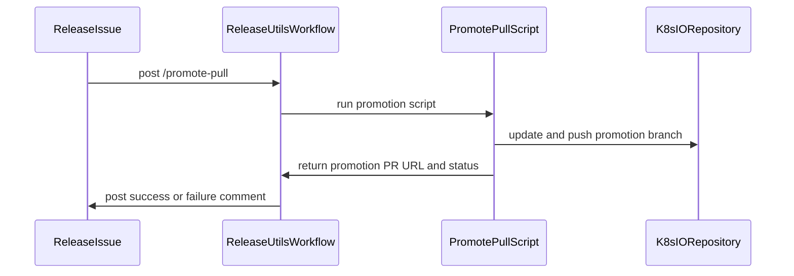

# PR #13523: Add /promote-pull ChatOps command

**Summary**: Add /promote-pull ChatOps command

**Sources**: https://github.com/kubernetes-sigs/kueue/pull/13523

**Last updated**: 2026-08-25T09:02:14Z

---

## Metadata

- **State**: closed
- **Author**: [@andrewseif](https://github.com/andrewseif)
- **Branch**: `13358-promote-pull-chatops` → `main`
- **Created**: 2026-07-27T09:22:02Z
- **Updated**: 2026-08-25T09:02:14Z
- **Merged**: —
- **Closed**: 2026-08-25T09:02:12Z
- **Labels**: `kind/feature`, `size/L`, `release-note-none`, `approved`, `ok-to-test`, `cncf-cla: yes`, `area/release`
- **Assignees**: [@Singularity23x0](https://github.com/Singularity23x0)
- **Requested reviewers**: [@sohankunkerkar](https://github.com/sohankunkerkar), [@kshalot](https://github.com/kshalot)
- **Changed files**: 4   **+447 / -19**

## Description

<!--  Thanks for sending a pull request!  Here are some tips for you:

1. If this is your first time, please read our contributor guidelines: https://git.k8s.io/community/contributors/guide/first-contribution.md#your-first-contribution and developer guide https://git.k8s.io/community/contributors/devel/development.md#development-guide
2. Please label this pull request according to what type of issue you are addressing, especially if this is a release targeted pull request. For reference on required PR/issue labels, read here:
https://git.k8s.io/community/contributors/devel/sig-release/release.md#issuepr-kind-label
3. Ensure you have added or ran the appropriate tests for your PR: https://git.k8s.io/community/contributors/devel/sig-testing/testing.md
4. If you want *faster* PR reviews, read how: https://git.k8s.io/community/contributors/guide/pull-requests.md#best-practices-for-faster-reviews
5. If the PR is unfinished, see how to mark it: https://git.k8s.io/community/contributors/guide/pull-requests.md#marking-unfinished-pull-requests
-->

#### What type of PR is this?
/kind feature
/area release

<!--
Add one of the following kinds:
/kind bug
/kind cleanup
/kind documentation
/kind feature
/kind kep

Optionally add one or more of the following kinds if applicable:
/kind api-change
/kind deprecation
/kind failing-test
/kind flake
/kind regression

Please also consider setting the area:
/area tas
/area was
/area integrations
/area multikueue
/area dashboard
/area localization
/area testing
/area website
-->

#### What this PR does / why we need it:
Adds a /promote-pull ChatOps command so the release team can submit the image and chart promotion PR against kubernetes/k8s.io by commenting on the Release vX.Y.Z issue. This was the last step in the release checklist that still required a local clone of kubernetes/k8s.io, a personal fork of it, and authenticated gcloud, it now needs nothing but comment access.

Making hack/releasing/promote_pull.sh safe to run unattended turned up two pre-existing bugs, both fixed here:

1. insert_image could silently drop an artifact. The awk program emits the new digest line only before a lower-versioned entry, or when it reaches the next - name: component. There is no END rule, so when the target component is the last one in images.yaml and has no strictly-lower existing version, the digest disappears with no error and exit status 0. This is reachable: should_skip_image deliberately does not skip an artifact with no promotion history, so the first-ever promotion of a new image takes exactly this path.
2. push_and_create_pr exited 0 when the push was declined. It wrote "Aborting." to stderr and fell out of the if, so the script exited 0 having created nothing. Under automation that would post a ✅ comment with no PR behind it.


#### Which issue(s) this PR fixes:
<!--
*Automatically closes linked issue when PR is merged.
Usage: `Fixes #<issue number>`, or `Fixes (paste link of issue)`.
_If PR is about `failing-tests or flakes`, please post the related issues/tests in a comment and do not use `Fixes`_*
-->
Fixes #13358 

#### Special notes for your reviewer:
How the two bugs were found, and how the changes were checked. Both were reproduced against the
unmodified script with a temporary harness that stubbed `crane` and `gh` on `PATH` and drove the
script against a throwaway `kubernetes/k8s.io` working copy. The trailing-artifact case produced a
manifest byte-identical to its input with exit status 0; the declined-push case exited 0 with no PR.
After the fixes, sixteen cases passed, insertion ordering, chart `v`-stripping, historical-line
skipping, unresolvable artifacts, re-run idempotency, placeholder handling, and local invocation.

**This command cannot succeed end to end until a credential is provisioned.** Pushing a branch to a
fork of `kubernetes/k8s.io` and opening a cross-repository PR is beyond `secrets.GITHUB_TOKEN`, and
this repository uses no other secret today. The job reads:

| Setting | Kind | Purpose |
|---|---|---|
| `KUEUE_RELEASE_BOT_TOKEN` | repository secret | Push the promotion branch, open the PR |
| `KUEUE_RELEASE_BOT_USER` | repository variable | Owner of the `kubernetes/k8s.io` fork |

Until then the command reports a clear "credential is not configured" failure. Related:
https://github.com/kubernetes-sigs/kueue/issues/13357.


AI usage disclosure: this change was developed with AI assistance (Claude Code), per the [Kubernetes AI Tool Usage Policy](https://www.kubernetes.dev/docs/guide/pull-requests/#ai-guidance). All changes were reviewed and tested by me.

#### Does this PR introduce a user-facing change?
<!--
If no, just write "NONE" in the release-note block below.
If yes, a release note is required:
Enter your extended release note in the block below. If the PR requires additional action from users switching to the new release, include the string "action required".
-->
```release-note
NONE
```


<!-- This is an auto-generated comment: release notes by coderabbit.ai -->
## Summary by CodeRabbit

* **New Features**
  * Added the `/promote-pull` ChatOps command to create or update image promotion pull requests.
  * Release automation now reports whether a promotion pull request was created or updated, with direct links and clear success or failure messages.

* **Bug Fixes**
  * Improved image digest handling and validation when updating image metadata, including edge-case fixes.

* **Documentation**
  * Updated the “New Release” checklist with `/promote-pull`, safe re-run guidance, and a local fallback command.
<!-- end of auto-generated comment: release notes by coderabbit.ai -->

## Discussion

### Comment by [@netlify[bot]](https://github.com/apps/netlify) — 2026-07-27T09:22:08Z

### <span aria-hidden="true">✅</span> Deploy Preview for *kubernetes-sigs-kueue* canceled.


|  Name | Link |
|:-:|------------------------|
|<span aria-hidden="true">🔨</span> Latest commit | a5291e535c561d6415dfb326f86a7b105cbf0fe1 |
|<span aria-hidden="true">🔍</span> Latest deploy log | https://app.netlify.com/projects/kubernetes-sigs-kueue/deploys/6a706a56cc206b0008ece131 |

### Comment by [@kubernetes-prow[bot]](https://github.com/apps/kubernetes-prow) — 2026-07-27T09:22:12Z

Hi @andrewseif. Thanks for your PR.

I'm waiting for a [kubernetes-sigs](https://github.com/orgs/kubernetes-sigs/people) member to verify that this patch is reasonable to test. If it is, they should reply with `/ok-to-test` on its own line. Until that is done, I will not automatically test new commits in this PR, but the usual testing commands by org members will still work.

>[!TIP]
>**We noticed you've done this a few times! Consider [joining the org](https://git.k8s.io/community/community-membership.md#member) to skip this step and gain `/lgtm` and other bot rights.** We recommend asking approvers on your previous PRs to sponsor you.

Once the patch is verified, the new status will be reflected by the `ok-to-test` label.

I understand the commands that are listed [here](https://go.k8s.io/bot-commands?repo=kubernetes-sigs%2Fkueue).

<details>

Instructions for interacting with me using PR comments are available [here](https://git.k8s.io/community/contributors/guide/pull-requests.md).  If you have questions or suggestions related to my behavior, please file an issue against the [kubernetes-sigs/prow](https://github.com/kubernetes-sigs/prow/issues/new?title=Prow%20issue:) repository.
</details>

### Comment by [@coderabbitai[bot]](https://github.com/apps/coderabbitai) — 2026-07-27T09:22:37Z

<!-- This is an auto-generated comment: summarize by coderabbit.ai -->
<!-- review_stack_entry_start -->

[](https://app.coderabbit.ai/change-stack/kubernetes-sigs/kueue/pull/13523?utm_source=github_walkthrough&utm_medium=github&utm_campaign=change_stack)

<!-- review_stack_entry_end -->
<!-- This is an auto-generated comment: review paused by coderabbit.ai -->

> [!NOTE]
> ## Reviews paused
> 
> It looks like this branch is under active development. To avoid overwhelming you with review comments due to an influx of new commits, CodeRabbit has automatically paused this review. You can configure this behavior by changing the `reviews.auto_review.auto_pause_after_reviewed_commits` setting.
> 
> Use the following commands to manage reviews:
> - `@coderabbitai resume` to resume automatic reviews.
> - `@coderabbitai review` to trigger a single review.
> 
> Use the checkboxes below for quick actions:
> - [ ] <!-- {"checkboxId": "7f6cc2e2-2e4e-497a-8c31-c9e4573e93d1"} --> ▶️ Resume reviews
> - [ ] <!-- {"checkboxId": "e9bb8d72-00e8-4f67-9cb2-caf3b22574fe"} --> 🔍 Trigger review

<!-- end of auto-generated comment: review paused by coderabbit.ai -->
<!-- walkthrough_start -->

<details>
<summary>📝 Walkthrough</summary>

## Walkthrough

The release workflow now supports `/promote-pull`. The promotion script uses `crane` for digest retrieval, verifies image updates, reuses existing promotion PRs, and reports the resulting PR through ChatOps.

### Changes

**Promotion pull request automation**

|Layer / File(s)|Summary|
|---|---|
|**Image digest promotion** <br> `hack/releasing/promote_pull.sh`|Adds `crane` checks, optional release issue input, digest retrieval and verification, and handling for the final image entry.|
|**Promotion PR reuse and issue updates** <br> `hack/releasing/promote_pull.sh`|Reuses open promotion PRs, captures new PR URLs, handles push confirmation, and updates the release issue using the promotion PR URL.|
|**ChatOps command workflow** <br> `.github/workflows/release-utils.yml`, `.github/ISSUE_TEMPLATE/NEW_RELEASE.md`|Authorizes and parses `/promote-pull`, runs the promotion job, reports status, and documents the command with a local fallback.|

**Estimated code review effort:** 4 (Complex) | ~45 minutes

### Sequence Diagram(s)



**Possibly related PRs**

- [kubernetes-sigs/kueue#13259](https://github.com/kubernetes-sigs/kueue/pull/13259): Adds related release ChatOps commands that invoke automation scripts.
- [kubernetes-sigs/kueue#13394](https://github.com/kubernetes-sigs/kueue/pull/13394): Adds the result-reporting action used by this workflow.
- [kubernetes-sigs/kueue#12892](https://github.com/kubernetes-sigs/kueue/pull/12892): Modifies the shared release ChatOps authorization and parsing flow.

**Suggested labels:** `lgtm`

**Suggested reviewers:** `kshalot`, `sohankunkerkar`

</details>

<!-- walkthrough_end -->
<!-- pre_merge_checks_walkthrough_start -->

<details>
<summary>🚥 Pre-merge checks | ✅ 4 | ❌ 1</summary>

### ❌ Failed checks (1 warning)

|     Check name     | Status     | Explanation                                                                           | Resolution                                                                         |
| :----------------: | :--------- | :------------------------------------------------------------------------------------ | :--------------------------------------------------------------------------------- |
| Docstring Coverage | ⚠️ Warning | Docstring coverage is 75.00% which is insufficient. The required threshold is 80.00%. | Write docstrings for the functions missing them to satisfy the coverage threshold. |

<details>
<summary>✅ Passed checks (4 passed)</summary>

|         Check name         | Status   | Explanation                                                                                                                      |
| :------------------------: | :------- | :------------------------------------------------------------------------------------------------------------------------------- |
|      Description Check     | ✅ Passed | Check skipped - CodeRabbit’s high-level summary is enabled.                                                                      |
|         Title check        | ✅ Passed | The title clearly identifies the primary change: adding the /promote-pull ChatOps command.                                       |
|     Linked Issues check    | ✅ Passed | The changes add and wire the /promote-pull command to create or update promotion PRs, satisfying [`#13358`].                       |
| Out of Scope Changes check | ✅ Passed | The workflow, template, and related release-script fixes support the promotion command and remain within the linked issue scope. |

</details>

</details>

<!-- pre_merge_checks_walkthrough_end -->
<!-- finishing_touch_checkbox_start -->

<details>
<summary>✨ Finishing Touches</summary>

<details>
<summary>🧪 Generate unit tests (beta)</summary>

- [ ] <!-- {"checkboxId": "f47ac10b-58cc-4372-a567-0e02b2c3d479", "radioGroupId": "utg-output-choice-group-unknown_comment_id"} -->   Create PR with unit tests

</details>

</details>

<!-- finishing_touch_checkbox_end -->
<!-- tips_start -->

---

Thanks for using [CodeRabbit](https://coderabbit.ai?utm_source=oss&utm_medium=github&utm_campaign=kubernetes-sigs/kueue&utm_content=13523)! It's free for OSS, and your support helps us grow. If you like it, consider giving us a shout-out.

<details>
<summary>❤️ Share</summary>

- [X](https://twitter.com/intent/tweet?text=I%20just%20used%20%40coderabbitai%20for%20my%20code%20review%2C%20and%20it%27s%20fantastic%21%20It%27s%20free%20for%20OSS%20and%20offers%20a%20free%20trial%20for%20the%20proprietary%20code.%20Check%20it%20out%3A&url=https%3A//coderabbit.ai)
- [Mastodon](https://mastodon.social/share?text=I%20just%20used%20%40coderabbitai%20for%20my%20code%20review%2C%20and%20it%27s%20fantastic%21%20It%27s%20free%20for%20OSS%20and%20offers%20a%20free%20trial%20for%20the%20proprietary%20code.%20Check%20it%20out%3A%20https%3A%2F%2Fcoderabbit.ai)
- [Reddit](https://www.reddit.com/submit?title=Great%20tool%20for%20code%20review%20-%20CodeRabbit&text=I%20just%20used%20CodeRabbit%20for%20my%20code%20review%2C%20and%20it%27s%20fantastic%21%20It%27s%20free%20for%20OSS%20and%20offers%20a%20free%20trial%20for%20proprietary%20code.%20Check%20it%20out%3A%20https%3A//coderabbit.ai)
- [LinkedIn](https://www.linkedin.com/sharing/share-offsite/?url=https%3A%2F%2Fcoderabbit.ai&mini=true&title=Great%20tool%20for%20code%20review%20-%20CodeRabbit&summary=I%20just%20used%20CodeRabbit%20for%20my%20code%20review%2C%20and%20it%27s%20fantastic%21%20It%27s%20free%20for%20OSS%20and%20offers%20a%20free%20trial%20for%20proprietary%20code)

</details>


<sub>Comment `@coderabbitai help` to get the list of available commands.</sub>

<!-- tips_end -->

### Comment by [@mimowo](https://github.com/mimowo) — 2026-07-27T09:23:42Z

/ok-to-test

### Comment by [@mimowo](https://github.com/mimowo) — 2026-07-27T09:24:02Z

cc @mbobrovskyi @Singularity23x0 ptal

### Comment by [@mimowo](https://github.com/mimowo) — 2026-07-27T09:35:05Z

/test pull-kueue-test-integration-shard-2-main
https://prow.k8s.io/view/gs/kubernetes-ci-logs/pr-logs/pull/kubernetes-sigs_kueue/13523/pull-kueue-test-integration-shard-2-main/2081671883404611584
unrelated

### Comment by [@mimowo](https://github.com/mimowo) — 2026-07-27T10:15:12Z

/approve
leaving reminder of the review to the release team.

Thank you !

### Comment by [@kubernetes-prow[bot]](https://github.com/apps/kubernetes-prow) — 2026-07-27T10:15:25Z

[APPROVALNOTIFIER] This PR is **APPROVED**

This pull-request has been approved by: *<a href="https://github.com/kubernetes-sigs/kueue/pull/13523#" title="Author self-approved">andrewseif</a>*, *<a href="https://github.com/kubernetes-sigs/kueue/pull/13523#issuecomment-5090083525" title="Approved">mimowo</a>*

The full list of commands accepted by this bot can be found [here](https://go.k8s.io/bot-commands?repo=kubernetes-sigs%2Fkueue).

The pull request process is described [here](https://git.k8s.io/community/contributors/guide/owners.md#the-code-review-process)

<details >
Needs approval from an approver in each of these files:

- ~~[OWNERS](https://github.com/kubernetes-sigs/kueue/blob/main/OWNERS)~~ [mimowo]

Approvers can indicate their approval by writing `/approve` in a comment
Approvers can cancel approval by writing `/approve cancel` in a comment
</details>
<!-- META={"approvers":[]} -->

### Comment by [@Singularity23x0](https://github.com/Singularity23x0) — 2026-07-29T11:34:18Z

Please sync to main and update logging to use the newly established format.

### Comment by [@mimowo](https://github.com/mimowo) — 2026-08-03T06:33:24Z


@andrewseif thank you for working on that, I have some questions:
1. have you had a chance to test this approach e2e on your fork?
2. I would love to see somehow the steps for configuring the repo documented so that we don't merge the PR, and later maintainers need to spend hours figuring our how to configure the repo. I imagine some step-by-step readme document

### Comment by [@andrewseif](https://github.com/andrewseif) — 2026-08-03T10:26:33Z

Rehearsed end-to-end on my fork. Reference PR the automation produced:
https://github.com/andrewseif/k8s.io/pull/1

I pointed the `k8s.io` remotes at my own fork so the PR landed there rather than
`kubernetes/k8s.io`, and nothing upstream was touched. Every staging tag through v0.19.0 is
already promoted, so there was no unpromoted version to rehearse with. I pushed one commit to my
fork's `main` removing the eight v0.19.0 entries, making it look exactly as `kubernetes/k8s.io`
did before that promotion, then promoted v0.19.0 into it.

The generated manifest is byte-for-byte identical to the live `kubernetes/k8s.io` file. All eight
digests (5 images and 3 charts) were resolved independently via `crane` against the staging
registry and match what the real v0.19.0 promotion recorded.

```bash
GITHUB_USER=andrewseif \
KUBERNETES_K8S_IO_PATH=<path>/k8s.io \
KUBERNETES_K8S_IO_UPSTREAM_REMOTE=origin KUBERNETES_K8S_IO_FORK_REMOTE=origin \
KUBERNETES_K8S_IO_MAIN_REPO_ORG=andrewseif KUBERNETES_K8S_IO_MAIN_REPO_NAME=k8s.io \
KUBERNETES_SIGS_KUEUE_MAIN_REPO_ORG=andrewseif KUBERNETES_SIGS_KUEUE_MAIN_REPO_NAME=kueue \
  ./hack/releasing/promote_pull.sh v0.19.0
```

Result: PR opened as one file `+8/-0`, base `main`, title `Kueue: Promote v0.19.0`, body
referencing the release issue; chart entries recorded as `["0.19.0"]` and image entries as
`["v0.19.0"]`; and the `<!-- K8S_IO_PULL -->` placeholder in the release issue
(andrewseif/kueue#3) filled with `andrewseif/k8s.io#1`. Re-running changed nothing: the existing
PR was reported and updated by the force push, still exactly one PR and one placeholder
substitution. The fork's `main` was never written to and the clone was left on its original
branch, clean.

Refusals behaved too, all exiting non-zero with a `!!!` diagnostic and no PR: invalid version
string; unpublished artifact (`v0.99.0`, surfacing crane's own `MANIFEST_UNKNOWN` before pointing
at `/wait-for-images`); and a declined push confirmation.

## Repository configuration docs

Added `hack/releasing/promote_pull/README.md` with step-by-step setup: choosing the bot account,
forking `kubernetes/k8s.io`, the exact token scopes, adding `KUEUE_RELEASE_BOT_TOKEN` and
`KUEUE_RELEASE_BOT_USER`, and how to verify. It also documents what the command reports at each
stage of partial setup, so a half-configured repo diagnoses itself:

| State | Reported |
|---|---|
| Neither configured | `missing secret KUEUE_RELEASE_BOT_TOKEN and variable KUEUE_RELEASE_BOT_USER` |
| Secret only | `missing variable KUEUE_RELEASE_BOT_USER` |
| Variable only | `missing secret KUEUE_RELEASE_BOT_TOKEN` |
| Both set, no fork | `missing fork <owner>/k8s.io (create it with gh repo fork kubernetes/k8s.io)` |

Plus environment reference, exit codes, safety properties and a troubleshooting table. The release
checklist now points at it.

## `make yq` dominates the runtime, and the options

Each rehearsal run took about 7 minutes, and essentially all of it was `make yq`. Measured
breakdown:

| Phase | Time |
|---|---|
| `go mod download`, the whole tools module, about 1.3 GB | ~8 min cold |
| `go install yq` | ~2 min cold |
| Preconditions, 8 `crane digest` calls, awk insertion, verification, push, PR | seconds |

`make yq` depends on `gomod-download-tools`, which downloads the entire tools module
(controller-gen, golangci-lint, helm, kustomize, envtest) to build one small binary the command
barely uses. `promote_pull.sh` is the only release script that shells out to `make`, and none of
the workflow's five `actions/setup-go` steps configure caching, so a cold runner pays this on
every `/promote-pull` invocation. Not fatal against the 30-minute job timeout, but it is most of
the wall clock, spent on tools that are never invoked.

Worth noting how little yq actually does here. It is used exactly once:

```bash
done < <("${YQ}" e '.[] | .name' "${IMAGES_FILE}")
```

Options, roughly in increasing order of payoff:

1. Leave it. Correct, just slow.
2. Add Go caching to `actions/setup-go` (`cache: true`). Helps all five release jobs, but is a
   broader change than this PR and still keeps the dependency.
3. Make `YQ` externally overridable (`YQ="${YQ:-...}"`) so the workflow installs yq directly and
   skips the module download. Local runs get faster too.
4. Drop yq from this script entirely. The one use extracts component names from a flat YAML list,
   which a single line reproduces exactly:

   ```bash
   done < <(sed -n 's/^-[[:space:]]*name:[[:space:]]*//p' "${IMAGES_FILE}")
   ```
This bash line is produced by LLM.

   Verified against the real manifest: identical list, identical order. This removes `make yq`, and
   with it the `actions/setup-go` step from the job, taking the runtime from about 7 minutes to
   seconds. It is also consistent with the surrounding code, since `insert_image` and
   `should_skip_image` already parse this same file with `awk` rather than a YAML round-trip,
   deliberately, to keep the diff on a shared upstream file reviewable.

### Comment by [@Singularity23x0](https://github.com/Singularity23x0) — 2026-08-25T09:02:06Z

Hi @andrewseif 
Unfortunately it seems we won't be able to automate this step due to bot restrictions in kubernetes-sigs.
Regardless: thank you for these changes.
/close

### Comment by [@kubernetes-prow[bot]](https://github.com/apps/kubernetes-prow) — 2026-08-25T09:02:14Z

@Singularity23x0: Closed this PR.

<details>

In response to [this](https://github.com/kubernetes-sigs/kueue/pull/13523#issuecomment-5408006136):

>Hi @andrewseif 
>Unfortunately it seems we won't be able to automate this step due to bot restrictions in kubernetes-sigs.
>Regardless: thank you for these changes.
>/close


Instructions for interacting with me using PR comments are available [here](https://git.k8s.io/community/contributors/guide/pull-requests.md).  If you have questions or suggestions related to my behavior, please file an issue against the [kubernetes-sigs/prow](https://github.com/kubernetes-sigs/prow/issues/new?title=Prow%20issue:) repository.
</details>

## Reviews

### Review by [@coderabbitai[bot]](https://github.com/apps/coderabbitai) (commented) — 2026-07-27T09:30:01Z

**Actionable comments posted: 3**

<details>
<summary>🧹 Nitpick comments (3)</summary><blockquote>

<details>
<summary>hack/releasing/promote_pull.sh (2)</summary><blockquote>

`152-155`: _🎯 Functional Correctness_ | _🔵 Trivial_ | _⚡ Quick win_

**`gh issue list` can return more than one match, producing a multi-line `RELEASE_ISSUE_NUMBER`.**

The search is a fuzzy title search, so any issue whose title contains the release name matches. A multi-line value silently breaks `gh issue edit` later.

<details>
<summary>♻️ Suggested hardening</summary>

```diff
-  RELEASE_ISSUE_NUMBER=$(gh issue list --repo="${KUBERNETES_SIGS_KUEUE_MAIN_REPO}" --search "in:title ${RELEASE_ISSUE_NAME}" | awk '{print $1}' || true)
+  RELEASE_ISSUE_NUMBER=$(gh issue list --repo="${KUBERNETES_SIGS_KUEUE_MAIN_REPO}" \
+    --search "in:title ${RELEASE_ISSUE_NAME}" --limit 1 --json number --jq '.[0].number' || true)
```
</details>

<details>
<summary>🤖 Prompt for AI Agents</summary>

```
Verify each finding against current code. Fix only still-valid issues, skip the
rest with a brief reason, keep changes minimal, and validate.

In `@hack/releasing/promote_pull.sh` around lines 152 - 155, Update the
RELEASE_ISSUE_NUMBER assignment in the fallback around gh issue list so it
selects exactly one issue number from potentially multiple matches, rather than
preserving multi-line output. Keep the existing repository and release-name
search, and ensure the resulting value is a single line suitable for the later
gh issue edit command.
```

</details>

<!-- cr-comment:v1:04fa68a473d716afcee614fd -->

---

`365-368`: _📐 Maintainability & Code Quality_ | _🔵 Trivial_ | _⚡ Quick win_

**`2>/dev/null || true` masks auth/network failures as "image not found".**

Any `crane digest` failure (registry 5xx, DNS, rate limit) yields an empty digest, and the caller tells the release team to run `/wait-for-images`, which will never help. Consider surfacing crane's stderr on failure.

<details>
<summary>♻️ Suggested change</summary>

```diff
 function get_image_digest() {
   local full_image_name="$1"
-  crane digest "${full_image_name}" 2>/dev/null || true
+  local err
+  if ! err=$(crane digest "${full_image_name}" 2>&1); then
+    echo "!!! crane digest failed for ${full_image_name}: ${err}" >&2
+    return 0
+  fi
+  echo "${err}"
 }
```
</details>

<details>
<summary>🤖 Prompt for AI Agents</summary>

```
Verify each finding against current code. Fix only still-valid issues, skip the
rest with a brief reason, keep changes minimal, and validate.

In `@hack/releasing/promote_pull.sh` around lines 365 - 368, Update
get_image_digest to stop suppressing crane digest errors: preserve the digest on
success, but surface crane’s stderr and propagate or explicitly distinguish
authentication, network, and registry failures from a genuinely missing image.
Ensure callers no longer interpret every failed lookup as an empty digest
requiring /wait-for-images.
```

</details>

<!-- cr-comment:v1:eb86b957455e804bcd5758a4 -->

</blockquote></details>
<details>
<summary>.github/workflows/release-utils.yml (1)</summary><blockquote>

`616-654`: _🩺 Stability & Availability_ | _🔵 Trivial_ | _💤 Low value_

**`Report Result` depends on `/tmp/promote-pull.log` existing but has no `if: always()`.**

It's reachable today only because the promote step ends with `exit 0`, which is fragile — any future non-zero exit (or a failure in `Install Crane`/`Set up Go`) skips the reporting step and leaves the release issue without feedback. Consider `if: always()` plus a guard for a missing log file.

<details>
<summary>🤖 Prompt for AI Agents</summary>

```
Verify each finding against current code. Fix only still-valid issues, skip the
rest with a brief reason, keep changes minimal, and validate.

In @.github/workflows/release-utils.yml around lines 616 - 654, Update the
“Report Result” workflow step to use if: always() so it runs after upstream
failures, including failures in promotion setup steps. Guard the
/tmp/promote-pull.log grep in ERR_MSG construction with a file-existence check,
preserving the existing fallback message when the log is unavailable or contains
no error details.
```

</details>

<!-- cr-comment:v1:096fd6aaeb97452e2161de1f -->

</blockquote></details>

</blockquote></details>

<details>
<summary>🤖 Prompt for all review comments with AI agents</summary>

```
Verify each finding against current code. Fix only still-valid issues, skip the
rest with a brief reason, keep changes minimal, and validate.

Inline comments:
In @.github/workflows/release-utils.yml:
- Around line 527-540: Update the release workflow’s promotion preflight and
fork-owner handling so the owner derived from vars.KUEUE_RELEASE_BOT_USER uses
one consistent fallback, such as the existing kueue-release-bot default. Reuse
that resolved owner for both the fork remote setup around the remote push and
GITHUB_USER used by gh pr list/create, and include it in the preflight
validation alongside PROMOTION_TOKEN so dry-run behavior is consistent.
- Around line 596-614: Update the promotion result handling around PR_URL and
the action output so an empty PR_URL is classified as a failure rather than
action=created. Preserve the existing updated classification for already-open
pull requests, and adjust the Report Result logic to avoid posting a success
comment with an empty link when no pull request was created.

In `@hack/releasing/promote_pull.sh`:
- Around line 370-386: Update verify_digests_inserted to use fixed-string
matching with grep -qF when checking each digest in images_file, preserving the
existing missing-digest collection and failure behavior.

---

Nitpick comments:
In @.github/workflows/release-utils.yml:
- Around line 616-654: Update the “Report Result” workflow step to use if:
always() so it runs after upstream failures, including failures in promotion
setup steps. Guard the /tmp/promote-pull.log grep in ERR_MSG construction with a
file-existence check, preserving the existing fallback message when the log is
unavailable or contains no error details.

In `@hack/releasing/promote_pull.sh`:
- Around line 152-155: Update the RELEASE_ISSUE_NUMBER assignment in the
fallback around gh issue list so it selects exactly one issue number from
potentially multiple matches, rather than preserving multi-line output. Keep the
existing repository and release-name search, and ensure the resulting value is a
single line suitable for the later gh issue edit command.
- Around line 365-368: Update get_image_digest to stop suppressing crane digest
errors: preserve the digest on success, but surface crane’s stderr and propagate
or explicitly distinguish authentication, network, and registry failures from a
genuinely missing image. Ensure callers no longer interpret every failed lookup
as an empty digest requiring /wait-for-images.
```

</details>

<details>
<summary>🪄 Autofix (Beta)</summary>

Fix all unresolved CodeRabbit comments on this PR:

- [ ] <!-- {"checkboxId": "4b0d0e0a-96d7-4f10-b296-3a18ea78f0b9"} --> Push a commit to this branch (recommended)
- [ ] <!-- {"checkboxId": "ff5b1114-7d8c-49e6-8ac1-43f82af23a33"} --> Create a new PR with the fixes

</details>

---

<details>
<summary>ℹ️ Review info</summary>

<details>
<summary>⚙️ Run configuration</summary>

**Configuration used**: Path: .coderabbit.yaml

**Review profile**: CHILL

**Plan**: Pro Plus

**Run ID**: `48951b4f-cd5d-4d6e-9f13-69d5fe8cedc0`

</details>

<details>
<summary>📥 Commits</summary>

Reviewing files that changed from the base of the PR and between b7ac6ee8e9a91701cdfec3662f47690d4e166b53 and d4e27b19dddacbca8b4afd4a930ea78f346678f0.

</details>

<details>
<summary>📒 Files selected for processing (3)</summary>

* `.github/ISSUE_TEMPLATE/NEW_RELEASE.md`
* `.github/workflows/release-utils.yml`
* `hack/releasing/promote_pull.sh`

</details>

</details>

<!-- This is an auto-generated comment by CodeRabbit for review status -->

- **.github/workflows/release-utils.yml:666** by [@coderabbitai[bot]](https://github.com/apps/coderabbitai) — 2026-07-27T09:30:00Z
```diff
@@ -511,6 +514,144 @@ jobs:
 
           gh issue comment "$ISSUE_NUMBER" --body "✅ Successfully prepared pull request(s) for version \`$VERSION\` (target: \`$TARGET\`)."
 
+  promote-pull:
+    name: Promote Pull
+    runs-on: ubuntu-latest
+    needs: authorize
+    timeout-minutes: 30
+    if: ${{ needs.authorize.outputs.command == 'promote-pull' }}
+    permissions:
+      contents: read
+      issues: write
+    steps:
+      - name: Check Promotion Credential
+        id: credential
+        env:
+          PROMOTION_TOKEN: ${{ secrets.KUEUE_RELEASE_BOT_TOKEN }}
+        run: |
+          # When the credential is missing the job still runs everything up to
+          # the push, so a rehearsal validates the checkout, the remote wiring
+          # and the manifest insertion instead of exiting before reaching them.
+          if [ -z "$PROMOTION_TOKEN" ]; then
+            echo "available=false" >> "$GITHUB_OUTPUT"
+            echo "Promotion credential is not configured; continuing as a dry run."
+          else
+            echo "available=true" >> "$GITHUB_OUTPUT"
+          fi
```

  _🎯 Functional Correctness_ | _🟠 Major_ | _⚡ Quick win_
  
  **`vars.KUEUE_RELEASE_BOT_USER` is treated inconsistently and isn't part of the credential preflight.**
  
  Line 569 has no fallback while line 589 defaults to `kueue-release-bot`. If the token is configured but the variable isn't, the fork remote becomes `https://github.com//k8s.io.git` (invalid push) while `GITHUB_USER` silently becomes `kueue-release-bot`, so `gh pr list --head` and `gh pr create --head` target a different owner than the branch that was pushed. The preflight at Line 535 only validates the token.
  
  <details>
  <summary>🛠️ Suggested fix</summary>
  
  ```diff
  -          if [ -z "$PROMOTION_TOKEN" ]; then
  +          if [ -z "$PROMOTION_TOKEN" ] || [ -z "$PROMOTION_USER" ]; then
               echo "available=false" >> "$GITHUB_OUTPUT"
               echo "Promotion credential is not configured; continuing as a dry run."
  ```
  
  ```diff
           env:
             PROMOTION_TOKEN: ${{ secrets.KUEUE_RELEASE_BOT_TOKEN }}
  +          PROMOTION_USER: ${{ vars.KUEUE_RELEASE_BOT_USER }}
  ```
  
  and use one consistent value for the fork owner and `GITHUB_USER`:
  
  ```diff
  -          GITHUB_USER: ${{ vars.KUEUE_RELEASE_BOT_USER || 'kueue-release-bot' }}
  +          GITHUB_USER: ${{ vars.KUEUE_RELEASE_BOT_USER }}
  ```
  </details>
  
  
  
  
  
  
  Also applies to: 569-569, 589-589
  
  <details>
  <summary>🤖 Prompt for AI Agents</summary>
  
  ```
  Verify each finding against current code. Fix only still-valid issues, skip the
  rest with a brief reason, keep changes minimal, and validate.
  
  In @.github/workflows/release-utils.yml around lines 527 - 540, Update the
  release workflow’s promotion preflight and fork-owner handling so the owner
  derived from vars.KUEUE_RELEASE_BOT_USER uses one consistent fallback, such as
  the existing kueue-release-bot default. Reuse that resolved owner for both the
  fork remote setup around the remote push and GITHUB_USER used by gh pr
  list/create, and include it in the preflight validation alongside
  PROMOTION_TOKEN so dry-run behavior is consistent.
  ```
  
  </details>
  
  <!-- fingerprinting:phantom:medusa:komodo -->
  
  <!-- cr-indicator-types:potential_issue -->
  
  <!-- cr-comment:v1:aa6ea2b42283c79e9d8c6df4 -->
  
  <!-- This is an auto-generated reply by CodeRabbit -->
  
  ✅ Addressed in commit 76a3ab0
  
  <!-- This is an auto-generated comment by CodeRabbit -->

- **.github/workflows/release-utils.yml:614** by [@coderabbitai[bot]](https://github.com/apps/coderabbitai) — 2026-07-27T09:30:00Z
```diff
@@ -511,6 +514,144 @@ jobs:
 
           gh issue comment "$ISSUE_NUMBER" --body "✅ Successfully prepared pull request(s) for version \`$VERSION\` (target: \`$TARGET\`)."
 
+  promote-pull:
+    name: Promote Pull
+    runs-on: ubuntu-latest
+    needs: authorize
+    timeout-minutes: 30
+    if: ${{ needs.authorize.outputs.command == 'promote-pull' }}
+    permissions:
+      contents: read
+      issues: write
+    steps:
+      - name: Check Promotion Credential
+        id: credential
+        env:
+          PROMOTION_TOKEN: ${{ secrets.KUEUE_RELEASE_BOT_TOKEN }}
+        run: |
+          # When the credential is missing the job still runs everything up to
+          # the push, so a rehearsal validates the checkout, the remote wiring
+          # and the manifest insertion instead of exiting before reaching them.
+          if [ -z "$PROMOTION_TOKEN" ]; then
+            echo "available=false" >> "$GITHUB_OUTPUT"
+            echo "Promotion credential is not configured; continuing as a dry run."
+          else
+            echo "available=true" >> "$GITHUB_OUTPUT"
+          fi
+
+      - name: Checkout repository
+        uses: actions/checkout@3d3c42e5aac5ba805825da76410c181273ba90b1 # v7.0.1
+        with:
+          fetch-depth: 0
+          ref: main
+          persist-credentials: false
+
+      - name: Checkout kubernetes/k8s.io
+        uses: actions/checkout@3d3c42e5aac5ba805825da76410c181273ba90b1 # v7.0.1
+        with:
+          repository: kubernetes/k8s.io
+          ref: main
+          path: k8s.io
+          persist-credentials: false
+
+      - name: Install Crane
+        uses: imjasonh/setup-crane@feee3b6bb0d4c68370f256a4502498c9227e5c6b # v0.7
+
+      - name: Set up Go
+        uses: actions/setup-go@b7ad1dad31e06c5925ef5d2fc7ad053ef454303e # v7.0.0
+        with:
+          go-version-file: 'go.mod'
+
+      - name: Configure Git and GH CLI
+        env:
+          GH_TOKEN: ${{ secrets.KUEUE_RELEASE_BOT_TOKEN || secrets.GITHUB_TOKEN }}
+          CREDENTIAL_AVAILABLE: ${{ steps.credential.outputs.available }}
+          FORK_OWNER: ${{ vars.KUEUE_RELEASE_BOT_USER }}
+        run: |
+          git config --global user.name "kueue-release-bot"
+          git config --global user.email "kueue-release-bot@kubernetes.io"
+          gh auth setup-git
+
+          # A fresh checkout of kubernetes/k8s.io has a single remote named
+          # origin pointing at upstream — the inverse of the script's
+          # workstation defaults, which expect origin to be a personal fork.
+          if [ "$CREDENTIAL_AVAILABLE" = "true" ]; then
+            git -C k8s.io remote add fork "https://github.com/${FORK_OWNER}/k8s.io.git"
+          fi
+
+      - name: Run Promote Pull
+        id: promote
+        env:
+          GH_TOKEN: ${{ secrets.KUEUE_RELEASE_BOT_TOKEN || secrets.GITHUB_TOKEN }}
+          ISSUE_NUMBER: ${{ github.event.issue.number }}
+          RELEASE_ISSUE_NUMBER: ${{ github.event.issue.number }}
+          VERSION: ${{ needs.authorize.outputs.version }}
+          GITHUB_USER: ${{ vars.KUEUE_RELEASE_BOT_USER || 'kueue-release-bot' }}
+          KUBERNETES_K8S_IO_PATH: ${{ github.workspace }}/k8s.io
+          KUBERNETES_K8S_IO_UPSTREAM_REMOTE: origin
+          KUBERNETES_K8S_IO_FORK_REMOTE: fork
+          KUBERNETES_SIGS_KUEUE_MAIN_REPO_ORG: ${{ github.repository_owner }}
+          KUBERNETES_SIGS_KUEUE_MAIN_REPO_NAME: ${{ github.event.repository.name }}
+          CREDENTIAL_AVAILABLE: ${{ steps.credential.outputs.available }}
+        run: |
+          if [ "$CREDENTIAL_AVAILABLE" != "true" ]; then
+            export DRY_RUN=1
+          fi
+
+          set +e
+          yes y | ./hack/releasing/promote_pull.sh "$VERSION" 2>&1 | tee /tmp/promote-pull.log
+          SCRIPT_EXIT_CODE=${PIPESTATUS[1]}
+          set -e
+
+          PR_URL=$(sed -n 's/^+++ Promotion pull request: //p' /tmp/promote-pull.log | tail -n 1)
+          echo "pr_url=${PR_URL}" >> "$GITHUB_OUTPUT"
+          if grep -q '^+++ Pull request already open' /tmp/promote-pull.log; then
+            echo "action=updated" >> "$GITHUB_OUTPUT"
+          else
+            echo "action=created" >> "$GITHUB_OUTPUT"
+          fi
+          echo "exit_code=${SCRIPT_EXIT_CODE}" >> "$GITHUB_OUTPUT"
+          exit 0
```

  _🎯 Functional Correctness_ | _🟡 Minor_ | _⚡ Quick win_
  
  **`action=created` is reported even when no PR exists.**
  
  The `else` branch is a catch-all: if the script exits 0 without creating a PR (or `PR_URL` is empty for any reason), the report step still posts "✅ ... has been created. Link:" with an empty link. Gate on `PR_URL` instead.
  
  <details>
  <summary>♻️ Suggested change</summary>
  
  ```diff
  -          if grep -q '^+++ Pull request already open' /tmp/promote-pull.log; then
  +          if [ -z "$PR_URL" ]; then
  +            echo "action=none" >> "$GITHUB_OUTPUT"
  +          elif grep -q '^+++ Pull request already open' /tmp/promote-pull.log; then
               echo "action=updated" >> "$GITHUB_OUTPUT"
             else
               echo "action=created" >> "$GITHUB_OUTPUT"
             fi
  ```
  
  and in **Report Result**, treat an empty `PR_URL` as a failure rather than posting a success comment with a dangling link.
  </details>
  
  <!-- suggestion_start -->
  
  <details>
  <summary>📝 Committable suggestion</summary>
  
  > ‼️ **IMPORTANT**
  > Carefully review the code before committing. Ensure that it accurately replaces the highlighted code, contains no missing lines, and has no issues with indentation. Thoroughly test & benchmark the code to ensure it meets the requirements.
  
  ```suggestion
          run: |
            if [ "$CREDENTIAL_AVAILABLE" != "true" ]; then
              export DRY_RUN=1
            fi
  
            set +e
            yes y | ./hack/releasing/promote_pull.sh "$VERSION" 2>&1 | tee /tmp/promote-pull.log
            SCRIPT_EXIT_CODE=${PIPESTATUS[1]}
            set -e
  
            PR_URL=$(sed -n 's/^+++ Promotion pull request: //p' /tmp/promote-pull.log | tail -n 1)
            echo "pr_url=${PR_URL}" >> "$GITHUB_OUTPUT"
            if [ -z "$PR_URL" ]; then
              echo "action=none" >> "$GITHUB_OUTPUT"
            elif grep -q '^+++ Pull request already open' /tmp/promote-pull.log; then
              echo "action=updated" >> "$GITHUB_OUTPUT"
            else
              echo "action=created" >> "$GITHUB_OUTPUT"
            fi
            echo "exit_code=${SCRIPT_EXIT_CODE}" >> "$GITHUB_OUTPUT"
            exit 0
  ```
  
  </details>
  
  <!-- suggestion_end -->
  
  <details>
  <summary>🤖 Prompt for AI Agents</summary>
  
  ```
  Verify each finding against current code. Fix only still-valid issues, skip the
  rest with a brief reason, keep changes minimal, and validate.
  
  In @.github/workflows/release-utils.yml around lines 596 - 614, Update the
  promotion result handling around PR_URL and the action output so an empty PR_URL
  is classified as a failure rather than action=created. Preserve the existing
  updated classification for already-open pull requests, and adjust the Report
  Result logic to avoid posting a success comment with an empty link when no pull
  request was created.
  ```
  
  </details>
  
  <!-- fingerprinting:phantom:medusa:komodo -->
  
  <!-- cr-indicator-types:potential_issue -->
  
  <!-- cr-comment:v1:24f3fde7059fd4745c25c82b -->
  
  <!-- This is an auto-generated comment by CodeRabbit -->
  
  ✅ Addressed in commit 76a3ab0

- **hack/releasing/promote_pull.sh:389** by [@coderabbitai[bot]](https://github.com/apps/coderabbitai) — 2026-07-27T09:30:00Z
```diff
@@ -325,9 +362,28 @@ function get_image_full_name() {
 }
 
 # $1 - full image name
-function get_image_details() {
+function get_image_digest() {
   local full_image_name="$1"
-  gcloud container images describe "${full_image_name}" --verbosity error --format json || true
+  crane digest "${full_image_name}" 2>/dev/null || true
+}
+
+function verify_digests_inserted() {
+  local images_file="$1"
+  shift
+
+  local entry name digest missing=()
+  for entry in "$@"; do
+    name="${entry%% *}"
+    digest="${entry#* }"
+    if ! grep -q "${digest}" "${images_file}"; then
+      missing+=("${name}@${digest}")
+    fi
+  done
+
+  if [[ ${#missing[@]} -gt 0 ]]; then
+    echo "!!! Failed to insert ${#missing[@]} digest(s) into ${images_file}: ${missing[*]}"
+    exit 1
+  fi
```

  _🩺 Stability & Availability_ | _🟡 Minor_ | _⚡ Quick win_
  
  <details>
  <summary>🧩 Analysis chain</summary>
  
  🏁 Script executed:
  
  ```shell
  #!/bin/bash
  # Check whether the script enables `set -u`, which affects empty-array expansion on older bash.
  fd -t f 'promote_pull.sh' --exec sed -n '1,40p'
  ```
  
  Repository: kubernetes-sigs/kueue
  
  Length of output: 1852
  
  ---
  
  🏁 Script executed:
  
  ```shell
  #!/bin/bash
  set -u
  
  # Inspect the relevant function and related verification call sites without executing repository code.
  fd -t f 'promote_pull\.sh$' --exec sh -c '
    echo "FILE: $1"
    sed -n "340,405p" "$1"
    echo "--- occurrences of verify_digests_inserted ---"
    rg -n "verify_digests_inserted|grep -q\"?\$\{digest\}|\$\{`#missing`\[@\]\}" "$1"
  ' sh {}
  
  # Check current bash version and demonstrate the empty-indexed array behavior under set -u for bash < 4.4.
  printf '\nCurrent bash version: '
  bash --version | sed -n '1p'
  
  node - <<'JS'
  const { execSync } = require('child_process');
  try {
    console.log(execSync('bash --version | sed -n "1p"', { encoding: 'utf8' }));
    execSync('bash --version | grep -E "bash 3|bash 4\\.[0-3]",', { encoding: 'utf8' });
    console.log('BASH_VERSION:', process.env.BASH_VERSION ?? '(not running under bash)');
  } catch (e) {
    console.log(e.stdout ? e.stdout.trim() : 'Current bash is not a pre-4.4 bash running the shell');
  }
  JS
  ```
  
  Repository: kubernetes-sigs/kueue
  
  Length of output: 2273
  
  ---
  
  🏁 Script executed:
  
  ```shell
  #!/bin/bash
  set -u
  
  # Check whether any script-local function wrapper / shellcheck exception could mask the shellcheck bug reported here,
  # and confirm the digest is passed as an argument, not used elsewhere in the function.
  fd -t f 'promote_pull\.sh$' --exec sh -c '
    echo "FILE: $1"
    rg -n "verify_digests_inserted|function .*bash_version|shellcheck|digest" | sed -n "1,120p"
  ' sh {}
  
  # Read-only semantic probe: simulate verify_digests_inserted with one digest containing grep meta-characters,
  # using POSIX grep -E semantics from the matching code.
  python3 - <<'PY'
  import subprocess, tempfile, os
  digest = "abc(x+|y{1,3})def"
  body = "line containing exact digest\n"
  with tempfile.TemporaryDirectory() as d:
      path = os.path.join(d, "images.yaml")
      with open(path, "w") as f:
          f.write(body)
      print("grep -q F:", subprocess.run(["grep","-q",digest,path], capture_output=True).returncode)
      print("grep -q regex:", subprocess.run(["grep","-q","extended-regexp","-e",digest,path], capture_output=True).returncode)
  PY
  ```
  
  Repository: kubernetes-sigs/kueue
  
  Length of output: 17666
  
  ---
  
  
  
  </details>
  
  **Use `grep -qF` for digest matching.**
  
  This function only needs an exact literal match, but `grep -q "${digest}"` interprets the digest as an extended regex. Use `grep -qF "${digest}" "${images_file}` to avoid accidental regex-expanded matches.
  
  <details>
  <summary>🤖 Prompt for AI Agents</summary>
  
  ```
  Verify each finding against current code. Fix only still-valid issues, skip the
  rest with a brief reason, keep changes minimal, and validate.
  
  In `@hack/releasing/promote_pull.sh` around lines 370 - 386, Update
  verify_digests_inserted to use fixed-string matching with grep -qF when checking
  each digest in images_file, preserving the existing missing-digest collection
  and failure behavior.
  ```
  
  </details>
  
  <!-- fingerprinting:phantom:medusa:komodo -->
  
  <!-- cr-indicator-types:potential_issue -->
  
  <!-- cr-comment:v1:9c73e85f8090fda22f386e94 -->
  
  <!-- This is an auto-generated comment by CodeRabbit -->
  
  ✅ Addressed in commit 76a3ab0

### Review by [@mwielgus](https://github.com/mwielgus) (commented) — 2026-07-27T09:59:20Z

- **.github/workflows/release-utils.yml:622** by [@mwielgus](https://github.com/mwielgus) — 2026-07-27T09:59:06Z
```diff
@@ -471,17 +493,165 @@ jobs:
           UPSTREAM_REMOTE: origin
         run: |
           set +e
-          yes y | ./hack/releasing/prepare_pull.sh --target "$TARGET" "$VERSION"
+          yes y | ./hack/releasing/prepare_pull.sh --target "$TARGET" "$VERSION" 2>&1 | tee /tmp/prepare-pull.log
           SCRIPT_EXIT_CODE=${PIPESTATUS[1]}
           set -e
 
           if [ $SCRIPT_EXIT_CODE -ne 0 ]; then
-            gh issue comment "$ISSUE_NUMBER" --body "❌ Failed to prepare pull requests for version \`$VERSION\` (target: \`$TARGET\`)."
+            # Extract any line starting with !!! as error details
+            ERR_MSG=$(grep -E '^!!!' /tmp/prepare-pull.log || true)
+            if [ -z "$ERR_MSG" ]; then
+              ERR_MSG="Check workflow logs for details."
+            fi
+            gh issue comment "$ISSUE_NUMBER" --body "❌ Failed to prepare pull requests for version \`$VERSION\` (target: \`$TARGET\`).
+            
+            **Error details:**
+            \`\`\`text
+            ${ERR_MSG}
+            \`\`\`"
             exit $SCRIPT_EXIT_CODE
           fi
 
           gh issue comment "$ISSUE_NUMBER" --body "✅ Successfully prepared pull request(s) for version \`$VERSION\` (target: \`$TARGET\`)."
 
+  promote-pull:
```

  Is it a copy-paste from some other file or a manually written fragment that may require a bit more attention during the next release?

### Review by [@andrewseif](https://github.com/andrewseif) (commented) — 2026-07-27T10:10:15Z

- **.github/workflows/release-utils.yml:622** by [@andrewseif](https://github.com/andrewseif) — 2026-07-27T10:10:15Z
```diff
@@ -471,17 +493,165 @@ jobs:
           UPSTREAM_REMOTE: origin
         run: |
           set +e
-          yes y | ./hack/releasing/prepare_pull.sh --target "$TARGET" "$VERSION"
+          yes y | ./hack/releasing/prepare_pull.sh --target "$TARGET" "$VERSION" 2>&1 | tee /tmp/prepare-pull.log
           SCRIPT_EXIT_CODE=${PIPESTATUS[1]}
           set -e
 
           if [ $SCRIPT_EXIT_CODE -ne 0 ]; then
-            gh issue comment "$ISSUE_NUMBER" --body "❌ Failed to prepare pull requests for version \`$VERSION\` (target: \`$TARGET\`)."
+            # Extract any line starting with !!! as error details
+            ERR_MSG=$(grep -E '^!!!' /tmp/prepare-pull.log || true)
+            if [ -z "$ERR_MSG" ]; then
+              ERR_MSG="Check workflow logs for details."
+            fi
+            gh issue comment "$ISSUE_NUMBER" --body "❌ Failed to prepare pull requests for version \`$VERSION\` (target: \`$TARGET\`).
+            
+            **Error details:**
+            \`\`\`text
+            ${ERR_MSG}
+            \`\`\`"
             exit $SCRIPT_EXIT_CODE
           fi
 
           gh issue comment "$ISSUE_NUMBER" --body "✅ Successfully prepared pull request(s) for version \`$VERSION\` (target: \`$TARGET\`)."
 
+  promote-pull:
```

  its handwritten 😅, my yaml/bash skills are very rusty, if there are any problems please point them out, I didn't trust the LLM enough, but I can ask it to review it (maybe I should 😃).

### Review by [@Singularity23x0](https://github.com/Singularity23x0) (commented) — 2026-07-27T10:11:31Z

- **.github/workflows/release-utils.yml:666** by [@Singularity23x0](https://github.com/Singularity23x0) — 2026-07-27T09:59:15Z
```diff
@@ -511,6 +514,144 @@ jobs:
 
           gh issue comment "$ISSUE_NUMBER" --body "✅ Successfully prepared pull request(s) for version \`$VERSION\` (target: \`$TARGET\`)."
 
+  promote-pull:
+    name: Promote Pull
+    runs-on: ubuntu-latest
+    needs: authorize
+    timeout-minutes: 30
+    if: ${{ needs.authorize.outputs.command == 'promote-pull' }}
+    permissions:
+      contents: read
+      issues: write
+    steps:
+      - name: Check Promotion Credential
+        id: credential
+        env:
+          PROMOTION_TOKEN: ${{ secrets.KUEUE_RELEASE_BOT_TOKEN }}
+        run: |
+          # When the credential is missing the job still runs everything up to
+          # the push, so a rehearsal validates the checkout, the remote wiring
+          # and the manifest insertion instead of exiting before reaching them.
+          if [ -z "$PROMOTION_TOKEN" ]; then
+            echo "available=false" >> "$GITHUB_OUTPUT"
+            echo "Promotion credential is not configured; continuing as a dry run."
+          else
+            echo "available=true" >> "$GITHUB_OUTPUT"
+          fi
```

  Please address

- **.github/workflows/release-utils.yml:569** by [@Singularity23x0](https://github.com/Singularity23x0) — 2026-07-27T10:09:35Z
```diff
@@ -471,17 +493,165 @@ jobs:
           UPSTREAM_REMOTE: origin
         run: |
           set +e
-          yes y | ./hack/releasing/prepare_pull.sh --target "$TARGET" "$VERSION"
+          yes y | ./hack/releasing/prepare_pull.sh --target "$TARGET" "$VERSION" 2>&1 | tee /tmp/prepare-pull.log
           SCRIPT_EXIT_CODE=${PIPESTATUS[1]}
           set -e
 
           if [ $SCRIPT_EXIT_CODE -ne 0 ]; then
-            gh issue comment "$ISSUE_NUMBER" --body "❌ Failed to prepare pull requests for version \`$VERSION\` (target: \`$TARGET\`)."
+            # Extract any line starting with !!! as error details
+            ERR_MSG=$(grep -E '^!!!' /tmp/prepare-pull.log || true)
+            if [ -z "$ERR_MSG" ]; then
+              ERR_MSG="Check workflow logs for details."
+            fi
+            gh issue comment "$ISSUE_NUMBER" --body "❌ Failed to prepare pull requests for version \`$VERSION\` (target: \`$TARGET\`).
+            
+            **Error details:**
+            \`\`\`text
+            ${ERR_MSG}
+            \`\`\`"
             exit $SCRIPT_EXIT_CODE
           fi
 
           gh issue comment "$ISSUE_NUMBER" --body "✅ Successfully prepared pull request(s) for version \`$VERSION\` (target: \`$TARGET\`)."
 
+  promote-pull:
+    name: Promote Pull
+    runs-on: ubuntu-latest
+    needs: authorize
+    timeout-minutes: 30
+    if: ${{ needs.authorize.outputs.command == 'promote-pull' }}
+    permissions:
+      contents: read
+      issues: write
+    steps:
+      - name: Check Promotion Credential
+        id: credential
+        env:
+          PROMOTION_TOKEN: ${{ secrets.KUEUE_RELEASE_BOT_TOKEN }}
+        run: |
+          # When the credential is missing the job still runs everything up to
+          # the push, so a rehearsal validates the checkout, the remote wiring
+          # and the manifest insertion instead of exiting before reaching them.
+          if [ -z "$PROMOTION_TOKEN" ]; then
+            echo "available=false" >> "$GITHUB_OUTPUT"
+            echo "Promotion credential is not configured; continuing as a dry run."
+          else
+            echo "available=true" >> "$GITHUB_OUTPUT"
+          fi
+
+      - name: Checkout repository
+        uses: actions/checkout@3d3c42e5aac5ba805825da76410c181273ba90b1 # v7.0.1
+        with:
+          fetch-depth: 0
+          ref: main
+          persist-credentials: false
+
+      - name: Checkout kubernetes/k8s.io
+        uses: actions/checkout@3d3c42e5aac5ba805825da76410c181273ba90b1 # v7.0.1
+        with:
+          repository: kubernetes/k8s.io
+          ref: main
+          path: k8s.io
+          persist-credentials: false
+
+      - name: Install Crane
+        uses: imjasonh/setup-crane@feee3b6bb0d4c68370f256a4502498c9227e5c6b # v0.7
+
+      - name: Set up Go
+        uses: actions/setup-go@b7ad1dad31e06c5925ef5d2fc7ad053ef454303e # v7.0.0
+        with:
+          go-version-file: 'go.mod'
+
+      - name: Configure Git and GH CLI
+        env:
+          GH_TOKEN: ${{ secrets.KUEUE_RELEASE_BOT_TOKEN || secrets.GITHUB_TOKEN }}
+          CREDENTIAL_AVAILABLE: ${{ steps.credential.outputs.available }}
+          FORK_OWNER: ${{ vars.KUEUE_RELEASE_BOT_USER }}
```

  While `kueue-release-bot@kubernetes.io` can be used as an identity, we don't have an actual gh user backing it.
  I don't think it will allow for a fork creation here. @andrewseif can you confirm if it worked on your personal fork?
  If it does not, we could try using the caller's (actor) identity here, error out if a valid personal fork does not exist.

### Review by [@coderabbitai[bot]](https://github.com/apps/coderabbitai) (commented) — 2026-07-27T10:16:57Z

- **.github/workflows/release-utils.yml:666** by [@coderabbitai[bot]](https://github.com/apps/coderabbitai) — 2026-07-27T10:16:57Z
```diff
@@ -511,6 +514,144 @@ jobs:
 
           gh issue comment "$ISSUE_NUMBER" --body "✅ Successfully prepared pull request(s) for version \`$VERSION\` (target: \`$TARGET\`)."
 
+  promote-pull:
+    name: Promote Pull
+    runs-on: ubuntu-latest
+    needs: authorize
+    timeout-minutes: 30
+    if: ${{ needs.authorize.outputs.command == 'promote-pull' }}
+    permissions:
+      contents: read
+      issues: write
+    steps:
+      - name: Check Promotion Credential
+        id: credential
+        env:
+          PROMOTION_TOKEN: ${{ secrets.KUEUE_RELEASE_BOT_TOKEN }}
+        run: |
+          # When the credential is missing the job still runs everything up to
+          # the push, so a rehearsal validates the checkout, the remote wiring
+          # and the manifest insertion instead of exiting before reaching them.
+          if [ -z "$PROMOTION_TOKEN" ]; then
+            echo "available=false" >> "$GITHUB_OUTPUT"
+            echo "Promotion credential is not configured; continuing as a dry run."
+          else
+            echo "available=true" >> "$GITHUB_OUTPUT"
+          fi
```

  <details>
  <summary>🧩 Analysis chain</summary>
  
  🏁 Script executed:
  
  ```shell
  #!/bin/bash
  set -euo pipefail
  
  ast-grep outline hack/releasing/promote_pull.sh --items all
  rg -n -C 4 'GITHUB_USER|KUBERNETES_K8S_IO_FORK_REMOTE|KUBERNETES_K8S_IO_PATH|remote' hack/releasing/promote_pull.sh
  sed -n '525,620p' .github/workflows/release-utils.yml
  ```
  
  Length of output: 9947
  
  ---
  
  </details>
  
  `@Singularity23x0`, confirmed: `promote_pull.sh` uses `GITHUB_USER` as the PR head owner, while the workflow’s `fork` remote controls where that branch is pushed. The current values can diverge.
  
  
  
  - Resolve the fork/PR owner once in the credential step, retaining `kueue-release-bot` as the fallback.
  - Reuse that output for the fork remote and `GITHUB_USER`.
  - Treat a missing token or resolved owner as dry-run preflight failure, without changing the current rehearsal behavior.
  
  <!-- <requirement>
  [requirement promotion_owner_consistency_1/1 workflow_patch]
  Update `.github/workflows/release-utils.yml` so a single resolved owner output is shared by the relevant steps.
  
  ```diff
         - name: Check Promotion Credential
           id: credential
           env:
             PROMOTION_TOKEN: ${{ secrets.KUEUE_RELEASE_BOT_TOKEN }}
  +          PROMOTION_USER: ${{ vars.KUEUE_RELEASE_BOT_USER || 'kueue-release-bot' }}
           run: |
  +          echo "owner=$PROMOTION_USER" >> "$GITHUB_OUTPUT"
  +
             # When the credential is missing the job still runs everything up to
             # the push, so a rehearsal validates the checkout, the remote wiring
             # and the manifest insertion instead of exiting before reaching them.
  -          if [ -z "$PROMOTION_TOKEN" ]; then
  +          if [ -z "$PROMOTION_TOKEN" ] || [ -z "$PROMOTION_USER" ]; then
               echo "available=false" >> "$GITHUB_OUTPUT"
               echo "Promotion credential is not configured; continuing as a dry run."
             else
               echo "available=true" >> "$GITHUB_OUTPUT"
             fi
  ...
         - name: Configure Git and GH CLI
           env:
             GH_TOKEN: ${{ secrets.KUEUE_RELEASE_BOT_TOKEN || secrets.GITHUB_TOKEN }}
             CREDENTIAL_AVAILABLE: ${{ steps.credential.outputs.available }}
  -          FORK_OWNER: ${{ vars.KUEUE_RELEASE_BOT_USER }}
  +          FORK_OWNER: ${{ steps.credential.outputs.owner }}
  ...
         - name: Run Promote Pull
           id: promote
           env:
             GH_TOKEN: ${{ secrets.KUEUE_RELEASE_BOT_TOKEN || secrets.GITHUB_TOKEN }}
             ISSUE_NUMBER: ${{ github.event.issue.number }}
             RELEASE_ISSUE_NUMBER: ${{ github.event.issue.number }}
             VERSION: ${{ needs.authorize.outputs.version }}
  -          GITHUB_USER: ${{ vars.KUEUE_RELEASE_BOT_USER || 'kueue-release-bot' }}
  +          GITHUB_USER: ${{ steps.credential.outputs.owner }}
  ```
  
  This keeps the existing default and ensures the remote URL and PR head always use the same owner.
  </requirement> -->
  
  ---
  
  <!-- agent-chat-trees:  -->
  <!-- agent-chat-plan: VXNlciByZXF1ZXN0OiBQbGVhc2UgYWRkcmVzcwoKRmlsZXMgY2hhbmdlZDogaGFjay9yZWxlYXNpbmcvcHJvbW90ZV9wdWxsLnNo -->
  - [ ] <!-- {"checkboxId": "cd7a2ce1-c19c-4b69-972b-76554f058cc0"} --> 📌 Create a pull request with these changes
  
  
  
  <!-- This is an auto-generated reply by CodeRabbit -->

### Review by [@andrewseif](https://github.com/andrewseif) (commented) — 2026-07-29T17:25:33Z

- **.github/workflows/release-utils.yml:569** by [@andrewseif](https://github.com/andrewseif) — 2026-07-29T17:25:33Z
```diff
@@ -471,17 +493,165 @@ jobs:
           UPSTREAM_REMOTE: origin
         run: |
           set +e
-          yes y | ./hack/releasing/prepare_pull.sh --target "$TARGET" "$VERSION"
+          yes y | ./hack/releasing/prepare_pull.sh --target "$TARGET" "$VERSION" 2>&1 | tee /tmp/prepare-pull.log
           SCRIPT_EXIT_CODE=${PIPESTATUS[1]}
           set -e
 
           if [ $SCRIPT_EXIT_CODE -ne 0 ]; then
-            gh issue comment "$ISSUE_NUMBER" --body "❌ Failed to prepare pull requests for version \`$VERSION\` (target: \`$TARGET\`)."
+            # Extract any line starting with !!! as error details
+            ERR_MSG=$(grep -E '^!!!' /tmp/prepare-pull.log || true)
+            if [ -z "$ERR_MSG" ]; then
+              ERR_MSG="Check workflow logs for details."
+            fi
+            gh issue comment "$ISSUE_NUMBER" --body "❌ Failed to prepare pull requests for version \`$VERSION\` (target: \`$TARGET\`).
+            
+            **Error details:**
+            \`\`\`text
+            ${ERR_MSG}
+            \`\`\`"
             exit $SCRIPT_EXIT_CODE
           fi
 
           gh issue comment "$ISSUE_NUMBER" --body "✅ Successfully prepared pull request(s) for version \`$VERSION\` (target: \`$TARGET\`)."
 
+  promote-pull:
+    name: Promote Pull
+    runs-on: ubuntu-latest
+    needs: authorize
+    timeout-minutes: 30
+    if: ${{ needs.authorize.outputs.command == 'promote-pull' }}
+    permissions:
+      contents: read
+      issues: write
+    steps:
+      - name: Check Promotion Credential
+        id: credential
+        env:
+          PROMOTION_TOKEN: ${{ secrets.KUEUE_RELEASE_BOT_TOKEN }}
+        run: |
+          # When the credential is missing the job still runs everything up to
+          # the push, so a rehearsal validates the checkout, the remote wiring
+          # and the manifest insertion instead of exiting before reaching them.
+          if [ -z "$PROMOTION_TOKEN" ]; then
+            echo "available=false" >> "$GITHUB_OUTPUT"
+            echo "Promotion credential is not configured; continuing as a dry run."
+          else
+            echo "available=true" >> "$GITHUB_OUTPUT"
+          fi
+
+      - name: Checkout repository
+        uses: actions/checkout@3d3c42e5aac5ba805825da76410c181273ba90b1 # v7.0.1
+        with:
+          fetch-depth: 0
+          ref: main
+          persist-credentials: false
+
+      - name: Checkout kubernetes/k8s.io
+        uses: actions/checkout@3d3c42e5aac5ba805825da76410c181273ba90b1 # v7.0.1
+        with:
+          repository: kubernetes/k8s.io
+          ref: main
+          path: k8s.io
+          persist-credentials: false
+
+      - name: Install Crane
+        uses: imjasonh/setup-crane@feee3b6bb0d4c68370f256a4502498c9227e5c6b # v0.7
+
+      - name: Set up Go
+        uses: actions/setup-go@b7ad1dad31e06c5925ef5d2fc7ad053ef454303e # v7.0.0
+        with:
+          go-version-file: 'go.mod'
+
+      - name: Configure Git and GH CLI
+        env:
+          GH_TOKEN: ${{ secrets.KUEUE_RELEASE_BOT_TOKEN || secrets.GITHUB_TOKEN }}
+          CREDENTIAL_AVAILABLE: ${{ steps.credential.outputs.available }}
+          FORK_OWNER: ${{ vars.KUEUE_RELEASE_BOT_USER }}
```

  Good catch, and you're right on both counts.
  
  To answer directly: `kueue-release-bot` was a placeholder because I thought we might go that way. 
  I don't have a `k8s.io` fork either, so there was nothing to push to. The command has never run end to end — the secret doesn't exist
  yet, so every path stopped before the push.
  
  Two clarifications on what the workflow actually does:
  
  - It never creates a fork. It only runs `git remote add fork https://github.com/<owner>/k8s.io.git`
    and pushes to it. A missing fork surfaced as git's bare `Repository not found`, which is exactly
    the unhelpful failure you were anticipating.
  
  - `kueue-release-bot` was only ever meant as a *dry-run placeholder* so a credential-less rehearsal
    still exercises the checkout, remote wiring and manifest insertion instead of exiting at the
    script's `GITHUB_USER` guard. 
  
  I've also implemented the actionable half of your suggestion, the preflight now checks
  `gh repo view <owner>/k8s.io` and, if the fork is missing, drops to dry run and reports
  `missing: fork <owner>/k8s.io (create it with gh repo fork kubernetes/k8s.io as that account)`
  instead of failing with a git error deep in the log.
  
  On using the actor's identity,  I looked into it and I don't think it can work with a single
  shared secret. A PAT acts as its owner, so a bot token can't push to `Singularity23x0/k8s.io` or
  anyone else's fork unless that person adds the bot as a collaborator. You, @mbobrovskyi, @mimowo
  and @tenzen-y all have `k8s.io` forks, so resolving the owner to `github.actor` would find a fork
  that exists and then get rejected on push. The gap is authorization, not existence.
  
  So as I see it there are three options:
  
  | | Approach | Cost |
  |---|---|---|
  | **A** | Dedicated bot account: create it, fork `kubernetes/k8s.io` once, store its PAT as `KUEUE_RELEASE_BOT_TOKEN` and login as `KUEUE_RELEASE_BOT_USER`. | One account plus someone to hold the credential. Works for every release-team member and matches the bot identity the other commands already use. |
  | **B** | Actor's fork: each member adds the bot as a collaborator on their own `k8s.io` fork. | Per-member setup and once the bot needs collaborator rights anyway, one shared fork (A) is strictly simpler. |
  | **C** | Leave this step manual, keeping the local script fallback in the checklist. | No setup, but the release team stays dependent on a maintainer for this one step, which is what #13358 set out to remove. |
  
  I'd go with **A**. B costs more and buys nothing over it, and C leaves the gap open.
  
  That does mean the real blocker is org-level: someone has to be willing to host a bot account and
  its token. Is that something the release team can get done, or should we raise it with k8s-infra?
  It's closely related to #13357 
  
  WDYT?

### Review by [@coderabbitai[bot]](https://github.com/apps/coderabbitai) (commented) — 2026-07-29T17:39:17Z

**Actionable comments posted: 1**

<details>
<summary>🤖 Prompt for all review comments with AI agents</summary>

```
Verify each finding against current code. Fix only still-valid issues, skip the
rest with a brief reason, keep changes minimal, and validate.

Inline comments:
In @.github/workflows/release-utils.yml:
- Around line 753-803: Replace the ad-hoc gh issue comment logic in the
promote-pull “Report Result” step with the shared .github/actions/report-result
action and its structured message GITHUB_OUTPUT heredoc pattern, matching the
other release commands. Preserve the existing failure conditions, credential
details, error extraction, PR action, URL, and exit-code behavior while
constructing multiline messages without indentation artifacts.
```

</details>

<details>
<summary>🪄 Autofix (Beta)</summary>

Fix all unresolved CodeRabbit comments on this PR:

- [ ] <!-- {"checkboxId": "4b0d0e0a-96d7-4f10-b296-3a18ea78f0b9"} --> Push a commit to this branch (recommended)
- [ ] <!-- {"checkboxId": "ff5b1114-7d8c-49e6-8ac1-43f82af23a33"} --> Create a new PR with the fixes

</details>

---

<details>
<summary>ℹ️ Review info</summary>

<details>
<summary>⚙️ Run configuration</summary>

**Configuration used**: Path: .coderabbit.yaml

**Review profile**: CHILL

**Plan**: Pro Plus

**Run ID**: `a803eca3-818a-4aa9-80c1-d3c44f5cb22e`

</details>

<details>
<summary>📥 Commits</summary>

Reviewing files that changed from the base of the PR and between 76a3ab002a17f9eba12df0f6c5d640af2cb0c227 and d046611a1a574d2e6846ea41380b84bc640f29cd.

</details>

<details>
<summary>📒 Files selected for processing (3)</summary>

* `.github/ISSUE_TEMPLATE/NEW_RELEASE.md`
* `.github/workflows/release-utils.yml`
* `hack/releasing/promote_pull.sh`

</details>

<details>
<summary>🚧 Files skipped from review as they are similar to previous changes (2)</summary>

* .github/ISSUE_TEMPLATE/NEW_RELEASE.md
* hack/releasing/promote_pull.sh

</details>

</details>

<!-- This is an auto-generated comment by CodeRabbit for review status -->

- **.github/workflows/release-utils.yml:803** by [@coderabbitai[bot]](https://github.com/apps/coderabbitai) — 2026-07-29T17:39:16Z
```diff
@@ -616,6 +619,188 @@ jobs:
           command: ${{ needs.authorize.outputs.command }}
           message: ${{ steps.prep_pull.outputs.message || '❌ Failed to prepare pull requests.' }}
 
+  promote-pull:
+    name: Promote Pull
+    runs-on: ubuntu-latest
+    needs: authorize
+    timeout-minutes: 30
+    if: ${{ needs.authorize.outputs.command == 'promote-pull' }}
+    permissions:
+      contents: read
+      issues: write
+    steps:
+      - name: Check Promotion Credential
+        id: credential
+        env:
+          GH_TOKEN: ${{ secrets.KUEUE_RELEASE_BOT_TOKEN }}
+          PROMOTION_TOKEN: ${{ secrets.KUEUE_RELEASE_BOT_TOKEN }}
+          PROMOTION_USER: ${{ vars.KUEUE_RELEASE_BOT_USER }}
+        run: |
+          # The owner is resolved once here and reused for both the fork remote
+          # and the PR head, so the branch is never pushed to one account and the
+          # pull request opened against another.
+          #
+          # When either half is missing the job still runs everything up to the
+          # push, so a rehearsal validates the checkout, the remote wiring and the
+          # manifest insertion instead of exiting before reaching them. The
+          # placeholder owner exists only to let that dry run proceed — a real
+          # push always uses vars.KUEUE_RELEASE_BOT_USER.
+          if [ -n "$PROMOTION_TOKEN" ] && [ -n "$PROMOTION_USER" ]; then
+            if gh repo view "${PROMOTION_USER}/k8s.io" --json name >/dev/null 2>&1; then
+              echo "available=true" >> "$GITHUB_OUTPUT"
+              echo "owner=$PROMOTION_USER" >> "$GITHUB_OUTPUT"
+              exit 0
+            fi
+            echo "available=false" >> "$GITHUB_OUTPUT"
+            echo "owner=$PROMOTION_USER" >> "$GITHUB_OUTPUT"
+            echo "missing=fork \`${PROMOTION_USER}/k8s.io\` (create it with \`gh repo fork kubernetes/k8s.io\` as that account)" >> "$GITHUB_OUTPUT"
+            echo "Fork ${PROMOTION_USER}/k8s.io not found; continuing as a dry run."
+            exit 0
+          fi
+
+          MISSING=""
+          if [ -z "$PROMOTION_TOKEN" ]; then
+            MISSING="secret \`KUEUE_RELEASE_BOT_TOKEN\`"
+          fi
+          if [ -z "$PROMOTION_USER" ]; then
+            if [ -n "$MISSING" ]; then
+              MISSING="$MISSING and "
+            fi
+            MISSING="${MISSING}variable \`KUEUE_RELEASE_BOT_USER\`"
+          fi
+
+          echo "available=false" >> "$GITHUB_OUTPUT"
+          echo "owner=${PROMOTION_USER:-kueue-release-bot}" >> "$GITHUB_OUTPUT"
+          echo "missing=$MISSING" >> "$GITHUB_OUTPUT"
+          echo "Promotion credential incomplete ($MISSING); continuing as a dry run."
+
+      - name: Checkout repository
+        uses: actions/checkout@3d3c42e5aac5ba805825da76410c181273ba90b1 # v7.0.1
+        with:
+          fetch-depth: 0
+          ref: main
+          persist-credentials: false
+
+      - name: Checkout kubernetes/k8s.io
+        uses: actions/checkout@3d3c42e5aac5ba805825da76410c181273ba90b1 # v7.0.1
+        with:
+          repository: kubernetes/k8s.io
+          ref: main
+          path: k8s.io
+          persist-credentials: false
+
+      - name: Install Crane
+        uses: imjasonh/setup-crane@feee3b6bb0d4c68370f256a4502498c9227e5c6b # v0.7
+
+      - name: Set up Go
+        uses: actions/setup-go@b7ad1dad31e06c5925ef5d2fc7ad053ef454303e # v7.0.0
+        with:
+          go-version-file: 'go.mod'
+
+      - name: Configure Git and GH CLI
+        env:
+          GH_TOKEN: ${{ secrets.KUEUE_RELEASE_BOT_TOKEN || secrets.GITHUB_TOKEN }}
+          CREDENTIAL_AVAILABLE: ${{ steps.credential.outputs.available }}
+          FORK_OWNER: ${{ steps.credential.outputs.owner }}
+        run: |
+          git config --global user.name "kueue-release-bot"
+          git config --global user.email "kueue-release-bot@kubernetes.io"
+          gh auth setup-git
+
+          # A fresh checkout of kubernetes/k8s.io has a single remote named
+          # origin pointing at upstream — the inverse of the script's
+          # workstation defaults, which expect origin to be a personal fork.
+          if [ "$CREDENTIAL_AVAILABLE" = "true" ]; then
+            git -C k8s.io remote add fork "https://github.com/${FORK_OWNER}/k8s.io.git"
+          fi
+
+      - name: Run Promote Pull
+        id: promote
+        env:
+          GH_TOKEN: ${{ secrets.KUEUE_RELEASE_BOT_TOKEN || secrets.GITHUB_TOKEN }}
+          ISSUE_NUMBER: ${{ github.event.issue.number }}
+          RELEASE_ISSUE_NUMBER: ${{ github.event.issue.number }}
+          VERSION: ${{ needs.authorize.outputs.version }}
+          GITHUB_USER: ${{ steps.credential.outputs.owner }}
+          KUBERNETES_K8S_IO_PATH: ${{ github.workspace }}/k8s.io
+          KUBERNETES_K8S_IO_UPSTREAM_REMOTE: origin
+          KUBERNETES_K8S_IO_FORK_REMOTE: fork
+          KUBERNETES_SIGS_KUEUE_MAIN_REPO_ORG: ${{ github.repository_owner }}
+          KUBERNETES_SIGS_KUEUE_MAIN_REPO_NAME: ${{ github.event.repository.name }}
+          CREDENTIAL_AVAILABLE: ${{ steps.credential.outputs.available }}
+        run: |
+          if [ "$CREDENTIAL_AVAILABLE" != "true" ]; then
+            export DRY_RUN=1
+          fi
+
+          set +e
+          yes y | ./hack/releasing/promote_pull.sh "$VERSION" 2>&1 | tee /tmp/promote-pull.log
+          SCRIPT_EXIT_CODE=${PIPESTATUS[1]}
+          set -e
+
+          PR_URL=$(sed -n 's/^+++ Promotion pull request: //p' /tmp/promote-pull.log | tail -n 1)
+          echo "pr_url=${PR_URL}" >> "$GITHUB_OUTPUT"
+          if [ -z "$PR_URL" ]; then
+            echo "action=none" >> "$GITHUB_OUTPUT"
+          elif grep -q '^+++ Pull request already open' /tmp/promote-pull.log; then
+            echo "action=updated" >> "$GITHUB_OUTPUT"
+          else
+            echo "action=created" >> "$GITHUB_OUTPUT"
+          fi
+          echo "exit_code=${SCRIPT_EXIT_CODE}" >> "$GITHUB_OUTPUT"
+          exit 0
+
+      - name: Report Result
+        if: always()
+        env:
+          GH_TOKEN: ${{ secrets.GITHUB_TOKEN }}
+          ISSUE_NUMBER: ${{ github.event.issue.number }}
+          VERSION: ${{ needs.authorize.outputs.version }}
+          CREDENTIAL_AVAILABLE: ${{ steps.credential.outputs.available }}
+          CREDENTIAL_MISSING: ${{ steps.credential.outputs.missing }}
+          SCRIPT_EXIT_CODE: ${{ steps.promote.outputs.exit_code }}
+          PR_URL: ${{ steps.promote.outputs.pr_url }}
+          PR_ACTION: ${{ steps.promote.outputs.action }}
+        run: |
+          if [ ! -f /tmp/promote-pull.log ]; then
+            gh issue comment "$ISSUE_NUMBER" --body "❌ Failed to submit the promotion pull request for \`$VERSION\`: the job failed before the promotion script ran. Check the workflow logs."
+            exit 1
+          fi
+
+          # The DRY_RUN bookkeeping lines are informational but already carry the
+          # !!! prefix used for error details, so they must not leak into the
+          # failure comment.
+          ERR_MSG=$(grep -E '^!!!' /tmp/promote-pull.log \
+            | grep -v 'because you set DRY_RUN' \
+            | grep -v '^!!! Skipping deletion of branch' \
+            | grep -v '^!!! No branches specified for cleanup' || true)
+
+          if [ "$CREDENTIAL_AVAILABLE" != "true" ]; then
+            gh issue comment "$ISSUE_NUMBER" --body "❌ Failed to submit the promotion pull request for \`$VERSION\`: the credential required to push to the kubernetes/k8s.io fork is not configured (missing ${CREDENTIAL_MISSING:-configuration}). Everything up to the push was validated; nothing was pushed and no pull request was created."
+            exit 1
+          fi
+
+          if [ "$SCRIPT_EXIT_CODE" != "0" ] || [ "$PR_ACTION" = "none" ] || [ -z "$PR_URL" ]; then
+            if [ -z "$ERR_MSG" ]; then
+              ERR_MSG="Check workflow logs for details."
+            fi
+            gh issue comment "$ISSUE_NUMBER" --body "❌ Failed to submit the promotion pull request for \`$VERSION\`.
+
+          **Error details:**
+          \`\`\`text
+          ${ERR_MSG}
+          \`\`\`"
+            # The script can exit 0 having produced no PR; the job must not.
+            EXIT_CODE="${SCRIPT_EXIT_CODE:-1}"
+            if [ "$EXIT_CODE" = "0" ]; then
+              EXIT_CODE=1
+            fi
+            exit "$EXIT_CODE"
+          fi
+
+          gh issue comment "$ISSUE_NUMBER" --body "✅ Promotion pull request for \`$VERSION\` has been ${PR_ACTION}.
+          Link: ${PR_URL}"
+
```

  _🎯 Functional Correctness_ | _🟠 Major_ | _⚡ Quick win_
  
  **`promote-pull` bypasses the shared logging format the rest of the file uses.**
  
  Every other command (sync-release-notes, create-release-candidate, create-release-branch, wait-for-images, tag-release, create-draft-release, prepare-pull, publish-release) reports via separate "Report Success"/"Report Failure" steps `uses: ./.github/actions/report-result`, feeding into the structured `<!-- entry-start -->` log format from `log_to_issue.py`. `promote-pull`'s "Report Result" step instead posts raw `gh issue comment` calls directly, so its runs won't appear in the release issue's structured log section the way every other command's do. This matches the PR objectives' note that Singularity23x0 requested "updating logging to use the newly established format," which doesn't appear to be reflected here yet.
  
  As a symptom of the ad-hoc approach, the multi-line `--body` strings also embed literal indentation from the script:
  
  ```
  787~            gh issue comment "$ISSUE_NUMBER" --body "❌ Failed to submit the promotion pull request for \`$VERSION\`.
  788~
  789~          **Error details:**
  790~          \`\`\`text
  791~          ${ERR_MSG}
  792~          \`\`\`"
  ```
  
  Line 788 is blank, ending the paragraph, so lines 789-792's ~10 leading spaces become an indented code block under CommonMark (no lazy-continuation exception applies), likely mangling `**Error details:**` and the ``` fences in the posted comment instead of rendering the intended bold header + code block.
  
  Adopting the same `report-result`/`GITHUB_OUTPUT` heredoc pattern used elsewhere (e.g. the `wait-for-images` job's `message<<EOF` output) would fix both the logging-format inconsistency and this rendering issue at once.
  
  <details>
  <summary>🤖 Prompt for AI Agents</summary>
  
  ```
  Verify each finding against current code. Fix only still-valid issues, skip the
  rest with a brief reason, keep changes minimal, and validate.
  
  In @.github/workflows/release-utils.yml around lines 753 - 803, Replace the
  ad-hoc gh issue comment logic in the promote-pull “Report Result” step with the
  shared .github/actions/report-result action and its structured message
  GITHUB_OUTPUT heredoc pattern, matching the other release commands. Preserve the
  existing failure conditions, credential details, error extraction, PR action,
  URL, and exit-code behavior while constructing multiline messages without
  indentation artifacts.
  ```
  
  </details>
  
  <!-- fingerprinting:phantom:medusa:beignet -->
  
  <!-- cr-indicator-types:potential_issue -->
  
  <!-- cr-comment:v1:34a75c6d909d73615c426d48 -->
  
  <!-- This is an auto-generated comment by CodeRabbit -->
  
  ✅ Addressed in commit 20732bb

### Review by [@coderabbitai[bot]](https://github.com/apps/coderabbitai) (commented) — 2026-07-29T17:44:36Z

**Actionable comments posted: 1**

<details>
<summary>🤖 Prompt for all review comments with AI agents</summary>

```
Verify each finding against current code. Fix only still-valid issues, skip the
rest with a brief reason, keep changes minimal, and validate.

Inline comments:
In @.github/workflows/release-utils.yml:
- Line 730: Update the credential-missing handling around the
CREDENTIAL_AVAILABLE branch to inspect SCRIPT_EXIT_CODE first and
propagate/report the rehearsal failure, including ERR_LINE when available. Only
emit the “not configured” credential message and exit successfully after the
DRY_RUN rehearsal has completed successfully; do not claim validation succeeded
when the script failed.
```

</details>

<details>
<summary>🪄 Autofix (Beta)</summary>

Fix all unresolved CodeRabbit comments on this PR:

- [ ] <!-- {"checkboxId": "4b0d0e0a-96d7-4f10-b296-3a18ea78f0b9"} --> Push a commit to this branch (recommended)
- [ ] <!-- {"checkboxId": "ff5b1114-7d8c-49e6-8ac1-43f82af23a33"} --> Create a new PR with the fixes

</details>

---

<details>
<summary>ℹ️ Review info</summary>

<details>
<summary>⚙️ Run configuration</summary>

**Configuration used**: Path: .coderabbit.yaml

**Review profile**: CHILL

**Plan**: Pro Plus

**Run ID**: `c8964449-38eb-4e8b-814b-dd055151e7a6`

</details>

<details>
<summary>📥 Commits</summary>

Reviewing files that changed from the base of the PR and between d046611a1a574d2e6846ea41380b84bc640f29cd and 20732bb9205a7f6c4a12b87ca758292722e20978.

</details>

<details>
<summary>📒 Files selected for processing (1)</summary>

* `.github/workflows/release-utils.yml`

</details>

</details>

<!-- This is an auto-generated comment by CodeRabbit for review status -->

- **.github/workflows/release-utils.yml:730** by [@coderabbitai[bot]](https://github.com/apps/coderabbitai) — 2026-07-29T17:44:35Z
```diff
@@ -616,6 +619,172 @@ jobs:
           command: ${{ needs.authorize.outputs.command }}
           message: ${{ steps.prep_pull.outputs.message || '❌ Failed to prepare pull requests.' }}
 
+  promote-pull:
+    name: Promote Pull
+    runs-on: ubuntu-latest
+    needs: authorize
+    timeout-minutes: 30
+    if: ${{ needs.authorize.outputs.command == 'promote-pull' }}
+    permissions:
+      contents: read
+      issues: write
+    steps:
+      - name: Checkout repository
+        uses: actions/checkout@3d3c42e5aac5ba805825da76410c181273ba90b1 # v7.0.1
+        with:
+          fetch-depth: 0
+          ref: main
+          persist-credentials: false
+
+      - name: Check Promotion Credential
+        id: credential
+        env:
+          GH_TOKEN: ${{ secrets.KUEUE_RELEASE_BOT_TOKEN }}
+          PROMOTION_TOKEN: ${{ secrets.KUEUE_RELEASE_BOT_TOKEN }}
+          PROMOTION_USER: ${{ vars.KUEUE_RELEASE_BOT_USER }}
+        run: |
+          # The owner is resolved once here and reused for both the fork remote
+          # and the PR head, so the branch is never pushed to one account and the
+          # pull request opened against another.
+          #
+          # When either half is missing the job still runs everything up to the
+          # push, so a rehearsal validates the checkout, the remote wiring and the
+          # manifest insertion instead of exiting before reaching them. The
+          # placeholder owner exists only to let that dry run proceed — a real
+          # push always uses vars.KUEUE_RELEASE_BOT_USER.
+          if [ -n "$PROMOTION_TOKEN" ] && [ -n "$PROMOTION_USER" ]; then
+            if gh repo view "${PROMOTION_USER}/k8s.io" --json name >/dev/null 2>&1; then
+              echo "available=true" >> "$GITHUB_OUTPUT"
+              echo "owner=$PROMOTION_USER" >> "$GITHUB_OUTPUT"
+              exit 0
+            fi
+            echo "available=false" >> "$GITHUB_OUTPUT"
+            echo "owner=$PROMOTION_USER" >> "$GITHUB_OUTPUT"
+            echo "missing=fork \`${PROMOTION_USER}/k8s.io\` (create it with \`gh repo fork kubernetes/k8s.io\` as that account)" >> "$GITHUB_OUTPUT"
+            echo "Fork ${PROMOTION_USER}/k8s.io not found; continuing as a dry run."
+            exit 0
+          fi
+
+          MISSING=""
+          if [ -z "$PROMOTION_TOKEN" ]; then
+            MISSING="secret \`KUEUE_RELEASE_BOT_TOKEN\`"
+          fi
+          if [ -z "$PROMOTION_USER" ]; then
+            if [ -n "$MISSING" ]; then
+              MISSING="$MISSING and "
+            fi
+            MISSING="${MISSING}variable \`KUEUE_RELEASE_BOT_USER\`"
+          fi
+
+          echo "available=false" >> "$GITHUB_OUTPUT"
+          echo "owner=${PROMOTION_USER:-kueue-release-bot}" >> "$GITHUB_OUTPUT"
+          echo "missing=$MISSING" >> "$GITHUB_OUTPUT"
+          echo "Promotion credential incomplete ($MISSING); continuing as a dry run."
+
+      - name: Checkout kubernetes/k8s.io
+        uses: actions/checkout@3d3c42e5aac5ba805825da76410c181273ba90b1 # v7.0.1
+        with:
+          repository: kubernetes/k8s.io
+          ref: main
+          path: k8s.io
+          persist-credentials: false
+
+      - name: Install Crane
+        uses: imjasonh/setup-crane@feee3b6bb0d4c68370f256a4502498c9227e5c6b # v0.7
+
+      - name: Set up Go
+        uses: actions/setup-go@b7ad1dad31e06c5925ef5d2fc7ad053ef454303e # v7.0.0
+        with:
+          go-version-file: 'go.mod'
+
+      - name: Configure Git and GH CLI
+        env:
+          GH_TOKEN: ${{ secrets.KUEUE_RELEASE_BOT_TOKEN || secrets.GITHUB_TOKEN }}
+          CREDENTIAL_AVAILABLE: ${{ steps.credential.outputs.available }}
+          FORK_OWNER: ${{ steps.credential.outputs.owner }}
+        run: |
+          git config --global user.name "kueue-release-bot"
+          git config --global user.email "kueue-release-bot@kubernetes.io"
+          gh auth setup-git
+
+          # A fresh checkout of kubernetes/k8s.io has a single remote named
+          # origin pointing at upstream — the inverse of the script's
+          # workstation defaults, which expect origin to be a personal fork.
+          if [ "$CREDENTIAL_AVAILABLE" = "true" ]; then
+            git -C k8s.io remote add fork "https://github.com/${FORK_OWNER}/k8s.io.git"
+          fi
+
+      - name: Run Promote Pull
+        id: promote
+        env:
+          GH_TOKEN: ${{ secrets.KUEUE_RELEASE_BOT_TOKEN || secrets.GITHUB_TOKEN }}
+          RELEASE_ISSUE_NUMBER: ${{ github.event.issue.number }}
+          VERSION: ${{ needs.authorize.outputs.version }}
+          GITHUB_USER: ${{ steps.credential.outputs.owner }}
+          KUBERNETES_K8S_IO_PATH: ${{ github.workspace }}/k8s.io
+          KUBERNETES_K8S_IO_UPSTREAM_REMOTE: origin
+          KUBERNETES_K8S_IO_FORK_REMOTE: fork
+          KUBERNETES_SIGS_KUEUE_MAIN_REPO_ORG: ${{ github.repository_owner }}
+          KUBERNETES_SIGS_KUEUE_MAIN_REPO_NAME: ${{ github.event.repository.name }}
+          CREDENTIAL_AVAILABLE: ${{ steps.credential.outputs.available }}
+          CREDENTIAL_MISSING: ${{ steps.credential.outputs.missing }}
```

  _🎯 Functional Correctness_ | _🟠 Major_ | _⚡ Quick win_
  
  **Credential-missing check discards real script failures and misreports "validated".**
  
  The `CREDENTIAL_AVAILABLE != "true"` branch (741-744) unconditionally `exit 1`s with a generic "not configured... Everything up to the push was validated" message *before* `SCRIPT_EXIT_CODE`/`ERR_LINE` are ever inspected (749-758). Since the whole point of running the rehearsal under `DRY_RUN` is to validate checkout, remote wiring, and manifest insertion, any real failure in that path (e.g. `Image "..." is not found. Run /wait-for-images and try again.`) is silently swallowed and replaced by a message that falsely claims everything up to the push succeeded. Given `KUEUE_RELEASE_BOT_TOKEN` doesn't exist yet per the PR description, this branch is exercised on *every* current invocation of `/promote-pull`, so real rehearsal bugs are currently unreportable to the user.
  
  Check the script's own exit status first, and only fall back to the credential message when the rehearsal itself succeeded:
  
  <details>
  <summary>🛠️ Suggested fix</summary>
  
  ```diff
  -          if [ "$CREDENTIAL_AVAILABLE" != "true" ]; then
  -            echo "message=❌ Failed to submit the promotion pull request for \`$VERSION\`: ${CREDENTIAL_MISSING:-the promotion credential} is not configured. Everything up to the push was validated; nothing was pushed." >> "$GITHUB_OUTPUT"
  -            exit 1
  -          fi
  -
             # The DRY_RUN bookkeeping lines are informational but already carry the
             # !!! prefix used for error details, so they must not be reported as
             # the failure reason.
             ERR_LINE=$(grep -E '^!!!' /tmp/promote-pull.log \
               | grep -v 'because you set DRY_RUN' \
               | grep -v '^!!! Skipping deletion of branch' \
               | grep -v '^!!! No branches specified for cleanup' \
               | head -n 1 | sed 's/^!!! //' || true)
   
             if [ $SCRIPT_EXIT_CODE -ne 0 ]; then
               echo "message=❌ Failed to submit the promotion pull request for \`$VERSION\`: ${ERR_LINE:-check workflow logs for details}." >> "$GITHUB_OUTPUT"
               exit $SCRIPT_EXIT_CODE
             fi
  +
  +          if [ "$CREDENTIAL_AVAILABLE" != "true" ]; then
  +            echo "message=❌ Failed to submit the promotion pull request for \`$VERSION\`: ${CREDENTIAL_MISSING:-the promotion credential} is not configured. Everything up to the push was validated; nothing was pushed." >> "$GITHUB_OUTPUT"
  +            exit 1
  +          fi
  ```
  </details>
  
  
  
  
  
  Also applies to: 741-758
  
  <details>
  <summary>🤖 Prompt for AI Agents</summary>
  
  ```
  Verify each finding against current code. Fix only still-valid issues, skip the
  rest with a brief reason, keep changes minimal, and validate.
  
  In @.github/workflows/release-utils.yml at line 730, Update the
  credential-missing handling around the CREDENTIAL_AVAILABLE branch to inspect
  SCRIPT_EXIT_CODE first and propagate/report the rehearsal failure, including
  ERR_LINE when available. Only emit the “not configured” credential message and
  exit successfully after the DRY_RUN rehearsal has completed successfully; do not
  claim validation succeeded when the script failed.
  ```
  
  </details>
  
  <!-- fingerprinting:phantom:medusa:beignet -->
  
  <!-- cr-indicator-types:potential_issue -->
  
  <!-- cr-comment:v1:1fdbcd05c66330661eef5d87 -->
  
  <!-- This is an auto-generated comment by CodeRabbit -->
  
  ✅ Addressed in commit c97d597

### Review by [@Singularity23x0](https://github.com/Singularity23x0) (commented) — 2026-08-07T08:52:32Z

- **.github/workflows/release-utils.yml:569** by [@Singularity23x0](https://github.com/Singularity23x0) — 2026-08-07T08:52:32Z
```diff
@@ -471,17 +493,165 @@ jobs:
           UPSTREAM_REMOTE: origin
         run: |
           set +e
-          yes y | ./hack/releasing/prepare_pull.sh --target "$TARGET" "$VERSION"
+          yes y | ./hack/releasing/prepare_pull.sh --target "$TARGET" "$VERSION" 2>&1 | tee /tmp/prepare-pull.log
           SCRIPT_EXIT_CODE=${PIPESTATUS[1]}
           set -e
 
           if [ $SCRIPT_EXIT_CODE -ne 0 ]; then
-            gh issue comment "$ISSUE_NUMBER" --body "❌ Failed to prepare pull requests for version \`$VERSION\` (target: \`$TARGET\`)."
+            # Extract any line starting with !!! as error details
+            ERR_MSG=$(grep -E '^!!!' /tmp/prepare-pull.log || true)
+            if [ -z "$ERR_MSG" ]; then
+              ERR_MSG="Check workflow logs for details."
+            fi
+            gh issue comment "$ISSUE_NUMBER" --body "❌ Failed to prepare pull requests for version \`$VERSION\` (target: \`$TARGET\`).
+            
+            **Error details:**
+            \`\`\`text
+            ${ERR_MSG}
+            \`\`\`"
             exit $SCRIPT_EXIT_CODE
           fi
 
           gh issue comment "$ISSUE_NUMBER" --body "✅ Successfully prepared pull request(s) for version \`$VERSION\` (target: \`$TARGET\`)."
 
+  promote-pull:
+    name: Promote Pull
+    runs-on: ubuntu-latest
+    needs: authorize
+    timeout-minutes: 30
+    if: ${{ needs.authorize.outputs.command == 'promote-pull' }}
+    permissions:
+      contents: read
+      issues: write
+    steps:
+      - name: Check Promotion Credential
+        id: credential
+        env:
+          PROMOTION_TOKEN: ${{ secrets.KUEUE_RELEASE_BOT_TOKEN }}
+        run: |
+          # When the credential is missing the job still runs everything up to
+          # the push, so a rehearsal validates the checkout, the remote wiring
+          # and the manifest insertion instead of exiting before reaching them.
+          if [ -z "$PROMOTION_TOKEN" ]; then
+            echo "available=false" >> "$GITHUB_OUTPUT"
+            echo "Promotion credential is not configured; continuing as a dry run."
+          else
+            echo "available=true" >> "$GITHUB_OUTPUT"
+          fi
+
+      - name: Checkout repository
+        uses: actions/checkout@3d3c42e5aac5ba805825da76410c181273ba90b1 # v7.0.1
+        with:
+          fetch-depth: 0
+          ref: main
+          persist-credentials: false
+
+      - name: Checkout kubernetes/k8s.io
+        uses: actions/checkout@3d3c42e5aac5ba805825da76410c181273ba90b1 # v7.0.1
+        with:
+          repository: kubernetes/k8s.io
+          ref: main
+          path: k8s.io
+          persist-credentials: false
+
+      - name: Install Crane
+        uses: imjasonh/setup-crane@feee3b6bb0d4c68370f256a4502498c9227e5c6b # v0.7
+
+      - name: Set up Go
+        uses: actions/setup-go@b7ad1dad31e06c5925ef5d2fc7ad053ef454303e # v7.0.0
+        with:
+          go-version-file: 'go.mod'
+
+      - name: Configure Git and GH CLI
+        env:
+          GH_TOKEN: ${{ secrets.KUEUE_RELEASE_BOT_TOKEN || secrets.GITHUB_TOKEN }}
+          CREDENTIAL_AVAILABLE: ${{ steps.credential.outputs.available }}
+          FORK_OWNER: ${{ vars.KUEUE_RELEASE_BOT_USER }}
```

  I am currently researching the possibility of setting up a kueue-release-bot.
  Thank you for your patience.
