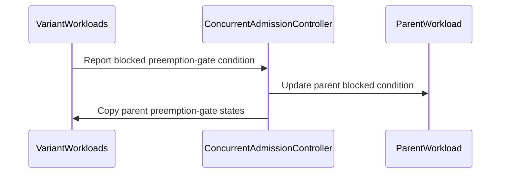

# PR #13545: MultiKueue: support Concurrent Admission preemption

**Summary**: MultiKueue: support Concurrent Admission preemption

**Sources**: https://github.com/kubernetes-sigs/kueue/pull/13545

**Last updated**: 2026-10-21T08:43:50Z

---

## Metadata

- **State**: open
- **Author**: [@MatteoFari](https://github.com/MatteoFari)
- **Branch**: `feature/12470-multikueue-concurrent-admission` → `main`
- **Created**: 2026-07-27T15:17:48Z
- **Updated**: 2026-10-21T08:43:50Z
- **Merged**: —
- **Closed**: —
- **Labels**: `kind/feature`, `release-note`, `size/XL`, `needs-rebase`, `cncf-cla: yes`, `area/multikueue`
- **Assignees**: [@kshalot](https://github.com/kshalot)
- **Requested reviewers**: [@amy](https://github.com/amy), [@kshalot](https://github.com/kshalot)
- **Changed files**: 11   **+635 / -15**

## Description

<!--  Thanks for sending a pull request!  Here are some tips for you:

1. If this is your first time, please read our contributor guidelines: https://git.k8s.io/community/contributors/guide/first-contribution.md#your-first-contribution and developer guide https://git.k8s.io/community/contributors/devel/development.md#development-guide
2. Please label this pull request according to what type of issue you are addressing, especially if this is a release targeted pull request. For reference on required PR/issue labels, read here:
https://git.k8s.io/community/contributors/devel/sig-release/release.md#issuepr-kind-label
3. Ensure you have added or ran the appropriate tests for your PR: https://git.k8s.io/community/contributors/devel/sig-testing/testing.md
4. If you want *faster* PR reviews, read how: https://git.k8s.io/community/contributors/guide/pull-requests.md#best-practices-for-faster-reviews
5. If the PR is unfinished, see how to mark it: https://git.k8s.io/community/contributors/guide/pull-requests.md#marking-unfinished-pull-requests
-->

#### What type of PR is this?
/kind feature
/area multikueue
<!--
Add one of the following kinds:
/kind bug
/kind cleanup
/kind documentation
/kind feature
/kind kep

Optionally add one or more of the following kinds if applicable:
/kind api-change
/kind deprecation
/kind failing-test
/kind flake
/kind regression

Please also consider setting the area:
/area tas
/area was
/area integrations
/area multikueue
/area dashboard
/area localization
/area testing
/area website
-->

#### What this PR does / why we need it:
Supports Concurrent Admission with MultiKueue orchestrated preemption on worker clusters. Variant preemption signals are propagated to the Parent Workload so MultiKueue can select a worker, while Parent gate states are synchronized back to every Variant. Manager ClusterQueues combining MultiKueue and Concurrent Admission are marked inactive because this configuration is unsupported.
#### Which issue(s) this PR fixes:
<!--
*Automatically closes linked issue when PR is merged.
Usage: `Fixes #<issue number>`, or `Fixes (paste link of issue)`.
_If PR is about `failing-tests or flakes`, please post the related issues/tests in a comment and do not use `Fixes`_*
-->
Fixes #12470

#### Special notes for your reviewer:

#### Does this PR introduce a user-facing change?
<!--
If no, just write "NONE" in the release-note block below.
If yes, a release note is required:
Enter your extended release note in the block below. If the PR requires additional action from users switching to the new release, include the string "action required".
-->
```release-note
MultiKueue now supports Concurrent Admission preemption on worker clusters and prevents unsupported manager ClusterQueue configurations.
```


<!-- This is an auto-generated comment: release notes by coderabbit.ai -->
<!-- coderabbit-ai-generated:v1 -->

## AI summary

- Added MultiKueue support for Concurrent Admission preemption on worker clusters.
- Propagated preemption signals between parent Workloads and variants.
- Marked manager ClusterQueues that combine MultiKueue with Concurrent Admission as inactive.
- Added documentation and integration coverage.

### Suggested release note

**MultiKueue:** Added support for Concurrent Admission preemption on worker clusters. Manager ClusterQueues that combine MultiKueue with Concurrent Admission are now marked inactive.
<!-- end of auto-generated comment: release notes by coderabbit.ai -->

## Discussion

### Comment by [@netlify[bot]](https://github.com/apps/netlify) — 2026-07-27T15:17:56Z

### <span aria-hidden="true">✅</span> Deploy Preview for *kubernetes-sigs-kueue* ready!


|  Name | Link |
|:-:|------------------------|
|<span aria-hidden="true">🔨</span> Latest commit | 1559dc700680cfadb30d0a4d65057a8cc8e000c0 |
|<span aria-hidden="true">🔍</span> Latest deploy log | https://app.netlify.com/projects/kubernetes-sigs-kueue/deploys/6ad8786ffd117db1156228f8 |
|<span aria-hidden="true">😎</span> Deploy Preview | [https://deploy-preview-13545--kubernetes-sigs-kueue.netlify.app](https://deploy-preview-13545--kubernetes-sigs-kueue.netlify.app) |
|<span aria-hidden="true">📱</span> Preview on mobile | <details><summary> Toggle QR Code... </summary><br /><br /><br /><br />_Use your smartphone camera to open QR code link._</details> |
---
<!-- [kubernetes-sigs-kueue Preview](https://deploy-preview-13545--kubernetes-sigs-kueue.netlify.app) -->
_To edit notification comments on pull requests, go to your [Netlify project configuration](https://app.netlify.com/projects/kubernetes-sigs-kueue/configuration/notifications#deploy-notifications)._

### Comment by [@kubernetes-prow[bot]](https://github.com/apps/kubernetes-prow) — 2026-07-27T15:18:00Z

[APPROVALNOTIFIER] This PR is **NOT APPROVED**

This pull-request has been approved by: *<a href="https://github.com/kubernetes-sigs/kueue/pull/13545#" title="Author self-approved">MatteoFari</a>*
**Once this PR has been reviewed and has the lgtm label**, please assign [mbobrovskyi](https://github.com/mbobrovskyi), [pbundyra](https://github.com/pbundyra), [tenzen-y](https://github.com/tenzen-y) for approval. For more information see [the Code Review Process](https://git.k8s.io/community/contributors/guide/owners.md#the-code-review-process).

The full list of commands accepted by this bot can be found [here](https://go.k8s.io/bot-commands?repo=kubernetes-sigs%2Fkueue).

<details open>
Needs approval from an approver in each of these files:

- **[OWNERS](https://github.com/kubernetes-sigs/kueue/blob/main/OWNERS)**

Approvers can indicate their approval by writing `/approve` in a comment
Approvers can cancel approval by writing `/approve cancel` in a comment
</details>
<!-- META={"approvers":["mbobrovskyi","pbundyra","tenzen-y"]} -->

### Comment by [@coderabbitai[bot]](https://github.com/apps/coderabbitai) — 2026-07-27T15:18:12Z

<!-- coderabbit-ai-generated:v1 -->

<!-- This is an auto-generated comment: summarize by coderabbit.ai -->
<!-- review_stack_entry_start -->

<a href="https://app.coderabbit.ai/change-stack/kubernetes-sigs/kueue/pull/13545?scope=ghh_OusAJGA4HG8ljoOV0wJvVx8NmnZIjc2DdjmxOu0xZWA&amp;cs_source=review_comment"><picture><source media="(prefers-color-scheme: dark)" srcset="https://storage.googleapis.com/coderabbit_public_assets/review-stack-in-coderabbit-ui-dark.svg?v=3"><source media="(prefers-color-scheme: light)" srcset="https://storage.googleapis.com/coderabbit_public_assets/review-stack-in-coderabbit-ui.svg?v=3"></picture></a>

<!-- review_stack_entry_end -->
<!-- recent_review_start -->

No actionable comments were generated in the recent review. 🎉

<details>
<summary><strong>ℹ️ Recent review info</strong></summary>
<dl>
<dd>

<details>
<summary><strong>⚙️ Run configuration</strong></summary>
<dl>
<dd>

- **Configuration used**: Repository: kubernetes-sigs/kueue/.coderabbit.yaml
- **Review profile**: CHILL
- **Plan**: Advanced
- **Run ID**: `1112a872-51f3-4802-b480-24d9b8a935bc`

</dd>
</dl>
</details>

<details>
<summary><strong>📥 Commits</strong></summary>
<dl>
<dd>

Reviewing files that changed from the base of the PR and between ba8ece453d6de0b76e44971bb89666a529931143 and 1559dc700680cfadb30d0a4d65057a8cc8e000c0.

</dd>
</dl>
</details>

<details>
<summary><strong>📒 Files selected for processing: 11</strong></summary>
<dl>
<dd>

* `apis/kueue/v1beta2/clusterqueue_types.go`
* `pkg/cache/scheduler/clusterqueue.go`
* `pkg/cache/scheduler/clusterqueue_test.go`
* `pkg/controller/concurrentadmission/controller.go`
* `pkg/controller/concurrentadmission/controller_test.go`
* `site/content/en/docs/concepts/concurrent_admission.md`
* `site/content/en/docs/concepts/multikueue.md`
* `test/integration/multikueue/scheduler/scheduler_test.go`
* `test/integration/multikueue/scheduler/suite_test.go`
* `test/integration/singlecluster/controller/concurrentadmission/concurrent_admission_test.go`
* `test/integration/singlecluster/controller/core/clusterqueue_controller_test.go`

</dd>
</dl>
</details>

<details>
<summary><strong>🚧 Files skipped from review as they are similar to previous changes: 2</strong></summary>
<dl>
<dd>

* site/content/en/docs/concepts/multikueue.md
* site/content/en/docs/concepts/concurrent_admission.md

</dd>
</dl>
</details>

**Included review availability:** This review used your included allowance. Your plan provides up to 8 included reviews per hour; 7 remain after this review.

</dd>
</dl>
</details>


<!-- recent_review_end -->
<!-- walkthrough_start -->

<details>
<summary><strong>📝 Walkthrough</strong></summary>
<dl>
<dd>

The change adds ClusterQueue status handling for Concurrent Admission with MultiKueue. It also synchronizes preemption-gate states between parent and Variant workloads and adds unit, integration, and documentation updates for these behaviors.

**Changes: Concurrent Admission and MultiKueue**

|Layer / File(s)|Summary|
|:---|:---|
|**ClusterQueue policy and status** <br> `apis/kueue/v1beta2/clusterqueue_types.go`, `pkg/cache/scheduler/clusterqueue.go`, `pkg/cache/scheduler/clusterqueue_test.go`, `test/integration/singlecluster/controller/core/clusterqueue_controller_test.go`, `site/content/en/docs/concepts/multikueue.md`, `site/content/en/docs/concepts/concurrent_admission.md`|Updates `ConcurrentAdmissionPolicy` only when the feature gate is enabled. ClusterQueues with both Concurrent Admission and a MultiKueue AdmissionCheck receive the `MultiKueueWithConcurrentAdmission` status reason. Tests cover enabled and disabled feature-gate cases.|
|**Parent and Variant preemption synchronization** <br> `pkg/controller/concurrentadmission/controller.go`, `pkg/controller/concurrentadmission/controller_test.go`|Copies parent preemption-gate states to Variants and derives the parent blocked condition from admissible blocked Variants. Generated Variants omit the inherited blocked condition.|
|**Integration coverage and documented behavior** <br> `test/integration/multikueue/scheduler/*`, `test/integration/singlecluster/controller/concurrentadmission/concurrent_admission_test.go`, `site/content/en/docs/concepts/concurrent_admission.md`|Adds integration coverage for preemption-gate propagation and wires the Concurrent Admission controller into the MultiKueue scheduler test setup. Documents worker ClusterQueue policy placement and the preemption flow.|

<!-- change_assessment_start -->
**Priority:** ➖ Normal

**Estimated code review effort:** 4 (Complex) | ~45 minutes

<!-- change_assessment_commit:"1559dc700680cfadb30d0a4d65057a8cc8e000c0" -->
**Change:** Feature
<!-- change_assessment_end -->

### Sequence Diagram(s)



**Suggested reviewers:** `mbobrovskyi`

</dd>
</dl>
</details>

<!-- walkthrough_end -->
<details>
<summary><strong>Merge Risk:</strong> <strong>⚪ Minimal</strong> · up to <code>1559d</code></summary>
<dl>
<dd>

<!-- final_review_risk_start -->
<!-- final_review_risk_label
**Merge Risk:** **⚪ Minimal** · up to `1559d`
-->
<!-- final_review_risk_coverage:{"sourceCommitId":"1559dc700680cfadb30d0a4d65057a8cc8e000c0","coveredCommitId":"1559dc700680cfadb30d0a4d65057a8cc8e000c0","kind":"reviewed"} -->

This change adds MultiKueue support for Concurrent Admission preemption and marks unsupported manager queue configurations inactive. No concrete merge-blocking risk was identified in the supplied evidence.
<!-- final_review_risk_end -->

</dd>
</dl>
</details>

<details>
<summary><strong>Security architecture risk:</strong> <strong>🔵 Low</strong> · up to <code>1559d</code></summary>
<dl>
<dd>

<!-- architecture_review_start -->
<!-- architecture_review_label
### Security Architecture Review

**Security architecture risk:** **🔵 Low** · up to `1559d`
-->

The new coordination remains scoped to workload families and existing worker-selection mechanisms. No introduced security bypass was established, but concurrent updates, interruption recovery, and rollback behavior are not fully verified.

**Retained concerns**
No architecture-level concerns identified.

<details>
<summary><strong>Security review details</strong></summary>
<dl>
<dd>

**Security Blast Radius**
- _inferred_ — The new propagation path affects worker-side admission and preemption through the current parent's owned Variant family and MultiKueue's existing remote-workload group. This establishes the orchestration scope, but not the maximum victim, tenant, or cohort scope of downstream preemption policies.

**Trust Boundaries and Controls**
- _observed_ — A worker Variant's blocked status now reaches manager-side orchestration through its parent. Opening the parent's MultiKueue gate remains an explicit remote status update guarded by the orchestrated-preemption feature. Missing status for a declared preemption gate is treated as closed, and newly generated Variants do not inherit the parent's aggregate blocked condition as their own signal.

**Resilience and Maintainability Implications**
- _inferred_ — The parent's aggregate signal can temporarily reflect an older Variant snapshot: it is selected before patching, and conflict retries refresh only the patched parent. MultiKueue may consequently act on outdated worker eligibility or ordering. Parent and Variant updates enqueue reconciliation, providing counterevidence against a necessarily persistent stale state; unauthorized preemption was not established.

**Hardening Proposals**
- _proposed_ — If stronger reset fencing is required, consider a transition epoch or explicit freshness validation across parent signals and inherited gate states, so delayed reconciliation cannot apply authorization from an earlier admission attempt. This is a hardening proposal, not an observed boundary bypass.

</dd>
</dl>
</details>
<!-- architecture_review_end -->

</dd>
</dl>
</details>
<!-- pre_merge_checks_walkthrough_start -->

<details>
<summary><strong>Pre-merge checks: <sup><picture></picture></sup> 4 · <sup><picture></picture></sup> 1</strong></summary>
<dl>
<dd>

<strong><sup><picture></picture></sup> Failed checks: 1 warning</strong>

|     Check name     |                                              Status                                              | Explanation                                                                                                                                                                                               | Resolution                                                                         |
| :---------------- | :----------------------------------------------------------------------------------------------: | :-------------------------------------------------------------------------------------------------------------------------------------------------------------------------------------------------------- | :--------------------------------------------------------------------------------- |
| Docstring Coverage |  | Docstring coverage is 16.67% which is insufficient. The required threshold is 80.00%. Docstring coverage is scoped to functions touched by this diff. Analyzed 12 functions across 9 files. (2 skipped: … | Write docstrings for the functions missing them to satisfy the coverage threshold. |

<details>
<summary><strong><sup><picture></picture></sup> Passed checks: 4 passed</strong></summary>
<dl>
<dd>

|         Check name         |                                             Status                                             | Explanation                                                                                                                                                                                               |
| :------------------------ | :--------------------------------------------------------------------------------------------: | :-------------------------------------------------------------------------------------------------------------------------------------------------------------------------------------------------------- |
|      Description Check     |  | Check skipped - CodeRabbit’s high-level summary is enabled.                                                                                                                                               |
|         Title check        |  | The title clearly and concisely describes the main change: enabling Concurrent Admission preemption support in MultiKueue.                                                                                |
|     Linked Issues check    |  | Issue `#12470` has active coding requirements. The PR marks a manager ClusterQueue inactive when it combines a MultiKueue AdmissionCheck with Concurrent Admission. The PR documents worker-only configura… |
| Out of Scope Changes check |  | The changes stay within issue `#12470`. The API reason constant, scheduler validation, controller changes, documentation, and unit and integration tests directly support the requested MultiKueue and Con… |

<details>
<summary><strong>Full details: Linked Issues check</strong></summary>
<dl>
<dd>

**Explanation**

Issue `#12470` has active coding requirements. The PR marks a manager ClusterQueue inactive when it combines a MultiKueue AdmissionCheck with Concurrent Admission. The PR documents worker-only configuration in both Concurrent Admission and MultiKueue documentation. The Concurrent Admission controller synchronizes inherited preemption-gate states to Variants and reports the oldest admissible Variant preemption signal on the Parent Workload. The PR adds unit and integration coverage for these behaviors.

</dd>
</dl>
</details>

<details>
<summary><strong>Full details: Out of Scope Changes check</strong></summary>
<dl>
<dd>

**Explanation**

The changes stay within issue `#12470`. The API reason constant, scheduler validation, controller changes, documentation, and unit and integration tests directly support the requested MultiKueue and Concurrent Admission behavior. No unrelated change is shown.

</dd>
</dl>
</details>

</dd>
</dl>
</details>

<details>
<summary><strong>Full details: Docstring Coverage</strong></summary>
<dl>
<dd>

**Explanation**

Docstring coverage is 16.67% which is insufficient. The required threshold is 80.00%. Docstring coverage is scoped to functions touched by this diff. Analyzed 12 functions across 9 files. (2 skipped: 2 unsupported.)

**Resolution**

Write docstrings for the functions missing them to satisfy the coverage threshold.

</dd>
</dl>
</details>

</dd>
</dl>
</details>

<!-- pre_merge_checks_walkthrough_end -->
<!-- finishing_touch_checkbox_start -->

<details>
<summary><strong>✨ Finishing Touches</strong></summary>
<dl>
<dd>

<details open>
<summary><strong>🧪 Generate unit tests (beta)</strong></summary>
<dl>
<dd>

- [ ] <!-- {"checkboxId": "f47ac10b-58cc-4372-a567-0e02b2c3d479", "radioGroupId": "utg-output-choice-group-unknown_comment_id"} --> Create a new PR

</dd>
</dl>
</details>

</dd>
</dl>
</details>

<!-- finishing_touch_checkbox_end -->
<!-- tips_start -->


<sub>Comment `@coderabbitai help` to get the list of available commands.</sub>

<!-- tips_end -->

### Comment by [@k8s-triage-robot](https://github.com/k8s-triage-robot) — 2026-10-20T12:26:10Z

The Kubernetes project currently lacks enough active contributors to adequately respond to all PRs.

This bot triages PRs according to the following rules:
- After 30d of inactivity, `lifecycle/stale` is applied
- After 30d of inactivity since `lifecycle/stale` was applied, `lifecycle/rotten` is applied
- After 30d of inactivity since `lifecycle/rotten` was applied, the PR is closed

You can:
- Mark this PR as fresh with `/remove-lifecycle stale`
- Close this PR with `/close`
- Offer to help out with [Issue Triage][1]

Please send feedback to us at [Kueue](https://github.com/kubernetes-sigs/kueue/tree/main#community-discussion-contribution-and-support).

/lifecycle stale

[1]: https://www.kubernetes.dev/docs/guide/issue-triage/

### Comment by [@kubernetes-prow[bot]](https://github.com/apps/kubernetes-prow) — 2026-10-20T12:30:54Z

PR needs rebase.

<details>

Instructions for interacting with me using PR comments are available [here](https://git.k8s.io/community/contributors/guide/pull-requests.md).  If you have questions or suggestions related to my behavior, please file an issue against the [kubernetes-sigs/prow](https://github.com/kubernetes-sigs/prow/issues/new?title=Prow%20issue:) repository.
</details>

### Comment by [@kshalot](https://github.com/kshalot) — 2026-10-20T13:06:31Z

/remove-lifecycle stale

wow this one slipped me even though I was assigned. I'll try to review this soon 😬

## Reviews

### Review by [@coderabbitai[bot]](https://github.com/apps/coderabbitai) (commented) — 2026-07-27T15:24:30Z


<details>
<summary>🧹 Nitpick comments (3)</summary><blockquote>

<details>
<summary>test/integration/singlecluster/controller/core/clusterqueue_controller_test.go (1)</summary><blockquote>

`909-923`: _📐 Maintainability & Code Quality_ | _🔵 Trivial_ | _⚡ Quick win_

**Prefer `DeferCleanup` for the extra ClusterQueue.**

`concurrentCq` is deleted only on the happy path; if the `Eventually` above fails, the ClusterQueue leaks into later specs in the same cohort and can cause cascading failures. Registering cleanup right after creation makes teardown unconditional.

<details>
<summary>♻️ Suggested change</summary>

```diff
 			util.MustCreate(ctx, k8sClient, concurrentCq)
+			ginkgo.DeferCleanup(func() {
+				util.ExpectObjectToBeDeleted(ctx, k8sClient, concurrentCq, true)
+			})
@@
 			}, util.Timeout, util.Interval).Should(gomega.Succeed())
-			util.ExpectObjectToBeDeleted(ctx, k8sClient, concurrentCq, true)
```
</details>

<details>
<summary>🤖 Prompt for AI Agents</summary>

```
Verify each finding against current code. Fix only still-valid issues, skip the
rest with a brief reason, keep changes minimal, and validate.

In
`@test/integration/singlecluster/controller/core/clusterqueue_controller_test.go`
around lines 909 - 923, Register DeferCleanup for concurrentCq immediately after
util.MustCreate creates it, so the extra ClusterQueue is deleted regardless of
whether the subsequent Eventually assertion succeeds. Remove the happy-path-only
util.ExpectObjectToBeDeleted call and retain the existing cleanup behavior
through the deferred teardown.
```

</details>

<!-- cr-comment:v1:3cf257f3b00e3e3e39047760 -->

</blockquote></details>
<details>
<summary>pkg/cache/scheduler/clusterqueue.go (1)</summary><blockquote>

`182-184`: _📐 Maintainability & Code Quality_ | _🔵 Trivial_ | _💤 Low value_

**Gating the assignment is redundant and can leave stale state.**

`ConcurrentAdmissionEnabled()` (Line 212) already short-circuits on the feature gate, so the extra guard here only adds a path where a previously-cached `ConcurrentAdmissionPolicy` is never cleared if the gate flips off between updates. Assigning unconditionally keeps the cached value a faithful mirror of the spec.

<details>
<summary>♻️ Suggested simplification</summary>

```diff
 	c.AdmissionChecks = admissioncheck.NewAdmissionChecks(in)
-	if features.Enabled(features.ConcurrentAdmission) {
-		c.ConcurrentAdmissionPolicy = in.Spec.ConcurrentAdmissionPolicy
-	}
+	c.ConcurrentAdmissionPolicy = in.Spec.ConcurrentAdmissionPolicy
```
</details>

<details>
<summary>🤖 Prompt for AI Agents</summary>

```
Verify each finding against current code. Fix only still-valid issues, skip the
rest with a brief reason, keep changes minimal, and validate.

In `@pkg/cache/scheduler/clusterqueue.go` around lines 182 - 184, Update the
cluster queue spec synchronization around ConcurrentAdmissionPolicy to assign
c.ConcurrentAdmissionPolicy from in.Spec.ConcurrentAdmissionPolicy
unconditionally, removing the features.Enabled(features.ConcurrentAdmission)
guard. Preserve ConcurrentAdmissionEnabled() as the feature-gate check while
ensuring cached state mirrors the current spec and clears when the gate is
disabled.
```

</details>

<!-- cr-comment:v1:dc1674349a991066fc95a9d4 -->

</blockquote></details>
<details>
<summary>pkg/controller/concurrentadmission/controller.go (1)</summary><blockquote>

`676-702`: _🗄️ Data Integrity & Integration_ | _🔵 Trivial_ | _💤 Low value_

**Stale variant gate states are never pruned.**

States are copied for gates still present in the Parent spec, but entries left over from gates removed from the Parent spec remain in `variant.Status.PreemptionGates` indefinitely. Harmless today (lookups are by name), just noting it in case gate removal becomes supported.

<details>
<summary>🤖 Prompt for AI Agents</summary>

```
Verify each finding against current code. Fix only still-valid issues, skip the
rest with a brief reason, keep changes minimal, and validate.

In `@pkg/controller/concurrentadmission/controller.go` around lines 676 - 702, The
updateInheritedPreemptionGateStates function should remove
variant.Status.PreemptionGates entries whose names are no longer present in
parent.Spec.PreemptionGates, while preserving and synchronizing states for
inherited gates. Mark updated true when pruning occurs and retain the existing
copy/update behavior for valid gates.
```

</details>

<!-- cr-comment:v1:36f238d711324991a047d76f -->

</blockquote></details>

</blockquote></details>

<details>
<summary>🤖 Prompt for all review comments with AI agents</summary>

```
Verify each finding against current code. Fix only still-valid issues, skip the
rest with a brief reason, keep changes minimal, and validate.

Nitpick comments:
In `@pkg/cache/scheduler/clusterqueue.go`:
- Around line 182-184: Update the cluster queue spec synchronization around
ConcurrentAdmissionPolicy to assign c.ConcurrentAdmissionPolicy from
in.Spec.ConcurrentAdmissionPolicy unconditionally, removing the
features.Enabled(features.ConcurrentAdmission) guard. Preserve
ConcurrentAdmissionEnabled() as the feature-gate check while ensuring cached
state mirrors the current spec and clears when the gate is disabled.

In `@pkg/controller/concurrentadmission/controller.go`:
- Around line 676-702: The updateInheritedPreemptionGateStates function should
remove variant.Status.PreemptionGates entries whose names are no longer present
in parent.Spec.PreemptionGates, while preserving and synchronizing states for
inherited gates. Mark updated true when pruning occurs and retain the existing
copy/update behavior for valid gates.

In
`@test/integration/singlecluster/controller/core/clusterqueue_controller_test.go`:
- Around line 909-923: Register DeferCleanup for concurrentCq immediately after
util.MustCreate creates it, so the extra ClusterQueue is deleted regardless of
whether the subsequent Eventually assertion succeeds. Remove the happy-path-only
util.ExpectObjectToBeDeleted call and retain the existing cleanup behavior
through the deferred teardown.
```

</details>

---

<details>
<summary>ℹ️ Review info</summary>

<details>
<summary>⚙️ Run configuration</summary>

**Configuration used**: Path: .coderabbit.yaml

**Review profile**: CHILL

**Plan**: Pro Plus

**Run ID**: `f1e9f1b8-3403-4794-b726-15d3bd39104b`

</details>

<details>
<summary>📥 Commits</summary>

Reviewing files that changed from the base of the PR and between db455fc036bb933de4fffc9d91f1e7c75e70131f and ba8ece453d6de0b76e44971bb89666a529931143.

</details>

<details>
<summary>📒 Files selected for processing (12)</summary>

* `apis/kueue/v1beta1/clusterqueue_types.go`
* `apis/kueue/v1beta2/clusterqueue_types.go`
* `pkg/cache/scheduler/clusterqueue.go`
* `pkg/cache/scheduler/clusterqueue_test.go`
* `pkg/controller/concurrentadmission/controller.go`
* `pkg/controller/concurrentadmission/controller_test.go`
* `site/content/en/docs/concepts/concurrent_admission.md`
* `site/content/en/docs/concepts/multikueue.md`
* `test/integration/multikueue/scheduler/scheduler_test.go`
* `test/integration/multikueue/scheduler/suite_test.go`
* `test/integration/singlecluster/controller/concurrentadmission/concurrent_admission_test.go`
* `test/integration/singlecluster/controller/core/clusterqueue_controller_test.go`

</details>

</details>

<!-- This is an auto-generated comment by CodeRabbit for review status -->

### Review by [@mimowo](https://github.com/mimowo) (commented) — 2026-07-27T15:51:24Z

/assign @kshalot 
For the first review pass, but let me know if there  are some questions requiring maintainer attention early on.

### Review by [@mwielgus](https://github.com/mwielgus) (commented) — 2026-07-28T09:07:33Z

- **site/content/en/docs/concepts/concurrent_admission.md:186** by [@mwielgus](https://github.com/mwielgus) — 2026-07-28T09:07:25Z
```diff
@@ -153,10 +153,27 @@ Concurrent Admission currently has the following constraints:
 - A `ClusterQueue` with `.spec.concurrentAdmissionPolicy` must have exactly one
   `resourceGroup`.
 - The `resourceGroup` can contain at most 16 ResourceFlavors.
+- A `ClusterQueue` that uses a MultiKueue AdmissionCheck is marked inactive if
+  it defines `.spec.concurrentAdmissionPolicy`. Configure Concurrent Admission
+  on the worker cluster's ClusterQueue instead.
 - The `concurrentAdmissionPolicy` field is immutable after the `ClusterQueue` is
   created.
 - `TryPreferredFlavors` is the only supported migration mode.
 
+## MultiKueue
+
+Concurrent Admission can be used on MultiKueue worker clusters. The manager
+ClusterQueue should use the MultiKueue AdmissionCheck without defining
+`.spec.concurrentAdmissionPolicy`, while the corresponding worker
+ClusterQueues define their Concurrent Admission policies.
+
+When MultiKueue orchestrated preemption is enabled, a worker reports a
+Variant's preemption signal through its Parent Workload. MultiKueue opens the
+Parent's preemption gate, and Concurrent Admission propagates the gate state to
+the Variants. The Concurrent Admission gate continues to control which sibling
+Variants can attempt preemption and opens them in preference order, subject to
```

  Does it mean that for "upgrades" of the already admitted workloads, the MultiKueue management cluster is not involved?

### Review by [@MatteoFari](https://github.com/MatteoFari) (commented) — 2026-07-28T09:44:06Z

- **site/content/en/docs/concepts/concurrent_admission.md:186** by [@MatteoFari](https://github.com/MatteoFari) — 2026-07-28T09:44:06Z
```diff
@@ -153,10 +153,27 @@ Concurrent Admission currently has the following constraints:
 - A `ClusterQueue` with `.spec.concurrentAdmissionPolicy` must have exactly one
   `resourceGroup`.
 - The `resourceGroup` can contain at most 16 ResourceFlavors.
+- A `ClusterQueue` that uses a MultiKueue AdmissionCheck is marked inactive if
+  it defines `.spec.concurrentAdmissionPolicy`. Configure Concurrent Admission
+  on the worker cluster's ClusterQueue instead.
 - The `concurrentAdmissionPolicy` field is immutable after the `ClusterQueue` is
   created.
 - `TryPreferredFlavors` is the only supported migration mode.
 
+## MultiKueue
+
+Concurrent Admission can be used on MultiKueue worker clusters. The manager
+ClusterQueue should use the MultiKueue AdmissionCheck without defining
+`.spec.concurrentAdmissionPolicy`, while the corresponding worker
+ClusterQueues define their Concurrent Admission policies.
+
+When MultiKueue orchestrated preemption is enabled, a worker reports a
+Variant's preemption signal through its Parent Workload. MultiKueue opens the
+Parent's preemption gate, and Concurrent Admission propagates the gate state to
+the Variants. The Concurrent Admission gate continues to control which sibling
+Variants can attempt preemption and opens them in preference order, subject to
```

  The worker manages variant "upgrades". But if an upgrade requires orchestrated preemption, the manager still selects a worker and opens its MultiKueue gate.
