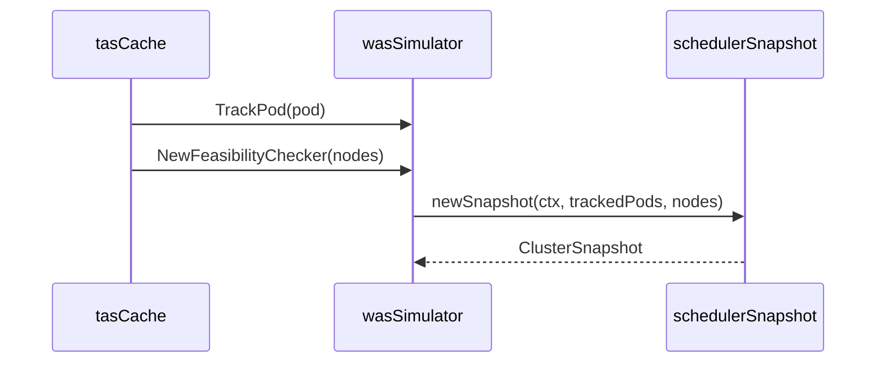

# PR #13555: TAS: enable nodeports plugin in WAS simulator for hostPort feasibility

**Summary**: TAS: enable nodeports plugin in WAS simulator for hostPort feasibility

**Sources**: https://github.com/kubernetes-sigs/kueue/pull/13555

**Last updated**: 2026-09-30T13:49:35Z

---

## Metadata

- **State**: closed (merged)
- **Author**: [@sohankunkerkar](https://github.com/sohankunkerkar)
- **Branch**: `was-nodeports-feasibility` → `main`
- **Created**: 2026-07-27T23:52:58Z
- **Updated**: 2026-09-30T13:49:35Z
- **Merged**: 2026-08-02T21:15:24Z
- **Closed**: 2026-08-02T21:15:24Z
- **Labels**: `kind/feature`, `release-note`, `size/L`, `lgtm`, `approved`, `cncf-cla: yes`, `area/was`
- **Assignees**: [@mimowo](https://github.com/mimowo), [@olekzabl](https://github.com/olekzabl)
- **Requested reviewers**: [@mimowo](https://github.com/mimowo), [@pajakd](https://github.com/pajakd)
- **Changed files**: 12   **+416 / -79**

## Description

<!--  Thanks for sending a pull request!  Here are some tips for you:

1. If this is your first time, please read our contributor guidelines: https://git.k8s.io/community/contributors/guide/first-contribution.md#your-first-contribution and developer guide https://git.k8s.io/community/contributors/devel/development.md#development-guide
2. Please label this pull request according to what type of issue you are addressing, especially if this is a release targeted pull request. For reference on required PR/issue labels, read here:
https://git.k8s.io/community/contributors/devel/sig-release/release.md#issuepr-kind-label
3. Ensure you have added or ran the appropriate tests for your PR: https://git.k8s.io/community/contributors/devel/sig-testing/testing.md
4. If you want *faster* PR reviews, read how: https://git.k8s.io/community/contributors/guide/pull-requests.md#best-practices-for-faster-reviews
5. If the PR is unfinished, see how to mark it: https://git.k8s.io/community/contributors/guide/pull-requests.md#marking-unfinished-pull-requests
-->

#### What type of PR is this?
/kind feature
/area was


#### What this PR does / why we need it:

#### Which issue(s) this PR fixes:
<!--
*Automatically closes linked issue when PR is merged.
Usage: `Fixes #<issue number>`, or `Fixes (paste link of issue)`.
_If PR is about `failing-tests or flakes`, please post the related issues/tests in a comment and do not use `Fixes`_*
-->
Partially addresses https://github.com/kubernetes-sigs/kueue/issues/13534

#### Special notes for your reviewer:

#### Does this PR introduce a user-facing change?
<!--
If no, just write "NONE" in the release-note block below.
If yes, a release note is required:
Enter your extended release note in the block below. If the PR requires additional action from users switching to the new release, include the string "action required".
-->
```release-note
TAS: Enable hostPort conflict detection to node feasibility checks, skipping nodes with occupied host ports when `SchedulerLibraryIntegration` is enabled.
```


<!-- This is an auto-generated comment: release notes by coderabbit.ai -->
## Summary by CodeRabbit

* **New Features**
  * Scheduling now maintains pod-specific state as pods are added, updated, or removed.
  * Feasibility checks use current pod placement and account for `hostPort` and protocol conflicts.
  * Scheduler evaluations now use up-to-date snapshots of nodes and tracked pods.

* **Bug Fixes**
  * Prevents scheduling candidates from being considered feasible when their requested port is already in use.
  * Ensures removed pods no longer block their previously reserved ports.
<!-- end of auto-generated comment: release notes by coderabbit.ai -->

## Discussion

### Comment by [@netlify[bot]](https://github.com/apps/netlify) — 2026-07-27T23:53:05Z

### <span aria-hidden="true">✅</span> Deploy Preview for *kubernetes-sigs-kueue* canceled.


|  Name | Link |
|:-:|------------------------|
|<span aria-hidden="true">🔨</span> Latest commit | 0b72fd87872cd4cf6fe44ad2cf821824e8fa162b |
|<span aria-hidden="true">🔍</span> Latest deploy log | https://app.netlify.com/projects/kubernetes-sigs-kueue/deploys/6a6cc767f109fa0008a27e22 |

### Comment by [@coderabbitai[bot]](https://github.com/apps/coderabbitai) — 2026-07-27T23:53:36Z

<!-- This is an auto-generated comment: summarize by coderabbit.ai -->
<!-- review_stack_entry_start -->

[](https://app.coderabbit.ai/change-stack/kubernetes-sigs/kueue/pull/13555?utm_source=github_walkthrough&utm_medium=github&utm_campaign=change_stack)

<!-- review_stack_entry_end -->
<!-- This is an auto-generated comment: review paused by coderabbit.ai -->

> [!NOTE]
> ## Reviews paused
> 
> It looks like this branch is under active development. To avoid overwhelming you with review comments due to an influx of new commits, CodeRabbit has automatically paused this review. You can configure this behavior by changing the `reviews.auto_review.auto_pause_after_reviewed_commits` setting.
> 
> Use the following commands to manage reviews:
> - `@coderabbitai resume` to resume automatic reviews.
> - `@coderabbitai review` to trigger a single review.
> 
> Use the checkboxes below for quick actions:
> - [ ] <!-- {"checkboxId": "7f6cc2e2-2e4e-497a-8c31-c9e4573e93d1"} --> ▶️ Resume reviews
> - [ ] <!-- {"checkboxId": "e9bb8d72-00e8-4f67-9cb2-caf3b22574fe"} --> 🔍 Trigger review

<!-- end of auto-generated comment: review paused by coderabbit.ai -->
<!-- walkthrough_start -->

<details>
<summary>📝 Walkthrough</summary>

## Walkthrough

The scheduling simulator interface now tracks and untracks pods. TAS cache lifecycle operations update simulator state. The WAS simulator builds on-demand snapshots with tracked pods and node-port filtering. Tests cover hostPort feasibility scenarios.

### Changes

**Pod-aware feasibility**

|Layer / File(s)|Summary|
|---|---|
|**Pod-aware feasibility contract and cache** <br> `pkg/cache/scheduler/simulator/interface.go`, `pkg/cache/scheduler/scheduling_simulator_default.go`, `pkg/cache/scheduler/tas_cache.go`|The simulator contract adds pod tracking methods. The default simulator implements no-op methods. TAS cache operations invoke tracking and untracking.|
|**WAS snapshot-based feasibility** <br> `pkg/cache/scheduler/was/scheduling_simulator.go`|WAS creates informer-backed scheduler snapshots on demand, enables node-port plugins, tracks pod placements, and includes tracked pods in candidate-node checks.|
|**Node port feasibility validation** <br> `pkg/cache/scheduler/was/scheduling_simulator_test.go`|Table-driven tests validate conflicting, distinct, absent, and missing hostPort scenarios across two nodes.|

**Estimated code review effort:** 3 (Moderate) | ~20 minutes

### Sequence Diagram(s)



**Possibly related PRs**

- [kubernetes-sigs/kueue#13192](https://github.com/kubernetes-sigs/kueue/pull/13192): Extends the same `SchedulingSimulator` abstraction with pod tracking and cache integration.
- [kubernetes-sigs/kueue#13261](https://github.com/kubernetes-sigs/kueue/pull/13261): Introduces the scheduler-library-backed WAS simulator extended by this change.

**Suggested reviewers:** `pajakd`, `kshalot`, `kannon92`

</details>

<!-- walkthrough_end -->
<!-- pre_merge_checks_walkthrough_start -->

<details>
<summary>🚥 Pre-merge checks | ✅ 4 | ❌ 1</summary>

### ❌ Failed checks (1 warning)

|     Check name     | Status     | Explanation                                                                           | Resolution                                                                         |
| :----------------: | :--------- | :------------------------------------------------------------------------------------ | :--------------------------------------------------------------------------------- |
| Docstring Coverage | ⚠️ Warning | Docstring coverage is 20.00% which is insufficient. The required threshold is 80.00%. | Write docstrings for the functions missing them to satisfy the coverage threshold. |

<details>
<summary>✅ Passed checks (4 passed)</summary>

|         Check name         | Status   | Explanation                                                                                                            |
| :------------------------: | :------- | :--------------------------------------------------------------------------------------------------------------------- |
|      Description Check     | ✅ Passed | Check skipped - CodeRabbit’s high-level summary is enabled.                                                            |
|         Title check        | ✅ Passed | The title clearly and concisely describes enabling the nodeports plugin for hostPort feasibility in the WAS simulator. |
|     Linked Issues check    | ✅ Passed | Check skipped because no linked issues were found for this pull request.                                               |
| Out of Scope Changes check | ✅ Passed | Check skipped because no linked issues were found for this pull request.                                               |

</details>

</details>

<!-- pre_merge_checks_walkthrough_end -->
<!-- finishing_touch_checkbox_start -->

<details>
<summary>✨ Finishing Touches</summary>

<details>
<summary>🧪 Generate unit tests (beta)</summary>

- [ ] <!-- {"checkboxId": "f47ac10b-58cc-4372-a567-0e02b2c3d479", "radioGroupId": "utg-output-choice-group-unknown_comment_id"} -->   Create PR with unit tests

</details>

</details>

<!-- finishing_touch_checkbox_end -->
<!-- tips_start -->

---

Thanks for using [CodeRabbit](https://coderabbit.ai?utm_source=oss&utm_medium=github&utm_campaign=kubernetes-sigs/kueue&utm_content=13555)! It's free for OSS, and your support helps us grow. If you like it, consider giving us a shout-out.

<details>
<summary>❤️ Share</summary>

- [X](https://twitter.com/intent/tweet?text=I%20just%20used%20%40coderabbitai%20for%20my%20code%20review%2C%20and%20it%27s%20fantastic%21%20It%27s%20free%20for%20OSS%20and%20offers%20a%20free%20trial%20for%20the%20proprietary%20code.%20Check%20it%20out%3A&url=https%3A//coderabbit.ai)
- [Mastodon](https://mastodon.social/share?text=I%20just%20used%20%40coderabbitai%20for%20my%20code%20review%2C%20and%20it%27s%20fantastic%21%20It%27s%20free%20for%20OSS%20and%20offers%20a%20free%20trial%20for%20the%20proprietary%20code.%20Check%20it%20out%3A%20https%3A%2F%2Fcoderabbit.ai)
- [Reddit](https://www.reddit.com/submit?title=Great%20tool%20for%20code%20review%20-%20CodeRabbit&text=I%20just%20used%20CodeRabbit%20for%20my%20code%20review%2C%20and%20it%27s%20fantastic%21%20It%27s%20free%20for%20OSS%20and%20offers%20a%20free%20trial%20for%20proprietary%20code.%20Check%20it%20out%3A%20https%3A//coderabbit.ai)
- [LinkedIn](https://www.linkedin.com/sharing/share-offsite/?url=https%3A%2F%2Fcoderabbit.ai&mini=true&title=Great%20tool%20for%20code%20review%20-%20CodeRabbit&summary=I%20just%20used%20CodeRabbit%20for%20my%20code%20review%2C%20and%20it%27s%20fantastic%21%20It%27s%20free%20for%20OSS%20and%20offers%20a%20free%20trial%20for%20proprietary%20code)

</details>


<sub>Comment `@coderabbitai help` to get the list of available commands.</sub>

<!-- tips_end -->

### Comment by [@olekzabl](https://github.com/olekzabl) — 2026-07-31T11:12:53Z

A quick heads up before this PR gets merged:

I suspect that this PR may diverge from the "standard level of Kueue placement fidelity" in two ways:

1. **Preemptions.**
   Imagine we have 1 node, and two Pods arrive `p1`, `p2`, with priorities 100, 200, and a port conflict.
   Then, `p2` does not "simply fit" but (IIUC) should preempt `p1`.
   Will this PR achieve such a preemption? 
   (I think it won't, because "hostPort" checks are always based on the snapshotted cluster state, ignoring any preemption simulations done by Kueue. So also during these simulations, the outcome will be still "`p2` won't fit". Right?)

   Generally, I think that any kind of "Pod awareness" should (ultimately?) come together with handling Kueue preemption simulations.

2. **In-flight workloads.**
   Taking into account workloads that have been already "assumed in cache" (i.e. quota reserved) but their Pods do not yet exist (e.g. due to AdmissionChecks pending).
   Here, the solution could be reflecting them as some "virtual pods" injected into library's ClusterSnapshot.

Handling any of these, especially # 1, is a large change, and we may want to split this work into multiple PRs.
I've actually already been working on a draft PR implementing # 2 together with a part of # 1.
I'll soon re-think how the work here could be organized, and create tracking issues.
If you'd like to contribute to those, let's discuss how we can divide the work.

As for this PR, leaving it without # 1 and # 2 seems fine.
However, if so, I'd consider hiding "Pod awareness in WAS integration" behind its own alpha feature gate. 
So that users can enable WAS integration (experimental) but still without Pod awareness (which currently would feel "even more experimental").

WDYT?

### Comment by [@mimowo](https://github.com/mimowo) — 2026-07-31T12:13:32Z

/unhold

### Comment by [@mimowo](https://github.com/mimowo) — 2026-07-31T12:24:49Z

@olekzabl, I think you are right about the gaps in the current implementation : both about preemptions and in-flight workloads.

However, we need to realize this is a big project and trying to fix all problems in one PR is impossible.  The question is: is the PR on the right path or conflicting / making harder the more complete solution.

I know that you started also some effort wrt pod tracking which IIUC will allow ultimately to solve the problem using "virtual pods". 

In that case you are probably the most knowledgeable currently to advise maintainers on the path forward, some paths I contemplate:
1. merge as is and remember about the problems, then return to the problems when we are more equipped with "virtual pods"
2. expand the PR to solve the gaps you mentioned (but I don't currently an idea how to do it without blowing the scope to at least "virtual pods", any ideas?)
3. suspend the PR until we have better tooling at place, like virtual pods, and re-thing the implementation

Any ideas suggestions @olekzabl?

### Comment by [@olekzabl](https://github.com/olekzabl) — 2026-07-31T12:36:29Z

@mimowo This was my original suggestion; not sure if you noticed. WDYT about it?

> As for this PR, leaving it without # 1 and # 2 seems fine.
> However, if so, I'd consider hiding "Pod awareness in WAS integration" behind its own alpha feature gate.
> So that users can enable WAS integration (experimental) but still without Pod awareness (which currently would feel "even more experimental").

### Comment by [@mimowo](https://github.com/mimowo) — 2026-07-31T12:50:58Z

> However, if so, I'd consider hiding "Pod awareness in WAS integration" behind its own alpha feature gate.
So that users can enable WAS integration (experimental) but still without Pod awareness (which currently would feel "even more experimental").

Yes, I noticed that, but the additional feature gate for alpha feature is a bit overkill. For alpha features we don't have any commitment on backwards compatibility - this is what they are for, so increasing the granularity in this case seems like complicating the code even more, and multiplying the testing.

So, I'm not convinced by that. I'm wondering if this PR if we can predict if the PR is on the right track with the new interfaces and mechanics, even if not complete, and we can navigate it towards being on the right track

### Comment by [@olekzabl](https://github.com/olekzabl) — 2026-07-31T13:21:03Z

I see. 

Then, for now, I don't see any "wrong directions" introduced in this PR.
And I think I'd like it to be merged early, so that any follow-up work on the gaps has a stable base.

(Probably in the end I'll prefer some identifiers renamed, e.g. `podTracker` -> `(existing|real)PodTracker`, similarly for `[Un]trackPod` etc.
Though, per YAGNI principle, such renames feel to fit well in the scope of the subsequent PRs, not necessarily this one).

### Comment by [@sohankunkerkar](https://github.com/sohankunkerkar) — 2026-07-31T13:26:07Z


> A quick heads up before this PR gets merged:
> 
> I suspect that this PR may diverge from the "standard level of Kueue placement fidelity" in two ways:
> 
> 1. **Preemptions.**
>    Imagine we have 1 node, and two Pods arrive `p1`, `p2`, with priorities 100, 200, and a port conflict.
>    Then, `p2` does not "simply fit" but (IIUC) should preempt `p1`.
>    Will this PR achieve such a preemption?
>    (I think it won't, because "hostPort" checks are always based on the snapshotted cluster state, ignoring any preemption simulations done by Kueue. So also during these simulations, the outcome will be still "`p2` won't fit". Right?)
>    Generally, I think that any kind of "Pod awareness" should (ultimately?) come together with handling Kueue preemption simulations.
> 2. **In-flight workloads.**
>    Taking into account workloads that have been already "assumed in cache" (i.e. quota reserved) but their Pods do not yet exist (e.g. due to AdmissionChecks pending).
>    Here, the solution could be reflecting them as some "virtual pods" injected into library's ClusterSnapshot.
> 
> Handling any of these, especially # 1, is a large change, and we may want to split this work into multiple PRs. I've actually already been working on a draft PR implementing # 2 together with a part of # 1. I'll soon re-think how the work here could be organized, and create tracking issues. If you'd like to contribute to those, let's discuss how we can divide the work.
> 
> As for this PR, leaving it without # 1 and # 2 seems fine. However, if so, I'd consider hiding "Pod awareness in WAS integration" behind its own alpha feature gate. So that users can enable WAS integration (experimental) but still without Pod awareness (which currently would feel "even more experimental").
> 
> WDYT?

Thanks @olekzabl for the detailed analysis. I'm kind of leaning towards what @mimowo's suggested in the earlier comment. I think merging this as-is and iterating is the right path. The interface refactoring (TrackPod/UntrackPod encapsulated in podTracker) also provides a good foundation for the virtual pod work in #13700.

One additional gap I noticed while tracing the code that doesn't seem to be covered by #13700:

The podTracker currently only sees non-TAS pods. `belongsToNonTASCache` filters out `IsTAS` pods at the predicate level (Create/Update/Delete in `non_tas_usage_controller.go` return before `Reconcile` runs), so TAS pods never reach `TrackPod`. As a result, two TAS-admitted workloads both requesting `hostPort: 8080` on the same node would both pass feasibility, since TAS domain usage (`addUsage`) tracks CPU, memory, and pod count, but not ports.

I think fixing this would require decoupling port tracking from the `nonTasUsageCache`, for example with a split predicate or an additional watch that calls `TrackPod`/`UntrackPod` for TAS pods without double counting resources into `nonTasUsageCache`.

This feels fairly self-contained relative to the virtual pod work, and orthogonal to both preemption and #13700, so it might be worth tracking separately.

I'd suggest three follow-up issues or an umbrella issue with these three included:
(a) Decouple port tracking and feed TAS pods through `TrackPod`
(b) Virtual pods for in-flight workloads (#13700)
(c) Preemption-aware simulation, if and when there is a concrete use case

### Comment by [@mimowo](https://github.com/mimowo) — 2026-07-31T13:36:50Z

Cool, becauss it seems we are building some common awareness of what is missing to make the proper Pod awareness support. Yes, de-coupling from nonTasPodCache will need to happen.

Let me check the PR again soon. 

One benefit which I realized only now in the @olekzabl  idea of FG is 'selective benchmasking', where we can easily run benchmark and generate pprof with different knobs enabled / disabled.

 This might be particularly useful later when we have full support for virtual pods. 

wdyt @sohankunkerkar?

### Comment by [@sohankunkerkar](https://github.com/sohankunkerkar) — 2026-07-31T13:45:39Z

> Cool, bwcauss it seems we are building somw common awareness of what is missing to make the proper Pod awareness support. Yes, de-coupling from nonTasPodCache will need to happen.
> 
> Let me check the PR again soon. One benefit which I realizwd only now in the @olekzabl idea of FG is 'selective benchmasking', where we can easily run benchmark and generate pprof with different knobs enabled / disabled.
> 
> This might be particularly useful later when we have full support for virtual pods.
> 
> wdyt @sohankunkerkar?

That's a fair point on selective benchmarking. Right now the pod tracking cost is minimal (map insert/delete per non-TAS pod), so there's not much to profile yet. Once virtual pods land and the snapshot construction gets heavier, a gate would give us a clean pprof baseline. I'd add it then when there's actual overhead to measure, thoughts?

### Comment by [@olekzabl](https://github.com/olekzabl) — 2026-07-31T14:01:03Z

> The podTracker currently only sees non-TAS pods.

Ouch. That is indeed a very different gap, which I didn't notice. Thank you for raising.

However, now that I see it, I can't stop feeling it's a smell: 
Why would we, even temporarily, create a connection between logic which is supposed to cover both TAS and non-TAS workloads (I mean, tracking Pods for WAS snapshot) and a controller purposed to support only non-TAS workloads?

This feels so counter-intuitive to me that I'd consider addressing this somehow right away.
I see your considerations on this:

> I think fixing this would require decoupling port tracking from the nonTasUsageCache, for example with a split predicate or an additional watch that calls TrackPod/UntrackPod for TAS pods without double counting resources into nonTasUsageCache.

Though I don't understand what you mean by "split predicate".

The easiest way forward I see would be to take the `non_tas_usage controller` as it currently is, and:

* remove the "non-TAS" logic from its predicates
* instead, in `Reconcile`, update `nonTasUsageCache` only for non-TAS workloads
* also in `Reconcile`, do `[Un]TrackPod` in all cases
* rename the file and controller, and update comments, to no longer suggest that it's non-TAS-scoped.

And that, to me, feels worth doing right away.

WDYT?

### Comment by [@mimowo](https://github.com/mimowo) — 2026-07-31T14:04:49Z

Agree, I think the benchmarking will not surface much here so let's skip this complication.

However, let's remember we may have this use case in the future even for alpha features.

/lgtm 
/approve
Thank you, seems like the fun begins!

### Comment by [@kubernetes-prow[bot]](https://github.com/apps/kubernetes-prow) — 2026-07-31T14:04:57Z

LGTM label has been added.  <details>Git tree hash: 97b29dd6cc046d91ac1d6490553c985e84d2df42</details>

### Comment by [@kubernetes-prow[bot]](https://github.com/apps/kubernetes-prow) — 2026-07-31T14:05:00Z

[APPROVALNOTIFIER] This PR is **APPROVED**

This pull-request has been approved by: *<a href="https://github.com/kubernetes-sigs/kueue/pull/13555#issuecomment-5143741843" title="Approved">mimowo</a>*, *<a href="https://github.com/kubernetes-sigs/kueue/pull/13555#" title="Author self-approved">sohankunkerkar</a>*

The full list of commands accepted by this bot can be found [here](https://go.k8s.io/bot-commands?repo=kubernetes-sigs%2Fkueue).

The pull request process is described [here](https://git.k8s.io/community/contributors/guide/owners.md#the-code-review-process)

<details >
Needs approval from an approver in each of these files:

- ~~[OWNERS](https://github.com/kubernetes-sigs/kueue/blob/main/OWNERS)~~ [mimowo,sohankunkerkar]

Approvers can indicate their approval by writing `/approve` in a comment
Approvers can cancel approval by writing `/approve cancel` in a comment
</details>
<!-- META={"approvers":[]} -->

### Comment by [@olekzabl](https://github.com/olekzabl) — 2026-07-31T14:09:42Z

Let me
/hold
to give @sohankunkerkar a chance to address my last comment.

### Comment by [@sohankunkerkar](https://github.com/sohankunkerkar) — 2026-07-31T14:19:09Z

>Though I don't understand what you mean by "split predicate".

> The easiest way forward I see would be to take the non_tas_usage controller as it currently is, and:

> remove the "non-TAS" logic from its predicates
> instead, in Reconcile, update nonTasUsageCache only for non-TAS workloads
> also in Reconcile, do [Un]TrackPod in all cases
> rename the file and controller, and update comments, to no longer suggest that it's non-TAS-scoped.
> And that, to me, feels worth doing right away.

That's cleaner than what I had in mind. I agree it's worth doing in this PR. The change is mechanical and keeps the wiring honest from the start. I'll update the PR.

### Comment by [@olekzabl](https://github.com/olekzabl) — 2026-08-01T22:46:17Z

@sohankunkerkar

Now that I reflected more on #13723 (just created), I'm foreseeing some interactions between that work and this PR.
In particular, I imagine some aspects of this PR might become obsolete.
(See the "Interaction with #13555" section in #13723).

Given that #13723 is currently just an idea, no draft PR yet (strictly: my old draft is so out-of-sync that I'd rather start over), I do **not** intend to necessarily block this PR on this discussion.

However, if you could look there and share your thoughts, I'll be grateful :)

### Comment by [@sohankunkerkar](https://github.com/sohankunkerkar) — 2026-08-02T05:55:21Z

@olekzabl Thanks for creating #13723 and linking it here. I went through it along with #13700 and #13702.

Your approach B in #13700 keeps real pods in the ClusterSnapshot as the baseline, then calls SchedulePod() on virtual ones. `SchedulePodsByTemplate` with `DryRun:false` runs the full Filter chain against pods already in the snapshot. So whatever #13700's final shape, it depends on real pod tracking landing first, which is what this PR adds.

Similarly, `PreemptPods` removes supplied pods from the snapshot. Without the `podTracker` feeding the initial pod set, there's nothing to preempt. IIUC, this PR  is a prerequisite for #13702's preemption simulation.

On #13723 specifically: the cluster-scoped refactor changes where the WAS ClusterSnapshot is constructed (flavor-scoped → cluster-scoped), not whether pod tracking is  needed. NewClusterSnapshot takes pods []*v1.Pod as a constructor argument regardless of scope. The podTracker persists; only podsForNodes (the per-node  indexing) would become redundant once the snapshot handles that internally and as you noted [here](https://github.com/kubernetes-sigs/kueue/pull/13555#issuecomment-5143306699), the rename belongs in a follow-up per YAGNI.

I'd prefer to land this PR as the foundation (with the controller rename already pushed), and let #13723 reshape snapshot construction in a follow-up.

### Comment by [@olekzabl](https://github.com/olekzabl) — 2026-08-02T19:27:31Z

Yes, we're aligned, and this PR looks great.

/unhold

BTW @sohankunkerkar thank you for renaming the existing methods in `tas_cache.go`; this went beyond the cleanup I requested and I agree it makes things a lot clearer.

### Comment by [@olekzabl](https://github.com/olekzabl) — 2026-08-02T20:59:41Z

/lgtm

### Comment by [@kubernetes-prow[bot]](https://github.com/apps/kubernetes-prow) — 2026-08-02T20:59:48Z

LGTM label has been added.  <details>Git tree hash: ee3deb344835fd010046aad1829be3cc80796491</details>

### Comment by [@mbobrovskyi](https://github.com/mbobrovskyi) — 2026-09-30T13:49:32Z

/release-note-edit
```release-note
TAS: Enable hostPort conflict detection to node feasibility checks, skipping nodes with occupied host ports when `SchedulerLibraryIntegration` is enabled.
```

## Reviews

### Review by [@mimowo](https://github.com/mimowo) (commented) — 2026-07-27T23:57:44Z

cc @kshalot @olekzabl ptal

### Review by [@copilot-pull-request-reviewer[bot]](https://github.com/apps/copilot-pull-request-reviewer) (commented) — 2026-07-27T23:58:59Z

## Pull request overview

This PR extends the WAS-backed feasibility checking used by TAS to account for `hostPort` conflicts by enabling the upstream `nodeports` scheduler plugin and by passing existing pods into the scheduler-library snapshot when `SchedulerLibraryIntegration` is enabled.

Note: any guidance sourced from `AGENTS.md` is experimental and has no backwards/future compatibility guarantees—please acknowledge this disclaimer before proceeding.

**Changes:**
- Enable the Kubernetes scheduler `nodeports` plugin in the WAS simulator profile to filter out nodes with occupied `hostPort`s.
- Extend the scheduling simulator interface to accept existing pods when constructing a feasibility checker, and thread that through TAS snapshot creation.
- Add a unit test verifying `hostPort` conflict behavior in the WAS simulator.

### Reviewed changes

Copilot reviewed 7 out of 7 changed files in this pull request and generated 3 comments.

<details>
<summary>Show a summary per file</summary>

| File | Description |
| ---- | ----------- |
| pkg/cache/scheduler/was/scheduling_simulator.go | Enables `nodeports` and reworks snapshot creation to include passed-in pods. |
| pkg/cache/scheduler/was/scheduling_simulator_test.go | Adds unit coverage for `hostPort` conflict feasibility behavior. |
| pkg/cache/scheduler/tas_non_tas_pod_cache.go | Adds per-node pod object indexing to supply pods to scheduler-library plugins. |
| pkg/cache/scheduler/tas_flavor.go | Supplies cached pods into feasibility checker construction when scheduler-library integration is enabled. |
| pkg/cache/scheduler/tas_cache.go | Initializes the new per-node pod index map in the TAS cache. |
| pkg/cache/scheduler/simulator/interface.go | Updates simulator interface to accept pods for feasibility checking. |
| pkg/cache/scheduler/scheduling_simulator_default.go | Updates default simulator implementation to match the new interface. |
</details>


---

💡 <a href="/kubernetes-sigs/kueue/new/main?filename=.github/instructions/*.instructions.md" class="Link--inTextBlock" target="_blank" rel="noopener noreferrer">Add Copilot custom instructions</a> for smarter, more guided reviews. <a href="https://docs.github.com/en/copilot/customizing-copilot/adding-repository-custom-instructions-for-github-copilot" class="Link--inTextBlock" target="_blank" rel="noopener noreferrer">Learn how to get started</a>.

- **pkg/cache/scheduler/tas_flavor.go:148** by [@Copilot](https://github.com/apps/copilot-pull-request-reviewer) — 2026-07-27T23:58:58Z
```diff
@@ -141,7 +141,11 @@ func (c *TASFlavorCache) snapshot(
 	}
 	log.V(3).Info("Constructing TAS snapshot", infoKV...)
 
-	feasibilityChecker, err := c.schedulingSimulator.NewFeasibilityChecker(ctx, nodes)
+	var pods []*corev1.Pod
+	if features.Enabled(features.SchedulerLibraryIntegration) {
+		pods = c.nonTasUsageCache.podsForNodes(nodes)
+	}
+	feasibilityChecker, err := c.schedulingSimulator.NewFeasibilityChecker(ctx, nodes, pods)
```

  When SchedulerLibraryIntegration is enabled, the feasibility checker is given only pods from nonTasUsageCache. That cache explicitly excludes TAS pods (see pkg/controller/tas/non_tas_usage_controller.go:86-97), so hostPort conflicts with already-running TAS pods won’t be detected and the nodeports plugin can incorrectly mark a node feasible.

- **pkg/cache/scheduler/tas_non_tas_pod_cache.go:81** by [@Copilot](https://github.com/apps/copilot-pull-request-reviewer) — 2026-07-27T23:58:59Z
```diff
@@ -62,14 +66,20 @@ func (n *nonTasUsageCache) update(pod *corev1.Pod, log logr.Logger) {
 	// Remove old entry if pod already exists (handles node migration, resource resize).
 	if old, found := n.podUsage[key]; found {
 		n.removeNodeUsage(old.node, old.usage, log)
+		n.removeNodePod(old.node, old.pod)
 	}
 
 	log.V(5).Info("Adding non-TAS pod to the cache")
 	requests := resources.NewMapRequestsFromPodSpec(&pod.Spec)
-	n.podUsage[key] = podUsageValue{
+	pv := podUsageValue{
 		node:  pod.Spec.NodeName,
 		usage: requests,
 	}
+	if features.Enabled(features.SchedulerLibraryIntegration) {
+		pv.pod = pod
+		n.nodePods[pod.Spec.NodeName] = append(n.nodePods[pod.Spec.NodeName], pod)
+	}
```

  nonTasUsageCache.update assumes n.nodePods is initialized when SchedulerLibraryIntegration is enabled. Some unit tests construct nonTasUsageCache without nodePods, and enabling the feature gate in such tests would panic on assignment to a nil map. Consider lazily initializing nodePods before appending.

- **pkg/cache/scheduler/was/scheduling_simulator_test.go:35** by [@Copilot](https://github.com/apps/copilot-pull-request-reviewer) — 2026-07-27T23:58:59Z
```diff
@@ -0,0 +1,188 @@
+//go:build !exclude_scheduler_library
+
+package was
+
+import (
+	"context"
+	"testing"
+
+	corev1 "k8s.io/api/core/v1"
+	"k8s.io/apimachinery/pkg/api/resource"
+	metav1 "k8s.io/apimachinery/pkg/apis/meta/v1"
+
+	utiltas "sigs.k8s.io/kueue/pkg/util/tas"
+
+	"sigs.k8s.io/kueue/pkg/cache/scheduler/simulator"
+)
+
+type testCandidate struct {
+	node          *corev1.Node
+	id            utiltas.TopologyDomainID
+	affinityScore int64
+}
+
+func (c *testCandidate) GetNode() *corev1.Node          { return c.node }
+func (c *testCandidate) GetID() utiltas.TopologyDomainID { return c.id }
+func (c *testCandidate) GetAffinityScore() int64         { return c.affinityScore }
+func (c *testCandidate) SetAffinityScore(score int64)    { c.affinityScore = score }
+
+func TestNodePortsFeasibility(t *testing.T) {
+	ctx := context.Background()
+
+	sim, err := NewWASSimulatorForTest(ctx)
+	if err != nil {
+		t.Fatalf("NewWASSimulatorForTest failed: %v", err)
+	}
```

  NewWASSimulatorForTest starts informers tied to ctx; using context.Background() leaves those goroutines running for the lifetime of the test process. Use a cancellable context so the informers can stop when the test completes.

### Review by [@coderabbitai[bot]](https://github.com/apps/coderabbitai) (commented) — 2026-07-28T00:02:03Z


<details>
<summary>🧹 Nitpick comments (1)</summary><blockquote>

<details>
<summary>pkg/cache/scheduler/was/scheduling_simulator.go (1)</summary><blockquote>

`97-110`: _📐 Maintainability & Code Quality_ | _🔵 Trivial_ | _💤 Low value_

**`NewReadonlyClient(restConfig)` result is discarded, fake client used regardless.**

This mirrors the pre-existing pattern and is explicitly called out by the `TODO(`#13534`)` as intentional until DRA plugins land, so not blocking — just flagging that the readonly client is only used for connectivity validation, not for populating the informer factory.

<details>
<summary>🤖 Prompt for AI Agents</summary>

```
Verify each finding against current code. Fix only still-valid issues, skip the
rest with a brief reason, keep changes minimal, and validate.

In `@pkg/cache/scheduler/was/scheduling_simulator.go` around lines 97 - 110, The
comment identifies an intentional existing behavior: NewWASSimulator validates
restConfig via schedLibSimulator.NewReadonlyClient but deliberately constructs
the simulator with fake.NewSimpleClientset. Preserve this implementation and the
TODO(`#13534`) until DRA plugins require a real client; no code change is needed.
```

</details>

<!-- cr-comment:v1:87287de3a80a64de0f2e58d6 -->

</blockquote></details>

</blockquote></details>

<details>
<summary>🤖 Prompt for all review comments with AI agents</summary>

```
Verify each finding against current code. Fix only still-valid issues, skip the
rest with a brief reason, keep changes minimal, and validate.

Nitpick comments:
In `@pkg/cache/scheduler/was/scheduling_simulator.go`:
- Around line 97-110: The comment identifies an intentional existing behavior:
NewWASSimulator validates restConfig via schedLibSimulator.NewReadonlyClient but
deliberately constructs the simulator with fake.NewSimpleClientset. Preserve
this implementation and the TODO(`#13534`) until DRA plugins require a real
client; no code change is needed.
```

</details>

---

<details>
<summary>ℹ️ Review info</summary>

<details>
<summary>⚙️ Run configuration</summary>

**Configuration used**: Path: .coderabbit.yaml

**Review profile**: CHILL

**Plan**: Pro Plus

**Run ID**: `7c26c6d7-0784-4a9b-af64-ef01cb45dcf7`

</details>

<details>
<summary>📥 Commits</summary>

Reviewing files that changed from the base of the PR and between f9afdfa3fa73c6c5855784711c0847a8bbac724d and 4d9f1a1baa00ea28cbdef875d9fea383f9920cbc.

</details>

<details>
<summary>📒 Files selected for processing (7)</summary>

* `pkg/cache/scheduler/scheduling_simulator_default.go`
* `pkg/cache/scheduler/simulator/interface.go`
* `pkg/cache/scheduler/tas_cache.go`
* `pkg/cache/scheduler/tas_flavor.go`
* `pkg/cache/scheduler/tas_non_tas_pod_cache.go`
* `pkg/cache/scheduler/was/scheduling_simulator.go`
* `pkg/cache/scheduler/was/scheduling_simulator_test.go`

</details>

</details>

<!-- This is an auto-generated comment by CodeRabbit for review status -->

### Review by [@sohankunkerkar](https://github.com/sohankunkerkar) (commented) — 2026-07-28T00:15:03Z

- **pkg/cache/scheduler/tas_flavor.go:148** by [@sohankunkerkar](https://github.com/sohankunkerkar) — 2026-07-28T00:15:03Z
```diff
@@ -141,7 +141,11 @@ func (c *TASFlavorCache) snapshot(
 	}
 	log.V(3).Info("Constructing TAS snapshot", infoKV...)
 
-	feasibilityChecker, err := c.schedulingSimulator.NewFeasibilityChecker(ctx, nodes)
+	var pods []*corev1.Pod
+	if features.Enabled(features.SchedulerLibraryIntegration) {
+		pods = c.nonTasUsageCache.podsForNodes(nodes)
+	}
+	feasibilityChecker, err := c.schedulingSimulator.NewFeasibilityChecker(ctx, nodes, pods)
```

  The non-TAS pod cache intentionally excludes TAS-managed pods as their resource accounting goes through TAS domain-level tracking. The nodeports plugin here catches conflicts with pods outside Kueue's control (DaemonSets, static pods). TAS-to-TAS hostPort conflicts would need handling in the TAS placement algorithm itself, which is a separate scope.

### Review by [@coderabbitai[bot]](https://github.com/apps/coderabbitai) (commented) — 2026-07-28T00:18:56Z


<details>
<summary>🧹 Nitpick comments (1)</summary><blockquote>

<details>
<summary>pkg/cache/scheduler/was/scheduling_simulator_test.go (1)</summary><blockquote>

`27-186`: _📐 Maintainability & Code Quality_ | _🔵 Trivial_ | _⚡ Quick win_

**Use the repository’s Ginkgo/Gomega test style.**

This native `testing` test does not follow the required Ginkgo/Gomega pattern. Keep the table-driven scenarios, but express them using the project’s existing suite conventions.

As per path instructions, “Ensure tests follow the existing Ginkgo/Gomega patterns in the project. Prefer table-driven tests for multiple scenarios.”

<details>
<summary>🤖 Prompt for AI Agents</summary>

```
Verify each finding against current code. Fix only still-valid issues, skip the
rest with a brief reason, keep changes minimal, and validate.

In `@pkg/cache/scheduler/was/scheduling_simulator_test.go` around lines 27 - 186,
Convert TestNodePortsFeasibility from native testing assertions to the
repository’s Ginkgo/Gomega suite style while preserving its table-driven
scenarios. Register or place the test within the existing Ginkgo suite, use the
project’s established Describe/It or Entry/DescribeTable conventions, and
replace t.Fatalf/t.Errorf checks with matching Gomega assertions; keep the
feasibility cases and expectations unchanged.
```

</details>

<!-- cr-comment:v1:a20dc0546fcc30eff77b6c9d -->

_Sources: Coding guidelines, Path instructions_

</blockquote></details>

</blockquote></details>

<details>
<summary>🤖 Prompt for all review comments with AI agents</summary>

```
Verify each finding against current code. Fix only still-valid issues, skip the
rest with a brief reason, keep changes minimal, and validate.

Nitpick comments:
In `@pkg/cache/scheduler/was/scheduling_simulator_test.go`:
- Around line 27-186: Convert TestNodePortsFeasibility from native testing
assertions to the repository’s Ginkgo/Gomega suite style while preserving its
table-driven scenarios. Register or place the test within the existing Ginkgo
suite, use the project’s established Describe/It or Entry/DescribeTable
conventions, and replace t.Fatalf/t.Errorf checks with matching Gomega
assertions; keep the feasibility cases and expectations unchanged.
```

</details>

---

<details>
<summary>ℹ️ Review info</summary>

<details>
<summary>⚙️ Run configuration</summary>

**Configuration used**: Path: .coderabbit.yaml

**Review profile**: CHILL

**Plan**: Pro Plus

**Run ID**: `1cf19ff7-2fd1-467c-991d-5df16d783561`

</details>

<details>
<summary>📥 Commits</summary>

Reviewing files that changed from the base of the PR and between 4d9f1a1baa00ea28cbdef875d9fea383f9920cbc and 9167aff72abef21c193b914c2b99e0eb72be7320.

</details>

<details>
<summary>📒 Files selected for processing (7)</summary>

* `pkg/cache/scheduler/scheduling_simulator_default.go`
* `pkg/cache/scheduler/simulator/interface.go`
* `pkg/cache/scheduler/tas_cache.go`
* `pkg/cache/scheduler/tas_flavor.go`
* `pkg/cache/scheduler/tas_non_tas_pod_cache.go`
* `pkg/cache/scheduler/was/scheduling_simulator.go`
* `pkg/cache/scheduler/was/scheduling_simulator_test.go`

</details>

<details>
<summary>🚧 Files skipped from review as they are similar to previous changes (3)</summary>

* pkg/cache/scheduler/simulator/interface.go
* pkg/cache/scheduler/tas_flavor.go
* pkg/cache/scheduler/was/scheduling_simulator.go

</details>

</details>

<!-- This is an auto-generated comment by CodeRabbit for review status -->

### Review by [@mimowo](https://github.com/mimowo) (commented) — 2026-07-30T03:36:21Z

- **pkg/cache/scheduler/was/scheduling_simulator.go:101** by [@mimowo](https://github.com/mimowo) — 2026-07-30T03:36:21Z
```diff
@@ -62,30 +69,48 @@ func NewWASSimulator(ctx context.Context, restConfig *rest.Config) (simulator.Sc
 			},
 		},
 	}
+}
 
-	roClient, err := schedLibSimulator.NewReadonlyClient(restConfig)
-	if err != nil {
-		return nil, err
+func newWASSimulator(ctx context.Context, client kubernetes.Interface) (simulator.SchedulingSimulator, error) {
+	cfg := newWASSchedulerConfig()
+	informerFactory := informers.NewSharedInformerFactory(client, 0)
+
+	_ = informerFactory.Core().V1().Nodes().Informer()
+	_ = informerFactory.Core().V1().Pods().Informer()
```

  What is returned here? If these are errors let's propagate them up

### Review by [@mimowo](https://github.com/mimowo) (commented) — 2026-07-30T03:40:40Z

- **pkg/cache/scheduler/tas_non_tas_pod_cache.go:81** by [@mimowo](https://github.com/mimowo) — 2026-07-30T03:40:40Z
```diff
@@ -62,14 +66,20 @@ func (n *nonTasUsageCache) update(pod *corev1.Pod, log logr.Logger) {
 	// Remove old entry if pod already exists (handles node migration, resource resize).
 	if old, found := n.podUsage[key]; found {
 		n.removeNodeUsage(old.node, old.usage, log)
+		n.removeNodePod(old.node, old.pod)
 	}
 
 	log.V(5).Info("Adding non-TAS pod to the cache")
 	requests := resources.NewMapRequestsFromPodSpec(&pod.Spec)
-	n.podUsage[key] = podUsageValue{
+	pv := podUsageValue{
 		node:  pod.Spec.NodeName,
 		usage: requests,
 	}
+	if features.Enabled(features.SchedulerLibraryIntegration) && n.nodePods != nil {
+		pv.pod = pod
+		n.nodePods[pod.Spec.NodeName] = append(n.nodePods[pod.Spec.NodeName], pod)
+	}
```

  I would like to avoid such checks in the code. Could we instead encapsulate that behind some function in the interface? Maybe some HandleNonTASPod(), or another idea. Basically, I'm worried that this is a small PR, but If we continue this approach of scattering checks we will end up with mess. 
  
  This was also my review request to the initial integration PR for @kshalot to create the interface for Node feasibility check. Let's try to continue on the path.

### Review by [@mimowo](https://github.com/mimowo) (commented) — 2026-07-30T03:41:52Z

- **pkg/cache/scheduler/tas_non_tas_pod_cache.go:81** by [@mimowo](https://github.com/mimowo) — 2026-07-30T03:41:52Z
```diff
@@ -62,14 +66,20 @@ func (n *nonTasUsageCache) update(pod *corev1.Pod, log logr.Logger) {
 	// Remove old entry if pod already exists (handles node migration, resource resize).
 	if old, found := n.podUsage[key]; found {
 		n.removeNodeUsage(old.node, old.usage, log)
+		n.removeNodePod(old.node, old.pod)
 	}
 
 	log.V(5).Info("Adding non-TAS pod to the cache")
 	requests := resources.NewMapRequestsFromPodSpec(&pod.Spec)
-	n.podUsage[key] = podUsageValue{
+	pv := podUsageValue{
 		node:  pod.Spec.NodeName,
 		usage: requests,
 	}
+	if features.Enabled(features.SchedulerLibraryIntegration) && n.nodePods != nil {
+		pv.pod = pod
+		n.nodePods[pod.Spec.NodeName] = append(n.nodePods[pod.Spec.NodeName], pod)
+	}
```

  /hold
  I would like to work deeper on the proper interface design to avoid scattering of the checls. I'm ok-ish with such checks if we really exhaust other cleaner options.

### Review by [@sohankunkerkar](https://github.com/sohankunkerkar) (commented) — 2026-07-30T20:23:27Z

- **pkg/cache/scheduler/was/scheduling_simulator.go:101** by [@sohankunkerkar](https://github.com/sohankunkerkar) — 2026-07-30T20:23:27Z
```diff
@@ -62,30 +69,48 @@ func NewWASSimulator(ctx context.Context, restConfig *rest.Config) (simulator.Sc
 			},
 		},
 	}
+}
 
-	roClient, err := schedLibSimulator.NewReadonlyClient(restConfig)
-	if err != nil {
-		return nil, err
+func newWASSimulator(ctx context.Context, client kubernetes.Interface) (simulator.SchedulingSimulator, error) {
+	cfg := newWASSchedulerConfig()
+	informerFactory := informers.NewSharedInformerFactory(client, 0)
+
+	_ = informerFactory.Core().V1().Nodes().Informer()
+	_ = informerFactory.Core().V1().Pods().Informer()
```

  These return SharedIndexInformer, not errors. They just register the informers so they start on `StartWithContext`. Sync failures are caught by `AsError()` on the next line.

### Review by [@coderabbitai[bot]](https://github.com/apps/coderabbitai) (commented) — 2026-07-30T20:29:45Z

**Actionable comments posted: 1**

<details>
<summary>🧹 Nitpick comments (1)</summary><blockquote>

<details>
<summary>pkg/cache/scheduler/was/scheduling_simulator.go (1)</summary><blockquote>

`85-140`: _🚀 Performance & Scalability_ | _🔵 Trivial_ | _🏗️ Heavy lift_

**Cache or reuse the scheduler framework across feasibility checks.**

`TASFlavorCache.snapshot` creates a `NewFeasibilityChecker` for every TAS snapshot path, and this simulator rebuilds the snapshot plus `framework.NewProfileMap` on each call. Since `NewProfileMap` builds the framework profiles, registers extenders, and starts plugin-managing informers/DRA paths, keep a config-keyed profile/framework cache instead of allocating it during hot TAS admission checking.

<details>
<summary>🤖 Prompt for AI Agents</summary>

```
Verify each finding against current code. Fix only still-valid issues, skip the
rest with a brief reason, keep changes minimal, and validate.

In `@pkg/cache/scheduler/was/scheduling_simulator.go` around lines 85 - 140, Cache
the scheduler framework/profile state used by newWASSimulator instead of
rebuilding it in every snapshotFn invocation. Introduce a config-keyed cache
shared by the simulator’s feasibility checks, reuse the cached framework
profiles when constructing schedLibSnapshot snapshots, and ensure initialization
remains safe for concurrent calls while preserving existing error propagation.
```

</details>

<!-- cr-comment:v1:c2677f63b217f0b5ce6a813c -->

</blockquote></details>

</blockquote></details>

<details>
<summary>🤖 Prompt for all review comments with AI agents</summary>

```
Verify each finding against current code. Fix only still-valid issues, skip the
rest with a brief reason, keep changes minimal, and validate.

Inline comments:
In `@pkg/cache/scheduler/was/scheduling_simulator.go`:
- Around line 142-153: Update TrackPod to ignore pods whose Phase is Succeeded
or Failed before adding them to nodePods or podIndex, while preserving
replacement tracking for non-terminal pods. Ensure terminal pods already tracked
are removed from the simulator before returning so they cannot affect
NewFeasibilityChecker capacity calculations.

---

Nitpick comments:
In `@pkg/cache/scheduler/was/scheduling_simulator.go`:
- Around line 85-140: Cache the scheduler framework/profile state used by
newWASSimulator instead of rebuilding it in every snapshotFn invocation.
Introduce a config-keyed cache shared by the simulator’s feasibility checks,
reuse the cached framework profiles when constructing schedLibSnapshot
snapshots, and ensure initialization remains safe for concurrent calls while
preserving existing error propagation.
```

</details>

<details>
<summary>🪄 Autofix (Beta)</summary>

Fix all unresolved CodeRabbit comments on this PR:

- [ ] <!-- {"checkboxId": "4b0d0e0a-96d7-4f10-b296-3a18ea78f0b9"} --> Push a commit to this branch (recommended)
- [ ] <!-- {"checkboxId": "ff5b1114-7d8c-49e6-8ac1-43f82af23a33"} --> Create a new PR with the fixes

</details>

---

<details>
<summary>ℹ️ Review info</summary>

<details>
<summary>⚙️ Run configuration</summary>

**Configuration used**: Path: .coderabbit.yaml

**Review profile**: CHILL

**Plan**: Pro Plus

**Run ID**: `b47f0a65-6964-4b46-8bed-745de8eb209a`

</details>

<details>
<summary>📥 Commits</summary>

Reviewing files that changed from the base of the PR and between 9167aff72abef21c193b914c2b99e0eb72be7320 and 4870ff2441adfd537723b63caa991771e207a787.

</details>

<details>
<summary>📒 Files selected for processing (5)</summary>

* `pkg/cache/scheduler/scheduling_simulator_default.go`
* `pkg/cache/scheduler/simulator/interface.go`
* `pkg/cache/scheduler/tas_cache.go`
* `pkg/cache/scheduler/was/scheduling_simulator.go`
* `pkg/cache/scheduler/was/scheduling_simulator_test.go`

</details>

</details>

<!-- This is an auto-generated comment by CodeRabbit for review status -->

- **pkg/cache/scheduler/was/scheduling_simulator.go:186** by [@coderabbitai[bot]](https://github.com/apps/coderabbitai) — 2026-07-30T20:29:44Z
```diff
@@ -62,36 +80,103 @@ func NewWASSimulator(ctx context.Context, restConfig *rest.Config) (simulator.Sc
 			},
 		},
 	}
+}
 
-	roClient, err := schedLibSimulator.NewReadonlyClient(restConfig)
-	if err != nil {
+func newWASSimulator(ctx context.Context, client kubernetes.Interface) (simulator.SchedulingSimulator, error) {
+	cfg := newWASSchedulerConfig()
+	informerFactory := informers.NewSharedInformerFactory(client, 0)
+
+	_ = informerFactory.Core().V1().Nodes().Informer()
+	_ = informerFactory.Core().V1().Pods().Informer()
+	informerFactory.StartWithContext(ctx)
+	if err := informerFactory.WaitForCacheSyncWithContext(ctx).AsError(); err != nil {
 		return nil, err
 	}
 
-	// Use a fake client to not maintain any informer stores for the integration,
-	// as the plugins that are currently in use do not require any state.
-	// In the future, when using plugins like DRA, which rely on the informers,
-	// the InformerFactory has to be properly populated (for example by passing `nil`
-	// to `NewSchedulingSimulator`, which instantiates the default informers).
-	fakeClient := fake.NewSimpleClientset()
-	informerFactory := informers.NewSharedInformerFactory(fakeClient, 0)
+	snapshotFn := func(ctx context.Context, pods []*corev1.Pod, nodes []*corev1.Node) (*schedLibSnapshot.ClusterSnapshot, error) {
+		snap := cache.NewSnapshot(pods, nodes)
+		profiles, err := framework.NewProfileMap(ctx, client, informerFactory, snap, cfg)
+		if err != nil {
+			return nil, err
+		}
+		return schedLibSnapshot.New(snap, profiles), nil
+	}
 
-	sim, err := schedLibSimulator.NewSchedulingSimulator(ctx, cfg, roClient, informerFactory)
-	if err != nil {
+	return &wasSimulator{
+		newSnapshot: snapshotFn,
+		nodePods:    make(map[string][]*corev1.Pod),
+		podIndex:    make(map[types.NamespacedName]podPlacement),
+	}, nil
+}
+
+// NewWASSimulatorForTest creates a WAS simulator backed by a fake client,
+// suitable for unit tests that need the full production plugin pipeline.
+func NewWASSimulatorForTest(ctx context.Context) (simulator.SchedulingSimulator, error) {
+	return newWASSimulator(ctx, fake.NewSimpleClientset())
+}
+
+func NewWASSimulator(ctx context.Context, restConfig *rest.Config) (simulator.SchedulingSimulator, error) {
+	// TODO(#13534): when DRA plugins are added, use a real client here
+	// instead of the fake so the informer factory is populated.
+	if _, err := schedLibSimulator.NewReadonlyClient(restConfig); err != nil {
 		return nil, err
 	}
-
-	return &wasSimulator{sim: sim}, nil
+	return newWASSimulator(ctx, fake.NewSimpleClientset())
 }
 
 func (s *wasSimulator) NewFeasibilityChecker(ctx context.Context, nodes []*corev1.Node) (simulator.NodeFeasibilityChecker, error) {
-	clusterSnap, err := s.sim.NewClusterSnapshot(ctx, nil, nodes)
+	s.mu.RLock()
+	var pods []*corev1.Pod
+	for _, node := range nodes {
+		pods = append(pods, s.nodePods[node.Name]...)
+	}
+	s.mu.RUnlock()
+
+	clusterSnap, err := s.newSnapshot(ctx, pods, nodes)
 	if err != nil {
 		return nil, err
 	}
 	return &wasChecker{snap: clusterSnap}, nil
 }
 
+func (s *wasSimulator) TrackPod(pod *corev1.Pod) {
+	s.mu.Lock()
+	defer s.mu.Unlock()
+
+	key := client.ObjectKeyFromObject(pod)
+	if old, found := s.podIndex[key]; found {
+		s.removeFromNode(old.node, old.uid)
+	}
+	node := pod.Spec.NodeName
+	s.nodePods[node] = append(s.nodePods[node], pod)
+	s.podIndex[key] = podPlacement{node: node, uid: pod.UID}
+}
```

  _🎯 Functional Correctness_ | _🟡 Minor_ | _⚡ Quick win_
  
  <details>
  <summary>🧩 Analysis chain</summary>
  
  🏁 Script executed:
  
  ```shell
  #!/bin/bash
  # Inspect how tasCache.Update / DeletePodByKey are invoked to see if terminal-phase pods
  # can remain tracked before deletion.
  rg -n -B3 -A3 '\.Update\(pod|DeletePodByKey\(' pkg/cache/scheduler --type=go
  ```
  
  Repository: kubernetes-sigs/kueue
  
  Length of output: 1158
  
  ---
  
  🏁 Script executed:
  
  ```shell
  #!/bin/bash
  set -euo pipefail
  
  echo "== tas_cache.go relevant sections =="
  wc -l pkg/cache/scheduler/tas_cache.go
  sed -n '1,220p' pkg/cache/scheduler/tas_cache.go
  
  echo
  echo "== scheduling_simulator.go relevant sections =="
  wc -l pkg/cache/scheduler/was/scheduling_simulator.go
  sed -n '1,260p' pkg/cache/scheduler/was/scheduling_simulator.go
  
  echo
  echo "== all Update/DeletePodByKey/TrackPod usages =="
  rg -n -B4 -A4 '(tasCache\.)Update\(|Update\(.*pod|DeletePodByKey\(|TrackPod\(' pkg/cache/scheduler pkg --type=go
  ```
  
  Repository: kubernetes-sigs/kueue
  
  Length of output: 28932
  
  ---
  
  🏁 Script executed:
  
  ```shell
  #!/bin/bash
  set -euo pipefail
  
  echo "== FindFeasibleNodes / NewFeasibilityChecker callers =="
  rg -n -B5 -A10 'FindFeasibleNodes|NewFeasibilityChecker|TASCache\(\)\.Update|TASCache\(\)\.DeletePodByKey|DeletePodByKey' pkg/scheduler pkg/cache pkg/controller/tas --type=go | sed -n '1,260p'
  
  echo
  echo "== Pod phase terminal checks in TAS controller/cache =="
  rg -n -B3 -A3 'PodSucceeded|PodFailed|Phase\s*==|belongsT[oO]NonTASCache|TASCache\)'\ 'pkg/controller pkg/cache/scheduler pkg/scheduler' --type=go | sed -n '1,260p'
  
  echo
  echo "== nonTasUsageCache implementation relevant sections =="
  sed -n '1,220p' pkg/cache/scheduler/tas_cache.go
  sed -n '1,220p' pkg/cache/scheduler/non_tas_usage_cache.go
  ```
  
  Repository: kubernetes-sigs/kueue
  
  Length of output: 20121
  
  ---
  
  🏁 Script executed:
  
  ```shell
  #!/bin/bash
  set -euo pipefail
  
  echo "== all TASCache()/DeletePodByKey calls (file names and caller context) =="
  rg -n -B3 -A3 '(TASCache\(\)\.Update|TASCache\(\)\.DeletePodByKey|\.DeletePodByKey|TASCache\(\))' pkg --type=go
  
  echo
  echo "== scheduling library nodeports/plugin behavior references and possible imports =="
  rg -n 'nodeports|NodePorts|MakePlacement|CanSchedulePod|Host.*Port|host.*port' third_party vendor go.mod go.sum pkg/cache/scheduler/was --type=go --type=mod --type=sum 2>/dev/null | sed -n '1,220p'
  ```
  
  Repository: kubernetes-sigs/kueue
  
  Length of output: 7633
  
  ---
  
  
  
  </details>
  
  **Keep `TrackPod` phase-aware so terminal pods do not block feasibility.**
  
  `TrackPod` is called before feasibility checking and adds every pod to `nodePods`; if a terminal pod remains in the simulator longer than its deletion reconciler can run, its hostPort will continue to consume capacity in `NewFeasibilityChecker`. Ensure pods with `Phase == Succeeded` or `Phase == Failed` are excluded from the simulator, or guarantee deletion of those pods is untracked before feasibility is computed.
  
  <details>
  <summary>🤖 Prompt for AI Agents</summary>
  
  ```
  Verify each finding against current code. Fix only still-valid issues, skip the
  rest with a brief reason, keep changes minimal, and validate.
  
  In `@pkg/cache/scheduler/was/scheduling_simulator.go` around lines 142 - 153,
  Update TrackPod to ignore pods whose Phase is Succeeded or Failed before adding
  them to nodePods or podIndex, while preserving replacement tracking for
  non-terminal pods. Ensure terminal pods already tracked are removed from the
  simulator before returning so they cannot affect NewFeasibilityChecker capacity
  calculations.
  ```
  
  </details>
  
  <!-- fingerprinting:phantom:medusa:beignet -->
  
  <!-- cr-indicator-types:potential_issue -->
  
  <!-- cr-comment:v1:9e150a6c438be6568896ac37 -->
  
  <!-- This is an auto-generated comment by CodeRabbit -->

### Review by [@coderabbitai[bot]](https://github.com/apps/coderabbitai) (commented) — 2026-07-30T20:36:23Z

**Actionable comments posted: 1**

<details>
<summary>🧹 Nitpick comments (1)</summary><blockquote>

<details>
<summary>pkg/cache/scheduler/was/scheduling_simulator_test.go (1)</summary><blockquote>

`43-205`: _📐 Maintainability & Code Quality_ | _🔵 Trivial_ | _⚖️ Poor tradeoff_

**Test doesn't follow the project's Ginkgo/Gomega pattern.**

This suite uses stdlib `testing` with `t.Run`/`t.Errorf` instead of Ginkgo `Describe`/`It` and Gomega matchers. The table-driven structure itself is fine and matches the second half of the guideline.


As per path instructions, "Ensure tests follow the existing Ginkgo/Gomega patterns in the project. Prefer table-driven tests for multiple scenarios."

<details>
<summary>🤖 Prompt for AI Agents</summary>

```
Verify each finding against current code. Fix only still-valid issues, skip the
rest with a brief reason, keep changes minimal, and validate.

In `@pkg/cache/scheduler/was/scheduling_simulator_test.go` around lines 43 - 205,
Rewrite TestNodePortsFeasibility to use the project’s Ginkgo/Gomega style,
replacing testing.T, t.Run, t.Fatalf, and t.Errorf with Describe/It structure
and Gomega assertions. Preserve the existing table-driven scenarios and
feasibility expectations, using Ginkgo entries for each test case.
```

</details>

<!-- cr-comment:v1:4aacf516a5d416c48eafeb2e -->

</blockquote></details>

</blockquote></details>

<details>
<summary>🤖 Prompt for all review comments with AI agents</summary>

```
Verify each finding against current code. Fix only still-valid issues, skip the
rest with a brief reason, keep changes minimal, and validate.

Inline comments:
In `@pkg/cache/scheduler/was/scheduling_simulator.go`:
- Around line 85-111: Update newWASSimulator to initialize and synchronize the
informer factory with the controller-runtime manager’s long-lived context,
rather than the caller-provided ctx; obtain that manager context at the call
site in cmd/kueue/main.go or pass it through explicitly, while preserving ctx
for snapshot/profile operations as needed.

---

Nitpick comments:
In `@pkg/cache/scheduler/was/scheduling_simulator_test.go`:
- Around line 43-205: Rewrite TestNodePortsFeasibility to use the project’s
Ginkgo/Gomega style, replacing testing.T, t.Run, t.Fatalf, and t.Errorf with
Describe/It structure and Gomega assertions. Preserve the existing table-driven
scenarios and feasibility expectations, using Ginkgo entries for each test case.
```

</details>

<details>
<summary>🪄 Autofix (Beta)</summary>

Fix all unresolved CodeRabbit comments on this PR:

- [ ] <!-- {"checkboxId": "4b0d0e0a-96d7-4f10-b296-3a18ea78f0b9"} --> Push a commit to this branch (recommended)
- [ ] <!-- {"checkboxId": "ff5b1114-7d8c-49e6-8ac1-43f82af23a33"} --> Create a new PR with the fixes

</details>

---

<details>
<summary>ℹ️ Review info</summary>

<details>
<summary>⚙️ Run configuration</summary>

**Configuration used**: Path: .coderabbit.yaml

**Review profile**: CHILL

**Plan**: Pro Plus

**Run ID**: `63d327df-60f4-458b-b0c4-37fb8fcc1c81`

</details>

<details>
<summary>📥 Commits</summary>

Reviewing files that changed from the base of the PR and between 4870ff2441adfd537723b63caa991771e207a787 and 60fb26d634c826cf1c64eefe048ccd8bb19f5762.

</details>

<details>
<summary>📒 Files selected for processing (5)</summary>

* `pkg/cache/scheduler/scheduling_simulator_default.go`
* `pkg/cache/scheduler/simulator/interface.go`
* `pkg/cache/scheduler/tas_cache.go`
* `pkg/cache/scheduler/was/scheduling_simulator.go`
* `pkg/cache/scheduler/was/scheduling_simulator_test.go`

</details>

<details>
<summary>🚧 Files skipped from review as they are similar to previous changes (1)</summary>

* pkg/cache/scheduler/tas_cache.go

</details>

</details>

<!-- This is an auto-generated comment by CodeRabbit for review status -->

- **pkg/cache/scheduler/was/scheduling_simulator.go:123** by [@coderabbitai[bot]](https://github.com/apps/coderabbitai) — 2026-07-30T20:36:21Z
```diff
@@ -62,36 +80,104 @@ func NewWASSimulator(ctx context.Context, restConfig *rest.Config) (simulator.Sc
 			},
 		},
 	}
+}
 
-	roClient, err := schedLibSimulator.NewReadonlyClient(restConfig)
-	if err != nil {
+func newWASSimulator(ctx context.Context, client kubernetes.Interface) (simulator.SchedulingSimulator, error) {
+	cfg := newWASSchedulerConfig()
+	informerFactory := informers.NewSharedInformerFactory(client, 0)
+
+	// Register node and pod informers with the factory; sync errors are caught by AsError() below.
+	_ = informerFactory.Core().V1().Nodes().Informer()
+	_ = informerFactory.Core().V1().Pods().Informer()
+	informerFactory.StartWithContext(ctx)
+	if err := informerFactory.WaitForCacheSyncWithContext(ctx).AsError(); err != nil {
 		return nil, err
 	}
 
-	// Use a fake client to not maintain any informer stores for the integration,
-	// as the plugins that are currently in use do not require any state.
-	// In the future, when using plugins like DRA, which rely on the informers,
-	// the InformerFactory has to be properly populated (for example by passing `nil`
-	// to `NewSchedulingSimulator`, which instantiates the default informers).
-	fakeClient := fake.NewSimpleClientset()
-	informerFactory := informers.NewSharedInformerFactory(fakeClient, 0)
+	snapshotFn := func(ctx context.Context, pods []*corev1.Pod, nodes []*corev1.Node) (*schedLibSnapshot.ClusterSnapshot, error) {
+		snap := cache.NewSnapshot(pods, nodes)
+		profiles, err := framework.NewProfileMap(ctx, client, informerFactory, snap, cfg)
+		if err != nil {
+			return nil, err
+		}
+		return schedLibSnapshot.New(snap, profiles), nil
+	}
 
-	sim, err := schedLibSimulator.NewSchedulingSimulator(ctx, cfg, roClient, informerFactory)
-	if err != nil {
+	return &wasSimulator{
+		newSnapshot: snapshotFn,
+		nodePods:    make(map[string][]*corev1.Pod),
+		podIndex:    make(map[types.NamespacedName]podPlacement),
+	}, nil
+}
```

  _🩺 Stability & Availability_ | _🟡 Minor_ | _⚡ Quick win_
  
  <details>
  <summary>🧩 Analysis chain</summary>
  
  🏁 Script executed:
  
  ```shell
  #!/bin/bash
  # Find callers of NewWASSimulator to confirm the context passed has manager/background lifetime.
  rg -n -B5 -A5 'NewWASSimulator\(' --type=go -g '!*_test.go'
  ```
  
  Repository: kubernetes-sigs/kueue
  
  Length of output: 159
  
  ---
  
  🏁 Script executed:
  
  ```shell
  #!/bin/bash
  set -euo pipefail
  
  echo "== locate file =="
  fd -a 'scheduling_simulator\.go$' . || true
  
  echo "== outline =="
  file="$(fd 'scheduling_simulator\.go$' . | head -n 1)"
  if [ -n "${file:-}" ]; then
    ast-grep outline "$file" --view expanded || true
    echo "== relevant source =="
    nl -ba "$file" | sed -n '1,180p'
  fi
  
  echo "== NewWASSimulator text search =="
  rg -n 'NewWASSimulator|newWASSimulator|WASSimulator|wasSimulator|NewWASSimulatorForTest|schedulingSimulator' --type=go -g '!*_test.go' || true
  
  echo "== test references =="
  rg -n 'NewWASSimulator|newWASSimulator|WASSimulator|wasSimulator|NewWASSimulatorForTest|schedulingSimulator' --type=go -g '*_test.go' || true
  ```
  
  Repository: kubernetes-sigs/kueue
  
  Length of output: 1640
  
  ---
  
  🏁 Script executed:
  
  ```shell
  #!/bin/bash
  set -euo pipefail
  
  file="$(fd 'scheduling_simulator\.go$' . | head -n 1)"
  echo "== file: $file"
  
  echo "== source with line numbers =="
  awk '{printf "%6d\t%s\n", NR, $0}' "$file" | sed -n '1,220p'
  
  echo "== exact references in Go files =="
  rg -n 'NewWASSimulatorForTest|NewWASSimulator|newWASSimulator|WASSimulator|wasSimulator|schedulingSimulator' --type=go . || true
  
  echo "== imports/context usage in file =="
  rg -n 'NewWASSimulatorForTest|NewWASSimulator|newWASSimulator|informers|StartWithContext|WaitForCacheSyncWithContext|TrackPod|UntrackPod' "$file" || true
  ```
  
  Repository: kubernetes-sigs/kueue
  
  Length of output: 12834
  
  ---
  
  🏁 Script executed:
  
  ```shell
  #!/bin/bash
  set -euo pipefail
  
  echo "== cmd/kueue/main.go around WAS simulator construction and manager lifecycle =="
  awk '{printf "%6d\t%s\n", NR, $0}' cmd/kueue/main.go | sed -n '320,380p'
  
  echo "== cache construction and schedulingSimulator setup =="
  awk '{printf "%6d\t%s\n", NR, $0}' pkg/cache/scheduler/cache.go | sed -n '70,195p'
  
  echo "== tas_cache schedulingSimulator construction =="
  awk '{printf "%6d\t%s\n", NR, $0}' pkg/cache/scheduler/tas_cache.go | sed -n '1,80p'
  
  echo "== all NewWASSimulator NewWASSimulatorForTest lines =="
  rg -n 'NewWASSimulatorForTest|NewWASSimulator\(' --type=go .
  ```
  
  Repository: kubernetes-sigs/kueue
  
  Length of output: 12622
  
  ---
  
  
  
  </details>
  
  **Use the controller-runtime manager context for the WAS informer factory.**
  
  `cmd/kueue/main.go` passes `ctx` into `was.NewWASSimulator`; use the same manager background context (`mgr.GetContext()` or a long-lived background context) in `newWASSimulator` so the node/pod informers are not cancelled when this caller context ends.
  
  <details>
  <summary>🤖 Prompt for AI Agents</summary>
  
  ```
  Verify each finding against current code. Fix only still-valid issues, skip the
  rest with a brief reason, keep changes minimal, and validate.
  
  In `@pkg/cache/scheduler/was/scheduling_simulator.go` around lines 85 - 111,
  Update newWASSimulator to initialize and synchronize the informer factory with
  the controller-runtime manager’s long-lived context, rather than the
  caller-provided ctx; obtain that manager context at the call site in
  cmd/kueue/main.go or pass it through explicitly, while preserving ctx for
  snapshot/profile operations as needed.
  ```
  
  </details>
  
  <!-- fingerprinting:phantom:medusa:beignet -->
  
  <!-- cr-indicator-types:potential_issue -->
  
  <!-- cr-comment:v1:76f45d886a3b8652a0b7a84e -->
  
  <!-- This is an auto-generated comment by CodeRabbit -->

### Review by [@sohankunkerkar](https://github.com/sohankunkerkar) (commented) — 2026-07-31T03:04:37Z

- **pkg/cache/scheduler/tas_non_tas_pod_cache.go:81** by [@sohankunkerkar](https://github.com/sohankunkerkar) — 2026-07-31T03:04:37Z
```diff
@@ -62,14 +66,20 @@ func (n *nonTasUsageCache) update(pod *corev1.Pod, log logr.Logger) {
 	// Remove old entry if pod already exists (handles node migration, resource resize).
 	if old, found := n.podUsage[key]; found {
 		n.removeNodeUsage(old.node, old.usage, log)
+		n.removeNodePod(old.node, old.pod)
 	}
 
 	log.V(5).Info("Adding non-TAS pod to the cache")
 	requests := resources.NewMapRequestsFromPodSpec(&pod.Spec)
-	n.podUsage[key] = podUsageValue{
+	pv := podUsageValue{
 		node:  pod.Spec.NodeName,
 		usage: requests,
 	}
+	if features.Enabled(features.SchedulerLibraryIntegration) && n.nodePods != nil {
+		pv.pod = pod
+		n.nodePods[pod.Spec.NodeName] = append(n.nodePods[pod.Spec.NodeName], pod)
+	}
```

  @mimowo I have updated the design. Let me know your thoughts.

### Review by [@coderabbitai[bot]](https://github.com/apps/coderabbitai) (commented) — 2026-07-31T03:06:01Z


<details>
<summary>🧹 Nitpick comments (1)</summary><blockquote>

<details>
<summary>pkg/cache/scheduler/was/scheduling_simulator_test.go (1)</summary><blockquote>

`43-205`: _📐 Maintainability & Code Quality_ | _🔵 Trivial_ | _⚡ Quick win_

**Use the project Ginkgo/Gomega test pattern.**

AI-assisted review.

This test uses only `testing.T` methods. Convert it to the existing Ginkgo/Gomega pattern. Keep the table-driven scenarios.

As per path instructions, “Ensure tests follow the existing Ginkgo/Gomega patterns in the project. Prefer table-driven tests for multiple scenarios.”

<details>
<summary>🤖 Prompt for AI Agents</summary>

```
Verify each finding against current code. Fix only still-valid issues, skip the
rest with a brief reason, keep changes minimal, and validate.

In `@pkg/cache/scheduler/was/scheduling_simulator_test.go` around lines 43 - 205,
Convert TestNodePortsFeasibility from testing.T assertions and subtests to the
project’s established Ginkgo/Gomega suite and assertion style, while preserving
the existing table-driven tests and scenario data. Use the surrounding Ginkgo
test structure and replace Fatalf/Errorf checks with appropriate Gomega
expectations, including simulator setup, feasibility results, and expected node
validation.
```

</details>

<!-- cr-comment:v1:3653d760c78ed29d7cce8cf5 -->

_Source: Path instructions_

</blockquote></details>

</blockquote></details>

<details>
<summary>🤖 Prompt for all review comments with AI agents</summary>

```
Verify each finding against current code. Fix only still-valid issues, skip the
rest with a brief reason, keep changes minimal, and validate.

Nitpick comments:
In `@pkg/cache/scheduler/was/scheduling_simulator_test.go`:
- Around line 43-205: Convert TestNodePortsFeasibility from testing.T assertions
and subtests to the project’s established Ginkgo/Gomega suite and assertion
style, while preserving the existing table-driven tests and scenario data. Use
the surrounding Ginkgo test structure and replace Fatalf/Errorf checks with
appropriate Gomega expectations, including simulator setup, feasibility results,
and expected node validation.
```

</details>

---

<details>
<summary>ℹ️ Review info</summary>

<details>
<summary>⚙️ Run configuration</summary>

**Configuration used**: Path: .coderabbit.yaml

**Review profile**: CHILL

**Plan**: Pro Plus

**Run ID**: `1a15087e-dde4-4fb1-86fd-bdb9b2b7aa36`

</details>

<details>
<summary>📥 Commits</summary>

Reviewing files that changed from the base of the PR and between 60fb26d634c826cf1c64eefe048ccd8bb19f5762 and 3d6b75e8ca7fd81028467e7288707149c20ba55b.

</details>

<details>
<summary>📒 Files selected for processing (5)</summary>

* `pkg/cache/scheduler/scheduling_simulator_default.go`
* `pkg/cache/scheduler/simulator/interface.go`
* `pkg/cache/scheduler/tas_cache.go`
* `pkg/cache/scheduler/was/scheduling_simulator.go`
* `pkg/cache/scheduler/was/scheduling_simulator_test.go`

</details>

<details>
<summary>🚧 Files skipped from review as they are similar to previous changes (2)</summary>

* pkg/cache/scheduler/simulator/interface.go
* pkg/cache/scheduler/tas_cache.go

</details>

</details>

<!-- This is an auto-generated comment by CodeRabbit for review status -->

### Review by [@mimowo](https://github.com/mimowo) (commented) — 2026-07-31T03:25:40Z

- **pkg/cache/scheduler/was/scheduling_simulator.go:101** by [@mimowo](https://github.com/mimowo) — 2026-07-31T03:25:40Z
```diff
@@ -62,30 +69,48 @@ func NewWASSimulator(ctx context.Context, restConfig *rest.Config) (simulator.Sc
 			},
 		},
 	}
+}
 
-	roClient, err := schedLibSimulator.NewReadonlyClient(restConfig)
-	if err != nil {
-		return nil, err
+func newWASSimulator(ctx context.Context, client kubernetes.Interface) (simulator.SchedulingSimulator, error) {
+	cfg := newWASSchedulerConfig()
+	informerFactory := informers.NewSharedInformerFactory(client, 0)
+
+	_ = informerFactory.Core().V1().Nodes().Informer()
+	_ = informerFactory.Core().V1().Pods().Informer()
```

  Sgtm

### Review by [@mimowo](https://github.com/mimowo) (commented) — 2026-07-31T03:37:22Z

- **pkg/cache/scheduler/was/scheduling_simulator.go:43** by [@mimowo](https://github.com/mimowo) — 2026-07-31T03:35:42Z
```diff
@@ -6,33 +6,49 @@ import (
 	"context"
 	"fmt"
 	"iter"
+	"sync"
 
 	corev1 "k8s.io/api/core/v1"
+	"k8s.io/apimachinery/pkg/types"
 	"k8s.io/client-go/informers"
+	"k8s.io/client-go/kubernetes"
 	"k8s.io/client-go/kubernetes/fake"
 	"k8s.io/client-go/rest"
 	schedulerconfig "k8s.io/kubernetes/pkg/scheduler/apis/config"
+	"k8s.io/kubernetes/pkg/scheduler/backend/cache"
 	"k8s.io/kubernetes/pkg/scheduler/framework/plugins/defaultbinder"
 	"k8s.io/kubernetes/pkg/scheduler/framework/plugins/nodeaffinity"
+	"k8s.io/kubernetes/pkg/scheduler/framework/plugins/nodeports"
 	"k8s.io/kubernetes/pkg/scheduler/framework/plugins/queuesort"
 	"k8s.io/kubernetes/pkg/scheduler/framework/plugins/tainttoleration"
+	"sigs.k8s.io/controller-runtime/pkg/client"
+	"sigs.k8s.io/scheduler-library/pkg/framework"
 	schedLibSimulator "sigs.k8s.io/scheduler-library/pkg/simulator"
 	schedLibSnapshot "sigs.k8s.io/scheduler-library/pkg/upstreamsync/snapshot"
 
 	"sigs.k8s.io/kueue/pkg/cache/scheduler/simulator"
 	"sigs.k8s.io/kueue/pkg/features"
 )
 
+type snapshotFactory func(ctx context.Context, pods []*corev1.Pod, nodes []*corev1.Node) (*schedLibSnapshot.ClusterSnapshot, error)
+
+type podPlacement struct {
+	node string
+	uid  types.UID
+}
+
 type wasSimulator struct {
-	sim *schedLibSimulator.SchedulingSimulator
+	newSnapshot snapshotFactory
+	mu          sync.RWMutex
+	nodePods    map[string][]*corev1.Pod
```

  Maybe podsByNode?

- **pkg/cache/scheduler/was/scheduling_simulator.go:43** by [@mimowo](https://github.com/mimowo) — 2026-07-31T03:36:01Z
```diff
@@ -6,33 +6,49 @@ import (
 	"context"
 	"fmt"
 	"iter"
+	"sync"
 
 	corev1 "k8s.io/api/core/v1"
+	"k8s.io/apimachinery/pkg/types"
 	"k8s.io/client-go/informers"
+	"k8s.io/client-go/kubernetes"
 	"k8s.io/client-go/kubernetes/fake"
 	"k8s.io/client-go/rest"
 	schedulerconfig "k8s.io/kubernetes/pkg/scheduler/apis/config"
+	"k8s.io/kubernetes/pkg/scheduler/backend/cache"
 	"k8s.io/kubernetes/pkg/scheduler/framework/plugins/defaultbinder"
 	"k8s.io/kubernetes/pkg/scheduler/framework/plugins/nodeaffinity"
+	"k8s.io/kubernetes/pkg/scheduler/framework/plugins/nodeports"
 	"k8s.io/kubernetes/pkg/scheduler/framework/plugins/queuesort"
 	"k8s.io/kubernetes/pkg/scheduler/framework/plugins/tainttoleration"
+	"sigs.k8s.io/controller-runtime/pkg/client"
+	"sigs.k8s.io/scheduler-library/pkg/framework"
 	schedLibSimulator "sigs.k8s.io/scheduler-library/pkg/simulator"
 	schedLibSnapshot "sigs.k8s.io/scheduler-library/pkg/upstreamsync/snapshot"
 
 	"sigs.k8s.io/kueue/pkg/cache/scheduler/simulator"
 	"sigs.k8s.io/kueue/pkg/features"
 )
 
+type snapshotFactory func(ctx context.Context, pods []*corev1.Pod, nodes []*corev1.Node) (*schedLibSnapshot.ClusterSnapshot, error)
+
+type podPlacement struct {
+	node string
+	uid  types.UID
+}
+
 type wasSimulator struct {
-	sim *schedLibSimulator.SchedulingSimulator
+	newSnapshot snapshotFactory
+	mu          sync.RWMutex
+	nodePods    map[string][]*corev1.Pod
```

  Also it should rather be a set than array, WDYT?

- **pkg/cache/scheduler/was/scheduling_simulator.go:37** by [@mimowo](https://github.com/mimowo) — 2026-07-31T03:36:32Z
```diff
@@ -6,33 +6,49 @@ import (
 	"context"
 	"fmt"
 	"iter"
+	"sync"
 
 	corev1 "k8s.io/api/core/v1"
+	"k8s.io/apimachinery/pkg/types"
 	"k8s.io/client-go/informers"
+	"k8s.io/client-go/kubernetes"
 	"k8s.io/client-go/kubernetes/fake"
 	"k8s.io/client-go/rest"
 	schedulerconfig "k8s.io/kubernetes/pkg/scheduler/apis/config"
+	"k8s.io/kubernetes/pkg/scheduler/backend/cache"
 	"k8s.io/kubernetes/pkg/scheduler/framework/plugins/defaultbinder"
 	"k8s.io/kubernetes/pkg/scheduler/framework/plugins/nodeaffinity"
+	"k8s.io/kubernetes/pkg/scheduler/framework/plugins/nodeports"
 	"k8s.io/kubernetes/pkg/scheduler/framework/plugins/queuesort"
 	"k8s.io/kubernetes/pkg/scheduler/framework/plugins/tainttoleration"
+	"sigs.k8s.io/controller-runtime/pkg/client"
+	"sigs.k8s.io/scheduler-library/pkg/framework"
 	schedLibSimulator "sigs.k8s.io/scheduler-library/pkg/simulator"
 	schedLibSnapshot "sigs.k8s.io/scheduler-library/pkg/upstreamsync/snapshot"
 
 	"sigs.k8s.io/kueue/pkg/cache/scheduler/simulator"
 	"sigs.k8s.io/kueue/pkg/features"
 )
 
+type snapshotFactory func(ctx context.Context, pods []*corev1.Pod, nodes []*corev1.Node) (*schedLibSnapshot.ClusterSnapshot, error)
+
+type podPlacement struct {
+	node string
+	uid  types.UID
```

  Add comments to explain. It is not clear is UID is UID of pod or node

- **pkg/cache/scheduler/was/scheduling_simulator.go:35** by [@mimowo](https://github.com/mimowo) — 2026-07-31T03:37:04Z
```diff
@@ -6,33 +6,49 @@ import (
 	"context"
 	"fmt"
 	"iter"
+	"sync"
 
 	corev1 "k8s.io/api/core/v1"
+	"k8s.io/apimachinery/pkg/types"
 	"k8s.io/client-go/informers"
+	"k8s.io/client-go/kubernetes"
 	"k8s.io/client-go/kubernetes/fake"
 	"k8s.io/client-go/rest"
 	schedulerconfig "k8s.io/kubernetes/pkg/scheduler/apis/config"
+	"k8s.io/kubernetes/pkg/scheduler/backend/cache"
 	"k8s.io/kubernetes/pkg/scheduler/framework/plugins/defaultbinder"
 	"k8s.io/kubernetes/pkg/scheduler/framework/plugins/nodeaffinity"
+	"k8s.io/kubernetes/pkg/scheduler/framework/plugins/nodeports"
 	"k8s.io/kubernetes/pkg/scheduler/framework/plugins/queuesort"
 	"k8s.io/kubernetes/pkg/scheduler/framework/plugins/tainttoleration"
+	"sigs.k8s.io/controller-runtime/pkg/client"
+	"sigs.k8s.io/scheduler-library/pkg/framework"
 	schedLibSimulator "sigs.k8s.io/scheduler-library/pkg/simulator"
 	schedLibSnapshot "sigs.k8s.io/scheduler-library/pkg/upstreamsync/snapshot"
 
 	"sigs.k8s.io/kueue/pkg/cache/scheduler/simulator"
 	"sigs.k8s.io/kueue/pkg/features"
 )
 
+type snapshotFactory func(ctx context.Context, pods []*corev1.Pod, nodes []*corev1.Node) (*schedLibSnapshot.ClusterSnapshot, error)
+
+type podPlacement struct {
```

  Is this rather nodeInfo?

### Review by [@mimowo](https://github.com/mimowo) (commented) — 2026-07-31T03:38:45Z

- **pkg/cache/scheduler/was/scheduling_simulator.go:42** by [@mimowo](https://github.com/mimowo) — 2026-07-31T03:38:40Z
```diff
@@ -6,33 +6,49 @@ import (
 	"context"
 	"fmt"
 	"iter"
+	"sync"
 
 	corev1 "k8s.io/api/core/v1"
+	"k8s.io/apimachinery/pkg/types"
 	"k8s.io/client-go/informers"
+	"k8s.io/client-go/kubernetes"
 	"k8s.io/client-go/kubernetes/fake"
 	"k8s.io/client-go/rest"
 	schedulerconfig "k8s.io/kubernetes/pkg/scheduler/apis/config"
+	"k8s.io/kubernetes/pkg/scheduler/backend/cache"
 	"k8s.io/kubernetes/pkg/scheduler/framework/plugins/defaultbinder"
 	"k8s.io/kubernetes/pkg/scheduler/framework/plugins/nodeaffinity"
+	"k8s.io/kubernetes/pkg/scheduler/framework/plugins/nodeports"
 	"k8s.io/kubernetes/pkg/scheduler/framework/plugins/queuesort"
 	"k8s.io/kubernetes/pkg/scheduler/framework/plugins/tainttoleration"
+	"sigs.k8s.io/controller-runtime/pkg/client"
+	"sigs.k8s.io/scheduler-library/pkg/framework"
 	schedLibSimulator "sigs.k8s.io/scheduler-library/pkg/simulator"
 	schedLibSnapshot "sigs.k8s.io/scheduler-library/pkg/upstreamsync/snapshot"
 
 	"sigs.k8s.io/kueue/pkg/cache/scheduler/simulator"
 	"sigs.k8s.io/kueue/pkg/features"
 )
 
+type snapshotFactory func(ctx context.Context, pods []*corev1.Pod, nodes []*corev1.Node) (*schedLibSnapshot.ClusterSnapshot, error)
+
+type podPlacement struct {
+	node string
+	uid  types.UID
+}
+
 type wasSimulator struct {
-	sim *schedLibSimulator.SchedulingSimulator
+	newSnapshot snapshotFactory
+	mu          sync.RWMutex
```

  Add comments, what is the scope of the murex? Maybe we should move it's scope to another substracture like PodsPlacementInfo?

### Review by [@mimowo](https://github.com/mimowo) (commented) — 2026-07-31T03:46:51Z

- **pkg/cache/scheduler/tas_non_tas_pod_cache.go:81** by [@mimowo](https://github.com/mimowo) — 2026-07-31T03:46:51Z
```diff
@@ -62,14 +66,20 @@ func (n *nonTasUsageCache) update(pod *corev1.Pod, log logr.Logger) {
 	// Remove old entry if pod already exists (handles node migration, resource resize).
 	if old, found := n.podUsage[key]; found {
 		n.removeNodeUsage(old.node, old.usage, log)
+		n.removeNodePod(old.node, old.pod)
 	}
 
 	log.V(5).Info("Adding non-TAS pod to the cache")
 	requests := resources.NewMapRequestsFromPodSpec(&pod.Spec)
-	n.podUsage[key] = podUsageValue{
+	pv := podUsageValue{
 		node:  pod.Spec.NodeName,
 		usage: requests,
 	}
+	if features.Enabled(features.SchedulerLibraryIntegration) && n.nodePods != nil {
+		pv.pod = pod
+		n.nodePods[pod.Spec.NodeName] = append(n.nodePods[pod.Spec.NodeName], pod)
+	}
```

  Now looks great, I only leave some comments to improve the structures to make them more future proof, but overall great

### Review by [@sohankunkerkar](https://github.com/sohankunkerkar) (commented) — 2026-07-31T04:19:50Z

- **pkg/cache/scheduler/was/scheduling_simulator.go:43** by [@sohankunkerkar](https://github.com/sohankunkerkar) — 2026-07-31T04:19:49Z
```diff
@@ -6,33 +6,49 @@ import (
 	"context"
 	"fmt"
 	"iter"
+	"sync"
 
 	corev1 "k8s.io/api/core/v1"
+	"k8s.io/apimachinery/pkg/types"
 	"k8s.io/client-go/informers"
+	"k8s.io/client-go/kubernetes"
 	"k8s.io/client-go/kubernetes/fake"
 	"k8s.io/client-go/rest"
 	schedulerconfig "k8s.io/kubernetes/pkg/scheduler/apis/config"
+	"k8s.io/kubernetes/pkg/scheduler/backend/cache"
 	"k8s.io/kubernetes/pkg/scheduler/framework/plugins/defaultbinder"
 	"k8s.io/kubernetes/pkg/scheduler/framework/plugins/nodeaffinity"
+	"k8s.io/kubernetes/pkg/scheduler/framework/plugins/nodeports"
 	"k8s.io/kubernetes/pkg/scheduler/framework/plugins/queuesort"
 	"k8s.io/kubernetes/pkg/scheduler/framework/plugins/tainttoleration"
+	"sigs.k8s.io/controller-runtime/pkg/client"
+	"sigs.k8s.io/scheduler-library/pkg/framework"
 	schedLibSimulator "sigs.k8s.io/scheduler-library/pkg/simulator"
 	schedLibSnapshot "sigs.k8s.io/scheduler-library/pkg/upstreamsync/snapshot"
 
 	"sigs.k8s.io/kueue/pkg/cache/scheduler/simulator"
 	"sigs.k8s.io/kueue/pkg/features"
 )
 
+type snapshotFactory func(ctx context.Context, pods []*corev1.Pod, nodes []*corev1.Node) (*schedLibSnapshot.ClusterSnapshot, error)
+
+type podPlacement struct {
+	node string
+	uid  types.UID
+}
+
 type wasSimulator struct {
-	sim *schedLibSimulator.SchedulingSimulator
+	newSnapshot snapshotFactory
+	mu          sync.RWMutex
+	nodePods    map[string][]*corev1.Pod
```

  Done!

### Review by [@sohankunkerkar](https://github.com/sohankunkerkar) (commented) — 2026-07-31T04:20:24Z

- **pkg/cache/scheduler/was/scheduling_simulator.go:35** by [@sohankunkerkar](https://github.com/sohankunkerkar) — 2026-07-31T04:20:24Z
```diff
@@ -6,33 +6,49 @@ import (
 	"context"
 	"fmt"
 	"iter"
+	"sync"
 
 	corev1 "k8s.io/api/core/v1"
+	"k8s.io/apimachinery/pkg/types"
 	"k8s.io/client-go/informers"
+	"k8s.io/client-go/kubernetes"
 	"k8s.io/client-go/kubernetes/fake"
 	"k8s.io/client-go/rest"
 	schedulerconfig "k8s.io/kubernetes/pkg/scheduler/apis/config"
+	"k8s.io/kubernetes/pkg/scheduler/backend/cache"
 	"k8s.io/kubernetes/pkg/scheduler/framework/plugins/defaultbinder"
 	"k8s.io/kubernetes/pkg/scheduler/framework/plugins/nodeaffinity"
+	"k8s.io/kubernetes/pkg/scheduler/framework/plugins/nodeports"
 	"k8s.io/kubernetes/pkg/scheduler/framework/plugins/queuesort"
 	"k8s.io/kubernetes/pkg/scheduler/framework/plugins/tainttoleration"
+	"sigs.k8s.io/controller-runtime/pkg/client"
+	"sigs.k8s.io/scheduler-library/pkg/framework"
 	schedLibSimulator "sigs.k8s.io/scheduler-library/pkg/simulator"
 	schedLibSnapshot "sigs.k8s.io/scheduler-library/pkg/upstreamsync/snapshot"
 
 	"sigs.k8s.io/kueue/pkg/cache/scheduler/simulator"
 	"sigs.k8s.io/kueue/pkg/features"
 )
 
+type snapshotFactory func(ctx context.Context, pods []*corev1.Pod, nodes []*corev1.Node) (*schedLibSnapshot.ClusterSnapshot, error)
+
+type podPlacement struct {
```

  Went with podNodeInfo as it records where a specific pod lives, not general node info.

### Review by [@sohankunkerkar](https://github.com/sohankunkerkar) (commented) — 2026-07-31T04:21:04Z

- **pkg/cache/scheduler/was/scheduling_simulator.go:42** by [@sohankunkerkar](https://github.com/sohankunkerkar) — 2026-07-31T04:21:03Z
```diff
@@ -6,33 +6,49 @@ import (
 	"context"
 	"fmt"
 	"iter"
+	"sync"
 
 	corev1 "k8s.io/api/core/v1"
+	"k8s.io/apimachinery/pkg/types"
 	"k8s.io/client-go/informers"
+	"k8s.io/client-go/kubernetes"
 	"k8s.io/client-go/kubernetes/fake"
 	"k8s.io/client-go/rest"
 	schedulerconfig "k8s.io/kubernetes/pkg/scheduler/apis/config"
+	"k8s.io/kubernetes/pkg/scheduler/backend/cache"
 	"k8s.io/kubernetes/pkg/scheduler/framework/plugins/defaultbinder"
 	"k8s.io/kubernetes/pkg/scheduler/framework/plugins/nodeaffinity"
+	"k8s.io/kubernetes/pkg/scheduler/framework/plugins/nodeports"
 	"k8s.io/kubernetes/pkg/scheduler/framework/plugins/queuesort"
 	"k8s.io/kubernetes/pkg/scheduler/framework/plugins/tainttoleration"
+	"sigs.k8s.io/controller-runtime/pkg/client"
+	"sigs.k8s.io/scheduler-library/pkg/framework"
 	schedLibSimulator "sigs.k8s.io/scheduler-library/pkg/simulator"
 	schedLibSnapshot "sigs.k8s.io/scheduler-library/pkg/upstreamsync/snapshot"
 
 	"sigs.k8s.io/kueue/pkg/cache/scheduler/simulator"
 	"sigs.k8s.io/kueue/pkg/features"
 )
 
+type snapshotFactory func(ctx context.Context, pods []*corev1.Pod, nodes []*corev1.Node) (*schedLibSnapshot.ClusterSnapshot, error)
+
+type podPlacement struct {
+	node string
+	uid  types.UID
+}
+
 type wasSimulator struct {
-	sim *schedLibSimulator.SchedulingSimulator
+	newSnapshot snapshotFactory
+	mu          sync.RWMutex
```

  Extracted into a podTracker struct that encapsulates the mutex and both maps with track/untrack/podsForNodes methods.
