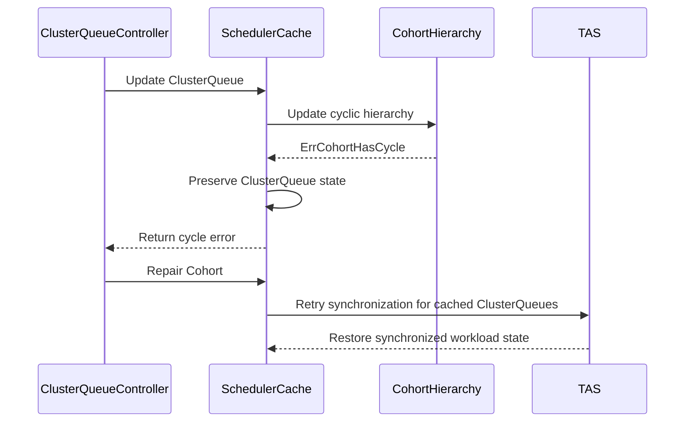

# PR #13571: Fix namespace matching panic for cyclic cohorts

**Summary**: Fix namespace matching panic for cyclic cohorts

**Sources**: https://github.com/kubernetes-sigs/kueue/pull/13571

**Last updated**: 2026-09-01T12:24:55Z

---

## Metadata

- **State**: open
- **Author**: [@YQ-Wang](https://github.com/YQ-Wang)
- **Branch**: `feat/13553-clusterqueue-safe-init` → `main`
- **Created**: 2026-07-28T04:24:55Z
- **Updated**: 2026-09-01T12:24:55Z
- **Merged**: —
- **Closed**: —
- **Labels**: `kind/bug`, `release-note`, `size/L`, `lgtm`, `approved`, `ok-to-test`, `cncf-cla: yes`
- **Assignees**: [@amy](https://github.com/amy), [@mimowo](https://github.com/mimowo), [@tenzen-y](https://github.com/tenzen-y)
- **Requested reviewers**: [@kannon92](https://github.com/kannon92), [@mwielgus](https://github.com/mwielgus), [@pajakd](https://github.com/pajakd), [@olekzabl](https://github.com/olekzabl), [@tenzen-y](https://github.com/tenzen-y)
- **Changed files**: 3   **+99 / -6**

## Description

#### What type of PR is this?

/kind bug

#### What this PR does / why we need it:

A ClusterQueue is registered in the hierarchy manager before its scheduler-cache state is populated, so a failed `updateClusterQueue` leaves it cached. `MatchingClusterQueues` then dereferences a nil `NamespaceSelector` on the next Namespace event and panics.

Two failure paths reach that state, and this PR covers both:

- A Cohort cycle makes `updateCohortTreeResources` return `ErrCohortHasCycle` before the selector is assigned. The selector is now assigned before that fallible call, so add leaves it set and update does not leave it stale.
- An unparsable selector makes `LabelSelectorAsSelector` fail. `hm.AddClusterQueue` has already run at that point, so reordering does not help. `NamespaceSelector` now defaults to `labels.Nothing()`.

`updateClusterQueue` still returns `ErrCohortHasCycle`, and all other errors, unchanged.

Updating the remaining ClusterQueue fields while the hierarchy is cyclic, cycle-safe usage and metrics, and ClusterQueue deactivation are deliberately left to #13774.

#### Which issue(s) this PR fixes:

Fixes #13553

#### Special notes for your reviewer:

This was previously a much larger change that also recovered ClusterQueue state after a cycle. Per review it has been rebased onto main and reduced to the panic fix only.

The separate ClusterQueue `Active`-condition inconsistency is tracked in #13997.

#13295 can remove its create-retry workaround after this lands. cc @amy @anahas-redhat

Validation:

- `go test ./pkg/cache/... ./pkg/controller/core/... ./pkg/scheduler/... -count=1`
- `go vet ./pkg/cache/scheduler`, `gofmt -l`, `git diff --check`
- Reverting either half of the fix fails a distinct case in `TestMatchingClusterQueuesAfterFailedUpdate`, confirmed in both directions.

AI tools were used to assist with implementation and review. The final diff was manually reviewed and validated.

#### Does this PR introduce a user-facing change?

```release-note
Fixed a controller panic triggered by Namespace updates after a ClusterQueue failed to initialize because its Cohort had a cycle.
```

## Discussion

### Comment by [@netlify[bot]](https://github.com/apps/netlify) — 2026-07-28T04:25:00Z

### <span aria-hidden="true">✅</span> Deploy Preview for *kubernetes-sigs-kueue* canceled.


|  Name | Link |
|:-:|------------------------|
|<span aria-hidden="true">🔨</span> Latest commit | bbf313b463a4cb983a85dacb3219da3849f95ced |
|<span aria-hidden="true">🔍</span> Latest deploy log | https://app.netlify.com/projects/kubernetes-sigs-kueue/deploys/6a95f6294783700009051359 |

### Comment by [@coderabbitai[bot]](https://github.com/apps/coderabbitai) — 2026-07-28T04:25:03Z

<!-- This is an auto-generated comment: summarize by coderabbit.ai -->
<!-- review_stack_entry_start -->

[](https://app.coderabbit.ai/change-stack/kubernetes-sigs/kueue/pull/13571?utm_source=github_walkthrough&utm_medium=github&utm_campaign=change_stack)

<!-- review_stack_entry_end -->
<!-- This is an auto-generated comment: review paused by coderabbit.ai -->

> [!NOTE]
> ## Reviews paused
> 
> It looks like this branch is under active development. To avoid overwhelming you with review comments due to an influx of new commits, CodeRabbit has automatically paused this review. You can configure this behavior by changing the `reviews.auto_review.auto_pause_after_reviewed_commits` setting.
> 
> Use the following commands to manage reviews:
> - `@coderabbitai resume` to resume automatic reviews.
> - `@coderabbitai review` to trigger a single review.
> 
> Use the checkboxes below for quick actions:
> - [ ] <!-- {"checkboxId": "7f6cc2e2-2e4e-497a-8c31-c9e4573e93d1"} --> ▶️ Resume reviews
> - [ ] <!-- {"checkboxId": "e9bb8d72-00e8-4f67-9cb2-caf3b22574fe"} --> 🔍 Trigger review

<!-- end of auto-generated comment: review paused by coderabbit.ai -->
<!-- walkthrough_start -->

<details>
<summary>📝 Walkthrough</summary>

## Walkthrough

The cache preserves ClusterQueue state when cohort updates return `ErrCohortHasCycle`. It avoids cyclic hierarchy traversal for usage, metrics, and TAS synchronization. Cohort repair retries synchronization and restores scheduling state. Tests cover cache recovery and controller status.

### Changes

**Cohort cycle cache handling**

|Layer / File(s)|Summary|
|---|---|
|**Preserve ClusterQueue state during cycle errors** <br> `pkg/cache/scheduler/cache.go`, `pkg/cache/scheduler/clusterqueue.go`, `pkg/cache/scheduler/cache_test.go`, `test/integration/singlecluster/controller/core/clusterqueue_controller_test.go`|ClusterQueues receive a non-nil namespace selector and remain cached when cohort updates return `ErrCohortHasCycle`. Independent fields continue to update. Tests verify configuration, namespace matching, error propagation, and controller status.|
|**Guard usage and statistics for cyclic hierarchies** <br> `pkg/cache/scheduler/clusterqueue.go`, `pkg/cache/scheduler/cache.go`, `pkg/cache/scheduler/resource_node.go`, `pkg/cache/scheduler/cache_test.go`|Usage aggregation and workload metrics avoid cyclic parent traversal. Cohort admitted-workload counts are rebuilt during resource aggregation. Weighted-share calculations are skipped for cyclic hierarchies.|
|**Retry TAS synchronization after cycle repair** <br> `pkg/cache/scheduler/cache.go`, `pkg/cache/scheduler/clusterqueue.go`, `pkg/cache/scheduler/cache_test.go`|TAS workload synchronization is skipped during cycles and retried for cached ClusterQueues after cohort updates or deletion. Tests verify synchronization recovery and snapshot restoration.|

**Estimated code review effort:** 4 (Complex) | ~45 minutes

**Possibly related issues**
- `#13237` — Covers hierarchical Cohort cycle detection and recovery scenarios expanded by this change.

**Suggested labels:** `kind/bug`, `release-note`, `size/XL`, `ok-to-test`, `cncf-cla: yes`

**Suggested reviewers:** `kannon92`, `tenzen-y`, `olekzabl`

### Sequence Diagram(s)



</details>

<!-- walkthrough_end -->
<!-- pre_merge_checks_walkthrough_start -->

<details>
<summary>🚥 Pre-merge checks | ✅ 5</summary>

<details>
<summary>✅ Passed checks (5 passed)</summary>

|         Check name         | Status   | Explanation                                                                                                                              |
| :------------------------: | :------- | :--------------------------------------------------------------------------------------------------------------------------------------- |
|     Linked Issues check    | ✅ Passed | The changes prevent the nil NamespaceSelector panic and preserve safe ClusterQueue recovery for cyclic cohorts as required by [`#13553`].  |
| Out of Scope Changes check | ✅ Passed | The cache, recovery, accounting, topology, and test changes support graceful handling and repair of cyclic cohort configurations.        |
|     Docstring Coverage     | ✅ Passed | No functions found in the changed files to evaluate docstring coverage. Skipping docstring coverage check.                               |
|      Description Check     | ✅ Passed | Check skipped - CodeRabbit’s high-level summary is enabled.                                                                              |
|         Title check        | ✅ Passed | The title clearly and concisely describes the primary change: preventing a namespace-matching panic caused by cyclic Cohort hierarchies. |

</details>

</details>

<!-- pre_merge_checks_walkthrough_end -->
<!-- finishing_touch_checkbox_start -->

<details>
<summary>✨ Finishing Touches</summary>

<details>
<summary>🧪 Generate unit tests (beta)</summary>

- [ ] <!-- {"checkboxId": "f47ac10b-58cc-4372-a567-0e02b2c3d479", "radioGroupId": "utg-output-choice-group-unknown_comment_id"} -->   Create PR with unit tests

</details>

</details>

<!-- finishing_touch_checkbox_end -->
<!-- tips_start -->

---


<sub>Comment `@coderabbitai help` to get the list of available commands.</sub>

<!-- tips_end -->

### Comment by [@kubernetes-prow[bot]](https://github.com/apps/kubernetes-prow) — 2026-07-28T04:25:05Z

Hi @YQ-Wang. Thanks for your PR.

I'm waiting for a [kubernetes-sigs](https://github.com/orgs/kubernetes-sigs/people) member to verify that this patch is reasonable to test. If it is, they should reply with `/ok-to-test` on its own line. Until that is done, I will not automatically test new commits in this PR, but the usual testing commands by org members will still work.

>[!TIP]
>**We noticed you've done this a few times! Consider [joining the org](https://git.k8s.io/community/community-membership.md#member) to skip this step and gain `/lgtm` and other bot rights.** We recommend asking approvers on your previous PRs to sponsor you.

Once the patch is verified, the new status will be reflected by the `ok-to-test` label.

I understand the commands that are listed [here](https://go.k8s.io/bot-commands?repo=kubernetes-sigs%2Fkueue).

<details>

Instructions for interacting with me using PR comments are available [here](https://git.k8s.io/community/contributors/guide/pull-requests.md).  If you have questions or suggestions related to my behavior, please file an issue against the [kubernetes-sigs/prow](https://github.com/kubernetes-sigs/prow/issues/new?title=Prow%20issue:) repository.
</details>

### Comment by [@mimowo](https://github.com/mimowo) — 2026-07-28T04:36:01Z

/ok-to-test

### Comment by [@amy](https://github.com/amy) — 2026-07-28T05:25:45Z

/assign

### Comment by [@coderabbitai[bot]](https://github.com/apps/coderabbitai) — 2026-08-08T06:23:51Z

<!-- This is an auto-generated comment by CodeRabbit -->
> [!NOTE]
> GitHub couldn't provide a complete incremental comparison for this pull request, so CodeRabbit is performing a full review instead. This review may take a little longer.

### Comment by [@mimowo](https://github.com/mimowo) — 2026-08-12T21:15:22Z

Looks reasonable, but I'm not sure why the new code for handling cycles in cohorts now depends on TAS, this warrants a comment in code (and double check if really needed):  https://github.com/kubernetes-sigs/kueue/pull/13571#discussion_r3770378560

### Comment by [@YQ-Wang](https://github.com/YQ-Wang) — 2026-08-17T05:29:26Z

@tenzen-y done for all, thanks for the clear reviews!

### Comment by [@tenzen-y](https://github.com/tenzen-y) — 2026-08-17T20:36:27Z

/hold

### Comment by [@tenzen-y](https://github.com/tenzen-y) — 2026-08-17T20:36:52Z

/lgtm cancel

### Comment by [@tenzen-y](https://github.com/tenzen-y) — 2026-08-17T20:37:36Z

/approve cancel

### Comment by [@YQ-Wang](https://github.com/YQ-Wang) — 2026-08-18T18:12:48Z

Hi @tenzen-y, could you share what you'd like changed, or if you want this to wait on other cycle-handling work? Happy to update!

### Comment by [@mimowo](https://github.com/mimowo) — 2026-08-31T12:03:20Z

@tenzen-y I saw your initial lgtm, later retracted. Not sure about the reason, but overall, I think we could minimize the PR to only fix the panic, and consider more elaborate fixes as a separate concern. In particular, it may change after we do https://github.com/kubernetes-sigs/kueue/pull/13774

### Comment by [@tenzen-y](https://github.com/tenzen-y) — 2026-08-31T12:13:37Z

> @tenzen-y I saw your initial lgtm, later retracted. Not sure about the reason, but overall, I think we could minimize the PR to only fix the panic, and consider more elaborate fixes as a separate concern. In particular, it may change after we do #13774

I accidentally added the lgtm label (I selected the incorrect PR when I left the stamp). 
And I didn't review this PR again after my first review.

So, I still don't think that this is ready for merge. Hence, I'm ok w/ narrowing this PR down to minimum scope. This PR is too hard to review.

### Comment by [@YQ-Wang](https://github.com/YQ-Wang) — 2026-08-31T22:03:59Z

Hi @mimowo @tenzen-y @pajakd @mwielgus
Rebased onto main and reduced this to the panic fix.

Two changes are left, both about the namespace selector:
- `updateClusterQueue` now assigns the selector before the fallible Cohort-tree update, so a cycle no longer leaves it nil on add or stale on update.
- `newClusterQueue` defaults it to `labels.Nothing()`. This covers a second path the reorder cannot: `hm.AddClusterQueue` runs first, so an unparsable selector also leaves a cached ClusterQueue with a nil selector.

`ErrCohortHasCycle` is still returned unchanged. Cycle-safe field updates, usage, metrics, and deactivation move to #13774; the Active condition stays in #13997.

`TestMatchingClusterQueuesAfterFailedUpdate` covers both paths, and each case fails if its half of the fix is reverted.

### Comment by [@mimowo](https://github.com/mimowo) — 2026-09-01T12:23:29Z

/unhold
I assume the hold was just to prevent the merging due to mistake https://github.com/kubernetes-sigs/kueue/pull/13571#issuecomment-5478168798

### Comment by [@kubernetes-prow[bot]](https://github.com/apps/kubernetes-prow) — 2026-09-01T12:24:49Z

LGTM label has been added.  <details>Git tree hash: 13c62ae73dd114b401ddc3cc2ebe3cd67beec3a7</details>

### Comment by [@kubernetes-prow[bot]](https://github.com/apps/kubernetes-prow) — 2026-09-01T12:24:54Z

[APPROVALNOTIFIER] This PR is **APPROVED**

This pull-request has been approved by: *<a href="https://github.com/kubernetes-sigs/kueue/pull/13571#pullrequestreview-5077976579" title="Approved">mimowo</a>*, *<a href="https://github.com/kubernetes-sigs/kueue/pull/13571#" title="Author self-approved">YQ-Wang</a>*

The full list of commands accepted by this bot can be found [here](https://go.k8s.io/bot-commands?repo=kubernetes-sigs%2Fkueue).

The pull request process is described [here](https://git.k8s.io/community/contributors/guide/owners.md#the-code-review-process)

<details >
Needs approval from an approver in each of these files:

- ~~[OWNERS](https://github.com/kubernetes-sigs/kueue/blob/main/OWNERS)~~ [mimowo]

Approvers can indicate their approval by writing `/approve` in a comment
Approvers can cancel approval by writing `/approve cancel` in a comment
</details>
<!-- META={"approvers":[]} -->

## Reviews

### Review by [@mwielgus](https://github.com/mwielgus) (commented) — 2026-07-28T09:16:56Z

- **pkg/cache/scheduler/clusterqueue.go:158** by [@mwielgus](https://github.com/mwielgus) — 2026-07-28T09:16:47Z
```diff
@@ -154,6 +154,12 @@ func (c *clusterQueue) updateClusterQueue(
 	admissionChecks map[kueue.AdmissionCheckReference]AdmissionCheck,
 	oldParent *cohort,
 ) error {
+	nsSelector, err := metav1.LabelSelectorAsSelector(in.Spec.NamespaceSelector)
```

  Why moving this snippet a bit up makes the diffrence? The functions called below seem to be somewhat unrelated to namespace selector...

### Review by [@YQ-Wang](https://github.com/YQ-Wang) (commented) — 2026-07-28T16:47:56Z

- **pkg/cache/scheduler/clusterqueue.go:158** by [@YQ-Wang](https://github.com/YQ-Wang) — 2026-07-28T16:47:56Z
```diff
@@ -154,6 +154,12 @@ func (c *clusterQueue) updateClusterQueue(
 	admissionChecks map[kueue.AdmissionCheckReference]AdmissionCheck,
 	oldParent *cohort,
 ) error {
+	nsSelector, err := metav1.LabelSelectorAsSelector(in.Spec.NamespaceSelector)
```

  It's not a data dependency but control flow. `updateCohortTreeResources()` just below
  returns an error when the cohort has a cycle, so `updateClusterQueue` returns early and never
  reaches the selector assignment. The ClusterQueue is already registered in the hierarchy
  manager by then (`cache.go:211`), so the next Namespace event has `MatchingClusterQueues`
  dereference a nil selector. That's the panic in #13553.
  It matters on updates too: if one spec change both widens the selector and moves the CQ into a
  cycled cohort, the early return leaves the old selector cached, and since
  `clusterqueue_controller.go:387` only logs the error, it stays stale until the next successful
  update. The `labels.Nothing()` default can't cover that, since it only applies at construction.
  Happy to add that update case as a second test if you think it's worth pinning down.

### Review by [@YQ-Wang](https://github.com/YQ-Wang) (commented) — 2026-08-07T04:51:12Z

- **pkg/cache/scheduler/clusterqueue.go:158** by [@YQ-Wang](https://github.com/YQ-Wang) — 2026-08-07T04:51:12Z
```diff
@@ -154,6 +154,12 @@ func (c *clusterQueue) updateClusterQueue(
 	admissionChecks map[kueue.AdmissionCheckReference]AdmissionCheck,
 	oldParent *cohort,
 ) error {
+	nsSelector, err := metav1.LabelSelectorAsSelector(in.Spec.NamespaceSelector)
```

  Hi @mwielgus,  just checking if the explanation above answered your question, or if anything else would help for review.

### Review by [@pajakd](https://github.com/pajakd) (commented) — 2026-08-07T09:12:12Z

- **pkg/cache/scheduler/clusterqueue.go:171** by [@pajakd](https://github.com/pajakd) — 2026-08-07T09:12:12Z
  So, we would return in this line in case of cycle, right? 
  
  What about the other fields of cq? right now we will only set the NamespaceSelector. Would it make sense to set the others as well? Its not causing panics now, but perhaps if we add/change some fields of ClusterQueue we will hit this again. In general it feel like we should be able to update any field of the CQ despite the cycle, WDYT?
  
  Also, I would prefer to have it slightly more explicit:
   - Consider matching the `ErrCohortHasCycle` 
   - Consider adding a comment that something has to happen even if we have a cycle/error

### Review by [@YQ-Wang](https://github.com/YQ-Wang) (commented) — 2026-08-08T05:17:03Z

- **pkg/cache/scheduler/clusterqueue.go:171** by [@YQ-Wang](https://github.com/YQ-Wang) — 2026-08-08T05:17:03Z
  Good point. I now save ErrCohortHasCycle, update the independent ClusterQueue fields, and return the cycle error afterward. Other errors still return immediately. I also added a comment explaining why, plus unit and integration tests.

### Review by [@coderabbitai[bot]](https://github.com/apps/coderabbitai) (commented) — 2026-08-08T06:04:44Z


<details>
<summary>🧹 Nitpick comments (2)</summary><blockquote>

<details>
<summary>pkg/cache/scheduler/cache_test.go (1)</summary><blockquote>

`3577-3577`: _📐 Maintainability & Code Quality_ | _🔵 Trivial_ | _💤 Low value_

**Document the intent of this call.**

`RecordClusterQueueResourceMetrics` is called with no assertion. The intent appears to be a check that metrics recording does not recurse or panic while the cohort cycle exists. Add a short comment so the line is not removed as dead code later.

<details>
<summary>📝 Proposed comment</summary>

```diff
+				// Must not panic or recurse while the cohort cycle exists.
 				cache.RecordClusterQueueResourceMetrics(log, "cq")
```
</details>

<details>
<summary>🤖 Prompt for AI Agents</summary>

```
Verify each finding against current code. Fix only still-valid issues, skip the
rest with a brief reason, keep changes minimal, and validate.

In `@pkg/cache/scheduler/cache_test.go` at line 3577, Document the purpose of the
standalone RecordClusterQueueResourceMetrics call in the surrounding test by
adding a brief comment that it verifies metrics recording does not recurse or
panic when a cohort cycle exists, without adding assertions or changing the
call.
```

</details>

<!-- cr-comment:v1:524dcb8a2792d82fc730a4ca -->

</blockquote></details>
<details>
<summary>pkg/cache/scheduler/clusterqueue.go (1)</summary><blockquote>

`587-597`: _📐 Maintainability & Code Quality_ | _🔵 Trivial_ | _💤 Low value_

**Consider aligning the metric with the reported stats during a cycle.**

`reportWeightedShare` returns before it updates the gauge. The gauge then keeps the last value computed before the cycle formed. `Cache.Usage` reports `WeightedShare` as 0 for the same ClusterQueue while the cycle exists. The two views disagree until the cycle is repaired.

If a stale gauge is acceptable during a cycle, keep the current behavior and add a short comment. Otherwise report 0 (or clear the metric) in the cycle branch.

<details>
<summary>🤖 Prompt for AI Agents</summary>

```
Verify each finding against current code. Fix only still-valid issues, skip the
rest with a brief reason, keep changes minimal, and validate.

In `@pkg/cache/scheduler/clusterqueue.go` around lines 587 - 597, The cycle branch
in reportWeightedShare currently leaves the gauge stale while Cache.Usage
reports WeightedShare as 0. Align these views by reporting 0 or clearing the
cluster-queue weighted-share metric before returning when HasParent() and
hierarchy.HasCycle(c.Parent()) are true; otherwise document the intentional
stale-gauge behavior with a short comment.
```

</details>

<!-- cr-comment:v1:f7a662542507ace53a5aa41c -->

</blockquote></details>

</blockquote></details>

<details>
<summary>🤖 Prompt for all review comments with AI agents</summary>

```
Verify each finding against current code. Fix only still-valid issues, skip the
rest with a brief reason, keep changes minimal, and validate.

Nitpick comments:
In `@pkg/cache/scheduler/cache_test.go`:
- Line 3577: Document the purpose of the standalone
RecordClusterQueueResourceMetrics call in the surrounding test by adding a brief
comment that it verifies metrics recording does not recurse or panic when a
cohort cycle exists, without adding assertions or changing the call.

In `@pkg/cache/scheduler/clusterqueue.go`:
- Around line 587-597: The cycle branch in reportWeightedShare currently leaves
the gauge stale while Cache.Usage reports WeightedShare as 0. Align these views
by reporting 0 or clearing the cluster-queue weighted-share metric before
returning when HasParent() and hierarchy.HasCycle(c.Parent()) are true;
otherwise document the intentional stale-gauge behavior with a short comment.
```

</details>

---

<details>
<summary>ℹ️ Review info</summary>

<details>
<summary>⚙️ Run configuration</summary>

**Configuration used**: Path: .coderabbit.yaml

**Review profile**: CHILL

**Plan**: Pro Plus

**Run ID**: `b653ccf3-5f50-4c53-97eb-0450f8040cb1`

</details>

<details>
<summary>📥 Commits</summary>

Reviewing files that changed from the base of the PR and between 3f1f296509040ce72112510000af08422b324be5 and 67fb3b63ef1f4bba0da2fe61950919a633cd6097.

</details>

<details>
<summary>📒 Files selected for processing (4)</summary>

* `pkg/cache/scheduler/cache.go`
* `pkg/cache/scheduler/cache_test.go`
* `pkg/cache/scheduler/clusterqueue.go`
* `pkg/cache/scheduler/resource_node.go`

</details>

<details>
<summary>🚧 Files skipped from review as they are similar to previous changes (1)</summary>

* pkg/cache/scheduler/cache.go

</details>

</details>

<!-- This is an auto-generated comment by CodeRabbit for review status -->

### Review by [@coderabbitai[bot]](https://github.com/apps/coderabbitai) (commented) — 2026-08-08T06:25:43Z

**Actionable comments posted: 1**

<details>
<summary>🤖 Prompt for all review comments with AI agents</summary>

```
Verify each finding against current code. Fix only still-valid issues, skip the
rest with a brief reason, keep changes minimal, and validate.

Inline comments:
In
`@test/integration/singlecluster/controller/core/clusterqueue_controller_test.go`:
- Around line 940-944: Extend the test flow after the failed ClusterQueue
cache-add assertion to update a label on ns before updating the ClusterQueue,
thereby exercising the namespace-driven Cache.MatchingClusterQueues path. Keep
the existing subsequent ClusterQueue update and status assertion unchanged to
verify the controller remains available.
```

</details>

<details>
<summary>🪄 Autofix</summary>

Fix all unresolved CodeRabbit comments on this PR:

- [ ] <!-- {"checkboxId": "4b0d0e0a-96d7-4f10-b296-3a18ea78f0b9"} --> Push a commit to this branch (recommended)
- [ ] <!-- {"checkboxId": "ff5b1114-7d8c-49e6-8ac1-43f82af23a33"} --> Create a new PR with the fixes

</details>

---

<details>
<summary>ℹ️ Review info</summary>

<details>
<summary>⚙️ Run configuration</summary>

**Configuration used**: Path: .coderabbit.yaml

**Review profile**: CHILL

**Plan**: Pro Plus

**Run ID**: `24e9302f-17e2-46b6-aa86-cf362bbd5ae2`

</details>

<details>
<summary>📥 Commits</summary>

Reviewing files that changed from the base of the PR and between 4c6dc1a35f334305a774c4c10ea4e94ef91ff0e6 and b3a8a52c59568f54d2c23571980b3bc713e41492.

</details>

<details>
<summary>📒 Files selected for processing (5)</summary>

* `pkg/cache/scheduler/cache.go`
* `pkg/cache/scheduler/cache_test.go`
* `pkg/cache/scheduler/clusterqueue.go`
* `pkg/cache/scheduler/resource_node.go`
* `test/integration/singlecluster/controller/core/clusterqueue_controller_test.go`

</details>

<details>
<summary>🚧 Files skipped from review as they are similar to previous changes (4)</summary>

* pkg/cache/scheduler/clusterqueue.go
* pkg/cache/scheduler/resource_node.go
* pkg/cache/scheduler/cache.go
* pkg/cache/scheduler/cache_test.go

</details>

</details>

<!-- This is an auto-generated comment by CodeRabbit for review status -->

- **test/integration/singlecluster/controller/core/clusterqueue_controller_test.go:944** by [@coderabbitai[bot]](https://github.com/apps/coderabbitai) — 2026-08-08T06:25:42Z
```diff
@@ -896,6 +896,81 @@ var _ = ginkgo.Describe("ClusterQueue controller", ginkgo.Label("controller:clus
 		})
 	})
 
+	// cycle-update-cohort --parent--> cycle-update-cohort
+	ginkgo.When("Updating a ClusterQueue whose Cohort has a cycle", func() {
+		var (
+			cq     *kueue.ClusterQueue
+			cohort *kueue.Cohort
+		)
+
+		ginkgo.AfterEach(func() {
+			util.ExpectObjectToBeDeleted(ctx, k8sClient, cq, true)
+			util.ExpectObjectToBeDeleted(ctx, k8sClient, cohort, true)
+		})
+
+		ginkgo.It("Should refresh independent ClusterQueue fields", func() {
+			cycleErrorLogCount := func(message string) int {
+				return fwk.ObservedLogs.Filter(func(entry observer.LoggedEntry) bool {
+					errText, ok := entry.ContextMap()["error"].(string)
+					return entry.Message == message && ok && errText == "cohort has a cycle"
+				}).Len()
+			}
+
+			cohort = utiltestingapi.MakeCohort("cycle-update-cohort").Obj()
+			util.MustCreate(ctx, k8sClient, cohort)
+
+			cohortCycleErrorCount := cycleErrorLogCount("Error adding or updating cohort in the cache")
+			gomega.Eventually(func(g gomega.Gomega) {
+				var got kueue.Cohort
+				g.Expect(k8sClient.Get(ctx, client.ObjectKeyFromObject(cohort), &got)).To(gomega.Succeed())
+				got.Spec.ParentName = kueue.CohortReference(got.Name)
+				g.Expect(k8sClient.Update(ctx, &got)).To(gomega.Succeed())
+			}, util.Timeout, util.Interval).Should(gomega.Succeed())
+			gomega.Eventually(func() int {
+				return cycleErrorLogCount("Error adding or updating cohort in the cache")
+			}, util.Timeout, util.Interval).Should(gomega.BeNumerically(">", cohortCycleErrorCount))
+
+			clusterQueueCycleErrorCount := cycleErrorLogCount("Failed to add clusterQueue to cache")
+			cq = utiltestingapi.MakeClusterQueue("cycle-update-cq").
+				Cohort(kueue.CohortReference(cohort.Name)).
+				ResourceGroup(*utiltestingapi.MakeFlavorQuotas("cycle-update-old-flavor").
+					Resource(corev1.ResourceCPU, "1").Obj()).
+				Obj()
+			util.MustCreate(ctx, k8sClient, cq)
+			gomega.Eventually(func() int {
+				return cycleErrorLogCount("Failed to add clusterQueue to cache")
+			}, util.Timeout, util.Interval).Should(gomega.BeNumerically(">", clusterQueueCycleErrorCount))
+
+			gomega.Eventually(func(g gomega.Gomega) {
```

  _🎯 Functional Correctness_ | _🟠 Major_ | _⚡ Quick win_
  
  **Trigger the Namespace update that caused the panic.**
  
  After the failed ClusterQueue cache addition, update a label on `ns` before updating the ClusterQueue. The current test only sends a ClusterQueue update. It does not execute the `Cache.MatchingClusterQueues` path that previously dereferenced the nil selector. Keep the later status assertion to prove that the controller remains available.
  
  <details>
  <summary>Proposed test step</summary>
  
  ```diff
   			gomega.Eventually(func() int {
   				return cycleErrorLogCount("Failed to add clusterQueue to cache")
   			}, util.Timeout, util.Interval).Should(gomega.BeNumerically(">", clusterQueueCycleErrorCount))
   
  +			gomega.Eventually(func(g gomega.Gomega) {
  +				var gotNS corev1.Namespace
  +				g.Expect(k8sClient.Get(ctx, client.ObjectKeyFromObject(ns), &gotNS)).To(gomega.Succeed())
  +				if gotNS.Labels == nil {
  +					gotNS.Labels = make(map[string]string)
  +				}
  +				gotNS.Labels["cycle-update"] = "true"
  +				g.Expect(k8sClient.Update(ctx, &gotNS)).To(gomega.Succeed())
  +			}, util.Timeout, util.Interval).Should(gomega.Succeed())
  +
   			gomega.Eventually(func(g gomega.Gomega) {
  ```
  </details>
  
  <!-- suggestion_start -->
  
  <details>
  <summary>📝 Committable suggestion</summary>
  
  > ‼️ **IMPORTANT**
  > Carefully review the code before committing. Ensure that it accurately replaces the highlighted code, contains no missing lines, and has no issues with indentation. Thoroughly test & benchmark the code to ensure it meets the requirements.
  
  ```suggestion
  			gomega.Eventually(func() int {
  				return cycleErrorLogCount("Failed to add clusterQueue to cache")
  			}, util.Timeout, util.Interval).Should(gomega.BeNumerically(">", clusterQueueCycleErrorCount))
  
  			gomega.Eventually(func(g gomega.Gomega) {
  				var gotNS corev1.Namespace
  				g.Expect(k8sClient.Get(ctx, client.ObjectKeyFromObject(ns), &gotNS)).To(gomega.Succeed())
  				if gotNS.Labels == nil {
  					gotNS.Labels = make(map[string]string)
  				}
  				gotNS.Labels["cycle-update"] = "true"
  				g.Expect(k8sClient.Update(ctx, &gotNS)).To(gomega.Succeed())
  			}, util.Timeout, util.Interval).Should(gomega.Succeed())
  
  			gomega.Eventually(func(g gomega.Gomega) {
  ```
  
  </details>
  
  <!-- suggestion_end -->
  
  <details>
  <summary>🤖 Prompt for AI Agents</summary>
  
  ```
  Verify each finding against current code. Fix only still-valid issues, skip the
  rest with a brief reason, keep changes minimal, and validate.
  
  In
  `@test/integration/singlecluster/controller/core/clusterqueue_controller_test.go`
  around lines 940 - 944, Extend the test flow after the failed ClusterQueue
  cache-add assertion to update a label on ns before updating the ClusterQueue,
  thereby exercising the namespace-driven Cache.MatchingClusterQueues path. Keep
  the existing subsequent ClusterQueue update and status assertion unchanged to
  verify the controller remains available.
  ```
  
  </details>
  
  <!-- fingerprinting:phantom:poseidon:tapir -->
  
  <!-- cr-indicator-types:potential_issue -->
  
  <!-- cr-comment:v1:b049cc5dd80f1f62fe2c65b3 -->
  
  <!-- This is an auto-generated comment by CodeRabbit -->
  
  ✅ Addressed in commit 2d56dfe

### Review by [@mimowo](https://github.com/mimowo) (commented) — 2026-08-12T21:13:15Z

- **pkg/cache/scheduler/cache.go:667** by [@mimowo](https://github.com/mimowo) — 2026-08-12T21:13:15Z
```diff
@@ -647,10 +657,22 @@ func (c *Cache) AddOrUpdateCohort(apiCohort *kueue.Cohort) error {
 	}
 	c.handleParentUpdate(oldParent)
 	c.updateCohortTreeAndInfoMetricsIfNoCycle(cohort)
+	c.ensureTASIsSyncedForClusterQueues()
 
 	return nil
 }
 
+// ensureTASIsSyncedForClusterQueues retries TAS usage synchronization that may
+// have been blocked by a Cohort cycle. The caller must hold the cache write lock.
+func (c *Cache) ensureTASIsSyncedForClusterQueues() {
```

  Why is this change generally depending on TAS? Is there any test which would show regression if not for the change? I'm asking because cycles in cohorts are more generic problem than TAS.

### Review by [@mimowo](https://github.com/mimowo) (commented) — 2026-08-12T21:14:16Z

- **pkg/cache/scheduler/clusterqueue.go:630** by [@mimowo](https://github.com/mimowo) — 2026-08-12T21:14:16Z
```diff
@@ -607,20 +625,29 @@ func (c *clusterQueue) reportWeightedShare(cohort kueue.CohortReference) {
 func (c *clusterQueue) updateWorkloadUsage(log logr.Logger, wi *workload.Info, op usageOp) {
 	admitted := workload.IsAdmitted(wi.Obj)
 	frUsage := wi.ResourceUsage().Assigned
-	for fr, q := range frUsage {
-		if op == add {
-			addUsage(c, fr, q)
-		}
-		if op == subtract {
-			removeUsage(c, fr, q)
+	cohortHasCycle := c.HasParent() && hierarchy.HasCycle(c.Parent())
+	if cohortHasCycle {
+		// The Cohort tree is rebuilt after the cycle is repaired. Keep the
```

  I think we should make sure this is logged

### Review by [@YQ-Wang](https://github.com/YQ-Wang) (commented) — 2026-08-13T02:33:25Z

- **pkg/cache/scheduler/cache.go:667** by [@YQ-Wang](https://github.com/YQ-Wang) — 2026-08-13T02:33:25Z
```diff
@@ -647,10 +657,22 @@ func (c *Cache) AddOrUpdateCohort(apiCohort *kueue.Cohort) error {
 	}
 	c.handleParentUpdate(oldParent)
 	c.updateCohortTreeAndInfoMetricsIfNoCycle(cohort)
+	c.ensureTASIsSyncedForClusterQueues()
 
 	return nil
 }
 
+// ensureTASIsSyncedForClusterQueues retries TAS usage synchronization that may
+// have been blocked by a Cohort cycle. The caller must hold the cache write lock.
+func (c *Cache) ensureTASIsSyncedForClusterQueues() {
```

  The TAS retry is no longer needed because workload accounting now handles Cohort cycles safely. I removed it and added a regression test with a real TAS workload.

### Review by [@YQ-Wang](https://github.com/YQ-Wang) (commented) — 2026-08-13T02:33:40Z

- **pkg/cache/scheduler/clusterqueue.go:630** by [@YQ-Wang](https://github.com/YQ-Wang) — 2026-08-13T02:33:40Z
```diff
@@ -607,20 +625,29 @@ func (c *clusterQueue) reportWeightedShare(cohort kueue.CohortReference) {
 func (c *clusterQueue) updateWorkloadUsage(log logr.Logger, wi *workload.Info, op usageOp) {
 	admitted := workload.IsAdmitted(wi.Obj)
 	frUsage := wi.ResourceUsage().Assigned
-	for fr, q := range frUsage {
-		if op == add {
-			addUsage(c, fr, q)
-		}
-		if op == subtract {
-			removeUsage(c, fr, q)
+	cohortHasCycle := c.HasParent() && hierarchy.HasCycle(c.Parent())
+	if cohortHasCycle {
+		// The Cohort tree is rebuilt after the cycle is repaired. Keep the
```

  Added a V(4) log when Cohort usage propagation is skipped because of a cycle. V(4) avoids noisy logs on frequent workload updates.

### Review by [@tenzen-y](https://github.com/tenzen-y) (commented) — 2026-08-16T19:03:37Z

@YQ-Wang  Thank you for working on this, I left some comments.

- **pkg/cache/scheduler/cache.go:193** by [@tenzen-y](https://github.com/tenzen-y) — 2026-08-16T15:45:41Z
```diff
@@ -188,10 +188,14 @@ func New(client client.Client, options ...Option) *Cache {
 }
 
 func (c *Cache) newClusterQueue(log logr.Logger, cq *kueue.ClusterQueue) (*clusterQueue, error) {
+	// updateClusterQueue below can fail and leave this ClusterQueue in the hierarchy
+	// manager, so NamespaceSelector is defaulted here: callers matching Namespaces
+	// against every cached ClusterQueue must never see a nil selector.
```

  ```suggestion
  ```
  
  It would be better to avoid leaving comments for HOW.

- **pkg/cache/scheduler/cache.go:474** by [@tenzen-y](https://github.com/tenzen-y) — 2026-08-16T15:46:25Z
```diff
@@ -460,9 +464,14 @@ func (c *Cache) AddClusterQueue(ctx context.Context, cq *kueue.ClusterQueue) err
 		return errors.New("ClusterQueue already exists")
 	}
 	log := ctrl.LoggerFrom(ctx)
-	cqImpl, err := c.newClusterQueue(log, cq)
-	if err != nil {
-		return err
+	cqImpl, updateErr := c.newClusterQueue(log, cq)
+	if updateErr != nil {
+		if !errors.Is(updateErr, ErrCohortHasCycle) {
+			return updateErr
+		}
+		// The ClusterQueue is already cached when a Cohort cycle is detected. Finish
+		// the restart-order backfill using cycle-local accounting; repairing the
+		// Cohort will rebuild the aggregate hierarchy.
```

  ```suggestion
  ```
  
  ditto

- **pkg/cache/scheduler/cache.go:471** by [@tenzen-y](https://github.com/tenzen-y) — 2026-08-16T15:47:13Z
```diff
@@ -460,9 +464,14 @@ func (c *Cache) AddClusterQueue(ctx context.Context, cq *kueue.ClusterQueue) err
 		return errors.New("ClusterQueue already exists")
 	}
 	log := ctrl.LoggerFrom(ctx)
-	cqImpl, err := c.newClusterQueue(log, cq)
-	if err != nil {
-		return err
+	cqImpl, updateErr := c.newClusterQueue(log, cq)
+	if updateErr != nil {
+		if !errors.Is(updateErr, ErrCohortHasCycle) {
+			return updateErr
+		}
```

  ```suggestion
  	if updateErr != nil && !errors.Is(updateErr, ErrCohortHasCycle){
  		return updateErr
  ```
  
  For simplicity.

- **pkg/cache/scheduler/clusterqueue.go:177** by [@tenzen-y](https://github.com/tenzen-y) — 2026-08-16T15:50:53Z
```diff
@@ -155,14 +155,28 @@ func (c *clusterQueue) updateClusterQueue(
 	admissionChecks map[kueue.AdmissionCheckReference]AdmissionCheck,
 	oldParent *cohort,
 ) error {
+	nsSelector, err := metav1.LabelSelectorAsSelector(in.Spec.NamespaceSelector)
+	if err != nil {
+		return err
+	}
+	c.NamespaceSelector = nsSelector
+
+	var cohortUpdateErr error
 	if c.updateQuotasAndResourceGroups(in.Spec.ResourceGroups) || oldParent != c.Parent() {
 		if oldParent != nil && oldParent != c.Parent() {
 			updateCohortTreeResourcesIfNoCycle(oldParent)
 		}
 		if c.HasParent() {
 			// clusterQueue will be updated as part of tree update.
 			if err := updateCohortTreeResources(c.Parent()); err != nil {
-				return err
+				if !errors.Is(err, ErrCohortHasCycle) {
+					return err
+				}
+				// A ClusterQueue remains cached when its Cohort has a cycle. Refresh
+				// its local resource node without traversing cyclic parents, then keep
+				// updating independent fields while the cycle is being repaired.
```

  ```suggestion
  ```
  
  ditto

- **pkg/cache/scheduler/cohort_metrics.go:239** by [@tenzen-y](https://github.com/tenzen-y) — 2026-08-16T16:00:16Z
```diff
@@ -228,9 +228,21 @@ func (c *Cache) recordCQInfo(cq *clusterQueue, parentCohort kueue.CohortReferenc
 // updateCohortResourceAndInfoMetrics updates subtree resources then records info metrics.
 func (c *Cache) updateCohortResourceAndInfoMetrics(cohort *cohort, root *cohort) {
 	updateCohortResourceNode(cohort)
+	c.resyncTreeActiveWorkloadMetrics(cohort)
 	c.recordTreeInfoMetrics(cohort, root)
 }
 
+// resyncTreeActiveWorkloadMetrics refreshes Cohort gauges that workload updates
+// cannot safely report while the hierarchy has a cycle.
+func (c *Cache) resyncTreeActiveWorkloadMetrics(cohort *cohort) {
+	for _, child := range cohort.ChildCQs() {
+		child.reportActiveWorkloads()
```

  ```suggestion
  		child.reportActiveWorkloads()
  		if c.resourceMetricsEnabled {
  			child.reportResourceMetrics(c.fairSharingEnabled)
  		}
  ```
  
  I guess that the current implementation cannot update `kueue_cluster_queue_weighted_share` if it was reset to 0 by the cyclic cohort detection.

- **pkg/cache/scheduler/cohort_metrics.go:242** by [@tenzen-y](https://github.com/tenzen-y) — 2026-08-16T17:32:23Z
```diff
@@ -228,9 +228,21 @@ func (c *Cache) recordCQInfo(cq *clusterQueue, parentCohort kueue.CohortReferenc
 // updateCohortResourceAndInfoMetrics updates subtree resources then records info metrics.
 func (c *Cache) updateCohortResourceAndInfoMetrics(cohort *cohort, root *cohort) {
 	updateCohortResourceNode(cohort)
+	c.resyncTreeActiveWorkloadMetrics(cohort)
 	c.recordTreeInfoMetrics(cohort, root)
 }
 
+// resyncTreeActiveWorkloadMetrics refreshes Cohort gauges that workload updates
+// cannot safely report while the hierarchy has a cycle.
+func (c *Cache) resyncTreeActiveWorkloadMetrics(cohort *cohort) {
+	for _, child := range cohort.ChildCQs() {
+		child.reportActiveWorkloads()
+	}
+	for _, child := range cohort.ChildCohorts() {
+		c.resyncTreeActiveWorkloadMetrics(child)
```

  I guess that kueue_cohort_subtree_admitted_active_workloads should be updated when the last Workload and ClusterQueue are removed, and the parent is updated.
  
  So, refining https://github.com/kubernetes-sigs/kueue/blob/d1b42d52b0e73b25e122623935034ae385d309d7/pkg/metrics/metrics.go
  like the following:
  
  ```go
  func ClearCohortAdmittedWorkloadsMetrics(cohortName kueue.CohortReference) {
  	CohortSubTreeAdmittedActiveWorkloads.DeletePartialMatch(prometheus.Labels{"cohort": string(cohortName)}
  }
  
  func ClearCohortAdmittedWorkloadsMetrics(cohortName kueue.CohortReference) {
  	CohortSubtreeAdmittedWorkloadsTotal.DeletePartialMatch(prometheus.Labels{"cohort": string(cohortName)})
  	ClearCohortAdmittedActiveWorkloadsMetrics(cohortName)
   }
  ```
  
  And then call it here:
  
  ```suggestion
  		metrics.ClearCohortAdmittedActiveWorkloadsMetrics(cohort.Name)
  		c.resyncTreeActiveWorkloadMetrics(child)
  ```

- **test/integration/singlecluster/controller/core/clusterqueue_controller_test.go:899** by [@tenzen-y](https://github.com/tenzen-y) — 2026-08-16T17:50:00Z
```diff
@@ -896,6 +896,92 @@ var _ = ginkgo.Describe("ClusterQueue controller", ginkgo.Label("controller:clus
 		})
 	})
 
+	// cycle-update-cohort --parent--> cycle-update-cohort
```

  ```suggestion
  ```
  
  Redundant comment.

- **pkg/cache/scheduler/cache_test.go:3549** by [@tenzen-y](https://github.com/tenzen-y) — 2026-08-16T18:50:08Z
```diff
@@ -3413,6 +3485,315 @@ func TestCohortCycles(t *testing.T) {
 		}
 	})
 
+	t.Run("namespace matching is safe for a clusterqueue whose add failed with cohort cycle", func(t *testing.T) {
+		cache := New(utiltesting.NewFakeClient())
+		ctx, _ := utiltesting.ContextWithLog(t)
+		cohortA := utiltestingapi.MakeCohort("cohort-a").Parent("cohort-b").Obj()
+		if err := cache.AddOrUpdateCohort(cohortA); err != nil {
+			t.Fatal("Expected success as no cycle yet")
+		}
+		cohortB := utiltestingapi.MakeCohort("cohort-b").Parent("cohort-a").Obj()
+		if err := cache.AddOrUpdateCohort(cohortB); err == nil {
+			t.Fatal("Expected failure when cycle")
+		}
+
+		cq := utiltestingapi.MakeClusterQueue("cq").Cohort("cohort-a").Obj()
+		if err := cache.AddClusterQueue(ctx, cq); !errors.Is(err, ErrCohortHasCycle) {
+			t.Fatalf("Expected cohort cycle error when adding cq, got %v", err)
+		}
+
+		// The ClusterQueue stays cached so that a later update can recover it, which
+		// means Namespace events keep matching against it while the cycle exists.
+		wantCQs := sets.New[kueue.ClusterQueueReference]("cq")
+		gotCQs := cache.MatchingClusterQueues(nil)
+		if diff := cmp.Diff(wantCQs, gotCQs); diff != "" {
+			t.Errorf("Wrong ClusterQueues (-want,+got):\n%s", diff)
+		}
+	})
+
+	t.Run("clusterqueue add backfills existing objects while cohort has cycle", func(t *testing.T) {
+		cases := map[string]struct {
+			repair func(*Cache) error
+		}{
+			"updating the cohort": {
+				repair: func(cache *Cache) error {
+					return cache.AddOrUpdateCohort(utiltestingapi.MakeCohort("cycle").Obj())
+				},
+			},
+			"deleting the cohort": {
+				repair: func(cache *Cache) error {
+					cache.DeleteCohort("cycle")
+					return nil
+				},
+			},
+		}
+		for name, tc := range cases {
+			t.Run(name, func(t *testing.T) {
+				metrics.ClearCohortAdmittedWorkloadsMetrics("cycle")
+				t.Cleanup(func() {
+					metrics.ClearClusterQueueMetricsOnLabelChange("cq")
+					metrics.ClearCohortAdmittedWorkloadsMetrics("cycle")
+				})
+				now := time.Now().Truncate(time.Second)
+				lq := utiltestingapi.MakeLocalQueue("lq", "ns").ClusterQueue("cq").Obj()
+				reserving := utiltestingapi.MakeWorkload("reserving", "ns").
+					Queue("lq").
+					Request(corev1.ResourceCPU, "1").
+					SimpleReserveQuota("cq", "f1", now).
+					Obj()
+				admitted := utiltestingapi.MakeWorkload("admitted", "ns").
+					Queue("lq").
+					Request(corev1.ResourceCPU, "1").
+					SimpleReserveQuota("cq", "f1", now).
+					AdmittedAt(true, now).
+					Obj()
```

  Move those to Line 3515 and pass them throughout cases fields. You can clone those objected when you define it in cases fields.

- **pkg/cache/scheduler/cache_test.go:3562** by [@tenzen-y](https://github.com/tenzen-y) — 2026-08-16T18:50:26Z
```diff
@@ -3413,6 +3485,315 @@ func TestCohortCycles(t *testing.T) {
 		}
 	})
 
+	t.Run("namespace matching is safe for a clusterqueue whose add failed with cohort cycle", func(t *testing.T) {
+		cache := New(utiltesting.NewFakeClient())
+		ctx, _ := utiltesting.ContextWithLog(t)
+		cohortA := utiltestingapi.MakeCohort("cohort-a").Parent("cohort-b").Obj()
+		if err := cache.AddOrUpdateCohort(cohortA); err != nil {
+			t.Fatal("Expected success as no cycle yet")
+		}
+		cohortB := utiltestingapi.MakeCohort("cohort-b").Parent("cohort-a").Obj()
+		if err := cache.AddOrUpdateCohort(cohortB); err == nil {
+			t.Fatal("Expected failure when cycle")
+		}
+
+		cq := utiltestingapi.MakeClusterQueue("cq").Cohort("cohort-a").Obj()
+		if err := cache.AddClusterQueue(ctx, cq); !errors.Is(err, ErrCohortHasCycle) {
+			t.Fatalf("Expected cohort cycle error when adding cq, got %v", err)
+		}
+
+		// The ClusterQueue stays cached so that a later update can recover it, which
+		// means Namespace events keep matching against it while the cycle exists.
+		wantCQs := sets.New[kueue.ClusterQueueReference]("cq")
+		gotCQs := cache.MatchingClusterQueues(nil)
+		if diff := cmp.Diff(wantCQs, gotCQs); diff != "" {
+			t.Errorf("Wrong ClusterQueues (-want,+got):\n%s", diff)
+		}
+	})
+
+	t.Run("clusterqueue add backfills existing objects while cohort has cycle", func(t *testing.T) {
+		cases := map[string]struct {
+			repair func(*Cache) error
+		}{
+			"updating the cohort": {
+				repair: func(cache *Cache) error {
+					return cache.AddOrUpdateCohort(utiltestingapi.MakeCohort("cycle").Obj())
+				},
+			},
+			"deleting the cohort": {
+				repair: func(cache *Cache) error {
+					cache.DeleteCohort("cycle")
+					return nil
+				},
+			},
+		}
+		for name, tc := range cases {
+			t.Run(name, func(t *testing.T) {
+				metrics.ClearCohortAdmittedWorkloadsMetrics("cycle")
+				t.Cleanup(func() {
+					metrics.ClearClusterQueueMetricsOnLabelChange("cq")
+					metrics.ClearCohortAdmittedWorkloadsMetrics("cycle")
+				})
+				now := time.Now().Truncate(time.Second)
+				lq := utiltestingapi.MakeLocalQueue("lq", "ns").ClusterQueue("cq").Obj()
+				reserving := utiltestingapi.MakeWorkload("reserving", "ns").
+					Queue("lq").
+					Request(corev1.ResourceCPU, "1").
+					SimpleReserveQuota("cq", "f1", now).
+					Obj()
+				admitted := utiltestingapi.MakeWorkload("admitted", "ns").
+					Queue("lq").
+					Request(corev1.ResourceCPU, "1").
+					SimpleReserveQuota("cq", "f1", now).
+					AdmittedAt(true, now).
+					Obj()
+				cache := New(utiltesting.NewFakeClient(lq, reserving, admitted), WithFairSharing(true))
+				ctx, log := utiltesting.ContextWithLog(t)
+				cache.AddOrUpdateResourceFlavor(log, utiltestingapi.MakeResourceFlavor("f1").Obj())
+
+				cycleCohort := utiltestingapi.MakeCohort("cycle").Parent("cycle").Obj()
+				if err := cache.AddOrUpdateCohort(cycleCohort); !errors.Is(err, ErrCohortHasCycle) {
+					t.Fatalf("Expected cohort cycle error, got %v", err)
+				}
+				cq := utiltestingapi.MakeClusterQueue("cq").
+					Cohort("cycle").
+					ResourceGroup(*utiltestingapi.MakeFlavorQuotas("f1").
+						Resource(corev1.ResourceCPU, "1").Obj()).
+					Obj()
```

  ditto

- **pkg/cache/scheduler/cache_test.go:3598** by [@tenzen-y](https://github.com/tenzen-y) — 2026-08-16T18:50:39Z
```diff
@@ -3413,6 +3485,315 @@ func TestCohortCycles(t *testing.T) {
 		}
 	})
 
+	t.Run("namespace matching is safe for a clusterqueue whose add failed with cohort cycle", func(t *testing.T) {
+		cache := New(utiltesting.NewFakeClient())
+		ctx, _ := utiltesting.ContextWithLog(t)
+		cohortA := utiltestingapi.MakeCohort("cohort-a").Parent("cohort-b").Obj()
+		if err := cache.AddOrUpdateCohort(cohortA); err != nil {
+			t.Fatal("Expected success as no cycle yet")
+		}
+		cohortB := utiltestingapi.MakeCohort("cohort-b").Parent("cohort-a").Obj()
+		if err := cache.AddOrUpdateCohort(cohortB); err == nil {
+			t.Fatal("Expected failure when cycle")
+		}
+
+		cq := utiltestingapi.MakeClusterQueue("cq").Cohort("cohort-a").Obj()
+		if err := cache.AddClusterQueue(ctx, cq); !errors.Is(err, ErrCohortHasCycle) {
+			t.Fatalf("Expected cohort cycle error when adding cq, got %v", err)
+		}
+
+		// The ClusterQueue stays cached so that a later update can recover it, which
+		// means Namespace events keep matching against it while the cycle exists.
+		wantCQs := sets.New[kueue.ClusterQueueReference]("cq")
+		gotCQs := cache.MatchingClusterQueues(nil)
+		if diff := cmp.Diff(wantCQs, gotCQs); diff != "" {
+			t.Errorf("Wrong ClusterQueues (-want,+got):\n%s", diff)
+		}
+	})
+
+	t.Run("clusterqueue add backfills existing objects while cohort has cycle", func(t *testing.T) {
+		cases := map[string]struct {
+			repair func(*Cache) error
+		}{
+			"updating the cohort": {
+				repair: func(cache *Cache) error {
+					return cache.AddOrUpdateCohort(utiltestingapi.MakeCohort("cycle").Obj())
+				},
+			},
+			"deleting the cohort": {
+				repair: func(cache *Cache) error {
+					cache.DeleteCohort("cycle")
+					return nil
+				},
+			},
+		}
+		for name, tc := range cases {
+			t.Run(name, func(t *testing.T) {
+				metrics.ClearCohortAdmittedWorkloadsMetrics("cycle")
+				t.Cleanup(func() {
+					metrics.ClearClusterQueueMetricsOnLabelChange("cq")
+					metrics.ClearCohortAdmittedWorkloadsMetrics("cycle")
+				})
+				now := time.Now().Truncate(time.Second)
+				lq := utiltestingapi.MakeLocalQueue("lq", "ns").ClusterQueue("cq").Obj()
+				reserving := utiltestingapi.MakeWorkload("reserving", "ns").
+					Queue("lq").
+					Request(corev1.ResourceCPU, "1").
+					SimpleReserveQuota("cq", "f1", now).
+					Obj()
+				admitted := utiltestingapi.MakeWorkload("admitted", "ns").
+					Queue("lq").
+					Request(corev1.ResourceCPU, "1").
+					SimpleReserveQuota("cq", "f1", now).
+					AdmittedAt(true, now).
+					Obj()
+				cache := New(utiltesting.NewFakeClient(lq, reserving, admitted), WithFairSharing(true))
+				ctx, log := utiltesting.ContextWithLog(t)
+				cache.AddOrUpdateResourceFlavor(log, utiltestingapi.MakeResourceFlavor("f1").Obj())
+
+				cycleCohort := utiltestingapi.MakeCohort("cycle").Parent("cycle").Obj()
+				if err := cache.AddOrUpdateCohort(cycleCohort); !errors.Is(err, ErrCohortHasCycle) {
+					t.Fatalf("Expected cohort cycle error, got %v", err)
+				}
+				cq := utiltestingapi.MakeClusterQueue("cq").
+					Cohort("cycle").
+					ResourceGroup(*utiltestingapi.MakeFlavorQuotas("f1").
+						Resource(corev1.ResourceCPU, "1").Obj()).
+					Obj()
+				if err := cache.AddClusterQueue(ctx, cq); !errors.Is(err, ErrCohortHasCycle) {
+					t.Fatalf("Expected cohort cycle error when adding cq, got %v", err)
+				}
+
+				snapshot, err := cache.Snapshot(ctx)
+				if err != nil {
+					t.Fatalf("Creating snapshot before repair: %v", err)
+				}
+				if snapshot.ClusterQueue("cq") != nil {
+					t.Fatal("Expected ClusterQueue with a cohort cycle to be excluded from snapshot")
+				}
+
+				if err := tc.repair(cache); err != nil {
+					t.Fatalf("Repairing cohort cycle: %v", err)
+				}
+
+				wantCQUsage := &ClusterQueueUsageStats{
+					ReservedResources: []kueue.FlavorUsage{{
+						Name: "f1",
+						Resources: []kueue.ResourceUsage{{
+							Name:     corev1.ResourceCPU,
+							Total:    resource.MustParse("2"),
+							Borrowed: resource.MustParse("1"),
+						}},
+					}},
+					ReservingWorkloads: 2,
+					AdmittedResources: []kueue.FlavorUsage{{
+						Name: "f1",
+						Resources: []kueue.ResourceUsage{{
+							Name:  corev1.ResourceCPU,
+							Total: resource.MustParse("1"),
+						}},
+					}},
+					AdmittedWorkloads: 1,
+					WeightedShare:     1000,
+				}
```

  ditto

- **pkg/cache/scheduler/cache_test.go:3624** by [@tenzen-y](https://github.com/tenzen-y) — 2026-08-16T18:50:46Z
```diff
@@ -3413,6 +3485,315 @@ func TestCohortCycles(t *testing.T) {
 		}
 	})
 
+	t.Run("namespace matching is safe for a clusterqueue whose add failed with cohort cycle", func(t *testing.T) {
+		cache := New(utiltesting.NewFakeClient())
+		ctx, _ := utiltesting.ContextWithLog(t)
+		cohortA := utiltestingapi.MakeCohort("cohort-a").Parent("cohort-b").Obj()
+		if err := cache.AddOrUpdateCohort(cohortA); err != nil {
+			t.Fatal("Expected success as no cycle yet")
+		}
+		cohortB := utiltestingapi.MakeCohort("cohort-b").Parent("cohort-a").Obj()
+		if err := cache.AddOrUpdateCohort(cohortB); err == nil {
+			t.Fatal("Expected failure when cycle")
+		}
+
+		cq := utiltestingapi.MakeClusterQueue("cq").Cohort("cohort-a").Obj()
+		if err := cache.AddClusterQueue(ctx, cq); !errors.Is(err, ErrCohortHasCycle) {
+			t.Fatalf("Expected cohort cycle error when adding cq, got %v", err)
+		}
+
+		// The ClusterQueue stays cached so that a later update can recover it, which
+		// means Namespace events keep matching against it while the cycle exists.
+		wantCQs := sets.New[kueue.ClusterQueueReference]("cq")
+		gotCQs := cache.MatchingClusterQueues(nil)
+		if diff := cmp.Diff(wantCQs, gotCQs); diff != "" {
+			t.Errorf("Wrong ClusterQueues (-want,+got):\n%s", diff)
+		}
+	})
+
+	t.Run("clusterqueue add backfills existing objects while cohort has cycle", func(t *testing.T) {
+		cases := map[string]struct {
+			repair func(*Cache) error
+		}{
+			"updating the cohort": {
+				repair: func(cache *Cache) error {
+					return cache.AddOrUpdateCohort(utiltestingapi.MakeCohort("cycle").Obj())
+				},
+			},
+			"deleting the cohort": {
+				repair: func(cache *Cache) error {
+					cache.DeleteCohort("cycle")
+					return nil
+				},
+			},
+		}
+		for name, tc := range cases {
+			t.Run(name, func(t *testing.T) {
+				metrics.ClearCohortAdmittedWorkloadsMetrics("cycle")
+				t.Cleanup(func() {
+					metrics.ClearClusterQueueMetricsOnLabelChange("cq")
+					metrics.ClearCohortAdmittedWorkloadsMetrics("cycle")
+				})
+				now := time.Now().Truncate(time.Second)
+				lq := utiltestingapi.MakeLocalQueue("lq", "ns").ClusterQueue("cq").Obj()
+				reserving := utiltestingapi.MakeWorkload("reserving", "ns").
+					Queue("lq").
+					Request(corev1.ResourceCPU, "1").
+					SimpleReserveQuota("cq", "f1", now).
+					Obj()
+				admitted := utiltestingapi.MakeWorkload("admitted", "ns").
+					Queue("lq").
+					Request(corev1.ResourceCPU, "1").
+					SimpleReserveQuota("cq", "f1", now).
+					AdmittedAt(true, now).
+					Obj()
+				cache := New(utiltesting.NewFakeClient(lq, reserving, admitted), WithFairSharing(true))
+				ctx, log := utiltesting.ContextWithLog(t)
+				cache.AddOrUpdateResourceFlavor(log, utiltestingapi.MakeResourceFlavor("f1").Obj())
+
+				cycleCohort := utiltestingapi.MakeCohort("cycle").Parent("cycle").Obj()
+				if err := cache.AddOrUpdateCohort(cycleCohort); !errors.Is(err, ErrCohortHasCycle) {
+					t.Fatalf("Expected cohort cycle error, got %v", err)
+				}
+				cq := utiltestingapi.MakeClusterQueue("cq").
+					Cohort("cycle").
+					ResourceGroup(*utiltestingapi.MakeFlavorQuotas("f1").
+						Resource(corev1.ResourceCPU, "1").Obj()).
+					Obj()
+				if err := cache.AddClusterQueue(ctx, cq); !errors.Is(err, ErrCohortHasCycle) {
+					t.Fatalf("Expected cohort cycle error when adding cq, got %v", err)
+				}
+
+				snapshot, err := cache.Snapshot(ctx)
+				if err != nil {
+					t.Fatalf("Creating snapshot before repair: %v", err)
+				}
+				if snapshot.ClusterQueue("cq") != nil {
+					t.Fatal("Expected ClusterQueue with a cohort cycle to be excluded from snapshot")
+				}
+
+				if err := tc.repair(cache); err != nil {
+					t.Fatalf("Repairing cohort cycle: %v", err)
+				}
+
+				wantCQUsage := &ClusterQueueUsageStats{
+					ReservedResources: []kueue.FlavorUsage{{
+						Name: "f1",
+						Resources: []kueue.ResourceUsage{{
+							Name:     corev1.ResourceCPU,
+							Total:    resource.MustParse("2"),
+							Borrowed: resource.MustParse("1"),
+						}},
+					}},
+					ReservingWorkloads: 2,
+					AdmittedResources: []kueue.FlavorUsage{{
+						Name: "f1",
+						Resources: []kueue.ResourceUsage{{
+							Name:  corev1.ResourceCPU,
+							Total: resource.MustParse("1"),
+						}},
+					}},
+					AdmittedWorkloads: 1,
+					WeightedShare:     1000,
+				}
+				cqUsage, err := cache.Usage(cq)
+				if err != nil {
+					t.Fatalf("Getting ClusterQueue usage: %v", err)
+				}
+				if diff := cmp.Diff(wantCQUsage, cqUsage); diff != "" {
+					t.Errorf("Unexpected ClusterQueue usage (-want,+got):\n%s", diff)
+				}
+
+				wantLQUsage := &LocalQueueUsageStats{
+					ReservedResources: []kueue.LocalQueueFlavorUsage{{
+						Name: "f1",
+						Resources: []kueue.LocalQueueResourceUsage{{
+							Name:  corev1.ResourceCPU,
+							Total: resource.MustParse("2"),
+						}},
+					}},
+					ReservingWorkloads: 2,
+					AdmittedResources: []kueue.LocalQueueFlavorUsage{{
+						Name: "f1",
+						Resources: []kueue.LocalQueueResourceUsage{{
+							Name:  corev1.ResourceCPU,
+							Total: resource.MustParse("1"),
+						}},
+					}},
+					AdmittedWorkloads: 1,
+				}
```

  ditto

- **pkg/cache/scheduler/cache_test.go:3641** by [@tenzen-y](https://github.com/tenzen-y) — 2026-08-16T18:51:19Z
```diff
@@ -3413,6 +3485,315 @@ func TestCohortCycles(t *testing.T) {
 		}
 	})
 
+	t.Run("namespace matching is safe for a clusterqueue whose add failed with cohort cycle", func(t *testing.T) {
+		cache := New(utiltesting.NewFakeClient())
+		ctx, _ := utiltesting.ContextWithLog(t)
+		cohortA := utiltestingapi.MakeCohort("cohort-a").Parent("cohort-b").Obj()
+		if err := cache.AddOrUpdateCohort(cohortA); err != nil {
+			t.Fatal("Expected success as no cycle yet")
+		}
+		cohortB := utiltestingapi.MakeCohort("cohort-b").Parent("cohort-a").Obj()
+		if err := cache.AddOrUpdateCohort(cohortB); err == nil {
+			t.Fatal("Expected failure when cycle")
+		}
+
+		cq := utiltestingapi.MakeClusterQueue("cq").Cohort("cohort-a").Obj()
+		if err := cache.AddClusterQueue(ctx, cq); !errors.Is(err, ErrCohortHasCycle) {
+			t.Fatalf("Expected cohort cycle error when adding cq, got %v", err)
+		}
+
+		// The ClusterQueue stays cached so that a later update can recover it, which
+		// means Namespace events keep matching against it while the cycle exists.
+		wantCQs := sets.New[kueue.ClusterQueueReference]("cq")
+		gotCQs := cache.MatchingClusterQueues(nil)
+		if diff := cmp.Diff(wantCQs, gotCQs); diff != "" {
+			t.Errorf("Wrong ClusterQueues (-want,+got):\n%s", diff)
+		}
+	})
+
+	t.Run("clusterqueue add backfills existing objects while cohort has cycle", func(t *testing.T) {
+		cases := map[string]struct {
+			repair func(*Cache) error
+		}{
+			"updating the cohort": {
+				repair: func(cache *Cache) error {
+					return cache.AddOrUpdateCohort(utiltestingapi.MakeCohort("cycle").Obj())
+				},
+			},
+			"deleting the cohort": {
+				repair: func(cache *Cache) error {
+					cache.DeleteCohort("cycle")
+					return nil
+				},
+			},
+		}
+		for name, tc := range cases {
+			t.Run(name, func(t *testing.T) {
+				metrics.ClearCohortAdmittedWorkloadsMetrics("cycle")
+				t.Cleanup(func() {
+					metrics.ClearClusterQueueMetricsOnLabelChange("cq")
+					metrics.ClearCohortAdmittedWorkloadsMetrics("cycle")
+				})
+				now := time.Now().Truncate(time.Second)
+				lq := utiltestingapi.MakeLocalQueue("lq", "ns").ClusterQueue("cq").Obj()
+				reserving := utiltestingapi.MakeWorkload("reserving", "ns").
+					Queue("lq").
+					Request(corev1.ResourceCPU, "1").
+					SimpleReserveQuota("cq", "f1", now).
+					Obj()
+				admitted := utiltestingapi.MakeWorkload("admitted", "ns").
+					Queue("lq").
+					Request(corev1.ResourceCPU, "1").
+					SimpleReserveQuota("cq", "f1", now).
+					AdmittedAt(true, now).
+					Obj()
+				cache := New(utiltesting.NewFakeClient(lq, reserving, admitted), WithFairSharing(true))
+				ctx, log := utiltesting.ContextWithLog(t)
+				cache.AddOrUpdateResourceFlavor(log, utiltestingapi.MakeResourceFlavor("f1").Obj())
+
+				cycleCohort := utiltestingapi.MakeCohort("cycle").Parent("cycle").Obj()
+				if err := cache.AddOrUpdateCohort(cycleCohort); !errors.Is(err, ErrCohortHasCycle) {
+					t.Fatalf("Expected cohort cycle error, got %v", err)
+				}
+				cq := utiltestingapi.MakeClusterQueue("cq").
+					Cohort("cycle").
+					ResourceGroup(*utiltestingapi.MakeFlavorQuotas("f1").
+						Resource(corev1.ResourceCPU, "1").Obj()).
+					Obj()
+				if err := cache.AddClusterQueue(ctx, cq); !errors.Is(err, ErrCohortHasCycle) {
+					t.Fatalf("Expected cohort cycle error when adding cq, got %v", err)
+				}
+
+				snapshot, err := cache.Snapshot(ctx)
+				if err != nil {
+					t.Fatalf("Creating snapshot before repair: %v", err)
+				}
+				if snapshot.ClusterQueue("cq") != nil {
+					t.Fatal("Expected ClusterQueue with a cohort cycle to be excluded from snapshot")
+				}
+
+				if err := tc.repair(cache); err != nil {
+					t.Fatalf("Repairing cohort cycle: %v", err)
+				}
+
+				wantCQUsage := &ClusterQueueUsageStats{
+					ReservedResources: []kueue.FlavorUsage{{
+						Name: "f1",
+						Resources: []kueue.ResourceUsage{{
+							Name:     corev1.ResourceCPU,
+							Total:    resource.MustParse("2"),
+							Borrowed: resource.MustParse("1"),
+						}},
+					}},
+					ReservingWorkloads: 2,
+					AdmittedResources: []kueue.FlavorUsage{{
+						Name: "f1",
+						Resources: []kueue.ResourceUsage{{
+							Name:  corev1.ResourceCPU,
+							Total: resource.MustParse("1"),
+						}},
+					}},
+					AdmittedWorkloads: 1,
+					WeightedShare:     1000,
+				}
+				cqUsage, err := cache.Usage(cq)
+				if err != nil {
+					t.Fatalf("Getting ClusterQueue usage: %v", err)
+				}
+				if diff := cmp.Diff(wantCQUsage, cqUsage); diff != "" {
+					t.Errorf("Unexpected ClusterQueue usage (-want,+got):\n%s", diff)
+				}
+
+				wantLQUsage := &LocalQueueUsageStats{
+					ReservedResources: []kueue.LocalQueueFlavorUsage{{
+						Name: "f1",
+						Resources: []kueue.LocalQueueResourceUsage{{
+							Name:  corev1.ResourceCPU,
+							Total: resource.MustParse("2"),
+						}},
+					}},
+					ReservingWorkloads: 2,
+					AdmittedResources: []kueue.LocalQueueFlavorUsage{{
+						Name: "f1",
+						Resources: []kueue.LocalQueueResourceUsage{{
+							Name:  corev1.ResourceCPU,
+							Total: resource.MustParse("1"),
+						}},
+					}},
+					AdmittedWorkloads: 1,
+				}
+				lqUsage, err := cache.LocalQueueUsage(lq)
+				if err != nil {
+					t.Fatalf("Getting LocalQueue usage: %v", err)
+				}
+				if diff := cmp.Diff(wantLQUsage, lqUsage); diff != "" {
+					t.Errorf("Unexpected LocalQueue usage (-want,+got):\n%s", diff)
+				}
+
+				snapshot, err = cache.Snapshot(ctx)
+				if err != nil {
+					t.Fatalf("Creating snapshot after repair: %v", err)
+				}
+				cqSnapshot := snapshot.ClusterQueue("cq")
+				if cqSnapshot == nil {
+					t.Fatal("Expected repaired ClusterQueue in snapshot")
+				}
+				wantWorkloads := sets.New(workload.Key(reserving), workload.Key(admitted))
```

  Define this throughout cases field.

- **pkg/cache/scheduler/cache_test.go:3447** by [@tenzen-y](https://github.com/tenzen-y) — 2026-08-16T18:53:03Z
  I think we should refactor this test case.
  But, I think it it out-of scope of this PR.

- **pkg/cache/scheduler/cache_test.go:3447** by [@tenzen-y](https://github.com/tenzen-y) — 2026-08-16T18:53:39Z
  Oh, we already have https://github.com/kubernetes-sigs/kueue/pull/14189

- **test/integration/singlecluster/controller/core/clusterqueue_controller_test.go:917** by [@tenzen-y](https://github.com/tenzen-y) — 2026-08-16T18:54:30Z
```diff
@@ -896,6 +896,92 @@ var _ = ginkgo.Describe("ClusterQueue controller", ginkgo.Label("controller:clus
 		})
 	})
 
+	// cycle-update-cohort --parent--> cycle-update-cohort
+	ginkgo.When("Updating a ClusterQueue whose Cohort has a cycle", func() {
+		var (
+			cq     *kueue.ClusterQueue
+			cohort *kueue.Cohort
+		)
+
+		ginkgo.AfterEach(func() {
+			util.ExpectObjectToBeDeleted(ctx, k8sClient, cq, true)
+			util.ExpectObjectToBeDeleted(ctx, k8sClient, cohort, true)
+		})
+
+		ginkgo.It("Should refresh independent ClusterQueue fields", func() {
+			cycleErrorLogCount := func(message string) int {
+				return fwk.ObservedLogs.Filter(func(entry observer.LoggedEntry) bool {
+					errText, ok := entry.ContextMap()["error"].(string)
+					return entry.Message == message && ok && errText == "cohort has a cycle"
+				}).Len()
+			}
```

  ```suggestion
  ```
  
  We shouldn't hack logging to verify something.
  I recommend verifying the scheduler cache as an alternative in the following comments.

- **test/integration/singlecluster/controller/core/clusterqueue_controller_test.go:919** by [@tenzen-y](https://github.com/tenzen-y) — 2026-08-16T18:55:17Z
```diff
@@ -896,6 +896,92 @@ var _ = ginkgo.Describe("ClusterQueue controller", ginkgo.Label("controller:clus
 		})
 	})
 
+	// cycle-update-cohort --parent--> cycle-update-cohort
+	ginkgo.When("Updating a ClusterQueue whose Cohort has a cycle", func() {
+		var (
+			cq     *kueue.ClusterQueue
+			cohort *kueue.Cohort
+		)
+
+		ginkgo.AfterEach(func() {
+			util.ExpectObjectToBeDeleted(ctx, k8sClient, cq, true)
+			util.ExpectObjectToBeDeleted(ctx, k8sClient, cohort, true)
+		})
+
+		ginkgo.It("Should refresh independent ClusterQueue fields", func() {
+			cycleErrorLogCount := func(message string) int {
+				return fwk.ObservedLogs.Filter(func(entry observer.LoggedEntry) bool {
+					errText, ok := entry.ContextMap()["error"].(string)
+					return entry.Message == message && ok && errText == "cohort has a cycle"
+				}).Len()
+			}
+
+			cohort = utiltestingapi.MakeCohort("cycle-update-cohort").Obj()
```

  ```suggestion
  			cohort = utiltestingapi.MakeCohort("cycle-update-cohort").Obj()
  			cq = utiltestingapi.MakeClusterQueue("cycle-update-cq").
  				Cohort(kueue.CohortReference(cohort.Name)).
  				ResourceGroup(*utiltestingapi.MakeFlavorQuotas("cycle-update-old-flavor").
  					Resource(corev1.ResourceCPU, "1").Obj()).
  				Obj()			
  ```

- **test/integration/singlecluster/controller/core/clusterqueue_controller_test.go:922** by [@tenzen-y](https://github.com/tenzen-y) — 2026-08-16T18:55:26Z
```diff
@@ -896,6 +896,92 @@ var _ = ginkgo.Describe("ClusterQueue controller", ginkgo.Label("controller:clus
 		})
 	})
 
+	// cycle-update-cohort --parent--> cycle-update-cohort
+	ginkgo.When("Updating a ClusterQueue whose Cohort has a cycle", func() {
+		var (
+			cq     *kueue.ClusterQueue
+			cohort *kueue.Cohort
+		)
+
+		ginkgo.AfterEach(func() {
+			util.ExpectObjectToBeDeleted(ctx, k8sClient, cq, true)
+			util.ExpectObjectToBeDeleted(ctx, k8sClient, cohort, true)
+		})
+
+		ginkgo.It("Should refresh independent ClusterQueue fields", func() {
+			cycleErrorLogCount := func(message string) int {
+				return fwk.ObservedLogs.Filter(func(entry observer.LoggedEntry) bool {
+					errText, ok := entry.ContextMap()["error"].(string)
+					return entry.Message == message && ok && errText == "cohort has a cycle"
+				}).Len()
+			}
+
+			cohort = utiltestingapi.MakeCohort("cycle-update-cohort").Obj()
+			util.MustCreate(ctx, k8sClient, cohort)
+
+			cohortCycleErrorCount := cycleErrorLogCount("Error adding or updating cohort in the cache")
```

  ```suggestion
  ```

- **test/integration/singlecluster/controller/core/clusterqueue_controller_test.go:931** by [@tenzen-y](https://github.com/tenzen-y) — 2026-08-16T18:57:39Z
```diff
@@ -896,6 +896,92 @@ var _ = ginkgo.Describe("ClusterQueue controller", ginkgo.Label("controller:clus
 		})
 	})
 
+	// cycle-update-cohort --parent--> cycle-update-cohort
+	ginkgo.When("Updating a ClusterQueue whose Cohort has a cycle", func() {
+		var (
+			cq     *kueue.ClusterQueue
+			cohort *kueue.Cohort
+		)
+
+		ginkgo.AfterEach(func() {
+			util.ExpectObjectToBeDeleted(ctx, k8sClient, cq, true)
+			util.ExpectObjectToBeDeleted(ctx, k8sClient, cohort, true)
+		})
+
+		ginkgo.It("Should refresh independent ClusterQueue fields", func() {
+			cycleErrorLogCount := func(message string) int {
+				return fwk.ObservedLogs.Filter(func(entry observer.LoggedEntry) bool {
+					errText, ok := entry.ContextMap()["error"].(string)
+					return entry.Message == message && ok && errText == "cohort has a cycle"
+				}).Len()
+			}
+
+			cohort = utiltestingapi.MakeCohort("cycle-update-cohort").Obj()
+			util.MustCreate(ctx, k8sClient, cohort)
+
+			cohortCycleErrorCount := cycleErrorLogCount("Error adding or updating cohort in the cache")
+			gomega.Eventually(func(g gomega.Gomega) {
+				var got kueue.Cohort
+				g.Expect(k8sClient.Get(ctx, client.ObjectKeyFromObject(cohort), &got)).To(gomega.Succeed())
+				got.Spec.ParentName = kueue.CohortReference(got.Name)
+				g.Expect(k8sClient.Update(ctx, &got)).To(gomega.Succeed())
+			}, util.Timeout, util.Interval).Should(gomega.Succeed())
+			gomega.Eventually(func() int {
+				return cycleErrorLogCount("Error adding or updating cohort in the cache")
+			}, util.Timeout, util.Interval).Should(gomega.BeNumerically(">", cohortCycleErrorCount))
```

  ```suggestion
  			gomega.Eventually(func(g gomega.Gomega) {
  				_, err := cCache.ClusterQueueAncestors(cq)
  				g.Expect(err).Should(gomega.MatchError(schdcache.ErrCohortHasCycle))
  			}, util.Timeout, util.Interval).Should(gomega.Succeed())
  ```

- **test/integration/singlecluster/controller/core/clusterqueue_controller_test.go:933** by [@tenzen-y](https://github.com/tenzen-y) — 2026-08-16T18:57:45Z
```diff
@@ -896,6 +896,92 @@ var _ = ginkgo.Describe("ClusterQueue controller", ginkgo.Label("controller:clus
 		})
 	})
 
+	// cycle-update-cohort --parent--> cycle-update-cohort
+	ginkgo.When("Updating a ClusterQueue whose Cohort has a cycle", func() {
+		var (
+			cq     *kueue.ClusterQueue
+			cohort *kueue.Cohort
+		)
+
+		ginkgo.AfterEach(func() {
+			util.ExpectObjectToBeDeleted(ctx, k8sClient, cq, true)
+			util.ExpectObjectToBeDeleted(ctx, k8sClient, cohort, true)
+		})
+
+		ginkgo.It("Should refresh independent ClusterQueue fields", func() {
+			cycleErrorLogCount := func(message string) int {
+				return fwk.ObservedLogs.Filter(func(entry observer.LoggedEntry) bool {
+					errText, ok := entry.ContextMap()["error"].(string)
+					return entry.Message == message && ok && errText == "cohort has a cycle"
+				}).Len()
+			}
+
+			cohort = utiltestingapi.MakeCohort("cycle-update-cohort").Obj()
+			util.MustCreate(ctx, k8sClient, cohort)
+
+			cohortCycleErrorCount := cycleErrorLogCount("Error adding or updating cohort in the cache")
+			gomega.Eventually(func(g gomega.Gomega) {
+				var got kueue.Cohort
+				g.Expect(k8sClient.Get(ctx, client.ObjectKeyFromObject(cohort), &got)).To(gomega.Succeed())
+				got.Spec.ParentName = kueue.CohortReference(got.Name)
+				g.Expect(k8sClient.Update(ctx, &got)).To(gomega.Succeed())
+			}, util.Timeout, util.Interval).Should(gomega.Succeed())
+			gomega.Eventually(func() int {
+				return cycleErrorLogCount("Error adding or updating cohort in the cache")
+			}, util.Timeout, util.Interval).Should(gomega.BeNumerically(">", cohortCycleErrorCount))
+
+			clusterQueueCycleErrorCount := cycleErrorLogCount("Failed to add clusterQueue to cache")
```

  ```suggestion
  ```

- **test/integration/singlecluster/controller/core/clusterqueue_controller_test.go:938** by [@tenzen-y](https://github.com/tenzen-y) — 2026-08-16T18:58:06Z
```diff
@@ -896,6 +896,92 @@ var _ = ginkgo.Describe("ClusterQueue controller", ginkgo.Label("controller:clus
 		})
 	})
 
+	// cycle-update-cohort --parent--> cycle-update-cohort
+	ginkgo.When("Updating a ClusterQueue whose Cohort has a cycle", func() {
+		var (
+			cq     *kueue.ClusterQueue
+			cohort *kueue.Cohort
+		)
+
+		ginkgo.AfterEach(func() {
+			util.ExpectObjectToBeDeleted(ctx, k8sClient, cq, true)
+			util.ExpectObjectToBeDeleted(ctx, k8sClient, cohort, true)
+		})
+
+		ginkgo.It("Should refresh independent ClusterQueue fields", func() {
+			cycleErrorLogCount := func(message string) int {
+				return fwk.ObservedLogs.Filter(func(entry observer.LoggedEntry) bool {
+					errText, ok := entry.ContextMap()["error"].(string)
+					return entry.Message == message && ok && errText == "cohort has a cycle"
+				}).Len()
+			}
+
+			cohort = utiltestingapi.MakeCohort("cycle-update-cohort").Obj()
+			util.MustCreate(ctx, k8sClient, cohort)
+
+			cohortCycleErrorCount := cycleErrorLogCount("Error adding or updating cohort in the cache")
+			gomega.Eventually(func(g gomega.Gomega) {
+				var got kueue.Cohort
+				g.Expect(k8sClient.Get(ctx, client.ObjectKeyFromObject(cohort), &got)).To(gomega.Succeed())
+				got.Spec.ParentName = kueue.CohortReference(got.Name)
+				g.Expect(k8sClient.Update(ctx, &got)).To(gomega.Succeed())
+			}, util.Timeout, util.Interval).Should(gomega.Succeed())
+			gomega.Eventually(func() int {
+				return cycleErrorLogCount("Error adding or updating cohort in the cache")
+			}, util.Timeout, util.Interval).Should(gomega.BeNumerically(">", cohortCycleErrorCount))
+
+			clusterQueueCycleErrorCount := cycleErrorLogCount("Failed to add clusterQueue to cache")
+			cq = utiltestingapi.MakeClusterQueue("cycle-update-cq").
+				Cohort(kueue.CohortReference(cohort.Name)).
+				ResourceGroup(*utiltestingapi.MakeFlavorQuotas("cycle-update-old-flavor").
+					Resource(corev1.ResourceCPU, "1").Obj()).
+				Obj()
```

  ```suggestion
  ```

- **test/integration/singlecluster/controller/core/clusterqueue_controller_test.go:942** by [@tenzen-y](https://github.com/tenzen-y) — 2026-08-16T18:59:21Z
```diff
@@ -896,6 +896,92 @@ var _ = ginkgo.Describe("ClusterQueue controller", ginkgo.Label("controller:clus
 		})
 	})
 
+	// cycle-update-cohort --parent--> cycle-update-cohort
+	ginkgo.When("Updating a ClusterQueue whose Cohort has a cycle", func() {
+		var (
+			cq     *kueue.ClusterQueue
+			cohort *kueue.Cohort
+		)
+
+		ginkgo.AfterEach(func() {
+			util.ExpectObjectToBeDeleted(ctx, k8sClient, cq, true)
+			util.ExpectObjectToBeDeleted(ctx, k8sClient, cohort, true)
+		})
+
+		ginkgo.It("Should refresh independent ClusterQueue fields", func() {
+			cycleErrorLogCount := func(message string) int {
+				return fwk.ObservedLogs.Filter(func(entry observer.LoggedEntry) bool {
+					errText, ok := entry.ContextMap()["error"].(string)
+					return entry.Message == message && ok && errText == "cohort has a cycle"
+				}).Len()
+			}
+
+			cohort = utiltestingapi.MakeCohort("cycle-update-cohort").Obj()
+			util.MustCreate(ctx, k8sClient, cohort)
+
+			cohortCycleErrorCount := cycleErrorLogCount("Error adding or updating cohort in the cache")
+			gomega.Eventually(func(g gomega.Gomega) {
+				var got kueue.Cohort
+				g.Expect(k8sClient.Get(ctx, client.ObjectKeyFromObject(cohort), &got)).To(gomega.Succeed())
+				got.Spec.ParentName = kueue.CohortReference(got.Name)
+				g.Expect(k8sClient.Update(ctx, &got)).To(gomega.Succeed())
+			}, util.Timeout, util.Interval).Should(gomega.Succeed())
+			gomega.Eventually(func() int {
+				return cycleErrorLogCount("Error adding or updating cohort in the cache")
+			}, util.Timeout, util.Interval).Should(gomega.BeNumerically(">", cohortCycleErrorCount))
+
+			clusterQueueCycleErrorCount := cycleErrorLogCount("Failed to add clusterQueue to cache")
+			cq = utiltestingapi.MakeClusterQueue("cycle-update-cq").
+				Cohort(kueue.CohortReference(cohort.Name)).
+				ResourceGroup(*utiltestingapi.MakeFlavorQuotas("cycle-update-old-flavor").
+					Resource(corev1.ResourceCPU, "1").Obj()).
+				Obj()
+			util.MustCreate(ctx, k8sClient, cq)
+			gomega.Eventually(func() int {
+				return cycleErrorLogCount("Failed to add clusterQueue to cache")
+			}, util.Timeout, util.Interval).Should(gomega.BeNumerically(">", clusterQueueCycleErrorCount))
```

  ```suggestion
  			gomega.Eventually(func(g gomega.Gomega) {
  				_, err := cCache.Usage(cq)
  				g.Expect(err).NotTo(gomega.HaveOccurred())
  			}, util.Timeout, util.Interval).Should(gomega.Succeed())
  ```

- **test/integration/singlecluster/controller/core/clusterqueue_controller_test.go:917** by [@tenzen-y](https://github.com/tenzen-y) — 2026-08-16T19:03:17Z
```diff
@@ -896,6 +896,92 @@ var _ = ginkgo.Describe("ClusterQueue controller", ginkgo.Label("controller:clus
 		})
 	})
 
+	// cycle-update-cohort --parent--> cycle-update-cohort
+	ginkgo.When("Updating a ClusterQueue whose Cohort has a cycle", func() {
+		var (
+			cq     *kueue.ClusterQueue
+			cohort *kueue.Cohort
+		)
+
+		ginkgo.AfterEach(func() {
+			util.ExpectObjectToBeDeleted(ctx, k8sClient, cq, true)
+			util.ExpectObjectToBeDeleted(ctx, k8sClient, cohort, true)
+		})
+
+		ginkgo.It("Should refresh independent ClusterQueue fields", func() {
+			cycleErrorLogCount := func(message string) int {
+				return fwk.ObservedLogs.Filter(func(entry observer.LoggedEntry) bool {
+					errText, ok := entry.ContextMap()["error"].(string)
+					return entry.Message == message && ok && errText == "cohort has a cycle"
+				}).Len()
+			}
```

  Add `cCache *schdcache.Cache` in https://github.com/kubernetes-sigs/kueue/blob/22553e5417b21bd0274d862ad366f247227f6ec4/test/integration/singlecluster/controller/core/suite_test.go#L45-L50
  
  Replace https://github.com/kubernetes-sigs/kueue/blob/22553e5417b21bd0274d862ad366f247227f6ec4/test/integration/singlecluster/controller/core/suite_test.go#L141 with `cCache = schdcache.New(mgt.GetClient(), cacheOpts...)` for propagation.

### Review by [@tenzen-y](https://github.com/tenzen-y) (commented) — 2026-08-17T17:57:52Z

Thank you!
/lgtm
/approve

### Review by [@mimowo](https://github.com/mimowo) (commented) — 2026-08-31T11:39:49Z

- **pkg/cache/scheduler/cache.go:918** by [@mimowo](https://github.com/mimowo) — 2026-08-31T11:39:49Z
```diff
@@ -905,7 +915,7 @@ func (c *Cache) Usage(cqObj *kueue.ClusterQueue) (*ClusterQueueUsageStats, error
 		AdmittedWorkloads:  cq.admittedWorkloadsCount,
 	}
 
-	if c.fairSharingEnabled {
+	if c.fairSharingEnabled && (!cq.HasParent() || !hierarchy.HasCycle(cq.Parent())) {
```

  Could we simplify to `!hierarchy.HasCycle(cq.Parent()))`? it seems like HasCycle already checks for this case

### Review by [@mimowo](https://github.com/mimowo) (commented) — 2026-08-31T11:40:45Z

- **pkg/cache/scheduler/clusterqueue.go:621** by [@mimowo](https://github.com/mimowo) — 2026-08-31T11:40:45Z
```diff
@@ -607,20 +618,30 @@ func (c *clusterQueue) reportWeightedShare(cohort kueue.CohortReference) {
 func (c *clusterQueue) updateWorkloadUsage(log logr.Logger, wi *workload.Info, op usageOp) {
 	admitted := workload.IsAdmitted(wi.Obj)
 	frUsage := wi.ResourceUsage().Assigned
-	for fr, q := range frUsage {
-		if op == add {
-			addUsage(c, fr, q)
-		}
-		if op == subtract {
-			removeUsage(c, fr, q)
+	cohortHasCycle := c.HasParent() && hierarchy.HasCycle(c.Parent())
```

  is this check  `c.HasParent() &&`, needed or just defensive programming?

### Review by [@mimowo](https://github.com/mimowo) (commented) — 2026-08-31T12:01:36Z

- **pkg/cache/scheduler/cache.go:528** by [@mimowo](https://github.com/mimowo) — 2026-08-31T12:01:36Z
```diff
@@ -518,8 +519,13 @@ func (c *Cache) UpdateClusterQueue(log logr.Logger, cq *kueue.ClusterQueue) erro
 	}
 	oldParent := cqImpl.Parent()
 	c.hm.UpdateClusterQueueEdge(kueue.ClusterQueueReference(cq.Name), cq.Spec.CohortName)
-	if err := cqImpl.updateClusterQueue(log, cq, c.resourceFlavors, c.admissionChecks, oldParent); err != nil {
-		return err
+	updateErr := cqImpl.updateClusterQueue(log, cq, c.resourceFlavors, c.admissionChecks, oldParent)
+	if updateErr != nil && !errors.Is(updateErr, ErrCohortHasCycle) {
+		return updateErr
+	}
+	if oldParent != cqImpl.Parent() {
+		c.resyncCohortTreeMetricsIfNoCycle(oldParent)
+		c.resyncCohortTreeMetricsIfNoCycle(cqImpl.Parent())
```

  It seems to me the code got more complex by checking the ErrCohortHasCycle. Is this really needed to fix for the panic? 
  
  I think I would focus the PR on the minimal fix for the panic, and leave the more sothisticated cleanups when we work on the deactivation of the ClusterQueue in case of the cycle:  https://github.com/kubernetes-sigs/kueue/pull/13774

### Review by [@YQ-Wang](https://github.com/YQ-Wang) (commented) — 2026-08-31T21:58:07Z

- **pkg/cache/scheduler/cache.go:528** by [@YQ-Wang](https://github.com/YQ-Wang) — 2026-08-31T21:58:07Z
```diff
@@ -518,8 +519,13 @@ func (c *Cache) UpdateClusterQueue(log logr.Logger, cq *kueue.ClusterQueue) erro
 	}
 	oldParent := cqImpl.Parent()
 	c.hm.UpdateClusterQueueEdge(kueue.ClusterQueueReference(cq.Name), cq.Spec.CohortName)
-	if err := cqImpl.updateClusterQueue(log, cq, c.resourceFlavors, c.admissionChecks, oldParent); err != nil {
-		return err
+	updateErr := cqImpl.updateClusterQueue(log, cq, c.resourceFlavors, c.admissionChecks, oldParent)
+	if updateErr != nil && !errors.Is(updateErr, ErrCohortHasCycle) {
+		return updateErr
+	}
+	if oldParent != cqImpl.Parent() {
+		c.resyncCohortTreeMetricsIfNoCycle(oldParent)
+		c.resyncCohortTreeMetricsIfNoCycle(cqImpl.Parent())
```

  Done. Dropped the ErrCohortHasCycle continuation, the usage/metrics/TAS recovery, and their tests.
  Two selector changes are left. The reorder handles the cycle. The `labels.Nothing()` default handles a separate trigger it cannot: `hm.AddClusterQueue` runs before `updateClusterQueue`, so if `LabelSelectorAsSelector` fails the ClusterQueue is already cached with a nil selector. Removing the default reproduces the same panic, so I kept it and added a test case.
  
  Everything else stays for #13774.

### Review by [@YQ-Wang](https://github.com/YQ-Wang) (commented) — 2026-08-31T21:58:58Z

- **pkg/cache/scheduler/cache.go:918** by [@YQ-Wang](https://github.com/YQ-Wang) — 2026-08-31T21:58:58Z
```diff
@@ -905,7 +915,7 @@ func (c *Cache) Usage(cqObj *kueue.ClusterQueue) (*ClusterQueueUsageStats, error
 		AdmittedWorkloads:  cq.admittedWorkloadsCount,
 	}
 
-	if c.fairSharingEnabled {
+	if c.fairSharingEnabled && (!cq.HasParent() || !hierarchy.HasCycle(cq.Parent())) {
```

  Removed in this revision
  
  
  For #13774: `HasParent()` is needed. `HasCycle` nil-checks the Cohort, not the ClusterQueue, and `cq.Parent()` is a nil `*cohort` when there is no Cohort, so `HasCycle` would panic on it.

### Review by [@YQ-Wang](https://github.com/YQ-Wang) (commented) — 2026-08-31T21:59:23Z

- **pkg/cache/scheduler/clusterqueue.go:621** by [@YQ-Wang](https://github.com/YQ-Wang) — 2026-08-31T21:59:22Z
```diff
@@ -607,20 +618,30 @@ func (c *clusterQueue) reportWeightedShare(cohort kueue.CohortReference) {
 func (c *clusterQueue) updateWorkloadUsage(log logr.Logger, wi *workload.Info, op usageOp) {
 	admitted := workload.IsAdmitted(wi.Obj)
 	frUsage := wi.ResourceUsage().Assigned
-	for fr, q := range frUsage {
-		if op == add {
-			addUsage(c, fr, q)
-		}
-		if op == subtract {
-			removeUsage(c, fr, q)
+	cohortHasCycle := c.HasParent() && hierarchy.HasCycle(c.Parent())
```

  Also removed here. Same reason as the other thread.

### Review by [@YQ-Wang](https://github.com/YQ-Wang) (commented) — 2026-08-31T22:00:27Z

- **pkg/cache/scheduler/clusterqueue.go:171** by [@YQ-Wang](https://github.com/YQ-Wang) — 2026-08-31T22:00:26Z
  I did try this, and it is what grew the PR. Updating the remaining fields under a cycle is a real gap, but it is not the panic, so per @mimowo @tenzen-y  review it moves to #13774.

### Review by [@mimowo](https://github.com/mimowo) (commented) — 2026-09-01T12:24:40Z

/lgtm
/approve
/cherrypick release-0.19
/cherrypick release-0.18
Thank you for hardening Kueue 👍
