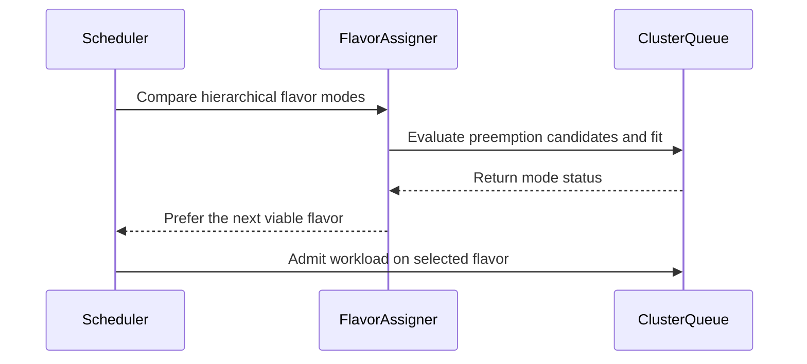

# PR #13616: Don't prefer a flavor with no preemption candidates over one that fits

**Summary**: Don't prefer a flavor with no preemption candidates over one that fits

**Sources**: https://github.com/kubernetes-sigs/kueue/pull/13616

**Last updated**: 2026-09-30T13:01:46Z

---

## Metadata

- **State**: closed (merged)
- **Author**: [@YQ-Wang](https://github.com/YQ-Wang)
- **Branch**: `feat/13607-flavor-no-candidates` → `main`
- **Created**: 2026-07-29T06:59:49Z
- **Updated**: 2026-09-30T13:01:46Z
- **Merged**: 2026-08-06T04:52:34Z
- **Closed**: 2026-08-06T04:52:34Z
- **Labels**: `kind/bug`, `release-note`, `size/L`, `lgtm`, `approved`, `ok-to-test`, `cncf-cla: yes`
- **Assignees**: [@amy](https://github.com/amy), [@mimowo](https://github.com/mimowo), [@olekzabl](https://github.com/olekzabl)
- **Requested reviewers**: [@amy](https://github.com/amy), [@mimowo](https://github.com/mimowo), [@olekzabl](https://github.com/olekzabl)
- **Changed files**: 3   **+226 / -13**

## Description

#### What type of PR is this?

/kind bug

#### What this PR does / why we need it:

With `flavorFungibility.preference: PreemptionOverBorrowing`, `isPreferred` compares `borrowingLevel` before `preemptionMode`. That lets a flavor whose preemption simulation found no candidates outrank a later flavor that fits, purely because its quota is sourceable at a shallower level in the cohort tree.

The first flavor cannot admit the workload in that scheduling attempt, and the fitting flavor loses the comparison because borrowing depth is considered first, so the workload stays pending indefinitely while quota sits idle. Every cycle repeats the same decision.

This PR ranks `noPreemptionCandidates` below all viable modes before applying the configured preference, keeping `noFit` as the worst mode.

The change only affects `PreemptionOverBorrowing`. The default preference and `BorrowingOverPreemption` already compare `preemptionMode` first, so they are unaffected.

#### Which issue(s) this PR fixes:

Fixes #13607

#### Special notes for your reviewer:

/cc @amy

Tests are added at three levels, and all of them fail without the fix:

- `TestIsPreferred` covers the new ordering directly, including that `noPreemptionCandidates` still beats `noFit` and that borrowing level still breaks ties between two such flavors.
- A `TestHierarchical` case pins the first flavor to `NoCandidates` at borrowing level 1 through a fake oracle, while exercising the flavor assigner’s real selection path against a fitting second flavor.
- A `TestSchedule` case reproduces the issue end to end and asserts the workload is admitted into the second flavor. It needs a two-level cohort: with a flat cohort both flavors land at the same borrowing level, the existing tie-break on `preemptionMode` fires, and the bug does not appear.

The middle case may look redundant next to the end-to-end one, but it guards against a specific kind of drift. `TestSchedule` derives its borrowing levels from the real oracle and real cohort-height math, so if a future change moved the first flavor to the same level as the second, the levels would tie, the pre-existing tie-break would select the fitting flavor, and the test would keep passing without exercising this bug at all. Pinning the oracle result keeps one test anchored to the ordering itself. Happy to drop it if you would rather not carry the extra layer.

One thing worth flagging, which I left out of scope. The docs and the KEP describe `PreemptionOverBorrowing` over a binary borrow key:

`(Fit, NoBorrow)` > `(Preempt, NoBorrow)` > `(Fit, Borrow)` > `(Preempt, Borrow)`

The implementation compares the full `borrowingLevel` depth first, so in a hierarchical cohort `(preempt, level 1)` still outranks `(fit, level 2)` even when preemption candidates do exist. That is not starvation, since preemption makes progress, so I kept this PR narrow. Happy to follow up if you would like the graded comparison reconciled with the documented ordering.

AI assistance was used to help implement and review this change. The author reviewed and tested the resulting code and takes responsibility for it.

#### Does this PR introduce a user-facing change?

```release-note
Scheduling: Fixed a bug where PreemptionOverBorrowing selected a ResourceFlavor with no preemption candidates instead of another flavor that could admit the Workload.
```


<!-- This is an auto-generated comment: release notes by coderabbit.ai -->
## Summary by CodeRabbit

## Summary by CodeRabbit

- **Bug Fixes**
  - Improved flavor selection when the preferred flavor has no eligible preemption candidates.
  - The scheduler now skips unavailable flavors and can select a viable fallback flavor.
  - Preserved existing handling for flavors that cannot fit workloads.
- **Tests**
  - Added coverage for borrowing and preemption preferences, hierarchical flavor selection, and fallback scheduling scenarios.
<!-- end of auto-generated comment: release notes by coderabbit.ai -->

## Discussion

### Comment by [@netlify[bot]](https://github.com/apps/netlify) — 2026-07-29T06:59:54Z

### <span aria-hidden="true">✅</span> Deploy Preview for *kubernetes-sigs-kueue* canceled.


|  Name | Link |
|:-:|------------------------|
|<span aria-hidden="true">🔨</span> Latest commit | f373baaad3b4df422fc026e26d0605d9f00f00ac |
|<span aria-hidden="true">🔍</span> Latest deploy log | https://app.netlify.com/projects/kubernetes-sigs-kueue/deploys/6a740fa04373a50008e14cca |

### Comment by [@kubernetes-prow[bot]](https://github.com/apps/kubernetes-prow) — 2026-07-29T06:59:59Z

Hi @YQ-Wang. Thanks for your PR.

I'm waiting for a [kubernetes-sigs](https://github.com/orgs/kubernetes-sigs/people) member to verify that this patch is reasonable to test. If it is, they should reply with `/ok-to-test` on its own line. Until that is done, I will not automatically test new commits in this PR, but the usual testing commands by org members will still work.

>[!TIP]
>**We noticed you've done this a few times! Consider [joining the org](https://git.k8s.io/community/community-membership.md#member) to skip this step and gain `/lgtm` and other bot rights.** We recommend asking approvers on your previous PRs to sponsor you.

Once the patch is verified, the new status will be reflected by the `ok-to-test` label.

I understand the commands that are listed [here](https://go.k8s.io/bot-commands?repo=kubernetes-sigs%2Fkueue).

<details>

Instructions for interacting with me using PR comments are available [here](https://git.k8s.io/community/contributors/guide/pull-requests.md).  If you have questions or suggestions related to my behavior, please file an issue against the [kubernetes-sigs/prow](https://github.com/kubernetes-sigs/prow/issues/new?title=Prow%20issue:) repository.
</details>

### Comment by [@coderabbitai[bot]](https://github.com/apps/coderabbitai) — 2026-07-29T07:00:19Z

<!-- This is an auto-generated comment: summarize by coderabbit.ai -->
<!-- review_stack_entry_start -->

[](https://app.coderabbit.ai/change-stack/kubernetes-sigs/kueue/pull/13616?utm_source=github_walkthrough&utm_medium=github&utm_campaign=change_stack)

<!-- review_stack_entry_end -->
<!-- walkthrough_start -->

<details>
<summary>📝 Walkthrough</summary>

## Walkthrough

The flavor assigner now ranks viable modes with preemption candidates above modes without candidates. Tests cover hierarchical selection, comparison behavior, and scheduling fallback to a deeper flavor.

### Changes

**Flavor preemption preference**

|Layer / File(s)|Summary|
|---|---|
|**No-candidate preference ordering** <br> `pkg/scheduler/flavorassigner/flavorassigner.go`, `pkg/scheduler/flavorassigner/flavorassigner_test.go`|`isPreferred` prioritizes modes with preemption candidates. Hierarchical and table-driven tests cover `noPreemptionCandidates`, `noFit`, and fit comparisons.|
|**Scheduler flavor fallback** <br> `pkg/scheduler/scheduler_test.go`|A scheduling scenario verifies that a workload skips an exhausted flavor without preemption candidates and is admitted using the next flavor.|

**Estimated code review effort:** 3 (Moderate) | ~20 minutes

**Possibly related PRs**

- [kubernetes-sigs/kueue#13800](https://github.com/kubernetes-sigs/kueue/pull/13800): Both PRs modify flavor-assignment behavior, but this PR addresses preemption-candidate preference while the other addresses failed TAS placements.

**Suggested reviewers:** `amy`

### Sequence Diagram(s)



</details>

<!-- walkthrough_end -->
<!-- pre_merge_checks_walkthrough_start -->

<details>
<summary>🚥 Pre-merge checks | ✅ 4 | ❌ 1</summary>

### ❌ Failed checks (1 warning)

|     Check name     | Status     | Explanation                                                                           | Resolution                                                                         |
| :----------------: | :--------- | :------------------------------------------------------------------------------------ | :--------------------------------------------------------------------------------- |
| Docstring Coverage | ⚠️ Warning | Docstring coverage is 50.00% which is insufficient. The required threshold is 80.00%. | Write docstrings for the functions missing them to satisfy the coverage threshold. |

<details>
<summary>✅ Passed checks (4 passed)</summary>

|         Check name         | Status   | Explanation                                                                                                                                 |
| :------------------------: | :------- | :------------------------------------------------------------------------------------------------------------------------------------------ |
|     Linked Issues check    | ✅ Passed | The implementation and regression tests address all stated objectives, including viable-flavor ordering and starvation prevention [`#13607`]. |
| Out of Scope Changes check | ✅ Passed | The implementation and added tests remain within the linked issue scope of flavor selection and regression coverage.                        |
|      Description Check     | ✅ Passed | Check skipped - CodeRabbit’s high-level summary is enabled.                                                                                 |
|         Title check        | ✅ Passed | The title clearly and concisely describes the main change: ranking flavors with no preemption candidates below flavors that fit.            |

</details>

</details>

<!-- pre_merge_checks_walkthrough_end -->
<!-- finishing_touch_checkbox_start -->

<details>
<summary>✨ Finishing Touches</summary>

<details>
<summary>🧪 Generate unit tests (beta)</summary>

- [ ] <!-- {"checkboxId": "f47ac10b-58cc-4372-a567-0e02b2c3d479", "radioGroupId": "utg-output-choice-group-unknown_comment_id"} -->   Create PR with unit tests

</details>

</details>

<!-- finishing_touch_checkbox_end -->
<!-- tips_start -->

---

Thanks for using [CodeRabbit](https://coderabbit.ai?utm_source=oss&utm_medium=github&utm_campaign=kubernetes-sigs/kueue&utm_content=13616)! It's free for OSS, and your support helps us grow. If you like it, consider giving us a shout-out.

<details>
<summary>❤️ Share</summary>

- [X](https://twitter.com/intent/tweet?text=I%20just%20used%20%40coderabbitai%20for%20my%20code%20review%2C%20and%20it%27s%20fantastic%21%20It%27s%20free%20for%20OSS%20and%20offers%20a%20free%20trial%20for%20the%20proprietary%20code.%20Check%20it%20out%3A&url=https%3A//coderabbit.ai)
- [Mastodon](https://mastodon.social/share?text=I%20just%20used%20%40coderabbitai%20for%20my%20code%20review%2C%20and%20it%27s%20fantastic%21%20It%27s%20free%20for%20OSS%20and%20offers%20a%20free%20trial%20for%20the%20proprietary%20code.%20Check%20it%20out%3A%20https%3A%2F%2Fcoderabbit.ai)
- [Reddit](https://www.reddit.com/submit?title=Great%20tool%20for%20code%20review%20-%20CodeRabbit&text=I%20just%20used%20CodeRabbit%20for%20my%20code%20review%2C%20and%20it%27s%20fantastic%21%20It%27s%20free%20for%20OSS%20and%20offers%20a%20free%20trial%20for%20proprietary%20code.%20Check%20it%20out%3A%20https%3A//coderabbit.ai)
- [LinkedIn](https://www.linkedin.com/sharing/share-offsite/?url=https%3A%2F%2Fcoderabbit.ai&mini=true&title=Great%20tool%20for%20code%20review%20-%20CodeRabbit&summary=I%20just%20used%20CodeRabbit%20for%20my%20code%20review%2C%20and%20it%27s%20fantastic%21%20It%27s%20free%20for%20OSS%20and%20offers%20a%20free%20trial%20for%20proprietary%20code)

</details>


<sub>Comment `@coderabbitai help` to get the list of available commands.</sub>

<!-- tips_end -->

### Comment by [@mimowo](https://github.com/mimowo) — 2026-07-29T13:49:02Z

/ok-to-test

### Comment by [@amy](https://github.com/amy) — 2026-07-29T18:57:45Z

/assign

### Comment by [@kubernetes-prow[bot]](https://github.com/apps/kubernetes-prow) — 2026-08-05T19:49:28Z

LGTM label has been added.  <details>Git tree hash: a22eeceff13bf9eeaa5a6143eed10ba5846fdc64</details>

### Comment by [@kubernetes-prow[bot]](https://github.com/apps/kubernetes-prow) — 2026-08-05T20:13:41Z

[APPROVALNOTIFIER] This PR is **APPROVED**

This pull-request has been approved by: *<a href="https://github.com/kubernetes-sigs/kueue/pull/13616#pullrequestreview-4868371533" title="Approved">mimowo</a>*, *<a href="https://github.com/kubernetes-sigs/kueue/pull/13616#" title="Author self-approved">YQ-Wang</a>*

The full list of commands accepted by this bot can be found [here](https://go.k8s.io/bot-commands?repo=kubernetes-sigs%2Fkueue).

The pull request process is described [here](https://git.k8s.io/community/contributors/guide/owners.md#the-code-review-process)

<details >
Needs approval from an approver in each of these files:

- ~~[OWNERS](https://github.com/kubernetes-sigs/kueue/blob/main/OWNERS)~~ [mimowo]

Approvers can indicate their approval by writing `/approve` in a comment
Approvers can cancel approval by writing `/approve cancel` in a comment
</details>
<!-- META={"approvers":[]} -->

### Comment by [@mimowo](https://github.com/mimowo) — 2026-08-06T04:44:06Z

/unhold
/lgtm

### Comment by [@kubernetes-prow[bot]](https://github.com/apps/kubernetes-prow) — 2026-08-06T04:44:13Z

LGTM label has been added.  <details>Git tree hash: bc4a35fe2eb967d971ee802ed79cc0ed91bcfaa5</details>

### Comment by [@mimowo](https://github.com/mimowo) — 2026-08-06T06:42:48Z

/cherrypick release-0.19
/cherrypick release-0.18

### Comment by [@k8s-infra-cherrypick-robot](https://github.com/k8s-infra-cherrypick-robot) — 2026-08-06T06:43:25Z

@mimowo: #13616 failed to apply on top of branch "release-0.18":
```
Applying: Don't prefer a flavor with no preemption candidates over one that fits
Using index info to reconstruct a base tree...
M	pkg/scheduler/flavorassigner/flavorassigner.go
M	pkg/scheduler/flavorassigner/flavorassigner_test.go
M	pkg/scheduler/scheduler_test.go
Falling back to patching base and 3-way merge...
Auto-merging pkg/scheduler/flavorassigner/flavorassigner.go
Auto-merging pkg/scheduler/flavorassigner/flavorassigner_test.go
CONFLICT (content): Merge conflict in pkg/scheduler/flavorassigner/flavorassigner_test.go
Auto-merging pkg/scheduler/scheduler_test.go
error: Failed to merge in the changes.
hint: Use 'git am --show-current-patch=diff' to see the failed patch
hint: When you have resolved this problem, run "git am --continue".
hint: If you prefer to skip this patch, run "git am --skip" instead.
hint: To restore the original branch and stop patching, run "git am --abort".
hint: Disable this message with "git config set advice.mergeConflict false"
Patch failed at 0001 Don't prefer a flavor with no preemption candidates over one that fits

```

<details>

In response to [this](https://github.com/kubernetes-sigs/kueue/pull/13616#issuecomment-5201274056):

>/cherrypick release-0.19
>/cherrypick release-0.18


Instructions for interacting with me using PR comments are available [here](https://git.k8s.io/community/contributors/guide/pull-requests.md).  If you have questions or suggestions related to my behavior, please file an issue against the [kubernetes-sigs/prow](https://github.com/kubernetes-sigs/prow/issues/new?title=Prow%20issue:) repository.
</details>

### Comment by [@k8s-infra-cherrypick-robot](https://github.com/k8s-infra-cherrypick-robot) — 2026-08-06T06:44:03Z

@mimowo: new pull request created: #13896

<details>

In response to [this](https://github.com/kubernetes-sigs/kueue/pull/13616#issuecomment-5201274056):

>/cherrypick release-0.19
>/cherrypick release-0.18


Instructions for interacting with me using PR comments are available [here](https://git.k8s.io/community/contributors/guide/pull-requests.md).  If you have questions or suggestions related to my behavior, please file an issue against the [kubernetes-sigs/prow](https://github.com/kubernetes-sigs/prow/issues/new?title=Prow%20issue:) repository.
</details>

### Comment by [@mimowo](https://github.com/mimowo) — 2026-08-06T06:45:41Z

@YQ-Wang could you please prepare the CP for 0.18?

### Comment by [@mimowo](https://github.com/mimowo) — 2026-09-30T13:01:44Z

/release-note-edit
```release-note
Scheduling: Fixed a bug where PreemptionOverBorrowing selected a ResourceFlavor with no preemption candidates instead of another flavor that could admit the Workload.
```

## Reviews

### Review by [@olekzabl](https://github.com/olekzabl) (commented) — 2026-08-05T19:49:21Z

Thank you!

/lgtm

- **pkg/scheduler/flavorassigner/flavorassigner.go:504** by [@olekzabl](https://github.com/olekzabl) — 2026-08-05T19:34:31Z
```diff
@@ -493,6 +493,15 @@ func isPreferred(a, b granularMode, fungibilityConfig kueue.FlavorFungibility) b
 		return true
 	}
 
+	// A flavor without preemption candidates cannot be admitted in this
+	// scheduling attempt. Rank it below viable modes before applying the
+	// configured fungibility preference, while retaining noFit as the worst mode.
+	aHasNoCandidates := a.preemptionMode == noPreemptionCandidates
+	bHasNoCandidates := b.preemptionMode == noPreemptionCandidates
+	if aHasNoCandidates != bHasNoCandidates {
+		return !aHasNoCandidates
+	}
+
```

  Nit: am I right that this would be equivalent?
  (Just cloning the above block handling `noFit`).
  
  ```suggestion
  	if a.preemptionMode == noPreemptionCandidates {
  		return false
  	}
  	if b.preemptionMode == noPreemptionCandidates {
  		return true
  	}
  
  ```
  
  In my feeling, this version would read naturally enough to not even need the // comment.
  
  WDYT?

- **pkg/scheduler/flavorassigner/flavorassigner_test.go:4097** by [@olekzabl](https://github.com/olekzabl) — 2026-08-05T19:44:41Z
```diff
@@ -4092,6 +4094,32 @@ func TestHierarchical(t *testing.T) {
 			wantMode:      Fit,
 			wantAssigment: rfMap{corev1.ResourceCPU: "two"},
 		},
+		"Select deeper flavor that fits when shallower flavor has no preemption candidates": {
```

  Will it be obvious for future readers what "deeper flavor" or "shallower flavor" means?
  (So far, in whole Kueue code, I see very little occurences of "shallow"/"deep" referring to Cohort hierarchy)
  
  How about "deeper-borrowing" and "shallower-borrowing"? That'd make a stronger hint.

- **pkg/scheduler/flavorassigner/flavorassigner_test.go:4139** by [@olekzabl](https://github.com/olekzabl) — 2026-08-05T19:48:08Z
```diff
@@ -4101,6 +4129,14 @@ func TestHierarchical(t *testing.T) {
 				"two":   utiltestingapi.MakeResourceFlavor("two").Obj(),
 				"three": utiltestingapi.MakeResourceFlavor("three").Obj(),
 			}
+			testClusterQueueFlavors := tc.testClusterQueueFlavors
+			if testClusterQueueFlavors == nil {
+				testClusterQueueFlavors = []kueue.FlavorQuotas{
+					*utiltestingapi.MakeFlavorQuotas("one").Resource(corev1.ResourceCPU, "0").Obj(),
+					*utiltestingapi.MakeFlavorQuotas("two").Resource(corev1.ResourceCPU, "0").Obj(),
+					*utiltestingapi.MakeFlavorQuotas("three").Resource(corev1.ResourceCPU, "0").Obj(),
+				}
+			}
```

  Nit: I'd put it explicitly on every test case. Possibly using a shared var / builder func if you like.
  So that, closer to table tests philosophy, all test inputs are clearly listed in one place.
  Especially in this case, where you have just 2 test cases relying on this defaulting.

### Review by [@mimowo](https://github.com/mimowo) (commented) — 2026-08-05T20:10:54Z

- **pkg/scheduler/flavorassigner/flavorassigner.go:504** by [@mimowo](https://github.com/mimowo) — 2026-08-05T20:10:54Z
```diff
@@ -493,6 +493,15 @@ func isPreferred(a, b granularMode, fungibilityConfig kueue.FlavorFungibility) b
 		return true
 	}
 
+	// A flavor without preemption candidates cannot be admitted in this
+	// scheduling attempt. Rank it below viable modes before applying the
+	// configured fungibility preference, while retaining noFit as the worst mode.
+	aHasNoCandidates := a.preemptionMode == noPreemptionCandidates
+	bHasNoCandidates := b.preemptionMode == noPreemptionCandidates
+	if aHasNoCandidates != bHasNoCandidates {
+		return !aHasNoCandidates
+	}
+
```

  Actually, this is not equivalent, because when ` a.preemptionMode = b.preemptionMode   = noPreemptionCandidates` it would return false, but before it would perform downstream checks.
  
  Worth checking if we have unit tests for that.

### Review by [@mimowo](https://github.com/mimowo) (commented) — 2026-08-05T20:13:28Z

/approve
/cherrypick release-0.19
/cherrypick release-0.18
Thank you 👍 I will just let you consider addressing the comments from @olekzabl . I suppose they are not blocking, but please double check.

/hold

### Review by [@YQ-Wang](https://github.com/YQ-Wang) (commented) — 2026-08-06T04:40:45Z

- **pkg/scheduler/flavorassigner/flavorassigner.go:504** by [@YQ-Wang](https://github.com/YQ-Wang) — 2026-08-06T04:40:45Z
```diff
@@ -493,6 +493,15 @@ func isPreferred(a, b granularMode, fungibilityConfig kueue.FlavorFungibility) b
 		return true
 	}
 
+	// A flavor without preemption candidates cannot be admitted in this
+	// scheduling attempt. Rank it below viable modes before applying the
+	// configured fungibility preference, while retaining noFit as the worst mode.
+	aHasNoCandidates := a.preemptionMode == noPreemptionCandidates
+	bHasNoCandidates := b.preemptionMode == noPreemptionCandidates
+	if aHasNoCandidates != bHasNoCandidates {
+		return !aHasNoCandidates
+	}
+
```

  Yes, `TestIsPreferred` already covers two noPreemptionCandidates modes in both borrowing-level orderings. The lower borrowing level is preferred, and the reverse is not. The suggested sequential checks would fail the first case, so this behavior is explicitly protected.

### Review by [@YQ-Wang](https://github.com/YQ-Wang) (commented) — 2026-08-06T04:41:05Z

- **pkg/scheduler/flavorassigner/flavorassigner_test.go:4097** by [@YQ-Wang](https://github.com/YQ-Wang) — 2026-08-06T04:41:05Z
```diff
@@ -4092,6 +4094,32 @@ func TestHierarchical(t *testing.T) {
 			wantMode:      Fit,
 			wantAssigment: rfMap{corev1.ResourceCPU: "two"},
 		},
+		"Select deeper flavor that fits when shallower flavor has no preemption candidates": {
```

  Good point. I updated this to use deeper-borrowing and shallower-borrowing, and made the matching TestIsPreferred case consistent.

### Review by [@YQ-Wang](https://github.com/YQ-Wang) (commented) — 2026-08-06T04:41:27Z

- **pkg/scheduler/flavorassigner/flavorassigner_test.go:4139** by [@YQ-Wang](https://github.com/YQ-Wang) — 2026-08-06T04:41:27Z
```diff
@@ -4101,6 +4129,14 @@ func TestHierarchical(t *testing.T) {
 				"two":   utiltestingapi.MakeResourceFlavor("two").Obj(),
 				"three": utiltestingapi.MakeResourceFlavor("three").Obj(),
 			}
+			testClusterQueueFlavors := tc.testClusterQueueFlavors
+			if testClusterQueueFlavors == nil {
+				testClusterQueueFlavors = []kueue.FlavorQuotas{
+					*utiltestingapi.MakeFlavorQuotas("one").Resource(corev1.ResourceCPU, "0").Obj(),
+					*utiltestingapi.MakeFlavorQuotas("two").Resource(corev1.ResourceCPU, "0").Obj(),
+					*utiltestingapi.MakeFlavorQuotas("three").Resource(corev1.ResourceCPU, "0").Obj(),
+				}
+			}
```

  Done, `testClusterQueueFlavors` is now explicit in every case

### Review by [@olekzabl](https://github.com/olekzabl) (commented) — 2026-08-06T08:02:33Z

- **pkg/scheduler/flavorassigner/flavorassigner.go:504** by [@olekzabl](https://github.com/olekzabl) — 2026-08-06T08:02:33Z
```diff
@@ -493,6 +493,15 @@ func isPreferred(a, b granularMode, fungibilityConfig kueue.FlavorFungibility) b
 		return true
 	}
 
+	// A flavor without preemption candidates cannot be admitted in this
+	// scheduling attempt. Rank it below viable modes before applying the
+	// configured fungibility preference, while retaining noFit as the worst mode.
+	aHasNoCandidates := a.preemptionMode == noPreemptionCandidates
+	bHasNoCandidates := b.preemptionMode == noPreemptionCandidates
+	if aHasNoCandidates != bHasNoCandidates {
+		return !aHasNoCandidates
+	}
+
```

  Ah, right. Then it's fine as it is.
