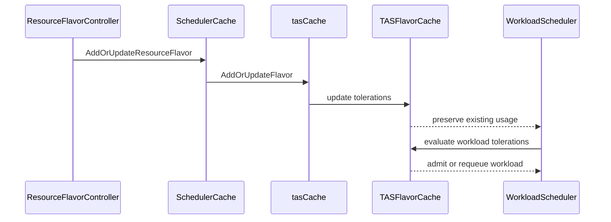

# PR #13622: Allow updating tolerations for TAS ResourceFlavors

**Summary**: Allow updating tolerations for TAS ResourceFlavors

**Sources**: https://github.com/kubernetes-sigs/kueue/pull/13622

**Last updated**: 2026-09-30T13:02:26Z

---

## Metadata

- **State**: closed (merged)
- **Author**: [@tomsen02](https://github.com/tomsen02)
- **Branch**: `feat/tas-resourceflavor-tolerations` → `main`
- **Created**: 2026-07-29T08:12:27Z
- **Updated**: 2026-09-30T13:02:26Z
- **Merged**: 2026-07-29T14:50:10Z
- **Closed**: 2026-07-29T14:50:10Z
- **Labels**: `kind/feature`, `release-note`, `size/L`, `lgtm`, `approved`, `kind/api-change`, `ok-to-test`, `cncf-cla: yes`, `area/tas`
- **Assignees**: [@mimowo](https://github.com/mimowo)
- **Requested reviewers**: [@sohankunkerkar](https://github.com/sohankunkerkar), [@kshalot](https://github.com/kshalot)
- **Changed files**: 10   **+253 / -24**

## Description

#### What type of PR is this?

/kind feature
/kind api-change
/area tas

#### What this PR does / why we need it:

Allows updating `spec.tolerations` on ResourceFlavors that reference a Topology.

The TAS ResourceFlavor controller applies the updated tolerations to the existing flavor cache before retrying inadmissible workloads. The cache is updated in place so that topology usage and per-Workload usage remain accounted for across both toleration additions and removals.

This is intentionally limited to tolerations. `spec.nodeLabels` and `spec.topologyName` remain immutable for TAS ResourceFlavors.

#### Which issue(s) this PR fixes:

Part of #3733

#### Special notes for your reviewer:

Validation performed:

- `go test ./pkg/cache/... ./pkg/controller/tas/... -count=1`
- `go test -race ./pkg/cache/scheduler ./pkg/controller/tas -count=1`
- focused TAS integration tests for API mutability, requeueing, and usage preservation
- full TAS integration suite: 107 specs passed
- `go test ./apis/... -count=1`
- `go vet` for the changed API, cache, controller, and integration packages
- Helm and Kustomize rendering verification

AI tool usage disclosure: I used an AI coding tool to help investigate the update paths, implement the change, and prepare tests and documentation. I reviewed the resulting code and ran the validations listed above.

#### Does this PR introduce a user-facing change?

```release-note
TAS: ResourceFlavor spec.tolerations can now be updated when spec.topologyName is set.
```

<!-- This is an auto-generated comment: release notes by coderabbit.ai -->
## Summary by CodeRabbit

* **New Features**
  * Topology-aware ResourceFlavor tolerations can now be updated after creation.
* **Bug Fixes**
  * Updating tolerations now correctly refreshes scheduling behavior while preserving already-accounted workload usage.
  * Workloads are re-evaluated when tolerations are added or removed, matching the latest ResourceFlavor settings.
* **Validation**
  * Removed the CRD restriction that blocked toleration updates when topology name is set.
  * Kept existing immutability/consistency rules for topology name and node labels.
<!-- end of auto-generated comment: release notes by coderabbit.ai -->

## Discussion

### Comment by [@netlify[bot]](https://github.com/apps/netlify) — 2026-07-29T08:12:34Z

### <span aria-hidden="true">✅</span> Deploy Preview for *kubernetes-sigs-kueue* canceled.


|  Name | Link |
|:-:|------------------------|
|<span aria-hidden="true">🔨</span> Latest commit | 7e065cb3a5f587e7bb7d9b2d20bbb8f09f58ac68 |
|<span aria-hidden="true">🔍</span> Latest deploy log | https://app.netlify.com/projects/kubernetes-sigs-kueue/deploys/6a6a0c9dff4ab3000838c230 |

### Comment by [@kubernetes-prow[bot]](https://github.com/apps/kubernetes-prow) — 2026-07-29T08:12:38Z

Hi @tomsen02. Thanks for your PR.

I'm waiting for a [kubernetes-sigs](https://github.com/orgs/kubernetes-sigs/people) member to verify that this patch is reasonable to test. If it is, they should reply with `/ok-to-test` on its own line. Until that is done, I will not automatically test new commits in this PR, but the usual testing commands by org members will still work.

Regular contributors should [join the org](https://git.k8s.io/community/community-membership.md#member) to skip this step.

Once the patch is verified, the new status will be reflected by the `ok-to-test` label.

I understand the commands that are listed [here](https://go.k8s.io/bot-commands?repo=kubernetes-sigs%2Fkueue).

<details>

Instructions for interacting with me using PR comments are available [here](https://git.k8s.io/community/contributors/guide/pull-requests.md).  If you have questions or suggestions related to my behavior, please file an issue against the [kubernetes-sigs/prow](https://github.com/kubernetes-sigs/prow/issues/new?title=Prow%20issue:) repository.
</details>

### Comment by [@coderabbitai[bot]](https://github.com/apps/coderabbitai) — 2026-07-29T08:13:06Z

<!-- This is an auto-generated comment: summarize by coderabbit.ai -->
<!-- review_stack_entry_start -->

[](https://app.coderabbit.ai/change-stack/kubernetes-sigs/kueue/pull/13622?utm_source=github_walkthrough&utm_medium=github&utm_campaign=change_stack)

<!-- review_stack_entry_end -->
<!-- walkthrough_start -->

<details>
<summary>📝 Walkthrough</summary>

## Walkthrough

TAS ResourceFlavor tolerations are now mutable after topology configuration. CRD validations, TAS cache updates, controller change detection, unit coverage, and integration tests were updated to support and verify this behavior while preserving existing workload usage.

### Changes

**TAS ResourceFlavor tolerations**

|Layer / File(s)|Summary|
|---|---|
|**ResourceFlavor validation contracts** <br> `apis/kueue/.../resourceflavor_types.go`, `charts/kueue/templates/crd/...`, `config/components/crd/bases/...`|Toleration immutability validation was removed for both CRD versions. Existing topology and node-label constraints remain, with v1beta2 requiring node labels when topology is set.|
|**TAS cache update path** <br> `pkg/cache/scheduler/cache.go`, `pkg/cache/scheduler/tas_cache.go`, `pkg/cache/scheduler/tas_flavor.go`, `pkg/cache/scheduler/tas_cache_update_test.go`|TAS flavor reconciliation now updates cached tolerations in place and preserves workload usage across additions and removals.|
|**Controller and integration behavior** <br> `pkg/controller/tas/resource_flavor.go`, `test/integration/singlecluster/tas/tas_test.go`|The controller detects toleration changes, and tests cover successful updates, admission, requeue, metrics, and usage behavior.|

**Estimated code review effort:** 3 (Moderate) | ~20 minutes

### Sequence Diagram(s)



**Suggested reviewers:** `sohankunkerkar`, `kshalot`, `j-skiba`

</details>

<!-- walkthrough_end -->
<!-- pre_merge_checks_walkthrough_start -->

<details>
<summary>🚥 Pre-merge checks | ✅ 5</summary>

<details>
<summary>✅ Passed checks (5 passed)</summary>

|         Check name         | Status   | Explanation                                                                                                      |
| :------------------------: | :------- | :--------------------------------------------------------------------------------------------------------------- |
|     Docstring Coverage     | ✅ Passed | No functions found in the changed files to evaluate docstring coverage. Skipping docstring coverage check.       |
|     Linked Issues check    | ✅ Passed | Check skipped because no linked issues were found for this pull request.                                         |
| Out of Scope Changes check | ✅ Passed | Check skipped because no linked issues were found for this pull request.                                         |
|      Description Check     | ✅ Passed | Check skipped - CodeRabbit’s high-level summary is enabled.                                                      |
|         Title check        | ✅ Passed | The title clearly and concisely summarizes the main change: enabling toleration updates for TAS ResourceFlavors. |

</details>

</details>

<!-- pre_merge_checks_walkthrough_end -->
<!-- finishing_touch_checkbox_start -->

<details>
<summary>✨ Finishing Touches</summary>

<details>
<summary>🧪 Generate unit tests (beta)</summary>

- [ ] <!-- {"checkboxId": "f47ac10b-58cc-4372-a567-0e02b2c3d479", "radioGroupId": "utg-output-choice-group-unknown_comment_id"} -->   Create PR with unit tests

</details>

</details>

<!-- finishing_touch_checkbox_end -->
<!-- tips_start -->

---

Thanks for using [CodeRabbit](https://coderabbit.ai?utm_source=oss&utm_medium=github&utm_campaign=kubernetes-sigs/kueue&utm_content=13622)! It's free for OSS, and your support helps us grow. If you like it, consider giving us a shout-out.

<details>
<summary>❤️ Share</summary>

- [X](https://twitter.com/intent/tweet?text=I%20just%20used%20%40coderabbitai%20for%20my%20code%20review%2C%20and%20it%27s%20fantastic%21%20It%27s%20free%20for%20OSS%20and%20offers%20a%20free%20trial%20for%20the%20proprietary%20code.%20Check%20it%20out%3A&url=https%3A//coderabbit.ai)
- [Mastodon](https://mastodon.social/share?text=I%20just%20used%20%40coderabbitai%20for%20my%20code%20review%2C%20and%20it%27s%20fantastic%21%20It%27s%20free%20for%20OSS%20and%20offers%20a%20free%20trial%20for%20the%20proprietary%20code.%20Check%20it%20out%3A%20https%3A%2F%2Fcoderabbit.ai)
- [Reddit](https://www.reddit.com/submit?title=Great%20tool%20for%20code%20review%20-%20CodeRabbit&text=I%20just%20used%20CodeRabbit%20for%20my%20code%20review%2C%20and%20it%27s%20fantastic%21%20It%27s%20free%20for%20OSS%20and%20offers%20a%20free%20trial%20for%20proprietary%20code.%20Check%20it%20out%3A%20https%3A//coderabbit.ai)
- [LinkedIn](https://www.linkedin.com/sharing/share-offsite/?url=https%3A%2F%2Fcoderabbit.ai&mini=true&title=Great%20tool%20for%20code%20review%20-%20CodeRabbit&summary=I%20just%20used%20CodeRabbit%20for%20my%20code%20review%2C%20and%20it%27s%20fantastic%21%20It%27s%20free%20for%20OSS%20and%20offers%20a%20free%20trial%20for%20proprietary%20code)

</details>


<sub>Comment `@coderabbitai help` to get the list of available commands.</sub>

<!-- tips_end -->

### Comment by [@mimowo](https://github.com/mimowo) — 2026-07-29T13:49:13Z

/ok-to-test

### Comment by [@kubernetes-prow[bot]](https://github.com/apps/kubernetes-prow) — 2026-07-29T14:25:09Z

LGTM label has been added.  <details>Git tree hash: ca1c3cc398c0eb5fa9a30b78d2de957227581002</details>

### Comment by [@kubernetes-prow[bot]](https://github.com/apps/kubernetes-prow) — 2026-07-29T14:25:14Z

[APPROVALNOTIFIER] This PR is **APPROVED**

This pull-request has been approved by: *<a href="https://github.com/kubernetes-sigs/kueue/pull/13622#pullrequestreview-4809367865" title="Approved">mimowo</a>*, *<a href="https://github.com/kubernetes-sigs/kueue/pull/13622#" title="Author self-approved">tomsen02</a>*

The full list of commands accepted by this bot can be found [here](https://go.k8s.io/bot-commands?repo=kubernetes-sigs%2Fkueue).

The pull request process is described [here](https://git.k8s.io/community/contributors/guide/owners.md#the-code-review-process)

<details >
Needs approval from an approver in each of these files:

- ~~[OWNERS](https://github.com/kubernetes-sigs/kueue/blob/main/OWNERS)~~ [mimowo]

Approvers can indicate their approval by writing `/approve` in a comment
Approvers can cancel approval by writing `/approve cancel` in a comment
</details>
<!-- META={"approvers":[]} -->

### Comment by [@mimowo](https://github.com/mimowo) — 2026-09-30T13:02:23Z

/release-note-edit
```release-note
TAS: ResourceFlavor spec.tolerations can now be updated when spec.topologyName is set.
```

## Reviews

### Review by [@mimowo](https://github.com/mimowo) (commented) — 2026-07-29T14:11:28Z

- **pkg/cache/scheduler/tas_cache.go:89** by [@mimowo](https://github.com/mimowo) — 2026-07-29T14:11:28Z
```diff
@@ -75,20 +75,29 @@ func (t *tasCache) Clone() map[kueue.ResourceFlavorReference]*TASFlavorCache {
 	return maps.Clone(t.flavorCache)
 }
 
-func (t *tasCache) AddFlavor(flavor *kueue.ResourceFlavor) {
+func (t *tasCache) AddOrUpdateFlavor(flavor *kueue.ResourceFlavor) {
 	t.Lock()
 	defer t.Unlock()
 	name := kueue.ResourceFlavorReference(flavor.Name)
-	if _, ok := t.flavors[name]; !ok {
-		flavorInfo := flavorInformation{
-			TopologyName: *flavor.Spec.TopologyName,
-			NodeLabels:   maps.Clone(flavor.Spec.NodeLabels),
-			Tolerations:  slices.Clone(flavor.Spec.Tolerations),
-		}
+	tolerations := slices.Clone(flavor.Spec.Tolerations)
+	if flavorInfo, ok := t.flavors[name]; ok {
+		flavorInfo.Tolerations = tolerations
 		t.flavors[name] = flavorInfo
-		if tInfo, ok := t.topologies[flavorInfo.TopologyName]; ok {
-			t.flavorCache[name] = t.NewTASFlavorCache(tInfo, flavorInfo)
+		if flavorCache, ok := t.flavorCache[name]; ok {
+			flavorCache.Lock()
+			defer flavorCache.Unlock()
+			flavorCache.flavor.Tolerations = tolerations
```

  Move that to a helper function to encapsulate taking the lock

### Review by [@tomsen02](https://github.com/tomsen02) (commented) — 2026-07-29T14:22:19Z

- **pkg/cache/scheduler/tas_cache.go:89** by [@tomsen02](https://github.com/tomsen02) — 2026-07-29T14:22:19Z
```diff
@@ -75,20 +75,29 @@ func (t *tasCache) Clone() map[kueue.ResourceFlavorReference]*TASFlavorCache {
 	return maps.Clone(t.flavorCache)
 }
 
-func (t *tasCache) AddFlavor(flavor *kueue.ResourceFlavor) {
+func (t *tasCache) AddOrUpdateFlavor(flavor *kueue.ResourceFlavor) {
 	t.Lock()
 	defer t.Unlock()
 	name := kueue.ResourceFlavorReference(flavor.Name)
-	if _, ok := t.flavors[name]; !ok {
-		flavorInfo := flavorInformation{
-			TopologyName: *flavor.Spec.TopologyName,
-			NodeLabels:   maps.Clone(flavor.Spec.NodeLabels),
-			Tolerations:  slices.Clone(flavor.Spec.Tolerations),
-		}
+	tolerations := slices.Clone(flavor.Spec.Tolerations)
+	if flavorInfo, ok := t.flavors[name]; ok {
+		flavorInfo.Tolerations = tolerations
 		t.flavors[name] = flavorInfo
-		if tInfo, ok := t.topologies[flavorInfo.TopologyName]; ok {
-			t.flavorCache[name] = t.NewTASFlavorCache(tInfo, flavorInfo)
+		if flavorCache, ok := t.flavorCache[name]; ok {
+			flavorCache.Lock()
+			defer flavorCache.Unlock()
+			flavorCache.flavor.Tolerations = tolerations
```

  Done in 7e065cb3a: the locking and mutation are now encapsulated in `TASFlavorCache.updateTolerations`.
  
  AI disclosure: I used an AI coding assistant to help implement and validate this review follow-up.

### Review by [@mimowo](https://github.com/mimowo) (commented) — 2026-07-29T14:25:01Z

/lgtm
/approve
Thank you for the improvement 👍 Actually mutability of TAS RF and Topology has been an issue for long. Let's see if we can gradually improve the situation. I like the field by field approach to make it easy to review.
