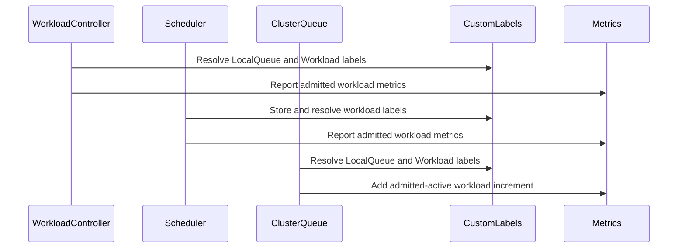

# PR #13635: feat: Support Workload custom labels in LocalQueue admitted workload metrics

**Summary**: feat: Support Workload custom labels in LocalQueue admitted workload metrics

**Sources**: https://github.com/kubernetes-sigs/kueue/pull/13635

**Last updated**: 2026-09-30T15:51:11Z

---

## Metadata

- **State**: closed (merged)
- **Author**: [@Vaishnav88sk](https://github.com/Vaishnav88sk)
- **Branch**: `feature/custom-metric-labels-lq` → `main`
- **Created**: 2026-07-29T14:39:51Z
- **Updated**: 2026-09-30T15:51:11Z
- **Merged**: 2026-08-06T09:04:56Z
- **Closed**: 2026-08-06T09:04:56Z
- **Labels**: `kind/feature`, `release-note`, `size/L`, `lgtm`, `approved`, `ok-to-test`, `cncf-cla: yes`, `area/testing`, `area/observability`
- **Assignees**: [@Singularity23x0](https://github.com/Singularity23x0)
- **Requested reviewers**: [@amy](https://github.com/amy), [@pajakd](https://github.com/pajakd)
- **Changed files**: 7   **+104 / -26**

## Description


<!--  Thanks for sending a pull request!  Here are some tips for you:

1. If this is your first time, please read our contributor guidelines: https://git.k8s.io/community/contributors/guide/first-contribution.md#your-first-contribution and developer guide https://git.k8s.io/community/contributors/devel/development.md#development-guide
2. Please label this pull request according to what type of issue you are addressing, especially if this is a release targeted pull request. For reference on required PR/issue labels, read here:
https://git.k8s.io/community/contributors/devel/sig-release/release.md#issuepr-kind-label
3. Ensure you have added or ran the appropriate tests for your PR: https://git.k8s.io/community/contributors/devel/sig-testing/testing.md
4. If you want *faster* PR reviews, read how: https://git.k8s.io/community/contributors/guide/pull-requests.md#best-practices-for-faster-reviews
5. If the PR is unfinished, see how to mark it: https://git.k8s.io/community/contributors/guide/pull-requests.md#marking-unfinished-pull-requests
-->

#### What type of PR is this?
/kind feature
/area testing
<!--
Add one of the following kinds:
/kind bug
/kind cleanup
/kind documentation
/kind feature
/kind kep

Optionally add one or more of the following kinds if applicable:
/kind api-change
/kind deprecation
/kind failing-test
/kind flake
/kind regression

Please also consider setting the area:
/area tas
/area was
/area integrations
/area multikueue
/area dashboard
/area localization
/area testing
/area website
-->

#### What this PR does / why we need it:
Adds support for `SourceKindWorkload` custom metric labels on LocalQueue admitted workload metrics (`local_queue_admitted_active_workloads`, `local_queue_admitted_workloads_total`, `local_queue_admission_wait_time_seconds`).

Previously, these LQ metrics only included custom labels sourced from `LocalQueue` objects. With this change, workload-sourced labels (configured via `CustomMetricLabels` with `sourceKind: Workload`) are now also included, matching the behavior already available on ClusterQueue metrics.
#### Which issue(s) this PR fixes:
<!--
*Automatically closes linked issue when PR is merged.
Usage: `Fixes #<issue number>`, or `Fixes (paste link of issue)`.
_If PR is about `failing-tests or flakes`, please post the related issues/tests in a comment and do not use `Fixes`_*
-->
Fixes #13587 

#### Special notes for your reviewer:
The `LocalQueueMetrics` feature gate is enabled in the relevant integration tests to cover the new behavior.
#### Does this PR introduce a user-facing change?
<!--
If no, just write "NONE" in the release-note block below.
If yes, a release note is required:
Enter your extended release note in the block below. If the PR requires additional action from users switching to the new release, include the string "action required".
-->
```release-note
Observability: Support Workload custom labels in LocalQueue admitted workload metrics when CustomMetricLabels feature gate is enabled.
```


<!-- This is an auto-generated comment: release notes by coderabbit.ai -->
## Summary by CodeRabbit

- **New Features**
  - Local queue and cluster queue admission metrics can now include custom label dimensions derived from workloads and local queues when enabled.
  - Admitted-active workload metrics are emitted consistently for cluster queues and applicable local queues with local-queue-specific labels.

- **Bug Fixes**
  - Corrected admitted-active workload gauge updates to accumulate increments and decrements properly.

- **Tests**
  - Expanded coverage for custom-labeled admission, admitted-active workloads, totals, and wait times across workload and label lifecycle changes.
<!-- end of auto-generated comment: release notes by coderabbit.ai -->

## Discussion

### Comment by [@netlify[bot]](https://github.com/apps/netlify) — 2026-07-29T14:39:57Z

### <span aria-hidden="true">✅</span> Deploy Preview for *kubernetes-sigs-kueue* canceled.


|  Name | Link |
|:-:|------------------------|
|<span aria-hidden="true">🔨</span> Latest commit | c136808e9d365c95b3c73a76a57a901513da0284 |
|<span aria-hidden="true">🔍</span> Latest deploy log | https://app.netlify.com/projects/kubernetes-sigs-kueue/deploys/6a731e408578be0008ea7e55 |

### Comment by [@kubernetes-prow[bot]](https://github.com/apps/kubernetes-prow) — 2026-07-29T14:40:02Z

Hi @Vaishnav88sk. Thanks for your PR.

I'm waiting for a [kubernetes-sigs](https://github.com/orgs/kubernetes-sigs/people) member to verify that this patch is reasonable to test. If it is, they should reply with `/ok-to-test` on its own line. Until that is done, I will not automatically test new commits in this PR, but the usual testing commands by org members will still work.

>[!TIP]
>**We noticed you've done this a few times! Consider [joining the org](https://git.k8s.io/community/community-membership.md#member) to skip this step and gain `/lgtm` and other bot rights.** We recommend asking approvers on your previous PRs to sponsor you.

Once the patch is verified, the new status will be reflected by the `ok-to-test` label.

I understand the commands that are listed [here](https://go.k8s.io/bot-commands?repo=kubernetes-sigs%2Fkueue).

<details>

Instructions for interacting with me using PR comments are available [here](https://git.k8s.io/community/contributors/guide/pull-requests.md).  If you have questions or suggestions related to my behavior, please file an issue against the [kubernetes-sigs/prow](https://github.com/kubernetes-sigs/prow/issues/new?title=Prow%20issue:) repository.
</details>

### Comment by [@coderabbitai[bot]](https://github.com/apps/coderabbitai) — 2026-07-29T14:40:10Z

<!-- This is an auto-generated comment: summarize by coderabbit.ai -->
<!-- review_stack_entry_start -->

[](https://app.coderabbit.ai/change-stack/kubernetes-sigs/kueue/pull/13635?utm_source=github_walkthrough&utm_medium=github&utm_campaign=change_stack)

<!-- review_stack_entry_end -->
<!-- This is an auto-generated comment: review paused by coderabbit.ai -->

> [!NOTE]
> ## Reviews paused
> 
> It looks like this branch is under active development. To avoid overwhelming you with review comments due to an influx of new commits, CodeRabbit has automatically paused this review. You can configure this behavior by changing the `reviews.auto_review.auto_pause_after_reviewed_commits` setting.
> 
> Use the following commands to manage reviews:
> - `@coderabbitai resume` to resume automatic reviews.
> - `@coderabbitai review` to trigger a single review.
> 
> Use the checkboxes below for quick actions:
> - [ ] <!-- {"checkboxId": "7f6cc2e2-2e4e-497a-8c31-c9e4573e93d1"} --> ▶️ Resume reviews
> - [ ] <!-- {"checkboxId": "e9bb8d72-00e8-4f67-9cb2-caf3b22574fe"} --> 🔍 Trigger review

<!-- end of auto-generated comment: review paused by coderabbit.ai -->
No actionable comments were generated in the recent review. 🎉

<details>
<summary>ℹ️ Recent review info</summary>

<details>
<summary>⚙️ Run configuration</summary>

**Configuration used**: Path: .coderabbit.yaml

**Review profile**: CHILL

**Plan**: Pro Plus

**Run ID**: `8ee34718-1d7e-41e2-ba37-fdcaab03ad4c`

</details>

<details>
<summary>📥 Commits</summary>

Reviewing files that changed from the base of the PR and between da71c8eac433fbc0315bb8bb508257e6b3018d8f and c136808e9d365c95b3c73a76a57a901513da0284.

</details>

<details>
<summary>📒 Files selected for processing (2)</summary>

* `pkg/controller/core/workload_controller.go`
* `test/integration/singlecluster/controller/core/custom_labels_test.go`

</details>

<details>
<summary>🚧 Files skipped from review as they are similar to previous changes (2)</summary>

* test/integration/singlecluster/controller/core/custom_labels_test.go
* pkg/controller/core/workload_controller.go

</details>

</details>

---
<!-- walkthrough_start -->

<details>
<summary>📝 Walkthrough</summary>

## Walkthrough

LocalQueue admission metrics now accept workload-scoped custom labels. ClusterQueue centralizes admitted-active reporting and applies incremental gauge updates. Integration tests cover admission, completion, label changes, and deletion.

### Changes

**LocalQueue metric label support**

|Layer / File(s)|Summary|
|---|---|
|**Metric label contracts and gauge updates** <br> `pkg/metrics/metrics.go`|LocalQueue admission metrics use LocalQueue and Workload custom labels. Admitted-active gauges apply increments instead of replacing values.|
|**Admission reporting paths** <br> `pkg/cache/scheduler/clusterqueue.go`, `pkg/cache/scheduler/localqueue.go`, `pkg/controller/core/workload_controller.go`, `pkg/scheduler/scheduler.go`|Admission paths derive LocalQueue and Workload labels. ClusterQueue centralizes admitted-active reporting. LocalQueue no longer reports that metric directly.|
|**Metric validation coverage** <br> `test/util/metrics.go`, `test/integration/singlecluster/controller/core/custom_labels_test.go`|Test helpers accept custom labels. Integration tests verify metric dimensions and lifecycle updates.|

**Estimated code review effort:** 3 (Moderate) | ~20 minutes

### Sequence Diagram(s)



**Possibly related issues**

- `kubernetes-sigs/kueue#13588` — Extends LocalQueue metrics with workload-derived labels for pending workloads.
- `kubernetes-sigs/kueue#12629` — Covers workload custom labels for admitted-active and LocalQueue admission metrics.
- `kubernetes-sigs/kueue#13589` — Covers workload custom labels for admitted-workload metrics. 

**Suggested reviewers:** `amy`, `pajakd`

</details>

<!-- walkthrough_end -->
<!-- pre_merge_checks_walkthrough_start -->

<details>
<summary>🚥 Pre-merge checks | ✅ 4 | ❌ 1</summary>

### ❌ Failed checks (1 warning)

|     Check name     | Status     | Explanation                                                                          | Resolution                                                                         |
| :----------------: | :--------- | :----------------------------------------------------------------------------------- | :--------------------------------------------------------------------------------- |
| Docstring Coverage | ⚠️ Warning | Docstring coverage is 0.00% which is insufficient. The required threshold is 80.00%. | Write docstrings for the functions missing them to satisfy the coverage threshold. |

<details>
<summary>✅ Passed checks (4 passed)</summary>

|         Check name         | Status   | Explanation                                                                                                                                                        |
| :------------------------: | :------- | :----------------------------------------------------------------------------------------------------------------------------------------------------------------- |
|      Description Check     | ✅ Passed | Check skipped - CodeRabbit’s high-level summary is enabled.                                                                                                        |
|         Title check        | ✅ Passed | The title clearly describes support for Workload custom labels in LocalQueue admitted workload metrics.                                                            |
|     Linked Issues check    | ✅ Passed | The changes add Workload labels and annotations to LocalQueue admitted workload metrics and include integration test coverage for the requested behavior [`#13587`]. |
| Out of Scope Changes check | ✅ Passed | The refactoring, label propagation, wait-time metric support, and test updates are directly related to LocalQueue admitted workload metrics.                       |

</details>

</details>

<!-- pre_merge_checks_walkthrough_end -->
<!-- finishing_touch_checkbox_start -->

<details>
<summary>✨ Finishing Touches</summary>

<details>
<summary>🧪 Generate unit tests (beta)</summary>

- [ ] <!-- {"checkboxId": "f47ac10b-58cc-4372-a567-0e02b2c3d479", "radioGroupId": "utg-output-choice-group-unknown_comment_id"} -->   Create PR with unit tests

</details>

</details>

<!-- finishing_touch_checkbox_end -->
<!-- tips_start -->

---

Thanks for using [CodeRabbit](https://coderabbit.ai?utm_source=oss&utm_medium=github&utm_campaign=kubernetes-sigs/kueue&utm_content=13635)! It's free for OSS, and your support helps us grow. If you like it, consider giving us a shout-out.

<details>
<summary>❤️ Share</summary>

- [X](https://twitter.com/intent/tweet?text=I%20just%20used%20%40coderabbitai%20for%20my%20code%20review%2C%20and%20it%27s%20fantastic%21%20It%27s%20free%20for%20OSS%20and%20offers%20a%20free%20trial%20for%20the%20proprietary%20code.%20Check%20it%20out%3A&url=https%3A//coderabbit.ai)
- [Mastodon](https://mastodon.social/share?text=I%20just%20used%20%40coderabbitai%20for%20my%20code%20review%2C%20and%20it%27s%20fantastic%21%20It%27s%20free%20for%20OSS%20and%20offers%20a%20free%20trial%20for%20the%20proprietary%20code.%20Check%20it%20out%3A%20https%3A%2F%2Fcoderabbit.ai)
- [Reddit](https://www.reddit.com/submit?title=Great%20tool%20for%20code%20review%20-%20CodeRabbit&text=I%20just%20used%20CodeRabbit%20for%20my%20code%20review%2C%20and%20it%27s%20fantastic%21%20It%27s%20free%20for%20OSS%20and%20offers%20a%20free%20trial%20for%20proprietary%20code.%20Check%20it%20out%3A%20https%3A//coderabbit.ai)
- [LinkedIn](https://www.linkedin.com/sharing/share-offsite/?url=https%3A%2F%2Fcoderabbit.ai&mini=true&title=Great%20tool%20for%20code%20review%20-%20CodeRabbit&summary=I%20just%20used%20CodeRabbit%20for%20my%20code%20review%2C%20and%20it%27s%20fantastic%21%20It%27s%20free%20for%20OSS%20and%20offers%20a%20free%20trial%20for%20proprietary%20code)

</details>


<sub>Comment `@coderabbitai help` to get the list of available commands.</sub>

<!-- tips_end -->

### Comment by [@Vaishnav88sk](https://github.com/Vaishnav88sk) — 2026-07-29T14:42:07Z

cc @Singularity23x0

### Comment by [@mimowo](https://github.com/mimowo) — 2026-07-29T14:55:54Z

/ok-to-test
cc @Singularity23x0 ptal

### Comment by [@kubernetes-prow[bot]](https://github.com/apps/kubernetes-prow) — 2026-07-30T14:05:49Z

[APPROVALNOTIFIER] This PR is **APPROVED**

This pull-request has been approved by: *<a href="https://github.com/kubernetes-sigs/kueue/pull/13635#pullrequestreview-4819605808" title="Approved">mimowo</a>*, *<a href="https://github.com/kubernetes-sigs/kueue/pull/13635#" title="Author self-approved">Vaishnav88sk</a>*

The full list of commands accepted by this bot can be found [here](https://go.k8s.io/bot-commands?repo=kubernetes-sigs%2Fkueue).

The pull request process is described [here](https://git.k8s.io/community/contributors/guide/owners.md#the-code-review-process)

<details >
Needs approval from an approver in each of these files:

- ~~[OWNERS](https://github.com/kubernetes-sigs/kueue/blob/main/OWNERS)~~ [mimowo]

Approvers can indicate their approval by writing `/approve` in a comment
Approvers can cancel approval by writing `/approve cancel` in a comment
</details>
<!-- META={"approvers":[]} -->

### Comment by [@mimowo](https://github.com/mimowo) — 2026-08-03T19:10:28Z

/area observability

### Comment by [@Singularity23x0](https://github.com/Singularity23x0) — 2026-08-05T08:27:25Z

/assign

### Comment by [@Singularity23x0](https://github.com/Singularity23x0) — 2026-08-06T08:50:02Z

Thank you!
/lgtm

### Comment by [@kubernetes-prow[bot]](https://github.com/apps/kubernetes-prow) — 2026-08-06T08:50:09Z

LGTM label has been added.  <details>Git tree hash: 118a0edec33fa6b5475817d3dd7e651191da5449</details>

### Comment by [@mbobrovskyi](https://github.com/mbobrovskyi) — 2026-09-30T15:51:08Z

/release-note-edit
```release-note
Observability: Support Workload custom labels in LocalQueue admitted workload metrics when CustomMetricLabels feature gate is enabled.
```

## Reviews

### Review by [@coderabbitai[bot]](https://github.com/apps/coderabbitai) (commented) — 2026-07-29T14:45:21Z

**Actionable comments posted: 2**

<details>
<summary>🤖 Prompt for all review comments with AI agents</summary>

```
Verify each finding against current code. Fix only still-valid issues, skip the
rest with a brief reason, keep changes minimal, and validate.

Inline comments:
In `@pkg/cache/scheduler/clusterqueue.go`:
- Around line 551-556: Update both LocalQueue metric update paths, including
updateWorkloadUsage and the corresponding path near the existing localQueues
lookup, to require lq.shouldExposeMetrics(c.lqMetrics) before calling
ReportLocalQueueAdmittedActiveWorkloads. Preserve the existing LocalQueue
existence checks and use the resolved LocalQueue object for the exposure filter.

In `@test/integration/singlecluster/controller/core/custom_labels_test.go`:
- Around line 1057-1070: Extend the custom-label integration coverage around the
existing admitted-active metric assertions to include positive and negative
checks for local_queue_admitted_workloads_total and
local_queue_admission_wait_time_seconds, including their update/deletion
behavior. Add a workload using SourceAnnotationKey alongside an LQ-sourced
label, and verify extracted annotation values and label ordering across the
relevant metric assertions; apply the same coverage to the additional
metric-update sections referenced by the comment.
```

</details>

<details>
<summary>🪄 Autofix (Beta)</summary>

Fix all unresolved CodeRabbit comments on this PR:

- [ ] <!-- {"checkboxId": "4b0d0e0a-96d7-4f10-b296-3a18ea78f0b9"} --> Push a commit to this branch (recommended)
- [ ] <!-- {"checkboxId": "ff5b1114-7d8c-49e6-8ac1-43f82af23a33"} --> Create a new PR with the fixes

</details>

---

<details>
<summary>ℹ️ Review info</summary>

<details>
<summary>⚙️ Run configuration</summary>

**Configuration used**: Path: .coderabbit.yaml

**Review profile**: CHILL

**Plan**: Pro Plus

**Run ID**: `651c50c9-75e4-49c8-a931-e81d3a820859`

</details>

<details>
<summary>📥 Commits</summary>

Reviewing files that changed from the base of the PR and between 718d74a32913839a62f59a217287e00b9fc4ed31 and 6ae47e7ba44a1839a314207cf3d09eb53c923c0d.

</details>

<details>
<summary>📒 Files selected for processing (7)</summary>

* `pkg/cache/scheduler/clusterqueue.go`
* `pkg/cache/scheduler/localqueue.go`
* `pkg/controller/core/workload_controller.go`
* `pkg/metrics/metrics.go`
* `pkg/scheduler/scheduler.go`
* `test/integration/singlecluster/controller/core/custom_labels_test.go`
* `test/util/metrics.go`

</details>

<details>
<summary>💤 Files with no reviewable changes (1)</summary>

* pkg/cache/scheduler/localqueue.go

</details>

</details>

<!-- This is an auto-generated comment by CodeRabbit for review status -->

- **pkg/cache/scheduler/clusterqueue.go:556** by [@coderabbitai[bot]](https://github.com/apps/coderabbitai) — 2026-07-29T14:45:19Z
```diff
@@ -548,6 +548,12 @@ func (c *clusterQueue) resyncAdmittedActiveWorkloads() {
 	for wlRef, wl := range c.Workloads {
 		if workload.IsActive(wl.Obj) && workload.IsAdmitted(wl.Obj) {
 			metrics.ReportAdmittedActiveWorkloads(c.Name, 1, c.getLabelValuesFor(wlRef), c.roleTracker)
+			
+			qKey := queue.KeyFromWorkload(wl.Obj)
+			if _, ok := c.localQueues[qKey]; ok {
+				lqRef := metrics.LocalQueueReference{Name: wl.Obj.Spec.QueueName, Namespace: wl.Obj.Namespace}
+				metrics.ReportLocalQueueAdmittedActiveWorkloads(lqRef, 1, c.getLQLabelValuesFor(wlRef, string(qKey)), c.roleTracker)
+			}
```

  _🎯 Functional Correctness_ | _🟠 Major_ | _⚡ Quick win_
  
  **Honor LocalQueue metric exposure filters before updating the gauge.**
  
  Both new paths check only for LocalQueue existence. This can emit `local_queue_admitted_active_workloads` for queues excluded by `LocalQueueSelector` or when LocalQueue metrics are disabled. Reuse `lq.shouldExposeMetrics(c.lqMetrics)` in both paths, matching the existing guard at Lines 638-639.
  
  <details>
  <summary>Suggested fix</summary>
  
  ```diff
  -			if _, ok := c.localQueues[qKey]; ok {
  +			if lq, ok := c.localQueues[qKey]; ok && lq.shouldExposeMetrics(c.lqMetrics) {
   				lqRef := metrics.LocalQueueReference{Name: wl.Obj.Spec.QueueName, Namespace: wl.Obj.Namespace}
   				metrics.ReportLocalQueueAdmittedActiveWorkloads(lqRef, 1, c.getLQLabelValuesFor(wlRef, string(qKey)), c.roleTracker)
   			}
  ```
  
  Apply the equivalent guard in `updateWorkloadUsage`.
  </details>
  
  
  
  
  
  
  
  Also applies to: 623-628
  
  <details>
  <summary>🤖 Prompt for AI Agents</summary>
  
  ```
  Verify each finding against current code. Fix only still-valid issues, skip the
  rest with a brief reason, keep changes minimal, and validate.
  
  In `@pkg/cache/scheduler/clusterqueue.go` around lines 551 - 556, Update both
  LocalQueue metric update paths, including updateWorkloadUsage and the
  corresponding path near the existing localQueues lookup, to require
  lq.shouldExposeMetrics(c.lqMetrics) before calling
  ReportLocalQueueAdmittedActiveWorkloads. Preserve the existing LocalQueue
  existence checks and use the resolved LocalQueue object for the exposure filter.
  ```
  
  </details>
  
  <!-- fingerprinting:phantom:poseidon:luna -->
  
  <!-- cr-indicator-types:potential_issue -->
  
  <!-- cr-comment:v1:433be928603b1485784e26ff -->
  
  <!-- This is an auto-generated comment by CodeRabbit -->
  
  ✅ Addressed in commits a9f1363 to c42523e

- **test/integration/singlecluster/controller/core/custom_labels_test.go:1070** by [@coderabbitai[bot]](https://github.com/apps/coderabbitai) — 2026-07-29T14:45:19Z
```diff
@@ -1052,13 +1053,21 @@ var _ = ginkgo.Describe("CustomMetricLabels", ginkgo.Label("controller:clusterqu
 			ginkgo.By("verifying CQ admitted active workloads metric includes custom_team_cq=ml-team and custom_wl_kind values")
 			util.ExpectAdmittedActiveWorkloadsGaugeMetric(kueue.ClusterQueueReference(cq.Name), 2, "ml-team", "kind1")
 			util.ExpectAdmittedActiveWorkloadsGaugeMetric(kueue.ClusterQueueReference(cq.Name), 1, "ml-team", "kind2")
+			
+			ginkgo.By("verifying LQ admitted active workloads metric includes custom_wl_kind values")
+			util.ExpectLQAdmittedActiveWorkloadsGaugeMetric(lq, 2, "kind1")
+			util.ExpectLQAdmittedActiveWorkloadsGaugeMetric(lq, 1, "kind2")
 
 			ginkgo.By("marking two workloads as finished")
 			util.FinishWorkloads(ctx, k8sClient, wl1, wl3)
 
 			ginkgo.By("verifying CQ admitted active workloads metric is updated")
 			util.ExpectAdmittedActiveWorkloadsGaugeMetric(kueue.ClusterQueueReference(cq.Name), 1, "ml-team", "kind1")
 			util.ExpectAdmittedActiveWorkloadsGaugeMetric(kueue.ClusterQueueReference(cq.Name), 0, "ml-team", "kind2")
+
+			ginkgo.By("verifying LQ admitted active workloads metric is updated")
+			util.ExpectLQAdmittedActiveWorkloadsGaugeMetric(lq, 1, "kind1")
+			util.ExpectLQAdmittedActiveWorkloadsGaugeMetric(lq, 0, "kind2")
```

  _🎯 Functional Correctness_ | _🟠 Major_ | _🏗️ Heavy lift_
  
  **Cover Workload annotations and all changed LocalQueue admission metrics.**
  
  The new assertions exercise only `local_queue_admitted_active_workloads`. Add coverage for `local_queue_admitted_workloads_total` and `local_queue_admission_wait_time_seconds`, plus a `SourceAnnotationKey` Workload case (ideally alongside an LQ-sourced label) to verify label ordering and annotation extraction. Include the relevant update/deletion or negative scenario.
  
  As per path instructions, integration tests should cover both positive and negative scenarios.
  
  
  
  
  
  
  
  
  Also applies to: 1145-1148, 1161-1163, 1195-1205
  
  <details>
  <summary>🤖 Prompt for AI Agents</summary>
  
  ```
  Verify each finding against current code. Fix only still-valid issues, skip the
  rest with a brief reason, keep changes minimal, and validate.
  
  In `@test/integration/singlecluster/controller/core/custom_labels_test.go` around
  lines 1057 - 1070, Extend the custom-label integration coverage around the
  existing admitted-active metric assertions to include positive and negative
  checks for local_queue_admitted_workloads_total and
  local_queue_admission_wait_time_seconds, including their update/deletion
  behavior. Add a workload using SourceAnnotationKey alongside an LQ-sourced
  label, and verify extracted annotation values and label ordering across the
  relevant metric assertions; apply the same coverage to the additional
  metric-update sections referenced by the comment.
  ```
  
  </details>
  
  <!-- fingerprinting:phantom:poseidon:luna -->
  
  <!-- cr-indicator-types:potential_issue -->
  
  <!-- cr-comment:v1:66b1775f5db8cafb7166b2c6 -->
  
  _Source: Path instructions_
  
  <!-- This is an auto-generated comment by CodeRabbit -->
  
  ✅ Addressed in commits a9f1363 to c42523e

### Review by [@mimowo](https://github.com/mimowo) (commented) — 2026-07-30T14:04:15Z

- **pkg/cache/scheduler/clusterqueue.go:556** by [@mimowo](https://github.com/mimowo) — 2026-07-30T14:04:15Z
```diff
@@ -548,6 +548,12 @@ func (c *clusterQueue) resyncAdmittedActiveWorkloads() {
 	for wlRef, wl := range c.Workloads {
 		if workload.IsActive(wl.Obj) && workload.IsAdmitted(wl.Obj) {
 			metrics.ReportAdmittedActiveWorkloads(c.Name, 1, c.getLabelValuesFor(wlRef), c.roleTracker)
+
+			qKey := queue.KeyFromWorkload(wl.Obj)
+			if lq, ok := c.localQueues[qKey]; ok && lq.shouldExposeMetrics(c.lqMetrics) {
+				lqRef := metrics.LocalQueueReference{Name: wl.Obj.Spec.QueueName, Namespace: wl.Obj.Namespace}
+				metrics.ReportLocalQueueAdmittedActiveWorkloads(lqRef, 1, c.getLQLabelValuesFor(wlRef, string(qKey)), c.roleTracker)
+			}
```

  This block looks duplicated with https://github.com/kubernetes-sigs/kueue/pull/13635/changes#diff-f451b5d0a24d947c009bb93fbd33aeb29e3439ade4896da96d465528ace2a1cbR624-R628

### Review by [@mimowo](https://github.com/mimowo) (commented) — 2026-07-30T14:05:37Z

/approve
leaving lgtm to @Singularity23x0 . Thank you 👍

### Review by [@mimowo](https://github.com/mimowo) (commented) — 2026-07-30T14:14:51Z

- **pkg/cache/scheduler/clusterqueue.go:556** by [@mimowo](https://github.com/mimowo) — 2026-07-30T14:14:51Z
```diff
@@ -548,6 +548,12 @@ func (c *clusterQueue) resyncAdmittedActiveWorkloads() {
 	for wlRef, wl := range c.Workloads {
 		if workload.IsActive(wl.Obj) && workload.IsAdmitted(wl.Obj) {
 			metrics.ReportAdmittedActiveWorkloads(c.Name, 1, c.getLabelValuesFor(wlRef), c.roleTracker)
+
+			qKey := queue.KeyFromWorkload(wl.Obj)
+			if lq, ok := c.localQueues[qKey]; ok && lq.shouldExposeMetrics(c.lqMetrics) {
+				lqRef := metrics.LocalQueueReference{Name: wl.Obj.Spec.QueueName, Namespace: wl.Obj.Namespace}
+				metrics.ReportLocalQueueAdmittedActiveWorkloads(lqRef, 1, c.getLQLabelValuesFor(wlRef, string(qKey)), c.roleTracker)
+			}
```

  Let's aim to commonize duplicated code

### Review by [@Vaishnav88sk](https://github.com/Vaishnav88sk) (commented) — 2026-07-30T14:16:12Z

- **pkg/cache/scheduler/clusterqueue.go:556** by [@Vaishnav88sk](https://github.com/Vaishnav88sk) — 2026-07-30T14:16:12Z
```diff
@@ -548,6 +548,12 @@ func (c *clusterQueue) resyncAdmittedActiveWorkloads() {
 	for wlRef, wl := range c.Workloads {
 		if workload.IsActive(wl.Obj) && workload.IsAdmitted(wl.Obj) {
 			metrics.ReportAdmittedActiveWorkloads(c.Name, 1, c.getLabelValuesFor(wlRef), c.roleTracker)
+
+			qKey := queue.KeyFromWorkload(wl.Obj)
+			if lq, ok := c.localQueues[qKey]; ok && lq.shouldExposeMetrics(c.lqMetrics) {
+				lqRef := metrics.LocalQueueReference{Name: wl.Obj.Spec.QueueName, Namespace: wl.Obj.Namespace}
+				metrics.ReportLocalQueueAdmittedActiveWorkloads(lqRef, 1, c.getLQLabelValuesFor(wlRef, string(qKey)), c.roleTracker)
+			}
```

  Yeah checking it..

### Review by [@Vaishnav88sk](https://github.com/Vaishnav88sk) (commented) — 2026-07-30T15:13:04Z

- **pkg/cache/scheduler/clusterqueue.go:556** by [@Vaishnav88sk](https://github.com/Vaishnav88sk) — 2026-07-30T15:13:04Z
```diff
@@ -548,6 +548,12 @@ func (c *clusterQueue) resyncAdmittedActiveWorkloads() {
 	for wlRef, wl := range c.Workloads {
 		if workload.IsActive(wl.Obj) && workload.IsAdmitted(wl.Obj) {
 			metrics.ReportAdmittedActiveWorkloads(c.Name, 1, c.getLabelValuesFor(wlRef), c.roleTracker)
+
+			qKey := queue.KeyFromWorkload(wl.Obj)
+			if lq, ok := c.localQueues[qKey]; ok && lq.shouldExposeMetrics(c.lqMetrics) {
+				lqRef := metrics.LocalQueueReference{Name: wl.Obj.Spec.QueueName, Namespace: wl.Obj.Namespace}
+				metrics.ReportLocalQueueAdmittedActiveWorkloads(lqRef, 1, c.getLQLabelValuesFor(wlRef, string(qKey)), c.roleTracker)
+			}
```

  Done! I've extracted the duplicated code into a new `reportAdmittedActiveWorkloads()` helper method to commonize it.

### Review by [@Singularity23x0](https://github.com/Singularity23x0) (commented) — 2026-08-05T08:25:41Z

- **pkg/controller/core/workload_controller.go:806** by [@Singularity23x0](https://github.com/Singularity23x0) — 2026-08-05T08:25:41Z
```diff
@@ -801,11 +801,17 @@ func (r *WorkloadReconciler) Reconcile(ctx context.Context, req ctrl.Request) (r
 			if r.cache.ShouldExposeLocalQueueMetricsForWorkload(log, &wl) {
 				lqRef := metrics.LQRefFromWorkload(&wl)
 				lqKey := qutil.KeyFromWorkload(&wl)
+				if features.Enabled(features.CustomMetricLabels) {
+					r.customLabels.Store(config.SourceKindWorkload, string(workload.Key(&wl)), wl.Labels, wl.Annotations)
+				}
```

  Can you double check if this part is needed?
  If the workload is admitted it should have already been recorded in the CL store in predicate code when updating cq's. We should avoid redundant calls.

### Review by [@Singularity23x0](https://github.com/Singularity23x0) (commented) — 2026-08-05T08:29:16Z

- **test/integration/singlecluster/controller/core/custom_labels_test.go:991** by [@Singularity23x0](https://github.com/Singularity23x0) — 2026-08-05T08:29:17Z
```diff
@@ -983,10 +983,13 @@ var _ = ginkgo.Describe("CustomMetricLabels", ginkgo.Label("controller:clusterqu
 
 		ginkgo.BeforeEach(func() {
 			features.SetFeatureGateDuringTest(ginkgo.GinkgoTB(), features.CustomMetricLabels, true)
+			features.SetFeatureGateDuringTest(ginkgo.GinkgoTB(), features.LocalQueueMetrics, true)
 			controllersCfg := &config.Configuration{}
 			controllersCfg.Metrics.CustomLabels = []config.ControllerMetricsCustomLabel{
 				{Name: "team_cq", SourceLabelKey: "team", SourceKind: ptr.To(config.SourceKindClusterQueue)},
 				{Name: "wl_kind", SourceLabelKey: "workload-kind", SourceKind: ptr.To(config.SourceKindWorkload), TrackedValues: []string{"kind1", "kind2"}},
+				{Name: "wl_anno", SourceAnnotationKey: "workload-anno", SourceKind: ptr.To(config.SourceKindWorkload)},
```

  Wl labels should always have TrackedValues, to ensure we are compliant with irl constraints.

### Review by [@Vaishnav88sk](https://github.com/Vaishnav88sk) (commented) — 2026-08-05T11:30:00Z

- **pkg/controller/core/workload_controller.go:806** by [@Vaishnav88sk](https://github.com/Vaishnav88sk) — 2026-08-05T11:30:00Z
```diff
@@ -801,11 +801,17 @@ func (r *WorkloadReconciler) Reconcile(ctx context.Context, req ctrl.Request) (r
 			if r.cache.ShouldExposeLocalQueueMetricsForWorkload(log, &wl) {
 				lqRef := metrics.LQRefFromWorkload(&wl)
 				lqKey := qutil.KeyFromWorkload(&wl)
+				if features.Enabled(features.CustomMetricLabels) {
+					r.customLabels.Store(config.SourceKindWorkload, string(workload.Key(&wl)), wl.Labels, wl.Annotations)
+				}
```

  I've removed the redundant `Store` call here.
