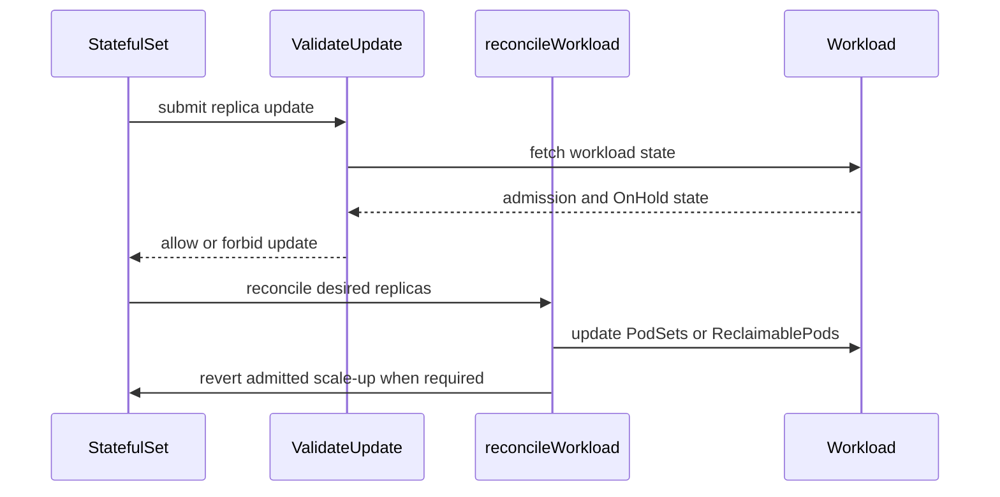

# PR #13675: feat: support custom resizes for StatefulSet

**Summary**: feat: support custom resizes for StatefulSet

**Sources**: https://github.com/kubernetes-sigs/kueue/pull/13675

**Last updated**: 2026-08-28T23:29:50Z

---

## Metadata

- **State**: open
- **Author**: [@Vaishnav88sk](https://github.com/Vaishnav88sk)
- **Branch**: `feature/statefulset-resize` → `main`
- **Created**: 2026-07-30T17:47:35Z
- **Updated**: 2026-08-28T23:29:50Z
- **Merged**: —
- **Closed**: —
- **Labels**: `kind/feature`, `release-note`, `size/L`, `needs-rebase`, `do-not-merge/hold`, `ok-to-test`, `cncf-cla: yes`, `area/integrations`
- **Assignees**: _none_
- **Requested reviewers**: [@mimowo](https://github.com/mimowo), [@kshalot](https://github.com/kshalot), [@PBundyra](https://github.com/PBundyra)
- **Changed files**: 7   **+368 / -28**

## Description

<!--  Thanks for sending a pull request!  Here are some tips for you:

1. If this is your first time, please read our contributor guidelines: https://git.k8s.io/community/contributors/guide/first-contribution.md#your-first-contribution and developer guide https://git.k8s.io/community/contributors/devel/development.md#development-guide
2. Please label this pull request according to what type of issue you are addressing, especially if this is a release targeted pull request. For reference on required PR/issue labels, read here:
https://git.k8s.io/community/contributors/devel/sig-release/release.md#issuepr-kind-label
3. Ensure you have added or ran the appropriate tests for your PR: https://git.k8s.io/community/contributors/devel/sig-testing/testing.md
4. If you want *faster* PR reviews, read how: https://git.k8s.io/community/contributors/guide/pull-requests.md#best-practices-for-faster-reviews
5. If the PR is unfinished, see how to mark it: https://git.k8s.io/community/contributors/guide/pull-requests.md#marking-unfinished-pull-requests
-->

#### What type of PR is this?
/kind feature 
/area integrations
<!--
Add one of the following kinds:
/kind bug
/kind cleanup
/kind documentation
/kind feature
/kind kep

Optionally add one or more of the following kinds if applicable:
/kind api-change
/kind deprecation
/kind failing-test
/kind flake
/kind regression

Please also consider setting the area:
/area tas
/area was
/area integrations
/area multikueue
/area dashboard
/area localization
/area testing
/area website
-->

#### What this PR does / why we need it:
This PR enables dynamic scaling (custom resizes) for StatefulSet workloads. 

Changes include:
- **Webhook Updates:** Removes the blanket restriction on all non-zero to non-zero `replicas` changes. It now allows custom resizes, but actively blocks scale-out operations (increasing replicas) for *already admitted* workloads, since Kueue currently does not support dynamic quota increases for admitted jobs.
- **Reconciler Updates:** Syncs replica changes back to the Workload:
  - For **pending workloads**, it directly updates `wl.Spec.PodSets[0].Count` so the workload retains its queue position with the updated quota request.
  - For **admitted workloads (scale-in)**, it computes the unused quota and triggers `UpdateReclaimablePods` to release it back to the queue for other workloads to use.

#### Which issue(s) this PR fixes:
<!--
*Automatically closes linked issue when PR is merged.
Usage: `Fixes #<issue number>`, or `Fixes (paste link of issue)`.
_If PR is about `failing-tests or flakes`, please post the related issues/tests in a comment and do not use `Fixes`_*
-->
Fixes #13641 

#### Special notes for your reviewer:

#### Does this PR introduce a user-facing change?
<!--
If no, just write "NONE" in the release-note block below.
If yes, a release note is required:
Enter your extended release note in the block below. If the PR requires additional action from users switching to the new release, include the string "action required".
-->
```release-note
Add support for dynamic custom resizing for StatefulSet workloads (scale-in and scale-out).
```

<!-- This is an auto-generated comment: release notes by coderabbit.ai -->
## Summary by CodeRabbit

* **Bug Fixes**
  * Improved StatefulSet scaling reconciliation for admitted workloads.
  * Scale-downs now track reclaimable pods without immediately changing workload replica counts.
  * Pending workloads can scale up as expected.
  * Scale-outs beyond admitted capacity are blocked or safely reverted.
  * Improved validation for scaling from zero while pods terminate or a prior workload remains active.

* **Tests**
  * Expanded coverage for pending, admitted, scale-up, scale-down, rollback, and webhook validation scenarios.
<!-- end of auto-generated comment: release notes by coderabbit.ai -->

## Discussion

### Comment by [@netlify[bot]](https://github.com/apps/netlify) — 2026-07-30T17:47:42Z

### <span aria-hidden="true">✅</span> Deploy Preview for *kubernetes-sigs-kueue* ready!


|  Name | Link |
|:-:|------------------------|
|<span aria-hidden="true">🔨</span> Latest commit | 0fe4a0100a73a46b42d68a8cf18ebea4ab988cb7 |
|<span aria-hidden="true">🔍</span> Latest deploy log | https://app.netlify.com/projects/kubernetes-sigs-kueue/deploys/6a73276135571b00081deda3 |
|<span aria-hidden="true">😎</span> Deploy Preview | [https://deploy-preview-13675--kubernetes-sigs-kueue.netlify.app](https://deploy-preview-13675--kubernetes-sigs-kueue.netlify.app) |
|<span aria-hidden="true">📱</span> Preview on mobile | <details><summary> Toggle QR Code... </summary><br /><br /><br /><br />_Use your smartphone camera to open QR code link._</details> |
---
<!-- [kubernetes-sigs-kueue Preview](https://deploy-preview-13675--kubernetes-sigs-kueue.netlify.app) -->
_To edit notification comments on pull requests, go to your [Netlify project configuration](https://app.netlify.com/projects/kubernetes-sigs-kueue/configuration/notifications#deploy-notifications)._

### Comment by [@kubernetes-prow[bot]](https://github.com/apps/kubernetes-prow) — 2026-07-30T17:47:46Z

Hi @Vaishnav88sk. Thanks for your PR.

I'm waiting for a [kubernetes-sigs](https://github.com/orgs/kubernetes-sigs/people) member to verify that this patch is reasonable to test. If it is, they should reply with `/ok-to-test` on its own line. Until that is done, I will not automatically test new commits in this PR, but the usual testing commands by org members will still work.

>[!TIP]
>**We noticed you've done this a few times! Consider [joining the org](https://git.k8s.io/community/community-membership.md#member) to skip this step and gain `/lgtm` and other bot rights.** We recommend asking approvers on your previous PRs to sponsor you.

Once the patch is verified, the new status will be reflected by the `ok-to-test` label.

I understand the commands that are listed [here](https://go.k8s.io/bot-commands?repo=kubernetes-sigs%2Fkueue).

<details>

Instructions for interacting with me using PR comments are available [here](https://git.k8s.io/community/contributors/guide/pull-requests.md).  If you have questions or suggestions related to my behavior, please file an issue against the [kubernetes-sigs/prow](https://github.com/kubernetes-sigs/prow/issues/new?title=Prow%20issue:) repository.
</details>

### Comment by [@coderabbitai[bot]](https://github.com/apps/coderabbitai) — 2026-07-30T17:48:27Z

<!-- This is an auto-generated comment: summarize by coderabbit.ai -->
<!-- review_stack_entry_start -->

[](https://app.coderabbit.ai/change-stack/kubernetes-sigs/kueue/pull/13675?utm_source=github_walkthrough&utm_medium=github&utm_campaign=change_stack)

<!-- review_stack_entry_end -->
<!-- walkthrough_start -->

<details>
<summary>📝 Walkthrough</summary>

## Walkthrough

StatefulSet resizing now supports non-zero replica changes. Reconciliation updates pending PodSets, records admitted scale-downs as reclaimable pods, and reverts admitted scale-ups that exceed admission. Webhook validation blocks scale-up for admitted workloads.

### Changes

**StatefulSet resize handling**

|Layer / File(s)|Summary|
|---|---|
|**Reconcile admitted and pending scale changes** <br> `pkg/controller/jobs/statefulset/statefulset_reconciler.go`, `pkg/controller/jobs/statefulset/statefulset_reconciler_test.go`, `test/integration/singlecluster/controller/jobs/statefulset/statefulset_controller_test.go`|Pending workloads update their PodSet replica count. Admitted scale-downs update `ReclaimablePods`. Admitted scale-ups revert the StatefulSet to the admitted count. Unit and integration tests cover these paths.|
|**Admission-aware resize validation** <br> `pkg/controller/jobs/statefulset/statefulset_webhook.go`, `pkg/controller/jobs/statefulset/statefulset_webhook_test.go`, `test/integration/singlecluster/webhook/jobs/statefulset_webhook_test.go`, `test/integration/singlecluster/webhook/jobs/suite_test.go`|Replica changes are validated against workload admission and hold state. Tests cover pending scale-up, admitted scale-up rejection, and webhook setup.|

**Estimated code review effort:** 3 (Moderate) | ~25 minutes

### Sequence Diagram(s)



**Suggested reviewers:** `mimowo`, `kshalot`, `pbundyra`

</details>

<!-- walkthrough_end -->
<!-- pre_merge_checks_walkthrough_start -->

<details>
<summary>🚥 Pre-merge checks | ✅ 4 | ❌ 1</summary>

### ❌ Failed checks (1 warning)

|     Check name     | Status     | Explanation                                                                          | Resolution                                                                         |
| :----------------: | :--------- | :----------------------------------------------------------------------------------- | :--------------------------------------------------------------------------------- |
| Docstring Coverage | ⚠️ Warning | Docstring coverage is 0.00% which is insufficient. The required threshold is 80.00%. | Write docstrings for the functions missing them to satisfy the coverage threshold. |

<details>
<summary>✅ Passed checks (4 passed)</summary>

|         Check name         | Status   | Explanation                                                                                                                                   |
| :------------------------: | :------- | :-------------------------------------------------------------------------------------------------------------------------------------------- |
|     Linked Issues check    | ✅ Passed | The webhook and reconciler implement custom StatefulSet resizing and preserve queue semantics, with tests covering issue `#13641` requirements. |
| Out of Scope Changes check | ✅ Passed | The code and integration test changes directly support custom StatefulSet resizing and its admission and reconciliation behavior.             |
|      Description Check     | ✅ Passed | Check skipped - CodeRabbit’s high-level summary is enabled.                                                                                   |
|         Title check        | ✅ Passed | The title clearly summarizes the main change: adding custom resize support for StatefulSet workloads.                                         |

</details>

</details>

<!-- pre_merge_checks_walkthrough_end -->
<!-- finishing_touch_checkbox_start -->

<details>
<summary>✨ Finishing Touches</summary>

<details>
<summary>🧪 Generate unit tests (beta)</summary>

- [ ] <!-- {"checkboxId": "f47ac10b-58cc-4372-a567-0e02b2c3d479", "radioGroupId": "utg-output-choice-group-unknown_comment_id"} -->   Create PR with unit tests

</details>

</details>

<!-- finishing_touch_checkbox_end -->
<!-- tips_start -->

---

Thanks for using [CodeRabbit](https://coderabbit.ai?utm_source=oss&utm_medium=github&utm_campaign=kubernetes-sigs/kueue&utm_content=13675)! It's free for OSS, and your support helps us grow. If you like it, consider giving us a shout-out.

<details>
<summary>❤️ Share</summary>

- [X](https://twitter.com/intent/tweet?text=I%20just%20used%20%40coderabbitai%20for%20my%20code%20review%2C%20and%20it%27s%20fantastic%21%20It%27s%20free%20for%20OSS%20and%20offers%20a%20free%20trial%20for%20the%20proprietary%20code.%20Check%20it%20out%3A&url=https%3A//coderabbit.ai)
- [Mastodon](https://mastodon.social/share?text=I%20just%20used%20%40coderabbitai%20for%20my%20code%20review%2C%20and%20it%27s%20fantastic%21%20It%27s%20free%20for%20OSS%20and%20offers%20a%20free%20trial%20for%20the%20proprietary%20code.%20Check%20it%20out%3A%20https%3A%2F%2Fcoderabbit.ai)
- [Reddit](https://www.reddit.com/submit?title=Great%20tool%20for%20code%20review%20-%20CodeRabbit&text=I%20just%20used%20CodeRabbit%20for%20my%20code%20review%2C%20and%20it%27s%20fantastic%21%20It%27s%20free%20for%20OSS%20and%20offers%20a%20free%20trial%20for%20proprietary%20code.%20Check%20it%20out%3A%20https%3A//coderabbit.ai)
- [LinkedIn](https://www.linkedin.com/sharing/share-offsite/?url=https%3A%2F%2Fcoderabbit.ai&mini=true&title=Great%20tool%20for%20code%20review%20-%20CodeRabbit&summary=I%20just%20used%20CodeRabbit%20for%20my%20code%20review%2C%20and%20it%27s%20fantastic%21%20It%27s%20free%20for%20OSS%20and%20offers%20a%20free%20trial%20for%20proprietary%20code)

</details>


<sub>Comment `@coderabbitai help` to get the list of available commands.</sub>

<!-- tips_end -->

### Comment by [@mimowo](https://github.com/mimowo) — 2026-07-31T01:06:56Z

/ok-to-test

### Comment by [@mimowo](https://github.com/mimowo) — 2026-07-31T01:11:01Z

cc @mbobrovskyi ptal

### Comment by [@Vaishnav88sk](https://github.com/Vaishnav88sk) — 2026-07-31T06:30:46Z

 > I think to claim the support for custom resizes we need e2e tests, and maybe some integration tests. I remember we iterated with @mbobrovskyi a couple of times and concluded this is rather hard problem. Sure, I'm happy to support arbitrary scaling, but without higher-level tests we cannot claim this really works.

Given the edge cases around admission webhooks and controller race conditions during scaling, proving this via tests is important.

I will add comprehensive integration tests covering:
1. Scale-up being properly rejected/reverted if the quota hasn't explicitly admitted the new size (TOCTOU mitigation).
2. Scale-down properly creating `ReclaimablePods` to free up quota.
3. Pre-admission scaling seamlessly updating the Workload's `PodSet` count.

Since you mentioned iterating on this with @mbobrovskyi and finding it difficult in the past, are there any *specific* race conditions or edge cases you discovered back then that I should explicitly cover in the e2e/integration tests? I want to make sure I address your exact concerns.

### Comment by [@mimowo](https://github.com/mimowo) — 2026-08-03T07:48:10Z

> Since you mentioned iterating on this with @mbobrovskyi and finding it difficult in the past, are there any specific race conditions or edge cases you discovered back then that I should explicitly cover in the e2e/integration tests? I want to make sure I address your exact concerns.

The main problematic I remember was scale down followed immediately by scale up, and vice versa, before the system has time to settle (as the operations span multiple objects).

Maybe @mbobrovskyi can share more stories

### Comment by [@kubernetes-prow[bot]](https://github.com/apps/kubernetes-prow) — 2026-08-03T08:42:43Z

[APPROVALNOTIFIER] This PR is **NOT APPROVED**

This pull-request has been approved by: *<a href="https://github.com/kubernetes-sigs/kueue/pull/13675#" title="Author self-approved">Vaishnav88sk</a>*
**Once this PR has been reviewed and has the lgtm label**, please assign [sohankunkerkar](https://github.com/sohankunkerkar) for approval. For more information see [the Code Review Process](https://git.k8s.io/community/contributors/guide/owners.md#the-code-review-process).

The full list of commands accepted by this bot can be found [here](https://go.k8s.io/bot-commands?repo=kubernetes-sigs%2Fkueue).

<details open>
Needs approval from an approver in each of these files:

- **[pkg/controller/OWNERS](https://github.com/kubernetes-sigs/kueue/blob/main/pkg/controller/OWNERS)**
- **[test/OWNERS](https://github.com/kubernetes-sigs/kueue/blob/main/test/OWNERS)**

Approvers can indicate their approval by writing `/approve` in a comment
Approvers can cancel approval by writing `/approve cancel` in a comment
</details>
<!-- META={"approvers":["sohankunkerkar"]} -->

### Comment by [@Vaishnav88sk](https://github.com/Vaishnav88sk) — 2026-08-03T09:24:35Z

/retest
infra

### Comment by [@coderabbitai[bot]](https://github.com/apps/coderabbitai) — 2026-08-05T12:07:06Z

<!-- This is an auto-generated comment by CodeRabbit -->
> [!NOTE]
> GitHub couldn't provide a complete incremental comparison for this pull request, so CodeRabbit is performing a full review instead. This review may take a little longer.

### Comment by [@kubernetes-prow[bot]](https://github.com/apps/kubernetes-prow) — 2026-08-06T08:10:57Z

PR needs rebase.

<details>

Instructions for interacting with me using PR comments are available [here](https://git.k8s.io/community/contributors/guide/pull-requests.md).  If you have questions or suggestions related to my behavior, please file an issue against the [kubernetes-sigs/prow](https://github.com/kubernetes-sigs/prow/issues/new?title=Prow%20issue:) repository.
</details>

### Comment by [@thc1006](https://github.com/thc1006) — 2026-08-11T17:12:58Z

Heads-up on a cross-PR interaction rather than a review of the change itself, since it only shows up once both land.

`Reconcile` runs the Pod work and `reconcileWorkload` as two goroutines on one `errgroup`, and both are handed the same `*appsv1.StatefulSet`. That is fine today because `reconcileWorkload` only reads it. This PR adds

```go
wlUpdated, stopReconcile, err := r.syncReplicas(ctx, sts, wl, replicas)
```

inside `reconcileWorkload`, and `syncReplicas` writes the field:

```go
sts.Spec.Replicas = new(wl.Spec.PodSets[0].Count)
if err := r.client.Update(ctx, sts); err != nil {
```

`syncQueueLabel`, on the other goroutine, opens with

```go
if sts == nil || ptr.Deref(sts.Spec.Replicas, 1) == 0 {
```

so it reads exactly what this writes. Same field, two goroutines, no synchronisation. `-race` would not see it on either branch alone, only on the merged tree.

The cheap fix is a deep copy for the Workload branch before the goroutines start, so each side owns its own StatefulSet. I have a PR in flight (#14117) that moves the queue-label sync onto the Pod branch, which is what puts the read there, so I am happy to add the copy on my side instead if that lands first. Either way it seemed worth writing down now rather than finding it after both merge.

This comment was written in part with the assistance of generative AI. Bcuz my English might be sucks.

### Comment by [@kubernetes-prow[bot]](https://github.com/apps/kubernetes-prow) — 2026-08-26T22:27:05Z

@Vaishnav88sk: The following tests **failed**, say `/retest` to rerun all failed tests or `/retest-required` to rerun all mandatory failed tests:

Test name | Commit | Details | Required | Rerun command
--- | --- | --- | --- | ---
pull-kueue-test-e2e-extended-shard-0-main-1-37 | 0fe4a0100a73a46b42d68a8cf18ebea4ab988cb7 | [link](https://prow.k8s.io/view/gs/kubernetes-ci-logs/pr-logs/pull/kubernetes-sigs_kueue/13675/pull-kueue-test-e2e-extended-shard-0-main-1-37/2092740574841933824) | true | `/test pull-kueue-test-e2e-extended-shard-0-main-1-37`
pull-kueue-test-e2e-baseline-main-1-37 | 0fe4a0100a73a46b42d68a8cf18ebea4ab988cb7 | [link](https://prow.k8s.io/view/gs/kubernetes-ci-logs/pr-logs/pull/kubernetes-sigs_kueue/13675/pull-kueue-test-e2e-baseline-main-1-37/2092740574250536960) | true | `/test pull-kueue-test-e2e-baseline-main-1-37`
pull-kueue-test-e2e-extended-shard-2-main-1-37 | 0fe4a0100a73a46b42d68a8cf18ebea4ab988cb7 | [link](https://prow.k8s.io/view/gs/kubernetes-ci-logs/pr-logs/pull/kubernetes-sigs_kueue/13675/pull-kueue-test-e2e-extended-shard-2-main-1-37/2092740576569987072) | true | `/test pull-kueue-test-e2e-extended-shard-2-main-1-37`
pull-kueue-test-e2e-extended-shard-1-main-1-37 | 0fe4a0100a73a46b42d68a8cf18ebea4ab988cb7 | [link](https://prow.k8s.io/view/gs/kubernetes-ci-logs/pr-logs/pull/kubernetes-sigs_kueue/13675/pull-kueue-test-e2e-extended-shard-1-main-1-37/2092740575731126272) | true | `/test pull-kueue-test-e2e-extended-shard-1-main-1-37`

[Full PR test history](https://prow.k8s.io/pr-history?org=kubernetes-sigs&repo=kueue&pr=13675). [Your PR dashboard](https://prow.k8s.io/pr?query=is%3Apr%20state%3Aopen%20author%3AVaishnav88sk). Please help us cut down on flakes by [linking to](https://git.k8s.io/community/contributors/devel/sig-testing/flaky-tests.md#filing-issues-for-flaky-tests) an [open issue](https://github.com/kubernetes-sigs/kueue/issues?q=is:issue+is:open) when you hit one in your PR.

<details>

Instructions for interacting with me using PR comments are available [here](https://git.k8s.io/community/contributors/guide/pull-requests.md).  If you have questions or suggestions related to my behavior, please file an issue against the [kubernetes-sigs/prow](https://github.com/kubernetes-sigs/prow/issues/new?title=Prow%20issue:) repository. I understand the commands that are listed [here](https://go.k8s.io/bot-commands).
</details>
<!-- test report -->

### Comment by [@tenzen-y](https://github.com/tenzen-y) — 2026-08-28T23:29:50Z

Hi @Vaishnav88sk can you rebase this PR onto the main branch?

## Reviews

### Review by [@coderabbitai[bot]](https://github.com/apps/coderabbitai) (commented) — 2026-07-30T17:51:04Z

**Actionable comments posted: 1**

> [!CAUTION]
> Some comments are outside the diff and can’t be posted inline due to platform limitations.
> 
> 
> 
> <details>
> <summary>⚠️ Outside diff range comments (1)</summary><blockquote>
> 
> <details>
> <summary>pkg/controller/jobs/statefulset/statefulset_webhook_test.go (1)</summary><blockquote>
> 
> `703-736`: _📐 Maintainability & Code Quality_ | _🟡 Minor_ | _⚡ Quick win_
> 
> **Cover the newly allowed resize paths.**
> 
> Add table cases for admitted nonzero scale-in (for example, 5→3) and 0→N with an existing `WorkloadOnHold`, both expecting success. Current cases cover only pending scale-out and rejected admitted scale-out.
> 
> As per path instructions, “Verify that new controller behavior has corresponding unit and integration tests.”
> 
> <details>
> <summary>🤖 Prompt for AI Agents</summary>
> 
> ```
> Verify each finding against current code. Fix only still-valid issues, skip the
> rest with a brief reason, keep changes minimal, and validate.
> 
> In `@pkg/controller/jobs/statefulset/statefulset_webhook_test.go` around lines 703
> - 736, Add table-driven webhook test cases for the newly permitted resize paths
> near the existing StatefulSet replica-change cases: an admitted workload scaling
> in from a nonzero replica count (for example, 5 to 3) and a workload scaling
> from 0 to N with an existing WorkloadOnHold. Configure the required workload
> objects and assert both updates succeed without an error, complementing the
> existing scale-out rejection case.
> ```
> 
> </details>
> 
> <!-- cr-comment:v1:346c419bcbc65e7b05e2b14f -->
> 
> _Source: Path instructions_
> 
> </blockquote></details>
> 
> </blockquote></details>

<details>
<summary>🤖 Prompt for all review comments with AI agents</summary>

```
Verify each finding against current code. Fix only still-valid issues, skip the
rest with a brief reason, keep changes minimal, and validate.

Inline comments:
In `@pkg/controller/jobs/statefulset/statefulset_webhook.go`:
- Around line 188-203: Prevent the admission/resize TOCTOU in the StatefulSet
replica-change validation around newReplicas, oldReplicas, and the fetched
Workload wl by introducing an atomic fence/CAS or equivalent invariant that
makes admission and resizing mutually consistent. Ensure a 3→5 update cannot
commit after the Workload becomes admitted for 3 pods, and preserve idempotent
reconciliation for admitted scale-ins. Add an integration race test covering
admission occurring between validation and StatefulSet commit.

---

Outside diff comments:
In `@pkg/controller/jobs/statefulset/statefulset_webhook_test.go`:
- Around line 703-736: Add table-driven webhook test cases for the newly
permitted resize paths near the existing StatefulSet replica-change cases: an
admitted workload scaling in from a nonzero replica count (for example, 5 to 3)
and a workload scaling from 0 to N with an existing WorkloadOnHold. Configure
the required workload objects and assert both updates succeed without an error,
complementing the existing scale-out rejection case.
```

</details>

<details>
<summary>🪄 Autofix (Beta)</summary>

Fix all unresolved CodeRabbit comments on this PR:

- [ ] <!-- {"checkboxId": "4b0d0e0a-96d7-4f10-b296-3a18ea78f0b9"} --> Push a commit to this branch (recommended)
- [ ] <!-- {"checkboxId": "ff5b1114-7d8c-49e6-8ac1-43f82af23a33"} --> Create a new PR with the fixes

</details>

---

<details>
<summary>ℹ️ Review info</summary>

<details>
<summary>⚙️ Run configuration</summary>

**Configuration used**: Path: .coderabbit.yaml

**Review profile**: CHILL

**Plan**: Pro Plus

**Run ID**: `a73df5c2-7e26-4baa-9208-22eba8b2e63e`

</details>

<details>
<summary>📥 Commits</summary>

Reviewing files that changed from the base of the PR and between e41421383d7949f314b76e710f9ba871b1f19fd9 and fd06d97d9ed14c2f2966bc76bca11156e795cde8.

</details>

<details>
<summary>📒 Files selected for processing (4)</summary>

* `pkg/controller/jobs/statefulset/statefulset_reconciler.go`
* `pkg/controller/jobs/statefulset/statefulset_reconciler_test.go`
* `pkg/controller/jobs/statefulset/statefulset_webhook.go`
* `pkg/controller/jobs/statefulset/statefulset_webhook_test.go`

</details>

</details>

<!-- This is an auto-generated comment by CodeRabbit for review status -->

- **pkg/controller/jobs/statefulset/statefulset_webhook.go:205** by [@coderabbitai[bot]](https://github.com/apps/coderabbitai) — 2026-07-30T17:51:03Z
```diff
@@ -185,33 +185,32 @@ func (wh *Webhook) ValidateUpdate(ctx context.Context, oldSTSObj, newSTSObj *app
 		oldReplicas := ptr.Deref(oldStatefulSet.Spec.Replicas, 1)
 		newReplicas := ptr.Deref(newStatefulSet.Spec.Replicas, 1)
 
-		// Allow only scale down to zero and scale up from zero.
-		// TODO(#3279): Support custom resizes later
-		if newReplicas != 0 && oldReplicas != 0 {
-			allErrs = append(allErrs, apivalidation.ValidateImmutableField(
-				newStatefulSet.Spec.Replicas,
-				oldStatefulSet.Spec.Replicas,
-				replicasPath,
-			)...)
-		}
+		if newReplicas != oldReplicas {
+			wlName, err := findWorkloadName(ctx, wh.client, oldSTSObj)
+			if err != nil {
+				return nil, err
+			}
+			var wl kueue.Workload
+			err = wh.client.Get(ctx, client.ObjectKey{Namespace: oldSTSObj.GetNamespace(), Name: wlName}, &wl)
+			if client.IgnoreNotFound(err) != nil {
+				return nil, err
+			}
+			wlExists := err == nil
 
-		if oldReplicas == 0 && newReplicas > 0 {
-			if newStatefulSet.Status.Replicas > 0 {
-				// Block if pods are still terminating
-				allErrs = append(allErrs, field.Forbidden(replicasPath, "scaling down is still in progress"))
-			} else {
-				// Block if workload is still being deleted (exists without OnHold).
-				// If the workload is on hold, it is intentionally kept alive during
-				// scale-to-zero and will be re-admitted on scale-up.
-				wlName, err := findWorkloadName(ctx, wh.client, oldSTSObj)
-				if err != nil {
-					return nil, err
+			if newReplicas != 0 && oldReplicas != 0 {
+				if wlExists && workload.IsAdmitted(&wl) && newReplicas > oldReplicas {
+					allErrs = append(allErrs, field.Forbidden(replicasPath, "scale-out is not supported for admitted workloads"))
 				}
```

  _🗄️ Data Integrity & Integration_ | _🟠 Major_ | _🏗️ Heavy lift_
  
  **Prevent the admission/resize TOCTOU.**
  
  A 3→5 update can observe a pending Workload here, become admitted for 3 pods before the StatefulSet write commits, then run 5 pods: the reconciler only handles admitted scale-ins and will not reconcile this scale-out. Coordinate admission and resize with an atomic fence/CAS or equivalent invariant, and add an integration race test.
  
  As per path instructions, review reconciliation logic for correctness and idempotency.
  
  <details>
  <summary>🤖 Prompt for AI Agents</summary>
  
  ```
  Verify each finding against current code. Fix only still-valid issues, skip the
  rest with a brief reason, keep changes minimal, and validate.
  
  In `@pkg/controller/jobs/statefulset/statefulset_webhook.go` around lines 188 -
  203, Prevent the admission/resize TOCTOU in the StatefulSet replica-change
  validation around newReplicas, oldReplicas, and the fetched Workload wl by
  introducing an atomic fence/CAS or equivalent invariant that makes admission and
  resizing mutually consistent. Ensure a 3→5 update cannot commit after the
  Workload becomes admitted for 3 pods, and preserve idempotent reconciliation for
  admitted scale-ins. Add an integration race test covering admission occurring
  between validation and StatefulSet commit.
  ```
  
  </details>
  
  <!-- fingerprinting:phantom:poseidon:terra -->
  
  <!-- cr-indicator-types:potential_issue -->
  
  <!-- cr-comment:v1:ed209376f7483256e2de51fd -->
  
  _Source: Path instructions_
  
  <!-- This is an auto-generated comment by CodeRabbit -->

### Review by [@mimowo](https://github.com/mimowo) (commented) — 2026-07-31T01:08:18Z

- **pkg/controller/jobs/statefulset/statefulset_reconciler.go:296** by [@mimowo](https://github.com/mimowo) — 2026-07-31T01:08:18Z
```diff
@@ -260,6 +289,12 @@ func (r *Reconciler) reconcileWorkload(ctx context.Context, sts *appsv1.Stateful
 		}
 	}
 
+	if shouldUpdateReclaimablePods {
+		if err := workload.UpdateReclaimablePods(ctx, r.client, wl, reclaimablePods); err != nil {
+			return err
+		}
+	}
```

  Can you move it to a helper which reflects the intention of the code by name and comment. Currently it seems pretty involing to understand without some commentary

### Review by [@mimowo](https://github.com/mimowo) (commented) — 2026-07-31T01:10:49Z

/hold

I think to claim the support for custom resizes we need e2e tests, and maybe some integration tests. I remember we iterated with @mbobrovskyi a couple of times and concluded this is rather hard problem. Sure, I'm happy to support arbitrary scaling, but without higher-level tests we cannot claim this really works.

### Review by [@Vaishnav88sk](https://github.com/Vaishnav88sk) (commented) — 2026-07-31T06:28:23Z

- **pkg/controller/jobs/statefulset/statefulset_reconciler.go:296** by [@Vaishnav88sk](https://github.com/Vaishnav88sk) — 2026-07-31T06:28:23Z
```diff
@@ -260,6 +289,12 @@ func (r *Reconciler) reconcileWorkload(ctx context.Context, sts *appsv1.Stateful
 		}
 	}
 
+	if shouldUpdateReclaimablePods {
+		if err := workload.UpdateReclaimablePods(ctx, r.client, wl, reclaimablePods); err != nil {
+			return err
+		}
+	}
```

  Makes sense

### Review by [@mbobrovskyi](https://github.com/mbobrovskyi) (commented) — 2026-07-31T06:42:28Z

- **pkg/controller/jobs/statefulset/statefulset_webhook.go:201** by [@mbobrovskyi](https://github.com/mbobrovskyi) — 2026-07-31T06:42:28Z
```diff
@@ -185,33 +185,32 @@ func (wh *Webhook) ValidateUpdate(ctx context.Context, oldSTSObj, newSTSObj *app
 		oldReplicas := ptr.Deref(oldStatefulSet.Spec.Replicas, 1)
 		newReplicas := ptr.Deref(newStatefulSet.Spec.Replicas, 1)
 
-		// Allow only scale down to zero and scale up from zero.
-		// TODO(#3279): Support custom resizes later
-		if newReplicas != 0 && oldReplicas != 0 {
-			allErrs = append(allErrs, apivalidation.ValidateImmutableField(
-				newStatefulSet.Spec.Replicas,
-				oldStatefulSet.Spec.Replicas,
-				replicasPath,
-			)...)
-		}
+		if newReplicas != oldReplicas {
+			wlName, err := findWorkloadName(ctx, wh.client, oldSTSObj)
+			if err != nil {
+				return nil, err
+			}
+			var wl kueue.Workload
+			err = wh.client.Get(ctx, client.ObjectKey{Namespace: oldSTSObj.GetNamespace(), Name: wlName}, &wl)
+			if client.IgnoreNotFound(err) != nil {
+				return nil, err
+			}
+			wlExists := err == nil
 
-		if oldReplicas == 0 && newReplicas > 0 {
-			if newStatefulSet.Status.Replicas > 0 {
-				// Block if pods are still terminating
-				allErrs = append(allErrs, field.Forbidden(replicasPath, "scaling down is still in progress"))
-			} else {
-				// Block if workload is still being deleted (exists without OnHold).
-				// If the workload is on hold, it is intentionally kept alive during
-				// scale-to-zero and will be re-admitted on scale-up.
-				wlName, err := findWorkloadName(ctx, wh.client, oldSTSObj)
-				if err != nil {
-					return nil, err
+			if newReplicas != 0 && oldReplicas != 0 {
+				if wlExists && workload.IsAdmitted(&wl) && newReplicas > oldReplicas {
```

  ```suggestion
  				if wlExists && workload.HasQuotaReservation(&wl) && newReplicas > oldReplicas {
  ```
  Do we need to check for QuotaReservation?

### Review by [@mbobrovskyi](https://github.com/mbobrovskyi) (commented) — 2026-07-31T06:52:24Z

- **pkg/controller/jobs/statefulset/statefulset_reconciler.go:272** by [@mbobrovskyi](https://github.com/mbobrovskyi) — 2026-07-31T06:52:24Z
```diff
@@ -249,6 +249,35 @@ func (r *Reconciler) reconcileWorkload(ctx context.Context, sts *appsv1.Stateful
 		shouldUpdate = true
 	}
 
+	var shouldUpdateReclaimablePods bool
+	var reclaimablePods []kueue.ReclaimablePod
+	if replicas > 0 && len(wl.Spec.PodSets) == 1 && wl.Spec.PodSets[0].Count != replicas {
+		switch {
+		case !workload.IsAdmitted(wl):
+			wl.Spec.PodSets[0].Count = replicas
+			shouldUpdate = true
+		case replicas < wl.Spec.PodSets[0].Count:
+			shouldUpdateReclaimablePods = true
+			reclaimablePods = []kueue.ReclaimablePod{
+				{
+					Name:  wl.Spec.PodSets[0].Name,
+					Count: wl.Spec.PodSets[0].Count - replicas,
+				},
+			}
+		case replicas > wl.Spec.PodSets[0].Count:
+			// TOCTOU mitigation: If the workload was admitted concurrently with a scale-out,
+			// the webhook may have allowed it because the Workload was pending at the time of check.
+			// Revert the StatefulSet replicas to match the admitted workload's quota.
+			count := wl.Spec.PodSets[0].Count
+			sts.Spec.Replicas = &count
```

  ```suggestion
  			sts.Spec.Replicas = new(wl.Spec.PodSets[0].Count)
  ```

### Review by [@mbobrovskyi](https://github.com/mbobrovskyi) (commented) — 2026-07-31T06:55:34Z

- **pkg/controller/jobs/statefulset/statefulset_reconciler.go:295** by [@mbobrovskyi](https://github.com/mbobrovskyi) — 2026-07-31T06:55:34Z
```diff
@@ -260,6 +289,12 @@ func (r *Reconciler) reconcileWorkload(ctx context.Context, sts *appsv1.Stateful
 		}
 	}
 
+	if shouldUpdateReclaimablePods {
+		if err := workload.UpdateReclaimablePods(ctx, r.client, wl, reclaimablePods); err != nil {
+			return err
+		}
```

  I think we can move it to switch.

### Review by [@Vaishnav88sk](https://github.com/Vaishnav88sk) (commented) — 2026-07-31T08:54:46Z

- **pkg/controller/jobs/statefulset/statefulset_reconciler.go:295** by [@Vaishnav88sk](https://github.com/Vaishnav88sk) — 2026-07-31T08:54:46Z
```diff
@@ -260,6 +289,12 @@ func (r *Reconciler) reconcileWorkload(ctx context.Context, sts *appsv1.Stateful
 		}
 	}
 
+	if shouldUpdateReclaimablePods {
+		if err := workload.UpdateReclaimablePods(ctx, r.client, wl, reclaimablePods); err != nil {
+			return err
+		}
```

  I've moved this logic into the extracted `syncReplicas` helper method as an early-return check. This flattens the logic and avoids unnecessarily nesting the `switch` statement.

### Review by [@Vaishnav88sk](https://github.com/Vaishnav88sk) (commented) — 2026-07-31T08:54:55Z

- **pkg/controller/jobs/statefulset/statefulset_reconciler.go:272** by [@Vaishnav88sk](https://github.com/Vaishnav88sk) — 2026-07-31T08:54:55Z
```diff
@@ -249,6 +249,35 @@ func (r *Reconciler) reconcileWorkload(ctx context.Context, sts *appsv1.Stateful
 		shouldUpdate = true
 	}
 
+	var shouldUpdateReclaimablePods bool
+	var reclaimablePods []kueue.ReclaimablePod
+	if replicas > 0 && len(wl.Spec.PodSets) == 1 && wl.Spec.PodSets[0].Count != replicas {
+		switch {
+		case !workload.IsAdmitted(wl):
+			wl.Spec.PodSets[0].Count = replicas
+			shouldUpdate = true
+		case replicas < wl.Spec.PodSets[0].Count:
+			shouldUpdateReclaimablePods = true
+			reclaimablePods = []kueue.ReclaimablePod{
+				{
+					Name:  wl.Spec.PodSets[0].Name,
+					Count: wl.Spec.PodSets[0].Count - replicas,
+				},
+			}
+		case replicas > wl.Spec.PodSets[0].Count:
+			// TOCTOU mitigation: If the workload was admitted concurrently with a scale-out,
+			// the webhook may have allowed it because the Workload was pending at the time of check.
+			// Revert the StatefulSet replicas to match the admitted workload's quota.
+			count := wl.Spec.PodSets[0].Count
+			sts.Spec.Replicas = &count
```

  Done

### Review by [@Vaishnav88sk](https://github.com/Vaishnav88sk) (commented) — 2026-07-31T08:55:26Z

- **pkg/controller/jobs/statefulset/statefulset_webhook.go:201** by [@Vaishnav88sk](https://github.com/Vaishnav88sk) — 2026-07-31T08:55:25Z
```diff
@@ -185,33 +185,32 @@ func (wh *Webhook) ValidateUpdate(ctx context.Context, oldSTSObj, newSTSObj *app
 		oldReplicas := ptr.Deref(oldStatefulSet.Spec.Replicas, 1)
 		newReplicas := ptr.Deref(newStatefulSet.Spec.Replicas, 1)
 
-		// Allow only scale down to zero and scale up from zero.
-		// TODO(#3279): Support custom resizes later
-		if newReplicas != 0 && oldReplicas != 0 {
-			allErrs = append(allErrs, apivalidation.ValidateImmutableField(
-				newStatefulSet.Spec.Replicas,
-				oldStatefulSet.Spec.Replicas,
-				replicasPath,
-			)...)
-		}
+		if newReplicas != oldReplicas {
+			wlName, err := findWorkloadName(ctx, wh.client, oldSTSObj)
+			if err != nil {
+				return nil, err
+			}
+			var wl kueue.Workload
+			err = wh.client.Get(ctx, client.ObjectKey{Namespace: oldSTSObj.GetNamespace(), Name: wlName}, &wl)
+			if client.IgnoreNotFound(err) != nil {
+				return nil, err
+			}
+			wlExists := err == nil
 
-		if oldReplicas == 0 && newReplicas > 0 {
-			if newStatefulSet.Status.Replicas > 0 {
-				// Block if pods are still terminating
-				allErrs = append(allErrs, field.Forbidden(replicasPath, "scaling down is still in progress"))
-			} else {
-				// Block if workload is still being deleted (exists without OnHold).
-				// If the workload is on hold, it is intentionally kept alive during
-				// scale-to-zero and will be re-admitted on scale-up.
-				wlName, err := findWorkloadName(ctx, wh.client, oldSTSObj)
-				if err != nil {
-					return nil, err
+			if newReplicas != 0 && oldReplicas != 0 {
+				if wlExists && workload.IsAdmitted(&wl) && newReplicas > oldReplicas {
```

  Updated

### Review by [@mbobrovskyi](https://github.com/mbobrovskyi) (commented) — 2026-07-31T08:56:54Z

- **pkg/controller/jobs/statefulset/statefulset_reconciler.go:256** by [@mbobrovskyi](https://github.com/mbobrovskyi) — 2026-07-31T08:56:54Z
```diff
@@ -249,6 +249,35 @@ func (r *Reconciler) reconcileWorkload(ctx context.Context, sts *appsv1.Stateful
 		shouldUpdate = true
 	}
 
+	var shouldUpdateReclaimablePods bool
+	var reclaimablePods []kueue.ReclaimablePod
+	if replicas > 0 && len(wl.Spec.PodSets) == 1 && wl.Spec.PodSets[0].Count != replicas {
+		switch {
+		case !workload.IsAdmitted(wl):
```

  ```suggestion
  		case !workload.HasQuotaReservation(wl):
  ```
  And here, right?

### Review by [@Vaishnav88sk](https://github.com/Vaishnav88sk) (commented) — 2026-07-31T08:59:48Z

- **pkg/controller/jobs/statefulset/statefulset_reconciler.go:256** by [@Vaishnav88sk](https://github.com/Vaishnav88sk) — 2026-07-31T08:59:48Z
```diff
@@ -249,6 +249,35 @@ func (r *Reconciler) reconcileWorkload(ctx context.Context, sts *appsv1.Stateful
 		shouldUpdate = true
 	}
 
+	var shouldUpdateReclaimablePods bool
+	var reclaimablePods []kueue.ReclaimablePod
+	if replicas > 0 && len(wl.Spec.PodSets) == 1 && wl.Spec.PodSets[0].Count != replicas {
+		switch {
+		case !workload.IsAdmitted(wl):
```

  Yeah

### Review by [@Vaishnav88sk](https://github.com/Vaishnav88sk) (commented) — 2026-08-03T07:31:14Z

- **pkg/controller/jobs/statefulset/statefulset_reconciler.go:296** by [@Vaishnav88sk](https://github.com/Vaishnav88sk) — 2026-08-03T07:31:13Z
```diff
@@ -260,6 +289,12 @@ func (r *Reconciler) reconcileWorkload(ctx context.Context, sts *appsv1.Stateful
 		}
 	}
 
+	if shouldUpdateReclaimablePods {
+		if err := workload.UpdateReclaimablePods(ctx, r.client, wl, reclaimablePods); err != nil {
+			return err
+		}
+	}
```

  Done — extracted the whole replica-sync logic into a `syncReplicas` helper with comments explaining each case (pre-admission update, scale-down reclaim, TOCTOU revert).

### Review by [@coderabbitai[bot]](https://github.com/apps/coderabbitai) (commented) — 2026-08-03T08:51:31Z

**Actionable comments posted: 1**

> [!CAUTION]
> Some comments are outside the diff and can’t be posted inline due to platform limitations.
> 
> 
> 
> <details>
> <summary>⚠️ Outside diff range comments (1)</summary><blockquote>
> 
> <details>
> <summary>pkg/controller/jobs/statefulset/statefulset_reconciler.go (1)</summary><blockquote>
> 
> `252-270`: _🎯 Functional Correctness_ | _🟠 Major_ | _⚡ Quick win_
> 
> **Move the `shouldUpdate` application before the `stopReconcile` check.**
> 
> `shouldUpdate` becomes `true` at lines 218-250 when the code adds the owner reference or syncs `QueueName`. If `r.syncReplicas` returns `stopReconcile=true` (the scale-out revert case), the function returns `nil` at line 257 before it reaches the `shouldUpdate` block at lines 266-270. The pending Workload update (owner reference, annotations, or queue name) is dropped for this reconcile pass.
> 
> The StatefulSet update in `syncReplicas` triggers a new reconcile, so the dropped update gets re-applied on the next pass. This still breaks the atomicity of a single reconcile pass and delays convergence by one cycle. Apply the Workload update before returning on `stopReconcile`.
> 
> 
> 
> 
> <details>
> <summary>🐛 Proposed fix: apply the Workload update before returning on stopReconcile</summary>
> 
> ```diff
>  	wlUpdated, stopReconcile, err := r.syncReplicas(ctx, sts, wl, replicas)
>  	if err != nil {
>  		return err
>  	}
> -	if stopReconcile {
> -		return nil
> -	}
>  	shouldUpdate = shouldUpdate || wlUpdated
>  
>  	if features.Enabled(features.AdmissionGatedBy) {
>  		gateUpdated := jobframework.PropagateAdmissionGatedByAnnotation(sts, wl)
>  		shouldUpdate = gateUpdated || shouldUpdate
>  	}
>  
>  	if shouldUpdate {
>  		if err := r.client.Update(ctx, wl); err != nil {
>  			return err
>  		}
>  	}
>  
> +	if stopReconcile {
> +		return nil
> +	}
> +
>  	if shouldReleaseReservation {
> ```
> </details>
> 
> <details>
> <summary>🤖 Prompt for AI Agents</summary>
> 
> ```
> Verify each finding against current code. Fix only still-valid issues, skip the
> rest with a brief reason, keep changes minimal, and validate.
> 
> In `@pkg/controller/jobs/statefulset/statefulset_reconciler.go` around lines 252 -
> 270, Move the pending Workload update logic in the reconciler so it executes
> before the stopReconcile early return. Ensure shouldUpdate changes from
> owner-reference, annotation, queue-name, and syncReplicas processing are
> persisted via r.client.Update(ctx, wl) before returning nil when stopReconcile
> is true, while preserving the existing error propagation and normal
> reconciliation flow.
> ```
> 
> </details>
> 
> <!-- cr-comment:v1:4a11144eabb69e8b4c0a72eb -->
> 
> </blockquote></details>
> 
> </blockquote></details>

<details>
<summary>🧹 Nitpick comments (1)</summary><blockquote>

<details>
<summary>test/integration/singlecluster/controller/jobs/statefulset/statefulset_controller_test.go (1)</summary><blockquote>

`156-231`: _🗄️ Data Integrity & Integration_ | _🔵 Trivial_ | _🏗️ Heavy lift_

**Add an integration test for the concurrent admission / scale-up race.**

These two tests correctly cover pre-admission PodSet sync and admitted scale-down reclaim. The PR discussion separately raises a specific concern about "scale-down followed immediately by scale-up, or the reverse, before the system has settled," and about controller/webhook race conditions in general. That scenario (a StatefulSet scale-up admitted by the webhook while the workload is still pending, then the workload becomes admitted concurrently, triggering `syncReplicas`'s revert path) currently has only unit-test coverage, not integration coverage.

Consider adding an integration test that races a StatefulSet scale-up against workload admission to exercise the reconciler's TOCTOU revert path end-to-end.

<details>
<summary>🤖 Prompt for AI Agents</summary>

```
Verify each finding against current code. Fix only still-valid issues, skip the
rest with a brief reason, keep changes minimal, and validate.

In
`@test/integration/singlecluster/controller/jobs/statefulset/statefulset_controller_test.go`
around lines 156 - 231, Add an integration test alongside the existing
StatefulSet scaling tests that races a scale-up of a pending StatefulSet with
workload admission. Ensure the test exercises the controller’s syncReplicas
revert path when the webhook updates replicas before admission completes, then
verify the StatefulSet and workload PodSet state converge correctly after
reconciliation. Use the existing StatefulSet creation, workload lookup,
admission, and scaling patterns from these tests.
```

</details>

<!-- cr-comment:v1:8a2963b591bc3e3bc20813b9 -->

</blockquote></details>

</blockquote></details>

<details>
<summary>🤖 Prompt for all review comments with AI agents</summary>

```
Verify each finding against current code. Fix only still-valid issues, skip the
rest with a brief reason, keep changes minimal, and validate.

Inline comments:
In `@pkg/controller/jobs/statefulset/statefulset_reconciler.go`:
- Around line 502-545: Update syncReplicas so that when replicas matches the
admitted PodSet count, it clears stale Status.ReclaimablePods if any exist
before returning. Persist the empty reclaimable-pods list through the existing
workload update mechanism, while preserving the current no-op behavior when no
reclaimable pods are present and the existing handling for other replica
mismatches.

---

Outside diff comments:
In `@pkg/controller/jobs/statefulset/statefulset_reconciler.go`:
- Around line 252-270: Move the pending Workload update logic in the reconciler
so it executes before the stopReconcile early return. Ensure shouldUpdate
changes from owner-reference, annotation, queue-name, and syncReplicas
processing are persisted via r.client.Update(ctx, wl) before returning nil when
stopReconcile is true, while preserving the existing error propagation and
normal reconciliation flow.

---

Nitpick comments:
In
`@test/integration/singlecluster/controller/jobs/statefulset/statefulset_controller_test.go`:
- Around line 156-231: Add an integration test alongside the existing
StatefulSet scaling tests that races a scale-up of a pending StatefulSet with
workload admission. Ensure the test exercises the controller’s syncReplicas
revert path when the webhook updates replicas before admission completes, then
verify the StatefulSet and workload PodSet state converge correctly after
reconciliation. Use the existing StatefulSet creation, workload lookup,
admission, and scaling patterns from these tests.
```

</details>

<details>
<summary>🪄 Autofix (Beta)</summary>

Fix all unresolved CodeRabbit comments on this PR:

- [ ] <!-- {"checkboxId": "4b0d0e0a-96d7-4f10-b296-3a18ea78f0b9"} --> Push a commit to this branch (recommended)
- [ ] <!-- {"checkboxId": "ff5b1114-7d8c-49e6-8ac1-43f82af23a33"} --> Create a new PR with the fixes

</details>

---

<details>
<summary>ℹ️ Review info</summary>

<details>
<summary>⚙️ Run configuration</summary>

**Configuration used**: Path: .coderabbit.yaml

**Review profile**: CHILL

**Plan**: Pro Plus

**Run ID**: `80e6ca78-e56d-4a55-9a3b-3a2f8fbdd326`

</details>

<details>
<summary>📥 Commits</summary>

Reviewing files that changed from the base of the PR and between fd06d97d9ed14c2f2966bc76bca11156e795cde8 and dd92a797522e5d4b95903360aa8678ec0beb1388.

</details>

<details>
<summary>📒 Files selected for processing (6)</summary>

* `pkg/controller/jobs/statefulset/statefulset_reconciler.go`
* `pkg/controller/jobs/statefulset/statefulset_reconciler_test.go`
* `pkg/controller/jobs/statefulset/statefulset_webhook.go`
* `test/integration/singlecluster/controller/jobs/statefulset/statefulset_controller_test.go`
* `test/integration/singlecluster/webhook/jobs/statefulset_webhook_test.go`
* `test/integration/singlecluster/webhook/jobs/suite_test.go`

</details>

<details>
<summary>🚧 Files skipped from review as they are similar to previous changes (1)</summary>

* pkg/controller/jobs/statefulset/statefulset_webhook.go

</details>

</details>

<!-- This is an auto-generated comment by CodeRabbit for review status -->

- **pkg/controller/jobs/statefulset/statefulset_reconciler.go:556** by [@coderabbitai[bot]](https://github.com/apps/coderabbitai) — 2026-08-03T08:51:30Z
```diff
@@ -485,3 +494,52 @@ func (h *podHandler) handle(obj client.Object, q workqueue.TypedRateLimitingInte
 		}, podBatchPeriod)
 	}
 }
+
+// syncReplicas synchronizes the StatefulSet's replicas with its corresponding Workload's PodSet count.
+// It handles updating the Workload if not admitted, recording ReclaimablePods for scale-down,
+// and mitigating TOCTOU (Time-Of-Check to Time-Of-Use) race conditions for scale-up.
+// If it mitigates a scale-up by updating the StatefulSet, it returns stopReconcile=true.
+func (r *Reconciler) syncReplicas(
+	ctx context.Context,
+	sts *appsv1.StatefulSet,
+	wl *kueue.Workload,
+	replicas int32,
+) (shouldUpdateWl bool, stopReconcile bool, err error) {
+	if replicas == 0 || len(wl.Spec.PodSets) != 1 || wl.Spec.PodSets[0].Count == replicas {
+		return false, false, nil
+	}
+
+	switch {
+	case !workload.HasQuotaReservation(wl):
+		// If the workload has no quota reservation, we can freely update its PodSet count to match the StatefulSet.
+		wl.Spec.PodSets[0].Count = replicas
+		return true, false, nil
+
+	case replicas < wl.Spec.PodSets[0].Count:
+		// When scaling down an admitted workload, we record the freed pods as ReclaimablePods
+		// so Kueue can reclaim the quota before the workload finishes.
+		reclaimablePods := []kueue.ReclaimablePod{
+			{
+				Name:  wl.Spec.PodSets[0].Name,
+				Count: wl.Spec.PodSets[0].Count - replicas,
+			},
+		}
+		if err := workload.UpdateReclaimablePods(ctx, r.client, wl, reclaimablePods); err != nil {
+			return false, false, err
+		}
+		return false, false, nil
+
+	case replicas > wl.Spec.PodSets[0].Count:
+		// TOCTOU mitigation: A scale-up might have been allowed by the admission webhook if the workload
+		// was still in a pending state at the time of the check, but then admitted concurrently.
+		// To prevent the StatefulSet from exceeding its admitted quota, we revert its replicas to the Workload's count.
+		sts.Spec.Replicas = new(wl.Spec.PodSets[0].Count)
+		if err := r.client.Update(ctx, sts); err != nil {
+			return false, false, err
+		}
+		// The StatefulSet was updated, which will trigger a new reconciliation.
+		return false, true, nil
+	}
+
+	return false, false, nil
+}
```

  _🗄️ Data Integrity & Integration_ | _🟠 Major_ | _⚡ Quick win_
  
  <details>
  <summary>🧩 Analysis chain</summary>
  
  🏁 Script executed:
  
  ```shell
  #!/bin/bash
  # Description: check whether ReclaimablePods is cleared elsewhere when a workload's demand returns to full PodSet count.
  rg -n "ReclaimablePods" -g '*.go' pkg | rg -v '_test.go'
  ```
  
  Repository: kubernetes-sigs/kueue
  
  Length of output: 6905
  
  ---
  
  🏁 Script executed:
  
  ```shell
  #!/bin/bash
  set -euo pipefail
  
  echo "== statefulset syncRep附近 =="
  sed -n '450,570p' pkg/controller/jobs/statefulset/statefulset_reconciler.go
  
  echo
  echo "== workload controller ReclaimablePods updates =="
  rg -n "ReclaimablePods|syncQueuesForWorkload|StatusAdmitted|ReconcileWorkload" -g '*.go' pkg/controller/core/workload_controller.go pkg/controller/core workload | head -n 120
  
  echo
  echo "== workload reclaim helper usages =="
  rg -n "UpdateReclaimablePods|LimitReclaimablePodsToPodSetSizes|ReclaimablePodsAreEqual|HasQuotaReservation" -g '*.go' pkg/controller pkg/cache pkg/workload pkg/webhooks | rg -v '_test.go'
  ```
  
  Repository: kubernetes-sigs/kueue
  
  Length of output: 5483
  
  ---
  
  🏁 Script executed:
  
  ```shell
  #!/bin/bash
  set -euo pipefail
  
  echo "== all non-test ReclaimablePods assignments/updates =="
  rg -n "ReclaimablePods|UpdateReclaimablePods|StatusReclaimablePods|ReclaimablePodsMgr|queueWorkload|syncQueuesForWorkload|DeleteWorkload.*Reclaimable" -g '*.go' pkg | rg -v '_test.go'
  
  echo
  echo "== relevant workload controller reconciliation around ReclaimablePods =="
  sed -n '1360,1490p' pkg/controller/core/workload_controller.go
  
  echo
  echo "== relevant ReclaimablePods helpers =="
  sed -n '580,625p' pkg/workload/workload.go
  sed -n '1170,1215p' pkg/workload/workload.go
  sed -n '88,113p' pkg/controller/jobframework/reconciler.go
  ```
  
  Repository: kubernetes-sigs/kueue
  
  Length of output: 20571
  
  ---
  
  
  
  </details>
  
  **Clear stale `ReclaimablePods` when replicas return to the admitted PodSet count.**
  
  `syncReplicas` returns immediately when `wl.Spec.PodSets[0].Count == replicas`, so a scale-down from 5 to 3 followed by a scale-up to 5 leaves `wl.Status.ReclaimablePods={Count:2}` unchanged unless the StatefulSet later triggers another reconciliation with a different replica count. Add a path that updates `Status.ReclaimablePods` to an empty list while `len(wl.Status.ReclaimablePods) > 0`.
  
  <details>
  <summary>🤖 Prompt for AI Agents</summary>
  
  ```
  Verify each finding against current code. Fix only still-valid issues, skip the
  rest with a brief reason, keep changes minimal, and validate.
  
  In `@pkg/controller/jobs/statefulset/statefulset_reconciler.go` around lines 502 -
  545, Update syncReplicas so that when replicas matches the admitted PodSet
  count, it clears stale Status.ReclaimablePods if any exist before returning.
  Persist the empty reclaimable-pods list through the existing workload update
  mechanism, while preserving the current no-op behavior when no reclaimable pods
  are present and the existing handling for other replica mismatches.
  ```
  
  </details>
  
  <!-- fingerprinting:phantom:medusa:beignet -->
  
  <!-- cr-indicator-types:potential_issue -->
  
  <!-- cr-comment:v1:9efe527184f890c7272b457e -->
  
  <!-- This is an auto-generated reply by CodeRabbit -->
  
  ✅ Addressed in commits 1514051 to 43f9521

### Review by [@Vaishnav88sk](https://github.com/Vaishnav88sk) (commented) — 2026-08-03T09:07:35Z

- **pkg/controller/jobs/statefulset/statefulset_reconciler.go:556** by [@Vaishnav88sk](https://github.com/Vaishnav88sk) — 2026-08-03T09:07:35Z
```diff
@@ -485,3 +494,52 @@ func (h *podHandler) handle(obj client.Object, q workqueue.TypedRateLimitingInte
 		}, podBatchPeriod)
 	}
 }
+
+// syncReplicas synchronizes the StatefulSet's replicas with its corresponding Workload's PodSet count.
+// It handles updating the Workload if not admitted, recording ReclaimablePods for scale-down,
+// and mitigating TOCTOU (Time-Of-Check to Time-Of-Use) race conditions for scale-up.
+// If it mitigates a scale-up by updating the StatefulSet, it returns stopReconcile=true.
+func (r *Reconciler) syncReplicas(
+	ctx context.Context,
+	sts *appsv1.StatefulSet,
+	wl *kueue.Workload,
+	replicas int32,
+) (shouldUpdateWl bool, stopReconcile bool, err error) {
+	if replicas == 0 || len(wl.Spec.PodSets) != 1 || wl.Spec.PodSets[0].Count == replicas {
+		return false, false, nil
+	}
+
+	switch {
+	case !workload.HasQuotaReservation(wl):
+		// If the workload has no quota reservation, we can freely update its PodSet count to match the StatefulSet.
+		wl.Spec.PodSets[0].Count = replicas
+		return true, false, nil
+
+	case replicas < wl.Spec.PodSets[0].Count:
+		// When scaling down an admitted workload, we record the freed pods as ReclaimablePods
+		// so Kueue can reclaim the quota before the workload finishes.
+		reclaimablePods := []kueue.ReclaimablePod{
+			{
+				Name:  wl.Spec.PodSets[0].Name,
+				Count: wl.Spec.PodSets[0].Count - replicas,
+			},
+		}
+		if err := workload.UpdateReclaimablePods(ctx, r.client, wl, reclaimablePods); err != nil {
+			return false, false, err
+		}
+		return false, false, nil
+
+	case replicas > wl.Spec.PodSets[0].Count:
+		// TOCTOU mitigation: A scale-up might have been allowed by the admission webhook if the workload
+		// was still in a pending state at the time of the check, but then admitted concurrently.
+		// To prevent the StatefulSet from exceeding its admitted quota, we revert its replicas to the Workload's count.
+		sts.Spec.Replicas = new(wl.Spec.PodSets[0].Count)
+		if err := r.client.Update(ctx, sts); err != nil {
+			return false, false, err
+		}
+		// The StatefulSet was updated, which will trigger a new reconciliation.
+		return false, true, nil
+	}
+
+	return false, false, nil
+}
```

  done

### Review by [@coderabbitai[bot]](https://github.com/apps/coderabbitai) (commented) — 2026-08-03T09:07:55Z

- **pkg/controller/jobs/statefulset/statefulset_reconciler.go:556** by [@coderabbitai[bot]](https://github.com/apps/coderabbitai) — 2026-08-03T09:07:55Z
```diff
@@ -485,3 +494,52 @@ func (h *podHandler) handle(obj client.Object, q workqueue.TypedRateLimitingInte
 		}, podBatchPeriod)
 	}
 }
+
+// syncReplicas synchronizes the StatefulSet's replicas with its corresponding Workload's PodSet count.
+// It handles updating the Workload if not admitted, recording ReclaimablePods for scale-down,
+// and mitigating TOCTOU (Time-Of-Check to Time-Of-Use) race conditions for scale-up.
+// If it mitigates a scale-up by updating the StatefulSet, it returns stopReconcile=true.
+func (r *Reconciler) syncReplicas(
+	ctx context.Context,
+	sts *appsv1.StatefulSet,
+	wl *kueue.Workload,
+	replicas int32,
+) (shouldUpdateWl bool, stopReconcile bool, err error) {
+	if replicas == 0 || len(wl.Spec.PodSets) != 1 || wl.Spec.PodSets[0].Count == replicas {
+		return false, false, nil
+	}
+
+	switch {
+	case !workload.HasQuotaReservation(wl):
+		// If the workload has no quota reservation, we can freely update its PodSet count to match the StatefulSet.
+		wl.Spec.PodSets[0].Count = replicas
+		return true, false, nil
+
+	case replicas < wl.Spec.PodSets[0].Count:
+		// When scaling down an admitted workload, we record the freed pods as ReclaimablePods
+		// so Kueue can reclaim the quota before the workload finishes.
+		reclaimablePods := []kueue.ReclaimablePod{
+			{
+				Name:  wl.Spec.PodSets[0].Name,
+				Count: wl.Spec.PodSets[0].Count - replicas,
+			},
+		}
+		if err := workload.UpdateReclaimablePods(ctx, r.client, wl, reclaimablePods); err != nil {
+			return false, false, err
+		}
+		return false, false, nil
+
+	case replicas > wl.Spec.PodSets[0].Count:
+		// TOCTOU mitigation: A scale-up might have been allowed by the admission webhook if the workload
+		// was still in a pending state at the time of the check, but then admitted concurrently.
+		// To prevent the StatefulSet from exceeding its admitted quota, we revert its replicas to the Workload's count.
+		sts.Spec.Replicas = new(wl.Spec.PodSets[0].Count)
+		if err := r.client.Update(ctx, sts); err != nil {
+			return false, false, err
+		}
+		// The StatefulSet was updated, which will trigger a new reconciliation.
+		return false, true, nil
+	}
+
+	return false, false, nil
+}
```

  `@Vaishnav88sk`, thanks. The stale `ReclaimablePods` cleanup concern is addressed.
  
  _AI-assisted review follow-up._
  
  <!-- <review_comment_addressed> -->
  
  
  ---
  
  <details>
  <summary>🧠 Learnings used</summary>
  
  ```
  Learnt from: weizhoublue
  Repo: kubernetes-sigs/kueue PR: 12143
  File: pkg/controller/core/clusterqueue_controller_test.go:442-442
  Timestamp: 2026-06-12T02:56:19.024Z
  Learning: When the repository targets Go 1.26+ (e.g., the module’s `go` directive is `>= 1.26`), do not mark `new(<value-expression>)` as invalid syntax. Starting in Go 1.26, the built-in `new` accepts a value expression (not only a type) and initializes the allocated variable to the expression’s value (e.g., `new(resource.MustParse("3"))` returns `*resource.Quantity` initialized to "3"). If the repo’s minimum Go version is 1.25 or lower, then flag `new(<value-expression>)` as invalid.
  ```
  
  </details>
  
  ---
  
  <!-- This is an auto-generated comment: tweet message by coderabbit.ai -->
  
  If you found this review helpful, would you consider giving us a shout-out on [X](https://twitter.com/intent/tweet?related=CodeRabbitAI&text=%F0%9F%90%B0%20%40coderabbitai%20caught%20a%20subtle%20Kueue%20bug%3A%20stale%20%60ReclaimablePods%60%20persisted%20after%20StatefulSet%20replicas%20scaled%20back%20up%2C%20risking%20data-integrity%20issues.%20Clear%20state%20on%20recovery%E2%80%94try%20it%20for%20safer%20reviews!%20%F0%9F%9A%80&url=https%3A%2F%2Fgithub.com%2Fkubernetes-sigs%2Fkueue%2Fpull%2F13675%23discussion_r3702527760)?
  
  Thank you for using CodeRabbit!
  
  <!-- end of auto-generated comment: tweet message by coderabbit.ai -->
  
  <sub>You are interacting with an AI system.</sub>
  
  <!-- This is an auto-generated reply by CodeRabbit -->
