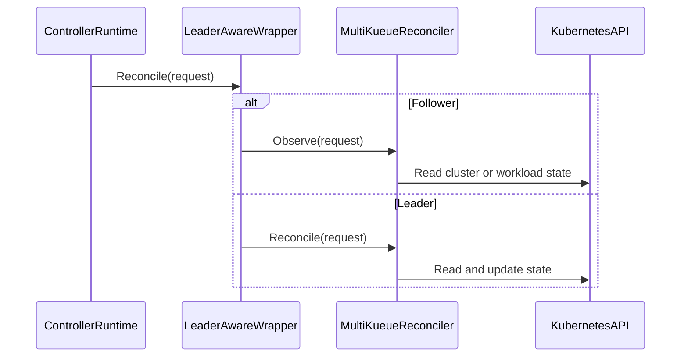

# PR #13682: multikueue: setup MultiKueue controllers for follower binaries

**Summary**: multikueue: setup MultiKueue controllers for follower binaries

**Sources**: https://github.com/kubernetes-sigs/kueue/pull/13682

**Last updated**: 2026-09-15T10:38:50Z

---

## Metadata

- **State**: open
- **Author**: [@vic-comm](https://github.com/vic-comm)
- **Branch**: `feature/multikueue-follower-controllers` → `main`
- **Created**: 2026-07-30T21:55:07Z
- **Updated**: 2026-09-15T10:38:50Z
- **Merged**: —
- **Closed**: —
- **Labels**: `kind/feature`, `release-note`, `size/XL`, `ok-to-test`, `cncf-cla: yes`, `area/multikueue`
- **Assignees**: [@olekzabl](https://github.com/olekzabl)
- **Requested reviewers**: [@mbobrovskyi](https://github.com/mbobrovskyi)
- **Changed files**: 10   **+630 / -119**

## Description

<!-- Thanks for sending a pull request! -->

#### What type of PR is this?

/kind feature
/area multikueue

#### What this PR does / why we need it:
Currently, MultiKueue controllers only run on the leader instance of Kueue. However, the Visibility API server running on follower instances requires cached MultiKueue state (such as remote cluster connections) to efficiently serve API requests.

This PR introduces a leader-aware reconciler observer pattern for MultiKueue controllers:
1. Adds `ReconcilerWithFollowerObserver` interface and `WithLeadingManagerObserver` wrapper in `pkg/controller/core/leader_aware_reconciler.go`.
2. Refactors `clustersReconciler` and `wlReconciler` to separate mutating leader logic (`Reconcile`) from read-only cache-populating follower logic (`Observe`) via a shared `doReconcile(ctx, req, isLeader)` helper.
3. Sets `NeedLeaderElection: new(false)` for MultiKueue cluster and workload controllers so their observer loops run across all replicas.
4. Adds unit test coverage in `pkg/controller/core/leader_aware_reconciler_test.go`.


#### Which issue(s) this PR fixes:

Fixes #11163

#### Special notes for your reviewer:
N/A

#### Does this PR introduce a user-facing change?

```release-note
MultiKueue: enabled leader-aware observer logic on follower instances for MultiKueue cluster and workload controllers.
```

<!-- This is an auto-generated comment: release notes by coderabbit.ai -->
## Summary by CodeRabbit

- **New Features**
  - Improved MultiKueue coordination across leader and observer instances.
  - Added configuration support for MultiKueue controller setup.
  - Added safeguards preventing observer instances from modifying workloads or cluster status.
  - Added read-only client support to prevent selected Kubernetes resource changes.

- **Bug Fixes**
  - Reduced duplicate status updates, warning events, and remote-object changes during failover.
  - Improved retry and requeue behavior for observer instances.
<!-- end of auto-generated comment: release notes by coderabbit.ai -->

## Discussion

### Comment by [@netlify[bot]](https://github.com/apps/netlify) — 2026-07-30T21:55:15Z

### <span aria-hidden="true">❌</span> Deploy Preview for *kubernetes-sigs-kueue* failed. **[Why did it fail? →](https://app.netlify.com/projects/kubernetes-sigs-kueue/deploys/6aa91d8d3642570008e1b5b2?deploy_diagnostics=true)**


|  Name | Link |
|:-:|------------------------|
|<span aria-hidden="true">🔨</span> Latest commit | f5b408540738c00e198e31cf0df1a07b171028f1 |
|<span aria-hidden="true">🔍</span> Latest deploy log | https://app.netlify.com/projects/kubernetes-sigs-kueue/deploys/6aa91d8d3642570008e1b5b2 |

### Comment by [@kubernetes-prow[bot]](https://github.com/apps/kubernetes-prow) — 2026-07-30T21:55:18Z

Hi @vic-comm. Thanks for your PR.

I'm waiting for a [kubernetes-sigs](https://github.com/orgs/kubernetes-sigs/people) member to verify that this patch is reasonable to test. If it is, they should reply with `/ok-to-test` on its own line. Until that is done, I will not automatically test new commits in this PR, but the usual testing commands by org members will still work.

>[!TIP]
>**We noticed you've done this a few times! Consider [joining the org](https://git.k8s.io/community/community-membership.md#member) to skip this step and gain `/lgtm` and other bot rights.** We recommend asking approvers on your previous PRs to sponsor you.

Once the patch is verified, the new status will be reflected by the `ok-to-test` label.

I understand the commands that are listed [here](https://go.k8s.io/bot-commands?repo=kubernetes-sigs%2Fkueue).

<details>

Instructions for interacting with me using PR comments are available [here](https://git.k8s.io/community/contributors/guide/pull-requests.md).  If you have questions or suggestions related to my behavior, please file an issue against the [kubernetes-sigs/prow](https://github.com/kubernetes-sigs/prow/issues/new?title=Prow%20issue:) repository.
</details>

### Comment by [@coderabbitai[bot]](https://github.com/apps/coderabbitai) — 2026-07-30T21:55:40Z

<!-- This is an auto-generated comment: summarize by coderabbit.ai -->
<!-- review_stack_entry_start -->

[](https://app.coderabbit.ai/change-stack/kubernetes-sigs/kueue/pull/13682?utm_source=github_walkthrough&utm_medium=github&utm_campaign=change_stack)

<!-- review_stack_entry_end -->
<!-- This is an auto-generated comment: review paused by coderabbit.ai -->

> [!NOTE]
> ## Reviews paused
> 
> It looks like this branch is under active development. To avoid overwhelming you with review comments due to an influx of new commits, CodeRabbit has automatically paused this review. You can configure this behavior by changing the `reviews.auto_review.auto_pause_after_reviewed_commits` setting.
> 
> Use the following commands to manage reviews:
> - `@coderabbitai resume` to resume automatic reviews.
> - `@coderabbitai review` to trigger a single review.
> 
> Use the checkboxes below for quick actions:
> - [ ] <!-- {"checkboxId": "7f6cc2e2-2e4e-497a-8c31-c9e4573e93d1"} --> ▶️ Resume reviews
> - [ ] <!-- {"checkboxId": "e9bb8d72-00e8-4f67-9cb2-caf3b22574fe"} --> 🔍 Trigger review

<!-- end of auto-generated comment: review paused by coderabbit.ai -->
<!-- walkthrough_start -->

<details>
<summary>📝 Walkthrough</summary>

## Walkthrough

MultiKueue controllers now expose leader and observer reconciliation paths. Controller setup passes configuration to leader-aware wrappers. A read-only Kubernetes client delegates reads and rejects mutations, status writes, and subresource writes.

### Changes

**Leader-aware MultiKueue controllers**

|Layer / File(s)|Summary|
|---|---|
|**Leader-aware observer routing** <br> `pkg/controller/core/leader_aware_reconciler.go`, `pkg/controller/core/leader_aware_reconciler_test.go`|The wrapper calls `Observe` before leadership and `Reconcile` after leadership. Tests cover both election states.|
|**MultiKueue configuration propagation** <br> `pkg/controller/admissionchecks/multikueue/controllers.go`, `cmd/kueue/main.go`|Setup stores the configuration and passes it to cluster and workload controller managers.|
|**MultiKueueCluster leader and observer flow** <br> `pkg/controller/admissionchecks/multikueue/multikueuecluster.go`|Cluster reconciliation restricts warnings and status updates to leaders. Observer execution preserves retry and requeue behavior.|
|**Workload leader-only side effects** <br> `pkg/controller/admissionchecks/multikueue/workload.go`|Workload reconciliation restricts admission-check status patches and remote deletions to leaders. Observers stop after read-only processing.|

**Read-only Kubernetes client**

|Layer / File(s)|Summary|
|---|---|
|**Read-only client behavior and validation** <br> `pkg/util/client/read_only.go`, `pkg/util/client/read_only_test.go`|The wrapper delegates reads and rejects primary, status, and generic subresource mutations. Tests cover each operation group.|

**Estimated code review effort:** 3 (Moderate) | ~25 minutes

### Sequence Diagram(s)



**Suggested reviewers:** `mbobrovskyi`

</details>

<!-- walkthrough_end -->
<!-- pre_merge_checks_walkthrough_start -->

<details>
<summary>🚥 Pre-merge checks | ✅ 4 | ❌ 1</summary>

### ❌ Failed checks (1 warning)

|     Check name     | Status     | Explanation                                                                           | Resolution                                                                         |
| :----------------: | :--------- | :------------------------------------------------------------------------------------ | :--------------------------------------------------------------------------------- |
| Docstring Coverage | ⚠️ Warning | Docstring coverage is 14.29% which is insufficient. The required threshold is 80.00%. | Write docstrings for the functions missing them to satisfy the coverage threshold. |

<details>
<summary>✅ Passed checks (4 passed)</summary>

|         Check name         | Status   | Explanation                                                                                                                              |
| :------------------------: | :------- | :--------------------------------------------------------------------------------------------------------------------------------------- |
|      Description Check     | ✅ Passed | Check skipped - CodeRabbit’s high-level summary is enabled.                                                                              |
|         Title check        | ✅ Passed | The title clearly identifies the main change: configuring MultiKueue controllers for follower binaries.                                  |
|     Linked Issues check    | ✅ Passed | The changes implement leader-aware follower observation, cache population, configuration, and write protection required by issue `#11163`. |
| Out of Scope Changes check | ✅ Passed | All changes support follower controller setup, reconciliation safety, configuration, or tests for issue `#11163`.                          |

</details>

</details>

<!-- pre_merge_checks_walkthrough_end -->
<!-- finishing_touch_checkbox_start -->

<details>
<summary>✨ Finishing Touches</summary>

<details>
<summary>🧪 Generate unit tests (beta)</summary>

- [ ] <!-- {"checkboxId": "f47ac10b-58cc-4372-a567-0e02b2c3d479", "radioGroupId": "utg-output-choice-group-unknown_comment_id"} -->   Create PR with unit tests

</details>

</details>

<!-- finishing_touch_checkbox_end -->
<!-- tips_start -->

---


<sub>Comment `@coderabbitai help` to get the list of available commands.</sub>

<!-- tips_end -->

### Comment by [@mimowo](https://github.com/mimowo) — 2026-07-31T00:25:22Z

/ok-to-test

### Comment by [@olekzabl](https://github.com/olekzabl) — 2026-08-03T16:13:28Z

/assign

### Comment by [@olekzabl](https://github.com/olekzabl) — 2026-08-03T16:17:18Z

> I'll proceed with:
> 
> * A named bool for the doReconcile helper.
> * A non-GET blocking wrapper around client.Client for safety.

The second point is not done, right?
(If you say you want to leave it for a separate PR, I'm fine. But then please don't mark this PR as fixing #11163).

### Comment by [@vic-comm](https://github.com/vic-comm) — 2026-08-03T17:12:42Z

> > I'll proceed with:
> > 
> > * A named bool for the doReconcile helper.
> > * A non-GET blocking wrapper around client.Client for safety.
> 
> The second point is not done, right? (If you say you want to leave it for a separate PR, I'm fine. But then please don't mark this PR as fixing #11163).

Understood, I'll implement the read-only client wrapper in this PR so it can fully close #11163. Will push the implementation along with the other changes.

### Comment by [@mimowo](https://github.com/mimowo) — 2026-08-04T12:33:03Z

> Understood, I'll implement the read-only client wrapper in this PR so it can fully close https://github.com/kubernetes-sigs/kueue/issues/11163. Will push the implementation along with the other changes.

What is the read-only client wrapper going to do if someone wants to issue an update? Failed with error or silently return "something"?

Asking, because it might be a bit underspacified in case of some operations. For example if you silence Delete,, then "ok" result means "object deleted", which will be a lie. So, I'm wondering if we should rather make the client returnning errors.

### Comment by [@vic-comm](https://github.com/vic-comm) — 2026-08-04T12:49:15Z

> > Understood, I'll implement the read-only client wrapper in this PR so it can fully close #11163. Will push the implementation along with the other changes.
> 
> What is the read-only client wrapper going to do if someone wants to issue an update? Failed with error or silently return "something"?
> 
> Asking, because it might be a bit underspacified in case of some operations. For example if you silence Delete,, then "ok" result means "object deleted", which will be a lie. So, I'm wondering if we should rather make the client returnning errors.

The idea is to  return errors. Silent success would be misleading since callers would assume the operation succeeded and proceed incorrectly. I'll implement the wrapper to return a descriptive error for all write operations, something like fmt.Errorf("write operation %s not allowed in follower mode", operationName). This makes accidental writes immediately visible rather than silently producing incorrect behavior. Is this appraoch acceptable?

### Comment by [@mimowo](https://github.com/mimowo) — 2026-08-04T13:10:55Z

sgtm

### Comment by [@vic-comm](https://github.com/vic-comm) — 2026-08-07T12:20:45Z

@mimowo @olekzabl
A few questions and clarifications
For the read-only client wrapper placement, there are two viable approaches:

Approach A: Create two separate reconciler instances in setupWithManager — one with the full client for the leader path, one with NewReadOnlyClient for the follower path. The wrapper holds both delegates and routes to the appropriate one. This provides the strongest guarantee since the follower instance can never access the writable client regardless of future changes to doReconcile.

```
type leaderAwareReconcilerObserver struct {
    elected          <-chan struct{}
    leaderDelegate   reconcile.Reconciler
    followerDelegate ReconcilerWithFollowerObserver
    requeueDuration  time.Duration
}
func (r *leaderAwareReconcilerObserver) Reconcile(ctx context.Context, req reconcile.Request) (reconcile.Result, error) {
    select {
    case <-r.elected:
        return r.leaderDelegate.Reconcile(ctx, req)
    default:
        return r.followerDelegate.Observe(ctx, req)
    }
} 
// 2. In setupWithManager:
leaderRec   := newWlReconciler(mgr.GetClient(), ...)
followerRec := newWlReconciler(clientutil.NewReadOnlyClient(mgr.GetClient()), ...)
return controllerBuilder.Complete(core.WithLeadingManagerAndObserver(mgr, leaderRec, followerRec, cfg))
```

Approach B: Keep one reconciler instance and wrap the client inside doReconcile at the start of the follower path: localClient := NewReadOnlyClient(c.localClient). Simpler change but requires all helper functions called from doReconcile to use the local variable rather than c.localClient directly.

```
// Wrapped inside doReconcile on every follower pass:
func (w *wlReconciler) doReconcile(ctx context.Context, req reconcile.Request, isLeader bool) (reconcile.Result, error) {
    localClient := w.client
    if !isLeader {
        localClient = clientutil.NewReadOnlyClient(w.client)
    }

    // All internal read operations use localClient:
    grp, err := w.readGroup(ctx, localClient, ...)
    if err != nil {
        return reconcile.Result{}, err
    }
    ...
}
```
I Prefeer approach A as it guarantees safety, but it requires changing leaderAwareReconcilerObserver to hold two delegates. Is this acceptable, or do you prefer the simpler Approach B?

### Comment by [@kubernetes-prow[bot]](https://github.com/apps/kubernetes-prow) — 2026-08-07T18:59:44Z

[APPROVALNOTIFIER] This PR is **NOT APPROVED**

This pull-request has been approved by: *<a href="https://github.com/kubernetes-sigs/kueue/pull/13682#" title="Author self-approved">vic-comm</a>*
**Once this PR has been reviewed and has the lgtm label**, please assign [pbundyra](https://github.com/pbundyra), [sohankunkerkar](https://github.com/sohankunkerkar) for approval. For more information see [the Code Review Process](https://git.k8s.io/community/contributors/guide/owners.md#the-code-review-process).

The full list of commands accepted by this bot can be found [here](https://go.k8s.io/bot-commands?repo=kubernetes-sigs%2Fkueue).

<details open>
Needs approval from an approver in each of these files:

- **[OWNERS](https://github.com/kubernetes-sigs/kueue/blob/main/OWNERS)**

Approvers can indicate their approval by writing `/approve` in a comment
Approvers can cancel approval by writing `/approve cancel` in a comment
</details>
<!-- META={"approvers":["pbundyra","sohankunkerkar"]} -->

### Comment by [@coderabbitai[bot]](https://github.com/apps/coderabbitai) — 2026-08-07T19:10:15Z

<!-- This is an auto-generated comment by CodeRabbit -->
> [!NOTE]
> GitHub couldn't provide a complete incremental comparison for this pull request, so CodeRabbit is performing a full review instead. This review may take a little longer.

### Comment by [@olekzabl](https://github.com/olekzabl) — 2026-08-07T21:43:59Z

> Approach A: Create two separate reconciler instances in setupWithManager — one with the full client for the leader path, one with NewReadOnlyClient for the follower path. 
> (...)
> Approach B: Keep one reconciler instance and wrap the client inside doReconcile at the start of the follower path: localClient := NewReadOnlyClient(c.localClient). 
> (...)
> I Prefeer approach A as it guarantees safety, but it requires changing leaderAwareReconcilerObserver to hold two delegates. Is this acceptable, or do you prefer the simpler Approach B?

Thank you for a thoughtful question! I admit I didn't think in such detail; I didn't anticipate this problem.
As for your proposals:

* Approach A makes me anxious due to introducing 2 reconciler instances.
  This should be nice as long as these reconcilers are stateless, but what it they are?
  For example, MK Workload Reconciler has `deletedWlCache` (and you're going to add more).
  Now, consider a binary running as follower which then gets promoted to a leader.
  In Approach A, we'd then switch execution from `followerDelegate` (with well-built cache) to `leaderDelegate` (blank)?
  That feels incorrect, right?

* For Approach B - I agree with your assessment.
  There's a risk some places in the code might still use the original `w.client`, unwrapped.

* Two other approaches I could think of (sadly, neither super nice):

  * Approach C: 
    * drop `.client` as local field of the reconciler
      (we can instead have `.leaderClient` and `.followerClient`; the key point is to leave no `.client` reference valid)
    * instead, have method `.Client(isLeader)`, and propagate the value of `isLeader` across all functions that need it

  * Approach D:
    * make `.client` mutable (which I guess will need a mutex guard)
    * replace all `.client` gets with a `.Client()` method (mutex-guarded getter)
    * allow `leaderAwareReconcilerObserver` to trigger an update of `delegate.client` when the binary is promoted
    (by some extension of the `ReconcilerWithFollowerObserver` interface: maybe `.SetClient()`, or maybe just `.PromoteToLeader()`)
    * store the original client somewhere in the reconciler (e.g. as `.originalClient`), to be restored (into `.client`) on a binary promotion

Or maybe you'll come up with sth nicer. Let's keep thinking.

### Comment by [@olekzabl](https://github.com/olekzabl) — 2026-08-07T22:01:45Z

Approach E :)

* Drop `.client` as local field of the reconciler.
* In `ReconcilerWithFollowerObserver`, make `client` an additional argument of both `.Reconcile()` and `.Observe()`.
  (That way, it will stop extending `reconcile.Reconciler`. Well, we'll have to live with that).
* Pass around that `client` through all relevant reconciler methods.
* Store the original client inside `leaderAwareReconcilerObserver`.
* In its `.Reconcile()` method, pass either the full or read-only version (which may also be stored), as needed.

This is probably nicer than C or D overall.
The win here is to have the client fully managed by the "framework".

### Comment by [@vic-comm](https://github.com/vic-comm) — 2026-08-08T12:11:12Z

> Approach E :)
> 
> * Drop `.client` as local field of the reconciler.
> * In `ReconcilerWithFollowerObserver`, make `client` an additional argument of both `.Reconcile()` and `.Observe()`.
>   (That way, it will stop extending `reconcile.Reconciler`. Well, we'll have to live with that).
> * Pass around that `client` through all relevant reconciler methods.
> * Store the original client inside `leaderAwareReconcilerObserver`.
> * In its `.Reconcile()` method, pass either the full or read-only version (which may also be stored), as needed.
> 
> This is probably nicer than C or D overall. The win here is to have the client fully managed by the "framework".

Thanks for thinking through this so carefully. Approach A's state sharing problem is right, I missed that. Approach E makes sense to me as the cleanest solution: the framework owns and passes the client, the reconciler struct never holds a reference.

Before implementing, a few clarifying questions:

One — should Reconcile(ctx, req, cl) and Observe(ctx, req, cl) replace w.client usage only at the doReconcile level, or should cl be threaded through into all helper functions like readGroup, loadClientConfig, etc.?
Two — the leaderAwareReconcilerObserver still needs to satisfy reconcile.Reconciler for controller-runtime. Should it have a standard Reconcile(ctx, req) method that internally calls delegate.Reconcile(ctx, req, r.leaderClient) and delegate.Observe(ctx, req, r.followerClient)?
Three — should the reconciler struct keep w.client for any purpose, or should all client access go through the parameter?

### Comment by [@olekzabl](https://github.com/olekzabl) — 2026-08-08T21:59:27Z

The following was my _idea_ for Approach E:
(though I may have missed some problems; if you see any, please speak up!)

> One — should Reconcile(ctx, req, cl) and Observe(ctx, req, cl) replace w.client usage only at the doReconcile level, or should cl be threaded through into all helper functions like readGroup, loadClientConfig, etc.?

Passed down, so that `.client` is no longer stored in the _wrapped_ reconcilers.

> Two — the leaderAwareReconcilerObserver still needs to satisfy reconcile.Reconciler for controller-runtime. Should it have a standard Reconcile(ctx, req) method that internally calls delegate.Reconcile(ctx, req, r.leaderClient) and delegate.Observe(ctx, req, r.followerClient)?

Yes, exactly. `leaderAwareReconcilerObserver` should:

- be constructed taking a `client` as a parameter
- store that client as its field (say, `.leaderClient`)
- possibly also store the write-restricted version (as `.followerClient`) - just not to do wrapping every time
- call the _wrapped_ reconciler's `Reconcile` and `Observe` with the appropriate clients
- expose a `Reconcile()` method which does not take a client - we don't need it as an arg, we have it (or them) stored already

> Three — should the reconciler struct keep w.client for any purpose, or should all client access go through the parameter?

In my proposal, it shouldn't. (If it would, we'd be in trouble how to set its value. That sounds like Approach D, which we don't like).
(This question seems a close follow-up, if not identical, to question "One" above, right? Or am I overlooking sth?)

### Comment by [@vic-comm](https://github.com/vic-comm) — 2026-08-10T17:02:28Z

> The following was my _idea_ for Approach E: (though I may have missed some problems; if you see any, please speak up!)
> 
> > One — should Reconcile(ctx, req, cl) and Observe(ctx, req, cl) replace w.client usage only at the doReconcile level, or should cl be threaded through into all helper functions like readGroup, loadClientConfig, etc.?
> 
> Passed down, so that `.client` is no longer stored in the _wrapped_ reconcilers.
> 
> > Two — the leaderAwareReconcilerObserver still needs to satisfy reconcile.Reconciler for controller-runtime. Should it have a standard Reconcile(ctx, req) method that internally calls delegate.Reconcile(ctx, req, r.leaderClient) and delegate.Observe(ctx, req, r.followerClient)?
> 
> Yes, exactly. `leaderAwareReconcilerObserver` should:
> 
> * be constructed taking a `client` as a parameter
> * store that client as its field (say, `.leaderClient`)
> * possibly also store the write-restricted version (as `.followerClient`) - just not to do wrapping every time
> * call the _wrapped_ reconciler's `Reconcile` and `Observe` with the appropriate clients
> * expose a `Reconcile()` method which does not take a client - we don't need it as an arg, we have it (or them) stored already
> 
> > Three — should the reconciler struct keep w.client for any purpose, or should all client access go through the parameter?
> 
> In my proposal, it shouldn't. (If it would, we'd be in trouble how to set its value. That sounds like Approach D, which we don't like). (This question seems a close follow-up, if not identical, to question "One" above, right? Or am I overlooking sth?)

I've implemented it, kindly review, apologies for the delay.

### Comment by [@vic-comm](https://github.com/vic-comm) — 2026-08-10T20:47:09Z

/retest

## Reviews

### Review by [@mimowo](https://github.com/mimowo) (commented) — 2026-07-31T00:28:24Z

I'm at peace with this pattern. Let me ask for review from @olekzabl or @Singularity23x0 - folks who have all the context to review.

### Review by [@mimowo](https://github.com/mimowo) (commented) — 2026-07-31T00:28:52Z

- **pkg/controller/core/leader_aware_reconciler_test.go:74** by [@mimowo](https://github.com/mimowo) — 2026-07-31T00:28:53Z
```diff
@@ -0,0 +1,87 @@
+/*
+Copyright The Kubernetes Authors.
+
+Licensed under the Apache License, Version 2.0 (the "License");
+you may not use this file except in compliance with the License.
+You may obtain a copy of the License at
+
+    http://www.apache.org/licenses/LICENSE-2.0
+
+Unless required by applicable law or agreed to in writing, software
+distributed under the License is distributed on an "AS IS" BASIS,
+WITHOUT WARRANTIES OR CONDITIONS OF ANY KIND, either express or implied.
+See the License for the specific language governing permissions and
+limitations under the License.
+*/
+
+package core
+
+import (
+	"context"
+	"testing"
+
+	"sigs.k8s.io/controller-runtime/pkg/reconcile"
+)
+
+// Fake Reconciler that records which method was invoked
+type fakeObserverReconciler struct {
+	reconcileCalled bool
+	observeCalled   bool
+}
+
+func (f *fakeObserverReconciler) Reconcile(ctx context.Context, req reconcile.Request) (reconcile.Result, error) {
+	f.reconcileCalled = true
+	return reconcile.Result{}, nil
+}
+
+func (f *fakeObserverReconciler) Observe(ctx context.Context, req reconcile.Request) (reconcile.Result, error) {
+	f.observeCalled = true
+	return reconcile.Result{}, nil
+}
+
+// Table-driven test function
+func TestLeaderAwareReconcilerObserver(t *testing.T) {
+	cases := map[string]struct {
+		isLeader            bool
+		wantReconcileCalled bool
+		wantObserveCalled   bool
+	}{
+		"follower replica calls Observe": {
+			isLeader:            false,
+			wantReconcileCalled: false,
+			wantObserveCalled:   true,
+		},
+		"leader replica calls Reconcile": {
+			isLeader:            true,
+			wantReconcileCalled: true,
+			wantObserveCalled:   false,
+		},
+	}
+
+	for name, tc := range cases {
+		t.Run(name, func(t *testing.T) {
+			elected := make(chan struct{})
+			if tc.isLeader {
+				close(elected) // Closed channel = Leader
+			}
+
+			fake := &fakeObserverReconciler{}
+			wrapper := &leaderAwareReconcilerObserver{
+				elected:  elected,
+				delegate: fake,
+			}
+
+			_, err := wrapper.Reconcile(context.Background(), reconcile.Request{})
```

  nit don't use background, it is not recommended even in tests

### Review by [@vic-comm](https://github.com/vic-comm) (commented) — 2026-07-31T08:28:00Z

- **pkg/controller/core/leader_aware_reconciler_test.go:74** by [@vic-comm](https://github.com/vic-comm) — 2026-07-31T08:27:59Z
```diff
@@ -0,0 +1,87 @@
+/*
+Copyright The Kubernetes Authors.
+
+Licensed under the Apache License, Version 2.0 (the "License");
+you may not use this file except in compliance with the License.
+You may obtain a copy of the License at
+
+    http://www.apache.org/licenses/LICENSE-2.0
+
+Unless required by applicable law or agreed to in writing, software
+distributed under the License is distributed on an "AS IS" BASIS,
+WITHOUT WARRANTIES OR CONDITIONS OF ANY KIND, either express or implied.
+See the License for the specific language governing permissions and
+limitations under the License.
+*/
+
+package core
+
+import (
+	"context"
+	"testing"
+
+	"sigs.k8s.io/controller-runtime/pkg/reconcile"
+)
+
+// Fake Reconciler that records which method was invoked
+type fakeObserverReconciler struct {
+	reconcileCalled bool
+	observeCalled   bool
+}
+
+func (f *fakeObserverReconciler) Reconcile(ctx context.Context, req reconcile.Request) (reconcile.Result, error) {
+	f.reconcileCalled = true
+	return reconcile.Result{}, nil
+}
+
+func (f *fakeObserverReconciler) Observe(ctx context.Context, req reconcile.Request) (reconcile.Result, error) {
+	f.observeCalled = true
+	return reconcile.Result{}, nil
+}
+
+// Table-driven test function
+func TestLeaderAwareReconcilerObserver(t *testing.T) {
+	cases := map[string]struct {
+		isLeader            bool
+		wantReconcileCalled bool
+		wantObserveCalled   bool
+	}{
+		"follower replica calls Observe": {
+			isLeader:            false,
+			wantReconcileCalled: false,
+			wantObserveCalled:   true,
+		},
+		"leader replica calls Reconcile": {
+			isLeader:            true,
+			wantReconcileCalled: true,
+			wantObserveCalled:   false,
+		},
+	}
+
+	for name, tc := range cases {
+		t.Run(name, func(t *testing.T) {
+			elected := make(chan struct{})
+			if tc.isLeader {
+				close(elected) // Closed channel = Leader
+			}
+
+			fake := &fakeObserverReconciler{}
+			wrapper := &leaderAwareReconcilerObserver{
+				elected:  elected,
+				delegate: fake,
+			}
+
+			_, err := wrapper.Reconcile(context.Background(), reconcile.Request{})
```

  Thanks for the review, i've corrected it

### Review by [@coderabbitai[bot]](https://github.com/apps/coderabbitai) (commented) — 2026-07-31T08:31:36Z

**Actionable comments posted: 1**

<details>
<summary>🧹 Nitpick comments (1)</summary><blockquote>

<details>
<summary>pkg/controller/core/leader_aware_reconciler_test.go (1)</summary><blockquote>

`19-24`: _📐 Maintainability & Code Quality_ | _🔵 Trivial_ | _⚡ Quick win_

**Use the repository's Ginkgo/Gomega test pattern.**

This new `*_test.go` file uses `testing.T` and direct assertions. Convert it to the existing Ginkgo/Gomega suite. Keep the table-driven scenarios because the path instruction prefers that structure for multiple cases.


As per path instructions, `**/*_test.go` tests must follow the existing Ginkgo/Gomega patterns in the project. 


Also applies to: 42-87

<details>
<summary>🤖 Prompt for AI Agents</summary>

```
Verify each finding against current code. Fix only still-valid issues, skip the
rest with a brief reason, keep changes minimal, and validate.

In `@pkg/controller/core/leader_aware_reconciler_test.go` around lines 19 - 24,
Convert the tests in leader_aware_reconciler_test.go from testing.T and direct
assertions to the repository’s existing Ginkgo/Gomega suite pattern, using the
project’s established suite imports and structure. Preserve the current
table-driven scenarios and execute each case through Ginkgo while replacing
direct assertions with Gomega expectations.
```

</details>

<!-- cr-comment:v1:0e3a515fecf3a04e2297644b -->

_Source: Path instructions_

</blockquote></details>

</blockquote></details>

<details>
<summary>🤖 Prompt for all review comments with AI agents</summary>

```
Verify each finding against current code. Fix only still-valid issues, skip the
rest with a brief reason, keep changes minimal, and validate.

Inline comments:
In `@pkg/controller/core/leader_aware_reconciler.go`:
- Around line 41-48: Update leaderAwareReconcilerObserver.Reconcile to preserve
and replay requests handled by delegate.Observe when r.elected is not yet
closed, ensuring those requests are requeued after leadership is acquired;
retain direct delegate.Reconcile behavior for already-elected requests. Add unit
coverage for the election transition and integration coverage through
WithLeadingManagerObserver.

---

Nitpick comments:
In `@pkg/controller/core/leader_aware_reconciler_test.go`:
- Around line 19-24: Convert the tests in leader_aware_reconciler_test.go from
testing.T and direct assertions to the repository’s existing Ginkgo/Gomega suite
pattern, using the project’s established suite imports and structure. Preserve
the current table-driven scenarios and execute each case through Ginkgo while
replacing direct assertions with Gomega expectations.
```

</details>

<details>
<summary>🪄 Autofix (Beta)</summary>

Fix all unresolved CodeRabbit comments on this PR:

- [ ] <!-- {"checkboxId": "4b0d0e0a-96d7-4f10-b296-3a18ea78f0b9"} --> Push a commit to this branch (recommended)
- [ ] <!-- {"checkboxId": "ff5b1114-7d8c-49e6-8ac1-43f82af23a33"} --> Create a new PR with the fixes

</details>

---

<details>
<summary>ℹ️ Review info</summary>

<details>
<summary>⚙️ Run configuration</summary>

**Configuration used**: Path: .coderabbit.yaml

**Review profile**: CHILL

**Plan**: Pro Plus

**Run ID**: `c1005cee-5e52-454c-9e05-c5d50f0282f4`

</details>

<details>
<summary>📥 Commits</summary>

Reviewing files that changed from the base of the PR and between 193e716e7537972bdecbc715a3b723339e1ddf60 and f6415862659ea321427f7f84e4e19403476a4d88.

</details>

<details>
<summary>📒 Files selected for processing (4)</summary>

* `pkg/controller/admissionchecks/multikueue/multikueuecluster.go`
* `pkg/controller/admissionchecks/multikueue/workload.go`
* `pkg/controller/core/leader_aware_reconciler.go`
* `pkg/controller/core/leader_aware_reconciler_test.go`

</details>

<details>
<summary>🚧 Files skipped from review as they are similar to previous changes (2)</summary>

* pkg/controller/admissionchecks/multikueue/multikueuecluster.go
* pkg/controller/admissionchecks/multikueue/workload.go

</details>

</details>

<!-- This is an auto-generated comment by CodeRabbit for review status -->

- **pkg/controller/core/leader_aware_reconciler.go:86** by [@coderabbitai[bot]](https://github.com/apps/coderabbitai) — 2026-07-31T08:31:36Z
```diff
@@ -28,6 +28,25 @@ import (
 	config "sigs.k8s.io/kueue/apis/config/v1beta2"
 )
 
+type ReconcilerWithFollowerObserver interface {
+	reconcile.Reconciler
+	Observe(ctx context.Context, req reconcile.Request) (reconcile.Result, error)
+}
+
+type leaderAwareReconcilerObserver struct {
+	elected  <-chan struct{}
+	delegate ReconcilerWithFollowerObserver
+}
+
+func (r *leaderAwareReconcilerObserver) Reconcile(ctx context.Context, req reconcile.Request) (reconcile.Result, error) {
+	select {
+	case <-r.elected:
+		return r.delegate.Reconcile(ctx, req)
+	default:
+		return r.delegate.Observe(ctx, req)
+	}
+}
```

  _🗄️ Data Integrity & Integration_ | _🟠 Major_ | _🏗️ Heavy lift_
  
  <details>
  <summary>🧩 Analysis chain</summary>
  
  🏁 Script executed:
  
  ```shell
  rg -n -C 8 'WithLeadingManagerObserver|NeedLeaderElection|func \(.*\) Observe|doReconcile' \
    pkg/controller/core pkg/controller/admissionchecks/multikueue
  ```
  
  Repository: kubernetes-sigs/kueue
  
  Length of output: 29046
  
  ---
  
  🏁 Script executed:
  
  ```shell
  #!/bin/bash
  set -euo pipefail
  
  echo "## leader_aware_reconciler.go outline"
  ast-grep outline pkg/controller/core/leader_aware_reconciler.go --view expanded || true
  
  echo "## leader_aware_reconciler.go relevant lines"
  cat -n pkg/controller/core/leader_aware_reconciler.go | sed -n '1,140p'
  
  echo "## tests relevant lines"
  cat -n pkg/controller/core/leader_aware_reconciler_test.go | sed -n '1,180p'
  
  echo "## usages of WithLeadingManagerObserver and ReconcilerWithFollowerObserver"
  rg -n "WithLeadingManagerObserver|ReconcilerWithFollowerObserver|type ReconcilerWithFollowerObserver" pkg/controller
  ```
  
  Repository: kubernetes-sigs/kueue
  
  Length of output: 10016
  
  ---
  
  🏁 Script executed:
  
  ```shell
  #!/bin/bash
  set -euo pipefail
  
  echo "## controller-runtime version references"
  rg -n "controller-runtime|sigs.k8s.io/controller-runtime" go.mod go.sum 2>/dev/null || true
  
  echo "## find and inspect installed controller-runtime manager internal if available"
  go env GOPATH 2>/dev/null || true
  for gopath in $(go env GOPATH 2>/dev/null | tr ':' '\n'); do
    f="$gopath/pkg/mod/sigs.k8s.io/controller-runtime@*/pkg/manager/internal.go"
    for ff in $f; do
      [ -f "$ff" ] || continue
      echo "## $ff"
      wc -l "$ff"
      rg -n -C 8 "WithLeadingManager|WithLeadingManagerObserver|NeedLeaderElection|StartNonLeaderElectionRunnables|StartNonLeaderElectionRunnables|nonLeaderElectionRunnables|startRunnables" "$ff" || true
    done
  done
  
  echo "## local tests mentioning leaderAwareReconcilerObserver or observer transition"
  rg -n "leaderAwareReconcilerObserver|Observer|observeCalled|RequeueAfter|election|elected" pkg/controller/core/leader_aware_reconciler_test.go pkg/controller/core pkg/controller/admissionchecks/multikueue -g '*.go' 2>/dev/null | head -n 200
  ```
  
  Repository: kubernetes-sigs/kueue
  
  Length of output: 17653
  
  ---
  
  🏁 Script executed:
  
  ```shell
  #!/bin/bash
  set -euo pipefail
  
  echo "## controller-runtime manager internal relevant sections"
  sed -n '580,720p' /home/jailuser/go/pkg/mod/sigs.k8s.io/controller-runtime@v0.24.1/pkg/manager/internal.go
  
  echo "## behavioral probe for channel select default after close / empty channel"
  python3 - <<'PY'
  # This model is too coarse for Go select semantics, so we only inspect the generated wrapper source shape.
  from pathlib import Path
  p = Path('/home/jailuser/go/pkg/mod/sigs.k8s.io/controller-runtime@v0.24.1/pkg/manager/internal.go')
  s = p.read_text()
  print('leaderAwareReconcilerObserver present:', 'leaderAwareReconcilerObserver' in s)
  idx = s.find('func (r *leaderAwareReconcilerObserver) Reconcile')
  print(idx)
  if idx >= 0:
      print(s[idx:idx+1300])
  PY
  ```
  
  Repository: kubernetes-sigs/kueue
  
  Length of output: 2993
  
  ---
  
  
  
  </details>
  
  **Replay `Observe` requests when this wrapper becomes leader.**
  
  If a leader election occurs while `r.elected` is still empty, `leaderAwareReconcilerObserver.Reconcile` can call `delegate.Observe` and return `reconcile.Result{}`. Closing `r.elected` only changes later requests to `delegate.Reconcile`, so the original request is never requeued. Add a test for this election transition and an integration test through the `WithLeadingManagerObserver` controller setup.
  
  <details>
  <summary>🧰 Tools</summary>
  
  <details>
  <summary>🪛 golangci-lint (2.12.2)</summary>
  
  [error] 41-41: : # sigs.k8s.io/kueue/apis/kueue/v1beta2
  apis/kueue/v1beta2/groupversion_info.go:41:3: cannot use &AdmissionCheck{} (value of type *AdmissionCheck) as "k8s.io/apimachinery/pkg/runtime".Object value in argument to scheme.AddKnownTypes: *AdmissionCheck does not implement "k8s.io/apimachinery/pkg/runtime".Object (missing method DeepCopyObject)
  apis/kueue/v1beta2/groupversion_info.go:41:22: cannot use &AdmissionCheckList{} (value of type *AdmissionCheckList) as "k8s.io/apimachinery/pkg/runtime".Object value in argument to scheme.AddKnownTypes: *AdmissionCheckList does not implement "k8s.io/apimachinery/pkg/runtime".Object (missing method DeepCopyObject)
  apis/kueue/v1beta2/groupversion_info.go:42:3: cannot use &ClusterQueue{} (value of type *ClusterQueue) as "k8s.io/apimachinery/pkg/runtime".Object value in argument to scheme.AddKnownTypes: *ClusterQueue does not implement "k8s.io/apimachinery/pkg/runtime".Object (missing method DeepCopyObject)
  apis/kueue/v1beta2/groupversion_info.go:42:20: cannot use &ClusterQueueList{} (value of type *ClusterQueueList) as "k8s.io/apimachinery/pkg/runtime".Object value in argument to scheme.AddKnownTypes: *ClusterQueueList does not implement "k8s.io/apimachinery/pkg/runtime".Object (missing method DeepCopyObject)
  apis/kueue/v1beta2/groupversion_info.go:43:3: cannot use &Cohort{} (value of type *Cohort) as "k8s.io/apimachinery/pkg/runtime".Object value in argument to scheme.AddKnownTypes: *Cohort does not implement "k8s.io/apimachinery/pkg/runtime".Object (missing method DeepCopyObject)
  apis/kueue/v1beta2/groupversion_info.go:43:14: cannot use &CohortList{} (value of type *CohortList) as "k8s.io/apimachinery/pkg/runtime".Object value in argument to scheme.AddKnownTypes: *CohortList does not implement "k8s.io/apimachinery/pkg/runtime".Object (missing method DeepCopyObject)
  apis/kueue/v1beta2/groupversion_info.go:44:3: cannot use &LocalQueue{} (value of type *LocalQueue) as "k8s.io/apimachinery/pkg/runtime".Object value in argument to scheme.AddKnownTypes: *LocalQueue does not implement "k8s.io/apimachinery/pkg/runtime".Object (missing method DeepCopyObject)
  apis/kueue/v1beta2/groupversion_info.go:44:18: cannot use &LocalQueueList{} (value of type *LocalQueueList) as "k8s.io/apimachinery/pkg/runtime".Object value in argument to scheme.AddKnownTypes: *LocalQueueList does not implement "k8s.io/apimachinery/pkg/runtime".Object (missing method DeepCopyObject)
  apis/kueue/v1beta2/groupversion_info.go:45:3: cannot use &MultiKueueConfig{} (value of type *MultiKueueConfig) as "k8s.io/apimachinery/pkg/runtime".Object value in argument to scheme.AddKnownTypes: *MultiKueueConfig does not implement "k8s.io/apimachinery/pkg/runtime".Object (missing method DeepCopyObject)
  apis/kueue/v1beta2/groupversion_info.go:45:24: cannot use &MultiKueueConfigList{} (value of type *MultiKueueConfigList) as "k8s.io/apimachinery/pkg/runtime".Object value in argument to scheme.AddKnownTypes: *MultiKueueConfigList does not implement "k8s.io/apimachinery/pkg/runtime".Object (missing method DeepCopyObject)
  apis/kueue/v1beta2/groupversion_info.go:45:24: too many errors
  
  (typecheck)
  
  </details>
  
  </details>
  
  <details>
  <summary>🤖 Prompt for AI Agents</summary>
  
  ```
  Verify each finding against current code. Fix only still-valid issues, skip the
  rest with a brief reason, keep changes minimal, and validate.
  
  In `@pkg/controller/core/leader_aware_reconciler.go` around lines 41 - 48, Update
  leaderAwareReconcilerObserver.Reconcile to preserve and replay requests handled
  by delegate.Observe when r.elected is not yet closed, ensuring those requests
  are requeued after leadership is acquired; retain direct delegate.Reconcile
  behavior for already-elected requests. Add unit coverage for the election
  transition and integration coverage through WithLeadingManagerObserver.
  ```
  
  </details>
  
  <!-- fingerprinting:phantom:poseidon:luna -->
  
  <!-- cr-indicator-types:potential_issue -->
  
  <!-- cr-comment:v1:8d788069b0b53ea1d61cdf0f -->
  
  _Sources: Path instructions, MCP tools_
  
  <!-- This is an auto-generated reply by CodeRabbit -->
  
  ✅ Addressed in commits f641586 to 3d4a601
  
  <!-- This is an auto-generated comment by CodeRabbit -->

### Review by [@vic-comm](https://github.com/vic-comm) (commented) — 2026-07-31T11:13:56Z

- **pkg/controller/core/leader_aware_reconciler.go:86** by [@vic-comm](https://github.com/vic-comm) — 2026-07-31T11:13:56Z
```diff
@@ -28,6 +28,25 @@ import (
 	config "sigs.k8s.io/kueue/apis/config/v1beta2"
 )
 
+type ReconcilerWithFollowerObserver interface {
+	reconcile.Reconciler
+	Observe(ctx context.Context, req reconcile.Request) (reconcile.Result, error)
+}
+
+type leaderAwareReconcilerObserver struct {
+	elected  <-chan struct{}
+	delegate ReconcilerWithFollowerObserver
+}
+
+func (r *leaderAwareReconcilerObserver) Reconcile(ctx context.Context, req reconcile.Request) (reconcile.Result, error) {
+	select {
+	case <-r.elected:
+		return r.delegate.Reconcile(ctx, req)
+	default:
+		return r.delegate.Observe(ctx, req)
+	}
+}
```

  This is by design. Unlike WithLeadingManager which requeues events on 
  followers, WithLeadingManagerObserver executes delegate.Observe for every 
  reconciliation request on follower replicas.
  
  Observe is not a discarded event — it fully processes the event in 
  read-only mode and populates the local replica's in-memory caches such as 
  remoteClients and workload caches.
  
  When leadership failover occurs:
  1. r.elected channel closes
  2. The newly elected leader already has warm in-memory caches from Observe
  3. The informer cache re-sync triggers new Reconcile calls for existing 
     objects giving the new leader full processing of current state
  4. No replay logic is needed

### Review by [@coderabbitai[bot]](https://github.com/apps/coderabbitai) (commented) — 2026-07-31T11:14:28Z

- **pkg/controller/core/leader_aware_reconciler.go:86** by [@coderabbitai[bot]](https://github.com/apps/coderabbitai) — 2026-07-31T11:14:28Z
```diff
@@ -28,6 +28,25 @@ import (
 	config "sigs.k8s.io/kueue/apis/config/v1beta2"
 )
 
+type ReconcilerWithFollowerObserver interface {
+	reconcile.Reconciler
+	Observe(ctx context.Context, req reconcile.Request) (reconcile.Result, error)
+}
+
+type leaderAwareReconcilerObserver struct {
+	elected  <-chan struct{}
+	delegate ReconcilerWithFollowerObserver
+}
+
+func (r *leaderAwareReconcilerObserver) Reconcile(ctx context.Context, req reconcile.Request) (reconcile.Result, error) {
+	select {
+	case <-r.elected:
+		return r.delegate.Reconcile(ctx, req)
+	default:
+		return r.delegate.Observe(ctx, req)
+	}
+}
```

  `@vic-comm`, thank you for the clarification. I withdraw this finding.
  
  `Observe` is the intended follower reconciliation path. It updates the local read-only caches. After leader election, informer cache re-sync generates new `Reconcile` requests for the current objects. Explicit replay is not required.
  
  AI-assisted review.
  
  <!-- <review_comment_withdrawn> -->
  
  ---
  
  <details>
  <summary>✏️ Learnings added</summary>
  
  ```
  Learnt from: vic-comm
  Repo: kubernetes-sigs/kueue PR: 13682
  File: pkg/controller/core/leader_aware_reconciler.go:41-48
  Timestamp: 2026-07-31T11:14:17.473Z
  Learning: In `pkg/controller/core/leader_aware_reconciler.go`, `WithLeadingManagerObserver` intentionally calls `ReconcilerWithFollowerObserver.Observe` for every follower reconciliation request. `Observe` performs read-only processing and populates local in-memory MultiKueue caches. After leader election, informer cache re-sync triggers `Reconcile` for current objects, so follower requests do not require explicit replay.
  ```
  
  > Note: Learnings are effective only in the context of similar code segments. To apply general coding guidelines, please configure [review instructions](https://docs.coderabbit.ai/guides/review-instructions). You can manage existing learnings in the [app](https://app.coderabbit.ai/learnings).
  
  </details>
  
  <sub>You are interacting with an AI system.</sub>
  
  <!-- This is an auto-generated reply by CodeRabbit -->

### Review by [@coderabbitai[bot]](https://github.com/apps/coderabbitai) (commented) — 2026-08-03T15:04:28Z


<details>
<summary>🧹 Nitpick comments (1)</summary><blockquote>

<details>
<summary>pkg/webhooks/workload_webhook.go (1)</summary><blockquote>

`61-61`: _🩺 Stability & Availability_ | _🔵 Trivial_

**Confirm the fail-closed scope for status updates.**

Line 61 now matches `UPDATE` requests for `workloads/status` with `failurePolicy=fail`. Kubernetes supports explicit status-subresource matching, and `failurePolicy: Fail` rejects a matching API request when the webhook call fails. ([kubernetes.io](https://kubernetes.io/docs/reference/access-authn-authz/extensible-admission-controllers/?source=post_page-----623f40c2adda---------------------------------------))

In this configuration, a webhook outage can block Kueue Workload status writes. Confirm that this availability dependency is intentional. If fail-closed behavior is required, add HA, readiness, and rollout coverage for the webhook service.

<details>
<summary>🤖 Prompt for AI Agents</summary>

```
Verify each finding against current code. Fix only still-valid issues, skip the
rest with a brief reason, keep changes minimal, and validate.

In `@pkg/webhooks/workload_webhook.go` at line 61, Confirm whether the webhook’s
failurePolicy=fail should apply to workloads/status updates in the kubebuilder
webhook configuration. If fail-closed status handling is intentional, add the
required webhook service HA, readiness, and rollout coverage; otherwise narrow
the workloads/status matching or adjust the failure policy to avoid blocking
status writes during outages.
```

</details>

<!-- cr-comment:v1:27d562953f4ffdd6a177e59d -->

</blockquote></details>

</blockquote></details>

<details>
<summary>🤖 Prompt for all review comments with AI agents</summary>

```
Verify each finding against current code. Fix only still-valid issues, skip the
rest with a brief reason, keep changes minimal, and validate.

Nitpick comments:
In `@pkg/webhooks/workload_webhook.go`:
- Line 61: Confirm whether the webhook’s failurePolicy=fail should apply to
workloads/status updates in the kubebuilder webhook configuration. If
fail-closed status handling is intentional, add the required webhook service HA,
readiness, and rollout coverage; otherwise narrow the workloads/status matching
or adjust the failure policy to avoid blocking status writes during outages.
```

</details>

---

<details>
<summary>ℹ️ Review info</summary>

<details>
<summary>⚙️ Run configuration</summary>

**Configuration used**: Path: .coderabbit.yaml

**Review profile**: CHILL

**Plan**: Pro Plus

**Run ID**: `bdd4fdec-27e0-4fd8-879e-e014ee345d56`

</details>

<details>
<summary>📥 Commits</summary>

Reviewing files that changed from the base of the PR and between f6415862659ea321427f7f84e4e19403476a4d88 and c34a537f32c1fda09bfa7e447ef69e0c1eba13a6.

</details>

<details>
<summary>📒 Files selected for processing (3)</summary>

* `config/components/webhook/manifests.yaml`
* `pkg/webhooks/workload_webhook.go`
* `pkg/webhooks/workload_webhook_test.go`

</details>

</details>

<!-- This is an auto-generated comment by CodeRabbit for review status -->

### Review by [@olekzabl](https://github.com/olekzabl) (commented) — 2026-08-03T16:11:58Z

Thank you for this work!

Sending comments for non-test part for now; I'll soon read tests too.

- **pkg/controller/admissionchecks/multikueue/multikueuecluster.go:810** by [@olekzabl](https://github.com/olekzabl) — 2026-08-03T15:18:15Z
```diff
@@ -799,14 +800,15 @@ func (c *clustersReconciler) Reconcile(ctx context.Context, req reconcile.Reques
 	log.V(2).Info("Reconcile MultiKueueCluster")
 
 	// Warn about deprecated Path usage when the validation feature gate is off.
-	if cluster.Spec.ClusterSource.KubeConfig != nil &&
-		cluster.Spec.ClusterSource.KubeConfig.LocationType == kueue.PathLocationType &&
-		!features.Enabled(features.MultiKueueKubeConfigPathValidation) {
-		c.recorder.Eventf(cluster, nil, corev1.EventTypeWarning, "DeprecatedPathUsage", "DeprecatedPathUsage",
-			"Using locationType=Path without MultiKueueKubeConfigPathValidation feature gate is deprecated and will be removed in a future release. "+
-				"Enable the MultiKueueKubeConfigPathValidation feature gate and place kubeconfig files under /etc/multikueue/kubeconfigs/.")
+	if isLeader {
+		if cluster.Spec.ClusterSource.KubeConfig != nil &&
+			cluster.Spec.ClusterSource.KubeConfig.LocationType == kueue.PathLocationType &&
+			!features.Enabled(features.MultiKueueKubeConfigPathValidation) {
+			c.recorder.Eventf(cluster, nil, corev1.EventTypeWarning, "DeprecatedPathUsage", "DeprecatedPathUsage",
+				"Using locationType=Path without MultiKueueKubeConfigPathValidation feature gate is deprecated and will be removed in a future release. "+
+					"Enable the MultiKueueKubeConfigPathValidation feature gate and place kubeconfig files under /etc/multikueue/kubeconfigs/.")
+		}
```

  FYI, #12223 - which added this check - mentions a plan to make it blocking ultimately.
  The intent here is to resolve a security vulnerability - so that Kueue can't access files it shouldn't.
  With this mindset, I think we shouldn't restrict this whole check to the leader.
  Because if we do, then - by naturally strengthening to a blocking guard later - the outcome might be that we've guarded the leader but not the followers. Still not optimal.
  
  Is your intent behind `if isLeader` to deduplicate the logging?
  If so, how about guarding only the logging but not the check?
  
  cc @kannon92 (author of #12223), in case I'm mixing up things.
  
  ```suggestion
  	if cluster.Spec.ClusterSource.KubeConfig != nil &&
  		cluster.Spec.ClusterSource.KubeConfig.LocationType == kueue.PathLocationType &&
  		!features.Enabled(features.MultiKueueKubeConfigPathValidation) {
  		if isLeader {
  			c.recorder.Eventf(cluster, nil, corev1.EventTypeWarning, "DeprecatedPathUsage", "DeprecatedPathUsage",
  				"Using locationType=Path without MultiKueueKubeConfigPathValidation feature gate is deprecated and will be removed in a future release. "+
  					"Enable the MultiKueueKubeConfigPathValidation feature gate and place kubeconfig files under /etc/multikueue/kubeconfigs/.")
  		}
  ```

- **pkg/controller/core/leader_aware_reconciler.go:46** by [@olekzabl](https://github.com/olekzabl) — 2026-08-03T15:58:19Z
```diff
@@ -28,6 +28,25 @@ import (
 	config "sigs.k8s.io/kueue/apis/config/v1beta2"
 )
 
+type ReconcilerWithFollowerObserver interface {
+	reconcile.Reconciler
+	Observe(ctx context.Context, req reconcile.Request) (reconcile.Result, error)
+}
+
+type leaderAwareReconcilerObserver struct {
+	elected  <-chan struct{}
+	delegate ReconcilerWithFollowerObserver
+}
+
+func (r *leaderAwareReconcilerObserver) Reconcile(ctx context.Context, req reconcile.Request) (reconcile.Result, error) {
+	select {
+	case <-r.elected:
+		return r.delegate.Reconcile(ctx, req)
+	default:
+		return r.delegate.Observe(ctx, req)
```

  I just realized the old `leaderAwareReconciler` does [this](https://github.com/kubernetes-sigs/kueue/blob/24491dfd9188df3112b86b6ca9f825b4512bf5fe/pkg/controller/core/leader_aware_reconciler.go#L78-L88) for followers.
  That is, it doesn't just ignore the request, it schedules another pass after some delay.
  So perhaps we here should also not just observe, but also schedule another pass?
  
  BTW is there a need for Observe to return a `reconcile.Result`?
  * If not, maybe you could make it return void, or just `err`, and plumb in the same `reconcile.Result` as used by the `leaderAwareReconciler`.
  * If yes, it looks like we may need some merge utility for 2 `reconcile.Result`s. (But I'm hoping it's not the case).
  
  WDYT?

- **pkg/controller/core/leader_aware_reconciler.go:1** by [@olekzabl](https://github.com/olekzabl) — 2026-08-03T16:03:05Z
  Two style nits:
  
  1. I'm confused by the ordering of things in this file now. Essentially we have:
  
     * `leaderAwareReconcilerObserver` (new struct)
     * `WithLeadingManager` (old builder)
     * `WithLeadingManagerObserver` (new builder)
     * `leaderAwareReconciler` (old struct)
  
     Any IDE will cope with that sure, but my human eyes would love some clearer pattern.
  
  2. `WithLeadingManagerObserver` feels a perplexing name to me. (What is a "manager observer"?)
     Maybe `WithLeadingManagerAndObservers`?

- **pkg/controller/admissionchecks/multikueue/workload.go:1** by [@olekzabl](https://github.com/olekzabl) — 2026-08-03T16:09:25Z
  Let me check with you I'm getting this right.
  The goal of this PR is to lay out foundation for introducing some cache in a follow-up PR.
  We want this cache to be not super-fresh but reasonably fresh. And therefore:
  
  * In the followers, we essentially care about the result of `.readGroup()`.
  * Followers can skip `.reconcileGroup()` because whatever is changed by `reconcileGroup()`, will soon trigger a remote workload watcher, which (through `wlUpdateCh`) will trigger another `Reconcile()` here which will let `.readGroup()` see the update.
  * Followers can also skip `.RemoveRemoteObjects()`, for analogous reasons.
  * However, we still want to update `w.deletedWlCache`; hence the followers don't simply return from `Reconcile()` right after `.readGroup()`.
  
  Am I getting it right? (If so, lgtm).

### Review by [@olekzabl](https://github.com/olekzabl) (commented) — 2026-08-03T16:33:28Z

I see that new tests cover just a part of changes in `leader_aware_reconciler.go`.
And I think it's reasonable *for now*.
Ultimately, though, it'd be great to have some tests verifying that:

- followers don't make any changes (though I imagine that'll make more sense when you introduce auto-guarding the client; then it'll suffice to select randomly one write scenario and verify that the auto-guard works in that case)
- followers have their cache valid (obviously blocked by implementing the cache itself).

(Just a heads up about this, in case it matters for your follow-up work).

- **pkg/controller/core/leader_aware_reconciler_test.go:116** by [@olekzabl](https://github.com/olekzabl) — 2026-08-03T16:18:32Z
```diff
@@ -0,0 +1,87 @@
+/*
+Copyright The Kubernetes Authors.
+
+Licensed under the Apache License, Version 2.0 (the "License");
+you may not use this file except in compliance with the License.
+You may obtain a copy of the License at
+
+    http://www.apache.org/licenses/LICENSE-2.0
+
+Unless required by applicable law or agreed to in writing, software
+distributed under the License is distributed on an "AS IS" BASIS,
+WITHOUT WARRANTIES OR CONDITIONS OF ANY KIND, either express or implied.
+See the License for the specific language governing permissions and
+limitations under the License.
+*/
+
+package core
+
+import (
+	"context"
+	"testing"
+
+	"sigs.k8s.io/controller-runtime/pkg/reconcile"
+)
+
+// Fake Reconciler that records which method was invoked
+type fakeObserverReconciler struct {
+	reconcileCalled bool
+	observeCalled   bool
+}
+
+func (f *fakeObserverReconciler) Reconcile(ctx context.Context, req reconcile.Request) (reconcile.Result, error) {
+	f.reconcileCalled = true
+	return reconcile.Result{}, nil
+}
+
+func (f *fakeObserverReconciler) Observe(ctx context.Context, req reconcile.Request) (reconcile.Result, error) {
+	f.observeCalled = true
+	return reconcile.Result{}, nil
+}
+
+// Table-driven test function
```

  This comment is more noisy than helpful. Most of our unit tests are table-driven.
  
  ```suggestion
  ```

### Review by [@vic-comm](https://github.com/vic-comm) (commented) — 2026-08-03T17:10:05Z

- **pkg/controller/core/leader_aware_reconciler.go:1** by [@vic-comm](https://github.com/vic-comm) — 2026-08-03T17:10:05Z
  Noted, i'll edit the name

### Review by [@vic-comm](https://github.com/vic-comm) (commented) — 2026-08-03T17:12:57Z

- **pkg/controller/core/leader_aware_reconciler_test.go:116** by [@vic-comm](https://github.com/vic-comm) — 2026-08-03T17:12:57Z
```diff
@@ -0,0 +1,87 @@
+/*
+Copyright The Kubernetes Authors.
+
+Licensed under the Apache License, Version 2.0 (the "License");
+you may not use this file except in compliance with the License.
+You may obtain a copy of the License at
+
+    http://www.apache.org/licenses/LICENSE-2.0
+
+Unless required by applicable law or agreed to in writing, software
+distributed under the License is distributed on an "AS IS" BASIS,
+WITHOUT WARRANTIES OR CONDITIONS OF ANY KIND, either express or implied.
+See the License for the specific language governing permissions and
+limitations under the License.
+*/
+
+package core
+
+import (
+	"context"
+	"testing"
+
+	"sigs.k8s.io/controller-runtime/pkg/reconcile"
+)
+
+// Fake Reconciler that records which method was invoked
+type fakeObserverReconciler struct {
+	reconcileCalled bool
+	observeCalled   bool
+}
+
+func (f *fakeObserverReconciler) Reconcile(ctx context.Context, req reconcile.Request) (reconcile.Result, error) {
+	f.reconcileCalled = true
+	return reconcile.Result{}, nil
+}
+
+func (f *fakeObserverReconciler) Observe(ctx context.Context, req reconcile.Request) (reconcile.Result, error) {
+	f.observeCalled = true
+	return reconcile.Result{}, nil
+}
+
+// Table-driven test function
```

  Noted

### Review by [@vic-comm](https://github.com/vic-comm) (commented) — 2026-08-04T07:49:58Z

- **pkg/controller/admissionchecks/multikueue/multikueuecluster.go:810** by [@vic-comm](https://github.com/vic-comm) — 2026-08-04T07:49:58Z
```diff
@@ -799,14 +800,15 @@ func (c *clustersReconciler) Reconcile(ctx context.Context, req reconcile.Reques
 	log.V(2).Info("Reconcile MultiKueueCluster")
 
 	// Warn about deprecated Path usage when the validation feature gate is off.
-	if cluster.Spec.ClusterSource.KubeConfig != nil &&
-		cluster.Spec.ClusterSource.KubeConfig.LocationType == kueue.PathLocationType &&
-		!features.Enabled(features.MultiKueueKubeConfigPathValidation) {
-		c.recorder.Eventf(cluster, nil, corev1.EventTypeWarning, "DeprecatedPathUsage", "DeprecatedPathUsage",
-			"Using locationType=Path without MultiKueueKubeConfigPathValidation feature gate is deprecated and will be removed in a future release. "+
-				"Enable the MultiKueueKubeConfigPathValidation feature gate and place kubeconfig files under /etc/multikueue/kubeconfigs/.")
+	if isLeader {
+		if cluster.Spec.ClusterSource.KubeConfig != nil &&
+			cluster.Spec.ClusterSource.KubeConfig.LocationType == kueue.PathLocationType &&
+			!features.Enabled(features.MultiKueueKubeConfigPathValidation) {
+			c.recorder.Eventf(cluster, nil, corev1.EventTypeWarning, "DeprecatedPathUsage", "DeprecatedPathUsage",
+				"Using locationType=Path without MultiKueueKubeConfigPathValidation feature gate is deprecated and will be removed in a future release. "+
+					"Enable the MultiKueueKubeConfigPathValidation feature gate and place kubeconfig files under /etc/multikueue/kubeconfigs/.")
+		}
```

  Thanks for pointing this out, the initial idea was to prevent the followers from emitting duplicate Kubernetes Warning Events to the API Server, i've implemented the correction.

### Review by [@vic-comm](https://github.com/vic-comm) (commented) — 2026-08-04T11:53:51Z

- **pkg/controller/admissionchecks/multikueue/workload.go:1** by [@vic-comm](https://github.com/vic-comm) — 2026-08-04T11:53:51Z
  Yes, your understanding is correct. The goal is to populate the cache via readGroup in followers so the Visibility API can serve data from any instance. Followers skip reconcileGroup and RemoveRemoteObjects because those operations will be triggered anyway by the leader through the watcher channels. The deletedWlCache update is kept in both paths because each instance manages its own local cache independently.

### Review by [@vic-comm](https://github.com/vic-comm) (commented) — 2026-08-04T12:20:21Z

- **pkg/controller/core/leader_aware_reconciler.go:46** by [@vic-comm](https://github.com/vic-comm) — 2026-08-04T12:20:20Z
```diff
@@ -28,6 +28,25 @@ import (
 	config "sigs.k8s.io/kueue/apis/config/v1beta2"
 )
 
+type ReconcilerWithFollowerObserver interface {
+	reconcile.Reconciler
+	Observe(ctx context.Context, req reconcile.Request) (reconcile.Result, error)
+}
+
+type leaderAwareReconcilerObserver struct {
+	elected  <-chan struct{}
+	delegate ReconcilerWithFollowerObserver
+}
+
+func (r *leaderAwareReconcilerObserver) Reconcile(ctx context.Context, req reconcile.Request) (reconcile.Result, error) {
+	select {
+	case <-r.elected:
+		return r.delegate.Reconcile(ctx, req)
+	default:
+		return r.delegate.Observe(ctx, req)
```

  Observe does return meaningful results in some paths ,for example when setRemoteClientConfig fails and needs a retry sooner than the lease duration. So I'll keep Observe returning (reconcile.Result, error) and implement the merge in the wrapper: after calling Observe, return whichever RequeueAfter is shorter — Observe's result or requeueDuration. I'll also add requeueDuration to leaderAwareReconcilerObserver and pass cfg to WithLeadingManagerAndObservers same as WithLeadingManager does.

### Review by [@coderabbitai[bot]](https://github.com/apps/coderabbitai) (commented) — 2026-08-07T19:05:04Z

**Actionable comments posted: 3**

<details>
<summary>🧹 Nitpick comments (1)</summary><blockquote>

<details>
<summary>pkg/util/client/read_only_test.go (1)</summary><blockquote>

`61-156`: _📐 Maintainability & Code Quality_ | _🔵 Trivial_ | _⚡ Quick win_

**Assert the operation-specific error contract.**

These cases only check `err != nil`. A generic error or an incorrect operation label would still pass. Use a table-driven test with explicit expected messages such as `write operation "Create" not allowed in follower mode`.


As per path instructions, tests matching `**/*_test.go` should prefer table-driven tests for multiple scenarios.  Based on learnings, unit tests under `pkg/` should use Go's standard `testing.T`; Ginkgo/Gomega is intended for integration and e2e tests.

<details>
<summary>🤖 Prompt for AI Agents</summary>

```
Verify each finding against current code. Fix only still-valid issues, skip the
rest with a brief reason, keep changes minimal, and validate.

In `@pkg/util/client/read_only_test.go` around lines 61 - 156, The follower-mode
tests only verify that errors exist, not that they use the operation-specific
contract. Replace the repeated cases in the surrounding test with a table-driven
testing.T test covering each operation, invoke the corresponding method for each
case, and assert the exact expected message such as write operation "Create" not
allowed in follower mode, including distinct labels for status and subresource
operations.
```

</details>

<!-- cr-comment:v1:6095a2b514d95527c280123a -->

_Sources: Path instructions, Learnings_

</blockquote></details>

</blockquote></details>

<details>
<summary>🤖 Prompt for all review comments with AI agents</summary>

```
Verify each finding against current code. Fix only still-valid issues, skip the
rest with a brief reason, keep changes minimal, and validate.

Inline comments:
In `@pkg/controller/core/leader_aware_reconciler.go`:
- Around line 61-65: Update WithLeadingManagerAndObserver to return the original
reconciler when cfg or cfg.LeaderElection is nil, or when leader election is
disabled, matching WithLeadingManager’s behavior. Only construct
leaderAwareReconcilerObserver and access LeaseDuration when leader election is
available and enabled.
- Around line 53-57: Update the result-handling logic in the leader-aware
reconciler to return observeResult whenever Observe requests Requeue, including
when RequeueAfter is zero, while preserving the existing shorter RequeueAfter
behavior. Add coverage for a follower Observe result with Requeue set to true.

In `@pkg/util/client/read_only.go`:
- Around line 31-59: Add an explicit Apply method to readOnlyClient, using the
client.Client signature with runtime.ApplyConfiguration and client.ApplyOption,
and return ErrWriteForbidden("Apply") without delegating to the embedded client.
Add a regression test covering Apply through NewReadOnlyClient to verify
top-level writes remain blocked.

---

Nitpick comments:
In `@pkg/util/client/read_only_test.go`:
- Around line 61-156: The follower-mode tests only verify that errors exist, not
that they use the operation-specific contract. Replace the repeated cases in the
surrounding test with a table-driven testing.T test covering each operation,
invoke the corresponding method for each case, and assert the exact expected
message such as write operation "Create" not allowed in follower mode, including
distinct labels for status and subresource operations.
```

</details>

<details>
<summary>🪄 Autofix</summary>

Fix all unresolved CodeRabbit comments on this PR:

- [ ] <!-- {"checkboxId": "4b0d0e0a-96d7-4f10-b296-3a18ea78f0b9"} --> Push a commit to this branch (recommended)
- [ ] <!-- {"checkboxId": "ff5b1114-7d8c-49e6-8ac1-43f82af23a33"} --> Create a new PR with the fixes

</details>

---

<details>
<summary>ℹ️ Review info</summary>

<details>
<summary>⚙️ Run configuration</summary>

**Configuration used**: Path: .coderabbit.yaml

**Review profile**: CHILL

**Plan**: Pro Plus

**Run ID**: `58b8d783-177d-4350-9f18-6248d38b77db`

</details>

<details>
<summary>📥 Commits</summary>

Reviewing files that changed from the base of the PR and between c34a537f32c1fda09bfa7e447ef69e0c1eba13a6 and 26ad1c3c5db7bed1f2cc38c8e644691ee00c72bc.

</details>

<details>
<summary>📒 Files selected for processing (7)</summary>

* `cmd/kueue/main.go`
* `pkg/controller/admissionchecks/multikueue/controllers.go`
* `pkg/controller/admissionchecks/multikueue/multikueuecluster.go`
* `pkg/controller/admissionchecks/multikueue/workload.go`
* `pkg/controller/core/leader_aware_reconciler.go`
* `pkg/util/client/read_only.go`
* `pkg/util/client/read_only_test.go`

</details>

<details>
<summary>🚧 Files skipped from review as they are similar to previous changes (2)</summary>

* pkg/controller/admissionchecks/multikueue/multikueuecluster.go
* pkg/controller/admissionchecks/multikueue/workload.go

</details>

</details>

<!-- This is an auto-generated comment by CodeRabbit for review status -->

- **pkg/controller/core/leader_aware_reconciler.go:57** by [@coderabbitai[bot]](https://github.com/apps/coderabbitai) — 2026-08-07T19:05:02Z
```diff
@@ -28,6 +28,44 @@ import (
 	config "sigs.k8s.io/kueue/apis/config/v1beta2"
 )
 
+type ReconcilerWithFollowerObserver interface {
+	reconcile.Reconciler
+	Observe(ctx context.Context, req reconcile.Request) (reconcile.Result, error)
+}
+
+type leaderAwareReconcilerObserver struct {
+	elected         <-chan struct{}
+	delegate        ReconcilerWithFollowerObserver
+	requeueDuration time.Duration
+}
+
+func (r *leaderAwareReconcilerObserver) Reconcile(ctx context.Context, req reconcile.Request) (reconcile.Result, error) {
+	select {
+	case <-r.elected:
+		return r.delegate.Reconcile(ctx, req)
+	default:
+		observeResult, err := r.delegate.Observe(ctx, req)
+		if err != nil {
+			return observeResult, err
+		}
+		// Always schedule another pass after at most requeueDuration
+		// so no events are missed during leadership failover
+		if observeResult.RequeueAfter > 0 && observeResult.RequeueAfter < r.requeueDuration {
+			return observeResult, nil
+		}
+		// Otherwise, schedule the default failover safety pass (requeueDuration).
+		return ctrl.Result{RequeueAfter: r.requeueDuration}, nil
```

  _🎯 Functional Correctness_ | _🟠 Major_ | _⚡ Quick win_
  
  <details>
  <summary>🧩 Analysis chain</summary>
  
  🏁 Script executed:
  
  ```shell
  #!/bin/bash
  set -euo pipefail
  
  ast-grep outline pkg/controller/core/leader_aware_reconciler_test.go --view expanded
  rg -n -C 4 'Requeue:\s*true|RequeueAfter|func \(.*\) Observe' \
    pkg/controller/core/leader_aware_reconciler_test.go \
    pkg/controller/admissionchecks/multikueue
  ```
  
  Repository: kubernetes-sigs/kueue
  
  Length of output: 32350
  
  ---
  
  🏁 Script executed:
  
  ```shell
  #!/bin/bash
  set -euo pipefail
  
  printf '--- leader_aware_reconciler.go relevant lines ---\n'
  sed -n '1,90p' pkg/controller/core/leader_aware_reconciler.go | cat -n
  
  printf '\n--- leader_aware_reconciler_test.go full ---\n'
  cat -n pkg/controller/core/leader_aware_reconciler_test.go
  
  printf '\n--- uses of MultiKueueReconciler / Reconcile / Observe wrappers ---\n'
  rg -n -C 3 'LeaderAware|Observe\(|Reconcile\(\)\s*reconcile.Result|reconcile\.Result\{\}' pkg/controller/core pkg/controller/admissionchecks 2>/dev/null | head -n 240
  ```
  
  Repository: kubernetes-sigs/kueue
  
  Length of output: 250
  
  ---
  
  🏁 Script executed:
  
  ```shell
  #!/bin/bash
  set -euo pipefail
  
  printf '%s\n' '--- leader_aware_reconciler.go relevant lines ---'
  sed -n '1,90p' pkg/controller/core/leader_aware_reconciler.go | cat -n
  
  printf '%s\n' ''
  printf '%s\n' '--- leader_aware_reconciler_test.go full ---'
  cat -n pkg/controller/core/leader_aware_reconciler_test.go
  
  printf '%s\n' ''
  printf '%s\n' '--- uses of MultiKueueReconciler / Reconcile / observe wrappers ---'
  rg -n -C 3 'LeaderAware|Observe\(|Reconcile\(\)\s*reconcile.Result|reconcile\.Result\{\}' pkg/controller pkg/controller/core pkg/controller/admissionchecks 2>/dev/null | head -n 260
  ```
  
  Repository: kubernetes-sigs/kueue
  
  Length of output: 30473
  
  ---
  
  🌐 Web query:
  
  `controller-runtime reconcile.Result Requeue default behavior RequeueAfter zero semantics`
  
  💡 Result:
  
  In the Kubernetes controller-runtime library, the reconcile.Result struct dictates how a controller should behave after a Reconcile invocation completes successfully (i.e., with a nil error) [1][2]. Requeue Behavior The Requeue boolean field is deprecated [1][2]. It previously instructed the controller to perform a rate-limited requeue using the workqueue's rate limiter [1][2]. Because this approach is considered a source of confusion—as it conflates retry logic with standard reconciliation—developers are strongly encouraged to use RequeueAfter instead [1][2]. RequeueAfter Semantics The RequeueAfter field (of type time.Duration) allows for explicit control over when a request should be re-enqueued [1][2]. - If RequeueAfter is greater than 0, the controller will re-enqueue the request after the specified duration [1][2]. - Setting RequeueAfter implies Requeue is true; therefore, it is unnecessary to set both fields simultaneously [1][2]. - If RequeueAfter is its zero value (0) and Requeue is false (the default), no further action is taken, and the request is removed from the workqueue [1][2]. - If an error is returned by the Reconcile method, the result is ignored, and the request is automatically re-enqueued using exponential backoff (unless the error is a TerminalError) [1][2]. Summary Table Reconcile Return | Result.RequeueAfter | Result.Requeue | Behavior nil error | > 0 | false/true | Requeue after the specified duration [1][2] nil error | 0 | true | Requeue using rate-limited exponential backoff [1][2] nil error | 0 | false | No requeue [1][2] non-nil error | any | any | Requeue using exponential backoff [1][2]
  
  Citations:
  
  - 1: https://github.com/kubernetes-sigs/controller-runtime/blob/main/pkg/reconcile/reconcile.go
  - 2: https://github.com/kubernetes-sigs/controller-runtime/blob/v0.23.3/pkg/reconcile/reconcile.go
  
  ---
  
  
  
  </details>
  
  **Preserve `Observe` results that request a requeue.**
  
  `reconcile.Result{Requeue: true}` has `RequeueAfter==0`, so this wrapper replaces it with the lease-duration requeue and delays prompt observer retries. Return `observeResult` when `observeResult.Requeue` is true, not only when `RequeueAfter` is positive and less than `r.requeueDuration`. Add a test for a follower `Observe` result with `Requeue: true`.
  
  <details>
  <summary>🤖 Prompt for AI Agents</summary>
  
  ```
  Verify each finding against current code. Fix only still-valid issues, skip the
  rest with a brief reason, keep changes minimal, and validate.
  
  In `@pkg/controller/core/leader_aware_reconciler.go` around lines 53 - 57, Update
  the result-handling logic in the leader-aware reconciler to return observeResult
  whenever Observe requests Requeue, including when RequeueAfter is zero, while
  preserving the existing shorter RequeueAfter behavior. Add coverage for a
  follower Observe result with Requeue set to true.
  ```
  
  </details>
  
  <!-- fingerprinting:phantom:poseidon:tapir -->
  
  <!-- cr-indicator-types:potential_issue -->
  
  <!-- cr-comment:v1:dabff4701d86645a1d0d6610 -->
  
  <!-- This is an auto-generated comment by CodeRabbit -->
  
  ✅ Addressed in commits f641586 to 3d4a601

- **pkg/controller/core/leader_aware_reconciler.go:65** by [@coderabbitai[bot]](https://github.com/apps/coderabbitai) — 2026-08-07T19:05:02Z
```diff
@@ -28,6 +28,44 @@ import (
 	config "sigs.k8s.io/kueue/apis/config/v1beta2"
 )
 
+type ReconcilerWithFollowerObserver interface {
+	reconcile.Reconciler
+	Observe(ctx context.Context, req reconcile.Request) (reconcile.Result, error)
+}
+
+type leaderAwareReconcilerObserver struct {
+	elected         <-chan struct{}
+	delegate        ReconcilerWithFollowerObserver
+	requeueDuration time.Duration
+}
+
+func (r *leaderAwareReconcilerObserver) Reconcile(ctx context.Context, req reconcile.Request) (reconcile.Result, error) {
+	select {
+	case <-r.elected:
+		return r.delegate.Reconcile(ctx, req)
+	default:
+		observeResult, err := r.delegate.Observe(ctx, req)
+		if err != nil {
+			return observeResult, err
+		}
+		// Always schedule another pass after at most requeueDuration
+		// so no events are missed during leadership failover
+		if observeResult.RequeueAfter > 0 && observeResult.RequeueAfter < r.requeueDuration {
+			return observeResult, nil
+		}
+		// Otherwise, schedule the default failover safety pass (requeueDuration).
+		return ctrl.Result{RequeueAfter: r.requeueDuration}, nil
+	}
+}
+
+func WithLeadingManagerAndObserver(mgr ctrl.Manager, reconciler ReconcilerWithFollowerObserver, cfg *config.Configuration) reconcile.Reconciler {
+	return &leaderAwareReconcilerObserver{
+		elected:         mgr.Elected(),
+		delegate:        reconciler,
+		requeueDuration: cfg.LeaderElection.LeaseDuration.Duration,
```

  _🩺 Stability & Availability_ | _🟠 Major_ | _⚡ Quick win_
  
  **Handle absent or disabled leader-election configuration.**
  
  `WithConfiguration` is optional, so `cfg` can be nil. `cfg.LeaderElection` can also be nil. Line 65 then panics during controller setup. `WithLeadingManager` already handles this configuration state.
  
  Return the original reconciler when leader election is unavailable or disabled.
  
  <details>
  <summary>Proposed fix</summary>
  
  ```diff
   func WithLeadingManagerAndObserver(mgr ctrl.Manager, reconciler ReconcilerWithFollowerObserver, cfg *config.Configuration) reconcile.Reconciler {
  +	if cfg == nil || cfg.LeaderElection == nil || !ptr.Deref(cfg.LeaderElection.LeaderElect, false) {
  +		return reconciler
  +	}
  +
   	return &leaderAwareReconcilerObserver{
   		elected:         mgr.Elected(),
  ```
  </details>
  
  <!-- suggestion_start -->
  
  <details>
  <summary>📝 Committable suggestion</summary>
  
  > ‼️ **IMPORTANT**
  > Carefully review the code before committing. Ensure that it accurately replaces the highlighted code, contains no missing lines, and has no issues with indentation. Thoroughly test & benchmark the code to ensure it meets the requirements.
  
  ```suggestion
  func WithLeadingManagerAndObserver(mgr ctrl.Manager, reconciler ReconcilerWithFollowerObserver, cfg *config.Configuration) reconcile.Reconciler {
  	if cfg == nil || cfg.LeaderElection == nil || !ptr.Deref(cfg.LeaderElection.LeaderElect, false) {
  		return reconciler
  	}
  
  	return &leaderAwareReconcilerObserver{
  		elected:         mgr.Elected(),
  		delegate:        reconciler,
  		requeueDuration: cfg.LeaderElection.LeaseDuration.Duration,
  ```
  
  </details>
  
  <!-- suggestion_end -->
  
  <details>
  <summary>🤖 Prompt for AI Agents</summary>
  
  ```
  Verify each finding against current code. Fix only still-valid issues, skip the
  rest with a brief reason, keep changes minimal, and validate.
  
  In `@pkg/controller/core/leader_aware_reconciler.go` around lines 61 - 65, Update
  WithLeadingManagerAndObserver to return the original reconciler when cfg or
  cfg.LeaderElection is nil, or when leader election is disabled, matching
  WithLeadingManager’s behavior. Only construct leaderAwareReconcilerObserver and
  access LeaseDuration when leader election is available and enabled.
  ```
  
  </details>
  
  <!-- fingerprinting:phantom:poseidon:tapir -->
  
  <!-- cr-indicator-types:potential_issue -->
  
  <!-- cr-comment:v1:1e7547dc600b518c19255162 -->
  
  <!-- This is an auto-generated comment by CodeRabbit -->
  
  ✅ Addressed in commits f641586 to 3d4a601

- **pkg/util/client/read_only.go:68** by [@coderabbitai[bot]](https://github.com/apps/coderabbitai) — 2026-08-07T19:05:02Z
```diff
@@ -0,0 +1,113 @@
+/*
+Copyright The Kubernetes Authors.
+
+Licensed under the Apache License, Version 2.0 (the "License");
+you may not use this file except in compliance with the License.
+You may obtain a copy of the License at
+
+    http://www.apache.org/licenses/LICENSE-2.0
+
+Unless required by applicable law or agreed to in writing, software
+distributed under the License is distributed on an "AS IS" BASIS,
+WITHOUT WARRANTIES OR CONDITIONS OF ANY KIND, either express or implied.
+See the License for the specific language governing permissions and
+limitations under the License.
+*/
+
+package client
+
+import (
+	"context"
+	"fmt"
+
+	"k8s.io/apimachinery/pkg/runtime"
+	"sigs.k8s.io/controller-runtime/pkg/client"
+)
+
+func ErrWriteForbidden(op string) error {
+	return fmt.Errorf("write operation %q not allowed in follower mode", op)
+}
+
+type readOnlyClient struct {
+	client.Client
+}
+
+func NewReadOnlyClient(c client.Client) client.Client {
+	return &readOnlyClient{Client: c}
+}
+
+// Mutating Methods on client.Client
+
+func (r *readOnlyClient) Create(ctx context.Context, obj client.Object, opts ...client.CreateOption) error {
+	return ErrWriteForbidden("Create")
+}
+
+func (r *readOnlyClient) Update(ctx context.Context, obj client.Object, opts ...client.UpdateOption) error {
+	return ErrWriteForbidden("Update")
+}
+
+func (r *readOnlyClient) Delete(ctx context.Context, obj client.Object, opts ...client.DeleteOption) error {
+	return ErrWriteForbidden("Delete")
+}
+
+func (r *readOnlyClient) DeleteAllOf(ctx context.Context, obj client.Object, opts ...client.DeleteAllOfOption) error {
+	return ErrWriteForbidden("DeleteAllOf")
+}
+
+func (r *readOnlyClient) Patch(ctx context.Context, obj client.Object, patch client.Patch, opts ...client.PatchOption) error {
+	return ErrWriteForbidden("Patch")
+}
```

  _🔒 Security & Privacy_ | _🟠 Major_ | _⚡ Quick win_
  
  <details>
  <summary>🧩 Analysis chain</summary>
  
  🏁 Script executed:
  
  ```shell
  #!/bin/bash
  set -euo pipefail
  
  echo "== locate file =="
  git ls-files | rg '(^|/)read_only\.go$|go\.mod$|go\.sum$'
  
  echo
  echo "== relevant client file =="
  if [ -f pkg/util/client/read_only.go ]; then
    cat -n pkg/util/client/read_only.go
  fi
  
  echo
  echo "== controller-runtime version refs =="
  if [ -f go.mod ]; then
    rg 'sigs.k8s.io/controller-runtime|controller-runtime' go.mod go.sum
  fi
  
  echo
  echo "== Apply overrides/usages =="
  rg -n "func .*Apply\(|Apply\(.*ApplyConfiguration|ReadOnly|NewReadOnlyClient|readOnlyClient" . --glob '!vendor/**' --glob '!node_modules/**' || true
  
  echo
  echo "== controller-runtime interfaces available via go.mod cache/src =="
  python3 - <<'PY'
  from pathlib import Path
  modfile=Path('go.mod')
  if modfile.exists():
      text=modfile.read_text()
      for line in text.splitlines():
          if 'sigs.k8s.io/controller-runtime' in line and line.startswith('\t'):
              print(line)
  PY
  
  # Fetch controller-runtime interfaces.go for the exact version/module path if available without running repo code.
  python3 - <<'PY'
  import urllib.request
  from pathlib import Path
  candidates = [
      "https://raw.githubusercontent.com/kubernetes-sigs/controller-runtime/v0.24.1/pkg/client/interfaces.go",
      "https://raw.githubusercontent.com/kubernetes-sigs/controller-runtime/v0.9.2/pkg/client/interfaces.go",
  ]
  for url in candidates:
      try:
          data = urllib.request.urlopen(url, timeout=20).read().decode()
          print(f"\n== {url} ==")
          for i,line in enumerate(data.splitlines(),1):
              if 'type Writer' in line or 'type Reader' in line or 'type Client' in line or '(ctx context.Context' in line or 'Apply(' in line:
                  start=max(1,i-4); end=min(len(data.splitlines()), i+8)
                  print(f"--- around line {i} ---")
                  for j in range(start,end+1):
                      print(f"{j:4}: {data.splitlines()[j-1]}")
          break
      except Exception as e:
          print(f"FAILED {url}: {e}")
  PY
  ```
  
  Repository: kubernetes-sigs/kueue
  
  Length of output: 40103
  
  ---
  
  🌐 Web query:
  
  `controller-runtime v0.24.1 pkg/client/interfaces.go Writer Apply interface`
  
  💡 Result:
  
  In controller-runtime v0.24.1, the Writer interface is defined in pkg/client/interfaces.go and includes the Apply method [1]. The Apply method is designed to perform Server-Side Apply operations on Kubernetes objects [1][2]. The signature of the Apply method within the Writer interface is: Apply(ctx context.Context, obj runtime.ApplyConfiguration, opts...ApplyOption) error [1] Key details regarding this interface and method: 1. Interface Purpose: The Writer interface defines the set of methods for modifying Kubernetes objects, including Create, Delete, Update, Patch, DeleteAllOf, and Apply [1]. 2. Apply Functionality: The Apply method applies the provided apply configuration to the Kubernetes cluster, enabling Server-Side Apply [1][2]. It accepts a context, an object that implements the runtime.ApplyConfiguration interface, and optional ApplyOptions to customize the request (e.g., specifying a FieldOwner) [1][2]. 3. Implementation: When using a standard client, the Apply call delegates to the appropriate underlying client (typed or unstructured) based on the type of the provided apply configuration [2]. 4. Context: This method is a standard part of the controller-runtime client interface, which supports modern Kubernetes workflows requiring declarative configuration management [1][3].
  
  Citations:
  
  - 1: https://github.com/kubernetes-sigs/controller-runtime/blob/master/pkg/client/interfaces.go
  - 2: https://github.com/kubernetes-sigs/controller-runtime/blob/main/pkg/client/client.go
  - 3: https://github.com/kubernetes-sigs/controller-runtime/blob/master/pkg/client/example_test.go
  
  ---
  
  
  
  </details>
  
  **Block top-level `Apply` in the read-only wrapper.**
  
  `readOnlyClient` embeds `client.Client`, which exposes the wrapped client’s top-level write methods. Add an explicit top-level `Apply(ctx context.Context, obj runtime.ApplyConfiguration, opts ...client.ApplyOption) error` override returning `ErrWriteForbidden("Apply")`, and cover it in a regression test, so callers cannot bypass the wrapper by using `Apply`.
  
  <details>
  <summary>Proposed fix</summary>
  
  ```diff
   // Mutating Methods on client.Client
   
  +func (r *readOnlyClient) Apply(ctx context.Context, obj runtime.ApplyConfiguration, opts ...client.ApplyOption) error {
  +	return ErrWriteForbidden("Apply")
  +}
  +
   func (r *readOnlyClient) Create(ctx context.Context, obj client.Object, opts ...client.CreateOption) error {
  ```
  
  </details>
  
  <details>
  <summary>🧰 Tools</summary>
  
  <details>
  <summary>🪛 golangci-lint (2.12.2)</summary>
  
  [error] 41-41: : # sigs.k8s.io/kueue/apis/kueue/v1beta2
  apis/kueue/v1beta2/groupversion_info.go:41:3: cannot use &AdmissionCheck{} (value of type *AdmissionCheck) as "k8s.io/apimachinery/pkg/runtime".Object value in argument to scheme.AddKnownTypes: *AdmissionCheck does not implement "k8s.io/apimachinery/pkg/runtime".Object (missing method DeepCopyObject)
  apis/kueue/v1beta2/groupversion_info.go:41:22: cannot use &AdmissionCheckList{} (value of type *AdmissionCheckList) as "k8s.io/apimachinery/pkg/runtime".Object value in argument to scheme.AddKnownTypes: *AdmissionCheckList does not implement "k8s.io/apimachinery/pkg/runtime".Object (missing method DeepCopyObject)
  apis/kueue/v1beta2/groupversion_info.go:42:3: cannot use &ClusterQueue{} (value of type *ClusterQueue) as "k8s.io/apimachinery/pkg/runtime".Object value in argument to scheme.AddKnownTypes: *ClusterQueue does not implement "k8s.io/apimachinery/pkg/runtime".Object (missing method DeepCopyObject)
  apis/kueue/v1beta2/groupversion_info.go:42:20: cannot use &ClusterQueueList{} (value of type *ClusterQueueList) as "k8s.io/apimachinery/pkg/runtime".Object value in argument to scheme.AddKnownTypes: *ClusterQueueList does not implement "k8s.io/apimachinery/pkg/runtime".Object (missing method DeepCopyObject)
  apis/kueue/v1beta2/groupversion_info.go:43:3: cannot use &Cohort{} (value of type *Cohort) as "k8s.io/apimachinery/pkg/runtime".Object value in argument to scheme.AddKnownTypes: *Cohort does not implement "k8s.io/apimachinery/pkg/runtime".Object (missing method DeepCopyObject)
  apis/kueue/v1beta2/groupversion_info.go:43:14: cannot use &CohortList{} (value of type *CohortList) as "k8s.io/apimachinery/pkg/runtime".Object value in argument to scheme.AddKnownTypes: *CohortList does not implement "k8s.io/apimachinery/pkg/runtime".Object (missing method DeepCopyObject)
  apis/kueue/v1beta2/groupversion_info.go:44:3: cannot use &LocalQueue{} (value of type *LocalQueue) as "k8s.io/apimachinery/pkg/runtime".Object value in argument to scheme.AddKnownTypes: *LocalQueue does not implement "k8s.io/apimachinery/pkg/runtime".Object (missing method DeepCopyObject)
  apis/kueue/v1beta2/groupversion_info.go:44:18: cannot use &LocalQueueList{} (value of type *LocalQueueList) as "k8s.io/apimachinery/pkg/runtime".Object value in argument to scheme.AddKnownTypes: *LocalQueueList does not implement "k8s.io/apimachinery/pkg/runtime".Object (missing method DeepCopyObject)
  apis/kueue/v1beta2/groupversion_info.go:45:3: cannot use &MultiKueueConfig{} (value of type *MultiKueueConfig) as "k8s.io/apimachinery/pkg/runtime".Object value in argument to scheme.AddKnownTypes: *MultiKueueConfig does not implement "k8s.io/apimachinery/pkg/runtime".Object (missing method DeepCopyObject)
  apis/kueue/v1beta2/groupversion_info.go:45:24: cannot use &MultiKueueConfigList{} (value of type *MultiKueueConfigList) as "k8s.io/apimachinery/pkg/runtime".Object value in argument to scheme.AddKnownTypes: *MultiKueueConfigList does not implement "k8s.io/apimachinery/pkg/runtime".Object (missing method DeepCopyObject)
  apis/kueue/v1beta2/groupversion_info.go:45:24: too many errors
  
  (typecheck)
  
  </details>
  
  </details>
  
  <details>
  <summary>🤖 Prompt for AI Agents</summary>
  
  ```
  Verify each finding against current code. Fix only still-valid issues, skip the
  rest with a brief reason, keep changes minimal, and validate.
  
  In `@pkg/util/client/read_only.go` around lines 31 - 59, Add an explicit Apply
  method to readOnlyClient, using the client.Client signature with
  runtime.ApplyConfiguration and client.ApplyOption, and return
  ErrWriteForbidden("Apply") without delegating to the embedded client. Add a
  regression test covering Apply through NewReadOnlyClient to verify top-level
  writes remain blocked.
  ```
  
  </details>
  
  <!-- fingerprinting:phantom:poseidon:caracal -->
  
  <!-- cr-indicator-types:potential_issue -->
  
  <!-- cr-comment:v1:9328f3f6b630907c6847c961 -->
  
  <!-- This is an auto-generated comment by CodeRabbit -->
  
  ✅ Addressed in commits f641586 to 3d4a601

### Review by [@coderabbitai[bot]](https://github.com/apps/coderabbitai) (commented) — 2026-08-07T19:15:50Z

**Actionable comments posted: 2**

<details>
<summary>🤖 Prompt for all review comments with AI agents</summary>

```
Verify each finding against current code. Fix only still-valid issues, skip the
rest with a brief reason, keep changes minimal, and validate.

Inline comments:
In `@pkg/controller/admissionchecks/multikueue/workload.go`:
- Line 1086: Update the actual setupWithManager declaration to include the cfg
*config.Configuration parameter, and remove the stray declaration that currently
has no body. Ensure cfg remains available to the setup body and its references
around line 1170, while preserving the existing manager setup behavior.

In `@pkg/util/client/read_only_test.go`:
- Around line 61-69: Update all write-operation tests in the read-only client
suite to assert errors.Is(err, ErrWriteForbidden(...)) rather than only checking
non-nil errors. Use valid objects for each tested subresource, and pass non-nil
runtime.ApplyConfiguration values to both Status.Apply and SubResource.Apply so
delegated validation cannot satisfy the test prematurely.
```

</details>

<details>
<summary>🪄 Autofix</summary>

Fix all unresolved CodeRabbit comments on this PR:

- [ ] <!-- {"checkboxId": "4b0d0e0a-96d7-4f10-b296-3a18ea78f0b9"} --> Push a commit to this branch (recommended)
- [ ] <!-- {"checkboxId": "ff5b1114-7d8c-49e6-8ac1-43f82af23a33"} --> Create a new PR with the fixes

</details>

---

<details>
<summary>ℹ️ Review info</summary>

<details>
<summary>⚙️ Run configuration</summary>

**Configuration used**: Path: .coderabbit.yaml

**Review profile**: CHILL

**Plan**: Pro Plus

**Run ID**: `91251781-394d-45f1-83c1-242ce999f9e5`

</details>

<details>
<summary>📥 Commits</summary>

Reviewing files that changed from the base of the PR and between 1363002bf45186e37cb23625348e85edcf5804fa and 47ebb3515b799aab6ae9af62dfccf82602930923.

</details>

<details>
<summary>📒 Files selected for processing (8)</summary>

* `cmd/kueue/main.go`
* `pkg/controller/admissionchecks/multikueue/controllers.go`
* `pkg/controller/admissionchecks/multikueue/multikueuecluster.go`
* `pkg/controller/admissionchecks/multikueue/workload.go`
* `pkg/controller/core/leader_aware_reconciler.go`
* `pkg/controller/core/leader_aware_reconciler_test.go`
* `pkg/util/client/read_only.go`
* `pkg/util/client/read_only_test.go`

</details>

<details>
<summary>🚧 Files skipped from review as they are similar to previous changes (2)</summary>

* cmd/kueue/main.go
* pkg/controller/admissionchecks/multikueue/controllers.go

</details>

</details>

<!-- This is an auto-generated comment by CodeRabbit for review status -->

- **pkg/controller/admissionchecks/multikueue/workload.go:1086** by [@coderabbitai[bot]](https://github.com/apps/coderabbitai) — 2026-08-07T19:15:49Z
```diff
@@ -1062,6 +1083,7 @@ func (c *configHandler) queueWorkloadsForConfig(ctx context.Context, configName
 	return errors.Join(errs...)
 }
 
+func (w *wlReconciler) setupWithManager(mgr ctrl.Manager, cfg *config.Configuration) error {
```

  _🎯 Functional Correctness_ | _🔴 Critical_ | _⚡ Quick win_
  
  **Move the `cfg` parameter to the actual `setupWithManager` declaration.**
  
  Line 1086 starts `setupWithManager` but has no body. The next declaration is therefore invalid Go syntax. The setup body at line 1149 still has no `cfg` parameter, so line 1170 also references an undefined identifier.
  
  <details>
  <summary>Proposed fix</summary>
  
  ```diff
  -func (w *wlReconciler) setupWithManager(mgr ctrl.Manager, cfg *config.Configuration) error {
   func (a *admissionCheckHandler) Create(ctx context.Context, e event.CreateEvent, q workqueue.TypedRateLimitingInterface[reconcile.Request]) {
   ...
  -func (w *wlReconciler) setupWithManager(mgr ctrl.Manager) error {
  +func (w *wlReconciler) setupWithManager(mgr ctrl.Manager, cfg *config.Configuration) error {
  ```
  </details>
  
  AI-assisted review. As per coding guidelines, disclose AI usage in pull request descriptions, comments, and issue filings.
  
  
  
  
  
  
  
  Also applies to: 1167-1170
  
  <details>
  <summary>🤖 Prompt for AI Agents</summary>
  
  ```
  Verify each finding against current code. Fix only still-valid issues, skip the
  rest with a brief reason, keep changes minimal, and validate.
  
  In `@pkg/controller/admissionchecks/multikueue/workload.go` at line 1086, Update
  the actual setupWithManager declaration to include the cfg *config.Configuration
  parameter, and remove the stray declaration that currently has no body. Ensure
  cfg remains available to the setup body and its references around line 1170,
  while preserving the existing manager setup behavior.
  ```
  
  </details>
  
  <!-- fingerprinting:phantom:medusa:tapir -->
  
  <!-- cr-indicator-types:potential_issue -->
  
  <!-- cr-comment:v1:cbdcd57f327452801b59e9b0 -->
  
  _Source: Coding guidelines_
  
  <!-- This is an auto-generated comment by CodeRabbit -->
  
  ✅ Addressed in commits f641586 to 3d4a601

- **pkg/util/client/read_only_test.go:68** by [@coderabbitai[bot]](https://github.com/apps/coderabbitai) — 2026-08-07T19:15:49Z
```diff
@@ -0,0 +1,157 @@
+/*
+Copyright The Kubernetes Authors.
+
+Licensed under the Apache License, Version 2.0 (the "License");
+you may not use this file except in compliance with the License.
+You may obtain a copy of the License at
+
+    http://www.apache.org/licenses/LICENSE-2.0
+
+Unless required by applicable law or agreed to in writing, software
+distributed under the License is distributed on an "AS IS" BASIS,
+WITHOUT WARRANTIES OR CONDITIONS OF ANY KIND, either express or implied.
+See the License for the specific language governing permissions and
+limitations under the License.
+*/
+
+package client
+
+import (
+	"context"
+	"testing"
+
+	batchv1 "k8s.io/api/batch/v1"
+	metav1 "k8s.io/apimachinery/pkg/apis/meta/v1"
+	"sigs.k8s.io/controller-runtime/pkg/client"
+
+	utiltesting "sigs.k8s.io/kueue/pkg/util/testing"
+)
+
+func TestReadOnlyClient(t *testing.T) {
+	ctx := context.Background()
+	existingJob := &batchv1.Job{
+		ObjectMeta: metav1.ObjectMeta{
+			Namespace: "default",
+			Name:      "test-job",
+		},
+	}
+
+	fakeClient := utiltesting.NewFakeClient(existingJob)
+	readOnlyCl := NewReadOnlyClient(fakeClient)
+
+	t.Run("Get succeeds", func(t *testing.T) {
+		gotJob := &batchv1.Job{}
+		err := readOnlyCl.Get(ctx, client.ObjectKeyFromObject(existingJob), gotJob)
+		if err != nil {
+			t.Errorf("expected Get to succeed, got %v", err)
+		}
+	})
+
+	t.Run("List succeeds", func(t *testing.T) {
+		gotList := &batchv1.JobList{}
+		err := readOnlyCl.List(ctx, gotList, client.InNamespace("default"))
+		if err != nil {
+			t.Errorf("expected List to succeed, got %v", err)
+		}
+		if len(gotList.Items) != 1 {
+			t.Errorf("expected 1 item, got %d", len(gotList.Items))
+		}
+	})
+
+	t.Run("Create fails", func(t *testing.T) {
+		newJob := &batchv1.Job{
+			ObjectMeta: metav1.ObjectMeta{Namespace: "default", Name: "new-job"},
+		}
+		err := readOnlyCl.Create(ctx, newJob)
+		if err == nil {
+			t.Error("expected Create to fail in follower mode")
+		}
+	})
```

  _🗄️ Data Integrity & Integration_ | _🟡 Minor_ | _⚡ Quick win_
  
  <details>
  <summary>🧩 Analysis chain</summary>
  
  🏁 Script executed:
  
  ```shell
  #!/usr/bin/env bash
  set -euo pipefail
  
  rg -n -C 5 'read.?only|func .*Status|func .*SubResource|Apply\(' \
    pkg/util/client/read_only.go
  
  rg -n -C 3 'Status\(\)\.(Create|Update|Patch|Apply)|SubResource\("scale"\)' \
    pkg/util/client/read_only_test.go
  ```
  
  Repository: kubernetes-sigs/kueue
  
  Length of output: 4582
  
  ---
  
  🏁 Script executed:
  
  ```shell
  #!/usr/bin/env bash
  set -euo pipefail
  
  echo "== file outline =="
  ast-grep outline pkg/util/client/read_only_test.go --view expanded || true
  
  echo "== relevant tests =="
  cat -n pkg/util/client/read_only_test.go | sed -n '1,180p'
  
  echo "== error sentinel definitions/usages =="
  rg -n -C 4 'ErrWriteForbidden|WriteForbidden' pkg/util/client
  
  echo "== package tests around client errors =="
  rg -n 'errors\.Is|Wrap|new\(|func TestReadOnlyClient' pkg/util/client/read_only_test.go pkg/util/client -g '*_test.go'
  ```
  
  Repository: kubernetes-sigs/kueue
  
  Length of output: 12012
  
  ---
  
  🏁 Script executed:
  
  ```shell
  #!/usr/bin/env bash
  if command -v gh >/dev/null 2>&1; then
    gh api repos/kubernetes-sigs/controller-runtime/pkg 'branches' --jq '.[].name' | grep -E '^main$' || true
  else
    echo "gh not available"
  fi
  
  echo "== local imports =="
  rg -n 'sigs.k8s.io/controller-runtime/pkg/client|k8s.io/apimachinery/pkg/runtime' -g '*_test.go' pkg/util/client || true
  
  echo "== subresource API shapes in local cache? =="
  python3 - <<'PY'
  import urllib.request, pathlib
  base = "https://raw.githubusercontent.com/kubernetes-sigs/controller-runtime/main"
  for p in ["pkg/client/client.go", "pkg/client/subresource.go"]:
      url = base+"/"+p
      try:
          data = urllib.request.urlopen(url, timeout=15).read().decode()
          print(f"\n--- {url} ---")
          for needle in ["type ApplyConfiguration interface", "type SubResourceClient interface", "type SubResourceWriter interface", "Apply(ctx context.Context"]:
              print(f"\nNEEDLE {needle!r} FOUND")
              idx = data.find(needle)
              if idx != -1:
                  lines = data.splitlines()
                  start = max(0, data[:idx].count('\n')-5)
                  end = min(len(lines), data[:idx].count('\n')+8+15)
                  for i in range(start, end):
                      print(f"{i+1:4}: {lines[i]}")
      except Exception as e:
          print(f"ERROR {url}: {e}")
  PY
  
  echo "== read-only implementation import/export =="
  cat -n pkg/util/client/read_only.go | sed -n '1,130p'
  ```
  
  Repository: kubernetes-sigs/kueue
  
  Length of output: 5887
  
  ---
  
  🌐 Web query:
  
  `/controller-runtime/pkg/client Apply applies a Server-Side Apply patch ApplyConfiguration signature nil`
  
  💡 Result:
  
  In controller-runtime, the recommended way to perform Server-Side Apply (SSA) is using the dedicated Apply method on the client, rather than passing a nil signature or using the legacy Patch method. The current signature for the primary Apply method on the client.Client interface is: Apply(ctx context.Context, obj runtime.ApplyConfiguration, opts...ApplyOption) error [1][2] Key points regarding this implementation: 1. Recommended Approach: You should use the client.Client.Apply method [3][4]. This method explicitly takes a runtime.ApplyConfiguration, which is the generated type designed for Server-Side Apply to ensure only intended fields are managed, avoiding issues with empty or default values being misinterpreted by the API server [5]. 2. Legacy/Deprecated Approach: Historically, Server-Side Apply was attempted using client.Patch with a specific patch type: client.Patch(ctx, obj, client.Apply, opts...) [3][4] This approach is now deprecated [3][4]. It is discouraged because serializing standard Kubernetes API objects into JSON often includes fields (like metadata.creationTimestamp) that you do not intend to manage. Managing these fields unintentionally can lead to unnecessary resourceVersion increments and break SSA idempotency [5]. 3. Usage Pattern: To use the modern Apply method, you typically use generated ApplyConfiguration types (often generated by applyconfiguration-gen). An example of this usage is: configMap:= corev1ac.ConfigMap("name", "namespace").WithData(map[string]string{"key": "value"}) err:= client.Apply(context.Background, configMap) [6] If you are working with unstructured objects, you can use client.ApplyConfigurationFromUnstructured(u) to convert an unstructured object into the required ApplyConfiguration type [6].
  
  Citations:
  
  - 1: https://github.com/kubernetes-sigs/controller-runtime/blob/master/pkg/client/interfaces.go
  - 2: https://github.com/kubernetes-sigs/controller-runtime/blob/v0.23.3/pkg/client/interfaces.go
  - 3: https://github.com/kubernetes-sigs/controller-runtime/blob/main/pkg/client/patch.go
  - 4: https://github.com/kubernetes-sigs/controller-runtime/blob/v0.23.3/pkg/client/patch.go
  - 5: https://github.com/kubernetes-sigs/controller-runtime/issues/347
  - 6: https://github.com/kubernetes-sigs/controller-runtime/blob/master/pkg/client/example_test.go
  
  ---
  
  
  
  </details>
  
  **Assert `ErrWriteForbidden` for all write tests.**
  
  These write operations only check `err == nil`, and the `Status.Apply` and `SubResource.Apply` cases pass `nil`. A delegated client can reject invalid apply inputs before `SubResource("scale")`, or at a different error, so the tests can pass without exercising the read-only path.
  
  Assert `errors.Is(err, ErrWriteForbidden(...))` with a valid object for the tested subresource and a non-nil `runtime.ApplyConfiguration` for Apply calls.
  
  <details>
  <summary>🤖 Prompt for AI Agents</summary>
  
  ```
  Verify each finding against current code. Fix only still-valid issues, skip the
  rest with a brief reason, keep changes minimal, and validate.
  
  In `@pkg/util/client/read_only_test.go` around lines 61 - 69, Update all
  write-operation tests in the read-only client suite to assert errors.Is(err,
  ErrWriteForbidden(...)) rather than only checking non-nil errors. Use valid
  objects for each tested subresource, and pass non-nil runtime.ApplyConfiguration
  values to both Status.Apply and SubResource.Apply so delegated validation cannot
  satisfy the test prematurely.
  ```
  
  </details>
  
  <!-- fingerprinting:phantom:poseidon:caracal -->
  
  <!-- cr-indicator-types:potential_issue -->
  
  <!-- cr-comment:v1:f29418f4524764f3b2861812 -->
  
  <!-- This is an auto-generated comment by CodeRabbit -->

### Review by [@Singularity23x0](https://github.com/Singularity23x0) (commented) — 2026-09-14T13:00:00Z

- **pkg/controller/admissionchecks/multikueue/multikueuecluster.go:892** by [@Singularity23x0](https://github.com/Singularity23x0) — 2026-09-14T13:00:01Z
```diff
@@ -887,22 +889,25 @@ func (c *clustersReconciler) Reconcile(ctx context.Context, req reconcile.Reques
 	if cluster.Spec.ClusterSource.KubeConfig != nil &&
 		cluster.Spec.ClusterSource.KubeConfig.LocationType == kueue.PathLocationType &&
 		!features.Enabled(features.MultiKueueKubeConfigPathValidation) {
-		c.recorder.Eventf(cluster, nil, corev1.EventTypeWarning, "DeprecatedPathUsage", "DeprecatedPathUsage",
-			"Using locationType=Path without MultiKueueKubeConfigPathValidation feature gate is deprecated and will be removed in a future release. "+
-				"Enable the MultiKueueKubeConfigPathValidation feature gate and place kubeconfig files under /etc/multikueue/kubeconfigs/.")
+		if isLeader {
```

  No need to nest isLeader here - why not place it as part of the encapsulating if, preferrably the first param to make it more readable.

### Review by [@vic-comm](https://github.com/vic-comm) (commented) — 2026-09-14T13:09:27Z

- **pkg/controller/admissionchecks/multikueue/multikueuecluster.go:892** by [@vic-comm](https://github.com/vic-comm) — 2026-09-14T13:09:27Z
```diff
@@ -887,22 +889,25 @@ func (c *clustersReconciler) Reconcile(ctx context.Context, req reconcile.Reques
 	if cluster.Spec.ClusterSource.KubeConfig != nil &&
 		cluster.Spec.ClusterSource.KubeConfig.LocationType == kueue.PathLocationType &&
 		!features.Enabled(features.MultiKueueKubeConfigPathValidation) {
-		c.recorder.Eventf(cluster, nil, corev1.EventTypeWarning, "DeprecatedPathUsage", "DeprecatedPathUsage",
-			"Using locationType=Path without MultiKueueKubeConfigPathValidation feature gate is deprecated and will be removed in a future release. "+
-				"Enable the MultiKueueKubeConfigPathValidation feature gate and place kubeconfig files under /etc/multikueue/kubeconfigs/.")
+		if isLeader {
```

  Noted, i'll correct the implementation

### Review by [@Singularity23x0](https://github.com/Singularity23x0) (commented) — 2026-09-15T07:26:09Z

- **pkg/controller/admissionchecks/multikueue/multikueuecluster.go:746** by [@Singularity23x0](https://github.com/Singularity23x0) — 2026-09-15T07:26:10Z
  It does not seem like `clustersReconciler` still needs this field. Please remove it if that is indeed the case.
