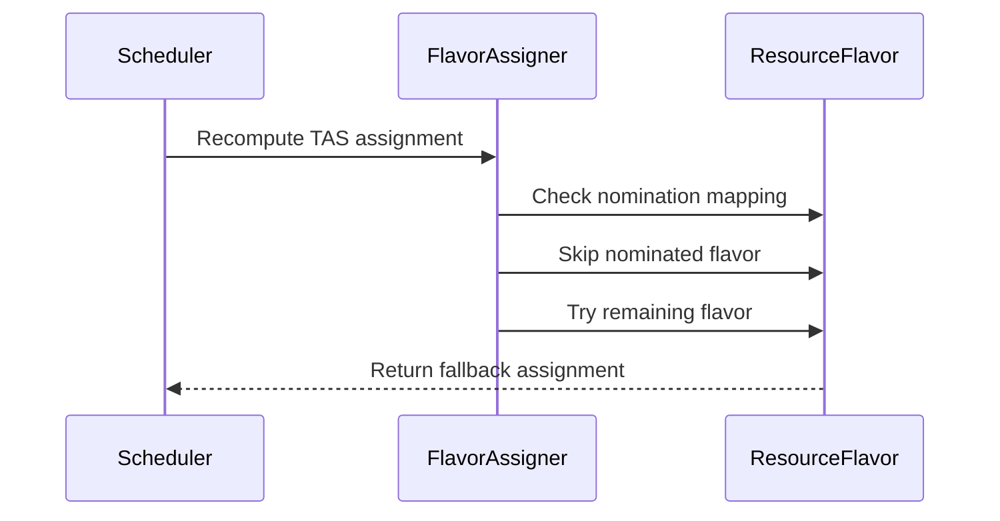

# PR #13691: TAS: add TASFlavorFallback gate to allow flavor fallback on TAS recompute

**Summary**: TAS: add TASFlavorFallback gate to allow flavor fallback on TAS recompute

**Sources**: https://github.com/kubernetes-sigs/kueue/pull/13691

**Last updated**: 2026-10-09T14:05:30Z

---

## Metadata

- **State**: closed
- **Author**: [@varunsyal](https://github.com/varunsyal)
- **Branch**: `tas-flavor-fallback` → `main`
- **Created**: 2026-07-31T02:54:52Z
- **Updated**: 2026-10-09T14:05:30Z
- **Merged**: —
- **Closed**: 2026-10-09T14:05:30Z
- **Labels**: `kind/feature`, `release-note`, `size/L`, `needs-rebase`, `do-not-merge/hold`, `ok-to-test`, `do-not-merge/work-in-progress`, `cncf-cla: yes`, `area/tas`
- **Assignees**: [@amy](https://github.com/amy), [@mimowo](https://github.com/mimowo)
- **Requested reviewers**: [@kannon92](https://github.com/kannon92), [@mimowo](https://github.com/mimowo), [@sohankunkerkar](https://github.com/sohankunkerkar), [@kshalot](https://github.com/kshalot)
- **Changed files**: 7   **+260 / -2**

## Description

#### What type of PR is this?

/kind feature
/area tas

#### What this PR does / why we need it:

Adds an alpha feature gate `TASFlavorFallback` (off by default) that opts a cluster into a modified same-cycle TAS recomputation. When enabled, the recompute inverts the `NominationMapping` semantics so the flavor(s) tried in the initial nomination are **excluded** instead of pinned, letting the flavor iterator fall back to another flavor in the ClusterQueue's resource group when the initial one's topology cannot fit the Workload.

Without this gate, once a Workload is nominated to a flavor whose topology cannot host its pods, the same-cycle recompute pins to that same flavor via `NominationMapping` and the Workload cannot advance to another flavor in the resource group even when the alternate has ample topological capacity. Under sustained load with `TryNextFlavor` fungibility and cross-flavor cohort borrowing, this can leave Workloads stuck for their lifetime.

The gate is scoped to the same-cycle recompute triggered by `TASRecomputeAssignmentWithinSchedulingCycle`. Cross-cycle `LastAssignment` invalidation caused by `AllocatableResourceGeneration` churn is not addressed here and remains as follow-up.

#### Which issue(s) this PR fixes:

Fixes [kubernetes-sigs/kueue#13658](https://github.com/kubernetes-sigs/kueue/issues/13658)

#### Special notes for your reviewer:

AI assistance was used to draft parts of this change and this PR description (per the Kubernetes AI Tool Usage Policy). All logic, tests, and KEP updates were reviewed by a human before submission.

- KEP-2724 is updated with a subsection describing the gate, its scope, and the fairness tradeoff (`LastState` staleness in the entry ordering / DRS tournament, which self-corrects on the next pop).
- Versioned feature-list manifests are updated (`site/data/featuregates/versioned_feature_list.yaml` and `test/compatibility_lifecycle/reference/versioned_feature_list.yaml`).
- New scheduler_tas_test case exercises the harder scenario where both flavors are borrow candidates and the iterator records `TriedFlavorIdx=-1` (last-flavor wraparound); this covers both the equal-preference-borrow and the Fit-optimal cases.
- Two known limits that could be follow-ups: (a) cross-cycle `LastAssignment` invalidation; (b) only one recompute per `processEntry`, so ClusterQueues with 3+ flavors still need additional cycles to iterate past the second.

#### Does this PR introduce a user-facing change?

```release-note
TAS: Added an alpha `TASFlavorFallback` feature gate (off by default) that, when combined with `TASRecomputeAssignmentWithinSchedulingCycle`, allows an in-cycle TAS recomputation to fall back to another ResourceFlavor in the ClusterQueue's resource group if the initially nominated flavor's topology cannot fit the Workload.
```


<!-- This is an auto-generated comment: release notes by coderabbit.ai -->

## Summary by CodeRabbit

* **New Features**
  * Added the alpha `TASFlavorFallback` feature gate, disabled by default.
  * When enabled, topology-aware scheduling can retry with alternative resource flavors during same-cycle recomputation.
  * Previously selected flavors are released and excluded from fallback attempts, improving workload placement across available flavors.

* **Documentation**
  * Documented configuration, behavior, fairness, and correctness considerations for flavor fallback.

<!-- end of auto-generated comment: release notes by coderabbit.ai -->

## Discussion

### Comment by [@netlify[bot]](https://github.com/apps/netlify) — 2026-07-31T02:54:56Z

### <span aria-hidden="true">✅</span> Deploy Preview for *kubernetes-sigs-kueue* ready!


|  Name | Link |
|:-:|------------------------|
|<span aria-hidden="true">🔨</span> Latest commit | 28a3b77fbdf856d6770fa8326fb983f8dd81a75d |
|<span aria-hidden="true">🔍</span> Latest deploy log | https://app.netlify.com/projects/kubernetes-sigs-kueue/deploys/6a6c0e7e4beffa00086406e7 |
|<span aria-hidden="true">😎</span> Deploy Preview | [https://deploy-preview-13691--kubernetes-sigs-kueue.netlify.app](https://deploy-preview-13691--kubernetes-sigs-kueue.netlify.app) |
|<span aria-hidden="true">📱</span> Preview on mobile | <details><summary> Toggle QR Code... </summary><br /><br /><br /><br />_Use your smartphone camera to open QR code link._</details> |
---
<!-- [kubernetes-sigs-kueue Preview](https://deploy-preview-13691--kubernetes-sigs-kueue.netlify.app) -->
_To edit notification comments on pull requests, go to your [Netlify project configuration](https://app.netlify.com/projects/kubernetes-sigs-kueue/configuration/notifications#deploy-notifications)._

### Comment by [@kubernetes-prow[bot]](https://github.com/apps/kubernetes-prow) — 2026-07-31T02:55:00Z

Welcome @varunsyal! <br><br>It looks like this is your first PR to <a href='https://github.com/kubernetes-sigs/kueue'>kubernetes-sigs/kueue</a> 🎉. Please refer to our [pull request process documentation](https://www.kubernetes.dev/docs/guide/pull-requests/) to help your PR have a smooth ride to approval. <br><br>You will be prompted by a bot to use commands during the review process. Do not be afraid to follow the prompts! It is okay to experiment. [Here is the bot commands documentation](https://go.k8s.io/bot-commands). <br><br>You can also check if kubernetes-sigs/kueue has [its own contribution guidelines](https://github.com/kubernetes-sigs/kueue/tree/master/CONTRIBUTING.md). <br><br>You may want to refer to our [testing guide](https://git.k8s.io/community/contributors/devel/sig-testing/testing.md) if you run into trouble with your tests not passing. <br><br>If you are having difficulty getting your pull request seen, please follow the [recommended escalation practices](https://www.kubernetes.dev/docs/guide/pull-requests/#why-is-my-pull-request-not-getting-reviewed). Also, for tips and tricks in the contribution process you may want to read the [Kubernetes contributor cheat sheet](https://www.kubernetes.dev/docs/contributor-cheatsheet/). We want to make sure your contribution gets all the attention it needs! <br><br>Thank you, and welcome to Kubernetes. :smiley:

### Comment by [@kubernetes-prow[bot]](https://github.com/apps/kubernetes-prow) — 2026-07-31T02:55:01Z

[APPROVALNOTIFIER] This PR is **NOT APPROVED**

This pull-request has been approved by: *<a href="https://github.com/kubernetes-sigs/kueue/pull/13691#" title="Author self-approved">varunsyal</a>*
**Once this PR has been reviewed and has the lgtm label**, please assign [mbobrovskyi](https://github.com/mbobrovskyi), [tenzen-y](https://github.com/tenzen-y) for approval. For more information see [the Code Review Process](https://git.k8s.io/community/contributors/guide/owners.md#the-code-review-process).

The full list of commands accepted by this bot can be found [here](https://go.k8s.io/bot-commands?repo=kubernetes-sigs%2Fkueue).

<details open>
Needs approval from an approver in each of these files:

- **[OWNERS](https://github.com/kubernetes-sigs/kueue/blob/main/OWNERS)**

Approvers can indicate their approval by writing `/approve` in a comment
Approvers can cancel approval by writing `/approve cancel` in a comment
</details>
<!-- META={"approvers":["mbobrovskyi","tenzen-y"]} -->

### Comment by [@kubernetes-prow[bot]](https://github.com/apps/kubernetes-prow) — 2026-07-31T02:55:01Z

Hi @varunsyal. Thanks for your PR.

I'm waiting for a [kubernetes-sigs](https://github.com/orgs/kubernetes-sigs/people) member to verify that this patch is reasonable to test. If it is, they should reply with `/ok-to-test` on its own line. Until that is done, I will not automatically test new commits in this PR, but the usual testing commands by org members will still work.

Regular contributors should [join the org](https://git.k8s.io/community/community-membership.md#member) to skip this step.

Once the patch is verified, the new status will be reflected by the `ok-to-test` label.

I understand the commands that are listed [here](https://go.k8s.io/bot-commands?repo=kubernetes-sigs%2Fkueue).

<details>

Instructions for interacting with me using PR comments are available [here](https://git.k8s.io/community/contributors/guide/pull-requests.md).  If you have questions or suggestions related to my behavior, please file an issue against the [kubernetes-sigs/prow](https://github.com/kubernetes-sigs/prow/issues/new?title=Prow%20issue:) repository.
</details>

### Comment by [@coderabbitai[bot]](https://github.com/apps/coderabbitai) — 2026-07-31T02:55:13Z

<!-- This is an auto-generated comment: summarize by coderabbit.ai -->
<!-- review_stack_entry_start -->

[](https://app.coderabbit.ai/change-stack/kubernetes-sigs/kueue/pull/13691?utm_source=github_walkthrough&utm_medium=github&utm_campaign=change_stack)

<!-- review_stack_entry_end -->
<!-- walkthrough_start -->

<details>
<summary>📝 Walkthrough</summary>

## Walkthrough

The change adds the alpha `TASFlavorFallback` feature gate, updates TAS flavor nomination filtering during same-cycle recomputation, documents its behavior, registers its lifecycle, and adds a cohort scheduling test for fallback admission.

### Changes

**TAS flavor fallback**

|Layer / File(s)|Summary|
|---|---|
|**Feature gate and documentation** <br> `keps/2724-topology-aware-scheduling/README.md`, `keps/2724-topology-aware-scheduling/kep.yaml`, `pkg/features/kube_features.go`, `site/data/featuregates/versioned_feature_list.yaml`, `test/compatibility_lifecycle/reference/versioned_feature_list.yaml`|Adds `TASFlavorFallback` as an alpha, disabled-by-default feature in version 0.20. Documents same-cycle fallback behavior and its limitations.|
|**Nomination-based flavor filtering** <br> `pkg/scheduler/flavorassigner/flavorassigner.go`|Skips previously nominated flavors when `TASFlavorFallback` is enabled and preserves existing flavor stickiness when it is disabled.|
|**Cohort scheduling validation** <br> `pkg/scheduler/scheduler_tas_test.go`|Verifies that two workloads are admitted on separate topology-specific flavors and nodes during TAS recomputation.|

**Estimated code review effort:** 3 (Moderate) | ~20 minutes

### Sequence Diagram(s)



**Possibly related PRs**

- [kubernetes-sigs/kueue#12419](https://github.com/kubernetes-sigs/kueue/pull/12419): Extends TAS nomination-mapping stickiness in the same flavor assignment code.
- [kubernetes-sigs/kueue#12055](https://github.com/kubernetes-sigs/kueue/pull/12055): Modifies TAS flavor assignment and failed multi-flavor handling.
- [kubernetes-sigs/kueue#12378](https://github.com/kubernetes-sigs/kueue/pull/12378): Modifies flavor assignment behavior and diagnostics.

**Suggested labels:** `kind/kep`

**Suggested reviewers:** `mbobrovskyi`, `sohankunkerkar`, `j-skiba`

</details>

<!-- walkthrough_end -->
<!-- pre_merge_checks_walkthrough_start -->

<details>
<summary>🚥 Pre-merge checks | ✅ 4 | ❌ 1</summary>

### ❌ Failed checks (1 warning)

|      Check name     | Status     | Explanation                                                                                                                                   | Resolution                                                                                                                                                           |
| :-----------------: | :--------- | :-------------------------------------------------------------------------------------------------------------------------------------------- | :------------------------------------------------------------------------------------------------------------------------------------------------------------------- |
| Linked Issues check | ⚠️ Warning | The change enables same-cycle flavor fallback, but it does not resolve the linked issue's cross-cycle LastAssignment invalidation under load. | Also preserve or selectively reset LastAssignment flavor progress across ClusterQueue generation changes so alternate flavors can be tried across scheduling cycles. |

<details>
<summary>✅ Passed checks (4 passed)</summary>

|         Check name         | Status   | Explanation                                                                                                                               |
| :------------------------: | :------- | :---------------------------------------------------------------------------------------------------------------------------------------- |
| Out of Scope Changes check | ✅ Passed | The feature gate, documentation, manifests, implementation, and scheduler test directly support the linked TAS flavor fallback objective. |
|     Docstring Coverage     | ✅ Passed | No functions found in the changed files to evaluate docstring coverage. Skipping docstring coverage check.                                |
|      Description Check     | ✅ Passed | Check skipped - CodeRabbit’s high-level summary is enabled.                                                                               |
|         Title check        | ✅ Passed | The title clearly identifies the TASFlavorFallback gate and its purpose: enabling flavor fallback during TAS recomputation.               |

</details>

</details>

<!-- pre_merge_checks_walkthrough_end -->

- [ ] <!-- {"checkboxId":"585bb3f6-faf5-4dbf-96d2-74e382adf19a"} --> Fix all pre-merge checks with AI
<!-- finishing_touch_checkbox_start -->

<details>
<summary>✨ Finishing Touches</summary>

<details>
<summary>🧪 Generate unit tests (beta)</summary>

- [ ] <!-- {"checkboxId": "f47ac10b-58cc-4372-a567-0e02b2c3d479", "radioGroupId": "utg-output-choice-group-unknown_comment_id"} -->   Create PR with unit tests

</details>

</details>

<!-- finishing_touch_checkbox_end -->
<!-- tips_start -->

---


<sub>Comment `@coderabbitai help` to get the list of available commands.</sub>

<!-- tips_end -->

### Comment by [@mimowo](https://github.com/mimowo) — 2026-07-31T03:56:50Z

/hold
For now to make sure the FG can be graduated in the future and to align on the approach

### Comment by [@mimowo](https://github.com/mimowo) — 2026-07-31T03:57:26Z

Cc @amy who may have some insights here too

### Comment by [@mimowo](https://github.com/mimowo) — 2026-07-31T04:04:45Z

/ok-to-test

### Comment by [@amy](https://github.com/amy) — 2026-07-31T04:06:03Z

/assign

### Comment by [@mimowo](https://github.com/mimowo) — 2026-07-31T04:08:19Z

Maybe one idea to mitigate my concern is to re-compute the DRS and pre-order the workloads. This is what we are currently brainstorming with @amy and @apullo777 on another issue

And if we go this path it may be a nice natural progression for the code:
1. Re-compute DRS and re order on TAS re-evaluation (this PR)
2. Refill idea reusing the mechanism of updating DRS

(Brainstorming for now)

### Comment by [@kubernetes-prow[bot]](https://github.com/apps/kubernetes-prow) — 2026-07-31T04:15:33Z

@varunsyal: The following test **failed**, say `/retest` to rerun all failed tests or `/retest-required` to rerun all mandatory failed tests:

Test name | Commit | Details | Required | Rerun command
--- | --- | --- | --- | ---
pull-kueue-verify-main | 28a3b77fbdf856d6770fa8326fb983f8dd81a75d | [link](https://prow.k8s.io/view/gs/kubernetes-ci-logs/pr-logs/pull/kubernetes-sigs_kueue/13691/pull-kueue-verify-main/2083041343633887232) | true | `/test pull-kueue-verify-main`

[Full PR test history](https://prow.k8s.io/pr-history?org=kubernetes-sigs&repo=kueue&pr=13691). [Your PR dashboard](https://prow.k8s.io/pr?query=is%3Apr%20state%3Aopen%20author%3Avarunsyal). Please help us cut down on flakes by [linking to](https://git.k8s.io/community/contributors/devel/sig-testing/flaky-tests.md#filing-issues-for-flaky-tests) an [open issue](https://github.com/kubernetes-sigs/kueue/issues?q=is:issue+is:open) when you hit one in your PR.

<details>

Instructions for interacting with me using PR comments are available [here](https://git.k8s.io/community/contributors/guide/pull-requests.md).  If you have questions or suggestions related to my behavior, please file an issue against the [kubernetes-sigs/prow](https://github.com/kubernetes-sigs/prow/issues/new?title=Prow%20issue:) repository. I understand the commands that are listed [here](https://go.k8s.io/bot-commands).
</details>
<!-- test report -->

### Comment by [@amy](https://github.com/amy) — 2026-07-31T05:58:43Z

Zooming out: this PR, #10824, and the #13496 discussion all point at the same underlying problems. There are three gaps, and naming them suggests a cleaner path than a one-off gate.

**The problem with this PR as written**

The stickiness this PR inverts exists for a reason. A workload's place in the scheduling order is decided using the DRS cost of its nominated flavor. If the workload then switches to a different flavor without redoing that ordering, it can jump the line: it won its turn looking cheap on flavor-a (fits in nominal quota), but actually admits expensive on flavor-b (all borrowed). Another workload may have deserved that turn.

Two more issues:

- **Lost preemption path:** with the gate on, the recompute can never go back and preempt on the nominated flavor. Right call when the fallback flavor has room (admit there, disturb nobody), but a regression when the fallback is also full: today's recompute could still admit by preempting on the nominated flavor, while with `TASFlavorFallback` enabled the workload just waits. 
- **Same-cycle only:** this fixes half of #13658. A workload that doesn't admit during the recompute loses its flavor-iteration progress and starts over at the first flavor next cycle (gap 3 below).

So as written, the gate is a workaround with a fairness leak. Paired with the DRS-reorder idea, it becomes mergeable, and it changes the outcome for the reported case directly: a workload that fails topology on flavor-a falls back to flavor-b within the same cycle, admits there at a fairly recomputed price, and leaves the queue instead of pinning. Framing the bigger picture:

**Gap 1: flavor selection doesn't know about topology.**

*Today:* flavors are picked on quota alone. Whether nodes can actually host the pods (the TAS check) is discovered only after the flavor is locked in, with no way to tell the picker "try the next one." That's the root of both open bugs: #13658 is stuck on a flavor whose nodes can't fit it, #10824 is stuck on a second flavor when it should have preempted on the first. The #12419 stickiness and this PR's gate are both patches around this gap.

*Proposal:* make the TAS result part of the per-flavor fit decision (as sketched in #10824), so an unfittable flavor counts as "doesn't fit" and the picker moves on. Hard part is performance, since TAS is too expensive to run per-resource inside `findFlavorForPodSets`. Closing this gap fixes the reported case at the source: flavor-a is marked "doesn't fit" during selection itself, so the workload lands on flavor-b in the first pass of the first cycle, with no recompute or fallback machinery involved.

**Gap 2: a turn already won can't be repriced.**

*Today:* with fair sharing, each tournament pop recomputes DRS against the live snapshot, so admissions self-correct on the next pop. But a decision already made doesn't self-correct: a workload that switches flavors mid-turn keeps the turn it won at the old price, and classical mode sorts the entries once up front. There's no "the price changed, redo the ordering from here" mechanism.

*Proposal:* build that mechanism, recompute DRS and re-order mid-cycle. It's also what refill also needs (https://github.com/kubernetes-sigs/kueue/pull/13496#issuecomment-5126216451): after each admission, let the next candidate join and compete at fresh prices. Build it once, use it for both. For the reported case, this is the piece that makes the fix shippable: the fallback to flavor-b is what admits the workload, and the repricing is what makes that fallback fair to every other workload in the cycle.

**Gap 3 (minor): cross-cycle flavor progress is erased too eagerly.**
*Only relevant for non-tas so eh... less important*

*Today:* the "which flavor to try next" memory (`LastTriedFlavorIdx`) is erased on any cohort change, which on a busy cluster is every cycle. So `TryNextFlavor` never advances under load, the other half of #13658.

*Proposal:* erase only when the change could make an already-tried flavor fit. For the reported case this is a backstop: if flavor-b happens to be full during the recompute, the workload resumes at flavor-b next cycle instead of restarting at flavor-a forever. It matters mainly for non-TAS fungibility; once gap 1 lands, TAS workloads reach the fallback flavor in the first cycle anyway. Deserves its own small issue (with care not to revert #2984).

**Suggested next steps:**

1. **DRS refresh + reorder**, with this PR as one of its users. (what @mimowo said, @apullo777 is working on this) Closes the fairness leak, gives the gate a path, refill reuses it. This combination roughly resolves the reported case on its own.
2. **TAS-aware flavor selection** (#10824 direction) as the structural fix. Once landed, the nomination-mapping special cases, including this gate, can go away, and gap 3 stops mattering for TAS.
3. **Separate issue for gap 3**, scoped to non-TAS flavor fungibility. (not that important)

> written with ai-assistance and lots of editing from human 😂 Kept it longer because I do think all the explanations framing the problems are useful context.

### Comment by [@varunsyal](https://github.com/varunsyal) — 2026-07-31T09:15:20Z

> the gate is a workaround with a fairness leak.

I agree. This PR was intended only as a workaround and does mention the tradeoff which is a fairness leak, which is why I thought it could be behind a feature gate disabled default. But as @mimowo mentioned, yes, this could be hard to graduate.

> make the TAS result part of the per-flavor fit decision

I do agree with this as well, as also suggested in #10824, but I'm not sure how big/disruptive that change would be. But this should be the best long term solution if feasible.

This PR is more of a stop-gap but even for the described case, it won't help when there are more than 2 flavors - (high churn cohort, flavor-1 and flavor-2 both fail TAS, next cycle starts from flavor-1, starves flavor-3) , as we only do a TAS re-compute at most once in the cycle.

With the suggested next step 1 - this PR + DRS Refresh + Reorder, we fix the fairness leak, but the 2 concerns including when more than 2 flavors are involved, still remains. 

@mimowo /@amy What's your suggestion:
1. Should I go ahead with this PR and wait for the DRS Refresh + Reorder mechanism if it is being worked on. Else, I can try to add it here too behind the same gate.
2. We could prioritize TAS-aware flavor selection instead. You may have a better idea how feasible it is and whether it would have an overall performance hit.
3. Or we solve the Gap 3 which is one main reason for the reported case i.e. there is mechanism to preserve LastTriedFlavorIdx across cycles but it just gets reset too aggressively - also proposed as a fix idea 2 in the same issue (https://github.com/kubernetes-sigs/kueue/issues/13658) This approach does add 1+ cycle latency for this issue among other limitations.

### Comment by [@mimowo](https://github.com/mimowo) — 2026-07-31T12:56:32Z

thank you Varun with the summary. Before we decide lets align on the understanding, this is what Im thinking about the paths currently:

1. I would like to have at least some attempt to estimate the effort and feasibility of the very vague 'refresh DRSes' idea, so that we dont end up with mess.

2. I thought we already do this at lwast to some extent, because we already execute TAS as part of the flavor selection is our flavorassigner. Do you have somw idea what might be missing here?

3. this sounds like possibly the most surgical fix indeed. The flavor checkpointing and resetting is a neglected area in kueue and I suspect somw bugs might be lusking here. It is neglected because the bugs mostly surface on large scale only and are subtle - because nwxt scheduling cycle fixes the problen. I think I would likw to explore this path more certainly with the team.

So tbh I can see all paths still alive for the solution search. My intuition tells me 3 might be the cheapest actually.

### Comment by [@amy](https://github.com/amy) — 2026-07-31T19:24:03Z

@mimowo @varunsyal y'all know I love a good diagram 😂 

**1. Effort of "refresh DRSes":** @/apullo777 is working on it. So we can just make sure the implementation for refill is reusable for the recompute part of the plumbing.

**2. TAS-aware flavor selection, What's missing:** the placement check exists, but it runs after the flavor is already picked, so its verdict can't change the pick:

```
TODAY                                 TAS-AWARE ITERATION
─────────────────────────────         ─────────────────────────────
flavor-a: quota fits? yes             flavor-a: quota fits?    yes
          -> PICK IT                            topology fits? NO
                                                -> skip
(then, too late:)                     flavor-b: quota fits?    yes
topology fits? NO                               topology fits? yes
-> stuck: can only try                          -> PICK IT
   harder on flavor-a
   (preempt), never
   move to flavor-b
```

The left column is #13658: flavor-a always looks Fit to the picker, so flavor-b never gets a placement attempt. #10824 is the same wiring from the other side. (References: in-loop static check `tas_flavorassigner.go:164`, post-pick placement check `flavorassigner.go:818`.)

Relatedly, the PR gate only fires when nomination TAS succeeded and the placement broke mid-cycle (`FitsCheckNoTAS` in `processEntry`). Nomination-time failures (the fragmentation case in #13658's reproducer) never reach it:

```
#13658 (nomination fails)              THIS PR'S GATE (#12419 case)
──────────────────────────────────    ──────────────────────────────────
nomination:                            nomination:
  quota?    yes                          quota?    yes
  topology? NO                           topology? yes
  label: PREEMPT, plan: NONE             label: FIT, plan: node-1
       │                                      │
       ▼                                      ▼
admission turn (processEntry):         admission turn (processEntry):
  recompute trigger asks:                recompute trigger asks:
  "does the plan still fit?"             "does the plan still fit?"
  NO PLAN -> can't trigger               plan broken (node-1 taken)
       │                                 -> TRIGGERS
       ▼                                      │
  preemption branch on flavor-a               ▼
  no victims -> requeue                  recompute + gate
                                         -> fall back to flavor-b
```

@varunsyal worth checking your logs which case dominates; the gate only helps the right column.

**3. cross-cycle flavor progress: two bugs, not one.** The bookmark (`LastTriedFlavorIdx`) is wiped on any cohort change. But keeping it wouldn't help here: the bookmark only says where the next quota scan *starts*. With `whenCanBorrow: TryNextFlavor` the scan covers every flavor, so the bookmark records "start over" (`TriedFlavorIdx=-1`, `flavorassigner.go:1104`) rather than "tried a, start at b". Starting over means flavor-a is back on the ballot, looks quota-Fit again, wins preference again. Its flaw (placement) is only discovered after the pick, and is never written down anywhere:

```
TODAY                                  STOPGAP
─────────────────────────────         ─────────────────────────────
cycle 1:                               cycle 1:
  quota scan covers a and b              quota scan covers a and b
  flavor-a wins the pick                 flavor-a wins the pick
  placement fails on a                   placement fails on a
  bookmark: -1 ("start over")            bookmark: -1 (unchanged)
  placement failure: not recorded        NEW record: "flavor-a placement-failed"
                                         (kept across cohort churn)
       │                                      │
       ▼                                      ▼
cycle 2:                               cycle 2:
  full ballot again                      new record takes a off the ballot
  flavor-a wins again                    flavor-b wins by default
  placement fails again                  placement fits -> ADMIT
  ... forever
```

The stopgap is a variant of #13658's fix idea 3, but triggered at nomination since the recompute never fires for these failures. Small, no DRS questions, one cycle per flavor hop, works for 3+ flavors.

So... yeah:
1. path 3 as the near-term fix
2. TAS-aware iteration (#10824) as the structural follow-up -> this... will for sure need a kep and seems kind of involved on the scheduling efficiency side of this work. So worth it to take some time on it.
3. DRS refresh matures in the refill work

> ai-assistance used, human definitely deeply verified and bullied the llm into something human parsable 🤖

### Comment by [@apullo777](https://github.com/apullo777) — 2026-08-01T00:08:00Z

@amy Thanks, this split is really helpful, especially the distinction between nomination time and mid cycle behavior. I’ll carry it into the design doc.

I’ll keep mid cycle insertion and reranking separate from the refill specific “pop next + budget” logic, so the repricing path can reuse that layer.

@mimowo On sizing, fair sharing already ranks the remaining entries using fresh DRS on every pop. The main new shared piece is therefore mid cycle insertion. The recompute hook also runs before usage or preemption state is committed, so the repricing path should stay fairly contained.

Classical mode ordering and reentry rules, including how to bound repricing loops, can remain design questions without blocking refill from going first.

@varunsyal From my side, I don’t think this PR needs to wait for or implement that plumbing. It will likely mature with the refill prototype.

### Comment by [@varunsyal](https://github.com/varunsyal) — 2026-08-01T09:45:53Z

> @varunsyal worth checking your logs which case dominates; the gate only helps the right column.

@Amy thanks for mentioning the 2 different cases here. I checked the logs and for more than 90% of the cases, I believe the case mentioned in the right column is being invoked where TAS assignment fails after the nomination phase. I could see the Log line: `Re-computing the assignment as it doesn't fit for TAS` from [scheduler/scheduler.go#L682](https://github.com/kubernetes-sigs/kueue/blob/29049f9356cb5b7a17e89461008971977c0a5e29/pkg/scheduler/scheduler.go#L682) where the PR and the gate should help. Since I was unaware of how the 2 cases were different, the #13658 description is not very clear on whether it is reported for the TAS failure in nomination phase or processing phase (mid-cycle)

However, we should definitely prefer solving for both the cases. Let me try to think more on the path 3 (cross-cycle flavor progress).

### Comment by [@varunsyal](https://github.com/varunsyal) — 2026-08-01T23:34:24Z

If we go with the cross-cycle flavor progress based on a bookmark that records the placement-failed flavor(s) in the previous cycles, I want to sanity-check this direction against a high-churn scenario before we commit to it, because the naive implementation could degrade back to today's behavior.

Scenario: a large TAS flavor with continuous churn — steady admissions and evictions every scheduling cycle, sustained.

If the "placement-failed" record is cleared on any per-flavor generational signal, the record won't survive across cycles here — the flavor's state changes many times per cycle. The workload gets stuck the same way as today, just with more machinery in between:

```
  cycle N:     nominate flavor-a → placement fail → record set
  between N and N+1: any admission or eviction on flavor-a bumps generation
  cycle N+1:   record cleared → nominate flavor-a → placement fail → record set
```

So the precision of the invalidation signal is really important here:

There are a few possible refinements, bigger than a simple LastAssignment extension:

1. Coarse "usage-decreased" signal — clear the record only when the flavor's assigned usage drops. Cheap, but still saturates in high-churn scenarios where any eviction on the flavor clears the record regardless of whether the freed capacity was relevant to the stuck workload.

2. TTL-based invalidation (TTL may be in terms of scheduling cycles), no cluster-state signal: Instead of trying to infer "flavor F changed in a way that could help this workload," decouple from cluster state entirely. For high-churn scenarios this is much more robust: cluster activity between cycles doesn't affect our decision to retry a flavor. For the "flavor genuinely became feasible during the TTL window" case we accept up-to-TTL latency. If we are too concerned about latency, we could also treat the exhaustion of flavors to try as another invalidation signal.
  

Two questions I'd like input on:
-  Is TTL-based invalidation a direction worth pursuing, or if there's a reason state-based invalidation is preferable that I'm missing.
- What granularity of invalidation signal do you have in mind? Something coarser than usage, but stronger than any generation change?

Would appreciate the team's read on the direction before I invest deeper — mainly want to make sure we don't ship a stopgap we already know can break under sustained churn.

### Comment by [@mimowo](https://github.com/mimowo) — 2026-08-03T17:39:00Z

Hi @varunsyal 👍 

> Is TTL-based invalidation a direction worth pursuing, or if there's a reason state-based invalidation is preferable that I'm missing.
> What granularity of invalidation signal do you have in mind? Something coarser than usage, but stronger than any generation change?

I would go with TTL approach. State-based invalidation might be really hard for detecting if we need to re-do flavors, as changes to any previously considered flavors could impact that. That would require a lot of complex testing to do right, but we have issues even spotting the previous errors.  If we go with TTL, it seems just surviving to the next cycle should be enough, wdyt?

I also have another small issue (can be independent) with the definition of lastFlavorIdx, that is: multi-podset workloads. While this is pretty well defined for single-podset workload, I think we may need to change the definition to deal with multi-podset workloads, because we may be at dfferent levels of Flavor advancement per podset. This can be a follow up issue as we strengthen the mechanism.

### Comment by [@varunsyal](https://github.com/varunsyal) — 2026-08-04T10:03:34Z

 #13800 takes the cross-cycle approach discussed above (path/gap 3) and is the near-term cover for #13658, since the recompute this PR modifies is not reachable for nomination-time placement failures. Please let me know If I should close this PR or keep it for future fallback?

### Comment by [@amy](https://github.com/amy) — 2026-08-05T01:47:21Z

@mimowo @varunsyal bummer yeah there's issues with multipodset placement. Will add comments on Varun's new PR after I digest them. 

> This can be a follow up issue as we strengthen the mechanism.

Do we want to strengthen this mechanism? As in, if varun is just using single podset... can it just be a stopgap featuregate until the 2 other proposals are done? (refresh DRS + tas aware flavor selection). The fixes for multipodset is about the fitness of that vector (podsets x flavors) which is messier and just feel more adhoc than the other suggested fixes.

### Comment by [@mimowo](https://github.com/mimowo) — 2026-08-05T07:45:11Z

Thank you @amy for pointing this out.. The related concern: how much we want to invest into mainintaining of this tricky mechanism as we know: (a) it is illdefined for multi-podset jobs, (b) it creates races where a better flavor is available, but we choose the worse flavor.

So,despite I suggested (3.) from https://github.com/kubernetes-sigs/kueue/pull/13691#issuecomment-5146663958 I need more cycles to think about (2.) as the better path. It seems also be a bug which would help here, and I'm not sure how difficult this is yet. 

@amy @varunsyal would you like to brainstorm the idea (2.) before we decide, seems like explored the least so far?

### Comment by [@varunsyal](https://github.com/varunsyal) — 2026-08-05T09:18:51Z

Thanks @mimowo, and thanks @amy for catching the multi-podset case. Also appreciate the descriptive example in https://github.com/kubernetes-sigs/kueue/pull/13800#issuecomment-5187106419 

One thing I wanted to raise gently: the per-PodSet attribution isn't new - the existing flavor bookmark has the same granularity, so as in the example, the `worker` already advances past a flavor without the `leader→f2 + worker→f1` combination being tested. The difference is that today this only applies when the bookmark survives into the next cycle, which is precisely what this PR makes reliable. So I don't think the record introduces the flaw, but it could widen the window in which it applies - though please do correct me if I've misread it.

One idea is that I can restrict this gate to only single-PodSet Workloads by skipping the recording for multi-PodSet ones. That should avoid making this any worse for multi-podset workloads. My sense is that multi-PodSet isn't in great shape without the gate either, so this hopefully wouldn't be a regression - but I may be missing context, happy to follow your lead.
  
Also, I completely agree that TAS-aware flavor selection is the north star if we can get it efficient, and that it should retire this feature gate. I'd be happy to explore idea (2) further. Would it make sense in the meantime for this to serve as a stopgap for single-PodSet Workloads, until that lands?

### Comment by [@amy](https://github.com/amy) — 2026-08-05T17:42:04Z

+1 to stopgap. We can just make sure it never graduates from alpha featuregate. 

(Overall... my feeling is positive around stopgaps because we can't leave end-users hanging waiting for better solutions. Also gives us more time to really think through the better solutions anyways. The reality is that Kueue's user needs are growing really quickly, so its a good way to self solve them without sacrificing the longer term quality.)

### Comment by [@mimowo](https://github.com/mimowo) — 2026-08-05T18:03:47Z

> We can just make sure it never graduates from alpha featuregate.

I would prefer to have a clear path for each FG we add - either be graduable or short lifetime to mitigate issues before a proper solution. We have too many FGs which serve as ConfigAPI knobs. 

So I want to avoid the issue as with PrioritySortingWithinCohort. Ptal: https://github.com/kubernetes/community/blob/main/contributors/devel/sig-architecture/feature-gates.md

---

This last point bears repeating. all software has bugs, and new software tends to have more (and worse) bugs than 
mature software. A feature gate is intended to be a fast way to neutralize a new feature and mitigate damage caused 
by bugs. Feature authors and reviewers should invest time into thinking about whether their gates meet this goal.

**Feature gates are not intended to be long-term APIs.** Individual gates are expected to be [deprecated](https://kubernetes.io/docs/reference/using-api/deprecation-policy) and removed after a feature becomes GA (or is 
dropped). Truly optional capabilities which are permanently intended to be enabled or disabled by users (even once 
the feature is GA) should include a mechanism for enabling or disabling the feature (like a command-line flag or config 
file option) in addition to the associated feature gate.

---

I had a lot going on this week so sorry for delays. I will try to check the PR, and see if I can recommend a path forward EOW.

### Comment by [@mimowo](https://github.com/mimowo) — 2026-08-07T08:02:30Z

@amy @varunsyal @apullo777 @tenzen-y I have synced yesterday with Varun on this issue, and  we iterated on both (2.) and (3.) from the [post](https://github.com/kubernetes-sigs/kueue/pull/13691#issuecomment-5146663958) for 2h+ 

First we explored (2.) trying to imagine moving [this code for running TAS](https://github.com/kubernetes-sigs/kueue/blob/main/pkg/scheduler/flavorassigner/flavorassigner.go#L823-L862) earlier before the flavor preference is checked inside [findFlavorForPodSets](https://github.com/kubernetes-sigs/kueue/blob/7e41dbe2f17f1d97900e67c72b7d25139e4260b5/pkg/scheduler/flavorassigner/flavorassigner.go#L784) , so somewhere around [here](https://github.com/kubernetes-sigs/kueue/blob/7e41dbe2f17f1d97900e67c72b7d25139e4260b5/pkg/scheduler/flavorassigner/flavorassigner.go#L1116), so just after quota-based simulation and flavor preference check.

However,  we also imagined complications:
1, findFlavorForPodSets still operates on partially complete “assignment”, while the TAS-block of code operates on assignment, so we would need to craft the assignment to make the TAS-block interface satisfied
2. findFlavorForPodSets is called per resource, [cpu, mem, gpu] etc, so we would need to cache the computations of running TAS per flavor.
3. Currently the TAS-block of code only discriminates: Fit, and Preempt (using SimulateEmpty true), but it does not tell Preempt, but “noPreemptionCandidates”. To get this information we would need to run it one more time with all candidate workloads removed from snapshot

All of this can be done, but it is very involving, and risky to CP.

---

Later we explored (3.) and this indeed seems much more promising as the limited bugfix. We reviewed the pending PR,  and I proposed to pivot, because:
1. the PR makes the solution TAS-specific while the stopgap mechanism is not TAS-specific
2. the PR introduces a separate structure to maintain the state while reusing what we have seems feasible, so we are building a hack workaround rather than a bugfix to the current mechanism, I challenge that to fix the mechanism we have and reuse the existing structures

In order to achieve that I proposed:
1. Exend the existing AssignmentClusterQueueState with SchedulingCycle, it:

```golang
type AssignmentClusterQueueState struct {
	LastTriedFlavorIdx []map[corev1.ResourceName]int
	ClusterQueueGeneration int64
	SchedulingCycle int64 // new field
}
```

2. `Fix AssignmentClusterQueueState.Clone()` to include the new field
3. Adjust `lastAssignmentOutdated` to make sure the stopgap survives at least one scheduling cycle:

```golang
func lastAssignmentOutdated(
	last *workload.AssignmentClusterQueueState,
	currentCQGeneration int64,
	currentSchedulingCycle int64,
) bool {
	if cycleAge := currentSchedulingCycle - last.SchedulingCycle; cycleAge <= 1 {
                // new check - if we are on the nex cycle, then it is not outdated yet
               return false
	}
        // old check
	return currentCQGeneration > last.ClusterQueueGeneration
}
```

4. Instead of clearing the `LastAssignment` in random places in code I propose scheduler should do it, probably like that

```golang
func (s *Scheduler) getAssignments(....) (... {
	cq := snap.ClusterQueue(wl.ClusterQueue)
	if wl.LastAssignment != nil &&
		lastAssignmentOutdated( …) {
		wl.LastAssignment = nil
	}
	assignment, targets := s.getInitialAssignments(ctx, wl, snap)
           ….
	return assignment, targets
}
```

5. We should also fix `AddOrUpdateWorkloadWithoutLock` to carry the LastAssignment between workload updates

---

I think this could be done behind a Beta FG, cherrypickable, because this will only make the stopgap survive one scheduling cycle, at the same time fixing the issues on busy clusters.

@varunsyal is currently working on the PR details. Hopefully we can include it in the next patch release.

Strategically, I want to rename `AssignmentClusterQueueState` -> `FlavorSearchState`, and later drop the generation look up completely, because it is not a reliable signal on a busy cluster.

So I consider the pending work a bugfix to the existing mechanism which so far hasn't been challanged on large busy clusters as currently it is.

### Comment by [@anguszzzz](https://github.com/anguszzzz) — 2026-09-15T20:18:33Z

@mimowo want to follow up on this and this #13800 PR, I think we still see impacts for those two issues. @varunsyal mentioned there're some other options you're leaning to, so wondering whether we align on any directions to move forward for these two issues? Thanks

### Comment by [@mimowo](https://github.com/mimowo) — 2026-09-16T18:56:13Z

yeah, Im not sure, because we have identified some drawbacks with the approach

The fix to KeepFlavorScanProgress was supposed to fix known issue. 

 I would like to first understand deeply the root cause foe the problems and re-consider options. We have id

### Comment by [@mimowo](https://github.com/mimowo) — 2026-09-30T13:22:09Z

I think this issue (or very similar in nature) currently being invesitgated by @j-skiba . I would suggest wait a little bit for the results of Jakub's investigation (probably next week). Our initial thinking was to fix FlavorFungibilityPreserveScanProgress so that it skips on the next scheduling cycle loop the set of non-schedulable flavors. We would restart the scan (clear flavors) once the set exhausts.

### Comment by [@j-skiba](https://github.com/j-skiba) — 2026-10-06T06:58:32Z

So the issue I was investigating involved two flavors configured with `whenCanBorrow: TryNextFlavor`. Both flavors were borrowing candidates, but the current logic selects the first one at the same level while setting `LastTriedFlavorIdx/LastTriedFlavorIndices` (depending on the Kueue version) to -1. This effectively means starting from the beginning in the next cycle. That became an issue because the first flavor was later classified as needing preemption, yet no victims were found and in next scheduling cycle the loop began again.

While part of this is a bug in how `LastTriedFlavorIdx/LastTriedFlavorIndices` gets set, there is a deeper design issue. `LastTriedFlavorIdx/LastTriedFlavorIndices` is intended to track the last flavor tried, but the actual processing order is driven by quota fit. For instance, consider a case with three flavors: the first borrows, while the remaining two fit quota but fail TAS placement (as in the scenario above). Under the current design of `LastTriedFlavorIdx/LastTriedFlavorIndices`, we wouldn't fall back to the first flavor.

Because of this, replacing `LastTriedFlavorIdx/LastTriedFlavorIndices` with a set to track tried flavors per PodSet seems like a cleaner solution. That way, subsequent scheduling cycles know exactly which flavors can be skipped. The implementation appears fairly straightforward.

There is also a related issue in #10824, with preliminary code in #14008. That approach is somewhat similar to this PR, but avoids DRS fairness issues by running additional TAS placement checks during the initial assignment phase rather than falling back later. It also addresses the other TAS-related issues noted there. However, I’m not entirely sure it is safe or how it performs, and it would make `FlavorFungibilityPreserveScanProgress` obsolete, making it a potentially risky change.

The main drawback of the set-based approach is that it doesn’t resolve #10824 directly. However, we could address that by introducing an additional `map[Flavor]preemptionMode`.

On our side, we would prefer having a deliverable solution soon, which aligns with the set-based approach (even without the map[Flavor]preemptionMode initially, as that can be added later).

I think potentially the approach from #14008 could be even revisited later.

#13658, #13956, #10824

### Comment by [@kubernetes-prow[bot]](https://github.com/apps/kubernetes-prow) — 2026-10-06T06:58:43Z

PR needs rebase.

<details>

Instructions for interacting with me using PR comments are available [here](https://git.k8s.io/community/contributors/guide/pull-requests.md).  If you have questions or suggestions related to my behavior, please file an issue against the [kubernetes-sigs/prow](https://github.com/kubernetes-sigs/prow/issues/new?title=Prow%20issue:) repository.
</details>

### Comment by [@mimowo](https://github.com/mimowo) — 2026-10-08T19:48:34Z

@j-skiba thank you for the summary, are you sure the PR in the current form does not address https://github.com/kubernetes-sigs/kueue/issues/10824? Maybe it would be good to try doing an integration test to confirm that, maybe it already fixes some scenarios, wdyt?

### Comment by [@j-skiba](https://github.com/j-skiba) — 2026-10-09T09:34:58Z

@mimowo well, yes - technically it resolves this exact issue. The scenario I had in mind derives a little from #14008 implementation actually.

Consider a setup with two TAS flavors (`flavor-a`, `flavor-b`) and `whenCanPreempt: TryNextFlavor`:
- `flavor-a` has free quota, but its nodes are occupied/fragmented by a lower-priority workload (so it fits by quota, but requires preemption in TAS).
- `flavor-b` has both free quota and free nodes (fits in both quota and TAS without preemption).

With the current implementation, Kueue sees that `flavor-a` fits by quota and selects it without checking `flavor-b`. Then TAS evaluation switches the assignment on `flavor-a` to preemption, finds the lower-priority victim, and immediately preempts it in the same cycle. Ideally, since `whenCanPreempt: TryNextFlavor` is set, Kueue should try `flavor-b` instead and admit the workload there without preempting anything on `flavor-a`.

This is issue is present on both main and #16766.

> The main drawback of the set-based approach is that it doesn’t resolve https://github.com/kubernetes-sigs/kueue/issues/10824 directly. However, we could address that by introducing an additional map[Flavor]preemptionMode.

This is how I was thinking we could resolve that scenario as well.

### Comment by [@mimowo](https://github.com/mimowo) — 2026-10-09T14:04:49Z

Ok, in that case, since the reported "ghost" quota scenario is covered in https://github.com/kubernetes-sigs/kueue/pull/16766, then I would like to already cover the fixed scenario and close the reported issue, and open a follow up issue which is scoping the problem to the remaining case.

### Comment by [@mimowo](https://github.com/mimowo) — 2026-10-09T14:05:30Z

/close
Let's close this PR to avoid distruction. I don't think it can go in this form anyway. Most likely we have a fix.

## Reviews

### Review by [@coderabbitai[bot]](https://github.com/apps/coderabbitai) (commented) — 2026-07-31T03:00:28Z

**Actionable comments posted: 1**

<details>
<summary>🧹 Nitpick comments (2)</summary><blockquote>

<details>
<summary>pkg/scheduler/scheduler_tas_test.go (2)</summary><blockquote>

`5973-5998`: _📐 Maintainability & Code Quality_ | _🔵 Trivial_ | _💤 Low value_

**Drop the unused `Preference` or add a preemption policy.**

Neither `tas-cq-a` nor `tas-cq-b` declares a `Preemption` policy in this case. `Preference: ptr.To(kueue.PreemptionOverBorrowing)` therefore has no effect on the outcome. Remove it to keep the scenario minimal, or add a preemption policy if you want to cover the preemption interaction required for scheduler changes.

<details>
<summary>♻️ Proposed simplification</summary>

```diff
 				*utiltestingapi.MakeClusterQueue("tas-cq-a").
 					Cohort("tas-cohort-main").
 					FlavorFungibility(kueue.FlavorFungibility{
 						WhenCanBorrow:  kueue.TryNextFlavor,
 						WhenCanPreempt: kueue.TryNextFlavor,
-						Preference:     ptr.To(kueue.PreemptionOverBorrowing),
 					}).
```
</details>
As per path instructions "Review scheduling logic for correctness and performance. Verify proper handling of resource flavors, cohort borrowing, and preemption policies."

<details>
<summary>🤖 Prompt for AI Agents</summary>

```
Verify each finding against current code. Fix only still-valid issues, skip the
rest with a brief reason, keep changes minimal, and validate.

In `@pkg/scheduler/scheduler_tas_test.go` around lines 5973 - 5998, Remove the
unused Preference field from the FlavorFungibility configurations for tas-cq-a
and tas-cq-b, since neither ClusterQueue declares a Preemption policy. Keep the
existing flavor fungibility and resource quota setup unchanged.
```

</details>

<!-- cr-comment:v1:8dd568f1670750eb57cd2ee4 -->

_Source: Path instructions_

---

`5931-5939`: _📐 Maintainability & Code Quality_ | _🔵 Trivial_ | _⚡ Quick win_

**Consider adding a negative fallback case.**

This case covers a successful fallback. Two gaps remain for the gate-enabled path:
- No case where the second flavor also cannot fit the topology. The workload must then stay pending with a clear status, and must not lose its assignment.
- No case with a workload of two pod sets that nominate different flavors. `shouldSkipBasedOnNominationMapping` skips a flavor when any pod set nominated it, so this shape is the risky one.

These additions would lock in the alpha behavior before the gate graduates.

<details>
<summary>🤖 Prompt for AI Agents</summary>

```
Verify each finding against current code. Fix only still-valid issues, skip the
rest with a brief reason, keep changes minimal, and validate.

In `@pkg/scheduler/scheduler_tas_test.go` around lines 5931 - 5939, Add negative
TASFlavorFallback coverage in the scheduler test cases: include a gate-enabled
scenario where neither nominated flavor fits, asserting the workload remains
pending with the expected status and retains its assignment, and a two-pod-set
scenario whose pod sets nominate different flavors to verify
shouldSkipBasedOnNominationMapping does not incorrectly skip valid fallback
behavior.
```

</details>

<!-- cr-comment:v1:562d9ec72495afda471fb883 -->

</blockquote></details>

</blockquote></details>

<details>
<summary>🤖 Prompt for all review comments with AI agents</summary>

```
Verify each finding against current code. Fix only still-valid issues, skip the
rest with a brief reason, keep changes minimal, and validate.

Inline comments:
In `@site/data/featuregates/versioned_feature_list.yaml`:
- Around line 450-455: Regenerate both feature-list manifests with
hack/update-featuregates.sh rather than editing them manually. In
site/data/featuregates/versioned_feature_list.yaml lines 450-455 and
test/compatibility_lifecycle/reference/versioned_feature_list.yaml lines
450-455, ensure the TASFlavorFallback block is placed between
TASFailedNodeReplacementFailFast and TASHandleOverlappingFlavors while
preserving identical generated content.

---

Nitpick comments:
In `@pkg/scheduler/scheduler_tas_test.go`:
- Around line 5973-5998: Remove the unused Preference field from the
FlavorFungibility configurations for tas-cq-a and tas-cq-b, since neither
ClusterQueue declares a Preemption policy. Keep the existing flavor fungibility
and resource quota setup unchanged.
- Around line 5931-5939: Add negative TASFlavorFallback coverage in the
scheduler test cases: include a gate-enabled scenario where neither nominated
flavor fits, asserting the workload remains pending with the expected status and
retains its assignment, and a two-pod-set scenario whose pod sets nominate
different flavors to verify shouldSkipBasedOnNominationMapping does not
incorrectly skip valid fallback behavior.
```

</details>

<details>
<summary>🪄 Autofix (Beta)</summary>

Fix all unresolved CodeRabbit comments on this PR:

- [ ] <!-- {"checkboxId": "4b0d0e0a-96d7-4f10-b296-3a18ea78f0b9"} --> Push a commit to this branch (recommended)
- [ ] <!-- {"checkboxId": "ff5b1114-7d8c-49e6-8ac1-43f82af23a33"} --> Create a new PR with the fixes

</details>

---

<details>
<summary>ℹ️ Review info</summary>

<details>
<summary>⚙️ Run configuration</summary>

**Configuration used**: Path: .coderabbit.yaml

**Review profile**: CHILL

**Plan**: Pro Plus

**Run ID**: `b286c89f-831b-4975-991f-07ff4376a9b3`

</details>

<details>
<summary>📥 Commits</summary>

Reviewing files that changed from the base of the PR and between 252ec7281436a68f95005d873eff36089bf81161 and 28a3b77fbdf856d6770fa8326fb983f8dd81a75d.

</details>

<details>
<summary>📒 Files selected for processing (7)</summary>

* `keps/2724-topology-aware-scheduling/README.md`
* `keps/2724-topology-aware-scheduling/kep.yaml`
* `pkg/features/kube_features.go`
* `pkg/scheduler/flavorassigner/flavorassigner.go`
* `pkg/scheduler/scheduler_tas_test.go`
* `site/data/featuregates/versioned_feature_list.yaml`
* `test/compatibility_lifecycle/reference/versioned_feature_list.yaml`

</details>

</details>

<!-- This is an auto-generated comment by CodeRabbit for review status -->

- **site/data/featuregates/versioned_feature_list.yaml:455** by [@coderabbitai[bot]](https://github.com/apps/coderabbitai) — 2026-07-31T03:00:28Z
```diff
@@ -447,6 +447,12 @@
     lockToDefault: false
     preRelease: Beta
     version: "0.19"
+- name: TASFlavorFallback
+  versionedSpecs:
+  - default: false
+    lockToDefault: false
+    preRelease: Alpha
+    version: "0.20"
```

  _📐 Maintainability & Code Quality_ | _🟠 Major_ | _⚡ Quick win_
  
  **Regenerate both feature-list manifests instead of editing them by hand.** Both files are produced by the compatibility_lifecycle tool and keep entries sorted by name. In both files the new entry sits after `TASRecomputeAssignmentWithinSchedulingCycle`, but `TASFlavorFallback` sorts before `TASHandleOverlappingFlavors`. A verify job that re-runs the generator will report a diff.
  - `site/data/featuregates/versioned_feature_list.yaml#L450-L455`: move the `TASFlavorFallback` block between `TASFailedNodeReplacementFailFast` (ends line 417) and `TASHandleOverlappingFlavors` (line 418).
  - `test/compatibility_lifecycle/reference/versioned_feature_list.yaml#L450-L455`: apply the same move to the identical block.
  
  Run `hack/update-featuregates.sh` to produce both files.
  
  <details>
  <summary>📍 Affects 2 files</summary>
  
  - `site/data/featuregates/versioned_feature_list.yaml#L450-L455` (this comment)
  - `test/compatibility_lifecycle/reference/versioned_feature_list.yaml#L450-L455`
  
  </details>
  
  <details>
  <summary>🤖 Prompt for AI Agents</summary>
  
  ```
  Verify each finding against current code. Fix only still-valid issues, skip the
  rest with a brief reason, keep changes minimal, and validate.
  
  In `@site/data/featuregates/versioned_feature_list.yaml` around lines 450 - 455,
  Regenerate both feature-list manifests with hack/update-featuregates.sh rather
  than editing them manually. In
  site/data/featuregates/versioned_feature_list.yaml lines 450-455 and
  test/compatibility_lifecycle/reference/versioned_feature_list.yaml lines
  450-455, ensure the TASFlavorFallback block is placed between
  TASFailedNodeReplacementFailFast and TASHandleOverlappingFlavors while
  preserving identical generated content.
  ```
  
  </details>
  
  <!-- consolidated_sites_start -->
  <!--
  <consolidated_sites>
  <site>
  <role>anchor</role>
  <file>site/data/featuregates/versioned_feature_list.yaml</file>
  <line_range>450-455</line_range>
  </site>
  <site>
  <role>sibling</role>
  <file>test/compatibility_lifecycle/reference/versioned_feature_list.yaml</file>
  <line_range>450-455</line_range>
  </site>
  </consolidated_sites>
  -->
  <!-- consolidated_sites_end -->
  
  <!-- fingerprinting:phantom:medusa:komodo -->
  
  <!-- cr-indicator-types:potential_issue -->
  
  <!-- cr-comment:v1:4d9129da370312f2a3b0da5a -->
  
  <!-- This is an auto-generated comment by CodeRabbit -->

### Review by [@mimowo](https://github.com/mimowo) (commented) — 2026-07-31T03:55:47Z

/assign
Let me check that. We make the flavor to be sticky for a reason to avoid changing flavor post nomination phase, because if we change the flavor post nomination phase it may influence the DRS estimations. If we bypass DRS then it may result in subtle bugs in other places so I'm concerned if this is the best approach. The FG maybe be hard to ever graduate. Let me first learn about the problem, maybe the bug is somewhere else.
