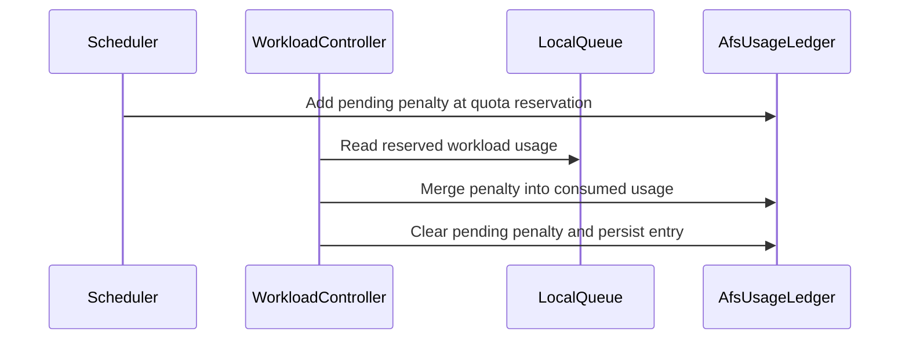

# PR #13724: Prototype AFS entry-penalty accounting at QuotaReserved

**Summary**: Prototype AFS entry-penalty accounting at QuotaReserved

**Sources**: https://github.com/kubernetes-sigs/kueue/pull/13724

**Last updated**: 2026-09-01T00:25:15Z

---

## Metadata

- **State**: open
- **Author**: [@apullo777](https://github.com/apullo777)
- **Branch**: `prototype-afs-qr-anchor-consolidation` → `main`
- **Created**: 2026-08-01T23:23:37Z
- **Updated**: 2026-09-01T00:25:15Z
- **Merged**: —
- **Closed**: —
- **Labels**: `kind/bug`, `kind/feature`, `release-note`, `size/XXL`, `needs-rebase`, `ok-to-test`, `do-not-merge/work-in-progress`, `cncf-cla: yes`, `area/afs`
- **Assignees**: [@pajakd](https://github.com/pajakd)
- **Requested reviewers**: [@mimowo](https://github.com/mimowo), [@pajakd](https://github.com/pajakd)
- **Changed files**: 24   **+779 / -375**

## Description

<!--  Thanks for sending a pull request!  Here are some tips for you:

1. If this is your first time, please read our contributor guidelines: https://git.k8s.io/community/contributors/guide/first-contribution.md#your-first-contribution and developer guide https://git.k8s.io/community/contributors/devel/development.md#development-guide
2. Please label this pull request according to what type of issue you are addressing, especially if this is a release targeted pull request. For reference on required PR/issue labels, read here:
https://git.k8s.io/community/contributors/devel/sig-release/release.md#issuepr-kind-label
3. Ensure you have added or ran the appropriate tests for your PR: https://git.k8s.io/community/contributors/devel/sig-testing/testing.md
4. If you want *faster* PR reviews, read how: https://git.k8s.io/community/contributors/guide/pull-requests.md#best-practices-for-faster-reviews
5. If the PR is unfinished, see how to mark it: https://git.k8s.io/community/contributors/guide/pull-requests.md#marking-unfinished-pull-requests
-->

#### What type of PR is this?

/kind bug
/kind feature

#### What this PR does / why we need it:

This draft implements the two concerns identified in https://github.com/kubernetes-sigs/kueue/pull/12786#issuecomment-5050956487 together so we can evaluate whether they should land as one change or be split:

1. account AFS entry penalties at `QuotaReserved`;
2. prevent entry penalties from leaking.

It also implements the same-lock requirement attached to (1): pending penalties and consumed usage now live in one per-LocalQueue ledger, so settlement is one atomic update rather than a move across two independently locked maps.

The code is kept in separate commits for the accounting anchor, push-side guards, ledger consolidation, KEP update, and user-facing docs, so the pieces can still be split without rewriting them:

**(1) QuotaReserved accounting**

- The existing `Pending -> QuotaReserved|Admitted` path now settles as soon as quota is reserved. Once that reservation transition has been observed, `QuotaReserved -> Admitted` is transparent to AFS.
- Sampling and settlement both use reserved-gated usage. Moving only the settlement would let a check-gated Workload's cost decay while it still holds quota.
- `ConcurrentAdmission` parents are excluded because they copy a variant's reservation and do not push a penalty of their own.
- Leaving `QuotaReserved` does not refund an already consolidated cost; it remains in the decaying usage history.

**(2) Leak prevention**

- Re-assuming an already-reserved second-pass Workload does not push again.
- Pushes are gated on `UsageBasedAdmissionFairSharing`, matching settlement.
- Rollback subtraction is clamped at zero, preventing a negative usage discount.

**(3) Same-lock consolidation**

- Consumed usage and pending penalties now form one `AfsUsageLedger` entry. One `Update` atomically consolidates the LocalQueue's entire pending penalty into consumed usage and clears the pending bucket; one `Get` observes a consistent pair.
- Settlement uses the amount that was actually pushed instead of recomputing a per-Workload penalty. This removes double counting and push/settle residue from partial admission and `IgnoreUndeclaredResources`.
- A partially admitted Workload is therefore charged for its full requested resources, matching `penalty = A * requested_resource`, rather than only the admitted portion.

Per-Workload penalty records and a level-triggered sweep remain out of scope; together they are the structural follow-up for missed observations and exact rollback attribution.

#### Questions for reviewers:

1. Is reserved-gated usage the intended operator-visible meaning of AFS `consumedResources`?
2. Because settlement consolidates only what is actually pending, a reservation for which the scheduler never pushed a penalty is not charged. Is that the intended behavior?
3. #12787 asks for a bound on penalties from Workloads that reserve quota and leave before admission. Anchoring at `QuotaReserved` moves those costs into decaying usage, so repeated churn converges rather than accumulating indefinitely. Is that the intended semantics, and is it enough to close the issue? A missed reservation observation can still strand an undecaying pending penalty.

AI assistance was used for parts of the implementation and analysis; I reviewed and validated the changes.

#### Which issue(s) this PR fixes:
<!--
*Automatically closes linked issue when PR is merged.
Usage: `Fixes #<issue number>`, or `Fixes (paste link of issue)`.
_If PR is about `failing-tests or flakes`, please post the related issues/tests in a comment and do not use `Fixes`_*
-->
Fixes #12539.
Fixes #13495.

Relates to #12787.

This prototype supersedes #12786, which fixes #12539 under the current `Admitted` anchor.

Historical context: #12783, whose related flake was fixed by #12891. 
The same-lock consolidation implements the atomicity requested in the #12783 discussion.

This PR also updates KEP-4136.

#### Special notes for your reviewer:

Coverage includes:

- quota-reservation settlement with and without AdmissionChecks;
- `ConcurrentAdmission` parent exclusion;
- predicate and real-scheduler second-pass coverage;
- reserved-gated settlement and sampling;
- push/settle gate symmetry and zero-clamped rollback;
- atomic fold-and-clear and LocalQueue ledger initialization;
- focused race-enabled unit and integration tests.

Integration with `--race`: fairsharing 42/42, core controllers 72/72, and quota-check-strategy 3/3, with no race reports.

The operator-visible behavior change is that Workloads waiting on AdmissionChecks now count as usage once they reserve quota. This affects admission ordering and cross-LocalQueue preemption victim ordering.

`consumedResources` and `kueue_local_queue_admission_fair_sharing_usage` also move to reserved-gated usage for every LocalQueue, including those whose ClusterQueue is not using `UsageBasedAdmissionFairSharing`, because the sampling tick is gated only by the global AFS configuration.

#### Does this PR introduce a user-facing change?
<!--
If no, just write "NONE" in the release-note block below.
If yes, a release note is required:
Enter your extended release note in the block below. If the PR requires additional action from users switching to the new release, include the string "action required".
-->
```release-note
AdmissionFairSharing now accounts LocalQueue usage from quota reservation and consolidates pending entry penalties into consumed usage atomically.
```


<!-- This is an auto-generated comment: release notes by coderabbit.ai -->
## Summary by CodeRabbit

* **New Features**
  * Fair-sharing usage now begins when workloads reserve quota, including those waiting on AdmissionChecks.
  * Entry penalties are settled when reservations are observed, with accounting preserved through workload transitions.
  * Reserved usage includes all quota-reserving workloads, not only admitted workloads.

* **Bug Fixes**
  * Improved penalty accumulation, rollback handling, resource clamping, and one-time settlement.
  * Preserved accounting history through eviction, deactivation, and LocalQueue deletion.

* **Documentation**
  * Added guidance on accounting anchors, usage sampling, settlement, rollback, and resource charging.
<!-- end of auto-generated comment: release notes by coderabbit.ai -->

## Discussion

### Comment by [@netlify[bot]](https://github.com/apps/netlify) — 2026-08-01T23:23:43Z

### <span aria-hidden="true">✅</span> Deploy Preview for *kubernetes-sigs-kueue* ready!


|  Name | Link |
|:-:|------------------------|
|<span aria-hidden="true">🔨</span> Latest commit | e2f5dfc002f8ecfe15694da05d7bd772b3d91274 |
|<span aria-hidden="true">🔍</span> Latest deploy log | https://app.netlify.com/projects/kubernetes-sigs-kueue/deploys/6a77351b71b7d80008f69327 |
|<span aria-hidden="true">😎</span> Deploy Preview | [https://deploy-preview-13724--kubernetes-sigs-kueue.netlify.app](https://deploy-preview-13724--kubernetes-sigs-kueue.netlify.app) |
|<span aria-hidden="true">📱</span> Preview on mobile | <details><summary> Toggle QR Code... </summary><br /><br /><br /><br />_Use your smartphone camera to open QR code link._</details> |
---
<!-- [kubernetes-sigs-kueue Preview](https://deploy-preview-13724--kubernetes-sigs-kueue.netlify.app) -->
_To edit notification comments on pull requests, go to your [Netlify project configuration](https://app.netlify.com/projects/kubernetes-sigs-kueue/configuration/notifications#deploy-notifications)._

### Comment by [@kubernetes-prow[bot]](https://github.com/apps/kubernetes-prow) — 2026-08-01T23:23:48Z

Hi @apullo777. Thanks for your PR.

I'm waiting for a [kubernetes-sigs](https://github.com/orgs/kubernetes-sigs/people) member to verify that this patch is reasonable to test. If it is, they should reply with `/ok-to-test` on its own line. Until that is done, I will not automatically test new commits in this PR, but the usual testing commands by org members will still work.

>[!TIP]
>**We noticed you've done this a few times! Consider [joining the org](https://git.k8s.io/community/community-membership.md#member) to skip this step and gain `/lgtm` and other bot rights.** We recommend asking approvers on your previous PRs to sponsor you.

Once the patch is verified, the new status will be reflected by the `ok-to-test` label.

I understand the commands that are listed [here](https://go.k8s.io/bot-commands?repo=kubernetes-sigs%2Fkueue).

<details>

Instructions for interacting with me using PR comments are available [here](https://git.k8s.io/community/contributors/guide/pull-requests.md).  If you have questions or suggestions related to my behavior, please file an issue against the [kubernetes-sigs/prow](https://github.com/kubernetes-sigs/prow/issues/new?title=Prow%20issue:) repository.
</details>

### Comment by [@coderabbitai[bot]](https://github.com/apps/coderabbitai) — 2026-08-01T23:23:57Z

<!-- This is an auto-generated comment: summarize by coderabbit.ai -->
<!-- review_stack_entry_start -->

[](https://app.coderabbit.ai/change-stack/kubernetes-sigs/kueue/pull/13724?utm_source=github_walkthrough&utm_medium=github&utm_campaign=change_stack)

<!-- review_stack_entry_end -->
<!-- walkthrough_start -->

<details>
<summary>📝 Walkthrough</summary>

## Walkthrough

### Changes

The PR replaces separate AFS consumed-resource and entry-penalty stores with `AfsUsageLedger`. Pending penalties are anchored to quota reservation, consolidated into reserved usage, and preserved through workload and LocalQueue transitions.

**Admission Fair Sharing accounting**

|Layer / File(s)|Summary|
|---|---|
|**Unified ledger and penalty operations** <br> `pkg/cache/queue/afs/*`|Ledger entries now contain consumed resources and pending penalties. Timestamped push, subtraction, clamping, lookup, and pending-state operations replace the standalone penalty map.|
|**Ledger wiring and reserved-usage calculation** <br> `pkg/cache/queue/*`, `pkg/cache/scheduler/*`, `pkg/workload/*`, `pkg/scheduler/*`|Managers, queues, snapshots, schedulers, and workload fair-sharing calculations use the unified ledger. LocalQueue usage now includes quota-reserving workloads.|
|**Reservation settlement and reconciliation** <br> `pkg/controller/core/*`|Settlement occurs when a workload gains quota reservation. Reserved usage and pending penalties are merged atomically. Controller reconciliation preserves ledger state.|
|**Scheduler gating and validation** <br> `pkg/scheduler/*`, `test/integration/*`, `keps/4136-admission-fair-sharing/README.md`, `site/content/en/docs/concepts/admission_fair_sharing.md`|Scheduler penalty updates use the ledger. Tests and documentation cover AdmissionChecks, rollback, retained usage, and duplicate-penalty prevention.|

**Estimated code review effort:** 4 (Complex) | ~60 minutes

### Sequence Diagram(s)



**Possibly related issues**

- `kubernetes-sigs/kueue#13895`: Related AFS penalty settlement and stale-penalty handling.
- `kubernetes-sigs/kueue#13894`: Related AFS settlement, stale usage, and resource accumulation changes.

**Possibly related PRs**

- [kubernetes-sigs/kueue#12326](https://github.com/kubernetes-sigs/kueue/pull/12326): Overlaps in AFS usage calculation and LocalQueue snapshot handling.
- [kubernetes-sigs/kueue#12786](https://github.com/kubernetes-sigs/kueue/pull/12786): Related penalty settlement and clamping behavior.
- [kubernetes-sigs/kueue#13844](https://github.com/kubernetes-sigs/kueue/pull/13844): Related scheduler entry-penalty handling and second-pass tests.

**Suggested reviewers:** `pajakd`, `mimowo`

</details>

<!-- walkthrough_end -->
<!-- pre_merge_checks_walkthrough_start -->

<details>
<summary>🚥 Pre-merge checks | ✅ 4 | ❌ 1</summary>

### ❌ Failed checks (1 warning)

|     Check name     | Status     | Explanation                                                                           | Resolution                                                                         |
| :----------------: | :--------- | :------------------------------------------------------------------------------------ | :--------------------------------------------------------------------------------- |
| Docstring Coverage | ⚠️ Warning | Docstring coverage is 33.33% which is insufficient. The required threshold is 80.00%. | Write docstrings for the functions missing them to satisfy the coverage threshold. |

<details>
<summary>✅ Passed checks (4 passed)</summary>

|         Check name         | Status   | Explanation                                                                                                                                                                 |
| :------------------------: | :------- | :-------------------------------------------------------------------------------------------------------------------------------------------------------------------------- |
|     Linked Issues check    | ✅ Passed | The changes settle penalties at QuotaReserved and prevent duplicate pushes for existing reservations, covering [`#12539`] and [`#13495`].                                       |
| Out of Scope Changes check | ✅ Passed | The ledger consolidation, reserved-usage accounting, documentation, and tests directly support the stated AFS objectives.                                                   |
|      Description Check     | ✅ Passed | Check skipped - CodeRabbit’s high-level summary is enabled.                                                                                                                 |
|         Title check        | ✅ Passed | The title clearly and concisely describes the prototype change: moving AFS entry-penalty accounting to QuotaReserved. It matches the primary objective of the pull request. |

</details>

</details>

<!-- pre_merge_checks_walkthrough_end -->

- [ ] <!-- {"checkboxId":"585bb3f6-faf5-4dbf-96d2-74e382adf19a"} --> Fix all pre-merge checks with AI
<!-- finishing_touch_checkbox_start -->

<details>
<summary>✨ Finishing Touches</summary>

<details>
<summary>🧪 Generate unit tests (beta)</summary>

- [ ] <!-- {"checkboxId": "f47ac10b-58cc-4372-a567-0e02b2c3d479", "radioGroupId": "utg-output-choice-group-unknown_comment_id"} -->   Create PR with unit tests

</details>

</details>

<!-- finishing_touch_checkbox_end -->
<!-- tips_start -->

---


<sub>Comment `@coderabbitai help` to get the list of available commands.</sub>

<!-- tips_end -->

### Comment by [@apullo777](https://github.com/apullo777) — 2026-08-01T23:51:06Z

cc @mimowo @kshalot  

I kept a few boundary notes out of the PR body so the main design questions stay easier to scan.

The two I think matter most for the decision are:

- **Missed `QuotaReserved` observation.** Settlement is still edge-triggered, so a relist, coalesced event, or deletion before that observation is handled can leave the penalty pending and therefore undecaying.

  #12786 catches this by settling on any transition into `Admitted`. This prototype gives up that backstop in exchange for one settlement point with one accounting meaning. Supporting both safely needs per-Workload penalty records; together with a level-triggered sweep, that could be the structural follow-up.

- **Rollback against the shared bucket.** If another Workload has already consolidated and cleared the bucket, a later rollback may remain charged or subtract from a newer pending penalty. This case was exact before the ledger consolidation, so it is an accuracy regression I would rather call out myself.


  The error is bounded in the safe direction: the clamp can destroy at most what the other settlement just moved into consumed, so the net error is never negative. A tenant forcing a failed admission patch can only pay more, never less. Exact attribution needs the same per-Workload follow-up.

Two smaller effects I also checked:

- A sampling tick between assume and settlement can briefly see both reserved usage and the pending penalty. This is a small, self-correcting over-count, and the `QuotaReserved` anchor shortens the window from the AdmissionCheck wait to the assume-to-reconcile interval.

- Reserved-gated usage also affects cross-LocalQueue preemption victim ordering. It only reorders already-eligible victims, does not change eligibility, and is skipped within the same LocalQueue.

One implementation detail worth noting: a penalty push can now create the LocalQueue ledger entry first. It stamps `LastUpdate` and keeps `StatusAccounted=false`, so the persisted history is still merged exactly once. That path is covered by unit and race-enabled integration tests.

### Comment by [@apullo777](https://github.com/apullo777) — 2026-08-01T23:58:38Z

@mimowo one thought on the couple-or-split question after building the prototype.

We originally separated the accounting anchor from the push-side leak prevention. At this point, the split that looks most natural to me is as below:

- The push-side guards could land separately. They fix #13495 under the current accounting semantics and do not depend on the anchor.
- I would keep the `QuotaReserved` anchor and ledger consolidation together. The anchor makes AdmissionCheck-gated Workloads settle too, so landing it alone would extend the existing cross-ledger double-count window to those paths before fixing that window.

So the push-side work appears independently mergeable, but not sufficient on its own to make entry penalties leak-free: under the current anchor, the AdmissionCheck path still never settles.

Does that split match your reading?

### Comment by [@pajakd](https://github.com/pajakd) — 2026-08-03T06:18:35Z

/ok-to-test

### Comment by [@pajakd](https://github.com/pajakd) — 2026-08-03T06:21:07Z

/assign

### Comment by [@mimowo](https://github.com/mimowo) — 2026-08-03T06:48:00Z

> Does that split match your reading?

Thank you @apullo777 for the summary. Now I see that moving the settlement point to QuotaReserved is a nice conceptual bugfix, but it does not really help to fix the leak. 

Aside from the scenarios you mentioned, moving the settlement point also introduces a new one:workload deletion - after the Workload is QuotaReserved (it would still be in penalties), but before Admitted.

So, I think the better path forward is:
1. do small fixes and cherrypick them for easy leak scenarios, probably you meant merging https://github.com/kubernetes-sigs/kueue/pull/12786?
2. Split this PR with the first part being focused on leak prevention only, introducing UsageLedger. I think to prevent all leak scenarios (and double counting) we really need the UsageLedgerEntry to track the penalties per workload, and the aggeregated penalties. This is really important to make the operations idempotent. It will also make it easier to later move the QuotaReserved settlement point to Admitted  and handle the workload deletion gracefully (bugfix, cherrypick)
3. second part of the PR becomes the new PR: Move the QuotaReservation settlment point to Admitted. This one will have KEP update. I think we will cherrypick, but probably behind a FG

I think this is a cleaner path forward

### Comment by [@mimowo](https://github.com/mimowo) — 2026-08-03T19:04:21Z

/area afs

### Comment by [@apullo777](https://github.com/apullo777) — 2026-08-03T22:35:17Z

Thanks @mimowo. The 1/2/3 split works for me, and putting the UsageLedger before the anchor change is cleaner than the ordering I proposed.

On the deletion case, I think this is an existing hole, but not one with a clean step 1 fix. Refunding on the current exit edges would let `submit → QuotaReserved → evict` keep the entry penalty from ever being folded into consumed usage. With the QR anchor, the same defensive `Sub` can double subtract, while the genuinely stranded case may have no visible transition to hook into.

So I think #12787 belongs in step 2, once penalties are tracked per Workload. Step 1 would then be:

1. Rebase #12786.
2. Keep the #13495 push side guard separate.

Both should remain independently cherrypickable.

One scope question for step 2: should per Workload records provide idempotency only within one manager lifetime, or also survive restarts? Entry penalties are memory only today, so restart recovery would make step 2 substantially larger.

I’ll start with step 1 by rebasing #12786 and keeping #13495 separate. I’ll keep this PR open as the reference for the split.

### Comment by [@mimowo](https://github.com/mimowo) — 2026-08-04T04:17:39Z

>  should per Workload records provide idempotency only within one manager lifetime, or also survive restarts? Entry penalties are memory only today, so restart recovery would make step 2 substantially larger.

I was thinking about keeping the in memory model as today, just providing leak prevention by keeping the penalties per workload. This was we make sure we don't double count, and can safely subtract on workload deletion. These scenarios are just for leak prevention in no restart scenarios.

Penalty recovery after restart seems like a hard problem which belongs to another issue.

### Comment by [@coderabbitai[bot]](https://github.com/apps/coderabbitai) — 2026-08-05T01:16:25Z

<!-- This is an auto-generated comment by CodeRabbit -->
> [!NOTE]
> GitHub couldn't provide a complete incremental comparison for this pull request, so CodeRabbit is performing a full review instead. This review may take a little longer.

### Comment by [@coderabbitai[bot]](https://github.com/apps/coderabbitai) — 2026-08-05T15:18:31Z

<!-- This is an auto-generated comment by CodeRabbit -->
> [!NOTE]
> GitHub couldn't provide a complete incremental comparison for this pull request, so CodeRabbit is performing a full review instead. This review may take a little longer.

### Comment by [@kubernetes-prow[bot]](https://github.com/apps/kubernetes-prow) — 2026-08-08T13:54:47Z

[APPROVALNOTIFIER] This PR is **NOT APPROVED**

This pull-request has been approved by: *<a href="https://github.com/kubernetes-sigs/kueue/pull/13724#" title="Author self-approved">apullo777</a>*
**Once this PR has been reviewed and has the lgtm label**, please assign [sohankunkerkar](https://github.com/sohankunkerkar) for approval. For more information see [the Code Review Process](https://git.k8s.io/community/contributors/guide/owners.md#the-code-review-process).

The full list of commands accepted by this bot can be found [here](https://go.k8s.io/bot-commands?repo=kubernetes-sigs%2Fkueue).

<details open>
Needs approval from an approver in each of these files:

- **[OWNERS](https://github.com/kubernetes-sigs/kueue/blob/main/OWNERS)**

Approvers can indicate their approval by writing `/approve` in a comment
Approvers can cancel approval by writing `/approve cancel` in a comment
</details>
<!-- META={"approvers":["sohankunkerkar"]} -->

### Comment by [@kubernetes-prow[bot]](https://github.com/apps/kubernetes-prow) — 2026-08-09T05:10:31Z

PR needs rebase.

<details>

Instructions for interacting with me using PR comments are available [here](https://git.k8s.io/community/contributors/guide/pull-requests.md).  If you have questions or suggestions related to my behavior, please file an issue against the [kubernetes-sigs/prow](https://github.com/kubernetes-sigs/prow/issues/new?title=Prow%20issue:) repository.
</details>

### Comment by [@mimowo](https://github.com/mimowo) — 2026-08-10T10:57:32Z

@apullo777 would you like to submit a PR doing the AfsUsageLedger, with the idempotent penalties, (2) from this PR?
if you don't have cycles now let's track this as an independent issue.

### Comment by [@apullo777](https://github.com/apullo777) — 2026-08-10T18:53:19Z

> @apullo777 would you like to submit a PR doing the AfsUsageLedger, with the idempotent penalties, (2) from this PR?

Yes. PR incoming :)

### Comment by [@kubernetes-prow[bot]](https://github.com/apps/kubernetes-prow) — 2026-08-26T22:23:42Z

@apullo777: The following tests **failed**, say `/retest` to rerun all failed tests or `/retest-required` to rerun all mandatory failed tests:

Test name | Commit | Details | Required | Rerun command
--- | --- | --- | --- | ---
pull-kueue-test-e2e-extended-shard-0-main-1-37 | e2f5dfc002f8ecfe15694da05d7bd772b3d91274 | [link](https://prow.k8s.io/view/gs/kubernetes-ci-logs/pr-logs/pull/kubernetes-sigs_kueue/13724/pull-kueue-test-e2e-extended-shard-0-main-1-37/2092739718012735488) | true | `/test pull-kueue-test-e2e-extended-shard-0-main-1-37`
pull-kueue-test-e2e-extended-shard-2-main-1-37 | e2f5dfc002f8ecfe15694da05d7bd772b3d91274 | [link](https://prow.k8s.io/view/gs/kubernetes-ci-logs/pr-logs/pull/kubernetes-sigs_kueue/13724/pull-kueue-test-e2e-extended-shard-2-main-1-37/2092739718302142464) | true | `/test pull-kueue-test-e2e-extended-shard-2-main-1-37`
pull-kueue-test-e2e-extended-shard-1-main-1-37 | e2f5dfc002f8ecfe15694da05d7bd772b3d91274 | [link](https://prow.k8s.io/view/gs/kubernetes-ci-logs/pr-logs/pull/kubernetes-sigs_kueue/13724/pull-kueue-test-e2e-extended-shard-1-main-1-37/2092739718142758912) | true | `/test pull-kueue-test-e2e-extended-shard-1-main-1-37`
pull-kueue-test-e2e-baseline-main-1-37 | e2f5dfc002f8ecfe15694da05d7bd772b3d91274 | [link](https://prow.k8s.io/view/gs/kubernetes-ci-logs/pr-logs/pull/kubernetes-sigs_kueue/13724/pull-kueue-test-e2e-baseline-main-1-37/2092739717878517760) | true | `/test pull-kueue-test-e2e-baseline-main-1-37`

[Full PR test history](https://prow.k8s.io/pr-history?org=kubernetes-sigs&repo=kueue&pr=13724). [Your PR dashboard](https://prow.k8s.io/pr?query=is%3Apr%20state%3Aopen%20author%3Aapullo777). Please help us cut down on flakes by [linking to](https://git.k8s.io/community/contributors/devel/sig-testing/flaky-tests.md#filing-issues-for-flaky-tests) an [open issue](https://github.com/kubernetes-sigs/kueue/issues?q=is:issue+is:open) when you hit one in your PR.

<details>

Instructions for interacting with me using PR comments are available [here](https://git.k8s.io/community/contributors/guide/pull-requests.md).  If you have questions or suggestions related to my behavior, please file an issue against the [kubernetes-sigs/prow](https://github.com/kubernetes-sigs/prow/issues/new?title=Prow%20issue:) repository. I understand the commands that are listed [here](https://go.k8s.io/bot-commands).
</details>
<!-- test report -->

## Reviews

### Review by [@coderabbitai[bot]](https://github.com/apps/coderabbitai) (commented) — 2026-08-01T23:32:19Z

**Actionable comments posted: 6**

<details>
<summary>🧹 Nitpick comments (4)</summary><blockquote>

<details>
<summary>pkg/cache/queue/afs/usage_ledger_test.go (1)</summary><blockquote>

`38-72`: _📐 Maintainability & Code Quality_ | _🔵 Trivial_ | _⚡ Quick win_

**Preserve `PendingPenalty` in the writer fixture.**

Line 45 constructs a replacement `UsageLedgerEntry` but omits `entry.PendingPenalty`. Preserve that field and add it to the existing-entry case. This test should protect the unified-ledger contract against accidental penalty loss.

<details>
<summary>Proposed test update</summary>

```diff
 writerFn := func(entry UsageLedgerEntry, found bool) UsageLedgerEntry {
-  return UsageLedgerEntry{Resources: settled, LastUpdate: settleTime, StatusAccounted: entry.StatusAccounted}
+  return UsageLedgerEntry{
+    Resources:       settled,
+    PendingPenalty:  entry.PendingPenalty,
+    LastUpdate:      settleTime,
+    StatusAccounted: entry.StatusAccounted,
+  }
 }

 "a writer-style update preserves StatusAccounted": {
-  existing:  &UsageLedgerEntry{Resources: seeded, LastUpdate: seedTime, StatusAccounted: true},
+  existing: &UsageLedgerEntry{
+    Resources:      seeded,
+    PendingPenalty: corev1.ResourceList{corev1.ResourceCPU: resource.MustParse("1")},
+    LastUpdate:     seedTime,
+    StatusAccounted: true,
+  },
   fn: writerFn,
-  wantEntry: UsageLedgerEntry{Resources: settled, LastUpdate: settleTime, StatusAccounted: true},
+  wantEntry: UsageLedgerEntry{
+    Resources:      settled,
+    PendingPenalty: corev1.ResourceList{corev1.ResourceCPU: resource.MustParse("1")},
+    LastUpdate:     settleTime,
+    StatusAccounted: true,
+  },
 },
```
</details>

<details>
<summary>🤖 Prompt for AI Agents</summary>

```
Verify each finding against current code. Fix only still-valid issues, skip the
rest with a brief reason, keep changes minimal, and validate.

In `@pkg/cache/queue/afs/usage_ledger_test.go` around lines 38 - 72, Update the
writerFn fixture to copy entry.PendingPenalty into the replacement
UsageLedgerEntry, and populate PendingPenalty in the existing-entry test case so
the expected result verifies it is preserved.
```

</details>

<!-- cr-comment:v1:7da5dfa6c33ab0b908ffd2dd -->

</blockquote></details>
<details>
<summary>test/integration/singlecluster/scheduler/quotacheckstrategy/quota_check_strategy_test.go (1)</summary><blockquote>

`128-133`: _📐 Maintainability & Code Quality_ | _🔵 Trivial_ | _⚡ Quick win_

**This assertion can now pass without observing any penalty.**

`PeekPenalty` returns an empty `ResourceList` when no ledger entry exists or when the pending bucket is already clear. This PR settles the penalty at `QuotaReserved`, and the block above waits for the Workload to be admitted, so the bucket is normally consolidated and empty before this `Eventually` runs. The `NotTo(HaveKey(...))` check then succeeds vacuously.

Assert on the consolidated half instead, so the check still proves that the undeclared resource never entered the accounting.

<details>
<summary>💚 Proposed assertion change</summary>

```diff
 		ginkgo.By("Verifying the entry penalty does not include the undeclared resource")
 		lqKey := utilqueue.NewLocalQueueReference(ns.Name, kueue.LocalQueueName(lq.Name))
 		gomega.Eventually(func(g gomega.Gomega) {
-			penalty := qManager.AfsUsageLedger.PeekPenalty(lqKey)
-			g.Expect(penalty).NotTo(gomega.HaveKey(corev1.ResourceName("example.com/gpu")))
+			entry, found := qManager.AfsUsageLedger.Get(lqKey)
+			g.Expect(found).To(gomega.BeTrue())
+			g.Expect(entry.PendingPenalty).NotTo(gomega.HaveKey(corev1.ResourceName("example.com/gpu")))
+			g.Expect(entry.Resources).NotTo(gomega.HaveKey(corev1.ResourceName("example.com/gpu")))
 		}, util.Timeout, util.Interval).Should(gomega.Succeed())
```
</details>

<details>
<summary>🤖 Prompt for AI Agents</summary>

```
Verify each finding against current code. Fix only still-valid issues, skip the
rest with a brief reason, keep changes minimal, and validate.

In
`@test/integration/singlecluster/scheduler/quotacheckstrategy/quota_check_strategy_test.go`
around lines 128 - 133, Update the penalty assertion in the quota strategy test
to inspect the consolidated accounting half rather than relying on PeekPenalty
returning no GPU key. Use the appropriate consolidated ledger accessor on
qManager.AfsUsageLedger and assert that the undeclared example.com/gpu resource
is absent, ensuring the check observes the recorded accounting entry.
```

</details>

<!-- cr-comment:v1:0be4f50b09779dcd96ec8a43 -->

</blockquote></details>
<details>
<summary>pkg/controller/core/localqueue_controller.go (1)</summary><blockquote>

`487-487`: _📐 Maintainability & Code Quality_ | _🔵 Trivial_ | _⚡ Quick win_

**Pass one consistent entry to `reportAfsUsage` instead of re-reading the penalty.**

The comment on `reportAfsUsage` (Lines 461-463) states that the caller must supply both halves so the pair stays consistent. This call breaks that rule. It pairs the locally computed `consumedResources` with a fresh `PeekPenalty` read. A settlement that lands between the two reads makes the reported metric drop or duplicate one penalty.

`resyncLocalQueueGaugeMetrics` (Lines 520-521) already uses a single `Get`. Thread the entry through `updateAdmissionFsStatus` so this path does the same, or read the entry once before the status update.

<details>
<summary>🤖 Prompt for AI Agents</summary>

```
Verify each finding against current code. Fix only still-valid issues, skip the
rest with a brief reason, keep changes minimal, and validate.

In `@pkg/controller/core/localqueue_controller.go` at line 487, The call to
reportAfsUsage must use one consistent AFS usage ledger entry rather than
pairing consumedResources with a fresh PeekPenalty read. Update
updateAdmissionFsStatus and its caller path around resyncLocalQueueGaugeMetrics
to read the entry once and thread or reuse it for reportAfsUsage, preserving the
existing single-Get pattern.
```

</details>

<!-- cr-comment:v1:f5969a19ac0a0cb38e01be7f -->

</blockquote></details>
<details>
<summary>test/integration/singlecluster/scheduler/fairsharing/fair_sharing_test.go (1)</summary><blockquote>

`1621-1628`: _📐 Maintainability & Code Quality_ | _🔵 Trivial_ | _⚡ Quick win_

**Strengthen the settlement assertion so it cannot pass without a push.**

`HasPendingPenalty` returns false both when a penalty settled and when the scheduler never pushed one. This spec is the primary regression guard for the stranded-penalty issue, so it should distinguish the two states.

The `usage > 0` assertion on line 1628 partly covers this, but the LocalQueue status usage is also driven by the reserved-usage sampling tick, not only by the consolidated penalty. Assert that the ledger entry's consumed `Resources` are non-zero at the same point, which only holds after a settlement folded the pushed penalty in.


<details>
<summary>♻️ Proposed change to assert the consolidated amount</summary>

```diff
 			ginkgo.By("Verifying the entry penalty settles once QuotaReserved is observed")
 			gomega.Eventually(func(g gomega.Gomega) {
 				g.Expect(qManager.AfsUsageLedger.HasPendingPenalty(lqKey)).To(gomega.BeFalse(),
 					"entry penalty should be settled at quota reservation, not at admission")
+				entry, found := qManager.AfsUsageLedger.Get(lqKey)
+				g.Expect(found).To(gomega.BeTrue(), "the push must have created a ledger entry")
+				consumed := entry.Resources[corev1.ResourceCPU]
+				g.Expect(consumed.MilliValue()).To(gomega.BeNumerically(">", 0),
+					"the settled penalty must be folded into consumed usage")
 			}, util.Timeout, util.Interval).Should(gomega.Succeed())
```
</details>

<details>
<summary>🤖 Prompt for AI Agents</summary>

```
Verify each finding against current code. Fix only still-valid issues, skip the
rest with a brief reason, keep changes minimal, and validate.

In `@test/integration/singlecluster/scheduler/fairsharing/fair_sharing_test.go`
around lines 1621 - 1628, Strengthen the settlement checks in the fair-sharing
test by asserting that the ledger entry for lqKey has non-zero consumed
Resources after QuotaReserved is observed. Keep the existing HasPendingPenalty
and LocalQueue fair-sharing usage assertions, and use the ledger’s
consumed-resources field or accessor so the test verifies a pushed penalty was
actually consolidated rather than merely absent.
```

</details>

<!-- cr-comment:v1:5a74de4ed0fa271c8dea5c97 -->

</blockquote></details>

</blockquote></details>

<details>
<summary>🤖 Prompt for all review comments with AI agents</summary>

```
Verify each finding against current code. Fix only still-valid issues, skip the
rest with a brief reason, keep changes minimal, and validate.

Inline comments:
In `@keps/4136-admission-fair-sharing/README.md`:
- Line 214: Update the sentence describing the job’s usage from “This an
equivalent” to grammatically include the missing verb, while preserving the
existing meaning and terminology.

In `@pkg/cache/queue/afs/usage_ledger.go`:
- Around line 77-83: The comments for AfsUsageLedger.Get and
AfsUsageLedger.Delete should describe the complete UsageLedgerEntry state rather
than only consumed resources. Update both comments to explicitly include all
ledger data, including PendingPenalty.

In `@pkg/controller/core/localqueue_controller.go`:
- Around line 223-225: Update the short-interval return in the LocalQueue
reconciliation path around AfsUsageLedger.HasPendingPenalty so a pending penalty
cannot schedule repeated sub-interval reconciles; clamp RequeueAfter to at least
one admission usage-sampling interval (or the established small floor below it),
while preserving the existing cache and elapsed-time checks.

In `@pkg/scheduler/scheduler_afs_test.go`:
- Around line 983-987: Update the shouldApplyEntryPenalty test cases to
explicitly pin the features.AdmissionFairSharing gate, using the same
setup/cleanup pattern as TestUpdateSettlesEntryPenaltyAtQuotaReserved. Rename
“skips when AdmissionFairSharing is disabled globally” to describe the nil
afsConfig condition, and add a distinct disabled-gate case if that behavior is
intended to remain covered.

In `@pkg/workload/workload.go`:
- Around line 469-478: The AFS ResourceLists assigned from the ledger in
CalcLocalQueueFSUsage must be deep-copied before fair-sharing calculation.
Update the entry.Resources and entry.PendingPenalty assignments in the
afsUsageLedger lookup to use DeepCopy(), matching buildSnapshotSort, and pass
only those independent copies to afs.CalculateUsage.

In `@site/content/en/docs/concepts/admission_fair_sharing.md`:
- Line 36: Clarify the admission penalty description by distinguishing its
immediate effect on usage used for admission ordering from its later
consolidation into
status.fairSharing.admissionFairSharingStatus.consumedResources when quota
reservation is observed. Update the affected paragraph without implying both
updates target the same usage field.

---

Nitpick comments:
In `@pkg/cache/queue/afs/usage_ledger_test.go`:
- Around line 38-72: Update the writerFn fixture to copy entry.PendingPenalty
into the replacement UsageLedgerEntry, and populate PendingPenalty in the
existing-entry test case so the expected result verifies it is preserved.

In `@pkg/controller/core/localqueue_controller.go`:
- Line 487: The call to reportAfsUsage must use one consistent AFS usage ledger
entry rather than pairing consumedResources with a fresh PeekPenalty read.
Update updateAdmissionFsStatus and its caller path around
resyncLocalQueueGaugeMetrics to read the entry once and thread or reuse it for
reportAfsUsage, preserving the existing single-Get pattern.

In `@test/integration/singlecluster/scheduler/fairsharing/fair_sharing_test.go`:
- Around line 1621-1628: Strengthen the settlement checks in the fair-sharing
test by asserting that the ledger entry for lqKey has non-zero consumed
Resources after QuotaReserved is observed. Keep the existing HasPendingPenalty
and LocalQueue fair-sharing usage assertions, and use the ledger’s
consumed-resources field or accessor so the test verifies a pushed penalty was
actually consolidated rather than merely absent.

In
`@test/integration/singlecluster/scheduler/quotacheckstrategy/quota_check_strategy_test.go`:
- Around line 128-133: Update the penalty assertion in the quota strategy test
to inspect the consolidated accounting half rather than relying on PeekPenalty
returning no GPU key. Use the appropriate consolidated ledger accessor on
qManager.AfsUsageLedger and assert that the undeclared example.com/gpu resource
is absent, ensuring the check observes the recorded accounting entry.
```

</details>

<details>
<summary>🪄 Autofix (Beta)</summary>

Fix all unresolved CodeRabbit comments on this PR:

- [ ] <!-- {"checkboxId": "4b0d0e0a-96d7-4f10-b296-3a18ea78f0b9"} --> Push a commit to this branch (recommended)
- [ ] <!-- {"checkboxId": "ff5b1114-7d8c-49e6-8ac1-43f82af23a33"} --> Create a new PR with the fixes

</details>

---

<details>
<summary>ℹ️ Review info</summary>

<details>
<summary>⚙️ Run configuration</summary>

**Configuration used**: Path: .coderabbit.yaml

**Review profile**: CHILL

**Plan**: Pro Plus

**Run ID**: `d9a3cbaf-0f17-415c-bc97-10597d60e6fc`

</details>

<details>
<summary>📥 Commits</summary>

Reviewing files that changed from the base of the PR and between f62b59d9944063e5fa9d73d0d7b3d40b0cb8eaab and fbf67e1b67fc500607521c83574f078c6d7728ee.

</details>

<details>
<summary>📒 Files selected for processing (24)</summary>

* `keps/4136-admission-fair-sharing/README.md`
* `pkg/cache/queue/afs/entry_penalties.go`
* `pkg/cache/queue/afs/entry_penalties_test.go`
* `pkg/cache/queue/afs/usage_ledger.go`
* `pkg/cache/queue/afs/usage_ledger_test.go`
* `pkg/cache/queue/cluster_queue.go`
* `pkg/cache/queue/cluster_queue_test.go`
* `pkg/cache/queue/manager.go`
* `pkg/cache/scheduler/clusterqueue.go`
* `pkg/cache/scheduler/localqueue.go`
* `pkg/cache/scheduler/snapshot.go`
* `pkg/controller/core/localqueue_controller.go`
* `pkg/controller/core/localqueue_controller_test.go`
* `pkg/controller/core/workload_controller.go`
* `pkg/controller/core/workload_controller_test.go`
* `pkg/scheduler/scheduler.go`
* `pkg/scheduler/scheduler_afs_secondpass_test.go`
* `pkg/scheduler/scheduler_afs_test.go`
* `pkg/util/maps/maps_test.go`
* `pkg/workload/workload.go`
* `pkg/workload/workload_test.go`
* `site/content/en/docs/concepts/admission_fair_sharing.md`
* `test/integration/singlecluster/scheduler/fairsharing/fair_sharing_test.go`
* `test/integration/singlecluster/scheduler/quotacheckstrategy/quota_check_strategy_test.go`

</details>

</details>

<!-- This is an auto-generated comment by CodeRabbit for review status -->

- **keps/4136-admission-fair-sharing/README.md:214** by [@coderabbitai[bot]](https://github.com/apps/coderabbitai) — 2026-08-01T23:32:18Z
```diff
@@ -206,13 +207,35 @@ usageSamplingInterval: 5mins
 Here, all Jobs submitted by Tenant B  within the next 5min get scheduled.
 Even if Tenant B submitted a job that consumed 1000 CPUs, consecutive jobs would still be prioritized because of the delay in updating the status.
 
-Hence, since v0.13 Kueue adds an entry penalty to FairSharingStatus every time it admits a Workload. The penalty should be calculated with the formula: `penalty = A * requested_resource`, where `A` is as above:
+Hence, since v0.13 Kueue charges an entry penalty when the scheduler assumes a Workload into the cache, which is the point at which it commits to reserving quota. The penalty is held in memory and is rolled back if the admission patch fails; it reaches FairSharingStatus only once it is consolidated, as described in [Accounting anchor](#accounting-anchor). A Workload that already holds a reservation is not charged again on a second scheduling pass. The penalty should be calculated with the formula: `penalty = A * requested_resource`, where `A` is as above:
 
 `A = 1 - 0.5 ^ (sampling/half_life_decay)`. 
 
 This an equivalent of a job's usage that has been admitted `samplingInterval` ago. The value of penalty is an arbitrary decision for now.
```

  _📐 Maintainability & Code Quality_ | _🟡 Minor_ | _⚡ Quick win_
  
  **Fix the missing verb.**
  
  <details>
  <summary>📝 Proposed wording fix</summary>
  
  ```diff
  -This an equivalent of a job's usage that has been admitted `samplingInterval` ago. The value of penalty is an arbitrary decision for now.
  +This is the equivalent of the usage of a job that was admitted `samplingInterval` ago. The value of the penalty is an arbitrary decision for now.
  ```
  </details>
  
  <!-- suggestion_start -->
  
  <details>
  <summary>📝 Committable suggestion</summary>
  
  > ‼️ **IMPORTANT**
  > Carefully review the code before committing. Ensure that it accurately replaces the highlighted code, contains no missing lines, and has no issues with indentation. Thoroughly test & benchmark the code to ensure it meets the requirements.
  
  ```suggestion
  This is the equivalent of the usage of a job that was admitted `samplingInterval` ago. The value of the penalty is an arbitrary decision for now.
  ```
  
  </details>
  
  <!-- suggestion_end -->
  
  <details>
  <summary>🤖 Prompt for AI Agents</summary>
  
  ```
  Verify each finding against current code. Fix only still-valid issues, skip the
  rest with a brief reason, keep changes minimal, and validate.
  
  In `@keps/4136-admission-fair-sharing/README.md` at line 214, Update the sentence
  describing the job’s usage from “This an equivalent” to grammatically include
  the missing verb, while preserving the existing meaning and terminology.
  ```
  
  </details>
  
  <!-- fingerprinting:phantom:medusa:komodo -->
  
  <!-- cr-indicator-types:potential_issue -->
  
  <!-- cr-comment:v1:d607304c15b39faa1eb729c2 -->
  
  <!-- This is an auto-generated comment by CodeRabbit -->

- **pkg/cache/queue/afs/usage_ledger.go:83** by [@coderabbitai[bot]](https://github.com/apps/coderabbitai) — 2026-08-01T23:32:18Z
```diff
@@ -63,16 +70,16 @@ func (a *AfsConsumedResources) Set(lqKey utilqueue.LocalQueueReference, resource
 // it must not call back into the scheduler cache (lock ordering).
 // All controller writers should go through Update so concurrent read-modify-writes
 // cannot overwrite each other and StatusAccounted is preserved by construction.
-func (a *AfsConsumedResources) Update(lqKey utilqueue.LocalQueueReference, fn func(entry ConsumedResourcesEntry, found bool) ConsumedResourcesEntry) ConsumedResourcesEntry {
+func (a *AfsUsageLedger) Update(lqKey utilqueue.LocalQueueReference, fn func(entry UsageLedgerEntry, found bool) UsageLedgerEntry) UsageLedgerEntry {
 	return a.resources.Update(lqKey, fn)
 }
 
 // Get retrieves the consumed resources for a LocalQueue
-func (a *AfsConsumedResources) Get(lqKey utilqueue.LocalQueueReference) (ConsumedResourcesEntry, bool) {
+func (a *AfsUsageLedger) Get(lqKey utilqueue.LocalQueueReference) (UsageLedgerEntry, bool) {
 	return a.resources.Get(lqKey)
 }
 
 // Delete removes the consumed resources entry for a LocalQueue
-func (a *AfsConsumedResources) Delete(lqKey utilqueue.LocalQueueReference) {
+func (a *AfsUsageLedger) Delete(lqKey utilqueue.LocalQueueReference) {
```

  _📐 Maintainability & Code Quality_ | _🟡 Minor_ | _⚡ Quick win_
  
  **Correct the ledger API comments.**
  
  Line 77 says `Get` retrieves consumed resources, but it returns the full `UsageLedgerEntry`. Line 82 has the same outdated scope. Document that these methods read and delete the complete ledger state, including `PendingPenalty`.
  
  <details>
  <summary>🤖 Prompt for AI Agents</summary>
  
  ```
  Verify each finding against current code. Fix only still-valid issues, skip the
  rest with a brief reason, keep changes minimal, and validate.
  
  In `@pkg/cache/queue/afs/usage_ledger.go` around lines 77 - 83, The comments for
  AfsUsageLedger.Get and AfsUsageLedger.Delete should describe the complete
  UsageLedgerEntry state rather than only consumed resources. Update both comments
  to explicitly include all ledger data, including PendingPenalty.
  ```
  
  </details>
  
  <!-- fingerprinting:phantom:poseidon:terra -->
  
  <!-- cr-indicator-types:potential_issue -->
  
  <!-- cr-comment:v1:e0c3918fc9d14a66e3e254d1 -->
  
  <!-- This is an auto-generated comment by CodeRabbit -->

- **pkg/controller/core/localqueue_controller.go:225** by [@coderabbitai[bot]](https://github.com/apps/coderabbitai) — 2026-08-01T23:32:18Z
```diff
@@ -220,7 +220,7 @@ func (r *LocalQueueReconciler) Reconcile(ctx context.Context, req ctrl.Request)
 		// before this reconcile. Without this, self-triggered status
 		// updates cause sub-millisecond reconciles where the decay math
 		// truncates CPU consumed resources to zero.
-		if interval := r.admissionFSConfig.UsageSamplingInterval.Duration; hadCache && sinceLastUpdate < interval && !r.queues.AfsEntryPenalties.HasPendingFor(lqKey) {
+		if interval := r.admissionFSConfig.UsageSamplingInterval.Duration; hadCache && sinceLastUpdate < interval && !r.queues.AfsUsageLedger.HasPendingPenalty(lqKey) {
 			return ctrl.Result{RequeueAfter: interval - sinceLastUpdate}, nil
 		}
```

  _🩺 Stability & Availability_ | _🟡 Minor_ | _⚡ Quick win_
  
  <details>
  <summary>🧩 Analysis chain</summary>
  
  🏁 Script executed:
  
  ```shell
  #!/bin/bash
  # Inspect the LocalQueue reconciler event predicates and the sampling gate.
  fd -t f 'localqueue_controller.go' -x ast-grep outline {} --items all
  rg -nP -C 20 'func \(r \*LocalQueueReconciler\) Update\(' --type=go
  ```
  
  Repository: kubernetes-sigs/kueue
  
  Length of output: 6078
  
  ---
  
  🏁 Script executed:
  
  ```shell
  #!/bin/bash
  set -euo pipefail
  
  echo "== localqueue Update predicate and Setup watches =="
  sed -n '220,330p' pkg/controller/core/localqueue_controller.go
  sed -n '620,720p' pkg/controller/core/localqueue_controller.go
  sed -n '635,655p' pkg/controller/core/localqueue_controller.go
  
  echo "== reconcileConsumedUsage gate and status write paths =="
  sed -n '380,515p' pkg/controller/core/localqueue_controller.go
  
  echo "== Workload controller pending-penalty clearing implementations =="
  rg -n -C 25 'HasPendingPenalty|ClearPendingPenalty|UpdateAfsConsumedUsage|updateAfsConsumedUsage|PendingPenalty|UsageSamplingInterval' pkg/controller/core/workload_controller.go pkg/cache/queue pkg/util/admissionfairsharing
  
  echo "== All pending-penalty usages =="
  rg -n 'HasPendingPenalty|PendingPenalty|ClearPendingPenalty|updateAfsConsumedUsage|reconcileConsumedUsage' pkg -g '*.go'
  ```
  
  Repository: kubernetes-sigs/kueue
  
  Length of output: 50377
  
  ---
  
  🏁 Script executed:
  
  ```shell
  #!/bin/bash
  set -euo pipefail
  
  echo "== Update predicate status-only drop logic =="
  sed -n '177,305p' pkg/controller/core/localqueue_controller.go
  
  echo "== Workload AFS settlement trigger calls =="
  rg -n -C 5 'updateAfsConsumedUsage\(|UpdateFairSharingEntry|PushPenalty|calculateEntryPenalty|FairSharingEntry' pkg/controller/core/workload_controller.go pkg/cache/queue pkg/util/admissionfairsharing -g '*.go'
  
  echo "== Workload AFS settlement paths around updateAfsConsumed.Usage calls =="
  sed -n '1320,1455p' pkg/controller/core/workload_controller.go
  sed -n '1508,1562p' pkg/controller/core/workload_controller.go
  ```
  
  Repository: kubernetes-sigs/kueue
  
  Length of output: 23597
  
  ---
  
  🏁 Script executed:
  
  ```shell
  #!/bin/bash
  set -euo pipefail
  
  echo "== Reconcile path that can update LocalQueue fair-sharing status =="
  rg -n -C 20 'UpdateFairSharingEntry|UpdateFairSharing|FairSharingEntry|fairshar|fair sharing|FairSharing' pkg/cache/queue pkg/controller -g '*.go'
  
  echo "== LocalQueue status update field names =="
  rg -n 'FairSharing|ConsumedResources|LastUpdate' pkg/apis/kueue/v1beta2 pkg/controller/core/localqueue_controller.go pkg/cache/queue/afs pkg/cache -g '*.go' | head -n 120
  
  echo "== Read-only behavioral model of reconcile gate under long-lived pending penalty =="
  python3 - <<'PY'
  from dataclasses import dataclass
  from collections import Counter
  
  `@dataclass`
  class State:
      last_update: float
      has_penalty: bool
      was_updated_status: bool
  
  def localqueue_gate(state, now, has_cache=True):
      interval = 100.0
      # current gate
      if has_cache and (now - state.last_update) < interval and state.has_penalty:
          return "continue_reconcile"
      if has_cache and (now - state.last_update) < interval:
          return "requeue_after"
      return "continue_reconcile"
  
  def reconcile(state, now):
      kind = gate = localqueue_gate(state, now)
      if gate == "continue_reconcile":
          state.last_update = now
          state.was_updated_status = True
          return "reconcile"
      return "requeue"
  
  def controller_enqueues(status_updated):
      return status_updated
  
  events = []
  state = State(last_update=0.0, has_penalty=True, was_updated_status=False)
  now = 50.0
  for i in range(10):
      events.append((i, now, state.has_penalty, localqueue_gate(state, now)))
      if state.was_updated_status:
          state.was_updated_status = False
          # controller enqueue from LocalQueue status write
          now += 0.001
      events.append((i+0.1, now, state.has_penalty, localqueue_gate(state, now) if gate != "requeue" else "requeue"))
      if localqueue_gate(state, now) == "continue_reconcile":
          state.last_update = now
          state.was_updated_status = True
          now, gate = now + 0.001, "reconcile"
      else:
          gate = "requeue"
          now += 20.0
      events.append((i+2, now, state.has_penalty, localqueue_gate(state, now)))
  
  print("\n".join([str(e) for e in events]))
  print("loops", sum(1 for _, _, _, action in events if action == "reconcile"))
  print("pending_penalty_longlived_model", Counter(e[3] for e in events))
  PY
  ```
  
  Repository: kubernetes-sigs/kueue
  
  Length of output: 50378
  
  ---
  
  
  
  </details>
  
  **Keep the short-interval bypass from causing status-write churn.**
  
  The LocalQueue update predicate does not filter self-generated status updates, and `reconcileConsumedUsage` writes fair-sharing status and clears the decay interval on each reconcile while `PendingPenalty` remains pending. A long-lived AFS penalty can therefore re-arm itself and trigger sub-interval reconciles; treat stale penalties like long-decimal usage and enforce a minimum floor such as one sampling interval (or a small floor below it).
  
  <details>
  <summary>🤖 Prompt for AI Agents</summary>
  
  ```
  Verify each finding against current code. Fix only still-valid issues, skip the
  rest with a brief reason, keep changes minimal, and validate.
  
  In `@pkg/controller/core/localqueue_controller.go` around lines 223 - 225, Update
  the short-interval return in the LocalQueue reconciliation path around
  AfsUsageLedger.HasPendingPenalty so a pending penalty cannot schedule repeated
  sub-interval reconciles; clamp RequeueAfter to at least one admission
  usage-sampling interval (or the established small floor below it), while
  preserving the existing cache and elapsed-time checks.
  ```
  
  </details>
  
  <!-- fingerprinting:phantom:medusa:komodo -->
  
  <!-- cr-indicator-types:potential_issue -->
  
  <!-- cr-comment:v1:cbd208a1fb6222f3968c01de -->
  
  <!-- This is an auto-generated reply by CodeRabbit -->

- **pkg/scheduler/scheduler_afs_test.go:987** by [@coderabbitai[bot]](https://github.com/apps/coderabbitai) — 2026-08-01T23:32:18Z
```diff
@@ -949,3 +950,66 @@ func TestScheduleForAFS(t *testing.T) {
 		}
 	}
 }
+
+func TestShouldApplyEntryPenalty(t *testing.T) {
+	now := time.Now().Truncate(time.Second)
+	afsConfig := &config.AdmissionFairSharing{
+		UsageHalfLifeTime:     metav1.Duration{Duration: 10 * time.Second},
+		UsageSamplingInterval: metav1.Duration{Duration: 1 * time.Second},
+	}
+
+	pendingWl := utiltestingapi.MakeWorkload("wl", "ns").
+		Queue("lq").
+		Request(corev1.ResourceCPU, "4").
+		Obj()
+	reservedWl := utiltestingapi.MakeWorkload("wl", "ns").
+		Queue("lq").
+		Request(corev1.ResourceCPU, "4").
+		ReserveQuotaAt(utiltestingapi.MakeAdmission("cq").Obj(), now).
+		Obj()
+
+	cases := map[string]struct {
+		afsConfig     *config.AdmissionFairSharing
+		admissionMode kueue.AdmissionMode
+		wl            *kueue.Workload
+		want          bool
+	}{
+		"pushes for a first-pass workload on a usage-based ClusterQueue": {
+			afsConfig:     afsConfig,
+			admissionMode: kueue.UsageBasedAdmissionFairSharing,
+			wl:            pendingWl,
+			want:          true,
+		},
+		"skips when AdmissionFairSharing is disabled globally": {
+			admissionMode: kueue.UsageBasedAdmissionFairSharing,
+			wl:            pendingWl,
+			want:          false,
+		},
```

  _📐 Maintainability & Code Quality_ | _🟡 Minor_ | _⚡ Quick win_
  
  **Pin the `AdmissionFairSharing` feature gate in this test.**
  
  `shouldApplyEntryPenalty` calls `afs.Enabled(s.admissionFairSharing)`, which returns `afsConfig != nil && features.Enabled(features.AdmissionFairSharing)`. This test never sets the gate, so every expectation depends on the process-global default. If that default changes or another test leaks state, the `want: true` case fails.
  
  The companion test `TestUpdateSettlesEntryPenaltyAtQuotaReserved` in `pkg/controller/core/workload_controller_test.go` pins the same gate for this exact reason.
  
  The case name on line 983 is also inaccurate. That case sets `afsConfig` to nil; it does not disable the gate. Rename it, and add a separate case that disables the gate if you want that path covered.
  
  
  
  
  <details>
  <summary>💚 Proposed fix to pin the gate and correct the case name</summary>
  
  ```diff
   func TestShouldApplyEntryPenalty(t *testing.T) {
  +	features.SetFeatureGateDuringTest(t, features.AdmissionFairSharing, true)
   	now := time.Now().Truncate(time.Second)
  ```
  
  ```diff
  -		"skips when AdmissionFairSharing is disabled globally": {
  +		"skips when no AdmissionFairSharing config is set": {
   			admissionMode: kueue.UsageBasedAdmissionFairSharing,
   			wl:            pendingWl,
   			want:          false,
   		},
  ```
  </details>
  
  
  Also applies to: 1000-1008
  
  <details>
  <summary>🤖 Prompt for AI Agents</summary>
  
  ```
  Verify each finding against current code. Fix only still-valid issues, skip the
  rest with a brief reason, keep changes minimal, and validate.
  
  In `@pkg/scheduler/scheduler_afs_test.go` around lines 983 - 987, Update the
  shouldApplyEntryPenalty test cases to explicitly pin the
  features.AdmissionFairSharing gate, using the same setup/cleanup pattern as
  TestUpdateSettlesEntryPenaltyAtQuotaReserved. Rename “skips when
  AdmissionFairSharing is disabled globally” to describe the nil afsConfig
  condition, and add a distinct disabled-gate case if that behavior is intended to
  remain covered.
  ```
  
  </details>
  
  <!-- fingerprinting:phantom:medusa:komodo -->
  
  <!-- cr-indicator-types:potential_issue -->
  
  <!-- cr-comment:v1:b113928fdee699f0afe0b231 -->
  
  <!-- This is an auto-generated comment by CodeRabbit -->

- **pkg/workload/workload.go:504** by [@coderabbitai[bot]](https://github.com/apps/coderabbitai) — 2026-08-01T23:32:18Z
```diff
@@ -462,24 +462,21 @@ func (i *Info) CalcLocalQueueFSUsage(
 	ctx context.Context,
 	c client.Client,
 	resWeights map[corev1.ResourceName]float64,
-	afsEntryPenalties *queueafs.AfsEntryPenalties,
-	afsConsumedResources *queueafs.AfsConsumedResources,
+	afsUsageLedger *queueafs.AfsUsageLedger,
 ) (float64, error) {
 	lqKey := queue.KeyFromWorkload(i.Obj)
 
+	// One Get: consumed and the pending penalty come from the same entry, so a
+	// settlement in flight can never be observed in both.
 	consumed := corev1.ResourceList{}
-	if afsConsumedResources != nil {
-		entry, found := afsConsumedResources.Get(lqKey)
-		if found {
+	penalty := corev1.ResourceList{}
+	if afsUsageLedger != nil {
+		if entry, found := afsUsageLedger.Get(lqKey); found {
 			consumed = entry.Resources
+			penalty = entry.PendingPenalty
 		}
 	}
```

  _🩺 Stability & Availability_ | _🟡 Minor_ | _⚡ Quick win_
  
  <details>
  <summary>🧩 Analysis chain</summary>
  
  🏁 Script executed:
  
  ```shell
  #!/bin/bash
  # Description: Inspect the merge helper and the usage calculation for in-place mutation.
  set -euo pipefail
  
  # Locate and print MergeResourceListKeepSum.
  ast-grep run --pattern 'func MergeResourceListKeepSum($$$) { $$$ }' --lang go .
  
  # Locate and print CalculateUsage and clampNegativeToZero.
  ast-grep run --pattern 'func CalculateUsage($$$) { $$$ }' --lang go .
  ast-grep run --pattern 'func clampNegativeToZero($$$) { $$$ }' --lang go .
  
  # Check whether the AFS package calls string-caching Quantity methods on shared values.
  rg -nP --type=go -C3 '\.(String|MarshalJSON|DeepCopy)\(\)' pkg/util/admissionfairsharing pkg/cache/queue/afs
  ```
  
  Repository: kubernetes-sigs/kueue
  
  Length of output: 159
  
  ---
  
  🏁 Script executed:
  
  ```shell
  #!/bin/bash
  set -euo pipefail
  
  echo "tracked files matching relevant names:"
  git ls-files | sed -n '1,200p' | rg 'pkg/workload/workload.go|pkg/cache/queue/(cluster_queue|afs|.*afs.*)\.go|pkg/util/admissionfairsharing|.*MergeResourceList.*|.*ClusterQueue.*' || true
  
  echo
  echo "search symbols:"
  rg -n --type=go 'func MergeResourceListKeepSum|func CalculateUsage|func clampNegativeToZero|var afsUsageLedger|type .*Entry|PendingPenalty|Resources' . || true
  ```
  
  Repository: kubernetes-sigs/kueue
  
  Length of output: 50378
  
  ---
  
  🏁 Script executed:
  
  ```shell
  #!/bin/bash
  set -euo pipefail
  
  echo "workload relevant lines:"
  sed -n '440,495p' pkg/workload/workload.go
  
  echo
  echo "afs relevant symbols in tracked non-vendor files:"
  rg -n --type=go 'func MergeResourceListKeepSum|func CalculateUsage|func clampNegativeToZero|func SetPenalty|func PushPenalty|func SubPenalty|func Set\(|afsUsageLedger' --glob '!vendor/**' pkg || true
  
  echo
  echo "afs files:"
  git ls-files 'pkg/**' | rg '(^|/)afs|admissionfairsharing|max|usage' || true
  ```
  
  Repository: kubernetes-sigs/kueue
  
  Length of output: 6979
  
  ---
  
  🏁 Script executed:
  
  ```shell
  #!/bin/bash
  set -euo pipefail
  
  echo "pkg/util/resource/resource.go:"
  sed -n '1,130p' pkg/util/resource/resource.go
  
  echo
  echo "pkg/util/admissionfairsharing/admission_fair_sharing.go:"
  sed -n '1,140p' pkg/util/admissionfairsharing/admission_fair_sharing.go
  
  echo
  echo "pkg/cache/queue/afs/usage_ledger.go outline and relevant sections:"
  wc -l pkg/cache/queue/afs/usage_ledger.go pkg/cache/queue/afs/entry_penalties.go pkg/cache/queue/cluster_queue.go
  sed -n '1,220p' pkg/cache/queue/afs/usage_ledger.go
  
  echo
  echo "pkg/cache/queue/afs/entry_penalties.go:"
  sed -n '1,140p' pkg/cache/queue/afs/entry_penalties.go
  
  echo
  echo "cluster_queue snapshot path:"
  sed -n '820,885p' pkg/cache/queue/cluster_queue.go
  ```
  
  Repository: kubernetes-sigs/kueue
  
  Length of output: 18272
  
  ---
  
  
  
  </details>
  
  **Deep-copy the AFS ResourceLists before fair-sharing usage calculation.**
  
  `CalcLocalQueueFSUsage` stores and passes `entry.Resources` and `entry.PendingPenalty` directly to `afs.CalculateUsage`, while `buildSnapshotSort` already handles concurrent AFS updates by `DeepCopy()`ing those maps. Use the same copy pattern before calling `afs.CalculateUsage` to avoid concurrent `PushPenalty`, `SubPenalty`, and `Set` updates racing with this calculation.
  
  <details>
  <summary>🤖 Prompt for AI Agents</summary>
  
  ```
  Verify each finding against current code. Fix only still-valid issues, skip the
  rest with a brief reason, keep changes minimal, and validate.
  
  In `@pkg/workload/workload.go` around lines 469 - 478, The AFS ResourceLists
  assigned from the ledger in CalcLocalQueueFSUsage must be deep-copied before
  fair-sharing calculation. Update the entry.Resources and entry.PendingPenalty
  assignments in the afsUsageLedger lookup to use DeepCopy(), matching
  buildSnapshotSort, and pass only those independent copies to afs.CalculateUsage.
  ```
  
  </details>
  
  <!-- fingerprinting:phantom:medusa:komodo -->
  
  <!-- cr-indicator-types:potential_issue -->
  
  <!-- cr-comment:v1:0e6a2fb9082200defe9a52a8 -->
  
  <!-- This is an auto-generated reply by CodeRabbit -->

- **site/content/en/docs/concepts/admission_fair_sharing.md:36** by [@coderabbitai[bot]](https://github.com/apps/coderabbitai) — 2026-08-01T23:32:18Z
```diff
@@ -33,9 +33,11 @@ When multiple workloads compete for resources within a ClusterQueue:
 Entry Penalty is available since Kueue v0.13.0.
 {}
 
-To prevent exploitation where tenants could submit many workloads quickly before usage statistics are updated, Kueue applies an entry penalty to each admitted workload. This penalty is immediately added to the LocalQueue's usage statistics. This ensures that even if a tenant submits multiple workloads rapidly, subsequent workloads will be properly prioritized based on the updated usage including the penalty.
+To prevent exploitation where tenants could submit many workloads quickly before usage statistics are updated, Kueue applies an entry penalty when a workload reserves quota. This penalty is immediately added to the LocalQueue's usage statistics, and is consolidated into them once the reservation is observed. This ensures that even if a tenant submits multiple workloads rapidly, subsequent workloads will be properly prioritized based on the updated usage including the penalty.
```

  _📐 Maintainability & Code Quality_ | _🟡 Minor_ | _⚡ Quick win_
  
  **Clarify which usage the penalty affects immediately.**
  
  The sentence states the penalty "is immediately added to the LocalQueue's usage statistics" and then that it "is consolidated into them once the reservation is observed". Those two claims describe the same target and read as a contradiction.
  
  The behavior has two distinct targets. The pending penalty counts toward the usage used for admission ordering right away. It reaches `status.fairSharing.admissionFairSharingStatus.consumedResources` only after consolidation at quota reservation. Name both.
  
  <details>
  <summary>📝 Proposed wording fix</summary>
  
  ```diff
  -To prevent exploitation where tenants could submit many workloads quickly before usage statistics are updated, Kueue applies an entry penalty when a workload reserves quota. This penalty is immediately added to the LocalQueue's usage statistics, and is consolidated into them once the reservation is observed. This ensures that even if a tenant submits multiple workloads rapidly, subsequent workloads will be properly prioritized based on the updated usage including the penalty.
  +To prevent exploitation where tenants could submit many workloads quickly before usage statistics are updated, Kueue applies an entry penalty when it selects a workload for quota reservation. The penalty counts toward the LocalQueue usage used to order admissions immediately. It is folded into the reported `consumedResources` once the quota reservation is observed. This ensures that even if a tenant submits multiple workloads rapidly, subsequent workloads will be properly prioritized based on the updated usage including the penalty.
  ```
  </details>
  
  As per path instructions: "Focus on technical accuracy, clarity, and markdown formatting."
  
  <!-- suggestion_start -->
  
  <details>
  <summary>📝 Committable suggestion</summary>
  
  > ‼️ **IMPORTANT**
  > Carefully review the code before committing. Ensure that it accurately replaces the highlighted code, contains no missing lines, and has no issues with indentation. Thoroughly test & benchmark the code to ensure it meets the requirements.
  
  ```suggestion
  To prevent exploitation where tenants could submit many workloads quickly before usage statistics are updated, Kueue applies an entry penalty when it selects a workload for quota reservation. The penalty counts toward the LocalQueue usage used to order admissions immediately. It is folded into the reported `consumedResources` once the quota reservation is observed. This ensures that even if a tenant submits multiple workloads rapidly, subsequent workloads will be properly prioritized based on the updated usage including the penalty.
  ```
  
  </details>
  
  <!-- suggestion_end -->
  
  <details>
  <summary>🤖 Prompt for AI Agents</summary>
  
  ```
  Verify each finding against current code. Fix only still-valid issues, skip the
  rest with a brief reason, keep changes minimal, and validate.
  
  In `@site/content/en/docs/concepts/admission_fair_sharing.md` at line 36, Clarify
  the admission penalty description by distinguishing its immediate effect on
  usage used for admission ordering from its later consolidation into
  status.fairSharing.admissionFairSharingStatus.consumedResources when quota
  reservation is observed. Update the affected paragraph without implying both
  updates target the same usage field.
  ```
  
  </details>
  
  <!-- fingerprinting:phantom:medusa:komodo -->
  
  <!-- cr-indicator-types:potential_issue -->
  
  <!-- cr-comment:v1:eb86c29303d09a312a4c4596 -->
  
  _Source: Path instructions_
  
  <!-- This is an auto-generated comment by CodeRabbit -->

### Review by [@apullo777](https://github.com/apullo777) (commented) — 2026-08-01T23:55:41Z

- **pkg/workload/workload.go:504** by [@apullo777](https://github.com/apullo777) — 2026-08-01T23:55:41Z
```diff
@@ -462,24 +462,21 @@ func (i *Info) CalcLocalQueueFSUsage(
 	ctx context.Context,
 	c client.Client,
 	resWeights map[corev1.ResourceName]float64,
-	afsEntryPenalties *queueafs.AfsEntryPenalties,
-	afsConsumedResources *queueafs.AfsConsumedResources,
+	afsUsageLedger *queueafs.AfsUsageLedger,
 ) (float64, error) {
 	lqKey := queue.KeyFromWorkload(i.Obj)
 
+	// One Get: consumed and the pending penalty come from the same entry, so a
+	// settlement in flight can never be observed in both.
 	consumed := corev1.ResourceList{}
-	if afsConsumedResources != nil {
-		entry, found := afsConsumedResources.Get(lqKey)
-		if found {
+	penalty := corev1.ResourceList{}
+	if afsUsageLedger != nil {
+		if entry, found := afsUsageLedger.Get(lqKey); found {
 			consumed = entry.Resources
+			penalty = entry.PendingPenalty
 		}
 	}
```

  I traced the write paths before this landed and I don't think the copy is needed.
  
  mergeResourceList always allocates (pkg/util/resource/resource.go:28-42  a.DeepCopy(), or b.DeepCopy() when a is nil), so PushPenalty, SubPenalty and the settlement all store a freshly built map rather than mutating the stored one. clampNegativeToZero does write in place, but only into the map MergeResourceListKeepSum just returned. On the read side CalculateUsage merges as well, so it never writes to what it was handed. Set stores by reference, but it has no non-test callers.  
  
  CalcLocalQueueFSUsage runs on every heap comparison, so I'd rather not add a DeepCopy there without a writer to point at. If you can name one I'll add it, otherwise I can put the invariant in a comment on Get so the next writer doesn't quietly break it.

### Review by [@coderabbitai[bot]](https://github.com/apps/coderabbitai) (commented) — 2026-08-01T23:56:17Z

- **pkg/workload/workload.go:504** by [@coderabbitai[bot]](https://github.com/apps/coderabbitai) — 2026-08-01T23:56:17Z
```diff
@@ -462,24 +462,21 @@ func (i *Info) CalcLocalQueueFSUsage(
 	ctx context.Context,
 	c client.Client,
 	resWeights map[corev1.ResourceName]float64,
-	afsEntryPenalties *queueafs.AfsEntryPenalties,
-	afsConsumedResources *queueafs.AfsConsumedResources,
+	afsUsageLedger *queueafs.AfsUsageLedger,
 ) (float64, error) {
 	lqKey := queue.KeyFromWorkload(i.Obj)
 
+	// One Get: consumed and the pending penalty come from the same entry, so a
+	// settlement in flight can never be observed in both.
 	consumed := corev1.ResourceList{}
-	if afsConsumedResources != nil {
-		entry, found := afsConsumedResources.Get(lqKey)
-		if found {
+	penalty := corev1.ResourceList{}
+	if afsUsageLedger != nil {
+		if entry, found := afsUsageLedger.Get(lqKey); found {
 			consumed = entry.Resources
+			penalty = entry.PendingPenalty
 		}
 	}
```

  <details>
  <summary>🧩 Analysis chain</summary>
  
  🏁 Script executed:
  
  ```shell
  #!/bin/bash
  set -euo pipefail
  
  echo "== AFS ledger API and mutation paths =="
  ast-grep outline pkg/cache/queue/afs --items all --type function,method --match 'PushPenalty|SubPenalty|Update|Set|Get'
  
  echo
  echo "== Resource-list merge helper =="
  rg -n -A35 -B5 --type=go 'func MergeResourceListKeepSum\s*\(' pkg/util/resource
  
  echo
  echo "== Fair-sharing calculation and map-mutating calls =="
  rg -n -A80 -B5 --type=go 'func CalculateUsage\s*\(' pkg/util/admissionfairsharing
  rg -n -C3 --type=go '\.(Add|Sub|DeepCopy|String|AsDec|Set)\s*\(' pkg/util/admissionfairsharing pkg/cache/queue/afs
  
  echo
  echo "== Ledger Set callers, with test files shown separately =="
  rg -n -C3 --type=go '\.Set\s*\(' pkg \
    | rg -C3 'AfsUsageLedger|afsUsageLedger|usageLedger|\.Set\s*\(' || true
  
  echo
  echo "== Full relevant small files =="
  sed -n '1,260p' pkg/cache/queue/afs/usage_ledger.go
  sed -n '1,220p' pkg/cache/queue/afs/entry_penalties.go
  ```
  
  Length of output: 48882
  
  ---
  
  🏁 Script executed:
  
  ```shell
  #!/bin/bash
  set -euo pipefail
  
  echo "== Merge helper implementation =="
  sed -n '20,80p' pkg/util/resource/resource.go
  
  echo
  echo "== Production AfsUsageLedger.Update call sites =="
  rg -n -A45 -B8 --type=go \
    '(AfsUsageLedger|afsUsageLedger|usageLedger)\.Update\s*\(' \
    pkg \
    -g '!**/*_test.go'
  
  echo
  echo "== Production callbacks that receive UsageLedgerEntry =="
  rg -n -A50 -B8 --type=go \
    'func\s*\(\s*entry\s+queueafs\.UsageLedgerEntry|func\s*\(\s*entry\s+UsageLedgerEntry' \
    pkg \
    -g '!**/*_test.go'
  
  echo
  echo "== SyncMap Get and Update behavior =="
  fd -a 'sync_map.go' pkg/util/maps -x sed -n '1,240p' {}
  ```
  
  Length of output: 27996
  
  ---
  
  </details>
  
  `@apullo777`, you are correct. I rechecked the production paths.
  
  `MergeResourceListKeepSum` returns a new `ResourceList`. `CalculateUsage` only reads its inputs after it creates its own merged list. The production `Update` callbacks also publish replacement maps. `AfsUsageLedger.Set` has test-only callers.
  
  There is no current writer that mutates a published ledger map. A `DeepCopy()` in `CalcLocalQueueFSUsage` is not needed. A contract comment on `Get` or `UsageLedgerEntry` would be useful to preserve this invariant, but I do not require it for this PR.
  
  AI-assisted review: I withdraw this finding.  
  🐇
  <!-- <review_comment_withdrawn> -->
  
  <sub>You are interacting with an AI system.</sub>
  
  <!-- This is an auto-generated reply by CodeRabbit -->

### Review by [@apullo777](https://github.com/apullo777) (commented) — 2026-08-01T23:58:14Z

- **pkg/controller/core/localqueue_controller.go:225** by [@apullo777](https://github.com/apullo777) — 2026-08-01T23:58:14Z
```diff
@@ -220,7 +220,7 @@ func (r *LocalQueueReconciler) Reconcile(ctx context.Context, req ctrl.Request)
 		// before this reconcile. Without this, self-triggered status
 		// updates cause sub-millisecond reconciles where the decay math
 		// truncates CPU consumed resources to zero.
-		if interval := r.admissionFSConfig.UsageSamplingInterval.Duration; hadCache && sinceLastUpdate < interval && !r.queues.AfsEntryPenalties.HasPendingFor(lqKey) {
+		if interval := r.admissionFSConfig.UsageSamplingInterval.Duration; hadCache && sinceLastUpdate < interval && !r.queues.AfsUsageLedger.HasPendingPenalty(lqKey) {
 			return ctrl.Result{RequeueAfter: interval - sinceLastUpdate}, nil
 		}
```

  The mechanism is real, thanks. The predicate returns true for every LocalQueue update (localqueue_controller.go:337) and updateAdmissionFsStatus always stamps a fresh LastUpdate, so each tick re-enqueues the queue and the bypass fires again while a penalty is pending.
  
  One correction though: clamping RequeueAfter wouldn't stop it, since the re-reconcile comes from the status-write event rather than from the requeue. A real fix would be a status-only-update filter in the predicate, or tracking the last tick separately from the persisted LastUpdate.
  
  This is pre-existing: HasPendingFor on main bypassed on key existence, so the same spin happens there. What this PR does change is the permanent version of it: the partial-admission residue used to keep a bucket non-empty forever, which kept the bypass on and rebuilt the ClusterQueue heap on every Pop. Folding the whole bucket removes the residue, the check is now on the amount rather than the key, and gate symmetry stops non-usage-based ClusterQueues from accumulating penalties at all. What's left is a short spin between the push and the QuotaReserved observation.
  
  I'd rather not change the throttle semantics in this PR: the bypass exists so a pending penalty is reflected without waiting a full sampling interval. Happy to file it as a follow-up, or to add the predicate filter here if you'd prefer it in scope.

### Review by [@coderabbitai[bot]](https://github.com/apps/coderabbitai) (commented) — 2026-08-01T23:58:33Z

- **pkg/controller/core/localqueue_controller.go:225** by [@coderabbitai[bot]](https://github.com/apps/coderabbitai) — 2026-08-01T23:58:32Z
```diff
@@ -220,7 +220,7 @@ func (r *LocalQueueReconciler) Reconcile(ctx context.Context, req ctrl.Request)
 		// before this reconcile. Without this, self-triggered status
 		// updates cause sub-millisecond reconciles where the decay math
 		// truncates CPU consumed resources to zero.
-		if interval := r.admissionFSConfig.UsageSamplingInterval.Duration; hadCache && sinceLastUpdate < interval && !r.queues.AfsEntryPenalties.HasPendingFor(lqKey) {
+		if interval := r.admissionFSConfig.UsageSamplingInterval.Duration; hadCache && sinceLastUpdate < interval && !r.queues.AfsUsageLedger.HasPendingPenalty(lqKey) {
 			return ctrl.Result{RequeueAfter: interval - sinceLastUpdate}, nil
 		}
```

  `@apullo777`, agreed. My proposed `RequeueAfter` clamp would not stop the status-update-triggered reconcile path.
  
  The remaining short spin is pre-existing. This pull request removes the permanent case by clearing the pending amount during whole-bucket settlement and by preventing penalties for non-usage-based ClusterQueues.
  
  I withdraw this finding. A status-only predicate filter or separate tick timestamp can be considered in a follow-up without changing this pull request’s throttle semantics.
  
  🐇
  <!-- <review_comment_withdrawn> -->
  
  ---
  
  <details>
  <summary>✏️ Learnings added</summary>
  
  ```
  Learnt from: apullo777
  Repo: kubernetes-sigs/kueue PR: 13724
  File: pkg/controller/core/localqueue_controller.go:223-225
  Timestamp: 2026-08-01T23:58:27.140Z
  Learning: In `pkg/controller/core/localqueue_controller.go`, `LocalQueueReconciler.Update` returns true for LocalQueue status updates, and `updateAdmissionFsStatus` writes status with a fresh `LastUpdate`. While an AFS pending penalty exists, the short-interval gate bypass can cause a short pre-existing reconcile spin through the status-update event path. Clamping `RequeueAfter` does not resolve that path. A future fix must filter status-only updates or track the sampling tick separately from persisted `LastUpdate`.
  ```
  
  > Note: Learnings are effective only in the context of similar code segments. To apply general coding guidelines, please configure [review instructions](https://docs.coderabbit.ai/guides/review-instructions). You can manage existing learnings in the [app](https://app.coderabbit.ai/learnings).
  
  </details>
  
  <sub>You are interacting with an AI system.</sub>
  
  <!-- This is an auto-generated reply by CodeRabbit -->

### Review by [@coderabbitai[bot]](https://github.com/apps/coderabbitai) (commented) — 2026-08-05T01:19:59Z


<details>
<summary>🧹 Nitpick comments (2)</summary><blockquote>

<details>
<summary>pkg/controller/core/workload_controller_test.go (2)</summary><blockquote>

`2541-2548`: _📐 Maintainability & Code Quality_ | _🔵 Trivial_ | _💤 Low value_

**Extract the admission fixture once.**

Lines 2542 and 2545 build the same `Admission` expression. Build it once, then apply `AdmittedAt` conditionally.


<details>
<summary>♻️ Proposed deduplication</summary>

```diff
 			oldWl := wl().Obj()
-			newWl := wl().ReserveQuotaAt(utiltestingapi.MakeAdmission("cq").PodSets(utiltestingapi.MakePodSetAssignment("main").Assignment(corev1.ResourceCPU, "rf", "4").Obj()).Obj(), now).Obj()
-			if tc.admitted {
-				newWl = wl().
-					ReserveQuotaAt(utiltestingapi.MakeAdmission("cq").PodSets(utiltestingapi.MakePodSetAssignment("main").Assignment(corev1.ResourceCPU, "rf", "4").Obj()).Obj(), now).
-					AdmittedAt(true, now).
-					Obj()
-			}
+			admission := utiltestingapi.MakeAdmission("cq").
+				PodSets(utiltestingapi.MakePodSetAssignment("main").Assignment(corev1.ResourceCPU, "rf", "4").Obj()).
+				Obj()
+			newWlWrapper := wl().ReserveQuotaAt(admission, now)
+			if tc.admitted {
+				newWlWrapper = newWlWrapper.AdmittedAt(true, now)
+			}
+			newWl := newWlWrapper.Obj()
```
</details>

<details>
<summary>🤖 Prompt for AI Agents</summary>

```
Verify each finding against current code. Fix only still-valid issues, skip the
rest with a brief reason, keep changes minimal, and validate.

In `@pkg/controller/core/workload_controller_test.go` around lines 2541 - 2548, In
the test setup around wl() and the conditional tc.admitted branch, construct the
shared Admission fixture once and reuse it for ReserveQuotaAt. Then apply
AdmittedAt(true, now) only when tc.admitted is true, preserving the existing
workload behavior without duplicating the PodSets/PodSetAssignment expression.
```

</details>

<!-- cr-comment:v1:3daecdf82cc4ab2052be23df -->

---

`648-650`: _📐 Maintainability & Code Quality_ | _🔵 Trivial_ | _💤 Low value_

**Make the settlement assertion read directly.**

The comparison `hasPending == tc.wantSettled` is correct, because a settled penalty means no pending penalty. The inverted form and the message text make a failure hard to read. Compare against the derived expectation instead.


<details>
<summary>♻️ Proposed readability change</summary>

```diff
-			if hasPending := qManager.AfsUsageLedger.HasPendingPenalty(lqKey); hasPending == tc.wantSettled {
-				t.Errorf("HasPendingPenalty() = %v, want settled = %v", hasPending, tc.wantSettled)
+			gotSettled := !qManager.AfsUsageLedger.HasPendingPenalty(lqKey)
+			if gotSettled != tc.wantSettled {
+				t.Errorf("settled = %v, want %v", gotSettled, tc.wantSettled)
 			}
```
</details>

<details>
<summary>🤖 Prompt for AI Agents</summary>

```
Verify each finding against current code. Fix only still-valid issues, skip the
rest with a brief reason, keep changes minimal, and validate.

In `@pkg/controller/core/workload_controller_test.go` around lines 648 - 650,
Update the settlement assertion in the HasPendingPenalty test to compare
hasPending directly against the derived pending expectation, which is the
inverse of tc.wantSettled. Adjust the failure message to report the pending
expectation rather than “want settled,” while preserving the existing test
behavior.
```

</details>

<!-- cr-comment:v1:5a2079b4b2d65351a52fe3ae -->

</blockquote></details>

</blockquote></details>

<details>
<summary>🤖 Prompt for all review comments with AI agents</summary>

```
Verify each finding against current code. Fix only still-valid issues, skip the
rest with a brief reason, keep changes minimal, and validate.

Nitpick comments:
In `@pkg/controller/core/workload_controller_test.go`:
- Around line 2541-2548: In the test setup around wl() and the conditional
tc.admitted branch, construct the shared Admission fixture once and reuse it for
ReserveQuotaAt. Then apply AdmittedAt(true, now) only when tc.admitted is true,
preserving the existing workload behavior without duplicating the
PodSets/PodSetAssignment expression.
- Around line 648-650: Update the settlement assertion in the HasPendingPenalty
test to compare hasPending directly against the derived pending expectation,
which is the inverse of tc.wantSettled. Adjust the failure message to report the
pending expectation rather than “want settled,” while preserving the existing
test behavior.
```

</details>

---

<details>
<summary>ℹ️ Review info</summary>

<details>
<summary>⚙️ Run configuration</summary>

**Configuration used**: Path: .coderabbit.yaml

**Review profile**: CHILL

**Plan**: Pro Plus

**Run ID**: `7163f5ea-b138-4ccc-b030-32afd4e0fb46`

</details>

<details>
<summary>📥 Commits</summary>

Reviewing files that changed from the base of the PR and between 623ca8d84045892df1aa09766f60a7396ed0937b and 548e10dbe56b60965490e760972b39557c83da9e.

</details>

<details>
<summary>📒 Files selected for processing (23)</summary>

* `keps/4136-admission-fair-sharing/README.md`
* `pkg/cache/queue/afs/entry_penalties.go`
* `pkg/cache/queue/afs/entry_penalties_test.go`
* `pkg/cache/queue/afs/usage_ledger.go`
* `pkg/cache/queue/afs/usage_ledger_test.go`
* `pkg/cache/queue/cluster_queue.go`
* `pkg/cache/queue/cluster_queue_test.go`
* `pkg/cache/queue/manager.go`
* `pkg/cache/scheduler/clusterqueue.go`
* `pkg/cache/scheduler/localqueue.go`
* `pkg/cache/scheduler/snapshot.go`
* `pkg/controller/core/localqueue_controller.go`
* `pkg/controller/core/localqueue_controller_test.go`
* `pkg/controller/core/workload_controller.go`
* `pkg/controller/core/workload_controller_test.go`
* `pkg/scheduler/scheduler.go`
* `pkg/scheduler/scheduler_afs_test.go`
* `pkg/util/maps/maps_test.go`
* `pkg/workload/workload.go`
* `pkg/workload/workload_test.go`
* `site/content/en/docs/concepts/admission_fair_sharing.md`
* `test/integration/singlecluster/scheduler/fairsharing/fair_sharing_test.go`
* `test/integration/singlecluster/scheduler/quotacheckstrategy/quota_check_strategy_test.go`

</details>

<details>
<summary>🚧 Files skipped from review as they are similar to previous changes (18)</summary>

* pkg/workload/workload_test.go
* test/integration/singlecluster/scheduler/quotacheckstrategy/quota_check_strategy_test.go
* pkg/workload/workload.go
* pkg/cache/scheduler/clusterqueue.go
* keps/4136-admission-fair-sharing/README.md
* pkg/cache/queue/manager.go
* pkg/cache/scheduler/snapshot.go
* pkg/util/maps/maps_test.go
* pkg/cache/queue/afs/usage_ledger_test.go
* site/content/en/docs/concepts/admission_fair_sharing.md
* pkg/controller/core/workload_controller.go
* pkg/cache/scheduler/localqueue.go
* pkg/controller/core/localqueue_controller.go
* pkg/controller/core/localqueue_controller_test.go
* pkg/cache/queue/afs/usage_ledger.go
* pkg/cache/queue/afs/entry_penalties.go
* pkg/cache/queue/cluster_queue.go
* pkg/cache/queue/cluster_queue_test.go

</details>

</details>

<!-- This is an auto-generated comment by CodeRabbit for review status -->
