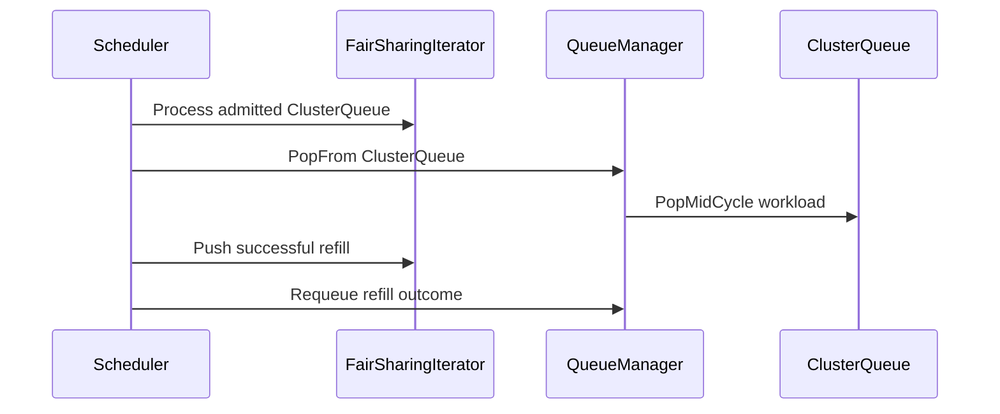

# PR #13729: Add fair sharing refill behind the FairSharingRefill gate

**Summary**: Add fair sharing refill behind the FairSharingRefill gate

**Sources**: https://github.com/kubernetes-sigs/kueue/pull/13729

**Last updated**: 2026-08-28T14:55:03Z

---

## Metadata

- **State**: open
- **Author**: [@apullo777](https://github.com/apullo777)
- **Branch**: `fairsharing-refill-prototype` → `main`
- **Created**: 2026-08-02T23:35:48Z
- **Updated**: 2026-08-28T14:55:03Z
- **Merged**: —
- **Closed**: —
- **Labels**: `kind/feature`, `release-note`, `size/XXL`, `ok-to-test`, `cncf-cla: yes`, `area/fair-sharing`
- **Assignees**: [@amy](https://github.com/amy)
- **Requested reviewers**: [@tenzen-y](https://github.com/tenzen-y)
- **Changed files**: 22   **+4535 / -133**

## Description

<!--  Thanks for sending a pull request!  Here are some tips for you:

1. If this is your first time, please read our contributor guidelines: https://git.k8s.io/community/contributors/guide/first-contribution.md#your-first-contribution and developer guide https://git.k8s.io/community/contributors/devel/development.md#development-guide
2. Please label this pull request according to what type of issue you are addressing, especially if this is a release targeted pull request. For reference on required PR/issue labels, read here:
https://git.k8s.io/community/contributors/devel/sig-release/release.md#issuepr-kind-label
3. Ensure you have added or ran the appropriate tests for your PR: https://git.k8s.io/community/contributors/devel/sig-testing/testing.md
4. If you want *faster* PR reviews, read how: https://git.k8s.io/community/contributors/guide/pull-requests.md#best-practices-for-faster-reviews
5. If the PR is unfinished, see how to mark it: https://git.k8s.io/community/contributors/guide/pull-requests.md#marking-unfinished-pull-requests
-->

#### What type of PR is this?

/kind feature

#### What this PR does / why we need it:

With Fair Sharing enabled, the scheduler currently considers only the workloads selected at the start of a scheduling cycle. After an under-share ClusterQueue admits its head, its next workload waits until the next cycle, even though the updated fair-sharing order may still favor that ClusterQueue.

This can make a backlogged ClusterQueue advance only one workload per cycle and allow newly available capacity to go to siblings with a higher share, as in #9345.

Following the refill direction proposed by @amy in https://github.com/kubernetes-sigs/kueue/pull/13496#issuecomment-5126216451 and tracked as work item 1 of #13695, this PR introduces the alpha `FairSharingRefill` feature gate, disabled by default. When enabled together with Fair Sharing:

* after a successful admission, the next workload from the same ClusterQueue is popped into the running cycle;
* it is nominated against the snapshot that already includes the preceding admission;
* it rejoins the remaining fair-sharing tournament, whose DRS ordering is recomputed on every pop;
* a global per-cycle budget bounds the additional work.

Unlike look-ahead (#13496), refill does not eagerly nominate multiple workloads from each ClusterQueue. A successor enters the candidate set only after the preceding workload is admitted.

The supporting changes have been split out for separate review:

- #13885 — snapshot-failure cleanup;
- #14848 — keyed inflight claims and mid-cycle pop primitives, stacked on #13885;
- #14847 — scheduler refactors (nominateWorkload, finishEntry).

This branch currently carries #13885 → #14848 → #14847 underneath the refill commits and will drop them as the prerequisite PRs merge.

The refill-specific review surface here is the final 15 commits: the `refillPass` trigger and budget, the Fit-only policy, the free-capacity precheck, and the refill tests.

AI assistance was used for parts of the analysis and drafting; all changes were reviewed and validated by me.

#### Which issue(s) this PR fixes:
<!--
*Automatically closes linked issue when PR is merged.
Usage: `Fixes #<issue number>`, or `Fixes (paste link of issue)`.
_If PR is about `failing-tests or flakes`, please post the related issues/tests in a comment and do not use `Fixes`_*
-->

Fixes #9345
Part of #13695
Part of #14596

#### Special notes for your reviewer:

A few refill-specific choices worth calling out:

1. The budget counts refill pops, not admissions. Failed nominations still consume it, so the additional work per cycle remains bounded. The current value of 8 is not considered settled; configuration is being discussed in #14190, while budget scope and exhaustion policy are tracked in the accompanying KEP #14605.

2. Only a fresh admission continues the refill chain. Preemption, second-pass admissions, and an admitted `ConcurrentAdmission` variant stop it. Second-pass workloads already held quota, while refilling another variant could admit siblings against the same frozen snapshot.

3. A refilled workload acts only on `Fit`. Before consuming budget or popping, refill checks the ClusterQueue's Available capacity and stops with `NoFreeCapacity` when all flavor resources are exhausted. This is intentionally a coarse precheck; the flavor assigner still makes the actual fit decision.

4. `WaitForPodsReady` with `blockAdmission` disables refill for the whole cycle. That configuration already serializes admission, so bringing another workload into the same cycle would add work without allowing it to admit sooner.

`PopMidCycle` does not advance `popCycle`. A refilled workload still belongs to the cycle-start evaluation epoch, so capacity events received during the cycle remain visible to it.

Known limitations:

* A refilled workload can still take a worse `Fit` than it would as a cycle-start head, because it sees reservations made earlier in the cycle. This can affect partial admission size or flavor choice.
* The budget is global per cycle, with no cross-cohort arbitration yet.
* The capacity precheck only detects the fully exhausted case. A workload larger than the remaining capacity can still be popped and deferred, with that extra work bounded by the refill budget.

Gate-off behavior:

With the gate disabled, or Fair Sharing not configured, no refill behavior occurs.

The supporting bookkeeping, scheduler refactors, and snapshot-failure cleanup that remain active with the gate off are reviewed separately in #14848, #14847, and #13885. This branch carries them only until the prerequisite PRs merge.

Benchmark:

The companion experimental PR #13730 carries the reproducible drain-to-empty benchmark and fixtures; detailed measurements are kept in the review thread.

At a high level, refill trades more work inside some scheduling cycles for fewer cycles overall. It helps most when backlog is concentrated. The free-capacity precheck also removes the pathological full-cohort case where refill would otherwise pop, nominate, and immediately defer a workload with no free capacity available.

Validation:

Coverage includes the #9345 scenario with the gate on and off, budget boundaries, failed and dropped nominations, fresh-state reranking, TAS same-cycle contention, mid-cycle requeue signals, non-`Fit` deferral, `ConcurrentAdmission`, the capacity check before a pop, and multi-inflight bookkeeping. The shared scheduler tests also check that workloads do not leave a cycle holding an unexpected inflight claim.

#### Does this PR introduce a user-facing change?
<!--
If no, just write "NONE" in the release-note block below.
If yes, a release note is required:
Enter your extended release note in the block below. If the PR requires additional action from users switching to the new release, include the string "action required".
-->
```release-note
Fair Sharing: Added the alpha `FairSharingRefill` feature gate, disabled by default. When enabled together with Fair Sharing, admitting a workload can bring the next workload from the same ClusterQueue into the current scheduling cycle, bounded by a per-cycle budget.
```


<!-- This is an auto-generated comment: release notes by coderabbit.ai -->
## Summary by CodeRabbit

## New Features
- Added alpha-gated fair-sharing refills for additional workloads from the same queue during a scheduling cycle.
- Added configurable refill budgets, including zero-budget support.
- Added queue operations for mid-cycle retrieval, queued-work detection, and inflight cleanup.

## Bug Fixes
- Improved workload requeueing and bookkeeping after deletion, inadmissibility, queue changes, or snapshot failures.

## Tests
- Added coverage for refill behavior, budget limits, admission failures, snapshot recovery, and inflight workload handling.
<!-- end of auto-generated comment: release notes by coderabbit.ai -->

## Discussion

### Comment by [@netlify[bot]](https://github.com/apps/netlify) — 2026-08-02T23:35:54Z

### <span aria-hidden="true">✅</span> Deploy Preview for *kubernetes-sigs-kueue* canceled.


|  Name | Link |
|:-:|------------------------|
|<span aria-hidden="true">🔨</span> Latest commit | 90daa2650b459ede7ed583f1bdc1331da30298c4 |
|<span aria-hidden="true">🔍</span> Latest deploy log | https://app.netlify.com/projects/kubernetes-sigs-kueue/deploys/6a91a112a3bdad0008ece156 |

### Comment by [@kubernetes-prow[bot]](https://github.com/apps/kubernetes-prow) — 2026-08-02T23:35:58Z

Hi @apullo777. Thanks for your PR.

I'm waiting for a [kubernetes-sigs](https://github.com/orgs/kubernetes-sigs/people) member to verify that this patch is reasonable to test. If it is, they should reply with `/ok-to-test` on its own line. Until that is done, I will not automatically test new commits in this PR, but the usual testing commands by org members will still work.

>[!TIP]
>**We noticed you've done this a few times! Consider [joining the org](https://git.k8s.io/community/community-membership.md#member) to skip this step and gain `/lgtm` and other bot rights.** We recommend asking approvers on your previous PRs to sponsor you.

Once the patch is verified, the new status will be reflected by the `ok-to-test` label.

I understand the commands that are listed [here](https://go.k8s.io/bot-commands?repo=kubernetes-sigs%2Fkueue).

<details>

Instructions for interacting with me using PR comments are available [here](https://git.k8s.io/community/contributors/guide/pull-requests.md).  If you have questions or suggestions related to my behavior, please file an issue against the [kubernetes-sigs/prow](https://github.com/kubernetes-sigs/prow/issues/new?title=Prow%20issue:) repository.
</details>

### Comment by [@kubernetes-prow[bot]](https://github.com/apps/kubernetes-prow) — 2026-08-02T23:35:58Z

[APPROVALNOTIFIER] This PR is **NOT APPROVED**

This pull-request has been approved by: *<a href="https://github.com/kubernetes-sigs/kueue/pull/13729#" title="Author self-approved">apullo777</a>*
**Once this PR has been reviewed and has the lgtm label**, please assign [olekzabl](https://github.com/olekzabl), [pbundyra](https://github.com/pbundyra), [tenzen-y](https://github.com/tenzen-y) for approval. For more information see [the Code Review Process](https://git.k8s.io/community/contributors/guide/owners.md#the-code-review-process).

The full list of commands accepted by this bot can be found [here](https://go.k8s.io/bot-commands?repo=kubernetes-sigs%2Fkueue).

<details open>
Needs approval from an approver in each of these files:

- **[OWNERS](https://github.com/kubernetes-sigs/kueue/blob/main/OWNERS)**

Approvers can indicate their approval by writing `/approve` in a comment
Approvers can cancel approval by writing `/approve cancel` in a comment
</details>
<!-- META={"approvers":["olekzabl","pbundyra","tenzen-y"]} -->

### Comment by [@coderabbitai[bot]](https://github.com/apps/coderabbitai) — 2026-08-02T23:36:27Z

<!-- This is an auto-generated comment: summarize by coderabbit.ai -->
<!-- review_stack_entry_start -->

[](https://app.coderabbit.ai/change-stack/kubernetes-sigs/kueue/pull/13729?utm_source=github_walkthrough&utm_medium=github&utm_campaign=change_stack)

<!-- review_stack_entry_end -->
<!-- This is an auto-generated comment: review paused by coderabbit.ai -->

> [!NOTE]
> ## Reviews paused
> 
> It looks like this branch is under active development. To avoid overwhelming you with review comments due to an influx of new commits, CodeRabbit has automatically paused this review. You can configure this behavior by changing the `reviews.auto_review.auto_pause_after_reviewed_commits` setting.
> 
> Use the following commands to manage reviews:
> - `@coderabbitai resume` to resume automatic reviews.
> - `@coderabbitai review` to trigger a single review.
> 
> Use the checkboxes below for quick actions:
> - [ ] <!-- {"checkboxId": "7f6cc2e2-2e4e-497a-8c31-c9e4573e93d1"} --> ▶️ Resume reviews
> - [ ] <!-- {"checkboxId": "e9bb8d72-00e8-4f67-9cb2-caf3b22574fe"} --> 🔍 Trigger review

<!-- end of auto-generated comment: review paused by coderabbit.ai -->
<!-- walkthrough_start -->

<details>
<summary>📝 Walkthrough</summary>

## Walkthrough

The scheduler adds feature-gated, budgeted fair-sharing refills. Queue state tracks multiple inflight workloads and supports mid-cycle pops. Requeue and snapshot-failure paths clear stale bookkeeping.

### Changes

**Fair-sharing refill**

|Layer / File(s)|Summary|
|---|---|
|**Multi-workload inflight queue state** <br> `pkg/cache/queue/cluster_queue.go`, `pkg/cache/queue/scheduling_hash_counts.go`, `pkg/cache/queue/cluster_queue_test.go`|`ClusterQueue` tracks multiple inflight workloads, supports `PopMidCycle`, updates pending and scheduling-hash totals, and cleans up entries by workload or `LocalQueue`.|
|**Queue manager requeue and mid-cycle APIs** <br> `pkg/cache/queue/manager.go`, `pkg/cache/queue/manager_test.go`|The manager adds mid-cycle pop, queued-work detection, and inflight cleanup APIs. `RequeueWorkload` clears stale bookkeeping and handles queue reassignment.|
|**Feature-gated refill pass** <br> `pkg/features/kube_features.go`, `pkg/scheduler/fair_sharing_iterator.go`, `pkg/scheduler/refill.go`, `site/data/featuregates/versioned_feature_list.yaml`, `test/compatibility_lifecycle/reference/versioned_feature_list.yaml`|The `FairSharingRefill` gate enables bounded successor nominations within fair-sharing cycles. Successful nominations re-enter the iterator.|
|**Scheduler integration and validation** <br> `pkg/scheduler/scheduler.go`, `pkg/scheduler/scheduler_refill_test.go`, `pkg/scheduler/scheduler_snapshot_error_test.go`, `pkg/scheduler/scheduler_test.go`|The scheduler accepts a refill budget, processes refill outcomes, recovers popped workloads after snapshot failures, and tests enabled, disabled, exhausted, and failed refill cases.|

**Estimated code review effort:** 4 (Complex) | ~45 minutes

### Sequence Diagram(s)



**Possibly related issues**

- kubernetes-sigs/kueue#13884: The snapshot-failure paths requeue popped ClusterQueue heads and second-pass workloads.

**Possibly related PRs**

- [kubernetes-sigs/kueue#13496](https://github.com/kubernetes-sigs/kueue/pull/13496): Both PRs extend fair-sharing look-ahead and multi-inflight queue handling.
- [kubernetes-sigs/kueue#13885](https://github.com/kubernetes-sigs/kueue/pull/13885): This PR includes related snapshot-failure requeue and inflight-cleanup paths.
- [kubernetes-sigs/kueue#12520](https://github.com/kubernetes-sigs/kueue/pull/12520): Both PRs modify ClusterQueue inflight and scheduling-hash accounting.

**Suggested reviewers:** `amy`, `tenzen-y`

</details>

<!-- walkthrough_end -->
<!-- pre_merge_checks_walkthrough_start -->

<details>
<summary>🚥 Pre-merge checks | ✅ 4 | ❌ 1</summary>

### ❌ Failed checks (1 warning)

|     Check name     | Status     | Explanation                                                                           | Resolution                                                                         |
| :----------------: | :--------- | :------------------------------------------------------------------------------------ | :--------------------------------------------------------------------------------- |
| Docstring Coverage | ⚠️ Warning | Docstring coverage is 66.67% which is insufficient. The required threshold is 80.00%. | Write docstrings for the functions missing them to satisfy the coverage threshold. |

<details>
<summary>✅ Passed checks (4 passed)</summary>

|         Check name         | Status   | Explanation                                                                                                                                  |
| :------------------------: | :------- | :------------------------------------------------------------------------------------------------------------------------------------------- |
|     Linked Issues check    | ✅ Passed | The implementation enables deeper same-ClusterQueue scheduling within a cycle, addressing the unfair DRS decisions described in issue `#9345`. |
| Out of Scope Changes check | ✅ Passed | The queue, bookkeeping, feature-gate, scheduler, and test changes directly support fair-sharing refill and its failure-handling behavior.    |
|      Description Check     | ✅ Passed | Check skipped - CodeRabbit’s high-level summary is enabled.                                                                                  |
|         Title check        | ✅ Passed | The title clearly and concisely summarizes the primary change: adding fair-sharing refill behind the FairSharingRefill feature gate.         |

</details>

</details>

<!-- pre_merge_checks_walkthrough_end -->
<!-- finishing_touch_checkbox_start -->

<details>
<summary>✨ Finishing Touches</summary>

<details>
<summary>🧪 Generate unit tests (beta)</summary>

- [ ] <!-- {"checkboxId": "f47ac10b-58cc-4372-a567-0e02b2c3d479", "radioGroupId": "utg-output-choice-group-unknown_comment_id"} -->   Create PR with unit tests

</details>

</details>

<!-- finishing_touch_checkbox_end -->
<!-- tips_start -->

---


<sub>Comment `@coderabbitai help` to get the list of available commands.</sub>

<!-- tips_end -->

### Comment by [@amy](https://github.com/amy) — 2026-08-03T00:30:05Z

/ok-to-test
/assign

```
Backlogged borrowing: 32 → 4 cycles to drain.
Balanced nominal usage: 8 → 5 cycles to drain.
```
^ damnnnnn nice! Seems promising. (Haven't looked at anything yet. Will prioritize these PRs this week.)

### Comment by [@apullo777](https://github.com/apullo777) — 2026-08-03T00:31:19Z

@amy @mimowo

Following up with the drain-to-empty benchmark requested in #13496 for the refill prototype.

A single-cycle benchmark cannot observe refill's intended effect because refill moves admissions between cycles. This benchmark starts from a populated queue state and runs scheduling cycles until every workload is admitted. Capacity equals total demand, so both arms admit the same workloads and can be compared by cycles to drain and cost per admission.

The benchmark and its fixture guard are committed on the companion experimental PR #13730 as `BenchmarkSchedulerFairSharingRefillDrain` and `TestRefillDrainScenarios`.

Gate off vs on, 10 alternating `go test` rounds with `-benchtime=100x`, analyzed with benchstat using the fake-client harness:

**Backlogged borrowing:** 46 workloads, with one ClusterQueue holding 32 pending workloads and seven steady ClusterQueues holding 2 each.

```text
cycles/drain     32.000 ± 0%  ->   4.000 ± 0%   -87.5%
admits/cycle      1.438 ± 0%  ->  11.500 ± 0%   +700%
sec/admit        61.20µ ± 4%  ->  48.26µ ± 2%   -21.1%
B/drain         2.422Mi ± 0%  -> 1.979Mi ± 0%   -18.3%
allocs/drain     25.33k ± 0%  ->  21.57k ± 0%   -14.8%
```

The cycle counts are exactly deterministic. Without refill, the backlogged ClusterQueue advances by one workload per cycle. With refill, the admission trace is `16, 12, 9, 9`: the refill budget is exhausted while the backlog remains, but entries already in the tournament continue normally. The baseline therefore pays the fixed costs of 28 additional cycles to drain the same workload set.

**Balanced nominal usage:** 64 workloads, split evenly across eight identical ClusterQueues. DRS remains zero and ordering falls back to FIFO.

```text
cycles/drain      8.000 ± 0%  ->   5.000 ± 0%   -37.5%
admits/cycle      8.000 ± 0%  ->  12.800 ± 0%    +60%
sec/admit        46.31µ ± 5%  ->  47.66µ ± 1%    +2.9%  (p=0.023)
B/drain         2.729Mi ± 0%  -> 2.697Mi ± 0%    -1.2%
allocs/drain     29.81k ± 0%  ->  29.67k ± 0%    -0.5%
```

There is no fairness imbalance for refill to correct in this fixture. Its effect is fewer, larger cycles, with a small time-per-admission cost: +2.9% in this session (`p=0.023`) and +1.8% in an earlier session (`p=0.072`). Allocations remain nearly flat.

I also ported the same fixtures to the #13496 look-ahead prototype (`FairSharingDeepAdmission`, depth 2). Both branches are based on the same `main` commit and use the same benchmark fixtures and run protocol, with both binaries measured in alternating rounds within the same session.

The baseline arms are effectively equivalent: sec/op is statistically indistinguishable (`p=0.68` for backlog and `p=0.35` for balanced), cycle counts are identical across all samples, and B/drain differs by only 0.3%. The gate-on cycle, time, and allocation results are therefore directly comparable:

```text
cycles to drain             baseline   look-ahead   refill
backlog  (46 workloads)        32          23          4
balanced (64 workloads)         8          32          5

gate-on arms, head to head   look-ahead      refill
backlog:   sec/admit          116.9µ ± 1%    48.3µ ± 2%   -59%
           allocs/drain        51.6k ± 0%    21.6k ± 0%   -58%
balanced:  sec/admit          181.2µ ± 3%    47.7µ ± 1%   -74%
           allocs/drain       108.6k ± 0%    29.7k ± 0%   -73%
```

With look-ahead, the interrupt ends processing for the root cohort after one ClusterQueue admits two workloads, producing exactly two admissions per cycle in both fixtures. Refill instead stops adding successors when its budget is exhausted while allowing candidates already in the tournament to continue.

To be fair to the interrupt, this no-contention drain emphasizes its cost without exercising its intended benefit: there is no contested capacity that needs to be protected from an over-share sibling.

As a sensitivity check, refill budgets `2 / 4 / 8` drain the backlog in `11 / 7 / 4` cycles. At budget 2, the balanced fixture remains at its eight-cycle baseline rather than increasing to 32 cycles, because exhausting the refill budget does not stop the rest of the cycle.

The allocation profiles support the same explanation. They come from separate runs of 300 drains per arm and are focused on `(*Scheduler).schedule` with `alloc_space` selected.

**Backlog: gate off vs on:**


Allocation under `schedule` falls from 590.2 MB to 497.2 MB. The enabled arm adds mid-cycle nominations, but avoiding 28 repeated cycles saves more allocation in snapshots and initial head nominations than refill adds.

**Balanced: gate off vs on:**


Allocation is nearly flat at 637.2 MB vs 605.2 MB.

CPU profiles were not useful for scheduler-level attribution because this fake-client harness is dominated by goroutine synchronization and scheduler compute accounts for less than 0.5% of process samples. The transferable result is therefore the deterministic cycle count, not the absolute microsecond values.

Limits: these fixtures use eight ClusterQueues, one flavor, one pod set per workload, no admission checks, no preemption, and no TAS. Capacity equals demand, so they measure drain mechanics and cycle convergence rather than contention or starvation. A TAS fixture remains a follow-up.

The refill benchmark and guard test are available in #13730. The [same-base look-ahead port](https://github.com/kubernetes-sigs/kueue/compare/main...apullo777:lookahead-drain-current) contains the #13496 commits cherry-picked onto the shared `main` base with the identical benchmark, for inspection and reproduction.

### Comment by [@mimowo](https://github.com/mimowo) — 2026-08-03T19:04:01Z

/area fair-sharing

### Comment by [@coderabbitai[bot]](https://github.com/apps/coderabbitai) — 2026-08-08T00:33:51Z

<!-- This is an auto-generated comment by CodeRabbit -->
> [!NOTE]
> GitHub couldn't provide a complete incremental comparison for this pull request, so CodeRabbit is performing a full review instead. This review may take a little longer.

### Comment by [@apullo777](https://github.com/apullo777) — 2026-08-08T23:00:03Z

@amy just pushed the latest test additions: more TAS refill coverage, a direct `fairSharingIterator.push` test, and some queue-layer coverage around the multi-inflight bookkeeping.

Also refreshed the description after the rebase. The snapshot-failure fix is split out into #13885 / #13884 now and will be dropped here once that merges.

### Comment by [@apullo777](https://github.com/apullo777) — 2026-08-09T19:51:18Z

two more test commits are up. One extra bit beyond the commit titles: the suppression coverage also checks that an empty backlog doesn’t consume the refill budget.

### Comment by [@amy](https://github.com/amy) — 2026-08-09T22:24:52Z

@apullo777 Some followup for the analysis here: https://github.com/kubernetes-sigs/kueue/pull/13729#issuecomment-5161122381

I think the test mostly focuses on benefits where its a closed system (ie fixed backlog, nothing arrives, nothing frees). This is good because it answers `"does refill help throughput?"` We should ask more questions though so we know 1.) the tradeoffs and 2.) how to tune budget to balance against the tradeoffs. I think you note some of the topics below in your analysis, but lets tag some numbers on it.

More stuff to test for this benchmark: 
1. `How much longer does a cycle get with refill on?` A cycle works off one snapshot. Meaning, the longer a cycle runs, the more stale that snapshot is by the end of the cycle. So let's measure how much extra time refill costs by comparing gate on and gate off. (Presumably refill takes longer per cycle, just curious what the diff is.) Can you add max cycle time as a reported metric, and paste one per-cycle time trace?

2. `How much longer does new work wait before the scheduler looks at it?` Add two cases where a workload shows up late. This measures reaction latency. You can probably do something where you count admissions using the fake client until the scheduler is able to touch the newcomer. 
    **Case 1:** Newcomer lands in a CQ that admits again later in the cycle.
    **Case 2:** Newcomer lands anywhere else.

3. `What budget value is right, and does the benefit stop improving before 8?` Run budget **0** (new one), 2, 4, and 8 across all four scenarios: the two the benchmark has today, plus the late arrival and freed capacity cases above. The result is a small table: budget, how fast the backlog drains, how long new work waits. This can help us tune the default. 

**Summary:** With these added tests we're measuring... refill's benefit (fewer cycles, sometimes faster arrival pickup) versus its bounded cost (worst cycle, newcomer wait), as a function of the default budget

> ai-assisted comment 🤖👩🏻‍💻

### Comment by [@amy](https://github.com/amy) — 2026-08-10T04:48:39Z

@apullo777 Did a higher level pass checking:
- functionality/algorithm
- whether it interacts negatively with other features
- general readability

Please note this benchmark request: https://github.com/kubernetes-sigs/kueue/pull/13729#issuecomment-5234156908

🎉 Overall, looks great! Lemme know when you've addressed the above and I'll do a nittier pass. May come up with nothing, but wanna see what my LLM says when I run it through the review skill that looks at like nittier code style stuff.

### Comment by [@apullo777](https://github.com/apullo777) — 2026-08-18T21:33:59Z

> Summary: With these added tests we're measuring... refill's benefit (fewer cycles, sometimes faster arrival pickup) versus its bounded cost (worst cycle, newcomer wait), as a function of the default budget

@amy I pushed the benchmark harness to #13730 so the fixtures and measurements are reproducible. Keeping the analysis here. It now covers 11 fixtures across gate=off and budgets 0/2/4/8/unbounded.

**TL;DR:** Refill is cycle amortization rather than a scheduler speedup: it can reduce drain cycles and sometimes pick up new work sooner, but it also makes individual cycles longer and can increase the wait for work in a ClusterQueue that is not admitting that cycle. The sweep does not identify a universal budget; the useful allowance tracks the number of ClusterQueues actively admitting, while the unbounded arm makes the case for keeping the work bounded.

The two extremes make that tradeoff visible. On the concentrated `backlog` case, 32 → 4 cycles is about 24% less wall time, not 8x faster. At the other extreme, `contended`, where only one unit becomes available per cycle, pays for a nomination and requeue it cannot use and is about 60% slower with ~68% more allocations.

For the measurements, each (fixture, arm) runs in its own process; I discard the first reported sample and compare the remaining samples. The harness also reports CPU time separately from wall time, since refill can overlap more admission work without actually removing it.

One methodology caveat: the harness joins admission goroutines inside the cycle timer, unlike the production `schedule()`. Moving that join out makes the `backlog` ratio larger rather than smaller, while drain wall time and the `contested-wide` comparison are effectively unchanged.

**1. How much longer does a cycle get?**

On `backlog`:

| arm | p50 cycle | p95 cycle | drain cycles |
|---|---|---|---|
| off | 0.077 ms | 0.372 ms | 32 |
| budget 2 | 0.178 | 0.516 | 11 |
| budget 4 | 0.276 | 0.629 | 7 |
| budget 8 | 0.492 | 0.844 | 4 |
| unbounded | 2.235 | 2.292 | 1 |

So budget 8 makes the median cycle about 6x longer here (closer to 7x once the harness's own goroutine join is taken out, per the caveat above). Unbounded collapses the drain into one cycle, but that cycle is ~29x longer than the baseline median, which is the clearest argument for having a bound at all.

I would use p50/p95 rather than max-cycle-ms for comparisons: the max is taken over a different number of cycles in each arm, so its sample size changes with the thing we're measuring.

**2. How much longer can new work wait?**

I added both shapes we discussed, injecting the newcomer after the second admission:

* If it lands in a ClusterQueue that keeps admitting, refill can actually reach it in the same cycle: 3 → 0 cycles of wait by budget 4, about 0.310 → 0.106 ms here.
* If it lands in a ClusterQueue that admits nothing else that cycle, refill cannot reach it. The wait stays 1 cycle, but that cycle is longer: about 0.103 → 0.267 ms at budget 8.

That second case is the latency cost I think matters: refill does not necessarily add a cycle of waiting; it can make the cycle the new workload is already waiting for longer.

**3. What budget looks right?**

I don't think the sweep identifies one universal number. The useful axis seems to be budget per ClusterQueue that is actively admitting.

For example, `balanced-wide` has 32 queues and budget 8: refill performs 56 admissions through refill pops but the drain still takes 8 cycles, so the extra work buys no cycle reduction. With actual competing shares, budget 2 halves the drain for 2 borrowing queues, but buys no cycles at all for 12 borrowing queues.

There is also a measurable fairness residue when the budget binds. On `contested-wide`, the budget was exhausted 31 times, and 19 later admissions went to a ClusterQueue with a larger share while a poorer queue still had a successor hidden behind the exhausted budget. This does not prove that successor would have admitted, but it is enough to make the exhaustion policy a design question rather than something I would change in the prototype.

The global budget also did not show systematic cross-cohort starvation in the two-cohort fixture; the split was symmetric across repeated drains. What it did show was variance: uneven allocation of the budget can add an extra drain cycle.

One other useful finding: on `contended`, more than half of the extra allocations from a wasted refill pop are in putting the workload back, not in nomination itself. The largest piece is recomputing the scheduling equivalence hash through `encoding/json`; I split that out into #14604 since refill only makes an existing requeue cost more visible.

The benchmark still doesn't cover preemption or TAS, where a refill pop can be more expensive.

I don't think the benchmark picks a universal default or settles the exhaustion policy. I opened #14605 as the accompanying KEP so those policy choices have a design-level home.

> ai-assisted comment 🤖

### Comment by [@apullo777](https://github.com/apullo777) — 2026-08-18T21:39:52Z

@amy, pushed the round-one updates and replied inline. The updated benchmark and analysis are in the benchmark thread above, and I split the scheduling-hash cost it surfaced into #14604.

This PR grew with the round-one changes. I did look at moving the queue-layer bookkeeping, meaning the keyed inflight claims and the mid-cycle pop plumbing, into its own PR. On its own it would add exported methods that have no caller until refill lands, so I kept them together. But happy to split it anyway if that would make review easier.

### Comment by [@amy](https://github.com/amy) — 2026-08-24T02:09:58Z

@apullo777 nice! https://github.com/kubernetes-sigs/kueue/pull/13729#issuecomment-5334335064

> On the concentrated backlog case, 32 → 4 cycles is about 24% less wall time, not 8x faster.


- ~24% wall-time reduction is good.
- Fine with cycle time increasing, that's expected. What's good in the `How much longer does a cycle get?` table is that the growth is linear in the budget, roughly a constant ~50µs per extra pop. 

> If it lands in a ClusterQueue that admits nothing else that cycle, refill cannot reach it. The wait stays 1 cycle, but that cycle is longer: about 0.103 → 0.267 ms at budget 8.

- Fine with this tradeoff given the overall wall time decreased.

> pays for a nomination and requeue it cannot use and is about 60% slower with ~68% more allocations

- I think between https://github.com/kubernetes-sigs/kueue/pull/13729#discussion_r3840147299 and #14604, this mostly goes away. Worth re-running contended once #14604 lands to see the residual.

---

PR reduction: yeah, let's do that. Some of this code runs with the feature gate off anyway:

1. The queue bookkeeping you mentioned 
2. The no behavior change edits to existing scheduler code (nominateWorkload extraction, finishEntry, sorted test dumps).
3. Land #13885, then rebase.

### Comment by [@apullo777](https://github.com/apullo777) — 2026-08-28T14:42:59Z

@amy I pushed the free-capacity check, and cleaned up the stack a bit to match the split-out PRs :)

The prerequisite and cleanup pieces are split out into separate PRs now:

* #13885 — snapshot-failure cleanup
* #14848 — keyed inflight bookkeeping and mid-cycle pop primitives, stacked on #13885
* #14847 — `nominateWorkload` / `finishEntry` refactors

For easier navigation here, I collapsed each carried prerequisite PR into one commit: the first 3 commits are those temporary prerequisites, and the remaining 15 are refill-specific.

I also added the free-capacity check you suggested. On `contended`, the 11 deferred refill pops per drain now stop with `NoFreeCapacity` before doing the extra work. In the paired rerun, wall time and CPU are back within noise of gate-off (-1.2% / +0.1%), with allocations down 0.7%.

I'll rerun `contended` again once #14604 lands as you suggested!

## Reviews

### Review by [@coderabbitai[bot]](https://github.com/apps/coderabbitai) (commented) — 2026-08-08T00:38:05Z

**Actionable comments posted: 1**

<details>
<summary>🧹 Nitpick comments (3)</summary><blockquote>

<details>
<summary>pkg/cache/queue/cluster_queue_test.go (1)</summary><blockquote>

`2295-2299`: _📐 Maintainability & Code Quality_ | _🔵 Trivial_ | _💤 Low value_

**Set `queueingStrategy` explicitly in this test.**

The test depends on the non-immediate requeue path. `RequeueIfNotPresent` selects that path only because the zero-value `queueingStrategy` is not `kueue.BestEffortFIFO` and not `kueue.StrictFIFO`, so it falls into the `else` branch. Other tests in this file set the field explicitly. Set it to `kueue.BestEffortFIFO` to state the intent and to keep the test valid if the branch conditions change.


<details>
<summary>♻️ Proposed change</summary>

```diff
 	cq := newClusterQueueImpl(ctx, nil, nil, defaultOrdering, testingclock.NewFakeClock(now))
+	cq.queueingStrategy = kueue.BestEffortFIFO
 	head := workload.NewInfo(utiltestingapi.MakeWorkload("head", defaultNamespace).Creation(now).Obj())
```
</details>

<details>
<summary>🤖 Prompt for AI Agents</summary>

```
Verify each finding against current code. Fix only still-valid issues, skip the
rest with a brief reason, keep changes minimal, and validate.

In `@pkg/cache/queue/cluster_queue_test.go` around lines 2295 - 2299, Set
queueingStrategy explicitly to kueue.BestEffortFIFO when constructing cq in this
test, using the newClusterQueueImpl setup. Preserve the test’s non-immediate
requeue behavior and avoid relying on the field’s zero value.
```

</details>

<!-- cr-comment:v1:323b7b1814b3ddcb90e74a1f -->

</blockquote></details>
<details>
<summary>pkg/cache/queue/manager.go (1)</summary><blockquote>

`1015-1023`: _📐 Maintainability & Code Quality_ | _🔵 Trivial_ | _⚡ Quick win_

**Align `HasQueuedWorkloads` with `PopFrom` on the active check.**

`PopFrom` returns nil when `m.statusChecker` reports the ClusterQueue as inactive. `HasQueuedWorkloads` skips that check, so it can return true for a ClusterQueue that `PopFrom` refuses to pop from. The doc comment states that it reports whether "a mid-cycle pop would find a successor", which does not hold in that case.

The current consumer in `pkg/scheduler/refill.go` uses the result only to gate a V(3) log line, so the impact today is a misleading log entry. Either add the same active check or narrow the doc comment, so a later caller does not use this as a `PopFrom` predicate.


<details>
<summary>♻️ Option: apply the same active check</summary>

```diff
 func (m *Manager) HasQueuedWorkloads(cqName kueue.ClusterQueueReference) bool {
 	m.RLock()
 	defer m.RUnlock()
+	// Cache might be nil in tests, if cache is nil, we'll skip the check.
+	if m.statusChecker != nil && !m.statusChecker.ClusterQueueActive(cqName) {
+		return false
+	}
 	cq := m.hm.ClusterQueue(cqName)
 	return cq != nil && cq.hasQueuedWorkloads()
 }
```
</details>

<details>
<summary>🤖 Prompt for AI Agents</summary>

```
Verify each finding against current code. Fix only still-valid issues, skip the
rest with a brief reason, keep changes minimal, and validate.

In `@pkg/cache/queue/manager.go` around lines 1015 - 1023, Update
Manager.HasQueuedWorkloads to apply the same m.statusChecker active-state check
used by PopFrom before evaluating cq.hasQueuedWorkloads(), preserving the false
result for missing or inactive ClusterQueues and keeping its “mid-cycle pop
would find a successor” contract accurate.
```

</details>

<!-- cr-comment:v1:e607c8e88cebf9050977e0c6 -->

</blockquote></details>
<details>
<summary>pkg/cache/queue/manager_test.go (1)</summary><blockquote>

`2796-2894`: _📐 Maintainability & Code Quality_ | _🔵 Trivial_ | _⚡ Quick win_

**Consider covering the unexpected-error branch of `RequeueWorkload`.**

The three subtests cover the NotFound exit, the non-admissible exit, and the retargeted-queue path. The branch at `pkg/cache/queue/manager.go` lines 780-786, where `m.client.Get` returns an error that is not NotFound, stays uncovered. That branch clears only the queue-side bookkeeping and keeps the workload-controller records, so its behavior differs from the NotFound branch.

You can add a subtest that uses `interceptor.Funcs` on the fake client builder to return a non-NotFound error from `Get`, then assert that the inflight entry is released and `workloadAssignedQueues` keeps the entry.

<details>
<summary>🤖 Prompt for AI Agents</summary>

```
Verify each finding against current code. Fix only still-valid issues, skip the
rest with a brief reason, keep changes minimal, and validate.

In `@pkg/cache/queue/manager_test.go` around lines 2796 - 2894, Add an
unexpected-error subtest to TestRequeueWorkloadWhileInflight that configures the
fake client’s interceptor.Funcs Get handler to return a non-NotFound error for
the popped workload. Assert RequeueWorkload does not requeue, removes the
workload from the ClusterQueue inflight set, and preserves its
workloadAssignedQueues entry, matching the error branch in RequeueWorkload.
```

</details>

<!-- cr-comment:v1:d7e251cadc0e732389d21654 -->

</blockquote></details>

</blockquote></details>

<details>
<summary>🤖 Prompt for all review comments with AI agents</summary>

```
Verify each finding against current code. Fix only still-valid issues, skip the
rest with a brief reason, keep changes minimal, and validate.

Inline comments:
In `@pkg/scheduler/refill.go`:
- Around line 126-127: Update the nominationDropped branch in the refill
handling flow to call s.queues.ForgetInflight with refilled.ClusterQueue and
workload.Key(refilled.Obj) before returning. Add a regression test covering a
refilled workload whose nomination outcome is dropped and verify its inflight
record is cleared.

---

Nitpick comments:
In `@pkg/cache/queue/cluster_queue_test.go`:
- Around line 2295-2299: Set queueingStrategy explicitly to kueue.BestEffortFIFO
when constructing cq in this test, using the newClusterQueueImpl setup. Preserve
the test’s non-immediate requeue behavior and avoid relying on the field’s zero
value.

In `@pkg/cache/queue/manager_test.go`:
- Around line 2796-2894: Add an unexpected-error subtest to
TestRequeueWorkloadWhileInflight that configures the fake client’s
interceptor.Funcs Get handler to return a non-NotFound error for the popped
workload. Assert RequeueWorkload does not requeue, removes the workload from the
ClusterQueue inflight set, and preserves its workloadAssignedQueues entry,
matching the error branch in RequeueWorkload.

In `@pkg/cache/queue/manager.go`:
- Around line 1015-1023: Update Manager.HasQueuedWorkloads to apply the same
m.statusChecker active-state check used by PopFrom before evaluating
cq.hasQueuedWorkloads(), preserving the false result for missing or inactive
ClusterQueues and keeping its “mid-cycle pop would find a successor” contract
accurate.
```

</details>

<details>
<summary>🪄 Autofix</summary>

Fix all unresolved CodeRabbit comments on this PR:

- [ ] <!-- {"checkboxId": "4b0d0e0a-96d7-4f10-b296-3a18ea78f0b9"} --> Push a commit to this branch (recommended)
- [ ] <!-- {"checkboxId": "ff5b1114-7d8c-49e6-8ac1-43f82af23a33"} --> Create a new PR with the fixes

</details>

---

<details>
<summary>ℹ️ Review info</summary>

<details>
<summary>⚙️ Run configuration</summary>

**Configuration used**: Path: .coderabbit.yaml

**Review profile**: CHILL

**Plan**: Pro Plus

**Run ID**: `5ac1d535-ad27-439c-a8f9-d8d589367abb`

</details>

<details>
<summary>📥 Commits</summary>

Reviewing files that changed from the base of the PR and between 4c6dc1a35f334305a774c4c10ea4e94ef91ff0e6 and d8f8b645965d09229a5ec31722b920115d896231.

</details>

<details>
<summary>📒 Files selected for processing (14)</summary>

* `pkg/cache/queue/cluster_queue.go`
* `pkg/cache/queue/cluster_queue_test.go`
* `pkg/cache/queue/manager.go`
* `pkg/cache/queue/manager_test.go`
* `pkg/cache/queue/scheduling_hash_counts.go`
* `pkg/features/kube_features.go`
* `pkg/scheduler/fair_sharing_iterator.go`
* `pkg/scheduler/refill.go`
* `pkg/scheduler/scheduler.go`
* `pkg/scheduler/scheduler_refill_test.go`
* `pkg/scheduler/scheduler_snapshot_error_test.go`
* `pkg/scheduler/scheduler_test.go`
* `site/data/featuregates/versioned_feature_list.yaml`
* `test/compatibility_lifecycle/reference/versioned_feature_list.yaml`

</details>

<details>
<summary>🚧 Files skipped from review as they are similar to previous changes (7)</summary>

* test/compatibility_lifecycle/reference/versioned_feature_list.yaml
* pkg/scheduler/fair_sharing_iterator.go
* pkg/features/kube_features.go
* site/data/featuregates/versioned_feature_list.yaml
* pkg/scheduler/scheduler_test.go
* pkg/scheduler/scheduler.go
* pkg/cache/queue/cluster_queue.go

</details>

</details>

<!-- This is an auto-generated comment by CodeRabbit for review status -->

- **pkg/scheduler/refill.go:127** by [@coderabbitai[bot]](https://github.com/apps/coderabbitai) — 2026-08-08T00:38:04Z
```diff
@@ -0,0 +1,161 @@
+/*
+Copyright The Kubernetes Authors.
+
+Licensed under the Apache License, Version 2.0 (the "License");
+you may not use this file except in compliance with the License.
+You may obtain a copy of the License at
+
+    http://www.apache.org/licenses/LICENSE-2.0
+
+Unless required by applicable law or agreed to in writing, software
+distributed under the License is distributed on an "AS IS" BASIS,
+WITHOUT WARRANTIES OR CONDITIONS OF ANY KIND, either express or implied.
+See the License for the specific language governing permissions and
+limitations under the License.
+*/
+
+package scheduler
+
+import (
+	"context"
+
+	"k8s.io/klog/v2"
+	ctrl "sigs.k8s.io/controller-runtime"
+
+	schdcache "sigs.k8s.io/kueue/pkg/cache/scheduler"
+	"sigs.k8s.io/kueue/pkg/features"
+	"sigs.k8s.io/kueue/pkg/workload"
+)
+
+// defaultRefillBudget bounds the number of extra workloads a scheduling cycle
+// may pop after the initial ClusterQueue heads. The bound keeps cycle length
+// and time-to-fresh-snapshot predictable under a large backlog.
+// TODO: make this configurable via the Kueue Configuration API.
+const defaultRefillBudget = 8
+
+// refillPass implements refill for fair sharing: when a workload is admitted,
+// its ClusterQueue's next workload immediately joins the running scheduling
+// cycle instead of waiting for the next one. Without refill, a cohort that
+// frees several units of capacity in one cycle serves the poorest
+// ClusterQueue's single head and over-share siblings pick up the rest; the
+// refilled workload is nominated against the snapshot that already accounts
+// for the admission, so same-CQ state is never stale. See Kueue#9345.
+//
+// When the budget runs out, the cycle keeps processing the entries already in
+// the room; the remaining backlog waits for the next cycle.
+//
+// The mid-cycle insertion primitive lives in fairSharingIterator.push so
+// other mechanisms can re-enter entries mid-cycle independently of the
+// refill-specific "pop next + budget" logic below.
+type refillPass struct {
+	scheduler *Scheduler
+	iterator  *fairSharingIterator
+	snapshot  *schdcache.Snapshot
+
+	// budget is the remaining number of extra workloads this cycle may pop
+	// after the initial ClusterQueue heads.
+	budget int
+
+	// entries and inadmissibleEntries track the workloads popped mid-cycle so
+	// the cycle's requeue step reaches them; they are not part of the entries
+	// slice built during initial nomination.
+	entries             []*entry
+	inadmissibleEntries []*entry
+}
+
+// newRefillPass returns the refill hook for this cycle, or nil (a no-op) when
+// refill is disabled. Refill relies on the fair-sharing tournament re-ranking
+// the remaining entries on every pop; ordering semantics for the classical
+// iterator are an open design question, so only the fair-sharing iterator is
+// supported.
+func (s *Scheduler) newRefillPass(iterator entryIterator, snapshot *schdcache.Snapshot) *refillPass {
+	if !features.Enabled(features.FairSharingRefill) {
+		return nil
+	}
+	fsIterator, ok := iterator.(*fairSharingIterator)
+	if !ok {
+		return nil
+	}
+	return &refillPass{
+		scheduler: s,
+		iterator:  fsIterator,
+		snapshot:  snapshot,
+		budget:    s.refillBudget,
+	}
+}
+
+// afterEntryProcessed is the refill hook, called after processEntry for
+// every popped entry. Safe to call on a nil receiver.
+func (r *refillPass) afterEntryProcessed(ctx context.Context, e *entry) {
+	if r == nil || e.status != assumed {
+		return
+	}
+	// Second-pass workloads already held quota before this cycle; their
+	// admission does not free up a head slot for their ClusterQueue.
+	if workload.HasQuotaReservation(e.Obj) {
+		return
+	}
+	log := ctrl.LoggerFrom(ctx)
+	// With WaitForPodsReady blockAdmission, admitting the refilled workload
+	// would block the scheduler goroutine until all admitted workloads
+	// (including the one just assumed) become ready. Leave the backlog for
+	// the next cycle instead.
+	if !r.scheduler.cache.PodsReadyForAllAdmittedWorkloads(log) {
+		return
+	}
+	if r.budget <= 0 {
+		// Log only when a successor actually exists in the heap, so the
+		// count measures how often the budget binds rather than how often
+		// admissions happen after exhaustion.
+		if r.scheduler.queues.HasQueuedWorkloads(e.ClusterQueue) {
+			log.V(3).Info("Refill budget exhausted; the ClusterQueue's next workload waits for the next cycle",
+				"clusterQueue", klog.KRef("", string(e.ClusterQueue)))
+		}
+		return
+	}
+	wl := r.scheduler.queues.PopFrom(ctx, e.ClusterQueue)
+	if wl == nil {
+		return
+	}
+	// A popped workload consumes budget regardless of its nomination outcome,
+	// so the total per-cycle work stays bounded.
+	r.budget--
+	ne, outcome := r.scheduler.nominateWorkload(ctx, *wl, r.snapshot)
+	refilled := &ne
+	switch outcome {
+	case nominationDropped:
+		return
```

  _🗄️ Data Integrity & Integration_ | _🟠 Major_ | _⚡ Quick win_
  
  <details>
  <summary>🧩 Analysis chain</summary>
  
  🏁 Script executed:
  
  ```shell
  #!/bin/bash
  set -euo pipefail
  
  rg -n -C 5 --glob '*.go' '\b(PopFrom|Forget[A-Za-z]*|Requeue[A-Za-z]*)\s*\(' pkg/cache/queue pkg/scheduler
  rg -n -C 8 --glob '*.go' '\bnominationDropped\b' pkg/scheduler
  ```
  
  Repository: kubernetes-sigs/kueue
  
  Length of output: 48020
  
  ---
  
  🏁 Script executed:
  
  ```shell
  #!/bin/bash
  set -euo pipefail
  
  # Read the relevant refill and queue implementation slices.
  sed -n '1,180p' pkg/scheduler/refill.go
  printf '\n--- manager.go relevant lines ---\n'
  sed -n '950,1045p' pkg/cache/queue/manager.go
  printf '\n--- cluster_queue.go relevant inflight lines ---\n'
  sed -n '730,785p' pkg/cache/queue/cluster_queue.go
  sed -n '880,955p' pkg/cache/queue/cluster_queue.go
  ```
  
  Repository: kubernetes-sigs/kueue
  
  Length of output: 13237
  
  ---
  
  
  
  </details>
  
  **Clear the inflight record for a dropped refill workload.**
  
  `PopFrom` moves the refilled workload into inflight state. `nominationDropped` must also clear that claim before returning. Add the matching `s.queues.ForgetInflight(refilled.ClusterQueue, workload.Key(refilled.Obj))` call and a regression test for a refilled workload with a dropped nomination outcome.
  
  <details>
  <summary>🤖 Prompt for AI Agents</summary>
  
  ```
  Verify each finding against current code. Fix only still-valid issues, skip the
  rest with a brief reason, keep changes minimal, and validate.
  
  In `@pkg/scheduler/refill.go` around lines 126 - 127, Update the nominationDropped
  branch in the refill handling flow to call s.queues.ForgetInflight with
  refilled.ClusterQueue and workload.Key(refilled.Obj) before returning. Add a
  regression test covering a refilled workload whose nomination outcome is dropped
  and verify its inflight record is cleared.
  ```
  
  </details>
  
  <!-- fingerprinting:phantom:medusa:tapir -->
  
  <!-- cr-indicator-types:potential_issue -->
  
  <!-- cr-comment:v1:80246b730c5b6675ad78454c -->
  
  <!-- This is an auto-generated reply by CodeRabbit -->

### Review by [@apullo777](https://github.com/apullo777) (commented) — 2026-08-08T01:04:49Z

- **pkg/scheduler/refill.go:127** by [@apullo777](https://github.com/apullo777) — 2026-08-08T01:04:49Z
```diff
@@ -0,0 +1,161 @@
+/*
+Copyright The Kubernetes Authors.
+
+Licensed under the Apache License, Version 2.0 (the "License");
+you may not use this file except in compliance with the License.
+You may obtain a copy of the License at
+
+    http://www.apache.org/licenses/LICENSE-2.0
+
+Unless required by applicable law or agreed to in writing, software
+distributed under the License is distributed on an "AS IS" BASIS,
+WITHOUT WARRANTIES OR CONDITIONS OF ANY KIND, either express or implied.
+See the License for the specific language governing permissions and
+limitations under the License.
+*/
+
+package scheduler
+
+import (
+	"context"
+
+	"k8s.io/klog/v2"
+	ctrl "sigs.k8s.io/controller-runtime"
+
+	schdcache "sigs.k8s.io/kueue/pkg/cache/scheduler"
+	"sigs.k8s.io/kueue/pkg/features"
+	"sigs.k8s.io/kueue/pkg/workload"
+)
+
+// defaultRefillBudget bounds the number of extra workloads a scheduling cycle
+// may pop after the initial ClusterQueue heads. The bound keeps cycle length
+// and time-to-fresh-snapshot predictable under a large backlog.
+// TODO: make this configurable via the Kueue Configuration API.
+const defaultRefillBudget = 8
+
+// refillPass implements refill for fair sharing: when a workload is admitted,
+// its ClusterQueue's next workload immediately joins the running scheduling
+// cycle instead of waiting for the next one. Without refill, a cohort that
+// frees several units of capacity in one cycle serves the poorest
+// ClusterQueue's single head and over-share siblings pick up the rest; the
+// refilled workload is nominated against the snapshot that already accounts
+// for the admission, so same-CQ state is never stale. See Kueue#9345.
+//
+// When the budget runs out, the cycle keeps processing the entries already in
+// the room; the remaining backlog waits for the next cycle.
+//
+// The mid-cycle insertion primitive lives in fairSharingIterator.push so
+// other mechanisms can re-enter entries mid-cycle independently of the
+// refill-specific "pop next + budget" logic below.
+type refillPass struct {
+	scheduler *Scheduler
+	iterator  *fairSharingIterator
+	snapshot  *schdcache.Snapshot
+
+	// budget is the remaining number of extra workloads this cycle may pop
+	// after the initial ClusterQueue heads.
+	budget int
+
+	// entries and inadmissibleEntries track the workloads popped mid-cycle so
+	// the cycle's requeue step reaches them; they are not part of the entries
+	// slice built during initial nomination.
+	entries             []*entry
+	inadmissibleEntries []*entry
+}
+
+// newRefillPass returns the refill hook for this cycle, or nil (a no-op) when
+// refill is disabled. Refill relies on the fair-sharing tournament re-ranking
+// the remaining entries on every pop; ordering semantics for the classical
+// iterator are an open design question, so only the fair-sharing iterator is
+// supported.
+func (s *Scheduler) newRefillPass(iterator entryIterator, snapshot *schdcache.Snapshot) *refillPass {
+	if !features.Enabled(features.FairSharingRefill) {
+		return nil
+	}
+	fsIterator, ok := iterator.(*fairSharingIterator)
+	if !ok {
+		return nil
+	}
+	return &refillPass{
+		scheduler: s,
+		iterator:  fsIterator,
+		snapshot:  snapshot,
+		budget:    s.refillBudget,
+	}
+}
+
+// afterEntryProcessed is the refill hook, called after processEntry for
+// every popped entry. Safe to call on a nil receiver.
+func (r *refillPass) afterEntryProcessed(ctx context.Context, e *entry) {
+	if r == nil || e.status != assumed {
+		return
+	}
+	// Second-pass workloads already held quota before this cycle; their
+	// admission does not free up a head slot for their ClusterQueue.
+	if workload.HasQuotaReservation(e.Obj) {
+		return
+	}
+	log := ctrl.LoggerFrom(ctx)
+	// With WaitForPodsReady blockAdmission, admitting the refilled workload
+	// would block the scheduler goroutine until all admitted workloads
+	// (including the one just assumed) become ready. Leave the backlog for
+	// the next cycle instead.
+	if !r.scheduler.cache.PodsReadyForAllAdmittedWorkloads(log) {
+		return
+	}
+	if r.budget <= 0 {
+		// Log only when a successor actually exists in the heap, so the
+		// count measures how often the budget binds rather than how often
+		// admissions happen after exhaustion.
+		if r.scheduler.queues.HasQueuedWorkloads(e.ClusterQueue) {
+			log.V(3).Info("Refill budget exhausted; the ClusterQueue's next workload waits for the next cycle",
+				"clusterQueue", klog.KRef("", string(e.ClusterQueue)))
+		}
+		return
+	}
+	wl := r.scheduler.queues.PopFrom(ctx, e.ClusterQueue)
+	if wl == nil {
+		return
+	}
+	// A popped workload consumes budget regardless of its nomination outcome,
+	// so the total per-cycle work stays bounded.
+	r.budget--
+	ne, outcome := r.scheduler.nominateWorkload(ctx, *wl, r.snapshot)
+	refilled := &ne
+	switch outcome {
+	case nominationDropped:
+		return
```

  ForgetInflight is already handled inside `nominateWorkload` before it returns `nominationDropped`, so adding it again here would duplicate the cleanup.
  
  Good point on the test. That path is new in this PR and isn't covered yet, so I'll add a dropped-nomination refill case.

### Review by [@coderabbitai[bot]](https://github.com/apps/coderabbitai) (commented) — 2026-08-08T01:05:23Z

- **pkg/scheduler/refill.go:127** by [@coderabbitai[bot]](https://github.com/apps/coderabbitai) — 2026-08-08T01:05:23Z
```diff
@@ -0,0 +1,161 @@
+/*
+Copyright The Kubernetes Authors.
+
+Licensed under the Apache License, Version 2.0 (the "License");
+you may not use this file except in compliance with the License.
+You may obtain a copy of the License at
+
+    http://www.apache.org/licenses/LICENSE-2.0
+
+Unless required by applicable law or agreed to in writing, software
+distributed under the License is distributed on an "AS IS" BASIS,
+WITHOUT WARRANTIES OR CONDITIONS OF ANY KIND, either express or implied.
+See the License for the specific language governing permissions and
+limitations under the License.
+*/
+
+package scheduler
+
+import (
+	"context"
+
+	"k8s.io/klog/v2"
+	ctrl "sigs.k8s.io/controller-runtime"
+
+	schdcache "sigs.k8s.io/kueue/pkg/cache/scheduler"
+	"sigs.k8s.io/kueue/pkg/features"
+	"sigs.k8s.io/kueue/pkg/workload"
+)
+
+// defaultRefillBudget bounds the number of extra workloads a scheduling cycle
+// may pop after the initial ClusterQueue heads. The bound keeps cycle length
+// and time-to-fresh-snapshot predictable under a large backlog.
+// TODO: make this configurable via the Kueue Configuration API.
+const defaultRefillBudget = 8
+
+// refillPass implements refill for fair sharing: when a workload is admitted,
+// its ClusterQueue's next workload immediately joins the running scheduling
+// cycle instead of waiting for the next one. Without refill, a cohort that
+// frees several units of capacity in one cycle serves the poorest
+// ClusterQueue's single head and over-share siblings pick up the rest; the
+// refilled workload is nominated against the snapshot that already accounts
+// for the admission, so same-CQ state is never stale. See Kueue#9345.
+//
+// When the budget runs out, the cycle keeps processing the entries already in
+// the room; the remaining backlog waits for the next cycle.
+//
+// The mid-cycle insertion primitive lives in fairSharingIterator.push so
+// other mechanisms can re-enter entries mid-cycle independently of the
+// refill-specific "pop next + budget" logic below.
+type refillPass struct {
+	scheduler *Scheduler
+	iterator  *fairSharingIterator
+	snapshot  *schdcache.Snapshot
+
+	// budget is the remaining number of extra workloads this cycle may pop
+	// after the initial ClusterQueue heads.
+	budget int
+
+	// entries and inadmissibleEntries track the workloads popped mid-cycle so
+	// the cycle's requeue step reaches them; they are not part of the entries
+	// slice built during initial nomination.
+	entries             []*entry
+	inadmissibleEntries []*entry
+}
+
+// newRefillPass returns the refill hook for this cycle, or nil (a no-op) when
+// refill is disabled. Refill relies on the fair-sharing tournament re-ranking
+// the remaining entries on every pop; ordering semantics for the classical
+// iterator are an open design question, so only the fair-sharing iterator is
+// supported.
+func (s *Scheduler) newRefillPass(iterator entryIterator, snapshot *schdcache.Snapshot) *refillPass {
+	if !features.Enabled(features.FairSharingRefill) {
+		return nil
+	}
+	fsIterator, ok := iterator.(*fairSharingIterator)
+	if !ok {
+		return nil
+	}
+	return &refillPass{
+		scheduler: s,
+		iterator:  fsIterator,
+		snapshot:  snapshot,
+		budget:    s.refillBudget,
+	}
+}
+
+// afterEntryProcessed is the refill hook, called after processEntry for
+// every popped entry. Safe to call on a nil receiver.
+func (r *refillPass) afterEntryProcessed(ctx context.Context, e *entry) {
+	if r == nil || e.status != assumed {
+		return
+	}
+	// Second-pass workloads already held quota before this cycle; their
+	// admission does not free up a head slot for their ClusterQueue.
+	if workload.HasQuotaReservation(e.Obj) {
+		return
+	}
+	log := ctrl.LoggerFrom(ctx)
+	// With WaitForPodsReady blockAdmission, admitting the refilled workload
+	// would block the scheduler goroutine until all admitted workloads
+	// (including the one just assumed) become ready. Leave the backlog for
+	// the next cycle instead.
+	if !r.scheduler.cache.PodsReadyForAllAdmittedWorkloads(log) {
+		return
+	}
+	if r.budget <= 0 {
+		// Log only when a successor actually exists in the heap, so the
+		// count measures how often the budget binds rather than how often
+		// admissions happen after exhaustion.
+		if r.scheduler.queues.HasQueuedWorkloads(e.ClusterQueue) {
+			log.V(3).Info("Refill budget exhausted; the ClusterQueue's next workload waits for the next cycle",
+				"clusterQueue", klog.KRef("", string(e.ClusterQueue)))
+		}
+		return
+	}
+	wl := r.scheduler.queues.PopFrom(ctx, e.ClusterQueue)
+	if wl == nil {
+		return
+	}
+	// A popped workload consumes budget regardless of its nomination outcome,
+	// so the total per-cycle work stays bounded.
+	r.budget--
+	ne, outcome := r.scheduler.nominateWorkload(ctx, *wl, r.snapshot)
+	refilled := &ne
+	switch outcome {
+	case nominationDropped:
+		return
```

  <details>
  <summary>🧩 Analysis chain</summary>
  
  🏁 Script executed:
  
  ```shell
  #!/bin/bash
  set -euo pipefail
  
  printf '%s\n' '--- scheduler structure ---'
  ast-grep outline pkg/scheduler/scheduler.go --items all --type function --match 'nominateWorkload|processEntry'
  printf '%s\n' '--- nomination outcome handling ---'
  rg -n -C 12 --glob '*.go' 'nominationDropped|func \(s \*Scheduler\) nominateWorkload' pkg/scheduler
  printf '%s\n' '--- refill test coverage ---'
  ast-grep outline pkg/scheduler/scheduler_refill_test.go --items all --type function
  rg -n -C 6 --glob '*.go' 'nominationDropped|dropped' pkg/scheduler/scheduler_refill_test.go pkg/scheduler/scheduler_test.go
  ```
  
  Length of output: 10008
  
  ---
  
  </details>
  
  `@apullo777`, confirmed. `Scheduler.nominateWorkload` calls `ForgetInflight` before it returns `nominationDropped` in `pkg/scheduler/scheduler.go` Line 736.
  
  The current branch also contains `TestRefillReleasesWorkloadAlreadyAccountedInCache`. It covers the dropped refill nomination and verifies that the workload can enter the queue again.
  
  I used repository inspection to verify this. I am withdrawing the finding.
  
  
  <!-- <review_comment_withdrawn> -->
  
  ---
  
  <details>
  <summary>✏️ Learnings added</summary>
  
  ```
  Learnt from: apullo777
  Repo: kubernetes-sigs/kueue PR: 13729
  File: pkg/scheduler/refill.go:126-127
  Timestamp: 2026-08-08T01:05:15.885Z
  Learning: In `pkg/scheduler/scheduler.go`, `Scheduler.nominateWorkload` owns inflight cleanup for the `nominationDropped` outcome. It calls `s.queues.ForgetInflight(w.ClusterQueue, workload.Key(w.Obj))` before it returns. Callers such as the Fair Sharing refill path in `pkg/scheduler/refill.go` must not duplicate this cleanup.
  ```
  
  > Note: Learnings are effective only in the context of similar code segments. To apply general coding guidelines, please configure [review instructions](https://docs.coderabbit.ai/guides/review-instructions). You can manage existing learnings in the [app](https://app.coderabbit.ai/learnings).
  
  </details>
  
  <sub>You are interacting with an AI system.</sub>
  
  <!-- This is an auto-generated reply by CodeRabbit -->

### Review by [@amy](https://github.com/amy) (commented) — 2026-08-09T21:13:51Z

- **pkg/scheduler/refill.go:38** by [@amy](https://github.com/amy) — 2026-08-09T21:13:51Z
```diff
@@ -0,0 +1,161 @@
+/*
+Copyright The Kubernetes Authors.
+
+Licensed under the Apache License, Version 2.0 (the "License");
+you may not use this file except in compliance with the License.
+You may obtain a copy of the License at
+
+    http://www.apache.org/licenses/LICENSE-2.0
+
+Unless required by applicable law or agreed to in writing, software
+distributed under the License is distributed on an "AS IS" BASIS,
+WITHOUT WARRANTIES OR CONDITIONS OF ANY KIND, either express or implied.
+See the License for the specific language governing permissions and
+limitations under the License.
+*/
+
+package scheduler
+
+import (
+	"context"
+
+	"k8s.io/klog/v2"
+	ctrl "sigs.k8s.io/controller-runtime"
+
+	schdcache "sigs.k8s.io/kueue/pkg/cache/scheduler"
+	"sigs.k8s.io/kueue/pkg/features"
+	"sigs.k8s.io/kueue/pkg/workload"
+)
+
+// defaultRefillBudget bounds the number of extra workloads a scheduling cycle
+// may pop after the initial ClusterQueue heads. The bound keeps cycle length
+// and time-to-fresh-snapshot predictable under a large backlog.
+// TODO: make this configurable via the Kueue Configuration API.
+const defaultRefillBudget = 8
```

  Realizing this is a global budget.... We wanna make sure one cohort doesn't exhaust the budget of another while keep the cycle bounded globally. 
  
  Can be a followup. We should just think about that. 🤔

### Review by [@amy](https://github.com/amy) (commented) — 2026-08-10T01:14:10Z

- **pkg/scheduler/scheduler_refill_test.go:17** by [@amy](https://github.com/amy) — 2026-08-10T01:14:10Z
```diff
@@ -0,0 +1,775 @@
+/*
+Copyright The Kubernetes Authors.
+
+Licensed under the Apache License, Version 2.0 (the "License");
+you may not use this file except in compliance with the License.
+You may obtain a copy of the License at
+
+    http://www.apache.org/licenses/LICENSE-2.0
+
+Unless required by applicable law or agreed to in writing, software
+distributed under the License is distributed on an "AS IS" BASIS,
+WITHOUT WARRANTIES OR CONDITIONS OF ANY KIND, either express or implied.
+See the License for the specific language governing permissions and
+limitations under the License.
+*/
+
+package scheduler
```

  Every refill test in this file runs one cycle, so one case never gets tested: capacity frees up mid-cycle, after the heads were popped. A workload that refill popped can still fail to fit, since it was checked against the snapshot from before the free. Where the requeue puts it decides everything:
  
  ```
  one cycle, snapshot taken at start
  │
  ├─ heads popped (Pop)               popCycle → 1
  ├─ capacity frees (event)           stamps queueInadmissibleCycle = 1
  ├─ refill pop (PopMidCycle)         popCycle stays 1
  ├─ refilled workload does not fit   (checked against the stale snapshot)
  │
  └─ end-of-cycle requeue:
       stamp 1 >= popCycle 1  →  active heap  →  next cycle admits it   ✅
  
  hypothetical bug, PopMidCycle advances popCycle to 2:
       stamp 1 >= popCycle 2  →  false  →  parked in inadmissibleWorkloads ❌
       and the event that would have woken it has already fired
  ```
  
  `TestPopMidCycleDoesNotConsumeRequeueSignal` covers this in the queue code, but nothing checks the scheduler drives it end to end. If that broke, no test would fail. The workloads would just sit until something unrelated moved them. (Not a huge deal for busy clusters.... but an edge case nonetheless)
  
  Could we get a two-cycle test? One CQ, two workloads, quota for one, so the admission triggers a refill pop that does not fit. Call `QueueInadmissibleWorkloads` mid-cycle, then check the refilled workload is on the active heap rather than inadmissible, and run a second cycle to confirm it admits. 
  
  > ai-assisted comment 🤖 beep boop

### Review by [@amy](https://github.com/amy) (commented) — 2026-08-10T01:36:07Z

- **pkg/cache/queue/cluster_queue.go:933** by [@amy](https://github.com/amy) — 2026-08-10T01:36:07Z
```diff
@@ -866,27 +901,46 @@ func (c *ClusterQueue) pendingInadmissibleInLocalQueue(lqRef utilqueue.LocalQueu
 }
 
 // Pop removes the head of the queue and returns it. It returns nil if the
-// queue is empty.
+// queue is empty. Pop advances popCycle, starting a new evaluation epoch:
+// requeueIfNotPresent treats inadmissible-requeue events stamped before the
+// current epoch as stale.
 func (c *ClusterQueue) Pop() *workload.Info {
+	return c.pop(true)
+}
+
+// PopMidCycle removes the head of the queue like Pop, but does not advance
+// popCycle. Workloads popped mid-cycle (fair sharing refill) are evaluated
+// against the snapshot taken at the start of the cycle, so an
+// inadmissible-requeue event that arrived since the cycle's heads were
+// popped must still send them (and the heads) back to the active heap;
+// advancing popCycle here would mask that event.
+func (c *ClusterQueue) PopMidCycle() *workload.Info {
+	return c.pop(false)
+}
+
+func (c *ClusterQueue) pop(newEpoch bool) *workload.Info {
 	c.rwm.Lock()
 	defer c.rwm.Unlock()
 
 	if c.hasPendingPenalties() {
 		c.rebuildAll()
 	}
 
-	c.popCycle++
+	if newEpoch {
+		c.popCycle++
+	}
 	if c.heap.Len() == 0 {
-		c.inflight = nil
-		c.schedulingHashes.clearInflight()
+		// The scheduler may pop several workloads per cycle; already-inflight
```

  The deleted lines (and the old `c.inflight = wl` overwrite below) were an accidental safety net: every Pop erased whatever claim was left over, so a leaked claim lasted at most one cycle. The map keeps it forever:
  
  ```
  old (single slot)                      new (map)
  
  cycle 1  Pop A     slot = A            cycle 1  Pop A     map = {A}
           bug: A never released                  bug: A never released
  cycle 2  Pop B     slot = B            cycle 2  Pop B     map = {A, B}
                     stale claim erased                     A's key untouched
  
  damage: A skipped for one cycle        damage: A stuck forever
  ```
  
  A stuck claim is silent: `PushOrUpdate` skips the workload, so it's not on the heap, not inadmissible, not being scheduled. No error, no event. Pending until the object is deleted.
  
  The exits all release today, but two are safe only by coincidence, and neither reason is written down:
  
  - `requeueAndUpdate`'s early return on `QueueSecondPassIfNeeded`: safe because `NeedsSecondPass` requires a quota reservation, which heap-popped workloads never have.
  - `evicted` status skipping requeue: safe because `markEvicted` is only reachable for second-pass workloads, which never came off the heap.
  
  Could we get a test so a future leak fails loudly? E.g. after each cycle, assert every claim still held belongs to a workload that was admitted (admitted workloads legitimately keep their claim until the workload controller deletes them; a claim for anything else is a leak). Plain "inflight is empty" would false-alarm on every admission.
  
  > ai-assisted comment 🤖 beep boop

### Review by [@amy](https://github.com/amy) (commented) — 2026-08-10T03:08:44Z

- **pkg/scheduler/scheduler.go:393** by [@amy](https://github.com/amy) — 2026-08-10T03:08:44Z
```diff
@@ -371,10 +388,24 @@ func (s *Scheduler) schedule(ctx context.Context) wait.SpeedSignal {
 			result = metrics.AdmissionResultSuccess
 		}
 	}
+	// Workloads popped mid-cycle by refill are not part of the initial entries,
+	// but must reach the same terminal paths.
+	for _, e := range refill.nominatedEntries() {
```

  The end of `schedule()` now requeues leftovers in four loops: the original two (entries, inadmissibleEntries) plus two copies for the refill lists. The copies do the same thing as the originals, just with pointers instead of values. Anyone changing how leftovers are requeued (say, adding a status that skips requeue) now has to find and update four places.
  
  Could this be one small helper called four times, or two loops over combined lists? e.g.
  
  ```go
  for _, e := range append(entries, refill.nominatedEntries()...) { ... }
  ```
  
  (or whatever shape fits; the point is one copy of the requeue logic)
  
  > ai-assisted comment 🤖 beep boop

### Review by [@amy](https://github.com/amy) (commented) — 2026-08-10T03:29:15Z

- **pkg/scheduler/refill.go:103** by [@amy](https://github.com/amy) — 2026-08-10T03:29:15Z
```diff
@@ -0,0 +1,161 @@
+/*
+Copyright The Kubernetes Authors.
+
+Licensed under the Apache License, Version 2.0 (the "License");
+you may not use this file except in compliance with the License.
+You may obtain a copy of the License at
+
+    http://www.apache.org/licenses/LICENSE-2.0
+
+Unless required by applicable law or agreed to in writing, software
+distributed under the License is distributed on an "AS IS" BASIS,
+WITHOUT WARRANTIES OR CONDITIONS OF ANY KIND, either express or implied.
+See the License for the specific language governing permissions and
+limitations under the License.
+*/
+
+package scheduler
+
+import (
+	"context"
+
+	"k8s.io/klog/v2"
+	ctrl "sigs.k8s.io/controller-runtime"
+
+	schdcache "sigs.k8s.io/kueue/pkg/cache/scheduler"
+	"sigs.k8s.io/kueue/pkg/features"
+	"sigs.k8s.io/kueue/pkg/workload"
+)
+
+// defaultRefillBudget bounds the number of extra workloads a scheduling cycle
+// may pop after the initial ClusterQueue heads. The bound keeps cycle length
+// and time-to-fresh-snapshot predictable under a large backlog.
+// TODO: make this configurable via the Kueue Configuration API.
+const defaultRefillBudget = 8
+
+// refillPass implements refill for fair sharing: when a workload is admitted,
+// its ClusterQueue's next workload immediately joins the running scheduling
+// cycle instead of waiting for the next one. Without refill, a cohort that
+// frees several units of capacity in one cycle serves the poorest
+// ClusterQueue's single head and over-share siblings pick up the rest; the
+// refilled workload is nominated against the snapshot that already accounts
+// for the admission, so same-CQ state is never stale. See Kueue#9345.
+//
+// When the budget runs out, the cycle keeps processing the entries already in
+// the room; the remaining backlog waits for the next cycle.
+//
+// The mid-cycle insertion primitive lives in fairSharingIterator.push so
+// other mechanisms can re-enter entries mid-cycle independently of the
+// refill-specific "pop next + budget" logic below.
+type refillPass struct {
+	scheduler *Scheduler
+	iterator  *fairSharingIterator
+	snapshot  *schdcache.Snapshot
+
+	// budget is the remaining number of extra workloads this cycle may pop
+	// after the initial ClusterQueue heads.
+	budget int
+
+	// entries and inadmissibleEntries track the workloads popped mid-cycle so
+	// the cycle's requeue step reaches them; they are not part of the entries
+	// slice built during initial nomination.
+	entries             []*entry
+	inadmissibleEntries []*entry
+}
+
+// newRefillPass returns the refill hook for this cycle, or nil (a no-op) when
+// refill is disabled. Refill relies on the fair-sharing tournament re-ranking
+// the remaining entries on every pop; ordering semantics for the classical
+// iterator are an open design question, so only the fair-sharing iterator is
+// supported.
+func (s *Scheduler) newRefillPass(iterator entryIterator, snapshot *schdcache.Snapshot) *refillPass {
+	if !features.Enabled(features.FairSharingRefill) {
+		return nil
+	}
+	fsIterator, ok := iterator.(*fairSharingIterator)
+	if !ok {
+		return nil
+	}
+	return &refillPass{
+		scheduler: s,
+		iterator:  fsIterator,
+		snapshot:  snapshot,
+		budget:    s.refillBudget,
+	}
+}
+
+// afterEntryProcessed is the refill hook, called after processEntry for
+// every popped entry. Safe to call on a nil receiver.
+func (r *refillPass) afterEntryProcessed(ctx context.Context, e *entry) {
+	if r == nil || e.status != assumed {
+		return
+	}
+	// Second-pass workloads already held quota before this cycle; their
+	// admission does not free up a head slot for their ClusterQueue.
+	if workload.HasQuotaReservation(e.Obj) {
+		return
+	}
+	log := ctrl.LoggerFrom(ctx)
+	// With WaitForPodsReady blockAdmission, admitting the refilled workload
+	// would block the scheduler goroutine until all admitted workloads
+	// (including the one just assumed) become ready. Leave the backlog for
+	// the next cycle instead.
+	if !r.scheduler.cache.PodsReadyForAllAdmittedWorkloads(log) {
```

  This check runs once per admission, but at this call site its result is predetermined::
  
  - waitForPodsReady off: always true.
  - blockAdmission on: refill only asks right after admitting a workload, and that workload's pods can't be running yet, so the lookup is guaranteed to find it not ready and return false.
  
  Could `newRefillPass` check the config once and return nil when blockAdmission is on, the same way it already returns nil when the feature gate is off?  Something like....
  ```
  // suggestion: decided once at construction, like the gate check
  func (s *Scheduler) newRefillPass(...) *refillPass {
      if !features.Enabled(features.FairSharingRefill) { return nil }
      if <blockAdmission configured> { return nil }   // refill inert, visibly
      ...
  }
  ```
  
  Same behavior, one less cache lock per admission, closes the stale condition hole, and makes "refill is off under blockAdmission" visible in the constructor.
  
  > ai-assisted comment 🤖 beep boop

### Review by [@amy](https://github.com/amy) (commented) — 2026-08-10T03:52:41Z

- **pkg/scheduler/refill.go:114** by [@amy](https://github.com/amy) — 2026-08-10T03:52:41Z
```diff
@@ -0,0 +1,161 @@
+/*
+Copyright The Kubernetes Authors.
+
+Licensed under the Apache License, Version 2.0 (the "License");
+you may not use this file except in compliance with the License.
+You may obtain a copy of the License at
+
+    http://www.apache.org/licenses/LICENSE-2.0
+
+Unless required by applicable law or agreed to in writing, software
+distributed under the License is distributed on an "AS IS" BASIS,
+WITHOUT WARRANTIES OR CONDITIONS OF ANY KIND, either express or implied.
+See the License for the specific language governing permissions and
+limitations under the License.
+*/
+
+package scheduler
+
+import (
+	"context"
+
+	"k8s.io/klog/v2"
+	ctrl "sigs.k8s.io/controller-runtime"
+
+	schdcache "sigs.k8s.io/kueue/pkg/cache/scheduler"
+	"sigs.k8s.io/kueue/pkg/features"
+	"sigs.k8s.io/kueue/pkg/workload"
+)
+
+// defaultRefillBudget bounds the number of extra workloads a scheduling cycle
+// may pop after the initial ClusterQueue heads. The bound keeps cycle length
+// and time-to-fresh-snapshot predictable under a large backlog.
+// TODO: make this configurable via the Kueue Configuration API.
+const defaultRefillBudget = 8
+
+// refillPass implements refill for fair sharing: when a workload is admitted,
+// its ClusterQueue's next workload immediately joins the running scheduling
+// cycle instead of waiting for the next one. Without refill, a cohort that
+// frees several units of capacity in one cycle serves the poorest
+// ClusterQueue's single head and over-share siblings pick up the rest; the
+// refilled workload is nominated against the snapshot that already accounts
+// for the admission, so same-CQ state is never stale. See Kueue#9345.
+//
+// When the budget runs out, the cycle keeps processing the entries already in
+// the room; the remaining backlog waits for the next cycle.
+//
+// The mid-cycle insertion primitive lives in fairSharingIterator.push so
+// other mechanisms can re-enter entries mid-cycle independently of the
+// refill-specific "pop next + budget" logic below.
+type refillPass struct {
+	scheduler *Scheduler
+	iterator  *fairSharingIterator
+	snapshot  *schdcache.Snapshot
+
+	// budget is the remaining number of extra workloads this cycle may pop
+	// after the initial ClusterQueue heads.
+	budget int
+
+	// entries and inadmissibleEntries track the workloads popped mid-cycle so
+	// the cycle's requeue step reaches them; they are not part of the entries
+	// slice built during initial nomination.
+	entries             []*entry
+	inadmissibleEntries []*entry
+}
+
+// newRefillPass returns the refill hook for this cycle, or nil (a no-op) when
+// refill is disabled. Refill relies on the fair-sharing tournament re-ranking
+// the remaining entries on every pop; ordering semantics for the classical
+// iterator are an open design question, so only the fair-sharing iterator is
+// supported.
+func (s *Scheduler) newRefillPass(iterator entryIterator, snapshot *schdcache.Snapshot) *refillPass {
+	if !features.Enabled(features.FairSharingRefill) {
+		return nil
+	}
+	fsIterator, ok := iterator.(*fairSharingIterator)
+	if !ok {
+		return nil
+	}
+	return &refillPass{
+		scheduler: s,
+		iterator:  fsIterator,
+		snapshot:  snapshot,
+		budget:    s.refillBudget,
+	}
+}
+
+// afterEntryProcessed is the refill hook, called after processEntry for
+// every popped entry. Safe to call on a nil receiver.
+func (r *refillPass) afterEntryProcessed(ctx context.Context, e *entry) {
```

  Thinking through the algorithm of this code, I realized it was kind of hard to look at a glance of what stops a refill. Asked LLM how to consolidate reasons ->
  
  ---
  A refill chain can end six ways, and they're all here as early returns at different depths, some logged, some silent:
  
  ```
  entry needed preemption / was skipped   → return (bundled with the nil check)
  second-pass admission                   → return
  pods not ready (blockAdmission)         → return
  budget spent                            → return (logged, conditionally)
  queue empty                             → return (silent, no budget spent)
  nomination failed                       → inadmissible list (logged)
  ```
  
  Since the chain is intentionally distributed across tournament turns, this function is the only place its lifecycle is visible at all. Could the guards move into a helper that returns a named reason, with one logged exit here? Sketch:
  
  ```go
  const (
        refillContinue         refillStopReason = ""
        refillStopNotAdmission refillStopReason = "EntryNotAdmitted"
        refillStopSecondPass   refillStopReason = "SecondPassAdmission"
        refillStopPodsNotReady refillStopReason = "PodsNotReady"
        refillStopBudget       refillStopReason = "BudgetExhausted"
        refillStopEmptyQueue   refillStopReason = "QueueEmpty"
        refillStopNoFit        refillStopReason = "NominationFailed"
  )
  
  func (r *refillPass) afterEntryProcessed(ctx context.Context, e *entry) {
        if r == nil {
                return
        }
        if reason := r.tryRefill(ctx, e); reason != refillContin
                log.V(4).Info("Refill chain ended", "clusterQueu
        }
  }
  
  func (r *refillPass) tryRefill(ctx context.Context, e *entry)
        if e.status != assumed {
                return refillStopNotAdmission
        }
        if workload.HasQuotaReservation(e.Obj) {
                return refillStopSecondPass
        }
        // ... same guards as today, each returning its reason ...
  }
  ```
  
  Its now a natural hook for a `refill_stops_total{reason}` metric later that people may want for budget tuning.
  
  > ai-assisted comment 🤖 beep boop

### Review by [@amy](https://github.com/amy) (commented) — 2026-08-10T04:01:26Z

- **pkg/cache/queue/manager.go:987** by [@amy](https://github.com/amy) — 2026-08-10T04:01:26Z
```diff
@@ -936,6 +978,63 @@ func (m *Manager) heads() []workload.Info {
 	return workloads
 }
 
+// PopFrom pops the head of the given ClusterQueue so it can join the running
+// scheduling cycle mid-way (fair sharing refill), with the same per-queue
+// bookkeeping as heads(). The popped workload becomes inflight and, like the
+// workloads returned by Heads, must be requeued or deleted by the caller
+// before the end of the cycle. Returns nil if the ClusterQueue is unknown,
+// inactive, or has no pending workloads.
+func (m *Manager) PopFrom(ctx context.Context, cqName kueue.ClusterQueueReference) *workload.Info {
```

  This repeats what the `heads()` loop does after a pop, which is also what the comment above indicates. 
  
  Could the shared part become one helper both call, so "what popping means" has one definition, and `heads()` inherits the nil-guard?
  
  ```go
  // takePopped finishes handing a popped workload to the scheduler:
  // stamps the ClusterQueue, removes it from its LocalQueue, reports metrics.
  func (m *Manager) takePopped(cqName kueue.ClusterQueueReference, cq *ClusterQueue, wl *workload.Info) *workload.Info
  ```

### Review by [@amy](https://github.com/amy) (commented) — 2026-08-10T04:07:53Z

- **pkg/scheduler/refill.go:87** by [@amy](https://github.com/amy) — 2026-08-10T04:07:53Z
```diff
@@ -0,0 +1,161 @@
+/*
+Copyright The Kubernetes Authors.
+
+Licensed under the Apache License, Version 2.0 (the "License");
+you may not use this file except in compliance with the License.
+You may obtain a copy of the License at
+
+    http://www.apache.org/licenses/LICENSE-2.0
+
+Unless required by applicable law or agreed to in writing, software
+distributed under the License is distributed on an "AS IS" BASIS,
+WITHOUT WARRANTIES OR CONDITIONS OF ANY KIND, either express or implied.
+See the License for the specific language governing permissions and
+limitations under the License.
+*/
+
+package scheduler
+
+import (
+	"context"
+
+	"k8s.io/klog/v2"
+	ctrl "sigs.k8s.io/controller-runtime"
+
+	schdcache "sigs.k8s.io/kueue/pkg/cache/scheduler"
+	"sigs.k8s.io/kueue/pkg/features"
+	"sigs.k8s.io/kueue/pkg/workload"
+)
+
+// defaultRefillBudget bounds the number of extra workloads a scheduling cycle
+// may pop after the initial ClusterQueue heads. The bound keeps cycle length
+// and time-to-fresh-snapshot predictable under a large backlog.
+// TODO: make this configurable via the Kueue Configuration API.
+const defaultRefillBudget = 8
+
+// refillPass implements refill for fair sharing: when a workload is admitted,
+// its ClusterQueue's next workload immediately joins the running scheduling
+// cycle instead of waiting for the next one. Without refill, a cohort that
+// frees several units of capacity in one cycle serves the poorest
+// ClusterQueue's single head and over-share siblings pick up the rest; the
+// refilled workload is nominated against the snapshot that already accounts
+// for the admission, so same-CQ state is never stale. See Kueue#9345.
+//
+// When the budget runs out, the cycle keeps processing the entries already in
+// the room; the remaining backlog waits for the next cycle.
+//
+// The mid-cycle insertion primitive lives in fairSharingIterator.push so
+// other mechanisms can re-enter entries mid-cycle independently of the
+// refill-specific "pop next + budget" logic below.
+type refillPass struct {
+	scheduler *Scheduler
+	iterator  *fairSharingIterator
+	snapshot  *schdcache.Snapshot
+
+	// budget is the remaining number of extra workloads this cycle may pop
+	// after the initial ClusterQueue heads.
+	budget int
+
+	// entries and inadmissibleEntries track the workloads popped mid-cycle so
+	// the cycle's requeue step reaches them; they are not part of the entries
+	// slice built during initial nomination.
+	entries             []*entry
+	inadmissibleEntries []*entry
+}
+
+// newRefillPass returns the refill hook for this cycle, or nil (a no-op) when
+// refill is disabled. Refill relies on the fair-sharing tournament re-ranking
+// the remaining entries on every pop; ordering semantics for the classical
+// iterator are an open design question, so only the fair-sharing iterator is
+// supported.
+func (s *Scheduler) newRefillPass(iterator entryIterator, snapshot *schdcache.Snapshot) *refillPass {
+	if !features.Enabled(features.FairSharingRefill) {
+		return nil
+	}
+	fsIterator, ok := iterator.(*fairSharingIterator)
+	if !ok {
+		return nil
+	}
+	return &refillPass{
+		scheduler: s,
+		iterator:  fsIterator,
+		snapshot:  snapshot,
+		budget:    s.refillBudget,
+	}
+}
+
+// afterEntryProcessed is the refill hook, called after processEntry for
```

  For the comments, I think they sort of read like code vs a higher level view of what the purpose of the function is within the algorithm. 
  
  ```
  // afterEntryProcessed pulls a ClusterQueue's next workload into the running
  // cycle when one of its workloads is admitted, so a queue that is still the
  // poorest can win again this cycle instead of waiting for the next one.
  // Does nothing if the admission freed no slot or the budget is spent.
  // Called after processEntry for every popped entry; safe on a nil receiver.
  ```

### Review by [@amy](https://github.com/amy) (commented) — 2026-08-10T04:10:36Z

- **pkg/cache/queue/cluster_queue.go:186** by [@amy](https://github.com/amy) — 2026-08-10T04:10:36Z
```diff
@@ -176,14 +176,20 @@ type ClusterQueue struct {
 
 	finishedWorkloads sets.Set[workload.Reference]
 
-	// popCycle identifies the last call to Pop. It's incremented when calling Pop.
-	// popCycle and queueInadmissibleCycle are used to track when there is a requeuing
-	// of inadmissible workloads while a workload is being scheduled.
+	// popCycle identifies the current evaluation epoch: it's incremented by
+	// Pop (once per ClusterQueue per scheduling cycle, when the heads are
+	// taken), but not by PopMidCycle. popCycle and queueInadmissibleCycle are
+	// used to track when there is a requeuing of inadmissible workloads while
+	// a workload is being scheduled.
 	popCycle int64
 
-	// inflight is non-nil when a workload has been popped by the scheduler but
-	// not yet requeued or deleted.
-	inflight *workload.Info
+	// inflight holds workloads that have been popped by the scheduler but not
```

  ```
  // inflight holds workloads the scheduler has taken out of the queues and not
  // yet returned. While a workload is here the queues refuse to re-add it
  // (PushOrUpdate is a no-op), so the scheduler's copy is the only live one.
  //
  // Every popped workload must leave this map, by requeue, delete, or
  // ForgetInflight. One that never does is invisible to scheduling until the
  // object is deleted.
  //
  // With fair sharing refill, a ClusterQueue can have more than one workload
  // inflight at a time.
  ```

### Review by [@amy](https://github.com/amy) (commented) — 2026-08-10T04:24:03Z

- **pkg/features/kube_features.go:74** by [@amy](https://github.com/amy) — 2026-08-10T04:24:03Z
```diff
@@ -70,6 +70,15 @@ const (
 	// every level of the cohort hierarchy.
 	FairSharingPrioritizeNonBorrowing featuregate.Feature = "FairSharingPrioritizeNonBorrowing"
 
+	// owner: @apullo777
+	// kep: https://github.com/kubernetes-sigs/kueue/issues/9345
```

  nit: `kep` -> `issue`

### Review by [@amy](https://github.com/amy) (commented) — 2026-08-10T04:39:09Z

- **pkg/scheduler/refill.go:90** by [@amy](https://github.com/amy) — 2026-08-10T04:39:09Z
```diff
@@ -0,0 +1,161 @@
+/*
+Copyright The Kubernetes Authors.
+
+Licensed under the Apache License, Version 2.0 (the "License");
+you may not use this file except in compliance with the License.
+You may obtain a copy of the License at
+
+    http://www.apache.org/licenses/LICENSE-2.0
+
+Unless required by applicable law or agreed to in writing, software
+distributed under the License is distributed on an "AS IS" BASIS,
+WITHOUT WARRANTIES OR CONDITIONS OF ANY KIND, either express or implied.
+See the License for the specific language governing permissions and
+limitations under the License.
+*/
+
+package scheduler
+
+import (
+	"context"
+
+	"k8s.io/klog/v2"
+	ctrl "sigs.k8s.io/controller-runtime"
+
+	schdcache "sigs.k8s.io/kueue/pkg/cache/scheduler"
+	"sigs.k8s.io/kueue/pkg/features"
+	"sigs.k8s.io/kueue/pkg/workload"
+)
+
+// defaultRefillBudget bounds the number of extra workloads a scheduling cycle
+// may pop after the initial ClusterQueue heads. The bound keeps cycle length
+// and time-to-fresh-snapshot predictable under a large backlog.
+// TODO: make this configurable via the Kueue Configuration API.
+const defaultRefillBudget = 8
+
+// refillPass implements refill for fair sharing: when a workload is admitted,
+// its ClusterQueue's next workload immediately joins the running scheduling
+// cycle instead of waiting for the next one. Without refill, a cohort that
+// frees several units of capacity in one cycle serves the poorest
+// ClusterQueue's single head and over-share siblings pick up the rest; the
+// refilled workload is nominated against the snapshot that already accounts
+// for the admission, so same-CQ state is never stale. See Kueue#9345.
+//
+// When the budget runs out, the cycle keeps processing the entries already in
+// the room; the remaining backlog waits for the next cycle.
+//
+// The mid-cycle insertion primitive lives in fairSharingIterator.push so
+// other mechanisms can re-enter entries mid-cycle independently of the
+// refill-specific "pop next + budget" logic below.
+type refillPass struct {
+	scheduler *Scheduler
+	iterator  *fairSharingIterator
+	snapshot  *schdcache.Snapshot
+
+	// budget is the remaining number of extra workloads this cycle may pop
+	// after the initial ClusterQueue heads.
+	budget int
+
+	// entries and inadmissibleEntries track the workloads popped mid-cycle so
+	// the cycle's requeue step reaches them; they are not part of the entries
+	// slice built during initial nomination.
+	entries             []*entry
+	inadmissibleEntries []*entry
+}
+
+// newRefillPass returns the refill hook for this cycle, or nil (a no-op) when
+// refill is disabled. Refill relies on the fair-sharing tournament re-ranking
+// the remaining entries on every pop; ordering semantics for the classical
+// iterator are an open design question, so only the fair-sharing iterator is
+// supported.
+func (s *Scheduler) newRefillPass(iterator entryIterator, snapshot *schdcache.Snapshot) *refillPass {
+	if !features.Enabled(features.FairSharingRefill) {
+		return nil
+	}
+	fsIterator, ok := iterator.(*fairSharingIterator)
+	if !ok {
+		return nil
+	}
+	return &refillPass{
+		scheduler: s,
+		iterator:  fsIterator,
+		snapshot:  snapshot,
+		budget:    s.refillBudget,
+	}
+}
+
+// afterEntryProcessed is the refill hook, called after processEntry for
+// every popped entry. Safe to call on a nil receiver.
+func (r *refillPass) afterEntryProcessed(ctx context.Context, e *entry) {
+	if r == nil || e.status != assumed {
```

  Name the trigger policy. Right now it is four unlabelled early returns, and the most important one has no comment. Extract it:
  ```
  // shouldRefillAfter reports whether e's admission freed a slot in its
  // ClusterQueue that this cycle may fill.
  func (r *refillPass) shouldRefillAfter(log logr.Logger, e *entry) bool {
        switch {
        case e.status != assumed:
                // Preemption or a skip admitted nothing, so no slot opened. This is
                // also what ends a chain: a successor that did not fit never reaches
                // assumed.
                return false
        case workload.HasQuotaReservation(e.Obj):
                // Second pass. It already held quota, so it never occupied a slot.
                return false
        case !r.scheduler.cache.PodsReadyForAllAdmittedWorkloads(log):
                // blockAdmission would stall the cycle on the workload just assumed.
                return false
        case r.budget <= 0:
                r.logBudgetExhausted(log, e)
                return false
        }
        return true
  }
  ```

### Review by [@amy](https://github.com/amy) (commented) — 2026-08-10T04:40:40Z

- **pkg/scheduler/refill.go:62** by [@amy](https://github.com/amy) — 2026-08-10T04:40:40Z
```diff
@@ -0,0 +1,161 @@
+/*
+Copyright The Kubernetes Authors.
+
+Licensed under the Apache License, Version 2.0 (the "License");
+you may not use this file except in compliance with the License.
+You may obtain a copy of the License at
+
+    http://www.apache.org/licenses/LICENSE-2.0
+
+Unless required by applicable law or agreed to in writing, software
+distributed under the License is distributed on an "AS IS" BASIS,
+WITHOUT WARRANTIES OR CONDITIONS OF ANY KIND, either express or implied.
+See the License for the specific language governing permissions and
+limitations under the License.
+*/
+
+package scheduler
+
+import (
+	"context"
+
+	"k8s.io/klog/v2"
+	ctrl "sigs.k8s.io/controller-runtime"
+
+	schdcache "sigs.k8s.io/kueue/pkg/cache/scheduler"
+	"sigs.k8s.io/kueue/pkg/features"
+	"sigs.k8s.io/kueue/pkg/workload"
+)
+
+// defaultRefillBudget bounds the number of extra workloads a scheduling cycle
+// may pop after the initial ClusterQueue heads. The bound keeps cycle length
+// and time-to-fresh-snapshot predictable under a large backlog.
+// TODO: make this configurable via the Kueue Configuration API.
+const defaultRefillBudget = 8
+
+// refillPass implements refill for fair sharing: when a workload is admitted,
+// its ClusterQueue's next workload immediately joins the running scheduling
+// cycle instead of waiting for the next one. Without refill, a cohort that
+// frees several units of capacity in one cycle serves the poorest
+// ClusterQueue's single head and over-share siblings pick up the rest; the
+// refilled workload is nominated against the snapshot that already accounts
+// for the admission, so same-CQ state is never stale. See Kueue#9345.
+//
+// When the budget runs out, the cycle keeps processing the entries already in
+// the room; the remaining backlog waits for the next cycle.
+//
+// The mid-cycle insertion primitive lives in fairSharingIterator.push so
+// other mechanisms can re-enter entries mid-cycle independently of the
+// refill-specific "pop next + budget" logic below.
+type refillPass struct {
+	scheduler *Scheduler
+	iterator  *fairSharingIterator
+	snapshot  *schdcache.Snapshot
+
+	// budget is the remaining number of extra workloads this cycle may pop
+	// after the initial ClusterQueue heads.
+	budget int
+
+	// entries and inadmissibleEntries track the workloads popped mid-cycle so
+	// the cycle's requeue step reaches them; they are not part of the entries
+	// slice built during initial nomination.
+	entries             []*entry
```

  Rename to: `refilledEntries` and `refilledInadmissible`

### Review by [@amy](https://github.com/amy) (commented) — 2026-08-10T04:43:23Z

- **pkg/scheduler/refill.go:53** by [@amy](https://github.com/amy) — 2026-08-10T04:43:23Z
```diff
@@ -0,0 +1,161 @@
+/*
+Copyright The Kubernetes Authors.
+
+Licensed under the Apache License, Version 2.0 (the "License");
+you may not use this file except in compliance with the License.
+You may obtain a copy of the License at
+
+    http://www.apache.org/licenses/LICENSE-2.0
+
+Unless required by applicable law or agreed to in writing, software
+distributed under the License is distributed on an "AS IS" BASIS,
+WITHOUT WARRANTIES OR CONDITIONS OF ANY KIND, either express or implied.
+See the License for the specific language governing permissions and
+limitations under the License.
+*/
+
+package scheduler
+
+import (
+	"context"
+
+	"k8s.io/klog/v2"
+	ctrl "sigs.k8s.io/controller-runtime"
+
+	schdcache "sigs.k8s.io/kueue/pkg/cache/scheduler"
+	"sigs.k8s.io/kueue/pkg/features"
+	"sigs.k8s.io/kueue/pkg/workload"
+)
+
+// defaultRefillBudget bounds the number of extra workloads a scheduling cycle
+// may pop after the initial ClusterQueue heads. The bound keeps cycle length
+// and time-to-fresh-snapshot predictable under a large backlog.
+// TODO: make this configurable via the Kueue Configuration API.
+const defaultRefillBudget = 8
+
+// refillPass implements refill for fair sharing: when a workload is admitted,
+// its ClusterQueue's next workload immediately joins the running scheduling
+// cycle instead of waiting for the next one. Without refill, a cohort that
+// frees several units of capacity in one cycle serves the poorest
+// ClusterQueue's single head and over-share siblings pick up the rest; the
+// refilled workload is nominated against the snapshot that already accounts
+// for the admission, so same-CQ state is never stale. See Kueue#9345.
+//
+// When the budget runs out, the cycle keeps processing the entries already in
+// the room; the remaining backlog waits for the next cycle.
+//
+// The mid-cycle insertion primitive lives in fairSharingIterator.push so
+// other mechanisms can re-enter entries mid-cycle independently of the
+// refill-specific "pop next + budget" logic below.
+type refillPass struct {
+	scheduler *Scheduler
+	iterator  *fairSharingIterator
+	snapshot  *schdcache.Snapshot
+
+	// budget is the remaining number of extra workloads this cycle may pop
+	// after the initial ClusterQueue heads.
+	budget int
```

  ```
  // budget is how many more workloads this cycle may pull in. Spent on every
  // attempt, not only successful ones, so the extra work per cycle stays
  // bounded regardless of how the nominations turn out.
  ```

### Review by [@apullo777](https://github.com/apullo777) (commented) — 2026-08-18T20:27:39Z

- **pkg/scheduler/refill.go:38** by [@apullo777](https://github.com/apullo777) — 2026-08-18T20:27:38Z
```diff
@@ -0,0 +1,161 @@
+/*
+Copyright The Kubernetes Authors.
+
+Licensed under the Apache License, Version 2.0 (the "License");
+you may not use this file except in compliance with the License.
+You may obtain a copy of the License at
+
+    http://www.apache.org/licenses/LICENSE-2.0
+
+Unless required by applicable law or agreed to in writing, software
+distributed under the License is distributed on an "AS IS" BASIS,
+WITHOUT WARRANTIES OR CONDITIONS OF ANY KIND, either express or implied.
+See the License for the specific language governing permissions and
+limitations under the License.
+*/
+
+package scheduler
+
+import (
+	"context"
+
+	"k8s.io/klog/v2"
+	ctrl "sigs.k8s.io/controller-runtime"
+
+	schdcache "sigs.k8s.io/kueue/pkg/cache/scheduler"
+	"sigs.k8s.io/kueue/pkg/features"
+	"sigs.k8s.io/kueue/pkg/workload"
+)
+
+// defaultRefillBudget bounds the number of extra workloads a scheduling cycle
+// may pop after the initial ClusterQueue heads. The bound keeps cycle length
+// and time-to-fresh-snapshot predictable under a large backlog.
+// TODO: make this configurable via the Kueue Configuration API.
+const defaultRefillBudget = 8
```

  Agreed. I pointed the configuration part at #14190. The remaining question is whether the allowance itself should stay global or be scoped more narrowly; #13730 now has some benchmark data for that, and I moved the policy side of the discussion into the accompanying KEP PR #14605

### Review by [@apullo777](https://github.com/apullo777) (commented) — 2026-08-18T20:31:46Z

- **pkg/scheduler/scheduler_refill_test.go:17** by [@apullo777](https://github.com/apullo777) — 2026-08-18T20:31:46Z
```diff
@@ -0,0 +1,775 @@
+/*
+Copyright The Kubernetes Authors.
+
+Licensed under the Apache License, Version 2.0 (the "License");
+you may not use this file except in compliance with the License.
+You may obtain a copy of the License at
+
+    http://www.apache.org/licenses/LICENSE-2.0
+
+Unless required by applicable law or agreed to in writing, software
+distributed under the License is distributed on an "AS IS" BASIS,
+WITHOUT WARRANTIES OR CONDITIONS OF ANY KIND, either express or implied.
+See the License for the specific language governing permissions and
+limitations under the License.
+*/
+
+package scheduler
```

  Added as `TestRefillPopKeepsMidCycleRequeueSignal`, following the two-cycle shape you suggested. The event fires between the heads pop and the refill pop; after cycle 1 the successor is back on the active heap, and after the namespace becomes admissible it admits in cycle 2.
  
  I used a `namespaceSelector` failure rather than capacity because the Fit-only path immediately requeues a refilled workload that got an assignment, so it never reaches the epoch check. A failed nomination does. Switching the refill pop back to `Pop` makes the test fail.

### Review by [@apullo777](https://github.com/apullo777) (commented) — 2026-08-18T20:33:48Z

- **pkg/scheduler/scheduler.go:393** by [@apullo777](https://github.com/apullo777) — 2026-08-18T20:33:47Z
```diff
@@ -371,10 +388,24 @@ func (s *Scheduler) schedule(ctx context.Context) wait.SpeedSignal {
 			result = metrics.AdmissionResultSuccess
 		}
 	}
+	// Workloads popped mid-cycle by refill are not part of the initial entries,
+	// but must reach the same terminal paths.
+	for _, e := range refill.nominatedEntries() {
```

  Went with the helper: `finishEntry` is now shared by all four loops. I kept the lists separate because the original entries are values while refill holds pointers, so combining them would add an extra copy/conversion just to share the loop.

### Review by [@apullo777](https://github.com/apullo777) (commented) — 2026-08-18T20:36:42Z

- **pkg/cache/queue/cluster_queue.go:933** by [@apullo777](https://github.com/apullo777) — 2026-08-18T20:36:42Z
```diff
@@ -866,27 +901,46 @@ func (c *ClusterQueue) pendingInadmissibleInLocalQueue(lqRef utilqueue.LocalQueu
 }
 
 // Pop removes the head of the queue and returns it. It returns nil if the
-// queue is empty.
+// queue is empty. Pop advances popCycle, starting a new evaluation epoch:
+// requeueIfNotPresent treats inadmissible-requeue events stamped before the
+// current epoch as stale.
 func (c *ClusterQueue) Pop() *workload.Info {
+	return c.pop(true)
+}
+
+// PopMidCycle removes the head of the queue like Pop, but does not advance
+// popCycle. Workloads popped mid-cycle (fair sharing refill) are evaluated
+// against the snapshot taken at the start of the cycle, so an
+// inadmissible-requeue event that arrived since the cycle's heads were
+// popped must still send them (and the heads) back to the active heap;
+// advancing popCycle here would mask that event.
+func (c *ClusterQueue) PopMidCycle() *workload.Info {
+	return c.pop(false)
+}
+
+func (c *ClusterQueue) pop(newEpoch bool) *workload.Info {
 	c.rwm.Lock()
 	defer c.rwm.Unlock()
 
 	if c.hasPendingPenalties() {
 		c.rebuildAll()
 	}
 
-	c.popCycle++
+	if newEpoch {
+		c.popCycle++
+	}
 	if c.heap.Len() == 0 {
-		c.inflight = nil
-		c.schedulingHashes.clearInflight()
+		// The scheduler may pop several workloads per cycle; already-inflight
```

  Added as a post-condition in the shared schedule-test body, so every case now catches an inflight claim left on a non-admitted workload.
  
  I also documented the two exits you called out: the second-pass early return in `requeueAndUpdate`, and the evicted status skipping the requeue.

### Review by [@apullo777](https://github.com/apullo777) (commented) — 2026-08-18T20:45:53Z

- **pkg/scheduler/refill.go:114** by [@apullo777](https://github.com/apullo777) — 2026-08-18T20:45:53Z
```diff
@@ -0,0 +1,161 @@
+/*
+Copyright The Kubernetes Authors.
+
+Licensed under the Apache License, Version 2.0 (the "License");
+you may not use this file except in compliance with the License.
+You may obtain a copy of the License at
+
+    http://www.apache.org/licenses/LICENSE-2.0
+
+Unless required by applicable law or agreed to in writing, software
+distributed under the License is distributed on an "AS IS" BASIS,
+WITHOUT WARRANTIES OR CONDITIONS OF ANY KIND, either express or implied.
+See the License for the specific language governing permissions and
+limitations under the License.
+*/
+
+package scheduler
+
+import (
+	"context"
+
+	"k8s.io/klog/v2"
+	ctrl "sigs.k8s.io/controller-runtime"
+
+	schdcache "sigs.k8s.io/kueue/pkg/cache/scheduler"
+	"sigs.k8s.io/kueue/pkg/features"
+	"sigs.k8s.io/kueue/pkg/workload"
+)
+
+// defaultRefillBudget bounds the number of extra workloads a scheduling cycle
+// may pop after the initial ClusterQueue heads. The bound keeps cycle length
+// and time-to-fresh-snapshot predictable under a large backlog.
+// TODO: make this configurable via the Kueue Configuration API.
+const defaultRefillBudget = 8
+
+// refillPass implements refill for fair sharing: when a workload is admitted,
+// its ClusterQueue's next workload immediately joins the running scheduling
+// cycle instead of waiting for the next one. Without refill, a cohort that
+// frees several units of capacity in one cycle serves the poorest
+// ClusterQueue's single head and over-share siblings pick up the rest; the
+// refilled workload is nominated against the snapshot that already accounts
+// for the admission, so same-CQ state is never stale. See Kueue#9345.
+//
+// When the budget runs out, the cycle keeps processing the entries already in
+// the room; the remaining backlog waits for the next cycle.
+//
+// The mid-cycle insertion primitive lives in fairSharingIterator.push so
+// other mechanisms can re-enter entries mid-cycle independently of the
+// refill-specific "pop next + budget" logic below.
+type refillPass struct {
+	scheduler *Scheduler
+	iterator  *fairSharingIterator
+	snapshot  *schdcache.Snapshot
+
+	// budget is the remaining number of extra workloads this cycle may pop
+	// after the initial ClusterQueue heads.
+	budget int
+
+	// entries and inadmissibleEntries track the workloads popped mid-cycle so
+	// the cycle's requeue step reaches them; they are not part of the entries
+	// slice built during initial nomination.
+	entries             []*entry
+	inadmissibleEntries []*entry
+}
+
+// newRefillPass returns the refill hook for this cycle, or nil (a no-op) when
+// refill is disabled. Refill relies on the fair-sharing tournament re-ranking
+// the remaining entries on every pop; ordering semantics for the classical
+// iterator are an open design question, so only the fair-sharing iterator is
+// supported.
+func (s *Scheduler) newRefillPass(iterator entryIterator, snapshot *schdcache.Snapshot) *refillPass {
+	if !features.Enabled(features.FairSharingRefill) {
+		return nil
+	}
+	fsIterator, ok := iterator.(*fairSharingIterator)
+	if !ok {
+		return nil
+	}
+	return &refillPass{
+		scheduler: s,
+		iterator:  fsIterator,
+		snapshot:  snapshot,
+		budget:    s.refillBudget,
+	}
+}
+
+// afterEntryProcessed is the refill hook, called after processEntry for
+// every popped entry. Safe to call on a nil receiver.
+func (r *refillPass) afterEntryProcessed(ctx context.Context, e *entry) {
```

  Done, close to your sketch: `tryRefill` now returns a named `refillStopReason`, with the logging centralized in `afterEntryProcessed`.
  
  `PodsNotReady` disappeared since that is now decided when the refill pass is created, and I added `VariantAdmitted` for the `ConcurrentAdmission` case. `BudgetExhausted` stays separate from `QueueEmpty` so a future metric can tell when the budget actually binds.

### Review by [@apullo777](https://github.com/apullo777) (commented) — 2026-08-18T20:50:14Z

- **pkg/cache/queue/cluster_queue.go:186** by [@apullo777](https://github.com/apullo777) — 2026-08-18T20:50:14Z
```diff
@@ -176,14 +176,20 @@ type ClusterQueue struct {
 
 	finishedWorkloads sets.Set[workload.Reference]
 
-	// popCycle identifies the last call to Pop. It's incremented when calling Pop.
-	// popCycle and queueInadmissibleCycle are used to track when there is a requeuing
-	// of inadmissible workloads while a workload is being scheduled.
+	// popCycle identifies the current evaluation epoch: it's incremented by
+	// Pop (once per ClusterQueue per scheduling cycle, when the heads are
+	// taken), but not by PopMidCycle. popCycle and queueInadmissibleCycle are
+	// used to track when there is a requeuing of inadmissible workloads while
+	// a workload is being scheduled.
 	popCycle int64
 
-	// inflight is non-nil when a workload has been popped by the scheduler but
-	// not yet requeued or deleted.
-	inflight *workload.Info
+	// inflight holds workloads that have been popped by the scheduler but not
```

  Updated. The field moved to `pending_workloads.go` in #14111, so I put the comment there and made the `PushOrUpdate` no-op consequence explicit.
  
  I also narrowed the invariant slightly: deleting a LocalQueue does release its inflight claims in bulk; what nothing reclaims automatically is an individual stale key.

### Review by [@apullo777](https://github.com/apullo777) (commented) — 2026-08-18T20:55:22Z

- **pkg/scheduler/refill.go:103** by [@apullo777](https://github.com/apullo777) — 2026-08-18T20:55:22Z
```diff
@@ -0,0 +1,161 @@
+/*
+Copyright The Kubernetes Authors.
+
+Licensed under the Apache License, Version 2.0 (the "License");
+you may not use this file except in compliance with the License.
+You may obtain a copy of the License at
+
+    http://www.apache.org/licenses/LICENSE-2.0
+
+Unless required by applicable law or agreed to in writing, software
+distributed under the License is distributed on an "AS IS" BASIS,
+WITHOUT WARRANTIES OR CONDITIONS OF ANY KIND, either express or implied.
+See the License for the specific language governing permissions and
+limitations under the License.
+*/
+
+package scheduler
+
+import (
+	"context"
+
+	"k8s.io/klog/v2"
+	ctrl "sigs.k8s.io/controller-runtime"
+
+	schdcache "sigs.k8s.io/kueue/pkg/cache/scheduler"
+	"sigs.k8s.io/kueue/pkg/features"
+	"sigs.k8s.io/kueue/pkg/workload"
+)
+
+// defaultRefillBudget bounds the number of extra workloads a scheduling cycle
+// may pop after the initial ClusterQueue heads. The bound keeps cycle length
+// and time-to-fresh-snapshot predictable under a large backlog.
+// TODO: make this configurable via the Kueue Configuration API.
+const defaultRefillBudget = 8
+
+// refillPass implements refill for fair sharing: when a workload is admitted,
+// its ClusterQueue's next workload immediately joins the running scheduling
+// cycle instead of waiting for the next one. Without refill, a cohort that
+// frees several units of capacity in one cycle serves the poorest
+// ClusterQueue's single head and over-share siblings pick up the rest; the
+// refilled workload is nominated against the snapshot that already accounts
+// for the admission, so same-CQ state is never stale. See Kueue#9345.
+//
+// When the budget runs out, the cycle keeps processing the entries already in
+// the room; the remaining backlog waits for the next cycle.
+//
+// The mid-cycle insertion primitive lives in fairSharingIterator.push so
+// other mechanisms can re-enter entries mid-cycle independently of the
+// refill-specific "pop next + budget" logic below.
+type refillPass struct {
+	scheduler *Scheduler
+	iterator  *fairSharingIterator
+	snapshot  *schdcache.Snapshot
+
+	// budget is the remaining number of extra workloads this cycle may pop
+	// after the initial ClusterQueue heads.
+	budget int
+
+	// entries and inadmissibleEntries track the workloads popped mid-cycle so
+	// the cycle's requeue step reaches them; they are not part of the entries
+	// slice built during initial nomination.
+	entries             []*entry
+	inadmissibleEntries []*entry
+}
+
+// newRefillPass returns the refill hook for this cycle, or nil (a no-op) when
+// refill is disabled. Refill relies on the fair-sharing tournament re-ranking
+// the remaining entries on every pop; ordering semantics for the classical
+// iterator are an open design question, so only the fair-sharing iterator is
+// supported.
+func (s *Scheduler) newRefillPass(iterator entryIterator, snapshot *schdcache.Snapshot) *refillPass {
+	if !features.Enabled(features.FairSharingRefill) {
+		return nil
+	}
+	fsIterator, ok := iterator.(*fairSharingIterator)
+	if !ok {
+		return nil
+	}
+	return &refillPass{
+		scheduler: s,
+		iterator:  fsIterator,
+		snapshot:  snapshot,
+		budget:    s.refillBudget,
+	}
+}
+
+// afterEntryProcessed is the refill hook, called after processEntry for
+// every popped entry. Safe to call on a nil receiver.
+func (r *refillPass) afterEntryProcessed(ctx context.Context, e *entry) {
+	if r == nil || e.status != assumed {
+		return
+	}
+	// Second-pass workloads already held quota before this cycle; their
+	// admission does not free up a head slot for their ClusterQueue.
+	if workload.HasQuotaReservation(e.Obj) {
+		return
+	}
+	log := ctrl.LoggerFrom(ctx)
+	// With WaitForPodsReady blockAdmission, admitting the refilled workload
+	// would block the scheduler goroutine until all admitted workloads
+	// (including the one just assumed) become ready. Leave the backlog for
+	// the next cycle instead.
+	if !r.scheduler.cache.PodsReadyForAllAdmittedWorkloads(log) {
```

  Done. The check now happens once in `newRefillPass`, and the per-admission check is gone.
  
  It currently uses the cache's pods-ready tracking flag as the signal, since the manager enables that for this configuration. If you'd rather pass the setting into the `Scheduler` directly, I'm happy to switch to that shape.

### Review by [@apullo777](https://github.com/apullo777) (commented) — 2026-08-18T20:59:05Z

- **pkg/cache/queue/manager.go:987** by [@apullo777](https://github.com/apullo777) — 2026-08-18T20:59:05Z
```diff
@@ -936,6 +978,63 @@ func (m *Manager) heads() []workload.Info {
 	return workloads
 }
 
+// PopFrom pops the head of the given ClusterQueue so it can join the running
+// scheduling cycle mid-way (fair sharing refill), with the same per-queue
+// bookkeeping as heads(). The popped workload becomes inflight and, like the
+// workloads returned by Heads, must be requeued or deleted by the caller
+// before the end of the cycle. Returns nil if the ClusterQueue is unknown,
+// inactive, or has no pending workloads.
+func (m *Manager) PopFrom(ctx context.Context, cqName kueue.ClusterQueueReference) *workload.Info {
```

  Done as `takePopped`, shared by `heads()` and `PopFrom`. The `cqName` argument wasn't needed since the helper can get it from the ClusterQueue itself, and `heads()` now gets the same nil-LocalQueue guard as `PopFrom`

### Review by [@apullo777](https://github.com/apullo777) (commented) — 2026-08-18T21:00:45Z

- **pkg/scheduler/refill.go:87** by [@apullo777](https://github.com/apullo777) — 2026-08-18T21:00:45Z
```diff
@@ -0,0 +1,161 @@
+/*
+Copyright The Kubernetes Authors.
+
+Licensed under the Apache License, Version 2.0 (the "License");
+you may not use this file except in compliance with the License.
+You may obtain a copy of the License at
+
+    http://www.apache.org/licenses/LICENSE-2.0
+
+Unless required by applicable law or agreed to in writing, software
+distributed under the License is distributed on an "AS IS" BASIS,
+WITHOUT WARRANTIES OR CONDITIONS OF ANY KIND, either express or implied.
+See the License for the specific language governing permissions and
+limitations under the License.
+*/
+
+package scheduler
+
+import (
+	"context"
+
+	"k8s.io/klog/v2"
+	ctrl "sigs.k8s.io/controller-runtime"
+
+	schdcache "sigs.k8s.io/kueue/pkg/cache/scheduler"
+	"sigs.k8s.io/kueue/pkg/features"
+	"sigs.k8s.io/kueue/pkg/workload"
+)
+
+// defaultRefillBudget bounds the number of extra workloads a scheduling cycle
+// may pop after the initial ClusterQueue heads. The bound keeps cycle length
+// and time-to-fresh-snapshot predictable under a large backlog.
+// TODO: make this configurable via the Kueue Configuration API.
+const defaultRefillBudget = 8
+
+// refillPass implements refill for fair sharing: when a workload is admitted,
+// its ClusterQueue's next workload immediately joins the running scheduling
+// cycle instead of waiting for the next one. Without refill, a cohort that
+// frees several units of capacity in one cycle serves the poorest
+// ClusterQueue's single head and over-share siblings pick up the rest; the
+// refilled workload is nominated against the snapshot that already accounts
+// for the admission, so same-CQ state is never stale. See Kueue#9345.
+//
+// When the budget runs out, the cycle keeps processing the entries already in
+// the room; the remaining backlog waits for the next cycle.
+//
+// The mid-cycle insertion primitive lives in fairSharingIterator.push so
+// other mechanisms can re-enter entries mid-cycle independently of the
+// refill-specific "pop next + budget" logic below.
+type refillPass struct {
+	scheduler *Scheduler
+	iterator  *fairSharingIterator
+	snapshot  *schdcache.Snapshot
+
+	// budget is the remaining number of extra workloads this cycle may pop
+	// after the initial ClusterQueue heads.
+	budget int
+
+	// entries and inadmissibleEntries track the workloads popped mid-cycle so
+	// the cycle's requeue step reaches them; they are not part of the entries
+	// slice built during initial nomination.
+	entries             []*entry
+	inadmissibleEntries []*entry
+}
+
+// newRefillPass returns the refill hook for this cycle, or nil (a no-op) when
+// refill is disabled. Refill relies on the fair-sharing tournament re-ranking
+// the remaining entries on every pop; ordering semantics for the classical
+// iterator are an open design question, so only the fair-sharing iterator is
+// supported.
+func (s *Scheduler) newRefillPass(iterator entryIterator, snapshot *schdcache.Snapshot) *refillPass {
+	if !features.Enabled(features.FairSharingRefill) {
+		return nil
+	}
+	fsIterator, ok := iterator.(*fairSharingIterator)
+	if !ok {
+		return nil
+	}
+	return &refillPass{
+		scheduler: s,
+		iterator:  fsIterator,
+		snapshot:  snapshot,
+		budget:    s.refillBudget,
+	}
+}
+
+// afterEntryProcessed is the refill hook, called after processEntry for
```

  Mostly taken. I adjusted the last sentence since stops are now logged from `afterEntryProcessed`; only the common `EntryNotAdmitted` case stays silent.

### Review by [@apullo777](https://github.com/apullo777) (commented) — 2026-08-18T21:02:39Z

- **pkg/features/kube_features.go:74** by [@apullo777](https://github.com/apullo777) — 2026-08-18T21:02:38Z
```diff
@@ -70,6 +70,15 @@ const (
 	// every level of the cohort hierarchy.
 	FairSharingPrioritizeNonBorrowing featuregate.Feature = "FairSharingPrioritizeNonBorrowing"
 
+	// owner: @apullo777
+	// kep: https://github.com/kubernetes-sigs/kueue/issues/9345
```

  Done. Now that the KEP is open, the comment carries both

### Review by [@apullo777](https://github.com/apullo777) (commented) — 2026-08-18T21:05:56Z

- **pkg/scheduler/refill.go:90** by [@apullo777](https://github.com/apullo777) — 2026-08-18T21:05:56Z
```diff
@@ -0,0 +1,161 @@
+/*
+Copyright The Kubernetes Authors.
+
+Licensed under the Apache License, Version 2.0 (the "License");
+you may not use this file except in compliance with the License.
+You may obtain a copy of the License at
+
+    http://www.apache.org/licenses/LICENSE-2.0
+
+Unless required by applicable law or agreed to in writing, software
+distributed under the License is distributed on an "AS IS" BASIS,
+WITHOUT WARRANTIES OR CONDITIONS OF ANY KIND, either express or implied.
+See the License for the specific language governing permissions and
+limitations under the License.
+*/
+
+package scheduler
+
+import (
+	"context"
+
+	"k8s.io/klog/v2"
+	ctrl "sigs.k8s.io/controller-runtime"
+
+	schdcache "sigs.k8s.io/kueue/pkg/cache/scheduler"
+	"sigs.k8s.io/kueue/pkg/features"
+	"sigs.k8s.io/kueue/pkg/workload"
+)
+
+// defaultRefillBudget bounds the number of extra workloads a scheduling cycle
+// may pop after the initial ClusterQueue heads. The bound keeps cycle length
+// and time-to-fresh-snapshot predictable under a large backlog.
+// TODO: make this configurable via the Kueue Configuration API.
+const defaultRefillBudget = 8
+
+// refillPass implements refill for fair sharing: when a workload is admitted,
+// its ClusterQueue's next workload immediately joins the running scheduling
+// cycle instead of waiting for the next one. Without refill, a cohort that
+// frees several units of capacity in one cycle serves the poorest
+// ClusterQueue's single head and over-share siblings pick up the rest; the
+// refilled workload is nominated against the snapshot that already accounts
+// for the admission, so same-CQ state is never stale. See Kueue#9345.
+//
+// When the budget runs out, the cycle keeps processing the entries already in
+// the room; the remaining backlog waits for the next cycle.
+//
+// The mid-cycle insertion primitive lives in fairSharingIterator.push so
+// other mechanisms can re-enter entries mid-cycle independently of the
+// refill-specific "pop next + budget" logic below.
+type refillPass struct {
+	scheduler *Scheduler
+	iterator  *fairSharingIterator
+	snapshot  *schdcache.Snapshot
+
+	// budget is the remaining number of extra workloads this cycle may pop
+	// after the initial ClusterQueue heads.
+	budget int
+
+	// entries and inadmissibleEntries track the workloads popped mid-cycle so
+	// the cycle's requeue step reaches them; they are not part of the entries
+	// slice built during initial nomination.
+	entries             []*entry
+	inadmissibleEntries []*entry
+}
+
+// newRefillPass returns the refill hook for this cycle, or nil (a no-op) when
+// refill is disabled. Refill relies on the fair-sharing tournament re-ranking
+// the remaining entries on every pop; ordering semantics for the classical
+// iterator are an open design question, so only the fair-sharing iterator is
+// supported.
+func (s *Scheduler) newRefillPass(iterator entryIterator, snapshot *schdcache.Snapshot) *refillPass {
+	if !features.Enabled(features.FairSharingRefill) {
+		return nil
+	}
+	fsIterator, ok := iterator.(*fairSharingIterator)
+	if !ok {
+		return nil
+	}
+	return &refillPass{
+		scheduler: s,
+		iterator:  fsIterator,
+		snapshot:  snapshot,
+		budget:    s.refillBudget,
+	}
+}
+
+// afterEntryProcessed is the refill hook, called after processEntry for
+// every popped entry. Safe to call on a nil receiver.
+func (r *refillPass) afterEntryProcessed(ctx context.Context, e *entry) {
+	if r == nil || e.status != assumed {
```

  Folded this into `tryRefill` from the other comment rather than keeping a second predicate. It now both decides whether the chain continues and names why it stops, so the cases only live in one place.

### Review by [@apullo777](https://github.com/apullo777) (commented) — 2026-08-18T21:08:46Z

- **pkg/scheduler/refill.go:62** by [@apullo777](https://github.com/apullo777) — 2026-08-18T21:08:46Z
```diff
@@ -0,0 +1,161 @@
+/*
+Copyright The Kubernetes Authors.
+
+Licensed under the Apache License, Version 2.0 (the "License");
+you may not use this file except in compliance with the License.
+You may obtain a copy of the License at
+
+    http://www.apache.org/licenses/LICENSE-2.0
+
+Unless required by applicable law or agreed to in writing, software
+distributed under the License is distributed on an "AS IS" BASIS,
+WITHOUT WARRANTIES OR CONDITIONS OF ANY KIND, either express or implied.
+See the License for the specific language governing permissions and
+limitations under the License.
+*/
+
+package scheduler
+
+import (
+	"context"
+
+	"k8s.io/klog/v2"
+	ctrl "sigs.k8s.io/controller-runtime"
+
+	schdcache "sigs.k8s.io/kueue/pkg/cache/scheduler"
+	"sigs.k8s.io/kueue/pkg/features"
+	"sigs.k8s.io/kueue/pkg/workload"
+)
+
+// defaultRefillBudget bounds the number of extra workloads a scheduling cycle
+// may pop after the initial ClusterQueue heads. The bound keeps cycle length
+// and time-to-fresh-snapshot predictable under a large backlog.
+// TODO: make this configurable via the Kueue Configuration API.
+const defaultRefillBudget = 8
+
+// refillPass implements refill for fair sharing: when a workload is admitted,
+// its ClusterQueue's next workload immediately joins the running scheduling
+// cycle instead of waiting for the next one. Without refill, a cohort that
+// frees several units of capacity in one cycle serves the poorest
+// ClusterQueue's single head and over-share siblings pick up the rest; the
+// refilled workload is nominated against the snapshot that already accounts
+// for the admission, so same-CQ state is never stale. See Kueue#9345.
+//
+// When the budget runs out, the cycle keeps processing the entries already in
+// the room; the remaining backlog waits for the next cycle.
+//
+// The mid-cycle insertion primitive lives in fairSharingIterator.push so
+// other mechanisms can re-enter entries mid-cycle independently of the
+// refill-specific "pop next + budget" logic below.
+type refillPass struct {
+	scheduler *Scheduler
+	iterator  *fairSharingIterator
+	snapshot  *schdcache.Snapshot
+
+	// budget is the remaining number of extra workloads this cycle may pop
+	// after the initial ClusterQueue heads.
+	budget int
+
+	// entries and inadmissibleEntries track the workloads popped mid-cycle so
+	// the cycle's requeue step reaches them; they are not part of the entries
+	// slice built during initial nomination.
+	entries             []*entry
```

  Done. The accessors are `refilledEntries` / `refilledInadmissible`; the backing slices are `pushed` / `parked` since the fields and methods can't share a name.

### Review by [@apullo777](https://github.com/apullo777) (commented) — 2026-08-18T21:10:18Z

- **pkg/scheduler/refill.go:53** by [@apullo777](https://github.com/apullo777) — 2026-08-18T21:10:18Z
```diff
@@ -0,0 +1,161 @@
+/*
+Copyright The Kubernetes Authors.
+
+Licensed under the Apache License, Version 2.0 (the "License");
+you may not use this file except in compliance with the License.
+You may obtain a copy of the License at
+
+    http://www.apache.org/licenses/LICENSE-2.0
+
+Unless required by applicable law or agreed to in writing, software
+distributed under the License is distributed on an "AS IS" BASIS,
+WITHOUT WARRANTIES OR CONDITIONS OF ANY KIND, either express or implied.
+See the License for the specific language governing permissions and
+limitations under the License.
+*/
+
+package scheduler
+
+import (
+	"context"
+
+	"k8s.io/klog/v2"
+	ctrl "sigs.k8s.io/controller-runtime"
+
+	schdcache "sigs.k8s.io/kueue/pkg/cache/scheduler"
+	"sigs.k8s.io/kueue/pkg/features"
+	"sigs.k8s.io/kueue/pkg/workload"
+)
+
+// defaultRefillBudget bounds the number of extra workloads a scheduling cycle
+// may pop after the initial ClusterQueue heads. The bound keeps cycle length
+// and time-to-fresh-snapshot predictable under a large backlog.
+// TODO: make this configurable via the Kueue Configuration API.
+const defaultRefillBudget = 8
+
+// refillPass implements refill for fair sharing: when a workload is admitted,
+// its ClusterQueue's next workload immediately joins the running scheduling
+// cycle instead of waiting for the next one. Without refill, a cohort that
+// frees several units of capacity in one cycle serves the poorest
+// ClusterQueue's single head and over-share siblings pick up the rest; the
+// refilled workload is nominated against the snapshot that already accounts
+// for the admission, so same-CQ state is never stale. See Kueue#9345.
+//
+// When the budget runs out, the cycle keeps processing the entries already in
+// the room; the remaining backlog waits for the next cycle.
+//
+// The mid-cycle insertion primitive lives in fairSharingIterator.push so
+// other mechanisms can re-enter entries mid-cycle independently of the
+// refill-specific "pop next + budget" logic below.
+type refillPass struct {
+	scheduler *Scheduler
+	iterator  *fairSharingIterator
+	snapshot  *schdcache.Snapshot
+
+	// budget is the remaining number of extra workloads this cycle may pop
+	// after the initial ClusterQueue heads.
+	budget int
```

  Updated the comment. The budget is spent on each workload actually pulled in, not each attempt, since an empty pop spends nothing.

### Review by [@amy](https://github.com/amy) (commented) — 2026-08-24T01:21:34Z

- **pkg/scheduler/refill.go:172** by [@amy](https://github.com/amy) — 2026-08-24T01:21:34Z
```diff
@@ -0,0 +1,201 @@
+/*
+Copyright The Kubernetes Authors.
+
+Licensed under the Apache License, Version 2.0 (the "License");
+you may not use this file except in compliance with the License.
+You may obtain a copy of the License at
+
+    http://www.apache.org/licenses/LICENSE-2.0
+
+Unless required by applicable law or agreed to in writing, software
+distributed under the License is distributed on an "AS IS" BASIS,
+WITHOUT WARRANTIES OR CONDITIONS OF ANY KIND, either express or implied.
+See the License for the specific language governing permissions and
+limitations under the License.
+*/
+
+package scheduler
+
+import (
+	"context"
+
+	"k8s.io/klog/v2"
+	ctrl "sigs.k8s.io/controller-runtime"
+
+	schdcache "sigs.k8s.io/kueue/pkg/cache/scheduler"
+	"sigs.k8s.io/kueue/pkg/features"
+	"sigs.k8s.io/kueue/pkg/workload"
+	"sigs.k8s.io/kueue/pkg/workload/concurrentadmission"
+)
+
+// defaultRefillBudget bounds the number of extra workloads a scheduling cycle
+// may pop after the initial ClusterQueue heads, keeping cycle length and
+// time-to-fresh-snapshot predictable under a large backlog. The allowance is
+// global and per-cycle, not a per-ClusterQueue or per-cohort quota, so one
+// queue can spend all of it.
+// TODO(#14190): make this configurable via the Kueue Configuration API.
+const defaultRefillBudget = 8
+
+// refillPass implements refill for fair sharing. Without it, a cohort that
+// frees several units of capacity in one cycle serves the poorest
+// ClusterQueue's single head and over-share siblings pick up the rest.
+// A refilled workload acts on its assignment only when the mode is Fit; see
+// processEntry. See Kueue#9345.
+type refillPass struct {
+	scheduler *Scheduler
+	iterator  *fairSharingIterator
+	snapshot  *schdcache.Snapshot
+
+	// budget is how many more workloads this cycle may pull in. Spent on every
+	// workload pulled in, not only the ones that get admitted, so the extra
+	// work per cycle stays bounded regardless of how the nominations turn out.
+	budget int
+
+	// pushed and parked hold the workloads popped mid-cycle so the cycle's
+	// requeue step reaches them: they are not in the entries slice built
+	// during nomination.
+	pushed []*entry
+	parked []*entry
+}
+
+// newRefillPass returns the refill hook for this cycle, or nil (a no-op) when
+// refill is disabled. Only the fair-sharing iterator is supported: refill relies
+// on the tournament re-ranking the remaining entries on every pop, and ordering
+// for the classical iterator is an open question. WaitForPodsReady with
+// blockAdmission disables it too, since that configuration already serializes the
+// cycle: a refilled successor would lengthen it without being admitted any
+// sooner. The cache's pods-ready tracking stands in for the setting, which the
+// manager turns on for exactly that configuration.
+func (s *Scheduler) newRefillPass(iterator entryIterator, snapshot *schdcache.Snapshot) *refillPass {
+	if !features.Enabled(features.FairSharingRefill) {
+		return nil
+	}
+	if s.cache.PodsReadyTracking() {
+		return nil
+	}
+	fsIterator, ok := iterator.(*fairSharingIterator)
+	if !ok {
+		return nil
+	}
+	return &refillPass{
+		scheduler: s,
+		iterator:  fsIterator,
+		snapshot:  snapshot,
+		budget:    s.refillBudget,
+	}
+}
+
+// refillStopReason names the point at which a refill chain stopped, so a future
+// refill_stops_total{reason} has the vocabulary ready. Unlike a
+// qcache.RequeueReason, which selects what happens next to the workload it
+// describes, these decide nothing.
+type refillStopReason string
+
+const (
+	// refillContinue means a successor joined the cycle, so nothing stopped.
+	refillContinue                  refillStopReason = ""
+	refillStopNotAdmitted           refillStopReason = "EntryNotAdmitted"
+	refillStopSecondPass            refillStopReason = "SecondPassAdmission"
+	refillStopVariantAdmitted       refillStopReason = "VariantAdmitted"
+	refillStopBudget                refillStopReason = "BudgetExhausted"
+	refillStopQueueEmpty            refillStopReason = "QueueEmpty"
+	refillStopSuccessorNotNominated refillStopReason = "SuccessorNotNominated"
+)
+
+// afterEntryProcessed pulls a ClusterQueue's next workload into the running
+// cycle when one of its workloads is admitted, so a queue that is still the
+// poorest can win again this cycle instead of waiting for the next one.
+// Called after processEntry for every popped entry; safe on a nil receiver.
+// A refill is logged, and so is where a chain stopped instead — except for the
+// entries that were never admitted: they are the common case and would bury
+// the real reasons.
+func (r *refillPass) afterEntryProcessed(ctx context.Context, e *entry) {
+	if r == nil {
+		return
+	}
+	reason, refilled := r.tryRefill(ctx, e)
+	if reason == refillStopNotAdmitted {
+		return
+	}
+	log := ctrl.LoggerFrom(ctx)
+	if refilled != nil {
+		log = log.WithValues("workload", klog.KObj(refilled.Obj))
+	}
+	if reason == refillContinue {
+		log.V(3).Info("Refilled the ClusterQueue's next workload into the running cycle",
+			"clusterQueue", klog.KRef("", string(e.ClusterQueue)),
+			"remainingBudget", r.budget)
+		return
+	}
+	log.V(3).Info("Refill stopped after an admission",
+		"reason", reason,
+		"clusterQueue", klog.KRef("", string(e.ClusterQueue)),
+		"remainingBudget", r.budget)
+}
+
+// tryRefill pops the ClusterQueue's next workload into the running cycle, or
+// reports where the chain stopped. The second value is the popped entry.
+func (r *refillPass) tryRefill(ctx context.Context, e *entry) (refillStopReason, *entry) {
+	// Only a fresh admission frees a head slot for its ClusterQueue.
+	if e.status != assumed {
+		return refillStopNotAdmitted, nil
+	}
+	// Second-pass workloads already held quota before this cycle, so their
+	// admission does not free a slot the successor could take.
+	if workload.HasQuotaReservation(e.Obj) {
+		return refillStopSecondPass, nil
+	}
+	// The sibling scan reads the snapshot, which does not carry this cycle's
+	// admissions, so refilling into a variant's own ClusterQueue could admit a
+	// second variant of the same parent.
+	if features.Enabled(features.ConcurrentAdmission) && concurrentadmission.IsVariant(e.Obj) {
+		return refillStopVariantAdmitted, nil
+	}
+	if r.budget <= 0 {
+		// Kept apart so BudgetExhausted measures how often the budget
+		// actually binds, not how often it is merely spent.
+		if !r.scheduler.queues.HasQueuedWorkloads(e.ClusterQueue) {
+			return refillStopQueueEmpty, nil
+		}
+		return refillStopBudget, nil
+	}
+	wl := r.scheduler.queues.PopFrom(e.ClusterQueue)
```

  Could this check for free capacity first? A refilled workload can only admit into free capacity, so popping without free capacity is a wasted evaluation and requeue.
  
  ```
  slot frees → head admits it, cohort is full again
             → refill pops the successor
             → nomination finds nothing free → deferred, requeued
  next cycle → same workload nominated again as the head
  ```
  
  - Complements #14604. A wasted pop pays twice: the evaluation that cannot succeed, then the requeue with its hash recomputation. 14604 makes the requeue side cheaper. This check avoids both by never popping.
  - The new stop reason also counts how often refill runs into a full cluster, useful signal for the preemption follow-up.
  
  > ai-assisted comment 🤖 beep boop

### Review by [@apullo777](https://github.com/apullo777) (commented) — 2026-08-28T14:28:50Z

- **pkg/scheduler/refill.go:172** by [@apullo777](https://github.com/apullo777) — 2026-08-28T14:28:50Z
```diff
@@ -0,0 +1,201 @@
+/*
+Copyright The Kubernetes Authors.
+
+Licensed under the Apache License, Version 2.0 (the "License");
+you may not use this file except in compliance with the License.
+You may obtain a copy of the License at
+
+    http://www.apache.org/licenses/LICENSE-2.0
+
+Unless required by applicable law or agreed to in writing, software
+distributed under the License is distributed on an "AS IS" BASIS,
+WITHOUT WARRANTIES OR CONDITIONS OF ANY KIND, either express or implied.
+See the License for the specific language governing permissions and
+limitations under the License.
+*/
+
+package scheduler
+
+import (
+	"context"
+
+	"k8s.io/klog/v2"
+	ctrl "sigs.k8s.io/controller-runtime"
+
+	schdcache "sigs.k8s.io/kueue/pkg/cache/scheduler"
+	"sigs.k8s.io/kueue/pkg/features"
+	"sigs.k8s.io/kueue/pkg/workload"
+	"sigs.k8s.io/kueue/pkg/workload/concurrentadmission"
+)
+
+// defaultRefillBudget bounds the number of extra workloads a scheduling cycle
+// may pop after the initial ClusterQueue heads, keeping cycle length and
+// time-to-fresh-snapshot predictable under a large backlog. The allowance is
+// global and per-cycle, not a per-ClusterQueue or per-cohort quota, so one
+// queue can spend all of it.
+// TODO(#14190): make this configurable via the Kueue Configuration API.
+const defaultRefillBudget = 8
+
+// refillPass implements refill for fair sharing. Without it, a cohort that
+// frees several units of capacity in one cycle serves the poorest
+// ClusterQueue's single head and over-share siblings pick up the rest.
+// A refilled workload acts on its assignment only when the mode is Fit; see
+// processEntry. See Kueue#9345.
+type refillPass struct {
+	scheduler *Scheduler
+	iterator  *fairSharingIterator
+	snapshot  *schdcache.Snapshot
+
+	// budget is how many more workloads this cycle may pull in. Spent on every
+	// workload pulled in, not only the ones that get admitted, so the extra
+	// work per cycle stays bounded regardless of how the nominations turn out.
+	budget int
+
+	// pushed and parked hold the workloads popped mid-cycle so the cycle's
+	// requeue step reaches them: they are not in the entries slice built
+	// during nomination.
+	pushed []*entry
+	parked []*entry
+}
+
+// newRefillPass returns the refill hook for this cycle, or nil (a no-op) when
+// refill is disabled. Only the fair-sharing iterator is supported: refill relies
+// on the tournament re-ranking the remaining entries on every pop, and ordering
+// for the classical iterator is an open question. WaitForPodsReady with
+// blockAdmission disables it too, since that configuration already serializes the
+// cycle: a refilled successor would lengthen it without being admitted any
+// sooner. The cache's pods-ready tracking stands in for the setting, which the
+// manager turns on for exactly that configuration.
+func (s *Scheduler) newRefillPass(iterator entryIterator, snapshot *schdcache.Snapshot) *refillPass {
+	if !features.Enabled(features.FairSharingRefill) {
+		return nil
+	}
+	if s.cache.PodsReadyTracking() {
+		return nil
+	}
+	fsIterator, ok := iterator.(*fairSharingIterator)
+	if !ok {
+		return nil
+	}
+	return &refillPass{
+		scheduler: s,
+		iterator:  fsIterator,
+		snapshot:  snapshot,
+		budget:    s.refillBudget,
+	}
+}
+
+// refillStopReason names the point at which a refill chain stopped, so a future
+// refill_stops_total{reason} has the vocabulary ready. Unlike a
+// qcache.RequeueReason, which selects what happens next to the workload it
+// describes, these decide nothing.
+type refillStopReason string
+
+const (
+	// refillContinue means a successor joined the cycle, so nothing stopped.
+	refillContinue                  refillStopReason = ""
+	refillStopNotAdmitted           refillStopReason = "EntryNotAdmitted"
+	refillStopSecondPass            refillStopReason = "SecondPassAdmission"
+	refillStopVariantAdmitted       refillStopReason = "VariantAdmitted"
+	refillStopBudget                refillStopReason = "BudgetExhausted"
+	refillStopQueueEmpty            refillStopReason = "QueueEmpty"
+	refillStopSuccessorNotNominated refillStopReason = "SuccessorNotNominated"
+)
+
+// afterEntryProcessed pulls a ClusterQueue's next workload into the running
+// cycle when one of its workloads is admitted, so a queue that is still the
+// poorest can win again this cycle instead of waiting for the next one.
+// Called after processEntry for every popped entry; safe on a nil receiver.
+// A refill is logged, and so is where a chain stopped instead — except for the
+// entries that were never admitted: they are the common case and would bury
+// the real reasons.
+func (r *refillPass) afterEntryProcessed(ctx context.Context, e *entry) {
+	if r == nil {
+		return
+	}
+	reason, refilled := r.tryRefill(ctx, e)
+	if reason == refillStopNotAdmitted {
+		return
+	}
+	log := ctrl.LoggerFrom(ctx)
+	if refilled != nil {
+		log = log.WithValues("workload", klog.KObj(refilled.Obj))
+	}
+	if reason == refillContinue {
+		log.V(3).Info("Refilled the ClusterQueue's next workload into the running cycle",
+			"clusterQueue", klog.KRef("", string(e.ClusterQueue)),
+			"remainingBudget", r.budget)
+		return
+	}
+	log.V(3).Info("Refill stopped after an admission",
+		"reason", reason,
+		"clusterQueue", klog.KRef("", string(e.ClusterQueue)),
+		"remainingBudget", r.budget)
+}
+
+// tryRefill pops the ClusterQueue's next workload into the running cycle, or
+// reports where the chain stopped. The second value is the popped entry.
+func (r *refillPass) tryRefill(ctx context.Context, e *entry) (refillStopReason, *entry) {
+	// Only a fresh admission frees a head slot for its ClusterQueue.
+	if e.status != assumed {
+		return refillStopNotAdmitted, nil
+	}
+	// Second-pass workloads already held quota before this cycle, so their
+	// admission does not free a slot the successor could take.
+	if workload.HasQuotaReservation(e.Obj) {
+		return refillStopSecondPass, nil
+	}
+	// The sibling scan reads the snapshot, which does not carry this cycle's
+	// admissions, so refilling into a variant's own ClusterQueue could admit a
+	// second variant of the same parent.
+	if features.Enabled(features.ConcurrentAdmission) && concurrentadmission.IsVariant(e.Obj) {
+		return refillStopVariantAdmitted, nil
+	}
+	if r.budget <= 0 {
+		// Kept apart so BudgetExhausted measures how often the budget
+		// actually binds, not how often it is merely spent.
+		if !r.scheduler.queues.HasQueuedWorkloads(e.ClusterQueue) {
+			return refillStopQueueEmpty, nil
+		}
+		return refillStopBudget, nil
+	}
+	wl := r.scheduler.queues.PopFrom(e.ClusterQueue)
```

  Done. `tryRefill` now checks the ClusterQueue's `Available` capacity before consuming the budget or popping, and stops with `NoFreeCapacity` when all flavor resources are exhausted.
  
  I kept the check intentionally coarse: if any capacity is still available, we still pop and let the flavor assigner make the actual fit decision rather than duplicating that logic here.
