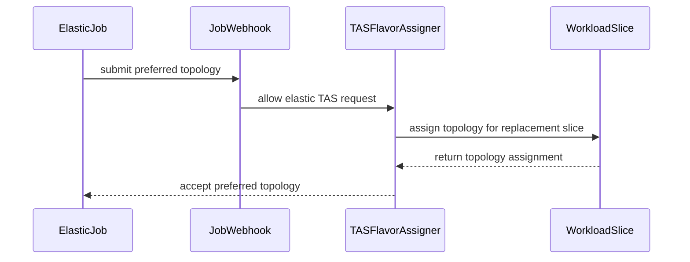

# PR #13743: feat: support Topology-Aware Scheduling (TAS) for Elastic Jobs (`preferred` mode)

**Summary**: feat: support Topology-Aware Scheduling (TAS) for Elastic Jobs (`preferred` mode)

**Sources**: https://github.com/kubernetes-sigs/kueue/pull/13743

**Last updated**: 2026-10-20T07:24:10Z

---

## Metadata

- **State**: open
- **Author**: [@Vaishnav88sk](https://github.com/Vaishnav88sk)
- **Branch**: `feature/elastic-job-tas` → `main`
- **Created**: 2026-08-03T10:13:50Z
- **Updated**: 2026-10-20T07:24:10Z
- **Merged**: —
- **Closed**: —
- **Labels**: `kind/feature`, `release-note`, `lifecycle/stale`, `size/L`, `needs-rebase`, `ok-to-test`, `cncf-cla: yes`, `area/tas`, `area/elastic-jobs`
- **Assignees**: [@sohankunkerkar](https://github.com/sohankunkerkar)
- **Requested reviewers**: [@pajakd](https://github.com/pajakd), [@kshalot](https://github.com/kshalot)
- **Changed files**: 6   **+153 / -19**

## Description

<!--  Thanks for sending a pull request!  Here are some tips for you:

1. If this is your first time, please read our contributor guidelines: https://git.k8s.io/community/contributors/guide/first-contribution.md#your-first-contribution and developer guide https://git.k8s.io/community/contributors/devel/development.md#development-guide
2. Please label this pull request according to what type of issue you are addressing, especially if this is a release targeted pull request. For reference on required PR/issue labels, read here:
https://git.k8s.io/community/contributors/devel/sig-release/release.md#issuepr-kind-label
3. Ensure you have added or ran the appropriate tests for your PR: https://git.k8s.io/community/contributors/devel/sig-testing/testing.md
4. If you want *faster* PR reviews, read how: https://git.k8s.io/community/contributors/guide/pull-requests.md#best-practices-for-faster-reviews
5. If the PR is unfinished, see how to mark it: https://git.k8s.io/community/contributors/guide/pull-requests.md#marking-unfinished-pull-requests
-->

#### What type of PR is this?
/kind feature
/area tas
<!--
Add one of the following kinds:
/kind bug
/kind cleanup
/kind documentation
/kind feature
/kind kep

Optionally add one or more of the following kinds if applicable:
/kind api-change
/kind deprecation
/kind failing-test
/kind flake
/kind regression

Please also consider setting the area:
/area tas
/area was
/area integrations
/area multikueue
/area dashboard
/area localization
/area testing
/area website
-->

#### What this PR does / why we need it:
This PR adds support for **preferred** Topology-Aware Scheduling (TAS) for Elastic Jobs. 

Currently, the Kueue job webhook explicitly rejects all TAS topology annotations for elastic workloads. This change allows the `kueue.x-k8s.io/podset-preferred-topology` annotation to be used on elastic workloads when the `ElasticJobsViaWorkloadSlicesWithTAS` feature gate is enabled. 

The underlying TAS scheduling mechanism gracefully handles the `preferred` topology assignment during elastic scale-ups (using `mergeTopologyAssignments` with a greedy fallback) and scale-downs (using `TruncateAssignment`), so the core addition is relaxing the webhook constraints and allowing the preferred assignments to proceed natively.

**Note:** The `required` topology mode remains explicitly rejected for elastic jobs. Implementing `required` topology for elastic scale-up requires strict guarantees to avoid spanning domains when scaling, which will be tackled in a follow-up PR using a node-hot-swap style iterative algorithm.

#### Which issue(s) this PR fixes:
<!--
*Automatically closes linked issue when PR is merged.
Usage: `Fixes #<issue number>`, or `Fixes (paste link of issue)`.
_If PR is about `failing-tests or flakes`, please post the related issues/tests in a comment and do not use `Fixes`_*
-->
Related to #13640

#### Special notes for your reviewer:

#### Does this PR introduce a user-facing change?
<!--
If no, just write "NONE" in the release-note block below.
If yes, a release note is required:
Enter your extended release note in the block below. If the PR requires additional action from users switching to the new release, include the string "action required".
-->
```release-note
Enabled `preferred` Topology-Aware Scheduling (TAS) for Elastic Jobs via the `kueue.x-k8s.io/podset-preferred-topology` annotation when the `ElasticJobsViaWorkloadSlicesWithTAS` feature is enabled.
```


<!-- This is an auto-generated comment: release notes by coderabbit.ai -->
## Summary by CodeRabbit

* **New Features**
  * Elastic workloads can now request preferred topology when TAS workload-slice support is enabled.
  * Preferred-topology assignments are supported during elastic workload replacement, scaling up, and scaling down.

* **Bug Fixes**
  * Required topology requests for elastic workloads continue to be rejected.
  * Improved topology validation and admission behavior for elastic workloads.
<!-- end of auto-generated comment: release notes by coderabbit.ai -->

## Discussion

### Comment by [@netlify[bot]](https://github.com/apps/netlify) — 2026-08-03T10:13:55Z

### <span aria-hidden="true">✅</span> Deploy Preview for *kubernetes-sigs-kueue* canceled.


|  Name | Link |
|:-:|------------------------|
|<span aria-hidden="true">🔨</span> Latest commit | fc498f26b3a0732a4a2dbc934eb5977d6766cb68 |
|<span aria-hidden="true">🔍</span> Latest deploy log | https://app.netlify.com/projects/kubernetes-sigs-kueue/deploys/6a71be2d9e1bce000826c612 |

### Comment by [@kubernetes-prow[bot]](https://github.com/apps/kubernetes-prow) — 2026-08-03T10:14:00Z

Hi @Vaishnav88sk. Thanks for your PR.

I'm waiting for a [kubernetes-sigs](https://github.com/orgs/kubernetes-sigs/people) member to verify that this patch is reasonable to test. If it is, they should reply with `/ok-to-test` on its own line. Until that is done, I will not automatically test new commits in this PR, but the usual testing commands by org members will still work.

>[!TIP]
>**We noticed you've done this a few times! Consider [joining the org](https://git.k8s.io/community/community-membership.md#member) to skip this step and gain `/lgtm` and other bot rights.** We recommend asking approvers on your previous PRs to sponsor you.

Once the patch is verified, the new status will be reflected by the `ok-to-test` label.

I understand the commands that are listed [here](https://go.k8s.io/bot-commands?repo=kubernetes-sigs%2Fkueue).

<details>

Instructions for interacting with me using PR comments are available [here](https://git.k8s.io/community/contributors/guide/pull-requests.md).  If you have questions or suggestions related to my behavior, please file an issue against the [kubernetes-sigs/prow](https://github.com/kubernetes-sigs/prow/issues/new?title=Prow%20issue:) repository.
</details>

### Comment by [@kubernetes-prow[bot]](https://github.com/apps/kubernetes-prow) — 2026-08-03T10:14:01Z

[APPROVALNOTIFIER] This PR is **NOT APPROVED**

This pull-request has been approved by: *<a href="https://github.com/kubernetes-sigs/kueue/pull/13743#" title="Author self-approved">Vaishnav88sk</a>*
**Once this PR has been reviewed and has the lgtm label**, please assign [mimowo](https://github.com/mimowo) for approval. For more information see [the Code Review Process](https://git.k8s.io/community/contributors/guide/owners.md#the-code-review-process).

The full list of commands accepted by this bot can be found [here](https://go.k8s.io/bot-commands?repo=kubernetes-sigs%2Fkueue).

<details open>
Needs approval from an approver in each of these files:

- **[OWNERS](https://github.com/kubernetes-sigs/kueue/blob/main/OWNERS)**

Approvers can indicate their approval by writing `/approve` in a comment
Approvers can cancel approval by writing `/approve cancel` in a comment
</details>
<!-- META={"approvers":["mimowo"]} -->

### Comment by [@coderabbitai[bot]](https://github.com/apps/coderabbitai) — 2026-08-03T10:14:21Z

<!-- This is an auto-generated comment: summarize by coderabbit.ai -->
<!-- review_stack_entry_start -->

[](https://app.coderabbit.ai/change-stack/kubernetes-sigs/kueue/pull/13743?utm_source=github_walkthrough&utm_medium=github&utm_campaign=change_stack)

<!-- review_stack_entry_end -->
<!-- walkthrough_start -->

<details>
<summary>📝 Walkthrough</summary>

## Walkthrough

Elastic workloads now accept preferred TAS topology when workload-slice TAS integration is enabled. Required topology remains rejected. Validation, flavor assignment, sentinel errors, unit tests, and integration coverage were updated.

### Changes

**Elastic TAS topology support**

|Layer / File(s)|Summary|
|---|---|
|**Webhook topology validation** <br> `pkg/controller/jobs/job/job_webhook.go`, `pkg/controller/jobs/job/job_webhook_test.go`|The webhook rejects required topology for elastic jobs. It rejects preferred topology only when elastic-job TAS integration is disabled.|
|**TAS flavor assignment behavior** <br> `pkg/scheduler/flavorassigner/errors.go`, `pkg/scheduler/flavorassigner/tas_flavorassigner.go`, `pkg/scheduler/flavorassigner/flavorassigner_test.go`|The flavor assigner accepts preferred topology for replacement and new elastic workloads. It continues to reject required topology and removes the obsolete sentinel error.|
|**Elastic TAS scaling coverage** <br> `test/integration/singlecluster/tas/tas_test.go`|Integration coverage validates preferred-topology assignment during replacement scale-up from two pods to four pods and scale-down to two pods.|

**Estimated code review effort:** 3 (Moderate) | ~20 minutes

### Sequence Diagram(s)



**Possibly related issues**

- `kubernetes-sigs/kueue#13640` — Covers support for preferred, but not required, TAS topology on elastic jobs.

**Possibly related PRs**

- [kubernetes-sigs/kueue#13801](https://github.com/kubernetes-sigs/kueue/pull/13801) — Defines the preferred and required elastic-job TAS behavior implemented by this change.

**Suggested reviewers:** `pajakd`, `kshalot`, `mbobrovskyi`

</details>

<!-- walkthrough_end -->
<!-- pre_merge_checks_walkthrough_start -->

<details>
<summary>🚥 Pre-merge checks | ✅ 4 | ❌ 1</summary>

### ❌ Failed checks (1 warning)

|     Check name     | Status     | Explanation                                                                          | Resolution                                                                         |
| :----------------: | :--------- | :----------------------------------------------------------------------------------- | :--------------------------------------------------------------------------------- |
| Docstring Coverage | ⚠️ Warning | Docstring coverage is 0.00% which is insufficient. The required threshold is 80.00%. | Write docstrings for the functions missing them to satisfy the coverage threshold. |

<details>
<summary>✅ Passed checks (4 passed)</summary>

|         Check name         | Status   | Explanation                                                                                               |
| :------------------------: | :------- | :-------------------------------------------------------------------------------------------------------- |
|      Description Check     | ✅ Passed | Check skipped - CodeRabbit’s high-level summary is enabled.                                               |
|         Title check        | ✅ Passed | The title clearly and concisely describes the main change: adding preferred TAS support for Elastic Jobs. |
|     Linked Issues check    | ✅ Passed | Check skipped because no linked issues were found for this pull request.                                  |
| Out of Scope Changes check | ✅ Passed | Check skipped because no linked issues were found for this pull request.                                  |

</details>

</details>

<!-- pre_merge_checks_walkthrough_end -->
<!-- finishing_touch_checkbox_start -->

<details>
<summary>✨ Finishing Touches</summary>

<details>
<summary>🧪 Generate unit tests (beta)</summary>

- [ ] <!-- {"checkboxId": "f47ac10b-58cc-4372-a567-0e02b2c3d479", "radioGroupId": "utg-output-choice-group-unknown_comment_id"} -->   Create PR with unit tests

</details>

</details>

<!-- finishing_touch_checkbox_end -->
<!-- This is an auto-generated comment: all tool run failures by coderabbit.ai -->

> [!WARNING]
> There were issues while running some tools. Please review the errors and either fix the tool's configuration or disable the tool if it's a critical failure.
> 
> <details>
> <summary>🔧 ast-grep (0.45.0)</summary>
> 
> <details>
> <summary>test/integration/singlecluster/tas/tas_test.go</summary>
> 
> ast-grep timed out on this file
> 
> </details>
> 
> </details>

<!-- end of auto-generated comment: all tool run failures by coderabbit.ai -->
<!-- tips_start -->

---

Thanks for using [CodeRabbit](https://coderabbit.ai?utm_source=oss&utm_medium=github&utm_campaign=kubernetes-sigs/kueue&utm_content=13743)! It's free for OSS, and your support helps us grow. If you like it, consider giving us a shout-out.

<details>
<summary>❤️ Share</summary>

- [X](https://twitter.com/intent/tweet?text=I%20just%20used%20%40coderabbitai%20for%20my%20code%20review%2C%20and%20it%27s%20fantastic%21%20It%27s%20free%20for%20OSS%20and%20offers%20a%20free%20trial%20for%20the%20proprietary%20code.%20Check%20it%20out%3A&url=https%3A//coderabbit.ai)
- [Mastodon](https://mastodon.social/share?text=I%20just%20used%20%40coderabbitai%20for%20my%20code%20review%2C%20and%20it%27s%20fantastic%21%20It%27s%20free%20for%20OSS%20and%20offers%20a%20free%20trial%20for%20the%20proprietary%20code.%20Check%20it%20out%3A%20https%3A%2F%2Fcoderabbit.ai)
- [Reddit](https://www.reddit.com/submit?title=Great%20tool%20for%20code%20review%20-%20CodeRabbit&text=I%20just%20used%20CodeRabbit%20for%20my%20code%20review%2C%20and%20it%27s%20fantastic%21%20It%27s%20free%20for%20OSS%20and%20offers%20a%20free%20trial%20for%20proprietary%20code.%20Check%20it%20out%3A%20https%3A//coderabbit.ai)
- [LinkedIn](https://www.linkedin.com/sharing/share-offsite/?url=https%3A%2F%2Fcoderabbit.ai&mini=true&title=Great%20tool%20for%20code%20review%20-%20CodeRabbit&summary=I%20just%20used%20CodeRabbit%20for%20my%20code%20review%2C%20and%20it%27s%20fantastic%21%20It%27s%20free%20for%20OSS%20and%20offers%20a%20free%20trial%20for%20proprietary%20code)

</details>


<sub>Comment `@coderabbitai help` to get the list of available commands.</sub>

<!-- tips_end -->

### Comment by [@mimowo](https://github.com/mimowo) — 2026-08-03T10:20:16Z

/ok-to-test

### Comment by [@kannon92](https://github.com/kannon92) — 2026-08-03T15:47:26Z

Based on the github discussion, it seems preferred is simpleish but required is harder.

Can we add a KEP highlighting the plan for both?

### Comment by [@mimowo](https://github.com/mimowo) — 2026-08-03T19:47:03Z

/area elastic-jobs

### Comment by [@Vaishnav88sk](https://github.com/Vaishnav88sk) — 2026-08-04T10:01:02Z

Hey @sohankunkerkar, @mimowo, @mwielgus  and @kannon92, thanks for the review!

As requested, I have authored a formal Kubernetes Enhancement Proposal (KEP) explicitly for supporting both Required and Preferred topology modes during elastic scaling operations (Issue #13640). 

You can find the new KEP PR here: #13801 

I'd like to get your feedback on the design outlined there (particularly the iterative node-hot-swap logic for Required mode and the fast-path for Preferred mode). 

For this implementation PR, I will start addressing the test gaps (missing assertions, scale-down coverage) and the minor formatting/cleanup issues you highlighted while we discuss the KEP in parallel.

### Comment by [@k8s-triage-robot](https://github.com/k8s-triage-robot) — 2026-10-20T07:24:00Z

The Kubernetes project currently lacks enough active contributors to adequately respond to all PRs.

This bot triages PRs according to the following rules:
- After 30d of inactivity, `lifecycle/stale` is applied
- After 30d of inactivity since `lifecycle/stale` was applied, `lifecycle/rotten` is applied
- After 30d of inactivity since `lifecycle/rotten` was applied, the PR is closed

You can:
- Mark this PR as fresh with `/remove-lifecycle stale`
- Close this PR with `/close`
- Offer to help out with [Issue Triage][1]

Please send feedback to us at [Kueue](https://github.com/kubernetes-sigs/kueue/tree/main#community-discussion-contribution-and-support).

/lifecycle stale

[1]: https://www.kubernetes.dev/docs/guide/issue-triage/

### Comment by [@kubernetes-prow[bot]](https://github.com/apps/kubernetes-prow) — 2026-10-20T07:24:10Z

PR needs rebase.

<details>

Instructions for interacting with me using PR comments are available [here](https://git.k8s.io/community/contributors/guide/pull-requests.md).  If you have questions or suggestions related to my behavior, please file an issue against the [kubernetes-sigs/prow](https://github.com/kubernetes-sigs/prow/issues/new?title=Prow%20issue:) repository.
</details>

## Reviews

### Review by [@coderabbitai[bot]](https://github.com/apps/coderabbitai) (commented) — 2026-08-03T10:18:46Z


<details>
<summary>🧹 Nitpick comments (1)</summary><blockquote>

<details>
<summary>test/integration/singlecluster/tas/tas_test.go (1)</summary><blockquote>

`7340-7415`: _🎯 Functional Correctness_ | _🔵 Trivial_ | _🏗️ Heavy lift_

**Assert the scale-up result and add a negative scenario.**

The replacement assertion accepts an assignment that still covers two pods. Assert that the replacement topology assignment covers four pods.

Add a negative integration scenario for required topology or disabled TAS integration. The current test covers only acceptance.

As per path instructions, `test/integration/**/*.go` must cover positive and negative scenarios.

<details>
<summary>🤖 Prompt for AI Agents</summary>

```
Verify each finding against current code. Fix only still-valid issues, skip the
rest with a brief reason, keep changes minimal, and validate.

In `@test/integration/singlecluster/tas/tas_test.go` around lines 7340 - 7415,
Update the replacement verification in “should admit elastic workload with
preferred topology and scale up” to assert that wl2’s topology assignment covers
all four requested pods, not merely that slices are non-empty. Add a negative
integration scenario in the same TAS test area covering rejection when topology
is required or TAS integration is disabled, while preserving the existing
positive admission scenario.
```

</details>

<!-- cr-comment:v1:3ad4f2c82354bad9dbdcd81b -->

_Source: Path instructions_

</blockquote></details>

</blockquote></details>

<details>
<summary>🤖 Prompt for all review comments with AI agents</summary>

```
Verify each finding against current code. Fix only still-valid issues, skip the
rest with a brief reason, keep changes minimal, and validate.

Nitpick comments:
In `@test/integration/singlecluster/tas/tas_test.go`:
- Around line 7340-7415: Update the replacement verification in “should admit
elastic workload with preferred topology and scale up” to assert that wl2’s
topology assignment covers all four requested pods, not merely that slices are
non-empty. Add a negative integration scenario in the same TAS test area
covering rejection when topology is required or TAS integration is disabled,
while preserving the existing positive admission scenario.
```

</details>

---

<details>
<summary>ℹ️ Review info</summary>

<details>
<summary>⚙️ Run configuration</summary>

**Configuration used**: Path: .coderabbit.yaml

**Review profile**: CHILL

**Plan**: Pro Plus

**Run ID**: `c9b5cbc0-7eba-48b0-8e99-f1051c0b9324`

</details>

<details>
<summary>📥 Commits</summary>

Reviewing files that changed from the base of the PR and between 18224f558689710d31ab74987e315b7674fef815 and dd0c2de89ded6881c12df17f81e7e5bc8a833c65.

</details>

<details>
<summary>📒 Files selected for processing (6)</summary>

* `pkg/controller/jobs/job/job_webhook.go`
* `pkg/controller/jobs/job/job_webhook_test.go`
* `pkg/scheduler/flavorassigner/errors.go`
* `pkg/scheduler/flavorassigner/flavorassigner_test.go`
* `pkg/scheduler/flavorassigner/tas_flavorassigner.go`
* `test/integration/singlecluster/tas/tas_test.go`

</details>

<details>
<summary>💤 Files with no reviewable changes (1)</summary>

* pkg/scheduler/flavorassigner/tas_flavorassigner.go

</details>

</details>

<!-- This is an auto-generated comment by CodeRabbit for review status -->

### Review by [@mimowo](https://github.com/mimowo) (commented) — 2026-08-03T10:21:11Z

/assign @sohankunkerkar 
ptal

### Review by [@sohankunkerkar](https://github.com/sohankunkerkar) (commented) — 2026-08-03T19:23:51Z

Thanks for handling this feature. I have left a few comments on this PR. Also, this change requires a KEP update as @kannon92 mentioned. I'd start with that PR first.

- **pkg/controller/jobs/job/job_webhook.go:246** by [@sohankunkerkar](https://github.com/sohankunkerkar) — 2026-08-03T19:00:19Z
```diff
@@ -242,16 +242,18 @@ func (w *JobWebhook) validateTopologyRequest(ctx context.Context, job *Job) (fie
 		return validationErrs, nil
 	}
 
-	// Reject elastic jobs with required/preferred topology (only unconstrained is supported).
-	// TODO: Support for required/preferred modes will be added in a future release.
 	if features.Enabled(features.ElasticJobsViaWorkloadSlices) && workloadslicing.Enabled(job.Object()) {
+		// Required topology is never supported with elastic jobs.
```

  ```suggestion
  		// Required topology is not supported with elastic jobs.
  ```

- **pkg/controller/jobs/job/job_webhook.go:251** by [@sohankunkerkar](https://github.com/sohankunkerkar) — 2026-08-03T19:01:37Z
```diff
@@ -242,16 +242,18 @@ func (w *JobWebhook) validateTopologyRequest(ctx context.Context, job *Job) (fie
 		return validationErrs, nil
 	}
 
-	// Reject elastic jobs with required/preferred topology (only unconstrained is supported).
-	// TODO: Support for required/preferred modes will be added in a future release.
 	if features.Enabled(features.ElasticJobsViaWorkloadSlices) && workloadslicing.Enabled(job.Object()) {
+		// Required topology is never supported with elastic jobs.
 		if _, hasRequired := job.Spec.Template.Annotations[kueue.PodSetRequiredTopologyAnnotation]; hasRequired {
 			return field.ErrorList{field.Forbidden(replicaMetaPath.Child("annotations", kueue.PodSetRequiredTopologyAnnotation),
 				"required topology is not supported with elastic jobs")}, nil
 		}
-		if _, hasPreferred := job.Spec.Template.Annotations[kueue.PodSetPreferredTopologyAnnotation]; hasPreferred {
-			return field.ErrorList{field.Forbidden(replicaMetaPath.Child("annotations", kueue.PodSetPreferredTopologyAnnotation),
-				"preferred topology is not supported with elastic jobs")}, nil
+		// Preferred topology is supported only if TAS integration is enabled.
```

  ```suggestion
  		// Preferred topology requires the ElasticJobsViaWorkloadSlicesWithTAS feature gate.
  ```

- **pkg/scheduler/flavorassigner/errors.go:31** by [@sohankunkerkar](https://github.com/sohankunkerkar) — 2026-08-03T19:13:12Z
```diff
@@ -28,10 +28,9 @@ import (
 // Sentinel errors for TAS request building, so callers/tests can identify the
 // failure with errors.Is instead of matching on the message text.
 var (
-	ErrElasticRequiredTopologyNotSupported  = errors.New("required topology is not supported with ElasticJobsViaWorkloadSlices")
-	ErrElasticPreferredTopologyNotSupported = errors.New("preferred topology is not supported with ElasticJobsViaWorkloadSlices")
-	ErrNoTASCacheInformation                = errors.New("workload requires Topology, but there is no TAS cache information")
-	ErrNoTASFlavorAssigned                  = errors.New("no TAS flavor assigned")
+	ErrElasticRequiredTopologyNotSupported = errors.New("required topology is not supported with ElasticJobsViaWorkloadSlices")
```

  Can you make sure the formatting is right here?

- **test/integration/singlecluster/tas/tas_test.go:7413** by [@sohankunkerkar](https://github.com/sohankunkerkar) — 2026-08-03T19:15:01Z
```diff
@@ -7455,6 +7336,84 @@ var _ = ginkgo.Describe("Topology Aware Scheduling", ginkgo.Ordered, func() {
 				}, util.Timeout, util.Interval).Should(gomega.Succeed())
 			})
 		})
+
+		ginkgo.It("should admit elastic workload with preferred topology and scale up", func() {
+			var wl1 *kueue.Workload
+
+			ginkgo.By("create initial workload with 2 pods using preferred topology at block level", func() {
+				wl1 = utiltestingapi.MakeWorkload("wl-preferred", ns.Name).
+					Queue(kueue.LocalQueueName(localQueue.Name)).
+					Obj()
+				wl1.Spec.PodSets[0] = *utiltestingapi.MakePodSet(kueue.DefaultPodSetName, 2).
+					Request(corev1.ResourceCPU, "1").
+					PreferredTopologyRequest(utiltesting.DefaultBlockTopologyLevel).
+					Image("image").
+					Obj()
+				util.MustCreate(ctx, k8sClient, wl1)
+			})
+
+			ginkgo.By("verify the workload is admitted", func() {
+				util.ExpectWorkloadsToBeAdmitted(ctx, k8sClient, wl1)
+			})
+
+			var originalAssignment *kueue.TopologyAssignment
+			ginkgo.By("verify admission and record the topology assignment", func() {
+				gomega.Eventually(func(g gomega.Gomega) {
+					g.Expect(k8sClient.Get(ctx, client.ObjectKeyFromObject(wl1), wl1)).To(gomega.Succeed())
+					g.Expect(wl1.Status.Admission).ShouldNot(gomega.BeNil())
+					g.Expect(wl1.Status.Admission.PodSetAssignments).Should(gomega.HaveLen(1))
+					g.Expect(wl1.Status.Admission.PodSetAssignments[0].TopologyAssignment).ShouldNot(gomega.BeNil())
+				}, util.Timeout, util.Interval).Should(gomega.Succeed())
+				originalAssignment = wl1.Status.Admission.PodSetAssignments[0].TopologyAssignment
+			})
+
+			ginkgo.By("verify the original assignment has slices", func() {
+				gomega.Expect(originalAssignment).ShouldNot(gomega.BeNil())
+				gomega.Expect(originalAssignment.Slices).ShouldNot(gomega.BeEmpty())
+			})
+
+			ginkgo.By("create pods simulating running pods", func() {
+				for i := range 2 {
+					pod := testingpod.MakePod(fmt.Sprintf("pod-preferred-%d", i), ns.Name).
+						Annotation(kueue.WorkloadAnnotation, wl1.Name).
+						Annotation(kueue.WorkloadSliceNameAnnotation, wl1.Name).
+						Request(corev1.ResourceCPU, "1").
+						Obj()
+					util.MustCreate(ctx, k8sClient, pod)
+				}
+			})
+
+			var wl2 *kueue.Workload
+			ginkgo.By("create a replacement workload slice with more pods (scale up)", func() {
+				wl2 = utiltestingapi.MakeWorkload("wl-preferred-replacement", ns.Name).
+					Queue(kueue.LocalQueueName(localQueue.Name)).
+					Annotation(workloadslicing.WorkloadSliceReplacementFor, string(workload.Key(wl1))).
+					Annotation(kueue.WorkloadSliceNameAnnotation, wl1.Name).
+					Obj()
+				wl2.Spec.PodSets[0] = *utiltestingapi.MakePodSet(kueue.DefaultPodSetName, 4).
+					Request(corev1.ResourceCPU, "1").
+					PreferredTopologyRequest(utiltesting.DefaultBlockTopologyLevel).
+					Image("image").
+					Obj()
+				util.MustCreate(ctx, k8sClient, wl2)
+			})
+
+			ginkgo.By("verify the replacement workload is admitted", func() {
+				util.ExpectWorkloadsToBeAdmitted(ctx, k8sClient, wl2)
+			})
+
+			ginkgo.By("verify the replacement workload has topology assignment", func() {
+				gomega.Eventually(func(g gomega.Gomega) {
+					g.Expect(k8sClient.Get(ctx, client.ObjectKeyFromObject(wl2), wl2)).To(gomega.Succeed())
+					g.Expect(wl2.Status.Admission).ShouldNot(gomega.BeNil())
+					g.Expect(wl2.Status.Admission.PodSetAssignments).Should(gomega.HaveLen(1))
+					g.Expect(wl2.Status.Admission.PodSetAssignments[0].TopologyAssignment).ShouldNot(gomega.BeNil())
+
+					newAssignment := wl2.Status.Admission.PodSetAssignments[0].TopologyAssignment
+					g.Expect(newAssignment.Slices).ShouldNot(gomega.BeEmpty())
```

  The assertion only checks `newAssignment.Slices` is non-empty, but doesn't verify the assignment covers 4 pods (the scaled-up count). A stale 2-pod assignment would also pass this check.

- **test/integration/singlecluster/tas/tas_test.go:7340** by [@sohankunkerkar](https://github.com/sohankunkerkar) — 2026-08-03T19:16:21Z
```diff
@@ -7455,6 +7336,84 @@ var _ = ginkgo.Describe("Topology Aware Scheduling", ginkgo.Ordered, func() {
 				}, util.Timeout, util.Interval).Should(gomega.Succeed())
 			})
 		})
+
+		ginkgo.It("should admit elastic workload with preferred topology and scale up", func() {
```

  I'd  add a scale-down step (4→2) to the same test, or a separate It block, to cover the other direction

- **pkg/scheduler/flavorassigner/flavorassigner_test.go:4392** by [@sohankunkerkar](https://github.com/sohankunkerkar) — 2026-08-03T19:22:06Z
```diff
@@ -4389,7 +4389,6 @@ func TestWorkloadsTopologyRequests_ElasticJobsValidation(t *testing.T) {
 					Count:  2,
 					Status: *NewStatus(),
 				}},
-				representativeMode: new(Fit),
```

  This change doesn't seem related to the preferred topology support.

### Review by [@mwielgus](https://github.com/mwielgus) (commented) — 2026-08-03T19:45:26Z

Are you planning to do any KEP/documentation updates?

### Review by [@Vaishnav88sk](https://github.com/Vaishnav88sk) (commented) — 2026-08-04T08:59:39Z

- **test/integration/singlecluster/tas/tas_test.go:7413** by [@Vaishnav88sk](https://github.com/Vaishnav88sk) — 2026-08-04T08:59:39Z
```diff
@@ -7455,6 +7336,84 @@ var _ = ginkgo.Describe("Topology Aware Scheduling", ginkgo.Ordered, func() {
 				}, util.Timeout, util.Interval).Should(gomega.Succeed())
 			})
 		})
+
+		ginkgo.It("should admit elastic workload with preferred topology and scale up", func() {
+			var wl1 *kueue.Workload
+
+			ginkgo.By("create initial workload with 2 pods using preferred topology at block level", func() {
+				wl1 = utiltestingapi.MakeWorkload("wl-preferred", ns.Name).
+					Queue(kueue.LocalQueueName(localQueue.Name)).
+					Obj()
+				wl1.Spec.PodSets[0] = *utiltestingapi.MakePodSet(kueue.DefaultPodSetName, 2).
+					Request(corev1.ResourceCPU, "1").
+					PreferredTopologyRequest(utiltesting.DefaultBlockTopologyLevel).
+					Image("image").
+					Obj()
+				util.MustCreate(ctx, k8sClient, wl1)
+			})
+
+			ginkgo.By("verify the workload is admitted", func() {
+				util.ExpectWorkloadsToBeAdmitted(ctx, k8sClient, wl1)
+			})
+
+			var originalAssignment *kueue.TopologyAssignment
+			ginkgo.By("verify admission and record the topology assignment", func() {
+				gomega.Eventually(func(g gomega.Gomega) {
+					g.Expect(k8sClient.Get(ctx, client.ObjectKeyFromObject(wl1), wl1)).To(gomega.Succeed())
+					g.Expect(wl1.Status.Admission).ShouldNot(gomega.BeNil())
+					g.Expect(wl1.Status.Admission.PodSetAssignments).Should(gomega.HaveLen(1))
+					g.Expect(wl1.Status.Admission.PodSetAssignments[0].TopologyAssignment).ShouldNot(gomega.BeNil())
+				}, util.Timeout, util.Interval).Should(gomega.Succeed())
+				originalAssignment = wl1.Status.Admission.PodSetAssignments[0].TopologyAssignment
+			})
+
+			ginkgo.By("verify the original assignment has slices", func() {
+				gomega.Expect(originalAssignment).ShouldNot(gomega.BeNil())
+				gomega.Expect(originalAssignment.Slices).ShouldNot(gomega.BeEmpty())
+			})
+
+			ginkgo.By("create pods simulating running pods", func() {
+				for i := range 2 {
+					pod := testingpod.MakePod(fmt.Sprintf("pod-preferred-%d", i), ns.Name).
+						Annotation(kueue.WorkloadAnnotation, wl1.Name).
+						Annotation(kueue.WorkloadSliceNameAnnotation, wl1.Name).
+						Request(corev1.ResourceCPU, "1").
+						Obj()
+					util.MustCreate(ctx, k8sClient, pod)
+				}
+			})
+
+			var wl2 *kueue.Workload
+			ginkgo.By("create a replacement workload slice with more pods (scale up)", func() {
+				wl2 = utiltestingapi.MakeWorkload("wl-preferred-replacement", ns.Name).
+					Queue(kueue.LocalQueueName(localQueue.Name)).
+					Annotation(workloadslicing.WorkloadSliceReplacementFor, string(workload.Key(wl1))).
+					Annotation(kueue.WorkloadSliceNameAnnotation, wl1.Name).
+					Obj()
+				wl2.Spec.PodSets[0] = *utiltestingapi.MakePodSet(kueue.DefaultPodSetName, 4).
+					Request(corev1.ResourceCPU, "1").
+					PreferredTopologyRequest(utiltesting.DefaultBlockTopologyLevel).
+					Image("image").
+					Obj()
+				util.MustCreate(ctx, k8sClient, wl2)
+			})
+
+			ginkgo.By("verify the replacement workload is admitted", func() {
+				util.ExpectWorkloadsToBeAdmitted(ctx, k8sClient, wl2)
+			})
+
+			ginkgo.By("verify the replacement workload has topology assignment", func() {
+				gomega.Eventually(func(g gomega.Gomega) {
+					g.Expect(k8sClient.Get(ctx, client.ObjectKeyFromObject(wl2), wl2)).To(gomega.Succeed())
+					g.Expect(wl2.Status.Admission).ShouldNot(gomega.BeNil())
+					g.Expect(wl2.Status.Admission.PodSetAssignments).Should(gomega.HaveLen(1))
+					g.Expect(wl2.Status.Admission.PodSetAssignments[0].TopologyAssignment).ShouldNot(gomega.BeNil())
+
+					newAssignment := wl2.Status.Admission.PodSetAssignments[0].TopologyAssignment
+					g.Expect(newAssignment.Slices).ShouldNot(gomega.BeEmpty())
```

  I initially kept the assertion generic to just verify successful assignment generation, but you're absolutely right that we need to explicitly verify the total pod count matches the new scale to prevent false positives from stale assignments.

### Review by [@Vaishnav88sk](https://github.com/Vaishnav88sk) (commented) — 2026-08-04T09:00:19Z

- **test/integration/singlecluster/tas/tas_test.go:7340** by [@Vaishnav88sk](https://github.com/Vaishnav88sk) — 2026-08-04T09:00:19Z
```diff
@@ -7455,6 +7336,84 @@ var _ = ginkgo.Describe("Topology Aware Scheduling", ginkgo.Ordered, func() {
 				}, util.Timeout, util.Interval).Should(gomega.Succeed())
 			})
 		})
+
+		ginkgo.It("should admit elastic workload with preferred topology and scale up", func() {
```

  Previously I focused heavily on the scale-up path since that involves the complex topology expansion, but I agree a scale-down case is important for completeness. I'll add an `It` block to cover it.

### Review by [@Vaishnav88sk](https://github.com/Vaishnav88sk) (commented) — 2026-08-04T09:01:14Z

- **pkg/scheduler/flavorassigner/flavorassigner_test.go:4392** by [@Vaishnav88sk](https://github.com/Vaishnav88sk) — 2026-08-04T09:01:14Z
```diff
@@ -4389,7 +4389,6 @@ func TestWorkloadsTopologyRequests_ElasticJobsValidation(t *testing.T) {
 					Count:  2,
 					Status: *NewStatus(),
 				}},
-				representativeMode: new(Fit),
```

  I noticed this while working on the nearby code and included it as a minor drive-by cleanup. However, I agree it pollutes the diff for this specific feature. I can revert this to keep the PR strictly focused.

### Review by [@Vaishnav88sk](https://github.com/Vaishnav88sk) (commented) — 2026-08-04T10:21:01Z

- **pkg/scheduler/flavorassigner/errors.go:31** by [@Vaishnav88sk](https://github.com/Vaishnav88sk) — 2026-08-04T10:21:01Z
```diff
@@ -28,10 +28,9 @@ import (
 // Sentinel errors for TAS request building, so callers/tests can identify the
 // failure with errors.Is instead of matching on the message text.
 var (
-	ErrElasticRequiredTopologyNotSupported  = errors.New("required topology is not supported with ElasticJobsViaWorkloadSlices")
-	ErrElasticPreferredTopologyNotSupported = errors.New("preferred topology is not supported with ElasticJobsViaWorkloadSlices")
-	ErrNoTASCacheInformation                = errors.New("workload requires Topology, but there is no TAS cache information")
-	ErrNoTASFlavorAssigned                  = errors.New("no TAS flavor assigned")
+	ErrElasticRequiredTopologyNotSupported = errors.New("required topology is not supported with ElasticJobsViaWorkloadSlices")
```

  Yes, it is right. 👍🏻

### Review by [@coderabbitai[bot]](https://github.com/apps/coderabbitai) (commented) — 2026-08-04T10:41:46Z

**Actionable comments posted: 1**

<details>
<summary>🤖 Prompt for all review comments with AI agents</summary>

```
Verify each finding against current code. Fix only still-valid issues, skip the
rest with a brief reason, keep changes minimal, and validate.

Inline comments:
In `@test/integration/singlecluster/tas/tas_test.go`:
- Around line 7418-7447: Add a separate scale-down test flow that updates the
existing admitted workload wl2 from 4 to 2 pods in place, without creating wl3
or setting WorkloadSliceReplacementFor. Reuse the existing admission and
topology-assignment verification patterns to confirm wl2 remains admitted and
its recomputed assignment contains exactly 2 pods, while preserving the current
replacement-workload scenario.
```

</details>

<details>
<summary>🪄 Autofix</summary>

Fix all unresolved CodeRabbit comments on this PR:

- [ ] <!-- {"checkboxId": "4b0d0e0a-96d7-4f10-b296-3a18ea78f0b9"} --> Push a commit to this branch (recommended)
- [ ] <!-- {"checkboxId": "ff5b1114-7d8c-49e6-8ac1-43f82af23a33"} --> Create a new PR with the fixes

</details>

---

<details>
<summary>ℹ️ Review info</summary>

<details>
<summary>⚙️ Run configuration</summary>

**Configuration used**: Path: .coderabbit.yaml

**Review profile**: CHILL

**Plan**: Pro Plus

**Run ID**: `e3f00136-acf2-490b-9a68-3cc6f816216f`

</details>

<details>
<summary>📥 Commits</summary>

Reviewing files that changed from the base of the PR and between dd0c2de89ded6881c12df17f81e7e5bc8a833c65 and fc498f26b3a0732a4a2dbc934eb5977d6766cb68.

</details>

<details>
<summary>📒 Files selected for processing (3)</summary>

* `pkg/controller/jobs/job/job_webhook.go`
* `pkg/scheduler/flavorassigner/flavorassigner_test.go`
* `test/integration/singlecluster/tas/tas_test.go`

</details>

<details>
<summary>🚧 Files skipped from review as they are similar to previous changes (2)</summary>

* pkg/scheduler/flavorassigner/flavorassigner_test.go
* pkg/controller/jobs/job/job_webhook.go

</details>

</details>

<!-- This is an auto-generated comment by CodeRabbit for review status -->

- **test/integration/singlecluster/tas/tas_test.go:7447** by [@coderabbitai[bot]](https://github.com/apps/coderabbitai) — 2026-08-04T10:41:46Z
```diff
@@ -7336,6 +7336,117 @@ var _ = ginkgo.Describe("Topology Aware Scheduling", ginkgo.Ordered, func() {
 				}, util.Timeout, util.Interval).Should(gomega.Succeed())
 			})
 		})
+
+		ginkgo.It("should admit elastic workload with preferred topology and scale up", func() {
+			var wl1 *kueue.Workload
+
+			ginkgo.By("create initial workload with 2 pods using preferred topology at block level", func() {
+				wl1 = utiltestingapi.MakeWorkload("wl-preferred", ns.Name).
+					Queue(kueue.LocalQueueName(localQueue.Name)).
+					Obj()
+				wl1.Spec.PodSets[0] = *utiltestingapi.MakePodSet(kueue.DefaultPodSetName, 2).
+					Request(corev1.ResourceCPU, "1").
+					PreferredTopologyRequest(utiltesting.DefaultBlockTopologyLevel).
+					Image("image").
+					Obj()
+				util.MustCreate(ctx, k8sClient, wl1)
+			})
+
+			ginkgo.By("verify the workload is admitted", func() {
+				util.ExpectWorkloadsToBeAdmitted(ctx, k8sClient, wl1)
+			})
+
+			var originalAssignment *kueue.TopologyAssignment
+			ginkgo.By("verify admission and record the topology assignment", func() {
+				gomega.Eventually(func(g gomega.Gomega) {
+					g.Expect(k8sClient.Get(ctx, client.ObjectKeyFromObject(wl1), wl1)).To(gomega.Succeed())
+					g.Expect(wl1.Status.Admission).ShouldNot(gomega.BeNil())
+					g.Expect(wl1.Status.Admission.PodSetAssignments).Should(gomega.HaveLen(1))
+					g.Expect(wl1.Status.Admission.PodSetAssignments[0].TopologyAssignment).ShouldNot(gomega.BeNil())
+				}, util.Timeout, util.Interval).Should(gomega.Succeed())
+				originalAssignment = wl1.Status.Admission.PodSetAssignments[0].TopologyAssignment
+			})
+
+			ginkgo.By("verify the original assignment has slices", func() {
+				gomega.Expect(originalAssignment).ShouldNot(gomega.BeNil())
+				gomega.Expect(originalAssignment.Slices).ShouldNot(gomega.BeEmpty())
+			})
+
+			ginkgo.By("create pods simulating running pods", func() {
+				for i := range 2 {
+					pod := testingpod.MakePod(fmt.Sprintf("pod-preferred-%d", i), ns.Name).
+						Annotation(kueue.WorkloadAnnotation, wl1.Name).
+						Annotation(kueue.WorkloadSliceNameAnnotation, wl1.Name).
+						Request(corev1.ResourceCPU, "1").
+						Obj()
+					util.MustCreate(ctx, k8sClient, pod)
+				}
+			})
+
+			var wl2 *kueue.Workload
+			ginkgo.By("create a replacement workload slice with more pods (scale up)", func() {
+				wl2 = utiltestingapi.MakeWorkload("wl-preferred-replacement", ns.Name).
+					Queue(kueue.LocalQueueName(localQueue.Name)).
+					Annotation(workloadslicing.WorkloadSliceReplacementFor, string(workload.Key(wl1))).
+					Annotation(kueue.WorkloadSliceNameAnnotation, wl1.Name).
+					Obj()
+				wl2.Spec.PodSets[0] = *utiltestingapi.MakePodSet(kueue.DefaultPodSetName, 4).
+					Request(corev1.ResourceCPU, "1").
+					PreferredTopologyRequest(utiltesting.DefaultBlockTopologyLevel).
+					Image("image").
+					Obj()
+				util.MustCreate(ctx, k8sClient, wl2)
+			})
+
+			ginkgo.By("verify the replacement workload is admitted", func() {
+				util.ExpectWorkloadsToBeAdmitted(ctx, k8sClient, wl2)
+			})
+
+			ginkgo.By("verify the replacement workload has topology assignment", func() {
+				gomega.Eventually(func(g gomega.Gomega) {
+					g.Expect(k8sClient.Get(ctx, client.ObjectKeyFromObject(wl2), wl2)).To(gomega.Succeed())
+					g.Expect(wl2.Status.Admission).ShouldNot(gomega.BeNil())
+					g.Expect(wl2.Status.Admission.PodSetAssignments).Should(gomega.HaveLen(1))
+					g.Expect(wl2.Status.Admission.PodSetAssignments[0].TopologyAssignment).ShouldNot(gomega.BeNil())
+
+					newAssignment := wl2.Status.Admission.PodSetAssignments[0].TopologyAssignment
+					g.Expect(newAssignment.Slices).ShouldNot(gomega.BeEmpty())
+					g.Expect(assignedPodCount(newAssignment)).Should(gomega.Equal(int32(4)))
+				}, util.Timeout, util.Interval).Should(gomega.Succeed())
+			})
+
+			var wl3 *kueue.Workload
+			ginkgo.By("create a replacement workload slice with fewer pods (scale down)", func() {
+				wl3 = utiltestingapi.MakeWorkload("wl-preferred-scaledown", ns.Name).
+					Queue(kueue.LocalQueueName(localQueue.Name)).
+					Annotation(workloadslicing.WorkloadSliceReplacementFor, string(workload.Key(wl2))).
+					Annotation(kueue.WorkloadSliceNameAnnotation, wl2.Name).
+					Obj()
+				wl3.Spec.PodSets[0] = *utiltestingapi.MakePodSet(kueue.DefaultPodSetName, 2).
+					Request(corev1.ResourceCPU, "1").
+					PreferredTopologyRequest(utiltesting.DefaultBlockTopologyLevel).
+					Image("image").
+					Obj()
+				util.MustCreate(ctx, k8sClient, wl3)
+			})
+
+			ginkgo.By("verify the scale-down workload is admitted", func() {
+				util.ExpectWorkloadsToBeAdmitted(ctx, k8sClient, wl3)
+			})
+
+			ginkgo.By("verify the scale-down workload has correct topology assignment", func() {
+				gomega.Eventually(func(g gomega.Gomega) {
+					g.Expect(k8sClient.Get(ctx, client.ObjectKeyFromObject(wl3), wl3)).To(gomega.Succeed())
+					g.Expect(wl3.Status.Admission).ShouldNot(gomega.BeNil())
+					g.Expect(wl3.Status.Admission.PodSetAssignments).Should(gomega.HaveLen(1))
+					g.Expect(wl3.Status.Admission.PodSetAssignments[0].TopologyAssignment).ShouldNot(gomega.BeNil())
+
+					downAssignment := wl3.Status.Admission.PodSetAssignments[0].TopologyAssignment
+					g.Expect(downAssignment.Slices).ShouldNot(gomega.BeEmpty())
+					g.Expect(assignedPodCount(downAssignment)).Should(gomega.Equal(int32(2)))
+				}, util.Timeout, util.Interval).Should(gomega.Succeed())
```

  _🎯 Functional Correctness_ | _🟡 Minor_ | _⚡ Quick win_
  
  <details>
  <summary>🧩 Analysis chain</summary>
  
  🏁 Script executed:
  
  ```shell
  #!/bin/bash
  # Description: Inspect how Kueue implements elastic workload scale-down and
  # whether it creates a new Workload (like scale-up) or mutates the existing one.
  set -euo pipefail
  
  fd -e go . pkg/workloadslicing | xargs -I{} sh -c 'echo "=== {} ==="; cat -n {}'
  
  # Search for scale-down handling logic (e.g., in-place PodSet count updates).
  rg -n -C 5 'ScaleDown|scale.down|WorkloadSliceReplacementFor' --type=go pkg/ | head -200
  ```
  
  Repository: kubernetes-sigs/kueue
  
  Length of output: 50378
  
  ---
  
  🏁 Script executed:
  
  ```shell
  #!/bin/bash
  set -euo pipefail
  
  # Inspect the integration test around the reported scale-down block and nearby
  # wl1→wl2 step to understand the pod simulation context.
  fd -a 'tas_test.go|tas*.go' . | rg '/test/integration/singlecluster/tas/tas_test.go$' || true
  if [ -f test/integration/singlecluster/tas/tas_test.go ]; then
    sed -n '7250,7480p' test/integration/singlecluster/tas/tas_test.go | cat -n
  fi
  
  # Find where ElasticJobsViaWorkloadSlices integration is exercised and any topological
  # assignment helpers.
  rg -n -C 3 'wl-preferred-scaledown|preferred-scaledown|ScaleDown|scale.down|assignedPodCount|PodSetAssignments|WorkloadSliceReplacementFor' test/integration/singlecluster/tas test/integration --type=go | head -250
  ```
  
  Repository: kubernetes-sigs/kueue
  
  Length of output: 39226
  
  ---
  
  🏁 Script executed:
  
  ```shell
  #!/bin/bash
  set -euo pipefail
  
  # Inspect scheduler/topology assignment paths that run after quota reservation admission
  # to determine whether replacement pods are required inputs or only annotations matching.
  rg -n -C 5 'TopologyAssignment|TopologyAssignment|TopologySlices|PodSetAssignments|EnsureWorkloadSlices|ApplyPodSetCounts' pkg --type=go | head -300
  
  # Locate controller integration between ElasticJobsViaWorkloadSlices and workload admission.
  rg -n -C 5 'ElasticJobsViaWorkloadSlices|EnsureWorkloadSlices|ReplacementForKey|WorkloadSliceNameAnnotation' pkg --type=go | head -300
  ```
  
  Repository: kubernetes-sigs/kueue
  
  Length of output: 44206
  
  ---
  
  
  
  </details>
  
  **Test scale-down against the in-place update path.**
  
  Kueue’s elastic workload scale-down updates the existing admitted Workload PodSet count without creating a replacement Workload with `WorkloadSliceReplacementFor`. This `wl3` block exercises scale-up/old-slice-preemption semantics, so also add a test that updates `wl2` from 4 to 2 pods and checks the TAS assignment is recomputed for the reduced count.
  
  <details>
  <summary>🤖 Prompt for AI Agents</summary>
  
  ```
  Verify each finding against current code. Fix only still-valid issues, skip the
  rest with a brief reason, keep changes minimal, and validate.
  
  In `@test/integration/singlecluster/tas/tas_test.go` around lines 7418 - 7447, Add
  a separate scale-down test flow that updates the existing admitted workload wl2
  from 4 to 2 pods in place, without creating wl3 or setting
  WorkloadSliceReplacementFor. Reuse the existing admission and
  topology-assignment verification patterns to confirm wl2 remains admitted and
  its recomputed assignment contains exactly 2 pods, while preserving the current
  replacement-workload scenario.
  ```
  
  </details>
  
  <!-- fingerprinting:phantom:poseidon:beignet -->
  
  <!-- cr-indicator-types:potential_issue -->
  
  <!-- cr-comment:v1:c7e7f3af0ea3e208209c6307 -->
  
  <!-- This is an auto-generated comment by CodeRabbit -->
