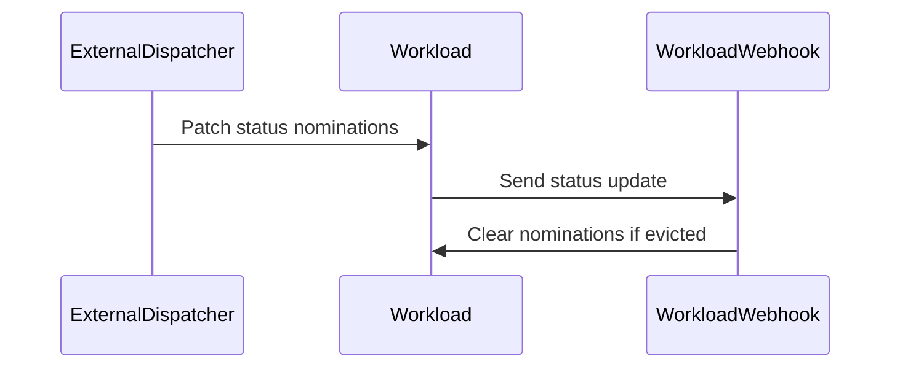

# PR #13749: Feature/webhook clear nominated clusters

**Summary**: Feature/webhook clear nominated clusters

**Sources**: https://github.com/kubernetes-sigs/kueue/pull/13749

**Last updated**: 2026-08-20T12:40:21Z

---

## Metadata

- **State**: closed (merged)
- **Author**: [@vic-comm](https://github.com/vic-comm)
- **Branch**: `feature/webhook-clear-nominated-clusters` → `main`
- **Created**: 2026-08-03T15:13:42Z
- **Updated**: 2026-08-20T12:40:21Z
- **Merged**: 2026-08-19T18:39:10Z
- **Closed**: 2026-08-19T18:39:10Z
- **Labels**: `kind/bug`, `release-note`, `size/L`, `lgtm`, `approved`, `ok-to-test`, `cncf-cla: yes`, `area/multikueue`
- **Assignees**: [@tenzen-y](https://github.com/tenzen-y)
- **Requested reviewers**: [@pajakd](https://github.com/pajakd)
- **Changed files**: 13   **+276 / -13**

## Description

#### What type of PR is this?

/kind feature
/area multikueue

#### What this PR does / why we need it:

When external dispatchers in MultiKueue nominate worker clusters using their own Server-Side Apply (SSA) field manager (e.g. `fieldManager: "my-external-dispatcher"`), Kubernetes SSA tracks field ownership under that custom manager. Previously, when Kueue attempted to clear `.status.nominatedClusterNames = nil` using Server-Side Apply under `kueue-admission`, SSA field ownership conflicts prevented the field from being cleared.

Following maintainer discussion on  PR review, this PR introduces a static `MutatingAdmissionPolicy` (MAP v1) resource to clear `status.nominatedClusterNames` directly inside `kube-apiserver` upon workload admission or eviction:

- Avoids introducing an HTTP `UPDATE` mutating webhook to minimize API Server latency and external pod call overhead.
- Adds static MAP manifests under `config/components/map/` (for Kustomize) and `charts/kueue/templates/map/` (for Helm, enabled by default via `enableMutatingAdmissionPolicy: true`).
- Uses CEL `matchConditions` to clear `status.nominatedClusterNames` when `status.clusterName` is newly set (workload admitted) or when `Evicted: True` condition is newly added.
- Reverts mutating update webhook changes on `mworkload.kb.io`, maintaining `verbs=create`.

#### Which issue(s) this PR fixes:

Fixes #6185

#### Special notes for your reviewer:

- Added static Kustomize manifests in `config/components/map/` and Helm templates in `charts/kueue/templates/map/`.
- Updated `charts/kueue/values.yaml` with `enableMutatingAdmissionPolicy: true`.
- Added E2E coverage in `test/e2e/multikueue/sequential/e2e_test.go` verifying MAP clearing of `nominatedClusterNames`.

#### Does this PR introduce a user-facing change?

```release-note
MultiKueue: Fixed a bug where a stale `status.nominatedClusterNames` could cause Server-Side Apply field manager conflicts with external dispatchers. Kueue now clears the field through a MutatingAdmissionPolicy when a Workload is admitted or evicted.
```

## Discussion

### Comment by [@netlify[bot]](https://github.com/apps/netlify) — 2026-08-03T15:13:49Z

### <span aria-hidden="true">✅</span> Deploy Preview for *kubernetes-sigs-kueue* canceled.


|  Name | Link |
|:-:|------------------------|
|<span aria-hidden="true">🔨</span> Latest commit | 99894231fed14f2ba90f6e15efa7f4149ff1f165 |
|<span aria-hidden="true">🔍</span> Latest deploy log | https://app.netlify.com/projects/kubernetes-sigs-kueue/deploys/6a84e790b954cd00095766c2 |

### Comment by [@kubernetes-prow[bot]](https://github.com/apps/kubernetes-prow) — 2026-08-03T15:13:52Z

Hi @vic-comm. Thanks for your PR.

I'm waiting for a [kubernetes-sigs](https://github.com/orgs/kubernetes-sigs/people) member to verify that this patch is reasonable to test. If it is, they should reply with `/ok-to-test` on its own line. Until that is done, I will not automatically test new commits in this PR, but the usual testing commands by org members will still work.

>[!TIP]
>**We noticed you've done this a few times! Consider [joining the org](https://git.k8s.io/community/community-membership.md#member) to skip this step and gain `/lgtm` and other bot rights.** We recommend asking approvers on your previous PRs to sponsor you.

Once the patch is verified, the new status will be reflected by the `ok-to-test` label.

I understand the commands that are listed [here](https://go.k8s.io/bot-commands?repo=kubernetes-sigs%2Fkueue).

<details>

Instructions for interacting with me using PR comments are available [here](https://git.k8s.io/community/contributors/guide/pull-requests.md).  If you have questions or suggestions related to my behavior, please file an issue against the [kubernetes-sigs/prow](https://github.com/kubernetes-sigs/prow/issues/new?title=Prow%20issue:) repository.
</details>

### Comment by [@coderabbitai[bot]](https://github.com/apps/coderabbitai) — 2026-08-03T15:14:02Z

<!-- This is an auto-generated comment: summarize by coderabbit.ai -->
<!-- review_stack_entry_start -->

[](https://app.coderabbit.ai/change-stack/kubernetes-sigs/kueue/pull/13749?utm_source=github_walkthrough&utm_medium=github&utm_campaign=change_stack)

<!-- review_stack_entry_end -->
<!-- This is an auto-generated comment: review paused by coderabbit.ai -->

> [!NOTE]
> ## Reviews paused
> 
> It looks like this branch is under active development. To avoid overwhelming you with review comments due to an influx of new commits, CodeRabbit has automatically paused this review. You can configure this behavior by changing the `reviews.auto_review.auto_pause_after_reviewed_commits` setting.
> 
> Use the following commands to manage reviews:
> - `@coderabbitai resume` to resume automatic reviews.
> - `@coderabbitai review` to trigger a single review.
> 
> Use the checkboxes below for quick actions:
> - [ ] <!-- {"checkboxId": "7f6cc2e2-2e4e-497a-8c31-c9e4573e93d1"} --> ▶️ Resume reviews
> - [ ] <!-- {"checkboxId": "e9bb8d72-00e8-4f67-9cb2-caf3b22574fe"} --> 🔍 Trigger review

<!-- end of auto-generated comment: review paused by coderabbit.ai -->
<!-- walkthrough_start -->

<details>
<summary>📝 Walkthrough</summary>

## Walkthrough

The mutating workload webhook now processes `UPDATE` operations for `workloads` and `workloads/status`. It clears nominated cluster names for evicted workloads. Unit and integration tests cover defaulting, external dispatcher status patches, and eviction cleanup.

### Changes

**Workload webhook eviction handling**

|Layer / File(s)|Summary|
|---|---|
|**Eviction-aware webhook defaulting** <br> `pkg/webhooks/workload_webhook.go`|The webhook detects evicted workloads and clears `Status.NominatedClusterNames`. It also accepts updates to `workloads/status`.|
|**Webhook configuration validation** <br> `config/components/webhook/manifests.yaml`, `charts/kueue/templates/webhook/manifests.yaml`, `pkg/webhooks/workload_webhook_test.go`|The manifests target `workloads` and `workloads/status` for create and update operations. Table-driven tests cover eviction cleanup and preservation behavior.|
|**External dispatcher status patching** <br> `test/integration/multikueue/dispatcher_test.go`|The integration tests patch nominations for both worker clusters with the `external-dispatcher-app` field manager and verify that eviction clears them.|

**Estimated code review effort:** 3 (Moderate) | ~25 minutes

### Sequence Diagram(s)



**Possibly related PRs**

- [kubernetes-sigs/kueue#10937](https://github.com/kubernetes-sigs/kueue/pull/10937): Both changes cover MultiKueue workload nomination and eviction handling.
- [kubernetes-sigs/kueue#12658](https://github.com/kubernetes-sigs/kueue/pull/12658): Both changes use eviction helpers for workload nomination cleanup.
- [kubernetes-sigs/kueue#13682](https://github.com/kubernetes-sigs/kueue/pull/13682): Both changes update the workload webhook and clear nominations after eviction.

**Suggested reviewers:** `pajakd`, `mbobrovskyi`

</details>

<!-- walkthrough_end -->
<!-- pre_merge_checks_walkthrough_start -->

<details>
<summary>🚥 Pre-merge checks | ✅ 4 | ❌ 1</summary>

### ❌ Failed checks (1 warning)

|     Check name     | Status     | Explanation                                                                          | Resolution                                                                         |
| :----------------: | :--------- | :----------------------------------------------------------------------------------- | :--------------------------------------------------------------------------------- |
| Docstring Coverage | ⚠️ Warning | Docstring coverage is 0.00% which is insufficient. The required threshold is 80.00%. | Write docstrings for the functions missing them to satisfy the coverage threshold. |

<details>
<summary>✅ Passed checks (4 passed)</summary>

|         Check name         | Status   | Explanation                                                                                                                               |
| :------------------------: | :------- | :---------------------------------------------------------------------------------------------------------------------------------------- |
|     Linked Issues check    | ✅ Passed | The webhook clears nominated cluster names on eviction, removing the external dispatcher field-manager conflict described in issue `#6185`. |
| Out of Scope Changes check | ✅ Passed | The manifest updates, webhook logic, and tests directly support the linked issue and PR objectives.                                       |
|      Description Check     | ✅ Passed | Check skipped - CodeRabbit’s high-level summary is enabled.                                                                               |
|         Title check        | ✅ Passed | The title clearly identifies the main change: clearing nominated cluster names in the workload webhook.                                   |

</details>

</details>

<!-- pre_merge_checks_walkthrough_end -->
<!-- finishing_touch_checkbox_start -->

<details>
<summary>✨ Finishing Touches</summary>

<details>
<summary>🧪 Generate unit tests (beta)</summary>

- [ ] <!-- {"checkboxId": "f47ac10b-58cc-4372-a567-0e02b2c3d479", "radioGroupId": "utg-output-choice-group-unknown_comment_id"} -->   Create PR with unit tests

</details>

</details>

<!-- finishing_touch_checkbox_end -->
<!-- tips_start -->

---

Thanks for using [CodeRabbit](https://coderabbit.ai?utm_source=oss&utm_medium=github&utm_campaign=kubernetes-sigs/kueue&utm_content=13749)! It's free for OSS, and your support helps us grow. If you like it, consider giving us a shout-out.

<details>
<summary>❤️ Share</summary>

- [X](https://twitter.com/intent/tweet?text=I%20just%20used%20%40coderabbitai%20for%20my%20code%20review%2C%20and%20it%27s%20fantastic%21%20It%27s%20free%20for%20OSS%20and%20offers%20a%20free%20trial%20for%20the%20proprietary%20code.%20Check%20it%20out%3A&url=https%3A//coderabbit.ai)
- [Mastodon](https://mastodon.social/share?text=I%20just%20used%20%40coderabbitai%20for%20my%20code%20review%2C%20and%20it%27s%20fantastic%21%20It%27s%20free%20for%20OSS%20and%20offers%20a%20free%20trial%20for%20the%20proprietary%20code.%20Check%20it%20out%3A%20https%3A%2F%2Fcoderabbit.ai)
- [Reddit](https://www.reddit.com/submit?title=Great%20tool%20for%20code%20review%20-%20CodeRabbit&text=I%20just%20used%20CodeRabbit%20for%20my%20code%20review%2C%20and%20it%27s%20fantastic%21%20It%27s%20free%20for%20OSS%20and%20offers%20a%20free%20trial%20for%20proprietary%20code.%20Check%20it%20out%3A%20https%3A//coderabbit.ai)
- [LinkedIn](https://www.linkedin.com/sharing/share-offsite/?url=https%3A%2F%2Fcoderabbit.ai&mini=true&title=Great%20tool%20for%20code%20review%20-%20CodeRabbit&summary=I%20just%20used%20CodeRabbit%20for%20my%20code%20review%2C%20and%20it%27s%20fantastic%21%20It%27s%20free%20for%20OSS%20and%20offers%20a%20free%20trial%20for%20proprietary%20code)

</details>


<sub>Comment `@coderabbitai help` to get the list of available commands.</sub>

<!-- tips_end -->

### Comment by [@mimowo](https://github.com/mimowo) — 2026-08-03T15:19:01Z

/ok-to-test

### Comment by [@mimowo](https://github.com/mimowo) — 2026-08-10T19:50:21Z

@vic-comm have you been able to successfully test the installation paths on a live cluster? Both using Helm and the static manifest? Then check if this works as expected. Finally, delete the manifest and check if the deletion works ok.

### Comment by [@mimowo](https://github.com/mimowo) — 2026-08-12T21:11:40Z

cc @sohankunkerkar @tenzen-y ptal. I'm happy with all the production code changes. I only have one pending comment about the tests: https://github.com/kubernetes-sigs/kueue/pull/13749#discussion_r3759360644

### Comment by [@vic-comm](https://github.com/vic-comm) — 2026-08-12T21:42:04Z

Thanks for the review @mimowo, I'm having tight time constraints I'll
implement the tests before the end of the week.

On Wed, Aug 12, 2026, 10:12 PM Michał Woźniak ***@***.***>
wrote:

> *mimowo* left a comment (kubernetes-sigs/kueue#13749)
> <https://github.com/kubernetes-sigs/kueue/pull/13749#issuecomment-5272846969>
>
> cc @sohankunkerkar <https://github.com/sohankunkerkar> @tenzen-y
> <https://github.com/tenzen-y> ptal. I'm happy with all the production
> code changes. I only have one pending comment about the tests: #13749
> (comment)
> <https://github.com/kubernetes-sigs/kueue/pull/13749#discussion_r3759360644>
>
> —
> Reply to this email directly, view it on GitHub
> <https://github.com/kubernetes-sigs/kueue/pull/13749?email_source=notifications&email_token=A4T6TGLCG5FZDJA7G4LLDW35JTMSHA5CNFSNUABFM5UWIORPF5TWS5BNNB2WEL2JONZXKZKDN5WW2ZLOOQXTKMRXGI4DINRZGY42M4TFMFZW63VHNVSW45DJN5XKKZLWMVXHJLDGN5XXIZLSL5RWY2LDNM#issuecomment-5272846969>,
> or unsubscribe
> <https://github.com/notifications/unsubscribe-auth/A4T6TGLMOASZB6UHA6U25JD5JTMSHAVCNFSNUABFKJSXA33TNF2G64TZHM2DKOJYG4YDGMJQHNEXG43VMU5TKMBVGEZTGMZRHEY2C5QC>
> .
> Triage notifications, keep track of coding agent tasks and review pull
> requests on the go with GitHub Mobile for iOS
> <https://github.com/notifications/mobile/ios/A4T6TGODUSXXKEXQXIXJCJL5JTMSHA5CNFSNUABFM5UWIORPF5TWS5BNNB2WEL2JONZXKZKDN5WW2ZLOOQXTKMRXGI4DINRZGY42M4TFMFZW63VHNVSW45DJN5XKKZLWMVXHJKTGN5XXIZLSL5UW64Y>
> and Android
> <https://github.com/notifications/mobile/android/A4T6TGNSTCHUGZPYZXX523D5JTMSHA5CNFSNUABFM5UWIORPF5TWS5BNNB2WEL2JONZXKZKDN5WW2ZLOOQXTKMRXGI4DINRZGY42M4TFMFZW63VHNVSW45DJN5XKKZLWMVXHJLTGN5XXIZLSL5QW4ZDSN5UWI>.
> Download it today!
> You are receiving this because you were mentioned.Message ID:
> ***@***.***>
>

### Comment by [@tenzen-y](https://github.com/tenzen-y) — 2026-08-14T20:51:23Z

> Thanks for the review @mimowo, I'm having tight time constraints I'll implement the tests before the end of the week.

@vic-comm Please let me know (mentioning @tenzen-y) once you finalize all implementations.

### Comment by [@vic-comm](https://github.com/vic-comm) — 2026-08-14T20:55:24Z

> > Thanks for the review @mimowo, I'm having tight time constraints I'll implement the tests before the end of the week.
> 
> @vic-comm Please let me know (mentioning @tenzen-y) once you finalize all implementations.

@tenzen-y @mimowo  I have addressed all review comments and implementations

### Comment by [@tenzen-y](https://github.com/tenzen-y) — 2026-08-18T15:05:04Z

@vic-comm FYI: We are planning to release the patch version this Thursday. If you can finalize this PR, it would be great.

### Comment by [@vic-comm](https://github.com/vic-comm) — 2026-08-18T19:16:14Z

> @vic-comm FYI: We are planning to release the patch version this Thursday. If you can finalize this PR, it would be great.

I'm on it

### Comment by [@kubernetes-prow[bot]](https://github.com/apps/kubernetes-prow) — 2026-08-19T18:24:31Z

LGTM label has been added.  <details>Git tree hash: f492ecea77aefe2b705f29d996dc3a08d43e10ff</details>

### Comment by [@kubernetes-prow[bot]](https://github.com/apps/kubernetes-prow) — 2026-08-19T18:24:35Z

[APPROVALNOTIFIER] This PR is **APPROVED**

This pull-request has been approved by: *<a href="https://github.com/kubernetes-sigs/kueue/pull/13749#pullrequestreview-4975154055" title="Approved">tenzen-y</a>*, *<a href="https://github.com/kubernetes-sigs/kueue/pull/13749#" title="Author self-approved">vic-comm</a>*

The full list of commands accepted by this bot can be found [here](https://go.k8s.io/bot-commands?repo=kubernetes-sigs%2Fkueue).

The pull request process is described [here](https://git.k8s.io/community/contributors/guide/owners.md#the-code-review-process)

<details >
Needs approval from an approver in each of these files:

- ~~[OWNERS](https://github.com/kubernetes-sigs/kueue/blob/main/OWNERS)~~ [tenzen-y]

Approvers can indicate their approval by writing `/approve` in a comment
Approvers can cancel approval by writing `/approve cancel` in a comment
</details>
<!-- META={"approvers":[]} -->

### Comment by [@tenzen-y](https://github.com/tenzen-y) — 2026-08-19T18:26:15Z

/cherrypick release-0.18
/cherrypick release-0.19

### Comment by [@k8s-infra-cherrypick-robot](https://github.com/k8s-infra-cherrypick-robot) — 2026-08-19T18:26:18Z

@tenzen-y: once the present PR merges, I will cherry-pick it on top of `release-0.18`, `release-0.19` in new PRs and assign them to you.

<details>

In response to [this](https://github.com/kubernetes-sigs/kueue/pull/13749#issuecomment-5346329969):

>/cherrypick release-0.18
>/cherrypick release-0.19


Instructions for interacting with me using PR comments are available [here](https://git.k8s.io/community/contributors/guide/pull-requests.md).  If you have questions or suggestions related to my behavior, please file an issue against the [kubernetes-sigs/prow](https://github.com/kubernetes-sigs/prow/issues/new?title=Prow%20issue:) repository.
</details>

### Comment by [@k8s-infra-cherrypick-robot](https://github.com/k8s-infra-cherrypick-robot) — 2026-08-19T18:39:51Z

@tenzen-y: #13749 failed to apply on top of branch "release-0.18":
```
Applying: feat(webhook): clear nominatedClusterNames on workload eviction
Using index info to reconstruct a base tree...
M	pkg/webhooks/workload_webhook.go
M	pkg/webhooks/workload_webhook_test.go
M	test/integration/multikueue/dispatcher_test.go
Falling back to patching base and 3-way merge...
Auto-merging pkg/webhooks/workload_webhook.go
Auto-merging pkg/webhooks/workload_webhook_test.go
Auto-merging test/integration/multikueue/dispatcher_test.go
CONFLICT (content): Merge conflict in test/integration/multikueue/dispatcher_test.go
error: Failed to merge in the changes.
hint: Use 'git am --show-current-patch=diff' to see the failed patch
hint: When you have resolved this problem, run "git am --continue".
hint: If you prefer to skip this patch, run "git am --skip" instead.
hint: To restore the original branch and stop patching, run "git am --abort".
hint: Disable this message with "git config set advice.mergeConflict false"
Patch failed at 0001 feat(webhook): clear nominatedClusterNames on workload eviction

```

<details>

In response to [this](https://github.com/kubernetes-sigs/kueue/pull/13749#issuecomment-5346329969):

>/cherrypick release-0.18
>/cherrypick release-0.19


Instructions for interacting with me using PR comments are available [here](https://git.k8s.io/community/contributors/guide/pull-requests.md).  If you have questions or suggestions related to my behavior, please file an issue against the [kubernetes-sigs/prow](https://github.com/kubernetes-sigs/prow/issues/new?title=Prow%20issue:) repository.
</details>

### Comment by [@k8s-infra-cherrypick-robot](https://github.com/k8s-infra-cherrypick-robot) — 2026-08-19T18:40:31Z

@tenzen-y: new pull request created: #14643

<details>

In response to [this](https://github.com/kubernetes-sigs/kueue/pull/13749#issuecomment-5346329969):

>/cherrypick release-0.18
>/cherrypick release-0.19


Instructions for interacting with me using PR comments are available [here](https://git.k8s.io/community/contributors/guide/pull-requests.md).  If you have questions or suggestions related to my behavior, please file an issue against the [kubernetes-sigs/prow](https://github.com/kubernetes-sigs/prow/issues/new?title=Prow%20issue:) repository.
</details>

### Comment by [@tenzen-y](https://github.com/tenzen-y) — 2026-08-19T18:50:56Z

@vic-comm Please also open a cp for release-0.18 branch.

### Comment by [@tenzen-y](https://github.com/tenzen-y) — 2026-08-20T12:40:19Z

/release-note-edit
```release-note
MultiKueue: Fixed a bug where a stale `status.nominatedClusterNames` could cause Server-Side Apply field manager conflicts with external dispatchers. Kueue now clears the field through a MutatingAdmissionPolicy when a Workload is admitted or evicted.
```

## Reviews

### Review by [@mimowo](https://github.com/mimowo) (commented) — 2026-08-03T15:20:08Z

- **pkg/controller/admissionchecks/multikueue/multikueuecluster.go:791** by [@mimowo](https://github.com/mimowo) — 2026-08-03T15:20:05Z
```diff
@@ -787,7 +788,7 @@ func (c *clustersReconciler) controllerFor(acName string) (*remoteClient, bool)
 	return rc, f
 }
 
-func (c *clustersReconciler) Reconcile(ctx context.Context, req reconcile.Request) (reconcile.Result, error) {
+func (c *clustersReconciler) doReconcile(ctx context.Context, req reconcile.Request, isLeader bool) (reconcile.Result, error) {
```

  Looks like contamination from another pr

### Review by [@coderabbitai[bot]](https://github.com/apps/coderabbitai) (commented) — 2026-08-03T15:21:56Z


> [!CAUTION]
> Some comments are outside the diff and can’t be posted inline due to platform limitations.
> 
> 
> 
> <details>
> <summary>⚠️ Outside diff range comments (4)</summary><blockquote>
> 
> <details>
> <summary>pkg/controller/admissionchecks/multikueue/workload.go (2)</summary><blockquote>
> 
> `186-292`: _📐 Maintainability & Code Quality_ | _🟡 Minor_ | _⚡ Quick win_
> 
> **Add follower-mode coverage for `doReconcile`.**
> 
> `TestWlReconcile` only exercises `wlReconciler.Reconcile(...)`. Add separate tests for `wlReconciler.Observe(...)` covering the same rejection and deletion cases, so the admission check is not updated and remote objects are not removed when `isLeader == false`.
> 
> <details>
> <summary>🤖 Prompt for AI Agents</summary>
> 
> ```
> Verify each finding against current code. Fix only still-valid issues, skip the
> rest with a brief reason, keep changes minimal, and validate.
> 
> In `@pkg/controller/admissionchecks/multikueue/workload.go` around lines 186 -
> 292, Add follower-mode tests for wlReconciler.Observe and doReconcile covering
> the existing rejection and deleted-workload scenarios from TestWlReconcile.
> Assert that rejected admission checks are not updated and deleted workloads do
> not remove remote objects when isLeader is false, while preserving the existing
> leader-mode coverage.
> ```
> 
> </details>
> 
> <!-- cr-comment:v1:0e594d7945985d3f5897df2e -->
> 
> _Source: Path instructions_
> 
> ---
> 
> `258-283`: _🚀 Performance & Scalability_ | _🟠 Major_ | _⚡ Quick win_
> 
> **Move `readGroup` behind the leader gate.**
> 
> `w.readGroup` calls `remoteClientsForAC`, then `rClient.Get` for each configured worker cluster. Reaching it from follower `Observe` paths makes every follower perform a full Get for each remote Workload in the group, multiplying per-workload read traffic by the replica count. Keep the leader-only `reconcileGroup` call under `isLeader`, and only fetch remote Workloads before `RemoveRemoteObjects` or status updates when a follower replica is needed.
> 
> <details>
> <summary>🤖 Prompt for AI Agents</summary>
> 
> ```
> Verify each finding against current code. Fix only still-valid issues, skip the
> rest with a brief reason, keep changes minimal, and validate.
> 
> In `@pkg/controller/admissionchecks/multikueue/workload.go` around lines 258 -
> 283, Move the w.readGroup call in the workload reconciliation flow below the
> isDeleted and !isLeader checks so followers return before performing remote
> reads. Preserve leader handling for deletion by reading the group before
> RemoveRemoteObjects, and keep the leader-only reconcileGroup path unchanged.
> ```
> 
> </details>
> 
> <!-- cr-comment:v1:bd406547056da22dac175c51 -->
> 
> </blockquote></details>
> <details>
> <summary>pkg/controller/admissionchecks/multikueue/multikueuecluster.go (2)</summary><blockquote>
> 
> `791-860`: _📐 Maintainability & Code Quality_ | _🟡 Minor_ | _⚡ Quick win_
> 
> **Add test coverage for the new `isLeader` behavior in `doReconcile`.**
> 
> `multikueuecluster_test.go` covers status-only `MultiKueueCluster` status comparisons, but the `isLeader`/`Observe` branching needs explicit coverage. Add tests or integration cases for the leader path, the follower/observe path, and the successful follower path that connects without writing `MultiKueueCluster` status.
> 
> <details>
> <summary>🤖 Prompt for AI Agents</summary>
> 
> ```
> Verify each finding against current code. Fix only still-valid issues, skip the
> rest with a brief reason, keep changes minimal, and validate.
> 
> In `@pkg/controller/admissionchecks/multikueue/multikueuecluster.go` around lines
> 791 - 860, Add test coverage around clustersReconciler.doReconcile and its
> Reconcile/Observe wrappers for both isLeader values: verify the leader path
> updates MultiKueueCluster status, the follower/Observe path skips status
> updates, and a successful follower connection still completes without writing
> status. Reuse the existing multikueuecluster_test.go fixtures and assertions for
> status and remote-client setup.
> ```
> 
> </details>
> 
> <!-- cr-comment:v1:bce76f3e9097506a798f87ff -->
> 
> _Source: Path instructions_
> 
> ---
> 
> `791-852`: _🚀 Performance & Scalability_ | _🟡 Minor_ | _⚡ Quick win_
> 
> **Gate remote cluster setup behind leader mode.**
> 
> `doReconcile` calls `c.setRemoteClientConfig` for both `Reconcile` (`isLeader=true`) and `Observe` (`isLeader=false`). That path builds a remote `SelectivelyCachingClient` and starts workload adapter watches; with `MultiKueueManagerQuotaAutomation`, it also registers cache event handlers. Each manager replica can therefore open watches / informers against the same MultiKueueCluster, and failed config loads on followers call `disconnectCluster`, which marks the shared remote client disconnected for all replicas. Keep connection establishment and teardown leader-only, or make the remote-client mapping shardable by replica.
> 
> <details>
> <summary>🤖 Prompt for AI Agents</summary>
> 
> ```
> Verify each finding against current code. Fix only still-valid issues, skip the
> rest with a brief reason, keep changes minimal, and validate.
> 
> In `@pkg/controller/admissionchecks/multikueue/multikueuecluster.go` around lines
> 791 - 852, The doReconcile method currently establishes and tears down shared
> remote cluster clients for follower replicas. Gate setRemoteClientConfig,
> disconnectCluster, and related remote-client lifecycle operations behind
> isLeader so only the leader manages remote connections, watches, and cache
> handlers; preserve status handling and reconciliation behavior for non-leaders
> without affecting shared client state.
> ```
> 
> </details>
> 
> <!-- cr-comment:v1:f7a4b927734911485fbcb146 -->
> 
> </blockquote></details>
> 
> </blockquote></details>

<details>
<summary>🤖 Prompt for all review comments with AI agents</summary>

```
Verify each finding against current code. Fix only still-valid issues, skip the
rest with a brief reason, keep changes minimal, and validate.

Outside diff comments:
In `@pkg/controller/admissionchecks/multikueue/multikueuecluster.go`:
- Around line 791-860: Add test coverage around clustersReconciler.doReconcile
and its Reconcile/Observe wrappers for both isLeader values: verify the leader
path updates MultiKueueCluster status, the follower/Observe path skips status
updates, and a successful follower connection still completes without writing
status. Reuse the existing multikueuecluster_test.go fixtures and assertions for
status and remote-client setup.
- Around line 791-852: The doReconcile method currently establishes and tears
down shared remote cluster clients for follower replicas. Gate
setRemoteClientConfig, disconnectCluster, and related remote-client lifecycle
operations behind isLeader so only the leader manages remote connections,
watches, and cache handlers; preserve status handling and reconciliation
behavior for non-leaders without affecting shared client state.

In `@pkg/controller/admissionchecks/multikueue/workload.go`:
- Around line 186-292: Add follower-mode tests for wlReconciler.Observe and
doReconcile covering the existing rejection and deleted-workload scenarios from
TestWlReconcile. Assert that rejected admission checks are not updated and
deleted workloads do not remove remote objects when isLeader is false, while
preserving the existing leader-mode coverage.
- Around line 258-283: Move the w.readGroup call in the workload reconciliation
flow below the isDeleted and !isLeader checks so followers return before
performing remote reads. Preserve leader handling for deletion by reading the
group before RemoveRemoteObjects, and keep the leader-only reconcileGroup path
unchanged.
```

</details>

---

<details>
<summary>ℹ️ Review info</summary>

<details>
<summary>⚙️ Run configuration</summary>

**Configuration used**: Path: .coderabbit.yaml

**Review profile**: CHILL

**Plan**: Pro Plus

**Run ID**: `95a2b155-c117-439b-b5ef-fc64dd165df4`

</details>

<details>
<summary>📥 Commits</summary>

Reviewing files that changed from the base of the PR and between 24491dfd9188df3112b86b6ca9f825b4512bf5fe and c34a537f32c1fda09bfa7e447ef69e0c1eba13a6.

</details>

<details>
<summary>📒 Files selected for processing (7)</summary>

* `config/components/webhook/manifests.yaml`
* `pkg/controller/admissionchecks/multikueue/multikueuecluster.go`
* `pkg/controller/admissionchecks/multikueue/workload.go`
* `pkg/controller/core/leader_aware_reconciler.go`
* `pkg/controller/core/leader_aware_reconciler_test.go`
* `pkg/webhooks/workload_webhook.go`
* `pkg/webhooks/workload_webhook_test.go`

</details>

</details>

<!-- This is an auto-generated comment by CodeRabbit for review status -->

### Review by [@vic-comm](https://github.com/vic-comm) (commented) — 2026-08-03T15:22:22Z

- **pkg/controller/admissionchecks/multikueue/multikueuecluster.go:791** by [@vic-comm](https://github.com/vic-comm) — 2026-08-03T15:22:22Z
```diff
@@ -787,7 +788,7 @@ func (c *clustersReconciler) controllerFor(acName string) (*remoteClient, bool)
 	return rc, f
 }
 
-func (c *clustersReconciler) Reconcile(ctx context.Context, req reconcile.Request) (reconcile.Result, error) {
+func (c *clustersReconciler) doReconcile(ctx context.Context, req reconcile.Request, isLeader bool) (reconcile.Result, error) {
```

  Really sorry for that, i'm fixing it

### Review by [@mimowo](https://github.com/mimowo) (commented) — 2026-08-03T15:30:22Z

- **pkg/webhooks/workload_webhook.go:77** by [@mimowo](https://github.com/mimowo) — 2026-08-03T15:30:19Z
```diff
@@ -73,6 +74,10 @@ func (w *WorkloadWebhook) Default(ctx context.Context, wl *kueue.Workload) error
 		}
 	}
 
+	if evict.IsEvicted(wl) {
```

  lets also add an integration test for multikueue external dispatcher to use Patch instead of ssa. that will serve as a real regression test

### Review by [@vic-comm](https://github.com/vic-comm) (commented) — 2026-08-03T15:33:17Z

- **pkg/webhooks/workload_webhook.go:77** by [@vic-comm](https://github.com/vic-comm) — 2026-08-03T15:33:17Z
```diff
@@ -73,6 +74,10 @@ func (w *WorkloadWebhook) Default(ctx context.Context, wl *kueue.Workload) error
 		}
 	}
 
+	if evict.IsEvicted(wl) {
```

  Noted

### Review by [@mimowo](https://github.com/mimowo) (commented) — 2026-08-03T15:37:59Z

- **pkg/webhooks/workload_webhook.go:77** by [@mimowo](https://github.com/mimowo) — 2026-08-03T15:37:59Z
```diff
@@ -73,6 +74,10 @@ func (w *WorkloadWebhook) Default(ctx context.Context, wl *kueue.Workload) error
 		}
 	}
 
+	if evict.IsEvicted(wl) {
```

  i think that would pretty much be a copy for one of the tests we have

### Review by [@coderabbitai[bot]](https://github.com/apps/coderabbitai) (commented) — 2026-08-03T16:32:45Z

**Actionable comments posted: 1**

<details>
<summary>🤖 Prompt for all review comments with AI agents</summary>

```
Verify each finding against current code. Fix only still-valid issues, skip the
rest with a brief reason, keep changes minimal, and validate.

Inline comments:
In `@test/integration/multikueue/dispatcher_test.go`:
- Around line 390-398: The test’s external status update currently uses a merge
patch, so it does not establish real Server-Side Apply field ownership. In the
status update around managerWl.Status.NominatedClusterNames, replace the
MergeFrom-based Status().Patch call with the controller-runtime status Apply API
using the external-dispatcher-app field manager, keep the nominated cluster
names populated through eviction, and assert afterward that Kueue clears them.
```

</details>

<details>
<summary>🪄 Autofix (Beta)</summary>

Fix all unresolved CodeRabbit comments on this PR:

- [ ] <!-- {"checkboxId": "4b0d0e0a-96d7-4f10-b296-3a18ea78f0b9"} --> Push a commit to this branch (recommended)
- [ ] <!-- {"checkboxId": "ff5b1114-7d8c-49e6-8ac1-43f82af23a33"} --> Create a new PR with the fixes

</details>

---

<details>
<summary>ℹ️ Review info</summary>

<details>
<summary>⚙️ Run configuration</summary>

**Configuration used**: Path: .coderabbit.yaml

**Review profile**: CHILL

**Plan**: Pro Plus

**Run ID**: `bde9eb7a-75ce-4c89-9da6-e06aa03680d4`

</details>

<details>
<summary>📥 Commits</summary>

Reviewing files that changed from the base of the PR and between db6459d3a3d5448bd63897f3828551b0bd6546ca and 2a19341042e58868304f9e4ea6be15fbe15360b9.

</details>

<details>
<summary>📒 Files selected for processing (4)</summary>

* `config/components/webhook/manifests.yaml`
* `pkg/webhooks/workload_webhook.go`
* `pkg/webhooks/workload_webhook_test.go`
* `test/integration/multikueue/dispatcher_test.go`

</details>

<details>
<summary>🚧 Files skipped from review as they are similar to previous changes (3)</summary>

* config/components/webhook/manifests.yaml
* pkg/webhooks/workload_webhook_test.go
* pkg/webhooks/workload_webhook.go

</details>

</details>

<!-- This is an auto-generated comment by CodeRabbit for review status -->

- **test/integration/multikueue/dispatcher_test.go:398** by [@coderabbitai[bot]](https://github.com/apps/coderabbitai) — 2026-08-03T16:32:44Z
```diff
@@ -382,6 +382,24 @@ var _ = ginkgo.Describe("MultiKueueDispatcherExternal", ginkgo.Label("area:multi
 			}, util.Timeout, util.Interval).Should(gomega.Succeed())
 		})
 
+		ginkgo.By("updating workload nomination using a custom external field manager", func() {
+			gomega.Eventually(func(g gomega.Gomega) {
+				managerWl := &kueue.Workload{}
+				g.Expect(managerTestCluster.client.Get(managerTestCluster.ctx, wlLookupKey, managerWl)).To(gomega.Succeed())
+
+				patch := client.MergeFrom(managerWl.DeepCopy())
+				managerWl.Status.NominatedClusterNames = []string{workerCluster1.Name, workerCluster2.Name}
+
+				// Use a custom external fieldManager name to test SSA non-interference!
+				g.Expect(managerTestCluster.client.Status().Patch(
+					managerTestCluster.ctx,
+					managerWl,
+					patch,
+					client.FieldOwner("external-dispatcher-app"),
```

  _🗄️ Data Integrity & Integration_ | _🟠 Major_ | _⚡ Quick win_
  
  <details>
  <summary>🧩 Analysis chain</summary>
  
  🏁 Script executed:
  
  ```shell
  #!/usr/bin/env bash
  set -euo pipefail
  
  file='test/integration/multikueue/dispatcher_test.go'
  segment="$(sed -n '385,402p' "$file")"
  printf '%s\n' "$segment"
  
  if printf '%s\n' "$segment" | rg -q 'client\.MergeFrom\('; then
    echo "FAIL: the external dispatcher setup still uses a merge patch."
    exit 1
  fi
  
  if ! printf '%s\n' "$segment" | rg -q 'ApplyPatchType|Status\(\)\.Apply|SubResource\("status"\)\.Apply'; then
    echo "FAIL: the external dispatcher setup has no Server-Side Apply request."
    exit 1
  fi
  ```
  
  Repository: kubernetes-sigs/kueue
  
  Length of output: 988
  
  ---
  
  🏁 Script executed:
  
  ```shell
  #!/usr/bin/env bash
  set -euo pipefail
  
  file='test/integration/multikueue/dispatcher_test.go'
  
  printf '== file section 360-480 ==\n'
  sed -n '360,480p' "$file" | cat -n
  
  printf '\n== occurrences of client.MergeFrom / FieldOwner / Apply / NominatedClusterNames / ClusterName / Evicted ==\n'
  rg -n 'client\.MergeFrom\(|client\.FieldOwner|FieldOwner\(|Status\(\)\.Apply|SubResource\("status"\)\.Apply|ApplyPatchType|NominatedClusterNames|ClusterName|ConditionTypeWorkloadEvicted|Evicted' "$file"
  ```
  
  Repository: kubernetes-sigs/kueue
  
  Length of output: 11703
  
  ---
  
  🌐 Web query:
  
  `controller-runtime v0.24.1 client Patch FieldOwner MergePatchType JSON Merge Patch status Apply field manager documentation`
  
  💡 Result:
  
  In controller-runtime v0.24.1, you can manage field ownership during patch and apply operations using the FieldOwner option. Key concepts and implementation details: 1. FieldOwner for Server-Side Apply: The FieldOwner type is used to specify the field manager name, which identifies the actor or entity making changes to an object [1]. This is required for Server-Side Apply (SSA) to track field ownership [2][3]. When performing a patch or apply, you can pass FieldOwner as an option [1][2]: client.Patch(ctx, obj, patch, client.FieldOwner("my-manager-name")) client.Apply(ctx, obj, client.FieldOwner("my-manager-name")) 2. JSON Merge Patch vs. Server-Side Apply: - Server-Side Apply (SSA) is the recommended way to handle field management [3]. It uses the ApplyPatchType [4]. When using SSA, the API server tracks which fields are managed by which field manager [3]. - JSON Merge Patch (types.MergePatchType) is a different patching strategy that simply merges the provided JSON/YAML data into the object [5][6]. It does not involve field managers in the same way as SSA and does not track field ownership metadata [3]. 3. Configuring FieldOwner globally: Since recent updates, you can also set a default FieldOwner directly in the controller-runtime client.Options when creating the client [7]: client.New(restCfg, client.Options{ FieldOwner: "my-default-manager", }) This ensures that all write operations (Create, Update, Patch, Apply) performed by that client instance use the specified field manager by default, unless overridden in a specific method call [2]. 4. Important Distinction: Do not confuse client.MergeFrom (used for computing diffs for Merge/Strategic Merge patches) with Server-Side Apply [5][4][6]. If you intend to use Server-Side Apply, you should use the client.Apply method (or the Apply patch) along with a FieldOwner [2][5]. For further details on how the Kubernetes API server handles field management, refer to the official Server-Side Apply documentation [2][3].
  
  Citations:
  
  - 1: https://github.com/kubernetes-sigs/controller-runtime/blob/main/pkg/client/options.go
  - 2: https://github.com/kubernetes-sigs/controller-runtime/blob/main/pkg/client/client.go
  - 3: https://kubernetes.io/docs/reference/using-api/server-side-apply/
  - 4: https://github.com/kubernetes-sigs/controller-runtime/blob/v0.23.3/pkg/client/patch.go
  - 5: https://github.com/kubernetes-sigs/controller-runtime/blob/main/pkg/client/patch.go
  - 6: https://stackoverflow.com/questions/57712941/what-is-the-proper-way-to-patch-an-object-with-controller-runtime
  - 7: https://github.com/kubernetes-sigs/controller-runtime/pull/3389
  
  ---
  
  🌐 Web query:
  
  `Kubernetes server-side apply merge patch PATCH API server does not accept managedFields field manager name`
  
  💡 Result:
  
  When performing a Server-Side Apply (SSA) operation, you cannot define or modify the `managedFields` field directly in the body of your request [1][2]. The `managedFields` field is managed exclusively by the Kubernetes API server to track field ownership [1][3][4]. If you are receiving an error related to the `fieldManager` name during an SSA patch request, it is likely because the `fieldManager` parameter is required for all `Apply` operations [1][2][5]. To resolve this, you must specify the `fieldManager` as a query parameter in your API request, rather than attempting to include it within the object's body [1][2]. Key requirements for SSA field management: 1. Field Manager Requirement: All Server-Side Apply patch requests must identify the client by providing a `fieldManager` query parameter [1][2]. 2. Forbidden Body Field: You cannot define `managedFields` in the request body [1][2]. The API server automatically records and updates this metadata based on the `fieldManager` identity provided in the query parameter [1][3][2]. 3. Implicit vs. Explicit: While other update operations (like standard PUT or PATCH) may infer the field manager from the "User-Agent" HTTP header if the parameter is omitted, Server-Side Apply strictly requires the `fieldManager` parameter to be explicitly provided [1][2]. If you are working with `kubectl`, the `--field-manager` flag can be used to set this identity (e.g., `kubectl apply --server-side --field-manager=my-manager`) [1][2]. For programmatic API interactions, ensure your request URL includes the `fieldManager` query parameter (e.g., `PATCH /api/v1/namespaces/default/pods/my-pod?fieldManager=my-controller`).
  
  Citations:
  
  - 1: https://kubernetes.io/docs/reference/using-api/server-side-apply/
  - 2: https://kubernetes.co.id/en/docs/reference/using-api/server-side-apply/
  - 3: https://github.com/kubernetes/enhancements/blob/master/keps/sig-api-machinery/555-server-side-apply/README.md
  - 4: https://opensource.googleblog.com/2021/10/server-side-apply-in-kubernetes.html
  - 5: https://github.com/kubernetes/kubernetes/issues/88739
  
  ---
  
  🌐 Web query:
  
  `Kubernetes PATCH merge patch requests managedFields field applied-by ignored non-SSA`
  
  💡 Result:
  
  In Kubernetes, when performing a non-Server-Side Apply (non-SSA) PATCH request—such as a JSON Merge Patch or Strategic Merge Patch—the behavior regarding managedFields is distinct from SSA operations [1]. In non-SSA PATCH requests, the system generally treats the operation as an update to the object's fields without the granular, field-level ownership tracking mandated by Server-Side Apply [1]. Consequently, non-SSA patches do not automatically establish the same "applied-by" ownership logic used by SSA [1]. Because SSA is designed to track field ownership through managedFields to resolve conflicts and manage state, non-SSA operations simply modify the object [1]. While managedFields may still be updated by the API server to reflect the result of the patch (as they are part of the object metadata), non-SSA requests do not behave as an "Apply" operation that claims fields under a specific manager in the SSA sense [1][2]. Key points regarding this behavior: 1. Ownership and SSA: Server-Side Apply (using the application/apply-patch+yaml content type) is the specific mechanism that utilizes managedFields to track which field manager owns which fields [1]. Non-SSA patches (JSON, Strategic Merge) do not follow this ownership model and do not support the same conflict resolution features [1][3]. 2. Updating managedFields: It is technically possible to overwrite or strip managedFields entirely through non-SSA write operations (like PATCH or PUT) by sending an empty entry or by modifying the object in a way that forces the API server to reset them, though this is generally not recommended as it disrupts tracking [1]. 3. API Server Handling: When a non-SSA patch is received, the API server processes the change and updates the object's metadata. If the object's serialized size becomes too large—often due to the size of managedFields—the system may strip managedFields as a fallback to successfully complete the request [4]. In summary, non-SSA PATCH requests ignore the field-level ownership logic of SSA, meaning they do not perform the "applied-by" tracking intended for Server-Side Apply [1]. The managedFields field is effectively managed by the system based on the nature of the request (Update vs. Apply), and non-SSA patches are treated as standard updates rather than ownership-claiming operations [1][2].
  
  Citations:
  
  - 1: https://kubernetes.io/docs/reference/using-api/server-side-apply/
  - 2: https://kubernetes.io/docs/reference/kubernetes-api/definitions/managed-fields-entry-v1-meta/
  - 3: https://github.com/kubernetes/community/blob/94b696bef96aefba2ca9bf97029694565a84495e/contributors/devel/sig-api-machinery/strategic-merge-patch.md
  - 4: https://github.com/kubernetes/kubernetes/blob/63b36867/staging/src/k8s.io/apiserver/pkg/endpoints/handlers/patch.go
  
  ---
  
  
  
  </details>
  
  **Exercise a real Server-Side Apply request at the eviction boundary.**
  
  `client.MergeFrom` sends a merge patch. `client.FieldOwner("external-dispatcher-app")` does not make this a Server-Side Apply request, and Kubernetes field-manager behavior applies only to apply requests. The later eviction flow asserts empty `Status.NominatedNames` before checking eviction, so the final result does not exercise cleanup of an externally managed field.
  
  Use the controller runtime status `Apply` API so the external field manager is established by the API server. Keep `Status.NominatedClusterNames` populated through the eviction transition, then assert that Kueue clears it.
  
  <details>
  <summary>🤖 Prompt for AI Agents</summary>
  
  ```
  Verify each finding against current code. Fix only still-valid issues, skip the
  rest with a brief reason, keep changes minimal, and validate.
  
  In `@test/integration/multikueue/dispatcher_test.go` around lines 390 - 398, The
  test’s external status update currently uses a merge patch, so it does not
  establish real Server-Side Apply field ownership. In the status update around
  managerWl.Status.NominatedClusterNames, replace the MergeFrom-based
  Status().Patch call with the controller-runtime status Apply API using the
  external-dispatcher-app field manager, keep the nominated cluster names
  populated through eviction, and assert afterward that Kueue clears them.
  ```
  
  </details>
  
  <!-- fingerprinting:phantom:poseidon:luna -->
  
  <!-- cr-indicator-types:potential_issue -->
  
  <!-- cr-comment:v1:4884f4eb3e32fb87caf3cf9f -->
  
  <!-- This is an auto-generated comment by CodeRabbit -->
  
  ✅ Addressed in commits 333f832 to 7e8849a

### Review by [@coderabbitai[bot]](https://github.com/apps/coderabbitai) (commented) — 2026-08-03T17:05:22Z

**Actionable comments posted: 1**

<details>
<summary>🤖 Prompt for all review comments with AI agents</summary>

```
Verify each finding against current code. Fix only still-valid issues, skip the
rest with a brief reason, keep changes minimal, and validate.

Inline comments:
In `@charts/kueue/templates/webhook/manifests.yaml`:
- Around line 631-634: Update the webhook manifest rules in the chart template
to match config/components/webhook/manifests.yaml, ensuring the UPDATE operation
applies to both workloads and workloads/status. Keep the generated chart output
aligned with the source manifest.
```

</details>

<details>
<summary>🪄 Autofix (Beta)</summary>

Fix all unresolved CodeRabbit comments on this PR:

- [ ] <!-- {"checkboxId": "4b0d0e0a-96d7-4f10-b296-3a18ea78f0b9"} --> Push a commit to this branch (recommended)
- [ ] <!-- {"checkboxId": "ff5b1114-7d8c-49e6-8ac1-43f82af23a33"} --> Create a new PR with the fixes

</details>

---

<details>
<summary>ℹ️ Review info</summary>

<details>
<summary>⚙️ Run configuration</summary>

**Configuration used**: Path: .coderabbit.yaml

**Review profile**: CHILL

**Plan**: Pro Plus

**Run ID**: `a3c91a70-afd1-4a29-84f8-31a802e7c679`

</details>

<details>
<summary>📥 Commits</summary>

Reviewing files that changed from the base of the PR and between 2a19341042e58868304f9e4ea6be15fbe15360b9 and 31af7b9e5ba4d7463af551ca6fe093be78fb8d52.

</details>

<details>
<summary>📒 Files selected for processing (5)</summary>

* `charts/kueue/templates/webhook/manifests.yaml`
* `config/components/webhook/manifests.yaml`
* `pkg/webhooks/workload_webhook.go`
* `pkg/webhooks/workload_webhook_test.go`
* `test/integration/multikueue/dispatcher_test.go`

</details>

<details>
<summary>🚧 Files skipped from review as they are similar to previous changes (4)</summary>

* config/components/webhook/manifests.yaml
* pkg/webhooks/workload_webhook_test.go
* pkg/webhooks/workload_webhook.go
* test/integration/multikueue/dispatcher_test.go

</details>

</details>

<!-- This is an auto-generated comment by CodeRabbit for review status -->

- **charts/kueue/templates/webhook/manifests.yaml:634** by [@coderabbitai[bot]](https://github.com/apps/coderabbitai) — 2026-08-03T17:05:21Z
```diff
@@ -628,8 +628,10 @@ webhooks:
           - v1beta2
         operations:
           - CREATE
+          - UPDATE
         resources:
           - workloads
+          - workloads/status
```

  _🗄️ Data Integrity & Integration_ | _🟡 Minor_ | _⚡ Quick win_
  
  <details>
  <summary>🧩 Analysis chain</summary>
  
  🏁 Script executed:
  
  ```shell
  #!/usr/bin/env bash
  set -euo pipefail
  
  chart_manifest="charts/kueue/templates/webhook/manifests.yaml"
  source_manifest="config/components/webhook/manifests.yaml"
  values_file="charts/kueue/values.yaml"
  
  for file in "$chart_manifest" "$source_manifest" "$values_file"; do
    test -f "$file" || {
      echo "Missing required file: $file" >&2
      exit 1
    }
  done
  
  check_rule() {
    local file="$1"
    local block
  
    block="$(awk '
      /name: mworkload.kb.io$/ { inside=1 }
      inside { print }
      inside && /sideEffects:/ { exit }
    ' "$file")"
  
    grep -Fq -- "          - UPDATE" <<<"$block"
    grep -Fq -- "          - workloads" <<<"$block"
    grep -Fq -- "          - workloads/status" <<<"$block"
  }
  
  check_rule "$chart_manifest"
  check_rule "$source_manifest"
  
  command -v helm >/dev/null 2>&1 || {
    echo "helm is required to verify rendered output" >&2
    exit 1
  }
  
  rendered="$(mktemp)"
  trap 'rm -f "$rendered"' EXIT
  
  helm template kueue charts/kueue --namespace kueue-system >"$rendered"
  check_rule "$rendered"
  
  rg -n -A8 -B2 \
    "mutatingWebhook|reinvocationPolicy" \
    "$values_file" "$source_manifest" "$chart_manifest"
  ```
  
  Repository: kubernetes-sigs/kueue
  
  Length of output: 159
  
  ---
  
  🏁 Script executed:
  
  ```shell
  #!/usr/bin/env bash
  set -euo pipefail
  
  echo "Files present:"
  for f in charts/kueue/templates/webhook/manifests.yaml config/components/webhook/manifests.yaml charts/kueue/values.yaml; do
    if [ -f "$f" ]; then
      echo "OK $f"
    else
      echo "MISSING $f"
    fi
  done
  
  echo
  echo "Search webhook manifests for mworkload rules:"
  rg -n -A20 -B10 'name: mworkload\.kb\.io' charts/kueue/templates/webhook/manifests.yaml || true
  echo
  rg -n -A20 -B10 'name: mworkload\.kb\.io' config/components/webhook/manifests.yaml || true
  
  echo
  echo "Relevant values.yaml snippets:"
  rg -n -A12 -B8 'webhook|mutatingWebhook|reinvocationPolicy|ENABLE' charts/kueue/values.yaml || true
  
  echo
  echo "Read-only JSON-ish probe for rule presence:"
  python3 - <<'PY'
  from pathlib import Path
  import re
  
  def parse_mutating_webhook(path, name):
      text = Path(path).read_text()
      m = re.search(r'name:\s*' + name.replace('.', r'\.') + r'$\n(?P<body>.*?)(?=^\s{2}- |\Z)', text, re.S|re.M)
      return text if not m else m.group('body')
  
  for path in ['charts/kueue/templates/webhook/manifests.yaml', 'config/components/webhook/manifests.yaml']:
      body = parse_mutating_webhook(path, 'mworkload.kb.io')
      if body is None:
          print(path, 'NO_MATCH')
      else:
          for needle in ['UPDATE', 'workloads', 'workloads/status']:
              print(path, needle, 'FOUND' if needle in body else 'MISSING')
  PY
  ```
  
  Repository: kubernetes-sigs/kueue
  
  Length of output: 6660
  
  ---
  
  🏁 Script executed:
  
  ```shell
  #!/usr/bin/env bash
  set -euo pipefail
  
  python3 - <<'PY'
  from pathlib import Path
  import re
  
  def find_next_level_block(text, start):
      # Advance to start of next top-level list item after the newline after start.
      after = text.find('\n', start)
      if after == -1:
          return len(text)
      count = 0
      for i in range(after + 1, len(text)):
          if text[i] == '\\' or text[i] == '\n':
              continue
          if text[i].isspace() and not count:
              # Leading indent belongs to previous block until first non-space char.
              continue
          if not text[i].isspace():
              return i
      return len(text)
  
  def find_next_same_indent_block(text, start, base_indent):
      i = text.find('\n', start)
      while i >= 0 and i < len(text):
          j = i + 1
          while j < len(text) and text[j] == ' ':
              j += 1
          indent = j - i - 1
          if text[j] == '\n':
              return i + 1
          if indent == base_indent:
              return i
          i = text.find('\n', j)
      return len(text)
  
  def parse_mutating_webhook_value_at_rules(path, name):
      text = Path(path).read_text()
      needle = 'name: ' + name
      idx = text.find(needle)
      if idx == -1:
          return None
      body_end = find_next_level_block(text, idx)
      block = text[idx:body_end]
      # Locate rules line and parse until same indent as "rules:".
      rules_match = re.search(r'^[ ]*rules:', block, re.M)
      if not rules_match:
          return None
      rules_idx = idx + rules_match.start()
      base = ' ' * (text.index('\n', rules_idx) - rules_idx)
      end = find_next_same_indent_block(block, rules_match.end(), len(base))
      if ' ' * (text.index('\n', rules_idx) - rules_idx) not in block[end:] or end == len(block):
          # No same-indent terminator after rules; maybe last value.
          end = body_end
      rules_body = block[rules_match.end():end]
      return rules_body.strip()
  
  for path in ['charts/kueue/templates/webhook/manifests.yaml', 'config/components/webhook/manifests.yaml']:
      body = parse_mutating_webhook_value_at_rules(path, 'mworkload.kb.io')
      if body is None:
          print(path, 'NO_RULES_BLOCK')
      else:
          print(path)
          for needle in ['UPDATE', 'workloads', 'workloads/status']:
              print(' ', needle, 'FOUND' if needle in body else 'MISSING')
          print(body[:1200])
  PY
  ```
  
  Repository: kubernetes-sigs/kueue
  
  Length of output: 276
  
  ---
  
  
  
  </details>
  
  **Align the generated webhook manifest with the source manifest.**
  
  `manifests.yaml` includes `UPDATE` on `workloads` and `workloads/status` in `charts/kueue/templates/webhook/manifests.yaml`, but the kustomize webhook manifest does not include the same workload rules. Keep the generated chart output and `config/components/webhook/manifests.yaml` aligned.
  
  This review comment was generated with AI assistance.
  
  <details>
  <summary>🤖 Prompt for AI Agents</summary>
  
  ```
  Verify each finding against current code. Fix only still-valid issues, skip the
  rest with a brief reason, keep changes minimal, and validate.
  
  In `@charts/kueue/templates/webhook/manifests.yaml` around lines 631 - 634, Update
  the webhook manifest rules in the chart template to match
  config/components/webhook/manifests.yaml, ensuring the UPDATE operation applies
  to both workloads and workloads/status. Keep the generated chart output aligned
  with the source manifest.
  ```
  
  </details>
  
  <!-- fingerprinting:phantom:triton:luna -->
  
  <!-- cr-indicator-types:potential_issue -->
  
  <!-- cr-comment:v1:dee6ee9fd217f748faa5008f -->
  
  _Sources: Coding guidelines, Path instructions_
  
  <!-- This is an auto-generated comment by CodeRabbit -->
  
  ✅ Addressed in commit 9798b7c

### Review by [@mimowo](https://github.com/mimowo) (commented) — 2026-08-03T17:16:18Z

- **test/integration/multikueue/dispatcher_test.go:385** by [@mimowo](https://github.com/mimowo) — 2026-08-03T17:16:18Z
```diff
@@ -382,6 +382,24 @@ var _ = ginkgo.Describe("MultiKueueDispatcherExternal", ginkgo.Label("area:multi
 			}, util.Timeout, util.Interval).Should(gomega.Succeed())
 		})
 
+		ginkgo.By("updating workload nomination using a custom external field manager", func() {
```

  Can you double check the test fails without the fix?

### Review by [@mimowo](https://github.com/mimowo) (commented) — 2026-08-03T17:19:13Z

- **test/integration/multikueue/dispatcher_test.go:385** by [@mimowo](https://github.com/mimowo) — 2026-08-03T17:19:13Z
```diff
@@ -382,6 +382,24 @@ var _ = ginkgo.Describe("MultiKueueDispatcherExternal", ginkgo.Label("area:multi
 			}, util.Timeout, util.Interval).Should(gomega.Succeed())
 		})
 
+		ginkgo.By("updating workload nomination using a custom external field manager", func() {
```

  I think this may not be relevant actually, because the next Ginkgo By step is doing so would use SSA to override the ownership.
  
  Maybe it "somehow" works, but I think what we want is a copy of the entire test, just using Patch instead of SSA when simulating an external controller.

### Review by [@vic-comm](https://github.com/vic-comm) (commented) — 2026-08-03T17:30:52Z

- **test/integration/multikueue/dispatcher_test.go:385** by [@vic-comm](https://github.com/vic-comm) — 2026-08-03T17:30:52Z
```diff
@@ -382,6 +382,24 @@ var _ = ginkgo.Describe("MultiKueueDispatcherExternal", ginkgo.Label("area:multi
 			}, util.Timeout, util.Interval).Should(gomega.Succeed())
 		})
 
+		ginkgo.By("updating workload nomination using a custom external field manager", func() {
```

  Yes the test fails without the fix

### Review by [@coderabbitai[bot]](https://github.com/apps/coderabbitai) (commented) — 2026-08-03T17:35:41Z

**Actionable comments posted: 1**

<details>
<summary>🤖 Prompt for all review comments with AI agents</summary>

```
Verify each finding against current code. Fix only still-valid issues, skip the
rest with a brief reason, keep changes minimal, and validate.

Inline comments:
In `@test/integration/multikueue/dispatcher_test.go`:
- Around line 487-505: After the external field-manager patch step in the
“updating workload nomination using SSA with a custom external field manager”
test, add a gomega.Eventually assertion that retrieves the workload and verifies
Status.NominatedClusterNames equals [workerCluster1.Name, workerCluster2.Name]
before eviction; retain the existing eviction verification and ensure the test
covers both the successful nomination state and its subsequent clearing.
```

</details>

<details>
<summary>🪄 Autofix (Beta)</summary>

Fix all unresolved CodeRabbit comments on this PR:

- [ ] <!-- {"checkboxId": "4b0d0e0a-96d7-4f10-b296-3a18ea78f0b9"} --> Push a commit to this branch (recommended)
- [ ] <!-- {"checkboxId": "ff5b1114-7d8c-49e6-8ac1-43f82af23a33"} --> Create a new PR with the fixes

</details>

---

<details>
<summary>ℹ️ Review info</summary>

<details>
<summary>⚙️ Run configuration</summary>

**Configuration used**: Path: .coderabbit.yaml

**Review profile**: CHILL

**Plan**: Pro Plus

**Run ID**: `058ae5c5-0f88-46db-a61c-823229c4a6af`

</details>

<details>
<summary>📥 Commits</summary>

Reviewing files that changed from the base of the PR and between 31af7b9e5ba4d7463af551ca6fe093be78fb8d52 and 9798b7ce76cf5e54cd39c23a6173dec9856c7560.

</details>

<details>
<summary>📒 Files selected for processing (5)</summary>

* `charts/kueue/templates/webhook/manifests.yaml`
* `config/components/webhook/manifests.yaml`
* `pkg/webhooks/workload_webhook.go`
* `pkg/webhooks/workload_webhook_test.go`
* `test/integration/multikueue/dispatcher_test.go`

</details>

<details>
<summary>🚧 Files skipped from review as they are similar to previous changes (4)</summary>

* pkg/webhooks/workload_webhook_test.go
* config/components/webhook/manifests.yaml
* pkg/webhooks/workload_webhook.go
* charts/kueue/templates/webhook/manifests.yaml

</details>

</details>

<!-- This is an auto-generated comment by CodeRabbit for review status -->

- **test/integration/multikueue/dispatcher_test.go:505** by [@coderabbitai[bot]](https://github.com/apps/coderabbitai) — 2026-08-03T17:35:40Z
```diff
@@ -449,6 +467,60 @@ var _ = ginkgo.Describe("MultiKueueDispatcherExternal", ginkgo.Label("area:multi
 			}, util.Timeout, util.Interval).Should(gomega.Succeed())
 		})
 	})
+
+	ginkgo.It("Should clear nominatedClusterNames when external dispatcher uses custom field manager", func() {
+		job := testingjob.MakeJob("job-custom-fm", managerNs.Name).
+			ManagedBy(kueue.MultiKueueControllerName).
+			Queue(kueue.LocalQueueName(managerLq.Name)).
+			Obj()
+		util.MustCreate(managerTestCluster.ctx, managerTestCluster.client, job)
+
+		wlLookupKey := types.NamespacedName{Name: workloadjob.GetWorkloadNameForJob(job.Name, job.UID), Namespace: managerNs.Name}
+
+		ginkgo.By("setting workload reservation in the management cluster", func() {
+			admission := utiltestingapi.MakeAdmission(kueue.ClusterQueueReference(managerCq.Name)).
+				PodSets(utiltestingapi.MakePodSetAssignment(kueue.DefaultPodSetName).Flavor(corev1.ResourceCPU, multikueueTestFlavor).Obj()).
+				Obj()
+			util.SetQuotaReservation(managerTestCluster.ctx, managerTestCluster.client, wlLookupKey, admission)
+		})
+
+		ginkgo.By("updating workload nomination using SSA with a custom external field manager", func() {
+			gomega.Eventually(func(g gomega.Gomega) {
+				managerWl := &kueue.Workload{}
+				g.Expect(managerTestCluster.client.Get(managerTestCluster.ctx, wlLookupKey, managerWl)).To(gomega.Succeed())
+
+				err := workloadpatching.PatchStatus(
+					managerTestCluster.ctx,
+					managerTestCluster.client,
+					managerWl,
+					client.FieldOwner("external-dispatcher-app"),
+					func(wl *kueue.Workload) (bool, error) {
+						wl.Status.NominatedClusterNames = []string{workerCluster1.Name, workerCluster2.Name}
+						return true, nil
+					},
+					workloadpatching.WithForceApply(),
+				)
+				g.Expect(err).To(gomega.Succeed())
+			}, util.Timeout, util.Interval).Should(gomega.Succeed())
+		})
```

  _🎯 Functional Correctness_ | _🟡 Minor_ | _⚡ Quick win_
  
  **Assert the pre-eviction nominated state before evicting.**
  
  This step patches `NominatedClusterNames` through the external field manager and only asserts that the patch call succeeds. It does not assert that `managerWl.Status.NominatedClusterNames` actually holds `[workerCluster1.Name, workerCluster2.Name]` afterward. Without this assertion, the subsequent eviction check at Line 507-522 cannot prove that clearing happens specifically because of eviction, rather than the value never having been set.
  
  Add a `gomega.Eventually` check confirming `NominatedClusterNames` equals `[workerCluster1.Name, workerCluster2.Name]` right after Line 505, before evicting.
  
  
  
  As per path instructions, `test/integration/**/*.go` requires that "new test cases cover both positive and negative scenarios."
  
  
  <details>
  <summary>🧪 Proposed addition after the field-manager patch step</summary>
  
  ```diff
   		ginkgo.By("updating workload nomination using SSA with a custom external field manager", func() {
   			gomega.Eventually(func(g gomega.Gomega) {
   				managerWl := &kueue.Workload{}
   				g.Expect(managerTestCluster.client.Get(managerTestCluster.ctx, wlLookupKey, managerWl)).To(gomega.Succeed())
  
   				err := workloadpatching.PatchStatus(
   					managerTestCluster.ctx,
   					managerTestCluster.client,
   					managerWl,
   					client.FieldOwner("external-dispatcher-app"),
   					func(wl *kueue.Workload) (bool, error) {
   						wl.Status.NominatedClusterNames = []string{workerCluster1.Name, workerCluster2.Name}
   						return true, nil
   					},
   					workloadpatching.WithForceApply(),
   				)
   				g.Expect(err).To(gomega.Succeed())
   			}, util.Timeout, util.Interval).Should(gomega.Succeed())
   		})
  +
  +		ginkgo.By("checking nominatedClusterNames is populated before eviction", func() {
  +			gomega.Eventually(func(g gomega.Gomega) {
  +				managerWl := &kueue.Workload{}
  +				g.Expect(managerTestCluster.client.Get(managerTestCluster.ctx, wlLookupKey, managerWl)).To(gomega.Succeed())
  +				g.Expect(managerWl.Status.NominatedClusterNames).To(gomega.ContainElements(workerCluster1.Name, workerCluster2.Name))
  +			}, util.Timeout, util.Interval).Should(gomega.Succeed())
  +		})
  ```
  </details>
  
  <details>
  <summary>🤖 Prompt for AI Agents</summary>
  
  ```
  Verify each finding against current code. Fix only still-valid issues, skip the
  rest with a brief reason, keep changes minimal, and validate.
  
  In `@test/integration/multikueue/dispatcher_test.go` around lines 487 - 505, After
  the external field-manager patch step in the “updating workload nomination using
  SSA with a custom external field manager” test, add a gomega.Eventually
  assertion that retrieves the workload and verifies Status.NominatedClusterNames
  equals [workerCluster1.Name, workerCluster2.Name] before eviction; retain the
  existing eviction verification and ensure the test covers both the successful
  nomination state and its subsequent clearing.
  ```
  
  </details>
  
  <!-- fingerprinting:phantom:medusa:beignet -->
  
  <!-- cr-indicator-types:potential_issue -->
  
  <!-- cr-comment:v1:a4d7fc912f8e2fd668ee2942 -->
  
  _Source: Path instructions_
  
  <!-- This is an auto-generated comment by CodeRabbit -->
  
  ✅ Addressed in commit ed0c9dd

### Review by [@mimowo](https://github.com/mimowo) (commented) — 2026-08-03T17:44:10Z

- **test/integration/multikueue/dispatcher_test.go:385** by [@mimowo](https://github.com/mimowo) — 2026-08-03T17:44:09Z
```diff
@@ -382,6 +382,24 @@ var _ = ginkgo.Describe("MultiKueueDispatcherExternal", ginkgo.Label("area:multi
 			}, util.Timeout, util.Interval).Should(gomega.Succeed())
 		})
 
+		ginkgo.By("updating workload nomination using a custom external field manager", func() {
```

  I see, still, I think we can drop the assert as we have now a more dedicated test in "Should clear nominatedClusterNames when external dispatcher uses custom field manager"

### Review by [@mimowo](https://github.com/mimowo) (commented) — 2026-08-03T17:45:56Z

- **test/integration/multikueue/dispatcher_test.go:385** by [@mimowo](https://github.com/mimowo) — 2026-08-03T17:45:56Z
```diff
@@ -382,6 +382,24 @@ var _ = ginkgo.Describe("MultiKueueDispatcherExternal", ginkgo.Label("area:multi
 			}, util.Timeout, util.Interval).Should(gomega.Succeed())
 		})
 
+		ginkgo.By("updating workload nomination using a custom external field manager", func() {
```

  Ah, the other one is using SSA with another field manager name, so we have actually two cases which would be problematic:
  1. Patch 
  2. SSA with another manager name
  
  With this check we cover (1.), but I'm stll wondering it would be preferred to have dedicated tests for both.

### Review by [@vic-comm](https://github.com/vic-comm) (commented) — 2026-08-03T18:06:44Z

- **test/integration/multikueue/dispatcher_test.go:385** by [@vic-comm](https://github.com/vic-comm) — 2026-08-03T18:06:44Z
```diff
@@ -382,6 +382,24 @@ var _ = ginkgo.Describe("MultiKueueDispatcherExternal", ginkgo.Label("area:multi
 			}, util.Timeout, util.Interval).Should(gomega.Succeed())
 		})
 
+		ginkgo.By("updating workload nomination using a custom external field manager", func() {
```

  Just seeing this now

### Review by [@mimowo](https://github.com/mimowo) (commented) — 2026-08-03T18:12:40Z

- **pkg/webhooks/workload_webhook.go:61** by [@mimowo](https://github.com/mimowo) — 2026-08-03T18:12:40Z
```diff
@@ -57,7 +58,7 @@ func setupWebhookForWorkload(mgr ctrl.Manager, roleTracker *roletracker.RoleTrac
 		Complete()
 }
 
-// +kubebuilder:webhook:path=/mutate-kueue-x-k8s-io-v1beta2-workload,mutating=true,failurePolicy=fail,sideEffects=None,groups=kueue.x-k8s.io,resources=workloads,verbs=create,versions=v1beta2,name=mworkload.kb.io,admissionReviewVersions=v1
+// +kubebuilder:webhook:path=/mutate-kueue-x-k8s-io-v1beta2-workload,mutating=true,failurePolicy=fail,sideEffects=None,groups=kueue.x-k8s.io,resources=workloads;workloads/status,verbs=create;update,versions=v1beta2,name=mworkload.kb.io,admissionReviewVersions=v1
```

  Actually, could you explore a bit more the MAP approach? 
  
  Asking to better assess the preferred fix. I would like to avoid using "update" webhooks.
  
  MAP is stable in 1.36 and Beta (enabled by default) in 1.34+ so effectively all k8s versions we support. 
  
  So, one question worth exploring:
  1. how we could integrate and use MAP in Kueue
  2. how would it behave if someone installs Kueue with MAP disabled - I suppose this would be no-op, but probably worth checking

### Review by [@vic-comm](https://github.com/vic-comm) (commented) — 2026-08-03T18:19:59Z

- **test/integration/multikueue/dispatcher_test.go:385** by [@vic-comm](https://github.com/vic-comm) — 2026-08-03T18:19:59Z
```diff
@@ -382,6 +382,24 @@ var _ = ginkgo.Describe("MultiKueueDispatcherExternal", ginkgo.Label("area:multi
 			}, util.Timeout, util.Interval).Should(gomega.Succeed())
 		})
 
+		ginkgo.By("updating workload nomination using a custom external field manager", func() {
```

  Thanks for the review, I have removed the inline step from `Should run a job on worker if admitted`, keeping that test clean for Case 1 (Standard Patch).
  
  We now have two clean, dedicated integration tests covering both external dispatcher nomination mechanisms:
  1. **Case 1 (Standard Patch):** Tested in `Should run a job on worker if admitted`.
  2. **Case 2 (Server-Side Apply with custom FieldManager):** Tested in `Should clear nominatedClusterNames when external dispatcher uses custom field manager`.
  
  And the webhook is triggered by either eviction or admission of nominated clusters

### Review by [@vic-comm](https://github.com/vic-comm) (commented) — 2026-08-03T18:22:03Z

- **pkg/webhooks/workload_webhook.go:61** by [@vic-comm](https://github.com/vic-comm) — 2026-08-03T18:22:02Z
```diff
@@ -57,7 +58,7 @@ func setupWebhookForWorkload(mgr ctrl.Manager, roleTracker *roletracker.RoleTrac
 		Complete()
 }
 
-// +kubebuilder:webhook:path=/mutate-kueue-x-k8s-io-v1beta2-workload,mutating=true,failurePolicy=fail,sideEffects=None,groups=kueue.x-k8s.io,resources=workloads,verbs=create,versions=v1beta2,name=mworkload.kb.io,admissionReviewVersions=v1
+// +kubebuilder:webhook:path=/mutate-kueue-x-k8s-io-v1beta2-workload,mutating=true,failurePolicy=fail,sideEffects=None,groups=kueue.x-k8s.io,resources=workloads;workloads/status,verbs=create;update,versions=v1beta2,name=mworkload.kb.io,admissionReviewVersions=v1
```

  i dont have enough context on map yet, I will get back to this as soon as possible

### Review by [@mimowo](https://github.com/mimowo) (commented) — 2026-08-03T18:23:41Z

- **pkg/webhooks/workload_webhook.go:61** by [@mimowo](https://github.com/mimowo) — 2026-08-03T18:23:41Z
```diff
@@ -57,7 +58,7 @@ func setupWebhookForWorkload(mgr ctrl.Manager, roleTracker *roletracker.RoleTrac
 		Complete()
 }
 
-// +kubebuilder:webhook:path=/mutate-kueue-x-k8s-io-v1beta2-workload,mutating=true,failurePolicy=fail,sideEffects=None,groups=kueue.x-k8s.io,resources=workloads,verbs=create,versions=v1beta2,name=mworkload.kb.io,admissionReviewVersions=v1
+// +kubebuilder:webhook:path=/mutate-kueue-x-k8s-io-v1beta2-workload,mutating=true,failurePolicy=fail,sideEffects=None,groups=kueue.x-k8s.io,resources=workloads;workloads/status,verbs=create;update,versions=v1beta2,name=mworkload.kb.io,admissionReviewVersions=v1
```

  Thank you 👍

### Review by [@vic-comm](https://github.com/vic-comm) (commented) — 2026-08-06T13:53:04Z

- **pkg/webhooks/workload_webhook.go:61** by [@vic-comm](https://github.com/vic-comm) — 2026-08-06T13:53:04Z
```diff
@@ -57,7 +58,7 @@ func setupWebhookForWorkload(mgr ctrl.Manager, roleTracker *roletracker.RoleTrac
 		Complete()
 }
 
-// +kubebuilder:webhook:path=/mutate-kueue-x-k8s-io-v1beta2-workload,mutating=true,failurePolicy=fail,sideEffects=None,groups=kueue.x-k8s.io,resources=workloads,verbs=create,versions=v1beta2,name=mworkload.kb.io,admissionReviewVersions=v1
+// +kubebuilder:webhook:path=/mutate-kueue-x-k8s-io-v1beta2-workload,mutating=true,failurePolicy=fail,sideEffects=None,groups=kueue.x-k8s.io,resources=workloads;workloads/status,verbs=create;update,versions=v1beta2,name=mworkload.kb.io,admissionReviewVersions=v1
```

  Good day @mimowo,
  
  I explored the **MAP** approach as requested. Here are the findings:
  
  1. **Integration**:
     - Kueue does not currently manage admission policies programmatically. Following Kueue's existing manifest conventions (`config/components/webhook/` and `charts/kueue/templates/webhook/`), MAP manifests can be added as static templates under `config/components/map/` and `charts/kueue/templates/map/`.
     - Programmatically, MAP setup would live alongside `webhooks.Setup` in `cmd/kueue/main.go`.
  
  2. **Behavior when MAP is Disabled**:
     - **Static Manifests**: On clusters where MAP is disabled or unsupported (K8s < 1.34), applying static MAP manifests fails at install time (`no matches for kind "MutatingAdmissionPolicy"`).
     - **Programmatic Fallback**: If we manage MAP dynamically in Go code, we can use the `RESTMapping` check pattern from `workload_controller.go:1597` (`apimeta.IsNoMatchError(err)`). If `MutatingAdmissionPolicy` is missing, Kueue logs `V(2).Info("MAP API not available, skipping")` and safely continues.
  
  3. **CEL Expression**:
     The policy evaluates to `JSONPatch` `op: "remove"` on `/status/nominatedClusterNames` when the MultiKueue check transitions to `Ready` or when the workload becomes `Evicted`:
     ```yaml
     apiVersion: admissionregistration.k8s.io/v1beta1
     kind: MutatingAdmissionPolicy
     metadata:
       name: kueue-clear-nominated-clusters
     spec:
       failurePolicy: Ignore
       matchConstraints:
         resourceRules:
         - apiGroups:   ["kueue.x-k8s.io"]
           apiVersions: ["v1beta2"]
           operations:  ["UPDATE"]
           resources:   ["workloads/status"]
       matchConditions:
         - name: has-nominated-clusters
           expression: "has(object.status.nominatedClusterNames) && size(object.status.nominatedClusterNames) > 0"
         - name: multikueue-check-became-ready
           expression: >
             object.status.admissionChecks.exists(ac, 
               ac.name == "kueue.x-k8s.io/multikueue" && ac.state == "Ready" &&
               !oldObject.status.admissionChecks.exists(old, old.name == "kueue.x-k8s.io/multikueue" && old.state == "Ready"))
       mutations:
         - patchType: "JSONPatch"
           jsonPatch:
             expression: >
               [JSONPatch{op: "remove", path: "/status/nominatedClusterNames"}]

### Review by [@mimowo](https://github.com/mimowo) (commented) — 2026-08-07T11:47:05Z

- **pkg/webhooks/workload_webhook.go:61** by [@mimowo](https://github.com/mimowo) — 2026-08-07T11:47:05Z
```diff
@@ -57,7 +58,7 @@ func setupWebhookForWorkload(mgr ctrl.Manager, roleTracker *roletracker.RoleTrac
 		Complete()
 }
 
-// +kubebuilder:webhook:path=/mutate-kueue-x-k8s-io-v1beta2-workload,mutating=true,failurePolicy=fail,sideEffects=None,groups=kueue.x-k8s.io,resources=workloads,verbs=create,versions=v1beta2,name=mworkload.kb.io,admissionReviewVersions=v1
+// +kubebuilder:webhook:path=/mutate-kueue-x-k8s-io-v1beta2-workload,mutating=true,failurePolicy=fail,sideEffects=None,groups=kueue.x-k8s.io,resources=workloads;workloads/status,verbs=create;update,versions=v1beta2,name=mworkload.kb.io,admissionReviewVersions=v1
```

  @vic-comm that you for the investigation. So, I think my preference is for using MAP. 
  
  The only problem is MAP maturity :
  - 1.34 is Beta
  - 1.36 is stable
  
  So this means embedding the yaml in the manifests might be tricky. I would do it only when all supported version of k8s have MAP stable. This will happen when we approach the 1.39 release, so that only [1.36, 1.37, 1.38] will be in support. So this will be probably March / April next year.
  
  So, in the meanwhile I think we can make it happen in Kueue with two approaches:
  1. opt-in yaml, could be generic like `workload-map.yaml`, it could already by enabled by default in Helm imo
  2. install it from code on startup
  
  I don't have a strong preference, I'm probably leaning slightly towards the static solution as more inline with the long term plan, especially as we don't have users requesting this as a blocker. I think this is more of API cleanup rather than a blocker, because users can always write their dispatchers pretending they are Kueue.
  
  Wdyt?  Any opinion @tenzen-y @sohankunkerkar ?

### Review by [@mimowo](https://github.com/mimowo) (commented) — 2026-08-07T15:28:11Z

- **pkg/webhooks/workload_webhook.go:61** by [@mimowo](https://github.com/mimowo) — 2026-08-07T15:28:10Z
```diff
@@ -57,7 +58,7 @@ func setupWebhookForWorkload(mgr ctrl.Manager, roleTracker *roletracker.RoleTrac
 		Complete()
 }
 
-// +kubebuilder:webhook:path=/mutate-kueue-x-k8s-io-v1beta2-workload,mutating=true,failurePolicy=fail,sideEffects=None,groups=kueue.x-k8s.io,resources=workloads,verbs=create,versions=v1beta2,name=mworkload.kb.io,admissionReviewVersions=v1
+// +kubebuilder:webhook:path=/mutate-kueue-x-k8s-io-v1beta2-workload,mutating=true,failurePolicy=fail,sideEffects=None,groups=kueue.x-k8s.io,resources=workloads;workloads/status,verbs=create;update,versions=v1beta2,name=mworkload.kb.io,admissionReviewVersions=v1
```

  As I synced with @tenzen-y he is ok with MAP, but would like to request some tests. I think this could be done with integration tests, and also e2e. For e2e probably the sequencial suite is best

### Review by [@sohankunkerkar](https://github.com/sohankunkerkar) (commented) — 2026-08-07T15:39:53Z

- **pkg/webhooks/workload_webhook.go:61** by [@sohankunkerkar](https://github.com/sohankunkerkar) — 2026-08-07T15:39:53Z
```diff
@@ -57,7 +58,7 @@ func setupWebhookForWorkload(mgr ctrl.Manager, roleTracker *roletracker.RoleTrac
 		Complete()
 }
 
-// +kubebuilder:webhook:path=/mutate-kueue-x-k8s-io-v1beta2-workload,mutating=true,failurePolicy=fail,sideEffects=None,groups=kueue.x-k8s.io,resources=workloads,verbs=create,versions=v1beta2,name=mworkload.kb.io,admissionReviewVersions=v1
+// +kubebuilder:webhook:path=/mutate-kueue-x-k8s-io-v1beta2-workload,mutating=true,failurePolicy=fail,sideEffects=None,groups=kueue.x-k8s.io,resources=workloads;workloads/status,verbs=create;update,versions=v1beta2,name=mworkload.kb.io,admissionReviewVersions=v1
```

  @mimowo I agree with MAP as the destination. For the interim, I'd lean toward option 1 (static manifest) for the same reasons you mentioned as it's inline with the long-term plan and can be enabled by default in Helm.
   
  On 1.34/1.35 clusters where MAP is beta, ~the `MutatingAdmissionPolicy` API is served by default (beta = enabled)~, so the manifest applies cleanly. If an admin explicitly disabled the MAP gate, the API won't be served and kubectl apply fails but that's a conscious opt-out, not a silent breakage.
  
  One note on the current PR itself: the webhook clears on [IsAdmitted(wl) || IsEvicted(wl)](https://github.com/kubernetes-sigs/kueue/pull/13749/changes#diff-78176f9cb5321e2dec9c0b0f7ba7bddf13cdcfd1f28011f338c86dc629b62adfR77), not just eviction. That's wider than #6185 asks for, so worth narrowing if this approach moves forward in any form.

### Review by [@tenzen-y](https://github.com/tenzen-y) (commented) — 2026-08-07T15:43:21Z

- **pkg/webhooks/workload_webhook.go:61** by [@tenzen-y](https://github.com/tenzen-y) — 2026-08-07T15:43:21Z
```diff
@@ -57,7 +58,7 @@ func setupWebhookForWorkload(mgr ctrl.Manager, roleTracker *roletracker.RoleTrac
 		Complete()
 }
 
-// +kubebuilder:webhook:path=/mutate-kueue-x-k8s-io-v1beta2-workload,mutating=true,failurePolicy=fail,sideEffects=None,groups=kueue.x-k8s.io,resources=workloads,verbs=create,versions=v1beta2,name=mworkload.kb.io,admissionReviewVersions=v1
+// +kubebuilder:webhook:path=/mutate-kueue-x-k8s-io-v1beta2-workload,mutating=true,failurePolicy=fail,sideEffects=None,groups=kueue.x-k8s.io,resources=workloads;workloads/status,verbs=create;update,versions=v1beta2,name=mworkload.kb.io,admissionReviewVersions=v1
```

  > On 1.34/1.35 clusters where MAP is beta, the MutatingAdmissionPolicy API is served by default (beta = enabled), so the manifest applies cleanly.
  
  I don't think so. Is it true? Beta API means disabling by default and Beta Feature means enabling by default in k/k.
  
  Please can you recheck that?

### Review by [@mimowo](https://github.com/mimowo) (commented) — 2026-08-07T16:01:42Z

- **pkg/webhooks/workload_webhook.go:61** by [@mimowo](https://github.com/mimowo) — 2026-08-07T16:01:42Z
```diff
@@ -57,7 +58,7 @@ func setupWebhookForWorkload(mgr ctrl.Manager, roleTracker *roletracker.RoleTrac
 		Complete()
 }
 
-// +kubebuilder:webhook:path=/mutate-kueue-x-k8s-io-v1beta2-workload,mutating=true,failurePolicy=fail,sideEffects=None,groups=kueue.x-k8s.io,resources=workloads,verbs=create,versions=v1beta2,name=mworkload.kb.io,admissionReviewVersions=v1
+// +kubebuilder:webhook:path=/mutate-kueue-x-k8s-io-v1beta2-workload,mutating=true,failurePolicy=fail,sideEffects=None,groups=kueue.x-k8s.io,resources=workloads;workloads/status,verbs=create;update,versions=v1beta2,name=mworkload.kb.io,admissionReviewVersions=v1
```

  > One note on the current PR itself: the webhook clears on IsAdmitted(wl) || IsEvicted(wl), not just eviction. That's wider than #6185 asks for, so worth narrowing if this approach moves forward in any form.
  
  Good point, the issue mentions eviction, because I overlooked the fact we also clear status.nominatedNodeNames when we admit the workload.
  
  However, there is an important nuance, we currently reset status.nominatedClusterNames not when setting `Admitted=True`, but when setting the .status.admissionChecks[multikueue].state=Ready, we do this [here](https://github.com/kubernetes-sigs/kueue/blob/94d8d179d7a64d85dd31a5b09b0e099f6ddc0642/pkg/controller/admissionchecks/multikueue/workload.go#L1201-L1217). 
  
  So some thoughts:
  1. checking that the MK admission check transitioned to Ready in MAP (and webhook) is hard, because it requires lookup to another object
  2. deferring setting of status.nominatedClusterNames=nil when transitioning to Admitted is feasible, but tricky, because setting Ready=True is the moment when we made our nomination decisions
  
  I think neither (1.) or (2.) are perfect for admission. I would like to propose to change the handling to either:
  1. on selecting the worker keep `status.nominatedClusterNames` as before
  2. adjust `status.nominatedClusterNames` to equal `status.clusterName`
  
  I would be leaning to (1.), we don't really need to be adjusting `status.nominatedClusterNames` when the nomination settles down on a cluster. wdyt @tenzen-y ?

### Review by [@sohankunkerkar](https://github.com/sohankunkerkar) (commented) — 2026-08-07T16:03:52Z

- **pkg/webhooks/workload_webhook.go:61** by [@sohankunkerkar](https://github.com/sohankunkerkar) — 2026-08-07T16:03:51Z
```diff
@@ -57,7 +58,7 @@ func setupWebhookForWorkload(mgr ctrl.Manager, roleTracker *roletracker.RoleTrac
 		Complete()
 }
 
-// +kubebuilder:webhook:path=/mutate-kueue-x-k8s-io-v1beta2-workload,mutating=true,failurePolicy=fail,sideEffects=None,groups=kueue.x-k8s.io,resources=workloads,verbs=create,versions=v1beta2,name=mworkload.kb.io,admissionReviewVersions=v1
+// +kubebuilder:webhook:path=/mutate-kueue-x-k8s-io-v1beta2-workload,mutating=true,failurePolicy=fail,sideEffects=None,groups=kueue.x-k8s.io,resources=workloads;workloads/status,verbs=create;update,versions=v1beta2,name=mworkload.kb.io,admissionReviewVersions=v1
```

   @tenzen-y You're right. I just verified on a stock K8s 1.34 kind cluster; `admissionregistration.k8s.io/v1beta1` is not served by default and `MutatingAdmissionPolicy` doesn't appear in api-resources. Only v1 is served. The beta API is off by default per KEP-3136, confirmed empirically. Thanks for catching that.

### Review by [@mimowo](https://github.com/mimowo) (commented) — 2026-08-07T20:01:54Z

- **pkg/webhooks/workload_webhook.go:61** by [@mimowo](https://github.com/mimowo) — 2026-08-07T20:01:54Z
```diff
@@ -57,7 +58,7 @@ func setupWebhookForWorkload(mgr ctrl.Manager, roleTracker *roletracker.RoleTrac
 		Complete()
 }
 
-// +kubebuilder:webhook:path=/mutate-kueue-x-k8s-io-v1beta2-workload,mutating=true,failurePolicy=fail,sideEffects=None,groups=kueue.x-k8s.io,resources=workloads,verbs=create,versions=v1beta2,name=mworkload.kb.io,admissionReviewVersions=v1
+// +kubebuilder:webhook:path=/mutate-kueue-x-k8s-io-v1beta2-workload,mutating=true,failurePolicy=fail,sideEffects=None,groups=kueue.x-k8s.io,resources=workloads;workloads/status,verbs=create;update,versions=v1beta2,name=mworkload.kb.io,admissionReviewVersions=v1
```

  Ah, I have an alternative which wouldn't require changing the cycle. Instead of reacting to the Ready state we could clear status.nominatedClusterNames whenever `status.clusterName is set || Evicted`.  This will cover reliably the case, because the [code](https://github.com/kubernetes-sigs/kueue/blob/94d8d179d7a64d85dd31a5b09b0e099f6ddc0642/pkg/controller/admissionchecks/multikueue/workload.go#L1211-L1217) sets the `clusterName`. 
  
  So, I think we are good. Just need to figure out how to plug-in MAP into Kueue as add-on. No need for semantic changes.

### Review by [@vic-comm](https://github.com/vic-comm) (commented) — 2026-08-07T20:45:02Z

- **pkg/webhooks/workload_webhook.go:61** by [@vic-comm](https://github.com/vic-comm) — 2026-08-07T20:45:02Z
```diff
@@ -57,7 +58,7 @@ func setupWebhookForWorkload(mgr ctrl.Manager, roleTracker *roletracker.RoleTrac
 		Complete()
 }
 
-// +kubebuilder:webhook:path=/mutate-kueue-x-k8s-io-v1beta2-workload,mutating=true,failurePolicy=fail,sideEffects=None,groups=kueue.x-k8s.io,resources=workloads,verbs=create,versions=v1beta2,name=mworkload.kb.io,admissionReviewVersions=v1
+// +kubebuilder:webhook:path=/mutate-kueue-x-k8s-io-v1beta2-workload,mutating=true,failurePolicy=fail,sideEffects=None,groups=kueue.x-k8s.io,resources=workloads;workloads/status,verbs=create;update,versions=v1beta2,name=mworkload.kb.io,admissionReviewVersions=v1
```

  Its a cleaner trigger, using status.clusterName being set (or eviction) avoids the need to inspect admission check state transitions in CEL entirely. The updated MAP condition would be:
  ```
  yaml
  matchConditions:
    - name: has-nominated-clusters
      expression: "has(object.status.nominatedClusterNames) && size(object.status.nominatedClusterNames) > 0"
    - name: trigger
      expression: >
        (has(object.status.clusterName) && !has(oldObject.status.clusterName))
        ||
        (object.status.conditions.exists(c, c.type == 'Evicted' && c.status == 'True') &&
         !oldObject.status.conditions.exists(c, c.type == 'Evicted' && c.status == 'True'))
  ```
  For the add-on integration, based on the discussion, the plan is a static manifest approach (config/components/map/ and charts/kueue/templates/map/), enabled by default in Helm, targeting clusters where MAP v1 is stable (1.36+). For older clusters the manifest apply fails visibly rather than silently.
  
  Should I proceed with implementing this static manifest approach, or are we waiting for @tenzen-y's input first?"

### Review by [@mimowo](https://github.com/mimowo) (commented) — 2026-08-07T20:51:24Z

- **pkg/webhooks/workload_webhook.go:61** by [@mimowo](https://github.com/mimowo) — 2026-08-07T20:51:24Z
```diff
@@ -57,7 +58,7 @@ func setupWebhookForWorkload(mgr ctrl.Manager, roleTracker *roletracker.RoleTrac
 		Complete()
 }
 
-// +kubebuilder:webhook:path=/mutate-kueue-x-k8s-io-v1beta2-workload,mutating=true,failurePolicy=fail,sideEffects=None,groups=kueue.x-k8s.io,resources=workloads,verbs=create,versions=v1beta2,name=mworkload.kb.io,admissionReviewVersions=v1
+// +kubebuilder:webhook:path=/mutate-kueue-x-k8s-io-v1beta2-workload,mutating=true,failurePolicy=fail,sideEffects=None,groups=kueue.x-k8s.io,resources=workloads;workloads/status,verbs=create;update,versions=v1beta2,name=mworkload.kb.io,admissionReviewVersions=v1
```

  Let's start to prototype, I also synced on slack with @tenzen-y and he initially endorsed the changes. So, I think a change is unlikely.

### Review by [@mimowo](https://github.com/mimowo) (commented) — 2026-08-10T10:32:05Z

- **config/components/map/kustomization.yaml:2** by [@mimowo](https://github.com/mimowo) — 2026-08-10T10:32:05Z
```diff
@@ -0,0 +1,2 @@
+resources:
+  - manifests.yaml
```

  Is this new manifest going to be part of the release artifacts? 
  
  If so, could you please also update our documentation to explain users how they can mitigate the problem with the new manifest? Somewhere in this section: https://kueue.sigs.k8s.io/docs/concepts/multikueue/#external-custom-implementation

### Review by [@vic-comm](https://github.com/vic-comm) (commented) — 2026-08-10T16:00:33Z

- **config/components/map/kustomization.yaml:2** by [@vic-comm](https://github.com/vic-comm) — 2026-08-10T16:00:33Z
```diff
@@ -0,0 +1,2 @@
+resources:
+  - manifests.yaml
```

  I have updatd the docs

### Review by [@mimowo](https://github.com/mimowo) (commented) — 2026-08-10T18:14:19Z

- **site/content/en/v0.19/docs/concepts/multikueue.md:171** by [@mimowo](https://github.com/mimowo) — 2026-08-10T18:14:19Z
```diff
@@ -165,11 +165,12 @@ The MultiKueue Workload Controller synchronizes the Workload with the nominated
 
 Known Limitation:
 {}
-For the external controller to patch the `.status.nominatedClusterNames` field there are 2 options:
+For the external controller to patch the `.status.nominatedClusterNames` field there are 3 options:
 * Use the `kueue-admission` field manager, because the kueue-admission field manager is responsible for managing updates to the `.status.nominatedClusterNames` field.
 * [Enable `WorkloadRequestUseMergePatch` feature gate](docs/concepts/workload#workload-updates-by-kueue) that drops the `kueue-admission` field manager from the `.status.nominatedClusterNames`.
+* Deploy the `clear-nominated-cluster-names` `MutatingAdmissionPolicy` (available via `config/components/map` or Helm parameter `enableMutatingAdmissionPolicy`), which automatically clears `.status.nominatedClusterNames` when a workload is admitted or evicted.
```

  Can we also produce "workload-map.yaml` as one of the artifacts in the "release-artifacts" folder? Then we could recommend users applying that

### Review by [@mimowo](https://github.com/mimowo) (commented) — 2026-08-10T19:51:50Z

- **config/default/kustomization.yaml:32** by [@mimowo](https://github.com/mimowo) — 2026-08-10T19:51:50Z
```diff
@@ -28,6 +28,8 @@ resources:
 #- ../components/certmanager
 # [PROMETHEUS] To enable prometheus monitor, uncomment all sections with 'PROMETHEUS'.
 #- ../components/prometheus
+# [MAP] To enable MutatingAdmissionPolicy (requires K8s 1.36+), uncomment the following line.
+#- ../components/map
```

  I think we should not enable it by default yet into the main manifest, because then Kueue isntallation on 1.35 (still supported) would fail. I would rather have a small opt-in manifest generated.

### Review by [@vic-comm](https://github.com/vic-comm) (commented) — 2026-08-11T07:29:56Z

- **config/default/kustomization.yaml:32** by [@vic-comm](https://github.com/vic-comm) — 2026-08-11T07:29:56Z
```diff
@@ -28,6 +28,8 @@ resources:
 #- ../components/certmanager
 # [PROMETHEUS] To enable prometheus monitor, uncomment all sections with 'PROMETHEUS'.
 #- ../components/prometheus
+# [MAP] To enable MutatingAdmissionPolicy (requires K8s 1.36+), uncomment the following line.
+#- ../components/map
```

  Thanks for the revview @mimowo,
  
  1 - ReinvocationPolicy Fix: Added reinvocationPolicy: Never to MutatingAdmissionPolicy spec, which is required by Kubernetes 1.36 v1 API.
  2 - Standalone Artifact: Added workload-map.yaml to make release-artifacts and updated the MultiKueue documentation to reference it.
  3 - Installation & Deletion Testing:
  Static Manifest: Tested kubectl apply -f workload-map.yaml on a live K8s 1.36 cluster. MutatingAdmissionPolicy and Binding were created successfully. Running kubectl delete -f workload-map.yaml cleanly deleted the resources.
  Helm Chart: Tested helm install kueue ./charts/kueue --set enableMutatingAdmissionPolicy=true. The policy was deployed cleanly. helm uninstall kueue removed all resources without issues.

### Review by [@mimowo](https://github.com/mimowo) (commented) — 2026-08-11T15:33:00Z

- **test/e2e/multikueue/sequential/e2e_test.go:929** by [@mimowo](https://github.com/mimowo) — 2026-08-11T15:33:00Z
```diff
@@ -925,5 +925,26 @@ var _ = ginkgo.Describe("MultiKueue Sequential", func() {
 				}, util.Timeout, util.Interval).Should(gomega.Succeed())
 			})
 		})
+
+		ginkgo.It("clears nominatedClusterNames when workload is admitted or evicted via MAP", func() {
```

  Hm, I'm not sure how this test is relevant actually. I think the test we need actually installs the MAP from the yaml, and uses the external disapatcher to set the field

### Review by [@mimowo](https://github.com/mimowo) (commented) — 2026-08-11T15:34:18Z

- **test/e2e/multikueue/sequential/e2e_test.go:929** by [@mimowo](https://github.com/mimowo) — 2026-08-11T15:34:18Z
```diff
@@ -925,5 +925,26 @@ var _ = ginkgo.Describe("MultiKueue Sequential", func() {
 				}, util.Timeout, util.Interval).Should(gomega.Succeed())
 			})
 		})
+
+		ginkgo.It("clears nominatedClusterNames when workload is admitted or evicted via MAP", func() {
```

  Please also add an integration test to make it more lightweight to test

### Review by [@vic-comm](https://github.com/vic-comm) (commented) — 2026-08-14T09:47:54Z

- **test/e2e/multikueue/sequential/e2e_test.go:929** by [@vic-comm](https://github.com/vic-comm) — 2026-08-14T09:47:54Z
```diff
@@ -925,5 +925,26 @@ var _ = ginkgo.Describe("MultiKueue Sequential", func() {
 				}, util.Timeout, util.Interval).Should(gomega.Succeed())
 			})
 		})
+
+		ginkgo.It("clears nominatedClusterNames when workload is admitted or evicted via MAP", func() {
```

  I added the integration test

### Review by [@tenzen-y](https://github.com/tenzen-y) (commented) — 2026-08-18T14:59:21Z

@vic-comm Thank you for working on this. I left some comments, also can you add map config to https://github.com/kubernetes-sigs/kueue/blob/main/hack/processing-plan.yaml?

- **config/components/map/manifests.yaml:15** by [@tenzen-y](https://github.com/tenzen-y) — 2026-08-18T14:44:30Z
```diff
@@ -0,0 +1,46 @@
+apiVersion: admissionregistration.k8s.io/v1
+kind: MutatingAdmissionPolicy
+metadata:
+  name: clear-nominated-cluster-names
+spec:
+  failurePolicy: Fail
+  reinvocationPolicy: Never
+  matchConstraints:
+    resourceRules:
+      - apiGroups:
+          - kueue.x-k8s.io
+        apiVersions:
+          - v1beta2
+        operations:
+          - CREATE
```

  ```suggestion
  ```
  
  No need to add CREATE op since we can not create objects w/ status change.

- **config/components/map/manifests.yaml:22** by [@tenzen-y](https://github.com/tenzen-y) — 2026-08-18T14:45:35Z
```diff
@@ -0,0 +1,46 @@
+apiVersion: admissionregistration.k8s.io/v1
+kind: MutatingAdmissionPolicy
+metadata:
+  name: clear-nominated-cluster-names
+spec:
+  failurePolicy: Fail
+  reinvocationPolicy: Never
+  matchConstraints:
+    resourceRules:
+      - apiGroups:
+          - kueue.x-k8s.io
+        apiVersions:
+          - v1beta2
+        operations:
+          - CREATE
+          - UPDATE
+        resources:
+          - workloads
+          - workloads/status
+  matchConditions:
+    - name: has-nominated-clusters
+      expression: "has(object.status.nominatedClusterNames) && size(object.status.nominatedClusterNames) > 0"
```

  ```suggestion
        expression: "has(object.status) && has(object.status.nominatedClusterNames) && size(object.status.nominatedClusterNames) > 0"
  ```
  
  Adding an empty status case. Also expanding integration test for the new expression.

- **config/components/map/manifests.yaml:25** by [@tenzen-y](https://github.com/tenzen-y) — 2026-08-18T14:46:20Z
```diff
@@ -0,0 +1,46 @@
+apiVersion: admissionregistration.k8s.io/v1
+kind: MutatingAdmissionPolicy
+metadata:
+  name: clear-nominated-cluster-names
+spec:
+  failurePolicy: Fail
+  reinvocationPolicy: Never
+  matchConstraints:
+    resourceRules:
+      - apiGroups:
+          - kueue.x-k8s.io
+        apiVersions:
+          - v1beta2
+        operations:
+          - CREATE
+          - UPDATE
+        resources:
+          - workloads
+          - workloads/status
+  matchConditions:
+    - name: has-nominated-clusters
+      expression: "has(object.status.nominatedClusterNames) && size(object.status.nominatedClusterNames) > 0"
+    - name: trigger
+      expression: >-
+        (has(object.status.clusterName) && (!has(oldObject.status.clusterName) || oldObject.status.clusterName == ''))
```

  ```suggestion
          (has(object.status.clusterName) && (!has(oldObject.status) || !has(oldObject.status.clusterName) || oldObject.status.clusterName == ''))
  ```
  
  ditto

- **config/components/map/manifests.yaml:28** by [@tenzen-y](https://github.com/tenzen-y) — 2026-08-18T14:48:13Z
```diff
@@ -0,0 +1,46 @@
+apiVersion: admissionregistration.k8s.io/v1
+kind: MutatingAdmissionPolicy
+metadata:
+  name: clear-nominated-cluster-names
+spec:
+  failurePolicy: Fail
+  reinvocationPolicy: Never
+  matchConstraints:
+    resourceRules:
+      - apiGroups:
+          - kueue.x-k8s.io
+        apiVersions:
+          - v1beta2
+        operations:
+          - CREATE
+          - UPDATE
+        resources:
+          - workloads
+          - workloads/status
+  matchConditions:
+    - name: has-nominated-clusters
+      expression: "has(object.status.nominatedClusterNames) && size(object.status.nominatedClusterNames) > 0"
+    - name: trigger
+      expression: >-
+        (has(object.status.clusterName) && (!has(oldObject.status.clusterName) || oldObject.status.clusterName == ''))
+        ||
+        (has(object.status.conditions) && object.status.conditions.exists(c, c.type == 'Evicted' && c.status == 'True') &&
+         (!has(oldObject.status.conditions) || !oldObject.status.conditions.exists(c, c.type == 'Evicted' && c.status == 'True')))
```

  ```suggestion
           ( !has(oldObject.status) || !has(oldObject.status.conditions) || !oldObject.status.conditions.exists(c, c.type == 'Evicted' && c.status == 'True')))
  ```
  
  ditto

- **charts/kueue/templates/map/mutatingadmissionpolicy.yaml:40** by [@tenzen-y](https://github.com/tenzen-y) — 2026-08-18T14:52:09Z
```diff
@@ -0,0 +1,41 @@
+{{- if and .Values.enableMutatingAdmissionPolicy (.Capabilities.APIVersions.Has "admissionregistration.k8s.io/v1/MutatingAdmissionPolicy") }}
+apiVersion: admissionregistration.k8s.io/v1
+kind: MutatingAdmissionPolicy
+metadata:
+  name: {{ include "kueue.fullname" . }}-clear-nominated-cluster-names
+  labels:
+    {{- include "kueue.labels" . | nindent 4 }}
+spec:
+  failurePolicy: Fail
+  reinvocationPolicy: Never
+  matchConstraints:
+    resourceRules:
+      - apiGroups:
+          - kueue.x-k8s.io
+        apiVersions:
+          - v1beta2
+        operations:
+          - CREATE
+          - UPDATE
+        resources:
+          - workloads
+          - workloads/status
+  matchConditions:
+    - name: has-nominated-clusters
+      expression: "has(object.status.nominatedClusterNames) && size(object.status.nominatedClusterNames) > 0"
+    - name: trigger
+      expression: >-
+        (has(object.status.clusterName) && !has(oldObject.status.clusterName))
+        ||
+        (object.status.conditions.exists(c, c.type == 'Evicted' && c.status == 'True') &&
+         !oldObject.status.conditions.exists(c, c.type == 'Evicted' && c.status == 'True'))
+  mutations:
+    - patchType: ApplyConfiguration
+      applyConfiguration:
+        expression: >-
+          Object{
+            status: Object.status{
+              nominatedClusterNames: null
+            }
+          }
```

  
  Why do we use different operation rather than kustomzie? can you use the same appoach?
  
  ```suggestion
    mutations:
      - patchType: ApplyConfiguration
        applyConfiguration:
          expression: >-
            [
              JSONPatch{
                op: "replace",
                path: "/status/nominatedClusterNames",
                value: []
              }
            ]
  ```

- **test/integration/multikueue/dispatcher_test.go:502** by [@tenzen-y](https://github.com/tenzen-y) — 2026-08-18T14:54:59Z
```diff
@@ -449,6 +452,131 @@ var _ = ginkgo.Describe("MultiKueueDispatcherExternal", ginkgo.Label("area:multi
 			}, util.Timeout, util.Interval).Should(gomega.Succeed())
 		})
 	})
+
+	ginkgo.It("Should clear nominatedClusterNames when external dispatcher uses custom field manager with MutatingAdmissionPolicy", func() {
+		mapPolicy := &admissionregistrationv1.MutatingAdmissionPolicy{
+			ObjectMeta: metav1.ObjectMeta{
+				Name: "clear-nominated-cluster-names-test",
+			},
+			Spec: admissionregistrationv1.MutatingAdmissionPolicySpec{
+				FailurePolicy:      ptr.To(admissionregistrationv1.Fail),
+				ReinvocationPolicy: admissionregistrationv1.NeverReinvocationPolicy,
+				MatchConstraints: &admissionregistrationv1.MatchResources{
+					ResourceRules: []admissionregistrationv1.NamedRuleWithOperations{
+						{
+							RuleWithOperations: admissionregistrationv1.RuleWithOperations{
+								Operations: []admissionregistrationv1.OperationType{
+									admissionregistrationv1.Create,
+									admissionregistrationv1.Update,
+								},
+								Rule: admissionregistrationv1.Rule{
+									APIGroups:   []string{"kueue.x-k8s.io"},
+									APIVersions: []string{"v1beta2"},
+									Resources:   []string{"workloads", "workloads/status"},
+								},
+							},
+						},
+					},
+				},
+				MatchConditions: []admissionregistrationv1.MatchCondition{
+					{
+						Name:       "has-nominated-clusters",
+						Expression: "has(object.status.nominatedClusterNames) && size(object.status.nominatedClusterNames) > 0",
+					},
+					{
+						Name: "trigger",
+						Expression: "(has(object.status.clusterName) && (!has(oldObject.status.clusterName) || oldObject.status.clusterName == '')) || " +
+							"(has(object.status.conditions) && object.status.conditions.exists(c, c.type == 'Evicted' && c.status == 'True') && " +
+							"(!has(oldObject.status.conditions) || !oldObject.status.conditions.exists(c, c.type == 'Evicted' && c.status == 'True')))",
+					},
+				},
+				Mutations: []admissionregistrationv1.Mutation{
+					{
+						PatchType: admissionregistrationv1.PatchTypeJSONPatch,
+						JSONPatch: &admissionregistrationv1.JSONPatch{
+							Expression: `[JSONPatch{op: "replace", path: "/status/nominatedClusterNames", value: []}]`,
+						},
+					},
+				},
+			},
+		}
```

  Do we need this setup here? Can we deploy config/components/map when test env startup phase?

- **test/integration/multikueue/dispatcher_test.go:1** by [@tenzen-y](https://github.com/tenzen-y) — 2026-08-18T14:57:27Z
  Can you cover all test case matrices with `ginkgo.DescribeTable`? This is an integration test package, but it should be responsible for UT aspect as well.

- **charts/kueue/templates/map/mutatingadmissionpolicy.yaml:1** by [@tenzen-y](https://github.com/tenzen-y) — 2026-08-18T14:59:19Z
```diff
@@ -0,0 +1,41 @@
+{{- if and .Values.enableMutatingAdmissionPolicy (.Capabilities.APIVersions.Has "admissionregistration.k8s.io/v1/MutatingAdmissionPolicy") }}
```

  This might be problematic in case of CI like Argo CD and Flux since this refuses to generate manifests via helm template command.
  
  But, we can extend helm usabilities in a follow-up.

### Review by [@tenzen-y](https://github.com/tenzen-y) (commented) — 2026-08-18T15:00:04Z

- **charts/kueue/templates/map/mutatingadmissionpolicy.yaml:1** by [@tenzen-y](https://github.com/tenzen-y) — 2026-08-18T15:00:04Z
```diff
@@ -0,0 +1,41 @@
+{{- if and .Values.enableMutatingAdmissionPolicy (.Capabilities.APIVersions.Has "admissionregistration.k8s.io/v1/MutatingAdmissionPolicy") }}
```

  @coderabbitai Please open a follow-up issue to address my comment, but you don't have to assign anyone to the issue.

### Review by [@coderabbitai[bot]](https://github.com/apps/coderabbitai) (commented) — 2026-08-18T15:01:06Z

- **charts/kueue/templates/map/mutatingadmissionpolicy.yaml:1** by [@coderabbitai[bot]](https://github.com/apps/coderabbitai) — 2026-08-18T15:01:06Z
```diff
@@ -0,0 +1,41 @@
+{{- if and .Values.enableMutatingAdmissionPolicy (.Capabilities.APIVersions.Has "admissionregistration.k8s.io/v1/MutatingAdmissionPolicy") }}
```

  <details>
  <summary>🧩 Analysis chain</summary>
  
  🏁 Script executed:
  
  ````shell
  #!/bin/bash
  set -euo pipefail
  
  repo="kubernetes-sigs/kueue"
  query='repo:kubernetes-sigs/kueue is:issue is:open "MutatingAdmissionPolicy" "helm template"'
  
  existing_url="$(
    gh issue list \
      --repo "$repo" \
      --state open \
      --search "$query" \
      --json url,title \
      --jq '.[] | select((.title | test("MutatingAdmissionPolicy"; "i")) and (.title | test("helm|Argo CD|Flux"; "i"))) | .url' \
    | head -n1
  )"
  
  if [[ -n "$existing_url" ]]; then
    printf 'Existing matching issue: %s\n' "$existing_url"
    exit 0
  fi
  
  body="$(cat <<'EOF'
  ## Summary
  
  Make the Helm template for `MutatingAdmissionPolicy` compatible with manifest generation in CI systems such as Argo CD and Flux.
  
  The current condition uses:
  
  ```gotemplate
  .Capabilities.APIVersions.Has "admissionregistration.k8s.io/v1/MutatingAdmissionPolicy"
  ```
  
  During `helm template`, these tools can lack the API discovery information that this condition requires. This can prevent the chart from rendering the expected manifest.
  
  ## Required changes
  
  - Review the conditional in `charts/kueue/templates/map/mutatingadmissionpolicy.yaml`.
  - Change or extend the chart behavior so users can generate manifests with `helm template` in Argo CD and Flux workflows.
  - Preserve intentional control over whether `MutatingAdmissionPolicy` resources render.
  - Document any required Helm value or rendering option.
  
  ## Rationale
  
  GitOps and CI systems commonly render charts without access to the target cluster API discovery data. The chart should provide a supported rendering path for these environments.
  
  ## Acceptance criteria
  
  - `helm template` has a documented supported path to render the `MutatingAdmissionPolicy` manifest without relying on target-cluster API discovery.
  - The behavior remains controllable through chart configuration.
  - Helm chart tests or equivalent coverage verify the supported rendering behavior.
  - The chart documentation describes the configuration and compatibility behavior.
  
  ## Context
  
  Requested by `@tenzen-y` as follow-up work from PR `#13749`.
  
  - Pull request: https://github.com/kubernetes-sigs/kueue/pull/13749
  - Review comment: https://github.com/kubernetes-sigs/kueue/pull/13749#discussion_r3805274676
  
  AI assistance was used to draft this issue.
  EOF
  )"
  
  gh issue create \
    --repo "$repo" \
    --title "Support MutatingAdmissionPolicy rendering with helm template in GitOps CI" \
    --body "$body"
  ````
  
  Length of output: 2586
  
  ---
  
  </details>
  
  `@tenzen-y`, I opened the unassigned follow-up issue: `#14592`.
  
  It covers `helm template` compatibility for `MutatingAdmissionPolicy` in Argo CD and Flux workflows. It links PR `#13749` and the review comment.
  
  <sub>You are interacting with an AI system.</sub>
  
  <!-- This is an auto-generated reply by CodeRabbit -->

### Review by [@vic-comm](https://github.com/vic-comm) (commented) — 2026-08-18T22:42:10Z

- **test/integration/multikueue/dispatcher_test.go:502** by [@vic-comm](https://github.com/vic-comm) — 2026-08-18T22:42:10Z
```diff
@@ -449,6 +452,131 @@ var _ = ginkgo.Describe("MultiKueueDispatcherExternal", ginkgo.Label("area:multi
 			}, util.Timeout, util.Interval).Should(gomega.Succeed())
 		})
 	})
+
+	ginkgo.It("Should clear nominatedClusterNames when external dispatcher uses custom field manager with MutatingAdmissionPolicy", func() {
+		mapPolicy := &admissionregistrationv1.MutatingAdmissionPolicy{
+			ObjectMeta: metav1.ObjectMeta{
+				Name: "clear-nominated-cluster-names-test",
+			},
+			Spec: admissionregistrationv1.MutatingAdmissionPolicySpec{
+				FailurePolicy:      ptr.To(admissionregistrationv1.Fail),
+				ReinvocationPolicy: admissionregistrationv1.NeverReinvocationPolicy,
+				MatchConstraints: &admissionregistrationv1.MatchResources{
+					ResourceRules: []admissionregistrationv1.NamedRuleWithOperations{
+						{
+							RuleWithOperations: admissionregistrationv1.RuleWithOperations{
+								Operations: []admissionregistrationv1.OperationType{
+									admissionregistrationv1.Create,
+									admissionregistrationv1.Update,
+								},
+								Rule: admissionregistrationv1.Rule{
+									APIGroups:   []string{"kueue.x-k8s.io"},
+									APIVersions: []string{"v1beta2"},
+									Resources:   []string{"workloads", "workloads/status"},
+								},
+							},
+						},
+					},
+				},
+				MatchConditions: []admissionregistrationv1.MatchCondition{
+					{
+						Name:       "has-nominated-clusters",
+						Expression: "has(object.status.nominatedClusterNames) && size(object.status.nominatedClusterNames) > 0",
+					},
+					{
+						Name: "trigger",
+						Expression: "(has(object.status.clusterName) && (!has(oldObject.status.clusterName) || oldObject.status.clusterName == '')) || " +
+							"(has(object.status.conditions) && object.status.conditions.exists(c, c.type == 'Evicted' && c.status == 'True') && " +
+							"(!has(oldObject.status.conditions) || !oldObject.status.conditions.exists(c, c.type == 'Evicted' && c.status == 'True')))",
+					},
+				},
+				Mutations: []admissionregistrationv1.Mutation{
+					{
+						PatchType: admissionregistrationv1.PatchTypeJSONPatch,
+						JSONPatch: &admissionregistrationv1.JSONPatch{
+							Expression: `[JSONPatch{op: "replace", path: "/status/nominatedClusterNames", value: []}]`,
+						},
+					},
+				},
+			},
+		}
```

  I have removed the redundant inline Go struct setup from dispatcher_test.go and updated suite_test.go (BeforeSuite) to deploy config/components/map/manifests.yaml directly during test environment startup.
  
  I also refactored the test into a ginkgo.DescribeTable to cover the full trigger condition matrix (admission, eviction, and negative test cases). Thanks

### Review by [@tenzen-y](https://github.com/tenzen-y) (commented) — 2026-08-19T18:24:23Z

Thank you!
/lgtm
/approve

- **test/integration/multikueue/dispatcher_test.go:459** by [@tenzen-y](https://github.com/tenzen-y) — 2026-08-19T17:52:25Z
```diff
@@ -449,6 +451,102 @@ var _ = ginkgo.Describe("MultiKueueDispatcherExternal", ginkgo.Label("area:multi
 			}, util.Timeout, util.Interval).Should(gomega.Succeed())
 		})
 	})
+
+	type mapTestCase struct {
+		updateStatus  func(wl *kueue.Workload)
+		expectCleared bool
+	}
+
```

  ```suggestion
  ```
  
  This just increases code jumps.

- **test/integration/multikueue/dispatcher_test.go:461** by [@tenzen-y](https://github.com/tenzen-y) — 2026-08-19T17:53:03Z
```diff
@@ -449,6 +451,102 @@ var _ = ginkgo.Describe("MultiKueueDispatcherExternal", ginkgo.Label("area:multi
 			}, util.Timeout, util.Interval).Should(gomega.Succeed())
 		})
 	})
+
+	type mapTestCase struct {
+		updateStatus  func(wl *kueue.Workload)
+		expectCleared bool
+	}
+
+	ginkgo.DescribeTable("MutatingAdmissionPolicy clear nominatedClusterNames test matrix",
+		func(tc mapTestCase) {
```

  ```suggestion
  		func(updateWlStatus func(wl *kueue.Workload, wantCleared bool)) {
  ```

- **test/integration/multikueue/dispatcher_test.go:1** by [@tenzen-y](https://github.com/tenzen-y) — 2026-08-19T18:22:41Z
  I'd highly recommend moving these integration tests to e2e, same as certmanager and multikueue integrations in the following steps.
  But, I'm ok w/ a follow-up PR.

- **test/integration/multikueue/dispatcher_test.go:1** by [@tenzen-y](https://github.com/tenzen-y) — 2026-08-19T18:23:35Z
  1. Add a deployment overlay under test/e2e/config/ that layers the new component on top of an existing base. hack/testing/e2e-common.sh already resolves this folder from E2E_CONFIG_FOLDER, so the kustomize path needs no shell change:
  
  2. Add the Ginkgo suite under test/e2e/multikueue/map/, mirroring test/e2e/certmanager/suite_test.go. hack/testing/e2e-test.sh runs ./test/e2e/${E2E_TARGET_FOLDER}/..., so the folder name is the only wiring needed. At minimum please cover: an external dispatcher nominating clusters under its own field manager, then the Workload being admitted and evicted, asserting that .status.nominatedClusterNames is cleared in both cases and that an unrelated status update leaves it untouched.
  
  3. Add the make targets next to the existing ones in Makefile-test.mk. Note this file was moved to hack/make/test.mk on main, so please re-check the path after a rebase:
  
  ```shell
  .PHONY: test-e2e-multikueue-map
  test-e2e-multikueue-map: setup-e2e-env run-test-multikueue-e2e-map-$(E2E_KIND_VERSION:kindest/node:v%=%)
  
  run-test-multikueue-e2e-map-%: K8S_VERSION = $(@:run-test-multikueue-e2e-map-%=%)
  run-test-multikueue-e2e-map-%:
  	@echo Running MAP multikueue e2e for k8s ${K8S_VERSION}
  	E2E_KIND_VERSION="kindest/node:v$(K8S_VERSION)" KIND_CLUSTER_NAME=$(KIND_CLUSTER_NAME) \
  		ARTIFACTS="$(ARTIFACTS)/$@" IMAGE_TAG=$(IMAGE_TAG) GINKGO_ARGS="$(E2E_GINKGO_ARGS)" \
  		E2E_MODE=$(E2E_MODE) \
  		E2E_SKIP_REINSTALL=$(E2E_SKIP_REINSTALL) \
  		E2E_TARGET_FOLDER="multikueue/map" \
  		E2E_CONFIG_FOLDER="multikueue/map" \
  		TEST_LOG_LEVEL=$(TEST_LOG_LEVEL) \
  		E2E_USE_HELM=$(E2E_USE_HELM) \
  		./hack/testing/e2e-multikueue-test.sh
  ```
  
  4. Please pin this suite to 1.36 only. MutatingAdmissionPolicy is served under admissionregistration.k8s.io/v1 starting from 1.36, and E2E_K8S_VERSIONS is currently 1.34.8 1.35.5 1.36.1, so it must not be added to the 1.34/1.35 matrix.
  
  5. One gap worth handling explicitly: cluster_kueue_deploy in hack/testing/e2e-common.sh hardcodes test/e2e/config/default/values.yaml for the Helm path and only special-cases cert-manager, so E2E_USE_HELM=true will not pick up a new values.yaml automatically. If we want the Helm-rendered policy covered as well, please either add a branch there or, preferably, make it resolve test/e2e/config/${E2E_CONFIG_FOLDER}/values.yaml and fall back to the default. This matters because charts/kueue/templates/map/manifests.yaml is generated by yaml-processor and is what Helm users actually receive.
  
  6. The presubmit job itself is defined in kubernetes/test-infra, so a follow-up PR there will be needed to actually run this in CI. Landing the make target here and linking the test-infra PR from this description is fine.

### Review by [@tenzen-y](https://github.com/tenzen-y) (commented) — 2026-08-19T18:25:13Z

- **test/integration/multikueue/dispatcher_test.go:459** by [@tenzen-y](https://github.com/tenzen-y) — 2026-08-19T18:25:13Z
```diff
@@ -449,6 +451,102 @@ var _ = ginkgo.Describe("MultiKueueDispatcherExternal", ginkgo.Label("area:multi
 			}, util.Timeout, util.Interval).Should(gomega.Succeed())
 		})
 	})
+
+	type mapTestCase struct {
+		updateStatus  func(wl *kueue.Workload)
+		expectCleared bool
+	}
+
```

  @coderabbitai Please open a folow-up issue to address this comment w/ kind/cleanup label, and assign @vic-comm to the issue.

### Review by [@tenzen-y](https://github.com/tenzen-y) (commented) — 2026-08-19T18:25:55Z

- **test/integration/multikueue/dispatcher_test.go:1** by [@tenzen-y](https://github.com/tenzen-y) — 2026-08-19T18:25:55Z
  @coderabbitai Please open a follow-up issue to address this comment w/ kind/cleanup label and assign @vic-comm to the issue.

### Review by [@coderabbitai[bot]](https://github.com/apps/coderabbitai) (commented) — 2026-08-19T18:26:29Z

- **test/integration/multikueue/dispatcher_test.go:459** by [@coderabbitai[bot]](https://github.com/apps/coderabbitai) — 2026-08-19T18:26:29Z
```diff
@@ -449,6 +451,102 @@ var _ = ginkgo.Describe("MultiKueueDispatcherExternal", ginkgo.Label("area:multi
 			}, util.Timeout, util.Interval).Should(gomega.Succeed())
 		})
 	})
+
+	type mapTestCase struct {
+		updateStatus  func(wl *kueue.Workload)
+		expectCleared bool
+	}
+
```

  <details>
  <summary>🧩 Analysis chain</summary>
  
  🏁 Script executed:
  
  ```shell
  #!/bin/bash
  set -euo pipefail
  
  repo="kubernetes-sigs/kueue"
  issue_body=$(cat <<'EOF'
  ## Summary
  
  Refactor the test-case declaration used by the `MutatingAdmissionPolicy clear nominatedClusterNames test matrix` integration test to reduce code jumps in `test/integration/multikueue/dispatcher_test.go`.
  
  The current local `mapTestCase` type declaration separates the type definition from its use in the `ginkgo.DescribeTable`.
  
  ## Rationale
  
  Keep the table-test structure easy to read and navigate. Preserve the current test behavior and coverage.
  
  ## Affected area
  
  - `test/integration/multikueue/dispatcher_test.go`
  - `MultiKueueDispatcherExternal` integration tests
  
  ## Acceptance criteria
  
  - Restructure or relocate the test-case declaration so the table-test code requires fewer code jumps.
  - Preserve the existing positive and negative test cases.
  - Preserve the existing Server-Side Apply custom field-manager coverage.
  - Do not change product behavior.
  
  ## Context
  
  Requested by `@tenzen-y`.
  
  - Pull request: https://github.com/kubernetes-sigs/kueue/pull/13749
  - Review comment: https://github.com/kubernetes-sigs/kueue/pull/13749#discussion_r3815424238
  
  AI assistance was used to draft this issue.
  EOF
  )
  
  issue_url=$(gh issue create \
    --repo "$repo" \
    --title "Refactor MultiKueue dispatcher nomination cleanup test structure" \
    --body "$issue_body" \
    --assignee "vic-comm")
  
  issue_number="${issue_url##*/}"
  
  # Kubernetes repositories apply the requested kind label through the bot command.
  gh issue comment "$issue_number" \
    --repo "$repo" \
    --body $'/kind cleanup\n\nAI assistance was used to create this label request.'
  
  printf '%s\n' "$issue_url"
  ```
  
  Length of output: 1938
  
  ---
  
  🏁 Script executed:
  
  ```shell
  #!/bin/bash
  set -euo pipefail
  
  gh issue view 14641 \
    --repo kubernetes-sigs/kueue \
    --json url,assignees,labels \
    --jq '{url, assignees: [.assignees[].login], labels: [.labels[].name]}'
  ```
  
  Length of output: 435
  
  ---
  
  🏁 Script executed:
  
  ```shell
  #!/bin/bash
  set -euo pipefail
  
  repo="kubernetes-sigs/kueue"
  issue="14641"
  
  gh issue edit "$issue" --repo "$repo" --add-assignee "vic-comm"
  
  gh issue view "$issue" \
    --repo "$repo" \
    --json url,assignees,labels \
    --jq '{url, assignees: [.assignees[].login], labels: [.labels[].name]}'
  ```
  
  Length of output: 587
  
  ---
  
  🏁 Script executed:
  
  ```shell
  #!/bin/bash
  set -euo pipefail
  
  repo="kubernetes-sigs/kueue"
  issue="14641"
  
  gh api \
    --method POST \
    "repos/$repo/issues/$issue/assignees" \
    -f 'assignees[]=vic-comm' \
    --jq '{url: .html_url, assignees: [.assignees[].login]}'
  
  gh issue view "$issue" \
    --repo "$repo" \
    --json url,assignees,labels \
    --jq '{url, assignees: [.assignees[].login], labels: [.labels[].name]}'
  ```
  
  Length of output: 706
  
  ---
  
  </details>
  
  `@tenzen-y`, I created [`#14641`](https://github.com/kubernetes-sigs/kueue/issues/14641) and applied `kind/cleanup`.
  
  GitHub did not assign `@vic-comm`. Both the CLI request and the direct GitHub API request completed without an error, but the issue still has no assignees. A repository maintainer may need to assign `@vic-comm` manually.
  
  ---
  
  <details>
  <summary>🧠 Learnings used</summary>
  
  ```
  Learnt from: mimowo
  Repo: kubernetes-sigs/kueue PR: 0
  File: :0-0
  Timestamp: 2026-07-02T09:45:25.778Z
  Learning: Repo: kubernetes-sigs/kueue. Confirmed working approach for labeling GitHub issues: to apply a `/kind <label>` style label (e.g., `kind/flake` for flake-tracking issues), CodeRabbit should include "/kind flake" as a line directly within its own visible chat reply text (not via the shell capability's `gh issue comment` command). The k8s-ci-robot bot monitors issue comments and applies the corresponding label when it sees the "/kind <label>" command. This was verified working on issue `#12708`. Use this skill going forward whenever creating or labeling flake-tracking issues in this repo.
  ```
  
  ---
  
  ```
  Learnt from: mimowo
  Repo: kubernetes-sigs/kueue PR: 0
  File: :0-0
  Timestamp: 2026-07-02T09:43:20.176Z
  Learning: Repo: kubernetes-sigs/kueue. To apply a label like `kind/flake` to a GitHub issue, CodeRabbit should include "/kind flake" as a line directly within its own visible chat reply (which is posted via the main chat pipeline and has comment-write access), rather than attempting to post it via the shell capability's `gh issue comment` command, which uses a separate, more restricted GitHub App token that fails with "Resource not accessible by integration (addComment)". k8s-ci-robot will then pick up the "/kind flake" command and apply the label.
  ```
  
  </details>
  
  <sub>You are interacting with an AI system.</sub>
  
  <!-- This is an auto-generated reply by CodeRabbit -->

### Review by [@coderabbitai[bot]](https://github.com/apps/coderabbitai) (commented) — 2026-08-19T18:26:41Z

- **test/integration/multikueue/dispatcher_test.go:1** by [@coderabbitai[bot]](https://github.com/apps/coderabbitai) — 2026-08-19T18:26:41Z
  <details>
  <summary>🧩 Analysis chain</summary>
  
  🏁 Script executed:
  
  ```shell
  #!/bin/bash
  set -euo pipefail
  
  repo="kubernetes-sigs/kueue"
  issue_body=$(cat <<'EOF'
  ## Summary
  
  Move the MutatingAdmissionPolicy MultiKueue coverage from the integration suite to a dedicated e2e suite.
  
  The current coverage is in `test/integration/multikueue/dispatcher_test.go`. It verifies that an external dispatcher can own `.status.nominatedClusterNames` with its own Server-Side Apply field manager and that the workload webhook clears the field for admission or eviction transitions.
  
  ## Required changes
  
  - Add an overlay under `test/e2e/config/multikueue/map/` that layers the MutatingAdmissionPolicy component on an existing e2e base.
  - Add a Ginkgo suite under `test/e2e/multikueue/map/`, following the existing MultiKueue and cert-manager e2e suite patterns.
  - Test an external dispatcher that nominates clusters using its own field manager.
  - Test both admission and eviction transitions. Verify that `.status.nominatedClusterNames` is cleared in each case.
  - Test an unrelated status update. Verify that it does not clear `.status.nominatedClusterNames`.
  - Add the corresponding 1.36-only make targets. Recheck whether the makefile is `hack/make/test.mk` after rebasing.
  - Ensure `E2E_USE_HELM=true` uses `test/e2e/config/${E2E_CONFIG_FOLDER}/values.yaml` when present and falls back to the default values file. This ensures Helm-rendered MutatingAdmissionPolicy manifests are covered.
  - Add the required kubernetes/test-infra presubmit job in a separate follow-up and link it from the related PR or issue.
  
  ## Rationale
  
  `MutatingAdmissionPolicy` is served as `admissionregistration.k8s.io/v1` only from Kubernetes 1.36. The suite must run only on Kubernetes 1.36 and must not enter the 1.34 or 1.35 test matrix.
  
  ## Related context
  
  - Pull request: https://github.com/kubernetes-sigs/kueue/pull/13749
  - Review comment: https://github.com/kubernetes-sigs/kueue/pull/13749#discussion_r3815644515
  - Requested by: `@tenzen-y`
  
  AI assistance was used to draft this issue.
  EOF
  )
  
  issue_url=$(gh issue create \
    --repo "$repo" \
    --title "Move MultiKueue MutatingAdmissionPolicy coverage to 1.36 e2e tests" \
    --body "$issue_body" \
    --assignee "vic-comm" \
    --label "kind/cleanup")
  
  printf 'Created issue: %s\n' "$issue_url"
  ```
  
  Length of output: 2446
  
  ---
  
  </details>
  
  `@tenzen-y`, created follow-up issue `#14642`: [Move MultiKueue MutatingAdmissionPolicy coverage to 1.36 e2e tests](https://github.com/kubernetes-sigs/kueue/issues/14642).
  
  The issue includes the requested `kind/cleanup` label and assigns `@vic-comm`.
  
  ---
  
  <details>
  <summary>🧠 Learnings used</summary>
  
  ```
  Learnt from: mimowo
  Repo: kubernetes-sigs/kueue PR: 0
  File: :0-0
  Timestamp: 2026-07-02T09:39:34.007Z
  Learning: Repo: kubernetes-sigs/kueue. The CodeRabbit GitHub App currently lacks "Issues: Write" permission on this repo, so it cannot post comments (e.g., "/kind flake") or add/edit labels on issues directly — both attempts fail with "GraphQL: Resource not accessible by integration". To apply labels like `kind/flake`, post a comment starting with "/kind flake" (k8s-ci-robot will add the label), but this requires the CodeRabbit GitHub App to have write access to issue comments first.
  ```
  
  </details>
  
  <sub>You are interacting with an AI system.</sub>
  
  <!-- This is an auto-generated reply by CodeRabbit -->

### Review by [@vic-comm](https://github.com/vic-comm) (commented) — 2026-08-19T19:55:10Z

- **test/integration/multikueue/dispatcher_test.go:459** by [@vic-comm](https://github.com/vic-comm) — 2026-08-19T19:55:10Z
```diff
@@ -449,6 +451,102 @@ var _ = ginkgo.Describe("MultiKueueDispatcherExternal", ginkgo.Label("area:multi
 			}, util.Timeout, util.Interval).Should(gomega.Succeed())
 		})
 	})
+
+	type mapTestCase struct {
+		updateStatus  func(wl *kueue.Workload)
+		expectCleared bool
+	}
+
```

  thanks for the review @tenzen-y, i'll start working on the follow up pr.

### Review by [@vic-comm](https://github.com/vic-comm) (commented) — 2026-08-19T19:55:18Z

- **test/integration/multikueue/dispatcher_test.go:1** by [@vic-comm](https://github.com/vic-comm) — 2026-08-19T19:55:17Z
  thanks for the review @tenzen-y, i'll start working on the follow up pr.
