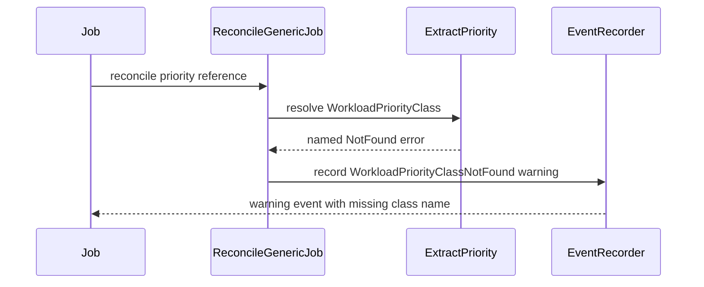

# PR #13775: Emit a warning event when a WorkloadPriorityClass is not found

**Summary**: Emit a warning event when a WorkloadPriorityClass is not found

**Sources**: https://github.com/kubernetes-sigs/kueue/pull/13775

**Last updated**: 2026-09-30T13:02:59Z

---

## Metadata

- **State**: closed (merged)
- **Author**: [@thc1006](https://github.com/thc1006)
- **Branch**: `feat/wpc-not-found-event` → `main`
- **Created**: 2026-08-03T22:19:02Z
- **Updated**: 2026-09-30T13:02:59Z
- **Merged**: 2026-08-19T22:33:09Z
- **Closed**: 2026-08-19T22:33:09Z
- **Labels**: `kind/feature`, `release-note`, `lgtm`, `size/XL`, `approved`, `cncf-cla: yes`, `area/integrations`, `area/observability`
- **Assignees**: [@mszadkow](https://github.com/mszadkow), [@tenzen-y](https://github.com/tenzen-y)
- **Requested reviewers**: [@mszadkow](https://github.com/mszadkow), [@olekzabl](https://github.com/olekzabl)
- **Changed files**: 10   **+512 / -16**

## Description

#### What type of PR is this?

/kind feature
/area integrations
/area observability

#### What this PR does / why we need it:

A Job labelled with a `kueue.x-k8s.io/priority-class` that does not exist stops in reconciliation: without a priority there is no Workload, so the Job stays suspended and unqueued. The only trace is a line in the controller-manager log, which the person who set the label usually cannot read, so this is the case #3439 describes.

This classifies that one lookup failure and reports it on the object:

```
Warning  WorkloadPriorityClassNotFound  WorkloadPriorityClass "low" not found
```

`extractPriority` takes the recorder and reports the miss where it finds it, so one call site covers all three paths that reach it: workload creation, workload update, and a changed priority label. The error is returned unchanged, so the reconcile still fails and no Workload is created. Only the branch the label sent the lookup down reports, so a NotFound raised anywhere else keeps its current handling and the message can never be a guess.

#### Which issue(s) this PR fixes:

Fixes #3439

#6688 also proposed admission-time rejection and Kubernetes `PriorityClass` handling. Neither is here, and neither is what #3439 asks for.

#### Special notes for your reviewer:

This is the split @mbobrovskyi asked for in https://github.com/kubernetes-sigs/kueue/pull/6688#issuecomment-5127395769. It is a fresh branch off `main` rather than a rebase, since #6688 predates the `record.EventRecorder` to `events.EventRecorder` move.

All three reconcile paths that resolve the label are covered, since `extractPriority` reports where it finds the miss and every path goes through it. `statefulset` and `leaderworkerset` run their own `Reconcile` and are the only two integrations that do. For `statefulset` that means Workload creation only: its `reconcileWorkload` syncs the owner reference, the queue name and admission gating, but never priority, so a label change on an existing StatefulSet Workload is accepted and ignored. That is tracked in #13827 rather than here.

leaderworkerset resolves the class once per component, so it reports once per component. The fix for #13820 collapses those into one resolution per reconcile and the event follows it; until then the events are identical on the same object and fold into one with a count.


The branches those paths run under can still cancel each other, so a missing class found by one component can go unreported when another fails first. That is a separate bug, fixed in #13921, which pins the same property without involving the event. The two cases that covered it here came out with the change and can come back once it lands.

Recovery is the reconcile retry. The controller watches the Job and its Workload, not `WorkloadPriorityClass`, so creating the class later does not enqueue the Jobs that reference it; the missing-class integration spec goes on to check that the Workload does appear once the class exists. With the default rate limiter that can take until the next backoff step, so #13779 tracks whether that is worth speeding up with a watch on the class.

The event follows where Kueue resolves the label, which is not every reconcile. A prebuilt Workload, a StatefulSet whose Workload already exists, a Workload whose priority came from a Pod `PriorityClass`, and one that reserved quota without a `priorityClassRef`, which the API will not let it gain now, each return before the lookup, so nothing is reported on those paths. Only #13781 has a reconciler case pinning it, because that guard is deliberate. #13780 merged after this branch's last push and made a compatible workload slice resolve the label too, so the case it added for a missing class now expects the warning. The concept page is worded to that boundary rather than to a list of integrations.

The statefulset suite had no event assertions at all, so its five existing Workload-creating cases now assert the `CreatedWorkload` event they were already emitting.

A pod template naming a `scheduling.k8s.io` PriorityClass that does not exist stalls the same way and stays silent here, since it produces `priorityclasses.scheduling.k8s.io ... not found` and is deliberately not matched. That is outside #3439, but I am glad to cover it too if you would like both in one PR.

A table on `extractPriority` pins which failure reports: the class the label named reports and still returns NotFound, a Forbidden on that same lookup does not, and a pod template naming a missing `scheduling.k8s.io` PriorityClass does not either. Two Job reconciler cases cover the two paths that reach the lookup, one creating the Workload and one changing the label on a Job that already has one. Two integration specs cover it end to end against envtest, one per way the lookup is reached: creating a Job whose label already names a missing class, and pointing the label of a Job that already has a Workload at one. The second one checks that nothing is reported while the class still exists, before the label is changed, so that assertion is a precondition of a case rather than a spec re-checking a successful creation.

The concept page gets one sentence, since #13645 documented this failure mode and said the section would mention the event once it landed. Its existing sentence said the `Workload` cannot be created or updated, which claims more than the reconciliation does, since the slice path can persist a count change before the lookup fails. It now names what the missing class blocks instead.

This PR was written in part with the assistance of generative AI. I have reviewed and tested every change myself.

#### Does this PR introduce a user-facing change?

```release-note
Observability: Added a Warning event on the object whose kueue.x-k8s.io/priority-class label names a missing WorkloadPriorityClass.
```

## Discussion

### Comment by [@netlify[bot]](https://github.com/apps/netlify) — 2026-08-03T22:19:08Z

### <span aria-hidden="true">✅</span> Deploy Preview for *kubernetes-sigs-kueue* canceled.


|  Name | Link |
|:-:|------------------------|
|<span aria-hidden="true">🔨</span> Latest commit | da9068014726551a410a9b0e30331a83a313da76 |
|<span aria-hidden="true">🔍</span> Latest deploy log | https://app.netlify.com/projects/kubernetes-sigs-kueue/deploys/6a79e5b71a89e500082d2974 |

### Comment by [@coderabbitai[bot]](https://github.com/apps/coderabbitai) — 2026-08-03T22:19:33Z

<!-- This is an auto-generated comment: summarize by coderabbit.ai -->
<!-- review_stack_entry_start -->

[](https://app.coderabbit.ai/change-stack/kubernetes-sigs/kueue/pull/13775?utm_source=github_walkthrough&utm_medium=github&utm_campaign=change_stack)

<!-- review_stack_entry_end -->
<!-- This is an auto-generated comment: review paused by coderabbit.ai -->

> [!NOTE]
> ## Reviews paused
> 
> It looks like this branch is under active development. To avoid overwhelming you with review comments due to an influx of new commits, CodeRabbit has automatically paused this review. You can configure this behavior by changing the `reviews.auto_review.auto_pause_after_reviewed_commits` setting.
> 
> Use the following commands to manage reviews:
> - `@coderabbitai resume` to resume automatic reviews.
> - `@coderabbitai review` to trigger a single review.
> 
> Use the checkboxes below for quick actions:
> - [ ] <!-- {"checkboxId": "7f6cc2e2-2e4e-497a-8c31-c9e4573e93d1"} --> ▶️ Resume reviews
> - [ ] <!-- {"checkboxId": "e9bb8d72-00e8-4f67-9cb2-caf3b22574fe"} --> 🔍 Trigger review

<!-- end of auto-generated comment: review paused by coderabbit.ai -->
<!-- walkthrough_start -->

<details>
<summary>📝 Walkthrough</summary>

## Walkthrough

`ExtractPriority` identifies missing `WorkloadPriorityClass` references while preserving API error identity. `ReconcileGenericJob` records a warning event with the missing class name. Tests cover direct and changed references, unrelated Forbidden errors, integration behavior, and documentation.

### Changes

**WorkloadPriorityClass error handling**

|Layer / File(s)|Summary|
|---|---|
|**Priority lookup error classification** <br> `pkg/controller/jobframework/reconciler.go`, `pkg/controller/jobframework/priority_error_test.go`|`ExtractPriority` wraps only NotFound lookup errors with the referenced class name. Tests verify NotFound identity, Forbidden identity, and error classification.|
|**Reconciliation warning event** <br> `pkg/controller/jobframework/events.go`, `pkg/controller/jobframework/reconciler.go`, `pkg/controller/jobs/job/job_controller_test.go`, `test/integration/singlecluster/controller/jobs/job/job_controller_test.go`, `site/content/en/docs/concepts/workload_priority_class.md`|`ReconcileGenericJob` emits `ReasonWorkloadPriorityClassNotFound` warnings for missing references. Tests verify direct and changed references, event contents, Workload creation behavior, and existing priority classes. Documentation describes the warning event and missing class name.|

**Estimated code review effort:** 3 (Moderate) | ~20 minutes

**Possibly related PRs**

- [kubernetes-sigs/kueue#13014](https://github.com/kubernetes-sigs/kueue/pull/13014): Both PRs add Warning events for specific unretryable reconciliation errors.
- [kubernetes-sigs/kueue#13645](https://github.com/kubernetes-sigs/kueue/pull/13645): This PR extends missing `WorkloadPriorityClass` reference handling with warning events and documentation.

**Suggested labels:** `area/testing`

**Suggested reviewers:** `mbobrovskyi`, `olekzabl`

### Sequence Diagram(s)



</details>

<!-- walkthrough_end -->
<!-- pre_merge_checks_walkthrough_start -->

<details>
<summary>🚥 Pre-merge checks | ✅ 5</summary>

<details>
<summary>✅ Passed checks (5 passed)</summary>

|         Check name         | Status   | Explanation                                                                                                                     |
| :------------------------: | :------- | :------------------------------------------------------------------------------------------------------------------------------ |
|     Docstring Coverage     | ✅ Passed | No functions found in the changed files to evaluate docstring coverage. Skipping docstring coverage check.                      |
|     Linked Issues check    | ✅ Passed | Check skipped because no linked issues were found for this pull request.                                                        |
| Out of Scope Changes check | ✅ Passed | Check skipped because no linked issues were found for this pull request.                                                        |
|      Description Check     | ✅ Passed | Check skipped - CodeRabbit’s high-level summary is enabled.                                                                     |
|         Title check        | ✅ Passed | The title clearly and concisely describes the primary change: emitting a warning event when a WorkloadPriorityClass is missing. |

</details>

</details>

<!-- pre_merge_checks_walkthrough_end -->
<!-- finishing_touch_checkbox_start -->

<details>
<summary>✨ Finishing Touches</summary>

<details>
<summary>🧪 Generate unit tests (beta)</summary>

- [ ] <!-- {"checkboxId": "f47ac10b-58cc-4372-a567-0e02b2c3d479", "radioGroupId": "utg-output-choice-group-unknown_comment_id"} -->   Create PR with unit tests

</details>

</details>

<!-- finishing_touch_checkbox_end -->
<!-- tips_start -->

---

Thanks for using [CodeRabbit](https://coderabbit.ai?utm_source=oss&utm_medium=github&utm_campaign=kubernetes-sigs/kueue&utm_content=13775)! It's free for OSS, and your support helps us grow. If you like it, consider giving us a shout-out.

<details>
<summary>❤️ Share</summary>

- [X](https://twitter.com/intent/tweet?text=I%20just%20used%20%40coderabbitai%20for%20my%20code%20review%2C%20and%20it%27s%20fantastic%21%20It%27s%20free%20for%20OSS%20and%20offers%20a%20free%20trial%20for%20the%20proprietary%20code.%20Check%20it%20out%3A&url=https%3A//coderabbit.ai)
- [Mastodon](https://mastodon.social/share?text=I%20just%20used%20%40coderabbitai%20for%20my%20code%20review%2C%20and%20it%27s%20fantastic%21%20It%27s%20free%20for%20OSS%20and%20offers%20a%20free%20trial%20for%20the%20proprietary%20code.%20Check%20it%20out%3A%20https%3A%2F%2Fcoderabbit.ai)
- [Reddit](https://www.reddit.com/submit?title=Great%20tool%20for%20code%20review%20-%20CodeRabbit&text=I%20just%20used%20CodeRabbit%20for%20my%20code%20review%2C%20and%20it%27s%20fantastic%21%20It%27s%20free%20for%20OSS%20and%20offers%20a%20free%20trial%20for%20proprietary%20code.%20Check%20it%20out%3A%20https%3A//coderabbit.ai)
- [LinkedIn](https://www.linkedin.com/sharing/share-offsite/?url=https%3A%2F%2Fcoderabbit.ai&mini=true&title=Great%20tool%20for%20code%20review%20-%20CodeRabbit&summary=I%20just%20used%20CodeRabbit%20for%20my%20code%20review%2C%20and%20it%27s%20fantastic%21%20It%27s%20free%20for%20OSS%20and%20offers%20a%20free%20trial%20for%20proprietary%20code)

</details>


<sub>Comment `@coderabbitai help` to get the list of available commands.</sub>

<!-- tips_end -->

### Comment by [@thc1006](https://github.com/thc1006) — 2026-08-03T22:46:01Z

/area integrations
/area observability

### Comment by [@thc1006](https://github.com/thc1006) — 2026-08-04T00:45:43Z

While checking how far this actually reaches, I went looking for paths where the label is never resolved, so no warning can be reported. There are four, and they are listed in the description with an issue each:

- a compatible workload slice, #13778;
- a StatefulSet whose Workload already exists, #13827;
- a Workload whose priority came from a Pod `PriorityClass`, #13781, which is deliberate;
- a prebuilt Workload, where the Workload looks like the source of truth for its own priority.

Only the Pod `PriorityClass` one has a reconciler case pinning it here, since that guard was asked for in #8480. Asserting the current silence for the others would turn their fixes into failing tests.

Written with AI assistance.

### Comment by [@thc1006](https://github.com/thc1006) — 2026-08-04T07:00:24Z

The ancestor lookup finding was correct and it was mine: an earlier revision of this branch narrowed that check to `IsNotFound`, which would have swallowed a cycle, a chain limit, or a refused parent read and let the child reconcile as a top-level Job. It is back to `if err != nil`.

What was missing was a test that would have caught it. The chain-limit and cycle cases live in `TestFindAncestorJobManagedByKueue`, which exercises the helper, not the caller, so nothing covered the call site passing the error on. `TestReconcileGenericJobKeepsAncestorLookupFailures` does now: it reconciles a child whose parent read is refused, and asserts the error reaches the caller and no Workload is built. Restoring the narrowed check fails it.

Everything else raised is either in at 8e183f5 or answered on the thread it came from.

Written with AI assistance.

### Comment by [@thc1006](https://github.com/thc1006) — 2026-08-04T18:09:17Z

/test pull-kueue-test-unit-shard-1-main

### Comment by [@thc1006](https://github.com/thc1006) — 2026-08-04T21:46:13Z

Rebased onto main and squashed to one commit. Two of the changes came from checking things against current main rather than the branch's old base.

The standalone ancestor test had stopped testing anything. `NewReconciler` now defaults to an empty instance-scoped `IntegrationManager`, so an unregistered `batch/Job` owner is not a known owner, `FindAncestorJobManagedByKueue` returns before the `Get`, and the interceptor never fires: on main the test failed with `reconcile error = <nil>`. The Job reconciler table already covers the same path with a real integration manager, so I dropped the standalone test rather than give it a manager, and that case now asserts the parent's own Forbidden instead of `cmpopts.AnyError`. Substituting a different error there fails it.

The leaderworkerset tests did not pin the worker-boundary reporting either. With every component failing on the same missing class, the typed error survives aggregation, so reverting to reporting after `Wait` left them all green. The new case separates them: the surplus Workload is deleted in its own branch and fails there, which is the error `errgroup` keeps, while the remaining component finds the missing class and has its error dropped. It is ordered by two waits rather than by timing, the delete holding until the lookup has started and the lookup holding until the errgroup context is cancelled, so it is deterministic over 30 runs and fails on every run with the previous implementation.

Also qualified the concept page sentence that claimed a `Workload` cannot be created or updated at all, since paths that never resolve the label are unaffected, corrected the helper's doc comment and the description, which both still described reporting at the reconcile boundary, and fixed the integration spec count.

### Comment by [@thc1006](https://github.com/thc1006) — 2026-08-05T20:44:34Z

Rebased onto current main. #13780 merged about half an hour after my last push, so a compatible workload slice now reaches the class lookup, and the case it added for a missing class records the warning. That case has the expectation now.

Two smaller things while I was in there. The concept page said the `Workload` cannot be created or updated, which claims more than the reconciliation does, since the slice path can persist a count change before the lookup fails, so it now names what the missing class blocks. The `ExtractPriority` rows that expect no error assert that as well, because a Forbidden would have passed them. The two ordering waits in the leaderworkerset case also return a distinct error if they ever time out, instead of carrying on.

### Comment by [@mimowo](https://github.com/mimowo) — 2026-08-06T07:09:05Z

cc @mbobrovskyi ptal

### Comment by [@thc1006](https://github.com/thc1006) — 2026-08-06T11:12:22Z

/test pull-kueue-test-integration-shard-1-main

### Comment by [@mszadkow](https://github.com/mszadkow) — 2026-08-06T11:35:38Z

Would it work to record the warning directly in `ExtractPriority` when the `WorkloadPriorityClass` lookup returns `NotFound`, while still returning the error? 
That would keep the current behavior intact — the reconcile would still fail and no Workload would be created — but would avoid the extra error-classification plumbing and the LWS/statefulset wrapper logic.

### Comment by [@mimowo](https://github.com/mimowo) — 2026-08-06T11:39:47Z

@coderabbitai please open a flake issue for this build: https://prow.k8s.io/view/gs/kubernetes-ci-logs/pr-logs/pull/kubernetes-sigs_kueue/13775/pull-kueue-test-integration-shard-1-main/2085321174044119040
remember to add the kind/flake label

### Comment by [@coderabbitai[bot]](https://github.com/apps/coderabbitai) — 2026-08-06T11:40:39Z

<!-- This is an auto-generated reply by CodeRabbit -->
> [!TIP]
> For best results, initiate chat on the files or code changes.

<details>
<summary>🧩 Analysis chain</summary>

🏁 Script executed:

```shell
#!/bin/bash
set -euo pipefail

build_url='https://prow.k8s.io/view/gs/kubernetes-ci-logs/pr-logs/pull/kubernetes-sigs_kueue/13775/pull-kueue-test-integration-shard-1-main/2085321174044119040'

curl -fsSL "$build_url" -o /tmp/prow-build.html
printf '%s\n' '== Log and artifact URLs in the Prow page =='
rg -no 'https?[^"<> ]+|gs://[^"<> ]+' /tmp/prow-build.html \
  | sed 's/&amp;/\&/g' \
  | rg -i 'log|artifact|started|finished|build|gcs' \
  | head -80 || true

printf '%s\n' '== Failure-related text in the Prow page =='
rg -ni -C2 'fail|error|panic|timed out|passed|success' /tmp/prow-build.html | head -160 || true

printf '%s\n' '== GitHub labels available for the target repository =='
gh label list --repo kubernetes-sigs/kueue --limit 500 --search 'kind/flake'
```

Length of output: 1629

---

🏁 Script executed:

```shell
#!/bin/bash
set -euo pipefail

artifact_url='https://gcsweb.k8s.io/gcs/kubernetes-ci-logs/pr-logs/pull/kubernetes-sigs_kueue/13775/pull-kueue-test-integration-shard-1-main/2085321174044119040/'
curl -fsSL "$artifact_url" -o /tmp/gcs-index.html

printf '%s\n' '== Artifact links =='
rg -no 'href="[^"]+"' /tmp/gcs-index.html \
  | sed -E 's/^[0-9]+:href="//; s/"$//' \
  | sed 's/&amp;/\&/g' \
  | head -200

log_path=$(rg -o 'href="[^"]*build-log\.txt[^"]*"' /tmp/gcs-index.html \
  | head -1 \
  | sed -E 's/^[0-9]+:href="//; s/"$//' \
  | sed 's/&amp;/\&/g')

if [ -z "$log_path" ]; then
  echo 'No build-log.txt link found in artifact index.' >&2
  exit 1
fi

case "$log_path" in
  http*) log_url="$log_path" ;;
  *) log_url="https://gcsweb.k8s.io${log_path}" ;;
esac

printf '%s\n' "== Fetching build log: $log_url =="
curl -fsSL "$log_url" -o /tmp/build-log.txt

printf '%s\n' '== Failure excerpts =='
rg -ni -C5 '--- FAIL:|FAIL[[:space:]]|panic:|fatal error:|timed out|timeout|Error Trace:|Expected.*Actual|[[:space:]]ERROR[[:space:]]' /tmp/build-log.txt \
  | tail -280 || true

printf '%s\n' '== Last 120 log lines =='
tail -120 /tmp/build-log.txt
```

Length of output: 3336

---

🏁 Script executed:

```shell
#!/bin/bash
set -euo pipefail

log_url='https://storage.googleapis.com/kubernetes-ci-logs/pr-logs/pull/kubernetes-sigs_kueue/13775/pull-kueue-test-integration-shard-1-main/2085321174044119040/build-log.txt'
curl -fsSL "$log_url" -o /tmp/build-log.txt

printf '%s\n' '== Failure excerpts =='
rg -ni -C6 -- '--- FAIL:|(^|[[:space:]])FAIL([[:space:]]|$)|panic:|fatal error:|timed out|timeout|Error Trace:|Expected:|Actual:|[[:space:]]ERROR[[:space:]]' /tmp/build-log.txt \
  | tail -360 || true

printf '%s\n' '== Last 160 log lines =='
tail -160 /tmp/build-log.txt

printf '%s\n' '== Existing issues that reference this build or job =='
gh issue list --repo kubernetes-sigs/kueue --state all --limit 1000 \
  --search '2085321174044119040 in:title,body' \
  --json number,title,state,url,labels \
  --jq '.[] | {number, title, state, url, labels: [.labels[].name]}'
gh issue list --repo kubernetes-sigs/kueue --state all --limit 1000 \
  --search '"pull-kueue-test-integration-shard-1-main" in:title,body' \
  --json number,title,state,url,labels \
  --jq '.[] | {number, title, state, url, labels: [.labels[].name]}'
```

Length of output: 102665

---

🏁 Script executed:

```shell
#!/bin/bash
set -euo pipefail

repo='kubernetes-sigs/kueue'
body_file=$(mktemp)
cat >"$body_file" <<'EOF'
## Summary

The `pull-kueue-test-integration-shard-1-main` Prow job failed in the concurrent-admission integration suite.

The failure timed out while it waited for the reservation variant to have an open preemption gate.

## Failure

- Test: `Concurrent Admission / when Variants require preemption to be admitted / should open the preemption gate for only the most-preferred variant at a time`
- File: `test/integration/singlecluster/controller/concurrentadmission/concurrent_admission_test.go:628`
- Timeout: 10 seconds
- Assertion: `reservation variant should have an open preemption gate`
- Observed value: `false`
- Build: https://prow.k8s.io/view/gs/kubernetes-ci-logs/pr-logs/pull/kubernetes-sigs_kueue/13775/pull-kueue-test-integration-shard-1-main/2085321174044119040
- Related PR: https://github.com/kubernetes-sigs/kueue/pull/13775

## Expected behavior

The reservation variant opens its preemption gate within the test timeout when variants require preemption.

## Acceptance criteria

- The concurrent-admission preemption-gate test is stable in `pull-kueue-test-integration-shard-1-main`.
- The test does not time out while waiting for the reservation variant preemption gate.
EOF

issue_url=$(gh issue create \
  --repo "$repo" \
  --title 'Flake: concurrent-admission preemption gate does not open for reservation variant' \
  --body-file "$body_file" \
  --label 'kind/flake' \
  --assignee 'mimowo')

rm -f "$body_file"

gh issue view "$issue_url" --repo "$repo" --json url,title,assignees,labels \
  --jq '{url, title, assignees: [.assignees[].login], labels: [.labels[].name]}'
```

Length of output: 2047

---

</details>

`@mimowo` I opened `#13915` for the build failure.

The issue is assigned to you and has the `kind/flake` label.

<sub>You are interacting with an AI system.</sub>

### Comment by [@thc1006](https://github.com/thc1006) — 2026-08-06T11:41:06Z

It does work, and it is better. The error type only exists to carry the class name to somewhere that has a recorder, so passing the recorder to the lookup removes the reason for all of it, along with the `defer` ordering against `ignoreUnretryableError` and both wrappers.

It also removes two things I was working around rather than fixing. The event no longer depends on the error surviving `ignoreUnretryableError`, which can replace it with nil, nor on surviving `errgroup`, which keeps one error per branch.

`UpdateWorkloadPriority` already takes a recorder, so the update path needs nothing new. `PrepareWorkloadPriority` and `ExtractPriority` each gain one, and all three call sites have `r.record` in scope.

One change worth naming: LeaderWorkerSet calls `PrepareWorkloadPriority` once per component, so a missing class reports once per component rather than once per reconcile. They are identical events on the same object, so they fold into one with a count, but it is more traffic than the dedup I have now. I think that is worth it for what it removes. Pushing shortly.

### Comment by [@thc1006](https://github.com/thc1006) — 2026-08-06T11:53:52Z

Done, in `0ea60c5`. `ExtractPriority` takes the recorder and reports there, so the error type, `IsWorkloadPriorityClassNotFound`, `RecordWorkloadPriorityClassNotFoundEvent`, the `defer` and both wrappers are gone. The production change is 45 lines rather than 84, with two exported symbols fewer, and the unit test that pinned the error type is now a table on `ExtractPriority` covering which failure reports and which does not.

The LeaderWorkerSet count came out as expected: two components, two events. The fix for #13820 collapses those, since it resolves the class once per reconcile and the event follows the resolution. The two cases that asserted one now assert two and say why.

The errgroup change stays, for a reason that survives the rewrite: `parallelize.Until` checks for cancellation before each item, so under a derived context a branch that failed first could stop the others before they ran, and the lookup that would have reported is never reached.

`make ci-lint` is clean and the four affected suites pass, leaderworkerset and statefulset also under `-race -count=3`. I have updated the description to the new shape.

### Comment by [@mszadkow](https://github.com/mszadkow) — 2026-08-06T13:20:01Z

other than 2 nits, it looks good to me

### Comment by [@thc1006](https://github.com/thc1006) — 2026-08-06T14:24:47Z

/test pull-kueue-test-integration-shard-1-main

### Comment by [@mszadkow](https://github.com/mszadkow) — 2026-08-06T14:35:09Z

/lgtm

### Comment by [@kubernetes-prow[bot]](https://github.com/apps/kubernetes-prow) — 2026-08-06T14:35:18Z

LGTM label has been added.  <details>Git tree hash: 73419b741125d3321f04cdf3645dd604d3cd4c3c</details>

### Comment by [@thc1006](https://github.com/thc1006) — 2026-08-06T16:36:14Z

Two corrections on this one, both mine.

I said nothing outside `jobframework` calls `ExtractPriority`. That holds for `main`, which is what I checked, but not for #13904: its leaderworkerset resolver calls it directly. Whichever of the two lands first, the other needs the rename and one more argument threaded through. I have put the same note on that PR so the two descriptions do not disagree.

I also left scaffolding behind in the Job reconciler table, an interceptor field with its wiring that no case sets, and a comment that lost both its sentence and its case. Both are out now. I had said I checked the rest of what I added while I was in there, and clearly not well enough.

The description no longer describes the event as coming from the `ReconcileGenericJob` defer either, which went with the rewrite.

### Comment by [@thc1006](https://github.com/thc1006) — 2026-08-07T02:35:34Z

Two things from another pass.

The LWS table still carried the `interceptors` field, its import and the client-builder branch after the cancellation case moved to #13921, with nothing left setting any of them, and the opening half of that case's comment had stayed above the prebuilt-workload case. Removed in 3e83bb8.

The other one I would rather ask than decide. The existing-class spec asserts that no warning appears, but the reconciler reads the class through the manager cache while the test creates it through a direct client, and controller-runtime does not promise those two are coherent. A Job created right after its class can reach the lookup before the class informer catches up, take a NotFound, and get a warning naming a class that does exist; the retry then succeeds and the Workload is correct. Confirming a cached NotFound through an APIReader would close that, but it adds a live read to every retry of a genuinely missing class, which is the case this feature exists for. Would you rather keep the cached read and drop that absence assertion, or pay the live read to keep the warning exact?

Separately, while checking how this reaches external integrations: the integration guide grants core Event RBAC while `NewGenericReconcilerFactory` records through `events.k8s.io`. That predates this PR, so it is filed on its own as #13933.

This comment was written in part with the assistance of generative AI. I have reviewed and verified it myself.

### Comment by [@mimowo](https://github.com/mimowo) — 2026-08-07T04:05:42Z

> Confirming a cached NotFound through an APIReader would close that, but it adds a live read to every retry of a genuinely missing class, which is the case this feature exists for. Would you rather keep the cached read and drop that absence assertion, or pay the live read to keep the warning exact?

lets leave it as, because using live clients in go introduces complications. And the impact of closing the gap between api server and informer cache has very limited impact.

### Comment by [@mbobrovskyi](https://github.com/mbobrovskyi) — 2026-08-07T04:47:00Z

Overall LGTM. Just few nits.

### Comment by [@thc1006](https://github.com/thc1006) — 2026-08-10T12:14:51Z

@mbobrovskyi the nits from your pass are in, pushed on the 8th, and the branch has been green since. Every thread here ends with a reply from me.

Is there anything else you would like changed, or is this good to label?

This comment was written in part with the assistance of generative AI.

### Comment by [@mbobrovskyi](https://github.com/mbobrovskyi) — 2026-08-10T13:10:35Z

@thc1006 could you please rebase PR?

### Comment by [@thc1006](https://github.com/thc1006) — 2026-08-10T14:53:13Z

Rebased onto current main, and removed an API change that did not belong in this PR.

`ExtractPriority` stays exported. Recording the event needs a recorder to reach the lookup, so both it and `PrepareWorkloadPriority` take one now, but unexporting `ExtractPriority` was a drive-by removal from a package the README lists as the library for integrating job-like CRDs, and nothing about the event required it.

`gofmt` and `go vet` are clean, and the jobframework, job, leaderworkerset and statefulset suites pass under `-race`. I have not run the full lint target locally, so Prow is the gate on that.

This comment was written in part with the assistance of generative AI. Bcuz my English might be sucks.

### Comment by [@mszadkow](https://github.com/mszadkow) — 2026-08-10T17:18:54Z

It looks pretty good to me now!
Thanks @thc1006

### Comment by [@thc1006](https://github.com/thc1006) — 2026-08-10T17:19:43Z

> It looks pretty good to me now! Thanks @thc1006

Also thank you for hard work reviewing!!! very thx!!!

### Comment by [@mszadkow](https://github.com/mszadkow) — 2026-08-12T16:20:56Z

/lgtm

### Comment by [@kubernetes-prow[bot]](https://github.com/apps/kubernetes-prow) — 2026-08-12T16:21:04Z

LGTM label has been added.  <details>Git tree hash: 6c3be71600d0d33d74996259904ce1fad117d39b</details>

### Comment by [@mszadkow](https://github.com/mszadkow) — 2026-08-13T16:42:25Z

/cc @tenzen-y I think it's ready for your eyes ;)

### Comment by [@kubernetes-prow[bot]](https://github.com/apps/kubernetes-prow) — 2026-08-19T22:17:59Z

[APPROVALNOTIFIER] This PR is **APPROVED**

This pull-request has been approved by: *<a href="https://github.com/kubernetes-sigs/kueue/pull/13775#pullrequestreview-4977236288" title="Approved">tenzen-y</a>*, *<a href="https://github.com/kubernetes-sigs/kueue/pull/13775#" title="Author self-approved">thc1006</a>*

The full list of commands accepted by this bot can be found [here](https://go.k8s.io/bot-commands?repo=kubernetes-sigs%2Fkueue).

The pull request process is described [here](https://git.k8s.io/community/contributors/guide/owners.md#the-code-review-process)

<details >
Needs approval from an approver in each of these files:

- ~~[OWNERS](https://github.com/kubernetes-sigs/kueue/blob/main/OWNERS)~~ [tenzen-y]

Approvers can indicate their approval by writing `/approve` in a comment
Approvers can cancel approval by writing `/approve cancel` in a comment
</details>
<!-- META={"approvers":[]} -->

### Comment by [@thc1006](https://github.com/thc1006) — 2026-08-19T22:36:48Z

thx for Dear @mszadkow and Dear @tenzen-y hard work and always so fast reviewing.
Really thx!!!

### Comment by [@mimowo](https://github.com/mimowo) — 2026-09-30T13:02:57Z

/release-note-edit
```release-note
Observability: Added a Warning event on the object whose kueue.x-k8s.io/priority-class label names a missing WorkloadPriorityClass.
```

## Reviews

### Review by [@coderabbitai[bot]](https://github.com/apps/coderabbitai) (commented) — 2026-08-03T22:28:22Z

**Actionable comments posted: 1**

<details>
<summary>🧹 Nitpick comments (1)</summary><blockquote>

<details>
<summary>pkg/controller/jobframework/priority_error_test.go (1)</summary><blockquote>

`79-82`: _🎯 Functional Correctness_ | _🔵 Trivial_ | _⚡ Quick win_

**Assert the preserved `GroupResource`.**

The current test only checks `apierrors.IsNotFound`. Add an assertion for the wrapped API error status and original `GroupResource` so a wrapper change cannot keep the `NotFound` reason but lose the API error identity.

<details>
<summary>🤖 Prompt for AI Agents</summary>

```
Verify each finding against current code. Fix only still-valid issues, skip the
rest with a brief reason, keep changes minimal, and validate.

In `@pkg/controller/jobframework/priority_error_test.go` around lines 79 - 82,
Extend the test around the apierrors.IsNotFound assertion in
priority_error_test.go to unwrap the preserved API error status and verify its
original GroupResource, while retaining the existing NotFound check. Use the
test case’s expected API error and GroupResource values, ensuring wrapping
preserves both status identity and resource information.
```

</details>

<!-- cr-comment:v1:d5001eafc8c313b175929f34 -->

_Source: Coding guidelines_

</blockquote></details>

</blockquote></details>

<details>
<summary>🤖 Prompt for all review comments with AI agents</summary>

```
Verify each finding against current code. Fix only still-valid issues, skip the
rest with a brief reason, keep changes minimal, and validate.

Inline comments:
In `@site/content/en/docs/concepts/workload_priority_class.md`:
- Line 86: Update the documentation sentence describing the
WorkloadPriorityClassNotFound event to limit its claim to generic Job
reconciliation, or explicitly mention that leaderworkerset and statefulset
reconciliation paths are currently excluded. Preserve the existing event reason
and kubectl describe behavior.

---

Nitpick comments:
In `@pkg/controller/jobframework/priority_error_test.go`:
- Around line 79-82: Extend the test around the apierrors.IsNotFound assertion
in priority_error_test.go to unwrap the preserved API error status and verify
its original GroupResource, while retaining the existing NotFound check. Use the
test case’s expected API error and GroupResource values, ensuring wrapping
preserves both status identity and resource information.
```

</details>

<details>
<summary>🪄 Autofix (Beta)</summary>

Fix all unresolved CodeRabbit comments on this PR:

- [ ] <!-- {"checkboxId": "4b0d0e0a-96d7-4f10-b296-3a18ea78f0b9"} --> Push a commit to this branch (recommended)
- [ ] <!-- {"checkboxId": "ff5b1114-7d8c-49e6-8ac1-43f82af23a33"} --> Create a new PR with the fixes

</details>

---

<details>
<summary>ℹ️ Review info</summary>

<details>
<summary>⚙️ Run configuration</summary>

**Configuration used**: Path: .coderabbit.yaml

**Review profile**: CHILL

**Plan**: Pro Plus

**Run ID**: `38277e05-4b1a-4fce-aa03-c700d170cba9`

</details>

<details>
<summary>📥 Commits</summary>

Reviewing files that changed from the base of the PR and between 273ff4a9dffe34f6d0e346b598bcfca1212c02d9 and b9f5f64874d4384367a3905773607bba86d6bd4e.

</details>

<details>
<summary>📒 Files selected for processing (5)</summary>

* `pkg/controller/jobframework/events.go`
* `pkg/controller/jobframework/priority_error_test.go`
* `pkg/controller/jobframework/reconciler.go`
* `pkg/controller/jobs/job/job_controller_test.go`
* `site/content/en/docs/concepts/workload_priority_class.md`

</details>

<details>
<summary>🚧 Files skipped from review as they are similar to previous changes (3)</summary>

* pkg/controller/jobframework/reconciler.go
* pkg/controller/jobs/job/job_controller_test.go
* pkg/controller/jobframework/events.go

</details>

</details>

<!-- This is an auto-generated comment by CodeRabbit for review status -->

- **site/content/en/docs/concepts/workload_priority_class.md:86** by [@coderabbitai[bot]](https://github.com/apps/coderabbitai) — 2026-08-03T22:28:21Z
```diff
@@ -83,6 +83,8 @@ The `WorkloadPriorityClass` referenced by the `kueue.x-k8s.io/priority-class` la
 
 If the label explicitly references a nonexistent `WorkloadPriorityClass`, Kueue cannot resolve the workload priority and does not fall back to the Pod `PriorityClass`, the global default `PriorityClass`, or the default priority value. As a result, the corresponding `Workload` cannot be created or updated until the reference is corrected or the referenced `WorkloadPriorityClass` is created.
 
+Kueue reports this case on the object that carries the label, as a `Warning` event with the reason `WorkloadPriorityClassNotFound`, so `kubectl describe` on that object names the class that is missing.
```

  _🎯 Functional Correctness_ | _🟡 Minor_ | _⚡ Quick win_
  
  **Limit the event claim to supported reconciler paths.**
  
  Line 86 states that Kueue reports this event on any object that carries the label. This PR emits it only during generic Job reconciliation. `leaderworkerset` and `statefulset` paths are excluded. State the generic Job scope, or document the current exclusions.
  
  AI-assisted review. As per path instructions, “Focus on technical accuracy, clarity, and markdown formatting.” As per coding guidelines, “Disclose AI usage in pull request descriptions, comments, and issue filings.”
  
  <details>
  <summary>🤖 Prompt for AI Agents</summary>
  
  ```
  Verify each finding against current code. Fix only still-valid issues, skip the
  rest with a brief reason, keep changes minimal, and validate.
  
  In `@site/content/en/docs/concepts/workload_priority_class.md` at line 86, Update
  the documentation sentence describing the WorkloadPriorityClassNotFound event to
  limit its claim to generic Job reconciliation, or explicitly mention that
  leaderworkerset and statefulset reconciliation paths are currently excluded.
  Preserve the existing event reason and kubectl describe behavior.
  ```
  
  </details>
  
  <!-- fingerprinting:phantom:poseidon:terra -->
  
  <!-- cr-indicator-types:potential_issue -->
  
  <!-- cr-comment:v1:2d40eb2e4db2f0ac3136b08d -->
  
  _Sources: Coding guidelines, Path instructions_
  
  <!-- This is an auto-generated reply by CodeRabbit -->
  
  ✅ Confirmed as addressed by @thc1006
  
  <!-- This is an auto-generated reply by CodeRabbit -->

### Review by [@thc1006](https://github.com/thc1006) (commented) — 2026-08-03T22:45:49Z

- **site/content/en/docs/concepts/workload_priority_class.md:86** by [@thc1006](https://github.com/thc1006) — 2026-08-03T22:45:49Z
```diff
@@ -83,6 +83,8 @@ The `WorkloadPriorityClass` referenced by the `kueue.x-k8s.io/priority-class` la
 
 If the label explicitly references a nonexistent `WorkloadPriorityClass`, Kueue cannot resolve the workload priority and does not fall back to the Pod `PriorityClass`, the global default `PriorityClass`, or the default priority value. As a result, the corresponding `Workload` cannot be created or updated until the reference is corrected or the referenced `WorkloadPriorityClass` is created.
 
+Kueue reports this case on the object that carries the label, as a `Warning` event with the reason `WorkloadPriorityClassNotFound`, so `kubectl describe` on that object names the class that is missing.
```

  Good catch, fixed in abf8f09.
  
  `leaderworkerset` and `statefulset` are the only two integrations with their own `Reconcile`, so they are the only ones that miss this event, and the sentence now names them. `pod` and `rayservice` also define a `Reconcile` but still call `ReconcileGenericJob`, so they are covered.
  
  Written with AI assistance.

### Review by [@coderabbitai[bot]](https://github.com/apps/coderabbitai) (commented) — 2026-08-03T22:46:12Z

- **site/content/en/docs/concepts/workload_priority_class.md:86** by [@coderabbitai[bot]](https://github.com/apps/coderabbitai) — 2026-08-03T22:46:12Z
```diff
@@ -83,6 +83,8 @@ The `WorkloadPriorityClass` referenced by the `kueue.x-k8s.io/priority-class` la
 
 If the label explicitly references a nonexistent `WorkloadPriorityClass`, Kueue cannot resolve the workload priority and does not fall back to the Pod `PriorityClass`, the global default `PriorityClass`, or the default priority value. As a result, the corresponding `Workload` cannot be created or updated until the reference is corrected or the referenced `WorkloadPriorityClass` is created.
 
+Kueue reports this case on the object that carries the label, as a `Warning` event with the reason `WorkloadPriorityClassNotFound`, so `kubectl describe` on that object names the class that is missing.
```

  `@thc1006`, confirmed. The updated text correctly limits the exception to `StatefulSet` and `LeaderWorkerSet`. `pod` and `rayservice` remain covered through `ReconcileGenericJob`.
  
  🐇 ✅
  
  
  <!-- <review_comment_addressed> -->
  
  
  ---
  
  <details>
  <summary>✏️ Learnings added</summary>
  
  ```
  Learnt from: thc1006
  Repo: kubernetes-sigs/kueue PR: 13775
  File: site/content/en/docs/concepts/workload_priority_class.md:0-0
  Timestamp: 2026-08-03T22:46:00.749Z
  Learning: In Kueue, `leaderworkerset` and `statefulset` use independent `Reconcile` paths and currently do not emit the `WorkloadPriorityClassNotFound` event. The `pod` and `rayservice` integrations define `Reconcile` methods but call `ReconcileGenericJob`, so they emit this event.
  ```
  
  > Note: Learnings are effective only in the context of similar code segments. To apply general coding guidelines, please configure [review instructions](https://docs.coderabbit.ai/guides/review-instructions). You can manage existing learnings in the [app](https://app.coderabbit.ai/learnings).
  
  </details>
  
  ---
  
  <!-- This is an auto-generated comment: tweet message by coderabbit.ai -->
  
  If you found this review helpful, would you consider giving us a shout-out on [X](https://twitter.com/intent/tweet?related=CodeRabbitAI&text=%40coderabbitai%20caught%20a%20docs%20overclaim%3A%20WorkloadPriorityClassNotFound%20is%20emitted%20during%20generic%20Job%20reconciliation%2C%20excluding%20leaderworkerset%2Fstatefulset%20paths.%20Precise%20reviews%20matter%E2%80%94try%20it!%20%F0%9F%8E%AF&url=https%3A%2F%2Fgithub.com%2Fkubernetes-sigs%2Fkueue%2Fpull%2F13775%23discussion_r3708106928)?
  
  Thank you for using CodeRabbit!
  
  <!-- end of auto-generated comment: tweet message by coderabbit.ai -->
  
  <sub>You are interacting with an AI system.</sub>
  
  <!-- This is an auto-generated reply by CodeRabbit -->

### Review by [@coderabbitai[bot]](https://github.com/apps/coderabbitai) (commented) — 2026-08-03T22:49:06Z

**Actionable comments posted: 3**

<details>
<summary>🤖 Prompt for all review comments with AI agents</summary>

```
Verify each finding against current code. Fix only still-valid issues, skip the
rest with a brief reason, keep changes minimal, and validate.

Inline comments:
In `@pkg/controller/jobframework/priority_error_test.go`:
- Around line 79-114: Extend the priority extraction error tests around
ExtractPriority to verify the complete NotFound contract: assert the wrapped
missing error preserves the expected WorkloadPriorityClass GroupResource, and
add an interceptor case returning NotFound for a different GroupResource. For
that case, ensure errors.As(err, &missing) is false while
apierrors.IsNotFound(err) remains true.

In `@test/integration/singlecluster/controller/jobs/job/job_controller_test.go`:
- Around line 470-494: Add a separate focused positive integration test
alongside the missing-class case that creates a valid WorkloadPriorityClass,
creates a Job referencing it, and verifies the corresponding Workload is
eventually created. Assert that no event with
ReasonWorkloadPriorityClassNotFound is reported, while leaving the existing
negative test unchanged.
- Around line 479-483: The event assertion in the job controller test is not
scoped to the created Job and may match an unrelated event. Update the
ExpectEventAppeared call to include the created Job’s namespace/name or use the
available object-scoped event helper, while preserving the existing Reason,
Type, and Note checks.
```

</details>

<details>
<summary>🪄 Autofix (Beta)</summary>

Fix all unresolved CodeRabbit comments on this PR:

- [ ] <!-- {"checkboxId": "4b0d0e0a-96d7-4f10-b296-3a18ea78f0b9"} --> Push a commit to this branch (recommended)
- [ ] <!-- {"checkboxId": "ff5b1114-7d8c-49e6-8ac1-43f82af23a33"} --> Create a new PR with the fixes

</details>

---

<details>
<summary>ℹ️ Review info</summary>

<details>
<summary>⚙️ Run configuration</summary>

**Configuration used**: Path: .coderabbit.yaml

**Review profile**: CHILL

**Plan**: Pro Plus

**Run ID**: `e04b1e13-88b2-4686-b48a-b4c4353c75ce`

</details>

<details>
<summary>📥 Commits</summary>

Reviewing files that changed from the base of the PR and between b9f5f64874d4384367a3905773607bba86d6bd4e and abf8f09d3eb93d413e396e085fdb43c9bc567839.

</details>

<details>
<summary>📒 Files selected for processing (6)</summary>

* `pkg/controller/jobframework/events.go`
* `pkg/controller/jobframework/priority_error_test.go`
* `pkg/controller/jobframework/reconciler.go`
* `pkg/controller/jobs/job/job_controller_test.go`
* `site/content/en/docs/concepts/workload_priority_class.md`
* `test/integration/singlecluster/controller/jobs/job/job_controller_test.go`

</details>

<details>
<summary>🚧 Files skipped from review as they are similar to previous changes (4)</summary>

* pkg/controller/jobframework/reconciler.go
* pkg/controller/jobs/job/job_controller_test.go
* pkg/controller/jobframework/events.go
* site/content/en/docs/concepts/workload_priority_class.md

</details>

</details>

<!-- This is an auto-generated comment by CodeRabbit for review status -->

- **pkg/controller/jobframework/priority_error_test.go:114** by [@coderabbitai[bot]](https://github.com/apps/coderabbitai) — 2026-08-03T22:49:05Z
```diff
@@ -0,0 +1,115 @@
+/*
+Copyright The Kubernetes Authors.
+
+Licensed under the Apache License, Version 2.0 (the "License");
+you may not use this file except in compliance with the License.
+You may obtain a copy of the License at
+
+    http://www.apache.org/licenses/LICENSE-2.0
+
+Unless required by applicable law or agreed to in writing, software
+distributed under the License is distributed on an "AS IS" BASIS,
+WITHOUT WARRANTIES OR CONDITIONS OF ANY KIND, either express or implied.
+See the License for the specific language governing permissions and
+limitations under the License.
+*/
+
+package jobframework
+
+import (
+	"context"
+	"errors"
+	"testing"
+
+	batchv1 "k8s.io/api/batch/v1"
+	apierrors "k8s.io/apimachinery/pkg/api/errors"
+	"sigs.k8s.io/controller-runtime/pkg/client"
+	"sigs.k8s.io/controller-runtime/pkg/client/interceptor"
+
+	kueue "sigs.k8s.io/kueue/apis/kueue/v1beta2"
+	utiltesting "sigs.k8s.io/kueue/pkg/util/testing"
+	utiltestingapi "sigs.k8s.io/kueue/pkg/util/testing/v1beta2"
+	testingjob "sigs.k8s.io/kueue/pkg/util/testingjobs/job"
+)
+
+// TestExtractPriorityClassifiesMissingWorkloadPriorityClass pins which lookup
+// failure is a missing WorkloadPriorityClass, and that saying so does not cost
+// the original error its identity: wrapping it in a sentinel would make
+// apierrors.IsNotFound false for every caller above.
+func TestExtractPriorityClassifiesMissingWorkloadPriorityClass(t *testing.T) {
+	podSets := []kueue.PodSet{*utiltestingapi.MakePodSet("main", 1).Obj()}
+
+	cases := map[string]struct {
+		job             *batchv1.Job
+		objects         []client.Object
+		wantMissingWPC  bool
+		wantMissingName string
+		wantNotFound    bool
+	}{
+		"an explicitly referenced class that does not exist": {
+			job:             testingjob.MakeJob("job", "ns").WorkloadPriorityClass("missing").Obj(),
+			wantMissingWPC:  true,
+			wantMissingName: "missing",
+			wantNotFound:    true,
+		},
+		"an explicitly referenced class that exists": {
+			job: testingjob.MakeJob("job", "ns").WorkloadPriorityClass("present").Obj(),
+			objects: []client.Object{
+				utiltestingapi.MakeWorkloadPriorityClass("present").PriorityValue(10).Obj(),
+			},
+		},
+		"no class referenced at all": {
+			job: testingjob.MakeJob("job", "ns").Obj(),
+		},
+	}
+	for name, tc := range cases {
+		t.Run(name, func(t *testing.T) {
+			cl := utiltesting.NewClientBuilder().WithObjects(tc.objects...).Build()
+
+			_, _, err := ExtractPriority(t.Context(), cl, tc.job, podSets, nil)
+
+			var missing *workloadPriorityClassNotFoundError
+			if got := errors.As(err, &missing); got != tc.wantMissingWPC {
+				t.Fatalf("recognised as a missing WorkloadPriorityClass = %v, want %v (err: %v)",
+					got, tc.wantMissingWPC, err)
+			}
+			if tc.wantMissingWPC && missing.name != tc.wantMissingName {
+				t.Errorf("missing class name = %q, want %q", missing.name, tc.wantMissingName)
+			}
+			if got := apierrors.IsNotFound(err); got != tc.wantNotFound {
+				t.Errorf("apierrors.IsNotFound = %v, want %v; the API error has to survive wrapping",
+					got, tc.wantNotFound)
+			}
+		})
+	}
+}
+
+// TestExtractPriorityLeavesUnrelatedLookupFailuresAlone is the other half. A
+// lookup that failed for another reason leaves the answer unknown, so telling a
+// user their class does not exist would be a guess.
+func TestExtractPriorityLeavesUnrelatedLookupFailuresAlone(t *testing.T) {
+	forbidden := apierrors.NewForbidden(
+		kueue.SchemeGroupVersion.WithResource("workloadpriorityclasses").GroupResource(),
+		"denied", errors.New("not allowed"))
+	cl := utiltesting.NewClientBuilder().
+		WithInterceptorFuncs(interceptor.Funcs{
+			Get: func(ctx context.Context, c client.WithWatch, key client.ObjectKey, obj client.Object, opts ...client.GetOption) error {
+				if _, ok := obj.(*kueue.WorkloadPriorityClass); ok {
+					return forbidden
+				}
+				return c.Get(ctx, key, obj, opts...)
+			},
+		}).Build()
+
+	_, _, err := ExtractPriority(t.Context(), cl,
+		testingjob.MakeJob("job", "ns").WorkloadPriorityClass("denied").Obj(),
+		[]kueue.PodSet{*utiltestingapi.MakePodSet("main", 1).Obj()}, nil)
+
+	var missing *workloadPriorityClassNotFoundError
+	if errors.As(err, &missing) {
+		t.Errorf("a Forbidden was reported as a missing WorkloadPriorityClass: %v", err)
+	}
+	if !apierrors.IsForbidden(err) {
+		t.Errorf("apierrors.IsForbidden = false, want true; got %v", err)
+	}
```

  _🎯 Functional Correctness_ | _🟡 Minor_ | _⚡ Quick win_
  
  **Cover the complete API-error contract.**
  
  Lines 79-82 only verify `apierrors.IsNotFound`. A wrapper that replaces the original error with another NotFound error would pass this test. Assert that the returned error preserves the expected `GroupResource`.
  
  Add an interceptor case that returns a NotFound error for a different `GroupResource`. Assert that `errors.As(err, &missing)` is false and `apierrors.IsNotFound(err)` remains true.
  
  AI-assisted review. As per path instructions, "Verify that new controller behavior has corresponding unit and integration tests."
  
  <details>
  <summary>🤖 Prompt for AI Agents</summary>
  
  ```
  Verify each finding against current code. Fix only still-valid issues, skip the
  rest with a brief reason, keep changes minimal, and validate.
  
  In `@pkg/controller/jobframework/priority_error_test.go` around lines 79 - 114,
  Extend the priority extraction error tests around ExtractPriority to verify the
  complete NotFound contract: assert the wrapped missing error preserves the
  expected WorkloadPriorityClass GroupResource, and add an interceptor case
  returning NotFound for a different GroupResource. For that case, ensure
  errors.As(err, &missing) is false while apierrors.IsNotFound(err) remains true.
  ```
  
  </details>
  
  <!-- fingerprinting:phantom:poseidon:terra -->
  
  <!-- cr-indicator-types:potential_issue -->
  
  <!-- cr-comment:v1:dae8f05a335fbc2c752cab7f -->
  
  _Sources: Coding guidelines, Path instructions_
  
  <!-- This is an auto-generated reply by CodeRabbit -->
  
  ✅ Confirmed as addressed by @thc1006
  
  <!-- This is an auto-generated reply by CodeRabbit -->

- **test/integration/singlecluster/controller/jobs/job/job_controller_test.go:568** by [@coderabbitai[bot]](https://github.com/apps/coderabbitai) — 2026-08-03T22:49:05Z
```diff
@@ -466,6 +467,31 @@ var _ = ginkgo.Describe("Job controller", ginkgo.Label("job:batch", "area:jobs")
 		})
 	})
 
+	ginkgo.When("The referenced WorkloadPriorityClass does not exist", func() {
+		ginkgo.It("Should report it on the Job and not create a Workload", func() {
+			job := testingjob.MakeJob(jobName, ns.Name).
+				Queue("main").
+				WorkloadPriorityClass("missing-wpc").
+				Obj()
+			util.MustCreate(ctx, k8sClient, job)
+
+			ginkgo.By("checking the warning names the missing class", func() {
+				util.ExpectEventAppeared(ctx, k8sClient, eventsv1.Event{
+					Reason: jobframework.ReasonWorkloadPriorityClassNotFound,
+					Type:   corev1.EventTypeWarning,
+					Note:   `WorkloadPriorityClass "missing-wpc" not found`,
+				})
+			})
+
+			ginkgo.By("checking the workload is not created", func() {
+				wlLookupKey := types.NamespacedName{Name: workloadjob.GetWorkloadNameForJob(job.Name, job.UID), Namespace: ns.Name}
+				gomega.Consistently(func(g gomega.Gomega) {
+					g.Expect(k8sClient.Get(ctx, wlLookupKey, &kueue.Workload{})).Should(utiltesting.BeNotFoundError())
+				}, util.ConsistentDuration, util.ShortInterval).Should(gomega.Succeed())
+			})
+		})
+	})
+
```

  _🎯 Functional Correctness_ | _🟡 Minor_ | _⚡ Quick win_
  
  **Add positive integration coverage for `WorkloadPriorityClass`.**
  
  This block covers only a missing class. Add a separate focused `It` that creates a valid `WorkloadPriorityClass`, creates a Job with that label, and verifies that the Workload is created without `ReasonWorkloadPriorityClassNotFound`.
  
  As per path instructions, integration tests must cover both positive and negative scenarios. Based on learnings, separate focused `It` blocks are appropriate when setup or assertions differ.
  
  <details>
  <summary>🤖 Prompt for AI Agents</summary>
  
  ```
  Verify each finding against current code. Fix only still-valid issues, skip the
  rest with a brief reason, keep changes minimal, and validate.
  
  In `@test/integration/singlecluster/controller/jobs/job/job_controller_test.go`
  around lines 470 - 494, Add a separate focused positive integration test
  alongside the missing-class case that creates a valid WorkloadPriorityClass,
  creates a Job referencing it, and verifies the corresponding Workload is
  eventually created. Assert that no event with
  ReasonWorkloadPriorityClassNotFound is reported, while leaving the existing
  negative test unchanged.
  ```
  
  </details>
  
  <!-- fingerprinting:phantom:poseidon:luna -->
  
  <!-- cr-indicator-types:potential_issue -->
  
  <!-- cr-comment:v1:76f357cc38f757e1f9b8dc09 -->
  
  _Sources: Path instructions, Learnings_
  
  <!-- This is an auto-generated reply by CodeRabbit -->
  
  ✅ Addressed in commit e63ecac
  
  <!-- This is an auto-generated comment by CodeRabbit -->

- **test/integration/singlecluster/controller/jobs/job/job_controller_test.go:483** by [@coderabbitai[bot]](https://github.com/apps/coderabbitai) — 2026-08-03T22:49:05Z
```diff
@@ -466,6 +467,31 @@ var _ = ginkgo.Describe("Job controller", ginkgo.Label("job:batch", "area:jobs")
 		})
 	})
 
+	ginkgo.When("The referenced WorkloadPriorityClass does not exist", func() {
+		ginkgo.It("Should report it on the Job and not create a Workload", func() {
+			job := testingjob.MakeJob(jobName, ns.Name).
+				Queue("main").
+				WorkloadPriorityClass("missing-wpc").
+				Obj()
+			util.MustCreate(ctx, k8sClient, job)
+
+			ginkgo.By("checking the warning names the missing class", func() {
+				util.ExpectEventAppeared(ctx, k8sClient, eventsv1.Event{
+					Reason: jobframework.ReasonWorkloadPriorityClassNotFound,
+					Type:   corev1.EventTypeWarning,
+					Note:   `WorkloadPriorityClass "missing-wpc" not found`,
+				})
```

  _🎯 Functional Correctness_ | _🟡 Minor_ | _⚡ Quick win_
  
  <details>
  <summary>🧩 Analysis chain</summary>
  
  🏁 Script executed:
  
  ```shell
  #!/bin/bash
  set -euo pipefail
  
  rg -n -C 12 'func ExpectEventAppeared|ExpectEventAppeared' test pkg
  rg -n -C 8 'ReasonWorkloadPriorityClassNotFound|Regarding:' test pkg
  ```
  
  Repository: kubernetes-sigs/kueue
  
  Length of output: 50377
  
  ---
  
  🏁 Script executed:
  
  ```shell
  #!/bin/bash
  set -euo pipefail
  
  echo "== events.go =="
  sed -n '1,120p' test/util/events.go
  
  echo "== target test context =="
  sed -n '430,495p' test/integration/singlecluster/controller/jobs/job/job_controller_test.go
  
  echo "== object constructors around created job =="
  rg -n -C 15 'ExpectJobToFinish|jobframework\.ReasonWorkloadPriorityClassNotFound|corev1\.ReferenceToObject|types\.NamespacedName' test/integration/singlecluster/controller/jobs/job/job_controller_test.go
  ```
  
  Repository: kubernetes-sigs/kueue
  
  Length of output: 50378
  
  ---
  
  🏁 Script executed:
  
  ```shell
  #!/bin/bash
  set -euo pipefail
  
  fd -a 'utiltesting|testing\.go|HasEvent|ExpectEventAppeared' pkg test/util | sed -n '1,80p'
  
  echo "== pkg files with HasEventAppeared/HasEvent =="
  rg -n "func Has(EventAppeared|Event)|HasEventAppeared|Regard" pkg test/util -g '*.go' | sed -n '1,220p'
  
  echo "== testing.go around event fields =="
  rg -n -C 8 'ReasonWorkloadPriorityClassNotFound|WorkloadPriorityClassNotFound|EventAppeared|CoreV1' pkg test/util -g '*.go' | sed -n '1,260p'
  ```
  
  Repository: kubernetes-sigs/kueue
  
  Length of output: 8957
  
  ---
  
  🏁 Script executed:
  
  ```shell
  #!/bin/bash
  set -euo pipefail
  
  echo "== pkg/util/testing/core.go relevant event matching =="
  sed -n '30,112p' pkg/util/testing/core.go
  
  echo "== unit test EventRecord matching for Key =="
  sed -n '3048,3160p' pkg/controller/jobs/job/job_controller_test.go
  
  echo "== local imports in target test =="
  sed -n '1,80p' test/integration/singlecluster/controller/jobs/job/job_controller_test.go
  ```
  
  Repository: kubernetes-sigs/kueue
  
  Length of output: 9371
  
  ---
  
  
  
  </details>
  
  **Scope the event assertion to the created Job.**
  
  `util.ExpectEventAppeared` only matches `Reason`, `Type`, and `Note`, so this can pass for any matching event. Since the test expects the warning on the Job, keep the Job object and compare an object-scoped event assertion, such as the namespace/name plus the event fields, or use an object-scoped helper.
  
  <details>
  <summary>🤖 Prompt for AI Agents</summary>
  
  ```
  Verify each finding against current code. Fix only still-valid issues, skip the
  rest with a brief reason, keep changes minimal, and validate.
  
  In `@test/integration/singlecluster/controller/jobs/job/job_controller_test.go`
  around lines 479 - 483, The event assertion in the job controller test is not
  scoped to the created Job and may match an unrelated event. Update the
  ExpectEventAppeared call to include the created Job’s namespace/name or use the
  available object-scoped event helper, while preserving the existing Reason,
  Type, and Note checks.
  ```
  
  </details>
  
  <!-- fingerprinting:phantom:poseidon:luna -->
  
  <!-- cr-indicator-types:potential_issue -->
  
  <!-- cr-comment:v1:773105ebd88c73fd25d803a9 -->
  
  <!-- This is an auto-generated reply by CodeRabbit -->
  
  ✅ Addressed in commit fc1aaf1

### Review by [@thc1006](https://github.com/thc1006) (commented) — 2026-08-03T23:04:54Z

- **pkg/controller/jobframework/priority_error_test.go:114** by [@thc1006](https://github.com/thc1006) — 2026-08-03T23:04:54Z
```diff
@@ -0,0 +1,115 @@
+/*
+Copyright The Kubernetes Authors.
+
+Licensed under the Apache License, Version 2.0 (the "License");
+you may not use this file except in compliance with the License.
+You may obtain a copy of the License at
+
+    http://www.apache.org/licenses/LICENSE-2.0
+
+Unless required by applicable law or agreed to in writing, software
+distributed under the License is distributed on an "AS IS" BASIS,
+WITHOUT WARRANTIES OR CONDITIONS OF ANY KIND, either express or implied.
+See the License for the specific language governing permissions and
+limitations under the License.
+*/
+
+package jobframework
+
+import (
+	"context"
+	"errors"
+	"testing"
+
+	batchv1 "k8s.io/api/batch/v1"
+	apierrors "k8s.io/apimachinery/pkg/api/errors"
+	"sigs.k8s.io/controller-runtime/pkg/client"
+	"sigs.k8s.io/controller-runtime/pkg/client/interceptor"
+
+	kueue "sigs.k8s.io/kueue/apis/kueue/v1beta2"
+	utiltesting "sigs.k8s.io/kueue/pkg/util/testing"
+	utiltestingapi "sigs.k8s.io/kueue/pkg/util/testing/v1beta2"
+	testingjob "sigs.k8s.io/kueue/pkg/util/testingjobs/job"
+)
+
+// TestExtractPriorityClassifiesMissingWorkloadPriorityClass pins which lookup
+// failure is a missing WorkloadPriorityClass, and that saying so does not cost
+// the original error its identity: wrapping it in a sentinel would make
+// apierrors.IsNotFound false for every caller above.
+func TestExtractPriorityClassifiesMissingWorkloadPriorityClass(t *testing.T) {
+	podSets := []kueue.PodSet{*utiltestingapi.MakePodSet("main", 1).Obj()}
+
+	cases := map[string]struct {
+		job             *batchv1.Job
+		objects         []client.Object
+		wantMissingWPC  bool
+		wantMissingName string
+		wantNotFound    bool
+	}{
+		"an explicitly referenced class that does not exist": {
+			job:             testingjob.MakeJob("job", "ns").WorkloadPriorityClass("missing").Obj(),
+			wantMissingWPC:  true,
+			wantMissingName: "missing",
+			wantNotFound:    true,
+		},
+		"an explicitly referenced class that exists": {
+			job: testingjob.MakeJob("job", "ns").WorkloadPriorityClass("present").Obj(),
+			objects: []client.Object{
+				utiltestingapi.MakeWorkloadPriorityClass("present").PriorityValue(10).Obj(),
+			},
+		},
+		"no class referenced at all": {
+			job: testingjob.MakeJob("job", "ns").Obj(),
+		},
+	}
+	for name, tc := range cases {
+		t.Run(name, func(t *testing.T) {
+			cl := utiltesting.NewClientBuilder().WithObjects(tc.objects...).Build()
+
+			_, _, err := ExtractPriority(t.Context(), cl, tc.job, podSets, nil)
+
+			var missing *workloadPriorityClassNotFoundError
+			if got := errors.As(err, &missing); got != tc.wantMissingWPC {
+				t.Fatalf("recognised as a missing WorkloadPriorityClass = %v, want %v (err: %v)",
+					got, tc.wantMissingWPC, err)
+			}
+			if tc.wantMissingWPC && missing.name != tc.wantMissingName {
+				t.Errorf("missing class name = %q, want %q", missing.name, tc.wantMissingName)
+			}
+			if got := apierrors.IsNotFound(err); got != tc.wantNotFound {
+				t.Errorf("apierrors.IsNotFound = %v, want %v; the API error has to survive wrapping",
+					got, tc.wantNotFound)
+			}
+		})
+	}
+}
+
+// TestExtractPriorityLeavesUnrelatedLookupFailuresAlone is the other half. A
+// lookup that failed for another reason leaves the answer unknown, so telling a
+// user their class does not exist would be a guess.
+func TestExtractPriorityLeavesUnrelatedLookupFailuresAlone(t *testing.T) {
+	forbidden := apierrors.NewForbidden(
+		kueue.SchemeGroupVersion.WithResource("workloadpriorityclasses").GroupResource(),
+		"denied", errors.New("not allowed"))
+	cl := utiltesting.NewClientBuilder().
+		WithInterceptorFuncs(interceptor.Funcs{
+			Get: func(ctx context.Context, c client.WithWatch, key client.ObjectKey, obj client.Object, opts ...client.GetOption) error {
+				if _, ok := obj.(*kueue.WorkloadPriorityClass); ok {
+					return forbidden
+				}
+				return c.Get(ctx, key, obj, opts...)
+			},
+		}).Build()
+
+	_, _, err := ExtractPriority(t.Context(), cl,
+		testingjob.MakeJob("job", "ns").WorkloadPriorityClass("denied").Obj(),
+		[]kueue.PodSet{*utiltestingapi.MakePodSet("main", 1).Obj()}, nil)
+
+	var missing *workloadPriorityClassNotFoundError
+	if errors.As(err, &missing) {
+		t.Errorf("a Forbidden was reported as a missing WorkloadPriorityClass: %v", err)
+	}
+	if !apierrors.IsForbidden(err) {
+		t.Errorf("apierrors.IsForbidden = false, want true; got %v", err)
+	}
```

  Adopted the first half. The test now compares the full `Status().Details` against `apierrors.NewNotFound` for the WorkloadPriorityClass GroupResource, so the group, resource and name all have to survive the wrap. Making the wrap construct a fresh NotFound for a different GroupResource fails it with `- Group: "kueue.x-k8s.io"` / `+ Group: "other.io"`, which is the case you described.
  
  Skipping the second half. Inside that branch `GetPriorityFromWorkloadPriorityClass` performs exactly one Get, for the WorkloadPriorityClass, so a NotFound for a different GroupResource cannot arise there. Asserting `errors.As` is false for one would require the classification to discriminate on GroupResource, which is a guard for a state the function cannot reach. Happy to add it if a maintainer would rather have the defence in depth.
  
  Written with AI assistance.

### Review by [@thc1006](https://github.com/thc1006) (commented) — 2026-08-03T23:04:55Z

- **test/integration/singlecluster/controller/jobs/job/job_controller_test.go:568** by [@thc1006](https://github.com/thc1006) — 2026-08-03T23:04:55Z
```diff
@@ -466,6 +467,31 @@ var _ = ginkgo.Describe("Job controller", ginkgo.Label("job:batch", "area:jobs")
 		})
 	})
 
+	ginkgo.When("The referenced WorkloadPriorityClass does not exist", func() {
+		ginkgo.It("Should report it on the Job and not create a Workload", func() {
+			job := testingjob.MakeJob(jobName, ns.Name).
+				Queue("main").
+				WorkloadPriorityClass("missing-wpc").
+				Obj()
+			util.MustCreate(ctx, k8sClient, job)
+
+			ginkgo.By("checking the warning names the missing class", func() {
+				util.ExpectEventAppeared(ctx, k8sClient, eventsv1.Event{
+					Reason: jobframework.ReasonWorkloadPriorityClassNotFound,
+					Type:   corev1.EventTypeWarning,
+					Note:   `WorkloadPriorityClass "missing-wpc" not found`,
+				})
+			})
+
+			ginkgo.By("checking the workload is not created", func() {
+				wlLookupKey := types.NamespacedName{Name: workloadjob.GetWorkloadNameForJob(job.Name, job.UID), Namespace: ns.Name}
+				gomega.Consistently(func(g gomega.Gomega) {
+					g.Expect(k8sClient.Get(ctx, wlLookupKey, &kueue.Workload{})).Should(utiltesting.BeNotFoundError())
+				}, util.ConsistentDuration, util.ShortInterval).Should(gomega.Succeed())
+			})
+		})
+	})
+
```

  Skipping this one, since the positive path is already covered in this file: `Substitute WorkloadPriorityClass`, `Patch a WorkloadPriorityClass` and `Re-create a WorkloadPriorityClass` each create a real class, label a Job with it and assert the resulting priority through `util.ExpectWorkloadsWithWorkloadPriority`. Another positive spec would repeat that.
  
  The "no `WorkloadPriorityClassNotFound` event" half is also weak as an assertion: absence can only ever mean "not yet" here, so it would pass for a reason unrelated to the change.
  
  Written with AI assistance.

### Review by [@thc1006](https://github.com/thc1006) (commented) — 2026-08-03T23:04:57Z

- **test/integration/singlecluster/controller/jobs/job/job_controller_test.go:483** by [@thc1006](https://github.com/thc1006) — 2026-08-03T23:04:57Z
```diff
@@ -466,6 +467,31 @@ var _ = ginkgo.Describe("Job controller", ginkgo.Label("job:batch", "area:jobs")
 		})
 	})
 
+	ginkgo.When("The referenced WorkloadPriorityClass does not exist", func() {
+		ginkgo.It("Should report it on the Job and not create a Workload", func() {
+			job := testingjob.MakeJob(jobName, ns.Name).
+				Queue("main").
+				WorkloadPriorityClass("missing-wpc").
+				Obj()
+			util.MustCreate(ctx, k8sClient, job)
+
+			ginkgo.By("checking the warning names the missing class", func() {
+				util.ExpectEventAppeared(ctx, k8sClient, eventsv1.Event{
+					Reason: jobframework.ReasonWorkloadPriorityClassNotFound,
+					Type:   corev1.EventTypeWarning,
+					Note:   `WorkloadPriorityClass "missing-wpc" not found`,
+				})
```

  Good point, fixed. The assertion now goes through `HasMatchingEventAppeared` with a predicate that also requires `Regarding.Namespace` and `Regarding.Name` to be this Job, which is what the issue asks for. Pointing it at a different object name makes the spec fail.
  
  Written with AI assistance.

### Review by [@coderabbitai[bot]](https://github.com/apps/coderabbitai) (commented) — 2026-08-03T23:05:17Z

- **test/integration/singlecluster/controller/jobs/job/job_controller_test.go:483** by [@coderabbitai[bot]](https://github.com/apps/coderabbitai) — 2026-08-03T23:05:17Z
```diff
@@ -466,6 +467,31 @@ var _ = ginkgo.Describe("Job controller", ginkgo.Label("job:batch", "area:jobs")
 		})
 	})
 
+	ginkgo.When("The referenced WorkloadPriorityClass does not exist", func() {
+		ginkgo.It("Should report it on the Job and not create a Workload", func() {
+			job := testingjob.MakeJob(jobName, ns.Name).
+				Queue("main").
+				WorkloadPriorityClass("missing-wpc").
+				Obj()
+			util.MustCreate(ctx, k8sClient, job)
+
+			ginkgo.By("checking the warning names the missing class", func() {
+				util.ExpectEventAppeared(ctx, k8sClient, eventsv1.Event{
+					Reason: jobframework.ReasonWorkloadPriorityClassNotFound,
+					Type:   corev1.EventTypeWarning,
+					Note:   `WorkloadPriorityClass "missing-wpc" not found`,
+				})
```

  `@thc1006`, confirmed. The predicate now scopes the warning event to the created Job through `Regarding.Namespace` and `Regarding.Name`. The negative check supports the assertion behavior.
  
  AI-assisted review.
  
  🐇 ✅
  
  <!-- <review_comment_addressed> -->
  
  ---
  
  <!-- This is an auto-generated comment: tweet message by coderabbit.ai -->
  
  If you found this review helpful, would you consider giving us a shout-out on [X](https://twitter.com/intent/tweet?related=CodeRabbitAI&text=%40coderabbitai%20caught%20an%20unscoped%20Kubernetes%20event%20assertion%20that%20could%20match%20unrelated%20events.%20Scoping%20%60HasMatchingEventAppeared%60%20to%20the%20Job%E2%80%99s%20namespace%2Fname%20makes%20tests%20reliable.%20Try%20it!%20%F0%9F%8E%AF%F0%9F%9B%A0%EF%B8%8F&url=https%3A%2F%2Fgithub.com%2Fkubernetes-sigs%2Fkueue%2Fpull%2F13775%23discussion_r3708199069)?
  
  Thank you for using CodeRabbit!
  
  <!-- end of auto-generated comment: tweet message by coderabbit.ai -->
  
  <sub>You are interacting with an AI system.</sub>
  
  <!-- This is an auto-generated reply by CodeRabbit -->

### Review by [@coderabbitai[bot]](https://github.com/apps/coderabbitai) (commented) — 2026-08-03T23:05:19Z

- **test/integration/singlecluster/controller/jobs/job/job_controller_test.go:568** by [@coderabbitai[bot]](https://github.com/apps/coderabbitai) — 2026-08-03T23:05:19Z
```diff
@@ -466,6 +467,31 @@ var _ = ginkgo.Describe("Job controller", ginkgo.Label("job:batch", "area:jobs")
 		})
 	})
 
+	ginkgo.When("The referenced WorkloadPriorityClass does not exist", func() {
+		ginkgo.It("Should report it on the Job and not create a Workload", func() {
+			job := testingjob.MakeJob(jobName, ns.Name).
+				Queue("main").
+				WorkloadPriorityClass("missing-wpc").
+				Obj()
+			util.MustCreate(ctx, k8sClient, job)
+
+			ginkgo.By("checking the warning names the missing class", func() {
+				util.ExpectEventAppeared(ctx, k8sClient, eventsv1.Event{
+					Reason: jobframework.ReasonWorkloadPriorityClassNotFound,
+					Type:   corev1.EventTypeWarning,
+					Note:   `WorkloadPriorityClass "missing-wpc" not found`,
+				})
+			})
+
+			ginkgo.By("checking the workload is not created", func() {
+				wlLookupKey := types.NamespacedName{Name: workloadjob.GetWorkloadNameForJob(job.Name, job.UID), Namespace: ns.Name}
+				gomega.Consistently(func(g gomega.Gomega) {
+					g.Expect(k8sClient.Get(ctx, wlLookupKey, &kueue.Workload{})).Should(utiltesting.BeNotFoundError())
+				}, util.ConsistentDuration, util.ShortInterval).Should(gomega.Succeed())
+			})
+		})
+	})
+
```

  `@thc1006`, agreed. The existing focused scenarios already cover valid `WorkloadPriorityClass` resolution and Workload creation.
  
  The new test covers the separate missing-reference behavior. A separate positive test would duplicate coverage. The proposed absence-of-event assertion would also provide weak evidence.
  
  I am withdrawing this finding. This reply was generated with AI assistance.
  
  🐇
  <!-- [review_comment_withdrawn] -->
  
  ---
  
  <details>
  <summary>✏️ Learnings added</summary>
  
  ```
  Learnt from: thc1006
  Repo: kubernetes-sigs/kueue PR: 13775
  File: test/integration/singlecluster/controller/jobs/job/job_controller_test.go:470-499
  Timestamp: 2026-08-03T23:05:14.595Z
  Learning: In `test/integration/singlecluster/controller/jobs/job/job_controller_test.go`, the `Substitute WorkloadPriorityClass`, `Patch a WorkloadPriorityClass`, and `Re-create a WorkloadPriorityClass` integration scenarios already cover successful WorkloadPriorityClass resolution. They create a real `kueue.WorkloadPriorityClass`, assign it to a Job, and verify the resulting Workload priority with `util.ExpectWorkloadsWithWorkloadPriority`; do not request duplicate positive-path coverage for missing-reference event tests.
  ```
  
  > Note: Learnings are effective only in the context of similar code segments. To apply general coding guidelines, please configure [review instructions](https://docs.coderabbit.ai/guides/review-instructions). You can manage existing learnings in the [app](https://app.coderabbit.ai/learnings).
  
  </details>
  
  
  
  ---
  
  <details>
  <summary>🧠 Learnings used</summary>
  
  ```
  Learnt from: mimowo
  Repo: kubernetes-sigs/kueue PR: 12994
  File: test/integration/singlecluster/controller/jobs/job/job_controller_test.go:4894-4977
  Timestamp: 2026-07-16T20:19:25.493Z
  Learning: In Go integration tests under test/integration/**, prefer separate focused Ginkgo `It` blocks (scenarios) instead of using `DescribeTable` when the positive vs negative cases require divergent setup/teardown, different control flow, or materially different assertions/lifecycle handling. Use `DescribeTable` (table-driven tests) only for genuinely simple variants that are closely parallel and share the same lifecycle and assertions structure.
  ```
  
  </details>
  
  <sub>You are interacting with an AI system.</sub>
  
  <!-- This is an auto-generated reply by CodeRabbit -->

### Review by [@coderabbitai[bot]](https://github.com/apps/coderabbitai) (commented) — 2026-08-03T23:05:37Z

- **pkg/controller/jobframework/priority_error_test.go:114** by [@coderabbitai[bot]](https://github.com/apps/coderabbitai) — 2026-08-03T23:05:37Z
```diff
@@ -0,0 +1,115 @@
+/*
+Copyright The Kubernetes Authors.
+
+Licensed under the Apache License, Version 2.0 (the "License");
+you may not use this file except in compliance with the License.
+You may obtain a copy of the License at
+
+    http://www.apache.org/licenses/LICENSE-2.0
+
+Unless required by applicable law or agreed to in writing, software
+distributed under the License is distributed on an "AS IS" BASIS,
+WITHOUT WARRANTIES OR CONDITIONS OF ANY KIND, either express or implied.
+See the License for the specific language governing permissions and
+limitations under the License.
+*/
+
+package jobframework
+
+import (
+	"context"
+	"errors"
+	"testing"
+
+	batchv1 "k8s.io/api/batch/v1"
+	apierrors "k8s.io/apimachinery/pkg/api/errors"
+	"sigs.k8s.io/controller-runtime/pkg/client"
+	"sigs.k8s.io/controller-runtime/pkg/client/interceptor"
+
+	kueue "sigs.k8s.io/kueue/apis/kueue/v1beta2"
+	utiltesting "sigs.k8s.io/kueue/pkg/util/testing"
+	utiltestingapi "sigs.k8s.io/kueue/pkg/util/testing/v1beta2"
+	testingjob "sigs.k8s.io/kueue/pkg/util/testingjobs/job"
+)
+
+// TestExtractPriorityClassifiesMissingWorkloadPriorityClass pins which lookup
+// failure is a missing WorkloadPriorityClass, and that saying so does not cost
+// the original error its identity: wrapping it in a sentinel would make
+// apierrors.IsNotFound false for every caller above.
+func TestExtractPriorityClassifiesMissingWorkloadPriorityClass(t *testing.T) {
+	podSets := []kueue.PodSet{*utiltestingapi.MakePodSet("main", 1).Obj()}
+
+	cases := map[string]struct {
+		job             *batchv1.Job
+		objects         []client.Object
+		wantMissingWPC  bool
+		wantMissingName string
+		wantNotFound    bool
+	}{
+		"an explicitly referenced class that does not exist": {
+			job:             testingjob.MakeJob("job", "ns").WorkloadPriorityClass("missing").Obj(),
+			wantMissingWPC:  true,
+			wantMissingName: "missing",
+			wantNotFound:    true,
+		},
+		"an explicitly referenced class that exists": {
+			job: testingjob.MakeJob("job", "ns").WorkloadPriorityClass("present").Obj(),
+			objects: []client.Object{
+				utiltestingapi.MakeWorkloadPriorityClass("present").PriorityValue(10).Obj(),
+			},
+		},
+		"no class referenced at all": {
+			job: testingjob.MakeJob("job", "ns").Obj(),
+		},
+	}
+	for name, tc := range cases {
+		t.Run(name, func(t *testing.T) {
+			cl := utiltesting.NewClientBuilder().WithObjects(tc.objects...).Build()
+
+			_, _, err := ExtractPriority(t.Context(), cl, tc.job, podSets, nil)
+
+			var missing *workloadPriorityClassNotFoundError
+			if got := errors.As(err, &missing); got != tc.wantMissingWPC {
+				t.Fatalf("recognised as a missing WorkloadPriorityClass = %v, want %v (err: %v)",
+					got, tc.wantMissingWPC, err)
+			}
+			if tc.wantMissingWPC && missing.name != tc.wantMissingName {
+				t.Errorf("missing class name = %q, want %q", missing.name, tc.wantMissingName)
+			}
+			if got := apierrors.IsNotFound(err); got != tc.wantNotFound {
+				t.Errorf("apierrors.IsNotFound = %v, want %v; the API error has to survive wrapping",
+					got, tc.wantNotFound)
+			}
+		})
+	}
+}
+
+// TestExtractPriorityLeavesUnrelatedLookupFailuresAlone is the other half. A
+// lookup that failed for another reason leaves the answer unknown, so telling a
+// user their class does not exist would be a guess.
+func TestExtractPriorityLeavesUnrelatedLookupFailuresAlone(t *testing.T) {
+	forbidden := apierrors.NewForbidden(
+		kueue.SchemeGroupVersion.WithResource("workloadpriorityclasses").GroupResource(),
+		"denied", errors.New("not allowed"))
+	cl := utiltesting.NewClientBuilder().
+		WithInterceptorFuncs(interceptor.Funcs{
+			Get: func(ctx context.Context, c client.WithWatch, key client.ObjectKey, obj client.Object, opts ...client.GetOption) error {
+				if _, ok := obj.(*kueue.WorkloadPriorityClass); ok {
+					return forbidden
+				}
+				return c.Get(ctx, key, obj, opts...)
+			},
+		}).Build()
+
+	_, _, err := ExtractPriority(t.Context(), cl,
+		testingjob.MakeJob("job", "ns").WorkloadPriorityClass("denied").Obj(),
+		[]kueue.PodSet{*utiltestingapi.MakePodSet("main", 1).Obj()}, nil)
+
+	var missing *workloadPriorityClassNotFoundError
+	if errors.As(err, &missing) {
+		t.Errorf("a Forbidden was reported as a missing WorkloadPriorityClass: %v", err)
+	}
+	if !apierrors.IsForbidden(err) {
+		t.Errorf("apierrors.IsForbidden = false, want true; got %v", err)
+	}
```

  <details>
  <summary>🧩 Analysis chain</summary>
  
  🏁 Script executed:
  
  ```shell
  #!/bin/bash
  set -euo pipefail
  
  ast-grep outline pkg/controller/jobframework/priority_error_test.go --items all
  ast-grep outline pkg/controller/jobframework/reconciler.go --items all --match 'ExtractPriority|GetPriorityFromWorkloadPriorityClass'
  
  printf '\n--- updated priority error test ---\n'
  cat -n pkg/controller/jobframework/priority_error_test.go | sed -n '35,150p'
  
  printf '\n--- priority lookup implementation and call context ---\n'
  rg -n -A45 -B12 '\b(GetPriorityFromWorkloadPriorityClass|ExtractPriority)\b' pkg/controller/jobframework --glob '*.go'
  ```
  
  Length of output: 21679
  
  ---
  
  </details>
  
  `@thc1006`, the updated `Status().Details` comparison verifies the required `GroupResource` and name preservation.
  
  I agree that the additional different-`GroupResource` interceptor case is not necessary. This branch performs one typed `WorkloadPriorityClass` lookup. The normal API contract cannot return a NotFound for another resource from that lookup.
  
  AI-assisted review.  
  🐇
  
  <!-- <review_comment_addressed> -->
  
  
  ---
  
  <details>
  <summary>✏️ Learnings added</summary>
  
  ```
  Learnt from: thc1006
  Repo: kubernetes-sigs/kueue PR: 13775
  File: pkg/controller/jobframework/priority_error_test.go:80-127
  Timestamp: 2026-08-03T23:05:22.886Z
  Learning: In `pkg/controller/jobframework/reconciler.go`, the WorkloadPriorityClass-label branch of `ExtractPriority` performs one call to `utilpriority.GetPriorityFromWorkloadPriorityClass`. The typed lookup normally cannot return a NotFound error for a different GroupResource.
  ```
  
  > Note: Learnings are effective only in the context of similar code segments. To apply general coding guidelines, please configure [review instructions](https://docs.coderabbit.ai/guides/review-instructions). You can manage existing learnings in the [app](https://app.coderabbit.ai/learnings).
  
  </details>
  
  ---
  
  <!-- This is an auto-generated comment: tweet message by coderabbit.ai -->
  
  If you found this review helpful, would you consider giving us a shout-out on [X](https://twitter.com/intent/tweet?related=CodeRabbitAI&text=%40coderabbitai%20catches%20subtle%20API-error%20test%20gaps%3A%20verify%20wrapped%20NotFound%20preserves%20its%20GroupResource%20and%20keeps%20controller%20behavior%20precise.%20Try%20it%20for%20sharper%20reviews!%20%F0%9F%8E%AF&url=https%3A%2F%2Fgithub.com%2Fkubernetes-sigs%2Fkueue%2Fpull%2F13775%23discussion_r3708199052)?
  
  Thank you for using CodeRabbit!
  
  <!-- end of auto-generated comment: tweet message by coderabbit.ai -->
  
  <sub>You are interacting with an AI system.</sub>
  
  <!-- This is an auto-generated reply by CodeRabbit -->

### Review by [@thc1006](https://github.com/thc1006) (commented) — 2026-08-03T23:29:04Z

- **test/integration/singlecluster/controller/jobs/job/job_controller_test.go:568** by [@thc1006](https://github.com/thc1006) — 2026-08-03T23:29:04Z
```diff
@@ -466,6 +467,31 @@ var _ = ginkgo.Describe("Job controller", ginkgo.Label("job:batch", "area:jobs")
 		})
 	})
 
+	ginkgo.When("The referenced WorkloadPriorityClass does not exist", func() {
+		ginkgo.It("Should report it on the Job and not create a Workload", func() {
+			job := testingjob.MakeJob(jobName, ns.Name).
+				Queue("main").
+				WorkloadPriorityClass("missing-wpc").
+				Obj()
+			util.MustCreate(ctx, k8sClient, job)
+
+			ginkgo.By("checking the warning names the missing class", func() {
+				util.ExpectEventAppeared(ctx, k8sClient, eventsv1.Event{
+					Reason: jobframework.ReasonWorkloadPriorityClassNotFound,
+					Type:   corev1.EventTypeWarning,
+					Note:   `WorkloadPriorityClass "missing-wpc" not found`,
+				})
+			})
+
+			ginkgo.By("checking the workload is not created", func() {
+				wlLookupKey := types.NamespacedName{Name: workloadjob.GetWorkloadNameForJob(job.Name, job.UID), Namespace: ns.Name}
+				gomega.Consistently(func(g gomega.Gomega) {
+					g.Expect(k8sClient.Get(ctx, wlLookupKey, &kueue.Workload{})).Should(utiltesting.BeNotFoundError())
+				}, util.ConsistentDuration, util.ShortInterval).Should(gomega.Succeed())
+			})
+		})
+	})
+
```

  Correcting myself: I was wrong to call the absence assertion weak. `workload_controller_test.go` already does exactly this, with `Consistently` over `ConsistentDuration` and a `Regarding`-scoped predicate inverted with `ShouldNot(gomega.Succeed())`, so there is an established shape for it here and I should have looked before answering.
  
  Added the positive spec in e63ecaca, following that shape: a real WorkloadPriorityClass, a Job labelled with it, the Workload asserted through `ExpectWorkloadsWithWorkloadPriority`, then no `WorkloadPriorityClassNotFound` for that Job. Pointing the predicate at `ReasonCreatedWorkload`, which this Job does emit, makes it fail, so the inversion is the right way round.
  
  Written with AI assistance.

### Review by [@thc1006](https://github.com/thc1006) (commented) — 2026-08-03T23:29:06Z

- **pkg/controller/jobframework/priority_error_test.go:114** by [@thc1006](https://github.com/thc1006) — 2026-08-03T23:29:06Z
```diff
@@ -0,0 +1,115 @@
+/*
+Copyright The Kubernetes Authors.
+
+Licensed under the Apache License, Version 2.0 (the "License");
+you may not use this file except in compliance with the License.
+You may obtain a copy of the License at
+
+    http://www.apache.org/licenses/LICENSE-2.0
+
+Unless required by applicable law or agreed to in writing, software
+distributed under the License is distributed on an "AS IS" BASIS,
+WITHOUT WARRANTIES OR CONDITIONS OF ANY KIND, either express or implied.
+See the License for the specific language governing permissions and
+limitations under the License.
+*/
+
+package jobframework
+
+import (
+	"context"
+	"errors"
+	"testing"
+
+	batchv1 "k8s.io/api/batch/v1"
+	apierrors "k8s.io/apimachinery/pkg/api/errors"
+	"sigs.k8s.io/controller-runtime/pkg/client"
+	"sigs.k8s.io/controller-runtime/pkg/client/interceptor"
+
+	kueue "sigs.k8s.io/kueue/apis/kueue/v1beta2"
+	utiltesting "sigs.k8s.io/kueue/pkg/util/testing"
+	utiltestingapi "sigs.k8s.io/kueue/pkg/util/testing/v1beta2"
+	testingjob "sigs.k8s.io/kueue/pkg/util/testingjobs/job"
+)
+
+// TestExtractPriorityClassifiesMissingWorkloadPriorityClass pins which lookup
+// failure is a missing WorkloadPriorityClass, and that saying so does not cost
+// the original error its identity: wrapping it in a sentinel would make
+// apierrors.IsNotFound false for every caller above.
+func TestExtractPriorityClassifiesMissingWorkloadPriorityClass(t *testing.T) {
+	podSets := []kueue.PodSet{*utiltestingapi.MakePodSet("main", 1).Obj()}
+
+	cases := map[string]struct {
+		job             *batchv1.Job
+		objects         []client.Object
+		wantMissingWPC  bool
+		wantMissingName string
+		wantNotFound    bool
+	}{
+		"an explicitly referenced class that does not exist": {
+			job:             testingjob.MakeJob("job", "ns").WorkloadPriorityClass("missing").Obj(),
+			wantMissingWPC:  true,
+			wantMissingName: "missing",
+			wantNotFound:    true,
+		},
+		"an explicitly referenced class that exists": {
+			job: testingjob.MakeJob("job", "ns").WorkloadPriorityClass("present").Obj(),
+			objects: []client.Object{
+				utiltestingapi.MakeWorkloadPriorityClass("present").PriorityValue(10).Obj(),
+			},
+		},
+		"no class referenced at all": {
+			job: testingjob.MakeJob("job", "ns").Obj(),
+		},
+	}
+	for name, tc := range cases {
+		t.Run(name, func(t *testing.T) {
+			cl := utiltesting.NewClientBuilder().WithObjects(tc.objects...).Build()
+
+			_, _, err := ExtractPriority(t.Context(), cl, tc.job, podSets, nil)
+
+			var missing *workloadPriorityClassNotFoundError
+			if got := errors.As(err, &missing); got != tc.wantMissingWPC {
+				t.Fatalf("recognised as a missing WorkloadPriorityClass = %v, want %v (err: %v)",
+					got, tc.wantMissingWPC, err)
+			}
+			if tc.wantMissingWPC && missing.name != tc.wantMissingName {
+				t.Errorf("missing class name = %q, want %q", missing.name, tc.wantMissingName)
+			}
+			if got := apierrors.IsNotFound(err); got != tc.wantNotFound {
+				t.Errorf("apierrors.IsNotFound = %v, want %v; the API error has to survive wrapping",
+					got, tc.wantNotFound)
+			}
+		})
+	}
+}
+
+// TestExtractPriorityLeavesUnrelatedLookupFailuresAlone is the other half. A
+// lookup that failed for another reason leaves the answer unknown, so telling a
+// user their class does not exist would be a guess.
+func TestExtractPriorityLeavesUnrelatedLookupFailuresAlone(t *testing.T) {
+	forbidden := apierrors.NewForbidden(
+		kueue.SchemeGroupVersion.WithResource("workloadpriorityclasses").GroupResource(),
+		"denied", errors.New("not allowed"))
+	cl := utiltesting.NewClientBuilder().
+		WithInterceptorFuncs(interceptor.Funcs{
+			Get: func(ctx context.Context, c client.WithWatch, key client.ObjectKey, obj client.Object, opts ...client.GetOption) error {
+				if _, ok := obj.(*kueue.WorkloadPriorityClass); ok {
+					return forbidden
+				}
+				return c.Get(ctx, key, obj, opts...)
+			},
+		}).Build()
+
+	_, _, err := ExtractPriority(t.Context(), cl,
+		testingjob.MakeJob("job", "ns").WorkloadPriorityClass("denied").Obj(),
+		[]kueue.PodSet{*utiltestingapi.MakePodSet("main", 1).Obj()}, nil)
+
+	var missing *workloadPriorityClassNotFoundError
+	if errors.As(err, &missing) {
+		t.Errorf("a Forbidden was reported as a missing WorkloadPriorityClass: %v", err)
+	}
+	if !apierrors.IsForbidden(err) {
+		t.Errorf("apierrors.IsForbidden = false, want true; got %v", err)
+	}
```

  One more note on the half I skipped, since it deserves a better reason than the one I gave.
  
  Beyond the single Get, kubernetes/kubernetes#48959 is worth knowing here: a NotFound can report a `Details.Group` that is not the group of the endpoint that was queried, for resources that have moved between API groups. That is about built-ins rather than a CRD like this one, so it does not affect what this PR does, but it is an argument against ever branching user-visible behaviour on `Details.Group`.
  
  The assertion I did add only checks that the wrap preserves whatever the API returned. It does not use those fields to decide anything, which is the distinction I want to keep.
  
  Written with AI assistance.

### Review by [@coderabbitai[bot]](https://github.com/apps/coderabbitai) (commented) — 2026-08-03T23:29:22Z

- **pkg/controller/jobframework/priority_error_test.go:114** by [@coderabbitai[bot]](https://github.com/apps/coderabbitai) — 2026-08-03T23:29:22Z
```diff
@@ -0,0 +1,115 @@
+/*
+Copyright The Kubernetes Authors.
+
+Licensed under the Apache License, Version 2.0 (the "License");
+you may not use this file except in compliance with the License.
+You may obtain a copy of the License at
+
+    http://www.apache.org/licenses/LICENSE-2.0
+
+Unless required by applicable law or agreed to in writing, software
+distributed under the License is distributed on an "AS IS" BASIS,
+WITHOUT WARRANTIES OR CONDITIONS OF ANY KIND, either express or implied.
+See the License for the specific language governing permissions and
+limitations under the License.
+*/
+
+package jobframework
+
+import (
+	"context"
+	"errors"
+	"testing"
+
+	batchv1 "k8s.io/api/batch/v1"
+	apierrors "k8s.io/apimachinery/pkg/api/errors"
+	"sigs.k8s.io/controller-runtime/pkg/client"
+	"sigs.k8s.io/controller-runtime/pkg/client/interceptor"
+
+	kueue "sigs.k8s.io/kueue/apis/kueue/v1beta2"
+	utiltesting "sigs.k8s.io/kueue/pkg/util/testing"
+	utiltestingapi "sigs.k8s.io/kueue/pkg/util/testing/v1beta2"
+	testingjob "sigs.k8s.io/kueue/pkg/util/testingjobs/job"
+)
+
+// TestExtractPriorityClassifiesMissingWorkloadPriorityClass pins which lookup
+// failure is a missing WorkloadPriorityClass, and that saying so does not cost
+// the original error its identity: wrapping it in a sentinel would make
+// apierrors.IsNotFound false for every caller above.
+func TestExtractPriorityClassifiesMissingWorkloadPriorityClass(t *testing.T) {
+	podSets := []kueue.PodSet{*utiltestingapi.MakePodSet("main", 1).Obj()}
+
+	cases := map[string]struct {
+		job             *batchv1.Job
+		objects         []client.Object
+		wantMissingWPC  bool
+		wantMissingName string
+		wantNotFound    bool
+	}{
+		"an explicitly referenced class that does not exist": {
+			job:             testingjob.MakeJob("job", "ns").WorkloadPriorityClass("missing").Obj(),
+			wantMissingWPC:  true,
+			wantMissingName: "missing",
+			wantNotFound:    true,
+		},
+		"an explicitly referenced class that exists": {
+			job: testingjob.MakeJob("job", "ns").WorkloadPriorityClass("present").Obj(),
+			objects: []client.Object{
+				utiltestingapi.MakeWorkloadPriorityClass("present").PriorityValue(10).Obj(),
+			},
+		},
+		"no class referenced at all": {
+			job: testingjob.MakeJob("job", "ns").Obj(),
+		},
+	}
+	for name, tc := range cases {
+		t.Run(name, func(t *testing.T) {
+			cl := utiltesting.NewClientBuilder().WithObjects(tc.objects...).Build()
+
+			_, _, err := ExtractPriority(t.Context(), cl, tc.job, podSets, nil)
+
+			var missing *workloadPriorityClassNotFoundError
+			if got := errors.As(err, &missing); got != tc.wantMissingWPC {
+				t.Fatalf("recognised as a missing WorkloadPriorityClass = %v, want %v (err: %v)",
+					got, tc.wantMissingWPC, err)
+			}
+			if tc.wantMissingWPC && missing.name != tc.wantMissingName {
+				t.Errorf("missing class name = %q, want %q", missing.name, tc.wantMissingName)
+			}
+			if got := apierrors.IsNotFound(err); got != tc.wantNotFound {
+				t.Errorf("apierrors.IsNotFound = %v, want %v; the API error has to survive wrapping",
+					got, tc.wantNotFound)
+			}
+		})
+	}
+}
+
+// TestExtractPriorityLeavesUnrelatedLookupFailuresAlone is the other half. A
+// lookup that failed for another reason leaves the answer unknown, so telling a
+// user their class does not exist would be a guess.
+func TestExtractPriorityLeavesUnrelatedLookupFailuresAlone(t *testing.T) {
+	forbidden := apierrors.NewForbidden(
+		kueue.SchemeGroupVersion.WithResource("workloadpriorityclasses").GroupResource(),
+		"denied", errors.New("not allowed"))
+	cl := utiltesting.NewClientBuilder().
+		WithInterceptorFuncs(interceptor.Funcs{
+			Get: func(ctx context.Context, c client.WithWatch, key client.ObjectKey, obj client.Object, opts ...client.GetOption) error {
+				if _, ok := obj.(*kueue.WorkloadPriorityClass); ok {
+					return forbidden
+				}
+				return c.Get(ctx, key, obj, opts...)
+			},
+		}).Build()
+
+	_, _, err := ExtractPriority(t.Context(), cl,
+		testingjob.MakeJob("job", "ns").WorkloadPriorityClass("denied").Obj(),
+		[]kueue.PodSet{*utiltestingapi.MakePodSet("main", 1).Obj()}, nil)
+
+	var missing *workloadPriorityClassNotFoundError
+	if errors.As(err, &missing) {
+		t.Errorf("a Forbidden was reported as a missing WorkloadPriorityClass: %v", err)
+	}
+	if !apierrors.IsForbidden(err) {
+		t.Errorf("apierrors.IsForbidden = false, want true; got %v", err)
+	}
```

  `@thc1006`, agreed. The distinction is important.
  
  `Status().Details` is diagnostic data from the API error. Code should preserve it when wrapping the error. Code should not use `Details.Group` to select user-visible behavior, because Kubernetes can report a different group for moved resources.
  
  The current assertion verifies preservation only. It does not add a `GroupResource` classification rule. That is the correct scope for this PR.
  
  🐇🔎
  
  ---
  
  <details>
  <summary>✏️ Learnings added</summary>
  
  ```
  Learnt from: thc1006
  Repo: kubernetes-sigs/kueue PR: 13775
  File: pkg/controller/jobframework/priority_error_test.go:80-127
  Timestamp: 2026-08-03T23:29:18.572Z
  Learning: For Kubernetes API errors, a NotFound error can report `Status().Details.Group` that differs from the queried endpoint group when a resource has moved between API groups, as described in kubernetes/kubernetes#48959. In `pkg/controller/jobframework/reconciler.go`, preserve the original API error and its `Status().Details` when wrapping a missing WorkloadPriorityClass error, but do not branch user-visible behavior on `Details.Group`.
  ```
  
  > Note: Learnings are effective only in the context of similar code segments. To apply general coding guidelines, please configure [review instructions](https://docs.coderabbit.ai/guides/review-instructions). You can manage existing learnings in the [app](https://app.coderabbit.ai/learnings).
  
  </details>
  
  <sub>You are interacting with an AI system.</sub>
  
  <!-- This is an auto-generated reply by CodeRabbit -->

### Review by [@coderabbitai[bot]](https://github.com/apps/coderabbitai) (commented) — 2026-08-03T23:29:25Z

- **test/integration/singlecluster/controller/jobs/job/job_controller_test.go:568** by [@coderabbitai[bot]](https://github.com/apps/coderabbitai) — 2026-08-03T23:29:25Z
```diff
@@ -466,6 +467,31 @@ var _ = ginkgo.Describe("Job controller", ginkgo.Label("job:batch", "area:jobs")
 		})
 	})
 
+	ginkgo.When("The referenced WorkloadPriorityClass does not exist", func() {
+		ginkgo.It("Should report it on the Job and not create a Workload", func() {
+			job := testingjob.MakeJob(jobName, ns.Name).
+				Queue("main").
+				WorkloadPriorityClass("missing-wpc").
+				Obj()
+			util.MustCreate(ctx, k8sClient, job)
+
+			ginkgo.By("checking the warning names the missing class", func() {
+				util.ExpectEventAppeared(ctx, k8sClient, eventsv1.Event{
+					Reason: jobframework.ReasonWorkloadPriorityClassNotFound,
+					Type:   corev1.EventTypeWarning,
+					Note:   `WorkloadPriorityClass "missing-wpc" not found`,
+				})
+			})
+
+			ginkgo.By("checking the workload is not created", func() {
+				wlLookupKey := types.NamespacedName{Name: workloadjob.GetWorkloadNameForJob(job.Name, job.UID), Namespace: ns.Name}
+				gomega.Consistently(func(g gomega.Gomega) {
+					g.Expect(k8sClient.Get(ctx, wlLookupKey, &kueue.Workload{})).Should(utiltesting.BeNotFoundError())
+				}, util.ConsistentDuration, util.ShortInterval).Should(gomega.Succeed())
+			})
+		})
+	})
+
```

  `@thc1006`, confirmed. The added positive spec provides focused coverage for successful `WorkloadPriorityClass` resolution.
  
  The `Consistently(...).ShouldNot(gomega.Succeed())` check is correct for this predicate. It fails if the Job receives `ReasonWorkloadPriorityClassNotFound` during `util.ConsistentDuration`. The `ReasonCreatedWorkload` check confirms that the inversion works as intended.
  
  Thank you for the correction. This reply was generated with AI assistance.
  
  🐇
  
  ---
  
  <details>
  <summary>✏️ Learnings added</summary>
  
  ```
  Learnt from: thc1006
  Repo: kubernetes-sigs/kueue PR: 13775
  File: test/integration/singlecluster/controller/jobs/job/job_controller_test.go:470-529
  Timestamp: 2026-08-03T23:29:21.571Z
  Learning: In `test/integration/singlecluster/controller/jobs/job/job_controller_test.go`, assert that a specific Event does not occur by using `gomega.Consistently` with a `Regarding`-scoped `utiltesting.HasMatchingEventAppeared` predicate and `ShouldNot(gomega.Succeed())`. The inner assertion must require the matching Event to be found, so the outer inversion fails if that Event appears during `util.ConsistentDuration`.
  ```
  
  > Note: Learnings are effective only in the context of similar code segments. To apply general coding guidelines, please configure [review instructions](https://docs.coderabbit.ai/guides/review-instructions). You can manage existing learnings in the [app](https://app.coderabbit.ai/learnings).
  
  </details>
  
  
  
  ---
  
  <details>
  <summary>🧠 Learnings used</summary>
  
  ```
  Learnt from: mimowo
  Repo: kubernetes-sigs/kueue PR: 12994
  File: test/integration/singlecluster/controller/jobs/job/job_controller_test.go:4894-4977
  Timestamp: 2026-07-16T20:19:25.493Z
  Learning: In Go integration tests under test/integration/**, prefer separate focused Ginkgo `It` blocks (scenarios) instead of using `DescribeTable` when the positive vs negative cases require divergent setup/teardown, different control flow, or materially different assertions/lifecycle handling. Use `DescribeTable` (table-driven tests) only for genuinely simple variants that are closely parallel and share the same lifecycle and assertions structure.
  ```
  
  </details>
  
  <sub>You are interacting with an AI system.</sub>
  
  <!-- This is an auto-generated reply by CodeRabbit -->

### Review by [@thc1006](https://github.com/thc1006) (commented) — 2026-08-04T00:11:23Z

- **site/content/en/docs/concepts/workload_priority_class.md:86** by [@thc1006](https://github.com/thc1006) — 2026-08-04T00:11:23Z
```diff
@@ -83,6 +83,8 @@ The `WorkloadPriorityClass` referenced by the `kueue.x-k8s.io/priority-class` la
 
 If the label explicitly references a nonexistent `WorkloadPriorityClass`, Kueue cannot resolve the workload priority and does not fall back to the Pod `PriorityClass`, the global default `PriorityClass`, or the default priority value. As a result, the corresponding `Workload` cannot be created or updated until the reference is corrected or the referenced `WorkloadPriorityClass` is created.
 
+Kueue reports this case on the object that carries the label, as a `Warning` event with the reason `WorkloadPriorityClassNotFound`, so `kubectl describe` on that object names the class that is missing.
```

  Following up on this one: the sentence no longer names exceptions, because there are none now. f047c11 covers `statefulset` and `leaderworkerset` too, which were the only two integrations with their own `Reconcile`.
  
  Both prepare their Workloads in parallel, so the event goes at the reconcile boundary rather than next to the lookup. The leaderworkerset test uses two replicas to pin that: moving the call into `createWorkload` makes it report the same missing class twice and the test fails.
  
  Written with AI assistance.

### Review by [@coderabbitai[bot]](https://github.com/apps/coderabbitai) (commented) — 2026-08-04T00:11:59Z

- **site/content/en/docs/concepts/workload_priority_class.md:86** by [@coderabbitai[bot]](https://github.com/apps/coderabbitai) — 2026-08-04T00:11:59Z
```diff
@@ -83,6 +83,8 @@ The `WorkloadPriorityClass` referenced by the `kueue.x-k8s.io/priority-class` la
 
 If the label explicitly references a nonexistent `WorkloadPriorityClass`, Kueue cannot resolve the workload priority and does not fall back to the Pod `PriorityClass`, the global default `PriorityClass`, or the default priority value. As a result, the corresponding `Workload` cannot be created or updated until the reference is corrected or the referenced `WorkloadPriorityClass` is created.
 
+Kueue reports this case on the object that carries the label, as a `Warning` event with the reason `WorkloadPriorityClassNotFound`, so `kubectl describe` on that object names the class that is missing.
```

  <details>
  <summary>🧩 Analysis chain</summary>
  
  🏁 Script executed:
  
  ```shell
  #!/bin/bash
  set -euo pipefail
  
  printf '%s\n' '== Documentation statement =='
  nl -ba site/content/en/docs/concepts/workload_priority_class.md | sed -n '80,92p'
  
  printf '%s\n' '== Event reason and emission sites =='
  rg -n -C 4 'ReasonWorkloadPriorityClassNotFound|WorkloadPriorityClassNotFound' pkg test
  
  printf '%s\n' '== Independent reconciler definitions =='
  rg -n -C 4 'func \(.*\) Reconcile\(' pkg/controller/jobs pkg/controller | head -n 260
  
  printf '%s\n' '== Relevant test names and assertions =='
  rg -n -i -C 4 'missing.*workloadpriorityclass|workloadpriorityclass.*not.*found|WorkloadPriorityClassNotFound' pkg/controller test
  ```
  
  Length of output: 1010
  
  ---
  
  🏁 Script executed:
  
  ```shell
  #!/bin/bash
  set -euo pipefail
  
  printf '%s\n' '== Documentation statement =='
  sed -n '80,92p' site/content/en/docs/concepts/workload_priority_class.md
  
  printf '%s\n' '== Event reason and emission sites =='
  rg -n -C 4 'ReasonWorkloadPriorityClassNotFound|WorkloadPriorityClassNotFound' pkg test || true
  
  printf '%s\n' '== Independent reconciler definitions =='
  rg -n -C 4 'func \(.*\) Reconcile\(' pkg/controller/jobs pkg/controller | head -n 260 || true
  
  printf '%s\n' '== Relevant test names and assertions =='
  rg -n -i -C 4 'missing.*workloadpriorityclass|workloadpriorityclass.*not.*found|WorkloadPriorityClassNotFound' pkg/controller test || true
  ```
  
  Length of output: 54431
  
  ---
  
  </details>
  
  `@thc1006`, confirmed. The current implementation emits the event for generic Jobs, `StatefulSet`, and `LeaderWorkerSet`.
  
  `StatefulSet` and `LeaderWorkerSet` record the event at their reconcile boundaries. Their tests expect one `WorkloadPriorityClassNotFound` warning event. The documentation sentence is now accurate without exceptions.
  
  AI-assisted verification.
  
  🐇 🔎
  
  <!-- <review_comment_withdrawn> -->
  
  ---
  
  <details>
  <summary>✏️ Learnings added</summary>
  
  ```
  Learnt from: thc1006
  Repo: kubernetes-sigs/kueue PR: 13775
  File: site/content/en/docs/concepts/workload_priority_class.md:86-86
  Timestamp: 2026-08-04T00:11:52.453Z
  Learning: In Kueue, `WorkloadPriorityClassNotFound` warning events are emitted for generic Job reconciliation and for the independent `StatefulSet` and `LeaderWorkerSet` reconciler paths. `StatefulSet` and `LeaderWorkerSet` record the event at the reconcile boundary because their Workloads are prepared in parallel; recording per Workload could emit duplicate events for one missing `WorkloadPriorityClass`.
  ```
  
  > Note: Learnings are effective only in the context of similar code segments. To apply general coding guidelines, please configure [review instructions](https://docs.coderabbit.ai/guides/review-instructions). You can manage existing learnings in the [app](https://app.coderabbit.ai/learnings).
  
  </details>
  
  <sub>You are interacting with an AI system.</sub>
  
  <!-- This is an auto-generated reply by CodeRabbit -->

### Review by [@mimowo](https://github.com/mimowo) (commented) — 2026-08-05T19:03:07Z

- **test/integration/singlecluster/controller/jobs/job/job_controller_test.go:511** by [@mimowo](https://github.com/mimowo) — 2026-08-05T19:03:07Z
```diff
@@ -466,6 +467,78 @@ var _ = ginkgo.Describe("Job controller", ginkgo.Label("job:batch", "area:jobs")
 		})
 	})
 
+	ginkgo.When("The referenced WorkloadPriorityClass does not exist", func() {
+		ginkgo.It("Should report it on the Job and not create a Workload", func() {
+			job := testingjob.MakeJob(jobName, ns.Name).
+				Queue("main").
+				WorkloadPriorityClass("missing-wpc").
+				Obj()
+			util.MustCreate(ctx, k8sClient, job)
+
+			ginkgo.By("checking the warning is on this Job and names the missing class", func() {
+				gomega.Eventually(func(g gomega.Gomega) {
+					ok, err := utiltesting.HasMatchingEventAppeared(ctx, k8sClient, func(e *eventsv1.Event) bool {
+						return e.Regarding.Namespace == ns.Name && e.Regarding.Name == job.Name &&
+							e.Type == corev1.EventTypeWarning &&
+							e.Reason == jobframework.ReasonWorkloadPriorityClassNotFound &&
+							e.Note == `WorkloadPriorityClass "missing-wpc" not found`
+					})
+					g.Expect(err).NotTo(gomega.HaveOccurred())
+					g.Expect(ok).To(gomega.BeTrue())
+				}, util.Timeout, util.Interval).Should(gomega.Succeed())
+			})
+
+			wlLookupKey := types.NamespacedName{Name: workloadjob.GetWorkloadNameForJob(job.Name, job.UID), Namespace: ns.Name}
+
+			ginkgo.By("checking the workload is not created", func() {
+				gomega.Consistently(func(g gomega.Gomega) {
+					g.Expect(k8sClient.Get(ctx, wlLookupKey, &kueue.Workload{})).Should(utiltesting.BeNotFoundError())
+				}, util.ConsistentDuration, util.ShortInterval).Should(gomega.Succeed())
+			})
+
+			// The error stays retryable on purpose: the class may simply not have
+			// been created yet, and nothing here watches WorkloadPriorityClass.
+			ginkgo.By("checking the workload appears once the class is created", func() {
+				wpc := utiltestingapi.MakeWorkloadPriorityClass("missing-wpc").PriorityValue(1000).Obj()
+				util.MustCreate(ctx, k8sClient, wpc)
+				ginkgo.DeferCleanup(func() {
+					util.ExpectObjectToBeDeleted(ctx, k8sClient, wpc, true)
+				})
+				util.ExpectWorkloadsWithWorkloadPriority(ctx, k8sClient, wpc.Name, wpc.Value, wlLookupKey)
+			})
+		})
+
+		ginkgo.It("Should stay silent when the class exists", func() {
```

  Could we maybe extend the test to also cover the path of updating to the non-existing WPC? 
  
  because the test above checks the creation path, so update is likely worth covering too. Also, asking because the test alone for successful creation is a bit redundant with other tests we already have - we could just inject the check to almost any pre-existing tests. Checking the update path could justify adding the test. ofc also update the name of the test then

### Review by [@thc1006](https://github.com/thc1006) (commented) — 2026-08-05T19:17:24Z

- **test/integration/singlecluster/controller/jobs/job/job_controller_test.go:511** by [@thc1006](https://github.com/thc1006) — 2026-08-05T19:17:24Z
```diff
@@ -466,6 +467,78 @@ var _ = ginkgo.Describe("Job controller", ginkgo.Label("job:batch", "area:jobs")
 		})
 	})
 
+	ginkgo.When("The referenced WorkloadPriorityClass does not exist", func() {
+		ginkgo.It("Should report it on the Job and not create a Workload", func() {
+			job := testingjob.MakeJob(jobName, ns.Name).
+				Queue("main").
+				WorkloadPriorityClass("missing-wpc").
+				Obj()
+			util.MustCreate(ctx, k8sClient, job)
+
+			ginkgo.By("checking the warning is on this Job and names the missing class", func() {
+				gomega.Eventually(func(g gomega.Gomega) {
+					ok, err := utiltesting.HasMatchingEventAppeared(ctx, k8sClient, func(e *eventsv1.Event) bool {
+						return e.Regarding.Namespace == ns.Name && e.Regarding.Name == job.Name &&
+							e.Type == corev1.EventTypeWarning &&
+							e.Reason == jobframework.ReasonWorkloadPriorityClassNotFound &&
+							e.Note == `WorkloadPriorityClass "missing-wpc" not found`
+					})
+					g.Expect(err).NotTo(gomega.HaveOccurred())
+					g.Expect(ok).To(gomega.BeTrue())
+				}, util.Timeout, util.Interval).Should(gomega.Succeed())
+			})
+
+			wlLookupKey := types.NamespacedName{Name: workloadjob.GetWorkloadNameForJob(job.Name, job.UID), Namespace: ns.Name}
+
+			ginkgo.By("checking the workload is not created", func() {
+				gomega.Consistently(func(g gomega.Gomega) {
+					g.Expect(k8sClient.Get(ctx, wlLookupKey, &kueue.Workload{})).Should(utiltesting.BeNotFoundError())
+				}, util.ConsistentDuration, util.ShortInterval).Should(gomega.Succeed())
+			})
+
+			// The error stays retryable on purpose: the class may simply not have
+			// been created yet, and nothing here watches WorkloadPriorityClass.
+			ginkgo.By("checking the workload appears once the class is created", func() {
+				wpc := utiltestingapi.MakeWorkloadPriorityClass("missing-wpc").PriorityValue(1000).Obj()
+				util.MustCreate(ctx, k8sClient, wpc)
+				ginkgo.DeferCleanup(func() {
+					util.ExpectObjectToBeDeleted(ctx, k8sClient, wpc, true)
+				})
+				util.ExpectWorkloadsWithWorkloadPriority(ctx, k8sClient, wpc.Name, wpc.Value, wlLookupKey)
+			})
+		})
+
+		ginkgo.It("Should stay silent when the class exists", func() {
```

  Done, and you were right that the creation-only spec was not earning its place: it is now a Job whose Workload already carries a class, with the label pointed at one that does not exist, so the lookup is reached through the update path, and the silence check survives as that case's precondition rather than as a spec of its own.
  
  Worth flagging since you have both open: that update path is the function #13780 reshapes, and once this one merges, the `the workload slice is left alone when the class does not exist` reconciler case over there will start seeing this warning and will need a `wantEvents` entry.

### Review by [@thc1006](https://github.com/thc1006) (commented) — 2026-08-06T01:11:42Z

- **test/integration/singlecluster/controller/jobs/job/job_controller_test.go:511** by [@thc1006](https://github.com/thc1006) — 2026-08-06T01:11:42Z
```diff
@@ -466,6 +467,78 @@ var _ = ginkgo.Describe("Job controller", ginkgo.Label("job:batch", "area:jobs")
 		})
 	})
 
+	ginkgo.When("The referenced WorkloadPriorityClass does not exist", func() {
+		ginkgo.It("Should report it on the Job and not create a Workload", func() {
+			job := testingjob.MakeJob(jobName, ns.Name).
+				Queue("main").
+				WorkloadPriorityClass("missing-wpc").
+				Obj()
+			util.MustCreate(ctx, k8sClient, job)
+
+			ginkgo.By("checking the warning is on this Job and names the missing class", func() {
+				gomega.Eventually(func(g gomega.Gomega) {
+					ok, err := utiltesting.HasMatchingEventAppeared(ctx, k8sClient, func(e *eventsv1.Event) bool {
+						return e.Regarding.Namespace == ns.Name && e.Regarding.Name == job.Name &&
+							e.Type == corev1.EventTypeWarning &&
+							e.Reason == jobframework.ReasonWorkloadPriorityClassNotFound &&
+							e.Note == `WorkloadPriorityClass "missing-wpc" not found`
+					})
+					g.Expect(err).NotTo(gomega.HaveOccurred())
+					g.Expect(ok).To(gomega.BeTrue())
+				}, util.Timeout, util.Interval).Should(gomega.Succeed())
+			})
+
+			wlLookupKey := types.NamespacedName{Name: workloadjob.GetWorkloadNameForJob(job.Name, job.UID), Namespace: ns.Name}
+
+			ginkgo.By("checking the workload is not created", func() {
+				gomega.Consistently(func(g gomega.Gomega) {
+					g.Expect(k8sClient.Get(ctx, wlLookupKey, &kueue.Workload{})).Should(utiltesting.BeNotFoundError())
+				}, util.ConsistentDuration, util.ShortInterval).Should(gomega.Succeed())
+			})
+
+			// The error stays retryable on purpose: the class may simply not have
+			// been created yet, and nothing here watches WorkloadPriorityClass.
+			ginkgo.By("checking the workload appears once the class is created", func() {
+				wpc := utiltestingapi.MakeWorkloadPriorityClass("missing-wpc").PriorityValue(1000).Obj()
+				util.MustCreate(ctx, k8sClient, wpc)
+				ginkgo.DeferCleanup(func() {
+					util.ExpectObjectToBeDeleted(ctx, k8sClient, wpc, true)
+				})
+				util.ExpectWorkloadsWithWorkloadPriority(ctx, k8sClient, wpc.Name, wpc.Value, wlLookupKey)
+			})
+		})
+
+		ginkgo.It("Should stay silent when the class exists", func() {
```

  Added as its own spec: a Job that already has a Workload has its label pointed at a class that does not exist. The check that nothing is reported while the class still exists is now a precondition inside that spec, rather than a separate case re-testing the creation path.
  
  Rebased onto current main as well, so #13780 is in and its missing-class workload-slice case expects the warning now.

### Review by [@mszadkow](https://github.com/mszadkow) (commented) — 2026-08-06T10:59:43Z

- **test/integration/singlecluster/controller/jobs/job/job_controller_test.go:512** by [@mszadkow](https://github.com/mszadkow) — 2026-08-06T10:59:43Z
```diff
@@ -466,6 +467,109 @@ var _ = ginkgo.Describe("Job controller", ginkgo.Label("job:batch", "area:jobs")
 		})
 	})
 
+	ginkgo.When("The referenced WorkloadPriorityClass does not exist", func() {
+		ginkgo.It("Should report it on the Job and not create a Workload", func() {
+			job := testingjob.MakeJob(jobName, ns.Name).
+				Queue("main").
+				WorkloadPriorityClass("missing-wpc").
+				Obj()
+			util.MustCreate(ctx, k8sClient, job)
+
+			ginkgo.By("checking the warning is on this Job and names the missing class", func() {
+				gomega.Eventually(func(g gomega.Gomega) {
+					ok, err := utiltesting.HasMatchingEventAppeared(ctx, k8sClient, func(e *eventsv1.Event) bool {
+						return e.Regarding.Namespace == ns.Name && e.Regarding.Name == job.Name &&
+							e.Regarding.Kind == "Job" && e.Regarding.UID == job.UID &&
+							e.Type == corev1.EventTypeWarning &&
+							e.Reason == jobframework.ReasonWorkloadPriorityClassNotFound &&
+							e.Note == `WorkloadPriorityClass "missing-wpc" not found`
+					})
+					g.Expect(err).NotTo(gomega.HaveOccurred())
+					g.Expect(ok).To(gomega.BeTrue())
+				}, util.Timeout, util.Interval).Should(gomega.Succeed())
+			})
+
+			wlLookupKey := types.NamespacedName{Name: workloadjob.GetWorkloadNameForJob(job.Name, job.UID), Namespace: ns.Name}
+
+			ginkgo.By("checking the workload is not created", func() {
+				gomega.Consistently(func(g gomega.Gomega) {
+					g.Expect(k8sClient.Get(ctx, wlLookupKey, &kueue.Workload{})).Should(utiltesting.BeNotFoundError())
+				}, util.ConsistentDuration, util.ShortInterval).Should(gomega.Succeed())
+			})
+
+			// The error stays retryable on purpose: the class may simply not have
+			// been created yet, and nothing here watches WorkloadPriorityClass.
+			ginkgo.By("checking the workload appears once the class is created", func() {
+				wpc := utiltestingapi.MakeWorkloadPriorityClass("missing-wpc").PriorityValue(1000).Obj()
+				util.MustCreate(ctx, k8sClient, wpc)
+				ginkgo.DeferCleanup(func() {
+					util.ExpectObjectToBeDeleted(ctx, k8sClient, wpc, true)
+				})
+				util.ExpectWorkloadsWithWorkloadPriority(ctx, k8sClient, wpc.Name, wpc.Value, wlLookupKey)
+			})
+		})
+
+		ginkgo.It("Should report it when the label is pointed at a class that does not exist", func() {
```

  maybe "Should report a warning when the label points to a missing WorkloadPriorityClass" ?

### Review by [@mszadkow](https://github.com/mszadkow) (commented) — 2026-08-06T11:01:07Z

- **test/integration/singlecluster/controller/jobs/job/job_controller_test.go:535** by [@mszadkow](https://github.com/mszadkow) — 2026-08-06T11:01:07Z
```diff
@@ -466,6 +467,109 @@ var _ = ginkgo.Describe("Job controller", ginkgo.Label("job:batch", "area:jobs")
 		})
 	})
 
+	ginkgo.When("The referenced WorkloadPriorityClass does not exist", func() {
+		ginkgo.It("Should report it on the Job and not create a Workload", func() {
+			job := testingjob.MakeJob(jobName, ns.Name).
+				Queue("main").
+				WorkloadPriorityClass("missing-wpc").
+				Obj()
+			util.MustCreate(ctx, k8sClient, job)
+
+			ginkgo.By("checking the warning is on this Job and names the missing class", func() {
+				gomega.Eventually(func(g gomega.Gomega) {
+					ok, err := utiltesting.HasMatchingEventAppeared(ctx, k8sClient, func(e *eventsv1.Event) bool {
+						return e.Regarding.Namespace == ns.Name && e.Regarding.Name == job.Name &&
+							e.Regarding.Kind == "Job" && e.Regarding.UID == job.UID &&
+							e.Type == corev1.EventTypeWarning &&
+							e.Reason == jobframework.ReasonWorkloadPriorityClassNotFound &&
+							e.Note == `WorkloadPriorityClass "missing-wpc" not found`
+					})
+					g.Expect(err).NotTo(gomega.HaveOccurred())
+					g.Expect(ok).To(gomega.BeTrue())
+				}, util.Timeout, util.Interval).Should(gomega.Succeed())
+			})
+
+			wlLookupKey := types.NamespacedName{Name: workloadjob.GetWorkloadNameForJob(job.Name, job.UID), Namespace: ns.Name}
+
+			ginkgo.By("checking the workload is not created", func() {
+				gomega.Consistently(func(g gomega.Gomega) {
+					g.Expect(k8sClient.Get(ctx, wlLookupKey, &kueue.Workload{})).Should(utiltesting.BeNotFoundError())
+				}, util.ConsistentDuration, util.ShortInterval).Should(gomega.Succeed())
+			})
+
+			// The error stays retryable on purpose: the class may simply not have
+			// been created yet, and nothing here watches WorkloadPriorityClass.
+			ginkgo.By("checking the workload appears once the class is created", func() {
+				wpc := utiltestingapi.MakeWorkloadPriorityClass("missing-wpc").PriorityValue(1000).Obj()
+				util.MustCreate(ctx, k8sClient, wpc)
+				ginkgo.DeferCleanup(func() {
+					util.ExpectObjectToBeDeleted(ctx, k8sClient, wpc, true)
+				})
+				util.ExpectWorkloadsWithWorkloadPriority(ctx, k8sClient, wpc.Name, wpc.Value, wlLookupKey)
+			})
+		})
+
+		ginkgo.It("Should report it when the label is pointed at a class that does not exist", func() {
+			wpc := utiltestingapi.MakeWorkloadPriorityClass("present-wpc").PriorityValue(1000).Obj()
+			util.MustCreate(ctx, k8sClient, wpc)
+			ginkgo.DeferCleanup(func() {
+				util.ExpectObjectToBeDeleted(ctx, k8sClient, wpc, true)
+			})
+
+			job := testingjob.MakeJob(jobName, ns.Name).
+				Queue("main").
+				WorkloadPriorityClass(wpc.Name).
+				Obj()
+			util.MustCreate(ctx, k8sClient, job)
+
+			wlLookupKey := types.NamespacedName{Name: workloadjob.GetWorkloadNameForJob(job.Name, job.UID), Namespace: ns.Name}
+			// Polled as (found, err) rather than inverting an inner assertion, so a
+			// failed Event list is a test failure instead of looking like absence.
+			expectNoWarning := func() {
+				ginkgo.GinkgoHelper()
+				gomega.Consistently(func() (bool, error) {
+					return utiltesting.HasMatchingEventAppeared(ctx, k8sClient, func(e *eventsv1.Event) bool {
+						return e.Regarding.Namespace == ns.Name && e.Regarding.Name == job.Name &&
+							e.Reason == jobframework.ReasonWorkloadPriorityClassNotFound
+					})
+				}, util.ConsistentDuration, util.ShortInterval).Should(gomega.BeFalse())
```

  I don't think this necessarily must be helper, it's used once

### Review by [@thc1006](https://github.com/thc1006) (commented) — 2026-08-06T11:04:55Z

- **test/integration/singlecluster/controller/jobs/job/job_controller_test.go:512** by [@thc1006](https://github.com/thc1006) — 2026-08-06T11:04:55Z
```diff
@@ -466,6 +467,109 @@ var _ = ginkgo.Describe("Job controller", ginkgo.Label("job:batch", "area:jobs")
 		})
 	})
 
+	ginkgo.When("The referenced WorkloadPriorityClass does not exist", func() {
+		ginkgo.It("Should report it on the Job and not create a Workload", func() {
+			job := testingjob.MakeJob(jobName, ns.Name).
+				Queue("main").
+				WorkloadPriorityClass("missing-wpc").
+				Obj()
+			util.MustCreate(ctx, k8sClient, job)
+
+			ginkgo.By("checking the warning is on this Job and names the missing class", func() {
+				gomega.Eventually(func(g gomega.Gomega) {
+					ok, err := utiltesting.HasMatchingEventAppeared(ctx, k8sClient, func(e *eventsv1.Event) bool {
+						return e.Regarding.Namespace == ns.Name && e.Regarding.Name == job.Name &&
+							e.Regarding.Kind == "Job" && e.Regarding.UID == job.UID &&
+							e.Type == corev1.EventTypeWarning &&
+							e.Reason == jobframework.ReasonWorkloadPriorityClassNotFound &&
+							e.Note == `WorkloadPriorityClass "missing-wpc" not found`
+					})
+					g.Expect(err).NotTo(gomega.HaveOccurred())
+					g.Expect(ok).To(gomega.BeTrue())
+				}, util.Timeout, util.Interval).Should(gomega.Succeed())
+			})
+
+			wlLookupKey := types.NamespacedName{Name: workloadjob.GetWorkloadNameForJob(job.Name, job.UID), Namespace: ns.Name}
+
+			ginkgo.By("checking the workload is not created", func() {
+				gomega.Consistently(func(g gomega.Gomega) {
+					g.Expect(k8sClient.Get(ctx, wlLookupKey, &kueue.Workload{})).Should(utiltesting.BeNotFoundError())
+				}, util.ConsistentDuration, util.ShortInterval).Should(gomega.Succeed())
+			})
+
+			// The error stays retryable on purpose: the class may simply not have
+			// been created yet, and nothing here watches WorkloadPriorityClass.
+			ginkgo.By("checking the workload appears once the class is created", func() {
+				wpc := utiltestingapi.MakeWorkloadPriorityClass("missing-wpc").PriorityValue(1000).Obj()
+				util.MustCreate(ctx, k8sClient, wpc)
+				ginkgo.DeferCleanup(func() {
+					util.ExpectObjectToBeDeleted(ctx, k8sClient, wpc, true)
+				})
+				util.ExpectWorkloadsWithWorkloadPriority(ctx, k8sClient, wpc.Name, wpc.Value, wlLookupKey)
+			})
+		})
+
+		ginkgo.It("Should report it when the label is pointed at a class that does not exist", func() {
```

  Adopted, thank you. Both of these specs were called "Should report it", which does not say what is reported, so I took your wording for this one and gave the creation-path spec above the same treatment so they read as a pair:
  
  - `Should report a warning and create no Workload when the label names a class that does not exist`
  - `Should report a warning when the label is changed to a class that does not exist`
  
  I kept "is changed to" rather than "points to" because that is the only thing separating the two: one reaches the lookup through Workload creation, the other through the update path.

### Review by [@thc1006](https://github.com/thc1006) (commented) — 2026-08-06T11:04:58Z

- **test/integration/singlecluster/controller/jobs/job/job_controller_test.go:535** by [@thc1006](https://github.com/thc1006) — 2026-08-06T11:04:58Z
```diff
@@ -466,6 +467,109 @@ var _ = ginkgo.Describe("Job controller", ginkgo.Label("job:batch", "area:jobs")
 		})
 	})
 
+	ginkgo.When("The referenced WorkloadPriorityClass does not exist", func() {
+		ginkgo.It("Should report it on the Job and not create a Workload", func() {
+			job := testingjob.MakeJob(jobName, ns.Name).
+				Queue("main").
+				WorkloadPriorityClass("missing-wpc").
+				Obj()
+			util.MustCreate(ctx, k8sClient, job)
+
+			ginkgo.By("checking the warning is on this Job and names the missing class", func() {
+				gomega.Eventually(func(g gomega.Gomega) {
+					ok, err := utiltesting.HasMatchingEventAppeared(ctx, k8sClient, func(e *eventsv1.Event) bool {
+						return e.Regarding.Namespace == ns.Name && e.Regarding.Name == job.Name &&
+							e.Regarding.Kind == "Job" && e.Regarding.UID == job.UID &&
+							e.Type == corev1.EventTypeWarning &&
+							e.Reason == jobframework.ReasonWorkloadPriorityClassNotFound &&
+							e.Note == `WorkloadPriorityClass "missing-wpc" not found`
+					})
+					g.Expect(err).NotTo(gomega.HaveOccurred())
+					g.Expect(ok).To(gomega.BeTrue())
+				}, util.Timeout, util.Interval).Should(gomega.Succeed())
+			})
+
+			wlLookupKey := types.NamespacedName{Name: workloadjob.GetWorkloadNameForJob(job.Name, job.UID), Namespace: ns.Name}
+
+			ginkgo.By("checking the workload is not created", func() {
+				gomega.Consistently(func(g gomega.Gomega) {
+					g.Expect(k8sClient.Get(ctx, wlLookupKey, &kueue.Workload{})).Should(utiltesting.BeNotFoundError())
+				}, util.ConsistentDuration, util.ShortInterval).Should(gomega.Succeed())
+			})
+
+			// The error stays retryable on purpose: the class may simply not have
+			// been created yet, and nothing here watches WorkloadPriorityClass.
+			ginkgo.By("checking the workload appears once the class is created", func() {
+				wpc := utiltestingapi.MakeWorkloadPriorityClass("missing-wpc").PriorityValue(1000).Obj()
+				util.MustCreate(ctx, k8sClient, wpc)
+				ginkgo.DeferCleanup(func() {
+					util.ExpectObjectToBeDeleted(ctx, k8sClient, wpc, true)
+				})
+				util.ExpectWorkloadsWithWorkloadPriority(ctx, k8sClient, wpc.Name, wpc.Value, wlLookupKey)
+			})
+		})
+
+		ginkgo.It("Should report it when the label is pointed at a class that does not exist", func() {
+			wpc := utiltestingapi.MakeWorkloadPriorityClass("present-wpc").PriorityValue(1000).Obj()
+			util.MustCreate(ctx, k8sClient, wpc)
+			ginkgo.DeferCleanup(func() {
+				util.ExpectObjectToBeDeleted(ctx, k8sClient, wpc, true)
+			})
+
+			job := testingjob.MakeJob(jobName, ns.Name).
+				Queue("main").
+				WorkloadPriorityClass(wpc.Name).
+				Obj()
+			util.MustCreate(ctx, k8sClient, job)
+
+			wlLookupKey := types.NamespacedName{Name: workloadjob.GetWorkloadNameForJob(job.Name, job.UID), Namespace: ns.Name}
+			// Polled as (found, err) rather than inverting an inner assertion, so a
+			// failed Event list is a test failure instead of looking like absence.
+			expectNoWarning := func() {
+				ginkgo.GinkgoHelper()
+				gomega.Consistently(func() (bool, error) {
+					return utiltesting.HasMatchingEventAppeared(ctx, k8sClient, func(e *eventsv1.Event) bool {
+						return e.Regarding.Namespace == ns.Name && e.Regarding.Name == job.Name &&
+							e.Reason == jobframework.ReasonWorkloadPriorityClassNotFound
+					})
+				}, util.ConsistentDuration, util.ShortInterval).Should(gomega.BeFalse())
```

  You are right, it had one call site. Inlined back into the `By` block that used it, along with the comment explaining why it polls for `(found, err)` rather than inverting an inner assertion.
  
  I checked the rest of what I added for the same thing while I was here. The two remaining closures in the leaderworkerset tests have several call sites each, so I left those alone.

### Review by [@thc1006](https://github.com/thc1006) (commented) — 2026-08-06T11:15:17Z

- **test/integration/singlecluster/controller/jobs/job/job_controller_test.go:535** by [@thc1006](https://github.com/thc1006) — 2026-08-06T11:15:17Z
```diff
@@ -466,6 +467,109 @@ var _ = ginkgo.Describe("Job controller", ginkgo.Label("job:batch", "area:jobs")
 		})
 	})
 
+	ginkgo.When("The referenced WorkloadPriorityClass does not exist", func() {
+		ginkgo.It("Should report it on the Job and not create a Workload", func() {
+			job := testingjob.MakeJob(jobName, ns.Name).
+				Queue("main").
+				WorkloadPriorityClass("missing-wpc").
+				Obj()
+			util.MustCreate(ctx, k8sClient, job)
+
+			ginkgo.By("checking the warning is on this Job and names the missing class", func() {
+				gomega.Eventually(func(g gomega.Gomega) {
+					ok, err := utiltesting.HasMatchingEventAppeared(ctx, k8sClient, func(e *eventsv1.Event) bool {
+						return e.Regarding.Namespace == ns.Name && e.Regarding.Name == job.Name &&
+							e.Regarding.Kind == "Job" && e.Regarding.UID == job.UID &&
+							e.Type == corev1.EventTypeWarning &&
+							e.Reason == jobframework.ReasonWorkloadPriorityClassNotFound &&
+							e.Note == `WorkloadPriorityClass "missing-wpc" not found`
+					})
+					g.Expect(err).NotTo(gomega.HaveOccurred())
+					g.Expect(ok).To(gomega.BeTrue())
+				}, util.Timeout, util.Interval).Should(gomega.Succeed())
+			})
+
+			wlLookupKey := types.NamespacedName{Name: workloadjob.GetWorkloadNameForJob(job.Name, job.UID), Namespace: ns.Name}
+
+			ginkgo.By("checking the workload is not created", func() {
+				gomega.Consistently(func(g gomega.Gomega) {
+					g.Expect(k8sClient.Get(ctx, wlLookupKey, &kueue.Workload{})).Should(utiltesting.BeNotFoundError())
+				}, util.ConsistentDuration, util.ShortInterval).Should(gomega.Succeed())
+			})
+
+			// The error stays retryable on purpose: the class may simply not have
+			// been created yet, and nothing here watches WorkloadPriorityClass.
+			ginkgo.By("checking the workload appears once the class is created", func() {
+				wpc := utiltestingapi.MakeWorkloadPriorityClass("missing-wpc").PriorityValue(1000).Obj()
+				util.MustCreate(ctx, k8sClient, wpc)
+				ginkgo.DeferCleanup(func() {
+					util.ExpectObjectToBeDeleted(ctx, k8sClient, wpc, true)
+				})
+				util.ExpectWorkloadsWithWorkloadPriority(ctx, k8sClient, wpc.Name, wpc.Value, wlLookupKey)
+			})
+		})
+
+		ginkgo.It("Should report it when the label is pointed at a class that does not exist", func() {
+			wpc := utiltestingapi.MakeWorkloadPriorityClass("present-wpc").PriorityValue(1000).Obj()
+			util.MustCreate(ctx, k8sClient, wpc)
+			ginkgo.DeferCleanup(func() {
+				util.ExpectObjectToBeDeleted(ctx, k8sClient, wpc, true)
+			})
+
+			job := testingjob.MakeJob(jobName, ns.Name).
+				Queue("main").
+				WorkloadPriorityClass(wpc.Name).
+				Obj()
+			util.MustCreate(ctx, k8sClient, job)
+
+			wlLookupKey := types.NamespacedName{Name: workloadjob.GetWorkloadNameForJob(job.Name, job.UID), Namespace: ns.Name}
+			// Polled as (found, err) rather than inverting an inner assertion, so a
+			// failed Event list is a test failure instead of looking like absence.
+			expectNoWarning := func() {
+				ginkgo.GinkgoHelper()
+				gomega.Consistently(func() (bool, error) {
+					return utiltesting.HasMatchingEventAppeared(ctx, k8sClient, func(e *eventsv1.Event) bool {
+						return e.Regarding.Namespace == ns.Name && e.Regarding.Name == job.Name &&
+							e.Reason == jobframework.ReasonWorkloadPriorityClassNotFound
+					})
+				}, util.ConsistentDuration, util.ShortInterval).Should(gomega.BeFalse())
```

  Correction to my last sentence: the closures I had in mind are on a different branch, not in this diff. What this one adds besides that helper are the interceptor callbacks, and those are the shape the interceptor API takes rather than something that could be inlined.

### Review by [@mszadkow](https://github.com/mszadkow) (commented) — 2026-08-06T13:15:02Z

- **pkg/controller/jobframework/reconciler.go:1683** by [@mszadkow](https://github.com/mszadkow) — 2026-08-06T13:15:02Z
```diff
@@ -1680,9 +1680,24 @@ func (r *JobReconciler) prepareWorkload(ctx context.Context, job GenericJob, wl
 	return nil
 }
 
-func ExtractPriority(ctx context.Context, c client.Client, obj client.Object, podSets []kueue.PodSet, customPriorityClassFunc func() string) (*kueue.PriorityClassRef, int32, error) {
+func ExtractPriority(
```

  nit: I wonder why this function is exported, IMHO it can be private.

### Review by [@mszadkow](https://github.com/mszadkow) (commented) — 2026-08-06T13:17:41Z

- **pkg/controller/jobframework/workload_priority_test.go:409** by [@mszadkow](https://github.com/mszadkow) — 2026-08-06T13:17:41Z
```diff
@@ -328,3 +331,88 @@ func raiseClassTo(value int32) func(t *testing.T, ctx context.Context, cl client
 		}
 	}
 }
+
+// TestExtractPriorityReportsMissingWorkloadPriorityClass pins which lookup
+// failure is reported. Only the class the label named can be reported by name;
+// a failure anywhere else leaves the answer unknown, so saying the class does
+// not exist would be a guess.
+func TestExtractPriorityReportsMissingWorkloadPriorityClass(t *testing.T) {
+	forbidden := apierrors.NewForbidden(
+		kueue.SchemeGroupVersion.WithResource("workloadpriorityclasses").GroupResource(),
+		"denied", errors.New("not allowed"))
+
+	cases := map[string]struct {
+		job          *batchv1.Job
+		podSets      []kueue.PodSet
+		objects      []client.Object
+		interceptors interceptor.Funcs
+		wantEvents   []utiltesting.EventRecord
+		// nil expects no error.
+		wantErr func(error) bool
+	}{
+		"an explicitly referenced class that does not exist": {
+			job: testingjob.MakeJob("job", "ns").WorkloadPriorityClass("missing").Obj(),
+			wantEvents: []utiltesting.EventRecord{{
+				Key:       types.NamespacedName{Namespace: "ns", Name: "job"},
+				EventType: corev1.EventTypeWarning,
+				Reason:    ReasonWorkloadPriorityClassNotFound,
+				Message:   `WorkloadPriorityClass "missing" not found`,
+			}},
+			wantErr: apierrors.IsNotFound,
+		},
+		"an explicitly referenced class that exists": {
+			job: testingjob.MakeJob("job", "ns").WorkloadPriorityClass("present").Obj(),
+			objects: []client.Object{
+				utiltestingapi.MakeWorkloadPriorityClass("present").PriorityValue(10).Obj(),
+			},
+		},
+		"no class referenced at all": {
+			job: testingjob.MakeJob("job", "ns").Obj(),
+		},
+		// scheduling.k8s.io is a different resource and keeps its own handling.
+		"a pod template naming a PriorityClass that does not exist": {
+			job:     testingjob.MakeJob("job", "ns").Obj(),
+			podSets: []kueue.PodSet{*utiltestingapi.MakePodSet("main", 1).PriorityClass("missing-pc").Obj()},
+			wantErr: apierrors.IsNotFound,
+		},
+		"a lookup that failed for another reason": {
+			job: testingjob.MakeJob("job", "ns").WorkloadPriorityClass("denied").Obj(),
+			interceptors: interceptor.Funcs{
+				Get: func(ctx context.Context, c client.WithWatch, key client.ObjectKey, obj client.Object, opts ...client.GetOption) error {
+					if _, isClass := obj.(*kueue.WorkloadPriorityClass); isClass {
+						return forbidden
+					}
+					return c.Get(ctx, key, obj, opts...)
+				},
+			},
+			wantErr: apierrors.IsForbidden,
+		},
+	}
+	for name, tc := range cases {
+		t.Run(name, func(t *testing.T) {
+			cl := utiltesting.NewClientBuilder().
+				WithObjects(tc.objects...).
+				WithInterceptorFuncs(tc.interceptors).
+				Build()
+			podSets := tc.podSets
+			if podSets == nil {
+				podSets = []kueue.PodSet{*utiltestingapi.MakePodSet("main", 1).Obj()}
+			}
+			recorder := &utiltesting.EventRecorder{}
+
+			// The event does not stand in for the error: the reconcile still fails.
+			_, _, err := ExtractPriority(t.Context(), cl, recorder, tc.job, podSets, nil)
+
+			if tc.wantErr == nil {
+				if err != nil {
+					t.Fatalf("ExtractPriority() = %v, want no error", err)
+				}
```

  maybe it can be `cmp.Diff()` here too?

### Review by [@thc1006](https://github.com/thc1006) (commented) — 2026-08-06T13:25:08Z

- **pkg/controller/jobframework/reconciler.go:1683** by [@thc1006](https://github.com/thc1006) — 2026-08-06T13:25:08Z
```diff
@@ -1680,9 +1680,24 @@ func (r *JobReconciler) prepareWorkload(ctx context.Context, job GenericJob, wl
 	return nil
 }
 
-func ExtractPriority(ctx context.Context, c client.Client, obj client.Object, podSets []kueue.PodSet, customPriorityClassFunc func() string) (*kueue.PriorityClassRef, int32, error) {
+func ExtractPriority(
```

  Done, it is `extractPriority` now. Nothing outside `jobframework` called it, and since this change was already moving its signature, unexporting here costs one break rather than two.

### Review by [@thc1006](https://github.com/thc1006) (commented) — 2026-08-06T13:25:10Z

- **pkg/controller/jobframework/workload_priority_test.go:409** by [@thc1006](https://github.com/thc1006) — 2026-08-06T13:25:10Z
```diff
@@ -328,3 +331,88 @@ func raiseClassTo(value int32) func(t *testing.T, ctx context.Context, cl client
 		}
 	}
 }
+
+// TestExtractPriorityReportsMissingWorkloadPriorityClass pins which lookup
+// failure is reported. Only the class the label named can be reported by name;
+// a failure anywhere else leaves the answer unknown, so saying the class does
+// not exist would be a guess.
+func TestExtractPriorityReportsMissingWorkloadPriorityClass(t *testing.T) {
+	forbidden := apierrors.NewForbidden(
+		kueue.SchemeGroupVersion.WithResource("workloadpriorityclasses").GroupResource(),
+		"denied", errors.New("not allowed"))
+
+	cases := map[string]struct {
+		job          *batchv1.Job
+		podSets      []kueue.PodSet
+		objects      []client.Object
+		interceptors interceptor.Funcs
+		wantEvents   []utiltesting.EventRecord
+		// nil expects no error.
+		wantErr func(error) bool
+	}{
+		"an explicitly referenced class that does not exist": {
+			job: testingjob.MakeJob("job", "ns").WorkloadPriorityClass("missing").Obj(),
+			wantEvents: []utiltesting.EventRecord{{
+				Key:       types.NamespacedName{Namespace: "ns", Name: "job"},
+				EventType: corev1.EventTypeWarning,
+				Reason:    ReasonWorkloadPriorityClassNotFound,
+				Message:   `WorkloadPriorityClass "missing" not found`,
+			}},
+			wantErr: apierrors.IsNotFound,
+		},
+		"an explicitly referenced class that exists": {
+			job: testingjob.MakeJob("job", "ns").WorkloadPriorityClass("present").Obj(),
+			objects: []client.Object{
+				utiltestingapi.MakeWorkloadPriorityClass("present").PriorityValue(10).Obj(),
+			},
+		},
+		"no class referenced at all": {
+			job: testingjob.MakeJob("job", "ns").Obj(),
+		},
+		// scheduling.k8s.io is a different resource and keeps its own handling.
+		"a pod template naming a PriorityClass that does not exist": {
+			job:     testingjob.MakeJob("job", "ns").Obj(),
+			podSets: []kueue.PodSet{*utiltestingapi.MakePodSet("main", 1).PriorityClass("missing-pc").Obj()},
+			wantErr: apierrors.IsNotFound,
+		},
+		"a lookup that failed for another reason": {
+			job: testingjob.MakeJob("job", "ns").WorkloadPriorityClass("denied").Obj(),
+			interceptors: interceptor.Funcs{
+				Get: func(ctx context.Context, c client.WithWatch, key client.ObjectKey, obj client.Object, opts ...client.GetOption) error {
+					if _, isClass := obj.(*kueue.WorkloadPriorityClass); isClass {
+						return forbidden
+					}
+					return c.Get(ctx, key, obj, opts...)
+				},
+			},
+			wantErr: apierrors.IsForbidden,
+		},
+	}
+	for name, tc := range cases {
+		t.Run(name, func(t *testing.T) {
+			cl := utiltesting.NewClientBuilder().
+				WithObjects(tc.objects...).
+				WithInterceptorFuncs(tc.interceptors).
+				Build()
+			podSets := tc.podSets
+			if podSets == nil {
+				podSets = []kueue.PodSet{*utiltestingapi.MakePodSet("main", 1).Obj()}
+			}
+			recorder := &utiltesting.EventRecorder{}
+
+			// The event does not stand in for the error: the reconcile still fails.
+			_, _, err := ExtractPriority(t.Context(), cl, recorder, tc.job, podSets, nil)
+
+			if tc.wantErr == nil {
+				if err != nil {
+					t.Fatalf("ExtractPriority() = %v, want no error", err)
+				}
```

  Done. Each row now names the API status reason it expects and the check is a `cmp.Diff`, which also says which failure it wants rather than just that there was one. An empty reason is what a non-API error would give too, so the rows expecting none still check the error itself.

### Review by [@mszadkow](https://github.com/mszadkow) (commented) — 2026-08-06T14:03:22Z

- **pkg/controller/jobframework/workload_priority_test.go:407** by [@mszadkow](https://github.com/mszadkow) — 2026-08-06T14:03:22Z
```diff
@@ -401,14 +402,13 @@ func TestExtractPriorityReportsMissingWorkloadPriorityClass(t *testing.T) {
 			recorder := &utiltesting.EventRecorder{}
 
 			// The event does not stand in for the error: the reconcile still fails.
-			_, _, err := ExtractPriority(t.Context(), cl, recorder, tc.job, podSets, nil)
+			_, _, err := extractPriority(t.Context(), cl, recorder, tc.job, podSets, nil)
 
-			if tc.wantErr == nil {
-				if err != nil {
-					t.Fatalf("ExtractPriority() = %v, want no error", err)
-				}
-			} else if !tc.wantErr(err) {
-				t.Fatalf("ExtractPriority() = %v, which is not the error this case expects", err)
+			if diff := cmp.Diff(tc.wantReason, apierrors.ReasonForError(err)); diff != "" {
```

  I am not convinced about this one, it returns HTTP status of the error - https://pkg.go.dev/k8s.io/apimachinery@v0.36.3/pkg/api/errors#ReasonForError

### Review by [@mszadkow](https://github.com/mszadkow) (commented) — 2026-08-06T14:09:22Z

- **pkg/controller/jobframework/workload_priority_test.go:407** by [@mszadkow](https://github.com/mszadkow) — 2026-08-06T14:09:22Z
```diff
@@ -401,14 +402,13 @@ func TestExtractPriorityReportsMissingWorkloadPriorityClass(t *testing.T) {
 			recorder := &utiltesting.EventRecorder{}
 
 			// The event does not stand in for the error: the reconcile still fails.
-			_, _, err := ExtractPriority(t.Context(), cl, recorder, tc.job, podSets, nil)
+			_, _, err := extractPriority(t.Context(), cl, recorder, tc.job, podSets, nil)
 
-			if tc.wantErr == nil {
-				if err != nil {
-					t.Fatalf("ExtractPriority() = %v, want no error", err)
-				}
-			} else if !tc.wantErr(err) {
-				t.Fatalf("ExtractPriority() = %v, which is not the error this case expects", err)
+			if diff := cmp.Diff(tc.wantReason, apierrors.ReasonForError(err)); diff != "" {
```

  What do you think about this approach:
  ```
  cases := map[string]struct {
      // ...
      wantErr error
  }{
      "an explicitly referenced class that does not exist": {
          // ...
          wantErr: apierrors.NewNotFound(
              kueue.SchemeGroupVersion.WithResource("workloadpriorityclasses").GroupResource(),
              "missing",
          ),
      },
      "a lookup that failed for another reason": {
          // ...
          wantErr: forbidden,
      },
      "a pod template naming a PriorityClass that does not exist": {
          // ...
          wantErr: apierrors.NewNotFound(
              corev1.Resource("priorityclasses"),
              "missing-pc",
          ),
      },
      // "an explicitly referenced class that exists" and "no class referenced at all"
      // leave wantErr nil
  }
  
  if diff := cmp.Diff(tc.wantErr, err, cmpopts.EquateErrors()); diff != "" {
      t.Fatalf("extractPriority() error (-want +got):\n%s", diff)
  }
  ```

### Review by [@thc1006](https://github.com/thc1006) (commented) — 2026-08-06T14:20:40Z

- **pkg/controller/jobframework/workload_priority_test.go:407** by [@thc1006](https://github.com/thc1006) — 2026-08-06T14:20:40Z
```diff
@@ -401,14 +402,13 @@ func TestExtractPriorityReportsMissingWorkloadPriorityClass(t *testing.T) {
 			recorder := &utiltesting.EventRecorder{}
 
 			// The event does not stand in for the error: the reconcile still fails.
-			_, _, err := ExtractPriority(t.Context(), cl, recorder, tc.job, podSets, nil)
+			_, _, err := extractPriority(t.Context(), cl, recorder, tc.job, podSets, nil)
 
-			if tc.wantErr == nil {
-				if err != nil {
-					t.Fatalf("ExtractPriority() = %v, want no error", err)
-				}
-			} else if !tc.wantErr(err) {
-				t.Fatalf("ExtractPriority() = %v, which is not the error this case expects", err)
+			if diff := cmp.Diff(tc.wantReason, apierrors.ReasonForError(err)); diff != "" {
```

  You are right that it is too coarse. It returns the `metav1.StatusReason` rather than the HTTP code, but that does not rescue it: both NotFound rows in this table come from different lookups, and the reason cannot tell them apart. Taken your way, in the thread below.

### Review by [@thc1006](https://github.com/thc1006) (commented) — 2026-08-06T14:20:42Z

- **pkg/controller/jobframework/workload_priority_test.go:407** by [@thc1006](https://github.com/thc1006) — 2026-08-06T14:20:42Z
```diff
@@ -401,14 +402,13 @@ func TestExtractPriorityReportsMissingWorkloadPriorityClass(t *testing.T) {
 			recorder := &utiltesting.EventRecorder{}
 
 			// The event does not stand in for the error: the reconcile still fails.
-			_, _, err := ExtractPriority(t.Context(), cl, recorder, tc.job, podSets, nil)
+			_, _, err := extractPriority(t.Context(), cl, recorder, tc.job, podSets, nil)
 
-			if tc.wantErr == nil {
-				if err != nil {
-					t.Fatalf("ExtractPriority() = %v, want no error", err)
-				}
-			} else if !tc.wantErr(err) {
-				t.Fatalf("ExtractPriority() = %v, which is not the error this case expects", err)
+			if diff := cmp.Diff(tc.wantReason, apierrors.ReasonForError(err)); diff != "" {
```

  Taken, except for `cmpopts.EquateErrors`, which does not work on these. It matches through `errors.Is`, and `StatusError` has no `Is` method, so two of them are equal only when they are the same value. Running the suggestion as written:
  
  ```
  --- FAIL: .../an_explicitly_referenced_class_that_does_not_exist
      extractPriority() error (-want +got):
        (*errors.StatusError)(
      - 	&⟪0x2227bf679220⟫{ErrStatus: {Message: `workloadpriorityclasses.kueue.x-k8s.io "missing" not found`, Reason: "NotFound", Code: 404}},
      + 	&⟪0x2227bf78b5e0⟫{ErrStatus: {Message: `workloadpriorityclasses.kueue.x-k8s.io "missing" not found`, Reason: "NotFound", Code: 404}},
        )
  ```
  
  Same contents, different addresses. The Forbidden row passes only because the interceptor hands back the same value the row holds. The other tables in this package that use `EquateErrors` compare against package-level sentinels, which is what gives `errors.Is` something to match.
  
  So each row carries the error you wrote and the comparison is on the rendered message, which pins the group, the resource and the name. That is also what caught `corev1.Resource("priorityclasses")` in the suggestion: the lookup produces `priorityclasses.scheduling.k8s.io`.

### Review by [@thc1006](https://github.com/thc1006) (commented) — 2026-08-06T14:23:20Z

- **pkg/controller/jobframework/reconciler.go:1683** by [@thc1006](https://github.com/thc1006) — 2026-08-06T14:23:20Z
```diff
@@ -1680,9 +1680,24 @@ func (r *JobReconciler) prepareWorkload(ctx context.Context, job GenericJob, wl
 	return nil
 }
 
-func ExtractPriority(ctx context.Context, c client.Client, obj client.Object, podSets []kueue.PodSet, customPriorityClassFunc func() string) (*kueue.PriorityClassRef, int32, error) {
+func ExtractPriority(
```

  One thing I found afterwards and did not act on: `keps/10765-workload-priority-class-defaulting/README.md` names `ExtractPriority()` in two places. No caller, so the unexport still holds, but the KEP now spells a name that is one case away from the code. I left it alone rather than edit a merged KEP from here; say the word if you would rather it followed.

### Review by [@mszadkow](https://github.com/mszadkow) (commented) — 2026-08-06T14:34:55Z

- **pkg/controller/jobframework/workload_priority_test.go:407** by [@mszadkow](https://github.com/mszadkow) — 2026-08-06T14:34:55Z
```diff
@@ -401,14 +402,13 @@ func TestExtractPriorityReportsMissingWorkloadPriorityClass(t *testing.T) {
 			recorder := &utiltesting.EventRecorder{}
 
 			// The event does not stand in for the error: the reconcile still fails.
-			_, _, err := ExtractPriority(t.Context(), cl, recorder, tc.job, podSets, nil)
+			_, _, err := extractPriority(t.Context(), cl, recorder, tc.job, podSets, nil)
 
-			if tc.wantErr == nil {
-				if err != nil {
-					t.Fatalf("ExtractPriority() = %v, want no error", err)
-				}
-			} else if !tc.wantErr(err) {
-				t.Fatalf("ExtractPriority() = %v, which is not the error this case expects", err)
+			if diff := cmp.Diff(tc.wantReason, apierrors.ReasonForError(err)); diff != "" {
```

  fine, good approach

### Review by [@mimowo](https://github.com/mimowo) (commented) — 2026-08-06T15:07:00Z

- **pkg/controller/jobs/leaderworkerset/leaderworkerset_reconciler.go:232** by [@mimowo](https://github.com/mimowo) — 2026-08-06T15:07:00Z
```diff
@@ -224,7 +224,12 @@ func (r *Reconciler) reconcileWorkloads(ctx context.Context, lws *leaderworkerse
 
 	toCreate, toUpdate, toDelete := r.filterWorkloads(lws, wlList.Items)
 
-	eg, ctx := errgroup.WithContext(ctx)
+	// The branches hold disjoint sets of Workloads, so one failing is no reason
+	// to abandon the others. A derived context would cancel them, and
+	// parallelize.Until checks for cancellation before each item, so a delete
+	// that failed first could stop the other branches before they ran at all.
+	// The reconcile context still carries shutdown and any deadline.
+	var eg errgroup.Group
```

  Should this be considered a separate bugfix?

### Review by [@mimowo](https://github.com/mimowo) (commented) — 2026-08-06T15:07:28Z

- **pkg/controller/jobs/statefulset/statefulset_reconciler.go:113** by [@mimowo](https://github.com/mimowo) — 2026-08-06T15:07:28Z
```diff
@@ -105,7 +105,12 @@ func (r *Reconciler) Reconcile(ctx context.Context, req reconcile.Request) (reco
 		return ctrl.Result{}, err
 	}
 
-	eg, ctx := errgroup.WithContext(ctx)
+	// Finalizing pods and reconciling the Workload touch different objects, so
+	// one failing is no reason to abandon the other. A derived context would
+	// cancel it, and its own lookups would then fail as cancelled rather than
+	// for the reason they were about to find. The reconcile context still
+	// carries shutdown and any deadline.
+	var eg errgroup.Group
```

  Also here, what is the meaning of the change, it feels like a possible bugfix

### Review by [@mimowo](https://github.com/mimowo) (commented) — 2026-08-06T15:08:50Z

- **pkg/controller/jobframework/events.go:32** by [@mimowo](https://github.com/mimowo) — 2026-08-06T15:08:50Z
```diff
@@ -29,4 +29,6 @@ const (
 	ReasonErrWorkloadCompose    = "ErrWorkloadCompose"
 	ReasonUpdatedAdmissionCheck = "UpdatedAdmissionCheck"
 	ReasonJobNestingTooDeep     = "JobNestingTooDeep"
+
```

  what is the change in cmd/experimental/webhook-conversion-repro/populator?

### Review by [@thc1006](https://github.com/thc1006) (commented) — 2026-08-06T15:44:30Z

- **pkg/controller/jobframework/events.go:32** by [@thc1006](https://github.com/thc1006) — 2026-08-06T15:44:30Z
```diff
@@ -29,4 +29,6 @@ const (
 	ReasonErrWorkloadCompose    = "ErrWorkloadCompose"
 	ReasonUpdatedAdmissionCheck = "UpdatedAdmissionCheck"
 	ReasonJobNestingTooDeep     = "JobNestingTooDeep"
+
```

  A build artifact I committed by mistake, and thank you for catching it. `make ci-lint` builds every module, that path is not in `.gitignore`, and a `git add -A` in the commit that unexported the lookup swept up the 15 MB binary with it.
  
  It is out. I rewrote the two commits rather than adding a deletion on top, so the blob is not in the branch history for anyone who fetches the PR. Nothing else in the diff moved.

### Review by [@thc1006](https://github.com/thc1006) (commented) — 2026-08-06T15:44:32Z

- **pkg/controller/jobs/leaderworkerset/leaderworkerset_reconciler.go:232** by [@thc1006](https://github.com/thc1006) — 2026-08-06T15:44:32Z
```diff
@@ -224,7 +224,12 @@ func (r *Reconciler) reconcileWorkloads(ctx context.Context, lws *leaderworkerse
 
 	toCreate, toUpdate, toDelete := r.filterWorkloads(lws, wlList.Items)
 
-	eg, ctx := errgroup.WithContext(ctx)
+	// The branches hold disjoint sets of Workloads, so one failing is no reason
+	// to abandon the others. A derived context would cancel them, and
+	// parallelize.Until checks for cancellation before each item, so a delete
+	// that failed first could stop the other branches before they ran at all.
+	// The reconcile context still carries shutdown and any deadline.
+	var eg errgroup.Group
```

  Yes, and I should have split it when I offered to rather than leaving it here. It is a behaviour change of its own: the three branches hold disjoint sets of Workloads, and under a derived context a delete that fails first cancels the others, which `parallelize.Until` then skips before running them.
  
  I will move this and the statefulset one into their own pull request against #13902, and drop them from here together with the case that depends on them. That leaves this PR to the event alone.

### Review by [@thc1006](https://github.com/thc1006) (commented) — 2026-08-06T15:44:34Z

- **pkg/controller/jobs/statefulset/statefulset_reconciler.go:113** by [@thc1006](https://github.com/thc1006) — 2026-08-06T15:44:34Z
```diff
@@ -105,7 +105,12 @@ func (r *Reconciler) Reconcile(ctx context.Context, req reconcile.Request) (reco
 		return ctrl.Result{}, err
 	}
 
-	eg, ctx := errgroup.WithContext(ctx)
+	// Finalizing pods and reconciling the Workload touch different objects, so
+	// one failing is no reason to abandon the other. A derived context would
+	// cancel it, and its own lookups would then fail as cancelled rather than
+	// for the reason they were about to find. The reconcile context still
+	// carries shutdown and any deadline.
+	var eg errgroup.Group
```

  It is, for the same reason as the leaderworkerset one: `reconcileWorkload` does start, but a cancelled context makes its lookups fail as cancelled rather than for the reason they were about to find. Both are moving into the separate pull request for #13902.

### Review by [@thc1006](https://github.com/thc1006) (commented) — 2026-08-06T18:19:52Z

- **pkg/controller/jobs/leaderworkerset/leaderworkerset_reconciler.go:232** by [@thc1006](https://github.com/thc1006) — 2026-08-06T18:19:52Z
```diff
@@ -224,7 +224,12 @@ func (r *Reconciler) reconcileWorkloads(ctx context.Context, lws *leaderworkerse
 
 	toCreate, toUpdate, toDelete := r.filterWorkloads(lws, wlList.Items)
 
-	eg, ctx := errgroup.WithContext(ctx)
+	// The branches hold disjoint sets of Workloads, so one failing is no reason
+	// to abandon the others. A derived context would cancel them, and
+	// parallelize.Until checks for cancellation before each item, so a delete
+	// that failed first could stop the other branches before they ran at all.
+	// The reconcile context still carries shutdown and any deadline.
+	var eg errgroup.Group
```

  Done. Both hunks are out, along with the two cases that rested on them, and they are #13921 now. That PR pins the same property without involving the event: each reconciler gets a case that orders one branch's failure ahead of another branch's lookup and records whether that lookup ran under a cancelled context.
  
  What is left here is the event. Under a sibling failure it can still be missed, which is what the other change is for.

### Review by [@thc1006](https://github.com/thc1006) (commented) — 2026-08-06T18:19:53Z

- **pkg/controller/jobs/statefulset/statefulset_reconciler.go:113** by [@thc1006](https://github.com/thc1006) — 2026-08-06T18:19:53Z
```diff
@@ -105,7 +105,12 @@ func (r *Reconciler) Reconcile(ctx context.Context, req reconcile.Request) (reco
 		return ctrl.Result{}, err
 	}
 
-	eg, ctx := errgroup.WithContext(ctx)
+	// Finalizing pods and reconciling the Workload touch different objects, so
+	// one failing is no reason to abandon the other. A derived context would
+	// cancel it, and its own lookups would then fail as cancelled rather than
+	// for the reason they were about to find. The reconcile context still
+	// carries shutdown and any deadline.
+	var eg errgroup.Group
```

  Out as well, with the leaderworkerset one, in #13921.

### Review by [@thc1006](https://github.com/thc1006) (commented) — 2026-08-06T18:33:08Z

- **pkg/controller/jobframework/reconciler.go:1683** by [@thc1006](https://github.com/thc1006) — 2026-08-06T18:33:08Z
```diff
@@ -1680,9 +1680,24 @@ func (r *JobReconciler) prepareWorkload(ctx context.Context, job GenericJob, wl
 	return nil
 }
 
-func ExtractPriority(ctx context.Context, c client.Client, obj client.Object, podSets []kueue.PodSet, customPriorityClassFunc func() string) (*kueue.PriorityClassRef, int32, error) {
+func ExtractPriority(
```

  One thing about the unexport that I would rather put to you than settle myself.
  
  `ExtractPriority` and `PrepareWorkloadPriority` are both in the published package, so removing one and changing the other is a source break for anyone importing `jobframework` from outside the repo. KEP-10765 also names `ExtractPriority()` in two places, which I mentioned earlier in this thread.
  
  The other side of it: #13780 changed `UpdateWorkloadPriority`'s exported signature a few weeks ago, from a single Workload to a variadic, so this package does move. I could not find a compatibility policy for it in the repo.
  
  If you would rather keep the exports, the shape that costs least is a private recorder-aware resolver with today's signatures kept as thin wrappers, and one named entry point for the reconcilers that hold a recorder. It also gives #13904 a path that reports the missing class, which the plain wrapper would not. I am happy either way and will follow whichever you prefer. I did not want to reverse @mszadkow's request without asking first.

### Review by [@mimowo](https://github.com/mimowo) (commented) — 2026-08-07T03:59:34Z

- **pkg/controller/jobframework/events.go:32** by [@mimowo](https://github.com/mimowo) — 2026-08-07T03:59:34Z
```diff
@@ -29,4 +29,6 @@ const (
 	ReasonErrWorkloadCompose    = "ErrWorkloadCompose"
 	ReasonUpdatedAdmissionCheck = "UpdatedAdmissionCheck"
 	ReasonJobNestingTooDeep     = "JobNestingTooDeep"
+
```

  > I rewrote the two commits rather than adding a deletion on top, so the blob is not in the branch history for anyone who fetches the PR. Nothing else in the diff moved.
  
  Thank you!

### Review by [@mbobrovskyi](https://github.com/mbobrovskyi) (commented) — 2026-08-07T04:09:51Z

- **pkg/controller/jobframework/workload_priority_test.go:419** by [@mbobrovskyi](https://github.com/mbobrovskyi) — 2026-08-07T04:09:51Z
```diff
@@ -328,3 +332,104 @@ func raiseClassTo(value int32) func(t *testing.T, ctx context.Context, cl client
 		}
 	}
 }
+
+// errString renders an error for comparison. cmpopts.EquateErrors does not
+// work on these: it matches through errors.Is, and StatusError has no Is
+// method, so two of them are equal only when they are the same value.
+func errString(err error) string {
+	if err == nil {
+		return ""
+	}
+	return err.Error()
+}
+
+// TestExtractPriorityReportsMissingWorkloadPriorityClass pins which lookup
+// failure is reported. Only the class the label named can be reported by name;
+// a failure anywhere else leaves the answer unknown, so saying the class does
+// not exist would be a guess.
+func TestExtractPriorityReportsMissingWorkloadPriorityClass(t *testing.T) {
+	forbidden := apierrors.NewForbidden(
+		kueue.SchemeGroupVersion.WithResource("workloadpriorityclasses").GroupResource(),
+		"denied", errors.New("not allowed"))
+
+	cases := map[string]struct {
+		job          *batchv1.Job
+		podSets      []kueue.PodSet
+		objects      []client.Object
+		interceptors interceptor.Funcs
+		wantEvents   []utiltesting.EventRecord
+		wantErr      error
+	}{
+		"an explicitly referenced class that does not exist": {
+			job: testingjob.MakeJob("job", "ns").WorkloadPriorityClass("missing").Obj(),
+			wantEvents: []utiltesting.EventRecord{{
+				Key:       types.NamespacedName{Namespace: "ns", Name: "job"},
+				EventType: corev1.EventTypeWarning,
+				Reason:    ReasonWorkloadPriorityClassNotFound,
+				Message:   `WorkloadPriorityClass "missing" not found`,
+			}},
+			wantErr: apierrors.NewNotFound(
+				kueue.SchemeGroupVersion.WithResource("workloadpriorityclasses").GroupResource(),
+				"missing",
+			),
+		},
+		"an explicitly referenced class that exists": {
+			job: testingjob.MakeJob("job", "ns").WorkloadPriorityClass("present").Obj(),
+			objects: []client.Object{
+				utiltestingapi.MakeWorkloadPriorityClass("present").PriorityValue(10).Obj(),
+			},
+		},
+		"no class referenced at all": {
+			job: testingjob.MakeJob("job", "ns").Obj(),
+		},
+		// scheduling.k8s.io is a different resource and keeps its own handling.
+		"a pod template naming a PriorityClass that does not exist": {
+			job:     testingjob.MakeJob("job", "ns").Obj(),
+			podSets: []kueue.PodSet{*utiltestingapi.MakePodSet("main", 1).PriorityClass("missing-pc").Obj()},
+			wantErr: apierrors.NewNotFound(schedulingv1.Resource("priorityclasses"), "missing-pc"),
+		},
+		"a lookup that failed for another reason": {
+			job: testingjob.MakeJob("job", "ns").WorkloadPriorityClass("denied").Obj(),
+			interceptors: interceptor.Funcs{
+				Get: func(ctx context.Context, c client.WithWatch, key client.ObjectKey, obj client.Object, opts ...client.GetOption) error {
+					if _, isClass := obj.(*kueue.WorkloadPriorityClass); isClass {
+						return forbidden
+					}
+					return c.Get(ctx, key, obj, opts...)
+				},
+			},
+			wantErr: forbidden,
+		},
+	}
+	for name, tc := range cases {
+		t.Run(name, func(t *testing.T) {
+			cl := utiltesting.NewClientBuilder().
+				WithObjects(tc.objects...).
+				WithInterceptorFuncs(tc.interceptors).
+				Build()
+			podSets := tc.podSets
+			if podSets == nil {
+				podSets = []kueue.PodSet{*utiltestingapi.MakePodSet("main", 1).Obj()}
+			}
+			recorder := &utiltesting.EventRecorder{}
+
+			// The event does not stand in for the error: the reconcile still fails.
+			_, _, err := extractPriority(t.Context(), cl, recorder, tc.job, podSets, nil)
+
+			if diff := cmp.Diff(errString(tc.wantErr), errString(err)); diff != "" {
```

  ```suggestion
  			if diff := cmp.Diff(tc.wantErr, err); diff != "" {
  ```
  Does it work like this?

### Review by [@mbobrovskyi](https://github.com/mbobrovskyi) (commented) — 2026-08-07T04:14:30Z

- **pkg/controller/jobs/job/job_controller_test.go:3071** by [@mbobrovskyi](https://github.com/mbobrovskyi) — 2026-08-07T04:14:30Z
```diff
@@ -3063,6 +3063,143 @@ func TestReconciler(t *testing.T) {
 					Obj(),
 			},
 		},
+		"a warning names the WorkloadPriorityClass that does not exist": {
+			featureGates: map[featuregate.Feature]bool{
+				features.TopologyAwareScheduling: false,
+
+				features.AssignQueueLabelsForPods: true,
+			},
```

  ```suggestion
  			featureGates: map[featuregate.Feature]bool{features.AssignQueueLabelsForPods: true},
  ```
  nit: This feature is not related to TAS.

### Review by [@mbobrovskyi](https://github.com/mbobrovskyi) (commented) — 2026-08-07T04:20:41Z

- **pkg/controller/jobs/job/job_controller_test.go:3071** by [@mbobrovskyi](https://github.com/mbobrovskyi) — 2026-08-07T04:20:41Z
```diff
@@ -3063,6 +3063,143 @@ func TestReconciler(t *testing.T) {
 					Obj(),
 			},
 		},
+		"a warning names the WorkloadPriorityClass that does not exist": {
+			featureGates: map[featuregate.Feature]bool{
+				features.TopologyAwareScheduling: false,
+
+				features.AssignQueueLabelsForPods: true,
+			},
```

  Also other places.

### Review by [@thc1006](https://github.com/thc1006) (commented) — 2026-08-08T00:45:29Z

- **pkg/controller/jobframework/workload_priority_test.go:419** by [@thc1006](https://github.com/thc1006) — 2026-08-08T00:45:29Z
```diff
@@ -328,3 +332,104 @@ func raiseClassTo(value int32) func(t *testing.T, ctx context.Context, cl client
 		}
 	}
 }
+
+// errString renders an error for comparison. cmpopts.EquateErrors does not
+// work on these: it matches through errors.Is, and StatusError has no Is
+// method, so two of them are equal only when they are the same value.
+func errString(err error) string {
+	if err == nil {
+		return ""
+	}
+	return err.Error()
+}
+
+// TestExtractPriorityReportsMissingWorkloadPriorityClass pins which lookup
+// failure is reported. Only the class the label named can be reported by name;
+// a failure anywhere else leaves the answer unknown, so saying the class does
+// not exist would be a guess.
+func TestExtractPriorityReportsMissingWorkloadPriorityClass(t *testing.T) {
+	forbidden := apierrors.NewForbidden(
+		kueue.SchemeGroupVersion.WithResource("workloadpriorityclasses").GroupResource(),
+		"denied", errors.New("not allowed"))
+
+	cases := map[string]struct {
+		job          *batchv1.Job
+		podSets      []kueue.PodSet
+		objects      []client.Object
+		interceptors interceptor.Funcs
+		wantEvents   []utiltesting.EventRecord
+		wantErr      error
+	}{
+		"an explicitly referenced class that does not exist": {
+			job: testingjob.MakeJob("job", "ns").WorkloadPriorityClass("missing").Obj(),
+			wantEvents: []utiltesting.EventRecord{{
+				Key:       types.NamespacedName{Namespace: "ns", Name: "job"},
+				EventType: corev1.EventTypeWarning,
+				Reason:    ReasonWorkloadPriorityClassNotFound,
+				Message:   `WorkloadPriorityClass "missing" not found`,
+			}},
+			wantErr: apierrors.NewNotFound(
+				kueue.SchemeGroupVersion.WithResource("workloadpriorityclasses").GroupResource(),
+				"missing",
+			),
+		},
+		"an explicitly referenced class that exists": {
+			job: testingjob.MakeJob("job", "ns").WorkloadPriorityClass("present").Obj(),
+			objects: []client.Object{
+				utiltestingapi.MakeWorkloadPriorityClass("present").PriorityValue(10).Obj(),
+			},
+		},
+		"no class referenced at all": {
+			job: testingjob.MakeJob("job", "ns").Obj(),
+		},
+		// scheduling.k8s.io is a different resource and keeps its own handling.
+		"a pod template naming a PriorityClass that does not exist": {
+			job:     testingjob.MakeJob("job", "ns").Obj(),
+			podSets: []kueue.PodSet{*utiltestingapi.MakePodSet("main", 1).PriorityClass("missing-pc").Obj()},
+			wantErr: apierrors.NewNotFound(schedulingv1.Resource("priorityclasses"), "missing-pc"),
+		},
+		"a lookup that failed for another reason": {
+			job: testingjob.MakeJob("job", "ns").WorkloadPriorityClass("denied").Obj(),
+			interceptors: interceptor.Funcs{
+				Get: func(ctx context.Context, c client.WithWatch, key client.ObjectKey, obj client.Object, opts ...client.GetOption) error {
+					if _, isClass := obj.(*kueue.WorkloadPriorityClass); isClass {
+						return forbidden
+					}
+					return c.Get(ctx, key, obj, opts...)
+				},
+			},
+			wantErr: forbidden,
+		},
+	}
+	for name, tc := range cases {
+		t.Run(name, func(t *testing.T) {
+			cl := utiltesting.NewClientBuilder().
+				WithObjects(tc.objects...).
+				WithInterceptorFuncs(tc.interceptors).
+				Build()
+			podSets := tc.podSets
+			if podSets == nil {
+				podSets = []kueue.PodSet{*utiltestingapi.MakePodSet("main", 1).Obj()}
+			}
+			recorder := &utiltesting.EventRecorder{}
+
+			// The event does not stand in for the error: the reconcile still fails.
+			_, _, err := extractPriority(t.Context(), cl, recorder, tc.job, podSets, nil)
+
+			if diff := cmp.Diff(errString(tc.wantErr), errString(err)); diff != "" {
```

  It does. I had reached for the rendered string because `cmpopts.EquateErrors` matches through `errors.Is`, and `StatusError` has no `Is` method, so two of them compare equal only when they are the same value. Plain `cmp.Diff` reads the fields instead, which checks the whole `Status` rather than the message it happens to render, so `errString` and the separate `APIStatus` assertion both came out with it.
  
  Changed the expected `GroupResource` to confirm it is really comparing: that case fails, the rest pass.

### Review by [@thc1006](https://github.com/thc1006) (commented) — 2026-08-08T00:45:31Z

- **pkg/controller/jobs/job/job_controller_test.go:3071** by [@thc1006](https://github.com/thc1006) — 2026-08-08T00:45:30Z
```diff
@@ -3063,6 +3063,143 @@ func TestReconciler(t *testing.T) {
 					Obj(),
 			},
 		},
+		"a warning names the WorkloadPriorityClass that does not exist": {
+			featureGates: map[featuregate.Feature]bool{
+				features.TopologyAwareScheduling: false,
+
+				features.AssignQueueLabelsForPods: true,
+			},
```

  Removed, here and in the other five, including the LeaderWorkerSet and StatefulSet cases.
  
  Worth noting it is not a no-op, since the gate has defaulted on since 0.14, so those cases were running with it off. Nothing they assert changes with it on, and they pass either way.

### Review by [@thc1006](https://github.com/thc1006) (commented) — 2026-08-08T01:00:23Z

- **pkg/controller/jobs/job/job_controller_test.go:3071** by [@thc1006](https://github.com/thc1006) — 2026-08-08T01:00:23Z
```diff
@@ -3063,6 +3063,143 @@ func TestReconciler(t *testing.T) {
 					Obj(),
 			},
 		},
+		"a warning names the WorkloadPriorityClass that does not exist": {
+			featureGates: map[featuregate.Feature]bool{
+				features.TopologyAwareScheduling: false,
+
+				features.AssignQueueLabelsForPods: true,
+			},
```

  All five of the others too, in the LeaderWorkerSet and StatefulSet cases as well as the two here. Details on the thread above.

### Review by [@mszadkow](https://github.com/mszadkow) (commented) — 2026-08-10T17:17:26Z

- **pkg/controller/jobframework/reconciler.go:1683** by [@mszadkow](https://github.com/mszadkow) — 2026-08-10T17:17:26Z
```diff
@@ -1680,9 +1680,24 @@ func (r *JobReconciler) prepareWorkload(ctx context.Context, job GenericJob, wl
 	return nil
 }
 
-func ExtractPriority(ctx context.Context, c client.Client, obj client.Object, podSets []kueue.PodSet, customPriorityClassFunc func() string) (*kueue.PriorityClassRef, int32, error) {
+func ExtractPriority(
```

  Sure if that's going to break anything let's keep it exported.

### Review by [@tenzen-y](https://github.com/tenzen-y) (commented) — 2026-08-19T22:17:48Z

Finally! This looks awesome observability!
Thank you!

/lgtm
/approve
