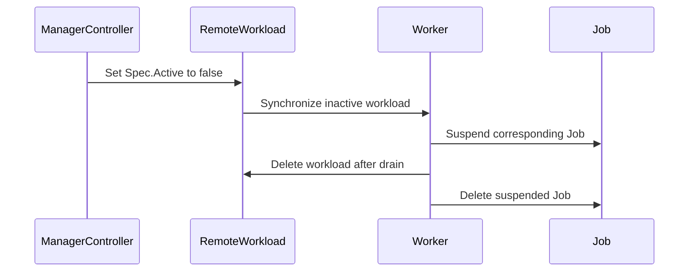

# PR #13793: MultiKueue: propagate manager-side eviction via remote spec instead of status

**Summary**: MultiKueue: propagate manager-side eviction via remote spec instead of status

**Sources**: https://github.com/kubernetes-sigs/kueue/pull/13793

**Last updated**: 2026-09-28T02:23:06Z

---

## Metadata

- **State**: closed
- **Author**: [@kevin85421](https://github.com/kevin85421)
- **Branch**: `multikueue-evict-remote-via-spec` → `main`
- **Created**: 2026-08-04T07:18:26Z
- **Updated**: 2026-09-28T02:23:06Z
- **Merged**: —
- **Closed**: 2026-09-28T02:23:06Z
- **Labels**: `release-note`, `size/L`, `kind/cleanup`, `ok-to-test`, `cncf-cla: yes`, `area/multikueue`
- **Assignees**: _none_
- **Requested reviewers**: [@kannon92](https://github.com/kannon92), [@pajakd](https://github.com/pajakd), [@mbobrovskyi](https://github.com/mbobrovskyi), [@sohankunkerkar](https://github.com/sohankunkerkar), [@kshalot](https://github.com/kshalot)
- **Changed files**: 2   **+97 / -10**

## Description

#### What type of PR is this?

/kind cleanup
/area multikueue

#### What this PR does / why we need it:

In MultiKueue, when the manager evicts a workload that is still admitted on a worker cluster, the manager used to write the remote Workload **status** — it set the `WorkloadDeactivationTarget` condition (reason `WorkloadEvictedOnManagerCluster`) on the worker's Workload via a status patch. This means the manager writes both the remote Workload spec and status, which blurs ownership of the remote Workload status between the manager and the worker.

This PR makes the manager signal a manager-side eviction through the remote **spec** only: it sets `spec.active=false` on the remote Workload and lets the worker's own controller reconcile the remote status (deactivate → evict → suspend). The manager no longer writes the remote Workload status on this path.

`Active` is also excluded from `isRemoteSpecOutOfSync` (the same way `PreemptionGates` already is), because the manager now manages the remote's `Active` independently. Without this, the manager-set `spec.active=false` would make the remote look out of sync and the manager would delete it immediately, instead of letting the worker deactivate it gracefully.

The end state is unchanged (the remote Workload is deactivated and eventually removed). The only observable difference is the eviction attribution on the worker Workload: the worker now surfaces the generic `Deactivated` reason / `"The workload is deactivated"` message instead of `DeactivatedDueToEvictedOnManagerCluster` / `"Evicted on manager: ..."`.

This is not an observability loss:
- The authoritative eviction reason and message remain on the manager Workload, which is where operators should look.
- The remote Workload is short-lived on this path — once the manager releases the quota reservation it removes the remote Workload shortly after — so its status is not a durable observability surface to begin with.

#### Which issue(s) this PR fixes:

N/A (no linked issue)

#### Special notes for your reviewer:

- Covered by an integration test in `test/integration/multikueue/scheduler` that exercises the end-to-end manager-eviction path: on preemption the remote Workload is deactivated through the spec (`Active=false`), the worker suspends its job, and the remote is removed once the manager releases the quota reservation.
- AI assistance: this change was developed with the help of an AI coding assistant (Claude), including the investigation and the live repro.

#### Does this PR introduce a user-facing change?

```release-note
MultiKueue: When the manager evicts a workload that is still admitted on a worker cluster, the manager now propagates the eviction through the remote Workload spec (`spec.active=false`) and lets the worker reconcile its own status, instead of writing the remote Workload status directly. The worker's eviction reason/message becomes the generic deactivation reason; the manager Workload still carries the authoritative eviction reason and message.
```


<!-- This is an auto-generated comment: release notes by coderabbit.ai -->

## Summary by CodeRabbit

* **Bug Fixes**
  * Improved manager-side workload eviction by deactivating remote workloads correctly.
  * Ensured worker jobs are suspended and subsequently removed after eviction and worker drain.

* **Tests**
  * Added integration coverage for preemption propagation from the manager to running workloads.

<!-- end of auto-generated comment: release notes by coderabbit.ai -->

## Discussion

### Comment by [@netlify[bot]](https://github.com/apps/netlify) — 2026-08-04T07:18:31Z

### <span aria-hidden="true">✅</span> Deploy Preview for *kubernetes-sigs-kueue* canceled.


|  Name | Link |
|:-:|------------------------|
|<span aria-hidden="true">🔨</span> Latest commit | 3d75eeb5837ee43b1176c1402c8862a7610601e2 |
|<span aria-hidden="true">🔍</span> Latest deploy log | https://app.netlify.com/projects/kubernetes-sigs-kueue/deploys/6a7226aabd25c1000829f56a |

### Comment by [@kubernetes-prow[bot]](https://github.com/apps/kubernetes-prow) — 2026-08-04T07:18:36Z

Hi @kevin85421. Thanks for your PR.

I'm waiting for a [kubernetes-sigs](https://github.com/orgs/kubernetes-sigs/people) member to verify that this patch is reasonable to test. If it is, they should reply with `/ok-to-test` on its own line. Until that is done, I will not automatically test new commits in this PR, but the usual testing commands by org members will still work.

>[!TIP]
>**We noticed you've done this a few times! Consider [joining the org](https://git.k8s.io/community/community-membership.md#member) to skip this step and gain `/lgtm` and other bot rights.** We recommend asking approvers on your previous PRs to sponsor you.

Once the patch is verified, the new status will be reflected by the `ok-to-test` label.

I understand the commands that are listed [here](https://go.k8s.io/bot-commands?repo=kubernetes-sigs%2Fkueue).

<details>

Instructions for interacting with me using PR comments are available [here](https://git.k8s.io/community/contributors/guide/pull-requests.md).  If you have questions or suggestions related to my behavior, please file an issue against the [kubernetes-sigs/prow](https://github.com/kubernetes-sigs/prow/issues/new?title=Prow%20issue:) repository.
</details>

### Comment by [@coderabbitai[bot]](https://github.com/apps/coderabbitai) — 2026-08-04T07:19:51Z

<!-- This is an auto-generated comment: summarize by coderabbit.ai -->
<!-- review_stack_entry_start -->

[](https://app.coderabbit.ai/change-stack/kubernetes-sigs/kueue/pull/13793?utm_source=github_walkthrough&utm_medium=github&utm_campaign=change_stack)

<!-- review_stack_entry_end -->
No actionable comments were generated in the recent review. 🎉

<details>
<summary>ℹ️ Recent review info</summary>

<details>
<summary>⚙️ Run configuration</summary>

**Configuration used**: Path: .coderabbit.yaml

**Review profile**: CHILL

**Plan**: Pro Plus

**Run ID**: `641c910e-f289-4ec9-b840-bb6a80e42235`

</details>

<details>
<summary>📥 Commits</summary>

Reviewing files that changed from the base of the PR and between 156bbffa82c3a1851e68be5bd6739a2b7cf0ac92 and 3d75eeb5837ee43b1176c1402c8862a7610601e2.

</details>

<details>
<summary>📒 Files selected for processing (2)</summary>

* `pkg/controller/admissionchecks/multikueue/workload.go`
* `test/integration/multikueue/scheduler/scheduler_test.go`

</details>

</details>

---
<!-- walkthrough_start -->

<details>
<summary>📝 Walkthrough</summary>

## Walkthrough

### Changes

The manager now deactivates an active remote workload through `Spec.Active` instead of remote admission status. Remote `Active` differences no longer trigger spec drift handling. An integration test verifies preemption, Job suspension, and cleanup.

**Multikueue eviction propagation**

|Layer / File(s)|Summary|
|---|---|
|**Remote workload deactivation** <br> `pkg/controller/admissionchecks/multikueue/workload.go`|Manager-side eviction sets the remote workload’s `Spec.Active` to false. Remote spec synchronization ignores `Spec.Active` differences.|
|**Preemption propagation validation** <br> `test/integration/multikueue/scheduler/scheduler_test.go`|The test verifies admission, manager-side preemption, remote deactivation without status updates, Job suspension, and resource cleanup.|

**Estimated code review effort:** 3 (Moderate) | ~20 minutes

**Suggested reviewers:** `mbobrovskyi`, `kshalot`, `mykysha`

### Sequence Diagram(s)



</details>

<!-- walkthrough_end -->
<!-- pre_merge_checks_walkthrough_start -->

<details>
<summary>🚥 Pre-merge checks | ✅ 4 | ❌ 1</summary>

### ❌ Failed checks (1 warning)

|     Check name     | Status     | Explanation                                                                          | Resolution                                                                         |
| :----------------: | :--------- | :----------------------------------------------------------------------------------- | :--------------------------------------------------------------------------------- |
| Docstring Coverage | ⚠️ Warning | Docstring coverage is 0.00% which is insufficient. The required threshold is 80.00%. | Write docstrings for the functions missing them to satisfy the coverage threshold. |

<details>
<summary>✅ Passed checks (4 passed)</summary>

|         Check name         | Status   | Explanation                                                                                                                                                 |
| :------------------------: | :------- | :---------------------------------------------------------------------------------------------------------------------------------------------------------- |
|      Description Check     | ✅ Passed | Check skipped - CodeRabbit’s high-level summary is enabled.                                                                                                 |
|         Title check        | ✅ Passed | The title clearly and concisely describes the main change: propagating MultiKueue manager-side eviction through the remote workload spec instead of status. |
|     Linked Issues check    | ✅ Passed | Check skipped because no linked issues were found for this pull request.                                                                                    |
| Out of Scope Changes check | ✅ Passed | Check skipped because no linked issues were found for this pull request.                                                                                    |

</details>

</details>

<!-- pre_merge_checks_walkthrough_end -->
<!-- finishing_touch_checkbox_start -->

<details>
<summary>✨ Finishing Touches</summary>

<details>
<summary>🧪 Generate unit tests (beta)</summary>

- [ ] <!-- {"checkboxId": "f47ac10b-58cc-4372-a567-0e02b2c3d479", "radioGroupId": "utg-output-choice-group-unknown_comment_id"} -->   Create PR with unit tests

</details>

</details>

<!-- finishing_touch_checkbox_end -->
<!-- tips_start -->

---

Thanks for using [CodeRabbit](https://coderabbit.ai?utm_source=oss&utm_medium=github&utm_campaign=kubernetes-sigs/kueue&utm_content=13793)! It's free for OSS, and your support helps us grow. If you like it, consider giving us a shout-out.

<details>
<summary>❤️ Share</summary>

- [X](https://twitter.com/intent/tweet?text=I%20just%20used%20%40coderabbitai%20for%20my%20code%20review%2C%20and%20it%27s%20fantastic%21%20It%27s%20free%20for%20OSS%20and%20offers%20a%20free%20trial%20for%20the%20proprietary%20code.%20Check%20it%20out%3A&url=https%3A//coderabbit.ai)
- [Mastodon](https://mastodon.social/share?text=I%20just%20used%20%40coderabbitai%20for%20my%20code%20review%2C%20and%20it%27s%20fantastic%21%20It%27s%20free%20for%20OSS%20and%20offers%20a%20free%20trial%20for%20the%20proprietary%20code.%20Check%20it%20out%3A%20https%3A%2F%2Fcoderabbit.ai)
- [Reddit](https://www.reddit.com/submit?title=Great%20tool%20for%20code%20review%20-%20CodeRabbit&text=I%20just%20used%20CodeRabbit%20for%20my%20code%20review%2C%20and%20it%27s%20fantastic%21%20It%27s%20free%20for%20OSS%20and%20offers%20a%20free%20trial%20for%20proprietary%20code.%20Check%20it%20out%3A%20https%3A//coderabbit.ai)
- [LinkedIn](https://www.linkedin.com/sharing/share-offsite/?url=https%3A%2F%2Fcoderabbit.ai&mini=true&title=Great%20tool%20for%20code%20review%20-%20CodeRabbit&summary=I%20just%20used%20CodeRabbit%20for%20my%20code%20review%2C%20and%20it%27s%20fantastic%21%20It%27s%20free%20for%20OSS%20and%20offers%20a%20free%20trial%20for%20proprietary%20code)

</details>


<sub>Comment `@coderabbitai help` to get the list of available commands.</sub>

<!-- tips_end -->

### Comment by [@kubernetes-prow[bot]](https://github.com/apps/kubernetes-prow) — 2026-08-04T07:54:18Z

[APPROVALNOTIFIER] This PR is **NOT APPROVED**

This pull-request has been approved by: *<a href="https://github.com/kubernetes-sigs/kueue/pull/13793#" title="Author self-approved">kevin85421</a>*
**Once this PR has been reviewed and has the lgtm label**, please assign [olekzabl](https://github.com/olekzabl) for approval. For more information see [the Code Review Process](https://git.k8s.io/community/contributors/guide/owners.md#the-code-review-process).

The full list of commands accepted by this bot can be found [here](https://go.k8s.io/bot-commands?repo=kubernetes-sigs%2Fkueue).

<details open>
Needs approval from an approver in each of these files:

- **[pkg/controller/admissionchecks/multikueue/OWNERS](https://github.com/kubernetes-sigs/kueue/blob/main/pkg/controller/admissionchecks/multikueue/OWNERS)**
- **[test/OWNERS](https://github.com/kubernetes-sigs/kueue/blob/main/test/OWNERS)**

Approvers can indicate their approval by writing `/approve` in a comment
Approvers can cancel approval by writing `/approve cancel` in a comment
</details>
<!-- META={"approvers":["olekzabl"]} -->

### Comment by [@mimowo](https://github.com/mimowo) — 2026-08-04T08:10:52Z

/ok-to-test

### Comment by [@mimowo](https://github.com/mimowo) — 2026-08-04T08:11:45Z

cc @olekzabl ptal

### Comment by [@kevin85421](https://github.com/kevin85421) — 2026-08-04T20:11:14Z

/retest

## Reviews

### Review by [@mimowo](https://github.com/mimowo) (commented) — 2026-08-04T21:01:54Z

- **pkg/controller/admissionchecks/multikueue/workload.go:592** by [@mimowo](https://github.com/mimowo) — 2026-08-04T21:01:54Z
```diff
@@ -588,17 +588,14 @@ func (w *wlReconciler) reconcileGroup(ctx context.Context, group *wlGroup) (reco
 
 		evictedCond := apimeta.FindStatusCondition(group.local.Status.Conditions, kueue.WorkloadEvicted)
 		if workload.HasQuotaReservation(group.local) && evictedCond != nil && evictedCond.Status == metav1.ConditionTrue {
-			err := workloadpatching.PatchAdmissionStatus(ctx, remoteCl, remoteWl, w.clock, func(remoteWl *kueue.Workload) (bool, error) {
-				return workload.SetDeactivationTarget(
-					remoteWl,
-					kueue.WorkloadEvictedOnManagerCluster,
-					api.TruncateConditionMessage(fmt.Sprintf("Evicted on manager: %s", evictedCond.Message)),
-				), nil
-			})
-			if err != nil {
-				log.Error(err, "Failed to patch workload status")
+			if workload.IsActive(remoteWl) {
+				remoteWl.Spec.Active = new(false)
```

  Yeah, I like this "in principle", but there is one complication I'm unsure about. As we now manipulate the active field directly it means that the retentionPolicy for Workloads will not delete this workload eventually, because we only have the setting: deactivatedByKueue iirc.
  
  I think this might be ok-ish, but I would like to check your opinion in the context of MultiKueue. I'm not sure if / how users can mitigate that.
  
  Also, if the only motivation is purism... I'm not sure, it is kind of weird even already in the context of single cluster that the status triggers change to the spec (the DeactivationTarget mechanism).
  
  Let me know your opinions here.
