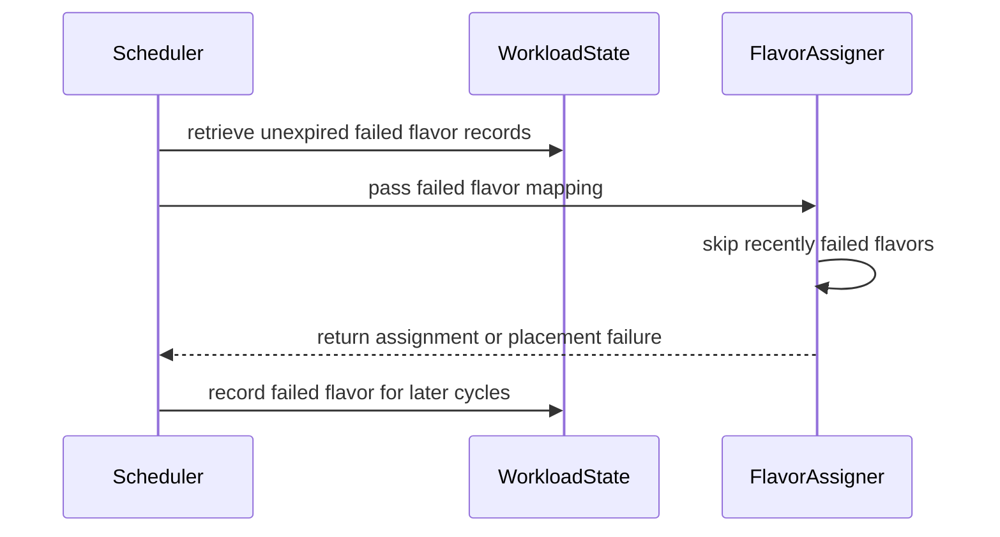

# PR #13800: TAS: skip flavors whose placement failed in recent scheduling cycles

**Summary**: TAS: skip flavors whose placement failed in recent scheduling cycles

**Sources**: https://github.com/kubernetes-sigs/kueue/pull/13800

**Last updated**: 2026-09-18T00:38:24Z

---

## Metadata

- **State**: open
- **Author**: [@varunsyal](https://github.com/varunsyal)
- **Branch**: `tas-skip-recently-failed-flavors` → `main`
- **Created**: 2026-08-04T09:34:45Z
- **Updated**: 2026-09-18T00:38:24Z
- **Merged**: —
- **Closed**: —
- **Labels**: `kind/feature`, `release-note`, `size/XXL`, `needs-rebase`, `ok-to-test`, `do-not-merge/work-in-progress`, `cncf-cla: yes`, `area/tas`
- **Assignees**: [@amy](https://github.com/amy)
- **Requested reviewers**: [@amy](https://github.com/amy), [@mimowo](https://github.com/mimowo), [@pajakd](https://github.com/pajakd), [@tenzen-y](https://github.com/tenzen-y)
- **Changed files**: 11   **+1128 / -13**

## Description

#### What type of PR is this?

/kind feature
/area tas

#### What this PR does / why we need it:

ResourceFlavors are selected on quota alone, and the TAS placement check runs only *after* a flavor has been selected, so its verdict cannot influence the selection. A flavor whose `nominalQuota` exceeds what its nodes can actually host therefore keeps being selected and keeps failing placement, and the Workload never advances to another flavor of the ResourceGroup even when that flavor has ample topological capacity.

Kueue already tracks which flavors a Workload has tried, in `LastTriedFlavorIdx`, but that state does not survive a busy cluster — see the reviewer notes below for the two independent mechanisms that discard it. Under sustained load both fire every cycle, so the flavor walk restarts from the first flavor indefinitely.

This PR records, for single-PodSet Workloads, the flavors for which the TAS placement search found no viable topology domains, and skips them during flavor selection in later cycles. The record is held by the scheduler, expires after a fixed number of scheduling cycles, and is only written once the Workload has failed to be admitted for the cycle with no
preemption or migration pending, so a preemption that could still admit it on that flavor is not discarded.

Guarded by the new alpha `TASSkipRecentlyFailedFlavors` feature gate, disabled by default.

#### Which issue(s) this PR fixes:

Fixes #13658 

The longer-term fix is TAS-aware flavor selection mentioned in [#10824](https://github.com/kubernetes-sigs/kueue/issues/10824) and https://github.com/kubernetes-sigs/kueue/issues/13695 that addresses the same failure at its source and would eventually retire this gate.

#### Special notes for your reviewer:

AI assistance was used to draft parts of this change and this PR description (per the Kubernetes AI Tool Usage Policy). All logic, tests, and KEP updates were reviewed by a human before submission.

**Why the record is not stored in `LastAssignment`** — the obvious-looking implementation does not work, because two independent mechanisms discard that state:

1. `lastAssignmentOutdated` nils it whenever `cq.AllocatableResourceGeneration` advances, which happens on every admission or eviction in the Cohort. `markSkipped`, `markPreemptionGated`, `markPreemptionOutcome` and `issueMigration` also nil it directly, and a stuck Workload hits one of those nearly every cycle.
2. `AddOrUpdateWorkloadWithoutLock` builds a fresh `workload.Info` and `PushOrUpdate` swaps it into the heap, so any Workload update event discards it — including the status patch Kueue itself writes while requeueing.

A field on `workload.Info` survives (1) but not (2). Keying the record on the scheduler by Workload UID survives both. Mechanism (2) looks like a pre-existing durability gap in `LastTriedFlavorIdx` that is worth its own issue, independent of this PR.

**Why expiry is cycle-based rather than derived from cluster state** — per the discussion in #13691: on a large flavor with steady admissions and evictions, any per-flavor invalidation signal fires many times per cycle, so a state-based record would be dropped before it could take effect, precisely in the conditions it targets. Determining whether
a specific change could make a specific Workload fit would mean tracking the domains its search rejected, which is considerably more state and does not generalize once flavors overlap on topology. TTL is currently 4 cycles (`failedFlavorPlacementTTL`).

**Testing.**
- Unit (`pkg/scheduler`): asserts both directions — with the gate off the Workload stays pinned and is never admitted; with it on it reaches the second flavor. Forces real `AllocatableResourceGeneration` churn between cycles so the built-in bookmark is discarded, reproducing the scenario in #13658 . Also covers TTL expiry, accumulation across cycles, stamp refresh, the preemption-pending suppression, and the gate-off path.
- Unit (`pkg/scheduler/flavorassigner`): the recording helper and the skip predicate.
- Integration (`test/integration/singlecluster/tas`): end-to-end with Fair Sharing enabled and `WithinClusterQueue: LowerPriority` / `ReclaimWithinCohort: Any`, so the fair-share entry iterator and preemption path drive the spec. Asserts the positive outcome only; the gate-off direction is covered by the unit test, since cycle counts and churn are not controllable from an integration spec.

#### Does this PR introduce a user-facing change?

```release-note
TAS: Added an alpha `TASSkipRecentlyFailedFlavors` feature gate (disabled by default) that records the ResourceFlavors whose topology placement failed for a a single-PodSet Workload and skips them for a bounded number of scheduling cycles. This prevents a Workload from staying pinned across cycles to a flavor whose `nominalQuota` exceeds what its nodes can host, which previously left it Pending indefinitely under sustained load.
```


<!-- This is an auto-generated comment: release notes by coderabbit.ai -->
## Summary by CodeRabbit

* **New Features**
  * Added the Alpha `TASSkipRecentlyFailedFlavors` feature gate, disabled by default.
  * Recently failed topology flavor placements are temporarily skipped during subsequent scheduling cycles, helping workloads try viable alternatives.
  * Failure records expire after four scheduling cycles and persist across scheduler state updates.
  * Applies to single-PodSet workloads; multi-PodSet workloads retain existing flavor-selection behavior.

* **Documentation**
  * Documented configuration, behavior, limitations, and lifecycle details for the feature.
<!-- end of auto-generated comment: release notes by coderabbit.ai -->

## Discussion

### Comment by [@netlify[bot]](https://github.com/apps/netlify) — 2026-08-04T09:34:51Z

### <span aria-hidden="true">✅</span> Deploy Preview for *kubernetes-sigs-kueue* canceled.


|  Name | Link |
|:-:|------------------------|
|<span aria-hidden="true">🔨</span> Latest commit | 09007765156375786c0df173488fb4f3652c2d09 |
|<span aria-hidden="true">🔍</span> Latest deploy log | https://app.netlify.com/projects/kubernetes-sigs-kueue/deploys/6a7307b4a7b3bd00080ad615 |

### Comment by [@coderabbitai[bot]](https://github.com/apps/coderabbitai) — 2026-08-04T09:34:54Z

<!-- This is an auto-generated comment: summarize by coderabbit.ai -->
<!-- review_stack_entry_start -->

[](https://app.coderabbit.ai/change-stack/kubernetes-sigs/kueue/pull/13800?utm_source=github_walkthrough&utm_medium=github&utm_campaign=change_stack)

<!-- review_stack_entry_end -->
<!-- walkthrough_start -->

<details>
<summary>📝 Walkthrough</summary>

## Walkthrough

The PR adds the `TASSkipRecentlyFailedFlavors` feature gate. The scheduler records failed TAS flavor placements per Workload for four cycles. The flavor assigner skips recorded flavors. Unit and integration tests cover retention, expiration, gating, and alternate flavor admission.

### Changes

**TAS failed flavor skipping**

|Layer / File(s)|Summary|
|---|---|
|**Feature gate and KEP contract** <br> `keps/2724-topology-aware-scheduling/*`, `pkg/features/kube_features.go`, `site/data/featuregates/*`, `test/compatibility_lifecycle/reference/*`|Defines the Alpha, disabled-by-default `TASSkipRecentlyFailedFlavors` gate and documents its behavior, retention, and workload limitations.|
|**Flavor failure tracking and filtering** <br> `pkg/scheduler/flavorassigner/*`|Tracks failed flavors by PodSet, records TAS placement failures, and skips recently failed flavors during selection.|
|**Scheduler lifecycle and retention** <br> `pkg/scheduler/scheduler.go`|Stores failed flavor placements per Workload, refreshes and expires records after four cycles, sweeps expired entries, and passes active records to the flavor assigner.|
|**Unit and integration validation** <br> `pkg/scheduler/scheduler_tas_skip_failed_flavors_test.go`, `pkg/scheduler/flavorassigner/flavorassigner_test.go`, `test/integration/singlecluster/tas/*`|Tests feature gating, PodSet matching, accumulation, expiration, fair-sharing setup, and admission on an alternate TAS flavor.|

**Estimated code review effort:** 4 (Complex) | ~45 minutes

### Sequence Diagram(s)



**Possibly related issues**

- [kubernetes-sigs/kueue#13695](https://github.com/kubernetes-sigs/kueue/issues/13695) — Adds the cross-cycle TAS placement-failure record and flavor skipping described by the issue.
- [kubernetes-sigs/kueue#13658](https://github.com/kubernetes-sigs/kueue/issues/13658) — Prevents repeated selection of a TAS flavor after a failed placement.

**Suggested reviewers:** `pajakd`, `amy`

</details>

<!-- walkthrough_end -->
<!-- pre_merge_checks_walkthrough_start -->

<details>
<summary>🚥 Pre-merge checks | ✅ 4 | ❌ 1</summary>

### ❌ Failed checks (1 warning)

|     Check name     | Status     | Explanation                                                                           | Resolution                                                                         |
| :----------------: | :--------- | :------------------------------------------------------------------------------------ | :--------------------------------------------------------------------------------- |
| Docstring Coverage | ⚠️ Warning | Docstring coverage is 33.33% which is insufficient. The required threshold is 80.00%. | Write docstrings for the functions missing them to satisfy the coverage threshold. |

<details>
<summary>✅ Passed checks (4 passed)</summary>

|         Check name         | Status   | Explanation                                                                                                                         |
| :------------------------: | :------- | :---------------------------------------------------------------------------------------------------------------------------------- |
|     Linked Issues check    | ✅ Passed | Check skipped because no linked issues were found for this pull request.                                                            |
| Out of Scope Changes check | ✅ Passed | Check skipped because no linked issues were found for this pull request.                                                            |
|      Description Check     | ✅ Passed | Check skipped - CodeRabbit’s high-level summary is enabled.                                                                         |
|         Title check        | ✅ Passed | The title clearly and concisely describes the main change: skipping TAS flavors whose placement failed in recent scheduling cycles. |

</details>

</details>

<!-- pre_merge_checks_walkthrough_end -->
<!-- finishing_touch_checkbox_start -->

<details>
<summary>✨ Finishing Touches</summary>

<details>
<summary>🧪 Generate unit tests (beta)</summary>

- [ ] <!-- {"checkboxId": "f47ac10b-58cc-4372-a567-0e02b2c3d479", "radioGroupId": "utg-output-choice-group-unknown_comment_id"} -->   Create PR with unit tests

</details>

</details>

<!-- finishing_touch_checkbox_end -->
<!-- tips_start -->

---

Thanks for using [CodeRabbit](https://coderabbit.ai?utm_source=oss&utm_medium=github&utm_campaign=kubernetes-sigs/kueue&utm_content=13800)! It's free for OSS, and your support helps us grow. If you like it, consider giving us a shout-out.

<details>
<summary>❤️ Share</summary>

- [X](https://twitter.com/intent/tweet?text=I%20just%20used%20%40coderabbitai%20for%20my%20code%20review%2C%20and%20it%27s%20fantastic%21%20It%27s%20free%20for%20OSS%20and%20offers%20a%20free%20trial%20for%20the%20proprietary%20code.%20Check%20it%20out%3A&url=https%3A//coderabbit.ai)
- [Mastodon](https://mastodon.social/share?text=I%20just%20used%20%40coderabbitai%20for%20my%20code%20review%2C%20and%20it%27s%20fantastic%21%20It%27s%20free%20for%20OSS%20and%20offers%20a%20free%20trial%20for%20the%20proprietary%20code.%20Check%20it%20out%3A%20https%3A%2F%2Fcoderabbit.ai)
- [Reddit](https://www.reddit.com/submit?title=Great%20tool%20for%20code%20review%20-%20CodeRabbit&text=I%20just%20used%20CodeRabbit%20for%20my%20code%20review%2C%20and%20it%27s%20fantastic%21%20It%27s%20free%20for%20OSS%20and%20offers%20a%20free%20trial%20for%20proprietary%20code.%20Check%20it%20out%3A%20https%3A//coderabbit.ai)
- [LinkedIn](https://www.linkedin.com/sharing/share-offsite/?url=https%3A%2F%2Fcoderabbit.ai&mini=true&title=Great%20tool%20for%20code%20review%20-%20CodeRabbit&summary=I%20just%20used%20CodeRabbit%20for%20my%20code%20review%2C%20and%20it%27s%20fantastic%21%20It%27s%20free%20for%20OSS%20and%20offers%20a%20free%20trial%20for%20proprietary%20code)

</details>


<sub>Comment `@coderabbitai help` to get the list of available commands.</sub>

<!-- tips_end -->

### Comment by [@kubernetes-prow[bot]](https://github.com/apps/kubernetes-prow) — 2026-08-04T09:34:55Z

[APPROVALNOTIFIER] This PR is **NOT APPROVED**

This pull-request has been approved by: *<a href="https://github.com/kubernetes-sigs/kueue/pull/13800#" title="Author self-approved">varunsyal</a>*
**Once this PR has been reviewed and has the lgtm label**, please assign [mimowo](https://github.com/mimowo), [pbundyra](https://github.com/pbundyra) for approval. For more information see [the Code Review Process](https://git.k8s.io/community/contributors/guide/owners.md#the-code-review-process).

The full list of commands accepted by this bot can be found [here](https://go.k8s.io/bot-commands?repo=kubernetes-sigs%2Fkueue).

<details open>
Needs approval from an approver in each of these files:

- **[OWNERS](https://github.com/kubernetes-sigs/kueue/blob/main/OWNERS)**

Approvers can indicate their approval by writing `/approve` in a comment
Approvers can cancel approval by writing `/approve cancel` in a comment
</details>
<!-- META={"approvers":["mimowo","pbundyra"]} -->

### Comment by [@kubernetes-prow[bot]](https://github.com/apps/kubernetes-prow) — 2026-08-04T09:34:55Z

Hi @varunsyal. Thanks for your PR.

I'm waiting for a [kubernetes-sigs](https://github.com/orgs/kubernetes-sigs/people) member to verify that this patch is reasonable to test. If it is, they should reply with `/ok-to-test` on its own line. Until that is done, I will not automatically test new commits in this PR, but the usual testing commands by org members will still work.

Regular contributors should [join the org](https://git.k8s.io/community/community-membership.md#member) to skip this step.

Once the patch is verified, the new status will be reflected by the `ok-to-test` label.

I understand the commands that are listed [here](https://go.k8s.io/bot-commands?repo=kubernetes-sigs%2Fkueue).

<details>

Instructions for interacting with me using PR comments are available [here](https://git.k8s.io/community/contributors/guide/pull-requests.md).  If you have questions or suggestions related to my behavior, please file an issue against the [kubernetes-sigs/prow](https://github.com/kubernetes-sigs/prow/issues/new?title=Prow%20issue:) repository.
</details>

### Comment by [@mimowo](https://github.com/mimowo) — 2026-08-04T10:05:07Z

/ok-to-test

### Comment by [@amy](https://github.com/amy) — 2026-08-05T01:12:49Z

/assign

### Comment by [@amy](https://github.com/amy) — 2026-08-05T03:13:37Z

### ⭐ Multipodset Issues

I think it makes sense to accept this PR as a stopgap in favor of the refresh drs and tas aware flavor selection options noted here: https://github.com/kubernetes-sigs/kueue/pull/13691#issuecomment-5146663958. ☂️ Umbrella tracking here: https://github.com/kubernetes-sigs/kueue/issues/13695 

Primary issue with multi podset. (I'd say this is non-trivial to truly solve. And intermediate solutions are hacky 😅 ): 

**A shared failure gets pinned on one PodSet, which can permanently hide the only arrangement that fits.** PodSets are placed one after another and eat each other's capacity, so when a later PodSet fails, the search only learned that the *combination* didn't fit. The record claims more:

    learned:   leader + worker together don't fit flavor-1
    recorded:  worker doesn't fit flavor-1

    the skip that matches what was learned:
      leader→f1, worker→f1     don't retry this combination

    the skip the record produces:
      leader→f1, worker→f1     skipped ✓
      leader→f2, worker→f1     skipped too ✗ never tested, might fit
  
 cc/ @mimowo @varunsyal 
 
 > 🤖 ai assisted investigation, human validation

### Comment by [@linux-foundation-easycla[bot]](https://github.com/apps/linux-foundation-easycla) — 2026-08-05T05:55:35Z

<a href="https://easycla.lfx.linuxfoundation.org/#/?version=2"></a><br >The committers listed above are authorized under a signed CLA.<ul><li>:white_check_mark: login: varunsyal / name: varunsyal (17dad4d542b53f38e8e267a0559231604ce13304, ea381b84ff889a607a36eeb830036c44853eeb3f)</li></ul>

### Comment by [@coderabbitai[bot]](https://github.com/apps/coderabbitai) — 2026-08-05T09:51:57Z

<!-- This is an auto-generated comment by CodeRabbit -->
> [!NOTE]
> GitHub couldn't provide a complete incremental comparison for this pull request, so CodeRabbit is performing a full review instead. This review may take a little longer.

### Comment by [@kubernetes-prow[bot]](https://github.com/apps/kubernetes-prow) — 2026-08-06T02:10:44Z

PR needs rebase.

<details>

Instructions for interacting with me using PR comments are available [here](https://git.k8s.io/community/contributors/guide/pull-requests.md).  If you have questions or suggestions related to my behavior, please file an issue against the [kubernetes-sigs/prow](https://github.com/kubernetes-sigs/prow/issues/new?title=Prow%20issue:) repository.
</details>

### Comment by [@anguszzzz](https://github.com/anguszzzz) — 2026-09-17T23:30:19Z

@amy @mimowo want to follow up on this, https://github.com/kubernetes-sigs/kueue/pull/13956 this fixed some issues for flavor fungibility but we still see failures for this issue family. I think the freshness is too tight so it makes every re-eval start from flavor idx 0. MultiPodSet issue is real but I think this PR gated to single PodSet only, do you have any further concerns?

## Reviews

### Review by [@coderabbitai[bot]](https://github.com/apps/coderabbitai) (commented) — 2026-08-05T05:41:22Z

**Actionable comments posted: 1**

<details>
<summary>🧹 Nitpick comments (4)</summary><blockquote>

<details>
<summary>pkg/scheduler/flavorassigner/flavorassigner_test.go (1)</summary><blockquote>

`5995-6057`: _📐 Maintainability & Code Quality_ | _🔵 Trivial_ | _💤 Low value_

**Extract the case struct to remove the repeated anonymous type.**

The anonymous struct `struct { podSet kueue.PodSetReference; flavor kueue.ResourceFlavorReference }` is written once in the field declaration and again in each of the six case literals. A named type removes the repetition and shortens each case.


<details>
<summary>♻️ Proposed refactor using a named type</summary>

```diff
 func TestRecordFailedFlavorPlacement(t *testing.T) {
+	type placement struct {
+		podSet kueue.PodSetReference
+		flavor kueue.ResourceFlavorReference
+	}
 	cases := map[string]struct {
-		record []struct {
-			podSet kueue.PodSetReference
-			flavor kueue.ResourceFlavorReference
-		}
+		record []placement
 		want map[kueue.PodSetReference]sets.Set[kueue.ResourceFlavorReference]
 	}{
 		"nothing recorded leaves the map nil": {
 			want: nil,
 		},
 		"a single failure is recorded": {
-			record: []struct {
-				podSet kueue.PodSetReference
-				flavor kueue.ResourceFlavorReference
-			}{
-				{podSet: "main", flavor: "flavor-a"},
-			},
+			record: []placement{{podSet: "main", flavor: "flavor-a"}},
 			want: flavorSets(map[kueue.PodSetReference][]kueue.ResourceFlavorReference{"main": {"flavor-a"}}),
 		},
```

Apply the same change to the remaining four cases.
</details>

<details>
<summary>🤖 Prompt for AI Agents</summary>

```
Verify each finding against current code. Fix only still-valid issues, skip the
rest with a brief reason, keep changes minimal, and validate.

In `@pkg/scheduler/flavorassigner/flavorassigner_test.go` around lines 5995 -
6057, Extract the repeated podSet/flavor anonymous struct in
TestRecordFailedFlavorPlacement into a named local type, then use that type for
the record field and all six case literals. Preserve the existing test data and
expected results while removing the duplicated anonymous type declarations.
```

</details>

<!-- cr-comment:v1:f3099b2901a5f41ecdd92093 -->

</blockquote></details>
<details>
<summary>pkg/scheduler/scheduler.go (1)</summary><blockquote>

`365-370`: _📐 Maintainability & Code Quality_ | _🔵 Trivial_ | _💤 Low value_

**Simplify the merge with `Union`.**

`flavors.UnsortedList()` allocates a slice only to re-insert the elements. `Union` handles a nil receiver and removes the nil check.


<details>
<summary>♻️ Proposed simplification</summary>

```diff
 	for psName, flavors := range e.assignment.FailedFlavorPlacements {
-		if record.flavors[psName] == nil {
-			record.flavors[psName] = sets.New[kueue.ResourceFlavorReference]()
-		}
-		record.flavors[psName].Insert(flavors.UnsortedList()...)
+		record.flavors[psName] = record.flavors[psName].Union(flavors)
 	}
```
</details>

<details>
<summary>🤖 Prompt for AI Agents</summary>

```
Verify each finding against current code. Fix only still-valid issues, skip the
rest with a brief reason, keep changes minimal, and validate.

In `@pkg/scheduler/scheduler.go` around lines 365 - 370, In the merge loop for
e.assignment.FailedFlavorPlacements, replace the nil initialization and
UnsortedList-based insertion with the resource-flavor set Union operation on
record.flavors[psName]. Preserve the existing merge behavior while relying on
Union to handle a nil destination set.
```

</details>

<!-- cr-comment:v1:cc8db5f2e8a816603b490d0c -->

</blockquote></details>
<details>
<summary>pkg/scheduler/scheduler_tas_skip_failed_flavors_test.go (1)</summary><blockquote>

`302-452`: _📐 Maintainability & Code Quality_ | _🔵 Trivial_ | _⚡ Quick win_

**Extract the cycle struct to remove eleven repetitions of the anonymous type.**

The anonymous struct `struct { cycle int64; reason qcache.RequeueReason; placements map[...][]... }` is declared in the field and repeated in all ten case literals. A named type declared once removes the repetition and makes each case one or two lines.


<details>
<summary>♻️ Proposed refactor using a named type</summary>

```diff
 func TestRecordFailedFlavorPlacements(t *testing.T) {
+	type cycleRecord struct {
+		cycle      int64
+		reason     qcache.RequeueReason
+		placements map[kueue.PodSetReference][]kueue.ResourceFlavorReference
+	}
 	cases := map[string]struct {
 		enabled bool
 		// cycles are replayed in order; each records one entry at the given cycle.
-		cycles []struct {
-			cycle      int64
-			reason     qcache.RequeueReason
-			placements map[kueue.PodSetReference][]kueue.ResourceFlavorReference
-		}
+		cycles      []cycleRecord
 		readAtCycle int64
 		want        map[kueue.PodSetReference]sets.Set[kueue.ResourceFlavorReference]
 	}{
 		"gate disabled: nothing is recorded": {
 			enabled: false,
-			cycles: []struct {
-				cycle      int64
-				reason     qcache.RequeueReason
-				placements map[kueue.PodSetReference][]kueue.ResourceFlavorReference
-			}{
-				{cycle: 1, reason: qcache.RequeueReasonPreemptionNoCandidates, placements: map[kueue.PodSetReference][]kueue.ResourceFlavorReference{"main": {"flavor-a"}}},
-			},
+			cycles: []cycleRecord{
+				{cycle: 1, reason: qcache.RequeueReasonPreemptionNoCandidates, placements: map[kueue.PodSetReference][]kueue.ResourceFlavorReference{"main": {"flavor-a"}}},
+			},
 			readAtCycle: 2,
 			want:        nil,
 		},
```

Apply the same change to the remaining nine cases.
</details>

<details>
<summary>🤖 Prompt for AI Agents</summary>

```
Verify each finding against current code. Fix only still-valid issues, skip the
rest with a brief reason, keep changes minimal, and validate.

In `@pkg/scheduler/scheduler_tas_skip_failed_flavors_test.go` around lines 302 -
452, Define a named cycle-entry type once for the shared cycle, reason, and
placements fields, then use []<named type> for the cases map’s cycles field and
every case literal. Replace all repeated anonymous struct declarations while
preserving the existing test data and behavior.
```

</details>

<!-- cr-comment:v1:b5bafd37c4743919d6575f64 -->

</blockquote></details>
<details>
<summary>keps/2724-topology-aware-scheduling/README.md (1)</summary><blockquote>

`1713-1717`: _📐 Maintainability & Code Quality_ | _🔵 Trivial_ | _⚡ Quick win_

**Document the multi-PodSet combination limitation.**

The limitations paragraph records that only the first failing PodSet is reported. It does not record the second effect discussed in the PR: PodSets are placed sequentially, so a later PodSet can fail because of the combined placement. The failure is then attributed to that PodSet alone. Skipping the flavor for that PodSet also suppresses combinations that were never tested, for example assigning the first PodSet to another flavor while keeping the recorded flavor for the second.

Add one sentence for this case so the Alpha limitations match the known behavior.

<details>
<summary>🤖 Prompt for AI Agents</summary>

```
Verify each finding against current code. Fix only still-valid issues, skip the
rest with a brief reason, keep changes minimal, and validate.

In `@keps/2724-topology-aware-scheduling/README.md` around lines 1713 - 1717,
Update the limitations paragraph describing placement results to add the
multi-PodSet sequential-placement limitation: a later PodSet may fail due to the
combined placement, yet the failure is attributed only to that PodSet, and
skipping its flavor can suppress untested flavor combinations. Preserve the
existing limitations and feature-gate context.
```

</details>

<!-- cr-comment:v1:d28a848ad2fdaa74c895704c -->

</blockquote></details>

</blockquote></details>

<details>
<summary>🤖 Prompt for all review comments with AI agents</summary>

```
Verify each finding against current code. Fix only still-valid issues, skip the
rest with a brief reason, keep changes minimal, and validate.

Inline comments:
In `@test/integration/singlecluster/tas/tas_skip_failed_flavors_test.go`:
- Around line 119-124: Update the explanatory comment near the test’s
preemption-policy description to remove the dangling “Neither” reference and
explicitly state that both preemption policies provide no way forward for
flavor-1, while preserving the existing explanations of LowerPriority and
ReclaimWithinCohort.

---

Nitpick comments:
In `@keps/2724-topology-aware-scheduling/README.md`:
- Around line 1713-1717: Update the limitations paragraph describing placement
results to add the multi-PodSet sequential-placement limitation: a later PodSet
may fail due to the combined placement, yet the failure is attributed only to
that PodSet, and skipping its flavor can suppress untested flavor combinations.
Preserve the existing limitations and feature-gate context.

In `@pkg/scheduler/flavorassigner/flavorassigner_test.go`:
- Around line 5995-6057: Extract the repeated podSet/flavor anonymous struct in
TestRecordFailedFlavorPlacement into a named local type, then use that type for
the record field and all six case literals. Preserve the existing test data and
expected results while removing the duplicated anonymous type declarations.

In `@pkg/scheduler/scheduler_tas_skip_failed_flavors_test.go`:
- Around line 302-452: Define a named cycle-entry type once for the shared
cycle, reason, and placements fields, then use []<named type> for the cases
map’s cycles field and every case literal. Replace all repeated anonymous struct
declarations while preserving the existing test data and behavior.

In `@pkg/scheduler/scheduler.go`:
- Around line 365-370: In the merge loop for
e.assignment.FailedFlavorPlacements, replace the nil initialization and
UnsortedList-based insertion with the resource-flavor set Union operation on
record.flavors[psName]. Preserve the existing merge behavior while relying on
Union to handle a nil destination set.
```

</details>

<details>
<summary>🪄 Autofix</summary>

Fix all unresolved CodeRabbit comments on this PR:

- [ ] <!-- {"checkboxId": "4b0d0e0a-96d7-4f10-b296-3a18ea78f0b9"} --> Push a commit to this branch (recommended)
- [ ] <!-- {"checkboxId": "ff5b1114-7d8c-49e6-8ac1-43f82af23a33"} --> Create a new PR with the fixes

</details>

---

<details>
<summary>ℹ️ Review info</summary>

<details>
<summary>⚙️ Run configuration</summary>

**Configuration used**: Path: .coderabbit.yaml

**Review profile**: CHILL

**Plan**: Pro Plus

**Run ID**: `333b24ec-8618-4a9b-ae38-9021868bc3d9`

</details>

<details>
<summary>📥 Commits</summary>

Reviewing files that changed from the base of the PR and between 57e352b20db25b848af60774c29fe10d5b9caa2f and ea381b84ff889a607a36eeb830036c44853eeb3f.

</details>

<details>
<summary>📒 Files selected for processing (11)</summary>

* `keps/2724-topology-aware-scheduling/README.md`
* `keps/2724-topology-aware-scheduling/kep.yaml`
* `pkg/features/kube_features.go`
* `pkg/scheduler/flavorassigner/flavorassigner.go`
* `pkg/scheduler/flavorassigner/flavorassigner_test.go`
* `pkg/scheduler/scheduler.go`
* `pkg/scheduler/scheduler_tas_skip_failed_flavors_test.go`
* `site/data/featuregates/versioned_feature_list.yaml`
* `test/compatibility_lifecycle/reference/versioned_feature_list.yaml`
* `test/integration/singlecluster/tas/suite_test.go`
* `test/integration/singlecluster/tas/tas_skip_failed_flavors_test.go`

</details>

</details>

<!-- This is an auto-generated comment by CodeRabbit for review status -->

- **test/integration/singlecluster/tas/tas_skip_failed_flavors_test.go:124** by [@coderabbitai[bot]](https://github.com/apps/coderabbitai) — 2026-08-05T05:41:21Z
```diff
@@ -0,0 +1,201 @@
+/*
+Copyright The Kubernetes Authors.
+
+Licensed under the Apache License, Version 2.0 (the "License");
+you may not use this file except in compliance with the License.
+You may obtain a copy of the License at
+
+    http://www.apache.org/licenses/LICENSE-2.0
+
+Unless required by applicable law or agreed to in writing, software
+distributed under the License is distributed on an "AS IS" BASIS,
+WITHOUT WARRANTIES OR CONDITIONS OF ANY KIND, either express or implied.
+See the License for the specific language governing permissions and
+limitations under the License.
+*/
+
+package tas
+
+import (
+	"github.com/onsi/ginkgo/v2"
+	"github.com/onsi/gomega"
+	corev1 "k8s.io/api/core/v1"
+	"k8s.io/apimachinery/pkg/api/resource"
+	"sigs.k8s.io/controller-runtime/pkg/client"
+
+	config "sigs.k8s.io/kueue/apis/config/v1beta2"
+	kueue "sigs.k8s.io/kueue/apis/kueue/v1beta2"
+	"sigs.k8s.io/kueue/pkg/features"
+	utiltas "sigs.k8s.io/kueue/pkg/util/tas"
+	utiltestingapi "sigs.k8s.io/kueue/pkg/util/testing/v1beta2"
+	testingnode "sigs.k8s.io/kueue/pkg/util/testingjobs/node"
+	"sigs.k8s.io/kueue/test/util"
+)
+
+// equalPriority is shared by both Workloads in these specs so that the
+// WithinClusterQueue: LowerPriority policy finds no preemption victim, as happens in a
+// ClusterQueue where every Workload runs at the same priority.
+const equalPriority = 100
+
+// These specs cover the TASSkipRecentlyFailedFlavors gate end to end: a Workload whose
+// TAS placement fails on the flavor selected by quota must reach another flavor of the
+// ResourceGroup on a later scheduling cycle.
+//
+// The gate-off counterpart is covered by the unit test
+// TestScheduleForTASSkipRecentlyFailedFlavors, which drives scheduling cycles directly
+// and can force the ClusterQueue generation churn that discards LastAssignment. Here we
+// assert the positive outcome only, since the number of cycles and the surrounding churn
+// are not controllable from an integration spec.
+var _ = ginkgo.Describe("Topology Aware Scheduling skipping recently failed flavors", ginkgo.Ordered, func() {
+	var (
+		ns           *corev1.Namespace
+		nodes        []corev1.Node
+		topology     *kueue.Topology
+		tasFlavor1   *kueue.ResourceFlavor
+		tasFlavor2   *kueue.ResourceFlavor
+		clusterQueue *kueue.ClusterQueue
+		localQueue   *kueue.LocalQueue
+	)
+
+	ginkgo.BeforeAll(func() {
+		// Fair sharing on, so the fair-share entry iterator and preemption path drive
+		// this spec rather than the classical ones.
+		fwk.StartManager(ctx, cfg, managerSetupWithConfig(&config.Configuration{
+			FairSharing: &config.FairSharing{},
+		}))
+	})
+
+	ginkgo.AfterAll(func() {
+		fwk.StopManager(ctx)
+	})
+
+	ginkgo.BeforeEach(func() {
+		features.SetFeatureGateDuringTest(ginkgo.GinkgoTB(), features.TASSkipRecentlyFailedFlavors, true)
+		ns = util.CreateNamespaceFromPrefixWithLog(ctx, k8sClient, "tas-skip-failed-flavors-")
+
+		// One node per flavor. The blocker Workload fills the flavor-1 node, so the
+		// second Workload can only be placed on the flavor-2 node.
+		nodes = []corev1.Node{
+			*testingnode.MakeNode("skip-f1").
+				Label("node-group", "tas").
+				Label("tas-flavor", "f1").
+				Label(corev1.LabelHostname, "skip-f1").
+				StatusAllocatable(corev1.ResourceList{
+					corev1.ResourceCPU:  resource.MustParse("2"),
+					corev1.ResourcePods: resource.MustParse("10"),
+				}).
+				Ready().
+				Obj(),
+			*testingnode.MakeNode("skip-f2").
+				Label("node-group", "tas").
+				Label("tas-flavor", "f2").
+				Label(corev1.LabelHostname, "skip-f2").
+				StatusAllocatable(corev1.ResourceList{
+					corev1.ResourceCPU:  resource.MustParse("2"),
+					corev1.ResourcePods: resource.MustParse("10"),
+				}).
+				Ready().
+				Obj(),
+		}
+		util.CreateNodesWithStatus(ctx, k8sClient, nodes)
+
+		topology = utiltestingapi.MakeDefaultOneLevelTopology("default")
+		util.MustCreate(ctx, k8sClient, topology)
+
+		tasFlavor1 = utiltestingapi.MakeResourceFlavor("tas-flavor-1").
+			NodeLabel("node-group", "tas").
+			NodeLabel("tas-flavor", "f1").
+			TopologyName("default").Obj()
+		util.MustCreate(ctx, k8sClient, tasFlavor1)
+
+		tasFlavor2 = utiltestingapi.MakeResourceFlavor("tas-flavor-2").
+			NodeLabel("node-group", "tas").
+			NodeLabel("tas-flavor", "f2").
+			TopologyName("default").Obj()
+		util.MustCreate(ctx, k8sClient, tasFlavor2)
+
+		// Quota on each flavor exceeds what its single node can host, so flavor-1 keeps
+		// looking admissible to the quota-only flavor selection after its node is full.
+		//
+		// The test runs with a specific preemption policy. Neither offers
+		// flavor-1 a way forward here: the two Workloads share a priority, so
+		// LowerPriority finds no victim within the ClusterQueue, and no other
+		// ClusterQueue in the Cohort is borrowing for ReclaimWithinCohort to reclaim
+		// from. That combination is what leaves a Workload pinned to one flavor.
```

  _📐 Maintainability & Code Quality_ | _🟡 Minor_ | _⚡ Quick win_
  
  **Fix the dangling "Neither" in the comment.**
  
  The sentence "The test runs with a specific preemption policy" introduces one policy. The next sentence then says "Neither offers flavor-1 a way forward here" and explains two policies. The pronoun has no antecedent, so the paragraph is hard to follow.
  
  
  
  
  <details>
  <summary>📝 Proposed wording</summary>
  
  ```diff
  -		// The test runs with a specific preemption policy. Neither offers
  -		// flavor-1 a way forward here: the two Workloads share a priority, so
  -		// LowerPriority finds no victim within the ClusterQueue, and no other
  -		// ClusterQueue in the Cohort is borrowing for ReclaimWithinCohort to reclaim
  -		// from. That combination is what leaves a Workload pinned to one flavor.
  +		// The ClusterQueue sets two preemption policies. Neither policy offers
  +		// flavor-1 a way forward here: the two Workloads share a priority, so
  +		// WithinClusterQueue: LowerPriority finds no victim in the ClusterQueue, and
  +		// no other ClusterQueue in the Cohort is borrowing, so ReclaimWithinCohort
  +		// has nothing to reclaim. That combination leaves a Workload pinned to one
  +		// flavor.
  ```
  </details>
  
  <!-- suggestion_start -->
  
  <details>
  <summary>📝 Committable suggestion</summary>
  
  > ‼️ **IMPORTANT**
  > Carefully review the code before committing. Ensure that it accurately replaces the highlighted code, contains no missing lines, and has no issues with indentation. Thoroughly test & benchmark the code to ensure it meets the requirements.
  
  ```suggestion
  		//
  		// The ClusterQueue sets two preemption policies. Neither policy offers
  		// flavor-1 a way forward here: the two Workloads share a priority, so
  		// WithinClusterQueue: LowerPriority finds no victim in the ClusterQueue, and
  		// no other ClusterQueue in the Cohort is borrowing, so ReclaimWithinCohort
  		// has nothing to reclaim. That combination leaves a Workload pinned to one
  		// flavor.
  ```
  
  </details>
  
  <!-- suggestion_end -->
  
  <details>
  <summary>🤖 Prompt for AI Agents</summary>
  
  ```
  Verify each finding against current code. Fix only still-valid issues, skip the
  rest with a brief reason, keep changes minimal, and validate.
  
  In `@test/integration/singlecluster/tas/tas_skip_failed_flavors_test.go` around
  lines 119 - 124, Update the explanatory comment near the test’s
  preemption-policy description to remove the dangling “Neither” reference and
  explicitly state that both preemption policies provide no way forward for
  flavor-1, while preserving the existing explanations of LowerPriority and
  ReclaimWithinCohort.
  ```
  
  </details>
  
  <!-- fingerprinting:phantom:medusa:komodo -->
  
  <!-- cr-indicator-types:potential_issue -->
  
  <!-- cr-comment:v1:2d08d5ffe5d7729173a0fe97 -->
  
  <!-- This is an auto-generated comment by CodeRabbit -->

### Review by [@anguszzzz](https://github.com/anguszzzz) (commented) — 2026-09-18T00:38:24Z

- **pkg/scheduler/scheduler.go:118** by [@anguszzzz](https://github.com/anguszzzz) — 2026-09-18T00:37:44Z
```diff
@@ -94,6 +94,34 @@ type Scheduler struct {
 	// schedulingCycle identifies the number of scheduling
 	// attempts since the last restart.
 	schedulingCycle int64
+
+	// failedFlavorPlacements remembers, per Workload, the flavors whose TAS placement
+	// failed in a recent scheduling cycle, so that the next cycles skip them and try
+	// the remaining flavors of the ClusterQueue instead of re-picking the same one.
+	// Entries expire after failedFlavorPlacementTTL cycles.
+	//
+	// Deliberately in-memory and scoped to this Scheduler instance: entries are stamped
+	// with schedulingCycle, which also restarts from zero on process restart or leader
+	// change, so the two always agree. Persisting entries without switching the TTL to
+	// wall-clock time would make stale stamps compare as arbitrarily fresh and block a
+	// flavor forever. Losing the map on restart only costs re-walking flavors already
+	// tried, which is how LastAssignment already behaves.
+	//
+	// Only accessed from schedule(), which runs in a single goroutine, so no locking.
+	failedFlavorPlacements map[types.UID]failedFlavorPlacement
+}
+
+// failedFlavorPlacementTTL is how many scheduling cycles a recorded TAS placement
+// failure keeps a flavor out of consideration for a Workload. It doubles as the bound
+// on how many flavors a Workload can walk before its record expires and the walk
+// restarts from the first flavor.
+const failedFlavorPlacementTTL = 4
```

  For the TTL, I'm actually thinking what could be our best guess here. Maybe a configurable TTL would be the north star direction?

- **pkg/scheduler/flavorassigner/flavorassigner.go:1095** by [@anguszzzz](https://github.com/anguszzzz) — 2026-09-18T00:38:13Z
```diff
@@ -1051,6 +1091,11 @@ func (a *FlavorAssigner) findFlavorForPodSets(
 			status.appendf("skipping flavor %s due to WorkloadAllowedResourceFlavorAnnotation annotation", fName)
 			continue
 		}
+		if a.placementFailedRecently(fName, psIDs) {
+			log.V(5).Info("Skipping flavor as its topology placement failed in a recent scheduling cycle", "resName", resName, "flavorName", fName)
```

  nit: Do we want level 5 logging here?
