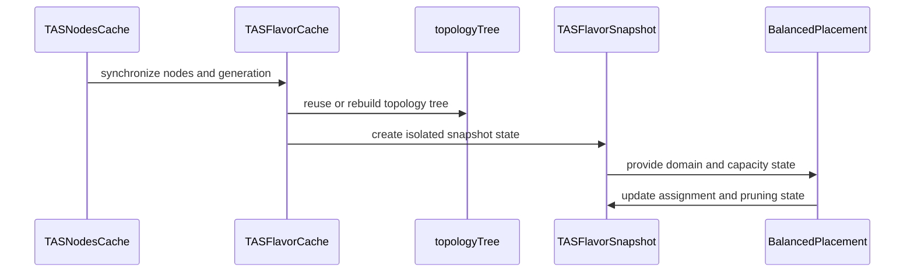

# PR #13819: refactor: Reuse TAS topology trees across scheduler snapshots

**Summary**: refactor: Reuse TAS topology trees across scheduler snapshots

**Sources**: https://github.com/kubernetes-sigs/kueue/pull/13819

**Last updated**: 2026-08-20T13:12:42Z

---

## Metadata

- **State**: closed (merged)
- **Author**: [@akshay-pm](https://github.com/akshay-pm)
- **Branch**: `tas-static-tree` → `main`
- **Created**: 2026-08-04T16:01:37Z
- **Updated**: 2026-08-20T13:12:42Z
- **Merged**: 2026-08-11T05:26:05Z
- **Closed**: 2026-08-11T05:26:05Z
- **Labels**: `kind/feature`, `release-note`, `lgtm`, `size/XXL`, `approved`, `ok-to-test`, `cncf-cla: yes`, `area/tas`
- **Assignees**: [@mimowo](https://github.com/mimowo), [@apullo777](https://github.com/apullo777), [@j-skiba](https://github.com/j-skiba)
- **Requested reviewers**: [@amy](https://github.com/amy), [@PBundyra](https://github.com/PBundyra)
- **Changed files**: 14   **+2127 / -636**

## Description

#### What type of PR is this?

/kind cleanup
/area tas

#### What this PR does / why we need it:

TAS snapshots previously rebuilt the complete topology tree for every scheduling cycle, including the domain hierarchy, node-to-domain mapping, and leaf capacities. Most of this data remains unchanged between cycles.

This PR:
- Caches an immutable topology tree for each TAS flavor.
- Reuses the tree while scheduling-relevant node data remains unchanged.
- Keeps mutable scheduling state in each snapshot so concurrently created snapshots remain isolated.
- Tracks semantic node changes to invalidate cached trees when labels, taints, or allocatable resources change.
- Avoids invalidation for node updates that do not affect TAS scheduling.

Benchmark configuration:
- 2,500 nodes
- 15 TAS flavors
- One non-TAS pod per node

Snapshot scenario | CPU time | Allocated bytes | Allocations
-- | -- | -- | --
Cached tree reused | −71.74% | −60.96% | −64.50%
Tree invalidated every snapshot cycle | +5.55% | +10.54% | +23.57%
Tree invalidated every 2 snapshot cycles | −32.54% | −25.05% | −20.28%

pprof flame graphs
Before:


After:


#### Which issue(s) this PR fixes:

Part of #12580

#### Does this PR introduce a user-facing change?

```release-note
TAS: Reduced CPU time and memory allocations for snapshot creation by reusing cached topology trees when scheduling-relevant Node data is unchanged. Controlled by the `TASCacheTopologyTree` feature gate, which is Beta and enabled by default.
```

<!-- This is an auto-generated comment: release notes by coderabbit.ai -->
## Summary by CodeRabbit

* **Performance**
  * Improved scheduling efficiency by reusing topology information across placement calculations.
  * Reduced unnecessary refreshes for heartbeat-only and unchanged node updates.

* **Scheduling**
  * Improved balanced placement consistency with isolated scheduling state.
  * Enhanced handling of capacity, topology changes, pruning, fallback placement, and leader assignments.

* **Reliability**
  * Improved consistency during concurrent topology updates.
  * Preserved the newest topology information during cache refreshes.

* **Testing**
  * Expanded coverage for placement, topology changes, cache invalidation, and capacity handling.
  * Added benchmarks for topology reuse and assignment scenarios.
<!-- end of auto-generated comment: release notes by coderabbit.ai -->

## Discussion

### Comment by [@kubernetes-prow[bot]](https://github.com/apps/kubernetes-prow) — 2026-08-04T16:01:48Z

Hi @akshay-pm. Thanks for your PR.

I'm waiting for a [kubernetes-sigs](https://github.com/orgs/kubernetes-sigs/people) member to verify that this patch is reasonable to test. If it is, they should reply with `/ok-to-test` on its own line. Until that is done, I will not automatically test new commits in this PR, but the usual testing commands by org members will still work.

>[!TIP]
>**We noticed you've done this a few times! Consider [joining the org](https://git.k8s.io/community/community-membership.md#member) to skip this step and gain `/lgtm` and other bot rights.** We recommend asking approvers on your previous PRs to sponsor you.

Once the patch is verified, the new status will be reflected by the `ok-to-test` label.

I understand the commands that are listed [here](https://go.k8s.io/bot-commands?repo=kubernetes-sigs%2Fkueue).

<details>

Instructions for interacting with me using PR comments are available [here](https://git.k8s.io/community/contributors/guide/pull-requests.md).  If you have questions or suggestions related to my behavior, please file an issue against the [kubernetes-sigs/prow](https://github.com/kubernetes-sigs/prow/issues/new?title=Prow%20issue:) repository.
</details>

### Comment by [@netlify[bot]](https://github.com/apps/netlify) — 2026-08-04T16:01:49Z

### <span aria-hidden="true">✅</span> Deploy Preview for *kubernetes-sigs-kueue* ready!


|  Name | Link |
|:-:|------------------------|
|<span aria-hidden="true">🔨</span> Latest commit | e32a58c9661e3c380dc32c087625a7f9c48ff5e5 |
|<span aria-hidden="true">🔍</span> Latest deploy log | https://app.netlify.com/projects/kubernetes-sigs-kueue/deploys/6a76604471b7d80008725a3e |
|<span aria-hidden="true">😎</span> Deploy Preview | [https://deploy-preview-13819--kubernetes-sigs-kueue.netlify.app](https://deploy-preview-13819--kubernetes-sigs-kueue.netlify.app) |
|<span aria-hidden="true">📱</span> Preview on mobile | <details><summary> Toggle QR Code... </summary><br /><br /><br /><br />_Use your smartphone camera to open QR code link._</details> |
---
<!-- [kubernetes-sigs-kueue Preview](https://deploy-preview-13819--kubernetes-sigs-kueue.netlify.app) -->
_To edit notification comments on pull requests, go to your [Netlify project configuration](https://app.netlify.com/projects/kubernetes-sigs-kueue/configuration/notifications#deploy-notifications)._

### Comment by [@coderabbitai[bot]](https://github.com/apps/coderabbitai) — 2026-08-04T16:02:27Z

<!-- This is an auto-generated comment: summarize by coderabbit.ai -->
<!-- review_stack_entry_start -->

[](https://app.coderabbit.ai/change-stack/kubernetes-sigs/kueue/pull/13819?utm_source=github_walkthrough&utm_medium=github&utm_campaign=change_stack)

<!-- review_stack_entry_end -->
<!-- This is an auto-generated comment: review paused by coderabbit.ai -->

> [!NOTE]
> ## Reviews paused
> 
> It looks like this branch is under active development. To avoid overwhelming you with review comments due to an influx of new commits, CodeRabbit has automatically paused this review. You can configure this behavior by changing the `reviews.auto_review.auto_pause_after_reviewed_commits` setting.
> 
> Use the following commands to manage reviews:
> - `@coderabbitai resume` to resume automatic reviews.
> - `@coderabbitai review` to trigger a single review.
> 
> Use the checkboxes below for quick actions:
> - [ ] <!-- {"checkboxId": "7f6cc2e2-2e4e-497a-8c31-c9e4573e93d1"} --> ▶️ Resume reviews
> - [ ] <!-- {"checkboxId": "e9bb8d72-00e8-4f67-9cb2-caf3b22574fe"} --> 🔍 Trigger review

<!-- end of auto-generated comment: review paused by coderabbit.ai -->
No actionable comments were generated in the recent review. 🎉

<details>
<summary>ℹ️ Recent review info</summary>

<details>
<summary>⚙️ Run configuration</summary>

**Configuration used**: Path: .coderabbit.yaml

**Review profile**: CHILL

**Plan**: Pro Plus

**Run ID**: `dca3daf3-c713-4b08-9bd5-17bbae68bac1`

</details>

<details>
<summary>📥 Commits</summary>

Reviewing files that changed from the base of the PR and between 7db371916cc38044bded62fcf6a98e4e34174a6e and e32a58c9661e3c380dc32c087625a7f9c48ff5e5.

</details>

<details>
<summary>📒 Files selected for processing (2)</summary>

* `pkg/cache/scheduler/tas_cache_update_test.go`
* `pkg/cache/scheduler/tas_flavor.go`

</details>

<details>
<summary>🚧 Files skipped from review as they are similar to previous changes (1)</summary>

* pkg/cache/scheduler/tas_flavor.go

</details>

</details>

---
<!-- walkthrough_start -->

<details>
<summary>📝 Walkthrough</summary>

## Walkthrough

TAS scheduling now reuses generation-aware topology trees and stores mutable placement state in individual snapshots. Balanced placement, capacity accounting, matching, cloning, pruning, tests, and benchmarks use snapshot-backed state.

### Changes

**TAS snapshot reuse and placement state**

|Layer / File(s)|Summary|
|---|---|
|**Generation tracking and cached topology trees** <br> `pkg/cache/scheduler/tas_nodes_cache.go`, `pkg/cache/scheduler/tas_topology_tree.go`, `pkg/cache/scheduler/tas_flavor.go`, `pkg/cache/scheduler/*_test.go`|The node cache tracks scheduling-relevant generations. TAS flavor caches reuse or rebuild topology trees by generation.|
|**Shared topology and snapshot-owned state** <br> `pkg/cache/scheduler/tas_flavor_snapshot.go`|Topology data is shared across snapshots. Domain, leaf, candidate, capacity, and assignment state is snapshot-owned.|
|**Snapshot-aware balanced placement** <br> `pkg/cache/scheduler/tas_balanced_placement.go`, `pkg/cache/scheduler/tas_balanced_placement_test.go`|Balanced assignment, comparisons, cloning, clearing, pruning, and threshold calculations use snapshot state.|
|**Snapshot migration and validation coverage** <br> `pkg/cache/scheduler/tas_flavor_snapshot_test.go`, `pkg/cache/scheduler/tas_flavor_snapshot_bench_test.go`, `pkg/cache/scheduler/tas_cache_test.go`, `pkg/cache/scheduler/snapshot.go`|Tests and benchmarks use topology-backed snapshots. Coverage includes reuse, isolation, invalidation, concurrent assignment, and worker or leader assignments.|

**Estimated code review effort:** 4 (Complex) | ~60 minutes

### Sequence Diagram(s)



**Possibly related issues**

- kubernetes-sigs/kueue#12580: The PR implements generation-based topology-tree reuse described by the issue.

**Suggested reviewers:** `amy`, `pbundyra`

</details>

<!-- walkthrough_end -->
<!-- pre_merge_checks_walkthrough_start -->

<details>
<summary>🚥 Pre-merge checks | ✅ 4 | ❌ 1</summary>

### ❌ Failed checks (1 warning)

|     Check name     | Status     | Explanation                                                                           | Resolution                                                                         |
| :----------------: | :--------- | :------------------------------------------------------------------------------------ | :--------------------------------------------------------------------------------- |
| Docstring Coverage | ⚠️ Warning | Docstring coverage is 14.89% which is insufficient. The required threshold is 80.00%. | Write docstrings for the functions missing them to satisfy the coverage threshold. |

<details>
<summary>✅ Passed checks (4 passed)</summary>

|         Check name         | Status   | Explanation                                                                                                       |
| :------------------------: | :------- | :---------------------------------------------------------------------------------------------------------------- |
|      Description Check     | ✅ Passed | Check skipped - CodeRabbit’s high-level summary is enabled.                                                       |
|         Title check        | ✅ Passed | The title clearly and concisely describes the main change: reusing TAS topology trees across scheduler snapshots. |
|     Linked Issues check    | ✅ Passed | Check skipped because no linked issues were found for this pull request.                                          |
| Out of Scope Changes check | ✅ Passed | Check skipped because no linked issues were found for this pull request.                                          |

</details>

</details>

<!-- pre_merge_checks_walkthrough_end -->
<!-- finishing_touch_checkbox_start -->

<details>
<summary>✨ Finishing Touches</summary>

<details>
<summary>🧪 Generate unit tests (beta)</summary>

- [ ] <!-- {"checkboxId": "f47ac10b-58cc-4372-a567-0e02b2c3d479", "radioGroupId": "utg-output-choice-group-unknown_comment_id"} -->   Create PR with unit tests

</details>

</details>

<!-- finishing_touch_checkbox_end -->
<!-- tips_start -->

---

Thanks for using [CodeRabbit](https://coderabbit.ai?utm_source=oss&utm_medium=github&utm_campaign=kubernetes-sigs/kueue&utm_content=13819)! It's free for OSS, and your support helps us grow. If you like it, consider giving us a shout-out.

<details>
<summary>❤️ Share</summary>

- [X](https://twitter.com/intent/tweet?text=I%20just%20used%20%40coderabbitai%20for%20my%20code%20review%2C%20and%20it%27s%20fantastic%21%20It%27s%20free%20for%20OSS%20and%20offers%20a%20free%20trial%20for%20the%20proprietary%20code.%20Check%20it%20out%3A&url=https%3A//coderabbit.ai)
- [Mastodon](https://mastodon.social/share?text=I%20just%20used%20%40coderabbitai%20for%20my%20code%20review%2C%20and%20it%27s%20fantastic%21%20It%27s%20free%20for%20OSS%20and%20offers%20a%20free%20trial%20for%20the%20proprietary%20code.%20Check%20it%20out%3A%20https%3A%2F%2Fcoderabbit.ai)
- [Reddit](https://www.reddit.com/submit?title=Great%20tool%20for%20code%20review%20-%20CodeRabbit&text=I%20just%20used%20CodeRabbit%20for%20my%20code%20review%2C%20and%20it%27s%20fantastic%21%20It%27s%20free%20for%20OSS%20and%20offers%20a%20free%20trial%20for%20proprietary%20code.%20Check%20it%20out%3A%20https%3A//coderabbit.ai)
- [LinkedIn](https://www.linkedin.com/sharing/share-offsite/?url=https%3A%2F%2Fcoderabbit.ai&mini=true&title=Great%20tool%20for%20code%20review%20-%20CodeRabbit&summary=I%20just%20used%20CodeRabbit%20for%20my%20code%20review%2C%20and%20it%27s%20fantastic%21%20It%27s%20free%20for%20OSS%20and%20offers%20a%20free%20trial%20for%20proprietary%20code)

</details>


<sub>Comment `@coderabbitai help` to get the list of available commands.</sub>

<!-- tips_end -->

### Comment by [@mimowo](https://github.com/mimowo) — 2026-08-04T16:03:40Z

/ok-to-test

### Comment by [@mimowo](https://github.com/mimowo) — 2026-08-04T16:04:27Z

Cc @j-skiba
Ptal

### Comment by [@mimowo](https://github.com/mimowo) — 2026-08-04T16:13:05Z

https://prow.k8s.io/view/gs/kubernetes-ci-logs/pr-logs/pull/kubernetes-sigs_kueue/13819/pull-kueue-test-integration-shard-2-main/2084671642113413120

It looks unrelated because this is non TAS, but I haven't seen this before, not sure

### Comment by [@mimowo](https://github.com/mimowo) — 2026-08-04T16:14:51Z

https://prow.k8s.io/view/gs/kubernetes-ci-logs/pr-logs/pull/kubernetes-sigs_kueue/13819/pull-kueue-test-integration-shard-2-main/2084671642113413120

@coderabbitai please open a flake issue remembering to add the kind/flake label and the link to the failed log

### Comment by [@mimowo](https://github.com/mimowo) — 2026-08-04T16:15:19Z

/test pull-kueue-test-integration-shard-2-main

### Comment by [@coderabbitai[bot]](https://github.com/apps/coderabbitai) — 2026-08-04T16:15:52Z

<!-- This is an auto-generated reply by CodeRabbit -->
> [!TIP]
> For best results, initiate chat on the files or code changes.

<details>
<summary>🧩 Analysis chain</summary>

🏁 Script executed:

```shell
#!/bin/bash
set -euo pipefail

repo="kubernetes-sigs/kueue"
log_url="https://prow.k8s.io/view/gs/kubernetes-ci-logs/pr-logs/pull/kubernetes-sigs_kueue/13819/pull-kueue-test-integration-shard-2-main/2084671642113413120"

printf '%s\n' '--- Prow result ---'
curl -fsSL "$log_url" | sed -n '1,220p'

printf '%s\n' '--- Required label ---'
gh label list --repo "$repo" --search "kind/flake" --limit 20
```

Length of output: 8291

---

🏁 Script executed:

```shell
#!/bin/bash
set -euo pipefail

repo="kubernetes-sigs/kueue"
log_url="https://prow.k8s.io/view/gs/kubernetes-ci-logs/pr-logs/pull/kubernetes-sigs_kueue/13819/pull-kueue-test-integration-shard-2-main/2084671642113413120"
artifact_url="https://storage.googleapis.com/kubernetes-ci-logs/pr-logs/pull/kubernetes-sigs_kueue/13819/pull-kueue-test-integration-shard-2-main/2084671642113413120/build-log.txt"

printf '%s\n' '--- Build-log failure context ---'
curl -fsSL "$artifact_url" |
  grep -nE -i '(^FAIL|--- FAIL:|error:|panic:|timed out|timeout|failed)' |
  tail -80 || true

printf '%s\n' '--- Existing issues with this log ---'
gh issue list \
  --repo "$repo" \
  --state all \
  --search "\"$log_url\" in:body" \
  --limit 20 \
  --json number,title,url,state
```

Length of output: 20224

---

🏁 Script executed:

```shell
#!/bin/bash
set -euo pipefail

artifact_url="https://storage.googleapis.com/kubernetes-ci-logs/pr-logs/pull/kubernetes-sigs_kueue/13819/pull-kueue-test-integration-shard-2-main/2084671642113413120/build-log.txt"

curl -fsSL "$artifact_url" | sed -n '17480,17635p'
```

Length of output: 23160

---

🏁 Script executed:

```shell
#!/bin/bash
set -euo pipefail

repo="kubernetes-sigs/kueue"
log_url="https://prow.k8s.io/view/gs/kubernetes-ci-logs/pr-logs/pull/kubernetes-sigs_kueue/13819/pull-kueue-test-integration-shard-2-main/2084671642113413120"
pr_url="https://github.com/kubernetes-sigs/kueue/pull/13819"

body=$(cat <<EOF
## Summary

The \`pull-kueue-test-integration-shard-2-main\` Prow job failed with one failing integration test. The PR changes TAS snapshot caching, but the failed suite is the non-TAS core controller integration suite.

## Failed test

\`\`\`
Queue controller [It] Should update conditions when clusterQueues that its localQueue references are updated
\`\`\`

- Suite: \`core\` (\`test/integration/singlecluster/controller/core\`)
- Source location: \`test/integration/singlecluster/controller/core/localqueue_controller_test.go:183\`
- Result: 72 passed, 1 failed

## Failed log

${log_url}

## Context

- Reported from PR `#13819`: ${pr_url}
- Requested by: `@mimowo`

## Acceptance criteria

- Reproduce or determine the source of the intermittent failure.
- Stabilize the test or the tested controller behavior.
- Verify repeated execution of the affected integration suite does not reproduce the failure.
EOF
)

issue_url=$(gh issue create \
  --repo "$repo" \
  --title "[Flake] LocalQueue conditions update integration test" \
  --body "$body" \
  --label "kind/flake" \
  --assignee "mimowo")

printf 'Created issue: %s\n' "$issue_url"
```

Length of output: 1646

---

</details>

`@mimowo` Created [`#13821`](https://github.com/kubernetes-sigs/kueue/issues/13821) for the flaky integration test.

The issue has the `kind/flake` label, includes the failed-log link, and is assigned to you.

<sub>You are interacting with an AI system.</sub>

### Comment by [@mimowo](https://github.com/mimowo) — 2026-08-04T17:00:02Z

/test pull-kueue-test-integration-shard-2-main

### Comment by [@j-skiba](https://github.com/j-skiba) — 2026-08-05T06:55:02Z

/assign

### Comment by [@mimowo](https://github.com/mimowo) — 2026-08-05T17:26:05Z

cc @apullo777 would you like to give it a pass here?

### Comment by [@apullo777](https://github.com/apullo777) — 2026-08-05T18:17:57Z

/assign

### Comment by [@coderabbitai[bot]](https://github.com/apps/coderabbitai) — 2026-08-06T02:40:04Z

<!-- This is an auto-generated comment by CodeRabbit -->
> [!NOTE]
> GitHub couldn't provide a complete incremental comparison for this pull request, so CodeRabbit is performing a full review instead. This review may take a little longer.

### Comment by [@apullo777](https://github.com/apullo777) — 2026-08-08T00:39:44Z

No new blockers from me. I left two small follow-up notes in the existing threads.
Leaving the final call to the maintainers :)
/lgtm

### Comment by [@kubernetes-prow[bot]](https://github.com/apps/kubernetes-prow) — 2026-08-08T00:39:50Z

LGTM label has been added.  <details>Git tree hash: 8586c429eb028695a9c83b1160be12ad613ad459</details>

### Comment by [@kubernetes-prow[bot]](https://github.com/apps/kubernetes-prow) — 2026-08-11T05:10:33Z

[APPROVALNOTIFIER] This PR is **APPROVED**

This pull-request has been approved by: *<a href="https://github.com/kubernetes-sigs/kueue/pull/13819#" title="Author self-approved">akshay-pm</a>*, *<a href="https://github.com/kubernetes-sigs/kueue/pull/13819#pullrequestreview-4903093163" title="Approved">mimowo</a>*

The full list of commands accepted by this bot can be found [here](https://go.k8s.io/bot-commands?repo=kubernetes-sigs%2Fkueue).

The pull request process is described [here](https://git.k8s.io/community/contributors/guide/owners.md#the-code-review-process)

<details >
Needs approval from an approver in each of these files:

- ~~[OWNERS](https://github.com/kubernetes-sigs/kueue/blob/main/OWNERS)~~ [mimowo]

Approvers can indicate their approval by writing `/approve` in a comment
Approvers can cancel approval by writing `/approve cancel` in a comment
</details>
<!-- META={"approvers":[]} -->

### Comment by [@tenzen-y](https://github.com/tenzen-y) — 2026-08-20T12:17:48Z

/kind feature
/remove-kind cleanup

### Comment by [@tenzen-y](https://github.com/tenzen-y) — 2026-08-20T12:20:22Z

/release-note-edit
```release-note
TAS: Reduced CPU time and memory allocations for snapshot creation by reusing cached topology trees when scheduling-relevant Node data is unchanged.

New behaviors are guarded by the TASCacheTopologyTree feature gate, enabled by default.
```

### Comment by [@tenzen-y](https://github.com/tenzen-y) — 2026-08-20T13:12:40Z

/release-note-edit
```release-note
TAS: Reduced CPU time and memory allocations for snapshot creation by reusing cached topology trees when scheduling-relevant Node data is unchanged. Controlled by the `TASCacheTopologyTree` feature gate, which is Beta and enabled by default.
```

## Reviews

### Review by [@coderabbitai[bot]](https://github.com/apps/coderabbitai) (commented) — 2026-08-04T16:11:04Z

**Actionable comments posted: 1**

<details>
<summary>🧹 Nitpick comments (5)</summary><blockquote>

<details>
<summary>pkg/cache/scheduler/tas_flavor_snapshot_bench_test.go (2)</summary><blockquote>

`224-226`: _📐 Maintainability & Code Quality_ | _🔵 Trivial_ | _⚡ Quick win_

**Replace the length-inequality proxy assertion.**

The check fails when `len(snapshot.state)` equals `len(snapshot.domains)`. It infers "state was cloned" from a length difference. That inference depends on an implementation detail of the cloning path, not on a stated invariant. A future change that clones state without changing its length would make this benchmark fail with a message that does not describe the real problem.

Assert the property directly, or drop the check and rely on the placement result.

<details>
<summary>🤖 Prompt for AI Agents</summary>

```
Verify each finding against current code. Fix only still-valid issues, skip the
rest with a brief reason, keep changes minimal, and validate.

In `@pkg/cache/scheduler/tas_flavor_snapshot_bench_test.go` around lines 224 -
226, Remove the length-based clone assertion in the balanced placement
preflight, since len(snapshot.state) versus len(snapshot.domains) does not
directly verify cloning. Either assert the actual cloned-state property using an
exposed identity/content invariant, or rely solely on the placement result; do
not retain this proxy check or its misleading failure message.
```

</details>

<!-- cr-comment:v1:6d51e5ba4e6fcb2b293ffe55 -->

---

`228-232`: _📐 Maintainability & Code Quality_ | _🔵 Trivial_ | _💤 Low value_

**Drop the redundant `b.ResetTimer()`/`b.StopTimer()` calls around `b.Loop()`.**

`b.Loop()` already resets the timer before the first iteration and stops it when the loop ends, so these calls add no timing benefit. `runBenchmarkTASFlavorSnapshot` uses `b.Loop()` without them, so removing them keeps both benchmarks consistent.

<details>
<summary>♻️ Proposed cleanup</summary>

```diff
-		b.ResetTimer()
 		for b.Loop() {
 			result = snapshot.FindTopologyAssignmentsForFlavor(b.Context(), requests)
 		}
-		b.StopTimer()
 		if failure := result.Failure(); failure != nil {
 			b.Fatalf("repeated balanced placement failed: %s", failure.Reason)
 		}
```
</details>

<details>
<summary>🤖 Prompt for AI Agents</summary>

```
Verify each finding against current code. Fix only still-valid issues, skip the
rest with a brief reason, keep changes minimal, and validate.

In `@pkg/cache/scheduler/tas_flavor_snapshot_bench_test.go` around lines 228 -
232, Remove the redundant b.ResetTimer() and b.StopTimer() calls surrounding the
b.Loop() in the benchmark using snapshot.FindTopologyAssignmentsForFlavor. Keep
the b.Loop() iteration and result assignment unchanged, matching
runBenchmarkTASFlavorSnapshot.
```

</details>

<!-- cr-comment:v1:95ef6f51fe30a307d56c72df -->

</blockquote></details>
<details>
<summary>pkg/cache/scheduler/tas_flavor_snapshot_test.go (1)</summary><blockquote>

`43-52`: _📐 Maintainability & Code Quality_ | _🔵 Trivial_ | _💤 Low value_

**Document the difference between `addDomainsWithState` and `addDomainWithState`.**

This package now has two similarly named helpers with different aliasing behavior. `addDomainsWithState` copies `spec.domain` into a new value, so a shared fixture can be registered in several snapshots safely. `addDomainWithState` in `pkg/cache/scheduler/tas_balanced_placement_test.go` mutates the caller's `*domain` in place and returns the same pointer, so a shared fixture would be aliased across snapshots.

Add a short doc comment on each helper that states the aliasing behavior. That prevents a future test from passing a shared `*domain` to `addDomainWithState` and getting cross-test state corruption.

<details>
<summary>🤖 Prompt for AI Agents</summary>

```
Verify each finding against current code. Fix only still-valid issues, skip the
rest with a brief reason, keep changes minimal, and validate.

In `@pkg/cache/scheduler/tas_flavor_snapshot_test.go` around lines 43 - 52, Add
short doc comments to both addDomainsWithState and addDomainWithState describing
their distinct aliasing behavior: addDomainsWithState copies each domain value
before registering it, while addDomainWithState mutates and returns the caller’s
existing pointer. Keep the comments focused on preventing shared-fixture
aliasing across snapshots.
```

</details>

<!-- cr-comment:v1:4fcc5717782edb979709e564 -->

</blockquote></details>
<details>
<summary>pkg/cache/scheduler/tas_flavor_test.go (1)</summary><blockquote>

`142-156`: _📐 Maintainability & Code Quality_ | _🔵 Trivial_ | _⚡ Quick win_

**Consider covering the equal-generation case in `storeTree`.**

`storeTree` replaces the cached tree when `tree.generation >= c.tree.generation`, so a second tree at the same generation wins. No test pins that branch. If someone later changes `>=` to `>`, no test fails, and the tie behavior changes silently.

<details>
<summary>♻️ Proposed additional assertion</summary>

```diff
 	if got := cache.cachedTree(); got != newer {
 		t.Fatal("storeTree replaced the cached tree with an older tree")
 	}
+
+	sameGeneration := &topologyTree{generation: 2}
+	if got := cache.storeTree(sameGeneration); got != sameGeneration {
+		t.Fatal("storeTree did not adopt a tree at the same generation")
+	}
 }
```
</details>

<details>
<summary>🤖 Prompt for AI Agents</summary>

```
Verify each finding against current code. Fix only still-valid issues, skip the
rest with a brief reason, keep changes minimal, and validate.

In `@pkg/cache/scheduler/tas_flavor_test.go` around lines 142 - 156, Extend
TestStoreTreeReturnsNewest to store a second topologyTree with the same
generation as the cached tree and assert that storeTree returns and cachedTree
expose this newer equal-generation tree, pinning the >= replacement behavior
without changing the existing older-generation assertions.
```

</details>

<!-- cr-comment:v1:a733386c6d036e749ee10101 -->

</blockquote></details>
<details>
<summary>pkg/cache/scheduler/tas_flavor_snapshot.go (1)</summary><blockquote>

`1944-1949`: _📐 Maintainability & Code Quality_ | _🔵 Trivial_ | _⚡ Quick win_

**Document the lifetime rule for cloned domains.**

The truncation makes every `*domain` produced by `shallowCloneWithState` invalid, because those clones carry `idx >= len(s.domains)`. After this reslice, `stateOf(staleClone)` either panics or, once new clones are appended, aliases an unrelated clone's state.

The invariant holds today: `fillInCounts` runs at the start of `findTopologyAssignment`, all clones are created later in the same call, and `buildTopologyAssignmentForLevels` copies values out instead of returning `*domain`. The rule is enforced only by convention, so state it here.

<details>
<summary>♻️ Proposed comment addition</summary>

```diff
 	// cleanup the state in case some remaining values are present from computing
 	// assignments for previous PodSets. Truncating to discard the state
 	// slots of domain copies made for the previous PodSet.
+	//
+	// This invalidates every *domain returned by shallowCloneWithState, whose
+	// idx points past len(s.domains). Cloned domains must not outlive the
+	// findTopologyAssignment call that created them.
 	s.state = s.state[:len(s.domains)]
 	clear(s.state)
```
</details>

<details>
<summary>🤖 Prompt for AI Agents</summary>

```
Verify each finding against current code. Fix only still-valid issues, skip the
rest with a brief reason, keep changes minimal, and validate.

In `@pkg/cache/scheduler/tas_flavor_snapshot.go` around lines 1944 - 1949, Add a
concise comment beside the state truncation in TASFlavorSnapshot.fillInCounts
documenting that shallowCloneWithState results must not outlive this reset
because their state indices are invalidated or may alias later clones. State
that fillInCounts runs before creating clones and that downstream topology
assignment copies values rather than returning clone pointers, preserving this
lifetime convention.
```

</details>

<!-- cr-comment:v1:7d1d756672bf31eeb9344386 -->

</blockquote></details>

</blockquote></details>

<details>
<summary>🤖 Prompt for all review comments with AI agents</summary>

```
Verify each finding against current code. Fix only still-valid issues, skip the
rest with a brief reason, keep changes minimal, and validate.

Inline comments:
In `@pkg/cache/scheduler/tas_flavor_snapshot.go`:
- Around line 456-462: Update the comment above addNonTASUsage to state that
domainID comes from the topologyTree’s nodeToDomain map, while leaves is
populated from the same node set by newTopologyTree, guaranteeing the
corresponding leaf exists. Remove the outdated explanation tying the guarantee
to nodes having TAS pods; leave the dereference and surrounding logic unchanged.

---

Nitpick comments:
In `@pkg/cache/scheduler/tas_flavor_snapshot_bench_test.go`:
- Around line 224-226: Remove the length-based clone assertion in the balanced
placement preflight, since len(snapshot.state) versus len(snapshot.domains) does
not directly verify cloning. Either assert the actual cloned-state property
using an exposed identity/content invariant, or rely solely on the placement
result; do not retain this proxy check or its misleading failure message.
- Around line 228-232: Remove the redundant b.ResetTimer() and b.StopTimer()
calls surrounding the b.Loop() in the benchmark using
snapshot.FindTopologyAssignmentsForFlavor. Keep the b.Loop() iteration and
result assignment unchanged, matching runBenchmarkTASFlavorSnapshot.

In `@pkg/cache/scheduler/tas_flavor_snapshot_test.go`:
- Around line 43-52: Add short doc comments to both addDomainsWithState and
addDomainWithState describing their distinct aliasing behavior:
addDomainsWithState copies each domain value before registering it, while
addDomainWithState mutates and returns the caller’s existing pointer. Keep the
comments focused on preventing shared-fixture aliasing across snapshots.

In `@pkg/cache/scheduler/tas_flavor_snapshot.go`:
- Around line 1944-1949: Add a concise comment beside the state truncation in
TASFlavorSnapshot.fillInCounts documenting that shallowCloneWithState results
must not outlive this reset because their state indices are invalidated or may
alias later clones. State that fillInCounts runs before creating clones and that
downstream topology assignment copies values rather than returning clone
pointers, preserving this lifetime convention.

In `@pkg/cache/scheduler/tas_flavor_test.go`:
- Around line 142-156: Extend TestStoreTreeReturnsNewest to store a second
topologyTree with the same generation as the cached tree and assert that
storeTree returns and cachedTree expose this newer equal-generation tree,
pinning the >= replacement behavior without changing the existing
older-generation assertions.
```

</details>

<details>
<summary>🪄 Autofix</summary>

Fix all unresolved CodeRabbit comments on this PR:

- [ ] <!-- {"checkboxId": "4b0d0e0a-96d7-4f10-b296-3a18ea78f0b9"} --> Push a commit to this branch (recommended)
- [ ] <!-- {"checkboxId": "ff5b1114-7d8c-49e6-8ac1-43f82af23a33"} --> Create a new PR with the fixes

</details>

---

<details>
<summary>ℹ️ Review info</summary>

<details>
<summary>⚙️ Run configuration</summary>

**Configuration used**: Path: .coderabbit.yaml

**Review profile**: CHILL

**Plan**: Pro Plus

**Run ID**: `3eb30ae1-dba1-4982-ae63-b7f585ad13f2`

</details>

<details>
<summary>📥 Commits</summary>

Reviewing files that changed from the base of the PR and between ae0a47856a09651e0dce85428ef7373743c32210 and 20b0d35433399a53698215d9a201ed2acc329af1.

</details>

<details>
<summary>📒 Files selected for processing (12)</summary>

* `pkg/cache/scheduler/snapshot.go`
* `pkg/cache/scheduler/tas_balanced_placement.go`
* `pkg/cache/scheduler/tas_balanced_placement_test.go`
* `pkg/cache/scheduler/tas_cache_test.go`
* `pkg/cache/scheduler/tas_flavor.go`
* `pkg/cache/scheduler/tas_flavor_snapshot.go`
* `pkg/cache/scheduler/tas_flavor_snapshot_bench_test.go`
* `pkg/cache/scheduler/tas_flavor_snapshot_test.go`
* `pkg/cache/scheduler/tas_flavor_snapshot_tree_test.go`
* `pkg/cache/scheduler/tas_flavor_test.go`
* `pkg/cache/scheduler/tas_nodes_cache.go`
* `pkg/cache/scheduler/tas_nodes_cache_test.go`

</details>

</details>

<!-- This is an auto-generated comment by CodeRabbit for review status -->

- **pkg/cache/scheduler/tas_flavor_snapshot.go:264** by [@coderabbitai[bot]](https://github.com/apps/coderabbitai) — 2026-08-04T16:11:03Z
```diff
@@ -213,118 +345,120 @@ func newTASFlavorSnapshot(
 		}
 	}
 
-	domainsPerLevel := make([]domainByID, len(levels))
-	for level := range levels {
-		domainsPerLevel[level] = make(domainByID)
-	}
-
 	snapshot := &TASFlavorSnapshot{
 		log:                log,
 		topologyName:       topologyName,
-		levelKeys:          slices.Clone(levels),
-		leaves:             make(leafDomainByID),
+		topologyTree:       tree,
+		state:              make([]domainState, len(tree.domains)),
+		leafStates:         make([]leafState, len(tree.leaves)),
+		leafCandidates:     make([]leafCandidate, len(tree.leaves)),
 		tolerations:        slices.Clone(tolerations),
-		domains:            make(domainByID),
-		roots:              make(domainByID),
-		domainsPerLevel:    domainsPerLevel,
-		isLowestLevelNode:  len(levels) > 0 && levels[len(levels)-1] == corev1.LabelHostname,
 		feasibilityChecker: feasibilityChecker,
 		resourceFormatter:  options.resourceFormatter,
 	}
+	for _, leaf := range tree.leaves {
+		snapshot.leafStates[leaf.leafIdx].freeCapacity = leaf.capacity.Clone()
+		snapshot.leafCandidates[leaf.leafIdx] = leafCandidate{leaf: leaf, s: snapshot}
+	}
 	return snapshot
 }
 
-func (s *TASFlavorSnapshot) addNode(node *corev1.Node) utiltas.TopologyDomainID {
+func (t *topologyTree) addNode(node *corev1.Node) utiltas.TopologyDomainID {
 	var levelValues []string
 	var domainID utiltas.TopologyDomainID
 	var leafFound bool
 
-	if s.isLowestLevelNode {
+	if t.isLowestLevelNode {
 		// When the lowest level is kubernetes.io/hostname, directly extract hostname.
 		hostname := node.Labels[corev1.LabelHostname]
 		domainID = utiltas.TopologyDomainID(hostname)
-		_, leafFound = s.leaves[domainID]
+		_, leafFound = t.leaves[domainID]
 		// Only compute levelValues when we actually need to create a new leafDomain.
 		if !leafFound {
-			levelValues = utiltas.LevelValues(s.levelKeys, node.Labels)
+			levelValues = utiltas.LevelValues(t.levelKeys, node.Labels)
 		}
 	} else {
 		// Compute full level values and domain ID.
-		levelValues = utiltas.LevelValues(s.levelKeys, node.Labels)
+		levelValues = utiltas.LevelValues(t.levelKeys, node.Labels)
 		domainID = utiltas.DomainID(levelValues)
-		_, leafFound = s.leaves[domainID]
+		_, leafFound = t.leaves[domainID]
 	}
 	if !leafFound {
-		leafDomain := leafDomain{domain: domain{id: domainID, levelValues: levelValues}}
+		leafDomain := leafDomain{
+			domain:  domain{id: domainID, levelValues: levelValues},
+			leafIdx: len(t.leaves),
+		}
 
-		if s.isLowestLevelNode {
+		if t.isLowestLevelNode {
 			leafDomain.node = node
 		}
-		s.leaves[domainID] = &leafDomain
+		t.leaves[domainID] = &leafDomain
 	}
 	capacity := resources.NewRequestsFromResourceList(node.Status.Allocatable)
-	s.addCapacity(domainID, capacity)
+	t.addCapacity(domainID, capacity)
 	return domainID
 }
 
-func (s *TASFlavorSnapshot) lowestLevel() string {
-	return s.levelKeys[len(s.levelKeys)-1]
+func (t *topologyTree) lowestLevel() string {
+	return t.levelKeys[len(t.levelKeys)-1]
 }
 
-func (s *TASFlavorSnapshot) highestLevel() string {
-	return s.levelKeys[0]
+func (t *topologyTree) highestLevel() string {
+	return t.levelKeys[0]
 }
 
 // initialize prepares the topology tree structure. This structure holds
-// for a given the list of topology domains with additional static and dynamic
+// for a given the list of topology domains with additional static
 // information. This function initializes the static information which
-// represents the edges to the parent and child domains. This structure is
-// reused for multiple workloads during a single scheduling cycle.
-func (s *TASFlavorSnapshot) initialize() {
-	for _, leafDomain := range s.leaves {
+// represents the edges to the parent and child domains, and assigns each
+// domain its dense index used to address per-snapshot state. This structure
+// is reused by all snapshots until the node set changes.
+func (t *topologyTree) initialize() {
+	for _, leafDomain := range t.leaves {
 		domain := &leafDomain.domain
-		s.domains[domain.id] = domain
-		s.domainsPerLevel[len(domain.levelValues)-1][domain.id] = domain
-		s.initializeHelper(domain)
+		domain.idx = len(t.domains)
+		t.domains[domain.id] = domain
+		t.domainsPerLevel[len(domain.levelValues)-1][domain.id] = domain
+		t.initializeHelper(domain)
 	}
 }
 
 // initializeHelper is a recursive helper for initialize() method
-func (s *TASFlavorSnapshot) initializeHelper(dom *domain) {
+func (t *topologyTree) initializeHelper(dom *domain) {
 	if len(dom.levelValues) == 1 {
-		s.roots[dom.id] = dom
+		t.roots[dom.id] = dom
 		return
 	}
 	parentValues := dom.levelValues[:len(dom.levelValues)-1]
 	parentID := utiltas.DomainID(parentValues)
-	parent, parentFound := s.domains[parentID]
+	parent, parentFound := t.domains[parentID]
 	if !parentFound {
 		// create parent
 		parent = &domain{id: parentID, levelValues: parentValues}
+		parent.idx = len(t.domains)
 
-		s.domainsPerLevel[len(parentValues)-1][parentID] = parent
-		s.domains[parentID] = parent
-		s.initializeHelper(parent)
+		t.domainsPerLevel[len(parentValues)-1][parentID] = parent
+		t.domains[parentID] = parent
+		t.initializeHelper(parent)
 	}
 	// connect parent and child
 	dom.parent = parent
 	parent.children = append(parent.children, dom)
 }
 
-func (s *TASFlavorSnapshot) addCapacity(domainID utiltas.TopologyDomainID, capacity resources.Requests) {
-	if s.leaves[domainID].freeCapacity == nil {
-		s.leaves[domainID].freeCapacity = resources.CreateEmpty()
+func (t *topologyTree) addCapacity(domainID utiltas.TopologyDomainID, capacity resources.Requests) {
+	if t.leaves[domainID].capacity == nil {
+		t.leaves[domainID].capacity = resources.CreateEmpty()
 	}
-	s.leaves[domainID].freeCapacity.Add(capacity)
-	s.leaves[domainID].cachedRemainingCapacity = resources.LazyRequests{}
+	t.leaves[domainID].capacity.Add(capacity)
 }
 
 func (s *TASFlavorSnapshot) addNonTASUsage(domainID utiltas.TopologyDomainID, usage resources.Requests) {
 	// The usage for non-TAS pods is only accounted for "TAS" nodes  - with at
-	// least one TAS pod, and so the addCapacity function to initialize
-	// freeCapacity is already called.
-	s.leaves[domainID].freeCapacity.Sub(usage)
-	s.leaves[domainID].cachedRemainingCapacity = resources.LazyRequests{}
+	// least one TAS pod, and so the leaf is guaranteed to exist.
+	leafState := s.leafStateOf(s.leaves[domainID])
+	leafState.freeCapacity.Sub(usage)
+	leafState.cachedRemainingCapacity = resources.LazyRequests{}
 }
```

  _📐 Maintainability & Code Quality_ | _🟡 Minor_ | _⚡ Quick win_
  
  **Update the comment to state the actual invariant.**
  
  The comment says the leaf must exist because the node has at least one TAS pod. That is no longer the reason. The caller in `pkg/cache/scheduler/tas_flavor.go` (Line 188) resolves `domainID` from `tree.nodeToDomain`, and `newTopologyTree` populates `nodeToDomain` and `leaves` from the same node set. So the guarantee now comes from both maps belonging to the same `topologyTree`.
  
  This matters because the line dereferences `s.leaves[domainID]` with no nil guard, while `addTASUsage` and `removeTASUsage` do guard. A reader who trusts the stale rationale could weaken the caller and introduce a nil-pointer dereference.
  
  <details>
  <summary>🔧 Proposed comment fix</summary>
  
  ```diff
   func (s *TASFlavorSnapshot) addNonTASUsage(domainID utiltas.TopologyDomainID, usage resources.Requests) {
  -	// The usage for non-TAS pods is only accounted for "TAS" nodes  - with at
  -	// least one TAS pod, and so the leaf is guaranteed to exist.
  +	// domainID always comes from topologyTree.nodeToDomain, which is built
  +	// together with topologyTree.leaves from the same node set, so the leaf
  +	// is guaranteed to exist.
   	leafState := s.leafStateOf(s.leaves[domainID])
  ```
  </details>
  
  <!-- suggestion_start -->
  
  <details>
  <summary>📝 Committable suggestion</summary>
  
  > ‼️ **IMPORTANT**
  > Carefully review the code before committing. Ensure that it accurately replaces the highlighted code, contains no missing lines, and has no issues with indentation. Thoroughly test & benchmark the code to ensure it meets the requirements.
  
  ```suggestion
  func (s *TASFlavorSnapshot) addNonTASUsage(domainID utiltas.TopologyDomainID, usage resources.Requests) {
  	// domainID always comes from topologyTree.nodeToDomain, which is built
  	// together with topologyTree.leaves from the same node set, so the leaf
  	// is guaranteed to exist.
  	leafState := s.leafStateOf(s.leaves[domainID])
  	leafState.freeCapacity.Sub(usage)
  	leafState.cachedRemainingCapacity = resources.LazyRequests{}
  }
  ```
  
  </details>
  
  <!-- suggestion_end -->
  
  <details>
  <summary>🤖 Prompt for AI Agents</summary>
  
  ```
  Verify each finding against current code. Fix only still-valid issues, skip the
  rest with a brief reason, keep changes minimal, and validate.
  
  In `@pkg/cache/scheduler/tas_flavor_snapshot.go` around lines 456 - 462, Update
  the comment above addNonTASUsage to state that domainID comes from the
  topologyTree’s nodeToDomain map, while leaves is populated from the same node
  set by newTopologyTree, guaranteeing the corresponding leaf exists. Remove the
  outdated explanation tying the guarantee to nodes having TAS pods; leave the
  dereference and surrounding logic unchanged.
  ```
  
  </details>
  
  <!-- fingerprinting:phantom:medusa:komodo -->
  
  <!-- cr-indicator-types:potential_issue -->
  
  <!-- cr-comment:v1:58dc1c85bdae50f5a5b4217b -->
  
  <!-- This is an auto-generated reply by CodeRabbit -->
  
  ✅ Addressed in commit 42cb168

### Review by [@akshay-pm](https://github.com/akshay-pm) (commented) — 2026-08-04T17:09:18Z

- **pkg/cache/scheduler/tas_flavor_snapshot.go:264** by [@akshay-pm](https://github.com/akshay-pm) — 2026-08-04T17:09:18Z
```diff
@@ -213,118 +345,120 @@ func newTASFlavorSnapshot(
 		}
 	}
 
-	domainsPerLevel := make([]domainByID, len(levels))
-	for level := range levels {
-		domainsPerLevel[level] = make(domainByID)
-	}
-
 	snapshot := &TASFlavorSnapshot{
 		log:                log,
 		topologyName:       topologyName,
-		levelKeys:          slices.Clone(levels),
-		leaves:             make(leafDomainByID),
+		topologyTree:       tree,
+		state:              make([]domainState, len(tree.domains)),
+		leafStates:         make([]leafState, len(tree.leaves)),
+		leafCandidates:     make([]leafCandidate, len(tree.leaves)),
 		tolerations:        slices.Clone(tolerations),
-		domains:            make(domainByID),
-		roots:              make(domainByID),
-		domainsPerLevel:    domainsPerLevel,
-		isLowestLevelNode:  len(levels) > 0 && levels[len(levels)-1] == corev1.LabelHostname,
 		feasibilityChecker: feasibilityChecker,
 		resourceFormatter:  options.resourceFormatter,
 	}
+	for _, leaf := range tree.leaves {
+		snapshot.leafStates[leaf.leafIdx].freeCapacity = leaf.capacity.Clone()
+		snapshot.leafCandidates[leaf.leafIdx] = leafCandidate{leaf: leaf, s: snapshot}
+	}
 	return snapshot
 }
 
-func (s *TASFlavorSnapshot) addNode(node *corev1.Node) utiltas.TopologyDomainID {
+func (t *topologyTree) addNode(node *corev1.Node) utiltas.TopologyDomainID {
 	var levelValues []string
 	var domainID utiltas.TopologyDomainID
 	var leafFound bool
 
-	if s.isLowestLevelNode {
+	if t.isLowestLevelNode {
 		// When the lowest level is kubernetes.io/hostname, directly extract hostname.
 		hostname := node.Labels[corev1.LabelHostname]
 		domainID = utiltas.TopologyDomainID(hostname)
-		_, leafFound = s.leaves[domainID]
+		_, leafFound = t.leaves[domainID]
 		// Only compute levelValues when we actually need to create a new leafDomain.
 		if !leafFound {
-			levelValues = utiltas.LevelValues(s.levelKeys, node.Labels)
+			levelValues = utiltas.LevelValues(t.levelKeys, node.Labels)
 		}
 	} else {
 		// Compute full level values and domain ID.
-		levelValues = utiltas.LevelValues(s.levelKeys, node.Labels)
+		levelValues = utiltas.LevelValues(t.levelKeys, node.Labels)
 		domainID = utiltas.DomainID(levelValues)
-		_, leafFound = s.leaves[domainID]
+		_, leafFound = t.leaves[domainID]
 	}
 	if !leafFound {
-		leafDomain := leafDomain{domain: domain{id: domainID, levelValues: levelValues}}
+		leafDomain := leafDomain{
+			domain:  domain{id: domainID, levelValues: levelValues},
+			leafIdx: len(t.leaves),
+		}
 
-		if s.isLowestLevelNode {
+		if t.isLowestLevelNode {
 			leafDomain.node = node
 		}
-		s.leaves[domainID] = &leafDomain
+		t.leaves[domainID] = &leafDomain
 	}
 	capacity := resources.NewRequestsFromResourceList(node.Status.Allocatable)
-	s.addCapacity(domainID, capacity)
+	t.addCapacity(domainID, capacity)
 	return domainID
 }
 
-func (s *TASFlavorSnapshot) lowestLevel() string {
-	return s.levelKeys[len(s.levelKeys)-1]
+func (t *topologyTree) lowestLevel() string {
+	return t.levelKeys[len(t.levelKeys)-1]
 }
 
-func (s *TASFlavorSnapshot) highestLevel() string {
-	return s.levelKeys[0]
+func (t *topologyTree) highestLevel() string {
+	return t.levelKeys[0]
 }
 
 // initialize prepares the topology tree structure. This structure holds
-// for a given the list of topology domains with additional static and dynamic
+// for a given the list of topology domains with additional static
 // information. This function initializes the static information which
-// represents the edges to the parent and child domains. This structure is
-// reused for multiple workloads during a single scheduling cycle.
-func (s *TASFlavorSnapshot) initialize() {
-	for _, leafDomain := range s.leaves {
+// represents the edges to the parent and child domains, and assigns each
+// domain its dense index used to address per-snapshot state. This structure
+// is reused by all snapshots until the node set changes.
+func (t *topologyTree) initialize() {
+	for _, leafDomain := range t.leaves {
 		domain := &leafDomain.domain
-		s.domains[domain.id] = domain
-		s.domainsPerLevel[len(domain.levelValues)-1][domain.id] = domain
-		s.initializeHelper(domain)
+		domain.idx = len(t.domains)
+		t.domains[domain.id] = domain
+		t.domainsPerLevel[len(domain.levelValues)-1][domain.id] = domain
+		t.initializeHelper(domain)
 	}
 }
 
 // initializeHelper is a recursive helper for initialize() method
-func (s *TASFlavorSnapshot) initializeHelper(dom *domain) {
+func (t *topologyTree) initializeHelper(dom *domain) {
 	if len(dom.levelValues) == 1 {
-		s.roots[dom.id] = dom
+		t.roots[dom.id] = dom
 		return
 	}
 	parentValues := dom.levelValues[:len(dom.levelValues)-1]
 	parentID := utiltas.DomainID(parentValues)
-	parent, parentFound := s.domains[parentID]
+	parent, parentFound := t.domains[parentID]
 	if !parentFound {
 		// create parent
 		parent = &domain{id: parentID, levelValues: parentValues}
+		parent.idx = len(t.domains)
 
-		s.domainsPerLevel[len(parentValues)-1][parentID] = parent
-		s.domains[parentID] = parent
-		s.initializeHelper(parent)
+		t.domainsPerLevel[len(parentValues)-1][parentID] = parent
+		t.domains[parentID] = parent
+		t.initializeHelper(parent)
 	}
 	// connect parent and child
 	dom.parent = parent
 	parent.children = append(parent.children, dom)
 }
 
-func (s *TASFlavorSnapshot) addCapacity(domainID utiltas.TopologyDomainID, capacity resources.Requests) {
-	if s.leaves[domainID].freeCapacity == nil {
-		s.leaves[domainID].freeCapacity = resources.CreateEmpty()
+func (t *topologyTree) addCapacity(domainID utiltas.TopologyDomainID, capacity resources.Requests) {
+	if t.leaves[domainID].capacity == nil {
+		t.leaves[domainID].capacity = resources.CreateEmpty()
 	}
-	s.leaves[domainID].freeCapacity.Add(capacity)
-	s.leaves[domainID].cachedRemainingCapacity = resources.LazyRequests{}
+	t.leaves[domainID].capacity.Add(capacity)
 }
 
 func (s *TASFlavorSnapshot) addNonTASUsage(domainID utiltas.TopologyDomainID, usage resources.Requests) {
 	// The usage for non-TAS pods is only accounted for "TAS" nodes  - with at
-	// least one TAS pod, and so the addCapacity function to initialize
-	// freeCapacity is already called.
-	s.leaves[domainID].freeCapacity.Sub(usage)
-	s.leaves[domainID].cachedRemainingCapacity = resources.LazyRequests{}
+	// least one TAS pod, and so the leaf is guaranteed to exist.
+	leafState := s.leafStateOf(s.leaves[domainID])
+	leafState.freeCapacity.Sub(usage)
+	leafState.cachedRemainingCapacity = resources.LazyRequests{}
 }
```

  Updated the comment

### Review by [@coderabbitai[bot]](https://github.com/apps/coderabbitai) (commented) — 2026-08-04T17:09:37Z

- **pkg/cache/scheduler/tas_flavor_snapshot.go:264** by [@coderabbitai[bot]](https://github.com/apps/coderabbitai) — 2026-08-04T17:09:37Z
```diff
@@ -213,118 +345,120 @@ func newTASFlavorSnapshot(
 		}
 	}
 
-	domainsPerLevel := make([]domainByID, len(levels))
-	for level := range levels {
-		domainsPerLevel[level] = make(domainByID)
-	}
-
 	snapshot := &TASFlavorSnapshot{
 		log:                log,
 		topologyName:       topologyName,
-		levelKeys:          slices.Clone(levels),
-		leaves:             make(leafDomainByID),
+		topologyTree:       tree,
+		state:              make([]domainState, len(tree.domains)),
+		leafStates:         make([]leafState, len(tree.leaves)),
+		leafCandidates:     make([]leafCandidate, len(tree.leaves)),
 		tolerations:        slices.Clone(tolerations),
-		domains:            make(domainByID),
-		roots:              make(domainByID),
-		domainsPerLevel:    domainsPerLevel,
-		isLowestLevelNode:  len(levels) > 0 && levels[len(levels)-1] == corev1.LabelHostname,
 		feasibilityChecker: feasibilityChecker,
 		resourceFormatter:  options.resourceFormatter,
 	}
+	for _, leaf := range tree.leaves {
+		snapshot.leafStates[leaf.leafIdx].freeCapacity = leaf.capacity.Clone()
+		snapshot.leafCandidates[leaf.leafIdx] = leafCandidate{leaf: leaf, s: snapshot}
+	}
 	return snapshot
 }
 
-func (s *TASFlavorSnapshot) addNode(node *corev1.Node) utiltas.TopologyDomainID {
+func (t *topologyTree) addNode(node *corev1.Node) utiltas.TopologyDomainID {
 	var levelValues []string
 	var domainID utiltas.TopologyDomainID
 	var leafFound bool
 
-	if s.isLowestLevelNode {
+	if t.isLowestLevelNode {
 		// When the lowest level is kubernetes.io/hostname, directly extract hostname.
 		hostname := node.Labels[corev1.LabelHostname]
 		domainID = utiltas.TopologyDomainID(hostname)
-		_, leafFound = s.leaves[domainID]
+		_, leafFound = t.leaves[domainID]
 		// Only compute levelValues when we actually need to create a new leafDomain.
 		if !leafFound {
-			levelValues = utiltas.LevelValues(s.levelKeys, node.Labels)
+			levelValues = utiltas.LevelValues(t.levelKeys, node.Labels)
 		}
 	} else {
 		// Compute full level values and domain ID.
-		levelValues = utiltas.LevelValues(s.levelKeys, node.Labels)
+		levelValues = utiltas.LevelValues(t.levelKeys, node.Labels)
 		domainID = utiltas.DomainID(levelValues)
-		_, leafFound = s.leaves[domainID]
+		_, leafFound = t.leaves[domainID]
 	}
 	if !leafFound {
-		leafDomain := leafDomain{domain: domain{id: domainID, levelValues: levelValues}}
+		leafDomain := leafDomain{
+			domain:  domain{id: domainID, levelValues: levelValues},
+			leafIdx: len(t.leaves),
+		}
 
-		if s.isLowestLevelNode {
+		if t.isLowestLevelNode {
 			leafDomain.node = node
 		}
-		s.leaves[domainID] = &leafDomain
+		t.leaves[domainID] = &leafDomain
 	}
 	capacity := resources.NewRequestsFromResourceList(node.Status.Allocatable)
-	s.addCapacity(domainID, capacity)
+	t.addCapacity(domainID, capacity)
 	return domainID
 }
 
-func (s *TASFlavorSnapshot) lowestLevel() string {
-	return s.levelKeys[len(s.levelKeys)-1]
+func (t *topologyTree) lowestLevel() string {
+	return t.levelKeys[len(t.levelKeys)-1]
 }
 
-func (s *TASFlavorSnapshot) highestLevel() string {
-	return s.levelKeys[0]
+func (t *topologyTree) highestLevel() string {
+	return t.levelKeys[0]
 }
 
 // initialize prepares the topology tree structure. This structure holds
-// for a given the list of topology domains with additional static and dynamic
+// for a given the list of topology domains with additional static
 // information. This function initializes the static information which
-// represents the edges to the parent and child domains. This structure is
-// reused for multiple workloads during a single scheduling cycle.
-func (s *TASFlavorSnapshot) initialize() {
-	for _, leafDomain := range s.leaves {
+// represents the edges to the parent and child domains, and assigns each
+// domain its dense index used to address per-snapshot state. This structure
+// is reused by all snapshots until the node set changes.
+func (t *topologyTree) initialize() {
+	for _, leafDomain := range t.leaves {
 		domain := &leafDomain.domain
-		s.domains[domain.id] = domain
-		s.domainsPerLevel[len(domain.levelValues)-1][domain.id] = domain
-		s.initializeHelper(domain)
+		domain.idx = len(t.domains)
+		t.domains[domain.id] = domain
+		t.domainsPerLevel[len(domain.levelValues)-1][domain.id] = domain
+		t.initializeHelper(domain)
 	}
 }
 
 // initializeHelper is a recursive helper for initialize() method
-func (s *TASFlavorSnapshot) initializeHelper(dom *domain) {
+func (t *topologyTree) initializeHelper(dom *domain) {
 	if len(dom.levelValues) == 1 {
-		s.roots[dom.id] = dom
+		t.roots[dom.id] = dom
 		return
 	}
 	parentValues := dom.levelValues[:len(dom.levelValues)-1]
 	parentID := utiltas.DomainID(parentValues)
-	parent, parentFound := s.domains[parentID]
+	parent, parentFound := t.domains[parentID]
 	if !parentFound {
 		// create parent
 		parent = &domain{id: parentID, levelValues: parentValues}
+		parent.idx = len(t.domains)
 
-		s.domainsPerLevel[len(parentValues)-1][parentID] = parent
-		s.domains[parentID] = parent
-		s.initializeHelper(parent)
+		t.domainsPerLevel[len(parentValues)-1][parentID] = parent
+		t.domains[parentID] = parent
+		t.initializeHelper(parent)
 	}
 	// connect parent and child
 	dom.parent = parent
 	parent.children = append(parent.children, dom)
 }
 
-func (s *TASFlavorSnapshot) addCapacity(domainID utiltas.TopologyDomainID, capacity resources.Requests) {
-	if s.leaves[domainID].freeCapacity == nil {
-		s.leaves[domainID].freeCapacity = resources.CreateEmpty()
+func (t *topologyTree) addCapacity(domainID utiltas.TopologyDomainID, capacity resources.Requests) {
+	if t.leaves[domainID].capacity == nil {
+		t.leaves[domainID].capacity = resources.CreateEmpty()
 	}
-	s.leaves[domainID].freeCapacity.Add(capacity)
-	s.leaves[domainID].cachedRemainingCapacity = resources.LazyRequests{}
+	t.leaves[domainID].capacity.Add(capacity)
 }
 
 func (s *TASFlavorSnapshot) addNonTASUsage(domainID utiltas.TopologyDomainID, usage resources.Requests) {
 	// The usage for non-TAS pods is only accounted for "TAS" nodes  - with at
-	// least one TAS pod, and so the addCapacity function to initialize
-	// freeCapacity is already called.
-	s.leaves[domainID].freeCapacity.Sub(usage)
-	s.leaves[domainID].cachedRemainingCapacity = resources.LazyRequests{}
+	// least one TAS pod, and so the leaf is guaranteed to exist.
+	leafState := s.leafStateOf(s.leaves[domainID])
+	leafState.freeCapacity.Sub(usage)
+	leafState.cachedRemainingCapacity = resources.LazyRequests{}
 }
```

  `@akshay-pm`, confirmed. The comment now states the `topologyTree.nodeToDomain` and `leaves` invariant correctly.
  
  <!-- <review_comment_addressed> -->
  
  ---
  
  <!-- This is an auto-generated comment: tweet message by coderabbit.ai -->
  
  If you found this review helpful, would you consider giving us a shout-out on [X](https://twitter.com/intent/tweet?related=CodeRabbitAI&text=%40coderabbitai%20caught%20a%20stale%20invariant%3A%20%60nodeToDomain%60%20and%20%60leaves%60%20share%20one%20topologyTree%20node%20set%2C%20guaranteeing%20the%20nil-unsafe%20lookup.%20Tiny%20fix%2C%20safer%20maintenance.%20Try%20it!%20%F0%9F%94%8D&url=https%3A%2F%2Fgithub.com%2Fkubernetes-sigs%2Fkueue%2Fpull%2F13819%23discussion_r3714237634)?
  
  Thank you for using CodeRabbit!
  
  <!-- end of auto-generated comment: tweet message by coderabbit.ai -->
  
  <sub>You are interacting with an AI system.</sub>
  
  <!-- This is an auto-generated reply by CodeRabbit -->

### Review by [@j-skiba](https://github.com/j-skiba) (commented) — 2026-08-05T12:50:17Z

- **pkg/cache/scheduler/tas_flavor_snapshot.go:55** by [@j-skiba](https://github.com/j-skiba) — 2026-08-05T10:51:10Z
```diff
@@ -51,16 +52,30 @@ var (
 
 // domain holds the static information about placement of a topology
 // domain in the hierarchy of topology domains.
+// Its per-snapshot mutable state lives in TASFlavorSnapshot.state,
+// addressed by idx.
 type domain struct {
 	// id is the globally unique id of the domain
 	id utiltas.TopologyDomainID
 
+	// idx is the dense index of the domain within its topologyTree, used to
+	// address the per-snapshot state in TASFlavorSnapshot.state.
+	idx int
+
 	// parent points to domain which is a parent in topology structure
 	parent *domain
 
 	// children points to domains which are children in topology structure
 	children []*domain
 
+	// levelValues stores the mapping from domain ID back to the
+	// ordered list of values
+	levelValues []string
+}
+
+// domainState is the per-snapshot mutable state of a domain during the
+// assignment algorithm, addressed by domain.idx.
+type domainState struct {
```

  maybe nit:
  
  IMO it gets a little overwhelming to use "state" everywhere. I think the `*.state*.` fields in `domainState` could be named more expressively in the first place like `podCount`/`sliceCount` maybe. It feels more intuitive to me.
  
  It could be a separate PR.
  
  Because now we have a few "state" structs that refer to state in different aspects. `domainState` has possible pod count states while `leafState` has resource capacity.
  
  Or maybe we could at least rename `leafState` to `leafCapacity` or something similar.
  
  Also naming here is a little inconsistent:
  
  ```golang
  type TASFlavorSnapshot struct {
  	log logr.Logger
  
  	// topologyName indicates the name of the topology specified in the
  	// ResourceFlavor spec.topologyName field.
  	topologyName kueue.TopologyReference
  
  	// topologyTree is the static topology structure, shared with the other
  	// snapshots of the flavor. It must not be mutated.
  	*topologyTree
  
  	// state holds the per-snapshot mutable domain state, indexed by
  	// domain.idx.
  	state []domainState
  
  	// leafStates holds the per-snapshot mutable leaf state, indexed by
  	// leafDomain.leafIdx.
  	leafStates []leafState
  ```
  `state` and `leafStates`

- **pkg/cache/scheduler/tas_flavor_snapshot.go:55** by [@j-skiba](https://github.com/j-skiba) — 2026-08-05T12:06:14Z
```diff
@@ -51,16 +52,30 @@ var (
 
 // domain holds the static information about placement of a topology
 // domain in the hierarchy of topology domains.
+// Its per-snapshot mutable state lives in TASFlavorSnapshot.state,
```

  I'm wondering if splitting this file would be good decision now.
  
  We have 2 topics here:
  - immutable, read-only structures
  - per-cycle mutable strcutures
  
  it looks like a candidate for splitting. Tree already has separate test file so it sounds natural to me.

- **pkg/cache/scheduler/tas_flavor_snapshot_tree_test.go:108** by [@j-skiba](https://github.com/j-skiba) — 2026-08-05T12:25:14Z
```diff
@@ -0,0 +1,432 @@
+/*
+Copyright The Kubernetes Authors.
+
+Licensed under the Apache License, Version 2.0 (the "License");
+you may not use this file except in compliance with the License.
+You may obtain a copy of the License at
+
+    http://www.apache.org/licenses/LICENSE-2.0
+
+Unless required by applicable law or agreed to in writing, software
+distributed under the License is distributed on an "AS IS" BASIS,
+WITHOUT WARRANTIES OR CONDITIONS OF ANY KIND, either express or implied.
+See the License for the specific language governing permissions and
+limitations under the License.
+*/
+
+package scheduler
+
+import (
+	"slices"
+	"testing"
+
+	"github.com/google/go-cmp/cmp"
+	corev1 "k8s.io/api/core/v1"
+	"k8s.io/apimachinery/pkg/api/resource"
+	metav1 "k8s.io/apimachinery/pkg/apis/meta/v1"
+
+	kueue "sigs.k8s.io/kueue/apis/kueue/v1beta2"
+	"sigs.k8s.io/kueue/pkg/features"
+	"sigs.k8s.io/kueue/pkg/resources"
+	utiltas "sigs.k8s.io/kueue/pkg/util/tas"
+	utiltesting "sigs.k8s.io/kueue/pkg/util/testing"
+	testingnode "sigs.k8s.io/kueue/pkg/util/testingjobs/node"
+	testingpod "sigs.k8s.io/kueue/pkg/util/testingjobs/pod"
+	"sigs.k8s.io/kueue/pkg/workload"
+)
+
+const (
+	treeTestBlockLabel = "cloud.provider.com/topology-block"
+	treeTestRackLabel  = "cloud.provider.com/topology-rack"
+)
+
+func makeTreeTestNode(name, block, rack string) *corev1.Node {
+	return testingnode.MakeNode(name).
+		Label(treeTestBlockLabel, block).
+		Label(treeTestRackLabel, rack).
+		Label(corev1.LabelHostname, name).
+		StatusAllocatable(corev1.ResourceList{
+			corev1.ResourceCPU:    resource.MustParse("4"),
+			corev1.ResourceMemory: resource.MustParse("16Gi"),
+			corev1.ResourcePods:   resource.MustParse("110"),
+		}).
+		Ready().
+		Obj()
+}
+
+func requestsToMap(r resources.Requests) map[corev1.ResourceName]int64 {
+	if r == nil {
+		return nil
+	}
+	result := make(map[corev1.ResourceName]int64, r.Len())
+	r.ForEach(func(name corev1.ResourceName, value int64) {
+		result[name] = value
+	})
+	return result
+}
+
+func treeTestBalancedRequests(name kueue.PodSetReference) FlavorTASRequests {
+	preferredLevel := treeTestRackLabel
+	return FlavorTASRequests{{
+		PodSet: &kueue.PodSet{
+			Name: name,
+			TopologyRequest: &kueue.PodSetTopologyRequest{
+				Preferred: &preferredLevel,
+			},
+		},
+		SinglePodRequests: resources.NewRequestsFromMap(resources.MapRequests{corev1.ResourceCPU: 1000}),
+		Count:             6,
+	}}
+}
+
+func TestNewTopologyTreeCopiesAndRightSizesNodeSlice(t *testing.T) {
+	nodes := make([]*corev1.Node, 1, 100)
+	nodes[0] = makeTreeTestNode("n1", "b1", "r1")
+
+	tree := newTopologyTree([]string{corev1.LabelHostname}, nodes, 0)
+	if got, want := cap(tree.nodes), len(tree.nodes); got != want {
+		t.Errorf("tree.nodes capacity = %d, want %d", got, want)
+	}
+
+	nodes[0] = nil
+	if tree.nodes[0] == nil {
+		t.Error("topology tree retained the input node slice")
+	}
+}
+
+// snapshotDomainDump is a comparable representation of one domain of a
+// TASFlavorSnapshot, used to verify that snapshots sharing a cached topology
+// tree behave exactly like snapshots built from scratch.
+type snapshotDomainDump struct {
+	Parent       utiltas.TopologyDomainID
+	Children     []utiltas.TopologyDomainID
+	LevelValues  []string
+	Root         bool
+	Leaf         bool
+	NodeName     string
+	FreeCapacity map[corev1.ResourceName]int64
+	TASUsage     map[corev1.ResourceName]int64
```

  I think we could use `Requests` from `pkg/resources/interface.go` here and when calling `cmp.Diff` pass `cmp.Comparer(resources.Equal)`.

- **pkg/cache/scheduler/tas_flavor_snapshot_tree_test.go:66** by [@j-skiba](https://github.com/j-skiba) — 2026-08-05T12:25:33Z
```diff
@@ -0,0 +1,432 @@
+/*
+Copyright The Kubernetes Authors.
+
+Licensed under the Apache License, Version 2.0 (the "License");
+you may not use this file except in compliance with the License.
+You may obtain a copy of the License at
+
+    http://www.apache.org/licenses/LICENSE-2.0
+
+Unless required by applicable law or agreed to in writing, software
+distributed under the License is distributed on an "AS IS" BASIS,
+WITHOUT WARRANTIES OR CONDITIONS OF ANY KIND, either express or implied.
+See the License for the specific language governing permissions and
+limitations under the License.
+*/
+
+package scheduler
+
+import (
+	"slices"
+	"testing"
+
+	"github.com/google/go-cmp/cmp"
+	corev1 "k8s.io/api/core/v1"
+	"k8s.io/apimachinery/pkg/api/resource"
+	metav1 "k8s.io/apimachinery/pkg/apis/meta/v1"
+
+	kueue "sigs.k8s.io/kueue/apis/kueue/v1beta2"
+	"sigs.k8s.io/kueue/pkg/features"
+	"sigs.k8s.io/kueue/pkg/resources"
+	utiltas "sigs.k8s.io/kueue/pkg/util/tas"
+	utiltesting "sigs.k8s.io/kueue/pkg/util/testing"
+	testingnode "sigs.k8s.io/kueue/pkg/util/testingjobs/node"
+	testingpod "sigs.k8s.io/kueue/pkg/util/testingjobs/pod"
+	"sigs.k8s.io/kueue/pkg/workload"
+)
+
+const (
+	treeTestBlockLabel = "cloud.provider.com/topology-block"
+	treeTestRackLabel  = "cloud.provider.com/topology-rack"
+)
+
+func makeTreeTestNode(name, block, rack string) *corev1.Node {
+	return testingnode.MakeNode(name).
+		Label(treeTestBlockLabel, block).
+		Label(treeTestRackLabel, rack).
+		Label(corev1.LabelHostname, name).
+		StatusAllocatable(corev1.ResourceList{
+			corev1.ResourceCPU:    resource.MustParse("4"),
+			corev1.ResourceMemory: resource.MustParse("16Gi"),
+			corev1.ResourcePods:   resource.MustParse("110"),
+		}).
+		Ready().
+		Obj()
+}
+
+func requestsToMap(r resources.Requests) map[corev1.ResourceName]int64 {
+	if r == nil {
+		return nil
+	}
+	result := make(map[corev1.ResourceName]int64, r.Len())
+	r.ForEach(func(name corev1.ResourceName, value int64) {
+		result[name] = value
+	})
+	return result
+}
```

  if we do https://github.com/kubernetes-sigs/kueue/pull/13819/changes#r3720516229 then we won't need that function

- **pkg/cache/scheduler/tas_flavor_snapshot_bench_test.go:232** by [@j-skiba](https://github.com/j-skiba) — 2026-08-05T12:29:17Z
```diff
@@ -73,55 +85,183 @@ func BenchmarkTASFlavorSnapshot(b *testing.B) {
 		{nodes: 2500, nodesPerRack: 16, racksPerBlock: 16, flavors: 15, withNonTASPods: true},
 		{nodes: 2500, nodesPerRack: 16, racksPerBlock: 16},
 	}
+	modes := []benchSnapshotMode{
+		{name: "reuse"},
+		{name: "heartbeat", heartbeatUpdate: true},
+		{name: "invalidate-every-cycle", invalidationPeriod: 1},
+		{name: "invalidate-every-2-cycles", invalidationPeriod: 2},
+	}
 
 	for _, topo := range topologies {
 		flavors := max(1, topo.flavors)
 		name := fmt.Sprintf("nodes=%d/flavors=%d", topo.nodes, flavors)
 		if topo.withNonTASPods {
 			name += "/withNonTASPods"
 		}
-		b.Run(name, func(b *testing.B) {
-			b.ReportAllocs()
-			log := logr.Discard()
+		for _, mode := range modes {
+			runBenchmarkTASFlavorSnapshot(b, topo, flavors, fmt.Sprintf("%s/mode=%s", name, mode.name), mode)
+		}
+	}
+}
+
+func runBenchmarkTASFlavorSnapshot(b *testing.B, topo benchTopology, flavors int, name string, mode benchSnapshotMode) {
+	b.Run(name, func(b *testing.B) {
+		b.ReportAllocs()
+		log := logr.Discard()
 
-			nodes := buildBenchNodes(topo)
-			levels := []string{benchBlockLabel, benchRackLabel, benchHostLabel}
+		nodes := buildBenchNodes(topo)
+		levels := []string{benchBlockLabel, benchRackLabel, benchHostLabel}
 
-			tasCache := NewTASCache(nil, newDefaultSimulator(), resources.NewResourceFormatter())
+		tasCache := NewTASCache(nil, newDefaultSimulator(), resources.NewResourceFormatter())
+		for i := range nodes {
+			tasCache.SyncNode(&nodes[i])
+		}
+
+		if topo.withNonTASPods {
 			for i := range nodes {
-				tasCache.SyncNode(&nodes[i])
+				pod := testingpod.MakePod(fmt.Sprintf("bg-%d", i), "default").
+					NodeName(nodes[i].Name).
+					Request(corev1.ResourceCPU, "1").
+					Request(corev1.ResourceMemory, "1Gi").
+					StatusPhase(corev1.PodRunning).
+					Obj()
+				tasCache.UpdateNonTASUsage(pod, log)
 			}
+		}
 
-			if topo.withNonTASPods {
-				for i := range nodes {
-					pod := testingpod.MakePod(fmt.Sprintf("bg-%d", i), "default").
-						NodeName(nodes[i].Name).
-						Request(corev1.ResourceCPU, "1").
-						Request(corev1.ResourceMemory, "1Gi").
-						StatusPhase(corev1.PodRunning).
-						Obj()
-					tasCache.UpdateNonTASUsage(pod, log)
-				}
-			}
+		flavorCaches := make([]*TASFlavorCache, flavors)
+		for i := range flavorCaches {
+			flavorCaches[i] = tasCache.NewTASFlavorCache(
+				topologyInformation{Levels: levels},
+				flavorInformation{TopologyName: "default"},
+			)
+		}
 
-			flavorCaches := make([]*TASFlavorCache, flavors)
-			for i := range flavorCaches {
-				flavorCaches[i] = tasCache.NewTASFlavorCache(
-					topologyInformation{Levels: levels},
-					flavorInformation{TopologyName: "default"},
-				)
+		// Build the initial tree outside the timed loop. This makes reuse a
+		// cache-hit-only benchmark and gives the update modes a tree to
+		// invalidate.
+		for _, flavorCache := range flavorCaches {
+			if _, err := flavorCache.snapshot(b.Context(), log, nil); err != nil {
+				b.Fatalf("initial TASFlavorSnapshot creation failed: %v", err)
 			}
+		}
 
-			flavorNodes := make([][]*corev1.Node, len(flavorCaches))
-			for i, flavorCache := range flavorCaches {
-				flavorNodes[i] = tasCache.nodesCache.find(flavorCache.flavor.NodeLabels, flavorCache.topology.Levels)
-			}
+		// Only fields dropped by copyAndStripNode differ, so syncing this must not
+		// bump the nodesCache generation.
+		heartbeatNode := (&testingnode.NodeWrapper{Node: *nodes[0].DeepCopy()}).
+			ResourceVersion("heartbeat").
+			ConditionHeartbeat(corev1.NodeReady, metav1.NewTime(time.Unix(1, 0))).
+			Obj()
+		invalidatingNodes := []*corev1.Node{
+			(&testingnode.NodeWrapper{Node: *nodes[0].DeepCopy()}).
+				StatusAllocatable(corev1.ResourceList{corev1.ResourceCPU: resource.MustParse("97")}).Obj(),
+			(&testingnode.NodeWrapper{Node: *nodes[0].DeepCopy()}).
+				StatusAllocatable(corev1.ResourceList{corev1.ResourceCPU: resource.MustParse("96")}).Obj(),
+		}
 
-			for b.Loop() {
-				for i, flavorCache := range flavorCaches {
-					_, _ = flavorCache.snapshot(b.Context(), log, flavorNodes[i], nil)
+		cycle := 0
+		for b.Loop() {
+			switch {
+			case mode.heartbeatUpdate:
+				tasCache.SyncNode(heartbeatNode)
+			case mode.invalidationPeriod > 0 && cycle%mode.invalidationPeriod == 0:
+				update := cycle / mode.invalidationPeriod
+				tasCache.SyncNode(invalidatingNodes[update%len(invalidatingNodes)])
+			}
+			for _, flavorCache := range flavorCaches {
+				if _, err := flavorCache.snapshot(b.Context(), log, nil); err != nil {
+					b.Fatalf("TASFlavorSnapshot creation failed: %v", err)
 				}
 			}
+			cycle++
+		}
+	})
+}
+
+func BenchmarkTASFlavorAssignment(b *testing.B) {
+	features.SetFeatureGateDuringTest(b, features.TASBalancedPlacement, true)
+
+	benchmarks := []struct {
+		name       string
+		topology   benchTopology
+		withLeader bool
+	}{
+		{name: "nodes=100/workersOnly", topology: benchTopology{nodes: 100, nodesPerRack: 16, racksPerBlock: 16}},
+		{name: "nodes=500/workersOnly", topology: benchTopology{nodes: 500, nodesPerRack: 16, racksPerBlock: 16}},
+		{name: "nodes=2500/workersOnly", topology: benchTopology{nodes: 2500, nodesPerRack: 16, racksPerBlock: 16}},
+		{name: "nodes=2500/withLeader", topology: benchTopology{nodes: 2500, nodesPerRack: 16, racksPerBlock: 16}, withLeader: true},
+	}
+	for _, benchmark := range benchmarks {
+		runBenchmarkTASFlavorAssignment(b, benchmark.topology, benchmark.name, benchmark.withLeader)
+	}
+}
+
+func runBenchmarkTASFlavorAssignment(b *testing.B, topo benchTopology, name string, withLeader bool) {
+	b.Run(name, func(b *testing.B) {
+		b.ReportAllocs()
+		log := logr.Discard()
+		nodes := buildBenchNodes(topo)
+		levels := []string{benchBlockLabel, benchRackLabel, benchHostLabel}
+
+		tasCache := NewTASCache(nil, newDefaultSimulator(), resources.NewResourceFormatter())
+		for i := range nodes {
+			tasCache.SyncNode(&nodes[i])
+		}
+		flavorCache := tasCache.NewTASFlavorCache(
+			topologyInformation{Levels: levels},
+			flavorInformation{TopologyName: "default"},
+		)
+		snapshot, err := flavorCache.snapshot(b.Context(), log, nil)
+		if err != nil {
+			b.Fatalf("TASFlavorSnapshot creation failed: %v", err)
+		}
+
+		requests := balancedPlacementBenchRequests(topo, withLeader)
+		result := snapshot.FindTopologyAssignmentsForFlavor(b.Context(), requests)
+		if failure := result.Failure(); failure != nil {
+			b.Fatalf("balanced placement preflight failed: %s", failure.Reason)
+		}
+		if len(snapshot.state) == len(snapshot.domains) {
+			b.Fatal("balanced placement preflight did not clone domain state")
+		}
+
+		b.ResetTimer()
+		for b.Loop() {
+			result = snapshot.FindTopologyAssignmentsForFlavor(b.Context(), requests)
+		}
+		b.StopTimer()
```

  I think we don't need to call that, `b.Loop()` should stop timer internally - https://cs.opensource.google/go/go/+/refs/tags/go1.26.5:src/testing/benchmark.go;drc=fb5156a0981c2b89a118695138194e1af162ac8e;l=482
  
  ```suggestion
  ```

- **pkg/cache/scheduler/tas_balanced_placement.go:335** by [@j-skiba](https://github.com/j-skiba) — 2026-08-05T12:38:16Z
```diff
@@ -319,63 +321,66 @@ func getLowerLevelDomains(s *TASFlavorSnapshot, domains []*domain, levelIdx, sli
 	return domains
 }
 
-func clearState(d *domain) {
-	d.state = int32(0)
-	d.sliceState = int32(0)
-	d.stateWithLeader = int32(0)
-	d.sliceStateWithLeader = int32(0)
-	d.leaderState = int32(0)
+func (s *TASFlavorSnapshot) clearState(d *domain) {
+	*s.stateOf(d) = domainState{}
 	for _, child := range d.children {
-		clearState(child)
+		s.clearState(child)
 	}
 }
 
-func clearLeaderCapacity(d *domain) {
-	d.stateWithLeader = int32(0)
-	d.sliceStateWithLeader = int32(0)
-	d.leaderState = int32(0)
+func (s *TASFlavorSnapshot) clearLeaderCapacity(d *domain) {
+	domainState := s.stateOf(d)
+	domainState.stateWithLeader = int32(0)
+	domainState.sliceStateWithLeader = int32(0)
+	domainState.leaderState = int32(0)
```

  do we need these int32 wraps?

- **pkg/cache/scheduler/tas_flavor_snapshot_bench_test.go:164** by [@j-skiba](https://github.com/j-skiba) — 2026-08-05T12:44:41Z
```diff
@@ -73,55 +85,183 @@ func BenchmarkTASFlavorSnapshot(b *testing.B) {
 		{nodes: 2500, nodesPerRack: 16, racksPerBlock: 16, flavors: 15, withNonTASPods: true},
 		{nodes: 2500, nodesPerRack: 16, racksPerBlock: 16},
 	}
+	modes := []benchSnapshotMode{
+		{name: "reuse"},
+		{name: "heartbeat", heartbeatUpdate: true},
+		{name: "invalidate-every-cycle", invalidationPeriod: 1},
+		{name: "invalidate-every-2-cycles", invalidationPeriod: 2},
+	}
 
 	for _, topo := range topologies {
 		flavors := max(1, topo.flavors)
 		name := fmt.Sprintf("nodes=%d/flavors=%d", topo.nodes, flavors)
 		if topo.withNonTASPods {
 			name += "/withNonTASPods"
 		}
-		b.Run(name, func(b *testing.B) {
-			b.ReportAllocs()
-			log := logr.Discard()
+		for _, mode := range modes {
+			runBenchmarkTASFlavorSnapshot(b, topo, flavors, fmt.Sprintf("%s/mode=%s", name, mode.name), mode)
+		}
+	}
+}
+
+func runBenchmarkTASFlavorSnapshot(b *testing.B, topo benchTopology, flavors int, name string, mode benchSnapshotMode) {
+	b.Run(name, func(b *testing.B) {
+		b.ReportAllocs()
+		log := logr.Discard()
 
-			nodes := buildBenchNodes(topo)
-			levels := []string{benchBlockLabel, benchRackLabel, benchHostLabel}
+		nodes := buildBenchNodes(topo)
+		levels := []string{benchBlockLabel, benchRackLabel, benchHostLabel}
 
-			tasCache := NewTASCache(nil, newDefaultSimulator(), resources.NewResourceFormatter())
+		tasCache := NewTASCache(nil, newDefaultSimulator(), resources.NewResourceFormatter())
+		for i := range nodes {
+			tasCache.SyncNode(&nodes[i])
+		}
+
+		if topo.withNonTASPods {
 			for i := range nodes {
-				tasCache.SyncNode(&nodes[i])
+				pod := testingpod.MakePod(fmt.Sprintf("bg-%d", i), "default").
+					NodeName(nodes[i].Name).
+					Request(corev1.ResourceCPU, "1").
+					Request(corev1.ResourceMemory, "1Gi").
+					StatusPhase(corev1.PodRunning).
+					Obj()
+				tasCache.UpdateNonTASUsage(pod, log)
 			}
+		}
 
-			if topo.withNonTASPods {
-				for i := range nodes {
-					pod := testingpod.MakePod(fmt.Sprintf("bg-%d", i), "default").
-						NodeName(nodes[i].Name).
-						Request(corev1.ResourceCPU, "1").
-						Request(corev1.ResourceMemory, "1Gi").
-						StatusPhase(corev1.PodRunning).
-						Obj()
-					tasCache.UpdateNonTASUsage(pod, log)
-				}
-			}
+		flavorCaches := make([]*TASFlavorCache, flavors)
+		for i := range flavorCaches {
+			flavorCaches[i] = tasCache.NewTASFlavorCache(
+				topologyInformation{Levels: levels},
+				flavorInformation{TopologyName: "default"},
+			)
+		}
 
-			flavorCaches := make([]*TASFlavorCache, flavors)
-			for i := range flavorCaches {
-				flavorCaches[i] = tasCache.NewTASFlavorCache(
-					topologyInformation{Levels: levels},
-					flavorInformation{TopologyName: "default"},
-				)
+		// Build the initial tree outside the timed loop. This makes reuse a
+		// cache-hit-only benchmark and gives the update modes a tree to
+		// invalidate.
+		for _, flavorCache := range flavorCaches {
+			if _, err := flavorCache.snapshot(b.Context(), log, nil); err != nil {
+				b.Fatalf("initial TASFlavorSnapshot creation failed: %v", err)
 			}
+		}
 
-			flavorNodes := make([][]*corev1.Node, len(flavorCaches))
-			for i, flavorCache := range flavorCaches {
-				flavorNodes[i] = tasCache.nodesCache.find(flavorCache.flavor.NodeLabels, flavorCache.topology.Levels)
-			}
+		// Only fields dropped by copyAndStripNode differ, so syncing this must not
+		// bump the nodesCache generation.
+		heartbeatNode := (&testingnode.NodeWrapper{Node: *nodes[0].DeepCopy()}).
+			ResourceVersion("heartbeat").
+			ConditionHeartbeat(corev1.NodeReady, metav1.NewTime(time.Unix(1, 0))).
+			Obj()
+		invalidatingNodes := []*corev1.Node{
+			(&testingnode.NodeWrapper{Node: *nodes[0].DeepCopy()}).
+				StatusAllocatable(corev1.ResourceList{corev1.ResourceCPU: resource.MustParse("97")}).Obj(),
+			(&testingnode.NodeWrapper{Node: *nodes[0].DeepCopy()}).
+				StatusAllocatable(corev1.ResourceList{corev1.ResourceCPU: resource.MustParse("96")}).Obj(),
+		}
 
-			for b.Loop() {
-				for i, flavorCache := range flavorCaches {
-					_, _ = flavorCache.snapshot(b.Context(), log, flavorNodes[i], nil)
+		cycle := 0
+		for b.Loop() {
+			switch {
```

  We could reset timer here and not include setup procedures in the measurement, the same way we do in the new benchmark
  
  ```suggestion
  		cycle := 0
  		b.ResetTimer()
  		for b.Loop() {
  			switch {
  ```

### Review by [@akshay-pm](https://github.com/akshay-pm) (commented) — 2026-08-06T02:41:23Z

- **pkg/cache/scheduler/tas_flavor_snapshot.go:55** by [@akshay-pm](https://github.com/akshay-pm) — 2026-08-06T02:41:23Z
```diff
@@ -51,16 +52,30 @@ var (
 
 // domain holds the static information about placement of a topology
 // domain in the hierarchy of topology domains.
+// Its per-snapshot mutable state lives in TASFlavorSnapshot.state,
+// addressed by idx.
 type domain struct {
 	// id is the globally unique id of the domain
 	id utiltas.TopologyDomainID
 
+	// idx is the dense index of the domain within its topologyTree, used to
+	// address the per-snapshot state in TASFlavorSnapshot.state.
+	idx int
+
 	// parent points to domain which is a parent in topology structure
 	parent *domain
 
 	// children points to domains which are children in topology structure
 	children []*domain
 
+	// levelValues stores the mapping from domain ID back to the
+	// ordered list of values
+	levelValues []string
+}
+
+// domainState is the per-snapshot mutable state of a domain during the
+// assignment algorithm, addressed by domain.idx.
+type domainState struct {
```

  Agreed. I'll raise a separate PR for this. The rename comes to roughly 500 lines of mechanical changes across 6 files, which could dominate the diff and make it easier to miss any core issues.

### Review by [@akshay-pm](https://github.com/akshay-pm) (commented) — 2026-08-06T02:43:37Z

- **pkg/cache/scheduler/tas_flavor_snapshot.go:55** by [@akshay-pm](https://github.com/akshay-pm) — 2026-08-06T02:43:36Z
```diff
@@ -51,16 +52,30 @@ var (
 
 // domain holds the static information about placement of a topology
 // domain in the hierarchy of topology domains.
+// Its per-snapshot mutable state lives in TASFlavorSnapshot.state,
```

  Done. Added a new file `tas_topology_tree.go` with all the static parts and renamed the test file to `tas_topology_tree_test.go` match.

### Review by [@akshay-pm](https://github.com/akshay-pm) (commented) — 2026-08-06T02:44:20Z

- **pkg/cache/scheduler/tas_flavor_snapshot_tree_test.go:108** by [@akshay-pm](https://github.com/akshay-pm) — 2026-08-06T02:44:20Z
```diff
@@ -0,0 +1,432 @@
+/*
+Copyright The Kubernetes Authors.
+
+Licensed under the Apache License, Version 2.0 (the "License");
+you may not use this file except in compliance with the License.
+You may obtain a copy of the License at
+
+    http://www.apache.org/licenses/LICENSE-2.0
+
+Unless required by applicable law or agreed to in writing, software
+distributed under the License is distributed on an "AS IS" BASIS,
+WITHOUT WARRANTIES OR CONDITIONS OF ANY KIND, either express or implied.
+See the License for the specific language governing permissions and
+limitations under the License.
+*/
+
+package scheduler
+
+import (
+	"slices"
+	"testing"
+
+	"github.com/google/go-cmp/cmp"
+	corev1 "k8s.io/api/core/v1"
+	"k8s.io/apimachinery/pkg/api/resource"
+	metav1 "k8s.io/apimachinery/pkg/apis/meta/v1"
+
+	kueue "sigs.k8s.io/kueue/apis/kueue/v1beta2"
+	"sigs.k8s.io/kueue/pkg/features"
+	"sigs.k8s.io/kueue/pkg/resources"
+	utiltas "sigs.k8s.io/kueue/pkg/util/tas"
+	utiltesting "sigs.k8s.io/kueue/pkg/util/testing"
+	testingnode "sigs.k8s.io/kueue/pkg/util/testingjobs/node"
+	testingpod "sigs.k8s.io/kueue/pkg/util/testingjobs/pod"
+	"sigs.k8s.io/kueue/pkg/workload"
+)
+
+const (
+	treeTestBlockLabel = "cloud.provider.com/topology-block"
+	treeTestRackLabel  = "cloud.provider.com/topology-rack"
+)
+
+func makeTreeTestNode(name, block, rack string) *corev1.Node {
+	return testingnode.MakeNode(name).
+		Label(treeTestBlockLabel, block).
+		Label(treeTestRackLabel, rack).
+		Label(corev1.LabelHostname, name).
+		StatusAllocatable(corev1.ResourceList{
+			corev1.ResourceCPU:    resource.MustParse("4"),
+			corev1.ResourceMemory: resource.MustParse("16Gi"),
+			corev1.ResourcePods:   resource.MustParse("110"),
+		}).
+		Ready().
+		Obj()
+}
+
+func requestsToMap(r resources.Requests) map[corev1.ResourceName]int64 {
+	if r == nil {
+		return nil
+	}
+	result := make(map[corev1.ResourceName]int64, r.Len())
+	r.ForEach(func(name corev1.ResourceName, value int64) {
+		result[name] = value
+	})
+	return result
+}
+
+func treeTestBalancedRequests(name kueue.PodSetReference) FlavorTASRequests {
+	preferredLevel := treeTestRackLabel
+	return FlavorTASRequests{{
+		PodSet: &kueue.PodSet{
+			Name: name,
+			TopologyRequest: &kueue.PodSetTopologyRequest{
+				Preferred: &preferredLevel,
+			},
+		},
+		SinglePodRequests: resources.NewRequestsFromMap(resources.MapRequests{corev1.ResourceCPU: 1000}),
+		Count:             6,
+	}}
+}
+
+func TestNewTopologyTreeCopiesAndRightSizesNodeSlice(t *testing.T) {
+	nodes := make([]*corev1.Node, 1, 100)
+	nodes[0] = makeTreeTestNode("n1", "b1", "r1")
+
+	tree := newTopologyTree([]string{corev1.LabelHostname}, nodes, 0)
+	if got, want := cap(tree.nodes), len(tree.nodes); got != want {
+		t.Errorf("tree.nodes capacity = %d, want %d", got, want)
+	}
+
+	nodes[0] = nil
+	if tree.nodes[0] == nil {
+		t.Error("topology tree retained the input node slice")
+	}
+}
+
+// snapshotDomainDump is a comparable representation of one domain of a
+// TASFlavorSnapshot, used to verify that snapshots sharing a cached topology
+// tree behave exactly like snapshots built from scratch.
+type snapshotDomainDump struct {
+	Parent       utiltas.TopologyDomainID
+	Children     []utiltas.TopologyDomainID
+	LevelValues  []string
+	Root         bool
+	Leaf         bool
+	NodeName     string
+	FreeCapacity map[corev1.ResourceName]int64
+	TASUsage     map[corev1.ResourceName]int64
```

  Thanks for pointing it out. MIssed resources.Equal. Switched to resources.Requests and dropped requestsToMap entirely.

### Review by [@akshay-pm](https://github.com/akshay-pm) (commented) — 2026-08-06T02:44:37Z

- **pkg/cache/scheduler/tas_flavor_snapshot_tree_test.go:66** by [@akshay-pm](https://github.com/akshay-pm) — 2026-08-06T02:44:37Z
```diff
@@ -0,0 +1,432 @@
+/*
+Copyright The Kubernetes Authors.
+
+Licensed under the Apache License, Version 2.0 (the "License");
+you may not use this file except in compliance with the License.
+You may obtain a copy of the License at
+
+    http://www.apache.org/licenses/LICENSE-2.0
+
+Unless required by applicable law or agreed to in writing, software
+distributed under the License is distributed on an "AS IS" BASIS,
+WITHOUT WARRANTIES OR CONDITIONS OF ANY KIND, either express or implied.
+See the License for the specific language governing permissions and
+limitations under the License.
+*/
+
+package scheduler
+
+import (
+	"slices"
+	"testing"
+
+	"github.com/google/go-cmp/cmp"
+	corev1 "k8s.io/api/core/v1"
+	"k8s.io/apimachinery/pkg/api/resource"
+	metav1 "k8s.io/apimachinery/pkg/apis/meta/v1"
+
+	kueue "sigs.k8s.io/kueue/apis/kueue/v1beta2"
+	"sigs.k8s.io/kueue/pkg/features"
+	"sigs.k8s.io/kueue/pkg/resources"
+	utiltas "sigs.k8s.io/kueue/pkg/util/tas"
+	utiltesting "sigs.k8s.io/kueue/pkg/util/testing"
+	testingnode "sigs.k8s.io/kueue/pkg/util/testingjobs/node"
+	testingpod "sigs.k8s.io/kueue/pkg/util/testingjobs/pod"
+	"sigs.k8s.io/kueue/pkg/workload"
+)
+
+const (
+	treeTestBlockLabel = "cloud.provider.com/topology-block"
+	treeTestRackLabel  = "cloud.provider.com/topology-rack"
+)
+
+func makeTreeTestNode(name, block, rack string) *corev1.Node {
+	return testingnode.MakeNode(name).
+		Label(treeTestBlockLabel, block).
+		Label(treeTestRackLabel, rack).
+		Label(corev1.LabelHostname, name).
+		StatusAllocatable(corev1.ResourceList{
+			corev1.ResourceCPU:    resource.MustParse("4"),
+			corev1.ResourceMemory: resource.MustParse("16Gi"),
+			corev1.ResourcePods:   resource.MustParse("110"),
+		}).
+		Ready().
+		Obj()
+}
+
+func requestsToMap(r resources.Requests) map[corev1.ResourceName]int64 {
+	if r == nil {
+		return nil
+	}
+	result := make(map[corev1.ResourceName]int64, r.Len())
+	r.ForEach(func(name corev1.ResourceName, value int64) {
+		result[name] = value
+	})
+	return result
+}
```

  Done. Removed.

### Review by [@akshay-pm](https://github.com/akshay-pm) (commented) — 2026-08-06T02:45:30Z

- **pkg/cache/scheduler/tas_flavor_snapshot_bench_test.go:232** by [@akshay-pm](https://github.com/akshay-pm) — 2026-08-06T02:45:30Z
```diff
@@ -73,55 +85,183 @@ func BenchmarkTASFlavorSnapshot(b *testing.B) {
 		{nodes: 2500, nodesPerRack: 16, racksPerBlock: 16, flavors: 15, withNonTASPods: true},
 		{nodes: 2500, nodesPerRack: 16, racksPerBlock: 16},
 	}
+	modes := []benchSnapshotMode{
+		{name: "reuse"},
+		{name: "heartbeat", heartbeatUpdate: true},
+		{name: "invalidate-every-cycle", invalidationPeriod: 1},
+		{name: "invalidate-every-2-cycles", invalidationPeriod: 2},
+	}
 
 	for _, topo := range topologies {
 		flavors := max(1, topo.flavors)
 		name := fmt.Sprintf("nodes=%d/flavors=%d", topo.nodes, flavors)
 		if topo.withNonTASPods {
 			name += "/withNonTASPods"
 		}
-		b.Run(name, func(b *testing.B) {
-			b.ReportAllocs()
-			log := logr.Discard()
+		for _, mode := range modes {
+			runBenchmarkTASFlavorSnapshot(b, topo, flavors, fmt.Sprintf("%s/mode=%s", name, mode.name), mode)
+		}
+	}
+}
+
+func runBenchmarkTASFlavorSnapshot(b *testing.B, topo benchTopology, flavors int, name string, mode benchSnapshotMode) {
+	b.Run(name, func(b *testing.B) {
+		b.ReportAllocs()
+		log := logr.Discard()
 
-			nodes := buildBenchNodes(topo)
-			levels := []string{benchBlockLabel, benchRackLabel, benchHostLabel}
+		nodes := buildBenchNodes(topo)
+		levels := []string{benchBlockLabel, benchRackLabel, benchHostLabel}
 
-			tasCache := NewTASCache(nil, newDefaultSimulator(), resources.NewResourceFormatter())
+		tasCache := NewTASCache(nil, newDefaultSimulator(), resources.NewResourceFormatter())
+		for i := range nodes {
+			tasCache.SyncNode(&nodes[i])
+		}
+
+		if topo.withNonTASPods {
 			for i := range nodes {
-				tasCache.SyncNode(&nodes[i])
+				pod := testingpod.MakePod(fmt.Sprintf("bg-%d", i), "default").
+					NodeName(nodes[i].Name).
+					Request(corev1.ResourceCPU, "1").
+					Request(corev1.ResourceMemory, "1Gi").
+					StatusPhase(corev1.PodRunning).
+					Obj()
+				tasCache.UpdateNonTASUsage(pod, log)
 			}
+		}
 
-			if topo.withNonTASPods {
-				for i := range nodes {
-					pod := testingpod.MakePod(fmt.Sprintf("bg-%d", i), "default").
-						NodeName(nodes[i].Name).
-						Request(corev1.ResourceCPU, "1").
-						Request(corev1.ResourceMemory, "1Gi").
-						StatusPhase(corev1.PodRunning).
-						Obj()
-					tasCache.UpdateNonTASUsage(pod, log)
-				}
-			}
+		flavorCaches := make([]*TASFlavorCache, flavors)
+		for i := range flavorCaches {
+			flavorCaches[i] = tasCache.NewTASFlavorCache(
+				topologyInformation{Levels: levels},
+				flavorInformation{TopologyName: "default"},
+			)
+		}
 
-			flavorCaches := make([]*TASFlavorCache, flavors)
-			for i := range flavorCaches {
-				flavorCaches[i] = tasCache.NewTASFlavorCache(
-					topologyInformation{Levels: levels},
-					flavorInformation{TopologyName: "default"},
-				)
+		// Build the initial tree outside the timed loop. This makes reuse a
+		// cache-hit-only benchmark and gives the update modes a tree to
+		// invalidate.
+		for _, flavorCache := range flavorCaches {
+			if _, err := flavorCache.snapshot(b.Context(), log, nil); err != nil {
+				b.Fatalf("initial TASFlavorSnapshot creation failed: %v", err)
 			}
+		}
 
-			flavorNodes := make([][]*corev1.Node, len(flavorCaches))
-			for i, flavorCache := range flavorCaches {
-				flavorNodes[i] = tasCache.nodesCache.find(flavorCache.flavor.NodeLabels, flavorCache.topology.Levels)
-			}
+		// Only fields dropped by copyAndStripNode differ, so syncing this must not
+		// bump the nodesCache generation.
+		heartbeatNode := (&testingnode.NodeWrapper{Node: *nodes[0].DeepCopy()}).
+			ResourceVersion("heartbeat").
+			ConditionHeartbeat(corev1.NodeReady, metav1.NewTime(time.Unix(1, 0))).
+			Obj()
+		invalidatingNodes := []*corev1.Node{
+			(&testingnode.NodeWrapper{Node: *nodes[0].DeepCopy()}).
+				StatusAllocatable(corev1.ResourceList{corev1.ResourceCPU: resource.MustParse("97")}).Obj(),
+			(&testingnode.NodeWrapper{Node: *nodes[0].DeepCopy()}).
+				StatusAllocatable(corev1.ResourceList{corev1.ResourceCPU: resource.MustParse("96")}).Obj(),
+		}
 
-			for b.Loop() {
-				for i, flavorCache := range flavorCaches {
-					_, _ = flavorCache.snapshot(b.Context(), log, flavorNodes[i], nil)
+		cycle := 0
+		for b.Loop() {
+			switch {
+			case mode.heartbeatUpdate:
+				tasCache.SyncNode(heartbeatNode)
+			case mode.invalidationPeriod > 0 && cycle%mode.invalidationPeriod == 0:
+				update := cycle / mode.invalidationPeriod
+				tasCache.SyncNode(invalidatingNodes[update%len(invalidatingNodes)])
+			}
+			for _, flavorCache := range flavorCaches {
+				if _, err := flavorCache.snapshot(b.Context(), log, nil); err != nil {
+					b.Fatalf("TASFlavorSnapshot creation failed: %v", err)
 				}
 			}
+			cycle++
+		}
+	})
+}
+
+func BenchmarkTASFlavorAssignment(b *testing.B) {
+	features.SetFeatureGateDuringTest(b, features.TASBalancedPlacement, true)
+
+	benchmarks := []struct {
+		name       string
+		topology   benchTopology
+		withLeader bool
+	}{
+		{name: "nodes=100/workersOnly", topology: benchTopology{nodes: 100, nodesPerRack: 16, racksPerBlock: 16}},
+		{name: "nodes=500/workersOnly", topology: benchTopology{nodes: 500, nodesPerRack: 16, racksPerBlock: 16}},
+		{name: "nodes=2500/workersOnly", topology: benchTopology{nodes: 2500, nodesPerRack: 16, racksPerBlock: 16}},
+		{name: "nodes=2500/withLeader", topology: benchTopology{nodes: 2500, nodesPerRack: 16, racksPerBlock: 16}, withLeader: true},
+	}
+	for _, benchmark := range benchmarks {
+		runBenchmarkTASFlavorAssignment(b, benchmark.topology, benchmark.name, benchmark.withLeader)
+	}
+}
+
+func runBenchmarkTASFlavorAssignment(b *testing.B, topo benchTopology, name string, withLeader bool) {
+	b.Run(name, func(b *testing.B) {
+		b.ReportAllocs()
+		log := logr.Discard()
+		nodes := buildBenchNodes(topo)
+		levels := []string{benchBlockLabel, benchRackLabel, benchHostLabel}
+
+		tasCache := NewTASCache(nil, newDefaultSimulator(), resources.NewResourceFormatter())
+		for i := range nodes {
+			tasCache.SyncNode(&nodes[i])
+		}
+		flavorCache := tasCache.NewTASFlavorCache(
+			topologyInformation{Levels: levels},
+			flavorInformation{TopologyName: "default"},
+		)
+		snapshot, err := flavorCache.snapshot(b.Context(), log, nil)
+		if err != nil {
+			b.Fatalf("TASFlavorSnapshot creation failed: %v", err)
+		}
+
+		requests := balancedPlacementBenchRequests(topo, withLeader)
+		result := snapshot.FindTopologyAssignmentsForFlavor(b.Context(), requests)
+		if failure := result.Failure(); failure != nil {
+			b.Fatalf("balanced placement preflight failed: %s", failure.Reason)
+		}
+		if len(snapshot.state) == len(snapshot.domains) {
+			b.Fatal("balanced placement preflight did not clone domain state")
+		}
+
+		b.ResetTimer()
+		for b.Loop() {
+			result = snapshot.FindTopologyAssignmentsForFlavor(b.Context(), requests)
+		}
+		b.StopTimer()
```

  Yes it was not required. Removed.

### Review by [@akshay-pm](https://github.com/akshay-pm) (commented) — 2026-08-06T02:46:08Z

- **pkg/cache/scheduler/tas_balanced_placement.go:335** by [@akshay-pm](https://github.com/akshay-pm) — 2026-08-06T02:46:07Z
```diff
@@ -319,63 +321,66 @@ func getLowerLevelDomains(s *TASFlavorSnapshot, domains []*domain, levelIdx, sli
 	return domains
 }
 
-func clearState(d *domain) {
-	d.state = int32(0)
-	d.sliceState = int32(0)
-	d.stateWithLeader = int32(0)
-	d.sliceStateWithLeader = int32(0)
-	d.leaderState = int32(0)
+func (s *TASFlavorSnapshot) clearState(d *domain) {
+	*s.stateOf(d) = domainState{}
 	for _, child := range d.children {
-		clearState(child)
+		s.clearState(child)
 	}
 }
 
-func clearLeaderCapacity(d *domain) {
-	d.stateWithLeader = int32(0)
-	d.sliceStateWithLeader = int32(0)
-	d.leaderState = int32(0)
+func (s *TASFlavorSnapshot) clearLeaderCapacity(d *domain) {
+	domainState := s.stateOf(d)
+	domainState.stateWithLeader = int32(0)
+	domainState.sliceStateWithLeader = int32(0)
+	domainState.leaderState = int32(0)
```

  No I don't think its required. Removed.

### Review by [@coderabbitai[bot]](https://github.com/apps/coderabbitai) (commented) — 2026-08-06T02:47:02Z

**Actionable comments posted: 1**

<details>
<summary>🧹 Nitpick comments (1)</summary><blockquote>

<details>
<summary>pkg/cache/scheduler/tas_topology_tree_test.go (1)</summary><blockquote>

`324-387`: _📐 Maintainability & Code Quality_ | _🔵 Trivial_ | _⚡ Quick win_

**Add a table case for a topology label change.**

The table covers allocatable changes, node addition, node deletion, and a flavor selector change. It does not cover a change to a label that forms a topology level. That case invalidates the domain hierarchy rather than only leaf capacity or leaf membership, so it exercises a distinct part of the generation logic.

<details>
<summary>💚 Proposed additional table case</summary>

```diff
 		"node deletion": {
 			mutate: func(tasCache *tasCache, _ *TASFlavorCache) {
 				tasCache.DeleteNodeByName("n2")
 			},
 			validate: func(t *testing.T, snapshot *TASFlavorSnapshot) {
 				if _, found := snapshot.domains[utiltas.DomainID([]string{"b2"})]; found {
 					t.Error("snapshot still contains the deleted node's block domain")
 				}
 			},
 		},
+		"topology label change": {
+			mutate: func(tasCache *tasCache, _ *TASFlavorCache) {
+				tasCache.SyncNode(makeTreeTestNode("n1", "b2", "r2"))
+			},
+			validate: func(t *testing.T, snapshot *TASFlavorSnapshot) {
+				if _, found := snapshot.domains[utiltas.DomainID([]string{"b1"})]; found {
+					t.Error("snapshot still contains the stale block domain of the relabeled node")
+				}
+				n1, found := snapshot.leaves[utiltas.TopologyDomainID("n1")]
+				if !found {
+					t.Fatal("snapshot does not contain n1")
+				}
+				if got := n1.levelValues[0]; got != "b2" {
+					t.Errorf("n1 block level value = %q, want %q", got, "b2")
+				}
+			},
+		},
```
</details>

As per path instructions: "Prefer table-driven tests for multiple scenarios."

<details>
<summary>🤖 Prompt for AI Agents</summary>

```
Verify each finding against current code. Fix only still-valid issues, skip the
rest with a brief reason, keep changes minimal, and validate.

In `@pkg/cache/scheduler/tas_topology_tree_test.go` around lines 324 - 387, Add a
table entry to TestTopologyTreeInvalidation that mutates an existing node’s
topology-defining label via tasCache.SyncNode, changing its block or region
value and preserving the node identity. Assert through validate that the
snapshot reflects the node under the new topology domain and no longer under the
old domain, thereby covering hierarchy invalidation separately from leaf
membership and capacity changes.
```

</details>

<!-- cr-comment:v1:e2b8aeea47cea85de97a264e -->

_Source: Path instructions_

</blockquote></details>

</blockquote></details>

<details>
<summary>🤖 Prompt for all review comments with AI agents</summary>

```
Verify each finding against current code. Fix only still-valid issues, skip the
rest with a brief reason, keep changes minimal, and validate.

Inline comments:
In `@pkg/cache/scheduler/tas_balanced_placement.go`:
- Around line 341-362: Ensure cloned balanced-placement state is released when
candidate sets are discarded: update TASFlavorSnapshot.cloneDomains to save the
pre-clone len(s.state) and restore/truncate s.state to that length after cloning
or when the clones are discarded, while preserving each clone’s initialized
state during use. In pkg/cache/scheduler/tas_flavor_snapshot_bench_test.go lines
228-230, update the benchmark only as needed to reflect the corrected state
lifecycle; no unrelated changes are required.

---

Nitpick comments:
In `@pkg/cache/scheduler/tas_topology_tree_test.go`:
- Around line 324-387: Add a table entry to TestTopologyTreeInvalidation that
mutates an existing node’s topology-defining label via tasCache.SyncNode,
changing its block or region value and preserving the node identity. Assert
through validate that the snapshot reflects the node under the new topology
domain and no longer under the old domain, thereby covering hierarchy
invalidation separately from leaf membership and capacity changes.
```

</details>

<details>
<summary>🪄 Autofix</summary>

Fix all unresolved CodeRabbit comments on this PR:

- [ ] <!-- {"checkboxId": "4b0d0e0a-96d7-4f10-b296-3a18ea78f0b9"} --> Push a commit to this branch (recommended)
- [ ] <!-- {"checkboxId": "ff5b1114-7d8c-49e6-8ac1-43f82af23a33"} --> Create a new PR with the fixes

</details>

---

<details>
<summary>ℹ️ Review info</summary>

<details>
<summary>⚙️ Run configuration</summary>

**Configuration used**: Path: .coderabbit.yaml

**Review profile**: CHILL

**Plan**: Pro Plus

**Run ID**: `89dcdf9d-d633-4890-a566-dd7b5df7d8aa`

</details>

<details>
<summary>📥 Commits</summary>

Reviewing files that changed from the base of the PR and between d5b908f7b8f25fb9df7f22e5fa0b9873052f6165 and c32b8efc1bd69286eab35f7ada577e3680db812e.

</details>

<details>
<summary>📒 Files selected for processing (13)</summary>

* `pkg/cache/scheduler/snapshot.go`
* `pkg/cache/scheduler/tas_balanced_placement.go`
* `pkg/cache/scheduler/tas_balanced_placement_test.go`
* `pkg/cache/scheduler/tas_cache_test.go`
* `pkg/cache/scheduler/tas_flavor.go`
* `pkg/cache/scheduler/tas_flavor_snapshot.go`
* `pkg/cache/scheduler/tas_flavor_snapshot_bench_test.go`
* `pkg/cache/scheduler/tas_flavor_snapshot_test.go`
* `pkg/cache/scheduler/tas_flavor_test.go`
* `pkg/cache/scheduler/tas_nodes_cache.go`
* `pkg/cache/scheduler/tas_nodes_cache_test.go`
* `pkg/cache/scheduler/tas_topology_tree.go`
* `pkg/cache/scheduler/tas_topology_tree_test.go`

</details>

<details>
<summary>🚧 Files skipped from review as they are similar to previous changes (4)</summary>

* pkg/cache/scheduler/snapshot.go
* pkg/cache/scheduler/tas_nodes_cache_test.go
* pkg/cache/scheduler/tas_cache_test.go
* pkg/cache/scheduler/tas_flavor.go

</details>

</details>

<!-- This is an auto-generated comment by CodeRabbit for review status -->

- **pkg/cache/scheduler/tas_balanced_placement.go:363** by [@coderabbitai[bot]](https://github.com/apps/coderabbitai) — 2026-08-06T02:47:00Z
```diff
@@ -319,63 +321,66 @@ func getLowerLevelDomains(s *TASFlavorSnapshot, domains []*domain, levelIdx, sli
 	return domains
 }
 
-func clearState(d *domain) {
-	d.state = int32(0)
-	d.sliceState = int32(0)
-	d.stateWithLeader = int32(0)
-	d.sliceStateWithLeader = int32(0)
-	d.leaderState = int32(0)
+func (s *TASFlavorSnapshot) clearState(d *domain) {
+	*s.stateOf(d) = domainState{}
 	for _, child := range d.children {
-		clearState(child)
+		s.clearState(child)
 	}
 }
 
-func clearLeaderCapacity(d *domain) {
-	d.stateWithLeader = int32(0)
-	d.sliceStateWithLeader = int32(0)
-	d.leaderState = int32(0)
+func (s *TASFlavorSnapshot) clearLeaderCapacity(d *domain) {
+	domainState := s.stateOf(d)
+	domainState.stateWithLeader = 0
+	domainState.sliceStateWithLeader = 0
+	domainState.leaderState = 0
 	for _, child := range d.children {
-		clearLeaderCapacity(child)
+		s.clearLeaderCapacity(child)
 	}
 }
 
-func cloneDomains(domains []*domain) []*domain {
+// cloneDomains deep-copies the given domain subtrees, giving every copied
+// domain its own per-snapshot state slot initialized from the original's
+// current state. This lets the balanced-placement algorithm speculatively
+// mutate (e.g. prune) the copies without corrupting the state of the shared
+// domains, which other candidate sets and the fallback path still need.
+func (s *TASFlavorSnapshot) cloneDomains(domains []*domain) []*domain {
 	result := make([]*domain, len(domains))
 	for i, d := range domains {
-		result[i] = cloneDomain(d, nil)
+		result[i] = s.cloneDomain(d, nil)
 	}
 	return result
 }
 
-func cloneDomain(d *domain, parent *domain) *domain {
-	clone := *d
+func (s *TASFlavorSnapshot) cloneDomain(d *domain, parent *domain) *domain {
+	clone := s.shallowCloneWithState(d)
 	clone.parent = parent
 	clone.children = make([]*domain, len(d.children))
 	for i, child := range d.children {
-		clone.children[i] = cloneDomain(child, &clone)
+		clone.children[i] = s.cloneDomain(child, clone)
 	}
-	return &clone
+	return clone
 }
```

  _🚀 Performance & Scalability_ | _🟡 Minor_ | _⚡ Quick win_
  
  <details>
  <summary>🧩 Analysis chain</summary>
  
  🏁 Script executed:
  
  ```shell
  #!/bin/bash
  # Confirm whether cloned state slots are ever released.
  ast-grep run --pattern 'func (s *TASFlavorSnapshot) shallowCloneWithState($$$) { $$$ }' --lang go pkg/cache/scheduler
  rg -nP -C4 's\.state\s*=|s\.state\[|len\(s\.state\)' pkg/cache/scheduler --type=go
  ```
  
  Repository: kubernetes-sigs/kueue
  
  Length of output: 5258
  
  ---
  
  🏁 Script executed:
  
  ```shell
  #!/bin/bash
  set -euo pipefail
  
  echo "== tas_balanced_placement.go relevant outlines/sections =="
  wc -l pkg/cache/scheduler/tas_balanced_placement.go
  sed -n '1,420p' pkg/cache/scheduler/tas_balanced_placement.go
  
  echo
  echo "== tas_flavor_snapshot.go relevant sections =="
  sed -n '120,210p' pkg/cache/scheduler/tas_flavor_snapshot.go
  sed -n '1720,1770p' pkg/cache/scheduler/tas_flavor_snapshot.go
  
  echo
  echo "== callers/uses of shallowCloneWithState, cloneDomains, cloneDomain =="
  rg -n -C3 'shallowCloneWithState|cloneDomain|cloneDomains|FindTopologyAssignmentsForFlavor|fillInCounts' pkg/cache/scheduler --type=go
  ```
  
  Repository: kubernetes-sigs/kueue
  
  Length of output: 36826
  
  ---
  
  🏁 Script executed:
  
  ```shell
  #!/bin/bash
  set -euo pipefail
  
  echo "== tas_flavor_snapshot.go FindTopologyAssignmentsForFlavor and top-level cleanup =="
  sed -n '547,1125p' pkg/cache/scheduler/tas_flavor_snapshot.go
  sed -n '1125,1215p' pkg/cache/scheduler/tas_flavor_snapshot.go
  sed -n '1726,1760p' pkg/cache/scheduler/tas_flavor_snapshot.go
  
  echo
  echo "== benchmark call context =="
  sed -n '200,235p' pkg/cache/scheduler/tas_flavor_snapshot_bench_test.go
  sed -n '223,232p' pkg/cache/scheduler/tas_topology_tree_test.go
  sed -n '288,310p' pkg/cache/scheduler/tas_topology_tree_test.go
  
  echo
  echo "== concise search for any direct s.state truncation/clear outside fillInCounts =="
  python3 - <<'PY'
  import pathlib, re
  for p in pathlib.Path('pkg/cache/scheduler').glob('*.go'):
      txt = p.read_text()
      for i, line in enumerate(txt.splitlines(), 1):
          if re.search(r'\.state\s*[:=]|\|\| clear\s*\(|clear\s*\(\s*s\.state\s*\)', line):
              print(f"{p}:{i}:{line}")
  PY
  ```
  
  Repository: kubernetes-sigs/kueue
  
  Length of output: 31607
  
  ---
  
  
  
  </details>
  
  **Release cloned balanced-placement state when the candidate set is discarded.** `cloneDomain` expands `s.state` via `shallowCloneWithState`, and discarded balanced-placement candidate sets do not return `s.state` to `len(s.domains)` until the next `fillInCounts` runs. Track `len(s.state)` before `cloneDomains` and truncate/clear back to it, or use a scratch state region for clones.
  
  <details>
  <summary>📍 Affects 2 files</summary>
  
  - `pkg/cache/scheduler/tas_balanced_placement.go#L341-L362` (this comment)
  - `pkg/cache/scheduler/tas_flavor_snapshot_bench_test.go#L228-L230`
  
  </details>
  
  <details>
  <summary>🤖 Prompt for AI Agents</summary>
  
  ```
  Verify each finding against current code. Fix only still-valid issues, skip the
  rest with a brief reason, keep changes minimal, and validate.
  
  In `@pkg/cache/scheduler/tas_balanced_placement.go` around lines 341 - 362, Ensure
  cloned balanced-placement state is released when candidate sets are discarded:
  update TASFlavorSnapshot.cloneDomains to save the pre-clone len(s.state) and
  restore/truncate s.state to that length after cloning or when the clones are
  discarded, while preserving each clone’s initialized state during use. In
  pkg/cache/scheduler/tas_flavor_snapshot_bench_test.go lines 228-230, update the
  benchmark only as needed to reflect the corrected state lifecycle; no unrelated
  changes are required.
  ```
  
  </details>
  
  <!-- consolidated_sites_start -->
  <!--
  <consolidated_sites>
  <site>
  <role>anchor</role>
  <file>pkg/cache/scheduler/tas_balanced_placement.go</file>
  <line_range>341-362</line_range>
  </site>
  <site>
  <role>sibling</role>
  <file>pkg/cache/scheduler/tas_flavor_snapshot_bench_test.go</file>
  <line_range>228-230</line_range>
  </site>
  </consolidated_sites>
  -->
  <!-- consolidated_sites_end -->
  
  <!-- fingerprinting:phantom:medusa:komodo -->
  
  <!-- cr-indicator-types:potential_issue -->
  
  <!-- cr-comment:v1:3486bf153f8739331256ac48 -->
  
  <!-- This is an auto-generated comment by CodeRabbit -->

### Review by [@akshay-pm](https://github.com/akshay-pm) (commented) — 2026-08-06T02:48:55Z

- **pkg/cache/scheduler/tas_flavor_snapshot_bench_test.go:164** by [@akshay-pm](https://github.com/akshay-pm) — 2026-08-06T02:48:55Z
```diff
@@ -73,55 +85,183 @@ func BenchmarkTASFlavorSnapshot(b *testing.B) {
 		{nodes: 2500, nodesPerRack: 16, racksPerBlock: 16, flavors: 15, withNonTASPods: true},
 		{nodes: 2500, nodesPerRack: 16, racksPerBlock: 16},
 	}
+	modes := []benchSnapshotMode{
+		{name: "reuse"},
+		{name: "heartbeat", heartbeatUpdate: true},
+		{name: "invalidate-every-cycle", invalidationPeriod: 1},
+		{name: "invalidate-every-2-cycles", invalidationPeriod: 2},
+	}
 
 	for _, topo := range topologies {
 		flavors := max(1, topo.flavors)
 		name := fmt.Sprintf("nodes=%d/flavors=%d", topo.nodes, flavors)
 		if topo.withNonTASPods {
 			name += "/withNonTASPods"
 		}
-		b.Run(name, func(b *testing.B) {
-			b.ReportAllocs()
-			log := logr.Discard()
+		for _, mode := range modes {
+			runBenchmarkTASFlavorSnapshot(b, topo, flavors, fmt.Sprintf("%s/mode=%s", name, mode.name), mode)
+		}
+	}
+}
+
+func runBenchmarkTASFlavorSnapshot(b *testing.B, topo benchTopology, flavors int, name string, mode benchSnapshotMode) {
+	b.Run(name, func(b *testing.B) {
+		b.ReportAllocs()
+		log := logr.Discard()
 
-			nodes := buildBenchNodes(topo)
-			levels := []string{benchBlockLabel, benchRackLabel, benchHostLabel}
+		nodes := buildBenchNodes(topo)
+		levels := []string{benchBlockLabel, benchRackLabel, benchHostLabel}
 
-			tasCache := NewTASCache(nil, newDefaultSimulator(), resources.NewResourceFormatter())
+		tasCache := NewTASCache(nil, newDefaultSimulator(), resources.NewResourceFormatter())
+		for i := range nodes {
+			tasCache.SyncNode(&nodes[i])
+		}
+
+		if topo.withNonTASPods {
 			for i := range nodes {
-				tasCache.SyncNode(&nodes[i])
+				pod := testingpod.MakePod(fmt.Sprintf("bg-%d", i), "default").
+					NodeName(nodes[i].Name).
+					Request(corev1.ResourceCPU, "1").
+					Request(corev1.ResourceMemory, "1Gi").
+					StatusPhase(corev1.PodRunning).
+					Obj()
+				tasCache.UpdateNonTASUsage(pod, log)
 			}
+		}
 
-			if topo.withNonTASPods {
-				for i := range nodes {
-					pod := testingpod.MakePod(fmt.Sprintf("bg-%d", i), "default").
-						NodeName(nodes[i].Name).
-						Request(corev1.ResourceCPU, "1").
-						Request(corev1.ResourceMemory, "1Gi").
-						StatusPhase(corev1.PodRunning).
-						Obj()
-					tasCache.UpdateNonTASUsage(pod, log)
-				}
-			}
+		flavorCaches := make([]*TASFlavorCache, flavors)
+		for i := range flavorCaches {
+			flavorCaches[i] = tasCache.NewTASFlavorCache(
+				topologyInformation{Levels: levels},
+				flavorInformation{TopologyName: "default"},
+			)
+		}
 
-			flavorCaches := make([]*TASFlavorCache, flavors)
-			for i := range flavorCaches {
-				flavorCaches[i] = tasCache.NewTASFlavorCache(
-					topologyInformation{Levels: levels},
-					flavorInformation{TopologyName: "default"},
-				)
+		// Build the initial tree outside the timed loop. This makes reuse a
+		// cache-hit-only benchmark and gives the update modes a tree to
+		// invalidate.
+		for _, flavorCache := range flavorCaches {
+			if _, err := flavorCache.snapshot(b.Context(), log, nil); err != nil {
+				b.Fatalf("initial TASFlavorSnapshot creation failed: %v", err)
 			}
+		}
 
-			flavorNodes := make([][]*corev1.Node, len(flavorCaches))
-			for i, flavorCache := range flavorCaches {
-				flavorNodes[i] = tasCache.nodesCache.find(flavorCache.flavor.NodeLabels, flavorCache.topology.Levels)
-			}
+		// Only fields dropped by copyAndStripNode differ, so syncing this must not
+		// bump the nodesCache generation.
+		heartbeatNode := (&testingnode.NodeWrapper{Node: *nodes[0].DeepCopy()}).
+			ResourceVersion("heartbeat").
+			ConditionHeartbeat(corev1.NodeReady, metav1.NewTime(time.Unix(1, 0))).
+			Obj()
+		invalidatingNodes := []*corev1.Node{
+			(&testingnode.NodeWrapper{Node: *nodes[0].DeepCopy()}).
+				StatusAllocatable(corev1.ResourceList{corev1.ResourceCPU: resource.MustParse("97")}).Obj(),
+			(&testingnode.NodeWrapper{Node: *nodes[0].DeepCopy()}).
+				StatusAllocatable(corev1.ResourceList{corev1.ResourceCPU: resource.MustParse("96")}).Obj(),
+		}
 
-			for b.Loop() {
-				for i, flavorCache := range flavorCaches {
-					_, _ = flavorCache.snapshot(b.Context(), log, flavorNodes[i], nil)
+		cycle := 0
+		for b.Loop() {
+			switch {
```

  It seems like `b.Loop()` also resets the timer first time its called. [https://cs.opensource.google/go/go/+/refs/tags/go1.26.5:src/testing/benchmark.go;drc=fb5156a0981c2b89a118695138194e1af162ac8e;l=480](https://cs.opensource.google/go/go/+/refs/tags/go1.26.5:src/testing/benchmark.go;drc=fb5156a0981c2b89a118695138194e1af162ac8e;l=480)

### Review by [@apullo777](https://github.com/apullo777) (commented) — 2026-08-06T15:02:53Z

Thanks for the ping @mimowo, and nice work @akshay-pm!! The static-tree and per-snapshot-state split looks like the right overall direction for #12580.

I found one blocking regression. A collision between a leaf domain ID and an ancestor domain ID can now produce an out-of-range panic in `FindTopologyAssignmentsForFlavor`. I reproduced it differentially against the parent commit, with details inline.

I also left two comments that I think should be addressed in this PR. `clearState` now clears `affinityScore`, which changes placement under a narrow set of conditions. The new isolation test also does not currently detect the shared-capacity mutation it is intended to guard against.

The remaining two comments are non-blocking observations about cache-wide invalidation and preserving one deliberate direct field read now that #13843 is in the base.

I checked the shared-tree ownership boundary, invalidation completeness, concurrent tree publication, and the interaction with the #13843 read lock. This included running concurrent snapshots of one flavor under `-race` while nodes and the flavor selector changed. I did not find a path that writes to the shared tree or allows a stale tree to be reused.

- **pkg/cache/scheduler/tas_topology_tree.go:189** by [@apullo777](https://github.com/apullo777) — 2026-08-06T14:48:05Z
```diff
@@ -0,0 +1,224 @@
+/*
+Copyright The Kubernetes Authors.
+
+Licensed under the Apache License, Version 2.0 (the "License");
+you may not use this file except in compliance with the License.
+You may obtain a copy of the License at
+
+    http://www.apache.org/licenses/LICENSE-2.0
+
+Unless required by applicable law or agreed to in writing, software
+distributed under the License is distributed on an "AS IS" BASIS,
+WITHOUT WARRANTIES OR CONDITIONS OF ANY KIND, either express or implied.
+See the License for the specific language governing permissions and
+limitations under the License.
+*/
+
+package scheduler
+
+import (
+	"slices"
+
+	corev1 "k8s.io/api/core/v1"
+
+	"sigs.k8s.io/kueue/pkg/resources"
+	utiltas "sigs.k8s.io/kueue/pkg/util/tas"
+)
+
+// domain holds the static information about placement of a topology
+// domain in the hierarchy of topology domains.
+// Its per-snapshot mutable state lives in TASFlavorSnapshot.state,
+// addressed by idx.
+type domain struct {
+	// id is the globally unique id of the domain
+	id utiltas.TopologyDomainID
+
+	// idx is the dense index of the domain within its topologyTree, used to
+	// address the per-snapshot state in TASFlavorSnapshot.state.
+	idx int
+
+	// parent points to domain which is a parent in topology structure
+	parent *domain
+
+	// children points to domains which are children in topology structure
+	children []*domain
+
+	// levelValues stores the mapping from domain ID back to the
+	// ordered list of values
+	levelValues []string
+}
+
+// leafDomain extends the domain with static information for the lowest-level
+// domain. Its per-snapshot mutable state lives in
+// TASFlavorSnapshot.leafStates, addressed by leafIdx.
+type leafDomain struct {
+	domain
+
+	// leafIdx is the dense index of the leaf within its topologyTree, used
+	// to address the per-snapshot state in TASFlavorSnapshot.leafStates.
+	leafIdx int
+
+	// capacity is the static capacity of the leaf: the summed allocatable of
+	// its nodes, before subtracting any usage.
+	capacity resources.Requests
+
+	// node at the leaf, if the lowest level is a node
+	node *corev1.Node
+}
+
+type domainByID map[utiltas.TopologyDomainID]*domain
+type leafDomainByID map[utiltas.TopologyDomainID]*leafDomain
+
+// topologyTree holds the static topology structure derived from the node set
+// at a given nodesCache generation: the domain hierarchy, the per-leaf static
+// capacity and the node membership. It is built once per generation, cached
+// on the TASFlavorCache, and shared read-only by every snapshot created from it.
+// All mutable per-cycle values live on the TASFlavorSnapshot instead, so
+// concurrent snapshots never share mutable state.
+type topologyTree struct {
+	// generation is the nodesCache generation the tree was built from.
+	generation int64
+
+	// levelKeys denotes the ordered list of topology keys set as label keys
+	// on the Topology object
+	levelKeys []string
+
+	// leaves maps domainID to domains that are at the lowest level of topology structure
+	leaves leafDomainByID
+
+	// roots maps domainID to domains that are at the highest level of topology structure
+	roots domainByID
+
+	// domains maps domainID to every domain available in the topology structure
+	domains domainByID
+
+	// domainsPerLevel stores the static tree information
+	domainsPerLevel []domainByID
+
+	// isLowestLevelNode indicates if kubernetes.io/hostname is the lowest topology level
+	isLowestLevelNode bool
+
+	// nodes lists the nodes matching the flavor which the tree was built
+	// from.
+	nodes []*corev1.Node
+
+	// nodeToDomain maps node names to their leaf domain ID, used to apply
+	// per-node non-TAS usage onto snapshots.
+	nodeToDomain map[string]utiltas.TopologyDomainID
+}
+
+// newTopologyTree builds the static topology structure from the given node
+// set, read at the given nodesCache generation.
+func newTopologyTree(levels []string, nodes []*corev1.Node, generation int64) *topologyTree {
+	domainsPerLevel := make([]domainByID, len(levels))
+	for level := range levels {
+		domainsPerLevel[level] = make(domainByID)
+	}
+
+	tree := &topologyTree{
+		generation:        generation,
+		levelKeys:         slices.Clone(levels),
+		leaves:            make(leafDomainByID),
+		domains:           make(domainByID),
+		roots:             make(domainByID),
+		domainsPerLevel:   domainsPerLevel,
+		isLowestLevelNode: len(levels) > 0 && levels[len(levels)-1] == corev1.LabelHostname,
+		nodes:             slices.Clip(slices.Clone(nodes)),
+		nodeToDomain:      make(map[string]utiltas.TopologyDomainID, len(nodes)),
+	}
+	for _, node := range nodes {
+		tree.nodeToDomain[node.Name] = tree.addNode(node)
+	}
+	tree.initialize()
+	return tree
+}
+
+func (t *topologyTree) addNode(node *corev1.Node) utiltas.TopologyDomainID {
+	var levelValues []string
+	var domainID utiltas.TopologyDomainID
+	var leafFound bool
+
+	if t.isLowestLevelNode {
+		// When the lowest level is kubernetes.io/hostname, directly extract hostname.
+		hostname := node.Labels[corev1.LabelHostname]
+		domainID = utiltas.TopologyDomainID(hostname)
+		_, leafFound = t.leaves[domainID]
+		// Only compute levelValues when we actually need to create a new leafDomain.
+		if !leafFound {
+			levelValues = utiltas.LevelValues(t.levelKeys, node.Labels)
+		}
+	} else {
+		// Compute full level values and domain ID.
+		levelValues = utiltas.LevelValues(t.levelKeys, node.Labels)
+		domainID = utiltas.DomainID(levelValues)
+		_, leafFound = t.leaves[domainID]
+	}
+	if !leafFound {
+		leafDomain := leafDomain{
+			domain:  domain{id: domainID, levelValues: levelValues},
+			leafIdx: len(t.leaves),
+		}
+
+		if t.isLowestLevelNode {
+			leafDomain.node = node
+		}
+		t.leaves[domainID] = &leafDomain
+	}
+	capacity := resources.NewRequestsFromResourceList(node.Status.Allocatable)
+	t.addCapacity(domainID, capacity)
+	return domainID
+}
+
+func (t *topologyTree) lowestLevel() string {
+	return t.levelKeys[len(t.levelKeys)-1]
+}
+
+func (t *topologyTree) highestLevel() string {
+	return t.levelKeys[0]
+}
+
+// initialize prepares the topology tree structure. This structure holds
+// for a given the list of topology domains with additional static
+// information. This function initializes the static information which
+// represents the edges to the parent and child domains, and assigns each
+// domain its dense index used to address per-snapshot state. This structure
+// is reused by all snapshots until the node set changes.
+func (t *topologyTree) initialize() {
+	for _, leafDomain := range t.leaves {
+		domain := &leafDomain.domain
+		domain.idx = len(t.domains)
```

  Could we track allocated domain indexes independently of `len(t.domains)`?
  
  A leaf uses the raw hostname as its domain ID, while a top-level ancestor ID can be a single topology value. Those IDs can collide. When that happens, inserting into the map overwrites an entry instead of increasing its length, so a domain can receive an index that `snapshot.state` never covers.
  
  I reproduced this repeatedly with levels `[block, hostname]` and a node whose hostname matches its block value:
  
  ```
  c32b8ef:   panic: runtime error: index out of range [2] with length 2
  584a1a89d: the same input completes without panicking
  ```
  
  The ID collision predates this PR. The regression is that map cardinality is now also used to assign, size, and reset the array-backed state. In the current call path, the panic escapes the scheduling loop and brings down the manager.
  
  I tested changing only the two index assignments, but the panic remained. An explicit count needs to be used consistently at all four sites: both `idx` assignments, the initial `state` allocation, and the `fillInCounts` reset. Using the same count at all four made the reproducer pass while keeping the package suite green.
  
  Could we also add a regression test for the collision case, asserting that every reachable domain has a unique, in-range state index?

- **pkg/cache/scheduler/tas_balanced_placement.go:325** by [@apullo777](https://github.com/apullo777) — 2026-08-06T14:51:47Z
```diff
@@ -319,63 +321,66 @@ func getLowerLevelDomains(s *TASFlavorSnapshot, domains []*domain, levelIdx, sli
 	return domains
 }
 
-func clearState(d *domain) {
-	d.state = int32(0)
-	d.sliceState = int32(0)
-	d.stateWithLeader = int32(0)
-	d.sliceStateWithLeader = int32(0)
-	d.leaderState = int32(0)
+func (s *TASFlavorSnapshot) clearState(d *domain) {
+	*s.stateOf(d) = domainState{}
```

  Could we preserve `affinityScore` when clearing the placement state?
  
  Before this change, `clearState` reset the placement and capacity fields but left `affinityScore` untouched. Moving that field into `domainState` means zeroing the whole struct now clears it as a side effect.
  
  After pruning, a cleared leaf returns early from `fillInCountsHelper`, so its score is not recomputed. Its parent then rolls up 0, changing the domain ordering and, in my end-to-end reproduction, the final placement:
  
  ```
  584a1a89d: x1:4, x2:1, x5:1
  c32b8ef:   x1:4, x2:2
  ```
  
  The scope is narrow: it requires both `TASBalancedPlacement` and `TASRespectNodeAffinityPreferred`, a `Preferred` topology request, and a PodSet whose preferred node affinity matches a node. No default configuration is affected. However, no test pins either behavior today. The suite passes both as submitted and with the preservation change below.
  
  Since this PR is intended as a state-relocation refactor, preserving the existing behavior seems safest:
  
  ```
  st := s.stateOf(d)
  *st = domainState{affinityScore: st.affinityScore}
  ```
  
  If clearing the score is intentional, that may also be reasonable, but could we make the decision explicit and cover the chosen behavior with a test?

- **pkg/cache/scheduler/tas_topology_tree_test.go:233** by [@apullo777](https://github.com/apullo777) — 2026-08-06T14:53:37Z
```diff
@@ -0,0 +1,421 @@
+/*
+Copyright The Kubernetes Authors.
+
+Licensed under the Apache License, Version 2.0 (the "License");
+you may not use this file except in compliance with the License.
+You may obtain a copy of the License at
+
+    http://www.apache.org/licenses/LICENSE-2.0
+
+Unless required by applicable law or agreed to in writing, software
+distributed under the License is distributed on an "AS IS" BASIS,
+WITHOUT WARRANTIES OR CONDITIONS OF ANY KIND, either express or implied.
+See the License for the specific language governing permissions and
+limitations under the License.
+*/
+
+package scheduler
+
+import (
+	"slices"
+	"testing"
+
+	"github.com/google/go-cmp/cmp"
+	corev1 "k8s.io/api/core/v1"
+	"k8s.io/apimachinery/pkg/api/resource"
+	metav1 "k8s.io/apimachinery/pkg/apis/meta/v1"
+
+	kueue "sigs.k8s.io/kueue/apis/kueue/v1beta2"
+	"sigs.k8s.io/kueue/pkg/features"
+	"sigs.k8s.io/kueue/pkg/resources"
+	utiltas "sigs.k8s.io/kueue/pkg/util/tas"
+	utiltesting "sigs.k8s.io/kueue/pkg/util/testing"
+	testingnode "sigs.k8s.io/kueue/pkg/util/testingjobs/node"
+	testingpod "sigs.k8s.io/kueue/pkg/util/testingjobs/pod"
+	"sigs.k8s.io/kueue/pkg/workload"
+)
+
+const (
+	treeTestBlockLabel = "cloud.provider.com/topology-block"
+	treeTestRackLabel  = "cloud.provider.com/topology-rack"
+)
+
+func makeTreeTestNode(name, block, rack string) *corev1.Node {
+	return testingnode.MakeNode(name).
+		Label(treeTestBlockLabel, block).
+		Label(treeTestRackLabel, rack).
+		Label(corev1.LabelHostname, name).
+		StatusAllocatable(corev1.ResourceList{
+			corev1.ResourceCPU:    resource.MustParse("4"),
+			corev1.ResourceMemory: resource.MustParse("16Gi"),
+			corev1.ResourcePods:   resource.MustParse("110"),
+		}).
+		Ready().
+		Obj()
+}
+
+func treeTestBalancedRequests(name kueue.PodSetReference) FlavorTASRequests {
+	preferredLevel := treeTestRackLabel
+	return FlavorTASRequests{{
+		PodSet: &kueue.PodSet{
+			Name: name,
+			TopologyRequest: &kueue.PodSetTopologyRequest{
+				Preferred: &preferredLevel,
+			},
+		},
+		SinglePodRequests: resources.NewRequestsFromMap(resources.MapRequests{corev1.ResourceCPU: 1000}),
+		Count:             6,
+	}}
+}
+
+func TestNewTopologyTreeCopiesAndRightSizesNodeSlice(t *testing.T) {
+	nodes := make([]*corev1.Node, 1, 100)
+	nodes[0] = makeTreeTestNode("n1", "b1", "r1")
+
+	tree := newTopologyTree([]string{corev1.LabelHostname}, nodes, 0)
+	if got, want := cap(tree.nodes), len(tree.nodes); got != want {
+		t.Errorf("tree.nodes capacity = %d, want %d", got, want)
+	}
+
+	nodes[0] = nil
+	if tree.nodes[0] == nil {
+		t.Error("topology tree retained the input node slice")
+	}
+}
+
+// snapshotDomainDump is a comparison representation of one domain of a
+// TASFlavorSnapshot, used to verify that snapshots sharing a cached topology
+// tree behave exactly like snapshots built from scratch.
+type snapshotDomainDump struct {
+	Parent       utiltas.TopologyDomainID
+	Children     []utiltas.TopologyDomainID
+	LevelValues  []string
+	Root         bool
+	Leaf         bool
+	NodeName     string
+	FreeCapacity resources.Requests
+	TASUsage     resources.Requests
+}
+
+func dumpSnapshotTree(t *testing.T, s *TASFlavorSnapshot) map[utiltas.TopologyDomainID]snapshotDomainDump {
+	t.Helper()
+	perLevelCount := 0
+	for _, level := range s.domainsPerLevel {
+		perLevelCount += len(level)
+	}
+	if perLevelCount != len(s.domains) {
+		t.Errorf("domainsPerLevel holds %d domains, want %d", perLevelCount, len(s.domains))
+	}
+	dump := make(map[utiltas.TopologyDomainID]snapshotDomainDump, len(s.domains))
+	for id, dom := range s.domains {
+		d := snapshotDomainDump{
+			LevelValues: dom.levelValues,
+			Root:        s.roots[id] == dom,
+		}
+		if dom.parent != nil {
+			d.Parent = dom.parent.id
+		}
+		for _, child := range dom.children {
+			d.Children = append(d.Children, child.id)
+		}
+		slices.Sort(d.Children)
+		if leaf, found := s.leaves[id]; found {
+			d.Leaf = true
+			leafState := s.leafStateOf(leaf)
+			d.FreeCapacity = leafState.freeCapacity
+			d.TASUsage = leafState.tasUsage
+			if leaf.node != nil {
+				d.NodeName = leaf.node.Name
+			}
+		}
+		dump[id] = d
+	}
+	return dump
+}
+
+func TestSnapshotWithReusedTreeMatchesColdBuild(t *testing.T) {
+	testCases := map[string]struct {
+		levels         []string
+		tasUsageValues []string
+	}{
+		"lowest level is hostname": {
+			levels:         []string{treeTestBlockLabel, treeTestRackLabel, corev1.LabelHostname},
+			tasUsageValues: []string{"b1", "r1", "n1"},
+		},
+		"lowest level is not hostname": {
+			levels:         []string{treeTestBlockLabel, treeTestRackLabel},
+			tasUsageValues: []string{"b1", "r1"},
+		},
+	}
+	for name, tc := range testCases {
+		t.Run(name, func(t *testing.T) {
+			ctx, log := utiltesting.ContextWithLog(t)
+			tasCache := NewTASCache(nil, newDefaultSimulator(), resources.NewResourceFormatter())
+			for _, n := range []*corev1.Node{
+				makeTreeTestNode("n1", "b1", "r1"),
+				makeTreeTestNode("n2", "b1", "r1"),
+				makeTreeTestNode("n3", "b1", "r2"),
+				makeTreeTestNode("n4", "b2", "r3"),
+			} {
+				tasCache.SyncNode(n)
+			}
+			tasCache.UpdateNonTASUsage(testingpod.MakePod("bg-1", "default").
+				NodeName("n1").
+				Request(corev1.ResourceCPU, "500m").
+				StatusPhase(corev1.PodRunning).
+				Obj(), log)
+			fc := tasCache.NewTASFlavorCache(
+				topologyInformation{Levels: tc.levels},
+				flavorInformation{TopologyName: "default"},
+			)
+			fc.addUsage(log, "wl", []workload.TopologyDomainRequests{{
+				Values:            tc.tasUsageValues,
+				SinglePodRequests: resources.NewRequestsFromMap(resources.MapRequests{corev1.ResourceCPU: 1000}),
+				Count:             2,
+			}})
+
+			cold, err := fc.snapshot(ctx, log, nil)
+			if err != nil {
+				t.Fatalf("cold snapshot failed: %v", err)
+			}
+			tree := fc.cachedTree()
+			if tree == nil {
+				t.Fatal("expected the cold build to store the topology tree")
+			}
+			reused, err := fc.snapshot(ctx, log, nil)
+			if err != nil {
+				t.Fatalf("second snapshot failed: %v", err)
+			}
+			if fc.cachedTree() != tree {
+				t.Error("expected the second snapshot to reuse the cached tree, but it was rebuilt")
+			}
+			if reused.topologyTree != tree {
+				t.Error("expected the second snapshot to share the cached tree")
+			}
+			if diff := cmp.Diff(dumpSnapshotTree(t, cold), dumpSnapshotTree(t, reused), cmp.Comparer(resources.Equal)); diff != "" {
+				t.Errorf("unexpected difference between cold-built and tree-reusing snapshots (-cold,+reused):\n%s", diff)
+			}
+		})
+	}
+}
+
+func TestSnapshotsSharingTreeAreIsolated(t *testing.T) {
+	ctx, log := utiltesting.ContextWithLog(t)
+	tasCache := NewTASCache(nil, newDefaultSimulator(), resources.NewResourceFormatter())
+	tasCache.SyncNode(makeTreeTestNode("n1", "b1", "r1"))
+	tasCache.SyncNode(makeTreeTestNode("n2", "b1", "r2"))
+	fc := tasCache.NewTASFlavorCache(
+		topologyInformation{Levels: []string{treeTestBlockLabel, treeTestRackLabel, corev1.LabelHostname}},
+		flavorInformation{TopologyName: "default"},
+	)
+
+	first, err := fc.snapshot(ctx, log, nil)
+	if err != nil {
+		t.Fatalf("snapshot failed: %v", err)
+	}
+	second, err := fc.snapshot(ctx, log, nil)
+	if err != nil {
+		t.Fatalf("snapshot failed: %v", err)
+	}
+	leafID := utiltas.TopologyDomainID("n1")
+	if first.leaves[leafID] != second.leaves[leafID] {
+		t.Fatal("expected both snapshots to share the tree's leaf domain")
+	}
+
+	// Mutating one snapshot, as the scheduler does during a cycle, must not
+	// leak into snapshots of other cycles.
+	second.addTASUsage(leafID, resources.NewRequestsFromMap(resources.MapRequests{corev1.ResourceCPU: 1000}))
+	second.addNonTASUsage(leafID, resources.NewRequestsFromMap(resources.MapRequests{corev1.ResourceCPU: 500}))
+	third, err := fc.snapshot(ctx, log, nil)
+	if err != nil {
+		t.Fatalf("snapshot failed: %v", err)
+	}
+	if diff := cmp.Diff(dumpSnapshotTree(t, first), dumpSnapshotTree(t, third), cmp.Comparer(resources.Equal)); diff != "" {
```

  Could we capture `first` before mutating `second`?
  
  The current dump of first is taken after `second.addTASUsage` and `addNonTASUsage`. If capacity state were accidentally shared, `first` would change together with `third`, so this comparison could still pass.
  
  I confirmed the gap by replacing `leaf.capacity.Clone()` with `leaf.capacity`, making snapshots destructively update the cached tree’s static capacity. The existing suite still passed. Hoisting the baseline above the mutation makes the test catch that leak.
  
  Since snapshot isolation is the central invariant introduced by this PR, I think this test should fail under that mutation.

- **pkg/cache/scheduler/tas_flavor.go:236** by [@apullo777](https://github.com/apullo777) — 2026-08-06T14:58:10Z
```diff
@@ -179,13 +197,43 @@ func (c *TASFlavorCache) snapshot(
 		snapshot.addTASUsage(domainID, usage)
 	}
 	c.nonTasUsageCache.forEachNodeUsage(func(nodeName string, usage resources.Requests) {
-		if domainID, ok := nodeToDomain[nodeName]; ok {
+		if domainID, ok := tree.nodeToDomain[nodeName]; ok {
 			snapshot.addNonTASUsage(domainID, usage)
 		}
 	})
 	return snapshot, nil
 }
 
+// cachedOrBuiltTree returns the cached topology tree when its nodesCache
+// generation is current. Otherwise, it builds a candidate and returns the
+// newest tree retained in the cache, which may have been stored by a concurrent
+// caller. The returned tree must not be mutated.
+func (c *TASFlavorCache) cachedOrBuiltTree() (*topologyTree, bool) {
+	if tree := c.cachedTree(); tree != nil && tree.generation == c.nodesCache.currentGeneration() {
+		return tree, true
+	}
+	nodes, generation := c.nodesCache.find(c.flavor.NodeLabels, c.topology.Levels)
```

  Nice detail here: now that #13843 is in the base, reading the field directly is the right `choice. snapshot()` already holds `c.RLock()` when this runs, while `NodeLabels() acquires` the same lock itself.
  
  Could we add a short comment explaining that the direct read is intentional? A future cleanup that changes this to `c.NodeLabels()` could deadlock if a writer is queued between the two read-lock acquisitions. Everything is correct today; the comment would help keep it that way.

### Review by [@akshay-pm](https://github.com/akshay-pm) (commented) — 2026-08-07T21:37:18Z

- **pkg/cache/scheduler/tas_topology_tree.go:189** by [@akshay-pm](https://github.com/akshay-pm) — 2026-08-07T21:37:17Z
```diff
@@ -0,0 +1,224 @@
+/*
+Copyright The Kubernetes Authors.
+
+Licensed under the Apache License, Version 2.0 (the "License");
+you may not use this file except in compliance with the License.
+You may obtain a copy of the License at
+
+    http://www.apache.org/licenses/LICENSE-2.0
+
+Unless required by applicable law or agreed to in writing, software
+distributed under the License is distributed on an "AS IS" BASIS,
+WITHOUT WARRANTIES OR CONDITIONS OF ANY KIND, either express or implied.
+See the License for the specific language governing permissions and
+limitations under the License.
+*/
+
+package scheduler
+
+import (
+	"slices"
+
+	corev1 "k8s.io/api/core/v1"
+
+	"sigs.k8s.io/kueue/pkg/resources"
+	utiltas "sigs.k8s.io/kueue/pkg/util/tas"
+)
+
+// domain holds the static information about placement of a topology
+// domain in the hierarchy of topology domains.
+// Its per-snapshot mutable state lives in TASFlavorSnapshot.state,
+// addressed by idx.
+type domain struct {
+	// id is the globally unique id of the domain
+	id utiltas.TopologyDomainID
+
+	// idx is the dense index of the domain within its topologyTree, used to
+	// address the per-snapshot state in TASFlavorSnapshot.state.
+	idx int
+
+	// parent points to domain which is a parent in topology structure
+	parent *domain
+
+	// children points to domains which are children in topology structure
+	children []*domain
+
+	// levelValues stores the mapping from domain ID back to the
+	// ordered list of values
+	levelValues []string
+}
+
+// leafDomain extends the domain with static information for the lowest-level
+// domain. Its per-snapshot mutable state lives in
+// TASFlavorSnapshot.leafStates, addressed by leafIdx.
+type leafDomain struct {
+	domain
+
+	// leafIdx is the dense index of the leaf within its topologyTree, used
+	// to address the per-snapshot state in TASFlavorSnapshot.leafStates.
+	leafIdx int
+
+	// capacity is the static capacity of the leaf: the summed allocatable of
+	// its nodes, before subtracting any usage.
+	capacity resources.Requests
+
+	// node at the leaf, if the lowest level is a node
+	node *corev1.Node
+}
+
+type domainByID map[utiltas.TopologyDomainID]*domain
+type leafDomainByID map[utiltas.TopologyDomainID]*leafDomain
+
+// topologyTree holds the static topology structure derived from the node set
+// at a given nodesCache generation: the domain hierarchy, the per-leaf static
+// capacity and the node membership. It is built once per generation, cached
+// on the TASFlavorCache, and shared read-only by every snapshot created from it.
+// All mutable per-cycle values live on the TASFlavorSnapshot instead, so
+// concurrent snapshots never share mutable state.
+type topologyTree struct {
+	// generation is the nodesCache generation the tree was built from.
+	generation int64
+
+	// levelKeys denotes the ordered list of topology keys set as label keys
+	// on the Topology object
+	levelKeys []string
+
+	// leaves maps domainID to domains that are at the lowest level of topology structure
+	leaves leafDomainByID
+
+	// roots maps domainID to domains that are at the highest level of topology structure
+	roots domainByID
+
+	// domains maps domainID to every domain available in the topology structure
+	domains domainByID
+
+	// domainsPerLevel stores the static tree information
+	domainsPerLevel []domainByID
+
+	// isLowestLevelNode indicates if kubernetes.io/hostname is the lowest topology level
+	isLowestLevelNode bool
+
+	// nodes lists the nodes matching the flavor which the tree was built
+	// from.
+	nodes []*corev1.Node
+
+	// nodeToDomain maps node names to their leaf domain ID, used to apply
+	// per-node non-TAS usage onto snapshots.
+	nodeToDomain map[string]utiltas.TopologyDomainID
+}
+
+// newTopologyTree builds the static topology structure from the given node
+// set, read at the given nodesCache generation.
+func newTopologyTree(levels []string, nodes []*corev1.Node, generation int64) *topologyTree {
+	domainsPerLevel := make([]domainByID, len(levels))
+	for level := range levels {
+		domainsPerLevel[level] = make(domainByID)
+	}
+
+	tree := &topologyTree{
+		generation:        generation,
+		levelKeys:         slices.Clone(levels),
+		leaves:            make(leafDomainByID),
+		domains:           make(domainByID),
+		roots:             make(domainByID),
+		domainsPerLevel:   domainsPerLevel,
+		isLowestLevelNode: len(levels) > 0 && levels[len(levels)-1] == corev1.LabelHostname,
+		nodes:             slices.Clip(slices.Clone(nodes)),
+		nodeToDomain:      make(map[string]utiltas.TopologyDomainID, len(nodes)),
+	}
+	for _, node := range nodes {
+		tree.nodeToDomain[node.Name] = tree.addNode(node)
+	}
+	tree.initialize()
+	return tree
+}
+
+func (t *topologyTree) addNode(node *corev1.Node) utiltas.TopologyDomainID {
+	var levelValues []string
+	var domainID utiltas.TopologyDomainID
+	var leafFound bool
+
+	if t.isLowestLevelNode {
+		// When the lowest level is kubernetes.io/hostname, directly extract hostname.
+		hostname := node.Labels[corev1.LabelHostname]
+		domainID = utiltas.TopologyDomainID(hostname)
+		_, leafFound = t.leaves[domainID]
+		// Only compute levelValues when we actually need to create a new leafDomain.
+		if !leafFound {
+			levelValues = utiltas.LevelValues(t.levelKeys, node.Labels)
+		}
+	} else {
+		// Compute full level values and domain ID.
+		levelValues = utiltas.LevelValues(t.levelKeys, node.Labels)
+		domainID = utiltas.DomainID(levelValues)
+		_, leafFound = t.leaves[domainID]
+	}
+	if !leafFound {
+		leafDomain := leafDomain{
+			domain:  domain{id: domainID, levelValues: levelValues},
+			leafIdx: len(t.leaves),
+		}
+
+		if t.isLowestLevelNode {
+			leafDomain.node = node
+		}
+		t.leaves[domainID] = &leafDomain
+	}
+	capacity := resources.NewRequestsFromResourceList(node.Status.Allocatable)
+	t.addCapacity(domainID, capacity)
+	return domainID
+}
+
+func (t *topologyTree) lowestLevel() string {
+	return t.levelKeys[len(t.levelKeys)-1]
+}
+
+func (t *topologyTree) highestLevel() string {
+	return t.levelKeys[0]
+}
+
+// initialize prepares the topology tree structure. This structure holds
+// for a given the list of topology domains with additional static
+// information. This function initializes the static information which
+// represents the edges to the parent and child domains, and assigns each
+// domain its dense index used to address per-snapshot state. This structure
+// is reused by all snapshots until the node set changes.
+func (t *topologyTree) initialize() {
+	for _, leafDomain := range t.leaves {
+		domain := &leafDomain.domain
+		domain.idx = len(t.domains)
```

  Thanks for the feedback. Updated to use a new field `domainCount` whenever a domain is assigned an index during `initialize()` and added regression test cases to make sure domains are not sharing states and are the indices are within the range.

### Review by [@akshay-pm](https://github.com/akshay-pm) (commented) — 2026-08-07T21:39:56Z

- **pkg/cache/scheduler/tas_balanced_placement.go:325** by [@akshay-pm](https://github.com/akshay-pm) — 2026-08-07T21:39:56Z
```diff
@@ -319,63 +321,66 @@ func getLowerLevelDomains(s *TASFlavorSnapshot, domains []*domain, levelIdx, sli
 	return domains
 }
 
-func clearState(d *domain) {
-	d.state = int32(0)
-	d.sliceState = int32(0)
-	d.stateWithLeader = int32(0)
-	d.sliceStateWithLeader = int32(0)
-	d.leaderState = int32(0)
+func (s *TASFlavorSnapshot) clearState(d *domain) {
+	*s.stateOf(d) = domainState{}
```

  Agreed. They are indeed not recomputed till the next PodSet placement. I have reverted to the existing behavior and added regression test to ensure that `affinityScore` is preseved after prune.

### Review by [@akshay-pm](https://github.com/akshay-pm) (commented) — 2026-08-07T21:40:58Z

- **pkg/cache/scheduler/tas_topology_tree_test.go:233** by [@akshay-pm](https://github.com/akshay-pm) — 2026-08-07T21:40:58Z
```diff
@@ -0,0 +1,421 @@
+/*
+Copyright The Kubernetes Authors.
+
+Licensed under the Apache License, Version 2.0 (the "License");
+you may not use this file except in compliance with the License.
+You may obtain a copy of the License at
+
+    http://www.apache.org/licenses/LICENSE-2.0
+
+Unless required by applicable law or agreed to in writing, software
+distributed under the License is distributed on an "AS IS" BASIS,
+WITHOUT WARRANTIES OR CONDITIONS OF ANY KIND, either express or implied.
+See the License for the specific language governing permissions and
+limitations under the License.
+*/
+
+package scheduler
+
+import (
+	"slices"
+	"testing"
+
+	"github.com/google/go-cmp/cmp"
+	corev1 "k8s.io/api/core/v1"
+	"k8s.io/apimachinery/pkg/api/resource"
+	metav1 "k8s.io/apimachinery/pkg/apis/meta/v1"
+
+	kueue "sigs.k8s.io/kueue/apis/kueue/v1beta2"
+	"sigs.k8s.io/kueue/pkg/features"
+	"sigs.k8s.io/kueue/pkg/resources"
+	utiltas "sigs.k8s.io/kueue/pkg/util/tas"
+	utiltesting "sigs.k8s.io/kueue/pkg/util/testing"
+	testingnode "sigs.k8s.io/kueue/pkg/util/testingjobs/node"
+	testingpod "sigs.k8s.io/kueue/pkg/util/testingjobs/pod"
+	"sigs.k8s.io/kueue/pkg/workload"
+)
+
+const (
+	treeTestBlockLabel = "cloud.provider.com/topology-block"
+	treeTestRackLabel  = "cloud.provider.com/topology-rack"
+)
+
+func makeTreeTestNode(name, block, rack string) *corev1.Node {
+	return testingnode.MakeNode(name).
+		Label(treeTestBlockLabel, block).
+		Label(treeTestRackLabel, rack).
+		Label(corev1.LabelHostname, name).
+		StatusAllocatable(corev1.ResourceList{
+			corev1.ResourceCPU:    resource.MustParse("4"),
+			corev1.ResourceMemory: resource.MustParse("16Gi"),
+			corev1.ResourcePods:   resource.MustParse("110"),
+		}).
+		Ready().
+		Obj()
+}
+
+func treeTestBalancedRequests(name kueue.PodSetReference) FlavorTASRequests {
+	preferredLevel := treeTestRackLabel
+	return FlavorTASRequests{{
+		PodSet: &kueue.PodSet{
+			Name: name,
+			TopologyRequest: &kueue.PodSetTopologyRequest{
+				Preferred: &preferredLevel,
+			},
+		},
+		SinglePodRequests: resources.NewRequestsFromMap(resources.MapRequests{corev1.ResourceCPU: 1000}),
+		Count:             6,
+	}}
+}
+
+func TestNewTopologyTreeCopiesAndRightSizesNodeSlice(t *testing.T) {
+	nodes := make([]*corev1.Node, 1, 100)
+	nodes[0] = makeTreeTestNode("n1", "b1", "r1")
+
+	tree := newTopologyTree([]string{corev1.LabelHostname}, nodes, 0)
+	if got, want := cap(tree.nodes), len(tree.nodes); got != want {
+		t.Errorf("tree.nodes capacity = %d, want %d", got, want)
+	}
+
+	nodes[0] = nil
+	if tree.nodes[0] == nil {
+		t.Error("topology tree retained the input node slice")
+	}
+}
+
+// snapshotDomainDump is a comparison representation of one domain of a
+// TASFlavorSnapshot, used to verify that snapshots sharing a cached topology
+// tree behave exactly like snapshots built from scratch.
+type snapshotDomainDump struct {
+	Parent       utiltas.TopologyDomainID
+	Children     []utiltas.TopologyDomainID
+	LevelValues  []string
+	Root         bool
+	Leaf         bool
+	NodeName     string
+	FreeCapacity resources.Requests
+	TASUsage     resources.Requests
+}
+
+func dumpSnapshotTree(t *testing.T, s *TASFlavorSnapshot) map[utiltas.TopologyDomainID]snapshotDomainDump {
+	t.Helper()
+	perLevelCount := 0
+	for _, level := range s.domainsPerLevel {
+		perLevelCount += len(level)
+	}
+	if perLevelCount != len(s.domains) {
+		t.Errorf("domainsPerLevel holds %d domains, want %d", perLevelCount, len(s.domains))
+	}
+	dump := make(map[utiltas.TopologyDomainID]snapshotDomainDump, len(s.domains))
+	for id, dom := range s.domains {
+		d := snapshotDomainDump{
+			LevelValues: dom.levelValues,
+			Root:        s.roots[id] == dom,
+		}
+		if dom.parent != nil {
+			d.Parent = dom.parent.id
+		}
+		for _, child := range dom.children {
+			d.Children = append(d.Children, child.id)
+		}
+		slices.Sort(d.Children)
+		if leaf, found := s.leaves[id]; found {
+			d.Leaf = true
+			leafState := s.leafStateOf(leaf)
+			d.FreeCapacity = leafState.freeCapacity
+			d.TASUsage = leafState.tasUsage
+			if leaf.node != nil {
+				d.NodeName = leaf.node.Name
+			}
+		}
+		dump[id] = d
+	}
+	return dump
+}
+
+func TestSnapshotWithReusedTreeMatchesColdBuild(t *testing.T) {
+	testCases := map[string]struct {
+		levels         []string
+		tasUsageValues []string
+	}{
+		"lowest level is hostname": {
+			levels:         []string{treeTestBlockLabel, treeTestRackLabel, corev1.LabelHostname},
+			tasUsageValues: []string{"b1", "r1", "n1"},
+		},
+		"lowest level is not hostname": {
+			levels:         []string{treeTestBlockLabel, treeTestRackLabel},
+			tasUsageValues: []string{"b1", "r1"},
+		},
+	}
+	for name, tc := range testCases {
+		t.Run(name, func(t *testing.T) {
+			ctx, log := utiltesting.ContextWithLog(t)
+			tasCache := NewTASCache(nil, newDefaultSimulator(), resources.NewResourceFormatter())
+			for _, n := range []*corev1.Node{
+				makeTreeTestNode("n1", "b1", "r1"),
+				makeTreeTestNode("n2", "b1", "r1"),
+				makeTreeTestNode("n3", "b1", "r2"),
+				makeTreeTestNode("n4", "b2", "r3"),
+			} {
+				tasCache.SyncNode(n)
+			}
+			tasCache.UpdateNonTASUsage(testingpod.MakePod("bg-1", "default").
+				NodeName("n1").
+				Request(corev1.ResourceCPU, "500m").
+				StatusPhase(corev1.PodRunning).
+				Obj(), log)
+			fc := tasCache.NewTASFlavorCache(
+				topologyInformation{Levels: tc.levels},
+				flavorInformation{TopologyName: "default"},
+			)
+			fc.addUsage(log, "wl", []workload.TopologyDomainRequests{{
+				Values:            tc.tasUsageValues,
+				SinglePodRequests: resources.NewRequestsFromMap(resources.MapRequests{corev1.ResourceCPU: 1000}),
+				Count:             2,
+			}})
+
+			cold, err := fc.snapshot(ctx, log, nil)
+			if err != nil {
+				t.Fatalf("cold snapshot failed: %v", err)
+			}
+			tree := fc.cachedTree()
+			if tree == nil {
+				t.Fatal("expected the cold build to store the topology tree")
+			}
+			reused, err := fc.snapshot(ctx, log, nil)
+			if err != nil {
+				t.Fatalf("second snapshot failed: %v", err)
+			}
+			if fc.cachedTree() != tree {
+				t.Error("expected the second snapshot to reuse the cached tree, but it was rebuilt")
+			}
+			if reused.topologyTree != tree {
+				t.Error("expected the second snapshot to share the cached tree")
+			}
+			if diff := cmp.Diff(dumpSnapshotTree(t, cold), dumpSnapshotTree(t, reused), cmp.Comparer(resources.Equal)); diff != "" {
+				t.Errorf("unexpected difference between cold-built and tree-reusing snapshots (-cold,+reused):\n%s", diff)
+			}
+		})
+	}
+}
+
+func TestSnapshotsSharingTreeAreIsolated(t *testing.T) {
+	ctx, log := utiltesting.ContextWithLog(t)
+	tasCache := NewTASCache(nil, newDefaultSimulator(), resources.NewResourceFormatter())
+	tasCache.SyncNode(makeTreeTestNode("n1", "b1", "r1"))
+	tasCache.SyncNode(makeTreeTestNode("n2", "b1", "r2"))
+	fc := tasCache.NewTASFlavorCache(
+		topologyInformation{Levels: []string{treeTestBlockLabel, treeTestRackLabel, corev1.LabelHostname}},
+		flavorInformation{TopologyName: "default"},
+	)
+
+	first, err := fc.snapshot(ctx, log, nil)
+	if err != nil {
+		t.Fatalf("snapshot failed: %v", err)
+	}
+	second, err := fc.snapshot(ctx, log, nil)
+	if err != nil {
+		t.Fatalf("snapshot failed: %v", err)
+	}
+	leafID := utiltas.TopologyDomainID("n1")
+	if first.leaves[leafID] != second.leaves[leafID] {
+		t.Fatal("expected both snapshots to share the tree's leaf domain")
+	}
+
+	// Mutating one snapshot, as the scheduler does during a cycle, must not
+	// leak into snapshots of other cycles.
+	second.addTASUsage(leafID, resources.NewRequestsFromMap(resources.MapRequests{corev1.ResourceCPU: 1000}))
+	second.addNonTASUsage(leafID, resources.NewRequestsFromMap(resources.MapRequests{corev1.ResourceCPU: 500}))
+	third, err := fc.snapshot(ctx, log, nil)
+	if err != nil {
+		t.Fatalf("snapshot failed: %v", err)
+	}
+	if diff := cmp.Diff(dumpSnapshotTree(t, first), dumpSnapshotTree(t, third), cmp.Comparer(resources.Equal)); diff != "" {
```

  Done. Moved the baseline capture before mutating the second snapshot. I also clone the capacity and usage maps in dumpSnapshotTree, so the captured baseline cannot change through shared aliases. The test now detects state leaking between snapshots or into the cached tree.

### Review by [@coderabbitai[bot]](https://github.com/apps/coderabbitai) (commented) — 2026-08-07T21:41:07Z

**Actionable comments posted: 1**

<details>
<summary>🧹 Nitpick comments (1)</summary><blockquote>

<details>
<summary>pkg/cache/scheduler/tas_topology_tree_test.go (1)</summary><blockquote>

`263-265`: _📐 Maintainability & Code Quality_ | _🔵 Trivial_ | _💤 Low value_

**Make the clone-state assertion independent of map/slice size coincidence.**

The check compares `len(snapshot.state)` with `len(snapshot.domains)`. `s.state` is sized by `tree.domainCount` in `newTASFlavorSnapshot`, and `fillInCounts` truncates it to `s.domainCount`. If `len(s.domains)` and `s.domainCount` ever diverge, this assertion silently changes meaning. Compare against `snapshot.domainCount` instead, which is the documented base size.

<details>
<summary>♻️ Proposed change</summary>

```diff
-	if len(snapshot.state) <= len(snapshot.domains) {
-		t.Fatalf("balanced placement created %d state slots for %d base domains, want clone state", len(snapshot.state), len(snapshot.domains))
+	if len(snapshot.state) <= snapshot.domainCount {
+		t.Fatalf("balanced placement created %d state slots for %d base domains, want clone state", len(snapshot.state), snapshot.domainCount)
 	}
```
</details>

<details>
<summary>🤖 Prompt for AI Agents</summary>

```
Verify each finding against current code. Fix only still-valid issues, skip the
rest with a brief reason, keep changes minimal, and validate.

In `@pkg/cache/scheduler/tas_topology_tree_test.go` around lines 263 - 265, Update
the clone-state assertion in the balanced placement test to compare
len(snapshot.state) against snapshot.domainCount rather than
len(snapshot.domains). Preserve the existing requirement that state contains
additional clone slots.
```

</details>

<!-- cr-comment:v1:865cf041d495453d987db1dd -->

</blockquote></details>

</blockquote></details>

<details>
<summary>🤖 Prompt for all review comments with AI agents</summary>

```
Verify each finding against current code. Fix only still-valid issues, skip the
rest with a brief reason, keep changes minimal, and validate.

Inline comments:
In `@pkg/cache/scheduler/tas_flavor_snapshot.go`:
- Around line 1759-1776: In the feasible-leaves handling within the surrounding
scheduler method, change the affinityScore update from additive accumulation to
direct assignment from ml.GetAffinityScore(). Apply this to the shown loop and
the matching earlier loop so simulator-written scores are not doubled; leave
fillLeafCounts unchanged.

---

Nitpick comments:
In `@pkg/cache/scheduler/tas_topology_tree_test.go`:
- Around line 263-265: Update the clone-state assertion in the balanced
placement test to compare len(snapshot.state) against snapshot.domainCount
rather than len(snapshot.domains). Preserve the existing requirement that state
contains additional clone slots.
```

</details>

<details>
<summary>🪄 Autofix</summary>

Fix all unresolved CodeRabbit comments on this PR:

- [ ] <!-- {"checkboxId": "4b0d0e0a-96d7-4f10-b296-3a18ea78f0b9"} --> Push a commit to this branch (recommended)
- [ ] <!-- {"checkboxId": "ff5b1114-7d8c-49e6-8ac1-43f82af23a33"} --> Create a new PR with the fixes

</details>

---

<details>
<summary>ℹ️ Review info</summary>

<details>
<summary>⚙️ Run configuration</summary>

**Configuration used**: Path: .coderabbit.yaml

**Review profile**: CHILL

**Plan**: Pro Plus

**Run ID**: `81295fdc-634c-4a1d-99af-969780f48d8d`

</details>

<details>
<summary>📥 Commits</summary>

Reviewing files that changed from the base of the PR and between c32b8efc1bd69286eab35f7ada577e3680db812e and 7db371916cc38044bded62fcf6a98e4e34174a6e.

</details>

<details>
<summary>📒 Files selected for processing (6)</summary>

* `pkg/cache/scheduler/tas_balanced_placement.go`
* `pkg/cache/scheduler/tas_balanced_placement_test.go`
* `pkg/cache/scheduler/tas_flavor.go`
* `pkg/cache/scheduler/tas_flavor_snapshot.go`
* `pkg/cache/scheduler/tas_topology_tree.go`
* `pkg/cache/scheduler/tas_topology_tree_test.go`

</details>

<details>
<summary>🚧 Files skipped from review as they are similar to previous changes (1)</summary>

* pkg/cache/scheduler/tas_flavor.go

</details>

</details>

<!-- This is an auto-generated comment by CodeRabbit for review status -->

- **pkg/cache/scheduler/tas_flavor_snapshot.go:1776** by [@coderabbitai[bot]](https://github.com/apps/coderabbitai) — 2026-08-07T21:41:06Z
```diff
@@ -1807,26 +1758,26 @@ func (s *TASFlavorSnapshot) fillInCounts(ctx context.Context, requirements *topo
 		state.stats.add(stats)
 		for _, ml := range matchingLeaves {
 			leaf := s.leaves[ml.GetID()]
-			leaf.affinityScore += ml.GetAffinityScore()
+			s.stateOf(&leaf.domain).affinityScore += ml.GetAffinityScore()
 			s.fillLeafCounts(leaf, requirements, state, cachingRemainingResourcesEnabled)
 		}
 	} else {
 		if s.isLowestLevelNode {
-			feasibleLeaves, err := s.feasibilityChecker.FindFeasibleNodes(ctx, simulator.AsCandidates(maps.Values(s.leaves)), &requirements.podRequirements, &state.stats.NodeExclusionStats)
+			feasibleLeaves, err := s.feasibilityChecker.FindFeasibleNodes(ctx, simulator.AsCandidates(s.candidates()), &requirements.podRequirements, &state.stats.NodeExclusionStats)
 
 			if err != nil {
 				return err
 			}
 
 			for _, ml := range feasibleLeaves {
 				leaf := s.leaves[ml.GetID()]
-				leaf.affinityScore += ml.GetAffinityScore()
+				s.stateOf(&leaf.domain).affinityScore += ml.GetAffinityScore()
 				s.fillLeafCounts(leaf, requirements, state, cachingRemainingResourcesEnabled)
 			}
```

  _🎯 Functional Correctness_ | _🟡 Minor_ | _⚡ Quick win_
  
  <details>
  <summary>🧩 Analysis chain</summary>
  
  🏁 Script executed:
  
  ```shell
  #!/bin/bash
  # Find all writers/readers of affinityScore and SetAffinityScore in the scheduler cache.
  rg -n -C3 'affinityScore|SetAffinityScore|GetAffinityScore' pkg/cache/scheduler pkg/cache/scheduler/simulator
  ```
  
  Repository: kubernetes-sigs/kueue
  
  Length of output: 22543
  
  ---
  
  🏁 Script executed:
  
  ```shell
  #!/bin/bash
  set -euo pipefail
  
  echo "== candidate definition and methods =="
  sed -n '90,130p' pkg/cache/scheduler/tas_flavor_snapshot.go
  
  echo "== matching domain building and score assignment =="
  sed -n '1725,1785p' pkg/cache/scheduler/tas_flavor_snapshot.go
  
  echo "== non-WAS feasibility path assignment =="
  sed -n '95,118p' pkg/cache/scheduler/scheduling_simulator_default.go
  
  echo "== programmatic check for accumulator-only writes before leaf assignment =="
  python3 - <<'PY'
  from pathlib import Path
  target = Path('pkg/cache/scheduler/tas_flavor_snapshot.go')
  text = target.read_text()
  lines = text.splitlines()
  checks = {
      'adds to domain affinityScore': [i+1 for i,l in enumerate(lines)
                                        if '.affinityScore' in l and ('+=' in l and 's.stateOf(&leaf.domain)' in l)],
      'direct GetAffinityScore writes to state': [i+1 for i,l in enumerate(lines)
                                                  if 'affinityScore =' in l and 'GetAffinityScore()' in l],
      'SetAffinityScore callers': [i+1 for i,l in enumerate(lines)
                                   if 'SetAffinityScore' in l],
  }
  for k,v in checks.items():
      print(f'{k}: {v}')
      for idx in v:
          print(f'  line {idx}: {lines[idx-1]}')
  PY
  ```
  
  Repository: kubernetes-sigs/kueue
  
  Length of output: 5032
  
  ---
  
  
  
  </details>
  
  **Use assignment for affinity scores from simulator candidates.**
  
  `FindFeasibleNodes` writes each leaf’s affinity score into `s.state[c.leaf.idx].affinityScore` via `SetAffinityScore`, while `ml.GetAffinityScore()` reads the same field. The `+=` operations at lines 1761 and 1774 double the score. Assignment matches the simulator’s written value.
  
  <details>
  <summary>♻️ Proposed change</summary>
  
  ```diff
  -			s.stateOf(&leaf.domain).affinityScore += ml.GetAffinityScore()
  +			s.stateOf(&leaf.domain).affinityScore = ml.GetAffinityScore()
  ```
  
  Apply the same change at line 1774.
  </details>
  
  <details>
  <summary>🤖 Prompt for AI Agents</summary>
  
  ```
  Verify each finding against current code. Fix only still-valid issues, skip the
  rest with a brief reason, keep changes minimal, and validate.
  
  In `@pkg/cache/scheduler/tas_flavor_snapshot.go` around lines 1759 - 1776, In the
  feasible-leaves handling within the surrounding scheduler method, change the
  affinityScore update from additive accumulation to direct assignment from
  ml.GetAffinityScore(). Apply this to the shown loop and the matching earlier
  loop so simulator-written scores are not doubled; leave fillLeafCounts
  unchanged.
  ```
  
  </details>
  
  <!-- fingerprinting:phantom:medusa:komodo -->
  
  <!-- cr-indicator-types:potential_issue -->
  
  <!-- cr-comment:v1:ede6921d308b3fa33cc5eb70 -->
  
  <!-- This is an auto-generated comment by CodeRabbit -->

### Review by [@akshay-pm](https://github.com/akshay-pm) (commented) — 2026-08-07T21:41:13Z

- **pkg/cache/scheduler/tas_flavor.go:236** by [@akshay-pm](https://github.com/akshay-pm) — 2026-08-07T21:41:12Z
```diff
@@ -179,13 +197,43 @@ func (c *TASFlavorCache) snapshot(
 		snapshot.addTASUsage(domainID, usage)
 	}
 	c.nonTasUsageCache.forEachNodeUsage(func(nodeName string, usage resources.Requests) {
-		if domainID, ok := nodeToDomain[nodeName]; ok {
+		if domainID, ok := tree.nodeToDomain[nodeName]; ok {
 			snapshot.addNonTASUsage(domainID, usage)
 		}
 	})
 	return snapshot, nil
 }
 
+// cachedOrBuiltTree returns the cached topology tree when its nodesCache
+// generation is current. Otherwise, it builds a candidate and returns the
+// newest tree retained in the cache, which may have been stored by a concurrent
+// caller. The returned tree must not be mutated.
+func (c *TASFlavorCache) cachedOrBuiltTree() (*topologyTree, bool) {
+	if tree := c.cachedTree(); tree != nil && tree.generation == c.nodesCache.currentGeneration() {
+		return tree, true
+	}
+	nodes, generation := c.nodesCache.find(c.flavor.NodeLabels, c.topology.Levels)
```

  Sure! Added the following comment:
  `// snapshot already holds c.RLock. Do not use c.NodeLabels here: a recursive`
  `// RLock can deadlock if a writer is waiting between the two acquisitions.`

### Review by [@apullo777](https://github.com/apullo777) (commented) — 2026-08-08T00:33:14Z

- **pkg/cache/scheduler/tas_topology_tree.go:189** by [@apullo777](https://github.com/apullo777) — 2026-08-08T00:33:14Z
```diff
@@ -0,0 +1,224 @@
+/*
+Copyright The Kubernetes Authors.
+
+Licensed under the Apache License, Version 2.0 (the "License");
+you may not use this file except in compliance with the License.
+You may obtain a copy of the License at
+
+    http://www.apache.org/licenses/LICENSE-2.0
+
+Unless required by applicable law or agreed to in writing, software
+distributed under the License is distributed on an "AS IS" BASIS,
+WITHOUT WARRANTIES OR CONDITIONS OF ANY KIND, either express or implied.
+See the License for the specific language governing permissions and
+limitations under the License.
+*/
+
+package scheduler
+
+import (
+	"slices"
+
+	corev1 "k8s.io/api/core/v1"
+
+	"sigs.k8s.io/kueue/pkg/resources"
+	utiltas "sigs.k8s.io/kueue/pkg/util/tas"
+)
+
+// domain holds the static information about placement of a topology
+// domain in the hierarchy of topology domains.
+// Its per-snapshot mutable state lives in TASFlavorSnapshot.state,
+// addressed by idx.
+type domain struct {
+	// id is the globally unique id of the domain
+	id utiltas.TopologyDomainID
+
+	// idx is the dense index of the domain within its topologyTree, used to
+	// address the per-snapshot state in TASFlavorSnapshot.state.
+	idx int
+
+	// parent points to domain which is a parent in topology structure
+	parent *domain
+
+	// children points to domains which are children in topology structure
+	children []*domain
+
+	// levelValues stores the mapping from domain ID back to the
+	// ordered list of values
+	levelValues []string
+}
+
+// leafDomain extends the domain with static information for the lowest-level
+// domain. Its per-snapshot mutable state lives in
+// TASFlavorSnapshot.leafStates, addressed by leafIdx.
+type leafDomain struct {
+	domain
+
+	// leafIdx is the dense index of the leaf within its topologyTree, used
+	// to address the per-snapshot state in TASFlavorSnapshot.leafStates.
+	leafIdx int
+
+	// capacity is the static capacity of the leaf: the summed allocatable of
+	// its nodes, before subtracting any usage.
+	capacity resources.Requests
+
+	// node at the leaf, if the lowest level is a node
+	node *corev1.Node
+}
+
+type domainByID map[utiltas.TopologyDomainID]*domain
+type leafDomainByID map[utiltas.TopologyDomainID]*leafDomain
+
+// topologyTree holds the static topology structure derived from the node set
+// at a given nodesCache generation: the domain hierarchy, the per-leaf static
+// capacity and the node membership. It is built once per generation, cached
+// on the TASFlavorCache, and shared read-only by every snapshot created from it.
+// All mutable per-cycle values live on the TASFlavorSnapshot instead, so
+// concurrent snapshots never share mutable state.
+type topologyTree struct {
+	// generation is the nodesCache generation the tree was built from.
+	generation int64
+
+	// levelKeys denotes the ordered list of topology keys set as label keys
+	// on the Topology object
+	levelKeys []string
+
+	// leaves maps domainID to domains that are at the lowest level of topology structure
+	leaves leafDomainByID
+
+	// roots maps domainID to domains that are at the highest level of topology structure
+	roots domainByID
+
+	// domains maps domainID to every domain available in the topology structure
+	domains domainByID
+
+	// domainsPerLevel stores the static tree information
+	domainsPerLevel []domainByID
+
+	// isLowestLevelNode indicates if kubernetes.io/hostname is the lowest topology level
+	isLowestLevelNode bool
+
+	// nodes lists the nodes matching the flavor which the tree was built
+	// from.
+	nodes []*corev1.Node
+
+	// nodeToDomain maps node names to their leaf domain ID, used to apply
+	// per-node non-TAS usage onto snapshots.
+	nodeToDomain map[string]utiltas.TopologyDomainID
+}
+
+// newTopologyTree builds the static topology structure from the given node
+// set, read at the given nodesCache generation.
+func newTopologyTree(levels []string, nodes []*corev1.Node, generation int64) *topologyTree {
+	domainsPerLevel := make([]domainByID, len(levels))
+	for level := range levels {
+		domainsPerLevel[level] = make(domainByID)
+	}
+
+	tree := &topologyTree{
+		generation:        generation,
+		levelKeys:         slices.Clone(levels),
+		leaves:            make(leafDomainByID),
+		domains:           make(domainByID),
+		roots:             make(domainByID),
+		domainsPerLevel:   domainsPerLevel,
+		isLowestLevelNode: len(levels) > 0 && levels[len(levels)-1] == corev1.LabelHostname,
+		nodes:             slices.Clip(slices.Clone(nodes)),
+		nodeToDomain:      make(map[string]utiltas.TopologyDomainID, len(nodes)),
+	}
+	for _, node := range nodes {
+		tree.nodeToDomain[node.Name] = tree.addNode(node)
+	}
+	tree.initialize()
+	return tree
+}
+
+func (t *topologyTree) addNode(node *corev1.Node) utiltas.TopologyDomainID {
+	var levelValues []string
+	var domainID utiltas.TopologyDomainID
+	var leafFound bool
+
+	if t.isLowestLevelNode {
+		// When the lowest level is kubernetes.io/hostname, directly extract hostname.
+		hostname := node.Labels[corev1.LabelHostname]
+		domainID = utiltas.TopologyDomainID(hostname)
+		_, leafFound = t.leaves[domainID]
+		// Only compute levelValues when we actually need to create a new leafDomain.
+		if !leafFound {
+			levelValues = utiltas.LevelValues(t.levelKeys, node.Labels)
+		}
+	} else {
+		// Compute full level values and domain ID.
+		levelValues = utiltas.LevelValues(t.levelKeys, node.Labels)
+		domainID = utiltas.DomainID(levelValues)
+		_, leafFound = t.leaves[domainID]
+	}
+	if !leafFound {
+		leafDomain := leafDomain{
+			domain:  domain{id: domainID, levelValues: levelValues},
+			leafIdx: len(t.leaves),
+		}
+
+		if t.isLowestLevelNode {
+			leafDomain.node = node
+		}
+		t.leaves[domainID] = &leafDomain
+	}
+	capacity := resources.NewRequestsFromResourceList(node.Status.Allocatable)
+	t.addCapacity(domainID, capacity)
+	return domainID
+}
+
+func (t *topologyTree) lowestLevel() string {
+	return t.levelKeys[len(t.levelKeys)-1]
+}
+
+func (t *topologyTree) highestLevel() string {
+	return t.levelKeys[0]
+}
+
+// initialize prepares the topology tree structure. This structure holds
+// for a given the list of topology domains with additional static
+// information. This function initializes the static information which
+// represents the edges to the parent and child domains, and assigns each
+// domain its dense index used to address per-snapshot state. This structure
+// is reused by all snapshots until the node set changes.
+func (t *topologyTree) initialize() {
+	for _, leafDomain := range t.leaves {
+		domain := &leafDomain.domain
+		domain.idx = len(t.domains)
```

  Thanks, this fixes the regression. I verified that reverting the `domainCount` changes makes the new test fail, and my end-to-end collision reproducer no longer panics.
  
  I did notice the underlying ID collision can still produce a malformed tree, just as it does on the parent commit: `initializeHelper` can resolve an ancestor ID to a leaf with the same ID. That's pre-existing and not for this PR; Perhaps we can track it separately?

### Review by [@apullo777](https://github.com/apullo777) (commented) — 2026-08-08T00:36:47Z

- **pkg/cache/scheduler/tas_flavor.go:236** by [@apullo777](https://github.com/apullo777) — 2026-08-08T00:36:47Z
```diff
@@ -179,13 +197,43 @@ func (c *TASFlavorCache) snapshot(
 		snapshot.addTASUsage(domainID, usage)
 	}
 	c.nonTasUsageCache.forEachNodeUsage(func(nodeName string, usage resources.Requests) {
-		if domainID, ok := nodeToDomain[nodeName]; ok {
+		if domainID, ok := tree.nodeToDomain[nodeName]; ok {
 			snapshot.addNonTASUsage(domainID, usage)
 		}
 	})
 	return snapshot, nil
 }
 
+// cachedOrBuiltTree returns the cached topology tree when its nodesCache
+// generation is current. Otherwise, it builds a candidate and returns the
+// newest tree retained in the cache, which may have been stored by a concurrent
+// caller. The returned tree must not be mutated.
+func (c *TASFlavorCache) cachedOrBuiltTree() (*topologyTree, bool) {
+	if tree := c.cachedTree(); tree != nil && tree.generation == c.nodesCache.currentGeneration() {
+		return tree, true
+	}
+	nodes, generation := c.nodesCache.find(c.flavor.NodeLabels, c.topology.Levels)
```

  Thanks! One tiny nit: the same applies to `c.topology.Levels`, since `TopologyLevels()` now takes the same read lock too. Maybe worth mentioning both fields in the comment if you touch this again, but no need to re-push just for that.

### Review by [@akshay-pm](https://github.com/akshay-pm) (commented) — 2026-08-08T09:39:10Z

- **pkg/cache/scheduler/tas_topology_tree.go:189** by [@akshay-pm](https://github.com/akshay-pm) — 2026-08-08T09:39:10Z
```diff
@@ -0,0 +1,224 @@
+/*
+Copyright The Kubernetes Authors.
+
+Licensed under the Apache License, Version 2.0 (the "License");
+you may not use this file except in compliance with the License.
+You may obtain a copy of the License at
+
+    http://www.apache.org/licenses/LICENSE-2.0
+
+Unless required by applicable law or agreed to in writing, software
+distributed under the License is distributed on an "AS IS" BASIS,
+WITHOUT WARRANTIES OR CONDITIONS OF ANY KIND, either express or implied.
+See the License for the specific language governing permissions and
+limitations under the License.
+*/
+
+package scheduler
+
+import (
+	"slices"
+
+	corev1 "k8s.io/api/core/v1"
+
+	"sigs.k8s.io/kueue/pkg/resources"
+	utiltas "sigs.k8s.io/kueue/pkg/util/tas"
+)
+
+// domain holds the static information about placement of a topology
+// domain in the hierarchy of topology domains.
+// Its per-snapshot mutable state lives in TASFlavorSnapshot.state,
+// addressed by idx.
+type domain struct {
+	// id is the globally unique id of the domain
+	id utiltas.TopologyDomainID
+
+	// idx is the dense index of the domain within its topologyTree, used to
+	// address the per-snapshot state in TASFlavorSnapshot.state.
+	idx int
+
+	// parent points to domain which is a parent in topology structure
+	parent *domain
+
+	// children points to domains which are children in topology structure
+	children []*domain
+
+	// levelValues stores the mapping from domain ID back to the
+	// ordered list of values
+	levelValues []string
+}
+
+// leafDomain extends the domain with static information for the lowest-level
+// domain. Its per-snapshot mutable state lives in
+// TASFlavorSnapshot.leafStates, addressed by leafIdx.
+type leafDomain struct {
+	domain
+
+	// leafIdx is the dense index of the leaf within its topologyTree, used
+	// to address the per-snapshot state in TASFlavorSnapshot.leafStates.
+	leafIdx int
+
+	// capacity is the static capacity of the leaf: the summed allocatable of
+	// its nodes, before subtracting any usage.
+	capacity resources.Requests
+
+	// node at the leaf, if the lowest level is a node
+	node *corev1.Node
+}
+
+type domainByID map[utiltas.TopologyDomainID]*domain
+type leafDomainByID map[utiltas.TopologyDomainID]*leafDomain
+
+// topologyTree holds the static topology structure derived from the node set
+// at a given nodesCache generation: the domain hierarchy, the per-leaf static
+// capacity and the node membership. It is built once per generation, cached
+// on the TASFlavorCache, and shared read-only by every snapshot created from it.
+// All mutable per-cycle values live on the TASFlavorSnapshot instead, so
+// concurrent snapshots never share mutable state.
+type topologyTree struct {
+	// generation is the nodesCache generation the tree was built from.
+	generation int64
+
+	// levelKeys denotes the ordered list of topology keys set as label keys
+	// on the Topology object
+	levelKeys []string
+
+	// leaves maps domainID to domains that are at the lowest level of topology structure
+	leaves leafDomainByID
+
+	// roots maps domainID to domains that are at the highest level of topology structure
+	roots domainByID
+
+	// domains maps domainID to every domain available in the topology structure
+	domains domainByID
+
+	// domainsPerLevel stores the static tree information
+	domainsPerLevel []domainByID
+
+	// isLowestLevelNode indicates if kubernetes.io/hostname is the lowest topology level
+	isLowestLevelNode bool
+
+	// nodes lists the nodes matching the flavor which the tree was built
+	// from.
+	nodes []*corev1.Node
+
+	// nodeToDomain maps node names to their leaf domain ID, used to apply
+	// per-node non-TAS usage onto snapshots.
+	nodeToDomain map[string]utiltas.TopologyDomainID
+}
+
+// newTopologyTree builds the static topology structure from the given node
+// set, read at the given nodesCache generation.
+func newTopologyTree(levels []string, nodes []*corev1.Node, generation int64) *topologyTree {
+	domainsPerLevel := make([]domainByID, len(levels))
+	for level := range levels {
+		domainsPerLevel[level] = make(domainByID)
+	}
+
+	tree := &topologyTree{
+		generation:        generation,
+		levelKeys:         slices.Clone(levels),
+		leaves:            make(leafDomainByID),
+		domains:           make(domainByID),
+		roots:             make(domainByID),
+		domainsPerLevel:   domainsPerLevel,
+		isLowestLevelNode: len(levels) > 0 && levels[len(levels)-1] == corev1.LabelHostname,
+		nodes:             slices.Clip(slices.Clone(nodes)),
+		nodeToDomain:      make(map[string]utiltas.TopologyDomainID, len(nodes)),
+	}
+	for _, node := range nodes {
+		tree.nodeToDomain[node.Name] = tree.addNode(node)
+	}
+	tree.initialize()
+	return tree
+}
+
+func (t *topologyTree) addNode(node *corev1.Node) utiltas.TopologyDomainID {
+	var levelValues []string
+	var domainID utiltas.TopologyDomainID
+	var leafFound bool
+
+	if t.isLowestLevelNode {
+		// When the lowest level is kubernetes.io/hostname, directly extract hostname.
+		hostname := node.Labels[corev1.LabelHostname]
+		domainID = utiltas.TopologyDomainID(hostname)
+		_, leafFound = t.leaves[domainID]
+		// Only compute levelValues when we actually need to create a new leafDomain.
+		if !leafFound {
+			levelValues = utiltas.LevelValues(t.levelKeys, node.Labels)
+		}
+	} else {
+		// Compute full level values and domain ID.
+		levelValues = utiltas.LevelValues(t.levelKeys, node.Labels)
+		domainID = utiltas.DomainID(levelValues)
+		_, leafFound = t.leaves[domainID]
+	}
+	if !leafFound {
+		leafDomain := leafDomain{
+			domain:  domain{id: domainID, levelValues: levelValues},
+			leafIdx: len(t.leaves),
+		}
+
+		if t.isLowestLevelNode {
+			leafDomain.node = node
+		}
+		t.leaves[domainID] = &leafDomain
+	}
+	capacity := resources.NewRequestsFromResourceList(node.Status.Allocatable)
+	t.addCapacity(domainID, capacity)
+	return domainID
+}
+
+func (t *topologyTree) lowestLevel() string {
+	return t.levelKeys[len(t.levelKeys)-1]
+}
+
+func (t *topologyTree) highestLevel() string {
+	return t.levelKeys[0]
+}
+
+// initialize prepares the topology tree structure. This structure holds
+// for a given the list of topology domains with additional static
+// information. This function initializes the static information which
+// represents the edges to the parent and child domains, and assigns each
+// domain its dense index used to address per-snapshot state. This structure
+// is reused by all snapshots until the node set changes.
+func (t *topologyTree) initialize() {
+	for _, leafDomain := range t.leaves {
+		domain := &leafDomain.domain
+		domain.idx = len(t.domains)
```

  Yes, I too noticed this while looking into the collision. Agreed it's pre-existing and out of scope here.
  
  Raised [#14009](https://github.com/kubernetes-sigs/kueue/issues/14009) with the details and #14010 with the fix. Will rebase this PR once that merges.

### Review by [@mimowo](https://github.com/mimowo) (commented) — 2026-08-11T05:10:20Z

/lgtm
/approve

Thank you for this excellent effort 👍 It not only improves the performance but also the readability of code with the tas_topology_tree extracted. 

Thank you also for @j-skiba raising the idea and @apullo777 for your review 🥇
