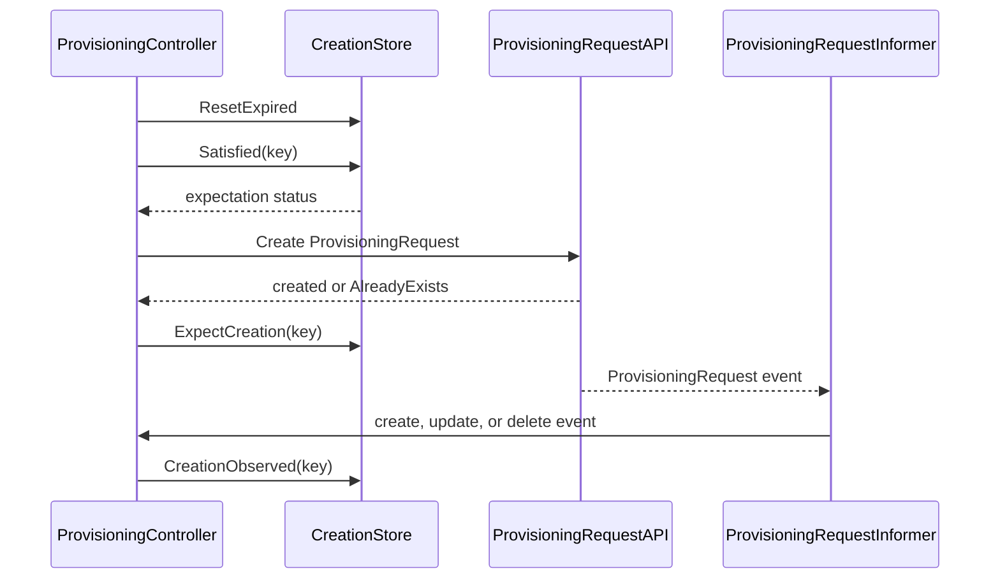

# PR #13917: fix: Add CreationStore to skip duplicate ProvisioningRequests

**Summary**: fix: Add CreationStore to skip duplicate ProvisioningRequests

**Sources**: https://github.com/kubernetes-sigs/kueue/pull/13917

**Last updated**: 2026-08-26T22:18:34Z

---

## Metadata

- **State**: open
- **Author**: [@Vaishnav88sk](https://github.com/Vaishnav88sk)
- **Branch**: `explore-creation-expectations-pr` → `main`
- **Created**: 2026-08-06T12:19:55Z
- **Updated**: 2026-08-26T22:18:34Z
- **Merged**: —
- **Closed**: —
- **Labels**: `size/L`, `release-note-none`, `kind/cleanup`, `cncf-cla: yes`
- **Assignees**: [@apullo777](https://github.com/apullo777)
- **Requested reviewers**: [@pajakd](https://github.com/pajakd), [@mbobrovskyi](https://github.com/mbobrovskyi)
- **Changed files**: 3   **+322 / -21**

## Description


<!--  Thanks for sending a pull request!  Here are some tips for you:

1. If this is your first time, please read our contributor guidelines: https://git.k8s.io/community/contributors/guide/first-contribution.md#your-first-contribution and developer guide https://git.k8s.io/community/contributors/devel/development.md#development-guide
2. Please label this pull request according to what type of issue you are addressing, especially if this is a release targeted pull request. For reference on required PR/issue labels, read here:
https://git.k8s.io/community/contributors/devel/sig-release/release.md#issuepr-kind-label
3. Ensure you have added or ran the appropriate tests for your PR: https://git.k8s.io/community/contributors/devel/sig-testing/testing.md
4. If you want *faster* PR reviews, read how: https://git.k8s.io/community/contributors/guide/pull-requests.md#best-practices-for-faster-reviews
5. If the PR is unfinished, see how to mark it: https://git.k8s.io/community/contributors/guide/pull-requests.md#marking-unfinished-pull-requests
-->

#### What type of PR is this?
/kind cleanup
<!--
Add one of the following kinds:
/kind bug
/kind cleanup
/kind documentation
/kind feature
/kind kep

Optionally add one or more of the following kinds if applicable:
/kind api-change
/kind deprecation
/kind failing-test
/kind flake
/kind regression

Please also consider setting the area:
/area tas
/area was
/area integrations
/area multikueue
/area dashboard
/area localization
/area testing
/area website
-->

#### What this PR does / why we need it:
This PR explores and implements creation expectations for `ProvisioningRequest` objects in the provisioning controller to prevent duplicate API calls and `AlreadyExists` errors.

Currently, the provisioning controller handles the delay between creating a `ProvisioningRequest` and it appearing in the informer cache by retrying on subsequent reconciles, getting an `AlreadyExists` error, and backing off. 

This PR introduces a `CreationStore` (with a TTL to prevent indefinite blocking in case of missed watch events) to record an expectation whenever a `ProvisioningRequest` is successfully created or found to already exist. The expectation instructs the controller to skip duplicate creation attempts. The expectation is cleared instantly once the object is observed via a watch event (`Create/Update/Delete`). This simplifies the creation flow and prevents duplicate creates at the source rather than recovering from them afterward.
#### Which issue(s) this PR fixes:
<!--
*Automatically closes linked issue when PR is merged.
Usage: `Fixes #<issue number>`, or `Fixes (paste link of issue)`.
_If PR is about `failing-tests or flakes`, please post the related issues/tests in a comment and do not use `Fixes`_*
-->
Fixes #13880

#### Special notes for your reviewer:

#### Does this PR introduce a user-facing change?
<!--
If no, just write "NONE" in the release-note block below.
If yes, a release note is required:
Enter your extended release note in the block below. If the PR requires additional action from users switching to the new release, include the string "action required".
-->
```release-note
NONE
```


<!-- This is an auto-generated comment: release notes by coderabbit.ai -->
## Summary by CodeRabbit

* **Bug Fixes**
  * Improved provisioning request handling to prevent duplicate requests during reconciliation.
  * Added recovery for stale creation attempts so processing can resume after delays or missed events.
  * Provisioning request events now correctly clear pending creation expectations.
  * Provisioning request errors are now surfaced alongside requeue status.
* **Reliability**
  * Added safeguards for concurrent request creation and event processing.
  * Added expiration handling for pending creation attempts, with configurable timeout behavior.
<!-- end of auto-generated comment: release notes by coderabbit.ai -->

## Discussion

### Comment by [@netlify[bot]](https://github.com/apps/netlify) — 2026-08-06T12:20:02Z

### <span aria-hidden="true">✅</span> Deploy Preview for *kubernetes-sigs-kueue* canceled.


|  Name | Link |
|:-:|------------------------|
|<span aria-hidden="true">🔨</span> Latest commit | 6a6abdb6cc28050828cc335e247b9d787035ed2c |
|<span aria-hidden="true">🔍</span> Latest deploy log | https://app.netlify.com/projects/kubernetes-sigs-kueue/deploys/6a758b0ea8069b0009d19ed9 |

### Comment by [@kubernetes-prow[bot]](https://github.com/apps/kubernetes-prow) — 2026-08-06T12:20:07Z

[APPROVALNOTIFIER] This PR is **NOT APPROVED**

This pull-request has been approved by: *<a href="https://github.com/kubernetes-sigs/kueue/pull/13917#" title="Author self-approved">Vaishnav88sk</a>*
**Once this PR has been reviewed and has the lgtm label**, please assign [mbobrovskyi](https://github.com/mbobrovskyi), [olekzabl](https://github.com/olekzabl), [pbundyra](https://github.com/pbundyra), [sohankunkerkar](https://github.com/sohankunkerkar), [tenzen-y](https://github.com/tenzen-y) for approval. For more information see [the Code Review Process](https://git.k8s.io/community/contributors/guide/owners.md#the-code-review-process).

The full list of commands accepted by this bot can be found [here](https://go.k8s.io/bot-commands?repo=kubernetes-sigs%2Fkueue).

<details open>
Needs approval from an approver in each of these files:

- **[OWNERS](https://github.com/kubernetes-sigs/kueue/blob/main/OWNERS)**

Approvers can indicate their approval by writing `/approve` in a comment
Approvers can cancel approval by writing `/approve cancel` in a comment
</details>
<!-- META={"approvers":["mbobrovskyi","olekzabl","pbundyra","sohankunkerkar","tenzen-y"]} -->

### Comment by [@Vaishnav88sk](https://github.com/Vaishnav88sk) — 2026-08-06T12:20:27Z

cc @apullo777

### Comment by [@coderabbitai[bot]](https://github.com/apps/coderabbitai) — 2026-08-06T12:20:37Z

<!-- This is an auto-generated comment: summarize by coderabbit.ai -->
<!-- review_stack_entry_start -->

[](https://app.coderabbit.ai/change-stack/kubernetes-sigs/kueue/pull/13917?utm_source=github_walkthrough&utm_medium=github&utm_campaign=change_stack)

<!-- review_stack_entry_end -->
No actionable comments were generated in the recent review. 🎉

<details>
<summary>ℹ️ Recent review info</summary>

<details>
<summary>⚙️ Run configuration</summary>

**Configuration used**: Path: .coderabbit.yaml

**Review profile**: CHILL

**Plan**: Pro Plus

**Run ID**: `d31f7f2d-9db7-41db-a48a-a410250baba2`

</details>

<details>
<summary>📥 Commits</summary>

Reviewing files that changed from the base of the PR and between d289dbde188b11f72d65b1e9e0484aedc3a9a62a and 6a6abdb6cc28050828cc335e247b9d787035ed2c.

</details>

<details>
<summary>📒 Files selected for processing (1)</summary>

* `pkg/controller/admissionchecks/provisioning/controller.go`

</details>

<details>
<summary>🚧 Files skipped from review as they are similar to previous changes (1)</summary>

* pkg/controller/admissionchecks/provisioning/controller.go

</details>

</details>

---
<!-- walkthrough_start -->

<details>
<summary>📝 Walkthrough</summary>

## Walkthrough

The provisioning controller now tracks ProvisioningRequest creation expectations with a 10-second expiry. It suppresses duplicate creates, requeues while expectations remain pending, and clears them when events are observed.

### Changes

**ProvisioningRequest creation expectations**

|Layer / File(s)|Summary|
|---|---|
|**Creation expectation store** <br> `pkg/util/expectations/store.go`, `pkg/util/expectations/store_test.go`|Adds timestamped creation expectations keyed by namespaced name. The store supports observation, expiry, satisfaction checks, synchronized access, and lifecycle tests.|
|**Reconciliation expectation checks** <br> `pkg/controller/admissionchecks/provisioning/controller.go`|Initializes the store with a 10-second TTL, resets expired entries, skips pending duplicate creates, propagates requeue state, and records successful or `AlreadyExists` creation attempts.|
|**ProvisioningRequest event handling** <br> `pkg/controller/admissionchecks/provisioning/controller.go`|Wires ProvisioningRequest events into the workload controller and clears expectations for create, update, and delete events.|

**Estimated code review effort:** 3 (Moderate) | ~20 minutes

### Sequence Diagram(s)



**Possibly related PRs**

- [kubernetes-sigs/kueue#13785](https://github.com/kubernetes-sigs/kueue/pull/13785): Both changes modify ProvisioningRequest creation handling during informer-cache delays.

**Suggested reviewers:** `pajakd`, `mbobrovskyi`

</details>

<!-- walkthrough_end -->
<!-- pre_merge_checks_walkthrough_start -->

<details>
<summary>🚥 Pre-merge checks | ✅ 4 | ❌ 1</summary>

### ❌ Failed checks (1 warning)

|     Check name     | Status     | Explanation                                                                           | Resolution                                                                         |
| :----------------: | :--------- | :------------------------------------------------------------------------------------ | :--------------------------------------------------------------------------------- |
| Docstring Coverage | ⚠️ Warning | Docstring coverage is 50.00% which is insufficient. The required threshold is 80.00%. | Write docstrings for the functions missing them to satisfy the coverage threshold. |

<details>
<summary>✅ Passed checks (4 passed)</summary>

|         Check name         | Status   | Explanation                                                                                                                         |
| :------------------------: | :------- | :---------------------------------------------------------------------------------------------------------------------------------- |
|      Description Check     | ✅ Passed | Check skipped - CodeRabbit’s high-level summary is enabled.                                                                         |
|         Title check        | ✅ Passed | The title clearly describes adding CreationStore behavior to prevent duplicate ProvisioningRequest creation.                        |
|     Linked Issues check    | ✅ Passed | The changes implement creation expectations, duplicate-create suppression, event clearing, and TTL expiry required by issue `#13880`. |
| Out of Scope Changes check | ✅ Passed | The controller, CreationStore, and related tests directly support the requirements in issue `#13880`.                                 |

</details>

</details>

<!-- pre_merge_checks_walkthrough_end -->
<!-- finishing_touch_checkbox_start -->

<details>
<summary>✨ Finishing Touches</summary>

<details>
<summary>🧪 Generate unit tests (beta)</summary>

- [ ] <!-- {"checkboxId": "f47ac10b-58cc-4372-a567-0e02b2c3d479", "radioGroupId": "utg-output-choice-group-unknown_comment_id"} -->   Create PR with unit tests

</details>

</details>

<!-- finishing_touch_checkbox_end -->
<!-- tips_start -->

---

Thanks for using [CodeRabbit](https://coderabbit.ai?utm_source=oss&utm_medium=github&utm_campaign=kubernetes-sigs/kueue&utm_content=13917)! It's free for OSS, and your support helps us grow. If you like it, consider giving us a shout-out.

<details>
<summary>❤️ Share</summary>

- [X](https://twitter.com/intent/tweet?text=I%20just%20used%20%40coderabbitai%20for%20my%20code%20review%2C%20and%20it%27s%20fantastic%21%20It%27s%20free%20for%20OSS%20and%20offers%20a%20free%20trial%20for%20the%20proprietary%20code.%20Check%20it%20out%3A&url=https%3A//coderabbit.ai)
- [Mastodon](https://mastodon.social/share?text=I%20just%20used%20%40coderabbitai%20for%20my%20code%20review%2C%20and%20it%27s%20fantastic%21%20It%27s%20free%20for%20OSS%20and%20offers%20a%20free%20trial%20for%20the%20proprietary%20code.%20Check%20it%20out%3A%20https%3A%2F%2Fcoderabbit.ai)
- [Reddit](https://www.reddit.com/submit?title=Great%20tool%20for%20code%20review%20-%20CodeRabbit&text=I%20just%20used%20CodeRabbit%20for%20my%20code%20review%2C%20and%20it%27s%20fantastic%21%20It%27s%20free%20for%20OSS%20and%20offers%20a%20free%20trial%20for%20proprietary%20code.%20Check%20it%20out%3A%20https%3A//coderabbit.ai)
- [LinkedIn](https://www.linkedin.com/sharing/share-offsite/?url=https%3A%2F%2Fcoderabbit.ai&mini=true&title=Great%20tool%20for%20code%20review%20-%20CodeRabbit&summary=I%20just%20used%20CodeRabbit%20for%20my%20code%20review%2C%20and%20it%27s%20fantastic%21%20It%27s%20free%20for%20OSS%20and%20offers%20a%20free%20trial%20for%20proprietary%20code)

</details>


<sub>Comment `@coderabbitai help` to get the list of available commands.</sub>

<!-- tips_end -->

### Comment by [@mimowo](https://github.com/mimowo) — 2026-08-06T12:37:20Z

Cc @apullo777 ptal

### Comment by [@apullo777](https://github.com/apullo777) — 2026-08-06T15:19:53Z

/assign

### Comment by [@mimowo](https://github.com/mimowo) — 2026-08-07T04:15:07Z

+1 I think the attemp made it clear that there is no free lunch here in terms of complexity. So while the expectations mechanism makes sense in latency sensitive components, like scheduler (because a single unnecessry API call can be impactful), I think this is not the case for ProvReq controller. 

Here we can afford making mistakes and recovering by error handling. My initial comment which stimulated the researxh was exploratory rather than a conviction this is better.

So I suggest parking (closing) the PR. We can return here at some point if proven to be useful.

### Comment by [@Vaishnav88sk](https://github.com/Vaishnav88sk) — 2026-08-07T06:10:32Z

Thanks for the thorough review and discussion, @mimowo and @apullo777! 

I completely understand the concern about complexity vs reward here. However, I believe the expectations pattern is still highly valuable for the Provisioning controller. 
My main reasoning for proceeding with this pattern is that relying on `AlreadyExists` errors for control flow is generally considered an anti-pattern in standard Kubernetes controller design (like the core ReplicaSet and Job controllers, which heavily relys on expectations). Even if this controller isn't strictly latency-sensitive, blocking duplicate creates at the source prevents unnecessary API server/etcd load and prevents noisy error logs hat are confusing to operators even when only a handful of workloads are being admitted..
While I opened this as an exploration too, the implementation proved the pattern is cleaner than expected, which is why I'd like to see it through. 🙂 

Also expectations pattern is already used in some places within the codebase like
- `pkg/scheduler/preemption/preemption.go`
- podcontroller.go ..

Furthermore, the "bookkeeping" required to fix the edge cases you found is actually extremely minimal.
@apullo777 - Your points about the bare skip and watch ordering edge cases were great catches! These fixes are genuinely a change:
```go
// Instead of a bare skip, we return a requeue instruction
if !c.creationExpectations.Satisfied(log, prKey) {
    log.V(3).Info("Skipping ProvisioningRequest creation due to outstanding creation expectation", "requestName", requestName)
    requeue = true
    continue
}
```
This bounded requeue safely catches any watch ordering race conditions.

@mimowo - If you still feel the added layer isn't worth keeping, I am completely fine with closing and postponing it! Let me know what you think.

### Comment by [@mimowo](https://github.com/mimowo) — 2026-08-07T06:34:17Z

@Vaishnav88sk seeing your positive attitude, and good understanding of the matter I'm happy for you to continue the exploration with diligent review from @apullo777, @kshalot or @sohankunkerkar .

Just to clarify the context - we use currently preemption expectations in latency sensitive code like scheduler preemptions, TAS ungated and ElasticJob ungater. However, it comes with a cost. After introducing preemption expectations we iterated twice on complex bugfixes:
- https://github.com/kubernetes-sigs/kueue/pull/10185
- https://github.com/kubernetes-sigs/kueue/pull/11502
Then, adding a meaningful test for the second was quite a challenge, let me just point you to the post: 
- https://github.com/kubernetes-sigs/kueue/pull/12331#discussion_r3477146123
Which also later proved to cause flakes on its own, fixed in https://github.com/kubernetes-sigs/kueue/pull/13369. 

All of the experience does not tell me: "don't do that", but rather "stay cautious about the trade-offs". 

So, I'm also wondering if we could try to generalize the patterns from all these places and come up with some more resilient (higher) abstraction layer. This is not a blocker, but since this issue is not urgent, I would like to use it for brainstorming of ideas how we could make using the mechanism more resilient to programmer errors.   If we come up with some safer APIs I would be also happy to adapt the old code to the new approach.

### Comment by [@Vaishnav88sk](https://github.com/Vaishnav88sk) — 2026-08-07T06:46:40Z

@mimowo I'll study those linked PRs carefully to understand where the pattern went wrong before, so I can make sure this implementation avoids the same pitfalls.

Need to brainstorm it. 😉

### Comment by [@kubernetes-prow[bot]](https://github.com/apps/kubernetes-prow) — 2026-08-26T22:18:34Z

@Vaishnav88sk: The following tests **failed**, say `/retest` to rerun all failed tests or `/retest-required` to rerun all mandatory failed tests:

Test name | Commit | Details | Required | Rerun command
--- | --- | --- | --- | ---
pull-kueue-test-e2e-extended-shard-1-main-1-37 | 6a6abdb6cc28050828cc335e247b9d787035ed2c | [link](https://prow.k8s.io/view/gs/kubernetes-ci-logs/pr-logs/pull/kubernetes-sigs_kueue/13917/pull-kueue-test-e2e-extended-shard-1-main-1-37/2092737604284846080) | true | `/test pull-kueue-test-e2e-extended-shard-1-main-1-37`
pull-kueue-test-e2e-extended-shard-2-main-1-37 | 6a6abdb6cc28050828cc335e247b9d787035ed2c | [link](https://prow.k8s.io/view/gs/kubernetes-ci-logs/pr-logs/pull/kubernetes-sigs_kueue/13917/pull-kueue-test-e2e-extended-shard-2-main-1-37/2092737604368732160) | true | `/test pull-kueue-test-e2e-extended-shard-2-main-1-37`
pull-kueue-test-e2e-baseline-main-1-37 | 6a6abdb6cc28050828cc335e247b9d787035ed2c | [link](https://prow.k8s.io/view/gs/kubernetes-ci-logs/pr-logs/pull/kubernetes-sigs_kueue/13917/pull-kueue-test-e2e-baseline-main-1-37/2092737604075130880) | true | `/test pull-kueue-test-e2e-baseline-main-1-37`
pull-kueue-test-e2e-extended-shard-0-main-1-37 | 6a6abdb6cc28050828cc335e247b9d787035ed2c | [link](https://prow.k8s.io/view/gs/kubernetes-ci-logs/pr-logs/pull/kubernetes-sigs_kueue/13917/pull-kueue-test-e2e-extended-shard-0-main-1-37/2092737604221931520) | true | `/test pull-kueue-test-e2e-extended-shard-0-main-1-37`

[Full PR test history](https://prow.k8s.io/pr-history?org=kubernetes-sigs&repo=kueue&pr=13917). [Your PR dashboard](https://prow.k8s.io/pr?query=is%3Apr%20state%3Aopen%20author%3AVaishnav88sk). Please help us cut down on flakes by [linking to](https://git.k8s.io/community/contributors/devel/sig-testing/flaky-tests.md#filing-issues-for-flaky-tests) an [open issue](https://github.com/kubernetes-sigs/kueue/issues?q=is:issue+is:open) when you hit one in your PR.

<details>

Instructions for interacting with me using PR comments are available [here](https://git.k8s.io/community/contributors/guide/pull-requests.md).  If you have questions or suggestions related to my behavior, please file an issue against the [kubernetes-sigs/prow](https://github.com/kubernetes-sigs/prow/issues/new?title=Prow%20issue:) repository. I understand the commands that are listed [here](https://go.k8s.io/bot-commands).
</details>
<!-- test report -->

## Reviews

### Review by [@coderabbitai[bot]](https://github.com/apps/coderabbitai) (commented) — 2026-08-06T12:28:08Z

**Actionable comments posted: 1**

<details>
<summary>🤖 Prompt for all review comments with AI agents</summary>

```
Verify each finding against current code. Fix only still-valid issues, skip the
rest with a brief reason, keep changes minimal, and validate.

Inline comments:
In `@pkg/util/expectations/store_test.go`:
- Around line 96-103: Update the test around the pre-expiry wait to call
ResetExpired before the TTL-expiry delay and assert that it returns zero,
ensuring the entry remains present before expiration. Keep the existing
pre-expiry Satisfied assertion and subsequent expiry/reset flow unchanged.
```

</details>

<details>
<summary>🪄 Autofix</summary>

Fix all unresolved CodeRabbit comments on this PR:

- [ ] <!-- {"checkboxId": "4b0d0e0a-96d7-4f10-b296-3a18ea78f0b9"} --> Push a commit to this branch (recommended)
- [ ] <!-- {"checkboxId": "ff5b1114-7d8c-49e6-8ac1-43f82af23a33"} --> Create a new PR with the fixes

</details>

---

<details>
<summary>ℹ️ Review info</summary>

<details>
<summary>⚙️ Run configuration</summary>

**Configuration used**: Path: .coderabbit.yaml

**Review profile**: CHILL

**Plan**: Pro Plus

**Run ID**: `93e2baf0-8cf3-4daf-8d3e-bf1c2ff9f738`

</details>

<details>
<summary>📥 Commits</summary>

Reviewing files that changed from the base of the PR and between 16d698383ddff5615b822bbd0718be58984773b5 and a2be54fe6f1a1f949fb4335436a6b28e991901fe.

</details>

<details>
<summary>📒 Files selected for processing (3)</summary>

* `pkg/controller/admissionchecks/provisioning/controller.go`
* `pkg/util/expectations/store.go`
* `pkg/util/expectations/store_test.go`

</details>

</details>

<!-- This is an auto-generated comment by CodeRabbit for review status -->

- **pkg/util/expectations/store_test.go:103** by [@coderabbitai[bot]](https://github.com/apps/coderabbitai) — 2026-08-06T12:28:07Z
```diff
@@ -18,79 +18,146 @@ package expectations
 
 import (
 	"testing"
+	"time"
 
 	"k8s.io/apimachinery/pkg/types"
 
 	"sigs.k8s.io/kueue/pkg/util/parallelize"
 	utiltesting "sigs.k8s.io/kueue/pkg/util/testing"
 )
 
-type keyUIDs struct {
-	key  types.NamespacedName
-	uids []types.UID
+func TestCreationStore(t *testing.T) {
+	log := utiltesting.NewLogger(t)
+	cs := NewCreationStore("test", 0) // no expiry
+
+	key1 := types.NamespacedName{Name: "pr1", Namespace: "ns1"}
+	key2 := types.NamespacedName{Name: "pr2", Namespace: "ns2"}
+
+	// Initially all expectations are satisfied (no outstanding creations).
+	if !cs.Satisfied(log, key1) {
+		t.Errorf("Expected key1 to be satisfied initially")
+	}
+	if !cs.Satisfied(log, key2) {
+		t.Errorf("Expected key2 to be satisfied initially")
+	}
+
+	// ExpectCreation records an outstanding creation.
+	cs.ExpectCreation(log, key1)
+	if cs.Satisfied(log, key1) {
+		t.Errorf("Expected key1 to NOT be satisfied after ExpectCreation")
+	}
+	if !cs.Satisfied(log, key2) {
+		t.Errorf("Expected key2 to still be satisfied")
+	}
+
+	// CreationObserved clears the expectation.
+	cs.CreationObserved(log, key1)
+	if !cs.Satisfied(log, key1) {
+		t.Errorf("Expected key1 to be satisfied after CreationObserved")
+	}
+
+	// Multiple expectations can be tracked independently.
+	cs.ExpectCreation(log, key1)
+	cs.ExpectCreation(log, key2)
+	if cs.Satisfied(log, key1) {
+		t.Errorf("Expected key1 to NOT be satisfied")
+	}
+	if cs.Satisfied(log, key2) {
+		t.Errorf("Expected key2 to NOT be satisfied")
+	}
+
+	cs.CreationObserved(log, key1)
+	if !cs.Satisfied(log, key1) {
+		t.Errorf("Expected key1 to be satisfied after CreationObserved")
+	}
+	if cs.Satisfied(log, key2) {
+		t.Errorf("Expected key2 to still NOT be satisfied")
+	}
+
+	cs.CreationObserved(log, key2)
+	if !cs.Satisfied(log, key2) {
+		t.Errorf("Expected key2 to be satisfied after CreationObserved")
+	}
+}
+
+func TestCreationStoreResetExpired(t *testing.T) {
+	log := utiltesting.NewLogger(t)
+	ttl := 50 * time.Millisecond
+	cs := NewCreationStore("test", ttl)
+
+	key := types.NamespacedName{Name: "pr1", Namespace: "ns1"}
+
+	// Record an expectation.
+	cs.ExpectCreation(log, key)
+	if cs.Satisfied(log, key) {
+		t.Errorf("Expected key to NOT be satisfied after ExpectCreation")
+	}
+
+	// Before TTL expires, still not satisfied.
+	time.Sleep(10 * time.Millisecond)
+	if cs.Satisfied(log, key) {
+		t.Errorf("Expected key to NOT be satisfied before TTL expiry")
+	}
+
+	// Wait for TTL to expire, then reset.
+	time.Sleep(100 * time.Millisecond)
```

  _🎯 Functional Correctness_ | _🟡 Minor_ | _⚡ Quick win_
  
  **Test the pre-expiry path through `ResetExpired`.**
  
  `Satisfied` does not evaluate the TTL. The assertion on Line 98 passes even if `ResetExpired` removes entries before their TTL. Call `ResetExpired` before the expiry delay and assert that it returns zero.
  
  <details>
  <summary>Proposed test update</summary>
  
  ```diff
  -	// Before TTL expires, still not satisfied.
  -	time.Sleep(10 * time.Millisecond)
  +	// Before TTL expires, ResetExpired must retain the expectation.
  +	removed := cs.ResetExpired(log)
  +	if removed != 0 {
  +		t.Errorf("Expected 0 expired entries before TTL expiry, got %d", removed)
  +	}
   	if cs.Satisfied(log, key) {
   		t.Errorf("Expected key to NOT be satisfied before TTL expiry")
   	}
  
   	// Wait for TTL to expire, then reset.
   	time.Sleep(100 * time.Millisecond)
  -	removed := cs.ResetExpired(log)
  +	removed = cs.ResetExpired(log)
  ```
  </details>
  
  <!-- suggestion_start -->
  
  <details>
  <summary>📝 Committable suggestion</summary>
  
  > ‼️ **IMPORTANT**
  > Carefully review the code before committing. Ensure that it accurately replaces the highlighted code, contains no missing lines, and has no issues with indentation. Thoroughly test & benchmark the code to ensure it meets the requirements.
  
  ```suggestion
  	// Before TTL expires, ResetExpired must retain the expectation.
  	removed := cs.ResetExpired(log)
  	if removed != 0 {
  		t.Errorf("Expected 0 expired entries before TTL expiry, got %d", removed)
  	}
  	if cs.Satisfied(log, key) {
  		t.Errorf("Expected key to NOT be satisfied before TTL expiry")
  	}
  
  	// Wait for TTL to expire, then reset.
  	time.Sleep(100 * time.Millisecond)
  	removed = cs.ResetExpired(log)
  ```
  
  </details>
  
  <!-- suggestion_end -->
  
  <details>
  <summary>🤖 Prompt for AI Agents</summary>
  
  ```
  Verify each finding against current code. Fix only still-valid issues, skip the
  rest with a brief reason, keep changes minimal, and validate.
  
  In `@pkg/util/expectations/store_test.go` around lines 96 - 103, Update the test
  around the pre-expiry wait to call ResetExpired before the TTL-expiry delay and
  assert that it returns zero, ensuring the entry remains present before
  expiration. Keep the existing pre-expiry Satisfied assertion and subsequent
  expiry/reset flow unchanged.
  ```
  
  </details>
  
  <!-- fingerprinting:phantom:medusa:tapir -->
  
  <!-- cr-indicator-types:potential_issue -->
  
  <!-- cr-comment:v1:cae5f6ba4cae5661d9d9d677 -->
  
  _Sources: Path instructions, Learnings_
  
  <!-- This is an auto-generated comment by CodeRabbit -->
  
  ✅ Addressed in commit d289dbd

### Review by [@apullo777](https://github.com/apullo777) (commented) — 2026-08-07T03:02:32Z

Thanks for exploring this, @Vaishnav88sk. Seeing the implementation made the tradeoff much clearer.

My current take is that the recovery path should remain the baseline, and I’m not yet convinced the additional expectations layer pays for its complexity. ProvisioningRequest names are deterministic, so a stale-cache retry cannot create another object; it only gets `AlreadyExists` and requeues.

The current watch ordering and bare skip also weaken that recovery guarantee (inline below). They could be addressed with ordered observation/enqueue and a bounded requeue, but that adds more bookkeeping to avoid a small number of rejected requests.

Unless the maintainers think that tradeoff is worthwhile, I’d suggest documenting the result in #13880 and keeping the current behavior. The implementation was still valuable because it made the tradeoff concrete.

@mimowo, wdyt?

- **pkg/util/expectations/store_test.go:33** by [@apullo777](https://github.com/apullo777) — 2026-08-07T02:59:54Z
```diff
@@ -18,79 +18,146 @@ package expectations
 
 import (
 	"testing"
+	"time"
 
 	"k8s.io/apimachinery/pkg/types"
 
 	"sigs.k8s.io/kueue/pkg/util/parallelize"
 	utiltesting "sigs.k8s.io/kueue/pkg/util/testing"
 )
 
-type keyUIDs struct {
-	key  types.NamespacedName
-	uids []types.UID
+func TestCreationStore(t *testing.T) {
+	log := utiltesting.NewLogger(t)
+	cs := NewCreationStore("test", 0) // no expiry
+
+	key1 := types.NamespacedName{Name: "pr1", Namespace: "ns1"}
+	key2 := types.NamespacedName{Name: "pr2", Namespace: "ns2"}
+
+	// Initially all expectations are satisfied (no outstanding creations).
+	if !cs.Satisfied(log, key1) {
+		t.Errorf("Expected key1 to be satisfied initially")
+	}
+	if !cs.Satisfied(log, key2) {
+		t.Errorf("Expected key2 to be satisfied initially")
+	}
+
+	// ExpectCreation records an outstanding creation.
+	cs.ExpectCreation(log, key1)
+	if cs.Satisfied(log, key1) {
+		t.Errorf("Expected key1 to NOT be satisfied after ExpectCreation")
+	}
+	if !cs.Satisfied(log, key2) {
+		t.Errorf("Expected key2 to still be satisfied")
+	}
+
+	// CreationObserved clears the expectation.
+	cs.CreationObserved(log, key1)
+	if !cs.Satisfied(log, key1) {
+		t.Errorf("Expected key1 to be satisfied after CreationObserved")
+	}
+
+	// Multiple expectations can be tracked independently.
+	cs.ExpectCreation(log, key1)
+	cs.ExpectCreation(log, key2)
+	if cs.Satisfied(log, key1) {
+		t.Errorf("Expected key1 to NOT be satisfied")
+	}
+	if cs.Satisfied(log, key2) {
+		t.Errorf("Expected key2 to NOT be satisfied")
+	}
+
+	cs.CreationObserved(log, key1)
+	if !cs.Satisfied(log, key1) {
+		t.Errorf("Expected key1 to be satisfied after CreationObserved")
+	}
+	if cs.Satisfied(log, key2) {
+		t.Errorf("Expected key2 to still NOT be satisfied")
+	}
+
+	cs.CreationObserved(log, key2)
+	if !cs.Satisfied(log, key2) {
+		t.Errorf("Expected key2 to be satisfied after CreationObserved")
+	}
+}
+
+func TestCreationStoreResetExpired(t *testing.T) {
+	log := utiltesting.NewLogger(t)
+	ttl := 50 * time.Millisecond
+	cs := NewCreationStore("test", ttl)
+
+	key := types.NamespacedName{Name: "pr1", Namespace: "ns1"}
+
+	// Record an expectation.
+	cs.ExpectCreation(log, key)
+	if cs.Satisfied(log, key) {
+		t.Errorf("Expected key to NOT be satisfied after ExpectCreation")
+	}
+
+	// Before TTL expires, still not satisfied.
+	time.Sleep(10 * time.Millisecond)
+	if cs.Satisfied(log, key) {
+		t.Errorf("Expected key to NOT be satisfied before TTL expiry")
+	}
+
+	// Wait for TTL to expire, then reset.
+	time.Sleep(100 * time.Millisecond)
+	removed := cs.ResetExpired(log)
+	if removed != 1 {
+		t.Errorf("Expected 1 expired entry to be removed, got %d", removed)
+	}
+	if !cs.Satisfied(log, key) {
+		t.Errorf("Expected key to be satisfied after ResetExpired")
+	}
+
+	// ResetExpired on an empty store returns 0.
+	removed = cs.ResetExpired(log)
+	if removed != 0 {
+		t.Errorf("Expected 0 expired entries, got %d", removed)
+	}
 }
 
-func TestExpectations(t *testing.T) {
```

  This removes the only unit test for the existing `expectations.Store`, which still has production callers.
  
  Could we restore it and keep the new tests alongside it? This applies regardless of the direction of this PR.

- **pkg/controller/admissionchecks/provisioning/controller.go:315** by [@apullo777](https://github.com/apullo777) — 2026-08-07T03:00:47Z
```diff
@@ -289,7 +298,15 @@ func (c *Controller) syncOwnedProvisionRequest(
 			shouldCreatePr = true
 		}
 		requestName := ProvisioningRequestName(wl.Name, checkName, attempt)
+		prKey := types.NamespacedName{Name: requestName, Namespace: wl.Namespace}
 		if shouldCreatePr {
+			// If a creation expectation is still outstanding for this
+			// ProvisioningRequest, skip creating it again. The expectation
+			// is cleared when the object appears in the informer cache.
+			if !c.creationExpectations.Satisfied(log, prKey) {
+				log.V(3).Info("Skipping ProvisioningRequest creation due to outstanding creation expectation", "requestName", requestName)
+				continue
```

  If we keep this approach, I think this needs a requeue rather than only continuing.
  
  After this skip, `Reconcile` may return successfully without scheduling another attempt. Since `ResetExpired` only runs during a reconcile, the TTL cannot wake it by itself.

- **pkg/controller/admissionchecks/provisioning/controller.go:901** by [@apullo777](https://github.com/apullo777) — 2026-08-07T03:01:27Z
```diff
@@ -855,12 +881,16 @@ func (c *Controller) SetupWithManager(mgr ctrl.Manager) error {
 		client:            c.client,
 		acHandlerOverride: ach.reconcileWorkloadsUsing,
 	}
+	prEventHandler := &provisioningRequestEventHandler{
+		creationExpectations: c.creationExpectations,
+	}
 	err := ctrl.NewControllerManagedBy(mgr).
 		Named("provisioning_workload").
 		For(&kueue.Workload{}).
 		Owns(&autoscaling.ProvisioningRequest{}).
 		Watches(&kueue.AdmissionCheck{}, ach).
 		Watches(&kueue.ProvisioningRequestConfig{}, prch).
+		Watches(&autoscaling.ProvisioningRequest{}, prEventHandler).
```

  I don’t think `Owns` and this handler have an ordering guarantee.
  
  `Owns` may enqueue a reconcile before `CreationObserved` runs, so that reconcile can skip without scheduling another attempt. Clearing the expectation when the PR is observed inside `Reconcile` would avoid that race.

### Review by [@coderabbitai[bot]](https://github.com/apps/coderabbitai) (commented) — 2026-08-07T06:59:22Z

**Actionable comments posted: 1**

<details>
<summary>🧹 Nitpick comments (1)</summary><blockquote>

<details>
<summary>pkg/controller/admissionchecks/provisioning/controller.go (1)</summary><blockquote>

`116-121`: _📐 Maintainability & Code Quality_ | _🔵 Trivial_ | _⚡ Quick win_

**Use one named TTL for expiration and requeue.**

The code repeats `10 * time.Second` for the store and `RequeueAfter`. If one value changes, expiration and recovery use different intervals.

<details>
<summary>Proposed refactor</summary>

```diff
+const creationExpectationTTL = 10 * time.Second

-10 * time.Second
+creationExpectationTTL
```

Use `creationExpectationTTL` in both locations.
</details>


Also applies to: 204-207

<details>
<summary>🤖 Prompt for AI Agents</summary>

```
Verify each finding against current code. Fix only still-valid issues, skip the
rest with a brief reason, keep changes minimal, and validate.

In `@pkg/controller/admissionchecks/provisioning/controller.go` around lines 116 -
121, Define a single named creationExpectationTTL value and reuse it for both
the NewCreationStore call in the controller setup and the RequeueAfter
assignment in the provisioning reconciliation flow, replacing each duplicated
10-second duration while preserving existing behavior.
```

</details>

<!-- cr-comment:v1:84f34d044cc7b69fe74315de -->

</blockquote></details>

</blockquote></details>

<details>
<summary>🤖 Prompt for all review comments with AI agents</summary>

```
Verify each finding against current code. Fix only still-valid issues, skip the
rest with a brief reason, keep changes minimal, and validate.

Inline comments:
In `@pkg/controller/admissionchecks/provisioning/controller.go`:
- Around line 379-380: After a successful ProvisioningRequest creation in the
reconciliation flow, set requeue = true immediately after
c.creationExpectations.ExpectCreation(log, prKey). Preserve the existing event
recording and ensure the requeue schedules a later Reconcile so ResetExpired can
run if the watch event is missed.

---

Nitpick comments:
In `@pkg/controller/admissionchecks/provisioning/controller.go`:
- Around line 116-121: Define a single named creationExpectationTTL value and
reuse it for both the NewCreationStore call in the controller setup and the
RequeueAfter assignment in the provisioning reconciliation flow, replacing each
duplicated 10-second duration while preserving existing behavior.
```

</details>

<details>
<summary>🪄 Autofix</summary>

Fix all unresolved CodeRabbit comments on this PR:

- [ ] <!-- {"checkboxId": "4b0d0e0a-96d7-4f10-b296-3a18ea78f0b9"} --> Push a commit to this branch (recommended)
- [ ] <!-- {"checkboxId": "ff5b1114-7d8c-49e6-8ac1-43f82af23a33"} --> Create a new PR with the fixes

</details>

---

<details>
<summary>ℹ️ Review info</summary>

<details>
<summary>⚙️ Run configuration</summary>

**Configuration used**: Path: .coderabbit.yaml

**Review profile**: CHILL

**Plan**: Pro Plus

**Run ID**: `12cce93e-b578-46fb-a22e-14fef2f5c9fc`

</details>

<details>
<summary>📥 Commits</summary>

Reviewing files that changed from the base of the PR and between eebff7eb2e47cb411ce34b5ef56e13f9a1ccb8f3 and d289dbde188b11f72d65b1e9e0484aedc3a9a62a.

</details>

<details>
<summary>📒 Files selected for processing (2)</summary>

* `pkg/controller/admissionchecks/provisioning/controller.go`
* `pkg/util/expectations/store_test.go`

</details>

</details>

<!-- This is an auto-generated comment by CodeRabbit for review status -->

- **pkg/controller/admissionchecks/provisioning/controller.go:381** by [@coderabbitai[bot]](https://github.com/apps/coderabbitai) — 2026-08-07T06:59:21Z
```diff
@@ -337,21 +361,30 @@ func (c *Controller) syncOwnedProvisionRequest(
 			}
 
 			if err := ctrl.SetControllerReference(wl, req, c.client.Scheme()); err != nil {
-				return err
+				return requeue, err
 			}
 
 			if err := c.client.Create(ctx, req); err != nil {
 				msg := fmt.Sprintf("Error creating ProvisioningRequest %q: %v", requestName, err)
-				return c.handleError(ctx, wl, ac, req, msg, err)
+				if apierrors.IsAlreadyExists(err) {
+					// The object already exists on the API server. Set a creation
+					// expectation so we don't immediately retry the create before
+					// the informer cache catches up. The expectation is cleared
+					// when the object appears in a watch event.
+					c.creationExpectations.ExpectCreation(log, prKey)
+					return requeue, c.handleError(ctx, wl, ac, req, msg, err)
+				}
+				return requeue, c.handleError(ctx, wl, ac, req, msg, err)
 			}
+			c.creationExpectations.ExpectCreation(log, prKey)
 			c.record.Eventf(wl, nil, corev1.EventTypeNormal, "ProvisioningRequestCreated", "Created", "Created ProvisioningRequest: %q", req.Name)
```

  _🩺 Stability & Availability_ | _🟠 Major_ | _⚡ Quick win_
  
  **Schedule recovery after a successful `Create`.**
  
  `ResetExpired` runs only when `Reconcile` executes. After a successful create, Line 379 records the expectation but does not set `requeue`. If the `ProvisioningRequest` watch event is missed and no unrelated event requeues the `Workload`, the TTL cannot trigger recovery. A later same-name creation can remain blocked indefinitely.
  
  Set `requeue = true` after recording the expectation.
  
  <details>
  <summary>Proposed fix</summary>
  
  ```diff
   			c.creationExpectations.ExpectCreation(log, prKey)
  +			requeue = true
   			c.record.Eventf(wl, nil, corev1.EventTypeNormal, "ProvisioningRequestCreated", "Created", "Created ProvisioningRequest: %q", req.Name)
  ```
  </details>
  
  Based on the supplied `pkg/util/expectations/store.go` contract, expiry requires an explicit `ResetExpired` call.
  
  <details>
  <summary>🤖 Prompt for AI Agents</summary>
  
  ```
  Verify each finding against current code. Fix only still-valid issues, skip the
  rest with a brief reason, keep changes minimal, and validate.
  
  In `@pkg/controller/admissionchecks/provisioning/controller.go` around lines 379 -
  380, After a successful ProvisioningRequest creation in the reconciliation flow,
  set requeue = true immediately after c.creationExpectations.ExpectCreation(log,
  prKey). Preserve the existing event recording and ensure the requeue schedules a
  later Reconcile so ResetExpired can run if the watch event is missed.
  ```
  
  </details>
  
  <!-- fingerprinting:phantom:poseidon:caracal -->
  
  <!-- cr-indicator-types:potential_issue -->
  
  <!-- cr-comment:v1:7ea8acc46adff35b25467c36 -->
  
  <!-- This is an auto-generated comment by CodeRabbit -->
  
  ✅ Addressed in commit 6a6abdb
