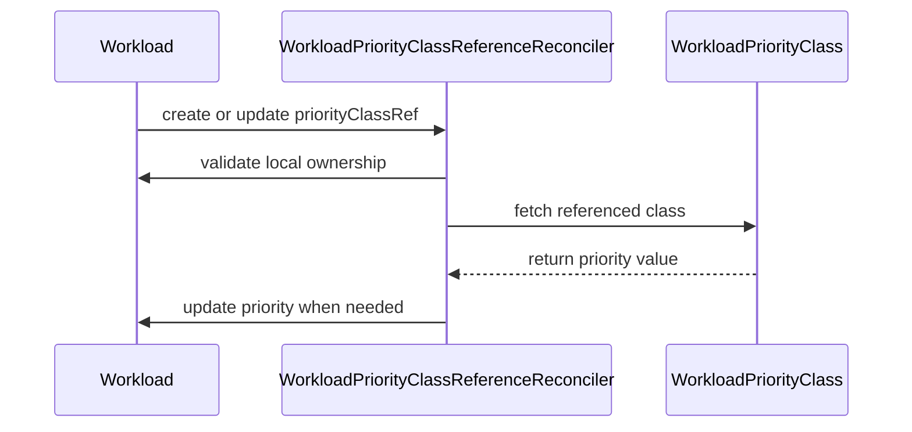

# PR #13920: Watch the class a Workload references

**Summary**: Watch the class a Workload references

**Sources**: https://github.com/kubernetes-sigs/kueue/pull/13920

**Last updated**: 2026-10-11T07:04:38Z

---

## Metadata

- **State**: closed
- **Author**: [@thc1006](https://github.com/thc1006)
- **Branch**: `fix/wpc-workload-reference-watch` → `main`
- **Created**: 2026-08-06T13:35:28Z
- **Updated**: 2026-10-11T07:04:38Z
- **Merged**: —
- **Closed**: 2026-10-11T07:03:00Z
- **Labels**: `kind/bug`, `release-note`, `size/XL`, `do-not-merge/work-in-progress`, `cncf-cla: yes`
- **Assignees**: _none_
- **Requested reviewers**: [@mbobrovskyi](https://github.com/mbobrovskyi), [@olekzabl](https://github.com/olekzabl), [@sohankunkerkar](https://github.com/sohankunkerkar), [@kshalot](https://github.com/kshalot)
- **Changed files**: 5   **+561 / -0**

## Description

#### What type of PR is this?

/kind bug

#### What this PR does / why we need it:

The WorkloadPriorityClass controller reacts only to class events, and reconciles a class by listing the Workloads that reference it. A class update processed before any Workload references that class therefore finds nothing to update, and the update is consumed.

The Workload then arrives carrying whatever value its own lookup returned, and nothing brings the two together again. The controller does not watch Workloads, so the reference appearing is not an event it sees.

This adds a second reconciler for that event. It is keyed on the Workload rather than the class: it reads the one class the Workload references and repairs that Workload alone. The class reconciler is untouched and keeps answering class events with the pass over everything using them.

Keying on the Workload is what keeps the cost per event constant. Enqueuing the class from a Workload event would make a Workload arriving at a class cost a pass over every other Workload already on it, and `WorkloadPriorityClassDefaulting` lets a single class be shared across a cluster. Constant per event is not the whole cost, though: the reconcile reads both objects from the API server rather than from the cache, two uncached reads on the path that finds nothing to do and three when it writes, and the informer hands it one event per eligible Workload when the manager starts. So a start over a large set is O(N) uncached reads, against the 300 QPS the client is configured for by default and shares with scheduling.

The reference is compared whole rather than by name, so a Workload moving from a Pod `PriorityClass` to a `WorkloadPriorityClass` of the same name still counts as a move. Value-only writes enqueue nothing, which is what keeps the controller off its own writes and off the class reconciler's.

#### Which issue(s) this PR fixes:

Fixes #13866
The ownership guard that issue asks for landed on main as #14963, which skips a Workload carrying `MultiKueueOriginLabel` in the class-keyed sweep. This branch asks the same question on the reference path through `ownsPriority`; the sweep-side copy it once carried, and its unit case, are gone.

#### Special notes for your reviewer:

One rule this changes and I would rather have argued about than assumed. A Workload created already referencing a class is now resolved from it at once. Before this, a value the user gave stood until the class next moved, because only a class event ran the sweep. A later numeric-only update is left alone once the reference's own reconcile has run, so an override remains available, though not in the same request that sets the reference and not while that reconcile is still queued: one written before it runs is read live and put back to the class value. `a value the user chose, against the class it references` pins it. If the other reading is wanted, that the user's value survives until the class moves, say so and I will invert it.


It is a separate controller rather than another request shape on the existing one because `WithLeadingManager` reads the request key as the object type it is given: a non-leading replica Gets that type and discards the request on NotFound, so a Workload key against a class-typed wrapper would drop events across a failover.

No new index, and no manifest change. The reconciler Gets the class by name, and the RBAC it needs on Workloads is already in the generated role.

A Workload whose reference moves to a Pod `PriorityClass` is left alone. #13781 is where that ownership question is being settled, and this stays on the near side of it.

This does not cover #13779. A Job blocked on a class that does not exist has no Workload, so there is no create or update to watch.

The new controller runs in non-leading replicas through `WithLeadingManager`, like the fourteen that already do. The follower path there hands every request the same object to decode into, which #13978 fixes; this PR does not add that, but it does add a caller.

#14006 is left alone too, and it is the larger of the two. The class-keyed reconciler decides whether to skip a Workload from the same cache it lists from, so a class edited back to a value that cache still holds is a no-op against an API server holding something else. That reproduces on main with the sweep as the only writer, so it is not something this PR introduces, but this PR does add another `spec.priority` writer and therefore another way into the same interleaving. What this reconciler can do about it is bounded. After writing, it reads the class once more, and if the value moved in between it requeues after a second rather than leaving a stale write standing. A move after that read is the class's own pass to notice, and that pass can still skip on the stale cached value, which is #14006 itself.

A Workload carrying `MultiKueueOriginLabel` is skipped, since the manager owns the priority it was created with and a class of the same name on this cluster is not the one it was resolved from. That reads the label as the statement of ownership it is meant to be, which is what #14227 is separately keeping true: a local Workload built from a Job or Pod already carrying it would be skipped here and by the sweep, and neither this PR nor #14227 rewrites one already in that state.

That question is asked on both paths. The class-keyed sweep asks it through the label check #14963 added, which closes the path #13929 describes, a same-named class on a worker overwriting a remote Workload's priority. The reference reconciler asks it through `ownsPriority`, whose other half, that the reference names a `WorkloadPriorityClass`, the sweep already has from its index.

The reconciler table counts writes, and one of its cases moves the class while the Workload is being written, which pins the re-read after the write and the requeue it returns. The integration case starts only this controller, so nothing else can repair the value. It creates a Workload at a value neither class holds, waits for the create to settle on the source, then moves the reference and waits for the target. Writing the value does not touch the reference, so nothing re-enqueues in between and the target can only be reached through the reference event. It fails without the new controller, with the Workload left at its old value.

One shape I considered and did not take, worth a second opinion rather than my own. `controller.Options` in controller-runtime v0.24.1 carries `EnableWarmup`, which starts a leader-only controller's sources on followers without running its workers, so the queue is warm at election without a lease-period requeue loop per Workload. That fits this reconciler better than the package's current pattern, since it keeps no follower state of its own, but it would be kueue's first use of the option and it is beta upstream, so it reads to me as a choice for `pkg/controller/core` as a whole rather than one to make inside a bugfix. Tracked in #14386.

One operational consequence worth stating rather than leaving to be measured: this reconciler takes its worker count from the same key the Workload reconciler does, `GroupKindConcurrency["Workload.kueue.x-k8s.io"]`, because it is keyed on the same object. That option is per controller by definition, so a configured value of C now buys C workers here as well as C there, and there is no separate knob for the direct-read path this one uses. It also joins the Workload reconciler in running on non-leading replicas, which is what every controller in `pkg/controller/core` does, so each follower now carries a second lease-period requeue loop over the Workloads that reference a class. Both follow the package's existing shape rather than departing from it, but neither is visible from the configuration.

Rebased on 30 September onto `56d0e2b` and squashed to one commit. `go vet ./...` is clean, `pkg/controller/core` passes, its priority-class tests also under `-race`, and the three `Workload priority class reference` specs in the singlecluster core integration suite pass.

#### Does this PR introduce a user-facing change?

```release-note
WorkloadPriorityClass: Fixed a bug where a Workload could keep a stale priority after it started referencing a WorkloadPriorityClass that was reconciled before the reference appeared. A reference that is created or changed now resolves to the class's current value.
```

#### AI usage

This PR was written in part with the assistance of generative AI. I have reviewed and tested every change myself.

## Discussion

### Comment by [@netlify[bot]](https://github.com/apps/netlify) — 2026-08-06T13:35:35Z

### <span aria-hidden="true">✅</span> Deploy Preview for *kubernetes-sigs-kueue* canceled.


|  Name | Link |
|:-:|------------------------|
|<span aria-hidden="true">🔨</span> Latest commit | 063e4a7f50081db52cdb82279cfa8c037ef072ef |
|<span aria-hidden="true">🔍</span> Latest deploy log | https://app.netlify.com/projects/kubernetes-sigs-kueue/deploys/6abd286bdd16670008b3a46a |

### Comment by [@coderabbitai[bot]](https://github.com/apps/coderabbitai) — 2026-08-06T13:36:08Z

<!-- This is an auto-generated comment: summarize by coderabbit.ai -->
<!-- review_stack_entry_start -->

[](https://app.coderabbit.ai/change-stack/kubernetes-sigs/kueue/pull/13920?utm_source=github_walkthrough&utm_medium=github&utm_campaign=change_stack)

<!-- review_stack_entry_end -->
<!-- This is an auto-generated comment: review paused by coderabbit.ai -->

> [!NOTE]
> ## Reviews paused
> 
> It looks like this branch is under active development. To avoid overwhelming you with review comments due to an influx of new commits, CodeRabbit has automatically paused this review. You can configure this behavior by changing the `reviews.auto_review.auto_pause_after_reviewed_commits` setting.
> 
> Use the following commands to manage reviews:
> - `@coderabbitai resume` to resume automatic reviews.
> - `@coderabbitai review` to trigger a single review.
> 
> Use the checkboxes below for quick actions:
> - [ ] <!-- {"checkboxId": "7f6cc2e2-2e4e-497a-8c31-c9e4573e93d1"} --> ▶️ Resume reviews
> - [ ] <!-- {"checkboxId": "e9bb8d72-00e8-4f67-9cb2-caf3b22574fe"} --> 🔍 Trigger review

<!-- end of auto-generated comment: review paused by coderabbit.ai -->
<!-- walkthrough_start -->

<details>
<summary>📝 Walkthrough</summary>

## Walkthrough

The controller reconciles Workload priority values from local `WorkloadPriorityClass` references. It watches relevant reference changes, excludes remote MultiKueue Workloads, and handles late references and ownership transitions.

### Changes

**WorkloadPriorityClass reference reconciliation**

|Layer / File(s)|Summary|
|---|---|
|**Reference event processing** <br> `pkg/controller/core/workloadpriorityclass_controller.go`, `pkg/controller/core/workloadpriorityclass_controller_test.go`|Predicates accept relevant local references and ignore unrelated, delete, generic, remote MultiKueue, Pod PriorityClass, and priority-only events.|
|**Reference reconciliation and controller wiring** <br> `pkg/controller/core/workloadpriorityclass_controller.go`, `pkg/controller/core/core.go`|The Workload-keyed reconciler validates ownership, reads the referenced class through an API reader, updates priority values, and registers the filtered Workload watch.|
|**Reference reconciliation validation** <br> `pkg/controller/core/workloadpriorityclass_controller_test.go`, `pkg/controller/core/workloadpriorityclass_reference_race_test.go`, `test/integration/singlecluster/controller/core/suite_test.go`, `test/integration/singlecluster/controller/core/workload_controller_test.go`|Tests cover late and missing references, stale reads, update behavior, manager setup, reference moves, and MultiKueue ownership transitions.|

**Estimated code review effort:** 3 (Moderate) | ~25 minutes

### Sequence Diagram(s)



**Possibly related issues**

- `kubernetes-sigs/kueue#13929`: The issue addresses Workload-keyed reconciliation that skips MultiKueue-origin Workloads.

**Possibly related PRs**

- [kubernetes-sigs/kueue#13780](https://github.com/kubernetes-sigs/kueue/pull/13780): Related `WorkloadPriorityClass`-driven priority reconciliation.
- [kubernetes-sigs/kueue#13846](https://github.com/kubernetes-sigs/kueue/pull/13846): Related Workload priority-class update behavior through another controller.
- [kubernetes-sigs/kueue#13904](https://github.com/kubernetes-sigs/kueue/pull/13904): Related `WorkloadPriorityClass` resolution and priority application.

**Suggested reviewers:** `mbobrovskyi`, `kshalot`, `sohankunkerkar`

</details>

<!-- walkthrough_end -->
<!-- pre_merge_checks_walkthrough_start -->

<details>
<summary>🚥 Pre-merge checks | ✅ 5</summary>

<details>
<summary>✅ Passed checks (5 passed)</summary>

|         Check name         | Status   | Explanation                                                                                                                                                    |
| :------------------------: | :------- | :------------------------------------------------------------------------------------------------------------------------------------------------------------- |
|     Linked Issues check    | ✅ Passed | The changes address issue `#13866` by reconciling Workload reference changes, reading current class values, and avoiding irrelevant updates.                     |
| Out of Scope Changes check | ✅ Passed | The implementation, controller registration, race regression test, and integration tests directly support the linked issue objectives.                         |
|     Docstring Coverage     | ✅ Passed | No functions found in the changed files to evaluate docstring coverage. Skipping docstring coverage check.                                                     |
|      Description Check     | ✅ Passed | Check skipped - CodeRabbit’s high-level summary is enabled.                                                                                                    |
|         Title check        | ✅ Passed | The title clearly describes the main change: watching the WorkloadPriorityClass referenced by a Workload. It is concise and related to the reconciliation fix. |

</details>

</details>

<!-- pre_merge_checks_walkthrough_end -->
<!-- finishing_touch_checkbox_start -->

<details>
<summary>✨ Finishing Touches</summary>

<details>
<summary>🧪 Generate unit tests (beta)</summary>

- [ ] <!-- {"checkboxId": "f47ac10b-58cc-4372-a567-0e02b2c3d479", "radioGroupId": "utg-output-choice-group-unknown_comment_id"} -->   Create PR with unit tests

</details>

</details>

<!-- finishing_touch_checkbox_end -->
<!-- tips_start -->

---


<sub>Comment `@coderabbitai help` to get the list of available commands.</sub>

<!-- tips_end -->

### Comment by [@thc1006](https://github.com/thc1006) — 2026-08-06T20:44:01Z

Three things, two of them changed in `f862a7e`.

**MultiKueue.** A Workload MultiKueue created here carries the priority its manager resolved, and a class of the same name on this cluster is not the one it came from. The predicate skips those now and the reconciler checks again, since the label can arrive after a request was queued. Three cases cover it, and removing the guard fails all three.

The class-keyed sweep has the same hole and it is older than this PR: its index selects on the reference's group and kind, so a remote Workload is listed like any other. Driving it directly, a remote at `high/100` under a local `high` of 999 comes out at 999. That is #13929 rather than a change here, since fixing it means touching a reconciler this PR otherwise leaves alone.

**The wiring case.** You are right that waiting on the class-keyed reconciler to repair something else said the class had been reached and not that its queue was empty. The case now runs against a manager holding only this reconciler, so nothing else can produce the repair. It fails with the Workload left at its old value when the watch is taken out.

**Leader election.** I have left `WithLeadingManager` as it is, and would rather ask than differ from the rest of the package on my own. `workload_controller.go:1549` uses the same decorator with `&kueue.Workload{}`, and LocalQueue, AdmissionCheck, ClusterQueue and ResourceFlavor all follow it, so the follower cost you describe is what every one of them already carries for its own keys. Your point that this reconciler has no follower-local state to keep warm stands, but that reads like a question about the decorator rather than about this controller, and changing it here would make this the one exception in `pkg/controller/core`. Happy to switch it if you would rather, or to raise it separately.

### Comment by [@kubernetes-prow[bot]](https://github.com/apps/kubernetes-prow) — 2026-08-07T23:39:21Z

[APPROVALNOTIFIER] This PR is **NOT APPROVED**

This pull-request has been approved by: *<a href="https://github.com/kubernetes-sigs/kueue/pull/13920#" title="Author self-approved">thc1006</a>*
**Once this PR has been reviewed and has the lgtm label**, please assign [mbobrovskyi](https://github.com/mbobrovskyi), [tenzen-y](https://github.com/tenzen-y) for approval. For more information see [the Code Review Process](https://git.k8s.io/community/contributors/guide/owners.md#the-code-review-process).

The full list of commands accepted by this bot can be found [here](https://go.k8s.io/bot-commands?repo=kubernetes-sigs%2Fkueue).

<details open>
Needs approval from an approver in each of these files:

- **[OWNERS](https://github.com/kubernetes-sigs/kueue/blob/main/OWNERS)**

Approvers can indicate their approval by writing `/approve` in a comment
Approvers can cancel approval by writing `/approve cancel` in a comment
</details>
<!-- META={"approvers":["mbobrovskyi","tenzen-y"]} -->

### Comment by [@thc1006](https://github.com/thc1006) — 2026-08-08T04:34:03Z

I added a paragraph to the description earlier claiming a residual window where the class is read from behind the update and nothing is left to fire. That is wrong, and I have taken it out.

An informer store does not go backwards for an object. If this reconcile reads the old class value, its manager has not been given the update yet, which means the class controller's event for that update has not fired either: it is still ahead, not behind. When it does fire, the Workload whose reference event ran first is already in the cache the class controller lists from, so the sweep finds it. The other order settles for the same reason, from the other side.

My reproducer forced both halves at once through an interceptor, which is not a state a single manager reaches. I should have checked that before writing it into the description.

### Comment by [@thc1006](https://github.com/thc1006) — 2026-08-08T08:26:54Z

`63ea679b` and `03f300de`.

The constructor grew an argument and the integration suite that starts this controller still passed two, so it built locally and broke on the merge ref. Package tests and `go vet ./pkg/...` never compile that directory; `go vet ./...` does, and the core integration suite runs 76 of 76.

The second one closes what the live read left. Reading the class from the API server stopped this reconcile carrying a value its own cache was behind on, but the class can still move between that read and the write, and the pass that change starts can find the workload already holding the new value and write nothing, which leaves the resourceVersion alone and lets the older write land on top. Reading the class once more after writing notices that and comes back; a change after that read is one the class controller still has an event for, with this workload in the index it lists by.

### Comment by [@thc1006](https://github.com/thc1006) — 2026-08-08T09:39:25Z

`46aaea01`. The class was being read live and the workload was not, which turns out to be enough to lose one.

A pass that ends in a requeue comes back and reads the workload from the cache. If the write it just made has not reached that cache, what it reads is the value the class has since moved to, so the pass sent to repair it decides there is nothing to do while the API server still holds the older value. Nothing follows it. The watch catching up only changes a number, which the predicate filters, and the class controller is deciding from the same cache.

The tests here could not reach this, since their reader and writer were one store and the second pass saw the first pass's write immediately. The new one splits them: reads come from an informer the test advances by hand, writes go to the API server. It fails on the previous commit and passes on this one.

The bound on the requeue loop is now a failure rather than a break, so a reconcile that keeps asking to come back cannot pass by happening to land on the right value at the end.

One related gap I have deliberately not touched here, because it is not this PR's: the class controller decides whether to skip a workload from the same cache, so a class edited back to a value the cache still holds is a no-op against an API server holding something else. That one reproduces on main with the sweep as the only writer, so I raised it separately as #14006 rather than grow this change. The write this PR adds is one more way in, which is why the post-write read stays.

### Comment by [@thc1006](https://github.com/thc1006) — 2026-08-08T10:13:22Z

On the window after the second class read: it is there, and I do not think it can be closed from inside this reconciler.

I drove it on this head rather than reasoning about it. The class moves after the reconcile has already returned, so no read inside it could have seen the move:

```
reference pass returned requeueAfter=0s, api workload=100
sweep decided from cached workload=200 against class=200
the watch catching up (200 -> 100) queues the reference reconciler: false
RESTING STATE: class=200 workload=100
AFTER RESTART: class=200 workload=200
```

The last line is worth having for triage. Both controllers take a Create event for everything they watch when the manager starts, and the cache is current by then, so this rests until a restart or a leader failover rather than staying wrong for good.

A third read would move the boundary rather than remove it: for any last read of the class there is a later moment, and the reconcile has returned by then. Closure has to come from the event the class move produces being handled by a decision that is not taken from a stale Workload cache, and that decision is the sweep's. I raised it as #14006, with a reproduction that needs none of this PR: on main, with the sweep as the only writer, a class edited back to a value the cache still holds terminates the same way.

On live-verifying the sweep's no-op candidates, the cost is why I have not done it here. The class controller's create predicate returns true unconditionally, so every class sweeps every workload at startup and at every failover, and at that point every workload looks already correct, which makes every one of them a direct Get.

That would sit on top of what this PR already costs, which I should put a number on since half of it is what I added yesterday:

```
already correct (create, and every workload at startup)   workload 1 + class 1 = 2 uncached reads
needs a repair                                            workload 1 + class 2 = 3 uncached reads
```

The first line is the one that matters. `PrepareWorkloadPriority` resolves the class and sets `spec.priority` when the Workload is constructed, so a Workload arrives already holding the right value and the reconcile its Create event queues spends two uncached reads confirming that. Against the default 300 QPS client budget, shared with scheduling, a leader start over a large set of Workloads is not free.

Three shapes, and I do not think the choice is mine to make:

- keep this and take #14006 separately. Cheapest, and the hole rests until a restart.
- live-verify in the sweep. Closes it, at one direct Get per workload per class per start.
- one Workload-keyed writer fed by both the reference events and the class events, reading both objects live. Closes it and folds in #13929 and #13982, but it subsumes a controller that exists today.

I have kept this PR on the first. I am happy to build the third if that is the direction, and it is a bigger change than this PR set out to be, so I would rather not pick it alone.

On ordering with #13978: this adds another concurrent `WithLeadingManager` user, so I would rather that one landed first, though main already has thirteen and the race there does not depend on the fourteenth. Say the word and I will `/hold`.

### Comment by [@thc1006](https://github.com/thc1006) — 2026-08-08T14:47:02Z

Holding this until #13978 lands, rather than only saying I would prefer that order. It adds another concurrent `WithLeadingManager` caller on `Workload`, and the shared decode destination that fixes is reached from the follower path all of them take. Nothing about this change depends on it, so `/hold cancel` costs one comment if you would rather take them the other way round.

Two corrections to the description while I was there. It said keying on the Workload keeps the cost flat, which is true per event and not for a start: the reconcile reads both objects from the API server rather than the cache, and the informer hands it one event per eligible Workload when the manager comes up, so a start over a large set is O(N) uncached reads against a client configured for 300 QPS that scheduling also uses. And #14006 is now named in what this leaves alone, since the description is where I would want a reviewer to find the boundary rather than in a thread.

/hold

### Comment by [@thc1006](https://github.com/thc1006) — 2026-08-09T11:11:24Z

/hold cancel

#13978 merged, which is what this was waiting on. The decorator no longer decodes every request into one shared object, so adding a second concurrent `WithLeadingManager` caller on `Workload` here is safe.

### Comment by [@thc1006](https://github.com/thc1006) — 2026-08-10T11:18:09Z

I have split the ownership guard out of this PR into #14116, and I would rather this one waited for it.

The guard and the reconciler are different sizes of change. Refusing to let the class sweep write a Workload MultiKueue created here is a small correctness fix with its own regression test and no new controller. The Workload-keyed reference reconciler is a lifecycle change: it adds a second writer of `spec.priority` beside the existing class-wide sweep, and it carries a fixed requeue when the class moves under it. Those deserve their own discussion rather than riding along with the guard.

I also want to name the thing that discussion should settle, since it is the strongest argument against this PR as it stands. After this merges, `spec.priority` has three writers: the jobframework reconciler, the class-wide sweep, and the new reference reconciler. All three write the same derived value, so they converge rather than fight, and I am not claiming a data-loss bug. But #14006 and #13982 both want a single Workload-keyed writer with uncached reads and conflict retry, and every extra writer is one more place that change has to touch.

So the question I would like answered before this lands is whether the reference reconciler should instead replace the sweep: map class events to Workload keys, reconcile one Workload at a time, and delete the class-wide pass. That is a larger change than this PR, and it is a decision about ownership rather than something I should pick unilaterally.

#14116 stands on its own either way, and this PR will rebase onto it and drop the guard once it merges. `Fixes #13929` stays here until then, since the guard is still in this diff.

This comment was written in part with the assistance of generative AI.

### Comment by [@thc1006](https://github.com/thc1006) — 2026-10-11T07:02:59Z

Closing for now to stay within the open PR limit here. The class controller on main still watches only classes, so #13866 is still there and stays open.

## Reviews

### Review by [@coderabbitai[bot]](https://github.com/apps/coderabbitai) (commented) — 2026-08-08T01:17:54Z

**Actionable comments posted: 1**

<details>
<summary>🤖 Prompt for all review comments with AI agents</summary>

```
Verify each finding against current code. Fix only still-valid issues, skip the
rest with a brief reason, keep changes minimal, and validate.

Inline comments:
In `@test/integration/singlecluster/controller/core/workload_controller_test.go`:
- Around line 1785-1851: Add a separate Ginkgo It alongside the existing
positive case for a Workload labeled with kueue.MultiKueueOriginLabel. Create it
with an initial priority and assert via Consistently that the priority remains
unchanged, then change its PriorityClassRef and assert it still does not get
repaired. Keep this negative scenario’s lifecycle handling independent from the
existing “should take the value of the class it moved to” test.
```

</details>

<details>
<summary>🪄 Autofix</summary>

Fix all unresolved CodeRabbit comments on this PR:

- [ ] <!-- {"checkboxId": "4b0d0e0a-96d7-4f10-b296-3a18ea78f0b9"} --> Push a commit to this branch (recommended)
- [ ] <!-- {"checkboxId": "ff5b1114-7d8c-49e6-8ac1-43f82af23a33"} --> Create a new PR with the fixes

</details>

---

<details>
<summary>ℹ️ Review info</summary>

<details>
<summary>⚙️ Run configuration</summary>

**Configuration used**: Path: .coderabbit.yaml

**Review profile**: CHILL

**Plan**: Pro Plus

**Run ID**: `fa4c15e3-a243-42f5-8cfc-37b72ff0059d`

</details>

<details>
<summary>📥 Commits</summary>

Reviewing files that changed from the base of the PR and between e976018616b84b7036bf1d71422a6e2dc933afb2 and d9748ff2d2157a2bf5e49ccb8c39766f91795843.

</details>

<details>
<summary>📒 Files selected for processing (5)</summary>

* `pkg/controller/core/core.go`
* `pkg/controller/core/workloadpriorityclass_controller.go`
* `pkg/controller/core/workloadpriorityclass_controller_test.go`
* `test/integration/singlecluster/controller/core/suite_test.go`
* `test/integration/singlecluster/controller/core/workload_controller_test.go`

</details>

</details>

<!-- This is an auto-generated comment by CodeRabbit for review status -->

- **test/integration/singlecluster/controller/core/workload_controller_test.go:2217** by [@coderabbitai[bot]](https://github.com/apps/coderabbitai) — 2026-08-08T01:17:54Z
```diff
@@ -1781,3 +1781,71 @@ var _ = ginkgo.Describe("Workload controller with resource retention", func() {
 		})
 	})
 })
+
+var _ = ginkgo.Describe("Workload priority class reference", ginkgo.Label("controller:workload", "area:core"), func() {
+	var (
+		ns             *corev1.Namespace
+		source, target *kueue.WorkloadPriorityClass
+	)
+
+	ginkgo.BeforeEach(func() {
+		// Only the reference reconciler, so nothing else can repair the value.
+		fwk.StartManager(ctx, cfg, managerWorkloadPriorityClassReferenceSetup)
+		ns = util.CreateNamespaceFromPrefixWithLog(ctx, k8sClient, "core-wpc-ref-")
+
+		source = utiltestingapi.MakeWorkloadPriorityClass("reference-source").PriorityValue(100).Obj()
+		util.MustCreate(ctx, k8sClient, source)
+		ginkgo.DeferCleanup(func() {
+			util.ExpectObjectToBeDeleted(ctx, k8sClient, source, true)
+		})
+
+		target = utiltestingapi.MakeWorkloadPriorityClass("reference-target").PriorityValue(200).Obj()
+		util.MustCreate(ctx, k8sClient, target)
+		ginkgo.DeferCleanup(func() {
+			util.ExpectObjectToBeDeleted(ctx, k8sClient, target, true)
+		})
+	})
+	ginkgo.AfterEach(func() {
+		gomega.Expect(util.DeleteNamespace(ctx, k8sClient, ns)).To(gomega.Succeed())
+		fwk.StopManager(ctx)
+	})
+
+	ginkgo.It("should take the value of the class it moved to", func() {
+		wl := utiltestingapi.MakeWorkload("wl", ns.Name).Queue("lq").Request(corev1.ResourceCPU, "1").
+			WorkloadPriorityClassRef("reference-source").
+			Priority(0).
+			Obj()
+		util.MustCreate(ctx, k8sClient, wl)
+
+		// The create request has to be spent before the reference moves. It is
+		// enqueued for every workload this cluster owns the priority of, and it
+		// re-reads the workload, so one still in the queue could be what applies
+		// the target value and the reference event would go untested.
+		ginkgo.By("waiting for the create to settle on the source value", func() {
+			gomega.Eventually(func(g gomega.Gomega) {
+				var got kueue.Workload
+				g.Expect(k8sClient.Get(ctx, client.ObjectKeyFromObject(wl), &got)).To(gomega.Succeed())
+				g.Expect(got.Spec.Priority).To(gomega.Equal(new(int32(100))))
+			}, util.Timeout, util.Interval).Should(gomega.Succeed())
+		})
+
+		// The value is left behind on purpose: it is what a lookup that read
+		// the class before its last change would have written. Writing it does
+		// not touch the reference, so it does not enqueue anything itself.
+		ginkgo.By("moving the reference and leaving the value alone", func() {
+			gomega.Eventually(func(g gomega.Gomega) {
+				var got kueue.Workload
+				g.Expect(k8sClient.Get(ctx, client.ObjectKeyFromObject(wl), &got)).To(gomega.Succeed())
+				got.Spec.PriorityClassRef = kueue.NewWorkloadPriorityClassRef("reference-target")
+				g.Expect(k8sClient.Update(ctx, &got)).To(gomega.Succeed())
+			}, util.Timeout, util.Interval).Should(gomega.Succeed())
+		})
+
+		gomega.Eventually(func(g gomega.Gomega) {
+			var got kueue.Workload
+			g.Expect(k8sClient.Get(ctx, client.ObjectKeyFromObject(wl), &got)).To(gomega.Succeed())
+			g.Expect(got.Spec.PriorityClassRef).To(gomega.Equal(kueue.NewWorkloadPriorityClassRef("reference-target")))
+			g.Expect(got.Spec.Priority).To(gomega.Equal(new(int32(200))))
+		}, util.Timeout, util.Interval).Should(gomega.Succeed())
+	})
+})
```

  _📐 Maintainability & Code Quality_ | _🟡 Minor_ | _⚡ Quick win_
  
  **Add an integration test for an excluded Workload.**
  
  This suite tests only the positive reference-repair path. Add a separate `It` for a Workload with `kueue.MultiKueueOriginLabel`. Assert with `Consistently` that its priority remains unchanged after creation or a reference change.
  
  As per path instructions, “Ensure new test cases cover both positive and negative scenarios.” Based on learnings, use a separate focused Ginkgo `It` when scenarios have different lifecycle handling.
  
  <details>
  <summary>🤖 Prompt for AI Agents</summary>
  
  ```
  Verify each finding against current code. Fix only still-valid issues, skip the
  rest with a brief reason, keep changes minimal, and validate.
  
  In `@test/integration/singlecluster/controller/core/workload_controller_test.go`
  around lines 1785 - 1851, Add a separate Ginkgo It alongside the existing
  positive case for a Workload labeled with kueue.MultiKueueOriginLabel. Create it
  with an initial priority and assert via Consistently that the priority remains
  unchanged, then change its PriorityClassRef and assert it still does not get
  repaired. Keep this negative scenario’s lifecycle handling independent from the
  existing “should take the value of the class it moved to” test.
  ```
  
  </details>
  
  <!-- fingerprinting:phantom:medusa:tapir -->
  
  <!-- cr-indicator-types:potential_issue -->
  
  <!-- cr-comment:v1:c00cf28116d9258ef34dc502 -->
  
  _Sources: Path instructions, Learnings_
  
  <!-- This is an auto-generated reply by CodeRabbit -->
  
  ✅ Confirmed as addressed by @thc1006
  
  <!-- This is an auto-generated comment by CodeRabbit -->

### Review by [@thc1006](https://github.com/thc1006) (commented) — 2026-08-08T01:29:54Z

- **test/integration/singlecluster/controller/core/workload_controller_test.go:2217** by [@thc1006](https://github.com/thc1006) — 2026-08-08T01:29:54Z
```diff
@@ -1781,3 +1781,71 @@ var _ = ginkgo.Describe("Workload controller with resource retention", func() {
 		})
 	})
 })
+
+var _ = ginkgo.Describe("Workload priority class reference", ginkgo.Label("controller:workload", "area:core"), func() {
+	var (
+		ns             *corev1.Namespace
+		source, target *kueue.WorkloadPriorityClass
+	)
+
+	ginkgo.BeforeEach(func() {
+		// Only the reference reconciler, so nothing else can repair the value.
+		fwk.StartManager(ctx, cfg, managerWorkloadPriorityClassReferenceSetup)
+		ns = util.CreateNamespaceFromPrefixWithLog(ctx, k8sClient, "core-wpc-ref-")
+
+		source = utiltestingapi.MakeWorkloadPriorityClass("reference-source").PriorityValue(100).Obj()
+		util.MustCreate(ctx, k8sClient, source)
+		ginkgo.DeferCleanup(func() {
+			util.ExpectObjectToBeDeleted(ctx, k8sClient, source, true)
+		})
+
+		target = utiltestingapi.MakeWorkloadPriorityClass("reference-target").PriorityValue(200).Obj()
+		util.MustCreate(ctx, k8sClient, target)
+		ginkgo.DeferCleanup(func() {
+			util.ExpectObjectToBeDeleted(ctx, k8sClient, target, true)
+		})
+	})
+	ginkgo.AfterEach(func() {
+		gomega.Expect(util.DeleteNamespace(ctx, k8sClient, ns)).To(gomega.Succeed())
+		fwk.StopManager(ctx)
+	})
+
+	ginkgo.It("should take the value of the class it moved to", func() {
+		wl := utiltestingapi.MakeWorkload("wl", ns.Name).Queue("lq").Request(corev1.ResourceCPU, "1").
+			WorkloadPriorityClassRef("reference-source").
+			Priority(0).
+			Obj()
+		util.MustCreate(ctx, k8sClient, wl)
+
+		// The create request has to be spent before the reference moves. It is
+		// enqueued for every workload this cluster owns the priority of, and it
+		// re-reads the workload, so one still in the queue could be what applies
+		// the target value and the reference event would go untested.
+		ginkgo.By("waiting for the create to settle on the source value", func() {
+			gomega.Eventually(func(g gomega.Gomega) {
+				var got kueue.Workload
+				g.Expect(k8sClient.Get(ctx, client.ObjectKeyFromObject(wl), &got)).To(gomega.Succeed())
+				g.Expect(got.Spec.Priority).To(gomega.Equal(new(int32(100))))
+			}, util.Timeout, util.Interval).Should(gomega.Succeed())
+		})
+
+		// The value is left behind on purpose: it is what a lookup that read
+		// the class before its last change would have written. Writing it does
+		// not touch the reference, so it does not enqueue anything itself.
+		ginkgo.By("moving the reference and leaving the value alone", func() {
+			gomega.Eventually(func(g gomega.Gomega) {
+				var got kueue.Workload
+				g.Expect(k8sClient.Get(ctx, client.ObjectKeyFromObject(wl), &got)).To(gomega.Succeed())
+				got.Spec.PriorityClassRef = kueue.NewWorkloadPriorityClassRef("reference-target")
+				g.Expect(k8sClient.Update(ctx, &got)).To(gomega.Succeed())
+			}, util.Timeout, util.Interval).Should(gomega.Succeed())
+		})
+
+		gomega.Eventually(func(g gomega.Gomega) {
+			var got kueue.Workload
+			g.Expect(k8sClient.Get(ctx, client.ObjectKeyFromObject(wl), &got)).To(gomega.Succeed())
+			g.Expect(got.Spec.PriorityClassRef).To(gomega.Equal(kueue.NewWorkloadPriorityClassRef("reference-target")))
+			g.Expect(got.Spec.Priority).To(gomega.Equal(new(int32(200))))
+		}, util.Timeout, util.Interval).Should(gomega.Succeed())
+	})
+})
```

  The excluded case is already covered, at each of the three layers it could fail:
  
  - `created by MultiKueue on this cluster` and `reference added on a Workload MultiKueue created here` pin the create and update predicates at `want: false`.
  - `a Workload MultiKueue created here` pins the reconciler: the class says 200, the Workload sits at 100, and 100 is what it still says afterwards. That one fails if the guard goes, since the value would become 200.
  
  An integration case would be weaker rather than stronger here. A Workload carrying the label is never enqueued, so `Consistently` on an unchanged priority holds whether the guard is there or not, and equally if the controller were not running at all. The reconciler case above is the one that can fail for the right reason.

### Review by [@coderabbitai[bot]](https://github.com/apps/coderabbitai) (commented) — 2026-08-08T01:30:20Z

- **test/integration/singlecluster/controller/core/workload_controller_test.go:2217** by [@coderabbitai[bot]](https://github.com/apps/coderabbitai) — 2026-08-08T01:30:20Z
```diff
@@ -1781,3 +1781,71 @@ var _ = ginkgo.Describe("Workload controller with resource retention", func() {
 		})
 	})
 })
+
+var _ = ginkgo.Describe("Workload priority class reference", ginkgo.Label("controller:workload", "area:core"), func() {
+	var (
+		ns             *corev1.Namespace
+		source, target *kueue.WorkloadPriorityClass
+	)
+
+	ginkgo.BeforeEach(func() {
+		// Only the reference reconciler, so nothing else can repair the value.
+		fwk.StartManager(ctx, cfg, managerWorkloadPriorityClassReferenceSetup)
+		ns = util.CreateNamespaceFromPrefixWithLog(ctx, k8sClient, "core-wpc-ref-")
+
+		source = utiltestingapi.MakeWorkloadPriorityClass("reference-source").PriorityValue(100).Obj()
+		util.MustCreate(ctx, k8sClient, source)
+		ginkgo.DeferCleanup(func() {
+			util.ExpectObjectToBeDeleted(ctx, k8sClient, source, true)
+		})
+
+		target = utiltestingapi.MakeWorkloadPriorityClass("reference-target").PriorityValue(200).Obj()
+		util.MustCreate(ctx, k8sClient, target)
+		ginkgo.DeferCleanup(func() {
+			util.ExpectObjectToBeDeleted(ctx, k8sClient, target, true)
+		})
+	})
+	ginkgo.AfterEach(func() {
+		gomega.Expect(util.DeleteNamespace(ctx, k8sClient, ns)).To(gomega.Succeed())
+		fwk.StopManager(ctx)
+	})
+
+	ginkgo.It("should take the value of the class it moved to", func() {
+		wl := utiltestingapi.MakeWorkload("wl", ns.Name).Queue("lq").Request(corev1.ResourceCPU, "1").
+			WorkloadPriorityClassRef("reference-source").
+			Priority(0).
+			Obj()
+		util.MustCreate(ctx, k8sClient, wl)
+
+		// The create request has to be spent before the reference moves. It is
+		// enqueued for every workload this cluster owns the priority of, and it
+		// re-reads the workload, so one still in the queue could be what applies
+		// the target value and the reference event would go untested.
+		ginkgo.By("waiting for the create to settle on the source value", func() {
+			gomega.Eventually(func(g gomega.Gomega) {
+				var got kueue.Workload
+				g.Expect(k8sClient.Get(ctx, client.ObjectKeyFromObject(wl), &got)).To(gomega.Succeed())
+				g.Expect(got.Spec.Priority).To(gomega.Equal(new(int32(100))))
+			}, util.Timeout, util.Interval).Should(gomega.Succeed())
+		})
+
+		// The value is left behind on purpose: it is what a lookup that read
+		// the class before its last change would have written. Writing it does
+		// not touch the reference, so it does not enqueue anything itself.
+		ginkgo.By("moving the reference and leaving the value alone", func() {
+			gomega.Eventually(func(g gomega.Gomega) {
+				var got kueue.Workload
+				g.Expect(k8sClient.Get(ctx, client.ObjectKeyFromObject(wl), &got)).To(gomega.Succeed())
+				got.Spec.PriorityClassRef = kueue.NewWorkloadPriorityClassRef("reference-target")
+				g.Expect(k8sClient.Update(ctx, &got)).To(gomega.Succeed())
+			}, util.Timeout, util.Interval).Should(gomega.Succeed())
+		})
+
+		gomega.Eventually(func(g gomega.Gomega) {
+			var got kueue.Workload
+			g.Expect(k8sClient.Get(ctx, client.ObjectKeyFromObject(wl), &got)).To(gomega.Succeed())
+			g.Expect(got.Spec.PriorityClassRef).To(gomega.Equal(kueue.NewWorkloadPriorityClassRef("reference-target")))
+			g.Expect(got.Spec.Priority).To(gomega.Equal(new(int32(200))))
+		}, util.Timeout, util.Interval).Should(gomega.Succeed())
+	})
+})
```

  `@thc1006`, agreed. The predicate tests verify that MultiKueue-origin Workloads are not enqueued. The reconciler test verifies that the guard preserves priority `100` when the referenced class has value `200`.
  
  An integration `Consistently` check would not distinguish correct exclusion from an inactive controller. I am withdrawing this finding.
  
  _AI-assisted review._
  
  <!-- <review_comment_withdrawn> -->
  
  ---
  
  <details>
  <summary>✏️ Learnings added</summary>
  
  ```
  Learnt from: thc1006
  Repo: kubernetes-sigs/kueue PR: 13920
  File: test/integration/singlecluster/controller/core/workload_controller_test.go:1785-1851
  Timestamp: 2026-08-08T01:30:11.619Z
  Learning: For the WorkloadPriorityClass reference reconciler, MultiKueue-origin Workload exclusion is sufficiently tested by predicate tests that assert create and `priorityClassRef` update events are rejected, plus a reconciler test that verifies a labeled Workload at priority 100 remains unchanged when its referenced WorkloadPriorityClass has value 200. An integration `Consistently` assertion is weaker because the predicate prevents enqueueing and the assertion could pass even if the controller is inactive.
  ```
  
  > Note: Learnings are effective only in the context of similar code segments. To apply general coding guidelines, please configure [review instructions](https://docs.coderabbit.ai/guides/review-instructions). You can manage existing learnings in the [app](https://app.coderabbit.ai/learnings).
  
  </details>
  
  
  
  ---
  
  <details>
  <summary>🧠 Learnings used</summary>
  
  ```
  Learnt from: mimowo
  Repo: kubernetes-sigs/kueue PR: 12994
  File: test/integration/singlecluster/controller/jobs/job/job_controller_test.go:4894-4977
  Timestamp: 2026-07-16T20:19:25.493Z
  Learning: In Go integration tests under test/integration/**, prefer separate focused Ginkgo `It` blocks (scenarios) instead of using `DescribeTable` when the positive vs negative cases require divergent setup/teardown, different control flow, or materially different assertions/lifecycle handling. Use `DescribeTable` (table-driven tests) only for genuinely simple variants that are closely parallel and share the same lifecycle and assertions structure.
  ```
  
  </details>
  
  <sub>You are interacting with an AI system.</sub>
  
  <!-- This is an auto-generated reply by CodeRabbit -->

### Review by [@thc1006](https://github.com/thc1006) (commented) — 2026-08-08T01:42:32Z

- **test/integration/singlecluster/controller/core/workload_controller_test.go:2217** by [@thc1006](https://github.com/thc1006) — 2026-08-08T01:42:32Z
```diff
@@ -1781,3 +1781,71 @@ var _ = ginkgo.Describe("Workload controller with resource retention", func() {
 		})
 	})
 })
+
+var _ = ginkgo.Describe("Workload priority class reference", ginkgo.Label("controller:workload", "area:core"), func() {
+	var (
+		ns             *corev1.Namespace
+		source, target *kueue.WorkloadPriorityClass
+	)
+
+	ginkgo.BeforeEach(func() {
+		// Only the reference reconciler, so nothing else can repair the value.
+		fwk.StartManager(ctx, cfg, managerWorkloadPriorityClassReferenceSetup)
+		ns = util.CreateNamespaceFromPrefixWithLog(ctx, k8sClient, "core-wpc-ref-")
+
+		source = utiltestingapi.MakeWorkloadPriorityClass("reference-source").PriorityValue(100).Obj()
+		util.MustCreate(ctx, k8sClient, source)
+		ginkgo.DeferCleanup(func() {
+			util.ExpectObjectToBeDeleted(ctx, k8sClient, source, true)
+		})
+
+		target = utiltestingapi.MakeWorkloadPriorityClass("reference-target").PriorityValue(200).Obj()
+		util.MustCreate(ctx, k8sClient, target)
+		ginkgo.DeferCleanup(func() {
+			util.ExpectObjectToBeDeleted(ctx, k8sClient, target, true)
+		})
+	})
+	ginkgo.AfterEach(func() {
+		gomega.Expect(util.DeleteNamespace(ctx, k8sClient, ns)).To(gomega.Succeed())
+		fwk.StopManager(ctx)
+	})
+
+	ginkgo.It("should take the value of the class it moved to", func() {
+		wl := utiltestingapi.MakeWorkload("wl", ns.Name).Queue("lq").Request(corev1.ResourceCPU, "1").
+			WorkloadPriorityClassRef("reference-source").
+			Priority(0).
+			Obj()
+		util.MustCreate(ctx, k8sClient, wl)
+
+		// The create request has to be spent before the reference moves. It is
+		// enqueued for every workload this cluster owns the priority of, and it
+		// re-reads the workload, so one still in the queue could be what applies
+		// the target value and the reference event would go untested.
+		ginkgo.By("waiting for the create to settle on the source value", func() {
+			gomega.Eventually(func(g gomega.Gomega) {
+				var got kueue.Workload
+				g.Expect(k8sClient.Get(ctx, client.ObjectKeyFromObject(wl), &got)).To(gomega.Succeed())
+				g.Expect(got.Spec.Priority).To(gomega.Equal(new(int32(100))))
+			}, util.Timeout, util.Interval).Should(gomega.Succeed())
+		})
+
+		// The value is left behind on purpose: it is what a lookup that read
+		// the class before its last change would have written. Writing it does
+		// not touch the reference, so it does not enqueue anything itself.
+		ginkgo.By("moving the reference and leaving the value alone", func() {
+			gomega.Eventually(func(g gomega.Gomega) {
+				var got kueue.Workload
+				g.Expect(k8sClient.Get(ctx, client.ObjectKeyFromObject(wl), &got)).To(gomega.Succeed())
+				got.Spec.PriorityClassRef = kueue.NewWorkloadPriorityClassRef("reference-target")
+				g.Expect(k8sClient.Update(ctx, &got)).To(gomega.Succeed())
+			}, util.Timeout, util.Interval).Should(gomega.Succeed())
+		})
+
+		gomega.Eventually(func(g gomega.Gomega) {
+			var got kueue.Workload
+			g.Expect(k8sClient.Get(ctx, client.ObjectKeyFromObject(wl), &got)).To(gomega.Succeed())
+			g.Expect(got.Spec.PriorityClassRef).To(gomega.Equal(kueue.NewWorkloadPriorityClassRef("reference-target")))
+			g.Expect(got.Spec.Priority).To(gomega.Equal(new(int32(200))))
+		}, util.Timeout, util.Interval).Should(gomega.Succeed())
+	})
+})
```

  Correcting myself: I was wrong to say an integration case could not fail for the right reason here. It can, and `.coderabbit.yaml` asks for one on this path, which I should have checked before answering.
  
  What I got right by accident is that the shape matters. Dropping the label check from `ownsPriority` and asserting only that the priority stays put leaves the case passing, because the repair lands after `ConsistentDuration` rather than because nothing was enqueued.
  
  Added in `90af0a5`: the spec now creates a Workload MultiKueue made here next to one this cluster owns, waits for the owned one to be repaired, and only then asserts the other has not moved, on creation and again after both references change. Removing the label check fails it; keeping it passes.

### Review by [@coderabbitai[bot]](https://github.com/apps/coderabbitai) (commented) — 2026-08-08T01:42:53Z

- **test/integration/singlecluster/controller/core/workload_controller_test.go:2217** by [@coderabbitai[bot]](https://github.com/apps/coderabbitai) — 2026-08-08T01:42:53Z
```diff
@@ -1781,3 +1781,71 @@ var _ = ginkgo.Describe("Workload controller with resource retention", func() {
 		})
 	})
 })
+
+var _ = ginkgo.Describe("Workload priority class reference", ginkgo.Label("controller:workload", "area:core"), func() {
+	var (
+		ns             *corev1.Namespace
+		source, target *kueue.WorkloadPriorityClass
+	)
+
+	ginkgo.BeforeEach(func() {
+		// Only the reference reconciler, so nothing else can repair the value.
+		fwk.StartManager(ctx, cfg, managerWorkloadPriorityClassReferenceSetup)
+		ns = util.CreateNamespaceFromPrefixWithLog(ctx, k8sClient, "core-wpc-ref-")
+
+		source = utiltestingapi.MakeWorkloadPriorityClass("reference-source").PriorityValue(100).Obj()
+		util.MustCreate(ctx, k8sClient, source)
+		ginkgo.DeferCleanup(func() {
+			util.ExpectObjectToBeDeleted(ctx, k8sClient, source, true)
+		})
+
+		target = utiltestingapi.MakeWorkloadPriorityClass("reference-target").PriorityValue(200).Obj()
+		util.MustCreate(ctx, k8sClient, target)
+		ginkgo.DeferCleanup(func() {
+			util.ExpectObjectToBeDeleted(ctx, k8sClient, target, true)
+		})
+	})
+	ginkgo.AfterEach(func() {
+		gomega.Expect(util.DeleteNamespace(ctx, k8sClient, ns)).To(gomega.Succeed())
+		fwk.StopManager(ctx)
+	})
+
+	ginkgo.It("should take the value of the class it moved to", func() {
+		wl := utiltestingapi.MakeWorkload("wl", ns.Name).Queue("lq").Request(corev1.ResourceCPU, "1").
+			WorkloadPriorityClassRef("reference-source").
+			Priority(0).
+			Obj()
+		util.MustCreate(ctx, k8sClient, wl)
+
+		// The create request has to be spent before the reference moves. It is
+		// enqueued for every workload this cluster owns the priority of, and it
+		// re-reads the workload, so one still in the queue could be what applies
+		// the target value and the reference event would go untested.
+		ginkgo.By("waiting for the create to settle on the source value", func() {
+			gomega.Eventually(func(g gomega.Gomega) {
+				var got kueue.Workload
+				g.Expect(k8sClient.Get(ctx, client.ObjectKeyFromObject(wl), &got)).To(gomega.Succeed())
+				g.Expect(got.Spec.Priority).To(gomega.Equal(new(int32(100))))
+			}, util.Timeout, util.Interval).Should(gomega.Succeed())
+		})
+
+		// The value is left behind on purpose: it is what a lookup that read
+		// the class before its last change would have written. Writing it does
+		// not touch the reference, so it does not enqueue anything itself.
+		ginkgo.By("moving the reference and leaving the value alone", func() {
+			gomega.Eventually(func(g gomega.Gomega) {
+				var got kueue.Workload
+				g.Expect(k8sClient.Get(ctx, client.ObjectKeyFromObject(wl), &got)).To(gomega.Succeed())
+				got.Spec.PriorityClassRef = kueue.NewWorkloadPriorityClassRef("reference-target")
+				g.Expect(k8sClient.Update(ctx, &got)).To(gomega.Succeed())
+			}, util.Timeout, util.Interval).Should(gomega.Succeed())
+		})
+
+		gomega.Eventually(func(g gomega.Gomega) {
+			var got kueue.Workload
+			g.Expect(k8sClient.Get(ctx, client.ObjectKeyFromObject(wl), &got)).To(gomega.Succeed())
+			g.Expect(got.Spec.PriorityClassRef).To(gomega.Equal(kueue.NewWorkloadPriorityClassRef("reference-target")))
+			g.Expect(got.Spec.Priority).To(gomega.Equal(new(int32(200))))
+		}, util.Timeout, util.Interval).Should(gomega.Succeed())
+	})
+})
```

  `@thc1006`, confirmed. The new integration scenario has the required shape.
  
  It proves that the reference reconciler is active by waiting for the owned Workload to update. It then verifies that the MultiKueue-origin Workload remains unchanged after creation and after the reference change. This makes removal of the `ownsPriority` label guard observable.
  
  Thanks for correcting the earlier assessment and adding the focused test.
  
  _AI-assisted review._
  
  <!-- <review_comment_addressed> -->
  
  
  ---
  
  <details>
  <summary>🧠 Learnings used</summary>
  
  ```
  Learnt from: mimowo
  Repo: kubernetes-sigs/kueue PR: 12994
  File: test/integration/singlecluster/controller/jobs/job/job_controller_test.go:4894-4977
  Timestamp: 2026-07-16T20:19:25.493Z
  Learning: In Go integration tests under test/integration/**, prefer separate focused Ginkgo `It` blocks (scenarios) instead of using `DescribeTable` when the positive vs negative cases require divergent setup/teardown, different control flow, or materially different assertions/lifecycle handling. Use `DescribeTable` (table-driven tests) only for genuinely simple variants that are closely parallel and share the same lifecycle and assertions structure.
  ```
  
  </details>
  
  ---
  
  <!-- This is an auto-generated comment: tweet message by coderabbit.ai -->
  
  If you found this review helpful, would you consider giving us a shout-out on [X](https://twitter.com/intent/tweet?related=CodeRabbitAI&text=%40coderabbitai%20caught%20a%20subtle%20test%20gap%3A%20the%20new%20integration%20test%20proves%20owned%20Workloads%20repair%20while%20MultiKueue-origin%20Workloads%20stay%20unchanged%E2%80%94even%20after%20reference%20changes.%20Try%20it%20for%20sharper%20reviews!%20%F0%9F%94%8D%F0%9F%9A%80&url=https%3A%2F%2Fgithub.com%2Fkubernetes-sigs%2Fkueue%2Fpull%2F13920%23discussion_r3739631291)?
  
  Thank you for using CodeRabbit!
  
  <!-- end of auto-generated comment: tweet message by coderabbit.ai -->
  
  <sub>You are interacting with an AI system.</sub>
  
  <!-- This is an auto-generated reply by CodeRabbit -->
